# Drilling.UI/Menu/Menus/CMenuCorrection.cs

| 항목 | 내용 |
| --- | --- |
| 원본 저장소 | https://github.com/kjuws10-rgb/A3Drilling.git |
| 원본 Commit | dfa5920e6301d9ec4b0eab1452ae59521aafc986 |
| 원본 SHA256 | 94d3504ad6234fc4dab43b8243b321cc50ae2d804d17429bca5deb5d417e3b67 |
| 파일 분류 | code |
| 원본 크기/행 | 471,835 bytes / 8,228 physical lines |
| 인코딩 | utf-8-sig |
| 검토 범위 | 구문/부분 의미 분석에서 추출한 사실. 동작·물리 단위·실장비 합격을 보증하지 않습니다. |
| 원본 링크 | [고정 Commit 원본](https://github.com/kjuws10-rgb/A3Drilling/blob/dfa5920e6301d9ec4b0eab1452ae59521aafc986/Drilling.UI/Menu/Menus/CMenuCorrection.cs) |

## 파일의 역할과 읽는 순서

WPF 화면·사용자 명령·표시 상태를 구성합니다. XAML 이벤트와 코드 비하인드, RootView의 조립 경로를 함께 추적합니다.


## 네임스페이스·타입·상속

| 타입 | 구분 | 원본 범위 | 선언/상속 |
| --- | --- | --- | --- |
| CMenuCorrection | ClassDeclaration | 21–4240 | CMenuCorrection: CMenuBase |
| CDefaultTest | RecordDeclaration | 3835–3835 | CDefaultTest |
| CDefaultSetupRun | ClassDeclaration | 3836–3854 | CDefaultSetupRun |
| CAlignBaseData | ClassDeclaration | 4242–4300 | CAlignBaseData |
| CAlignBaseEditPanel | ClassDeclaration | 4302–4330 | CAlignBaseEditPanel |
| CDefaultOffsetPanel | ClassDeclaration | 4334–4812 | CDefaultOffsetPanel: INotifyPropertyChanged |
| CDefaultOffsetHead | ClassDeclaration | 4814–4855 | CDefaultOffsetHead: INotifyPropertyChanged |
| CDefaultOffsetStep | RecordDeclaration | 4857–4865 | CDefaultOffsetStep: INotifyPropertyChanged |
| CAlignBaseEditKey | ClassDeclaration | 4867–4914 | CAlignBaseEditKey: INotifyPropertyChanged |
| CAlignDistortionPanel | ClassDeclaration | 4916–5356 | CAlignDistortionPanel: INotifyPropertyChanged |
| CAlignDistortionDkSelection | ClassDeclaration | 5358–5377 | CAlignDistortionDkSelection: INotifyPropertyChanged |
| CAlignBaseEditPair | RecordDeclaration | 5379–5385 | CAlignBaseEditPair |
| ST_ALIGN_DISTORTION_PAIR | RecordDeclaration | 5387–5395 | ST_ALIGN_DISTORTION_PAIR |
| ST_ALIGN_DISTORTION_KEY | RecordDeclaration | 5397–5427 | ST_ALIGN_DISTORTION_KEY |
| ST_WAPAGE_ALIGNBASE_ROW | RecordDeclaration | 5431–5440 | ST_WAPAGE_ALIGNBASE_ROW |
| CAlignWapagePanel | ClassDeclaration | 5442–5496 | CAlignWapagePanel: INotifyPropertyChanged |
| CAlignLastLoadService | ClassDeclaration | 5499–5592 | CAlignLastLoadService |
| CAlignOffsetViewerPanel | ClassDeclaration | 5594–5918 | CAlignOffsetViewerPanel: INotifyPropertyChanged |
| ST_ALIGN_OFFSET_VIEW_ROW | RecordDeclaration | 5920–5945 | ST_ALIGN_OFFSET_VIEW_ROW |
| EN_FINE_LINE_STATE | EnumDeclaration | 5946–5953 | EN_FINE_LINE_STATE |
| CFineCorrectionPanel | ClassDeclaration | 5956–6648 | CFineCorrectionPanel: INotifyPropertyChanged |
| ST_FINE_LINE_VISUAL | RecordDeclaration | 6650–6650 | ST_FINE_LINE_VISUAL |
| ST_FINE_CELL_VISUAL | RecordDeclaration | 6651–6654 | ST_FINE_CELL_VISUAL |
| ST_FINE_OFFSET_INPUT | RecordDeclaration | 6656–6656 | ST_FINE_OFFSET_INPUT |
| ST_FINE_SHOT_RESULT | RecordDeclaration | 6658–6658 | ST_FINE_SHOT_RESULT |
| CFineInspectionLine | ClassDeclaration | 6659–6814 | CFineInspectionLine: INotifyPropertyChanged |
| ST_FINE_SHOT_DETAIL | RecordDeclaration | 6816–6828 | ST_FINE_SHOT_DETAIL |
| ST_FINE_AXIS_STATISTICS | RecordDeclaration | 6830–6837 | ST_FINE_AXIS_STATISTICS |
| ST_CORRECTION_TAB | RecordDeclaration | 6839–6839 | ST_CORRECTION_TAB |
| ST_CORRECTION_SOURCE_ROW | RecordDeclaration | 6840–6849 | ST_CORRECTION_SOURCE_ROW |
| ST_CORRECTION_VALUE_ROW | RecordDeclaration | 6851–6868 | ST_CORRECTION_VALUE_ROW |
| ST_CORRECTION_HISTORY_ROW | RecordDeclaration | 6870–6924 | ST_CORRECTION_HISTORY_ROW |
| ST_CORRECTION_OFFSET_SHOT_MATRIX_ROW | RecordDeclaration | 6926–6926 | ST_CORRECTION_OFFSET_SHOT_MATRIX_ROW |
| ST_CORRECTION_OFFSET_SHOT_ITEM | RecordDeclaration | 6927–6936 | ST_CORRECTION_OFFSET_SHOT_ITEM |
| ST_CORRECTION_OUTPUT_VIEWER_HEAD_CARD | RecordDeclaration | 6937–6940 | ST_CORRECTION_OUTPUT_VIEWER_HEAD_CARD |
| ST_CORRECTION_OFFSET_VIEWER_PREVIEW | RecordDeclaration | 6941–6941 | ST_CORRECTION_OFFSET_VIEWER_PREVIEW |
| ST_CORRECTION_AXIS_SETTING_STATE | RecordStructDeclaration | 6942–6942 | ST_CORRECTION_AXIS_SETTING_STATE |
| ST_CORRECTION_AXIS_FLIP_ROW | RecordDeclaration | 6943–6948 | ST_CORRECTION_AXIS_FLIP_ROW |
| ST_CORRECTION_REVIEW_RESULT_ROW | RecordDeclaration | 6950–6980 | ST_CORRECTION_REVIEW_RESULT_ROW |
| ST_CORRECTION_REVIEW_OFFSET_ROW | RecordDeclaration | 6982–7025 | ST_CORRECTION_REVIEW_OFFSET_ROW |
| COutputOffsetViewerPanel | ClassDeclaration | 7028–7184 | COutputOffsetViewerPanel: INotifyPropertyChanged |
| CLazyOffsetShotItems | ClassDeclaration | 7138–7177 | CLazyOffsetShotItems: IReadOnlyList<ST_CORRECTION_OFFSET_SHOT_ITEM>, System.Collections.IList |
| ST_CORRECTION_OFFSET_KIND | RecordDeclaration | 7186–7186 | ST_CORRECTION_OFFSET_KIND |
| CRoughCorrectionPanel | ClassDeclaration | 7188–7471 | CRoughCorrectionPanel: INotifyPropertyChanged |
| CRoughCorrectionRow | ClassDeclaration | 7473–7521 | CRoughCorrectionRow: INotifyPropertyChanged |
| CSimpleCorrectionPanel | ClassDeclaration | 7524–8109 | CSimpleCorrectionPanel: INotifyPropertyChanged |
| ST_SIMPLE_CORRECTION_HEAD | RecordDeclaration | 8111–8115 | ST_SIMPLE_CORRECTION_HEAD |
| ST_SIMPLE_CORRECTION_SHOT | RecordDeclaration | 8117–8128 | ST_SIMPLE_CORRECTION_SHOT |
| ST_SIMPLE_CORRECTION_SHOT_ROW | RecordDeclaration | 8130–8130 | ST_SIMPLE_CORRECTION_SHOT_ROW |
| ST_SIMPLE_CORRECTION_FIRST_SHOT | RecordDeclaration | 8131–8136 | ST_SIMPLE_CORRECTION_FIRST_SHOT |
| ST_SIMPLE_CORRECTION_CALLOUT | RecordDeclaration | 8138–8156 | ST_SIMPLE_CORRECTION_CALLOUT |
| CSimpleCorrectionInput | ClassDeclaration | 8159–8221 | CSimpleCorrectionInput: INotifyPropertyChanged |
| ST_SIMPLE_OFFSET_CHANGE | RecordDeclaration | 8223–8227 | ST_SIMPLE_OFFSET_CHANGE |

## 멤버 빠른 목록

| 이름 | 종류 | 범위 | 서명 |
| --- | --- | --- | --- |
| CorrectionTabs | FieldDeclaration | L24–24 | string[] Drilling.UI.Menu.Menus.CMenuCorrection.CorrectionTabs |
| _reviewResultFile | FieldDeclaration | L25–25 | Drilling.Common.Review.CReviewResultFileBase Drilling.UI.Menu.Menus.CMenuCorrection._reviewResultFile |
| _reviewOffsetFile | FieldDeclaration | L26–26 | Drilling.Common.Review.CReviewOffsetFileBase Drilling.UI.Menu.Menus.CMenuCorrection._reviewOffsetFile |
| _reviewManager | FieldDeclaration | L27–27 | Drilling.Common.Review.CReviewManager Drilling.UI.Menu.Menus.CMenuCorrection._reviewManager |
| _recipeManager | FieldDeclaration | L28–28 | Drilling.Common.Managers.CRecipeManager Drilling.UI.Menu.Menus.CMenuCorrection._recipeManager |
| _settingManager | FieldDeclaration | L29–29 | Drilling.Common.Managers.CSettingManager Drilling.UI.Menu.Menus.CMenuCorrection._settingManager |
| _selectedRecipeIdProvider | FieldDeclaration | L30–30 | System.Func<string> Drilling.UI.Menu.Menus.CMenuCorrection._selectedRecipeIdProvider |
| _statusReporter | FieldDeclaration | L31–31 | System.Action<string> Drilling.UI.Menu.Menus.CMenuCorrection._statusReporter |
| _refreshCurrentScreen | FieldDeclaration | L32–32 | System.Func<System.Threading.Tasks.Task> Drilling.UI.Menu.Menus.CMenuCorrection._refreshCurrentScreen |
| _alignLastLoad | FieldDeclaration | L33–33 | Drilling.UI.Menu.Menus.CAlignLastLoadService Drilling.UI.Menu.Menus.CMenuCorrection._alignLastLoad |
| _wapage | FieldDeclaration | L34–34 | Drilling.Common.Correction.CAlignWapageService Drilling.UI.Menu.Menus.CMenuCorrection._wapage |
| _alignOffsetLogFile | FieldDeclaration | L35–35 | Drilling.Common.Correction.CAlignOffsetLogFileBase? Drilling.UI.Menu.Menus.CMenuCorrection._alignOffsetLogFile |
| _reviewDataHistory | FieldDeclaration | L36–36 | System.Collections.Generic.List<Drilling.UI.Menu.Menus.ST_CORRECTION_HISTORY_ROW> Drilling.UI.Menu.Menus.CMenuCorrection._reviewDataHistory |
| _loadedReviewResult | FieldDeclaration | L37–37 | Drilling.Common.Review.ST_REVIEW_RESULT_FILE_DATA? Drilling.UI.Menu.Menus.CMenuCorrection._loadedReviewResult |
| _hasPendingReviewOffsetApply | FieldDeclaration | L38–38 | bool Drilling.UI.Menu.Menus.CMenuCorrection._hasPendingReviewOffsetApply |
| _reviewLoadStatus | FieldDeclaration | L39–39 | string Drilling.UI.Menu.Menus.CMenuCorrection._reviewLoadStatus |
| _reviewLoadState | FieldDeclaration | L40–40 | string Drilling.UI.Menu.Menus.CMenuCorrection._reviewLoadState |
| _currentSettingState | FieldDeclaration | L41–41 | string Drilling.UI.Menu.Menus.CMenuCorrection._currentSettingState |
| _currentVisionSettingState | FieldDeclaration | L42–42 | string Drilling.UI.Menu.Menus.CMenuCorrection._currentVisionSettingState |
| _currentScannerSettingState | FieldDeclaration | L43–43 | string Drilling.UI.Menu.Menus.CMenuCorrection._currentScannerSettingState |
| _currentSettingDetail | FieldDeclaration | L44–44 | string Drilling.UI.Menu.Menus.CMenuCorrection._currentSettingDetail |
| _calculatedSettingDetail | FieldDeclaration | L45–45 | string Drilling.UI.Menu.Menus.CMenuCorrection._calculatedSettingDetail |
| _currentReviewOffsetRecipeName | FieldDeclaration | L46–46 | string Drilling.UI.Menu.Menus.CMenuCorrection._currentReviewOffsetRecipeName |
| _outputViewerIsCellDetailVisible | FieldDeclaration | L47–47 | bool Drilling.UI.Menu.Menus.CMenuCorrection._outputViewerIsCellDetailVisible |
| _outputViewerSelectedCellNo | FieldDeclaration | L48–48 | int Drilling.UI.Menu.Menus.CMenuCorrection._outputViewerSelectedCellNo |
| _outputViewerRefreshVersion | FieldDeclaration | L49–49 | int Drilling.UI.Menu.Menus.CMenuCorrection._outputViewerRefreshVersion |
| _outputViewerPreviewParameters | FieldDeclaration | L50–50 | System.Collections.Generic.IReadOnlyDictionary<string, string>? Drilling.UI.Menu.Menus.CMenuCorrection._outputViewerPreviewParameters |
| _outputViewerPreviewCellCount | FieldDeclaration | L51–51 | int Drilling.UI.Menu.Menus.CMenuCorrection._outputViewerPreviewCellCount |
| _outputViewerPreviewSelectedCellNo | FieldDeclaration | L52–52 | int Drilling.UI.Menu.Menus.CMenuCorrection._outputViewerPreviewSelectedCellNo |
| _outputViewerPreviewCache | FieldDeclaration | L53–53 | Drilling.UI.Menu.Menus.ST_CORRECTION_OFFSET_VIEWER_PREVIEW? Drilling.UI.Menu.Menus.CMenuCorrection._outputViewerPreviewCache |
| _outputViewerShotParameters | FieldDeclaration | L54–54 | System.Collections.Generic.IReadOnlyDictionary<string, string>? Drilling.UI.Menu.Menus.CMenuCorrection._outputViewerShotParameters |
| _outputViewerShotCellNo | FieldDeclaration | L55–55 | int Drilling.UI.Menu.Menus.CMenuCorrection._outputViewerShotCellNo |
| _outputViewerShotCache | FieldDeclaration | L56–56 | System.Collections.Generic.IReadOnlyList<Drilling.Common.Recipe.ST_HEAD_SHOT_POINT> Drilling.UI.Menu.Menus.CMenuCorrection._outputViewerShotCache |
| _outputViewerSelectedCellShots | FieldDeclaration | L57–57 | System.Collections.Generic.IReadOnlyList<Drilling.Common.Recipe.ST_HEAD_SHOT_POINT> Drilling.UI.Menu.Menus.CMenuCorrection._outputViewerSelectedCellShots |
| _outputViewerSelectedShotStates | FieldDeclaration | L58–58 | System.Collections.Generic.IReadOnlyDictionary<string, Drilling.Common.Recipe.ST_RECIPE_SHOT_MASKING_RESULT> Drilling.UI.Menu.Menus.CMenuCorrection._outputViewerSelectedShotStates |
| _outputViewerSelectedShotKey | FieldDeclaration | L59–59 | string Drilling.UI.Menu.Menus.CMenuCorrection._outputViewerSelectedShotKey |
| _selectedTab | FieldDeclaration | L60–60 | string Drilling.UI.Menu.Menus.CMenuCorrection._selectedTab |
| _selectedReviewTabIndex | FieldDeclaration | L61–61 | int Drilling.UI.Menu.Menus.CMenuCorrection._selectedReviewTabIndex |
| _simpleOffsetRecipeId | FieldDeclaration | L62–62 | string Drilling.UI.Menu.Menus.CMenuCorrection._simpleOffsetRecipeId |
| _simpleOffsetLoad | FieldDeclaration | L63–63 | System.Threading.Tasks.Task<Drilling.Common.Review.ST_REVIEW_OFFSET_FILE_DATA>? Drilling.UI.Menu.Menus.CMenuCorrection._simpleOffsetLoad |
| _isReviewOperationRunning | FieldDeclaration | L64–64 | bool Drilling.UI.Menu.Menus.CMenuCorrection._isReviewOperationRunning |
| Tabs | PropertyDeclaration | L65–65 | System.Collections.Generic.IReadOnlyList<Drilling.UI.Menu.Menus.ST_CORRECTION_TAB> Drilling.UI.Menu.Menus.CMenuCorrection.Tabs |
| get_Tabs | GetAccessorDeclaration | L65–65 | System.Collections.Generic.IReadOnlyList<Drilling.UI.Menu.Menus.ST_CORRECTION_TAB> Drilling.UI.Menu.Menus.CMenuCorrection.Tabs.get |
| set_Tabs | SetAccessorDeclaration | L65–65 | void Drilling.UI.Menu.Menus.CMenuCorrection.Tabs.set |
| SummaryItems | PropertyDeclaration | L66–66 | System.Collections.Generic.IReadOnlyList<Drilling.UI.Menu.Menus.ST_DISPLAY_ITEM> Drilling.UI.Menu.Menus.CMenuCorrection.SummaryItems |
| get_SummaryItems | GetAccessorDeclaration | L66–66 | System.Collections.Generic.IReadOnlyList<Drilling.UI.Menu.Menus.ST_DISPLAY_ITEM> Drilling.UI.Menu.Menus.CMenuCorrection.SummaryItems.get |
| set_SummaryItems | SetAccessorDeclaration | L66–66 | void Drilling.UI.Menu.Menus.CMenuCorrection.SummaryItems.set |
| SourceRows | PropertyDeclaration | L67–67 | System.Collections.Generic.IReadOnlyList<Drilling.UI.Menu.Menus.ST_CORRECTION_SOURCE_ROW> Drilling.UI.Menu.Menus.CMenuCorrection.SourceRows |
| get_SourceRows | GetAccessorDeclaration | L67–67 | System.Collections.Generic.IReadOnlyList<Drilling.UI.Menu.Menus.ST_CORRECTION_SOURCE_ROW> Drilling.UI.Menu.Menus.CMenuCorrection.SourceRows.get |
| set_SourceRows | SetAccessorDeclaration | L67–67 | void Drilling.UI.Menu.Menus.CMenuCorrection.SourceRows.set |
| CandidateRows | PropertyDeclaration | L68–68 | System.Collections.Generic.IReadOnlyList<Drilling.UI.Menu.Menus.ST_CORRECTION_VALUE_ROW> Drilling.UI.Menu.Menus.CMenuCorrection.CandidateRows |
| get_CandidateRows | GetAccessorDeclaration | L68–68 | System.Collections.Generic.IReadOnlyList<Drilling.UI.Menu.Menus.ST_CORRECTION_VALUE_ROW> Drilling.UI.Menu.Menus.CMenuCorrection.CandidateRows.get |
| set_CandidateRows | SetAccessorDeclaration | L68–68 | void Drilling.UI.Menu.Menus.CMenuCorrection.CandidateRows.set |
| ApplyRows | PropertyDeclaration | L69–69 | System.Collections.Generic.IReadOnlyList<Drilling.UI.Menu.Menus.ST_CORRECTION_VALUE_ROW> Drilling.UI.Menu.Menus.CMenuCorrection.ApplyRows |
| get_ApplyRows | GetAccessorDeclaration | L69–69 | System.Collections.Generic.IReadOnlyList<Drilling.UI.Menu.Menus.ST_CORRECTION_VALUE_ROW> Drilling.UI.Menu.Menus.CMenuCorrection.ApplyRows.get |
| set_ApplyRows | SetAccessorDeclaration | L69–69 | void Drilling.UI.Menu.Menus.CMenuCorrection.ApplyRows.set |
| HistoryRows | PropertyDeclaration | L70–70 | System.Collections.Generic.IReadOnlyList<Drilling.UI.Menu.Menus.ST_CORRECTION_HISTORY_ROW> Drilling.UI.Menu.Menus.CMenuCorrection.HistoryRows |
| get_HistoryRows | GetAccessorDeclaration | L70–70 | System.Collections.Generic.IReadOnlyList<Drilling.UI.Menu.Menus.ST_CORRECTION_HISTORY_ROW> Drilling.UI.Menu.Menus.CMenuCorrection.HistoryRows.get |
| set_HistoryRows | SetAccessorDeclaration | L70–70 | void Drilling.UI.Menu.Menus.CMenuCorrection.HistoryRows.set |
| DetailItems | PropertyDeclaration | L71–71 | System.Collections.Generic.IReadOnlyList<Drilling.UI.Menu.Menus.ST_DISPLAY_ITEM> Drilling.UI.Menu.Menus.CMenuCorrection.DetailItems |
| get_DetailItems | GetAccessorDeclaration | L71–71 | System.Collections.Generic.IReadOnlyList<Drilling.UI.Menu.Menus.ST_DISPLAY_ITEM> Drilling.UI.Menu.Menus.CMenuCorrection.DetailItems.get |
| set_DetailItems | SetAccessorDeclaration | L71–71 | void Drilling.UI.Menu.Menus.CMenuCorrection.DetailItems.set |
| ReviewResultRows | PropertyDeclaration | L72–72 | System.Collections.Generic.IReadOnlyList<Drilling.UI.Menu.Menus.ST_CORRECTION_REVIEW_RESULT_ROW> Drilling.UI.Menu.Menus.CMenuCorrection.ReviewResultRows |
| get_ReviewResultRows | GetAccessorDeclaration | L72–72 | System.Collections.Generic.IReadOnlyList<Drilling.UI.Menu.Menus.ST_CORRECTION_REVIEW_RESULT_ROW> Drilling.UI.Menu.Menus.CMenuCorrection.ReviewResultRows.get |
| set_ReviewResultRows | SetAccessorDeclaration | L72–72 | void Drilling.UI.Menu.Menus.CMenuCorrection.ReviewResultRows.set |
| CalculatedOffsetRows | PropertyDeclaration | L73–73 | System.Collections.Generic.IReadOnlyList<Drilling.UI.Menu.Menus.ST_CORRECTION_REVIEW_OFFSET_ROW> Drilling.UI.Menu.Menus.CMenuCorrection.CalculatedOffsetRows |
| get_CalculatedOffsetRows | GetAccessorDeclaration | L73–73 | System.Collections.Generic.IReadOnlyList<Drilling.UI.Menu.Menus.ST_CORRECTION_REVIEW_OFFSET_ROW> Drilling.UI.Menu.Menus.CMenuCorrection.CalculatedOffsetRows.get |
| set_CalculatedOffsetRows | SetAccessorDeclaration | L73–73 | void Drilling.UI.Menu.Menus.CMenuCorrection.CalculatedOffsetRows.set |
| CurrentOffsetRows | PropertyDeclaration | L74–74 | System.Collections.Generic.IReadOnlyList<Drilling.UI.Menu.Menus.ST_CORRECTION_REVIEW_OFFSET_ROW> Drilling.UI.Menu.Menus.CMenuCorrection.CurrentOffsetRows |
| get_CurrentOffsetRows | GetAccessorDeclaration | L74–74 | System.Collections.Generic.IReadOnlyList<Drilling.UI.Menu.Menus.ST_CORRECTION_REVIEW_OFFSET_ROW> Drilling.UI.Menu.Menus.CMenuCorrection.CurrentOffsetRows.get |
| set_CurrentOffsetRows | SetAccessorDeclaration | L74–74 | void Drilling.UI.Menu.Menus.CMenuCorrection.CurrentOffsetRows.set |
| ApplyPreviewRows | PropertyDeclaration | L75–75 | System.Collections.Generic.IReadOnlyList<Drilling.UI.Menu.Menus.ST_CORRECTION_REVIEW_OFFSET_ROW> Drilling.UI.Menu.Menus.CMenuCorrection.ApplyPreviewRows |
| get_ApplyPreviewRows | GetAccessorDeclaration | L75–75 | System.Collections.Generic.IReadOnlyList<Drilling.UI.Menu.Menus.ST_CORRECTION_REVIEW_OFFSET_ROW> Drilling.UI.Menu.Menus.CMenuCorrection.ApplyPreviewRows.get |
| set_ApplyPreviewRows | SetAccessorDeclaration | L75–75 | void Drilling.UI.Menu.Menus.CMenuCorrection.ApplyPreviewRows.set |
| OutputViewerCellPreviewLabels | PropertyDeclaration | L76–76 | System.Collections.Generic.IReadOnlyList<Drilling.UI.Menu.Menus.ST_CELL_PREVIEW_LABEL> Drilling.UI.Menu.Menus.CMenuCorrection.OutputViewerCellPreviewLabels |
| get_OutputViewerCellPreviewLabels | GetAccessorDeclaration | L76–76 | System.Collections.Generic.IReadOnlyList<Drilling.UI.Menu.Menus.ST_CELL_PREVIEW_LABEL> Drilling.UI.Menu.Menus.CMenuCorrection.OutputViewerCellPreviewLabels.get |
| set_OutputViewerCellPreviewLabels | SetAccessorDeclaration | L76–76 | void Drilling.UI.Menu.Menus.CMenuCorrection.OutputViewerCellPreviewLabels.set |
| OutputViewerHeadCards | PropertyDeclaration | L77–77 | System.Collections.Generic.IReadOnlyList<Drilling.UI.Menu.Menus.ST_CORRECTION_OUTPUT_VIEWER_HEAD_CARD> Drilling.UI.Menu.Menus.CMenuCorrection.OutputViewerHeadCards |
| get_OutputViewerHeadCards | GetAccessorDeclaration | L77–77 | System.Collections.Generic.IReadOnlyList<Drilling.UI.Menu.Menus.ST_CORRECTION_OUTPUT_VIEWER_HEAD_CARD> Drilling.UI.Menu.Menus.CMenuCorrection.OutputViewerHeadCards.get |
| set_OutputViewerHeadCards | SetAccessorDeclaration | L77–77 | void Drilling.UI.Menu.Menus.CMenuCorrection.OutputViewerHeadCards.set |
| OutputOffsets | PropertyDeclaration | L78–78 | Drilling.UI.Menu.Menus.COutputOffsetViewerPanel Drilling.UI.Menu.Menus.CMenuCorrection.OutputOffsets |
| get_OutputOffsets | GetAccessorDeclaration | L78–78 | Drilling.UI.Menu.Menus.COutputOffsetViewerPanel Drilling.UI.Menu.Menus.CMenuCorrection.OutputOffsets.get |
| DefaultOffset | PropertyDeclaration | L79–79 | Drilling.UI.Menu.Menus.CDefaultOffsetPanel Drilling.UI.Menu.Menus.CMenuCorrection.DefaultOffset |
| get_DefaultOffset | GetAccessorDeclaration | L79–79 | Drilling.UI.Menu.Menus.CDefaultOffsetPanel Drilling.UI.Menu.Menus.CMenuCorrection.DefaultOffset.get |
| ReviewData | PropertyDeclaration | L80–80 | Drilling.UI.Menu.Menus.CMenuCorrection.CReviewDataPanel Drilling.UI.Menu.Menus.CMenuCorrection.ReviewData |
| get_ReviewData | GetAccessorDeclaration | L80–80 | Drilling.UI.Menu.Menus.CMenuCorrection.CReviewDataPanel Drilling.UI.Menu.Menus.CMenuCorrection.ReviewData.get |
| Review | PropertyDeclaration | L81–81 | Drilling.UI.Menu.Menus.CMenuReview? Drilling.UI.Menu.Menus.CMenuCorrection.Review |
| get_Review | GetAccessorDeclaration | L81–81 | Drilling.UI.Menu.Menus.CMenuReview? Drilling.UI.Menu.Menus.CMenuCorrection.Review.get |
| set_Review | SetAccessorDeclaration | L81–81 | void Drilling.UI.Menu.Menus.CMenuCorrection.Review.set |
| OutputViewerSummary | PropertyDeclaration | L82–82 | string Drilling.UI.Menu.Menus.CMenuCorrection.OutputViewerSummary |
| get_OutputViewerSummary | GetAccessorDeclaration | L82–82 | string Drilling.UI.Menu.Menus.CMenuCorrection.OutputViewerSummary.get |
| set_OutputViewerSummary | SetAccessorDeclaration | L82–82 | void Drilling.UI.Menu.Menus.CMenuCorrection.OutputViewerSummary.set |
| OutputViewerCellShotMapImage | PropertyDeclaration | L83–83 | ImageSource? Drilling.UI.Menu.Menus.CMenuCorrection.OutputViewerCellShotMapImage |
| get_OutputViewerCellShotMapImage | GetAccessorDeclaration | L83–83 | ImageSource? Drilling.UI.Menu.Menus.CMenuCorrection.OutputViewerCellShotMapImage.get |
| set_OutputViewerCellShotMapImage | SetAccessorDeclaration | L83–83 | void Drilling.UI.Menu.Menus.CMenuCorrection.OutputViewerCellShotMapImage.set |
| OutputViewerCellShotMapImageChanged | EventFieldDeclaration | L84–84 | System.EventHandler? Drilling.UI.Menu.Menus.CMenuCorrection.OutputViewerCellShotMapImageChanged |
| OutputViewerSelectedShotNameChanged | EventFieldDeclaration | L85–85 | System.EventHandler? Drilling.UI.Menu.Menus.CMenuCorrection.OutputViewerSelectedShotNameChanged |
| OutputViewerSelectedShotDetailChanged | EventFieldDeclaration | L86–86 | System.EventHandler? Drilling.UI.Menu.Menus.CMenuCorrection.OutputViewerSelectedShotDetailChanged |
| CurrentVisionFlipRow | PropertyDeclaration | L87–87 | Drilling.UI.Menu.Menus.ST_CORRECTION_AXIS_FLIP_ROW Drilling.UI.Menu.Menus.CMenuCorrection.CurrentVisionFlipRow |
| get_CurrentVisionFlipRow | GetAccessorDeclaration | L87–87 | Drilling.UI.Menu.Menus.ST_CORRECTION_AXIS_FLIP_ROW Drilling.UI.Menu.Menus.CMenuCorrection.CurrentVisionFlipRow.get |
| set_CurrentVisionFlipRow | SetAccessorDeclaration | L87–87 | void Drilling.UI.Menu.Menus.CMenuCorrection.CurrentVisionFlipRow.set |
| CurrentScannerFlipRows | PropertyDeclaration | L88–88 | System.Collections.Generic.IReadOnlyList<Drilling.UI.Menu.Menus.ST_CORRECTION_AXIS_FLIP_ROW> Drilling.UI.Menu.Menus.CMenuCorrection.CurrentScannerFlipRows |
| get_CurrentScannerFlipRows | GetAccessorDeclaration | L88–88 | System.Collections.Generic.IReadOnlyList<Drilling.UI.Menu.Menus.ST_CORRECTION_AXIS_FLIP_ROW> Drilling.UI.Menu.Menus.CMenuCorrection.CurrentScannerFlipRows.get |
| set_CurrentScannerFlipRows | SetAccessorDeclaration | L88–88 | void Drilling.UI.Menu.Menus.CMenuCorrection.CurrentScannerFlipRows.set |
| _fineCancellation | FieldDeclaration | L90–90 | System.Threading.CancellationTokenSource? Drilling.UI.Menu.Menus.CMenuCorrection._fineCancellation |
| _lastReviewOffsetWarning | FieldDeclaration | L91–91 | string Drilling.UI.Menu.Menus.CMenuCorrection._lastReviewOffsetWarning |
| ReviewOffsetWarning | PropertyDeclaration | L92–92 | System.Action<string, string> Drilling.UI.Menu.Menus.CMenuCorrection.ReviewOffsetWarning |
| get_ReviewOffsetWarning | GetAccessorDeclaration | L92–92 | System.Action<string, string> Drilling.UI.Menu.Menus.CMenuCorrection.ReviewOffsetWarning.get |
| set_ReviewOffsetWarning | SetAccessorDeclaration | L92–92 | void Drilling.UI.Menu.Menus.CMenuCorrection.ReviewOffsetWarning.set |
| DuplicateReviewOffsetConfirmation | PropertyDeclaration | L93–94 | System.Func<string, string, bool> Drilling.UI.Menu.Menus.CMenuCorrection.DuplicateReviewOffsetConfirmation |
| get_DuplicateReviewOffsetConfirmation | GetAccessorDeclaration | L93–93 | System.Func<string, string, bool> Drilling.UI.Menu.Menus.CMenuCorrection.DuplicateReviewOffsetConfirmation.get |
| set_DuplicateReviewOffsetConfirmation | SetAccessorDeclaration | L93–93 | void Drilling.UI.Menu.Menus.CMenuCorrection.DuplicateReviewOffsetConfirmation.set |
| _roughCancellation | FieldDeclaration | L96–96 | System.Threading.CancellationTokenSource? Drilling.UI.Menu.Menus.CMenuCorrection._roughCancellation |
| BlocksMenuNavigation | PropertyDeclaration | L97–100 | bool Drilling.UI.Menu.Menus.CMenuCorrection.BlocksMenuNavigation |
| _defaultManager | FieldDeclaration | L101–101 | Drilling.Common.Managers.CManager? Drilling.UI.Menu.Menus.CMenuCorrection._defaultManager |
| _defaultScriptFile | FieldDeclaration | L102–102 | Drilling.Common.Station.CAutomationScriptFileBase? Drilling.UI.Menu.Menus.CMenuCorrection._defaultScriptFile |
| _defaultRun | FieldDeclaration | L103–103 | Drilling.UI.Menu.Menus.CMenuCorrection.CDefaultSetupRun? Drilling.UI.Menu.Menus.CMenuCorrection._defaultRun |
| _defaultCancellation | FieldDeclaration | L104–104 | System.Threading.CancellationTokenSource? Drilling.UI.Menu.Menus.CMenuCorrection._defaultCancellation |
| _defaultOwnSave | FieldDeclaration | L105–105 | bool Drilling.UI.Menu.Menus.CMenuCorrection._defaultOwnSave |
| _defaultStopped | FieldDeclaration | L106–106 | System.Threading.Tasks.TaskCompletionSource? Drilling.UI.Menu.Menus.CMenuCorrection._defaultStopped |
| DefaultBlocksAuto | PropertyDeclaration | L107–107 | bool Drilling.UI.Menu.Menus.CMenuCorrection.DefaultBlocksAuto |
| DefaultConfirmation | PropertyDeclaration | L108–108 | System.Func<string, string, bool> Drilling.UI.Menu.Menus.CMenuCorrection.DefaultConfirmation |
| get_DefaultConfirmation | GetAccessorDeclaration | L108–108 | System.Func<string, string, bool> Drilling.UI.Menu.Menus.CMenuCorrection.DefaultConfirmation.get |
| set_DefaultConfirmation | SetAccessorDeclaration | L108–108 | void Drilling.UI.Menu.Menus.CMenuCorrection.DefaultConfirmation.set |
| DefaultRestartChoice | PropertyDeclaration | L109–109 | System.Func<string, Drilling.UI.Popup.EN_DEFAULT_RESTART_CHOICE> Drilling.UI.Menu.Menus.CMenuCorrection.DefaultRestartChoice |
| get_DefaultRestartChoice | GetAccessorDeclaration | L109–109 | System.Func<string, Drilling.UI.Popup.EN_DEFAULT_RESTART_CHOICE> Drilling.UI.Menu.Menus.CMenuCorrection.DefaultRestartChoice.get |
| set_DefaultRestartChoice | SetAccessorDeclaration | L109–109 | void Drilling.UI.Menu.Menus.CMenuCorrection.DefaultRestartChoice.set |
| DefaultWarning | PropertyDeclaration | L110–110 | System.Action<string, string> Drilling.UI.Menu.Menus.CMenuCorrection.DefaultWarning |
| get_DefaultWarning | GetAccessorDeclaration | L110–110 | System.Action<string, string> Drilling.UI.Menu.Menus.CMenuCorrection.DefaultWarning.get |
| set_DefaultWarning | SetAccessorDeclaration | L110–110 | void Drilling.UI.Menu.Menus.CMenuCorrection.DefaultWarning.set |
| .ctor | ConstructorDeclaration | L113–178 | Drilling.UI.Menu.Menus.CMenuCorrection.CMenuCorrection(Drilling.Common.Review.CReviewResultFileBase, Drilling.Common.Review.CReviewOffsetFileBase, Drilling.Common.Review.CReviewManager, Drilling.Common.Managers.CRecipeManager, Drilling.Common.Managers.CSettingManager, System.Func<string>, System.Action<string>, System.Func<System.Threading.Tasks.Task>, Drilling.Common.Interface.CInterfaceManager?, Drilling.Common.Correction.CAlignOffsetLogFileBase?, Drilling.Common.Managers.CManager?, Drilling.Common.Station.CAutomationScriptFileBase?) |
| SelectOutputViewerCellCallback | LocalFunctionStatement | L165–168 | void SelectOutputViewerCellCallback(object?) |
| BackToOutputViewerGlassCallback | LocalFunctionStatement | L172–175 | void BackToOutputViewerGlassCallback(object?) |
| TryConfirmInitialReviewStart | MethodDeclaration | L180–212 | bool Drilling.UI.Menu.Menus.CMenuCorrection.TryConfirmInitialReviewStart(string, string, string, System.Func<string, string, bool>?, out double, out double) |
| Menu | PropertyDeclaration | L216–222 | Drilling.UI.Menu.Menus.EN_MENU Drilling.UI.Menu.Menus.CMenuCorrection.Menu |
| get_Menu | GetAccessorDeclaration | L218–221 | Drilling.UI.Menu.Menus.EN_MENU Drilling.UI.Menu.Menus.CMenuCorrection.Menu.get |
| Title | PropertyDeclaration | L224–230 | string Drilling.UI.Menu.Menus.CMenuCorrection.Title |
| get_Title | GetAccessorDeclaration | L226–229 | string Drilling.UI.Menu.Menus.CMenuCorrection.Title.get |
| Subtitle | PropertyDeclaration | L232–238 | string Drilling.UI.Menu.Menus.CMenuCorrection.Subtitle |
| get_Subtitle | GetAccessorDeclaration | L234–237 | string Drilling.UI.Menu.Menus.CMenuCorrection.Subtitle.get |
| SelectedTab | PropertyDeclaration | L240–246 | string Drilling.UI.Menu.Menus.CMenuCorrection.SelectedTab |
| get_SelectedTab | GetAccessorDeclaration | L242–245 | string Drilling.UI.Menu.Menus.CMenuCorrection.SelectedTab.get |
| SelectedReviewTabIndex | PropertyDeclaration | L248–260 | int Drilling.UI.Menu.Menus.CMenuCorrection.SelectedReviewTabIndex |
| get_SelectedReviewTabIndex | GetAccessorDeclaration | L250–250 | int Drilling.UI.Menu.Menus.CMenuCorrection.SelectedReviewTabIndex.get |
| set_SelectedReviewTabIndex | SetAccessorDeclaration | L251–259 | void Drilling.UI.Menu.Menus.CMenuCorrection.SelectedReviewTabIndex.set |
| IsOtherCorrectionTab | PropertyDeclaration | L262–268 | bool Drilling.UI.Menu.Menus.CMenuCorrection.IsOtherCorrectionTab |
| get_IsOtherCorrectionTab | GetAccessorDeclaration | L264–267 | bool Drilling.UI.Menu.Menus.CMenuCorrection.IsOtherCorrectionTab.get |
| IsDefaultTab | PropertyDeclaration | L270–270 | bool Drilling.UI.Menu.Menus.CMenuCorrection.IsDefaultTab |
| IsAlignDistortionTab | PropertyDeclaration | L271–271 | bool Drilling.UI.Menu.Menus.CMenuCorrection.IsAlignDistortionTab |
| IsReviewCorrectionTab | PropertyDeclaration | L272–272 | bool Drilling.UI.Menu.Menus.CMenuCorrection.IsReviewCorrectionTab |
| Simple | PropertyDeclaration | L273–273 | Drilling.UI.Menu.Menus.CSimpleCorrectionPanel Drilling.UI.Menu.Menus.CMenuCorrection.Simple |
| get_Simple | GetAccessorDeclaration | L273–273 | Drilling.UI.Menu.Menus.CSimpleCorrectionPanel Drilling.UI.Menu.Menus.CMenuCorrection.Simple.get |
| Rough | PropertyDeclaration | L274–274 | Drilling.UI.Menu.Menus.CSimpleCorrectionPanel Drilling.UI.Menu.Menus.CMenuCorrection.Rough |
| get_Rough | GetAccessorDeclaration | L274–274 | Drilling.UI.Menu.Menus.CSimpleCorrectionPanel Drilling.UI.Menu.Menus.CMenuCorrection.Rough.get |
| Fine | PropertyDeclaration | L275–275 | Drilling.UI.Menu.Menus.CFineCorrectionPanel Drilling.UI.Menu.Menus.CMenuCorrection.Fine |
| get_Fine | GetAccessorDeclaration | L275–275 | Drilling.UI.Menu.Menus.CFineCorrectionPanel Drilling.UI.Menu.Menus.CMenuCorrection.Fine.get |
| IsCorrectionCommandsVisible | PropertyDeclaration | L276–276 | bool Drilling.UI.Menu.Menus.CMenuCorrection.IsCorrectionCommandsVisible |
| AlignDistortion | PropertyDeclaration | L277–277 | Drilling.UI.Menu.Menus.CAlignDistortionPanel Drilling.UI.Menu.Menus.CMenuCorrection.AlignDistortion |
| get_AlignDistortion | GetAccessorDeclaration | L277–277 | Drilling.UI.Menu.Menus.CAlignDistortionPanel Drilling.UI.Menu.Menus.CMenuCorrection.AlignDistortion.get |
| IsOutputHistoryTab | PropertyDeclaration | L279–285 | bool Drilling.UI.Menu.Menus.CMenuCorrection.IsOutputHistoryTab |
| get_IsOutputHistoryTab | GetAccessorDeclaration | L281–284 | bool Drilling.UI.Menu.Menus.CMenuCorrection.IsOutputHistoryTab.get |
| IsCorrectionHistoryVisible | PropertyDeclaration | L287–293 | bool Drilling.UI.Menu.Menus.CMenuCorrection.IsCorrectionHistoryVisible |
| get_IsCorrectionHistoryVisible | GetAccessorDeclaration | L289–292 | bool Drilling.UI.Menu.Menus.CMenuCorrection.IsCorrectionHistoryVisible.get |
| OutputViewerGlassPreviewImage | PropertyDeclaration | L295–295 | ImageSource? Drilling.UI.Menu.Menus.CMenuCorrection.OutputViewerGlassPreviewImage |
| get_OutputViewerGlassPreviewImage | GetAccessorDeclaration | L295–295 | ImageSource? Drilling.UI.Menu.Menus.CMenuCorrection.OutputViewerGlassPreviewImage.get |
| set_OutputViewerGlassPreviewImage | SetAccessorDeclaration | L295–295 | void Drilling.UI.Menu.Menus.CMenuCorrection.OutputViewerGlassPreviewImage.set |
| OutputViewerSelectedCellName | PropertyDeclaration | L296–296 | string Drilling.UI.Menu.Menus.CMenuCorrection.OutputViewerSelectedCellName |
| OutputViewerSelectedShotName | PropertyDeclaration | L297–297 | string Drilling.UI.Menu.Menus.CMenuCorrection.OutputViewerSelectedShotName |
| OutputViewerSelectedShotDetail | PropertyDeclaration | L298–298 | string Drilling.UI.Menu.Menus.CMenuCorrection.OutputViewerSelectedShotDetail |
| OutputViewerCellShotMapSurfaceWidth | PropertyDeclaration | L299–299 | double Drilling.UI.Menu.Menus.CMenuCorrection.OutputViewerCellShotMapSurfaceWidth |
| OutputViewerCellShotMapSurfaceHeight | PropertyDeclaration | L300–300 | double Drilling.UI.Menu.Menus.CMenuCorrection.OutputViewerCellShotMapSurfaceHeight |
| OutputViewerIsGlassPreviewVisible | PropertyDeclaration | L301–301 | bool Drilling.UI.Menu.Menus.CMenuCorrection.OutputViewerIsGlassPreviewVisible |
| OutputViewerIsCellDetailVisible | PropertyDeclaration | L302–302 | bool Drilling.UI.Menu.Menus.CMenuCorrection.OutputViewerIsCellDetailVisible |
| OutputViewerHasNoCellSelection | PropertyDeclaration | L303–303 | bool Drilling.UI.Menu.Menus.CMenuCorrection.OutputViewerHasNoCellSelection |
| LoadedReviewFileName | PropertyDeclaration | L305–311 | string Drilling.UI.Menu.Menus.CMenuCorrection.LoadedReviewFileName |
| get_LoadedReviewFileName | GetAccessorDeclaration | L307–310 | string Drilling.UI.Menu.Menus.CMenuCorrection.LoadedReviewFileName.get |
| LoadedReviewSettingSummary | PropertyDeclaration | L313–320 | string Drilling.UI.Menu.Menus.CMenuCorrection.LoadedReviewSettingSummary |
| get_LoadedReviewSettingSummary | GetAccessorDeclaration | L315–319 | string Drilling.UI.Menu.Menus.CMenuCorrection.LoadedReviewSettingSummary.get |
| LoadedReviewRule | PropertyDeclaration | L322–322 | string Drilling.UI.Menu.Menus.CMenuCorrection.LoadedReviewRule |
| LoadedReviewSettingDetail | PropertyDeclaration | L323–323 | string Drilling.UI.Menu.Menus.CMenuCorrection.LoadedReviewSettingDetail |
| ReviewLoadStatus | PropertyDeclaration | L325–331 | string Drilling.UI.Menu.Menus.CMenuCorrection.ReviewLoadStatus |
| get_ReviewLoadStatus | GetAccessorDeclaration | L327–330 | string Drilling.UI.Menu.Menus.CMenuCorrection.ReviewLoadStatus.get |
| ReviewLoadStatusBrush | PropertyDeclaration | L333–339 | Brush Drilling.UI.Menu.Menus.CMenuCorrection.ReviewLoadStatusBrush |
| get_ReviewLoadStatusBrush | GetAccessorDeclaration | L335–338 | Brush Drilling.UI.Menu.Menus.CMenuCorrection.ReviewLoadStatusBrush.get |
| CurrentSettingState | PropertyDeclaration | L341–347 | string Drilling.UI.Menu.Menus.CMenuCorrection.CurrentSettingState |
| get_CurrentSettingState | GetAccessorDeclaration | L343–346 | string Drilling.UI.Menu.Menus.CMenuCorrection.CurrentSettingState.get |
| CurrentSettingDetail | PropertyDeclaration | L349–355 | string Drilling.UI.Menu.Menus.CMenuCorrection.CurrentSettingDetail |
| get_CurrentSettingDetail | GetAccessorDeclaration | L351–354 | string Drilling.UI.Menu.Menus.CMenuCorrection.CurrentSettingDetail.get |
| CurrentVisionSettingState | PropertyDeclaration | L357–363 | string Drilling.UI.Menu.Menus.CMenuCorrection.CurrentVisionSettingState |
| get_CurrentVisionSettingState | GetAccessorDeclaration | L359–362 | string Drilling.UI.Menu.Menus.CMenuCorrection.CurrentVisionSettingState.get |
| CurrentScannerSettingState | PropertyDeclaration | L365–371 | string Drilling.UI.Menu.Menus.CMenuCorrection.CurrentScannerSettingState |
| get_CurrentScannerSettingState | GetAccessorDeclaration | L367–370 | string Drilling.UI.Menu.Menus.CMenuCorrection.CurrentScannerSettingState.get |
| CurrentReviewOffsetRecipeName | PropertyDeclaration | L373–379 | string Drilling.UI.Menu.Menus.CMenuCorrection.CurrentReviewOffsetRecipeName |
| get_CurrentReviewOffsetRecipeName | GetAccessorDeclaration | L375–378 | string Drilling.UI.Menu.Menus.CMenuCorrection.CurrentReviewOffsetRecipeName.get |
| SelectTabCommand | PropertyDeclaration | L381–381 | Drilling.UI.Menu.CButtonCommand Drilling.UI.Menu.Menus.CMenuCorrection.SelectTabCommand |
| get_SelectTabCommand | GetAccessorDeclaration | L381–381 | Drilling.UI.Menu.CButtonCommand Drilling.UI.Menu.Menus.CMenuCorrection.SelectTabCommand.get |
| ExecuteCommand | PropertyDeclaration | L382–382 | Drilling.UI.Menu.CButtonCommand Drilling.UI.Menu.Menus.CMenuCorrection.ExecuteCommand |
| get_ExecuteCommand | GetAccessorDeclaration | L382–382 | Drilling.UI.Menu.CButtonCommand Drilling.UI.Menu.Menus.CMenuCorrection.ExecuteCommand.get |
| SelectOutputViewerCellCommand | PropertyDeclaration | L383–383 | Drilling.UI.Menu.CButtonCommand Drilling.UI.Menu.Menus.CMenuCorrection.SelectOutputViewerCellCommand |
| get_SelectOutputViewerCellCommand | GetAccessorDeclaration | L383–383 | Drilling.UI.Menu.CButtonCommand Drilling.UI.Menu.Menus.CMenuCorrection.SelectOutputViewerCellCommand.get |
| SelectOutputViewerShotCommand | PropertyDeclaration | L384–384 | Drilling.UI.Menu.CButtonCommand Drilling.UI.Menu.Menus.CMenuCorrection.SelectOutputViewerShotCommand |
| get_SelectOutputViewerShotCommand | GetAccessorDeclaration | L384–384 | Drilling.UI.Menu.CButtonCommand Drilling.UI.Menu.Menus.CMenuCorrection.SelectOutputViewerShotCommand.get |
| BackToOutputViewerGlassCommand | PropertyDeclaration | L385–385 | Drilling.UI.Menu.CButtonCommand Drilling.UI.Menu.Menus.CMenuCorrection.BackToOutputViewerGlassCommand |
| get_BackToOutputViewerGlassCommand | GetAccessorDeclaration | L385–385 | Drilling.UI.Menu.CButtonCommand Drilling.UI.Menu.Menus.CMenuCorrection.BackToOutputViewerGlassCommand.get |
| ConfigureReview | MethodDeclaration | L387–391 | void Drilling.UI.Menu.Menus.CMenuCorrection.ConfigureReview(Drilling.UI.Menu.Menus.CMenuReview) |
| OpenSavedReviewResult | MethodDeclaration | L393–400 | System.Threading.Tasks.Task Drilling.UI.Menu.Menus.CMenuCorrection.OpenSavedReviewResult(string) |
| TrySelectReviewInspectionMode | MethodDeclaration | L402–409 | bool Drilling.UI.Menu.Menus.CMenuCorrection.TrySelectReviewInspectionMode(string) |
| Build | MethodDeclaration | L411–507 | System.Threading.Tasks.Task<Drilling.UI.Menu.Menus.CScreenViewModel> Drilling.UI.Menu.Menus.CMenuCorrection.Build(System.Threading.CancellationToken) |
| SelectTab | MethodDeclaration | L509–537 | void Drilling.UI.Menu.Menus.CMenuCorrection.SelectTab(object?) |
| MatchesItem | LocalFunctionStatement | L517–520 | bool MatchesItem(string) |
| SelectOutputViewerCell | MethodDeclaration | L539–551 | System.Threading.Tasks.Task Drilling.UI.Menu.Menus.CMenuCorrection.SelectOutputViewerCell(object?) |
| SelectOutputViewerShot | MethodDeclaration | L553–562 | void Drilling.UI.Menu.Menus.CMenuCorrection.SelectOutputViewerShot(object?) |
| SelectOutputViewerShotByKey | MethodDeclaration | L564–567 | void Drilling.UI.Menu.Menus.CMenuCorrection.SelectOutputViewerShotByKey(string) |
| SelectOutputViewerShotAt | MethodDeclaration | L569–590 | void Drilling.UI.Menu.Menus.CMenuCorrection.SelectOutputViewerShotAt(double, double) |
| ApplyOutputViewerShotSelection | MethodDeclaration | L592–606 | void Drilling.UI.Menu.Menus.CMenuCorrection.ApplyOutputViewerShotSelection(string) |
| BackToOutputViewerGlass | MethodDeclaration | L608–615 | System.Threading.Tasks.Task Drilling.UI.Menu.Menus.CMenuCorrection.BackToOutputViewerGlass(object?) |
| RefreshOutputViewerData | MethodDeclaration | L617–752 | System.Threading.Tasks.Task Drilling.UI.Menu.Menus.CMenuCorrection.RefreshOutputViewerData(System.Threading.CancellationToken) |
| LoadSelectedOutputViewerRecipe | MethodDeclaration | L754–769 | System.Threading.Tasks.Task<Drilling.Common.Managers.ST_RECIPE_DEFINITION?> Drilling.UI.Menu.Menus.CMenuCorrection.LoadSelectedOutputViewerRecipe(System.Threading.CancellationToken, bool) |
| MatchById | LocalFunctionStatement | L758–761 | bool MatchById(Drilling.Common.Managers.ST_RECIPE_DEFINITION) |
| MatchByName | LocalFunctionStatement | L763–766 | bool MatchByName(Drilling.Common.Managers.ST_RECIPE_DEFINITION) |
| BuildOutputViewerParameterMap | MethodDeclaration | L771–788 | System.Collections.Generic.Dictionary<string, string> Drilling.UI.Menu.Menus.CMenuCorrection.BuildOutputViewerParameterMap(Drilling.Common.Managers.ST_RECIPE_DEFINITION, System.Collections.Generic.IReadOnlyList<Drilling.Common.Managers.ST_SYSTEM_PARAMETER>) |
| SetOutputViewerParameter | MethodDeclaration | L790–796 | void Drilling.UI.Menu.Menus.CMenuCorrection.SetOutputViewerParameter(System.Collections.Generic.IDictionary<string, string>, string, string) |
| CopyOutputViewerParameters | MethodDeclaration | L798–801 | System.Collections.Generic.IReadOnlyDictionary<string, string> Drilling.UI.Menu.Menus.CMenuCorrection.CopyOutputViewerParameters(System.Collections.Generic.IReadOnlyDictionary<string, string>) |
| OutputViewerParametersMatch | MethodDeclaration | L803–819 | bool Drilling.UI.Menu.Menus.CMenuCorrection.OutputViewerParametersMatch(System.Collections.Generic.IReadOnlyDictionary<string, string>?, System.Collections.Generic.IReadOnlyDictionary<string, string>) |
| ClearOutputViewerCellSelectionData | MethodDeclaration | L821–828 | void Drilling.UI.Menu.Menus.CMenuCorrection.ClearOutputViewerCellSelectionData() |
| GetOutputViewerSelectedShot | MethodDeclaration | L830–838 | Drilling.Common.Recipe.ST_HEAD_SHOT_POINT? Drilling.UI.Menu.Menus.CMenuCorrection.GetOutputViewerSelectedShot() |
| GetOutputViewerShotMapSize | MethodDeclaration | L840–848 | Size Drilling.UI.Menu.Menus.CMenuCorrection.GetOutputViewerShotMapSize() |
| GetOutputViewerShotMapRect | MethodDeclaration | L850–854 | Rect Drilling.UI.Menu.Menus.CMenuCorrection.GetOutputViewerShotMapRect(int, int) |
| CreateOutputViewerHeadCards | MethodDeclaration | L856–875 | System.Collections.Generic.IReadOnlyList<Drilling.UI.Menu.Menus.ST_CORRECTION_OUTPUT_VIEWER_HEAD_CARD> Drilling.UI.Menu.Menus.CMenuCorrection.CreateOutputViewerHeadCards(System.Collections.Generic.IReadOnlyList<Drilling.Common.Recipe.ST_HEAD_SHOT_POINT>) |
| BuildOutputViewerCellShotMap | MethodDeclaration | L877–987 | ImageSource? Drilling.UI.Menu.Menus.CMenuCorrection.BuildOutputViewerCellShotMap(System.Collections.Generic.IReadOnlyList<Drilling.Common.Recipe.ST_HEAD_SHOT_POINT>, System.Collections.Generic.IReadOnlyDictionary<string, Drilling.Common.Recipe.ST_RECIPE_SHOT_MASKING_RESULT>, string) |
| AddOutputViewerShotCircle | MethodDeclaration | L989–998 | void Drilling.UI.Menu.Menus.CMenuCorrection.AddOutputViewerShotCircle(StreamGeometryContext, double, double, double) |
| AddOutputViewerMaskCross | MethodDeclaration | L1000–1006 | void Drilling.UI.Menu.Menus.CMenuCorrection.AddOutputViewerMaskCross(StreamGeometryContext, double, double, double) |
| AddOutputViewerChessDiamond | MethodDeclaration | L1008–1014 | void Drilling.UI.Menu.Menus.CMenuCorrection.AddOutputViewerChessDiamond(StreamGeometryContext, double, double, double) |
| ApplyReviewOffsetsToOutputViewerParameters | MethodDeclaration | L1016–1019 | void Drilling.UI.Menu.Menus.CMenuCorrection.ApplyReviewOffsetsToOutputViewerParameters(System.Collections.Generic.IDictionary<string, string>, Drilling.Common.Review.ST_REVIEW_OFFSET_FILE_DATA) |
| BuildOutputViewerGlassPreview | MethodDeclaration | L1021–1151 | Drilling.UI.Menu.Menus.ST_CORRECTION_OFFSET_VIEWER_PREVIEW Drilling.UI.Menu.Menus.CMenuCorrection.BuildOutputViewerGlassPreview(System.Collections.Generic.IReadOnlyDictionary<string, string>, int, int) |
| ReadDistortionValue | LocalFunctionStatement | L1041–1044 | double? ReadDistortionValue(string) |
| BuildOutputViewerCellBoundaryGeometry | MethodDeclaration | L1153–1188 | StreamGeometry? Drilling.UI.Menu.Menus.CMenuCorrection.BuildOutputViewerCellBoundaryGeometry(double, double, double, double, int, int, double, double, double) |
| DrawOutputViewerPreviewAxisIndicator | MethodDeclaration | L1190–1211 | void Drilling.UI.Menu.Menus.CMenuCorrection.DrawOutputViewerPreviewAxisIndicator(DrawingContext, Rect) |
| DrawOutputViewerPreviewAxisText | MethodDeclaration | L1213–1217 | void Drilling.UI.Menu.Menus.CMenuCorrection.DrawOutputViewerPreviewAxisText(DrawingContext, string, Point, Brush) |
| BuildOutputViewerCoordinateParameterMap | MethodDeclaration | L1219–1229 | System.Collections.Generic.IReadOnlyDictionary<string, string> Drilling.UI.Menu.Menus.CMenuCorrection.BuildOutputViewerCoordinateParameterMap(System.Collections.Generic.IReadOnlyDictionary<string, string>) |
| ReadOutputViewerInt | MethodDeclaration | L1231–1252 | int Drilling.UI.Menu.Menus.CMenuCorrection.ReadOutputViewerInt(System.Collections.Generic.IReadOnlyDictionary<string, string>, int, params string[]) |
| ReadOutputViewerDouble | MethodDeclaration | L1254–1270 | double Drilling.UI.Menu.Menus.CMenuCorrection.ReadOutputViewerDouble(System.Collections.Generic.IReadOnlyDictionary<string, string>, double, params string[]) |
| ReadOutputViewerNullableDouble | MethodDeclaration | L1272–1275 | double? Drilling.UI.Menu.Menus.CMenuCorrection.ReadOutputViewerNullableDouble(System.Collections.Generic.IReadOnlyDictionary<string, string>, string) |
| FormatOutputViewerPreviewDouble | MethodDeclaration | L1277–1280 | string Drilling.UI.Menu.Menus.CMenuCorrection.FormatOutputViewerPreviewDouble(double) |
| FormatOffsetPair | MethodDeclaration | L1282–1285 | string Drilling.UI.Menu.Menus.CMenuCorrection.FormatOffsetPair(double, double) |
| FormatOffsetValue | MethodDeclaration | L1287–1290 | string Drilling.UI.Menu.Menus.CMenuCorrection.FormatOffsetValue(double) |
| Execute | MethodDeclaration | L1292–1327 | void Drilling.UI.Menu.Menus.CMenuCorrection.Execute(object?) |
| ApplyTabData | MethodDeclaration | L1329–1354 | void Drilling.UI.Menu.Menus.CMenuCorrection.ApplyTabData(string) |
| BuildCORRECTION_TAB | LocalFunctionStatement | L1331–1334 | Drilling.UI.Menu.Menus.ST_CORRECTION_TAB BuildCORRECTION_TAB(string) |
| LoadReviewResult | MethodDeclaration | L1356–1373 | System.Threading.Tasks.Task Drilling.UI.Menu.Menus.CMenuCorrection.LoadReviewResult() |
| LoadReviewResultFile | MethodDeclaration | L1375–1445 | System.Threading.Tasks.Task<bool> Drilling.UI.Menu.Menus.CMenuCorrection.LoadReviewResultFile(string, bool, bool) |
| CalculateReviewOffsets | MethodDeclaration | L1447–1531 | System.Threading.Tasks.Task Drilling.UI.Menu.Menus.CMenuCorrection.CalculateReviewOffsets(bool) |
| ApplyReviewOffsets | MethodDeclaration | L1533–1662 | System.Threading.Tasks.Task Drilling.UI.Menu.Menus.CMenuCorrection.ApplyReviewOffsets() |
| SelectShotKey | LocalFunctionStatement | L1591–1594 | string SelectShotKey(Drilling.UI.Menu.Menus.ST_CORRECTION_REVIEW_OFFSET_ROW) |
| MatchesItem | LocalFunctionStatement | L1597–1600 | bool MatchesItem(Drilling.UI.Menu.Menus.ST_CORRECTION_REVIEW_OFFSET_ROW) |
| SelectShotKey2 | LocalFunctionStatement | L1608–1611 | string SelectShotKey2(Drilling.UI.Menu.Menus.ST_CORRECTION_REVIEW_OFFSET_ROW) |
| SelectKey | LocalFunctionStatement | L1613–1616 | string SelectKey(System.Linq.IGrouping<string, Drilling.UI.Menu.Menus.ST_CORRECTION_REVIEW_OFFSET_ROW>) |
| SelectValue | LocalFunctionStatement | L1618–1621 | Drilling.UI.Menu.Menus.ST_CORRECTION_REVIEW_OFFSET_ROW SelectValue(System.Linq.IGrouping<string, Drilling.UI.Menu.Menus.ST_CORRECTION_REVIEW_OFFSET_ROW>) |
| SelectItem | LocalFunctionStatement | L1624–1636 | Drilling.UI.Menu.Menus.ST_CORRECTION_REVIEW_OFFSET_ROW SelectItem(Drilling.UI.Menu.Menus.ST_CORRECTION_REVIEW_OFFSET_ROW) |
| MatchesItem2 | LocalFunctionStatement | L1639–1642 | bool MatchesItem2(Drilling.UI.Menu.Menus.ST_CORRECTION_REVIEW_OFFSET_ROW) |
| MatchesState | LocalFunctionStatement | L1651–1654 | bool MatchesState(Drilling.UI.Menu.Menus.ST_CORRECTION_REVIEW_OFFSET_ROW) |
| MatchesState2 | LocalFunctionStatement | L1656–1659 | bool MatchesState2(Drilling.UI.Menu.Menus.ST_CORRECTION_REVIEW_OFFSET_ROW) |
| SaveAppliedReviewOffsets | MethodDeclaration | L1664–1765 | System.Threading.Tasks.Task Drilling.UI.Menu.Menus.CMenuCorrection.SaveAppliedReviewOffsets() |
| MatchesState | LocalFunctionStatement | L1684–1687 | bool MatchesState(Drilling.UI.Menu.Menus.ST_CORRECTION_REVIEW_OFFSET_ROW) |
| SelectValue | LocalFunctionStatement | L1689–1695 | Drilling.UI.Menu.Menus.ST_CORRECTION_REVIEW_OFFSET_ROW SelectValue(Drilling.UI.Menu.Menus.ST_CORRECTION_REVIEW_OFFSET_ROW) |
| SelectCORRECTION_REVIEW_OFFSET_ROW | LocalFunctionStatement | L1697–1703 | Drilling.UI.Menu.Menus.ST_CORRECTION_REVIEW_OFFSET_ROW SelectCORRECTION_REVIEW_OFFSET_ROW(Drilling.UI.Menu.Menus.ST_CORRECTION_REVIEW_OFFSET_ROW) |
| HasOffsetChanged | MethodDeclaration | L1767–1771 | bool Drilling.UI.Menu.Menus.CMenuCorrection.HasOffsetChanged(Drilling.UI.Menu.Menus.ST_CORRECTION_REVIEW_OFFSET_ROW, Drilling.UI.Menu.Menus.ST_CORRECTION_REVIEW_OFFSET_ROW) |
| ReportReviewDataCommand | MethodDeclaration | L1773–1782 | System.Threading.Tasks.Task Drilling.UI.Menu.Menus.CMenuCorrection.ReportReviewDataCommand(string, string, string, string?) |
| NotifyReviewDataPropertiesChanged | MethodDeclaration | L1784–1809 | void Drilling.UI.Menu.Menus.CMenuCorrection.NotifyReviewDataPropertiesChanged() |
| LoadCurrentReviewOffsets | MethodDeclaration | L1811–1828 | System.Threading.Tasks.Task<System.Collections.Generic.IReadOnlyList<Drilling.UI.Menu.Menus.ST_CORRECTION_REVIEW_OFFSET_ROW>> Drilling.UI.Menu.Menus.CMenuCorrection.LoadCurrentReviewOffsets(Drilling.Common.Review.ST_REVIEW_RESULT_FILE_DATA) |
| LoadReviewResultRecipe | MethodDeclaration | L1830–1845 | System.Threading.Tasks.Task<Drilling.Common.Managers.ST_RECIPE_DEFINITION> Drilling.UI.Menu.Menus.CMenuCorrection.LoadReviewResultRecipe(Drilling.Common.Review.ST_REVIEW_RESULT_FILE_DATA) |
| MatchesItem | LocalFunctionStatement | L1833–1836 | bool MatchesItem(Drilling.Common.Managers.ST_RECIPE_DEFINITION) |
| CreateCorrectionRows | MethodDeclaration | L1847–1911 | System.Collections.Generic.IReadOnlyList<Drilling.Common.Review.ST_REVIEW_PLAN_POINT> Drilling.UI.Menu.Menus.CMenuCorrection.CreateCorrectionRows(Drilling.Common.Review.ST_REVIEW_RESULT_FILE_DATA, Drilling.Common.Managers.ST_RECIPE_DEFINITION) |
| UseDisplayShotKeys | MethodDeclaration | L1913–1922 | System.Collections.Generic.IReadOnlyList<Drilling.Common.Review.ST_REVIEW_PLAN_POINT> Drilling.UI.Menu.Menus.CMenuCorrection.UseDisplayShotKeys(System.Collections.Generic.IReadOnlyList<Drilling.Common.Review.ST_REVIEW_PLAN_POINT>) |
| ParseCorrectionRule | MethodDeclaration | L1924–1947 | Drilling.Common.Review.EN_REVIEW_CORRECTION_RULE? Drilling.UI.Menu.Menus.CMenuCorrection.ParseCorrectionRule(string) |
| ParseRoughReference | MethodDeclaration | L1949–1962 | Drilling.Common.Review.EN_REVIEW_REFERENCE_LINE Drilling.UI.Menu.Menus.CMenuCorrection.ParseRoughReference(string) |
| CreateCurrentReviewOffsets | MethodDeclaration | L1964–1977 | System.Collections.Generic.IReadOnlyList<Drilling.UI.Menu.Menus.ST_CORRECTION_REVIEW_OFFSET_ROW> Drilling.UI.Menu.Menus.CMenuCorrection.CreateCurrentReviewOffsets(Drilling.Common.Review.ST_REVIEW_OFFSET_FILE_DATA, System.Collections.Generic.IReadOnlyList<Drilling.Common.Review.ST_REVIEW_PLAN_POINT>, System.Collections.Generic.IReadOnlyDictionary<string, string>) |
| GetCorrectionHeadNos | MethodDeclaration | L1979–1985 | System.Collections.Generic.IEnumerable<int> Drilling.UI.Menu.Menus.CMenuCorrection.GetCorrectionHeadNos(System.Collections.Generic.IReadOnlyList<Drilling.Common.Review.ST_REVIEW_PLAN_POINT>) |
| LoadCurrentSettingState | MethodDeclaration | L1987–1994 | System.Threading.Tasks.Task<Drilling.UI.Menu.Menus.ST_CORRECTION_AXIS_SETTING_STATE> Drilling.UI.Menu.Menus.CMenuCorrection.LoadCurrentSettingState(System.Collections.Generic.IEnumerable<int>) |
| ApplyCurrentSettingState | MethodDeclaration | L1996–2004 | void Drilling.UI.Menu.Menus.CMenuCorrection.ApplyCurrentSettingState(Drilling.UI.Menu.Menus.ST_CORRECTION_AXIS_SETTING_STATE) |
| CreateVisionFlipRow | MethodDeclaration | L2006–2009 | Drilling.UI.Menu.Menus.ST_CORRECTION_AXIS_FLIP_ROW Drilling.UI.Menu.Menus.CMenuCorrection.CreateVisionFlipRow(Drilling.Common.Review.EN_VISION_FLIP_TYPE) |
| FormatReviewSettingDetail | MethodDeclaration | L2011–2047 | string Drilling.UI.Menu.Menus.CMenuCorrection.FormatReviewSettingDetail(Drilling.Common.Review.ST_REVIEW_RESULT_FILE_DATA?) |
| CreateScannerFlipRows | MethodDeclaration | L2049–2063 | System.Collections.Generic.IReadOnlyList<Drilling.UI.Menu.Menus.ST_CORRECTION_AXIS_FLIP_ROW> Drilling.UI.Menu.Menus.CMenuCorrection.CreateScannerFlipRows(System.Collections.Generic.IReadOnlyDictionary<int, Drilling.Common.Recipe.ST_SCANNER_AXIS_TRANSFORM>) |
| GetHeadNo | LocalFunctionStatement | L2051–2054 | int GetHeadNo(System.Collections.Generic.KeyValuePair<int, Drilling.Common.Recipe.ST_SCANNER_AXIS_TRANSFORM>) |
| GetReviewResultHeadNos | MethodDeclaration | L2065–2071 | System.Collections.Generic.IEnumerable<int> Drilling.UI.Menu.Menus.CMenuCorrection.GetReviewResultHeadNos(Drilling.Common.Review.ST_REVIEW_RESULT_FILE_DATA) |
| FormatAxisSettingSummary | MethodDeclaration | L2073–2076 | string Drilling.UI.Menu.Menus.CMenuCorrection.FormatAxisSettingSummary(string, string) |
| FormatScannerSettingSummary | MethodDeclaration | L2078–2110 | string Drilling.UI.Menu.Menus.CMenuCorrection.FormatScannerSettingSummary(System.Collections.Generic.IReadOnlyDictionary<int, Drilling.Common.Recipe.ST_SCANNER_AXIS_TRANSFORM>) |
| GetHeadNo | LocalFunctionStatement | L2080–2083 | int GetHeadNo(System.Collections.Generic.KeyValuePair<int, Drilling.Common.Recipe.ST_SCANNER_AXIS_TRANSFORM>) |
| FormatHeadRange | MethodDeclaration | L2112–2138 | string Drilling.UI.Menu.Menus.CMenuCorrection.FormatHeadRange(System.Collections.Generic.IReadOnlyList<int>) |
| FormatHeadRangePart | MethodDeclaration | L2140–2143 | string Drilling.UI.Menu.Menus.CMenuCorrection.FormatHeadRangePart(int, int) |
| FormatVisionFlipSummary | MethodDeclaration | L2145–2164 | string Drilling.UI.Menu.Menus.CMenuCorrection.FormatVisionFlipSummary(Drilling.Common.Review.EN_VISION_FLIP_TYPE) |
| FormatScannerFlipSummary | MethodDeclaration | L2166–2185 | string Drilling.UI.Menu.Menus.CMenuCorrection.FormatScannerFlipSummary(Drilling.Common.Recipe.ST_SCANNER_AXIS_TRANSFORM) |
| FormatAxisSettingDetail | MethodDeclaration | L2187–2210 | string Drilling.UI.Menu.Menus.CMenuCorrection.FormatAxisSettingDetail(Drilling.Common.Review.EN_VISION_FLIP_TYPE, System.Collections.Generic.IReadOnlyDictionary<int, Drilling.Common.Recipe.ST_SCANNER_AXIS_TRANSFORM>) |
| GetHeadNo | LocalFunctionStatement | L2189–2192 | int GetHeadNo(System.Collections.Generic.KeyValuePair<int, Drilling.Common.Recipe.ST_SCANNER_AXIS_TRANSFORM>) |
| LoadCurrentVisionFlipType | MethodDeclaration | L2212–2218 | System.Threading.Tasks.Task<Drilling.Common.Review.EN_VISION_FLIP_TYPE> Drilling.UI.Menu.Menus.CMenuCorrection.LoadCurrentVisionFlipType() |
| LoadCurrentScannerAxisTransforms | MethodDeclaration | L2220–2249 | System.Collections.Generic.IReadOnlyDictionary<int, Drilling.Common.Recipe.ST_SCANNER_AXIS_TRANSFORM> Drilling.UI.Menu.Menus.CMenuCorrection.LoadCurrentScannerAxisTransforms(System.Collections.Generic.IEnumerable<int>) |
| GetHeadNo | LocalFunctionStatement | L2222–2225 | int GetHeadNo(int) |
| IsInvalidHeadNo | LocalFunctionStatement | L2227–2230 | bool IsInvalidHeadNo(int) |
| HasSelectedRecipeMismatch | MethodDeclaration | L2251–2260 | bool Drilling.UI.Menu.Menus.CMenuCorrection.HasSelectedRecipeMismatch(Drilling.Common.Review.ST_REVIEW_RESULT_FILE_DATA) |
| CreateRecipeMismatchException | MethodDeclaration | L2262–2265 | System.IO.InvalidDataException Drilling.UI.Menu.Menus.CMenuCorrection.CreateRecipeMismatchException(Drilling.Common.Review.ST_REVIEW_RESULT_FILE_DATA) |
| CreateReviewData | MethodDeclaration | L2267–2282 | (System.Collections.Generic.IReadOnlyList<Drilling.UI.Menu.Menus.ST_DISPLAY_ITEM> Summary, System.Collections.Generic.IReadOnlyList<Drilling.UI.Menu.Menus.ST_CORRECTION_SOURCE_ROW> Source, System.Collections.Generic.IReadOnlyList<Drilling.UI.Menu.Menus.ST_CORRECTION_VALUE_ROW> Candidate, System.Collections.Generic.IReadOnlyList<Drilling.UI.Menu.Menus.ST_CORRECTION_VALUE_ROW> Apply, System.Collections.Generic.IReadOnlyList<Drilling.UI.Menu.Menus.ST_DISPLAY_ITEM> Detail, System.Collections.Generic.IReadOnlyList<Drilling.UI.Menu.Menus.ST_CORRECTION_HISTORY_ROW> History) Drilling.UI.Menu.Menus.CMenuCorrection.CreateReviewData() |
| MatchesJudge | LocalFunctionStatement | L2270–2273 | bool MatchesJudge(Drilling.Common.Review.ST_REVIEW_RESULT_FILE_ROW) |
| NormalizeRecipeId | MethodDeclaration | L2284–2287 | string Drilling.UI.Menu.Menus.CMenuCorrection.NormalizeRecipeId(string) |
| NormalizeReviewShotKey | MethodDeclaration | L2289–2293 | string Drilling.UI.Menu.Menus.CMenuCorrection.NormalizeReviewShotKey(string, int) |
| SaveReviewOffsetFromResult | MethodDeclaration | L2295–2342 | System.Threading.Tasks.Task<Drilling.Common.Review.ST_REVIEW_OFFSET_FILE_DATA?> Drilling.UI.Menu.Menus.CMenuCorrection.SaveReviewOffsetFromResult(string, System.Collections.Generic.IReadOnlyList<Drilling.Common.Review.ST_REVIEW_OFFSET_ROW>, string) |
| ConfirmDuplicateReviewOffset | MethodDeclaration | L2344–2357 | bool Drilling.UI.Menu.Menus.CMenuCorrection.ConfirmDuplicateReviewOffset(Drilling.Common.Review.ST_REVIEW_OFFSET_SOURCE_APPLICATION) |
| FormatReviewOffsetSource | MethodDeclaration | L2359–2363 | string Drilling.UI.Menu.Menus.CMenuCorrection.FormatReviewOffsetSource(string, Drilling.Common.Review.ST_REVIEW_OFFSET_FILE_DATA) |
| CreateReviewOffsetLookup | MethodDeclaration | L2365–2380 | System.Collections.Generic.IReadOnlyDictionary<string, Drilling.Common.Review.ST_REVIEW_OFFSET_ROW> Drilling.UI.Menu.Menus.CMenuCorrection.CreateReviewOffsetLookup(System.Collections.Generic.IReadOnlyList<Drilling.Common.Review.ST_REVIEW_OFFSET_ROW>) |
| MergeReviewOffsetRows | MethodDeclaration | L2382–2416 | System.Collections.Generic.IReadOnlyList<Drilling.Common.Review.ST_REVIEW_OFFSET_ROW> Drilling.UI.Menu.Menus.CMenuCorrection.MergeReviewOffsetRows(System.Collections.Generic.IReadOnlyList<Drilling.Common.Review.ST_REVIEW_OFFSET_ROW>, System.Collections.Generic.IReadOnlyList<Drilling.UI.Menu.Menus.ST_CORRECTION_REVIEW_OFFSET_ROW>, System.Collections.Generic.IReadOnlyDictionary<string, string>) |
| TryParseReviewOffsetShotKey | MethodDeclaration | L2418–2441 | bool Drilling.UI.Menu.Menus.CMenuCorrection.TryParseReviewOffsetShotKey(string, out int, out string) |
| NormalizeReviewOffsetShotId | MethodDeclaration | L2443–2446 | string Drilling.UI.Menu.Menus.CMenuCorrection.NormalizeReviewOffsetShotId(string) |
| FormatReviewShotName | MethodDeclaration | L2448–2451 | string Drilling.UI.Menu.Menus.CMenuCorrection.FormatReviewShotName(Drilling.Common.Review.ST_REVIEW_PLAN_POINT) |
| CreateAlignCompData | MethodDeclaration | L2453–2470 | (System.Collections.Generic.IReadOnlyList<Drilling.UI.Menu.Menus.ST_DISPLAY_ITEM> Summary, System.Collections.Generic.IReadOnlyList<Drilling.UI.Menu.Menus.ST_CORRECTION_SOURCE_ROW> Source, System.Collections.Generic.IReadOnlyList<Drilling.UI.Menu.Menus.ST_CORRECTION_VALUE_ROW> Candidate, System.Collections.Generic.IReadOnlyList<Drilling.UI.Menu.Menus.ST_CORRECTION_VALUE_ROW> Apply, System.Collections.Generic.IReadOnlyList<Drilling.UI.Menu.Menus.ST_DISPLAY_ITEM> Detail, System.Collections.Generic.IReadOnlyList<Drilling.UI.Menu.Menus.ST_CORRECTION_HISTORY_ROW> History) Drilling.UI.Menu.Menus.CMenuCorrection.CreateAlignCompData() |
| CreateOffsetCompData | MethodDeclaration | L2472–2488 | (System.Collections.Generic.IReadOnlyList<Drilling.UI.Menu.Menus.ST_DISPLAY_ITEM> Summary, System.Collections.Generic.IReadOnlyList<Drilling.UI.Menu.Menus.ST_CORRECTION_SOURCE_ROW> Source, System.Collections.Generic.IReadOnlyList<Drilling.UI.Menu.Menus.ST_CORRECTION_VALUE_ROW> Candidate, System.Collections.Generic.IReadOnlyList<Drilling.UI.Menu.Menus.ST_CORRECTION_VALUE_ROW> Apply, System.Collections.Generic.IReadOnlyList<Drilling.UI.Menu.Menus.ST_DISPLAY_ITEM> Detail, System.Collections.Generic.IReadOnlyList<Drilling.UI.Menu.Menus.ST_CORRECTION_HISTORY_ROW> History) Drilling.UI.Menu.Menus.CMenuCorrection.CreateOffsetCompData() |
| CreateApcIcrData | MethodDeclaration | L2490–2501 | (System.Collections.Generic.IReadOnlyList<Drilling.UI.Menu.Menus.ST_DISPLAY_ITEM> Summary, System.Collections.Generic.IReadOnlyList<Drilling.UI.Menu.Menus.ST_CORRECTION_SOURCE_ROW> Source, System.Collections.Generic.IReadOnlyList<Drilling.UI.Menu.Menus.ST_CORRECTION_VALUE_ROW> Candidate, System.Collections.Generic.IReadOnlyList<Drilling.UI.Menu.Menus.ST_CORRECTION_VALUE_ROW> Apply, System.Collections.Generic.IReadOnlyList<Drilling.UI.Menu.Menus.ST_DISPLAY_ITEM> Detail, System.Collections.Generic.IReadOnlyList<Drilling.UI.Menu.Menus.ST_CORRECTION_HISTORY_ROW> History) Drilling.UI.Menu.Menus.CMenuCorrection.CreateApcIcrData() |
| CreateZeroDefenseData | MethodDeclaration | L2503–2510 | (System.Collections.Generic.IReadOnlyList<Drilling.UI.Menu.Menus.ST_DISPLAY_ITEM> Summary, System.Collections.Generic.IReadOnlyList<Drilling.UI.Menu.Menus.ST_CORRECTION_SOURCE_ROW> Source, System.Collections.Generic.IReadOnlyList<Drilling.UI.Menu.Menus.ST_CORRECTION_VALUE_ROW> Candidate, System.Collections.Generic.IReadOnlyList<Drilling.UI.Menu.Menus.ST_CORRECTION_VALUE_ROW> Apply, System.Collections.Generic.IReadOnlyList<Drilling.UI.Menu.Menus.ST_DISPLAY_ITEM> Detail, System.Collections.Generic.IReadOnlyList<Drilling.UI.Menu.Menus.ST_CORRECTION_HISTORY_ROW> History) Drilling.UI.Menu.Menus.CMenuCorrection.CreateZeroDefenseData() |
| CreateOutputHistoryData | MethodDeclaration | L2512–2532 | (System.Collections.Generic.IReadOnlyList<Drilling.UI.Menu.Menus.ST_DISPLAY_ITEM> Summary, System.Collections.Generic.IReadOnlyList<Drilling.UI.Menu.Menus.ST_CORRECTION_SOURCE_ROW> Source, System.Collections.Generic.IReadOnlyList<Drilling.UI.Menu.Menus.ST_CORRECTION_VALUE_ROW> Candidate, System.Collections.Generic.IReadOnlyList<Drilling.UI.Menu.Menus.ST_CORRECTION_VALUE_ROW> Apply, System.Collections.Generic.IReadOnlyList<Drilling.UI.Menu.Menus.ST_DISPLAY_ITEM> Detail, System.Collections.Generic.IReadOnlyList<Drilling.UI.Menu.Menus.ST_CORRECTION_HISTORY_ROW> History) Drilling.UI.Menu.Menus.CMenuCorrection.CreateOutputHistoryData() |
| CreateCommonHistory | MethodDeclaration | L2534–2542 | System.Collections.Generic.IReadOnlyList<Drilling.UI.Menu.Menus.ST_CORRECTION_HISTORY_ROW> Drilling.UI.Menu.Menus.CMenuCorrection.CreateCommonHistory() |
| GetSubtitle | MethodDeclaration | L2544–2556 | string Drilling.UI.Menu.Menus.CMenuCorrection.GetSubtitle(string) |
| GetSourceName | MethodDeclaration | L2558–2569 | string Drilling.UI.Menu.Menus.CMenuCorrection.GetSourceName(string) |
| GetStateName | MethodDeclaration | L2571–2574 | string Drilling.UI.Menu.Menus.CMenuCorrection.GetStateName(string) |
| StopForHeavyAlarm | MethodDeclaration | L2578–2588 | System.Threading.Tasks.Task Drilling.UI.Menu.Menus.CMenuCorrection.StopForHeavyAlarm() |
| ExecuteAlignBaseAction | MethodDeclaration | L2592–2682 | System.Threading.Tasks.Task Drilling.UI.Menu.Menus.CMenuCorrection.ExecuteAlignBaseAction(string) |
| ExecuteWapageAction | MethodDeclaration | L2684–2721 | System.Threading.Tasks.Task Drilling.UI.Menu.Menus.CMenuCorrection.ExecuteWapageAction(string) |
| LoadAlignLastData | MethodDeclaration | L2723–2756 | System.Threading.Tasks.Task Drilling.UI.Menu.Menus.CMenuCorrection.LoadAlignLastData(System.Func<string, string, bool>?, System.Action<string, string>?) |
| SaveAlignBaseValues | MethodDeclaration | L2758–2769 | System.Threading.Tasks.Task Drilling.UI.Menu.Menus.CMenuCorrection.SaveAlignBaseValues(string, System.Collections.Generic.IReadOnlyDictionary<string, string>) |
| ExecuteAlignOffsetAction | MethodDeclaration | L2773–2876 | System.Threading.Tasks.Task Drilling.UI.Menu.Menus.CMenuCorrection.ExecuteAlignOffsetAction(string, System.Func<string, string, bool>?, System.Action<string, string>?, System.Action<Drilling.UI.Menu.Menus.CAlignOffsetViewerPanel>?, System.Func<Drilling.Common.Correction.ST_ALIGN_OFFSET_TOLERANCE_CHECK, bool>?) |
| UpdateAlignPreview | MethodDeclaration | L2878–2879 | void Drilling.UI.Menu.Menus.CMenuCorrection.UpdateAlignPreview(Drilling.Common.Managers.ST_RECIPE_DEFINITION?) |
| RefreshAlignOffsetTolerance | MethodDeclaration | L2881–2895 | double? Drilling.UI.Menu.Menus.CMenuCorrection.RefreshAlignOffsetTolerance() |
| EnsureAlignOffsetRecipeUnchanged | MethodDeclaration | L2897–2905 | System.Threading.Tasks.Task Drilling.UI.Menu.Menus.CMenuCorrection.EnsureAlignOffsetRecipeUnchanged(Drilling.Common.Managers.ST_RECIPE_DEFINITION) |
| ExecuteFineAction | MethodDeclaration | L2909–3029 | System.Threading.Tasks.Task Drilling.UI.Menu.Menus.CMenuCorrection.ExecuteFineAction(string, System.Func<string, string, bool>?, System.Action<string, string>?, System.Func<System.Collections.Generic.IReadOnlyList<Drilling.Common.Review.ST_REVIEW_PLAN_POINT>, System.Threading.CancellationToken, System.Threading.Tasks.Task<System.Collections.Generic.IReadOnlyList<Drilling.Common.Interface.Vision.ST_VISION_MARK_FIND>>>?) |
| Publish | LocalFunctionStatement | L2993–2999 | void Publish(Drilling.Common.Review.ST_FINE_REVIEW_SNAPSHOT) |
| ExecuteFineOffsetAction | MethodDeclaration | L3033–3147 | System.Threading.Tasks.Task Drilling.UI.Menu.Menus.CMenuCorrection.ExecuteFineOffsetAction(string, System.Func<string, string, bool>?, System.Action<string, string>?, System.Action<string, string>?, System.Action<Drilling.UI.Menu.Menus.CAlignOffsetViewerPanel>?) |
| EnsureSource | LocalFunctionStatement | L3141–3146 | void EnsureSource(Drilling.Common.Managers.ST_RECIPE_DEFINITION, System.Collections.Generic.IReadOnlyList<Drilling.Common.Managers.ST_SYSTEM_PARAMETER>) |
| ReportInvalidReviewOffset | MethodDeclaration | L3151–3159 | void Drilling.UI.Menu.Menus.CMenuCorrection.ReportInvalidReviewOffset(System.Exception) |
| ExecuteDefaultAction | MethodDeclaration | L3164–3343 | System.Threading.Tasks.Task Drilling.UI.Menu.Menus.CMenuCorrection.ExecuteDefaultAction(string) |
| CreateDefaultOptions | MethodDeclaration | L3345–3345 | Drilling.Common.Correction.ST_DEFAULT_OFFSET_OPTIONS Drilling.UI.Menu.Menus.CMenuCorrection.CreateDefaultOptions(System.Collections.Generic.IReadOnlyDictionary<string, string>, double?) |
| RunDefaultPairs | MethodDeclaration | L3347–3445 | System.Threading.Tasks.Task Drilling.UI.Menu.Menus.CMenuCorrection.RunDefaultPairs(Drilling.UI.Menu.Menus.CMenuCorrection.CDefaultSetupRun, System.Threading.CancellationToken) |
| ApplyDefaultValues | MethodDeclaration | L3447–3473 | System.Threading.Tasks.Task Drilling.UI.Menu.Menus.CMenuCorrection.ApplyDefaultValues(Drilling.UI.Menu.Menus.CMenuCorrection.CDefaultSetupRun, System.Collections.Generic.IReadOnlyDictionary<string, string>, string, System.Threading.CancellationToken) |
| ValidateDefaultOptions | MethodDeclaration | L3474–3477 | void Drilling.UI.Menu.Menus.CMenuCorrection.ValidateDefaultOptions(Drilling.Common.Correction.ST_DEFAULT_OFFSET_OPTIONS) |
| CanRunDefaultTask | MethodDeclaration | L3479–3480 | bool Drilling.UI.Menu.Menus.CMenuCorrection.CanRunDefaultTask(string?, bool) |
| PreflightDefault | MethodDeclaration | L3484–3530 | System.Threading.Tasks.Task Drilling.UI.Menu.Menus.CMenuCorrection.PreflightDefault(Drilling.UI.Menu.Menus.CMenuCorrection.CDefaultSetupRun, System.Collections.Generic.IReadOnlyList<int>, System.Collections.Generic.IReadOnlyList<int>, bool, System.Threading.CancellationToken) |
| N | LocalFunctionStatement | L3501–3501 | double N(string) |
| WaitDefaultReadiness | MethodDeclaration | L3532–3579 | System.Threading.Tasks.Task Drilling.UI.Menu.Menus.CMenuCorrection.WaitDefaultReadiness(Drilling.UI.Menu.Menus.CMenuCorrection.CDefaultSetupRun, System.Collections.Generic.IReadOnlyList<int>, System.Collections.Generic.IReadOnlyList<int>, System.Threading.CancellationToken) |
| DefaultReadinessDetails | MethodDeclaration | L3581–3585 | string Drilling.UI.Menu.Menus.CMenuCorrection.DefaultReadinessDetails(System.Collections.Generic.IEnumerable<string>) |
| DefaultReferenceCell | MethodDeclaration | L3587–3592 | int Drilling.UI.Menu.Menus.CMenuCorrection.DefaultReferenceCell(Drilling.UI.Menu.Menus.CMenuCorrection.CDefaultSetupRun) |
| GuardDefaultOperation | MethodDeclaration | L3593–3598 | void Drilling.UI.Menu.Menus.CMenuCorrection.GuardDefaultOperation() |
| EnsureDefaultSource | MethodDeclaration | L3599–3614 | System.Threading.Tasks.Task Drilling.UI.Menu.Menus.CMenuCorrection.EnsureDefaultSource(Drilling.UI.Menu.Menus.CMenuCorrection.CDefaultSetupRun, System.Threading.CancellationToken) |
| DefaultRoute | MethodDeclaration | L3615–3624 | (int Controller, int Task, string X, string Y) Drilling.UI.Menu.Menus.CMenuCorrection.DefaultRoute(Drilling.UI.Menu.Menus.CMenuCorrection.CDefaultSetupRun, int) |
| Read | LocalFunctionStatement | L3617–3617 | double Read(string) |
| DefaultStageDevice | PropertyDeclaration | L3625–3625 | int Drilling.UI.Menu.Menus.CMenuCorrection.DefaultStageDevice |
| FireDefaultCenter | MethodDeclaration | L3626–3724 | System.Threading.Tasks.Task Drilling.UI.Menu.Menus.CMenuCorrection.FireDefaultCenter(Drilling.UI.Menu.Menus.CMenuCorrection.CDefaultSetupRun, int, System.Threading.CancellationToken) |
| N | LocalFunctionStatement | L3636–3636 | double N(string) |
| AppendDefaultCenterPattern | MethodDeclaration | L3725–3752 | void Drilling.UI.Menu.Menus.CMenuCorrection.AppendDefaultCenterPattern(Drilling.Common.Station.CAutomation1ScriptBase, System.Collections.Generic.IReadOnlyDictionary<string, string>, int, Drilling.Common.Correction.ST_DEFAULT_OFFSET_OPTIONS, string, string) |
| N | LocalFunctionStatement | L3728–3728 | double N(string) |
| Delay | LocalFunctionStatement | L3729–3729 | void Delay(double) |
| MeasureDefaultCenter | MethodDeclaration | L3753–3806 | System.Threading.Tasks.Task<Drilling.Common.Correction.ST_DEFAULT_OFFSET_HEAD_RESULT> Drilling.UI.Menu.Menus.CMenuCorrection.MeasureDefaultCenter(Drilling.UI.Menu.Menus.CMenuCorrection.CDefaultSetupRun, int, System.Threading.CancellationToken) |
| RestoreDefault | MethodDeclaration | L3807–3811 | System.Threading.Tasks.Task Drilling.UI.Menu.Menus.CMenuCorrection.RestoreDefault(Drilling.UI.Menu.Menus.CMenuCorrection.CDefaultSetupRun) |
| RestoreDefaultValues | MethodDeclaration | L3812–3831 | System.Threading.Tasks.Task Drilling.UI.Menu.Menus.CMenuCorrection.RestoreDefaultValues(Drilling.UI.Menu.Menus.CMenuCorrection.CDefaultSetupRun, System.Collections.Generic.IReadOnlyDictionary<string, string>, string, System.Threading.CancellationToken) |
| SaveDefaultLog | MethodDeclaration | L3832–3833 | System.Threading.Tasks.Task<string> Drilling.UI.Menu.Menus.CMenuCorrection.SaveDefaultLog(Drilling.UI.Menu.Menus.CMenuCorrection.CDefaultSetupRun, string, System.Collections.Generic.IReadOnlyDictionary<string, string>?, System.Threading.CancellationToken, System.Collections.Generic.IReadOnlyDictionary<int, Drilling.Common.Correction.ST_DEFAULT_OFFSET_HEAD_RESULT>?, System.Collections.Generic.IReadOnlyDictionary<string, string>?) |
| DefaultSourceMode | MethodDeclaration | L3834–3834 | string Drilling.UI.Menu.Menus.CMenuCorrection.DefaultSourceMode(Drilling.UI.Menu.Menus.CMenuCorrection.CDefaultSetupRun) |
| Id | PropertyDeclaration | L3838–3838 | System.Guid Drilling.UI.Menu.Menus.CMenuCorrection.CDefaultSetupRun.Id |
| get_Id | GetAccessorDeclaration | L3838–3838 | System.Guid Drilling.UI.Menu.Menus.CMenuCorrection.CDefaultSetupRun.Id.get |
| Recipe | FieldDeclaration | L3839–3839 | Drilling.Common.Managers.ST_RECIPE_DEFINITION Drilling.UI.Menu.Menus.CMenuCorrection.CDefaultSetupRun.Recipe |
| Settings | FieldDeclaration | L3840–3840 | Drilling.Common.Managers.ST_SYSTEM_PARAMETER[] Drilling.UI.Menu.Menus.CMenuCorrection.CDefaultSetupRun.Settings |
| Values | FieldDeclaration | L3841–3841 | System.Collections.Generic.IReadOnlyDictionary<string, string> Drilling.UI.Menu.Menus.CMenuCorrection.CDefaultSetupRun.Values |
| Original | PropertyDeclaration | L3842–3842 | System.Collections.Generic.IReadOnlyDictionary<string, string> Drilling.UI.Menu.Menus.CMenuCorrection.CDefaultSetupRun.Original |
| get_Original | GetAccessorDeclaration | L3842–3842 | System.Collections.Generic.IReadOnlyDictionary<string, string> Drilling.UI.Menu.Menus.CMenuCorrection.CDefaultSetupRun.Original.get |
| Options | PropertyDeclaration | L3843–3843 | Drilling.Common.Correction.ST_DEFAULT_OFFSET_OPTIONS Drilling.UI.Menu.Menus.CMenuCorrection.CDefaultSetupRun.Options |
| get_Options | GetAccessorDeclaration | L3843–3843 | Drilling.Common.Correction.ST_DEFAULT_OFFSET_OPTIONS Drilling.UI.Menu.Menus.CMenuCorrection.CDefaultSetupRun.Options.get |
| Model | PropertyDeclaration | L3844–3844 | int Drilling.UI.Menu.Menus.CMenuCorrection.CDefaultSetupRun.Model |
| get_Model | GetAccessorDeclaration | L3844–3844 | int Drilling.UI.Menu.Menus.CMenuCorrection.CDefaultSetupRun.Model.get |
| Pitch | PropertyDeclaration | L3845–3845 | double Drilling.UI.Menu.Menus.CMenuCorrection.CDefaultSetupRun.Pitch |
| get_Pitch | GetAccessorDeclaration | L3845–3845 | double Drilling.UI.Menu.Menus.CMenuCorrection.CDefaultSetupRun.Pitch.get |
| Tests | PropertyDeclaration | L3846–3846 | System.Collections.Generic.Dictionary<int, Drilling.UI.Menu.Menus.CMenuCorrection.CDefaultTest> Drilling.UI.Menu.Menus.CMenuCorrection.CDefaultSetupRun.Tests |
| get_Tests | GetAccessorDeclaration | L3846–3846 | System.Collections.Generic.Dictionary<int, Drilling.UI.Menu.Menus.CMenuCorrection.CDefaultTest> Drilling.UI.Menu.Menus.CMenuCorrection.CDefaultSetupRun.Tests.get |
| Results | PropertyDeclaration | L3847–3847 | System.Collections.Generic.Dictionary<int, Drilling.Common.Correction.ST_DEFAULT_OFFSET_HEAD_RESULT> Drilling.UI.Menu.Menus.CMenuCorrection.CDefaultSetupRun.Results |
| get_Results | GetAccessorDeclaration | L3847–3847 | System.Collections.Generic.Dictionary<int, Drilling.Common.Correction.ST_DEFAULT_OFFSET_HEAD_RESULT> Drilling.UI.Menu.Menus.CMenuCorrection.CDefaultSetupRun.Results.get |
| VerifiedResults | PropertyDeclaration | L3848–3848 | System.Collections.Generic.Dictionary<int, Drilling.Common.Correction.ST_DEFAULT_OFFSET_HEAD_RESULT> Drilling.UI.Menu.Menus.CMenuCorrection.CDefaultSetupRun.VerifiedResults |
| get_VerifiedResults | GetAccessorDeclaration | L3848–3848 | System.Collections.Generic.Dictionary<int, Drilling.Common.Correction.ST_DEFAULT_OFFSET_HEAD_RESULT> Drilling.UI.Menu.Menus.CMenuCorrection.CDefaultSetupRun.VerifiedResults.get |
| AppliedDefaults | PropertyDeclaration | L3850–3850 | System.Collections.Generic.Dictionary<string, string> Drilling.UI.Menu.Menus.CMenuCorrection.CDefaultSetupRun.AppliedDefaults |
| get_AppliedDefaults | GetAccessorDeclaration | L3850–3850 | System.Collections.Generic.Dictionary<string, string> Drilling.UI.Menu.Menus.CMenuCorrection.CDefaultSetupRun.AppliedDefaults.get |
| Candidate | FieldDeclaration | L3851–3851 | System.Collections.Generic.IReadOnlyDictionary<string, string>? Drilling.UI.Menu.Menus.CMenuCorrection.CDefaultSetupRun.Candidate |
| Applied | FieldDeclaration | L3852–3852 | bool Drilling.UI.Menu.Menus.CMenuCorrection.CDefaultSetupRun.Applied |
| Verified | FieldDeclaration | L3852–3852 | bool Drilling.UI.Menu.Menus.CMenuCorrection.CDefaultSetupRun.Verified |
| AllInterrupted | FieldDeclaration | L3853–3853 | bool Drilling.UI.Menu.Menus.CMenuCorrection.CDefaultSetupRun.AllInterrupted |
| InitializeRough | MethodDeclaration | L3856–3870 | void Drilling.UI.Menu.Menus.CMenuCorrection.InitializeRough(Drilling.Common.Interface.CInterfaceManager?) |
| ExecuteRoughAction | MethodDeclaration | L3872–4041 | System.Threading.Tasks.Task Drilling.UI.Menu.Menus.CMenuCorrection.ExecuteRoughAction(string, System.Func<string, string, bool>?, System.Action<string, string>?, System.Action<string, string>?, System.Action<Drilling.UI.Menu.Menus.CAlignOffsetViewerPanel>?, System.Func<Drilling.Common.Review.ST_REVIEW_PLAN_POINT, System.Threading.CancellationToken, System.Threading.Tasks.Task<Drilling.Common.Review.ST_ROUGH_REVIEW_MEASUREMENT>>?) |
| Publish | LocalFunctionStatement | L3954–3960 | void Publish(Drilling.Common.Review.ST_ROUGH_REVIEW_SNAPSHOT) |
| ExecuteReviewOffsetRollback | MethodDeclaration | L4045–4129 | System.Threading.Tasks.Task Drilling.UI.Menu.Menus.CMenuCorrection.ExecuteReviewOffsetRollback(System.Func<string, string, bool>?, System.Action<string, string>?, System.Action<string, string>?) |
| ExecuteSimpleOffsetAction | MethodDeclaration | L4131–4225 | System.Threading.Tasks.Task Drilling.UI.Menu.Menus.CMenuCorrection.ExecuteSimpleOffsetAction(string, System.Func<string, string, bool>?, System.Action<string, string>?, System.Action<string, string>?, System.Action<Drilling.UI.Menu.Menus.CAlignOffsetViewerPanel>?) |
| LoadSimpleOffsetSettings | MethodDeclaration | L4227–4227 | Drilling.Common.Managers.ST_SYSTEM_PARAMETER[] Drilling.UI.Menu.Menus.CMenuCorrection.LoadSimpleOffsetSettings() |
| EnsureSimpleOffsetSource | MethodDeclaration | L4228–4238 | void Drilling.UI.Menu.Menus.CMenuCorrection.EnsureSimpleOffsetSource(Drilling.UI.Menu.Menus.ST_SIMPLE_OFFSET_CHANGE, Drilling.Common.Managers.ST_RECIPE_DEFINITION, System.Collections.Generic.IReadOnlyList<Drilling.Common.Managers.ST_SYSTEM_PARAMETER>) |
| KeyNames | PropertyDeclaration | L4244–4244 | System.Collections.Generic.IReadOnlyList<string> Drilling.UI.Menu.Menus.CAlignBaseData.KeyNames |
| get_KeyNames | GetAccessorDeclaration | L4244–4244 | System.Collections.Generic.IReadOnlyList<string> Drilling.UI.Menu.Menus.CAlignBaseData.KeyNames.get |
| ParameterKeys | PropertyDeclaration | L4245–4245 | System.Collections.Generic.IReadOnlyList<string> Drilling.UI.Menu.Menus.CAlignBaseData.ParameterKeys |
| get_ParameterKeys | GetAccessorDeclaration | L4245–4245 | System.Collections.Generic.IReadOnlyList<string> Drilling.UI.Menu.Menus.CAlignBaseData.ParameterKeys.get |
| ZeroValues | MethodDeclaration | L4247–4247 | System.Collections.Generic.IReadOnlyDictionary<string, string> Drilling.UI.Menu.Menus.CAlignBaseData.ZeroValues() |
| ReadLastLoads | MethodDeclaration | L4248–4266 | System.Collections.Generic.IReadOnlyDictionary<string, string> Drilling.UI.Menu.Menus.CAlignBaseData.ReadLastLoads(Drilling.UI.Menu.Menus.CAlignDistortionPanel) |
| Apply | MethodDeclaration | L4268–4297 | Drilling.Common.Managers.ST_RECIPE_DEFINITION Drilling.UI.Menu.Menus.CAlignBaseData.Apply(Drilling.Common.Managers.ST_RECIPE_DEFINITION, System.Collections.Generic.IReadOnlyDictionary<string, string>) |
| IsFinite | MethodDeclaration | L4299–4299 | bool Drilling.UI.Menu.Menus.CAlignBaseData.IsFinite(string) |
| _recipe | FieldDeclaration | L4304–4304 | Drilling.Common.Managers.ST_RECIPE_DEFINITION Drilling.UI.Menu.Menus.CAlignBaseEditPanel._recipe |
| .ctor | ConstructorDeclaration | L4305–4314 | Drilling.UI.Menu.Menus.CAlignBaseEditPanel.CAlignBaseEditPanel(Drilling.Common.Managers.ST_RECIPE_DEFINITION, Drilling.UI.Menu.Menus.CAlignDistortionPanel) |
| RecipeName | PropertyDeclaration | L4316–4316 | string Drilling.UI.Menu.Menus.CAlignBaseEditPanel.RecipeName |
| get_RecipeName | GetAccessorDeclaration | L4316–4316 | string Drilling.UI.Menu.Menus.CAlignBaseEditPanel.RecipeName.get |
| PreviewImage | PropertyDeclaration | L4317–4317 | ImageSource? Drilling.UI.Menu.Menus.CAlignBaseEditPanel.PreviewImage |
| get_PreviewImage | GetAccessorDeclaration | L4317–4317 | ImageSource? Drilling.UI.Menu.Menus.CAlignBaseEditPanel.PreviewImage.get |
| PreviewHeight | PropertyDeclaration | L4318–4318 | double Drilling.UI.Menu.Menus.CAlignBaseEditPanel.PreviewHeight |
| get_PreviewHeight | GetAccessorDeclaration | L4318–4318 | double Drilling.UI.Menu.Menus.CAlignBaseEditPanel.PreviewHeight.get |
| Keys | PropertyDeclaration | L4319–4319 | System.Collections.Generic.IReadOnlyList<Drilling.UI.Menu.Menus.CAlignBaseEditKey> Drilling.UI.Menu.Menus.CAlignBaseEditPanel.Keys |
| get_Keys | GetAccessorDeclaration | L4319–4319 | System.Collections.Generic.IReadOnlyList<Drilling.UI.Menu.Menus.CAlignBaseEditKey> Drilling.UI.Menu.Menus.CAlignBaseEditPanel.Keys.get |
| AlignKeys | PropertyDeclaration | L4320–4320 | System.Collections.Generic.IReadOnlyList<Drilling.UI.Menu.Menus.CAlignBaseEditKey> Drilling.UI.Menu.Menus.CAlignBaseEditPanel.AlignKeys |
| DistortionPairs | PropertyDeclaration | L4321–4322 | System.Collections.Generic.IReadOnlyList<Drilling.UI.Menu.Menus.CAlignBaseEditPair> Drilling.UI.Menu.Menus.CAlignBaseEditPanel.DistortionPairs |
| BuildValues | MethodDeclaration | L4324–4329 | System.Collections.Generic.IReadOnlyDictionary<string, string> Drilling.UI.Menu.Menus.CAlignBaseEditPanel.BuildValues() |
| _parameters | FieldDeclaration | L4336–4336 | System.Collections.Generic.IReadOnlyDictionary<string, string> Drilling.UI.Menu.Menus.CDefaultOffsetPanel._parameters |
| _selectedHead | FieldDeclaration | L4337–4337 | Drilling.UI.Menu.Menus.CDefaultOffsetHead Drilling.UI.Menu.Menus.CDefaultOffsetPanel._selectedHead |
| _selectedModelNumber | FieldDeclaration | L4338–4338 | int Drilling.UI.Menu.Menus.CDefaultOffsetPanel._selectedModelNumber |
| _signature | FieldDeclaration | L4339–4339 | string Drilling.UI.Menu.Menus.CDefaultOffsetPanel._signature |
| _fired | FieldDeclaration | L4340–4340 | System.Collections.Generic.Dictionary<int, double> Drilling.UI.Menu.Menus.CDefaultOffsetPanel._fired |
| _recipeId | FieldDeclaration | L4341–4341 | string Drilling.UI.Menu.Menus.CDefaultOffsetPanel._recipeId |
| _marks | FieldDeclaration | L4342–4342 | System.Collections.Generic.Dictionary<int, System.Collections.Generic.IReadOnlyList<Drilling.Common.Correction.ST_DEFAULT_OFFSET_MARK>> Drilling.UI.Menu.Menus.CDefaultOffsetPanel._marks |
| _results | FieldDeclaration | L4343–4343 | System.Collections.Generic.Dictionary<int, Drilling.Common.Correction.ST_DEFAULT_OFFSET_HEAD_RESULT> Drilling.UI.Menu.Menus.CDefaultOffsetPanel._results |
| ExecuteAction | PropertyDeclaration | L4344–4344 | System.Func<string, System.Threading.Tasks.Task>? Drilling.UI.Menu.Menus.CDefaultOffsetPanel.ExecuteAction |
| get_ExecuteAction | GetAccessorDeclaration | L4344–4344 | System.Func<string, System.Threading.Tasks.Task>? Drilling.UI.Menu.Menus.CDefaultOffsetPanel.ExecuteAction.get |
| set_ExecuteAction | SetAccessorDeclaration | L4344–4344 | void Drilling.UI.Menu.Menus.CDefaultOffsetPanel.ExecuteAction.set |
| SourceInvalidated | EventFieldDeclaration | L4345–4345 | System.Action? Drilling.UI.Menu.Menus.CDefaultOffsetPanel.SourceInvalidated |
| Options | PropertyDeclaration | L4346–4346 | Drilling.Common.Correction.ST_DEFAULT_OFFSET_OPTIONS? Drilling.UI.Menu.Menus.CDefaultOffsetPanel.Options |
| get_Options | GetAccessorDeclaration | L4346–4346 | Drilling.Common.Correction.ST_DEFAULT_OFFSET_OPTIONS? Drilling.UI.Menu.Menus.CDefaultOffsetPanel.Options.get |
| set_Options | SetAccessorDeclaration | L4346–4346 | void Drilling.UI.Menu.Menus.CDefaultOffsetPanel.Options.set |
| IsBusy | PropertyDeclaration | L4347–4347 | bool Drilling.UI.Menu.Menus.CDefaultOffsetPanel.IsBusy |
| get_IsBusy | GetAccessorDeclaration | L4347–4347 | bool Drilling.UI.Menu.Menus.CDefaultOffsetPanel.IsBusy.get |
| set_IsBusy | SetAccessorDeclaration | L4347–4347 | void Drilling.UI.Menu.Menus.CDefaultOffsetPanel.IsBusy.set |
| HasSetup | PropertyDeclaration | L4348–4348 | bool Drilling.UI.Menu.Menus.CDefaultOffsetPanel.HasSetup |
| get_HasSetup | GetAccessorDeclaration | L4348–4348 | bool Drilling.UI.Menu.Menus.CDefaultOffsetPanel.HasSetup.get |
| set_HasSetup | SetAccessorDeclaration | L4348–4348 | void Drilling.UI.Menu.Menus.CDefaultOffsetPanel.HasSetup.set |
| HasCandidate | PropertyDeclaration | L4349–4349 | bool Drilling.UI.Menu.Menus.CDefaultOffsetPanel.HasCandidate |
| get_HasCandidate | GetAccessorDeclaration | L4349–4349 | bool Drilling.UI.Menu.Menus.CDefaultOffsetPanel.HasCandidate.get |
| set_HasCandidate | SetAccessorDeclaration | L4349–4349 | void Drilling.UI.Menu.Menus.CDefaultOffsetPanel.HasCandidate.set |
| IsApplied | PropertyDeclaration | L4350–4350 | bool Drilling.UI.Menu.Menus.CDefaultOffsetPanel.IsApplied |
| get_IsApplied | GetAccessorDeclaration | L4350–4350 | bool Drilling.UI.Menu.Menus.CDefaultOffsetPanel.IsApplied.get |
| set_IsApplied | SetAccessorDeclaration | L4350–4350 | void Drilling.UI.Menu.Menus.CDefaultOffsetPanel.IsApplied.set |
| AppliedHeadCount | PropertyDeclaration | L4351–4351 | int Drilling.UI.Menu.Menus.CDefaultOffsetPanel.AppliedHeadCount |
| get_AppliedHeadCount | GetAccessorDeclaration | L4351–4351 | int Drilling.UI.Menu.Menus.CDefaultOffsetPanel.AppliedHeadCount.get |
| set_AppliedHeadCount | SetAccessorDeclaration | L4351–4351 | void Drilling.UI.Menu.Menus.CDefaultOffsetPanel.AppliedHeadCount.set |
| VerifiedHeadCount | PropertyDeclaration | L4352–4352 | int Drilling.UI.Menu.Menus.CDefaultOffsetPanel.VerifiedHeadCount |
| get_VerifiedHeadCount | GetAccessorDeclaration | L4352–4352 | int Drilling.UI.Menu.Menus.CDefaultOffsetPanel.VerifiedHeadCount.get |
| set_VerifiedHeadCount | SetAccessorDeclaration | L4352–4352 | void Drilling.UI.Menu.Menus.CDefaultOffsetPanel.VerifiedHeadCount.set |
| ActiveHeadCount | PropertyDeclaration | L4353–4353 | int Drilling.UI.Menu.Menus.CDefaultOffsetPanel.ActiveHeadCount |
| CanSelect | PropertyDeclaration | L4354–4354 | bool Drilling.UI.Menu.Menus.CDefaultOffsetPanel.CanSelect |
| ExecutionModes | PropertyDeclaration | L4355–4355 | System.Collections.Generic.IReadOnlyList<string> Drilling.UI.Menu.Menus.CDefaultOffsetPanel.ExecutionModes |
| get_ExecutionModes | GetAccessorDeclaration | L4355–4355 | System.Collections.Generic.IReadOnlyList<string> Drilling.UI.Menu.Menus.CDefaultOffsetPanel.ExecutionModes.get |
| _executionMode | FieldDeclaration | L4356–4356 | string Drilling.UI.Menu.Menus.CDefaultOffsetPanel._executionMode |
| ExecutionMode | PropertyDeclaration | L4357–4367 | string Drilling.UI.Menu.Menus.CDefaultOffsetPanel.ExecutionMode |
| get_ExecutionMode | GetAccessorDeclaration | L4359–4359 | string Drilling.UI.Menu.Menus.CDefaultOffsetPanel.ExecutionMode.get |
| set_ExecutionMode | SetAccessorDeclaration | L4360–4366 | void Drilling.UI.Menu.Menus.CDefaultOffsetPanel.ExecutionMode.set |
| IsPairMode | PropertyDeclaration | L4368–4368 | bool Drilling.UI.Menu.Menus.CDefaultOffsetPanel.IsPairMode |
| ActionCommand | PropertyDeclaration | L4369–4369 | Drilling.UI.Menu.CButtonCommand Drilling.UI.Menu.Menus.CDefaultOffsetPanel.ActionCommand |
| get_ActionCommand | GetAccessorDeclaration | L4369–4369 | Drilling.UI.Menu.CButtonCommand Drilling.UI.Menu.Menus.CDefaultOffsetPanel.ActionCommand.get |
| .ctor | ConstructorDeclaration | L4370–4382 | Drilling.UI.Menu.Menus.CDefaultOffsetPanel.CDefaultOffsetPanel() |
| PropertyChanged | EventFieldDeclaration | L4384–4384 | System.ComponentModel.PropertyChangedEventHandler? Drilling.UI.Menu.Menus.CDefaultOffsetPanel.PropertyChanged |
| SelectHeadCommand | PropertyDeclaration | L4385–4385 | Drilling.UI.Menu.CButtonCommand Drilling.UI.Menu.Menus.CDefaultOffsetPanel.SelectHeadCommand |
| get_SelectHeadCommand | GetAccessorDeclaration | L4385–4385 | Drilling.UI.Menu.CButtonCommand Drilling.UI.Menu.Menus.CDefaultOffsetPanel.SelectHeadCommand.get |
| Heads | PropertyDeclaration | L4386–4386 | System.Collections.Generic.IReadOnlyList<Drilling.UI.Menu.Menus.CDefaultOffsetHead> Drilling.UI.Menu.Menus.CDefaultOffsetPanel.Heads |
| get_Heads | GetAccessorDeclaration | L4386–4386 | System.Collections.Generic.IReadOnlyList<Drilling.UI.Menu.Menus.CDefaultOffsetHead> Drilling.UI.Menu.Menus.CDefaultOffsetPanel.Heads.get |
| set_Heads | SetAccessorDeclaration | L4386–4386 | void Drilling.UI.Menu.Menus.CDefaultOffsetPanel.Heads.set |
| ModelNumbers | PropertyDeclaration | L4387–4387 | System.Collections.Generic.IReadOnlyList<int> Drilling.UI.Menu.Menus.CDefaultOffsetPanel.ModelNumbers |
| get_ModelNumbers | GetAccessorDeclaration | L4387–4387 | System.Collections.Generic.IReadOnlyList<int> Drilling.UI.Menu.Menus.CDefaultOffsetPanel.ModelNumbers.get |
| set_ModelNumbers | SetAccessorDeclaration | L4387–4387 | void Drilling.UI.Menu.Menus.CDefaultOffsetPanel.ModelNumbers.set |
| Camera | PropertyDeclaration | L4388–4388 | Drilling.UI.Menu.Menus.CReviewCameraPreview Drilling.UI.Menu.Menus.CDefaultOffsetPanel.Camera |
| get_Camera | GetAccessorDeclaration | L4388–4388 | Drilling.UI.Menu.Menus.CReviewCameraPreview Drilling.UI.Menu.Menus.CDefaultOffsetPanel.Camera.get |
| ReadFeedback | PropertyDeclaration | L4389–4389 | System.Func<(string StageY, string ReviewX, string Mode)>? Drilling.UI.Menu.Menus.CDefaultOffsetPanel.ReadFeedback |
| get_ReadFeedback | GetAccessorDeclaration | L4389–4389 | System.Func<(string StageY, string ReviewX, string Mode)>? Drilling.UI.Menu.Menus.CDefaultOffsetPanel.ReadFeedback.get |
| set_ReadFeedback | SetAccessorDeclaration | L4389–4389 | void Drilling.UI.Menu.Menus.CDefaultOffsetPanel.ReadFeedback.set |
| RecipeName | PropertyDeclaration | L4390–4390 | string Drilling.UI.Menu.Menus.CDefaultOffsetPanel.RecipeName |
| get_RecipeName | GetAccessorDeclaration | L4390–4390 | string Drilling.UI.Menu.Menus.CDefaultOffsetPanel.RecipeName.get |
| set_RecipeName | SetAccessorDeclaration | L4390–4390 | void Drilling.UI.Menu.Menus.CDefaultOffsetPanel.RecipeName.set |
| StageY | PropertyDeclaration | L4391–4391 | string Drilling.UI.Menu.Menus.CDefaultOffsetPanel.StageY |
| get_StageY | GetAccessorDeclaration | L4391–4391 | string Drilling.UI.Menu.Menus.CDefaultOffsetPanel.StageY.get |
| set_StageY | SetAccessorDeclaration | L4391–4391 | void Drilling.UI.Menu.Menus.CDefaultOffsetPanel.StageY.set |
| ReviewX | PropertyDeclaration | L4392–4392 | string Drilling.UI.Menu.Menus.CDefaultOffsetPanel.ReviewX |
| get_ReviewX | GetAccessorDeclaration | L4392–4392 | string Drilling.UI.Menu.Menus.CDefaultOffsetPanel.ReviewX.get |
| set_ReviewX | SetAccessorDeclaration | L4392–4392 | void Drilling.UI.Menu.Menus.CDefaultOffsetPanel.ReviewX.set |
| Mode | PropertyDeclaration | L4393–4393 | string Drilling.UI.Menu.Menus.CDefaultOffsetPanel.Mode |
| get_Mode | GetAccessorDeclaration | L4393–4393 | string Drilling.UI.Menu.Menus.CDefaultOffsetPanel.Mode.get |
| set_Mode | SetAccessorDeclaration | L4393–4393 | void Drilling.UI.Menu.Menus.CDefaultOffsetPanel.Mode.set |
| ModeBrush | PropertyDeclaration | L4394–4394 | Brush Drilling.UI.Menu.Menus.CDefaultOffsetPanel.ModeBrush |
| BoardReference | PropertyDeclaration | L4395–4397 | string Drilling.UI.Menu.Menus.CDefaultOffsetPanel.BoardReference |
| State | PropertyDeclaration | L4398–4398 | string Drilling.UI.Menu.Menus.CDefaultOffsetPanel.State |
| MeasuredCenter | PropertyDeclaration | L4399–4399 | string Drilling.UI.Menu.Menus.CDefaultOffsetPanel.MeasuredCenter |
| CenterError | PropertyDeclaration | L4400–4400 | string Drilling.UI.Menu.Menus.CDefaultOffsetPanel.CenterError |
| HeadMeasurementSummary | PropertyDeclaration | L4401–4401 | string Drilling.UI.Menu.Menus.CDefaultOffsetPanel.HeadMeasurementSummary |
| SelectedHeadTitle | PropertyDeclaration | L4402–4402 | string Drilling.UI.Menu.Menus.CDefaultOffsetPanel.SelectedHeadTitle |
| SelectedDefault | PropertyDeclaration | L4403–4403 | string Drilling.UI.Menu.Menus.CDefaultOffsetPanel.SelectedDefault |
| BeamSummary | PropertyDeclaration | L4404–4404 | string Drilling.UI.Menu.Menus.CDefaultOffsetPanel.BeamSummary |
| get_BeamSummary | GetAccessorDeclaration | L4404–4404 | string Drilling.UI.Menu.Menus.CDefaultOffsetPanel.BeamSummary.get |
| set_BeamSummary | SetAccessorDeclaration | L4404–4404 | void Drilling.UI.Menu.Menus.CDefaultOffsetPanel.BeamSummary.set |
| GeometryText | PropertyDeclaration | L4405–4405 | string Drilling.UI.Menu.Menus.CDefaultOffsetPanel.GeometryText |
| get_GeometryText | GetAccessorDeclaration | L4405–4405 | string Drilling.UI.Menu.Menus.CDefaultOffsetPanel.GeometryText.get |
| set_GeometryText | SetAccessorDeclaration | L4405–4405 | void Drilling.UI.Menu.Menus.CDefaultOffsetPanel.GeometryText.set |
| PatternCaption | PropertyDeclaration | L4406–4408 | string Drilling.UI.Menu.Menus.CDefaultOffsetPanel.PatternCaption |
| StatusText | PropertyDeclaration | L4409–4409 | string Drilling.UI.Menu.Menus.CDefaultOffsetPanel.StatusText |
| get_StatusText | GetAccessorDeclaration | L4409–4409 | string Drilling.UI.Menu.Menus.CDefaultOffsetPanel.StatusText.get |
| set_StatusText | SetAccessorDeclaration | L4409–4409 | void Drilling.UI.Menu.Menus.CDefaultOffsetPanel.StatusText.set |
| GlassImage | PropertyDeclaration | L4410–4410 | ImageSource? Drilling.UI.Menu.Menus.CDefaultOffsetPanel.GlassImage |
| get_GlassImage | GetAccessorDeclaration | L4410–4410 | ImageSource? Drilling.UI.Menu.Menus.CDefaultOffsetPanel.GlassImage.get |
| set_GlassImage | SetAccessorDeclaration | L4410–4410 | void Drilling.UI.Menu.Menus.CDefaultOffsetPanel.GlassImage.set |
| BeamImage | PropertyDeclaration | L4411–4411 | ImageSource? Drilling.UI.Menu.Menus.CDefaultOffsetPanel.BeamImage |
| get_BeamImage | GetAccessorDeclaration | L4411–4411 | ImageSource? Drilling.UI.Menu.Menus.CDefaultOffsetPanel.BeamImage.get |
| set_BeamImage | SetAccessorDeclaration | L4411–4411 | void Drilling.UI.Menu.Menus.CDefaultOffsetPanel.BeamImage.set |
| MachiningPoints | PropertyDeclaration | L4412–4412 | System.Collections.Generic.IReadOnlyList<Drilling.Common.Correction.ST_DEFAULT_PREVIEW_POINT> Drilling.UI.Menu.Menus.CDefaultOffsetPanel.MachiningPoints |
| get_MachiningPoints | GetAccessorDeclaration | L4412–4412 | System.Collections.Generic.IReadOnlyList<Drilling.Common.Correction.ST_DEFAULT_PREVIEW_POINT> Drilling.UI.Menu.Menus.CDefaultOffsetPanel.MachiningPoints.get |
| set_MachiningPoints | SetAccessorDeclaration | L4412–4412 | void Drilling.UI.Menu.Menus.CDefaultOffsetPanel.MachiningPoints.set |
| _machiningPositionError | FieldDeclaration | L4413–4413 | string? Drilling.UI.Menu.Menus.CDefaultOffsetPanel._machiningPositionError |
| SelectedMachiningPoint | PropertyDeclaration | L4414–4414 | Drilling.Common.Correction.ST_DEFAULT_PREVIEW_POINT? Drilling.UI.Menu.Menus.CDefaultOffsetPanel.SelectedMachiningPoint |
| MachiningPositionText | PropertyDeclaration | L4415–4415 | string Drilling.UI.Menu.Menus.CDefaultOffsetPanel.MachiningPositionText |
| MachiningPositionBrush | PropertyDeclaration | L4416–4416 | Brush Drilling.UI.Menu.Menus.CDefaultOffsetPanel.MachiningPositionBrush |
| MachiningPositionDetail | PropertyDeclaration | L4417–4419 | string Drilling.UI.Menu.Menus.CDefaultOffsetPanel.MachiningPositionDetail |
| Steps | PropertyDeclaration | L4420–4422 | System.Collections.Generic.IReadOnlyList<Drilling.UI.Menu.Menus.CDefaultOffsetStep> Drilling.UI.Menu.Menus.CDefaultOffsetPanel.Steps |
| get_Steps | GetAccessorDeclaration | L4420–4420 | System.Collections.Generic.IReadOnlyList<Drilling.UI.Menu.Menus.CDefaultOffsetStep> Drilling.UI.Menu.Menus.CDefaultOffsetPanel.Steps.get |
| SelectedHead | PropertyDeclaration | L4424–4437 | Drilling.UI.Menu.Menus.CDefaultOffsetHead Drilling.UI.Menu.Menus.CDefaultOffsetPanel.SelectedHead |
| get_SelectedHead | GetAccessorDeclaration | L4426–4426 | Drilling.UI.Menu.Menus.CDefaultOffsetHead Drilling.UI.Menu.Menus.CDefaultOffsetPanel.SelectedHead.get |
| set_SelectedHead | SetAccessorDeclaration | L4427–4436 | void Drilling.UI.Menu.Menus.CDefaultOffsetPanel.SelectedHead.set |
| SelectedModelNumber | PropertyDeclaration | L4438–4450 | int Drilling.UI.Menu.Menus.CDefaultOffsetPanel.SelectedModelNumber |
| get_SelectedModelNumber | GetAccessorDeclaration | L4440–4440 | int Drilling.UI.Menu.Menus.CDefaultOffsetPanel.SelectedModelNumber.get |
| set_SelectedModelNumber | SetAccessorDeclaration | L4441–4449 | void Drilling.UI.Menu.Menus.CDefaultOffsetPanel.SelectedModelNumber.set |
| Update | MethodDeclaration | L4452–4481 | void Drilling.UI.Menu.Menus.CDefaultOffsetPanel.Update(Drilling.Common.Managers.ST_RECIPE_DEFINITION?, System.Collections.Generic.IReadOnlyList<Drilling.Common.Managers.ST_SYSTEM_PARAMETER>) |
| Clear | MethodDeclaration | L4483–4498 | void Drilling.UI.Menu.Menus.CDefaultOffsetPanel.Clear(string) |
| CanExecute | MethodDeclaration | L4500–4511 | bool Drilling.UI.Menu.Menus.CDefaultOffsetPanel.CanExecute(string) |
| Invalidate | MethodDeclaration | L4512–4519 | void Drilling.UI.Menu.Menus.CDefaultOffsetPanel.Invalidate() |
| ApplyConditions | MethodDeclaration | L4520–4532 | void Drilling.UI.Menu.Menus.CDefaultOffsetPanel.ApplyConditions(Drilling.Common.Correction.ST_DEFAULT_OFFSET_OPTIONS, int?) |
| SetBusy | MethodDeclaration | L4533–4538 | void Drilling.UI.Menu.Menus.CDefaultOffsetPanel.SetBusy(bool) |
| SetMessage | MethodDeclaration | L4539–4544 | void Drilling.UI.Menu.Menus.CDefaultOffsetPanel.SetMessage(string, int, bool) |
| SetRunState | MethodDeclaration | L4545–4550 | void Drilling.UI.Menu.Menus.CDefaultOffsetPanel.SetRunState(bool, bool, int?) |
| SetVerificationCount | MethodDeclaration | L4551–4555 | void Drilling.UI.Menu.Menus.CDefaultOffsetPanel.SetVerificationCount(int) |
| MarkFired | MethodDeclaration | L4556–4556 | void Drilling.UI.Menu.Menus.CDefaultOffsetPanel.MarkFired(int, double) |
| SelectHeadForRun | MethodDeclaration | L4557–4561 | void Drilling.UI.Menu.Menus.CDefaultOffsetPanel.SelectHeadForRun(int) |
| ShowMarks | MethodDeclaration | L4562–4563 | void Drilling.UI.Menu.Menus.CDefaultOffsetPanel.ShowMarks(int, System.Collections.Generic.IReadOnlyList<Drilling.Common.Correction.ST_DEFAULT_OFFSET_MARK>) |
| ShowResults | MethodDeclaration | L4564–4572 | void Drilling.UI.Menu.Menus.CDefaultOffsetPanel.ShowResults(System.Collections.Generic.IReadOnlyDictionary<int, Drilling.Common.Correction.ST_DEFAULT_OFFSET_HEAD_RESULT>, System.Collections.Generic.IReadOnlyDictionary<string, string>?, string, System.Collections.Generic.IReadOnlySet<int>?) |
| NotifyRun | MethodDeclaration | L4573–4574 | void Drilling.UI.Menu.Menus.CDefaultOffsetPanel.NotifyRun() |
| RefreshFeedback | MethodDeclaration | L4576–4584 | void Drilling.UI.Menu.Menus.CDefaultOffsetPanel.RefreshFeedback() |
| RefreshPreview | MethodDeclaration | L4586–4795 | void Drilling.UI.Menu.Menus.CDefaultOffsetPanel.RefreshPreview() |
| Read | MethodDeclaration | L4796–4797 | double? Drilling.UI.Menu.Menus.CDefaultOffsetPanel.Read(string) |
| ReadText | MethodDeclaration | L4798–4798 | string Drilling.UI.Menu.Menus.CDefaultOffsetPanel.ReadText(string) |
| Freeze | MethodDeclaration | L4799–4799 | ImageSource Drilling.UI.Menu.Menus.CDefaultOffsetPanel.Freeze(DrawingGroup) |
| DrawCross | MethodDeclaration | L4800–4804 | void Drilling.UI.Menu.Menus.CDefaultOffsetPanel.DrawCross(DrawingContext, Point, double, Pen) |
| Label | MethodDeclaration | L4805–4810 | void Drilling.UI.Menu.Menus.CDefaultOffsetPanel.Label(DrawingContext, string, double, double, double) |
| Changed | MethodDeclaration | L4811–4811 | void Drilling.UI.Menu.Menus.CDefaultOffsetPanel.Changed(params string[]) |
| _isSelected | FieldDeclaration | L4816–4816 | bool Drilling.UI.Menu.Menus.CDefaultOffsetHead._isSelected |
| _result | FieldDeclaration | L4817–4817 | Drilling.Common.Correction.ST_DEFAULT_OFFSET_HEAD_RESULT? Drilling.UI.Menu.Menus.CDefaultOffsetHead._result |
| _candidate | FieldDeclaration | L4818–4818 | System.Collections.Generic.IReadOnlyDictionary<string, string>? Drilling.UI.Menu.Menus.CDefaultOffsetHead._candidate |
| _state | FieldDeclaration | L4819–4819 | string? Drilling.UI.Menu.Menus.CDefaultOffsetHead._state |
| PropertyChanged | EventFieldDeclaration | L4820–4820 | System.ComponentModel.PropertyChangedEventHandler? Drilling.UI.Menu.Menus.CDefaultOffsetHead.PropertyChanged |
| HeadNo | PropertyDeclaration | L4821–4821 | int Drilling.UI.Menu.Menus.CDefaultOffsetHead.HeadNo |
| get_HeadNo | GetAccessorDeclaration | L4821–4821 | int Drilling.UI.Menu.Menus.CDefaultOffsetHead.HeadNo.get |
| IsUsed | PropertyDeclaration | L4822–4822 | bool Drilling.UI.Menu.Menus.CDefaultOffsetHead.IsUsed |
| Name | PropertyDeclaration | L4823–4823 | string Drilling.UI.Menu.Menus.CDefaultOffsetHead.Name |
| CurrentX | PropertyDeclaration | L4824–4824 | string Drilling.UI.Menu.Menus.CDefaultOffsetHead.CurrentX |
| get_CurrentX | GetAccessorDeclaration | L4824–4824 | string Drilling.UI.Menu.Menus.CDefaultOffsetHead.CurrentX.get |
| CurrentY | PropertyDeclaration | L4825–4825 | string Drilling.UI.Menu.Menus.CDefaultOffsetHead.CurrentY |
| get_CurrentY | GetAccessorDeclaration | L4825–4825 | string Drilling.UI.Menu.Menus.CDefaultOffsetHead.CurrentY.get |
| Current | PropertyDeclaration | L4826–4826 | string Drilling.UI.Menu.Menus.CDefaultOffsetHead.Current |
| CompactCurrent | PropertyDeclaration | L4827–4827 | string Drilling.UI.Menu.Menus.CDefaultOffsetHead.CompactCurrent |
| EmptyXY | PropertyDeclaration | L4828–4828 | string Drilling.UI.Menu.Menus.CDefaultOffsetHead.EmptyXY |
| Measured | PropertyDeclaration | L4829–4829 | string Drilling.UI.Menu.Menus.CDefaultOffsetHead.Measured |
| Target | PropertyDeclaration | L4830–4830 | string Drilling.UI.Menu.Menus.CDefaultOffsetHead.Target |
| Recommended | PropertyDeclaration | L4831–4831 | string Drilling.UI.Menu.Menus.CDefaultOffsetHead.Recommended |
| Delta | PropertyDeclaration | L4832–4832 | string Drilling.UI.Menu.Menus.CDefaultOffsetHead.Delta |
| CompactMeasured | PropertyDeclaration | L4833–4833 | string Drilling.UI.Menu.Menus.CDefaultOffsetHead.CompactMeasured |
| CompactTarget | PropertyDeclaration | L4834–4834 | string Drilling.UI.Menu.Menus.CDefaultOffsetHead.CompactTarget |
| CompactRecommended | PropertyDeclaration | L4835–4835 | string Drilling.UI.Menu.Menus.CDefaultOffsetHead.CompactRecommended |
| CompactDelta | PropertyDeclaration | L4836–4836 | string Drilling.UI.Menu.Menus.CDefaultOffsetHead.CompactDelta |
| State | PropertyDeclaration | L4837–4837 | string Drilling.UI.Menu.Menus.CDefaultOffsetHead.State |
| Detail | PropertyDeclaration | L4838–4838 | string Drilling.UI.Menu.Menus.CDefaultOffsetHead.Detail |
| Background | PropertyDeclaration | L4839–4839 | Brush Drilling.UI.Menu.Menus.CDefaultOffsetHead.Background |
| Foreground | PropertyDeclaration | L4840–4840 | Brush Drilling.UI.Menu.Menus.CDefaultOffsetHead.Foreground |
| StateBrush | PropertyDeclaration | L4841–4841 | Brush Drilling.UI.Menu.Menus.CDefaultOffsetHead.StateBrush |
| SetResult | MethodDeclaration | L4842–4846 | void Drilling.UI.Menu.Menus.CDefaultOffsetHead.SetResult(Drilling.Common.Correction.ST_DEFAULT_OFFSET_HEAD_RESULT?, System.Collections.Generic.IReadOnlyDictionary<string, string>?, string?) |
| SetSelected | MethodDeclaration | L4847–4854 | void Drilling.UI.Menu.Menus.CDefaultOffsetHead.SetSelected(bool) |
| PropertyChanged | EventFieldDeclaration | L4859–4859 | System.ComponentModel.PropertyChangedEventHandler? Drilling.UI.Menu.Menus.CDefaultOffsetStep.PropertyChanged |
| Order | PropertyDeclaration | L4860–4860 | string Drilling.UI.Menu.Menus.CDefaultOffsetStep.Order |
| State | PropertyDeclaration | L4861–4861 | string Drilling.UI.Menu.Menus.CDefaultOffsetStep.State |
| get_State | GetAccessorDeclaration | L4861–4861 | string Drilling.UI.Menu.Menus.CDefaultOffsetStep.State.get |
| set_State | SetAccessorDeclaration | L4861–4861 | void Drilling.UI.Menu.Menus.CDefaultOffsetStep.State.set |
| Background | PropertyDeclaration | L4862–4862 | Brush Drilling.UI.Menu.Menus.CDefaultOffsetStep.Background |
| Foreground | PropertyDeclaration | L4863–4863 | Brush Drilling.UI.Menu.Menus.CDefaultOffsetStep.Foreground |
| Set | MethodDeclaration | L4864–4864 | void Drilling.UI.Menu.Menus.CDefaultOffsetStep.Set(string) |
| _baseX | FieldDeclaration | L4869–4869 | string Drilling.UI.Menu.Menus.CAlignBaseEditKey._baseX |
| _baseY | FieldDeclaration | L4870–4870 | string Drilling.UI.Menu.Menus.CAlignBaseEditKey._baseY |
| .ctor | ConstructorDeclaration | L4871–4881 | Drilling.UI.Menu.Menus.CAlignBaseEditKey.CAlignBaseEditKey(Drilling.UI.Menu.Menus.ST_ALIGN_DISTORTION_KEY, Drilling.Common.Managers.ST_RECIPE_PARAMETER, Drilling.Common.Managers.ST_RECIPE_PARAMETER) |
| PropertyChanged | EventFieldDeclaration | L4883–4883 | System.ComponentModel.PropertyChangedEventHandler? Drilling.UI.Menu.Menus.CAlignBaseEditKey.PropertyChanged |
| Name | PropertyDeclaration | L4884–4884 | string Drilling.UI.Menu.Menus.CAlignBaseEditKey.Name |
| get_Name | GetAccessorDeclaration | L4884–4884 | string Drilling.UI.Menu.Menus.CAlignBaseEditKey.Name.get |
| KeyBrush | PropertyDeclaration | L4885–4885 | Brush Drilling.UI.Menu.Menus.CAlignBaseEditKey.KeyBrush |
| get_KeyBrush | GetAccessorDeclaration | L4885–4885 | Brush Drilling.UI.Menu.Menus.CAlignBaseEditKey.KeyBrush.get |
| EditorLeft | PropertyDeclaration | L4886–4886 | double Drilling.UI.Menu.Menus.CAlignBaseEditKey.EditorLeft |
| get_EditorLeft | GetAccessorDeclaration | L4886–4886 | double Drilling.UI.Menu.Menus.CAlignBaseEditKey.EditorLeft.get |
| EditorTop | PropertyDeclaration | L4887–4887 | double Drilling.UI.Menu.Menus.CAlignBaseEditKey.EditorTop |
| get_EditorTop | GetAccessorDeclaration | L4887–4887 | double Drilling.UI.Menu.Menus.CAlignBaseEditKey.EditorTop.get |
| ParameterX | PropertyDeclaration | L4888–4888 | Drilling.Common.Managers.ST_RECIPE_PARAMETER Drilling.UI.Menu.Menus.CAlignBaseEditKey.ParameterX |
| get_ParameterX | GetAccessorDeclaration | L4888–4888 | Drilling.Common.Managers.ST_RECIPE_PARAMETER Drilling.UI.Menu.Menus.CAlignBaseEditKey.ParameterX.get |
| ParameterY | PropertyDeclaration | L4889–4889 | Drilling.Common.Managers.ST_RECIPE_PARAMETER Drilling.UI.Menu.Menus.CAlignBaseEditKey.ParameterY |
| get_ParameterY | GetAccessorDeclaration | L4889–4889 | Drilling.Common.Managers.ST_RECIPE_PARAMETER Drilling.UI.Menu.Menus.CAlignBaseEditKey.ParameterY.get |
| BaseX | PropertyDeclaration | L4891–4901 | string Drilling.UI.Menu.Menus.CAlignBaseEditKey.BaseX |
| get_BaseX | GetAccessorDeclaration | L4893–4893 | string Drilling.UI.Menu.Menus.CAlignBaseEditKey.BaseX.get |
| set_BaseX | SetAccessorDeclaration | L4894–4900 | void Drilling.UI.Menu.Menus.CAlignBaseEditKey.BaseX.set |
| BaseY | PropertyDeclaration | L4903–4913 | string Drilling.UI.Menu.Menus.CAlignBaseEditKey.BaseY |
| get_BaseY | GetAccessorDeclaration | L4905–4905 | string Drilling.UI.Menu.Menus.CAlignBaseEditKey.BaseY.get |
| set_BaseY | SetAccessorDeclaration | L4906–4912 | void Drilling.UI.Menu.Menus.CAlignBaseEditKey.BaseY.set |
| AlgorithmPreviewHint | PropertyDeclaration | L4919–4919 | string Drilling.UI.Menu.Menus.CAlignDistortionPanel.AlgorithmPreviewHint |
| get_AlgorithmPreviewHint | GetAccessorDeclaration | L4919–4919 | string Drilling.UI.Menu.Menus.CAlignDistortionPanel.AlgorithmPreviewHint.get |
| set_AlgorithmPreviewHint | SetAccessorDeclaration | L4919–4919 | void Drilling.UI.Menu.Menus.CAlignDistortionPanel.AlgorithmPreviewHint.set |
| OffsetTolerance | PropertyDeclaration | L4920–4920 | double? Drilling.UI.Menu.Menus.CAlignDistortionPanel.OffsetTolerance |
| get_OffsetTolerance | GetAccessorDeclaration | L4920–4920 | double? Drilling.UI.Menu.Menus.CAlignDistortionPanel.OffsetTolerance.get |
| set_OffsetTolerance | SetAccessorDeclaration | L4920–4920 | void Drilling.UI.Menu.Menus.CAlignDistortionPanel.OffsetTolerance.set |
| CanvasWidth | FieldDeclaration | L4922–4922 | double Drilling.UI.Menu.Menus.CAlignDistortionPanel.CanvasWidth |
| CanvasHeight | FieldDeclaration | L4923–4923 | double Drilling.UI.Menu.Menus.CAlignDistortionPanel.CanvasHeight |
| SelectedDkBrush | FieldDeclaration | L4924–4924 | SolidColorBrush Drilling.UI.Menu.Menus.CAlignDistortionPanel.SelectedDkBrush |
| UnselectedDkBrush | FieldDeclaration | L4925–4925 | SolidColorBrush Drilling.UI.Menu.Menus.CAlignDistortionPanel.UnselectedDkBrush |
| _signature | FieldDeclaration | L4926–4926 | string Drilling.UI.Menu.Menus.CAlignDistortionPanel._signature |
| _stageYPositions | FieldDeclaration | L4927–4927 | System.Collections.Generic.IReadOnlyList<double> Drilling.UI.Menu.Menus.CAlignDistortionPanel._stageYPositions |
| _glassFrame | FieldDeclaration | L4928–4928 | Rect Drilling.UI.Menu.Menus.CAlignDistortionPanel._glassFrame |
| _lastLoadedPositions | FieldDeclaration | L4929–4929 | System.Collections.Generic.IReadOnlyDictionary<string, (double X, double Y)> Drilling.UI.Menu.Menus.CAlignDistortionPanel._lastLoadedPositions |
| _baseActionRunning | FieldDeclaration | L4930–4930 | bool Drilling.UI.Menu.Menus.CAlignDistortionPanel._baseActionRunning |
| _executeBaseAction | FieldDeclaration | L4931–4931 | System.Func<string, System.Threading.Tasks.Task>? Drilling.UI.Menu.Menus.CAlignDistortionPanel._executeBaseAction |
| DkSelections | PropertyDeclaration | L4932–4932 | System.Collections.Generic.IReadOnlyList<Drilling.UI.Menu.Menus.CAlignDistortionDkSelection> Drilling.UI.Menu.Menus.CAlignDistortionPanel.DkSelections |
| get_DkSelections | GetAccessorDeclaration | L4932–4932 | System.Collections.Generic.IReadOnlyList<Drilling.UI.Menu.Menus.CAlignDistortionDkSelection> Drilling.UI.Menu.Menus.CAlignDistortionPanel.DkSelections.get |
| set_DkSelections | SetAccessorDeclaration | L4932–4932 | void Drilling.UI.Menu.Menus.CAlignDistortionPanel.DkSelections.set |
| Wapage | PropertyDeclaration | L4933–4933 | Drilling.UI.Menu.Menus.CAlignWapagePanel Drilling.UI.Menu.Menus.CAlignDistortionPanel.Wapage |
| get_Wapage | GetAccessorDeclaration | L4933–4933 | Drilling.UI.Menu.Menus.CAlignWapagePanel Drilling.UI.Menu.Menus.CAlignDistortionPanel.Wapage.get |
| PropertyChanged | EventFieldDeclaration | L4935–4935 | System.ComponentModel.PropertyChangedEventHandler? Drilling.UI.Menu.Menus.CAlignDistortionPanel.PropertyChanged |
| Keys | PropertyDeclaration | L4936–4936 | System.Collections.Generic.IReadOnlyList<Drilling.UI.Menu.Menus.ST_ALIGN_DISTORTION_KEY> Drilling.UI.Menu.Menus.CAlignDistortionPanel.Keys |
| get_Keys | GetAccessorDeclaration | L4936–4936 | System.Collections.Generic.IReadOnlyList<Drilling.UI.Menu.Menus.ST_ALIGN_DISTORTION_KEY> Drilling.UI.Menu.Menus.CAlignDistortionPanel.Keys.get |
| set_Keys | SetAccessorDeclaration | L4936–4936 | void Drilling.UI.Menu.Menus.CAlignDistortionPanel.Keys.set |
| AlignKeys | PropertyDeclaration | L4937–4937 | System.Collections.Generic.IReadOnlyList<Drilling.UI.Menu.Menus.ST_ALIGN_DISTORTION_KEY> Drilling.UI.Menu.Menus.CAlignDistortionPanel.AlignKeys |
| DistortionPairs | PropertyDeclaration | L4938–4939 | System.Collections.Generic.IReadOnlyList<Drilling.UI.Menu.Menus.ST_ALIGN_DISTORTION_PAIR> Drilling.UI.Menu.Menus.CAlignDistortionPanel.DistortionPairs |
| Summary | PropertyDeclaration | L4940–4940 | string Drilling.UI.Menu.Menus.CAlignDistortionPanel.Summary |
| get_Summary | GetAccessorDeclaration | L4940–4940 | string Drilling.UI.Menu.Menus.CAlignDistortionPanel.Summary.get |
| set_Summary | SetAccessorDeclaration | L4940–4940 | void Drilling.UI.Menu.Menus.CAlignDistortionPanel.Summary.set |
| RecipeName | PropertyDeclaration | L4941–4941 | string Drilling.UI.Menu.Menus.CAlignDistortionPanel.RecipeName |
| get_RecipeName | GetAccessorDeclaration | L4941–4941 | string Drilling.UI.Menu.Menus.CAlignDistortionPanel.RecipeName.get |
| set_RecipeName | SetAccessorDeclaration | L4941–4941 | void Drilling.UI.Menu.Menus.CAlignDistortionPanel.RecipeName.set |
| RecipeId | PropertyDeclaration | L4942–4942 | string Drilling.UI.Menu.Menus.CAlignDistortionPanel.RecipeId |
| get_RecipeId | GetAccessorDeclaration | L4942–4942 | string Drilling.UI.Menu.Menus.CAlignDistortionPanel.RecipeId.get |
| set_RecipeId | SetAccessorDeclaration | L4942–4942 | void Drilling.UI.Menu.Menus.CAlignDistortionPanel.RecipeId.set |
| PreviewHeight | PropertyDeclaration | L4943–4943 | double Drilling.UI.Menu.Menus.CAlignDistortionPanel.PreviewHeight |
| get_PreviewHeight | GetAccessorDeclaration | L4943–4943 | double Drilling.UI.Menu.Menus.CAlignDistortionPanel.PreviewHeight.get |
| set_PreviewHeight | SetAccessorDeclaration | L4943–4943 | void Drilling.UI.Menu.Menus.CAlignDistortionPanel.PreviewHeight.set |
| .ctor | ConstructorDeclaration | L4947–4954 | Drilling.UI.Menu.Menus.CAlignDistortionPanel.CAlignDistortionPanel(System.Func<string, System.Threading.Tasks.Task>?) |
| RunBaseAction | MethodDeclaration | L4958–4973 | void Drilling.UI.Menu.Menus.CAlignDistortionPanel.RunBaseAction(object?) |
| BaseActionCommand | PropertyDeclaration | L4975–4975 | Drilling.UI.Menu.CButtonCommand Drilling.UI.Menu.Menus.CAlignDistortionPanel.BaseActionCommand |
| get_BaseActionCommand | GetAccessorDeclaration | L4975–4975 | Drilling.UI.Menu.CButtonCommand Drilling.UI.Menu.Menus.CAlignDistortionPanel.BaseActionCommand.get |
| LoadCommand | PropertyDeclaration | L4976–4976 | Drilling.UI.Menu.CButtonCommand Drilling.UI.Menu.Menus.CAlignDistortionPanel.LoadCommand |
| get_LoadCommand | GetAccessorDeclaration | L4976–4976 | Drilling.UI.Menu.CButtonCommand Drilling.UI.Menu.Menus.CAlignDistortionPanel.LoadCommand.get |
| PreviewImage | PropertyDeclaration | L4977–4977 | ImageSource? Drilling.UI.Menu.Menus.CAlignDistortionPanel.PreviewImage |
| get_PreviewImage | GetAccessorDeclaration | L4977–4977 | ImageSource? Drilling.UI.Menu.Menus.CAlignDistortionPanel.PreviewImage.get |
| set_PreviewImage | SetAccessorDeclaration | L4977–4977 | void Drilling.UI.Menu.Menus.CAlignDistortionPanel.PreviewImage.set |
| LastLoadedAt | PropertyDeclaration | L4978–4978 | System.DateTimeOffset? Drilling.UI.Menu.Menus.CAlignDistortionPanel.LastLoadedAt |
| get_LastLoadedAt | GetAccessorDeclaration | L4978–4978 | System.DateTimeOffset? Drilling.UI.Menu.Menus.CAlignDistortionPanel.LastLoadedAt.get |
| set_LastLoadedAt | SetAccessorDeclaration | L4978–4978 | void Drilling.UI.Menu.Menus.CAlignDistortionPanel.LastLoadedAt.set |
| LastLoadTime | PropertyDeclaration | L4979–4979 | string Drilling.UI.Menu.Menus.CAlignDistortionPanel.LastLoadTime |
| LastLoadIsSimulation | PropertyDeclaration | L4980–4980 | bool Drilling.UI.Menu.Menus.CAlignDistortionPanel.LastLoadIsSimulation |
| get_LastLoadIsSimulation | GetAccessorDeclaration | L4980–4980 | bool Drilling.UI.Menu.Menus.CAlignDistortionPanel.LastLoadIsSimulation.get |
| set_LastLoadIsSimulation | SetAccessorDeclaration | L4980–4980 | void Drilling.UI.Menu.Menus.CAlignDistortionPanel.LastLoadIsSimulation.set |
| LoadKeyNames | PropertyDeclaration | L4981–4981 | System.Collections.Generic.IReadOnlyList<string> Drilling.UI.Menu.Menus.CAlignDistortionPanel.LoadKeyNames |
| LoadParameterKeys | PropertyDeclaration | L4982–4982 | System.Collections.Generic.IReadOnlyList<string> Drilling.UI.Menu.Menus.CAlignDistortionPanel.LoadParameterKeys |
| LoadSelectionSignature | PropertyDeclaration | L4983–4983 | string Drilling.UI.Menu.Menus.CAlignDistortionPanel.LoadSelectionSignature |
| ApplyLastLoad | MethodDeclaration | L4986–5004 | void Drilling.UI.Menu.Menus.CAlignDistortionPanel.ApplyLastLoad(string, System.Collections.Generic.IReadOnlyDictionary<string, double>, System.DateTimeOffset, System.Collections.Generic.IReadOnlyCollection<string>?, bool) |
| Update | MethodDeclaration | L5006–5104 | void Drilling.UI.Menu.Menus.CAlignDistortionPanel.Update(Drilling.Common.Managers.ST_RECIPE_DEFINITION?, System.Collections.Generic.IReadOnlyList<double>?) |
| Read | LocalFunctionStatement | L5038–5038 | double? Read(string) |
| UpdateDkSelections | MethodDeclaration | L5106–5113 | void Drilling.UI.Menu.Menus.CAlignDistortionPanel.UpdateDkSelections() |
| IsDkSelected | MethodDeclaration | L5115–5115 | bool Drilling.UI.Menu.Menus.CAlignDistortionPanel.IsDkSelected(string) |
| GetDkBrush | MethodDeclaration | L5116–5116 | Brush Drilling.UI.Menu.Menus.CAlignDistortionPanel.GetDkBrush(string) |
| RefreshDkSelection | MethodDeclaration | L5117–5128 | void Drilling.UI.Menu.Menus.CAlignDistortionPanel.RefreshDkSelection() |
| RefreshPreviewImage | MethodDeclaration | L5130–5191 | void Drilling.UI.Menu.Menus.CAlignDistortionPanel.RefreshPreviewImage() |
| AkDistanceX | PropertyDeclaration | L5193–5193 | double? Drilling.UI.Menu.Menus.CAlignDistortionPanel.AkDistanceX |
| KeyDistancesY | PropertyDeclaration | L5194–5195 | System.Collections.Generic.IReadOnlyList<double> Drilling.UI.Menu.Menus.CAlignDistortionPanel.KeyDistancesY |
| DrawKeyDistances | MethodDeclaration | L5196–5226 | void Drilling.UI.Menu.Menus.CAlignDistortionPanel.DrawKeyDistances(DrawingContext) |
| Label | LocalFunctionStatement | L5204–5210 | void Label(string, double, double, bool) |
| Clear | MethodDeclaration | L5228–5246 | void Drilling.UI.Menu.Menus.CAlignDistortionPanel.Clear(string, Drilling.Common.Managers.ST_RECIPE_DEFINITION?) |
| MakeBrush | MethodDeclaration | L5248–5253 | SolidColorBrush Drilling.UI.Menu.Menus.CAlignDistortionPanel.MakeBrush(byte, byte, byte, byte) |
| PreviewRegionCount | PropertyDeclaration | L5257–5257 | int Drilling.UI.Menu.Menus.CAlignDistortionPanel.PreviewRegionCount |
| get_PreviewRegionCount | GetAccessorDeclaration | L5257–5257 | int Drilling.UI.Menu.Menus.CAlignDistortionPanel.PreviewRegionCount.get |
| set_PreviewRegionCount | SetAccessorDeclaration | L5257–5257 | void Drilling.UI.Menu.Menus.CAlignDistortionPanel.PreviewRegionCount.set |
| SettingToleranceText | PropertyDeclaration | L5258–5258 | string Drilling.UI.Menu.Menus.CAlignDistortionPanel.SettingToleranceText |
| UpdateOffsetTolerance | MethodDeclaration | L5260–5266 | void Drilling.UI.Menu.Menus.CAlignDistortionPanel.UpdateOffsetTolerance(double?) |
| InterpolationKeys | MethodDeclaration | L5268–5268 | Drilling.Common.Correction.ST_ALIGN_INTERPOLATION_KEY[] Drilling.UI.Menu.Menus.CAlignDistortionPanel.InterpolationKeys() |
| CreateInterpolationModel | MethodDeclaration | L5269–5277 | Drilling.Common.Correction.CAlignInterpolation Drilling.UI.Menu.Menus.CAlignDistortionPanel.CreateInterpolationModel() |
| OffsetInputSignature | PropertyDeclaration | L5279–5279 | string Drilling.UI.Menu.Menus.CAlignDistortionPanel.OffsetInputSignature |
| CreateLoadedInterpolationModel | MethodDeclaration | L5281–5296 | Drilling.Common.Correction.CAlignInterpolation Drilling.UI.Menu.Menus.CAlignDistortionPanel.CreateLoadedInterpolationModel() |
| DrawAlgorithmPreview | MethodDeclaration | L5298–5330 | void Drilling.UI.Menu.Menus.CAlignDistortionPanel.DrawAlgorithmPreview(DrawingContext) |
| Position | LocalFunctionStatement | L5312–5316 | Point Position(Drilling.Common.Correction.ST_ALIGN_INTERPOLATION_KEY) |
| Polygon | MethodDeclaration | L5332–5343 | StreamGeometry Drilling.UI.Menu.Menus.CAlignDistortionPanel.Polygon(System.Collections.Generic.IReadOnlyList<Point>) |
| DrawRegionLabel | MethodDeclaration | L5345–5354 | void Drilling.UI.Menu.Menus.CAlignDistortionPanel.DrawRegionLabel(DrawingContext, string, Point, Brush) |
| _isSelected | FieldDeclaration | L5360–5360 | bool Drilling.UI.Menu.Menus.CAlignDistortionDkSelection._isSelected |
| KeyNames | PropertyDeclaration | L5361–5361 | System.Collections.Generic.IReadOnlyList<string> Drilling.UI.Menu.Menus.CAlignDistortionDkSelection.KeyNames |
| get_KeyNames | GetAccessorDeclaration | L5361–5361 | System.Collections.Generic.IReadOnlyList<string> Drilling.UI.Menu.Menus.CAlignDistortionDkSelection.KeyNames.get |
| Name | PropertyDeclaration | L5362–5362 | string Drilling.UI.Menu.Menus.CAlignDistortionDkSelection.Name |
| PropertyChanged | EventFieldDeclaration | L5364–5364 | System.ComponentModel.PropertyChangedEventHandler? Drilling.UI.Menu.Menus.CAlignDistortionDkSelection.PropertyChanged |
| IsSelected | PropertyDeclaration | L5365–5376 | bool Drilling.UI.Menu.Menus.CAlignDistortionDkSelection.IsSelected |
| get_IsSelected | GetAccessorDeclaration | L5367–5367 | bool Drilling.UI.Menu.Menus.CAlignDistortionDkSelection.IsSelected.get |
| set_IsSelected | SetAccessorDeclaration | L5368–5375 | void Drilling.UI.Menu.Menus.CAlignDistortionDkSelection.IsSelected.set |
| Name | PropertyDeclaration | L5381–5381 | string Drilling.UI.Menu.Menus.CAlignBaseEditPair.Name |
| EditorLeft | PropertyDeclaration | L5382–5382 | double Drilling.UI.Menu.Menus.CAlignBaseEditPair.EditorLeft |
| EditorTop | PropertyDeclaration | L5383–5383 | double Drilling.UI.Menu.Menus.CAlignBaseEditPair.EditorTop |
| KeyBrush | PropertyDeclaration | L5384–5384 | Brush Drilling.UI.Menu.Menus.CAlignBaseEditPair.KeyBrush |
| EditorHeight | FieldDeclaration | L5389–5389 | double Drilling.UI.Menu.Menus.ST_ALIGN_DISTORTION_PAIR.EditorHeight |
| Name | PropertyDeclaration | L5390–5390 | string Drilling.UI.Menu.Menus.ST_ALIGN_DISTORTION_PAIR.Name |
| StageYText | PropertyDeclaration | L5391–5391 | string Drilling.UI.Menu.Menus.ST_ALIGN_DISTORTION_PAIR.StageYText |
| EditorLeft | PropertyDeclaration | L5392–5392 | double Drilling.UI.Menu.Menus.ST_ALIGN_DISTORTION_PAIR.EditorLeft |
| EditorTop | PropertyDeclaration | L5393–5393 | double Drilling.UI.Menu.Menus.ST_ALIGN_DISTORTION_PAIR.EditorTop |
| KeyBrush | PropertyDeclaration | L5394–5394 | Brush Drilling.UI.Menu.Menus.ST_ALIGN_DISTORTION_PAIR.KeyBrush |
| EditorWidth | FieldDeclaration | L5399–5399 | double Drilling.UI.Menu.Menus.ST_ALIGN_DISTORTION_KEY.EditorWidth |
| EditorHeight | FieldDeclaration | L5400–5400 | double Drilling.UI.Menu.Menus.ST_ALIGN_DISTORTION_KEY.EditorHeight |
| EditorLeft | PropertyDeclaration | L5401–5401 | double Drilling.UI.Menu.Menus.ST_ALIGN_DISTORTION_KEY.EditorLeft |
| get_EditorLeft | GetAccessorDeclaration | L5401–5401 | double Drilling.UI.Menu.Menus.ST_ALIGN_DISTORTION_KEY.EditorLeft.get |
| set_EditorLeft | SetAccessorDeclaration | L5401–5401 | void Drilling.UI.Menu.Menus.ST_ALIGN_DISTORTION_KEY.EditorLeft.set |
| EditorTop | PropertyDeclaration | L5402–5402 | double Drilling.UI.Menu.Menus.ST_ALIGN_DISTORTION_KEY.EditorTop |
| get_EditorTop | GetAccessorDeclaration | L5402–5402 | double Drilling.UI.Menu.Menus.ST_ALIGN_DISTORTION_KEY.EditorTop.get |
| set_EditorTop | SetAccessorDeclaration | L5402–5402 | void Drilling.UI.Menu.Menus.ST_ALIGN_DISTORTION_KEY.EditorTop.set |
| MarkerX | PropertyDeclaration | L5403–5403 | double Drilling.UI.Menu.Menus.ST_ALIGN_DISTORTION_KEY.MarkerX |
| get_MarkerX | GetAccessorDeclaration | L5403–5403 | double Drilling.UI.Menu.Menus.ST_ALIGN_DISTORTION_KEY.MarkerX.get |
| set_MarkerX | SetAccessorDeclaration | L5403–5403 | void Drilling.UI.Menu.Menus.ST_ALIGN_DISTORTION_KEY.MarkerX.set |
| MarkerY | PropertyDeclaration | L5404–5404 | double Drilling.UI.Menu.Menus.ST_ALIGN_DISTORTION_KEY.MarkerY |
| get_MarkerY | GetAccessorDeclaration | L5404–5404 | double Drilling.UI.Menu.Menus.ST_ALIGN_DISTORTION_KEY.MarkerY.get |
| set_MarkerY | SetAccessorDeclaration | L5404–5404 | void Drilling.UI.Menu.Menus.ST_ALIGN_DISTORTION_KEY.MarkerY.set |
| IsInsideGlass | PropertyDeclaration | L5405–5405 | bool Drilling.UI.Menu.Menus.ST_ALIGN_DISTORTION_KEY.IsInsideGlass |
| get_IsInsideGlass | GetAccessorDeclaration | L5405–5405 | bool Drilling.UI.Menu.Menus.ST_ALIGN_DISTORTION_KEY.IsInsideGlass.get |
| set_IsInsideGlass | SetAccessorDeclaration | L5405–5405 | void Drilling.UI.Menu.Menus.ST_ALIGN_DISTORTION_KEY.IsInsideGlass.set |
| BaseX | PropertyDeclaration | L5406–5406 | string Drilling.UI.Menu.Menus.ST_ALIGN_DISTORTION_KEY.BaseX |
| get_BaseX | GetAccessorDeclaration | L5406–5406 | string Drilling.UI.Menu.Menus.ST_ALIGN_DISTORTION_KEY.BaseX.get |
| set_BaseX | SetAccessorDeclaration | L5406–5406 | void Drilling.UI.Menu.Menus.ST_ALIGN_DISTORTION_KEY.BaseX.set |
| BaseY | PropertyDeclaration | L5407–5407 | string Drilling.UI.Menu.Menus.ST_ALIGN_DISTORTION_KEY.BaseY |
| get_BaseY | GetAccessorDeclaration | L5407–5407 | string Drilling.UI.Menu.Menus.ST_ALIGN_DISTORTION_KEY.BaseY.get |
| set_BaseY | SetAccessorDeclaration | L5407–5407 | void Drilling.UI.Menu.Menus.ST_ALIGN_DISTORTION_KEY.BaseY.set |
| LastLoadX | PropertyDeclaration | L5408–5408 | string Drilling.UI.Menu.Menus.ST_ALIGN_DISTORTION_KEY.LastLoadX |
| get_LastLoadX | GetAccessorDeclaration | L5408–5408 | string Drilling.UI.Menu.Menus.ST_ALIGN_DISTORTION_KEY.LastLoadX.get |
| set_LastLoadX | SetAccessorDeclaration | L5408–5408 | void Drilling.UI.Menu.Menus.ST_ALIGN_DISTORTION_KEY.LastLoadX.set |
| LastLoadY | PropertyDeclaration | L5409–5409 | string Drilling.UI.Menu.Menus.ST_ALIGN_DISTORTION_KEY.LastLoadY |
| get_LastLoadY | GetAccessorDeclaration | L5409–5409 | string Drilling.UI.Menu.Menus.ST_ALIGN_DISTORTION_KEY.LastLoadY.get |
| set_LastLoadY | SetAccessorDeclaration | L5409–5409 | void Drilling.UI.Menu.Menus.ST_ALIGN_DISTORTION_KEY.LastLoadY.set |
| BaseRawX | PropertyDeclaration | L5410–5410 | double? Drilling.UI.Menu.Menus.ST_ALIGN_DISTORTION_KEY.BaseRawX |
| get_BaseRawX | GetAccessorDeclaration | L5410–5410 | double? Drilling.UI.Menu.Menus.ST_ALIGN_DISTORTION_KEY.BaseRawX.get |
| set_BaseRawX | SetAccessorDeclaration | L5410–5410 | void Drilling.UI.Menu.Menus.ST_ALIGN_DISTORTION_KEY.BaseRawX.set |
| BaseRawY | PropertyDeclaration | L5411–5411 | double? Drilling.UI.Menu.Menus.ST_ALIGN_DISTORTION_KEY.BaseRawY |
| get_BaseRawY | GetAccessorDeclaration | L5411–5411 | double? Drilling.UI.Menu.Menus.ST_ALIGN_DISTORTION_KEY.BaseRawY.get |
| set_BaseRawY | SetAccessorDeclaration | L5411–5411 | void Drilling.UI.Menu.Menus.ST_ALIGN_DISTORTION_KEY.BaseRawY.set |
| BaseSourceX | PropertyDeclaration | L5412–5412 | string Drilling.UI.Menu.Menus.ST_ALIGN_DISTORTION_KEY.BaseSourceX |
| get_BaseSourceX | GetAccessorDeclaration | L5412–5412 | string Drilling.UI.Menu.Menus.ST_ALIGN_DISTORTION_KEY.BaseSourceX.get |
| set_BaseSourceX | SetAccessorDeclaration | L5412–5412 | void Drilling.UI.Menu.Menus.ST_ALIGN_DISTORTION_KEY.BaseSourceX.set |
| BaseSourceY | PropertyDeclaration | L5413–5413 | string Drilling.UI.Menu.Menus.ST_ALIGN_DISTORTION_KEY.BaseSourceY |
| get_BaseSourceY | GetAccessorDeclaration | L5413–5413 | string Drilling.UI.Menu.Menus.ST_ALIGN_DISTORTION_KEY.BaseSourceY.get |
| set_BaseSourceY | SetAccessorDeclaration | L5413–5413 | void Drilling.UI.Menu.Menus.ST_ALIGN_DISTORTION_KEY.BaseSourceY.set |
| LastLoadRawX | PropertyDeclaration | L5414–5414 | double? Drilling.UI.Menu.Menus.ST_ALIGN_DISTORTION_KEY.LastLoadRawX |
| get_LastLoadRawX | GetAccessorDeclaration | L5414–5414 | double? Drilling.UI.Menu.Menus.ST_ALIGN_DISTORTION_KEY.LastLoadRawX.get |
| set_LastLoadRawX | SetAccessorDeclaration | L5414–5414 | void Drilling.UI.Menu.Menus.ST_ALIGN_DISTORTION_KEY.LastLoadRawX.set |
| LastLoadRawY | PropertyDeclaration | L5415–5415 | double? Drilling.UI.Menu.Menus.ST_ALIGN_DISTORTION_KEY.LastLoadRawY |
| get_LastLoadRawY | GetAccessorDeclaration | L5415–5415 | double? Drilling.UI.Menu.Menus.ST_ALIGN_DISTORTION_KEY.LastLoadRawY.get |
| set_LastLoadRawY | SetAccessorDeclaration | L5415–5415 | void Drilling.UI.Menu.Menus.ST_ALIGN_DISTORTION_KEY.LastLoadRawY.set |
| BaseMinusLoadX | PropertyDeclaration | L5416–5416 | string Drilling.UI.Menu.Menus.ST_ALIGN_DISTORTION_KEY.BaseMinusLoadX |
| BaseMinusLoadY | PropertyDeclaration | L5417–5417 | string Drilling.UI.Menu.Menus.ST_ALIGN_DISTORTION_KEY.BaseMinusLoadY |
| PositionText | PropertyDeclaration | L5418–5418 | string Drilling.UI.Menu.Menus.ST_ALIGN_DISTORTION_KEY.PositionText |
| Subtract | MethodDeclaration | L5420–5426 | string Drilling.UI.Menu.Menus.ST_ALIGN_DISTORTION_KEY.Subtract(double?, double?) |
| Name | PropertyDeclaration | L5433–5433 | string Drilling.UI.Menu.Menus.ST_WAPAGE_ALIGNBASE_ROW.Name |
| Detail | PropertyDeclaration | L5434–5434 | string Drilling.UI.Menu.Menus.ST_WAPAGE_ALIGNBASE_ROW.Detail |
| VisionText | PropertyDeclaration | L5435–5435 | string Drilling.UI.Menu.Menus.ST_WAPAGE_ALIGNBASE_ROW.VisionText |
| BaseText | PropertyDeclaration | L5436–5436 | string Drilling.UI.Menu.Menus.ST_WAPAGE_ALIGNBASE_ROW.BaseText |
| RangeText | PropertyDeclaration | L5437–5437 | string Drilling.UI.Menu.Menus.ST_WAPAGE_ALIGNBASE_ROW.RangeText |
| CalculatedText | PropertyDeclaration | L5438–5438 | string Drilling.UI.Menu.Menus.ST_WAPAGE_ALIGNBASE_ROW.CalculatedText |
| Format | MethodDeclaration | L5439–5439 | string Drilling.UI.Menu.Menus.ST_WAPAGE_ALIGNBASE_ROW.Format(double?) |
| PropertyChanged | EventFieldDeclaration | L5444–5444 | System.ComponentModel.PropertyChangedEventHandler? Drilling.UI.Menu.Menus.CAlignWapagePanel.PropertyChanged |
| Rows | PropertyDeclaration | L5445–5445 | System.Collections.Generic.IReadOnlyList<Drilling.UI.Menu.Menus.ST_WAPAGE_ALIGNBASE_ROW> Drilling.UI.Menu.Menus.CAlignWapagePanel.Rows |
| get_Rows | GetAccessorDeclaration | L5445–5445 | System.Collections.Generic.IReadOnlyList<Drilling.UI.Menu.Menus.ST_WAPAGE_ALIGNBASE_ROW> Drilling.UI.Menu.Menus.CAlignWapagePanel.Rows.get |
| set_Rows | SetAccessorDeclaration | L5445–5445 | void Drilling.UI.Menu.Menus.CAlignWapagePanel.Rows.set |
| LoadedVisionValues | PropertyDeclaration | L5446–5446 | System.Collections.Generic.IReadOnlyDictionary<string, double>? Drilling.UI.Menu.Menus.CAlignWapagePanel.LoadedVisionValues |
| get_LoadedVisionValues | GetAccessorDeclaration | L5446–5446 | System.Collections.Generic.IReadOnlyDictionary<string, double>? Drilling.UI.Menu.Menus.CAlignWapagePanel.LoadedVisionValues.get |
| set_LoadedVisionValues | SetAccessorDeclaration | L5446–5446 | void Drilling.UI.Menu.Menus.CAlignWapagePanel.LoadedVisionValues.set |
| LastLoadedAt | PropertyDeclaration | L5447–5447 | System.DateTimeOffset? Drilling.UI.Menu.Menus.CAlignWapagePanel.LastLoadedAt |
| get_LastLoadedAt | GetAccessorDeclaration | L5447–5447 | System.DateTimeOffset? Drilling.UI.Menu.Menus.CAlignWapagePanel.LastLoadedAt.get |
| set_LastLoadedAt | SetAccessorDeclaration | L5447–5447 | void Drilling.UI.Menu.Menus.CAlignWapagePanel.LastLoadedAt.set |
| LastLoadTime | PropertyDeclaration | L5448–5448 | string Drilling.UI.Menu.Menus.CAlignWapagePanel.LastLoadTime |
| CalculatedPixels | PropertyDeclaration | L5449–5449 | double? Drilling.UI.Menu.Menus.CAlignWapagePanel.CalculatedPixels |
| get_CalculatedPixels | GetAccessorDeclaration | L5449–5449 | double? Drilling.UI.Menu.Menus.CAlignWapagePanel.CalculatedPixels.get |
| set_CalculatedPixels | SetAccessorDeclaration | L5449–5449 | void Drilling.UI.Menu.Menus.CAlignWapagePanel.CalculatedPixels.set |
| CalculationText | PropertyDeclaration | L5450–5450 | string Drilling.UI.Menu.Menus.CAlignWapagePanel.CalculationText |
| get_CalculationText | GetAccessorDeclaration | L5450–5450 | string Drilling.UI.Menu.Menus.CAlignWapagePanel.CalculationText.get |
| set_CalculationText | SetAccessorDeclaration | L5450–5450 | void Drilling.UI.Menu.Menus.CAlignWapagePanel.CalculationText.set |
| Status | PropertyDeclaration | L5451–5451 | string Drilling.UI.Menu.Menus.CAlignWapagePanel.Status |
| get_Status | GetAccessorDeclaration | L5451–5451 | string Drilling.UI.Menu.Menus.CAlignWapagePanel.Status.get |
| set_Status | SetAccessorDeclaration | L5451–5451 | void Drilling.UI.Menu.Menus.CAlignWapagePanel.Status.set |
| UpdateSettings | MethodDeclaration | L5453–5471 | void Drilling.UI.Menu.Menus.CAlignWapagePanel.UpdateSettings(System.Collections.Generic.IReadOnlyList<Drilling.Common.Managers.ST_SYSTEM_PARAMETER>) |
| Read | LocalFunctionStatement | L5455–5459 | double? Read(string) |
| ApplyLoad | MethodDeclaration | L5473–5483 | void Drilling.UI.Menu.Menus.CAlignWapagePanel.ApplyLoad(System.Collections.Generic.IReadOnlyDictionary<string, double>, System.DateTimeOffset) |
| ApplyBase | MethodDeclaration | L5484–5488 | void Drilling.UI.Menu.Menus.CAlignWapagePanel.ApplyBase(System.Collections.Generic.IReadOnlyDictionary<string, double>) |
| ApplyRange | MethodDeclaration | L5489–5493 | void Drilling.UI.Menu.Menus.CAlignWapagePanel.ApplyRange(System.Collections.Generic.IReadOnlyDictionary<string, double>) |
| SetStatus | MethodDeclaration | L5494–5494 | void Drilling.UI.Menu.Menus.CAlignWapagePanel.SetStatus(string) |
| Changed | MethodDeclaration | L5495–5495 | void Drilling.UI.Menu.Menus.CAlignWapagePanel.Changed() |
| _connections | FieldDeclaration | L5501–5501 | System.Func<System.Collections.Generic.IReadOnlyList<Drilling.Common.Interface.ST_INTERFACE_COMM_STATUS>> Drilling.UI.Menu.Menus.CAlignLastLoadService._connections |
| _map | FieldDeclaration | L5502–5502 | System.Func<System.Collections.Generic.IReadOnlyList<Drilling.Common.Interface.ST_MELSEC_MAP_DATA>> Drilling.UI.Menu.Menus.CAlignLastLoadService._map |
| _read | FieldDeclaration | L5503–5503 | System.Func<string, System.Threading.CancellationToken, double> Drilling.UI.Menu.Menus.CAlignLastLoadService._read |
| .ctor | ConstructorDeclaration | L5504–5506 | Drilling.UI.Menu.Menus.CAlignLastLoadService.CAlignLastLoadService(Drilling.Common.Interface.CInterfaceManager?) |
| .ctor | ConstructorDeclaration | L5508–5513 | Drilling.UI.Menu.Menus.CAlignLastLoadService.CAlignLastLoadService(System.Func<System.Collections.Generic.IReadOnlyList<Drilling.Common.Interface.ST_INTERFACE_COMM_STATUS>>, System.Func<System.Collections.Generic.IReadOnlyList<Drilling.Common.Interface.ST_MELSEC_MAP_DATA>>, System.Func<string, System.Threading.CancellationToken, double>) |
| GetMode | MethodDeclaration | L5515–5525 | Drilling.Common.Interface.EN_COMM_STATE Drilling.UI.Menu.Menus.CAlignLastLoadService.GetMode(System.Collections.Generic.IReadOnlyCollection<string>?) |
| CreateSimulationValues | MethodDeclaration | L5527–5543 | System.Collections.Generic.IReadOnlyDictionary<string, double> Drilling.UI.Menu.Menus.CAlignLastLoadService.CreateSimulationValues(Drilling.Common.Managers.ST_RECIPE_DEFINITION, System.Func<double>?, System.Collections.Generic.IReadOnlyCollection<string>?) |
| ReadOnlineAsync | MethodDeclaration | L5545–5582 | System.Threading.Tasks.Task<System.Collections.Generic.IReadOnlyDictionary<string, double>> Drilling.UI.Menu.Menus.CAlignLastLoadService.ReadOnlineAsync(System.Threading.CancellationToken, System.Collections.Generic.IReadOnlyCollection<string>?) |
| MapId | MethodDeclaration | L5584–5584 | string Drilling.UI.Menu.Menus.CAlignLastLoadService.MapId(string) |
| Targets | MethodDeclaration | L5585–5591 | string[] Drilling.UI.Menu.Menus.CAlignLastLoadService.Targets(System.Collections.Generic.IReadOnlyCollection<string>?) |
| _shotsByCell | FieldDeclaration | L5596–5596 | System.Collections.Generic.IReadOnlyDictionary<int, Drilling.Common.Recipe.ST_DESIGN_SHOT_POINT[]> Drilling.UI.Menu.Menus.CAlignOffsetViewerPanel._shotsByCell |
| _headShots | FieldDeclaration | L5597–5597 | System.Collections.Generic.IReadOnlyDictionary<string, Drilling.Common.Recipe.ST_HEAD_SHOT_POINT> Drilling.UI.Menu.Menus.CAlignOffsetViewerPanel._headShots |
| _parameters | FieldDeclaration | L5598–5598 | System.Collections.Generic.IReadOnlyDictionary<string, string> Drilling.UI.Menu.Menus.CAlignOffsetViewerPanel._parameters |
| _maskingPlan | FieldDeclaration | L5599–5599 | Drilling.Common.Recipe.CRecipeShotMaskingPlan Drilling.UI.Menu.Menus.CAlignOffsetViewerPanel._maskingPlan |
| _buildPreview | FieldDeclaration | L5600–5600 | System.Func<int, Drilling.UI.Menu.Menus.ST_CORRECTION_OFFSET_VIEWER_PREVIEW> Drilling.UI.Menu.Menus.CAlignOffsetViewerPanel._buildPreview |
| _reviewOffsets | FieldDeclaration | L5601–5601 | bool Drilling.UI.Menu.Menus.CAlignOffsetViewerPanel._reviewOffsets |
| _selectedCellShots | FieldDeclaration | L5602–5602 | Drilling.Common.Recipe.ST_DESIGN_SHOT_POINT[] Drilling.UI.Menu.Menus.CAlignOffsetViewerPanel._selectedCellShots |
| _selectedShotStates | FieldDeclaration | L5603–5604 | System.Collections.Generic.IReadOnlyDictionary<string, Drilling.Common.Recipe.ST_RECIPE_SHOT_MASKING_RESULT> Drilling.UI.Menu.Menus.CAlignOffsetViewerPanel._selectedShotStates |
| _selectedShotKey | FieldDeclaration | L5605–5605 | string Drilling.UI.Menu.Menus.CAlignOffsetViewerPanel._selectedShotKey |
| .ctor | ConstructorDeclaration | L5607–5629 | Drilling.UI.Menu.Menus.CAlignOffsetViewerPanel.CAlignOffsetViewerPanel(Drilling.Common.Managers.ST_RECIPE_DEFINITION, System.Collections.Generic.IReadOnlyDictionary<string, string>, System.Func<int, Drilling.UI.Menu.Menus.ST_CORRECTION_OFFSET_VIEWER_PREVIEW>, bool) |
| PropertyChanged | EventFieldDeclaration | L5631–5631 | System.ComponentModel.PropertyChangedEventHandler? Drilling.UI.Menu.Menus.CAlignOffsetViewerPanel.PropertyChanged |
| SelectCellCommand | PropertyDeclaration | L5632–5632 | Drilling.UI.Menu.CButtonCommand Drilling.UI.Menu.Menus.CAlignOffsetViewerPanel.SelectCellCommand |
| get_SelectCellCommand | GetAccessorDeclaration | L5632–5632 | Drilling.UI.Menu.CButtonCommand Drilling.UI.Menu.Menus.CAlignOffsetViewerPanel.SelectCellCommand.get |
| RecipeName | PropertyDeclaration | L5633–5633 | string Drilling.UI.Menu.Menus.CAlignOffsetViewerPanel.RecipeName |
| get_RecipeName | GetAccessorDeclaration | L5633–5633 | string Drilling.UI.Menu.Menus.CAlignOffsetViewerPanel.RecipeName.get |
| ViewerTitle | PropertyDeclaration | L5634–5634 | string Drilling.UI.Menu.Menus.CAlignOffsetViewerPanel.ViewerTitle |
| OffsetDescription | PropertyDeclaration | L5635–5637 | string Drilling.UI.Menu.Menus.CAlignOffsetViewerPanel.OffsetDescription |
| TotalShotCount | PropertyDeclaration | L5638–5638 | int Drilling.UI.Menu.Menus.CAlignOffsetViewerPanel.TotalShotCount |
| get_TotalShotCount | GetAccessorDeclaration | L5638–5638 | int Drilling.UI.Menu.Menus.CAlignOffsetViewerPanel.TotalShotCount.get |
| PreviewImage | PropertyDeclaration | L5639–5639 | ImageSource? Drilling.UI.Menu.Menus.CAlignOffsetViewerPanel.PreviewImage |
| get_PreviewImage | GetAccessorDeclaration | L5639–5639 | ImageSource? Drilling.UI.Menu.Menus.CAlignOffsetViewerPanel.PreviewImage.get |
| set_PreviewImage | SetAccessorDeclaration | L5639–5639 | void Drilling.UI.Menu.Menus.CAlignOffsetViewerPanel.PreviewImage.set |
| ShotMapImage | PropertyDeclaration | L5640–5640 | ImageSource? Drilling.UI.Menu.Menus.CAlignOffsetViewerPanel.ShotMapImage |
| get_ShotMapImage | GetAccessorDeclaration | L5640–5640 | ImageSource? Drilling.UI.Menu.Menus.CAlignOffsetViewerPanel.ShotMapImage.get |
| set_ShotMapImage | SetAccessorDeclaration | L5640–5640 | void Drilling.UI.Menu.Menus.CAlignOffsetViewerPanel.ShotMapImage.set |
| CellLabels | PropertyDeclaration | L5641–5641 | System.Collections.Generic.IReadOnlyList<Drilling.UI.Menu.Menus.ST_CELL_PREVIEW_LABEL> Drilling.UI.Menu.Menus.CAlignOffsetViewerPanel.CellLabels |
| get_CellLabels | GetAccessorDeclaration | L5641–5641 | System.Collections.Generic.IReadOnlyList<Drilling.UI.Menu.Menus.ST_CELL_PREVIEW_LABEL> Drilling.UI.Menu.Menus.CAlignOffsetViewerPanel.CellLabels.get |
| set_CellLabels | SetAccessorDeclaration | L5641–5641 | void Drilling.UI.Menu.Menus.CAlignOffsetViewerPanel.CellLabels.set |
| HeadCards | PropertyDeclaration | L5642–5642 | System.Collections.Generic.IReadOnlyList<Drilling.UI.Menu.Menus.ST_CORRECTION_OUTPUT_VIEWER_HEAD_CARD> Drilling.UI.Menu.Menus.CAlignOffsetViewerPanel.HeadCards |
| get_HeadCards | GetAccessorDeclaration | L5642–5642 | System.Collections.Generic.IReadOnlyList<Drilling.UI.Menu.Menus.ST_CORRECTION_OUTPUT_VIEWER_HEAD_CARD> Drilling.UI.Menu.Menus.CAlignOffsetViewerPanel.HeadCards.get |
| set_HeadCards | SetAccessorDeclaration | L5642–5642 | void Drilling.UI.Menu.Menus.CAlignOffsetViewerPanel.HeadCards.set |
| Rows | PropertyDeclaration | L5643–5643 | System.Collections.Generic.IReadOnlyList<Drilling.UI.Menu.Menus.ST_ALIGN_OFFSET_VIEW_ROW> Drilling.UI.Menu.Menus.CAlignOffsetViewerPanel.Rows |
| get_Rows | GetAccessorDeclaration | L5643–5643 | System.Collections.Generic.IReadOnlyList<Drilling.UI.Menu.Menus.ST_ALIGN_OFFSET_VIEW_ROW> Drilling.UI.Menu.Menus.CAlignOffsetViewerPanel.Rows.get |
| set_Rows | SetAccessorDeclaration | L5643–5643 | void Drilling.UI.Menu.Menus.CAlignOffsetViewerPanel.Rows.set |
| SelectedRow | PropertyDeclaration | L5644–5644 | Drilling.UI.Menu.Menus.ST_ALIGN_OFFSET_VIEW_ROW? Drilling.UI.Menu.Menus.CAlignOffsetViewerPanel.SelectedRow |
| get_SelectedRow | GetAccessorDeclaration | L5644–5644 | Drilling.UI.Menu.Menus.ST_ALIGN_OFFSET_VIEW_ROW? Drilling.UI.Menu.Menus.CAlignOffsetViewerPanel.SelectedRow.get |
| set_SelectedRow | SetAccessorDeclaration | L5644–5644 | void Drilling.UI.Menu.Menus.CAlignOffsetViewerPanel.SelectedRow.set |
| HasSelectedCell | PropertyDeclaration | L5645–5645 | bool Drilling.UI.Menu.Menus.CAlignOffsetViewerPanel.HasSelectedCell |
| HasNoSelectedCell | PropertyDeclaration | L5646–5646 | bool Drilling.UI.Menu.Menus.CAlignOffsetViewerPanel.HasNoSelectedCell |
| Summary | PropertyDeclaration | L5647–5647 | string Drilling.UI.Menu.Menus.CAlignOffsetViewerPanel.Summary |
| get_Summary | GetAccessorDeclaration | L5647–5647 | string Drilling.UI.Menu.Menus.CAlignOffsetViewerPanel.Summary.get |
| set_Summary | SetAccessorDeclaration | L5647–5647 | void Drilling.UI.Menu.Menus.CAlignOffsetViewerPanel.Summary.set |
| SelectedCellTitle | PropertyDeclaration | L5648–5648 | string Drilling.UI.Menu.Menus.CAlignOffsetViewerPanel.SelectedCellTitle |
| get_SelectedCellTitle | GetAccessorDeclaration | L5648–5648 | string Drilling.UI.Menu.Menus.CAlignOffsetViewerPanel.SelectedCellTitle.get |
| set_SelectedCellTitle | SetAccessorDeclaration | L5648–5648 | void Drilling.UI.Menu.Menus.CAlignOffsetViewerPanel.SelectedCellTitle.set |
| SelectedShotName | PropertyDeclaration | L5649–5649 | string Drilling.UI.Menu.Menus.CAlignOffsetViewerPanel.SelectedShotName |
| SelectedShotDetail | PropertyDeclaration | L5650–5650 | string Drilling.UI.Menu.Menus.CAlignOffsetViewerPanel.SelectedShotDetail |
| ShotMapSurfaceWidth | PropertyDeclaration | L5651–5651 | double Drilling.UI.Menu.Menus.CAlignOffsetViewerPanel.ShotMapSurfaceWidth |
| ShotMapSurfaceHeight | PropertyDeclaration | L5652–5652 | double Drilling.UI.Menu.Menus.CAlignOffsetViewerPanel.ShotMapSurfaceHeight |
| SelectCell | MethodDeclaration | L5654–5679 | void Drilling.UI.Menu.Menus.CAlignOffsetViewerPanel.SelectCell(object?) |
| SelectShotByKey | MethodDeclaration | L5681–5695 | void Drilling.UI.Menu.Menus.CAlignOffsetViewerPanel.SelectShotByKey(string) |
| SelectShotAt | MethodDeclaration | L5697–5711 | void Drilling.UI.Menu.Menus.CAlignOffsetViewerPanel.SelectShotAt(double, double) |
| CreateRow | MethodDeclaration | L5713–5746 | Drilling.UI.Menu.Menus.ST_ALIGN_OFFSET_VIEW_ROW Drilling.UI.Menu.Menus.CAlignOffsetViewerPanel.CreateRow(Drilling.Common.Recipe.ST_DESIGN_SHOT_POINT) |
| ApplyPreview | MethodDeclaration | L5748–5754 | void Drilling.UI.Menu.Menus.CAlignOffsetViewerPanel.ApplyPreview(int) |
| GetShotMapSize | MethodDeclaration | L5756–5761 | Size Drilling.UI.Menu.Menus.CAlignOffsetViewerPanel.GetShotMapSize() |
| GetShotMapRect | MethodDeclaration | L5763–5767 | Rect Drilling.UI.Menu.Menus.CAlignOffsetViewerPanel.GetShotMapRect(int, int) |
| CreateHeadCards | MethodDeclaration | L5769–5788 | System.Collections.Generic.IReadOnlyList<Drilling.UI.Menu.Menus.ST_CORRECTION_OUTPUT_VIEWER_HEAD_CARD> Drilling.UI.Menu.Menus.CAlignOffsetViewerPanel.CreateHeadCards(System.Collections.Generic.IReadOnlyList<Drilling.Common.Recipe.ST_HEAD_SHOT_POINT>) |
| BuildShotMap | MethodDeclaration | L5790–5890 | ImageSource? Drilling.UI.Menu.Menus.CAlignOffsetViewerPanel.BuildShotMap(System.Collections.Generic.IReadOnlyList<Drilling.Common.Recipe.ST_DESIGN_SHOT_POINT>, System.Collections.Generic.IReadOnlyDictionary<string, Drilling.Common.Recipe.ST_RECIPE_SHOT_MASKING_RESULT>, string) |
| AddShotCircle | MethodDeclaration | L5892–5901 | void Drilling.UI.Menu.Menus.CAlignOffsetViewerPanel.AddShotCircle(StreamGeometryContext, double, double, double) |
| AddMaskCross | MethodDeclaration | L5903–5909 | void Drilling.UI.Menu.Menus.CAlignOffsetViewerPanel.AddMaskCross(StreamGeometryContext, double, double, double) |
| AddChessDiamond | MethodDeclaration | L5911–5917 | void Drilling.UI.Menu.Menus.CAlignOffsetViewerPanel.AddChessDiamond(StreamGeometryContext, double, double, double) |
| ShotKey | PropertyDeclaration | L5929–5929 | string Drilling.UI.Menu.Menus.ST_ALIGN_OFFSET_VIEW_ROW.ShotKey |
| get_ShotKey | GetAccessorDeclaration | L5929–5929 | string Drilling.UI.Menu.Menus.ST_ALIGN_OFFSET_VIEW_ROW.ShotKey.get |
| set_ShotKey | InitAccessorDeclaration | L5929–5929 | void Drilling.UI.Menu.Menus.ST_ALIGN_OFFSET_VIEW_ROW.ShotKey.init |
| GroupColumn | PropertyDeclaration | L5930–5930 | int Drilling.UI.Menu.Menus.ST_ALIGN_OFFSET_VIEW_ROW.GroupColumn |
| get_GroupColumn | GetAccessorDeclaration | L5930–5930 | int Drilling.UI.Menu.Menus.ST_ALIGN_OFFSET_VIEW_ROW.GroupColumn.get |
| set_GroupColumn | InitAccessorDeclaration | L5930–5930 | void Drilling.UI.Menu.Menus.ST_ALIGN_OFFSET_VIEW_ROW.GroupColumn.init |
| GroupRow | PropertyDeclaration | L5931–5931 | int Drilling.UI.Menu.Menus.ST_ALIGN_OFFSET_VIEW_ROW.GroupRow |
| get_GroupRow | GetAccessorDeclaration | L5931–5931 | int Drilling.UI.Menu.Menus.ST_ALIGN_OFFSET_VIEW_ROW.GroupRow.get |
| set_GroupRow | InitAccessorDeclaration | L5931–5931 | void Drilling.UI.Menu.Menus.ST_ALIGN_OFFSET_VIEW_ROW.GroupRow.init |
| GroupCountX | PropertyDeclaration | L5932–5932 | int Drilling.UI.Menu.Menus.ST_ALIGN_OFFSET_VIEW_ROW.GroupCountX |
| get_GroupCountX | GetAccessorDeclaration | L5932–5932 | int Drilling.UI.Menu.Menus.ST_ALIGN_OFFSET_VIEW_ROW.GroupCountX.get |
| set_GroupCountX | InitAccessorDeclaration | L5932–5932 | void Drilling.UI.Menu.Menus.ST_ALIGN_OFFSET_VIEW_ROW.GroupCountX.init |
| GroupCountY | PropertyDeclaration | L5933–5933 | int Drilling.UI.Menu.Menus.ST_ALIGN_OFFSET_VIEW_ROW.GroupCountY |
| get_GroupCountY | GetAccessorDeclaration | L5933–5933 | int Drilling.UI.Menu.Menus.ST_ALIGN_OFFSET_VIEW_ROW.GroupCountY.get |
| set_GroupCountY | InitAccessorDeclaration | L5933–5933 | void Drilling.UI.Menu.Menus.ST_ALIGN_OFFSET_VIEW_ROW.GroupCountY.init |
| IsMasked | PropertyDeclaration | L5934–5934 | bool Drilling.UI.Menu.Menus.ST_ALIGN_OFFSET_VIEW_ROW.IsMasked |
| get_IsMasked | GetAccessorDeclaration | L5934–5934 | bool Drilling.UI.Menu.Menus.ST_ALIGN_OFFSET_VIEW_ROW.IsMasked.get |
| set_IsMasked | InitAccessorDeclaration | L5934–5934 | void Drilling.UI.Menu.Menus.ST_ALIGN_OFFSET_VIEW_ROW.IsMasked.init |
| IsChessSkipped | PropertyDeclaration | L5935–5935 | bool Drilling.UI.Menu.Menus.ST_ALIGN_OFFSET_VIEW_ROW.IsChessSkipped |
| get_IsChessSkipped | GetAccessorDeclaration | L5935–5935 | bool Drilling.UI.Menu.Menus.ST_ALIGN_OFFSET_VIEW_ROW.IsChessSkipped.get |
| set_IsChessSkipped | InitAccessorDeclaration | L5935–5935 | void Drilling.UI.Menu.Menus.ST_ALIGN_OFFSET_VIEW_ROW.IsChessSkipped.init |
| StoredTitle | PropertyDeclaration | L5936–5936 | string Drilling.UI.Menu.Menus.ST_ALIGN_OFFSET_VIEW_ROW.StoredTitle |
| get_StoredTitle | GetAccessorDeclaration | L5936–5936 | string Drilling.UI.Menu.Menus.ST_ALIGN_OFFSET_VIEW_ROW.StoredTitle.get |
| set_StoredTitle | InitAccessorDeclaration | L5936–5936 | void Drilling.UI.Menu.Menus.ST_ALIGN_OFFSET_VIEW_ROW.StoredTitle.init |
| DesignOffsetX | PropertyDeclaration | L5937–5937 | string Drilling.UI.Menu.Menus.ST_ALIGN_OFFSET_VIEW_ROW.DesignOffsetX |
| DesignOffsetY | PropertyDeclaration | L5938–5938 | string Drilling.UI.Menu.Menus.ST_ALIGN_OFFSET_VIEW_ROW.DesignOffsetY |
| ScannerOffsetGx | PropertyDeclaration | L5939–5939 | string Drilling.UI.Menu.Menus.ST_ALIGN_OFFSET_VIEW_ROW.ScannerOffsetGx |
| ScannerOffsetGy | PropertyDeclaration | L5940–5940 | string Drilling.UI.Menu.Menus.ST_ALIGN_OFFSET_VIEW_ROW.ScannerOffsetGy |
| CoordinateDetail | PropertyDeclaration | L5941–5941 | string Drilling.UI.Menu.Menus.ST_ALIGN_OFFSET_VIEW_ROW.CoordinateDetail |
| Format | MethodDeclaration | L5943–5943 | string Drilling.UI.Menu.Menus.ST_ALIGN_OFFSET_VIEW_ROW.Format(double) |
| Format | MethodDeclaration | L5944–5944 | string Drilling.UI.Menu.Menus.ST_ALIGN_OFFSET_VIEW_ROW.Format(double?) |
| Wait | EnumMemberDeclaration | L5948–5948 | Drilling.UI.Menu.Menus.EN_FINE_LINE_STATE.Wait |
| Running | EnumMemberDeclaration | L5949–5949 | Drilling.UI.Menu.Menus.EN_FINE_LINE_STATE.Running |
| Complete | EnumMemberDeclaration | L5950–5950 | Drilling.UI.Menu.Menus.EN_FINE_LINE_STATE.Complete |
| Ng | EnumMemberDeclaration | L5951–5951 | Drilling.UI.Menu.Menus.EN_FINE_LINE_STATE.Ng |
| Error | EnumMemberDeclaration | L5952–5952 | Drilling.UI.Menu.Menus.EN_FINE_LINE_STATE.Error |
| DefaultBeamNo | FieldDeclaration | L5959–5959 | int Drilling.UI.Menu.Menus.CFineCorrectionPanel.DefaultBeamNo |
| _requestAction | FieldDeclaration | L5960–5960 | System.Action<string>? Drilling.UI.Menu.Menus.CFineCorrectionPanel._requestAction |
| _chooseRetry | FieldDeclaration | L5961–5961 | System.Func<string, Drilling.UI.Popup.EN_REVIEW_RESUME_CHOICE>? Drilling.UI.Menu.Menus.CFineCorrectionPanel._chooseRetry |
| _parameters | FieldDeclaration | L5962–5962 | System.Collections.Generic.IReadOnlyDictionary<string, string> Drilling.UI.Menu.Menus.CFineCorrectionPanel._parameters |
| _source | FieldDeclaration | L5963–5963 | Drilling.Common.Review.ST_REVIEW_PLAN? Drilling.UI.Menu.Menus.CFineCorrectionPanel._source |
| _sourceFrame | FieldDeclaration | L5964–5964 | Drilling.UI.Menu.Menus.ST_GLASS_PREVIEW_FRAME Drilling.UI.Menu.Menus.CFineCorrectionPanel._sourceFrame |
| _sourceCells | FieldDeclaration | L5965–5965 | System.Collections.Generic.IReadOnlyList<Drilling.UI.Menu.Menus.ST_CELL_PREVIEW_LABEL> Drilling.UI.Menu.Menus.CFineCorrectionPanel._sourceCells |
| _selectedBeam | FieldDeclaration | L5966–5966 | int Drilling.UI.Menu.Menus.CFineCorrectionPanel._selectedBeam |
| _shiftOffsetX | FieldDeclaration | L5967–5967 | double Drilling.UI.Menu.Menus.CFineCorrectionPanel._shiftOffsetX |
| _shiftOffsetY | FieldDeclaration | L5968–5968 | double Drilling.UI.Menu.Menus.CFineCorrectionPanel._shiftOffsetY |
| _recipe | FieldDeclaration | L5969–5969 | Drilling.Common.Managers.ST_RECIPE_DEFINITION? Drilling.UI.Menu.Menus.CFineCorrectionPanel._recipe |
| _sourceVersion | FieldDeclaration | L5970–5970 | int Drilling.UI.Menu.Menus.CFineCorrectionPanel._sourceVersion |
| _operationRunning | FieldDeclaration | L5971–5971 | bool Drilling.UI.Menu.Menus.CFineCorrectionPanel._operationRunning |
| _lastSnapshots | FieldDeclaration | L5972–5972 | System.Collections.Generic.Dictionary<string, Drilling.Common.Review.ST_FINE_REVIEW_LINE> Drilling.UI.Menu.Menus.CFineCorrectionPanel._lastSnapshots |
| _width | FieldDeclaration | L5973–5973 | double Drilling.UI.Menu.Menus.CFineCorrectionPanel._width |
| _height | FieldDeclaration | L5973–5973 | double Drilling.UI.Menu.Menus.CFineCorrectionPanel._height |
| PropertyChanged | EventFieldDeclaration | L5974–5974 | System.ComponentModel.PropertyChangedEventHandler? Drilling.UI.Menu.Menus.CFineCorrectionPanel.PropertyChanged |
| SourceInvalidated | EventFieldDeclaration | L5975–5975 | System.Action? Drilling.UI.Menu.Menus.CFineCorrectionPanel.SourceInvalidated |
| Camera | PropertyDeclaration | L5976–5976 | Drilling.UI.Menu.Menus.CReviewCameraPreview Drilling.UI.Menu.Menus.CFineCorrectionPanel.Camera |
| get_Camera | GetAccessorDeclaration | L5976–5976 | Drilling.UI.Menu.Menus.CReviewCameraPreview Drilling.UI.Menu.Menus.CFineCorrectionPanel.Camera.get |
| RecipeId | PropertyDeclaration | L5977–5977 | string Drilling.UI.Menu.Menus.CFineCorrectionPanel.RecipeId |
| get_RecipeId | GetAccessorDeclaration | L5977–5977 | string Drilling.UI.Menu.Menus.CFineCorrectionPanel.RecipeId.get |
| set_RecipeId | SetAccessorDeclaration | L5977–5977 | void Drilling.UI.Menu.Menus.CFineCorrectionPanel.RecipeId.set |
| RecipeName | PropertyDeclaration | L5978–5978 | string Drilling.UI.Menu.Menus.CFineCorrectionPanel.RecipeName |
| get_RecipeName | GetAccessorDeclaration | L5978–5978 | string Drilling.UI.Menu.Menus.CFineCorrectionPanel.RecipeName.get |
| set_RecipeName | SetAccessorDeclaration | L5978–5978 | void Drilling.UI.Menu.Menus.CFineCorrectionPanel.RecipeName.set |
| StageY | PropertyDeclaration | L5979–5979 | string Drilling.UI.Menu.Menus.CFineCorrectionPanel.StageY |
| get_StageY | GetAccessorDeclaration | L5979–5979 | string Drilling.UI.Menu.Menus.CFineCorrectionPanel.StageY.get |
| set_StageY | SetAccessorDeclaration | L5979–5979 | void Drilling.UI.Menu.Menus.CFineCorrectionPanel.StageY.set |
| ReviewX | PropertyDeclaration | L5980–5980 | string Drilling.UI.Menu.Menus.CFineCorrectionPanel.ReviewX |
| get_ReviewX | GetAccessorDeclaration | L5980–5980 | string Drilling.UI.Menu.Menus.CFineCorrectionPanel.ReviewX.get |
| set_ReviewX | SetAccessorDeclaration | L5980–5980 | void Drilling.UI.Menu.Menus.CFineCorrectionPanel.ReviewX.set |
| Mode | PropertyDeclaration | L5981–5981 | string Drilling.UI.Menu.Menus.CFineCorrectionPanel.Mode |
| get_Mode | GetAccessorDeclaration | L5981–5981 | string Drilling.UI.Menu.Menus.CFineCorrectionPanel.Mode.get |
| set_Mode | SetAccessorDeclaration | L5981–5981 | void Drilling.UI.Menu.Menus.CFineCorrectionPanel.Mode.set |
| LineCount | PropertyDeclaration | L5982–5982 | int Drilling.UI.Menu.Menus.CFineCorrectionPanel.LineCount |
| get_LineCount | GetAccessorDeclaration | L5982–5982 | int Drilling.UI.Menu.Menus.CFineCorrectionPanel.LineCount.get |
| set_LineCount | SetAccessorDeclaration | L5982–5982 | void Drilling.UI.Menu.Menus.CFineCorrectionPanel.LineCount.set |
| InspectionMethod | PropertyDeclaration | L5983–5983 | string Drilling.UI.Menu.Menus.CFineCorrectionPanel.InspectionMethod |
| get_InspectionMethod | GetAccessorDeclaration | L5983–5983 | string Drilling.UI.Menu.Menus.CFineCorrectionPanel.InspectionMethod.get |
| set_InspectionMethod | SetAccessorDeclaration | L5983–5983 | void Drilling.UI.Menu.Menus.CFineCorrectionPanel.InspectionMethod.set |
| BeamNumbers | PropertyDeclaration | L5984–5984 | System.Collections.Generic.IReadOnlyList<int> Drilling.UI.Menu.Menus.CFineCorrectionPanel.BeamNumbers |
| get_BeamNumbers | GetAccessorDeclaration | L5984–5984 | System.Collections.Generic.IReadOnlyList<int> Drilling.UI.Menu.Menus.CFineCorrectionPanel.BeamNumbers.get |
| set_BeamNumbers | SetAccessorDeclaration | L5984–5984 | void Drilling.UI.Menu.Menus.CFineCorrectionPanel.BeamNumbers.set |
| LastResultPath | PropertyDeclaration | L5985–5985 | string Drilling.UI.Menu.Menus.CFineCorrectionPanel.LastResultPath |
| get_LastResultPath | GetAccessorDeclaration | L5985–5985 | string Drilling.UI.Menu.Menus.CFineCorrectionPanel.LastResultPath.get |
| set_LastResultPath | SetAccessorDeclaration | L5985–5985 | void Drilling.UI.Menu.Menus.CFineCorrectionPanel.LastResultPath.set |
| Status | PropertyDeclaration | L5986–5986 | string Drilling.UI.Menu.Menus.CFineCorrectionPanel.Status |
| get_Status | GetAccessorDeclaration | L5986–5986 | string Drilling.UI.Menu.Menus.CFineCorrectionPanel.Status.get |
| set_Status | SetAccessorDeclaration | L5986–5986 | void Drilling.UI.Menu.Menus.CFineCorrectionPanel.Status.set |
| PreviewTransform | PropertyDeclaration | L5987–5987 | Transform Drilling.UI.Menu.Menus.CFineCorrectionPanel.PreviewTransform |
| get_PreviewTransform | GetAccessorDeclaration | L5987–5987 | Transform Drilling.UI.Menu.Menus.CFineCorrectionPanel.PreviewTransform.get |
| set_PreviewTransform | SetAccessorDeclaration | L5987–5987 | void Drilling.UI.Menu.Menus.CFineCorrectionPanel.PreviewTransform.set |
| PreviewWidth | PropertyDeclaration | L5988–5988 | double Drilling.UI.Menu.Menus.CFineCorrectionPanel.PreviewWidth |
| get_PreviewWidth | GetAccessorDeclaration | L5988–5988 | double Drilling.UI.Menu.Menus.CFineCorrectionPanel.PreviewWidth.get |
| set_PreviewWidth | SetAccessorDeclaration | L5988–5988 | void Drilling.UI.Menu.Menus.CFineCorrectionPanel.PreviewWidth.set |
| PreviewHeight | PropertyDeclaration | L5989–5989 | double Drilling.UI.Menu.Menus.CFineCorrectionPanel.PreviewHeight |
| get_PreviewHeight | GetAccessorDeclaration | L5989–5989 | double Drilling.UI.Menu.Menus.CFineCorrectionPanel.PreviewHeight.get |
| set_PreviewHeight | SetAccessorDeclaration | L5989–5989 | void Drilling.UI.Menu.Menus.CFineCorrectionPanel.PreviewHeight.set |
| Cells | PropertyDeclaration | L5990–5990 | System.Collections.Generic.IReadOnlyList<Drilling.UI.Menu.Menus.ST_FINE_CELL_VISUAL> Drilling.UI.Menu.Menus.CFineCorrectionPanel.Cells |
| get_Cells | GetAccessorDeclaration | L5990–5990 | System.Collections.Generic.IReadOnlyList<Drilling.UI.Menu.Menus.ST_FINE_CELL_VISUAL> Drilling.UI.Menu.Menus.CFineCorrectionPanel.Cells.get |
| set_Cells | SetAccessorDeclaration | L5990–5990 | void Drilling.UI.Menu.Menus.CFineCorrectionPanel.Cells.set |
| Lines | PropertyDeclaration | L5991–5991 | System.Collections.Generic.IReadOnlyList<Drilling.UI.Menu.Menus.CFineInspectionLine> Drilling.UI.Menu.Menus.CFineCorrectionPanel.Lines |
| get_Lines | GetAccessorDeclaration | L5991–5991 | System.Collections.Generic.IReadOnlyList<Drilling.UI.Menu.Menus.CFineInspectionLine> Drilling.UI.Menu.Menus.CFineCorrectionPanel.Lines.get |
| set_Lines | SetAccessorDeclaration | L5991–5991 | void Drilling.UI.Menu.Menus.CFineCorrectionPanel.Lines.set |
| LineVisuals | PropertyDeclaration | L5992–5992 | System.Collections.Generic.IReadOnlyList<Drilling.UI.Menu.Menus.ST_FINE_LINE_VISUAL> Drilling.UI.Menu.Menus.CFineCorrectionPanel.LineVisuals |
| get_LineVisuals | GetAccessorDeclaration | L5992–5992 | System.Collections.Generic.IReadOnlyList<Drilling.UI.Menu.Menus.ST_FINE_LINE_VISUAL> Drilling.UI.Menu.Menus.CFineCorrectionPanel.LineVisuals.get |
| set_LineVisuals | SetAccessorDeclaration | L5992–5992 | void Drilling.UI.Menu.Menus.CFineCorrectionPanel.LineVisuals.set |
| Connections | PropertyDeclaration | L5993–5993 | System.Collections.Generic.IReadOnlyList<PointCollection> Drilling.UI.Menu.Menus.CFineCorrectionPanel.Connections |
| get_Connections | GetAccessorDeclaration | L5993–5993 | System.Collections.Generic.IReadOnlyList<PointCollection> Drilling.UI.Menu.Menus.CFineCorrectionPanel.Connections.get |
| set_Connections | SetAccessorDeclaration | L5993–5993 | void Drilling.UI.Menu.Menus.CFineCorrectionPanel.Connections.set |
| _monitorFocus | FieldDeclaration | L5995–5995 | Drilling.Common.Review.ST_REVIEW_PLAN_POINT? Drilling.UI.Menu.Menus.CFineCorrectionPanel._monitorFocus |
| _monitorNgPoints | FieldDeclaration | L5996–5996 | System.Collections.Generic.IReadOnlyList<Drilling.Common.Review.ST_REVIEW_PLAN_POINT> Drilling.UI.Menu.Menus.CFineCorrectionPanel._monitorNgPoints |
| _offsetApplied | FieldDeclaration | L5997–5997 | bool Drilling.UI.Menu.Menus.CFineCorrectionPanel._offsetApplied |
| _allOffsetResultsOk | FieldDeclaration | L5998–5998 | bool Drilling.UI.Menu.Menus.CFineCorrectionPanel._allOffsetResultsOk |
| .ctor | ConstructorDeclaration | L6001–6023 | Drilling.UI.Menu.Menus.CFineCorrectionPanel.CFineCorrectionPanel(System.Action<string>?, System.Func<string, Drilling.UI.Popup.EN_REVIEW_RESUME_CHOICE>?) |
| SelectLineCountCommand | PropertyDeclaration | L6027–6027 | Drilling.UI.Menu.CButtonCommand Drilling.UI.Menu.Menus.CFineCorrectionPanel.SelectLineCountCommand |
| get_SelectLineCountCommand | GetAccessorDeclaration | L6027–6027 | Drilling.UI.Menu.CButtonCommand Drilling.UI.Menu.Menus.CFineCorrectionPanel.SelectLineCountCommand.get |
| SelectMethodCommand | PropertyDeclaration | L6028–6028 | Drilling.UI.Menu.CButtonCommand Drilling.UI.Menu.Menus.CFineCorrectionPanel.SelectMethodCommand |
| get_SelectMethodCommand | GetAccessorDeclaration | L6028–6028 | Drilling.UI.Menu.CButtonCommand Drilling.UI.Menu.Menus.CFineCorrectionPanel.SelectMethodCommand.get |
| ActionCommand | PropertyDeclaration | L6029–6029 | Drilling.UI.Menu.CButtonCommand Drilling.UI.Menu.Menus.CFineCorrectionPanel.ActionCommand |
| get_ActionCommand | GetAccessorDeclaration | L6029–6029 | Drilling.UI.Menu.CButtonCommand Drilling.UI.Menu.Menus.CFineCorrectionPanel.ActionCommand.get |
| OpenLineDetailsCommand | PropertyDeclaration | L6030–6030 | Drilling.UI.Menu.CButtonCommand Drilling.UI.Menu.Menus.CFineCorrectionPanel.OpenLineDetailsCommand |
| get_OpenLineDetailsCommand | GetAccessorDeclaration | L6030–6030 | Drilling.UI.Menu.CButtonCommand Drilling.UI.Menu.Menus.CFineCorrectionPanel.OpenLineDetailsCommand.get |
| ShowLineDetails | PropertyDeclaration | L6031–6031 | System.Action<Drilling.UI.Menu.Menus.CFineInspectionLine>? Drilling.UI.Menu.Menus.CFineCorrectionPanel.ShowLineDetails |
| get_ShowLineDetails | GetAccessorDeclaration | L6031–6031 | System.Action<Drilling.UI.Menu.Menus.CFineInspectionLine>? Drilling.UI.Menu.Menus.CFineCorrectionPanel.ShowLineDetails.get |
| set_ShowLineDetails | SetAccessorDeclaration | L6031–6031 | void Drilling.UI.Menu.Menus.CFineCorrectionPanel.ShowLineDetails.set |
| ReadFeedback | PropertyDeclaration | L6032–6032 | System.Func<(string StageY, string ReviewX, string Mode)>? Drilling.UI.Menu.Menus.CFineCorrectionPanel.ReadFeedback |
| get_ReadFeedback | GetAccessorDeclaration | L6032–6032 | System.Func<(string StageY, string ReviewX, string Mode)>? Drilling.UI.Menu.Menus.CFineCorrectionPanel.ReadFeedback.get |
| set_ReadFeedback | SetAccessorDeclaration | L6032–6032 | void Drilling.UI.Menu.Menus.CFineCorrectionPanel.ReadFeedback.set |
| IsOneLine | PropertyDeclaration | L6033–6033 | bool Drilling.UI.Menu.Menus.CFineCorrectionPanel.IsOneLine |
| IsThreeLine | PropertyDeclaration | L6034–6034 | bool Drilling.UI.Menu.Menus.CFineCorrectionPanel.IsThreeLine |
| IsFiveLine | PropertyDeclaration | L6035–6035 | bool Drilling.UI.Menu.Menus.CFineCorrectionPanel.IsFiveLine |
| IsSevenLine | PropertyDeclaration | L6036–6036 | bool Drilling.UI.Menu.Menus.CFineCorrectionPanel.IsSevenLine |
| IsFlying | PropertyDeclaration | L6037–6037 | bool Drilling.UI.Menu.Menus.CFineCorrectionPanel.IsFlying |
| IsPtoP | PropertyDeclaration | L6038–6038 | bool Drilling.UI.Menu.Menus.CFineCorrectionPanel.IsPtoP |
| SelectedBeam | PropertyDeclaration | L6040–6050 | int Drilling.UI.Menu.Menus.CFineCorrectionPanel.SelectedBeam |
| get_SelectedBeam | GetAccessorDeclaration | L6042–6042 | int Drilling.UI.Menu.Menus.CFineCorrectionPanel.SelectedBeam.get |
| set_SelectedBeam | SetAccessorDeclaration | L6043–6049 | void Drilling.UI.Menu.Menus.CFineCorrectionPanel.SelectedBeam.set |
| IsRunning | PropertyDeclaration | L6052–6052 | bool Drilling.UI.Menu.Menus.CFineCorrectionPanel.IsRunning |
| get_IsRunning | GetAccessorDeclaration | L6052–6052 | bool Drilling.UI.Menu.Menus.CFineCorrectionPanel.IsRunning.get |
| set_IsRunning | SetAccessorDeclaration | L6052–6052 | void Drilling.UI.Menu.Menus.CFineCorrectionPanel.IsRunning.set |
| CanConfigure | PropertyDeclaration | L6053–6053 | bool Drilling.UI.Menu.Menus.CFineCorrectionPanel.CanConfigure |
| SourceVersion | PropertyDeclaration | L6054–6054 | int Drilling.UI.Menu.Menus.CFineCorrectionPanel.SourceVersion |
| MonitorRunId | PropertyDeclaration | L6055–6055 | System.Guid Drilling.UI.Menu.Menus.CFineCorrectionPanel.MonitorRunId |
| get_MonitorRunId | GetAccessorDeclaration | L6055–6055 | System.Guid Drilling.UI.Menu.Menus.CFineCorrectionPanel.MonitorRunId.get |
| set_MonitorRunId | SetAccessorDeclaration | L6055–6055 | void Drilling.UI.Menu.Menus.CFineCorrectionPanel.MonitorRunId.set |
| RetryStartLineNo | PropertyDeclaration | L6056–6056 | int? Drilling.UI.Menu.Menus.CFineCorrectionPanel.RetryStartLineNo |
| get_RetryStartLineNo | GetAccessorDeclaration | L6056–6056 | int? Drilling.UI.Menu.Menus.CFineCorrectionPanel.RetryStartLineNo.get |
| set_RetryStartLineNo | SetAccessorDeclaration | L6056–6056 | void Drilling.UI.Menu.Menus.CFineCorrectionPanel.RetryStartLineNo.set |
| PreviewImage | PropertyDeclaration | L6057–6057 | ImageSource? Drilling.UI.Menu.Menus.CFineCorrectionPanel.PreviewImage |
| get_PreviewImage | GetAccessorDeclaration | L6057–6057 | ImageSource? Drilling.UI.Menu.Menus.CFineCorrectionPanel.PreviewImage.get |
| set_PreviewImage | SetAccessorDeclaration | L6057–6057 | void Drilling.UI.Menu.Menus.CFineCorrectionPanel.PreviewImage.set |
| GlassBounds | PropertyDeclaration | L6058–6058 | Rect Drilling.UI.Menu.Menus.CFineCorrectionPanel.GlassBounds |
| get_GlassBounds | GetAccessorDeclaration | L6058–6058 | Rect Drilling.UI.Menu.Menus.CFineCorrectionPanel.GlassBounds.get |
| set_GlassBounds | SetAccessorDeclaration | L6058–6058 | void Drilling.UI.Menu.Menus.CFineCorrectionPanel.GlassBounds.set |
| Summary | PropertyDeclaration | L6059–6059 | string Drilling.UI.Menu.Menus.CFineCorrectionPanel.Summary |
| ModelOrder | PropertyDeclaration | L6060–6060 | string Drilling.UI.Menu.Menus.CFineCorrectionPanel.ModelOrder |
| Update | MethodDeclaration | L6062–6136 | void Drilling.UI.Menu.Menus.CFineCorrectionPanel.Update(Drilling.Common.Managers.ST_RECIPE_DEFINITION?, System.Collections.Generic.IReadOnlyList<Drilling.Common.Managers.ST_SYSTEM_PARAMETER>) |
| Clear | MethodDeclaration | L6138–6169 | void Drilling.UI.Menu.Menus.CFineCorrectionPanel.Clear(string) |
| BuildLines | MethodDeclaration | L6171–6231 | void Drilling.UI.Menu.Menus.CFineCorrectionPanel.BuildLines() |
| Position | LocalFunctionStatement | L6193–6193 | Drilling.Common.Review.ST_REVIEW_BEAM_POSITION Position(Drilling.Common.Review.ST_REVIEW_PLAN_POINT) |
| SelectLineCount | MethodDeclaration | L6233–6239 | void Drilling.UI.Menu.Menus.CFineCorrectionPanel.SelectLineCount(object?) |
| SelectMethod | MethodDeclaration | L6241–6248 | void Drilling.UI.Menu.Menus.CFineCorrectionPanel.SelectMethod(object?) |
| ExecuteAction | MethodDeclaration | L6250–6268 | void Drilling.UI.Menu.Menus.CFineCorrectionPanel.ExecuteAction(object?) |
| ApplyLineStates | MethodDeclaration | L6271–6280 | void Drilling.UI.Menu.Menus.CFineCorrectionPanel.ApplyLineStates(System.Collections.Generic.IReadOnlyDictionary<string, Drilling.UI.Menu.Menus.EN_FINE_LINE_STATE>, bool) |
| CreateRequest | MethodDeclaration | L6282–6311 | Drilling.Common.Review.ST_FINE_REVIEW_REQUEST Drilling.UI.Menu.Menus.CFineCorrectionPanel.CreateRequest(int, bool) |
| SetShiftOffset | MethodDeclaration | L6313–6335 | void Drilling.UI.Menu.Menus.CFineCorrectionPanel.SetShiftOffset(double, double) |
| SetOperationRunning | MethodDeclaration | L6337–6341 | void Drilling.UI.Menu.Menus.CFineCorrectionPanel.SetOperationRunning(bool) |
| Prepare | MethodDeclaration | L6343–6348 | void Drilling.UI.Menu.Menus.CFineCorrectionPanel.Prepare() |
| Begin | MethodDeclaration | L6350–6359 | void Drilling.UI.Menu.Menus.CFineCorrectionPanel.Begin() |
| End | MethodDeclaration | L6361–6365 | void Drilling.UI.Menu.Menus.CFineCorrectionPanel.End() |
| SetError | MethodDeclaration | L6367–6371 | void Drilling.UI.Menu.Menus.CFineCorrectionPanel.SetError(string) |
| ApplyProgress | MethodDeclaration | L6373–6395 | void Drilling.UI.Menu.Menus.CFineCorrectionPanel.ApplyProgress(Drilling.Common.Review.ST_FINE_REVIEW_SNAPSHOT, int) |
| ReadTolerance | MethodDeclaration | L6397–6397 | double Drilling.UI.Menu.Menus.CFineCorrectionPanel.ReadTolerance(System.Collections.Generic.IReadOnlyDictionary<string, string>, string) |
| ApplyLineResults | MethodDeclaration | L6400–6406 | void Drilling.UI.Menu.Menus.CFineCorrectionPanel.ApplyLineResults(string, System.Collections.Generic.IReadOnlyList<Drilling.UI.Menu.Menus.ST_FINE_SHOT_RESULT>) |
| RefreshFeedback | MethodDeclaration | L6408–6420 | void Drilling.UI.Menu.Menus.CFineCorrectionPanel.RefreshFeedback() |
| ResizePreview | MethodDeclaration | L6422–6430 | void Drilling.UI.Menu.Menus.CFineCorrectionPanel.ResizePreview(double, double) |
| Layout | MethodDeclaration | L6432–6516 | void Drilling.UI.Menu.Menus.CFineCorrectionPanel.Layout() |
| Columns | LocalFunctionStatement | L6442–6442 | int Columns(bool) |
| Project | LocalFunctionStatement | L6455–6455 | Point Project(double, double) |
| Points | MethodDeclaration | L6518–6523 | PointCollection Drilling.UI.Menu.Menus.CFineCorrectionPanel.Points(params Point[]) |
| Read | MethodDeclaration | L6525–6525 | double Drilling.UI.Menu.Menus.CFineCorrectionPanel.Read(string, double) |
| Notify | MethodDeclaration | L6526–6532 | void Drilling.UI.Menu.Menus.CFineCorrectionPanel.Notify() |
| MonitorNgImage | PropertyDeclaration | L6536–6536 | ImageSource? Drilling.UI.Menu.Menus.CFineCorrectionPanel.MonitorNgImage |
| get_MonitorNgImage | GetAccessorDeclaration | L6536–6536 | ImageSource? Drilling.UI.Menu.Menus.CFineCorrectionPanel.MonitorNgImage.get |
| set_MonitorNgImage | SetAccessorDeclaration | L6536–6536 | void Drilling.UI.Menu.Menus.CFineCorrectionPanel.MonitorNgImage.set |
| MonitorFocusVisibility | PropertyDeclaration | L6537–6537 | Visibility Drilling.UI.Menu.Menus.CFineCorrectionPanel.MonitorFocusVisibility |
| MonitorFocusX | PropertyDeclaration | L6538–6538 | double Drilling.UI.Menu.Menus.CFineCorrectionPanel.MonitorFocusX |
| MonitorFocusY | PropertyDeclaration | L6539–6539 | double Drilling.UI.Menu.Menus.CFineCorrectionPanel.MonitorFocusY |
| SetMonitorFocus | MethodDeclaration | L6541–6545 | void Drilling.UI.Menu.Menus.CFineCorrectionPanel.SetMonitorFocus(Drilling.Common.Review.ST_REVIEW_PLAN_POINT?) |
| SetMonitorNgPoints | MethodDeclaration | L6547–6554 | void Drilling.UI.Menu.Menus.CFineCorrectionPanel.SetMonitorNgPoints(System.Collections.Generic.IReadOnlyList<Drilling.Common.Review.ST_REVIEW_PLAN_POINT>) |
| RefreshMonitorMarkers | MethodDeclaration | L6556–6577 | void Drilling.UI.Menu.Menus.CFineCorrectionPanel.RefreshMonitorMarkers() |
| AttachMonitor | MethodDeclaration | L6580–6606 | void Drilling.UI.Menu.Menus.CFineCorrectionPanel.AttachMonitor(Drilling.Common.Review.ST_FINE_REVIEW_REQUEST) |
| ProjectMonitorPoint | MethodDeclaration | L6608–6612 | Point Drilling.UI.Menu.Menus.CFineCorrectionPanel.ProjectMonitorPoint(Drilling.Common.Review.ST_REVIEW_PLAN_POINT) |
| CanApplyOffset | PropertyDeclaration | L6616–6616 | bool Drilling.UI.Menu.Menus.CFineCorrectionPanel.CanApplyOffset |
| OffsetStatus | PropertyDeclaration | L6617–6617 | string Drilling.UI.Menu.Menus.CFineCorrectionPanel.OffsetStatus |
| GetOffsetTargets | MethodDeclaration | L6619–6619 | System.Collections.Generic.IReadOnlyList<Drilling.Common.Review.ST_REVIEW_PLAN_POINT> Drilling.UI.Menu.Menus.CFineCorrectionPanel.GetOffsetTargets() |
| CreateOffsetInput | MethodDeclaration | L6620–6629 | Drilling.UI.Menu.Menus.ST_FINE_OFFSET_INPUT Drilling.UI.Menu.Menus.CFineCorrectionPanel.CreateOffsetInput() |
| RefreshOffsetEligibility | MethodDeclaration | L6631–6631 | void Drilling.UI.Menu.Menus.CFineCorrectionPanel.RefreshOffsetEligibility() |
| AcceptOffsetSave | MethodDeclaration | L6632–6637 | void Drilling.UI.Menu.Menus.CFineCorrectionPanel.AcceptOffsetSave(bool, string) |
| AcceptOffsetRollback | MethodDeclaration | L6639–6646 | void Drilling.UI.Menu.Menus.CFineCorrectionPanel.AcceptOffsetRollback(string) |
| Tooltip | PropertyDeclaration | L6653–6653 | string Drilling.UI.Menu.Menus.ST_FINE_CELL_VISUAL.Tooltip |
| .ctor | ConstructorDeclaration | L6661–6683 | Drilling.UI.Menu.Menus.CFineInspectionLine.CFineInspectionLine(string, int, int, int, double, bool, System.Collections.Generic.IReadOnlyList<Drilling.Common.Review.ST_REVIEW_PLAN_POINT>, Drilling.Common.Review.ST_REVIEW_BEAM_POSITION?, Drilling.Common.Review.ST_REVIEW_BEAM_POSITION?) |
| PropertyChanged | EventFieldDeclaration | L6685–6685 | System.ComponentModel.PropertyChangedEventHandler? Drilling.UI.Menu.Menus.CFineInspectionLine.PropertyChanged |
| Key | PropertyDeclaration | L6686–6686 | string Drilling.UI.Menu.Menus.CFineInspectionLine.Key |
| get_Key | GetAccessorDeclaration | L6686–6686 | string Drilling.UI.Menu.Menus.CFineInspectionLine.Key.get |
| OrderNo | PropertyDeclaration | L6687–6687 | int Drilling.UI.Menu.Menus.CFineInspectionLine.OrderNo |
| get_OrderNo | GetAccessorDeclaration | L6687–6687 | int Drilling.UI.Menu.Menus.CFineInspectionLine.OrderNo.get |
| ModelNo | PropertyDeclaration | L6688–6688 | int Drilling.UI.Menu.Menus.CFineInspectionLine.ModelNo |
| get_ModelNo | GetAccessorDeclaration | L6688–6688 | int Drilling.UI.Menu.Menus.CFineInspectionLine.ModelNo.get |
| ModelCellCount | PropertyDeclaration | L6689–6689 | int Drilling.UI.Menu.Menus.CFineInspectionLine.ModelCellCount |
| get_ModelCellCount | GetAccessorDeclaration | L6689–6689 | int Drilling.UI.Menu.Menus.CFineInspectionLine.ModelCellCount.get |
| DesignY | PropertyDeclaration | L6690–6690 | double Drilling.UI.Menu.Menus.CFineInspectionLine.DesignY |
| get_DesignY | GetAccessorDeclaration | L6690–6690 | double Drilling.UI.Menu.Menus.CFineInspectionLine.DesignY.get |
| LeftToRight | PropertyDeclaration | L6691–6691 | bool Drilling.UI.Menu.Menus.CFineInspectionLine.LeftToRight |
| get_LeftToRight | GetAccessorDeclaration | L6691–6691 | bool Drilling.UI.Menu.Menus.CFineInspectionLine.LeftToRight.get |
| set_LeftToRight | SetAccessorDeclaration | L6691–6691 | void Drilling.UI.Menu.Menus.CFineInspectionLine.LeftToRight.set |
| Points | PropertyDeclaration | L6692–6692 | System.Collections.Generic.IReadOnlyList<Drilling.Common.Review.ST_REVIEW_PLAN_POINT> Drilling.UI.Menu.Menus.CFineInspectionLine.Points |
| get_Points | GetAccessorDeclaration | L6692–6692 | System.Collections.Generic.IReadOnlyList<Drilling.Common.Review.ST_REVIEW_PLAN_POINT> Drilling.UI.Menu.Menus.CFineInspectionLine.Points.get |
| set_Points | SetAccessorDeclaration | L6692–6692 | void Drilling.UI.Menu.Menus.CFineInspectionLine.Points.set |
| State | PropertyDeclaration | L6693–6693 | Drilling.UI.Menu.Menus.EN_FINE_LINE_STATE Drilling.UI.Menu.Menus.CFineInspectionLine.State |
| get_State | GetAccessorDeclaration | L6693–6693 | Drilling.UI.Menu.Menus.EN_FINE_LINE_STATE Drilling.UI.Menu.Menus.CFineInspectionLine.State.get |
| set_State | SetAccessorDeclaration | L6693–6693 | void Drilling.UI.Menu.Menus.CFineInspectionLine.State.set |
| StateText | PropertyDeclaration | L6694–6701 | string Drilling.UI.Menu.Menus.CFineInspectionLine.StateText |
| StateBrush | PropertyDeclaration | L6702–6707 | Brush Drilling.UI.Menu.Menus.CFineInspectionLine.StateBrush |
| Title | PropertyDeclaration | L6708–6708 | string Drilling.UI.Menu.Menus.CFineInspectionLine.Title |
| Detail | PropertyDeclaration | L6709–6709 | string Drilling.UI.Menu.Menus.CFineInspectionLine.Detail |
| StartPosition | PropertyDeclaration | L6710–6710 | Drilling.Common.Review.ST_REVIEW_BEAM_POSITION? Drilling.UI.Menu.Menus.CFineInspectionLine.StartPosition |
| get_StartPosition | GetAccessorDeclaration | L6710–6710 | Drilling.Common.Review.ST_REVIEW_BEAM_POSITION? Drilling.UI.Menu.Menus.CFineInspectionLine.StartPosition.get |
| set_StartPosition | SetAccessorDeclaration | L6710–6710 | void Drilling.UI.Menu.Menus.CFineInspectionLine.StartPosition.set |
| EndPosition | PropertyDeclaration | L6711–6711 | Drilling.Common.Review.ST_REVIEW_BEAM_POSITION? Drilling.UI.Menu.Menus.CFineInspectionLine.EndPosition |
| get_EndPosition | GetAccessorDeclaration | L6711–6711 | Drilling.Common.Review.ST_REVIEW_BEAM_POSITION? Drilling.UI.Menu.Menus.CFineInspectionLine.EndPosition.get |
| set_EndPosition | SetAccessorDeclaration | L6711–6711 | void Drilling.UI.Menu.Menus.CFineInspectionLine.EndPosition.set |
| StartStageY | PropertyDeclaration | L6712–6712 | string Drilling.UI.Menu.Menus.CFineInspectionLine.StartStageY |
| EndStageY | PropertyDeclaration | L6713–6713 | string Drilling.UI.Menu.Menus.CFineInspectionLine.EndStageY |
| StartReviewX | PropertyDeclaration | L6714–6714 | string Drilling.UI.Menu.Menus.CFineInspectionLine.StartReviewX |
| EndReviewX | PropertyDeclaration | L6715–6715 | string Drilling.UI.Menu.Menus.CFineInspectionLine.EndReviewX |
| ShotResults | PropertyDeclaration | L6716–6716 | System.Collections.Generic.IReadOnlyList<Drilling.UI.Menu.Menus.ST_FINE_SHOT_DETAIL> Drilling.UI.Menu.Menus.CFineInspectionLine.ShotResults |
| get_ShotResults | GetAccessorDeclaration | L6716–6716 | System.Collections.Generic.IReadOnlyList<Drilling.UI.Menu.Menus.ST_FINE_SHOT_DETAIL> Drilling.UI.Menu.Menus.CFineInspectionLine.ShotResults.get |
| set_ShotResults | SetAccessorDeclaration | L6716–6716 | void Drilling.UI.Menu.Menus.CFineInspectionLine.ShotResults.set |
| Statistics | PropertyDeclaration | L6717–6717 | System.Collections.Generic.IReadOnlyList<Drilling.UI.Menu.Menus.ST_FINE_AXIS_STATISTICS> Drilling.UI.Menu.Menus.CFineInspectionLine.Statistics |
| get_Statistics | GetAccessorDeclaration | L6717–6717 | System.Collections.Generic.IReadOnlyList<Drilling.UI.Menu.Menus.ST_FINE_AXIS_STATISTICS> Drilling.UI.Menu.Menus.CFineInspectionLine.Statistics.get |
| set_Statistics | SetAccessorDeclaration | L6717–6717 | void Drilling.UI.Menu.Menus.CFineInspectionLine.Statistics.set |
| MeasuredCount | PropertyDeclaration | L6718–6718 | int Drilling.UI.Menu.Menus.CFineInspectionLine.MeasuredCount |
| get_MeasuredCount | GetAccessorDeclaration | L6718–6718 | int Drilling.UI.Menu.Menus.CFineInspectionLine.MeasuredCount.get |
| set_MeasuredCount | SetAccessorDeclaration | L6718–6718 | void Drilling.UI.Menu.Menus.CFineInspectionLine.MeasuredCount.set |
| NgCount | PropertyDeclaration | L6719–6719 | int Drilling.UI.Menu.Menus.CFineInspectionLine.NgCount |
| get_NgCount | GetAccessorDeclaration | L6719–6719 | int Drilling.UI.Menu.Menus.CFineInspectionLine.NgCount.get |
| set_NgCount | SetAccessorDeclaration | L6719–6719 | void Drilling.UI.Menu.Menus.CFineInspectionLine.NgCount.set |
| UnmeasuredCount | PropertyDeclaration | L6720–6720 | int Drilling.UI.Menu.Menus.CFineInspectionLine.UnmeasuredCount |
| ResultSummary | PropertyDeclaration | L6721–6721 | string Drilling.UI.Menu.Menus.CFineInspectionLine.ResultSummary |
| NgBrush | PropertyDeclaration | L6722–6722 | Brush Drilling.UI.Menu.Menus.CFineInspectionLine.NgBrush |
| Update | MethodDeclaration | L6724–6730 | void Drilling.UI.Menu.Menus.CFineInspectionLine.Update(Drilling.UI.Menu.Menus.EN_FINE_LINE_STATE) |
| UpdateRoute | MethodDeclaration | L6732–6742 | void Drilling.UI.Menu.Menus.CFineInspectionLine.UpdateRoute(System.Collections.Generic.IReadOnlyList<Drilling.Common.Review.ST_REVIEW_PLAN_POINT>) |
| ApplyProgress | MethodDeclaration | L6744–6767 | bool Drilling.UI.Menu.Menus.CFineInspectionLine.ApplyProgress(Drilling.Common.Review.ST_FINE_REVIEW_LINE, Drilling.Common.Review.EN_VISION_FLIP_TYPE) |
| ApplyResults | MethodDeclaration | L6769–6811 | void Drilling.UI.Menu.Menus.CFineInspectionLine.ApplyResults(System.Collections.Generic.IReadOnlyList<Drilling.UI.Menu.Menus.ST_FINE_SHOT_RESULT>, Drilling.Common.Review.EN_VISION_FLIP_TYPE) |
| Format | MethodDeclaration | L6813–6813 | string Drilling.UI.Menu.Menus.CFineInspectionLine.Format(double?) |
| ReceivedXText | PropertyDeclaration | L6818–6818 | string Drilling.UI.Menu.Menus.ST_FINE_SHOT_DETAIL.ReceivedXText |
| ReceivedYText | PropertyDeclaration | L6819–6819 | string Drilling.UI.Menu.Menus.ST_FINE_SHOT_DETAIL.ReceivedYText |
| ConvertedXText | PropertyDeclaration | L6820–6820 | string Drilling.UI.Menu.Menus.ST_FINE_SHOT_DETAIL.ConvertedXText |
| ConvertedYText | PropertyDeclaration | L6821–6821 | string Drilling.UI.Menu.Menus.ST_FINE_SHOT_DETAIL.ConvertedYText |
| JudgeBrush | PropertyDeclaration | L6822–6827 | Brush Drilling.UI.Menu.Menus.ST_FINE_SHOT_DETAIL.JudgeBrush |
| Create | MethodDeclaration | L6832–6836 | Drilling.UI.Menu.Menus.ST_FINE_AXIS_STATISTICS Drilling.UI.Menu.Menus.ST_FINE_AXIS_STATISTICS.Create(string, System.Collections.Generic.IEnumerable<double?>) |
| StateBrush | PropertyDeclaration | L6842–6848 | Brush Drilling.UI.Menu.Menus.ST_CORRECTION_SOURCE_ROW.StateBrush |
| get_StateBrush | GetAccessorDeclaration | L6844–6847 | Brush Drilling.UI.Menu.Menus.ST_CORRECTION_SOURCE_ROW.StateBrush.get |
| ValueBrush | PropertyDeclaration | L6853–6859 | Brush Drilling.UI.Menu.Menus.ST_CORRECTION_VALUE_ROW.ValueBrush |
| get_ValueBrush | GetAccessorDeclaration | L6855–6858 | Brush Drilling.UI.Menu.Menus.ST_CORRECTION_VALUE_ROW.ValueBrush.get |
| StateBrush | PropertyDeclaration | L6861–6867 | Brush Drilling.UI.Menu.Menus.ST_CORRECTION_VALUE_ROW.StateBrush |
| get_StateBrush | GetAccessorDeclaration | L6863–6866 | Brush Drilling.UI.Menu.Menus.ST_CORRECTION_VALUE_ROW.StateBrush.get |
| DisplayTime | PropertyDeclaration | L6872–6878 | string Drilling.UI.Menu.Menus.ST_CORRECTION_HISTORY_ROW.DisplayTime |
| get_DisplayTime | GetAccessorDeclaration | L6874–6877 | string Drilling.UI.Menu.Menus.ST_CORRECTION_HISTORY_ROW.DisplayTime.get |
| ApplyResult | PropertyDeclaration | L6880–6886 | string Drilling.UI.Menu.Menus.ST_CORRECTION_HISTORY_ROW.ApplyResult |
| get_ApplyResult | GetAccessorDeclaration | L6882–6885 | string Drilling.UI.Menu.Menus.ST_CORRECTION_HISTORY_ROW.ApplyResult.get |
| ResultBrush | PropertyDeclaration | L6888–6894 | Brush Drilling.UI.Menu.Menus.ST_CORRECTION_HISTORY_ROW.ResultBrush |
| get_ResultBrush | GetAccessorDeclaration | L6890–6893 | Brush Drilling.UI.Menu.Menus.ST_CORRECTION_HISTORY_ROW.ResultBrush.get |
| ApplyResultBrush | PropertyDeclaration | L6896–6902 | Brush Drilling.UI.Menu.Menus.ST_CORRECTION_HISTORY_ROW.ApplyResultBrush |
| get_ApplyResultBrush | GetAccessorDeclaration | L6898–6901 | Brush Drilling.UI.Menu.Menus.ST_CORRECTION_HISTORY_ROW.ApplyResultBrush.get |
| FormatDisplayTime | MethodDeclaration | L6904–6918 | string Drilling.UI.Menu.Menus.ST_CORRECTION_HISTORY_ROW.FormatDisplayTime(string) |
| IsApplyOk | MethodDeclaration | L6920–6923 | bool Drilling.UI.Menu.Menus.ST_CORRECTION_HISTORY_ROW.IsApplyOk(string) |
| Name | PropertyDeclaration | L6939–6939 | string Drilling.UI.Menu.Menus.ST_CORRECTION_OUTPUT_VIEWER_HEAD_CARD.Name |
| XState | PropertyDeclaration | L6945–6945 | string Drilling.UI.Menu.Menus.ST_CORRECTION_AXIS_FLIP_ROW.XState |
| YState | PropertyDeclaration | L6946–6946 | string Drilling.UI.Menu.Menus.ST_CORRECTION_AXIS_FLIP_ROW.YState |
| XyState | PropertyDeclaration | L6947–6947 | string Drilling.UI.Menu.Menus.ST_CORRECTION_AXIS_FLIP_ROW.XyState |
| ErrorX | PropertyDeclaration | L6952–6958 | string Drilling.UI.Menu.Menus.ST_CORRECTION_REVIEW_RESULT_ROW.ErrorX |
| get_ErrorX | GetAccessorDeclaration | L6954–6957 | string Drilling.UI.Menu.Menus.ST_CORRECTION_REVIEW_RESULT_ROW.ErrorX.get |
| ErrorY | PropertyDeclaration | L6960–6966 | string Drilling.UI.Menu.Menus.ST_CORRECTION_REVIEW_RESULT_ROW.ErrorY |
| get_ErrorY | GetAccessorDeclaration | L6962–6965 | string Drilling.UI.Menu.Menus.ST_CORRECTION_REVIEW_RESULT_ROW.ErrorY.get |
| JudgeBrush | PropertyDeclaration | L6968–6974 | Brush Drilling.UI.Menu.Menus.ST_CORRECTION_REVIEW_RESULT_ROW.JudgeBrush |
| get_JudgeBrush | GetAccessorDeclaration | L6970–6973 | Brush Drilling.UI.Menu.Menus.ST_CORRECTION_REVIEW_RESULT_ROW.JudgeBrush.get |
| FormatDisplayValue | MethodDeclaration | L6976–6979 | string Drilling.UI.Menu.Menus.ST_CORRECTION_REVIEW_RESULT_ROW.FormatDisplayValue(double) |
| OffsetX | PropertyDeclaration | L6984–6990 | string Drilling.UI.Menu.Menus.ST_CORRECTION_REVIEW_OFFSET_ROW.OffsetX |
| get_OffsetX | GetAccessorDeclaration | L6986–6989 | string Drilling.UI.Menu.Menus.ST_CORRECTION_REVIEW_OFFSET_ROW.OffsetX.get |
| OffsetY | PropertyDeclaration | L6992–6998 | string Drilling.UI.Menu.Menus.ST_CORRECTION_REVIEW_OFFSET_ROW.OffsetY |
| get_OffsetY | GetAccessorDeclaration | L6994–6997 | string Drilling.UI.Menu.Menus.ST_CORRECTION_REVIEW_OFFSET_ROW.OffsetY.get |
| StateBrush | PropertyDeclaration | L7000–7006 | Brush Drilling.UI.Menu.Menus.ST_CORRECTION_REVIEW_OFFSET_ROW.StateBrush |
| get_StateBrush | GetAccessorDeclaration | L7002–7005 | Brush Drilling.UI.Menu.Menus.ST_CORRECTION_REVIEW_OFFSET_ROW.StateBrush.get |
| OffsetValueBrush | PropertyDeclaration | L7008–7019 | Brush Drilling.UI.Menu.Menus.ST_CORRECTION_REVIEW_OFFSET_ROW.OffsetValueBrush |
| get_OffsetValueBrush | GetAccessorDeclaration | L7010–7018 | Brush Drilling.UI.Menu.Menus.ST_CORRECTION_REVIEW_OFFSET_ROW.OffsetValueBrush.get |
| FormatDisplayValue | MethodDeclaration | L7021–7024 | string Drilling.UI.Menu.Menus.ST_CORRECTION_REVIEW_OFFSET_ROW.FormatDisplayValue(double) |
| Options | FieldDeclaration | L7030–7030 | (string Key, string Name)[] Drilling.UI.Menu.Menus.COutputOffsetViewerPanel.Options |
| _parameters | FieldDeclaration | L7031–7031 | System.Collections.Generic.IReadOnlyDictionary<string, string> Drilling.UI.Menu.Menus.COutputOffsetViewerPanel._parameters |
| _shots | FieldDeclaration | L7032–7032 | System.Collections.Generic.IReadOnlyList<Drilling.Common.Recipe.ST_HEAD_SHOT_POINT> Drilling.UI.Menu.Menus.COutputOffsetViewerPanel._shots |
| _selectedShotKey | FieldDeclaration | L7033–7033 | string Drilling.UI.Menu.Menus.COutputOffsetViewerPanel._selectedShotKey |
| .ctor | ConstructorDeclaration | L7034–7034 | Drilling.UI.Menu.Menus.COutputOffsetViewerPanel.COutputOffsetViewerPanel() |
| PropertyChanged | EventFieldDeclaration | L7035–7035 | System.ComponentModel.PropertyChangedEventHandler? Drilling.UI.Menu.Menus.COutputOffsetViewerPanel.PropertyChanged |
| SelectKindCommand | PropertyDeclaration | L7036–7036 | Drilling.UI.Menu.CButtonCommand Drilling.UI.Menu.Menus.COutputOffsetViewerPanel.SelectKindCommand |
| get_SelectKindCommand | GetAccessorDeclaration | L7036–7036 | Drilling.UI.Menu.CButtonCommand Drilling.UI.Menu.Menus.COutputOffsetViewerPanel.SelectKindCommand.get |
| SelectedKind | PropertyDeclaration | L7037–7037 | string Drilling.UI.Menu.Menus.COutputOffsetViewerPanel.SelectedKind |
| get_SelectedKind | GetAccessorDeclaration | L7037–7037 | string Drilling.UI.Menu.Menus.COutputOffsetViewerPanel.SelectedKind.get |
| set_SelectedKind | SetAccessorDeclaration | L7037–7037 | void Drilling.UI.Menu.Menus.COutputOffsetViewerPanel.SelectedKind.set |
| Kinds | PropertyDeclaration | L7038–7038 | System.Collections.Generic.IReadOnlyList<Drilling.UI.Menu.Menus.ST_CORRECTION_OFFSET_KIND> Drilling.UI.Menu.Menus.COutputOffsetViewerPanel.Kinds |
| Description | PropertyDeclaration | L7039–7039 | string Drilling.UI.Menu.Menus.COutputOffsetViewerPanel.Description |
| ShotRows | PropertyDeclaration | L7040–7040 | System.Collections.Generic.IReadOnlyList<Drilling.UI.Menu.Menus.ST_CORRECTION_OFFSET_SHOT_MATRIX_ROW> Drilling.UI.Menu.Menus.COutputOffsetViewerPanel.ShotRows |
| get_ShotRows | GetAccessorDeclaration | L7040–7040 | System.Collections.Generic.IReadOnlyList<Drilling.UI.Menu.Menus.ST_CORRECTION_OFFSET_SHOT_MATRIX_ROW> Drilling.UI.Menu.Menus.COutputOffsetViewerPanel.ShotRows.get |
| set_ShotRows | SetAccessorDeclaration | L7040–7040 | void Drilling.UI.Menu.Menus.COutputOffsetViewerPanel.ShotRows.set |
| ShotItems | PropertyDeclaration | L7041–7041 | System.Collections.Generic.IReadOnlyList<Drilling.UI.Menu.Menus.ST_CORRECTION_OFFSET_SHOT_ITEM> Drilling.UI.Menu.Menus.COutputOffsetViewerPanel.ShotItems |
| get_ShotItems | GetAccessorDeclaration | L7041–7041 | System.Collections.Generic.IReadOnlyList<Drilling.UI.Menu.Menus.ST_CORRECTION_OFFSET_SHOT_ITEM> Drilling.UI.Menu.Menus.COutputOffsetViewerPanel.ShotItems.get |
| set_ShotItems | SetAccessorDeclaration | L7041–7041 | void Drilling.UI.Menu.Menus.COutputOffsetViewerPanel.ShotItems.set |
| SelectedShotItem | PropertyDeclaration | L7042–7042 | Drilling.UI.Menu.Menus.ST_CORRECTION_OFFSET_SHOT_ITEM? Drilling.UI.Menu.Menus.COutputOffsetViewerPanel.SelectedShotItem |
| get_SelectedShotItem | GetAccessorDeclaration | L7042–7042 | Drilling.UI.Menu.Menus.ST_CORRECTION_OFFSET_SHOT_ITEM? Drilling.UI.Menu.Menus.COutputOffsetViewerPanel.SelectedShotItem.get |
| set_SelectedShotItem | SetAccessorDeclaration | L7042–7042 | void Drilling.UI.Menu.Menus.COutputOffsetViewerPanel.SelectedShotItem.set |
| Update | MethodDeclaration | L7044–7050 | void Drilling.UI.Menu.Menus.COutputOffsetViewerPanel.Update(System.Collections.Generic.IReadOnlyDictionary<string, string>, System.Collections.Generic.IReadOnlyList<Drilling.Common.Recipe.ST_HEAD_SHOT_POINT>, string) |
| Clear | MethodDeclaration | L7052–7057 | void Drilling.UI.Menu.Menus.COutputOffsetViewerPanel.Clear() |
| SelectShot | MethodDeclaration | L7059–7068 | void Drilling.UI.Menu.Menus.COutputOffsetViewerPanel.SelectShot(string) |
| SelectKind | MethodDeclaration | L7070–7077 | void Drilling.UI.Menu.Menus.COutputOffsetViewerPanel.SelectKind(object?) |
| RefreshRows | MethodDeclaration | L7079–7088 | void Drilling.UI.Menu.Menus.COutputOffsetViewerPanel.RefreshRows() |
| CreateCard | MethodDeclaration | L7090–7136 | Drilling.UI.Menu.Menus.ST_CORRECTION_OFFSET_SHOT_ITEM Drilling.UI.Menu.Menus.COutputOffsetViewerPanel.CreateCard(Drilling.Common.Recipe.ST_HEAD_SHOT_POINT, string) |
| _cache | FieldDeclaration | L7140–7140 | Drilling.UI.Menu.Menus.ST_CORRECTION_OFFSET_SHOT_ITEM?[] Drilling.UI.Menu.Menus.COutputOffsetViewerPanel.CLazyOffsetShotItems._cache |
| Count | PropertyDeclaration | L7141–7141 | int Drilling.UI.Menu.Menus.COutputOffsetViewerPanel.CLazyOffsetShotItems.Count |
| this[] | IndexerDeclaration | L7142–7142 | Drilling.UI.Menu.Menus.ST_CORRECTION_OFFSET_SHOT_ITEM Drilling.UI.Menu.Menus.COutputOffsetViewerPanel.CLazyOffsetShotItems.this[int] |
| System.Collections.IList.this[] | IndexerDeclaration | L7143–7147 | object? Drilling.UI.Menu.Menus.COutputOffsetViewerPanel.CLazyOffsetShotItems.System.Collections.IList.this[int] |
| System.Collections.IList.get_Item | GetAccessorDeclaration | L7145–7145 | object? Drilling.UI.Menu.Menus.COutputOffsetViewerPanel.CLazyOffsetShotItems.System.Collections.IList.this[int].get |
| System.Collections.IList.set_Item | SetAccessorDeclaration | L7146–7146 | void Drilling.UI.Menu.Menus.COutputOffsetViewerPanel.CLazyOffsetShotItems.System.Collections.IList.this[int].set |
| System.Collections.IList.IsFixedSize | PropertyDeclaration | L7149–7149 | bool Drilling.UI.Menu.Menus.COutputOffsetViewerPanel.CLazyOffsetShotItems.System.Collections.IList.IsFixedSize |
| System.Collections.IList.IsReadOnly | PropertyDeclaration | L7150–7150 | bool Drilling.UI.Menu.Menus.COutputOffsetViewerPanel.CLazyOffsetShotItems.System.Collections.IList.IsReadOnly |
| System.Collections.ICollection.IsSynchronized | PropertyDeclaration | L7151–7151 | bool Drilling.UI.Menu.Menus.COutputOffsetViewerPanel.CLazyOffsetShotItems.System.Collections.ICollection.IsSynchronized |
| System.Collections.ICollection.SyncRoot | PropertyDeclaration | L7152–7152 | object Drilling.UI.Menu.Menus.COutputOffsetViewerPanel.CLazyOffsetShotItems.System.Collections.ICollection.SyncRoot |
| GetEnumerator | MethodDeclaration | L7154–7160 | System.Collections.Generic.IEnumerator<Drilling.UI.Menu.Menus.ST_CORRECTION_OFFSET_SHOT_ITEM> Drilling.UI.Menu.Menus.COutputOffsetViewerPanel.CLazyOffsetShotItems.GetEnumerator() |
| System.Collections.IEnumerable.GetEnumerator | MethodDeclaration | L7162–7162 | System.Collections.IEnumerator Drilling.UI.Menu.Menus.COutputOffsetViewerPanel.CLazyOffsetShotItems.System.Collections.IEnumerable.GetEnumerator() |
| System.Collections.IList.Add | MethodDeclaration | L7163–7163 | int Drilling.UI.Menu.Menus.COutputOffsetViewerPanel.CLazyOffsetShotItems.System.Collections.IList.Add(object?) |
| System.Collections.IList.Clear | MethodDeclaration | L7164–7164 | void Drilling.UI.Menu.Menus.COutputOffsetViewerPanel.CLazyOffsetShotItems.System.Collections.IList.Clear() |
| System.Collections.IList.Contains | MethodDeclaration | L7165–7165 | bool Drilling.UI.Menu.Menus.COutputOffsetViewerPanel.CLazyOffsetShotItems.System.Collections.IList.Contains(object?) |
| System.Collections.IList.IndexOf | MethodDeclaration | L7166–7166 | int Drilling.UI.Menu.Menus.COutputOffsetViewerPanel.CLazyOffsetShotItems.System.Collections.IList.IndexOf(object?) |
| System.Collections.IList.Insert | MethodDeclaration | L7167–7167 | void Drilling.UI.Menu.Menus.COutputOffsetViewerPanel.CLazyOffsetShotItems.System.Collections.IList.Insert(int, object?) |
| System.Collections.IList.Remove | MethodDeclaration | L7168–7168 | void Drilling.UI.Menu.Menus.COutputOffsetViewerPanel.CLazyOffsetShotItems.System.Collections.IList.Remove(object?) |
| System.Collections.IList.RemoveAt | MethodDeclaration | L7169–7169 | void Drilling.UI.Menu.Menus.COutputOffsetViewerPanel.CLazyOffsetShotItems.System.Collections.IList.RemoveAt(int) |
| System.Collections.ICollection.CopyTo | MethodDeclaration | L7170–7176 | void Drilling.UI.Menu.Menus.COutputOffsetViewerPanel.CLazyOffsetShotItems.System.Collections.ICollection.CopyTo(System.Array, int) |
| Number | MethodDeclaration | L7179–7183 | string Drilling.UI.Menu.Menus.COutputOffsetViewerPanel.Number(double) |
| _recipe | FieldDeclaration | L7190–7190 | Drilling.Common.Managers.ST_RECIPE_DEFINITION? Drilling.UI.Menu.Menus.CRoughCorrectionPanel._recipe |
| _parameters | FieldDeclaration | L7191–7191 | System.Collections.Generic.IReadOnlyDictionary<string, string> Drilling.UI.Menu.Menus.CRoughCorrectionPanel._parameters |
| _targetSignature | FieldDeclaration | L7192–7192 | string Drilling.UI.Menu.Menus.CRoughCorrectionPanel._targetSignature |
| _sourceVersion | FieldDeclaration | L7193–7193 | int Drilling.UI.Menu.Menus.CRoughCorrectionPanel._sourceVersion |
| DefaultBeamNo | FieldDeclaration | L7194–7194 | int Drilling.UI.Menu.Menus.CRoughCorrectionPanel.DefaultBeamNo |
| _selectedBeam | FieldDeclaration | L7195–7195 | int Drilling.UI.Menu.Menus.CRoughCorrectionPanel._selectedBeam |
| _shiftOffsetX | FieldDeclaration | L7196–7196 | double Drilling.UI.Menu.Menus.CRoughCorrectionPanel._shiftOffsetX |
| _shiftOffsetY | FieldDeclaration | L7197–7197 | double Drilling.UI.Menu.Menus.CRoughCorrectionPanel._shiftOffsetY |
| _references | FieldDeclaration | L7198–7198 | Drilling.UI.Menu.Menus.ST_SIMPLE_CORRECTION_FIRST_SHOT[] Drilling.UI.Menu.Menus.CRoughCorrectionPanel._references |
| _assigned | FieldDeclaration | L7199–7199 | Drilling.UI.Menu.Menus.ST_SIMPLE_CORRECTION_SHOT[] Drilling.UI.Menu.Menus.CRoughCorrectionPanel._assigned |
| PropertyChanged | EventFieldDeclaration | L7200–7200 | System.ComponentModel.PropertyChangedEventHandler? Drilling.UI.Menu.Menus.CRoughCorrectionPanel.PropertyChanged |
| SourceInvalidated | EventFieldDeclaration | L7201–7201 | System.Action? Drilling.UI.Menu.Menus.CRoughCorrectionPanel.SourceInvalidated |
| ReadFeedback | PropertyDeclaration | L7202–7202 | System.Func<(string StageY, string ReviewX, string Mode)>? Drilling.UI.Menu.Menus.CRoughCorrectionPanel.ReadFeedback |
| get_ReadFeedback | GetAccessorDeclaration | L7202–7202 | System.Func<(string StageY, string ReviewX, string Mode)>? Drilling.UI.Menu.Menus.CRoughCorrectionPanel.ReadFeedback.get |
| set_ReadFeedback | SetAccessorDeclaration | L7202–7202 | void Drilling.UI.Menu.Menus.CRoughCorrectionPanel.ReadFeedback.set |
| Rows | PropertyDeclaration | L7203–7203 | System.Collections.Generic.IReadOnlyList<Drilling.UI.Menu.Menus.CRoughCorrectionRow> Drilling.UI.Menu.Menus.CRoughCorrectionPanel.Rows |
| get_Rows | GetAccessorDeclaration | L7203–7203 | System.Collections.Generic.IReadOnlyList<Drilling.UI.Menu.Menus.CRoughCorrectionRow> Drilling.UI.Menu.Menus.CRoughCorrectionPanel.Rows.get |
| set_Rows | SetAccessorDeclaration | L7203–7203 | void Drilling.UI.Menu.Menus.CRoughCorrectionPanel.Rows.set |
| BeamNumbers | PropertyDeclaration | L7204–7204 | System.Collections.Generic.IReadOnlyList<int> Drilling.UI.Menu.Menus.CRoughCorrectionPanel.BeamNumbers |
| get_BeamNumbers | GetAccessorDeclaration | L7204–7204 | System.Collections.Generic.IReadOnlyList<int> Drilling.UI.Menu.Menus.CRoughCorrectionPanel.BeamNumbers.get |
| set_BeamNumbers | SetAccessorDeclaration | L7204–7204 | void Drilling.UI.Menu.Menus.CRoughCorrectionPanel.BeamNumbers.set |
| IsRunning | PropertyDeclaration | L7205–7205 | bool Drilling.UI.Menu.Menus.CRoughCorrectionPanel.IsRunning |
| get_IsRunning | GetAccessorDeclaration | L7205–7205 | bool Drilling.UI.Menu.Menus.CRoughCorrectionPanel.IsRunning.get |
| set_IsRunning | SetAccessorDeclaration | L7205–7205 | void Drilling.UI.Menu.Menus.CRoughCorrectionPanel.IsRunning.set |
| SourceVersion | PropertyDeclaration | L7206–7206 | int Drilling.UI.Menu.Menus.CRoughCorrectionPanel.SourceVersion |
| StageY | PropertyDeclaration | L7207–7207 | string Drilling.UI.Menu.Menus.CRoughCorrectionPanel.StageY |
| get_StageY | GetAccessorDeclaration | L7207–7207 | string Drilling.UI.Menu.Menus.CRoughCorrectionPanel.StageY.get |
| set_StageY | SetAccessorDeclaration | L7207–7207 | void Drilling.UI.Menu.Menus.CRoughCorrectionPanel.StageY.set |
| ReviewX | PropertyDeclaration | L7208–7208 | string Drilling.UI.Menu.Menus.CRoughCorrectionPanel.ReviewX |
| get_ReviewX | GetAccessorDeclaration | L7208–7208 | string Drilling.UI.Menu.Menus.CRoughCorrectionPanel.ReviewX.get |
| set_ReviewX | SetAccessorDeclaration | L7208–7208 | void Drilling.UI.Menu.Menus.CRoughCorrectionPanel.ReviewX.set |
| Mode | PropertyDeclaration | L7209–7209 | string Drilling.UI.Menu.Menus.CRoughCorrectionPanel.Mode |
| get_Mode | GetAccessorDeclaration | L7209–7209 | string Drilling.UI.Menu.Menus.CRoughCorrectionPanel.Mode.get |
| set_Mode | SetAccessorDeclaration | L7209–7209 | void Drilling.UI.Menu.Menus.CRoughCorrectionPanel.Mode.set |
| Status | PropertyDeclaration | L7210–7210 | string Drilling.UI.Menu.Menus.CRoughCorrectionPanel.Status |
| get_Status | GetAccessorDeclaration | L7210–7210 | string Drilling.UI.Menu.Menus.CRoughCorrectionPanel.Status.get |
| set_Status | SetAccessorDeclaration | L7210–7210 | void Drilling.UI.Menu.Menus.CRoughCorrectionPanel.Status.set |
| LastResultPath | PropertyDeclaration | L7211–7211 | string Drilling.UI.Menu.Menus.CRoughCorrectionPanel.LastResultPath |
| get_LastResultPath | GetAccessorDeclaration | L7211–7211 | string Drilling.UI.Menu.Menus.CRoughCorrectionPanel.LastResultPath.get |
| set_LastResultPath | SetAccessorDeclaration | L7211–7211 | void Drilling.UI.Menu.Menus.CRoughCorrectionPanel.LastResultPath.set |
| SelectedBeam | PropertyDeclaration | L7213–7224 | int Drilling.UI.Menu.Menus.CRoughCorrectionPanel.SelectedBeam |
| get_SelectedBeam | GetAccessorDeclaration | L7215–7215 | int Drilling.UI.Menu.Menus.CRoughCorrectionPanel.SelectedBeam.get |
| set_SelectedBeam | SetAccessorDeclaration | L7216–7223 | void Drilling.UI.Menu.Menus.CRoughCorrectionPanel.SelectedBeam.set |
| CanConfigure | PropertyDeclaration | L7226–7226 | bool Drilling.UI.Menu.Menus.CRoughCorrectionPanel.CanConfigure |
| Summary | PropertyDeclaration | L7227–7227 | string Drilling.UI.Menu.Menus.CRoughCorrectionPanel.Summary |
| CanExecute | MethodDeclaration | L7229–7239 | bool Drilling.UI.Menu.Menus.CRoughCorrectionPanel.CanExecute(string) |
| UpdateSource | MethodDeclaration | L7240–7262 | void Drilling.UI.Menu.Menus.CRoughCorrectionPanel.UpdateSource(Drilling.Common.Managers.ST_RECIPE_DEFINITION, System.Collections.Generic.IReadOnlyDictionary<string, string>) |
| Clear | MethodDeclaration | L7264–7277 | void Drilling.UI.Menu.Menus.CRoughCorrectionPanel.Clear() |
| SyncTargets | MethodDeclaration | L7279–7321 | void Drilling.UI.Menu.Menus.CRoughCorrectionPanel.SyncTargets(System.Collections.Generic.IReadOnlyList<Drilling.UI.Menu.Menus.ST_SIMPLE_CORRECTION_FIRST_SHOT>, System.Collections.Generic.IReadOnlyList<Drilling.UI.Menu.Menus.ST_SIMPLE_CORRECTION_SHOT>, System.Collections.Generic.IReadOnlyDictionary<string, string>) |
| CreatePlan | MethodDeclaration | L7323–7344 | Drilling.Common.Review.ST_REVIEW_PLAN Drilling.UI.Menu.Menus.CRoughCorrectionPanel.CreatePlan() |
| SetShiftOffset | MethodDeclaration | L7346–7357 | void Drilling.UI.Menu.Menus.CRoughCorrectionPanel.SetShiftOffset(double, double) |
| Begin | MethodDeclaration | L7359–7371 | void Drilling.UI.Menu.Menus.CRoughCorrectionPanel.Begin(bool) |
| ApplyProgress | MethodDeclaration | L7373–7386 | void Drilling.UI.Menu.Menus.CRoughCorrectionPanel.ApplyProgress(Drilling.Common.Review.ST_ROUGH_REVIEW_SNAPSHOT, int) |
| End | MethodDeclaration | L7388–7393 | void Drilling.UI.Menu.Menus.CRoughCorrectionPanel.End() |
| RefreshCommands | MethodDeclaration | L7395–7399 | void Drilling.UI.Menu.Menus.CRoughCorrectionPanel.RefreshCommands() |
| FindRow | MethodDeclaration | L7401–7401 | Drilling.UI.Menu.Menus.CRoughCorrectionRow? Drilling.UI.Menu.Menus.CRoughCorrectionPanel.FindRow(string) |
| RefreshFeedback | MethodDeclaration | L7402–7414 | void Drilling.UI.Menu.Menus.CRoughCorrectionPanel.RefreshFeedback() |
| CreateOffsetRequest | MethodDeclaration | L7416–7425 | Drilling.UI.Menu.Menus.ST_SIMPLE_OFFSET_CHANGE Drilling.UI.Menu.Menus.CRoughCorrectionPanel.CreateOffsetRequest(bool) |
| IncrementForCell | MethodDeclaration | L7427–7427 | (double X, double Y) Drilling.UI.Menu.Menus.CRoughCorrectionPanel.IncrementForCell(int) |
| IncrementForShot | MethodDeclaration | L7428–7432 | (double X, double Y) Drilling.UI.Menu.Menus.CRoughCorrectionPanel.IncrementForShot(int, int) |
| MarkApplied | MethodDeclaration | L7434–7449 | void Drilling.UI.Menu.Menus.CRoughCorrectionPanel.MarkApplied(bool) |
| ReadDesignOffset | MethodDeclaration | L7451–7456 | (double X, double Y) Drilling.UI.Menu.Menus.CRoughCorrectionPanel.ReadDesignOffset(int, int, string) |
| Read | LocalFunctionStatement | L7454–7454 | double Read(string) |
| DeltaToDesign | MethodDeclaration | L7458–7465 | (double X, double Y) Drilling.UI.Menu.Menus.CRoughCorrectionPanel.DeltaToDesign(Drilling.Common.Review.ST_REVIEW_PLAN_POINT) |
| ReadTolerance | MethodDeclaration | L7467–7467 | double Drilling.UI.Menu.Menus.CRoughCorrectionPanel.ReadTolerance(string) |
| SourceMap | MethodDeclaration | L7468–7468 | System.Collections.Generic.Dictionary<string, string> Drilling.UI.Menu.Menus.CRoughCorrectionPanel.SourceMap(System.Collections.Generic.IReadOnlyDictionary<string, string>) |
| Round | MethodDeclaration | L7469–7469 | double Drilling.UI.Menu.Menus.CRoughCorrectionPanel.Round(double) |
| Notify | MethodDeclaration | L7470–7470 | void Drilling.UI.Menu.Menus.CRoughCorrectionPanel.Notify() |
| PropertyChanged | EventFieldDeclaration | L7475–7475 | System.ComponentModel.PropertyChangedEventHandler? Drilling.UI.Menu.Menus.CRoughCorrectionRow.PropertyChanged |
| Point | PropertyDeclaration | L7476–7476 | Drilling.Common.Review.ST_REVIEW_PLAN_POINT Drilling.UI.Menu.Menus.CRoughCorrectionRow.Point |
| get_Point | GetAccessorDeclaration | L7476–7476 | Drilling.Common.Review.ST_REVIEW_PLAN_POINT Drilling.UI.Menu.Menus.CRoughCorrectionRow.Point.get |
| set_Point | SetAccessorDeclaration | L7476–7476 | void Drilling.UI.Menu.Menus.CRoughCorrectionRow.Point.set |
| ShotName | PropertyDeclaration | L7477–7477 | string Drilling.UI.Menu.Menus.CRoughCorrectionRow.ShotName |
| get_ShotName | GetAccessorDeclaration | L7477–7477 | string Drilling.UI.Menu.Menus.CRoughCorrectionRow.ShotName.get |
| Title | PropertyDeclaration | L7478–7478 | string Drilling.UI.Menu.Menus.CRoughCorrectionRow.Title |
| ReviewX | PropertyDeclaration | L7479–7479 | string Drilling.UI.Menu.Menus.CRoughCorrectionRow.ReviewX |
| StageY | PropertyDeclaration | L7480–7480 | string Drilling.UI.Menu.Menus.CRoughCorrectionRow.StageY |
| CurrentX | PropertyDeclaration | L7481–7481 | string Drilling.UI.Menu.Menus.CRoughCorrectionRow.CurrentX |
| get_CurrentX | GetAccessorDeclaration | L7481–7481 | string Drilling.UI.Menu.Menus.CRoughCorrectionRow.CurrentX.get |
| set_CurrentX | SetAccessorDeclaration | L7481–7481 | void Drilling.UI.Menu.Menus.CRoughCorrectionRow.CurrentX.set |
| CurrentY | PropertyDeclaration | L7482–7482 | string Drilling.UI.Menu.Menus.CRoughCorrectionRow.CurrentY |
| get_CurrentY | GetAccessorDeclaration | L7482–7482 | string Drilling.UI.Menu.Menus.CRoughCorrectionRow.CurrentY.get |
| set_CurrentY | SetAccessorDeclaration | L7482–7482 | void Drilling.UI.Menu.Menus.CRoughCorrectionRow.CurrentY.set |
| Applied | PropertyDeclaration | L7483–7483 | bool Drilling.UI.Menu.Menus.CRoughCorrectionRow.Applied |
| get_Applied | GetAccessorDeclaration | L7483–7483 | bool Drilling.UI.Menu.Menus.CRoughCorrectionRow.Applied.get |
| set_Applied | SetAccessorDeclaration | L7483–7483 | void Drilling.UI.Menu.Menus.CRoughCorrectionRow.Applied.set |
| DesignDelta | PropertyDeclaration | L7484–7484 | (double X, double Y) Drilling.UI.Menu.Menus.CRoughCorrectionRow.DesignDelta |
| DeltaX | PropertyDeclaration | L7485–7485 | string Drilling.UI.Menu.Menus.CRoughCorrectionRow.DeltaX |
| DeltaY | PropertyDeclaration | L7486–7486 | string Drilling.UI.Menu.Menus.CRoughCorrectionRow.DeltaY |
| ConvertedX | PropertyDeclaration | L7487–7487 | string Drilling.UI.Menu.Menus.CRoughCorrectionRow.ConvertedX |
| ConvertedY | PropertyDeclaration | L7488–7488 | string Drilling.UI.Menu.Menus.CRoughCorrectionRow.ConvertedY |
| State | PropertyDeclaration | L7489–7495 | string Drilling.UI.Menu.Menus.CRoughCorrectionRow.State |
| StateBrush | PropertyDeclaration | L7496–7501 | Brush Drilling.UI.Menu.Menus.CRoughCorrectionRow.StateBrush |
| Update | MethodDeclaration | L7503–7507 | void Drilling.UI.Menu.Menus.CRoughCorrectionRow.Update(Drilling.Common.Review.ST_REVIEW_PLAN_POINT) |
| SetCurrent | MethodDeclaration | L7509–7518 | void Drilling.UI.Menu.Menus.CRoughCorrectionRow.SetCurrent((double X, double Y)) |
| Notify | MethodDeclaration | L7520–7520 | void Drilling.UI.Menu.Menus.CRoughCorrectionRow.Notify() |
| _parameters | FieldDeclaration | L7526–7526 | System.Collections.Generic.IReadOnlyDictionary<string, string> Drilling.UI.Menu.Menus.CSimpleCorrectionPanel._parameters |
| _cells | FieldDeclaration | L7527–7527 | System.Collections.Generic.IReadOnlyDictionary<int, Drilling.UI.Menu.Menus.ST_SIMPLE_CORRECTION_SHOT[]> Drilling.UI.Menu.Menus.CSimpleCorrectionPanel._cells |
| _enabledHeads | FieldDeclaration | L7528–7528 | System.Collections.Generic.IReadOnlySet<int> Drilling.UI.Menu.Menus.CSimpleCorrectionPanel._enabledHeads |
| _assignment | FieldDeclaration | L7529–7529 | System.Collections.Generic.IReadOnlyDictionary<string, string> Drilling.UI.Menu.Menus.CSimpleCorrectionPanel._assignment |
| _headLayout | FieldDeclaration | L7530–7530 | Drilling.UI.Menu.Menus.ST_PREVIEW_HEAD_LAYOUT Drilling.UI.Menu.Menus.CSimpleCorrectionPanel._headLayout |
| _selectedHead | FieldDeclaration | L7531–7531 | int Drilling.UI.Menu.Menus.CSimpleCorrectionPanel._selectedHead |
| _selectedHeads | FieldDeclaration | L7532–7532 | System.Collections.Generic.HashSet<int> Drilling.UI.Menu.Menus.CSimpleCorrectionPanel._selectedHeads |
| _representatives | FieldDeclaration | L7533–7533 | System.Collections.Generic.Dictionary<(string Scope, int Head, int Cell), string> Drilling.UI.Menu.Menus.CSimpleCorrectionPanel._representatives |
| _selectedCell | FieldDeclaration | L7534–7534 | int Drilling.UI.Menu.Menus.CSimpleCorrectionPanel._selectedCell |
| _selectedScope | FieldDeclaration | L7535–7535 | string Drilling.UI.Menu.Menus.CSimpleCorrectionPanel._selectedScope |
| _selectedCorrectionShotKey | FieldDeclaration | L7536–7536 | string Drilling.UI.Menu.Menus.CSimpleCorrectionPanel._selectedCorrectionShotKey |
| _referenceShotKeys | FieldDeclaration | L7537–7537 | System.Collections.Generic.IReadOnlySet<string> Drilling.UI.Menu.Menus.CSimpleCorrectionPanel._referenceShotKeys |
| _inputDrafts | FieldDeclaration | L7538–7538 | System.Collections.Generic.Dictionary<string, Drilling.UI.Menu.Menus.CSimpleCorrectionInput> Drilling.UI.Menu.Menus.CSimpleCorrectionPanel._inputDrafts |
| _viewportWidth | FieldDeclaration | L7539–7539 | double Drilling.UI.Menu.Menus.CSimpleCorrectionPanel._viewportWidth |
| _viewportHeight | FieldDeclaration | L7540–7540 | double Drilling.UI.Menu.Menus.CSimpleCorrectionPanel._viewportHeight |
| _executeOffsetAction | FieldDeclaration | L7541–7541 | System.Func<string, System.Threading.Tasks.Task>? Drilling.UI.Menu.Menus.CSimpleCorrectionPanel._executeOffsetAction |
| IsOffsetOperationRunning | PropertyDeclaration | L7542–7542 | bool Drilling.UI.Menu.Menus.CSimpleCorrectionPanel.IsOffsetOperationRunning |
| get_IsOffsetOperationRunning | GetAccessorDeclaration | L7542–7542 | bool Drilling.UI.Menu.Menus.CSimpleCorrectionPanel.IsOffsetOperationRunning.get |
| set_IsOffsetOperationRunning | SetAccessorDeclaration | L7542–7542 | void Drilling.UI.Menu.Menus.CSimpleCorrectionPanel.IsOffsetOperationRunning.set |
| PropertyChanged | EventFieldDeclaration | L7544–7544 | System.ComponentModel.PropertyChangedEventHandler? Drilling.UI.Menu.Menus.CSimpleCorrectionPanel.PropertyChanged |
| .ctor | ConstructorDeclaration | L7545–7557 | Drilling.UI.Menu.Menus.CSimpleCorrectionPanel.CSimpleCorrectionPanel(System.Func<string, System.Threading.Tasks.Task>?, bool) |
| SelectCellCommand | PropertyDeclaration | L7559–7559 | Drilling.UI.Menu.CButtonCommand Drilling.UI.Menu.Menus.CSimpleCorrectionPanel.SelectCellCommand |
| get_SelectCellCommand | GetAccessorDeclaration | L7559–7559 | Drilling.UI.Menu.CButtonCommand Drilling.UI.Menu.Menus.CSimpleCorrectionPanel.SelectCellCommand.get |
| SelectHeadCommand | PropertyDeclaration | L7560–7560 | Drilling.UI.Menu.CButtonCommand Drilling.UI.Menu.Menus.CSimpleCorrectionPanel.SelectHeadCommand |
| get_SelectHeadCommand | GetAccessorDeclaration | L7560–7560 | Drilling.UI.Menu.CButtonCommand Drilling.UI.Menu.Menus.CSimpleCorrectionPanel.SelectHeadCommand.get |
| SelectedHeadNo | PropertyDeclaration | L7561–7561 | int Drilling.UI.Menu.Menus.CSimpleCorrectionPanel.SelectedHeadNo |
| SelectedHeadNos | PropertyDeclaration | L7562–7562 | System.Collections.Generic.IReadOnlyList<int> Drilling.UI.Menu.Menus.CSimpleCorrectionPanel.SelectedHeadNos |
| SelectedHeadsText | PropertyDeclaration | L7563–7563 | string Drilling.UI.Menu.Menus.CSimpleCorrectionPanel.SelectedHeadsText |
| SelectScopeCommand | PropertyDeclaration | L7564–7564 | Drilling.UI.Menu.CButtonCommand Drilling.UI.Menu.Menus.CSimpleCorrectionPanel.SelectScopeCommand |
| get_SelectScopeCommand | GetAccessorDeclaration | L7564–7564 | Drilling.UI.Menu.CButtonCommand Drilling.UI.Menu.Menus.CSimpleCorrectionPanel.SelectScopeCommand.get |
| SelectCorrectionShotCommand | PropertyDeclaration | L7565–7565 | Drilling.UI.Menu.CButtonCommand Drilling.UI.Menu.Menus.CSimpleCorrectionPanel.SelectCorrectionShotCommand |
| get_SelectCorrectionShotCommand | GetAccessorDeclaration | L7565–7565 | Drilling.UI.Menu.CButtonCommand Drilling.UI.Menu.Menus.CSimpleCorrectionPanel.SelectCorrectionShotCommand.get |
| OffsetActionCommand | PropertyDeclaration | L7566–7566 | Drilling.UI.Menu.CButtonCommand Drilling.UI.Menu.Menus.CSimpleCorrectionPanel.OffsetActionCommand |
| get_OffsetActionCommand | GetAccessorDeclaration | L7566–7566 | Drilling.UI.Menu.CButtonCommand Drilling.UI.Menu.Menus.CSimpleCorrectionPanel.OffsetActionCommand.get |
| Inspection | PropertyDeclaration | L7567–7567 | Drilling.UI.Menu.Menus.CRoughCorrectionPanel? Drilling.UI.Menu.Menus.CSimpleCorrectionPanel.Inspection |
| get_Inspection | GetAccessorDeclaration | L7567–7567 | Drilling.UI.Menu.Menus.CRoughCorrectionPanel? Drilling.UI.Menu.Menus.CSimpleCorrectionPanel.Inspection.get |
| Camera | PropertyDeclaration | L7568–7568 | Drilling.UI.Menu.Menus.CReviewCameraPreview Drilling.UI.Menu.Menus.CSimpleCorrectionPanel.Camera |
| get_Camera | GetAccessorDeclaration | L7568–7568 | Drilling.UI.Menu.Menus.CReviewCameraPreview Drilling.UI.Menu.Menus.CSimpleCorrectionPanel.Camera.get |
| RefreshFeedback | MethodDeclaration | L7570–7570 | void Drilling.UI.Menu.Menus.CSimpleCorrectionPanel.RefreshFeedback() |
| IsRough | PropertyDeclaration | L7571–7571 | bool Drilling.UI.Menu.Menus.CSimpleCorrectionPanel.IsRough |
| IsSimple | PropertyDeclaration | L7572–7572 | bool Drilling.UI.Menu.Menus.CSimpleCorrectionPanel.IsSimple |
| HeadSelectionTitle | PropertyDeclaration | L7573–7573 | string Drilling.UI.Menu.Menus.CSimpleCorrectionPanel.HeadSelectionTitle |
| IsHeadScope | PropertyDeclaration | L7574–7574 | bool Drilling.UI.Menu.Menus.CSimpleCorrectionPanel.IsHeadScope |
| IsHeadCellScope | PropertyDeclaration | L7575–7575 | bool Drilling.UI.Menu.Menus.CSimpleCorrectionPanel.IsHeadCellScope |
| FirstShotRows | PropertyDeclaration | L7576–7576 | System.Collections.Generic.IReadOnlyList<Drilling.UI.Menu.Menus.ST_SIMPLE_CORRECTION_FIRST_SHOT> Drilling.UI.Menu.Menus.CSimpleCorrectionPanel.FirstShotRows |
| get_FirstShotRows | GetAccessorDeclaration | L7576–7576 | System.Collections.Generic.IReadOnlyList<Drilling.UI.Menu.Menus.ST_SIMPLE_CORRECTION_FIRST_SHOT> Drilling.UI.Menu.Menus.CSimpleCorrectionPanel.FirstShotRows.get |
| set_FirstShotRows | SetAccessorDeclaration | L7576–7576 | void Drilling.UI.Menu.Menus.CSimpleCorrectionPanel.FirstShotRows.set |
| FirstShotCallouts | PropertyDeclaration | L7577–7577 | System.Collections.Generic.IReadOnlyList<Drilling.UI.Menu.Menus.ST_SIMPLE_CORRECTION_CALLOUT> Drilling.UI.Menu.Menus.CSimpleCorrectionPanel.FirstShotCallouts |
| get_FirstShotCallouts | GetAccessorDeclaration | L7577–7577 | System.Collections.Generic.IReadOnlyList<Drilling.UI.Menu.Menus.ST_SIMPLE_CORRECTION_CALLOUT> Drilling.UI.Menu.Menus.CSimpleCorrectionPanel.FirstShotCallouts.get |
| set_FirstShotCallouts | SetAccessorDeclaration | L7577–7577 | void Drilling.UI.Menu.Menus.CSimpleCorrectionPanel.FirstShotCallouts.set |
| CorrectionRows | PropertyDeclaration | L7578–7578 | System.Collections.Generic.IReadOnlyList<Drilling.UI.Menu.Menus.CSimpleCorrectionInput> Drilling.UI.Menu.Menus.CSimpleCorrectionPanel.CorrectionRows |
| get_CorrectionRows | GetAccessorDeclaration | L7578–7578 | System.Collections.Generic.IReadOnlyList<Drilling.UI.Menu.Menus.CSimpleCorrectionInput> Drilling.UI.Menu.Menus.CSimpleCorrectionPanel.CorrectionRows.get |
| set_CorrectionRows | SetAccessorDeclaration | L7578–7578 | void Drilling.UI.Menu.Menus.CSimpleCorrectionPanel.CorrectionRows.set |
| CorrectionEmptyVisibility | PropertyDeclaration | L7579–7579 | Visibility Drilling.UI.Menu.Menus.CSimpleCorrectionPanel.CorrectionEmptyVisibility |
| CorrectionEmptyText | PropertyDeclaration | L7580–7580 | string Drilling.UI.Menu.Menus.CSimpleCorrectionPanel.CorrectionEmptyText |
| BackToGlassCommand | PropertyDeclaration | L7581–7581 | Drilling.UI.Menu.CButtonCommand Drilling.UI.Menu.Menus.CSimpleCorrectionPanel.BackToGlassCommand |
| get_BackToGlassCommand | GetAccessorDeclaration | L7581–7581 | Drilling.UI.Menu.CButtonCommand Drilling.UI.Menu.Menus.CSimpleCorrectionPanel.BackToGlassCommand.get |
| RecipeName | PropertyDeclaration | L7582–7582 | string Drilling.UI.Menu.Menus.CSimpleCorrectionPanel.RecipeName |
| get_RecipeName | GetAccessorDeclaration | L7582–7582 | string Drilling.UI.Menu.Menus.CSimpleCorrectionPanel.RecipeName.get |
| set_RecipeName | SetAccessorDeclaration | L7582–7582 | void Drilling.UI.Menu.Menus.CSimpleCorrectionPanel.RecipeName.set |
| RecipeId | PropertyDeclaration | L7583–7583 | string Drilling.UI.Menu.Menus.CSimpleCorrectionPanel.RecipeId |
| get_RecipeId | GetAccessorDeclaration | L7583–7583 | string Drilling.UI.Menu.Menus.CSimpleCorrectionPanel.RecipeId.get |
| set_RecipeId | SetAccessorDeclaration | L7583–7583 | void Drilling.UI.Menu.Menus.CSimpleCorrectionPanel.RecipeId.set |
| ErrorText | PropertyDeclaration | L7584–7584 | string Drilling.UI.Menu.Menus.CSimpleCorrectionPanel.ErrorText |
| get_ErrorText | GetAccessorDeclaration | L7584–7584 | string Drilling.UI.Menu.Menus.CSimpleCorrectionPanel.ErrorText.get |
| set_ErrorText | SetAccessorDeclaration | L7584–7584 | void Drilling.UI.Menu.Menus.CSimpleCorrectionPanel.ErrorText.set |
| PreviewImage | PropertyDeclaration | L7585–7585 | ImageSource? Drilling.UI.Menu.Menus.CSimpleCorrectionPanel.PreviewImage |
| get_PreviewImage | GetAccessorDeclaration | L7585–7585 | ImageSource? Drilling.UI.Menu.Menus.CSimpleCorrectionPanel.PreviewImage.get |
| set_PreviewImage | SetAccessorDeclaration | L7585–7585 | void Drilling.UI.Menu.Menus.CSimpleCorrectionPanel.PreviewImage.set |
| GlassFrame | PropertyDeclaration | L7586–7586 | Drilling.UI.Menu.Menus.ST_GLASS_PREVIEW_FRAME Drilling.UI.Menu.Menus.CSimpleCorrectionPanel.GlassFrame |
| get_GlassFrame | GetAccessorDeclaration | L7586–7586 | Drilling.UI.Menu.Menus.ST_GLASS_PREVIEW_FRAME Drilling.UI.Menu.Menus.CSimpleCorrectionPanel.GlassFrame.get |
| set_GlassFrame | SetAccessorDeclaration | L7586–7586 | void Drilling.UI.Menu.Menus.CSimpleCorrectionPanel.GlassFrame.set |
| PreviewContentWidth | PropertyDeclaration | L7587–7587 | double Drilling.UI.Menu.Menus.CSimpleCorrectionPanel.PreviewContentWidth |
| get_PreviewContentWidth | GetAccessorDeclaration | L7587–7587 | double Drilling.UI.Menu.Menus.CSimpleCorrectionPanel.PreviewContentWidth.get |
| set_PreviewContentWidth | SetAccessorDeclaration | L7587–7587 | void Drilling.UI.Menu.Menus.CSimpleCorrectionPanel.PreviewContentWidth.set |
| PreviewContentHeight | PropertyDeclaration | L7588–7588 | double Drilling.UI.Menu.Menus.CSimpleCorrectionPanel.PreviewContentHeight |
| get_PreviewContentHeight | GetAccessorDeclaration | L7588–7588 | double Drilling.UI.Menu.Menus.CSimpleCorrectionPanel.PreviewContentHeight.get |
| set_PreviewContentHeight | SetAccessorDeclaration | L7588–7588 | void Drilling.UI.Menu.Menus.CSimpleCorrectionPanel.PreviewContentHeight.set |
| PreviewTransform | PropertyDeclaration | L7589–7589 | Transform Drilling.UI.Menu.Menus.CSimpleCorrectionPanel.PreviewTransform |
| get_PreviewTransform | GetAccessorDeclaration | L7589–7589 | Transform Drilling.UI.Menu.Menus.CSimpleCorrectionPanel.PreviewTransform.get |
| set_PreviewTransform | SetAccessorDeclaration | L7589–7589 | void Drilling.UI.Menu.Menus.CSimpleCorrectionPanel.PreviewTransform.set |
| ResizePreview | MethodDeclaration | L7591–7599 | void Drilling.UI.Menu.Menus.CSimpleCorrectionPanel.ResizePreview(double, double) |
| CellLabels | PropertyDeclaration | L7601–7601 | System.Collections.Generic.IReadOnlyList<Drilling.UI.Menu.Menus.ST_CELL_PREVIEW_LABEL> Drilling.UI.Menu.Menus.CSimpleCorrectionPanel.CellLabels |
| get_CellLabels | GetAccessorDeclaration | L7601–7601 | System.Collections.Generic.IReadOnlyList<Drilling.UI.Menu.Menus.ST_CELL_PREVIEW_LABEL> Drilling.UI.Menu.Menus.CSimpleCorrectionPanel.CellLabels.get |
| set_CellLabels | SetAccessorDeclaration | L7601–7601 | void Drilling.UI.Menu.Menus.CSimpleCorrectionPanel.CellLabels.set |
| HeadSelections | PropertyDeclaration | L7602–7602 | System.Collections.Generic.IReadOnlyList<Drilling.UI.Menu.Menus.ST_SIMPLE_CORRECTION_HEAD> Drilling.UI.Menu.Menus.CSimpleCorrectionPanel.HeadSelections |
| get_HeadSelections | GetAccessorDeclaration | L7602–7602 | System.Collections.Generic.IReadOnlyList<Drilling.UI.Menu.Menus.ST_SIMPLE_CORRECTION_HEAD> Drilling.UI.Menu.Menus.CSimpleCorrectionPanel.HeadSelections.get |
| set_HeadSelections | SetAccessorDeclaration | L7602–7602 | void Drilling.UI.Menu.Menus.CSimpleCorrectionPanel.HeadSelections.set |
| ShotRows | PropertyDeclaration | L7603–7603 | System.Collections.Generic.IReadOnlyList<Drilling.UI.Menu.Menus.ST_SIMPLE_CORRECTION_SHOT_ROW> Drilling.UI.Menu.Menus.CSimpleCorrectionPanel.ShotRows |
| get_ShotRows | GetAccessorDeclaration | L7603–7603 | System.Collections.Generic.IReadOnlyList<Drilling.UI.Menu.Menus.ST_SIMPLE_CORRECTION_SHOT_ROW> Drilling.UI.Menu.Menus.CSimpleCorrectionPanel.ShotRows.get |
| set_ShotRows | SetAccessorDeclaration | L7603–7603 | void Drilling.UI.Menu.Menus.CSimpleCorrectionPanel.ShotRows.set |
| GlassVisibility | PropertyDeclaration | L7604–7604 | Visibility Drilling.UI.Menu.Menus.CSimpleCorrectionPanel.GlassVisibility |
| CellVisibility | PropertyDeclaration | L7605–7605 | Visibility Drilling.UI.Menu.Menus.CSimpleCorrectionPanel.CellVisibility |
| PreviewTitle | PropertyDeclaration | L7606–7606 | string Drilling.UI.Menu.Menus.CSimpleCorrectionPanel.PreviewTitle |
| SelectHeadHintVisibility | PropertyDeclaration | L7607–7607 | Visibility Drilling.UI.Menu.Menus.CSimpleCorrectionPanel.SelectHeadHintVisibility |
| Summary | PropertyDeclaration | L7608–7608 | string Drilling.UI.Menu.Menus.CSimpleCorrectionPanel.Summary |
| get_Summary | GetAccessorDeclaration | L7608–7608 | string Drilling.UI.Menu.Menus.CSimpleCorrectionPanel.Summary.get |
| set_Summary | SetAccessorDeclaration | L7608–7608 | void Drilling.UI.Menu.Menus.CSimpleCorrectionPanel.Summary.set |
| CellSummary | PropertyDeclaration | L7609–7609 | string Drilling.UI.Menu.Menus.CSimpleCorrectionPanel.CellSummary |
| get_CellSummary | GetAccessorDeclaration | L7609–7609 | string Drilling.UI.Menu.Menus.CSimpleCorrectionPanel.CellSummary.get |
| set_CellSummary | SetAccessorDeclaration | L7609–7609 | void Drilling.UI.Menu.Menus.CSimpleCorrectionPanel.CellSummary.set |
| Update | MethodDeclaration | L7611–7701 | void Drilling.UI.Menu.Menus.CSimpleCorrectionPanel.Update(Drilling.Common.Managers.ST_RECIPE_DEFINITION?, System.Collections.Generic.IReadOnlyList<Drilling.Common.Managers.ST_SYSTEM_PARAMETER>, Drilling.Common.Review.ST_REVIEW_OFFSET_FILE_DATA?) |
| Clear | MethodDeclaration | L7703–7728 | void Drilling.UI.Menu.Menus.CSimpleCorrectionPanel.Clear(string) |
| SelectHead | MethodDeclaration | L7730–7748 | void Drilling.UI.Menu.Menus.CSimpleCorrectionPanel.SelectHead(object?) |
| SelectScope | MethodDeclaration | L7750–7759 | void Drilling.UI.Menu.Menus.CSimpleCorrectionPanel.SelectScope(object?) |
| SelectCorrectionShot | MethodDeclaration | L7761–7774 | void Drilling.UI.Menu.Menus.CSimpleCorrectionPanel.SelectCorrectionShot(object?) |
| RunOffsetAction | MethodDeclaration | L7776–7781 | void Drilling.UI.Menu.Menus.CSimpleCorrectionPanel.RunOffsetAction(object?) |
| CanExecuteOffsetAction | MethodDeclaration | L7783–7808 | bool Drilling.UI.Menu.Menus.CSimpleCorrectionPanel.CanExecuteOffsetAction(object?) |
| SetOffsetOperationRunning | MethodDeclaration | L7810–7819 | void Drilling.UI.Menu.Menus.CSimpleCorrectionPanel.SetOffsetOperationRunning(bool) |
| CreateOffsetChange | MethodDeclaration | L7821–7838 | Drilling.UI.Menu.Menus.ST_SIMPLE_OFFSET_CHANGE Drilling.UI.Menu.Menus.CSimpleCorrectionPanel.CreateOffsetChange(bool) |
| AcceptSavedOffsets | MethodDeclaration | L7840–7854 | void Drilling.UI.Menu.Menus.CSimpleCorrectionPanel.AcceptSavedOffsets(Drilling.Common.Review.ST_REVIEW_OFFSET_FILE_DATA, System.Collections.Generic.IReadOnlyList<Drilling.Common.Review.ST_REVIEW_OFFSET_ROW>, Drilling.Common.Managers.ST_RECIPE_DEFINITION, System.Collections.Generic.IReadOnlyList<Drilling.Common.Managers.ST_SYSTEM_PARAMETER>) |
| RefreshReferenceShots | MethodDeclaration | L7856–7888 | void Drilling.UI.Menu.Menus.CSimpleCorrectionPanel.RefreshReferenceShots() |
| First | LocalFunctionStatement | L7872–7881 | Drilling.UI.Menu.Menus.ST_SIMPLE_CORRECTION_FIRST_SHOT First(int, int, System.Collections.Generic.IEnumerable<Drilling.UI.Menu.Menus.ST_SIMPLE_CORRECTION_SHOT>) |
| RefreshCorrectionRows | MethodDeclaration | L7890–7923 | void Drilling.UI.Menu.Menus.CSimpleCorrectionPanel.RefreshCorrectionRows() |
| Current | LocalFunctionStatement | L7910–7916 | double Current(string) |
| OnSimpleCorrectionInputChanged | MethodDeclaration | L7925–7928 | void Drilling.UI.Menu.Menus.CSimpleCorrectionPanel.OnSimpleCorrectionInputChanged(object?, System.ComponentModel.PropertyChangedEventArgs) |
| ClearInputDrafts | MethodDeclaration | L7930–7938 | void Drilling.UI.Menu.Menus.CSimpleCorrectionPanel.ClearInputDrafts() |
| RefreshCallouts | MethodDeclaration | L7940–8018 | void Drilling.UI.Menu.Menus.CSimpleCorrectionPanel.RefreshCallouts() |
| Columns | LocalFunctionStatement | L7953–7953 | int Columns(int) |
| Rows | LocalFunctionStatement | L7956–7956 | int Rows(int, int) |
| Gutter | LocalFunctionStatement | L7957–7957 | double Gutter(int) |
| AddSide | LocalFunctionStatement | L7977–8017 | void AddSide(Drilling.UI.Menu.Menus.ST_SIMPLE_CORRECTION_FIRST_SHOT[], bool, int) |
| RefreshHeadPreview | MethodDeclaration | L8020–8032 | void Drilling.UI.Menu.Menus.CSimpleCorrectionPanel.RefreshHeadPreview() |
| SelectCell | MethodDeclaration | L8034–8041 | void Drilling.UI.Menu.Menus.CSimpleCorrectionPanel.SelectCell(object?) |
| ShowGlass | MethodDeclaration | L8043–8048 | void Drilling.UI.Menu.Menus.CSimpleCorrectionPanel.ShowGlass() |
| UpdateCell | MethodDeclaration | L8050–8057 | void Drilling.UI.Menu.Menus.CSimpleCorrectionPanel.UpdateCell() |
| UpdateHeads | MethodDeclaration | L8059–8063 | void Drilling.UI.Menu.Menus.CSimpleCorrectionPanel.UpdateHeads() |
| CreateUnassignedPoint | MethodDeclaration | L8066–8097 | Drilling.Common.Recipe.ST_HEAD_SHOT_POINT Drilling.UI.Menu.Menus.CSimpleCorrectionPanel.CreateUnassignedPoint(Drilling.Common.Recipe.ST_DESIGN_SHOT_POINT) |
| Notify | MethodDeclaration | L8098–8102 | void Drilling.UI.Menu.Menus.CSimpleCorrectionPanel.Notify() |
| RefreshInspectionDisplay | MethodDeclaration | L8104–8108 | void Drilling.UI.Menu.Menus.CSimpleCorrectionPanel.RefreshInspectionDisplay() |
| Name | PropertyDeclaration | L8113–8113 | string Drilling.UI.Menu.Menus.ST_SIMPLE_CORRECTION_HEAD.Name |
| Detail | PropertyDeclaration | L8114–8114 | string Drilling.UI.Menu.Menus.ST_SIMPLE_CORRECTION_HEAD.Detail |
| Head | PropertyDeclaration | L8119–8119 | string Drilling.UI.Menu.Menus.ST_SIMPLE_CORRECTION_SHOT.Head |
| CellNo | PropertyDeclaration | L8120–8120 | int Drilling.UI.Menu.Menus.ST_SIMPLE_CORRECTION_SHOT.CellNo |
| get_CellNo | GetAccessorDeclaration | L8120–8120 | int Drilling.UI.Menu.Menus.ST_SIMPLE_CORRECTION_SHOT.CellNo.get |
| set_CellNo | InitAccessorDeclaration | L8120–8120 | void Drilling.UI.Menu.Menus.ST_SIMPLE_CORRECTION_SHOT.CellNo.init |
| SequenceNo | PropertyDeclaration | L8121–8121 | int Drilling.UI.Menu.Menus.ST_SIMPLE_CORRECTION_SHOT.SequenceNo |
| get_SequenceNo | GetAccessorDeclaration | L8121–8121 | int Drilling.UI.Menu.Menus.ST_SIMPLE_CORRECTION_SHOT.SequenceNo.get |
| set_SequenceNo | InitAccessorDeclaration | L8121–8121 | void Drilling.UI.Menu.Menus.ST_SIMPLE_CORRECTION_SHOT.SequenceNo.init |
| IsReference | PropertyDeclaration | L8122–8122 | bool Drilling.UI.Menu.Menus.ST_SIMPLE_CORRECTION_SHOT.IsReference |
| get_IsReference | GetAccessorDeclaration | L8122–8122 | bool Drilling.UI.Menu.Menus.ST_SIMPLE_CORRECTION_SHOT.IsReference.get |
| set_IsReference | InitAccessorDeclaration | L8122–8122 | void Drilling.UI.Menu.Menus.ST_SIMPLE_CORRECTION_SHOT.IsReference.init |
| DesignX | PropertyDeclaration | L8123–8123 | double Drilling.UI.Menu.Menus.ST_SIMPLE_CORRECTION_SHOT.DesignX |
| get_DesignX | GetAccessorDeclaration | L8123–8123 | double Drilling.UI.Menu.Menus.ST_SIMPLE_CORRECTION_SHOT.DesignX.get |
| set_DesignX | InitAccessorDeclaration | L8123–8123 | void Drilling.UI.Menu.Menus.ST_SIMPLE_CORRECTION_SHOT.DesignX.init |
| DesignY | PropertyDeclaration | L8124–8124 | double Drilling.UI.Menu.Menus.ST_SIMPLE_CORRECTION_SHOT.DesignY |
| get_DesignY | GetAccessorDeclaration | L8124–8124 | double Drilling.UI.Menu.Menus.ST_SIMPLE_CORRECTION_SHOT.DesignY.get |
| set_DesignY | InitAccessorDeclaration | L8124–8124 | void Drilling.UI.Menu.Menus.ST_SIMPLE_CORRECTION_SHOT.DesignY.init |
| CellShotNo | PropertyDeclaration | L8125–8125 | int Drilling.UI.Menu.Menus.ST_SIMPLE_CORRECTION_SHOT.CellShotNo |
| get_CellShotNo | GetAccessorDeclaration | L8125–8125 | int Drilling.UI.Menu.Menus.ST_SIMPLE_CORRECTION_SHOT.CellShotNo.get |
| set_CellShotNo | InitAccessorDeclaration | L8125–8125 | void Drilling.UI.Menu.Menus.ST_SIMPLE_CORRECTION_SHOT.CellShotNo.init |
| GroupCountX | PropertyDeclaration | L8126–8126 | int Drilling.UI.Menu.Menus.ST_SIMPLE_CORRECTION_SHOT.GroupCountX |
| get_GroupCountX | GetAccessorDeclaration | L8126–8126 | int Drilling.UI.Menu.Menus.ST_SIMPLE_CORRECTION_SHOT.GroupCountX.get |
| set_GroupCountX | InitAccessorDeclaration | L8126–8126 | void Drilling.UI.Menu.Menus.ST_SIMPLE_CORRECTION_SHOT.GroupCountX.init |
| GroupCountY | PropertyDeclaration | L8127–8127 | int Drilling.UI.Menu.Menus.ST_SIMPLE_CORRECTION_SHOT.GroupCountY |
| get_GroupCountY | GetAccessorDeclaration | L8127–8127 | int Drilling.UI.Menu.Menus.ST_SIMPLE_CORRECTION_SHOT.GroupCountY.get |
| set_GroupCountY | InitAccessorDeclaration | L8127–8127 | void Drilling.UI.Menu.Menus.ST_SIMPLE_CORRECTION_SHOT.GroupCountY.init |
| HeadNo | PropertyDeclaration | L8133–8133 | int Drilling.UI.Menu.Menus.ST_SIMPLE_CORRECTION_FIRST_SHOT.HeadNo |
| get_HeadNo | GetAccessorDeclaration | L8133–8133 | int Drilling.UI.Menu.Menus.ST_SIMPLE_CORRECTION_FIRST_SHOT.HeadNo.get |
| set_HeadNo | InitAccessorDeclaration | L8133–8133 | void Drilling.UI.Menu.Menus.ST_SIMPLE_CORRECTION_FIRST_SHOT.HeadNo.init |
| Cell | PropertyDeclaration | L8134–8134 | string Drilling.UI.Menu.Menus.ST_SIMPLE_CORRECTION_FIRST_SHOT.Cell |
| Shot | PropertyDeclaration | L8135–8135 | string Drilling.UI.Menu.Menus.ST_SIMPLE_CORRECTION_FIRST_SHOT.Shot |
| IsSelected | PropertyDeclaration | L8150–8150 | bool Drilling.UI.Menu.Menus.ST_SIMPLE_CORRECTION_CALLOUT.IsSelected |
| get_IsSelected | GetAccessorDeclaration | L8150–8150 | bool Drilling.UI.Menu.Menus.ST_SIMPLE_CORRECTION_CALLOUT.IsSelected.get |
| set_IsSelected | InitAccessorDeclaration | L8150–8150 | void Drilling.UI.Menu.Menus.ST_SIMPLE_CORRECTION_CALLOUT.IsSelected.init |
| InspectionState | PropertyDeclaration | L8151–8151 | string Drilling.UI.Menu.Menus.ST_SIMPLE_CORRECTION_CALLOUT.InspectionState |
| get_InspectionState | GetAccessorDeclaration | L8151–8151 | string Drilling.UI.Menu.Menus.ST_SIMPLE_CORRECTION_CALLOUT.InspectionState.get |
| set_InspectionState | InitAccessorDeclaration | L8151–8151 | void Drilling.UI.Menu.Menus.ST_SIMPLE_CORRECTION_CALLOUT.InspectionState.init |
| InspectionBrush | PropertyDeclaration | L8152–8152 | Brush? Drilling.UI.Menu.Menus.ST_SIMPLE_CORRECTION_CALLOUT.InspectionBrush |
| get_InspectionBrush | GetAccessorDeclaration | L8152–8152 | Brush? Drilling.UI.Menu.Menus.ST_SIMPLE_CORRECTION_CALLOUT.InspectionBrush.get |
| set_InspectionBrush | InitAccessorDeclaration | L8152–8152 | void Drilling.UI.Menu.Menus.ST_SIMPLE_CORRECTION_CALLOUT.InspectionBrush.init |
| HasInspectionState | PropertyDeclaration | L8153–8153 | bool Drilling.UI.Menu.Menus.ST_SIMPLE_CORRECTION_CALLOUT.HasInspectionState |
| Detail | PropertyDeclaration | L8154–8154 | string Drilling.UI.Menu.Menus.ST_SIMPLE_CORRECTION_CALLOUT.Detail |
| Label | PropertyDeclaration | L8155–8155 | string Drilling.UI.Menu.Menus.ST_SIMPLE_CORRECTION_CALLOUT.Label |
| _inputX | FieldDeclaration | L8161–8161 | string Drilling.UI.Menu.Menus.CSimpleCorrectionInput._inputX |
| _inputY | FieldDeclaration | L8161–8161 | string Drilling.UI.Menu.Menus.CSimpleCorrectionInput._inputY |
| _editedX | FieldDeclaration | L8162–8162 | bool Drilling.UI.Menu.Menus.CSimpleCorrectionInput._editedX |
| _editedY | FieldDeclaration | L8162–8162 | bool Drilling.UI.Menu.Menus.CSimpleCorrectionInput._editedY |
| PropertyChanged | EventFieldDeclaration | L8163–8163 | System.ComponentModel.PropertyChangedEventHandler? Drilling.UI.Menu.Menus.CSimpleCorrectionInput.PropertyChanged |
| HeadNo | PropertyDeclaration | L8164–8164 | int Drilling.UI.Menu.Menus.CSimpleCorrectionInput.HeadNo |
| get_HeadNo | GetAccessorDeclaration | L8164–8164 | int Drilling.UI.Menu.Menus.CSimpleCorrectionInput.HeadNo.get |
| CellNo | PropertyDeclaration | L8165–8165 | int Drilling.UI.Menu.Menus.CSimpleCorrectionInput.CellNo |
| get_CellNo | GetAccessorDeclaration | L8165–8165 | int Drilling.UI.Menu.Menus.CSimpleCorrectionInput.CellNo.get |
| ShotKey | PropertyDeclaration | L8166–8166 | string Drilling.UI.Menu.Menus.CSimpleCorrectionInput.ShotKey |
| get_ShotKey | GetAccessorDeclaration | L8166–8166 | string Drilling.UI.Menu.Menus.CSimpleCorrectionInput.ShotKey.get |
| ShotName | PropertyDeclaration | L8167–8167 | string Drilling.UI.Menu.Menus.CSimpleCorrectionInput.ShotName |
| get_ShotName | GetAccessorDeclaration | L8167–8167 | string Drilling.UI.Menu.Menus.CSimpleCorrectionInput.ShotName.get |
| Title | PropertyDeclaration | L8168–8168 | string Drilling.UI.Menu.Menus.CSimpleCorrectionInput.Title |
| get_Title | GetAccessorDeclaration | L8168–8168 | string Drilling.UI.Menu.Menus.CSimpleCorrectionInput.Title.get |
| CurrentX | PropertyDeclaration | L8169–8169 | string Drilling.UI.Menu.Menus.CSimpleCorrectionInput.CurrentX |
| get_CurrentX | GetAccessorDeclaration | L8169–8169 | string Drilling.UI.Menu.Menus.CSimpleCorrectionInput.CurrentX.get |
| set_CurrentX | SetAccessorDeclaration | L8169–8169 | void Drilling.UI.Menu.Menus.CSimpleCorrectionInput.CurrentX.set |
| CurrentY | PropertyDeclaration | L8170–8170 | string Drilling.UI.Menu.Menus.CSimpleCorrectionInput.CurrentY |
| get_CurrentY | GetAccessorDeclaration | L8170–8170 | string Drilling.UI.Menu.Menus.CSimpleCorrectionInput.CurrentY.get |
| set_CurrentY | SetAccessorDeclaration | L8170–8170 | void Drilling.UI.Menu.Menus.CSimpleCorrectionInput.CurrentY.set |
| HasPendingChanges | PropertyDeclaration | L8171–8173 | bool Drilling.UI.Menu.Menus.CSimpleCorrectionInput.HasPendingChanges |
| InputX | PropertyDeclaration | L8175–8184 | string Drilling.UI.Menu.Menus.CSimpleCorrectionInput.InputX |
| get_InputX | GetAccessorDeclaration | L8177–8177 | string Drilling.UI.Menu.Menus.CSimpleCorrectionInput.InputX.get |
| set_InputX | SetAccessorDeclaration | L8178–8183 | void Drilling.UI.Menu.Menus.CSimpleCorrectionInput.InputX.set |
| InputY | PropertyDeclaration | L8186–8195 | string Drilling.UI.Menu.Menus.CSimpleCorrectionInput.InputY |
| get_InputY | GetAccessorDeclaration | L8188–8188 | string Drilling.UI.Menu.Menus.CSimpleCorrectionInput.InputY.get |
| set_InputY | SetAccessorDeclaration | L8189–8194 | void Drilling.UI.Menu.Menus.CSimpleCorrectionInput.InputY.set |
| UpdateCurrent | MethodDeclaration | L8197–8210 | void Drilling.UI.Menu.Menus.CSimpleCorrectionInput.UpdateCurrent(double, double) |
| Normalize | MethodDeclaration | L8212–8217 | string Drilling.UI.Menu.Menus.CSimpleCorrectionInput.Normalize(string) |
| Format | MethodDeclaration | L8219–8219 | string Drilling.UI.Menu.Menus.CSimpleCorrectionInput.Format(double) |
| Notify | MethodDeclaration | L8220–8220 | void Drilling.UI.Menu.Menus.CSimpleCorrectionInput.Notify() |
| TargetHeads | PropertyDeclaration | L8225–8225 | System.Collections.Generic.IReadOnlyDictionary<(int Cell, string Shot), int> Drilling.UI.Menu.Menus.ST_SIMPLE_OFFSET_CHANGE.TargetHeads |
| get_TargetHeads | GetAccessorDeclaration | L8225–8225 | System.Collections.Generic.IReadOnlyDictionary<(int Cell, string Shot), int> Drilling.UI.Menu.Menus.ST_SIMPLE_OFFSET_CHANGE.TargetHeads.get |
| set_TargetHeads | InitAccessorDeclaration | L8225–8225 | void Drilling.UI.Menu.Menus.ST_SIMPLE_OFFSET_CHANGE.TargetHeads.init |
| Scope | PropertyDeclaration | L8226–8226 | string Drilling.UI.Menu.Menus.ST_SIMPLE_OFFSET_CHANGE.Scope |

## 멤버별 상세 계약·호출·처리 해설

### FieldDeclaration `CorrectionTabs` · L24–24

[Drilling.UI/Menu/Menus/CMenuCorrection.cs:24–24](https://github.com/kjuws10-rgb/A3Drilling/blob/dfa5920e6301d9ec4b0eab1452ae59521aafc986/Drilling.UI/Menu/Menus/CMenuCorrection.cs#L24-L24)

| 항목 | 실제 추출 값 |
| --- | --- |
| 서명 | string[] Drilling.UI.Menu.Menus.CMenuCorrection.CorrectionTabs |
| 접근/수식자 | Private / private, static, readonly |
| 반환/값 타입 | string[] |
| 소속 타입 | NamedType:Drilling.UI.Menu.Menus.CMenuCorrection |

현재 부분 분석에서 직접 연결된 호출자는 없습니다. XAML/이벤트/인터페이스·델리게이트·외부 진입을 추가 확인해야 하며, 미사용으로 판정한 것이 아닙니다.

본문의 실제 연산·분기·예외·반환 순서(원문 위치 순):

| 원본 행 | 종류 | 주석 해설 |
| --- | --- | --- |
| 24 | variable-initializer | 변수의 초기값을 지정합니다: CorrectionTabs = ["DEFAULT", "ALIGN/DISTORTION", "REVIEW", "APC / ICR", "VIEWER"] |

변경 전 점검: 입력/반환 타입, 위 호출자, 예외/취소 경로, 공유 상태와 저장·전송 소비자를 함께 확인합니다. 값의 단위나 물리 방향을 이름만으로 확정하지 않습니다.

### FieldDeclaration `_reviewResultFile` · L25–25

[Drilling.UI/Menu/Menus/CMenuCorrection.cs:25–25](https://github.com/kjuws10-rgb/A3Drilling/blob/dfa5920e6301d9ec4b0eab1452ae59521aafc986/Drilling.UI/Menu/Menus/CMenuCorrection.cs#L25-L25)

| 항목 | 실제 추출 값 |
| --- | --- |
| 서명 | Drilling.Common.Review.CReviewResultFileBase Drilling.UI.Menu.Menus.CMenuCorrection._reviewResultFile |
| 접근/수식자 | Private / private, readonly |
| 반환/값 타입 | Drilling.Common.Review.CReviewResultFileBase |
| 소속 타입 | NamedType:Drilling.UI.Menu.Menus.CMenuCorrection |

현재 부분 분석에서 직접 연결된 호출자는 없습니다. XAML/이벤트/인터페이스·델리게이트·외부 진입을 추가 확인해야 하며, 미사용으로 판정한 것이 아닙니다.

변경 전 점검: 입력/반환 타입, 위 호출자, 예외/취소 경로, 공유 상태와 저장·전송 소비자를 함께 확인합니다. 값의 단위나 물리 방향을 이름만으로 확정하지 않습니다.

### FieldDeclaration `_reviewOffsetFile` · L26–26

[Drilling.UI/Menu/Menus/CMenuCorrection.cs:26–26](https://github.com/kjuws10-rgb/A3Drilling/blob/dfa5920e6301d9ec4b0eab1452ae59521aafc986/Drilling.UI/Menu/Menus/CMenuCorrection.cs#L26-L26)

| 항목 | 실제 추출 값 |
| --- | --- |
| 서명 | Drilling.Common.Review.CReviewOffsetFileBase Drilling.UI.Menu.Menus.CMenuCorrection._reviewOffsetFile |
| 접근/수식자 | Private / private, readonly |
| 반환/값 타입 | Drilling.Common.Review.CReviewOffsetFileBase |
| 소속 타입 | NamedType:Drilling.UI.Menu.Menus.CMenuCorrection |

현재 부분 분석에서 직접 연결된 호출자는 없습니다. XAML/이벤트/인터페이스·델리게이트·외부 진입을 추가 확인해야 하며, 미사용으로 판정한 것이 아닙니다.

변경 전 점검: 입력/반환 타입, 위 호출자, 예외/취소 경로, 공유 상태와 저장·전송 소비자를 함께 확인합니다. 값의 단위나 물리 방향을 이름만으로 확정하지 않습니다.

### FieldDeclaration `_reviewManager` · L27–27

[Drilling.UI/Menu/Menus/CMenuCorrection.cs:27–27](https://github.com/kjuws10-rgb/A3Drilling/blob/dfa5920e6301d9ec4b0eab1452ae59521aafc986/Drilling.UI/Menu/Menus/CMenuCorrection.cs#L27-L27)

| 항목 | 실제 추출 값 |
| --- | --- |
| 서명 | Drilling.Common.Review.CReviewManager Drilling.UI.Menu.Menus.CMenuCorrection._reviewManager |
| 접근/수식자 | Private / private, readonly |
| 반환/값 타입 | Drilling.Common.Review.CReviewManager |
| 소속 타입 | NamedType:Drilling.UI.Menu.Menus.CMenuCorrection |

현재 부분 분석에서 직접 연결된 호출자는 없습니다. XAML/이벤트/인터페이스·델리게이트·외부 진입을 추가 확인해야 하며, 미사용으로 판정한 것이 아닙니다.

변경 전 점검: 입력/반환 타입, 위 호출자, 예외/취소 경로, 공유 상태와 저장·전송 소비자를 함께 확인합니다. 값의 단위나 물리 방향을 이름만으로 확정하지 않습니다.

### FieldDeclaration `_recipeManager` · L28–28

[Drilling.UI/Menu/Menus/CMenuCorrection.cs:28–28](https://github.com/kjuws10-rgb/A3Drilling/blob/dfa5920e6301d9ec4b0eab1452ae59521aafc986/Drilling.UI/Menu/Menus/CMenuCorrection.cs#L28-L28)

| 항목 | 실제 추출 값 |
| --- | --- |
| 서명 | Drilling.Common.Managers.CRecipeManager Drilling.UI.Menu.Menus.CMenuCorrection._recipeManager |
| 접근/수식자 | Private / private, readonly |
| 반환/값 타입 | Drilling.Common.Managers.CRecipeManager |
| 소속 타입 | NamedType:Drilling.UI.Menu.Menus.CMenuCorrection |

현재 부분 분석에서 직접 연결된 호출자는 없습니다. XAML/이벤트/인터페이스·델리게이트·외부 진입을 추가 확인해야 하며, 미사용으로 판정한 것이 아닙니다.

변경 전 점검: 입력/반환 타입, 위 호출자, 예외/취소 경로, 공유 상태와 저장·전송 소비자를 함께 확인합니다. 값의 단위나 물리 방향을 이름만으로 확정하지 않습니다.

### FieldDeclaration `_settingManager` · L29–29

[Drilling.UI/Menu/Menus/CMenuCorrection.cs:29–29](https://github.com/kjuws10-rgb/A3Drilling/blob/dfa5920e6301d9ec4b0eab1452ae59521aafc986/Drilling.UI/Menu/Menus/CMenuCorrection.cs#L29-L29)

| 항목 | 실제 추출 값 |
| --- | --- |
| 서명 | Drilling.Common.Managers.CSettingManager Drilling.UI.Menu.Menus.CMenuCorrection._settingManager |
| 접근/수식자 | Private / private, readonly |
| 반환/값 타입 | Drilling.Common.Managers.CSettingManager |
| 소속 타입 | NamedType:Drilling.UI.Menu.Menus.CMenuCorrection |

현재 부분 분석에서 직접 연결된 호출자는 없습니다. XAML/이벤트/인터페이스·델리게이트·외부 진입을 추가 확인해야 하며, 미사용으로 판정한 것이 아닙니다.

변경 전 점검: 입력/반환 타입, 위 호출자, 예외/취소 경로, 공유 상태와 저장·전송 소비자를 함께 확인합니다. 값의 단위나 물리 방향을 이름만으로 확정하지 않습니다.

### FieldDeclaration `_selectedRecipeIdProvider` · L30–30

[Drilling.UI/Menu/Menus/CMenuCorrection.cs:30–30](https://github.com/kjuws10-rgb/A3Drilling/blob/dfa5920e6301d9ec4b0eab1452ae59521aafc986/Drilling.UI/Menu/Menus/CMenuCorrection.cs#L30-L30)

| 항목 | 실제 추출 값 |
| --- | --- |
| 서명 | System.Func<string> Drilling.UI.Menu.Menus.CMenuCorrection._selectedRecipeIdProvider |
| 접근/수식자 | Private / private, readonly |
| 반환/값 타입 | System.Func<string> |
| 소속 타입 | NamedType:Drilling.UI.Menu.Menus.CMenuCorrection |

현재 부분 분석에서 직접 연결된 호출자는 없습니다. XAML/이벤트/인터페이스·델리게이트·외부 진입을 추가 확인해야 하며, 미사용으로 판정한 것이 아닙니다.

변경 전 점검: 입력/반환 타입, 위 호출자, 예외/취소 경로, 공유 상태와 저장·전송 소비자를 함께 확인합니다. 값의 단위나 물리 방향을 이름만으로 확정하지 않습니다.

### FieldDeclaration `_statusReporter` · L31–31

[Drilling.UI/Menu/Menus/CMenuCorrection.cs:31–31](https://github.com/kjuws10-rgb/A3Drilling/blob/dfa5920e6301d9ec4b0eab1452ae59521aafc986/Drilling.UI/Menu/Menus/CMenuCorrection.cs#L31-L31)

| 항목 | 실제 추출 값 |
| --- | --- |
| 서명 | System.Action<string> Drilling.UI.Menu.Menus.CMenuCorrection._statusReporter |
| 접근/수식자 | Private / private, readonly |
| 반환/값 타입 | System.Action<string> |
| 소속 타입 | NamedType:Drilling.UI.Menu.Menus.CMenuCorrection |

현재 부분 분석에서 직접 연결된 호출자는 없습니다. XAML/이벤트/인터페이스·델리게이트·외부 진입을 추가 확인해야 하며, 미사용으로 판정한 것이 아닙니다.

변경 전 점검: 입력/반환 타입, 위 호출자, 예외/취소 경로, 공유 상태와 저장·전송 소비자를 함께 확인합니다. 값의 단위나 물리 방향을 이름만으로 확정하지 않습니다.

### FieldDeclaration `_refreshCurrentScreen` · L32–32

[Drilling.UI/Menu/Menus/CMenuCorrection.cs:32–32](https://github.com/kjuws10-rgb/A3Drilling/blob/dfa5920e6301d9ec4b0eab1452ae59521aafc986/Drilling.UI/Menu/Menus/CMenuCorrection.cs#L32-L32)

| 항목 | 실제 추출 값 |
| --- | --- |
| 서명 | System.Func<System.Threading.Tasks.Task> Drilling.UI.Menu.Menus.CMenuCorrection._refreshCurrentScreen |
| 접근/수식자 | Private / private, readonly |
| 반환/값 타입 | System.Func<System.Threading.Tasks.Task> |
| 소속 타입 | NamedType:Drilling.UI.Menu.Menus.CMenuCorrection |

현재 부분 분석에서 직접 연결된 호출자는 없습니다. XAML/이벤트/인터페이스·델리게이트·외부 진입을 추가 확인해야 하며, 미사용으로 판정한 것이 아닙니다.

변경 전 점검: 입력/반환 타입, 위 호출자, 예외/취소 경로, 공유 상태와 저장·전송 소비자를 함께 확인합니다. 값의 단위나 물리 방향을 이름만으로 확정하지 않습니다.

### FieldDeclaration `_alignLastLoad` · L33–33

[Drilling.UI/Menu/Menus/CMenuCorrection.cs:33–33](https://github.com/kjuws10-rgb/A3Drilling/blob/dfa5920e6301d9ec4b0eab1452ae59521aafc986/Drilling.UI/Menu/Menus/CMenuCorrection.cs#L33-L33)

| 항목 | 실제 추출 값 |
| --- | --- |
| 서명 | Drilling.UI.Menu.Menus.CAlignLastLoadService Drilling.UI.Menu.Menus.CMenuCorrection._alignLastLoad |
| 접근/수식자 | Private / private, readonly |
| 반환/값 타입 | Drilling.UI.Menu.Menus.CAlignLastLoadService |
| 소속 타입 | NamedType:Drilling.UI.Menu.Menus.CMenuCorrection |

현재 부분 분석에서 직접 연결된 호출자는 없습니다. XAML/이벤트/인터페이스·델리게이트·외부 진입을 추가 확인해야 하며, 미사용으로 판정한 것이 아닙니다.

변경 전 점검: 입력/반환 타입, 위 호출자, 예외/취소 경로, 공유 상태와 저장·전송 소비자를 함께 확인합니다. 값의 단위나 물리 방향을 이름만으로 확정하지 않습니다.

### FieldDeclaration `_wapage` · L34–34

[Drilling.UI/Menu/Menus/CMenuCorrection.cs:34–34](https://github.com/kjuws10-rgb/A3Drilling/blob/dfa5920e6301d9ec4b0eab1452ae59521aafc986/Drilling.UI/Menu/Menus/CMenuCorrection.cs#L34-L34)

| 항목 | 실제 추출 값 |
| --- | --- |
| 서명 | Drilling.Common.Correction.CAlignWapageService Drilling.UI.Menu.Menus.CMenuCorrection._wapage |
| 접근/수식자 | Private / private, readonly |
| 반환/값 타입 | Drilling.Common.Correction.CAlignWapageService |
| 소속 타입 | NamedType:Drilling.UI.Menu.Menus.CMenuCorrection |

현재 부분 분석에서 직접 연결된 호출자는 없습니다. XAML/이벤트/인터페이스·델리게이트·외부 진입을 추가 확인해야 하며, 미사용으로 판정한 것이 아닙니다.

변경 전 점검: 입력/반환 타입, 위 호출자, 예외/취소 경로, 공유 상태와 저장·전송 소비자를 함께 확인합니다. 값의 단위나 물리 방향을 이름만으로 확정하지 않습니다.

### FieldDeclaration `_alignOffsetLogFile` · L35–35

[Drilling.UI/Menu/Menus/CMenuCorrection.cs:35–35](https://github.com/kjuws10-rgb/A3Drilling/blob/dfa5920e6301d9ec4b0eab1452ae59521aafc986/Drilling.UI/Menu/Menus/CMenuCorrection.cs#L35-L35)

| 항목 | 실제 추출 값 |
| --- | --- |
| 서명 | Drilling.Common.Correction.CAlignOffsetLogFileBase? Drilling.UI.Menu.Menus.CMenuCorrection._alignOffsetLogFile |
| 접근/수식자 | Private / private, readonly |
| 반환/값 타입 | Drilling.Common.Correction.CAlignOffsetLogFileBase? |
| 소속 타입 | NamedType:Drilling.UI.Menu.Menus.CMenuCorrection |

현재 부분 분석에서 직접 연결된 호출자는 없습니다. XAML/이벤트/인터페이스·델리게이트·외부 진입을 추가 확인해야 하며, 미사용으로 판정한 것이 아닙니다.

변경 전 점검: 입력/반환 타입, 위 호출자, 예외/취소 경로, 공유 상태와 저장·전송 소비자를 함께 확인합니다. 값의 단위나 물리 방향을 이름만으로 확정하지 않습니다.

### FieldDeclaration `_reviewDataHistory` · L36–36

[Drilling.UI/Menu/Menus/CMenuCorrection.cs:36–36](https://github.com/kjuws10-rgb/A3Drilling/blob/dfa5920e6301d9ec4b0eab1452ae59521aafc986/Drilling.UI/Menu/Menus/CMenuCorrection.cs#L36-L36)

| 항목 | 실제 추출 값 |
| --- | --- |
| 서명 | System.Collections.Generic.List<Drilling.UI.Menu.Menus.ST_CORRECTION_HISTORY_ROW> Drilling.UI.Menu.Menus.CMenuCorrection._reviewDataHistory |
| 접근/수식자 | Private / private, readonly |
| 반환/값 타입 | System.Collections.Generic.List<Drilling.UI.Menu.Menus.ST_CORRECTION_HISTORY_ROW> |
| 소속 타입 | NamedType:Drilling.UI.Menu.Menus.CMenuCorrection |

현재 부분 분석에서 직접 연결된 호출자는 없습니다. XAML/이벤트/인터페이스·델리게이트·외부 진입을 추가 확인해야 하며, 미사용으로 판정한 것이 아닙니다.

본문의 실제 연산·분기·예외·반환 순서(원문 위치 순):

| 원본 행 | 종류 | 주석 해설 |
| --- | --- | --- |
| 36 | variable-initializer | 변수의 초기값을 지정합니다: _reviewDataHistory = [] |

변경 전 점검: 입력/반환 타입, 위 호출자, 예외/취소 경로, 공유 상태와 저장·전송 소비자를 함께 확인합니다. 값의 단위나 물리 방향을 이름만으로 확정하지 않습니다.

### FieldDeclaration `_loadedReviewResult` · L37–37

[Drilling.UI/Menu/Menus/CMenuCorrection.cs:37–37](https://github.com/kjuws10-rgb/A3Drilling/blob/dfa5920e6301d9ec4b0eab1452ae59521aafc986/Drilling.UI/Menu/Menus/CMenuCorrection.cs#L37-L37)

| 항목 | 실제 추출 값 |
| --- | --- |
| 서명 | Drilling.Common.Review.ST_REVIEW_RESULT_FILE_DATA? Drilling.UI.Menu.Menus.CMenuCorrection._loadedReviewResult |
| 접근/수식자 | Private / private |
| 반환/값 타입 | Drilling.Common.Review.ST_REVIEW_RESULT_FILE_DATA? |
| 소속 타입 | NamedType:Drilling.UI.Menu.Menus.CMenuCorrection |

현재 부분 분석에서 직접 연결된 호출자는 없습니다. XAML/이벤트/인터페이스·델리게이트·외부 진입을 추가 확인해야 하며, 미사용으로 판정한 것이 아닙니다.

변경 전 점검: 입력/반환 타입, 위 호출자, 예외/취소 경로, 공유 상태와 저장·전송 소비자를 함께 확인합니다. 값의 단위나 물리 방향을 이름만으로 확정하지 않습니다.

### FieldDeclaration `_hasPendingReviewOffsetApply` · L38–38

[Drilling.UI/Menu/Menus/CMenuCorrection.cs:38–38](https://github.com/kjuws10-rgb/A3Drilling/blob/dfa5920e6301d9ec4b0eab1452ae59521aafc986/Drilling.UI/Menu/Menus/CMenuCorrection.cs#L38-L38)

| 항목 | 실제 추출 값 |
| --- | --- |
| 서명 | bool Drilling.UI.Menu.Menus.CMenuCorrection._hasPendingReviewOffsetApply |
| 접근/수식자 | Private / private |
| 반환/값 타입 | bool |
| 소속 타입 | NamedType:Drilling.UI.Menu.Menus.CMenuCorrection |

현재 부분 분석에서 직접 연결된 호출자는 없습니다. XAML/이벤트/인터페이스·델리게이트·외부 진입을 추가 확인해야 하며, 미사용으로 판정한 것이 아닙니다.

변경 전 점검: 입력/반환 타입, 위 호출자, 예외/취소 경로, 공유 상태와 저장·전송 소비자를 함께 확인합니다. 값의 단위나 물리 방향을 이름만으로 확정하지 않습니다.

### FieldDeclaration `_reviewLoadStatus` · L39–39

[Drilling.UI/Menu/Menus/CMenuCorrection.cs:39–39](https://github.com/kjuws10-rgb/A3Drilling/blob/dfa5920e6301d9ec4b0eab1452ae59521aafc986/Drilling.UI/Menu/Menus/CMenuCorrection.cs#L39-L39)

| 항목 | 실제 추출 값 |
| --- | --- |
| 서명 | string Drilling.UI.Menu.Menus.CMenuCorrection._reviewLoadStatus |
| 접근/수식자 | Private / private |
| 반환/값 타입 | string |
| 소속 타입 | NamedType:Drilling.UI.Menu.Menus.CMenuCorrection |

현재 부분 분석에서 직접 연결된 호출자는 없습니다. XAML/이벤트/인터페이스·델리게이트·외부 진입을 추가 확인해야 하며, 미사용으로 판정한 것이 아닙니다.

본문의 실제 연산·분기·예외·반환 순서(원문 위치 순):

| 원본 행 | 종류 | 주석 해설 |
| --- | --- | --- |
| 39 | variable-initializer | 변수의 초기값을 지정합니다: _reviewLoadStatus = "Select a Review Result CSV." |

변경 전 점검: 입력/반환 타입, 위 호출자, 예외/취소 경로, 공유 상태와 저장·전송 소비자를 함께 확인합니다. 값의 단위나 물리 방향을 이름만으로 확정하지 않습니다.

### FieldDeclaration `_reviewLoadState` · L40–40

[Drilling.UI/Menu/Menus/CMenuCorrection.cs:40–40](https://github.com/kjuws10-rgb/A3Drilling/blob/dfa5920e6301d9ec4b0eab1452ae59521aafc986/Drilling.UI/Menu/Menus/CMenuCorrection.cs#L40-L40)

| 항목 | 실제 추출 값 |
| --- | --- |
| 서명 | string Drilling.UI.Menu.Menus.CMenuCorrection._reviewLoadState |
| 접근/수식자 | Private / private |
| 반환/값 타입 | string |
| 소속 타입 | NamedType:Drilling.UI.Menu.Menus.CMenuCorrection |

현재 부분 분석에서 직접 연결된 호출자는 없습니다. XAML/이벤트/인터페이스·델리게이트·외부 진입을 추가 확인해야 하며, 미사용으로 판정한 것이 아닙니다.

본문의 실제 연산·분기·예외·반환 순서(원문 위치 순):

| 원본 행 | 종류 | 주석 해설 |
| --- | --- | --- |
| 40 | variable-initializer | 변수의 초기값을 지정합니다: _reviewLoadState = "WAIT" |

변경 전 점검: 입력/반환 타입, 위 호출자, 예외/취소 경로, 공유 상태와 저장·전송 소비자를 함께 확인합니다. 값의 단위나 물리 방향을 이름만으로 확정하지 않습니다.

### FieldDeclaration `_currentSettingState` · L41–41

[Drilling.UI/Menu/Menus/CMenuCorrection.cs:41–41](https://github.com/kjuws10-rgb/A3Drilling/blob/dfa5920e6301d9ec4b0eab1452ae59521aafc986/Drilling.UI/Menu/Menus/CMenuCorrection.cs#L41-L41)

| 항목 | 실제 추출 값 |
| --- | --- |
| 서명 | string Drilling.UI.Menu.Menus.CMenuCorrection._currentSettingState |
| 접근/수식자 | Private / private |
| 반환/값 타입 | string |
| 소속 타입 | NamedType:Drilling.UI.Menu.Menus.CMenuCorrection |

현재 부분 분석에서 직접 연결된 호출자는 없습니다. XAML/이벤트/인터페이스·델리게이트·외부 진입을 추가 확인해야 하며, 미사용으로 판정한 것이 아닙니다.

본문의 실제 연산·분기·예외·반환 순서(원문 위치 순):

| 원본 행 | 종류 | 주석 해설 |
| --- | --- | --- |
| 41 | variable-initializer | 변수의 초기값을 지정합니다: _currentSettingState = "Vision: - &#124; Scanner: -" |

변경 전 점검: 입력/반환 타입, 위 호출자, 예외/취소 경로, 공유 상태와 저장·전송 소비자를 함께 확인합니다. 값의 단위나 물리 방향을 이름만으로 확정하지 않습니다.

### FieldDeclaration `_currentVisionSettingState` · L42–42

[Drilling.UI/Menu/Menus/CMenuCorrection.cs:42–42](https://github.com/kjuws10-rgb/A3Drilling/blob/dfa5920e6301d9ec4b0eab1452ae59521aafc986/Drilling.UI/Menu/Menus/CMenuCorrection.cs#L42-L42)

| 항목 | 실제 추출 값 |
| --- | --- |
| 서명 | string Drilling.UI.Menu.Menus.CMenuCorrection._currentVisionSettingState |
| 접근/수식자 | Private / private |
| 반환/값 타입 | string |
| 소속 타입 | NamedType:Drilling.UI.Menu.Menus.CMenuCorrection |

현재 부분 분석에서 직접 연결된 호출자는 없습니다. XAML/이벤트/인터페이스·델리게이트·외부 진입을 추가 확인해야 하며, 미사용으로 판정한 것이 아닙니다.

본문의 실제 연산·분기·예외·반환 순서(원문 위치 순):

| 원본 행 | 종류 | 주석 해설 |
| --- | --- | --- |
| 42 | variable-initializer | 변수의 초기값을 지정합니다: _currentVisionSettingState = "-" |

변경 전 점검: 입력/반환 타입, 위 호출자, 예외/취소 경로, 공유 상태와 저장·전송 소비자를 함께 확인합니다. 값의 단위나 물리 방향을 이름만으로 확정하지 않습니다.

### FieldDeclaration `_currentScannerSettingState` · L43–43

[Drilling.UI/Menu/Menus/CMenuCorrection.cs:43–43](https://github.com/kjuws10-rgb/A3Drilling/blob/dfa5920e6301d9ec4b0eab1452ae59521aafc986/Drilling.UI/Menu/Menus/CMenuCorrection.cs#L43-L43)

| 항목 | 실제 추출 값 |
| --- | --- |
| 서명 | string Drilling.UI.Menu.Menus.CMenuCorrection._currentScannerSettingState |
| 접근/수식자 | Private / private |
| 반환/값 타입 | string |
| 소속 타입 | NamedType:Drilling.UI.Menu.Menus.CMenuCorrection |

현재 부분 분석에서 직접 연결된 호출자는 없습니다. XAML/이벤트/인터페이스·델리게이트·외부 진입을 추가 확인해야 하며, 미사용으로 판정한 것이 아닙니다.

본문의 실제 연산·분기·예외·반환 순서(원문 위치 순):

| 원본 행 | 종류 | 주석 해설 |
| --- | --- | --- |
| 43 | variable-initializer | 변수의 초기값을 지정합니다: _currentScannerSettingState = "-" |

변경 전 점검: 입력/반환 타입, 위 호출자, 예외/취소 경로, 공유 상태와 저장·전송 소비자를 함께 확인합니다. 값의 단위나 물리 방향을 이름만으로 확정하지 않습니다.

### FieldDeclaration `_currentSettingDetail` · L44–44

[Drilling.UI/Menu/Menus/CMenuCorrection.cs:44–44](https://github.com/kjuws10-rgb/A3Drilling/blob/dfa5920e6301d9ec4b0eab1452ae59521aafc986/Drilling.UI/Menu/Menus/CMenuCorrection.cs#L44-L44)

| 항목 | 실제 추출 값 |
| --- | --- |
| 서명 | string Drilling.UI.Menu.Menus.CMenuCorrection._currentSettingDetail |
| 접근/수식자 | Private / private |
| 반환/값 타입 | string |
| 소속 타입 | NamedType:Drilling.UI.Menu.Menus.CMenuCorrection |

현재 부분 분석에서 직접 연결된 호출자는 없습니다. XAML/이벤트/인터페이스·델리게이트·외부 진입을 추가 확인해야 하며, 미사용으로 판정한 것이 아닙니다.

본문의 실제 연산·분기·예외·반환 순서(원문 위치 순):

| 원본 행 | 종류 | 주석 해설 |
| --- | --- | --- |
| 44 | variable-initializer | 변수의 초기값을 지정합니다: _currentSettingDetail = "Vision Flip: -\nScanner Flip: -" |

변경 전 점검: 입력/반환 타입, 위 호출자, 예외/취소 경로, 공유 상태와 저장·전송 소비자를 함께 확인합니다. 값의 단위나 물리 방향을 이름만으로 확정하지 않습니다.

### FieldDeclaration `_calculatedSettingDetail` · L45–45

[Drilling.UI/Menu/Menus/CMenuCorrection.cs:45–45](https://github.com/kjuws10-rgb/A3Drilling/blob/dfa5920e6301d9ec4b0eab1452ae59521aafc986/Drilling.UI/Menu/Menus/CMenuCorrection.cs#L45-L45)

| 항목 | 실제 추출 값 |
| --- | --- |
| 서명 | string Drilling.UI.Menu.Menus.CMenuCorrection._calculatedSettingDetail |
| 접근/수식자 | Private / private |
| 반환/값 타입 | string |
| 소속 타입 | NamedType:Drilling.UI.Menu.Menus.CMenuCorrection |

현재 부분 분석에서 직접 연결된 호출자는 없습니다. XAML/이벤트/인터페이스·델리게이트·외부 진입을 추가 확인해야 하며, 미사용으로 판정한 것이 아닙니다.

본문의 실제 연산·분기·예외·반환 순서(원문 위치 순):

| 원본 행 | 종류 | 주석 해설 |
| --- | --- | --- |
| 45 | variable-initializer | 변수의 초기값을 지정합니다: _calculatedSettingDetail = "" |

변경 전 점검: 입력/반환 타입, 위 호출자, 예외/취소 경로, 공유 상태와 저장·전송 소비자를 함께 확인합니다. 값의 단위나 물리 방향을 이름만으로 확정하지 않습니다.

### FieldDeclaration `_currentReviewOffsetRecipeName` · L46–46

[Drilling.UI/Menu/Menus/CMenuCorrection.cs:46–46](https://github.com/kjuws10-rgb/A3Drilling/blob/dfa5920e6301d9ec4b0eab1452ae59521aafc986/Drilling.UI/Menu/Menus/CMenuCorrection.cs#L46-L46)

| 항목 | 실제 추출 값 |
| --- | --- |
| 서명 | string Drilling.UI.Menu.Menus.CMenuCorrection._currentReviewOffsetRecipeName |
| 접근/수식자 | Private / private |
| 반환/값 타입 | string |
| 소속 타입 | NamedType:Drilling.UI.Menu.Menus.CMenuCorrection |

현재 부분 분석에서 직접 연결된 호출자는 없습니다. XAML/이벤트/인터페이스·델리게이트·외부 진입을 추가 확인해야 하며, 미사용으로 판정한 것이 아닙니다.

본문의 실제 연산·분기·예외·반환 순서(원문 위치 순):

| 원본 행 | 종류 | 주석 해설 |
| --- | --- | --- |
| 46 | variable-initializer | 변수의 초기값을 지정합니다: _currentReviewOffsetRecipeName = "Recipe: -" |

변경 전 점검: 입력/반환 타입, 위 호출자, 예외/취소 경로, 공유 상태와 저장·전송 소비자를 함께 확인합니다. 값의 단위나 물리 방향을 이름만으로 확정하지 않습니다.

### FieldDeclaration `_outputViewerIsCellDetailVisible` · L47–47

[Drilling.UI/Menu/Menus/CMenuCorrection.cs:47–47](https://github.com/kjuws10-rgb/A3Drilling/blob/dfa5920e6301d9ec4b0eab1452ae59521aafc986/Drilling.UI/Menu/Menus/CMenuCorrection.cs#L47-L47)

| 항목 | 실제 추출 값 |
| --- | --- |
| 서명 | bool Drilling.UI.Menu.Menus.CMenuCorrection._outputViewerIsCellDetailVisible |
| 접근/수식자 | Private / private |
| 반환/값 타입 | bool |
| 소속 타입 | NamedType:Drilling.UI.Menu.Menus.CMenuCorrection |

현재 부분 분석에서 직접 연결된 호출자는 없습니다. XAML/이벤트/인터페이스·델리게이트·외부 진입을 추가 확인해야 하며, 미사용으로 판정한 것이 아닙니다.

변경 전 점검: 입력/반환 타입, 위 호출자, 예외/취소 경로, 공유 상태와 저장·전송 소비자를 함께 확인합니다. 값의 단위나 물리 방향을 이름만으로 확정하지 않습니다.

### FieldDeclaration `_outputViewerSelectedCellNo` · L48–48

[Drilling.UI/Menu/Menus/CMenuCorrection.cs:48–48](https://github.com/kjuws10-rgb/A3Drilling/blob/dfa5920e6301d9ec4b0eab1452ae59521aafc986/Drilling.UI/Menu/Menus/CMenuCorrection.cs#L48-L48)

| 항목 | 실제 추출 값 |
| --- | --- |
| 서명 | int Drilling.UI.Menu.Menus.CMenuCorrection._outputViewerSelectedCellNo |
| 접근/수식자 | Private / private |
| 반환/값 타입 | int |
| 소속 타입 | NamedType:Drilling.UI.Menu.Menus.CMenuCorrection |

현재 부분 분석에서 직접 연결된 호출자는 없습니다. XAML/이벤트/인터페이스·델리게이트·외부 진입을 추가 확인해야 하며, 미사용으로 판정한 것이 아닙니다.

변경 전 점검: 입력/반환 타입, 위 호출자, 예외/취소 경로, 공유 상태와 저장·전송 소비자를 함께 확인합니다. 값의 단위나 물리 방향을 이름만으로 확정하지 않습니다.

### FieldDeclaration `_outputViewerRefreshVersion` · L49–49

[Drilling.UI/Menu/Menus/CMenuCorrection.cs:49–49](https://github.com/kjuws10-rgb/A3Drilling/blob/dfa5920e6301d9ec4b0eab1452ae59521aafc986/Drilling.UI/Menu/Menus/CMenuCorrection.cs#L49-L49)

| 항목 | 실제 추출 값 |
| --- | --- |
| 서명 | int Drilling.UI.Menu.Menus.CMenuCorrection._outputViewerRefreshVersion |
| 접근/수식자 | Private / private |
| 반환/값 타입 | int |
| 소속 타입 | NamedType:Drilling.UI.Menu.Menus.CMenuCorrection |

현재 부분 분석에서 직접 연결된 호출자는 없습니다. XAML/이벤트/인터페이스·델리게이트·외부 진입을 추가 확인해야 하며, 미사용으로 판정한 것이 아닙니다.

변경 전 점검: 입력/반환 타입, 위 호출자, 예외/취소 경로, 공유 상태와 저장·전송 소비자를 함께 확인합니다. 값의 단위나 물리 방향을 이름만으로 확정하지 않습니다.

### FieldDeclaration `_outputViewerPreviewParameters` · L50–50

[Drilling.UI/Menu/Menus/CMenuCorrection.cs:50–50](https://github.com/kjuws10-rgb/A3Drilling/blob/dfa5920e6301d9ec4b0eab1452ae59521aafc986/Drilling.UI/Menu/Menus/CMenuCorrection.cs#L50-L50)

| 항목 | 실제 추출 값 |
| --- | --- |
| 서명 | System.Collections.Generic.IReadOnlyDictionary<string, string>? Drilling.UI.Menu.Menus.CMenuCorrection._outputViewerPreviewParameters |
| 접근/수식자 | Private / private |
| 반환/값 타입 | System.Collections.Generic.IReadOnlyDictionary<string, string>? |
| 소속 타입 | NamedType:Drilling.UI.Menu.Menus.CMenuCorrection |

현재 부분 분석에서 직접 연결된 호출자는 없습니다. XAML/이벤트/인터페이스·델리게이트·외부 진입을 추가 확인해야 하며, 미사용으로 판정한 것이 아닙니다.

변경 전 점검: 입력/반환 타입, 위 호출자, 예외/취소 경로, 공유 상태와 저장·전송 소비자를 함께 확인합니다. 값의 단위나 물리 방향을 이름만으로 확정하지 않습니다.

### FieldDeclaration `_outputViewerPreviewCellCount` · L51–51

[Drilling.UI/Menu/Menus/CMenuCorrection.cs:51–51](https://github.com/kjuws10-rgb/A3Drilling/blob/dfa5920e6301d9ec4b0eab1452ae59521aafc986/Drilling.UI/Menu/Menus/CMenuCorrection.cs#L51-L51)

| 항목 | 실제 추출 값 |
| --- | --- |
| 서명 | int Drilling.UI.Menu.Menus.CMenuCorrection._outputViewerPreviewCellCount |
| 접근/수식자 | Private / private |
| 반환/값 타입 | int |
| 소속 타입 | NamedType:Drilling.UI.Menu.Menus.CMenuCorrection |

현재 부분 분석에서 직접 연결된 호출자는 없습니다. XAML/이벤트/인터페이스·델리게이트·외부 진입을 추가 확인해야 하며, 미사용으로 판정한 것이 아닙니다.

변경 전 점검: 입력/반환 타입, 위 호출자, 예외/취소 경로, 공유 상태와 저장·전송 소비자를 함께 확인합니다. 값의 단위나 물리 방향을 이름만으로 확정하지 않습니다.

### FieldDeclaration `_outputViewerPreviewSelectedCellNo` · L52–52

[Drilling.UI/Menu/Menus/CMenuCorrection.cs:52–52](https://github.com/kjuws10-rgb/A3Drilling/blob/dfa5920e6301d9ec4b0eab1452ae59521aafc986/Drilling.UI/Menu/Menus/CMenuCorrection.cs#L52-L52)

| 항목 | 실제 추출 값 |
| --- | --- |
| 서명 | int Drilling.UI.Menu.Menus.CMenuCorrection._outputViewerPreviewSelectedCellNo |
| 접근/수식자 | Private / private |
| 반환/값 타입 | int |
| 소속 타입 | NamedType:Drilling.UI.Menu.Menus.CMenuCorrection |

현재 부분 분석에서 직접 연결된 호출자는 없습니다. XAML/이벤트/인터페이스·델리게이트·외부 진입을 추가 확인해야 하며, 미사용으로 판정한 것이 아닙니다.

변경 전 점검: 입력/반환 타입, 위 호출자, 예외/취소 경로, 공유 상태와 저장·전송 소비자를 함께 확인합니다. 값의 단위나 물리 방향을 이름만으로 확정하지 않습니다.

### FieldDeclaration `_outputViewerPreviewCache` · L53–53

[Drilling.UI/Menu/Menus/CMenuCorrection.cs:53–53](https://github.com/kjuws10-rgb/A3Drilling/blob/dfa5920e6301d9ec4b0eab1452ae59521aafc986/Drilling.UI/Menu/Menus/CMenuCorrection.cs#L53-L53)

| 항목 | 실제 추출 값 |
| --- | --- |
| 서명 | Drilling.UI.Menu.Menus.ST_CORRECTION_OFFSET_VIEWER_PREVIEW? Drilling.UI.Menu.Menus.CMenuCorrection._outputViewerPreviewCache |
| 접근/수식자 | Private / private |
| 반환/값 타입 | Drilling.UI.Menu.Menus.ST_CORRECTION_OFFSET_VIEWER_PREVIEW? |
| 소속 타입 | NamedType:Drilling.UI.Menu.Menus.CMenuCorrection |

현재 부분 분석에서 직접 연결된 호출자는 없습니다. XAML/이벤트/인터페이스·델리게이트·외부 진입을 추가 확인해야 하며, 미사용으로 판정한 것이 아닙니다.

변경 전 점검: 입력/반환 타입, 위 호출자, 예외/취소 경로, 공유 상태와 저장·전송 소비자를 함께 확인합니다. 값의 단위나 물리 방향을 이름만으로 확정하지 않습니다.

### FieldDeclaration `_outputViewerShotParameters` · L54–54

[Drilling.UI/Menu/Menus/CMenuCorrection.cs:54–54](https://github.com/kjuws10-rgb/A3Drilling/blob/dfa5920e6301d9ec4b0eab1452ae59521aafc986/Drilling.UI/Menu/Menus/CMenuCorrection.cs#L54-L54)

| 항목 | 실제 추출 값 |
| --- | --- |
| 서명 | System.Collections.Generic.IReadOnlyDictionary<string, string>? Drilling.UI.Menu.Menus.CMenuCorrection._outputViewerShotParameters |
| 접근/수식자 | Private / private |
| 반환/값 타입 | System.Collections.Generic.IReadOnlyDictionary<string, string>? |
| 소속 타입 | NamedType:Drilling.UI.Menu.Menus.CMenuCorrection |

현재 부분 분석에서 직접 연결된 호출자는 없습니다. XAML/이벤트/인터페이스·델리게이트·외부 진입을 추가 확인해야 하며, 미사용으로 판정한 것이 아닙니다.

변경 전 점검: 입력/반환 타입, 위 호출자, 예외/취소 경로, 공유 상태와 저장·전송 소비자를 함께 확인합니다. 값의 단위나 물리 방향을 이름만으로 확정하지 않습니다.

### FieldDeclaration `_outputViewerShotCellNo` · L55–55

[Drilling.UI/Menu/Menus/CMenuCorrection.cs:55–55](https://github.com/kjuws10-rgb/A3Drilling/blob/dfa5920e6301d9ec4b0eab1452ae59521aafc986/Drilling.UI/Menu/Menus/CMenuCorrection.cs#L55-L55)

| 항목 | 실제 추출 값 |
| --- | --- |
| 서명 | int Drilling.UI.Menu.Menus.CMenuCorrection._outputViewerShotCellNo |
| 접근/수식자 | Private / private |
| 반환/값 타입 | int |
| 소속 타입 | NamedType:Drilling.UI.Menu.Menus.CMenuCorrection |

현재 부분 분석에서 직접 연결된 호출자는 없습니다. XAML/이벤트/인터페이스·델리게이트·외부 진입을 추가 확인해야 하며, 미사용으로 판정한 것이 아닙니다.

변경 전 점검: 입력/반환 타입, 위 호출자, 예외/취소 경로, 공유 상태와 저장·전송 소비자를 함께 확인합니다. 값의 단위나 물리 방향을 이름만으로 확정하지 않습니다.

### FieldDeclaration `_outputViewerShotCache` · L56–56

[Drilling.UI/Menu/Menus/CMenuCorrection.cs:56–56](https://github.com/kjuws10-rgb/A3Drilling/blob/dfa5920e6301d9ec4b0eab1452ae59521aafc986/Drilling.UI/Menu/Menus/CMenuCorrection.cs#L56-L56)

| 항목 | 실제 추출 값 |
| --- | --- |
| 서명 | System.Collections.Generic.IReadOnlyList<Drilling.Common.Recipe.ST_HEAD_SHOT_POINT> Drilling.UI.Menu.Menus.CMenuCorrection._outputViewerShotCache |
| 접근/수식자 | Private / private |
| 반환/값 타입 | System.Collections.Generic.IReadOnlyList<Drilling.Common.Recipe.ST_HEAD_SHOT_POINT> |
| 소속 타입 | NamedType:Drilling.UI.Menu.Menus.CMenuCorrection |

현재 부분 분석에서 직접 연결된 호출자는 없습니다. XAML/이벤트/인터페이스·델리게이트·외부 진입을 추가 확인해야 하며, 미사용으로 판정한 것이 아닙니다.

본문의 실제 연산·분기·예외·반환 순서(원문 위치 순):

| 원본 행 | 종류 | 주석 해설 |
| --- | --- | --- |
| 56 | variable-initializer | 변수의 초기값을 지정합니다: _outputViewerShotCache = [] |

변경 전 점검: 입력/반환 타입, 위 호출자, 예외/취소 경로, 공유 상태와 저장·전송 소비자를 함께 확인합니다. 값의 단위나 물리 방향을 이름만으로 확정하지 않습니다.

### FieldDeclaration `_outputViewerSelectedCellShots` · L57–57

[Drilling.UI/Menu/Menus/CMenuCorrection.cs:57–57](https://github.com/kjuws10-rgb/A3Drilling/blob/dfa5920e6301d9ec4b0eab1452ae59521aafc986/Drilling.UI/Menu/Menus/CMenuCorrection.cs#L57-L57)

| 항목 | 실제 추출 값 |
| --- | --- |
| 서명 | System.Collections.Generic.IReadOnlyList<Drilling.Common.Recipe.ST_HEAD_SHOT_POINT> Drilling.UI.Menu.Menus.CMenuCorrection._outputViewerSelectedCellShots |
| 접근/수식자 | Private / private |
| 반환/값 타입 | System.Collections.Generic.IReadOnlyList<Drilling.Common.Recipe.ST_HEAD_SHOT_POINT> |
| 소속 타입 | NamedType:Drilling.UI.Menu.Menus.CMenuCorrection |

현재 부분 분석에서 직접 연결된 호출자는 없습니다. XAML/이벤트/인터페이스·델리게이트·외부 진입을 추가 확인해야 하며, 미사용으로 판정한 것이 아닙니다.

본문의 실제 연산·분기·예외·반환 순서(원문 위치 순):

| 원본 행 | 종류 | 주석 해설 |
| --- | --- | --- |
| 57 | variable-initializer | 변수의 초기값을 지정합니다: _outputViewerSelectedCellShots = [] |

변경 전 점검: 입력/반환 타입, 위 호출자, 예외/취소 경로, 공유 상태와 저장·전송 소비자를 함께 확인합니다. 값의 단위나 물리 방향을 이름만으로 확정하지 않습니다.

### FieldDeclaration `_outputViewerSelectedShotStates` · L58–58

[Drilling.UI/Menu/Menus/CMenuCorrection.cs:58–58](https://github.com/kjuws10-rgb/A3Drilling/blob/dfa5920e6301d9ec4b0eab1452ae59521aafc986/Drilling.UI/Menu/Menus/CMenuCorrection.cs#L58-L58)

| 항목 | 실제 추출 값 |
| --- | --- |
| 서명 | System.Collections.Generic.IReadOnlyDictionary<string, Drilling.Common.Recipe.ST_RECIPE_SHOT_MASKING_RESULT> Drilling.UI.Menu.Menus.CMenuCorrection._outputViewerSelectedShotStates |
| 접근/수식자 | Private / private |
| 반환/값 타입 | System.Collections.Generic.IReadOnlyDictionary<string, Drilling.Common.Recipe.ST_RECIPE_SHOT_MASKING_RESULT> |
| 소속 타입 | NamedType:Drilling.UI.Menu.Menus.CMenuCorrection |

현재 부분 분석에서 직접 연결된 호출자는 없습니다. XAML/이벤트/인터페이스·델리게이트·외부 진입을 추가 확인해야 하며, 미사용으로 판정한 것이 아닙니다.

호출하는 대상과 해석 범위:

| 원본 행 | 표현식 | 분석 상태 | 대상/소스 위치 |
| --- | --- | --- | --- |
| 58 | new Dictionary<string, ST_RECIPE_SHOT_MASKING_RESULT> | resolved | System.Collections.Generic.Dictionary<string, Drilling.Common.Recipe.ST_RECIPE_SHOT_MASKING_RESULT>.Dictionary(System.Collections.Generic.IEqualityComparer<string>?) |

본문의 실제 연산·분기·예외·반환 순서(원문 위치 순):

| 원본 행 | 종류 | 주석 해설 |
| --- | --- | --- |
| 58 | call | 함수·델리게이트 또는 객체 생성자를 호출합니다: new Dictionary<string, ST_RECIPE_SHOT_MASKING_RESULT>(StringComparer.OrdinalIgnoreCase) |
| 58 | variable-initializer | 변수의 초기값을 지정합니다: _outputViewerSelectedShotStates = new Dictionary<string, ST_RECIPE_SHOT_MASKING_RESULT>(StringComparer.OrdinalIgnoreCase) |

변경 전 점검: 입력/반환 타입, 위 호출자, 예외/취소 경로, 공유 상태와 저장·전송 소비자를 함께 확인합니다. 값의 단위나 물리 방향을 이름만으로 확정하지 않습니다.

### FieldDeclaration `_outputViewerSelectedShotKey` · L59–59

[Drilling.UI/Menu/Menus/CMenuCorrection.cs:59–59](https://github.com/kjuws10-rgb/A3Drilling/blob/dfa5920e6301d9ec4b0eab1452ae59521aafc986/Drilling.UI/Menu/Menus/CMenuCorrection.cs#L59-L59)

| 항목 | 실제 추출 값 |
| --- | --- |
| 서명 | string Drilling.UI.Menu.Menus.CMenuCorrection._outputViewerSelectedShotKey |
| 접근/수식자 | Private / private |
| 반환/값 타입 | string |
| 소속 타입 | NamedType:Drilling.UI.Menu.Menus.CMenuCorrection |

현재 부분 분석에서 직접 연결된 호출자는 없습니다. XAML/이벤트/인터페이스·델리게이트·외부 진입을 추가 확인해야 하며, 미사용으로 판정한 것이 아닙니다.

본문의 실제 연산·분기·예외·반환 순서(원문 위치 순):

| 원본 행 | 종류 | 주석 해설 |
| --- | --- | --- |
| 59 | variable-initializer | 변수의 초기값을 지정합니다: _outputViewerSelectedShotKey = "" |

변경 전 점검: 입력/반환 타입, 위 호출자, 예외/취소 경로, 공유 상태와 저장·전송 소비자를 함께 확인합니다. 값의 단위나 물리 방향을 이름만으로 확정하지 않습니다.

### FieldDeclaration `_selectedTab` · L60–60

[Drilling.UI/Menu/Menus/CMenuCorrection.cs:60–60](https://github.com/kjuws10-rgb/A3Drilling/blob/dfa5920e6301d9ec4b0eab1452ae59521aafc986/Drilling.UI/Menu/Menus/CMenuCorrection.cs#L60-L60)

| 항목 | 실제 추출 값 |
| --- | --- |
| 서명 | string Drilling.UI.Menu.Menus.CMenuCorrection._selectedTab |
| 접근/수식자 | Private / private |
| 반환/값 타입 | string |
| 소속 타입 | NamedType:Drilling.UI.Menu.Menus.CMenuCorrection |

현재 부분 분석에서 직접 연결된 호출자는 없습니다. XAML/이벤트/인터페이스·델리게이트·외부 진입을 추가 확인해야 하며, 미사용으로 판정한 것이 아닙니다.

본문의 실제 연산·분기·예외·반환 순서(원문 위치 순):

| 원본 행 | 종류 | 주석 해설 |
| --- | --- | --- |
| 60 | variable-initializer | 변수의 초기값을 지정합니다: _selectedTab = "ALIGN/DISTORTION" |

변경 전 점검: 입력/반환 타입, 위 호출자, 예외/취소 경로, 공유 상태와 저장·전송 소비자를 함께 확인합니다. 값의 단위나 물리 방향을 이름만으로 확정하지 않습니다.

### FieldDeclaration `_selectedReviewTabIndex` · L61–61

[Drilling.UI/Menu/Menus/CMenuCorrection.cs:61–61](https://github.com/kjuws10-rgb/A3Drilling/blob/dfa5920e6301d9ec4b0eab1452ae59521aafc986/Drilling.UI/Menu/Menus/CMenuCorrection.cs#L61-L61)

| 항목 | 실제 추출 값 |
| --- | --- |
| 서명 | int Drilling.UI.Menu.Menus.CMenuCorrection._selectedReviewTabIndex |
| 접근/수식자 | Private / private |
| 반환/값 타입 | int |
| 소속 타입 | NamedType:Drilling.UI.Menu.Menus.CMenuCorrection |

현재 부분 분석에서 직접 연결된 호출자는 없습니다. XAML/이벤트/인터페이스·델리게이트·외부 진입을 추가 확인해야 하며, 미사용으로 판정한 것이 아닙니다.

변경 전 점검: 입력/반환 타입, 위 호출자, 예외/취소 경로, 공유 상태와 저장·전송 소비자를 함께 확인합니다. 값의 단위나 물리 방향을 이름만으로 확정하지 않습니다.

### FieldDeclaration `_simpleOffsetRecipeId` · L62–62

[Drilling.UI/Menu/Menus/CMenuCorrection.cs:62–62](https://github.com/kjuws10-rgb/A3Drilling/blob/dfa5920e6301d9ec4b0eab1452ae59521aafc986/Drilling.UI/Menu/Menus/CMenuCorrection.cs#L62-L62)

| 항목 | 실제 추출 값 |
| --- | --- |
| 서명 | string Drilling.UI.Menu.Menus.CMenuCorrection._simpleOffsetRecipeId |
| 접근/수식자 | Private / private |
| 반환/값 타입 | string |
| 소속 타입 | NamedType:Drilling.UI.Menu.Menus.CMenuCorrection |

현재 부분 분석에서 직접 연결된 호출자는 없습니다. XAML/이벤트/인터페이스·델리게이트·외부 진입을 추가 확인해야 하며, 미사용으로 판정한 것이 아닙니다.

본문의 실제 연산·분기·예외·반환 순서(원문 위치 순):

| 원본 행 | 종류 | 주석 해설 |
| --- | --- | --- |
| 62 | variable-initializer | 변수의 초기값을 지정합니다: _simpleOffsetRecipeId = "" |

변경 전 점검: 입력/반환 타입, 위 호출자, 예외/취소 경로, 공유 상태와 저장·전송 소비자를 함께 확인합니다. 값의 단위나 물리 방향을 이름만으로 확정하지 않습니다.

### FieldDeclaration `_simpleOffsetLoad` · L63–63

[Drilling.UI/Menu/Menus/CMenuCorrection.cs:63–63](https://github.com/kjuws10-rgb/A3Drilling/blob/dfa5920e6301d9ec4b0eab1452ae59521aafc986/Drilling.UI/Menu/Menus/CMenuCorrection.cs#L63-L63)

| 항목 | 실제 추출 값 |
| --- | --- |
| 서명 | System.Threading.Tasks.Task<Drilling.Common.Review.ST_REVIEW_OFFSET_FILE_DATA>? Drilling.UI.Menu.Menus.CMenuCorrection._simpleOffsetLoad |
| 접근/수식자 | Private / private |
| 반환/값 타입 | System.Threading.Tasks.Task<Drilling.Common.Review.ST_REVIEW_OFFSET_FILE_DATA>? |
| 소속 타입 | NamedType:Drilling.UI.Menu.Menus.CMenuCorrection |

현재 부분 분석에서 직접 연결된 호출자는 없습니다. XAML/이벤트/인터페이스·델리게이트·외부 진입을 추가 확인해야 하며, 미사용으로 판정한 것이 아닙니다.

변경 전 점검: 입력/반환 타입, 위 호출자, 예외/취소 경로, 공유 상태와 저장·전송 소비자를 함께 확인합니다. 값의 단위나 물리 방향을 이름만으로 확정하지 않습니다.

### FieldDeclaration `_isReviewOperationRunning` · L64–64

[Drilling.UI/Menu/Menus/CMenuCorrection.cs:64–64](https://github.com/kjuws10-rgb/A3Drilling/blob/dfa5920e6301d9ec4b0eab1452ae59521aafc986/Drilling.UI/Menu/Menus/CMenuCorrection.cs#L64-L64)

| 항목 | 실제 추출 값 |
| --- | --- |
| 서명 | bool Drilling.UI.Menu.Menus.CMenuCorrection._isReviewOperationRunning |
| 접근/수식자 | Private / private |
| 반환/값 타입 | bool |
| 소속 타입 | NamedType:Drilling.UI.Menu.Menus.CMenuCorrection |

현재 부분 분석에서 직접 연결된 호출자는 없습니다. XAML/이벤트/인터페이스·델리게이트·외부 진입을 추가 확인해야 하며, 미사용으로 판정한 것이 아닙니다.

변경 전 점검: 입력/반환 타입, 위 호출자, 예외/취소 경로, 공유 상태와 저장·전송 소비자를 함께 확인합니다. 값의 단위나 물리 방향을 이름만으로 확정하지 않습니다.

### PropertyDeclaration `Tabs` · L65–65

[Drilling.UI/Menu/Menus/CMenuCorrection.cs:65–65](https://github.com/kjuws10-rgb/A3Drilling/blob/dfa5920e6301d9ec4b0eab1452ae59521aafc986/Drilling.UI/Menu/Menus/CMenuCorrection.cs#L65-L65)

| 항목 | 실제 추출 값 |
| --- | --- |
| 서명 | System.Collections.Generic.IReadOnlyList<Drilling.UI.Menu.Menus.ST_CORRECTION_TAB> Drilling.UI.Menu.Menus.CMenuCorrection.Tabs |
| 접근/수식자 | Public / public |
| 반환/값 타입 | System.Collections.Generic.IReadOnlyList<Drilling.UI.Menu.Menus.ST_CORRECTION_TAB> |
| 소속 타입 | NamedType:Drilling.UI.Menu.Menus.CMenuCorrection |

현재 부분 분석에서 직접 연결된 호출자는 없습니다. XAML/이벤트/인터페이스·델리게이트·외부 진입을 추가 확인해야 하며, 미사용으로 판정한 것이 아닙니다.

변경 전 점검: 입력/반환 타입, 위 호출자, 예외/취소 경로, 공유 상태와 저장·전송 소비자를 함께 확인합니다. 값의 단위나 물리 방향을 이름만으로 확정하지 않습니다.

### GetAccessorDeclaration `get_Tabs` · L65–65

[Drilling.UI/Menu/Menus/CMenuCorrection.cs:65–65](https://github.com/kjuws10-rgb/A3Drilling/blob/dfa5920e6301d9ec4b0eab1452ae59521aafc986/Drilling.UI/Menu/Menus/CMenuCorrection.cs#L65-L65)

| 항목 | 실제 추출 값 |
| --- | --- |
| 서명 | System.Collections.Generic.IReadOnlyList<Drilling.UI.Menu.Menus.ST_CORRECTION_TAB> Drilling.UI.Menu.Menus.CMenuCorrection.Tabs.get |
| 접근/수식자 | Public / get |
| 반환/값 타입 | System.Collections.Generic.IReadOnlyList<Drilling.UI.Menu.Menus.ST_CORRECTION_TAB> |
| 소속 타입 | NamedType:Drilling.UI.Menu.Menus.CMenuCorrection |

현재 부분 분석에서 직접 연결된 호출자는 없습니다. XAML/이벤트/인터페이스·델리게이트·외부 진입을 추가 확인해야 하며, 미사용으로 판정한 것이 아닙니다.

변경 전 점검: 입력/반환 타입, 위 호출자, 예외/취소 경로, 공유 상태와 저장·전송 소비자를 함께 확인합니다. 값의 단위나 물리 방향을 이름만으로 확정하지 않습니다.

### SetAccessorDeclaration `set_Tabs` · L65–65

[Drilling.UI/Menu/Menus/CMenuCorrection.cs:65–65](https://github.com/kjuws10-rgb/A3Drilling/blob/dfa5920e6301d9ec4b0eab1452ae59521aafc986/Drilling.UI/Menu/Menus/CMenuCorrection.cs#L65-L65)

| 항목 | 실제 추출 값 |
| --- | --- |
| 서명 | void Drilling.UI.Menu.Menus.CMenuCorrection.Tabs.set |
| 접근/수식자 | Private / private, set |
| 반환/값 타입 | void |
| 소속 타입 | NamedType:Drilling.UI.Menu.Menus.CMenuCorrection |

입력 계약:

| 이름 | 타입 | 전달 | 선택/기본값 |
| --- | --- | --- | --- |
| value | System.Collections.Generic.IReadOnlyList<Drilling.UI.Menu.Menus.ST_CORRECTION_TAB> | None | False /  |

현재 부분 분석에서 직접 연결된 호출자는 없습니다. XAML/이벤트/인터페이스·델리게이트·외부 진입을 추가 확인해야 하며, 미사용으로 판정한 것이 아닙니다.

변경 전 점검: 입력/반환 타입, 위 호출자, 예외/취소 경로, 공유 상태와 저장·전송 소비자를 함께 확인합니다. 값의 단위나 물리 방향을 이름만으로 확정하지 않습니다.

### PropertyDeclaration `SummaryItems` · L66–66

[Drilling.UI/Menu/Menus/CMenuCorrection.cs:66–66](https://github.com/kjuws10-rgb/A3Drilling/blob/dfa5920e6301d9ec4b0eab1452ae59521aafc986/Drilling.UI/Menu/Menus/CMenuCorrection.cs#L66-L66)

| 항목 | 실제 추출 값 |
| --- | --- |
| 서명 | System.Collections.Generic.IReadOnlyList<Drilling.UI.Menu.Menus.ST_DISPLAY_ITEM> Drilling.UI.Menu.Menus.CMenuCorrection.SummaryItems |
| 접근/수식자 | Public / public |
| 반환/값 타입 | System.Collections.Generic.IReadOnlyList<Drilling.UI.Menu.Menus.ST_DISPLAY_ITEM> |
| 소속 타입 | NamedType:Drilling.UI.Menu.Menus.CMenuCorrection |

현재 부분 분석에서 직접 연결된 호출자는 없습니다. XAML/이벤트/인터페이스·델리게이트·외부 진입을 추가 확인해야 하며, 미사용으로 판정한 것이 아닙니다.

변경 전 점검: 입력/반환 타입, 위 호출자, 예외/취소 경로, 공유 상태와 저장·전송 소비자를 함께 확인합니다. 값의 단위나 물리 방향을 이름만으로 확정하지 않습니다.

### GetAccessorDeclaration `get_SummaryItems` · L66–66

[Drilling.UI/Menu/Menus/CMenuCorrection.cs:66–66](https://github.com/kjuws10-rgb/A3Drilling/blob/dfa5920e6301d9ec4b0eab1452ae59521aafc986/Drilling.UI/Menu/Menus/CMenuCorrection.cs#L66-L66)

| 항목 | 실제 추출 값 |
| --- | --- |
| 서명 | System.Collections.Generic.IReadOnlyList<Drilling.UI.Menu.Menus.ST_DISPLAY_ITEM> Drilling.UI.Menu.Menus.CMenuCorrection.SummaryItems.get |
| 접근/수식자 | Public / get |
| 반환/값 타입 | System.Collections.Generic.IReadOnlyList<Drilling.UI.Menu.Menus.ST_DISPLAY_ITEM> |
| 소속 타입 | NamedType:Drilling.UI.Menu.Menus.CMenuCorrection |

현재 부분 분석에서 직접 연결된 호출자는 없습니다. XAML/이벤트/인터페이스·델리게이트·외부 진입을 추가 확인해야 하며, 미사용으로 판정한 것이 아닙니다.

변경 전 점검: 입력/반환 타입, 위 호출자, 예외/취소 경로, 공유 상태와 저장·전송 소비자를 함께 확인합니다. 값의 단위나 물리 방향을 이름만으로 확정하지 않습니다.

### SetAccessorDeclaration `set_SummaryItems` · L66–66

[Drilling.UI/Menu/Menus/CMenuCorrection.cs:66–66](https://github.com/kjuws10-rgb/A3Drilling/blob/dfa5920e6301d9ec4b0eab1452ae59521aafc986/Drilling.UI/Menu/Menus/CMenuCorrection.cs#L66-L66)

| 항목 | 실제 추출 값 |
| --- | --- |
| 서명 | void Drilling.UI.Menu.Menus.CMenuCorrection.SummaryItems.set |
| 접근/수식자 | Private / private, set |
| 반환/값 타입 | void |
| 소속 타입 | NamedType:Drilling.UI.Menu.Menus.CMenuCorrection |

입력 계약:

| 이름 | 타입 | 전달 | 선택/기본값 |
| --- | --- | --- | --- |
| value | System.Collections.Generic.IReadOnlyList<Drilling.UI.Menu.Menus.ST_DISPLAY_ITEM> | None | False /  |

현재 부분 분석에서 직접 연결된 호출자는 없습니다. XAML/이벤트/인터페이스·델리게이트·외부 진입을 추가 확인해야 하며, 미사용으로 판정한 것이 아닙니다.

변경 전 점검: 입력/반환 타입, 위 호출자, 예외/취소 경로, 공유 상태와 저장·전송 소비자를 함께 확인합니다. 값의 단위나 물리 방향을 이름만으로 확정하지 않습니다.

### PropertyDeclaration `SourceRows` · L67–67

[Drilling.UI/Menu/Menus/CMenuCorrection.cs:67–67](https://github.com/kjuws10-rgb/A3Drilling/blob/dfa5920e6301d9ec4b0eab1452ae59521aafc986/Drilling.UI/Menu/Menus/CMenuCorrection.cs#L67-L67)

| 항목 | 실제 추출 값 |
| --- | --- |
| 서명 | System.Collections.Generic.IReadOnlyList<Drilling.UI.Menu.Menus.ST_CORRECTION_SOURCE_ROW> Drilling.UI.Menu.Menus.CMenuCorrection.SourceRows |
| 접근/수식자 | Public / public |
| 반환/값 타입 | System.Collections.Generic.IReadOnlyList<Drilling.UI.Menu.Menus.ST_CORRECTION_SOURCE_ROW> |
| 소속 타입 | NamedType:Drilling.UI.Menu.Menus.CMenuCorrection |

현재 부분 분석에서 직접 연결된 호출자는 없습니다. XAML/이벤트/인터페이스·델리게이트·외부 진입을 추가 확인해야 하며, 미사용으로 판정한 것이 아닙니다.

변경 전 점검: 입력/반환 타입, 위 호출자, 예외/취소 경로, 공유 상태와 저장·전송 소비자를 함께 확인합니다. 값의 단위나 물리 방향을 이름만으로 확정하지 않습니다.

### GetAccessorDeclaration `get_SourceRows` · L67–67

[Drilling.UI/Menu/Menus/CMenuCorrection.cs:67–67](https://github.com/kjuws10-rgb/A3Drilling/blob/dfa5920e6301d9ec4b0eab1452ae59521aafc986/Drilling.UI/Menu/Menus/CMenuCorrection.cs#L67-L67)

| 항목 | 실제 추출 값 |
| --- | --- |
| 서명 | System.Collections.Generic.IReadOnlyList<Drilling.UI.Menu.Menus.ST_CORRECTION_SOURCE_ROW> Drilling.UI.Menu.Menus.CMenuCorrection.SourceRows.get |
| 접근/수식자 | Public / get |
| 반환/값 타입 | System.Collections.Generic.IReadOnlyList<Drilling.UI.Menu.Menus.ST_CORRECTION_SOURCE_ROW> |
| 소속 타입 | NamedType:Drilling.UI.Menu.Menus.CMenuCorrection |

현재 부분 분석에서 직접 연결된 호출자는 없습니다. XAML/이벤트/인터페이스·델리게이트·외부 진입을 추가 확인해야 하며, 미사용으로 판정한 것이 아닙니다.

변경 전 점검: 입력/반환 타입, 위 호출자, 예외/취소 경로, 공유 상태와 저장·전송 소비자를 함께 확인합니다. 값의 단위나 물리 방향을 이름만으로 확정하지 않습니다.

### SetAccessorDeclaration `set_SourceRows` · L67–67

[Drilling.UI/Menu/Menus/CMenuCorrection.cs:67–67](https://github.com/kjuws10-rgb/A3Drilling/blob/dfa5920e6301d9ec4b0eab1452ae59521aafc986/Drilling.UI/Menu/Menus/CMenuCorrection.cs#L67-L67)

| 항목 | 실제 추출 값 |
| --- | --- |
| 서명 | void Drilling.UI.Menu.Menus.CMenuCorrection.SourceRows.set |
| 접근/수식자 | Private / private, set |
| 반환/값 타입 | void |
| 소속 타입 | NamedType:Drilling.UI.Menu.Menus.CMenuCorrection |

입력 계약:

| 이름 | 타입 | 전달 | 선택/기본값 |
| --- | --- | --- | --- |
| value | System.Collections.Generic.IReadOnlyList<Drilling.UI.Menu.Menus.ST_CORRECTION_SOURCE_ROW> | None | False /  |

현재 부분 분석에서 직접 연결된 호출자는 없습니다. XAML/이벤트/인터페이스·델리게이트·외부 진입을 추가 확인해야 하며, 미사용으로 판정한 것이 아닙니다.

변경 전 점검: 입력/반환 타입, 위 호출자, 예외/취소 경로, 공유 상태와 저장·전송 소비자를 함께 확인합니다. 값의 단위나 물리 방향을 이름만으로 확정하지 않습니다.

### PropertyDeclaration `CandidateRows` · L68–68

[Drilling.UI/Menu/Menus/CMenuCorrection.cs:68–68](https://github.com/kjuws10-rgb/A3Drilling/blob/dfa5920e6301d9ec4b0eab1452ae59521aafc986/Drilling.UI/Menu/Menus/CMenuCorrection.cs#L68-L68)

| 항목 | 실제 추출 값 |
| --- | --- |
| 서명 | System.Collections.Generic.IReadOnlyList<Drilling.UI.Menu.Menus.ST_CORRECTION_VALUE_ROW> Drilling.UI.Menu.Menus.CMenuCorrection.CandidateRows |
| 접근/수식자 | Public / public |
| 반환/값 타입 | System.Collections.Generic.IReadOnlyList<Drilling.UI.Menu.Menus.ST_CORRECTION_VALUE_ROW> |
| 소속 타입 | NamedType:Drilling.UI.Menu.Menus.CMenuCorrection |

현재 부분 분석에서 직접 연결된 호출자는 없습니다. XAML/이벤트/인터페이스·델리게이트·외부 진입을 추가 확인해야 하며, 미사용으로 판정한 것이 아닙니다.

변경 전 점검: 입력/반환 타입, 위 호출자, 예외/취소 경로, 공유 상태와 저장·전송 소비자를 함께 확인합니다. 값의 단위나 물리 방향을 이름만으로 확정하지 않습니다.

### GetAccessorDeclaration `get_CandidateRows` · L68–68

[Drilling.UI/Menu/Menus/CMenuCorrection.cs:68–68](https://github.com/kjuws10-rgb/A3Drilling/blob/dfa5920e6301d9ec4b0eab1452ae59521aafc986/Drilling.UI/Menu/Menus/CMenuCorrection.cs#L68-L68)

| 항목 | 실제 추출 값 |
| --- | --- |
| 서명 | System.Collections.Generic.IReadOnlyList<Drilling.UI.Menu.Menus.ST_CORRECTION_VALUE_ROW> Drilling.UI.Menu.Menus.CMenuCorrection.CandidateRows.get |
| 접근/수식자 | Public / get |
| 반환/값 타입 | System.Collections.Generic.IReadOnlyList<Drilling.UI.Menu.Menus.ST_CORRECTION_VALUE_ROW> |
| 소속 타입 | NamedType:Drilling.UI.Menu.Menus.CMenuCorrection |

현재 부분 분석에서 직접 연결된 호출자는 없습니다. XAML/이벤트/인터페이스·델리게이트·외부 진입을 추가 확인해야 하며, 미사용으로 판정한 것이 아닙니다.

변경 전 점검: 입력/반환 타입, 위 호출자, 예외/취소 경로, 공유 상태와 저장·전송 소비자를 함께 확인합니다. 값의 단위나 물리 방향을 이름만으로 확정하지 않습니다.

### SetAccessorDeclaration `set_CandidateRows` · L68–68

[Drilling.UI/Menu/Menus/CMenuCorrection.cs:68–68](https://github.com/kjuws10-rgb/A3Drilling/blob/dfa5920e6301d9ec4b0eab1452ae59521aafc986/Drilling.UI/Menu/Menus/CMenuCorrection.cs#L68-L68)

| 항목 | 실제 추출 값 |
| --- | --- |
| 서명 | void Drilling.UI.Menu.Menus.CMenuCorrection.CandidateRows.set |
| 접근/수식자 | Private / private, set |
| 반환/값 타입 | void |
| 소속 타입 | NamedType:Drilling.UI.Menu.Menus.CMenuCorrection |

입력 계약:

| 이름 | 타입 | 전달 | 선택/기본값 |
| --- | --- | --- | --- |
| value | System.Collections.Generic.IReadOnlyList<Drilling.UI.Menu.Menus.ST_CORRECTION_VALUE_ROW> | None | False /  |

현재 부분 분석에서 직접 연결된 호출자는 없습니다. XAML/이벤트/인터페이스·델리게이트·외부 진입을 추가 확인해야 하며, 미사용으로 판정한 것이 아닙니다.

변경 전 점검: 입력/반환 타입, 위 호출자, 예외/취소 경로, 공유 상태와 저장·전송 소비자를 함께 확인합니다. 값의 단위나 물리 방향을 이름만으로 확정하지 않습니다.

### PropertyDeclaration `ApplyRows` · L69–69

[Drilling.UI/Menu/Menus/CMenuCorrection.cs:69–69](https://github.com/kjuws10-rgb/A3Drilling/blob/dfa5920e6301d9ec4b0eab1452ae59521aafc986/Drilling.UI/Menu/Menus/CMenuCorrection.cs#L69-L69)

| 항목 | 실제 추출 값 |
| --- | --- |
| 서명 | System.Collections.Generic.IReadOnlyList<Drilling.UI.Menu.Menus.ST_CORRECTION_VALUE_ROW> Drilling.UI.Menu.Menus.CMenuCorrection.ApplyRows |
| 접근/수식자 | Public / public |
| 반환/값 타입 | System.Collections.Generic.IReadOnlyList<Drilling.UI.Menu.Menus.ST_CORRECTION_VALUE_ROW> |
| 소속 타입 | NamedType:Drilling.UI.Menu.Menus.CMenuCorrection |

현재 부분 분석에서 직접 연결된 호출자는 없습니다. XAML/이벤트/인터페이스·델리게이트·외부 진입을 추가 확인해야 하며, 미사용으로 판정한 것이 아닙니다.

변경 전 점검: 입력/반환 타입, 위 호출자, 예외/취소 경로, 공유 상태와 저장·전송 소비자를 함께 확인합니다. 값의 단위나 물리 방향을 이름만으로 확정하지 않습니다.

### GetAccessorDeclaration `get_ApplyRows` · L69–69

[Drilling.UI/Menu/Menus/CMenuCorrection.cs:69–69](https://github.com/kjuws10-rgb/A3Drilling/blob/dfa5920e6301d9ec4b0eab1452ae59521aafc986/Drilling.UI/Menu/Menus/CMenuCorrection.cs#L69-L69)

| 항목 | 실제 추출 값 |
| --- | --- |
| 서명 | System.Collections.Generic.IReadOnlyList<Drilling.UI.Menu.Menus.ST_CORRECTION_VALUE_ROW> Drilling.UI.Menu.Menus.CMenuCorrection.ApplyRows.get |
| 접근/수식자 | Public / get |
| 반환/값 타입 | System.Collections.Generic.IReadOnlyList<Drilling.UI.Menu.Menus.ST_CORRECTION_VALUE_ROW> |
| 소속 타입 | NamedType:Drilling.UI.Menu.Menus.CMenuCorrection |

현재 부분 분석에서 직접 연결된 호출자는 없습니다. XAML/이벤트/인터페이스·델리게이트·외부 진입을 추가 확인해야 하며, 미사용으로 판정한 것이 아닙니다.

변경 전 점검: 입력/반환 타입, 위 호출자, 예외/취소 경로, 공유 상태와 저장·전송 소비자를 함께 확인합니다. 값의 단위나 물리 방향을 이름만으로 확정하지 않습니다.

### SetAccessorDeclaration `set_ApplyRows` · L69–69

[Drilling.UI/Menu/Menus/CMenuCorrection.cs:69–69](https://github.com/kjuws10-rgb/A3Drilling/blob/dfa5920e6301d9ec4b0eab1452ae59521aafc986/Drilling.UI/Menu/Menus/CMenuCorrection.cs#L69-L69)

| 항목 | 실제 추출 값 |
| --- | --- |
| 서명 | void Drilling.UI.Menu.Menus.CMenuCorrection.ApplyRows.set |
| 접근/수식자 | Private / private, set |
| 반환/값 타입 | void |
| 소속 타입 | NamedType:Drilling.UI.Menu.Menus.CMenuCorrection |

입력 계약:

| 이름 | 타입 | 전달 | 선택/기본값 |
| --- | --- | --- | --- |
| value | System.Collections.Generic.IReadOnlyList<Drilling.UI.Menu.Menus.ST_CORRECTION_VALUE_ROW> | None | False /  |

현재 부분 분석에서 직접 연결된 호출자는 없습니다. XAML/이벤트/인터페이스·델리게이트·외부 진입을 추가 확인해야 하며, 미사용으로 판정한 것이 아닙니다.

변경 전 점검: 입력/반환 타입, 위 호출자, 예외/취소 경로, 공유 상태와 저장·전송 소비자를 함께 확인합니다. 값의 단위나 물리 방향을 이름만으로 확정하지 않습니다.

### PropertyDeclaration `HistoryRows` · L70–70

[Drilling.UI/Menu/Menus/CMenuCorrection.cs:70–70](https://github.com/kjuws10-rgb/A3Drilling/blob/dfa5920e6301d9ec4b0eab1452ae59521aafc986/Drilling.UI/Menu/Menus/CMenuCorrection.cs#L70-L70)

| 항목 | 실제 추출 값 |
| --- | --- |
| 서명 | System.Collections.Generic.IReadOnlyList<Drilling.UI.Menu.Menus.ST_CORRECTION_HISTORY_ROW> Drilling.UI.Menu.Menus.CMenuCorrection.HistoryRows |
| 접근/수식자 | Public / public |
| 반환/값 타입 | System.Collections.Generic.IReadOnlyList<Drilling.UI.Menu.Menus.ST_CORRECTION_HISTORY_ROW> |
| 소속 타입 | NamedType:Drilling.UI.Menu.Menus.CMenuCorrection |

현재 부분 분석에서 직접 연결된 호출자는 없습니다. XAML/이벤트/인터페이스·델리게이트·외부 진입을 추가 확인해야 하며, 미사용으로 판정한 것이 아닙니다.

변경 전 점검: 입력/반환 타입, 위 호출자, 예외/취소 경로, 공유 상태와 저장·전송 소비자를 함께 확인합니다. 값의 단위나 물리 방향을 이름만으로 확정하지 않습니다.

### GetAccessorDeclaration `get_HistoryRows` · L70–70

[Drilling.UI/Menu/Menus/CMenuCorrection.cs:70–70](https://github.com/kjuws10-rgb/A3Drilling/blob/dfa5920e6301d9ec4b0eab1452ae59521aafc986/Drilling.UI/Menu/Menus/CMenuCorrection.cs#L70-L70)

| 항목 | 실제 추출 값 |
| --- | --- |
| 서명 | System.Collections.Generic.IReadOnlyList<Drilling.UI.Menu.Menus.ST_CORRECTION_HISTORY_ROW> Drilling.UI.Menu.Menus.CMenuCorrection.HistoryRows.get |
| 접근/수식자 | Public / get |
| 반환/값 타입 | System.Collections.Generic.IReadOnlyList<Drilling.UI.Menu.Menus.ST_CORRECTION_HISTORY_ROW> |
| 소속 타입 | NamedType:Drilling.UI.Menu.Menus.CMenuCorrection |

현재 부분 분석에서 직접 연결된 호출자는 없습니다. XAML/이벤트/인터페이스·델리게이트·외부 진입을 추가 확인해야 하며, 미사용으로 판정한 것이 아닙니다.

변경 전 점검: 입력/반환 타입, 위 호출자, 예외/취소 경로, 공유 상태와 저장·전송 소비자를 함께 확인합니다. 값의 단위나 물리 방향을 이름만으로 확정하지 않습니다.

### SetAccessorDeclaration `set_HistoryRows` · L70–70

[Drilling.UI/Menu/Menus/CMenuCorrection.cs:70–70](https://github.com/kjuws10-rgb/A3Drilling/blob/dfa5920e6301d9ec4b0eab1452ae59521aafc986/Drilling.UI/Menu/Menus/CMenuCorrection.cs#L70-L70)

| 항목 | 실제 추출 값 |
| --- | --- |
| 서명 | void Drilling.UI.Menu.Menus.CMenuCorrection.HistoryRows.set |
| 접근/수식자 | Private / private, set |
| 반환/값 타입 | void |
| 소속 타입 | NamedType:Drilling.UI.Menu.Menus.CMenuCorrection |

입력 계약:

| 이름 | 타입 | 전달 | 선택/기본값 |
| --- | --- | --- | --- |
| value | System.Collections.Generic.IReadOnlyList<Drilling.UI.Menu.Menus.ST_CORRECTION_HISTORY_ROW> | None | False /  |

현재 부분 분석에서 직접 연결된 호출자는 없습니다. XAML/이벤트/인터페이스·델리게이트·외부 진입을 추가 확인해야 하며, 미사용으로 판정한 것이 아닙니다.

변경 전 점검: 입력/반환 타입, 위 호출자, 예외/취소 경로, 공유 상태와 저장·전송 소비자를 함께 확인합니다. 값의 단위나 물리 방향을 이름만으로 확정하지 않습니다.

### PropertyDeclaration `DetailItems` · L71–71

[Drilling.UI/Menu/Menus/CMenuCorrection.cs:71–71](https://github.com/kjuws10-rgb/A3Drilling/blob/dfa5920e6301d9ec4b0eab1452ae59521aafc986/Drilling.UI/Menu/Menus/CMenuCorrection.cs#L71-L71)

| 항목 | 실제 추출 값 |
| --- | --- |
| 서명 | System.Collections.Generic.IReadOnlyList<Drilling.UI.Menu.Menus.ST_DISPLAY_ITEM> Drilling.UI.Menu.Menus.CMenuCorrection.DetailItems |
| 접근/수식자 | Public / public |
| 반환/값 타입 | System.Collections.Generic.IReadOnlyList<Drilling.UI.Menu.Menus.ST_DISPLAY_ITEM> |
| 소속 타입 | NamedType:Drilling.UI.Menu.Menus.CMenuCorrection |

현재 부분 분석에서 직접 연결된 호출자는 없습니다. XAML/이벤트/인터페이스·델리게이트·외부 진입을 추가 확인해야 하며, 미사용으로 판정한 것이 아닙니다.

변경 전 점검: 입력/반환 타입, 위 호출자, 예외/취소 경로, 공유 상태와 저장·전송 소비자를 함께 확인합니다. 값의 단위나 물리 방향을 이름만으로 확정하지 않습니다.

### GetAccessorDeclaration `get_DetailItems` · L71–71

[Drilling.UI/Menu/Menus/CMenuCorrection.cs:71–71](https://github.com/kjuws10-rgb/A3Drilling/blob/dfa5920e6301d9ec4b0eab1452ae59521aafc986/Drilling.UI/Menu/Menus/CMenuCorrection.cs#L71-L71)

| 항목 | 실제 추출 값 |
| --- | --- |
| 서명 | System.Collections.Generic.IReadOnlyList<Drilling.UI.Menu.Menus.ST_DISPLAY_ITEM> Drilling.UI.Menu.Menus.CMenuCorrection.DetailItems.get |
| 접근/수식자 | Public / get |
| 반환/값 타입 | System.Collections.Generic.IReadOnlyList<Drilling.UI.Menu.Menus.ST_DISPLAY_ITEM> |
| 소속 타입 | NamedType:Drilling.UI.Menu.Menus.CMenuCorrection |

현재 부분 분석에서 직접 연결된 호출자는 없습니다. XAML/이벤트/인터페이스·델리게이트·외부 진입을 추가 확인해야 하며, 미사용으로 판정한 것이 아닙니다.

변경 전 점검: 입력/반환 타입, 위 호출자, 예외/취소 경로, 공유 상태와 저장·전송 소비자를 함께 확인합니다. 값의 단위나 물리 방향을 이름만으로 확정하지 않습니다.

### SetAccessorDeclaration `set_DetailItems` · L71–71

[Drilling.UI/Menu/Menus/CMenuCorrection.cs:71–71](https://github.com/kjuws10-rgb/A3Drilling/blob/dfa5920e6301d9ec4b0eab1452ae59521aafc986/Drilling.UI/Menu/Menus/CMenuCorrection.cs#L71-L71)

| 항목 | 실제 추출 값 |
| --- | --- |
| 서명 | void Drilling.UI.Menu.Menus.CMenuCorrection.DetailItems.set |
| 접근/수식자 | Private / private, set |
| 반환/값 타입 | void |
| 소속 타입 | NamedType:Drilling.UI.Menu.Menus.CMenuCorrection |

입력 계약:

| 이름 | 타입 | 전달 | 선택/기본값 |
| --- | --- | --- | --- |
| value | System.Collections.Generic.IReadOnlyList<Drilling.UI.Menu.Menus.ST_DISPLAY_ITEM> | None | False /  |

현재 부분 분석에서 직접 연결된 호출자는 없습니다. XAML/이벤트/인터페이스·델리게이트·외부 진입을 추가 확인해야 하며, 미사용으로 판정한 것이 아닙니다.

변경 전 점검: 입력/반환 타입, 위 호출자, 예외/취소 경로, 공유 상태와 저장·전송 소비자를 함께 확인합니다. 값의 단위나 물리 방향을 이름만으로 확정하지 않습니다.

### PropertyDeclaration `ReviewResultRows` · L72–72

[Drilling.UI/Menu/Menus/CMenuCorrection.cs:72–72](https://github.com/kjuws10-rgb/A3Drilling/blob/dfa5920e6301d9ec4b0eab1452ae59521aafc986/Drilling.UI/Menu/Menus/CMenuCorrection.cs#L72-L72)

| 항목 | 실제 추출 값 |
| --- | --- |
| 서명 | System.Collections.Generic.IReadOnlyList<Drilling.UI.Menu.Menus.ST_CORRECTION_REVIEW_RESULT_ROW> Drilling.UI.Menu.Menus.CMenuCorrection.ReviewResultRows |
| 접근/수식자 | Public / public |
| 반환/값 타입 | System.Collections.Generic.IReadOnlyList<Drilling.UI.Menu.Menus.ST_CORRECTION_REVIEW_RESULT_ROW> |
| 소속 타입 | NamedType:Drilling.UI.Menu.Menus.CMenuCorrection |

현재 부분 분석에서 직접 연결된 호출자는 없습니다. XAML/이벤트/인터페이스·델리게이트·외부 진입을 추가 확인해야 하며, 미사용으로 판정한 것이 아닙니다.

변경 전 점검: 입력/반환 타입, 위 호출자, 예외/취소 경로, 공유 상태와 저장·전송 소비자를 함께 확인합니다. 값의 단위나 물리 방향을 이름만으로 확정하지 않습니다.

### GetAccessorDeclaration `get_ReviewResultRows` · L72–72

[Drilling.UI/Menu/Menus/CMenuCorrection.cs:72–72](https://github.com/kjuws10-rgb/A3Drilling/blob/dfa5920e6301d9ec4b0eab1452ae59521aafc986/Drilling.UI/Menu/Menus/CMenuCorrection.cs#L72-L72)

| 항목 | 실제 추출 값 |
| --- | --- |
| 서명 | System.Collections.Generic.IReadOnlyList<Drilling.UI.Menu.Menus.ST_CORRECTION_REVIEW_RESULT_ROW> Drilling.UI.Menu.Menus.CMenuCorrection.ReviewResultRows.get |
| 접근/수식자 | Public / get |
| 반환/값 타입 | System.Collections.Generic.IReadOnlyList<Drilling.UI.Menu.Menus.ST_CORRECTION_REVIEW_RESULT_ROW> |
| 소속 타입 | NamedType:Drilling.UI.Menu.Menus.CMenuCorrection |

현재 부분 분석에서 직접 연결된 호출자는 없습니다. XAML/이벤트/인터페이스·델리게이트·외부 진입을 추가 확인해야 하며, 미사용으로 판정한 것이 아닙니다.

변경 전 점검: 입력/반환 타입, 위 호출자, 예외/취소 경로, 공유 상태와 저장·전송 소비자를 함께 확인합니다. 값의 단위나 물리 방향을 이름만으로 확정하지 않습니다.

### SetAccessorDeclaration `set_ReviewResultRows` · L72–72

[Drilling.UI/Menu/Menus/CMenuCorrection.cs:72–72](https://github.com/kjuws10-rgb/A3Drilling/blob/dfa5920e6301d9ec4b0eab1452ae59521aafc986/Drilling.UI/Menu/Menus/CMenuCorrection.cs#L72-L72)

| 항목 | 실제 추출 값 |
| --- | --- |
| 서명 | void Drilling.UI.Menu.Menus.CMenuCorrection.ReviewResultRows.set |
| 접근/수식자 | Private / private, set |
| 반환/값 타입 | void |
| 소속 타입 | NamedType:Drilling.UI.Menu.Menus.CMenuCorrection |

입력 계약:

| 이름 | 타입 | 전달 | 선택/기본값 |
| --- | --- | --- | --- |
| value | System.Collections.Generic.IReadOnlyList<Drilling.UI.Menu.Menus.ST_CORRECTION_REVIEW_RESULT_ROW> | None | False /  |

현재 부분 분석에서 직접 연결된 호출자는 없습니다. XAML/이벤트/인터페이스·델리게이트·외부 진입을 추가 확인해야 하며, 미사용으로 판정한 것이 아닙니다.

변경 전 점검: 입력/반환 타입, 위 호출자, 예외/취소 경로, 공유 상태와 저장·전송 소비자를 함께 확인합니다. 값의 단위나 물리 방향을 이름만으로 확정하지 않습니다.

### PropertyDeclaration `CalculatedOffsetRows` · L73–73

[Drilling.UI/Menu/Menus/CMenuCorrection.cs:73–73](https://github.com/kjuws10-rgb/A3Drilling/blob/dfa5920e6301d9ec4b0eab1452ae59521aafc986/Drilling.UI/Menu/Menus/CMenuCorrection.cs#L73-L73)

| 항목 | 실제 추출 값 |
| --- | --- |
| 서명 | System.Collections.Generic.IReadOnlyList<Drilling.UI.Menu.Menus.ST_CORRECTION_REVIEW_OFFSET_ROW> Drilling.UI.Menu.Menus.CMenuCorrection.CalculatedOffsetRows |
| 접근/수식자 | Public / public |
| 반환/값 타입 | System.Collections.Generic.IReadOnlyList<Drilling.UI.Menu.Menus.ST_CORRECTION_REVIEW_OFFSET_ROW> |
| 소속 타입 | NamedType:Drilling.UI.Menu.Menus.CMenuCorrection |

현재 부분 분석에서 직접 연결된 호출자는 없습니다. XAML/이벤트/인터페이스·델리게이트·외부 진입을 추가 확인해야 하며, 미사용으로 판정한 것이 아닙니다.

변경 전 점검: 입력/반환 타입, 위 호출자, 예외/취소 경로, 공유 상태와 저장·전송 소비자를 함께 확인합니다. 값의 단위나 물리 방향을 이름만으로 확정하지 않습니다.

### GetAccessorDeclaration `get_CalculatedOffsetRows` · L73–73

[Drilling.UI/Menu/Menus/CMenuCorrection.cs:73–73](https://github.com/kjuws10-rgb/A3Drilling/blob/dfa5920e6301d9ec4b0eab1452ae59521aafc986/Drilling.UI/Menu/Menus/CMenuCorrection.cs#L73-L73)

| 항목 | 실제 추출 값 |
| --- | --- |
| 서명 | System.Collections.Generic.IReadOnlyList<Drilling.UI.Menu.Menus.ST_CORRECTION_REVIEW_OFFSET_ROW> Drilling.UI.Menu.Menus.CMenuCorrection.CalculatedOffsetRows.get |
| 접근/수식자 | Public / get |
| 반환/값 타입 | System.Collections.Generic.IReadOnlyList<Drilling.UI.Menu.Menus.ST_CORRECTION_REVIEW_OFFSET_ROW> |
| 소속 타입 | NamedType:Drilling.UI.Menu.Menus.CMenuCorrection |

현재 부분 분석에서 직접 연결된 호출자는 없습니다. XAML/이벤트/인터페이스·델리게이트·외부 진입을 추가 확인해야 하며, 미사용으로 판정한 것이 아닙니다.

변경 전 점검: 입력/반환 타입, 위 호출자, 예외/취소 경로, 공유 상태와 저장·전송 소비자를 함께 확인합니다. 값의 단위나 물리 방향을 이름만으로 확정하지 않습니다.

### SetAccessorDeclaration `set_CalculatedOffsetRows` · L73–73

[Drilling.UI/Menu/Menus/CMenuCorrection.cs:73–73](https://github.com/kjuws10-rgb/A3Drilling/blob/dfa5920e6301d9ec4b0eab1452ae59521aafc986/Drilling.UI/Menu/Menus/CMenuCorrection.cs#L73-L73)

| 항목 | 실제 추출 값 |
| --- | --- |
| 서명 | void Drilling.UI.Menu.Menus.CMenuCorrection.CalculatedOffsetRows.set |
| 접근/수식자 | Private / private, set |
| 반환/값 타입 | void |
| 소속 타입 | NamedType:Drilling.UI.Menu.Menus.CMenuCorrection |

입력 계약:

| 이름 | 타입 | 전달 | 선택/기본값 |
| --- | --- | --- | --- |
| value | System.Collections.Generic.IReadOnlyList<Drilling.UI.Menu.Menus.ST_CORRECTION_REVIEW_OFFSET_ROW> | None | False /  |

현재 부분 분석에서 직접 연결된 호출자는 없습니다. XAML/이벤트/인터페이스·델리게이트·외부 진입을 추가 확인해야 하며, 미사용으로 판정한 것이 아닙니다.

변경 전 점검: 입력/반환 타입, 위 호출자, 예외/취소 경로, 공유 상태와 저장·전송 소비자를 함께 확인합니다. 값의 단위나 물리 방향을 이름만으로 확정하지 않습니다.

### PropertyDeclaration `CurrentOffsetRows` · L74–74

[Drilling.UI/Menu/Menus/CMenuCorrection.cs:74–74](https://github.com/kjuws10-rgb/A3Drilling/blob/dfa5920e6301d9ec4b0eab1452ae59521aafc986/Drilling.UI/Menu/Menus/CMenuCorrection.cs#L74-L74)

| 항목 | 실제 추출 값 |
| --- | --- |
| 서명 | System.Collections.Generic.IReadOnlyList<Drilling.UI.Menu.Menus.ST_CORRECTION_REVIEW_OFFSET_ROW> Drilling.UI.Menu.Menus.CMenuCorrection.CurrentOffsetRows |
| 접근/수식자 | Public / public |
| 반환/값 타입 | System.Collections.Generic.IReadOnlyList<Drilling.UI.Menu.Menus.ST_CORRECTION_REVIEW_OFFSET_ROW> |
| 소속 타입 | NamedType:Drilling.UI.Menu.Menus.CMenuCorrection |

현재 부분 분석에서 직접 연결된 호출자는 없습니다. XAML/이벤트/인터페이스·델리게이트·외부 진입을 추가 확인해야 하며, 미사용으로 판정한 것이 아닙니다.

변경 전 점검: 입력/반환 타입, 위 호출자, 예외/취소 경로, 공유 상태와 저장·전송 소비자를 함께 확인합니다. 값의 단위나 물리 방향을 이름만으로 확정하지 않습니다.

### GetAccessorDeclaration `get_CurrentOffsetRows` · L74–74

[Drilling.UI/Menu/Menus/CMenuCorrection.cs:74–74](https://github.com/kjuws10-rgb/A3Drilling/blob/dfa5920e6301d9ec4b0eab1452ae59521aafc986/Drilling.UI/Menu/Menus/CMenuCorrection.cs#L74-L74)

| 항목 | 실제 추출 값 |
| --- | --- |
| 서명 | System.Collections.Generic.IReadOnlyList<Drilling.UI.Menu.Menus.ST_CORRECTION_REVIEW_OFFSET_ROW> Drilling.UI.Menu.Menus.CMenuCorrection.CurrentOffsetRows.get |
| 접근/수식자 | Public / get |
| 반환/값 타입 | System.Collections.Generic.IReadOnlyList<Drilling.UI.Menu.Menus.ST_CORRECTION_REVIEW_OFFSET_ROW> |
| 소속 타입 | NamedType:Drilling.UI.Menu.Menus.CMenuCorrection |

현재 부분 분석에서 직접 연결된 호출자는 없습니다. XAML/이벤트/인터페이스·델리게이트·외부 진입을 추가 확인해야 하며, 미사용으로 판정한 것이 아닙니다.

변경 전 점검: 입력/반환 타입, 위 호출자, 예외/취소 경로, 공유 상태와 저장·전송 소비자를 함께 확인합니다. 값의 단위나 물리 방향을 이름만으로 확정하지 않습니다.

### SetAccessorDeclaration `set_CurrentOffsetRows` · L74–74

[Drilling.UI/Menu/Menus/CMenuCorrection.cs:74–74](https://github.com/kjuws10-rgb/A3Drilling/blob/dfa5920e6301d9ec4b0eab1452ae59521aafc986/Drilling.UI/Menu/Menus/CMenuCorrection.cs#L74-L74)

| 항목 | 실제 추출 값 |
| --- | --- |
| 서명 | void Drilling.UI.Menu.Menus.CMenuCorrection.CurrentOffsetRows.set |
| 접근/수식자 | Private / private, set |
| 반환/값 타입 | void |
| 소속 타입 | NamedType:Drilling.UI.Menu.Menus.CMenuCorrection |

입력 계약:

| 이름 | 타입 | 전달 | 선택/기본값 |
| --- | --- | --- | --- |
| value | System.Collections.Generic.IReadOnlyList<Drilling.UI.Menu.Menus.ST_CORRECTION_REVIEW_OFFSET_ROW> | None | False /  |

현재 부분 분석에서 직접 연결된 호출자는 없습니다. XAML/이벤트/인터페이스·델리게이트·외부 진입을 추가 확인해야 하며, 미사용으로 판정한 것이 아닙니다.

변경 전 점검: 입력/반환 타입, 위 호출자, 예외/취소 경로, 공유 상태와 저장·전송 소비자를 함께 확인합니다. 값의 단위나 물리 방향을 이름만으로 확정하지 않습니다.

### PropertyDeclaration `ApplyPreviewRows` · L75–75

[Drilling.UI/Menu/Menus/CMenuCorrection.cs:75–75](https://github.com/kjuws10-rgb/A3Drilling/blob/dfa5920e6301d9ec4b0eab1452ae59521aafc986/Drilling.UI/Menu/Menus/CMenuCorrection.cs#L75-L75)

| 항목 | 실제 추출 값 |
| --- | --- |
| 서명 | System.Collections.Generic.IReadOnlyList<Drilling.UI.Menu.Menus.ST_CORRECTION_REVIEW_OFFSET_ROW> Drilling.UI.Menu.Menus.CMenuCorrection.ApplyPreviewRows |
| 접근/수식자 | Public / public |
| 반환/값 타입 | System.Collections.Generic.IReadOnlyList<Drilling.UI.Menu.Menus.ST_CORRECTION_REVIEW_OFFSET_ROW> |
| 소속 타입 | NamedType:Drilling.UI.Menu.Menus.CMenuCorrection |

현재 부분 분석에서 직접 연결된 호출자는 없습니다. XAML/이벤트/인터페이스·델리게이트·외부 진입을 추가 확인해야 하며, 미사용으로 판정한 것이 아닙니다.

변경 전 점검: 입력/반환 타입, 위 호출자, 예외/취소 경로, 공유 상태와 저장·전송 소비자를 함께 확인합니다. 값의 단위나 물리 방향을 이름만으로 확정하지 않습니다.

### GetAccessorDeclaration `get_ApplyPreviewRows` · L75–75

[Drilling.UI/Menu/Menus/CMenuCorrection.cs:75–75](https://github.com/kjuws10-rgb/A3Drilling/blob/dfa5920e6301d9ec4b0eab1452ae59521aafc986/Drilling.UI/Menu/Menus/CMenuCorrection.cs#L75-L75)

| 항목 | 실제 추출 값 |
| --- | --- |
| 서명 | System.Collections.Generic.IReadOnlyList<Drilling.UI.Menu.Menus.ST_CORRECTION_REVIEW_OFFSET_ROW> Drilling.UI.Menu.Menus.CMenuCorrection.ApplyPreviewRows.get |
| 접근/수식자 | Public / get |
| 반환/값 타입 | System.Collections.Generic.IReadOnlyList<Drilling.UI.Menu.Menus.ST_CORRECTION_REVIEW_OFFSET_ROW> |
| 소속 타입 | NamedType:Drilling.UI.Menu.Menus.CMenuCorrection |

현재 부분 분석에서 직접 연결된 호출자는 없습니다. XAML/이벤트/인터페이스·델리게이트·외부 진입을 추가 확인해야 하며, 미사용으로 판정한 것이 아닙니다.

변경 전 점검: 입력/반환 타입, 위 호출자, 예외/취소 경로, 공유 상태와 저장·전송 소비자를 함께 확인합니다. 값의 단위나 물리 방향을 이름만으로 확정하지 않습니다.

### SetAccessorDeclaration `set_ApplyPreviewRows` · L75–75

[Drilling.UI/Menu/Menus/CMenuCorrection.cs:75–75](https://github.com/kjuws10-rgb/A3Drilling/blob/dfa5920e6301d9ec4b0eab1452ae59521aafc986/Drilling.UI/Menu/Menus/CMenuCorrection.cs#L75-L75)

| 항목 | 실제 추출 값 |
| --- | --- |
| 서명 | void Drilling.UI.Menu.Menus.CMenuCorrection.ApplyPreviewRows.set |
| 접근/수식자 | Private / private, set |
| 반환/값 타입 | void |
| 소속 타입 | NamedType:Drilling.UI.Menu.Menus.CMenuCorrection |

입력 계약:

| 이름 | 타입 | 전달 | 선택/기본값 |
| --- | --- | --- | --- |
| value | System.Collections.Generic.IReadOnlyList<Drilling.UI.Menu.Menus.ST_CORRECTION_REVIEW_OFFSET_ROW> | None | False /  |

현재 부분 분석에서 직접 연결된 호출자는 없습니다. XAML/이벤트/인터페이스·델리게이트·외부 진입을 추가 확인해야 하며, 미사용으로 판정한 것이 아닙니다.

변경 전 점검: 입력/반환 타입, 위 호출자, 예외/취소 경로, 공유 상태와 저장·전송 소비자를 함께 확인합니다. 값의 단위나 물리 방향을 이름만으로 확정하지 않습니다.

### PropertyDeclaration `OutputViewerCellPreviewLabels` · L76–76

[Drilling.UI/Menu/Menus/CMenuCorrection.cs:76–76](https://github.com/kjuws10-rgb/A3Drilling/blob/dfa5920e6301d9ec4b0eab1452ae59521aafc986/Drilling.UI/Menu/Menus/CMenuCorrection.cs#L76-L76)

| 항목 | 실제 추출 값 |
| --- | --- |
| 서명 | System.Collections.Generic.IReadOnlyList<Drilling.UI.Menu.Menus.ST_CELL_PREVIEW_LABEL> Drilling.UI.Menu.Menus.CMenuCorrection.OutputViewerCellPreviewLabels |
| 접근/수식자 | Public / public |
| 반환/값 타입 | System.Collections.Generic.IReadOnlyList<Drilling.UI.Menu.Menus.ST_CELL_PREVIEW_LABEL> |
| 소속 타입 | NamedType:Drilling.UI.Menu.Menus.CMenuCorrection |

현재 부분 분석에서 직접 연결된 호출자는 없습니다. XAML/이벤트/인터페이스·델리게이트·외부 진입을 추가 확인해야 하며, 미사용으로 판정한 것이 아닙니다.

변경 전 점검: 입력/반환 타입, 위 호출자, 예외/취소 경로, 공유 상태와 저장·전송 소비자를 함께 확인합니다. 값의 단위나 물리 방향을 이름만으로 확정하지 않습니다.

### GetAccessorDeclaration `get_OutputViewerCellPreviewLabels` · L76–76

[Drilling.UI/Menu/Menus/CMenuCorrection.cs:76–76](https://github.com/kjuws10-rgb/A3Drilling/blob/dfa5920e6301d9ec4b0eab1452ae59521aafc986/Drilling.UI/Menu/Menus/CMenuCorrection.cs#L76-L76)

| 항목 | 실제 추출 값 |
| --- | --- |
| 서명 | System.Collections.Generic.IReadOnlyList<Drilling.UI.Menu.Menus.ST_CELL_PREVIEW_LABEL> Drilling.UI.Menu.Menus.CMenuCorrection.OutputViewerCellPreviewLabels.get |
| 접근/수식자 | Public / get |
| 반환/값 타입 | System.Collections.Generic.IReadOnlyList<Drilling.UI.Menu.Menus.ST_CELL_PREVIEW_LABEL> |
| 소속 타입 | NamedType:Drilling.UI.Menu.Menus.CMenuCorrection |

현재 부분 분석에서 직접 연결된 호출자는 없습니다. XAML/이벤트/인터페이스·델리게이트·외부 진입을 추가 확인해야 하며, 미사용으로 판정한 것이 아닙니다.

변경 전 점검: 입력/반환 타입, 위 호출자, 예외/취소 경로, 공유 상태와 저장·전송 소비자를 함께 확인합니다. 값의 단위나 물리 방향을 이름만으로 확정하지 않습니다.

### SetAccessorDeclaration `set_OutputViewerCellPreviewLabels` · L76–76

[Drilling.UI/Menu/Menus/CMenuCorrection.cs:76–76](https://github.com/kjuws10-rgb/A3Drilling/blob/dfa5920e6301d9ec4b0eab1452ae59521aafc986/Drilling.UI/Menu/Menus/CMenuCorrection.cs#L76-L76)

| 항목 | 실제 추출 값 |
| --- | --- |
| 서명 | void Drilling.UI.Menu.Menus.CMenuCorrection.OutputViewerCellPreviewLabels.set |
| 접근/수식자 | Private / private, set |
| 반환/값 타입 | void |
| 소속 타입 | NamedType:Drilling.UI.Menu.Menus.CMenuCorrection |

입력 계약:

| 이름 | 타입 | 전달 | 선택/기본값 |
| --- | --- | --- | --- |
| value | System.Collections.Generic.IReadOnlyList<Drilling.UI.Menu.Menus.ST_CELL_PREVIEW_LABEL> | None | False /  |

현재 부분 분석에서 직접 연결된 호출자는 없습니다. XAML/이벤트/인터페이스·델리게이트·외부 진입을 추가 확인해야 하며, 미사용으로 판정한 것이 아닙니다.

변경 전 점검: 입력/반환 타입, 위 호출자, 예외/취소 경로, 공유 상태와 저장·전송 소비자를 함께 확인합니다. 값의 단위나 물리 방향을 이름만으로 확정하지 않습니다.

### PropertyDeclaration `OutputViewerHeadCards` · L77–77

[Drilling.UI/Menu/Menus/CMenuCorrection.cs:77–77](https://github.com/kjuws10-rgb/A3Drilling/blob/dfa5920e6301d9ec4b0eab1452ae59521aafc986/Drilling.UI/Menu/Menus/CMenuCorrection.cs#L77-L77)

| 항목 | 실제 추출 값 |
| --- | --- |
| 서명 | System.Collections.Generic.IReadOnlyList<Drilling.UI.Menu.Menus.ST_CORRECTION_OUTPUT_VIEWER_HEAD_CARD> Drilling.UI.Menu.Menus.CMenuCorrection.OutputViewerHeadCards |
| 접근/수식자 | Public / public |
| 반환/값 타입 | System.Collections.Generic.IReadOnlyList<Drilling.UI.Menu.Menus.ST_CORRECTION_OUTPUT_VIEWER_HEAD_CARD> |
| 소속 타입 | NamedType:Drilling.UI.Menu.Menus.CMenuCorrection |

현재 부분 분석에서 직접 연결된 호출자는 없습니다. XAML/이벤트/인터페이스·델리게이트·외부 진입을 추가 확인해야 하며, 미사용으로 판정한 것이 아닙니다.

호출하는 대상과 해석 범위:

| 원본 행 | 표현식 | 분석 상태 | 대상/소스 위치 |
| --- | --- | --- | --- |
| 77 | CreateOutputViewerHeadCards | resolved | System.Collections.Generic.IReadOnlyList<Drilling.UI.Menu.Menus.ST_CORRECTION_OUTPUT_VIEWER_HEAD_CARD> Drilling.UI.Menu.Menus.CMenuCorrection.CreateOutputViewerHeadCards(System.Collections.Generic.IReadOnlyList<Drilling.Common.Recipe.ST_HEAD_SHOT_POINT>) · Drilling.UI/Menu/Menus/CMenuCorrection.cs:856 |

본문의 실제 연산·분기·예외·반환 순서(원문 위치 순):

| 원본 행 | 종류 | 주석 해설 |
| --- | --- | --- |
| 77 | call | 함수·델리게이트 또는 객체 생성자를 호출합니다: CreateOutputViewerHeadCards([]) |

변경 전 점검: 입력/반환 타입, 위 호출자, 예외/취소 경로, 공유 상태와 저장·전송 소비자를 함께 확인합니다. 값의 단위나 물리 방향을 이름만으로 확정하지 않습니다.

### GetAccessorDeclaration `get_OutputViewerHeadCards` · L77–77

[Drilling.UI/Menu/Menus/CMenuCorrection.cs:77–77](https://github.com/kjuws10-rgb/A3Drilling/blob/dfa5920e6301d9ec4b0eab1452ae59521aafc986/Drilling.UI/Menu/Menus/CMenuCorrection.cs#L77-L77)

| 항목 | 실제 추출 값 |
| --- | --- |
| 서명 | System.Collections.Generic.IReadOnlyList<Drilling.UI.Menu.Menus.ST_CORRECTION_OUTPUT_VIEWER_HEAD_CARD> Drilling.UI.Menu.Menus.CMenuCorrection.OutputViewerHeadCards.get |
| 접근/수식자 | Public / get |
| 반환/값 타입 | System.Collections.Generic.IReadOnlyList<Drilling.UI.Menu.Menus.ST_CORRECTION_OUTPUT_VIEWER_HEAD_CARD> |
| 소속 타입 | NamedType:Drilling.UI.Menu.Menus.CMenuCorrection |

현재 부분 분석에서 직접 연결된 호출자는 없습니다. XAML/이벤트/인터페이스·델리게이트·외부 진입을 추가 확인해야 하며, 미사용으로 판정한 것이 아닙니다.

변경 전 점검: 입력/반환 타입, 위 호출자, 예외/취소 경로, 공유 상태와 저장·전송 소비자를 함께 확인합니다. 값의 단위나 물리 방향을 이름만으로 확정하지 않습니다.

### SetAccessorDeclaration `set_OutputViewerHeadCards` · L77–77

[Drilling.UI/Menu/Menus/CMenuCorrection.cs:77–77](https://github.com/kjuws10-rgb/A3Drilling/blob/dfa5920e6301d9ec4b0eab1452ae59521aafc986/Drilling.UI/Menu/Menus/CMenuCorrection.cs#L77-L77)

| 항목 | 실제 추출 값 |
| --- | --- |
| 서명 | void Drilling.UI.Menu.Menus.CMenuCorrection.OutputViewerHeadCards.set |
| 접근/수식자 | Private / private, set |
| 반환/값 타입 | void |
| 소속 타입 | NamedType:Drilling.UI.Menu.Menus.CMenuCorrection |

입력 계약:

| 이름 | 타입 | 전달 | 선택/기본값 |
| --- | --- | --- | --- |
| value | System.Collections.Generic.IReadOnlyList<Drilling.UI.Menu.Menus.ST_CORRECTION_OUTPUT_VIEWER_HEAD_CARD> | None | False /  |

현재 부분 분석에서 직접 연결된 호출자는 없습니다. XAML/이벤트/인터페이스·델리게이트·외부 진입을 추가 확인해야 하며, 미사용으로 판정한 것이 아닙니다.

변경 전 점검: 입력/반환 타입, 위 호출자, 예외/취소 경로, 공유 상태와 저장·전송 소비자를 함께 확인합니다. 값의 단위나 물리 방향을 이름만으로 확정하지 않습니다.

### PropertyDeclaration `OutputOffsets` · L78–78

[Drilling.UI/Menu/Menus/CMenuCorrection.cs:78–78](https://github.com/kjuws10-rgb/A3Drilling/blob/dfa5920e6301d9ec4b0eab1452ae59521aafc986/Drilling.UI/Menu/Menus/CMenuCorrection.cs#L78-L78)

| 항목 | 실제 추출 값 |
| --- | --- |
| 서명 | Drilling.UI.Menu.Menus.COutputOffsetViewerPanel Drilling.UI.Menu.Menus.CMenuCorrection.OutputOffsets |
| 접근/수식자 | Public / public |
| 반환/값 타입 | Drilling.UI.Menu.Menus.COutputOffsetViewerPanel |
| 소속 타입 | NamedType:Drilling.UI.Menu.Menus.CMenuCorrection |

현재 부분 분석에서 직접 연결된 호출자는 없습니다. XAML/이벤트/인터페이스·델리게이트·외부 진입을 추가 확인해야 하며, 미사용으로 판정한 것이 아닙니다.

호출하는 대상과 해석 범위:

| 원본 행 | 표현식 | 분석 상태 | 대상/소스 위치 |
| --- | --- | --- | --- |
| 78 | new | resolved | Drilling.UI.Menu.Menus.COutputOffsetViewerPanel.COutputOffsetViewerPanel() · Drilling.UI/Menu/Menus/CMenuCorrection.cs:7034 |

본문의 실제 연산·분기·예외·반환 순서(원문 위치 순):

| 원본 행 | 종류 | 주석 해설 |
| --- | --- | --- |
| 78 | call | 함수·델리게이트 또는 객체 생성자를 호출합니다: new() |

변경 전 점검: 입력/반환 타입, 위 호출자, 예외/취소 경로, 공유 상태와 저장·전송 소비자를 함께 확인합니다. 값의 단위나 물리 방향을 이름만으로 확정하지 않습니다.

### GetAccessorDeclaration `get_OutputOffsets` · L78–78

[Drilling.UI/Menu/Menus/CMenuCorrection.cs:78–78](https://github.com/kjuws10-rgb/A3Drilling/blob/dfa5920e6301d9ec4b0eab1452ae59521aafc986/Drilling.UI/Menu/Menus/CMenuCorrection.cs#L78-L78)

| 항목 | 실제 추출 값 |
| --- | --- |
| 서명 | Drilling.UI.Menu.Menus.COutputOffsetViewerPanel Drilling.UI.Menu.Menus.CMenuCorrection.OutputOffsets.get |
| 접근/수식자 | Public / get |
| 반환/값 타입 | Drilling.UI.Menu.Menus.COutputOffsetViewerPanel |
| 소속 타입 | NamedType:Drilling.UI.Menu.Menus.CMenuCorrection |

현재 부분 분석에서 직접 연결된 호출자는 없습니다. XAML/이벤트/인터페이스·델리게이트·외부 진입을 추가 확인해야 하며, 미사용으로 판정한 것이 아닙니다.

변경 전 점검: 입력/반환 타입, 위 호출자, 예외/취소 경로, 공유 상태와 저장·전송 소비자를 함께 확인합니다. 값의 단위나 물리 방향을 이름만으로 확정하지 않습니다.

### PropertyDeclaration `DefaultOffset` · L79–79

[Drilling.UI/Menu/Menus/CMenuCorrection.cs:79–79](https://github.com/kjuws10-rgb/A3Drilling/blob/dfa5920e6301d9ec4b0eab1452ae59521aafc986/Drilling.UI/Menu/Menus/CMenuCorrection.cs#L79-L79)

| 항목 | 실제 추출 값 |
| --- | --- |
| 서명 | Drilling.UI.Menu.Menus.CDefaultOffsetPanel Drilling.UI.Menu.Menus.CMenuCorrection.DefaultOffset |
| 접근/수식자 | Public / public |
| 반환/값 타입 | Drilling.UI.Menu.Menus.CDefaultOffsetPanel |
| 소속 타입 | NamedType:Drilling.UI.Menu.Menus.CMenuCorrection |

현재 부분 분석에서 직접 연결된 호출자는 없습니다. XAML/이벤트/인터페이스·델리게이트·외부 진입을 추가 확인해야 하며, 미사용으로 판정한 것이 아닙니다.

호출하는 대상과 해석 범위:

| 원본 행 | 표현식 | 분석 상태 | 대상/소스 위치 |
| --- | --- | --- | --- |
| 79 | new | resolved | Drilling.UI.Menu.Menus.CDefaultOffsetPanel.CDefaultOffsetPanel() · Drilling.UI/Menu/Menus/CMenuCorrection.cs:4370 |

본문의 실제 연산·분기·예외·반환 순서(원문 위치 순):

| 원본 행 | 종류 | 주석 해설 |
| --- | --- | --- |
| 79 | call | 함수·델리게이트 또는 객체 생성자를 호출합니다: new() |

변경 전 점검: 입력/반환 타입, 위 호출자, 예외/취소 경로, 공유 상태와 저장·전송 소비자를 함께 확인합니다. 값의 단위나 물리 방향을 이름만으로 확정하지 않습니다.

### GetAccessorDeclaration `get_DefaultOffset` · L79–79

[Drilling.UI/Menu/Menus/CMenuCorrection.cs:79–79](https://github.com/kjuws10-rgb/A3Drilling/blob/dfa5920e6301d9ec4b0eab1452ae59521aafc986/Drilling.UI/Menu/Menus/CMenuCorrection.cs#L79-L79)

| 항목 | 실제 추출 값 |
| --- | --- |
| 서명 | Drilling.UI.Menu.Menus.CDefaultOffsetPanel Drilling.UI.Menu.Menus.CMenuCorrection.DefaultOffset.get |
| 접근/수식자 | Public / get |
| 반환/값 타입 | Drilling.UI.Menu.Menus.CDefaultOffsetPanel |
| 소속 타입 | NamedType:Drilling.UI.Menu.Menus.CMenuCorrection |

현재 부분 분석에서 직접 연결된 호출자는 없습니다. XAML/이벤트/인터페이스·델리게이트·외부 진입을 추가 확인해야 하며, 미사용으로 판정한 것이 아닙니다.

변경 전 점검: 입력/반환 타입, 위 호출자, 예외/취소 경로, 공유 상태와 저장·전송 소비자를 함께 확인합니다. 값의 단위나 물리 방향을 이름만으로 확정하지 않습니다.

### PropertyDeclaration `ReviewData` · L80–80

[Drilling.UI/Menu/Menus/CMenuCorrection.cs:80–80](https://github.com/kjuws10-rgb/A3Drilling/blob/dfa5920e6301d9ec4b0eab1452ae59521aafc986/Drilling.UI/Menu/Menus/CMenuCorrection.cs#L80-L80)

| 항목 | 실제 추출 값 |
| --- | --- |
| 서명 | Drilling.UI.Menu.Menus.CMenuCorrection.CReviewDataPanel Drilling.UI.Menu.Menus.CMenuCorrection.ReviewData |
| 접근/수식자 | Public / public |
| 반환/값 타입 | Drilling.UI.Menu.Menus.CMenuCorrection.CReviewDataPanel |
| 소속 타입 | NamedType:Drilling.UI.Menu.Menus.CMenuCorrection |

현재 부분 분석에서 직접 연결된 호출자는 없습니다. XAML/이벤트/인터페이스·델리게이트·외부 진입을 추가 확인해야 하며, 미사용으로 판정한 것이 아닙니다.

변경 전 점검: 입력/반환 타입, 위 호출자, 예외/취소 경로, 공유 상태와 저장·전송 소비자를 함께 확인합니다. 값의 단위나 물리 방향을 이름만으로 확정하지 않습니다.

### GetAccessorDeclaration `get_ReviewData` · L80–80

[Drilling.UI/Menu/Menus/CMenuCorrection.cs:80–80](https://github.com/kjuws10-rgb/A3Drilling/blob/dfa5920e6301d9ec4b0eab1452ae59521aafc986/Drilling.UI/Menu/Menus/CMenuCorrection.cs#L80-L80)

| 항목 | 실제 추출 값 |
| --- | --- |
| 서명 | Drilling.UI.Menu.Menus.CMenuCorrection.CReviewDataPanel Drilling.UI.Menu.Menus.CMenuCorrection.ReviewData.get |
| 접근/수식자 | Public / get |
| 반환/값 타입 | Drilling.UI.Menu.Menus.CMenuCorrection.CReviewDataPanel |
| 소속 타입 | NamedType:Drilling.UI.Menu.Menus.CMenuCorrection |

현재 부분 분석에서 직접 연결된 호출자는 없습니다. XAML/이벤트/인터페이스·델리게이트·외부 진입을 추가 확인해야 하며, 미사용으로 판정한 것이 아닙니다.

변경 전 점검: 입력/반환 타입, 위 호출자, 예외/취소 경로, 공유 상태와 저장·전송 소비자를 함께 확인합니다. 값의 단위나 물리 방향을 이름만으로 확정하지 않습니다.

### PropertyDeclaration `Review` · L81–81

[Drilling.UI/Menu/Menus/CMenuCorrection.cs:81–81](https://github.com/kjuws10-rgb/A3Drilling/blob/dfa5920e6301d9ec4b0eab1452ae59521aafc986/Drilling.UI/Menu/Menus/CMenuCorrection.cs#L81-L81)

| 항목 | 실제 추출 값 |
| --- | --- |
| 서명 | Drilling.UI.Menu.Menus.CMenuReview? Drilling.UI.Menu.Menus.CMenuCorrection.Review |
| 접근/수식자 | Public / public |
| 반환/값 타입 | Drilling.UI.Menu.Menus.CMenuReview? |
| 소속 타입 | NamedType:Drilling.UI.Menu.Menus.CMenuCorrection |

현재 부분 분석에서 직접 연결된 호출자는 없습니다. XAML/이벤트/인터페이스·델리게이트·외부 진입을 추가 확인해야 하며, 미사용으로 판정한 것이 아닙니다.

변경 전 점검: 입력/반환 타입, 위 호출자, 예외/취소 경로, 공유 상태와 저장·전송 소비자를 함께 확인합니다. 값의 단위나 물리 방향을 이름만으로 확정하지 않습니다.

### GetAccessorDeclaration `get_Review` · L81–81

[Drilling.UI/Menu/Menus/CMenuCorrection.cs:81–81](https://github.com/kjuws10-rgb/A3Drilling/blob/dfa5920e6301d9ec4b0eab1452ae59521aafc986/Drilling.UI/Menu/Menus/CMenuCorrection.cs#L81-L81)

| 항목 | 실제 추출 값 |
| --- | --- |
| 서명 | Drilling.UI.Menu.Menus.CMenuReview? Drilling.UI.Menu.Menus.CMenuCorrection.Review.get |
| 접근/수식자 | Public / get |
| 반환/값 타입 | Drilling.UI.Menu.Menus.CMenuReview? |
| 소속 타입 | NamedType:Drilling.UI.Menu.Menus.CMenuCorrection |

현재 부분 분석에서 직접 연결된 호출자는 없습니다. XAML/이벤트/인터페이스·델리게이트·외부 진입을 추가 확인해야 하며, 미사용으로 판정한 것이 아닙니다.

변경 전 점검: 입력/반환 타입, 위 호출자, 예외/취소 경로, 공유 상태와 저장·전송 소비자를 함께 확인합니다. 값의 단위나 물리 방향을 이름만으로 확정하지 않습니다.

### SetAccessorDeclaration `set_Review` · L81–81

[Drilling.UI/Menu/Menus/CMenuCorrection.cs:81–81](https://github.com/kjuws10-rgb/A3Drilling/blob/dfa5920e6301d9ec4b0eab1452ae59521aafc986/Drilling.UI/Menu/Menus/CMenuCorrection.cs#L81-L81)

| 항목 | 실제 추출 값 |
| --- | --- |
| 서명 | void Drilling.UI.Menu.Menus.CMenuCorrection.Review.set |
| 접근/수식자 | Private / private, set |
| 반환/값 타입 | void |
| 소속 타입 | NamedType:Drilling.UI.Menu.Menus.CMenuCorrection |

입력 계약:

| 이름 | 타입 | 전달 | 선택/기본값 |
| --- | --- | --- | --- |
| value | Drilling.UI.Menu.Menus.CMenuReview? | None | False /  |

현재 부분 분석에서 직접 연결된 호출자는 없습니다. XAML/이벤트/인터페이스·델리게이트·외부 진입을 추가 확인해야 하며, 미사용으로 판정한 것이 아닙니다.

변경 전 점검: 입력/반환 타입, 위 호출자, 예외/취소 경로, 공유 상태와 저장·전송 소비자를 함께 확인합니다. 값의 단위나 물리 방향을 이름만으로 확정하지 않습니다.

### PropertyDeclaration `OutputViewerSummary` · L82–82

[Drilling.UI/Menu/Menus/CMenuCorrection.cs:82–82](https://github.com/kjuws10-rgb/A3Drilling/blob/dfa5920e6301d9ec4b0eab1452ae59521aafc986/Drilling.UI/Menu/Menus/CMenuCorrection.cs#L82-L82)

| 항목 | 실제 추출 값 |
| --- | --- |
| 서명 | string Drilling.UI.Menu.Menus.CMenuCorrection.OutputViewerSummary |
| 접근/수식자 | Public / public |
| 반환/값 타입 | string |
| 소속 타입 | NamedType:Drilling.UI.Menu.Menus.CMenuCorrection |

현재 부분 분석에서 직접 연결된 호출자는 없습니다. XAML/이벤트/인터페이스·델리게이트·외부 진입을 추가 확인해야 하며, 미사용으로 판정한 것이 아닙니다.

변경 전 점검: 입력/반환 타입, 위 호출자, 예외/취소 경로, 공유 상태와 저장·전송 소비자를 함께 확인합니다. 값의 단위나 물리 방향을 이름만으로 확정하지 않습니다.

### GetAccessorDeclaration `get_OutputViewerSummary` · L82–82

[Drilling.UI/Menu/Menus/CMenuCorrection.cs:82–82](https://github.com/kjuws10-rgb/A3Drilling/blob/dfa5920e6301d9ec4b0eab1452ae59521aafc986/Drilling.UI/Menu/Menus/CMenuCorrection.cs#L82-L82)

| 항목 | 실제 추출 값 |
| --- | --- |
| 서명 | string Drilling.UI.Menu.Menus.CMenuCorrection.OutputViewerSummary.get |
| 접근/수식자 | Public / get |
| 반환/값 타입 | string |
| 소속 타입 | NamedType:Drilling.UI.Menu.Menus.CMenuCorrection |

현재 부분 분석에서 직접 연결된 호출자는 없습니다. XAML/이벤트/인터페이스·델리게이트·외부 진입을 추가 확인해야 하며, 미사용으로 판정한 것이 아닙니다.

변경 전 점검: 입력/반환 타입, 위 호출자, 예외/취소 경로, 공유 상태와 저장·전송 소비자를 함께 확인합니다. 값의 단위나 물리 방향을 이름만으로 확정하지 않습니다.

### SetAccessorDeclaration `set_OutputViewerSummary` · L82–82

[Drilling.UI/Menu/Menus/CMenuCorrection.cs:82–82](https://github.com/kjuws10-rgb/A3Drilling/blob/dfa5920e6301d9ec4b0eab1452ae59521aafc986/Drilling.UI/Menu/Menus/CMenuCorrection.cs#L82-L82)

| 항목 | 실제 추출 값 |
| --- | --- |
| 서명 | void Drilling.UI.Menu.Menus.CMenuCorrection.OutputViewerSummary.set |
| 접근/수식자 | Private / private, set |
| 반환/값 타입 | void |
| 소속 타입 | NamedType:Drilling.UI.Menu.Menus.CMenuCorrection |

입력 계약:

| 이름 | 타입 | 전달 | 선택/기본값 |
| --- | --- | --- | --- |
| value | string | None | False /  |

현재 부분 분석에서 직접 연결된 호출자는 없습니다. XAML/이벤트/인터페이스·델리게이트·외부 진입을 추가 확인해야 하며, 미사용으로 판정한 것이 아닙니다.

변경 전 점검: 입력/반환 타입, 위 호출자, 예외/취소 경로, 공유 상태와 저장·전송 소비자를 함께 확인합니다. 값의 단위나 물리 방향을 이름만으로 확정하지 않습니다.

### PropertyDeclaration `OutputViewerCellShotMapImage` · L83–83

[Drilling.UI/Menu/Menus/CMenuCorrection.cs:83–83](https://github.com/kjuws10-rgb/A3Drilling/blob/dfa5920e6301d9ec4b0eab1452ae59521aafc986/Drilling.UI/Menu/Menus/CMenuCorrection.cs#L83-L83)

| 항목 | 실제 추출 값 |
| --- | --- |
| 서명 | ImageSource? Drilling.UI.Menu.Menus.CMenuCorrection.OutputViewerCellShotMapImage |
| 접근/수식자 | Public / public |
| 반환/값 타입 | ImageSource? |
| 소속 타입 | NamedType:Drilling.UI.Menu.Menus.CMenuCorrection |

현재 부분 분석에서 직접 연결된 호출자는 없습니다. XAML/이벤트/인터페이스·델리게이트·외부 진입을 추가 확인해야 하며, 미사용으로 판정한 것이 아닙니다.

변경 전 점검: 입력/반환 타입, 위 호출자, 예외/취소 경로, 공유 상태와 저장·전송 소비자를 함께 확인합니다. 값의 단위나 물리 방향을 이름만으로 확정하지 않습니다.

### GetAccessorDeclaration `get_OutputViewerCellShotMapImage` · L83–83

[Drilling.UI/Menu/Menus/CMenuCorrection.cs:83–83](https://github.com/kjuws10-rgb/A3Drilling/blob/dfa5920e6301d9ec4b0eab1452ae59521aafc986/Drilling.UI/Menu/Menus/CMenuCorrection.cs#L83-L83)

| 항목 | 실제 추출 값 |
| --- | --- |
| 서명 | ImageSource? Drilling.UI.Menu.Menus.CMenuCorrection.OutputViewerCellShotMapImage.get |
| 접근/수식자 | Public / get |
| 반환/값 타입 | ImageSource? |
| 소속 타입 | NamedType:Drilling.UI.Menu.Menus.CMenuCorrection |

현재 부분 분석에서 직접 연결된 호출자는 없습니다. XAML/이벤트/인터페이스·델리게이트·외부 진입을 추가 확인해야 하며, 미사용으로 판정한 것이 아닙니다.

변경 전 점검: 입력/반환 타입, 위 호출자, 예외/취소 경로, 공유 상태와 저장·전송 소비자를 함께 확인합니다. 값의 단위나 물리 방향을 이름만으로 확정하지 않습니다.

### SetAccessorDeclaration `set_OutputViewerCellShotMapImage` · L83–83

[Drilling.UI/Menu/Menus/CMenuCorrection.cs:83–83](https://github.com/kjuws10-rgb/A3Drilling/blob/dfa5920e6301d9ec4b0eab1452ae59521aafc986/Drilling.UI/Menu/Menus/CMenuCorrection.cs#L83-L83)

| 항목 | 실제 추출 값 |
| --- | --- |
| 서명 | void Drilling.UI.Menu.Menus.CMenuCorrection.OutputViewerCellShotMapImage.set |
| 접근/수식자 | Private / private, set |
| 반환/값 타입 | void |
| 소속 타입 | NamedType:Drilling.UI.Menu.Menus.CMenuCorrection |

입력 계약:

| 이름 | 타입 | 전달 | 선택/기본값 |
| --- | --- | --- | --- |
| value | ImageSource? | None | False /  |

현재 부분 분석에서 직접 연결된 호출자는 없습니다. XAML/이벤트/인터페이스·델리게이트·외부 진입을 추가 확인해야 하며, 미사용으로 판정한 것이 아닙니다.

변경 전 점검: 입력/반환 타입, 위 호출자, 예외/취소 경로, 공유 상태와 저장·전송 소비자를 함께 확인합니다. 값의 단위나 물리 방향을 이름만으로 확정하지 않습니다.

### EventFieldDeclaration `OutputViewerCellShotMapImageChanged` · L84–84

[Drilling.UI/Menu/Menus/CMenuCorrection.cs:84–84](https://github.com/kjuws10-rgb/A3Drilling/blob/dfa5920e6301d9ec4b0eab1452ae59521aafc986/Drilling.UI/Menu/Menus/CMenuCorrection.cs#L84-L84)

| 항목 | 실제 추출 값 |
| --- | --- |
| 서명 | System.EventHandler? Drilling.UI.Menu.Menus.CMenuCorrection.OutputViewerCellShotMapImageChanged |
| 접근/수식자 | Public / public, event |
| 반환/값 타입 | System.EventHandler? |
| 소속 타입 | NamedType:Drilling.UI.Menu.Menus.CMenuCorrection |

현재 부분 분석에서 직접 연결된 호출자는 없습니다. XAML/이벤트/인터페이스·델리게이트·외부 진입을 추가 확인해야 하며, 미사용으로 판정한 것이 아닙니다.

변경 전 점검: 입력/반환 타입, 위 호출자, 예외/취소 경로, 공유 상태와 저장·전송 소비자를 함께 확인합니다. 값의 단위나 물리 방향을 이름만으로 확정하지 않습니다.

### EventFieldDeclaration `OutputViewerSelectedShotNameChanged` · L85–85

[Drilling.UI/Menu/Menus/CMenuCorrection.cs:85–85](https://github.com/kjuws10-rgb/A3Drilling/blob/dfa5920e6301d9ec4b0eab1452ae59521aafc986/Drilling.UI/Menu/Menus/CMenuCorrection.cs#L85-L85)

| 항목 | 실제 추출 값 |
| --- | --- |
| 서명 | System.EventHandler? Drilling.UI.Menu.Menus.CMenuCorrection.OutputViewerSelectedShotNameChanged |
| 접근/수식자 | Public / public, event |
| 반환/값 타입 | System.EventHandler? |
| 소속 타입 | NamedType:Drilling.UI.Menu.Menus.CMenuCorrection |

현재 부분 분석에서 직접 연결된 호출자는 없습니다. XAML/이벤트/인터페이스·델리게이트·외부 진입을 추가 확인해야 하며, 미사용으로 판정한 것이 아닙니다.

변경 전 점검: 입력/반환 타입, 위 호출자, 예외/취소 경로, 공유 상태와 저장·전송 소비자를 함께 확인합니다. 값의 단위나 물리 방향을 이름만으로 확정하지 않습니다.

### EventFieldDeclaration `OutputViewerSelectedShotDetailChanged` · L86–86

[Drilling.UI/Menu/Menus/CMenuCorrection.cs:86–86](https://github.com/kjuws10-rgb/A3Drilling/blob/dfa5920e6301d9ec4b0eab1452ae59521aafc986/Drilling.UI/Menu/Menus/CMenuCorrection.cs#L86-L86)

| 항목 | 실제 추출 값 |
| --- | --- |
| 서명 | System.EventHandler? Drilling.UI.Menu.Menus.CMenuCorrection.OutputViewerSelectedShotDetailChanged |
| 접근/수식자 | Public / public, event |
| 반환/값 타입 | System.EventHandler? |
| 소속 타입 | NamedType:Drilling.UI.Menu.Menus.CMenuCorrection |

현재 부분 분석에서 직접 연결된 호출자는 없습니다. XAML/이벤트/인터페이스·델리게이트·외부 진입을 추가 확인해야 하며, 미사용으로 판정한 것이 아닙니다.

변경 전 점검: 입력/반환 타입, 위 호출자, 예외/취소 경로, 공유 상태와 저장·전송 소비자를 함께 확인합니다. 값의 단위나 물리 방향을 이름만으로 확정하지 않습니다.

### PropertyDeclaration `CurrentVisionFlipRow` · L87–87

[Drilling.UI/Menu/Menus/CMenuCorrection.cs:87–87](https://github.com/kjuws10-rgb/A3Drilling/blob/dfa5920e6301d9ec4b0eab1452ae59521aafc986/Drilling.UI/Menu/Menus/CMenuCorrection.cs#L87-L87)

| 항목 | 실제 추출 값 |
| --- | --- |
| 서명 | Drilling.UI.Menu.Menus.ST_CORRECTION_AXIS_FLIP_ROW Drilling.UI.Menu.Menus.CMenuCorrection.CurrentVisionFlipRow |
| 접근/수식자 | Public / public |
| 반환/값 타입 | Drilling.UI.Menu.Menus.ST_CORRECTION_AXIS_FLIP_ROW |
| 소속 타입 | NamedType:Drilling.UI.Menu.Menus.CMenuCorrection |

현재 부분 분석에서 직접 연결된 호출자는 없습니다. XAML/이벤트/인터페이스·델리게이트·외부 진입을 추가 확인해야 하며, 미사용으로 판정한 것이 아닙니다.

호출하는 대상과 해석 범위:

| 원본 행 | 표현식 | 분석 상태 | 대상/소스 위치 |
| --- | --- | --- | --- |
| 87 | new | resolved | Drilling.UI.Menu.Menus.ST_CORRECTION_AXIS_FLIP_ROW.ST_CORRECTION_AXIS_FLIP_ROW(string, bool, bool, bool) · Drilling.UI/Menu/Menus/CMenuCorrection.cs:6943 |

본문의 실제 연산·분기·예외·반환 순서(원문 위치 순):

| 원본 행 | 종류 | 주석 해설 |
| --- | --- | --- |
| 87 | call | 함수·델리게이트 또는 객체 생성자를 호출합니다: new("VISION", false, false, false) |

변경 전 점검: 입력/반환 타입, 위 호출자, 예외/취소 경로, 공유 상태와 저장·전송 소비자를 함께 확인합니다. 값의 단위나 물리 방향을 이름만으로 확정하지 않습니다.

### GetAccessorDeclaration `get_CurrentVisionFlipRow` · L87–87

[Drilling.UI/Menu/Menus/CMenuCorrection.cs:87–87](https://github.com/kjuws10-rgb/A3Drilling/blob/dfa5920e6301d9ec4b0eab1452ae59521aafc986/Drilling.UI/Menu/Menus/CMenuCorrection.cs#L87-L87)

| 항목 | 실제 추출 값 |
| --- | --- |
| 서명 | Drilling.UI.Menu.Menus.ST_CORRECTION_AXIS_FLIP_ROW Drilling.UI.Menu.Menus.CMenuCorrection.CurrentVisionFlipRow.get |
| 접근/수식자 | Public / get |
| 반환/값 타입 | Drilling.UI.Menu.Menus.ST_CORRECTION_AXIS_FLIP_ROW |
| 소속 타입 | NamedType:Drilling.UI.Menu.Menus.CMenuCorrection |

현재 부분 분석에서 직접 연결된 호출자는 없습니다. XAML/이벤트/인터페이스·델리게이트·외부 진입을 추가 확인해야 하며, 미사용으로 판정한 것이 아닙니다.

변경 전 점검: 입력/반환 타입, 위 호출자, 예외/취소 경로, 공유 상태와 저장·전송 소비자를 함께 확인합니다. 값의 단위나 물리 방향을 이름만으로 확정하지 않습니다.

### SetAccessorDeclaration `set_CurrentVisionFlipRow` · L87–87

[Drilling.UI/Menu/Menus/CMenuCorrection.cs:87–87](https://github.com/kjuws10-rgb/A3Drilling/blob/dfa5920e6301d9ec4b0eab1452ae59521aafc986/Drilling.UI/Menu/Menus/CMenuCorrection.cs#L87-L87)

| 항목 | 실제 추출 값 |
| --- | --- |
| 서명 | void Drilling.UI.Menu.Menus.CMenuCorrection.CurrentVisionFlipRow.set |
| 접근/수식자 | Private / private, set |
| 반환/값 타입 | void |
| 소속 타입 | NamedType:Drilling.UI.Menu.Menus.CMenuCorrection |

입력 계약:

| 이름 | 타입 | 전달 | 선택/기본값 |
| --- | --- | --- | --- |
| value | Drilling.UI.Menu.Menus.ST_CORRECTION_AXIS_FLIP_ROW | None | False /  |

현재 부분 분석에서 직접 연결된 호출자는 없습니다. XAML/이벤트/인터페이스·델리게이트·외부 진입을 추가 확인해야 하며, 미사용으로 판정한 것이 아닙니다.

변경 전 점검: 입력/반환 타입, 위 호출자, 예외/취소 경로, 공유 상태와 저장·전송 소비자를 함께 확인합니다. 값의 단위나 물리 방향을 이름만으로 확정하지 않습니다.

### PropertyDeclaration `CurrentScannerFlipRows` · L88–88

[Drilling.UI/Menu/Menus/CMenuCorrection.cs:88–88](https://github.com/kjuws10-rgb/A3Drilling/blob/dfa5920e6301d9ec4b0eab1452ae59521aafc986/Drilling.UI/Menu/Menus/CMenuCorrection.cs#L88-L88)

| 항목 | 실제 추출 값 |
| --- | --- |
| 서명 | System.Collections.Generic.IReadOnlyList<Drilling.UI.Menu.Menus.ST_CORRECTION_AXIS_FLIP_ROW> Drilling.UI.Menu.Menus.CMenuCorrection.CurrentScannerFlipRows |
| 접근/수식자 | Public / public |
| 반환/값 타입 | System.Collections.Generic.IReadOnlyList<Drilling.UI.Menu.Menus.ST_CORRECTION_AXIS_FLIP_ROW> |
| 소속 타입 | NamedType:Drilling.UI.Menu.Menus.CMenuCorrection |

현재 부분 분석에서 직접 연결된 호출자는 없습니다. XAML/이벤트/인터페이스·델리게이트·외부 진입을 추가 확인해야 하며, 미사용으로 판정한 것이 아닙니다.

변경 전 점검: 입력/반환 타입, 위 호출자, 예외/취소 경로, 공유 상태와 저장·전송 소비자를 함께 확인합니다. 값의 단위나 물리 방향을 이름만으로 확정하지 않습니다.

### GetAccessorDeclaration `get_CurrentScannerFlipRows` · L88–88

[Drilling.UI/Menu/Menus/CMenuCorrection.cs:88–88](https://github.com/kjuws10-rgb/A3Drilling/blob/dfa5920e6301d9ec4b0eab1452ae59521aafc986/Drilling.UI/Menu/Menus/CMenuCorrection.cs#L88-L88)

| 항목 | 실제 추출 값 |
| --- | --- |
| 서명 | System.Collections.Generic.IReadOnlyList<Drilling.UI.Menu.Menus.ST_CORRECTION_AXIS_FLIP_ROW> Drilling.UI.Menu.Menus.CMenuCorrection.CurrentScannerFlipRows.get |
| 접근/수식자 | Public / get |
| 반환/값 타입 | System.Collections.Generic.IReadOnlyList<Drilling.UI.Menu.Menus.ST_CORRECTION_AXIS_FLIP_ROW> |
| 소속 타입 | NamedType:Drilling.UI.Menu.Menus.CMenuCorrection |

현재 부분 분석에서 직접 연결된 호출자는 없습니다. XAML/이벤트/인터페이스·델리게이트·외부 진입을 추가 확인해야 하며, 미사용으로 판정한 것이 아닙니다.

변경 전 점검: 입력/반환 타입, 위 호출자, 예외/취소 경로, 공유 상태와 저장·전송 소비자를 함께 확인합니다. 값의 단위나 물리 방향을 이름만으로 확정하지 않습니다.

### SetAccessorDeclaration `set_CurrentScannerFlipRows` · L88–88

[Drilling.UI/Menu/Menus/CMenuCorrection.cs:88–88](https://github.com/kjuws10-rgb/A3Drilling/blob/dfa5920e6301d9ec4b0eab1452ae59521aafc986/Drilling.UI/Menu/Menus/CMenuCorrection.cs#L88-L88)

| 항목 | 실제 추출 값 |
| --- | --- |
| 서명 | void Drilling.UI.Menu.Menus.CMenuCorrection.CurrentScannerFlipRows.set |
| 접근/수식자 | Private / private, set |
| 반환/값 타입 | void |
| 소속 타입 | NamedType:Drilling.UI.Menu.Menus.CMenuCorrection |

입력 계약:

| 이름 | 타입 | 전달 | 선택/기본값 |
| --- | --- | --- | --- |
| value | System.Collections.Generic.IReadOnlyList<Drilling.UI.Menu.Menus.ST_CORRECTION_AXIS_FLIP_ROW> | None | False /  |

현재 부분 분석에서 직접 연결된 호출자는 없습니다. XAML/이벤트/인터페이스·델리게이트·외부 진입을 추가 확인해야 하며, 미사용으로 판정한 것이 아닙니다.

변경 전 점검: 입력/반환 타입, 위 호출자, 예외/취소 경로, 공유 상태와 저장·전송 소비자를 함께 확인합니다. 값의 단위나 물리 방향을 이름만으로 확정하지 않습니다.

### FieldDeclaration `_fineCancellation` · L90–90

[Drilling.UI/Menu/Menus/CMenuCorrection.cs:90–90](https://github.com/kjuws10-rgb/A3Drilling/blob/dfa5920e6301d9ec4b0eab1452ae59521aafc986/Drilling.UI/Menu/Menus/CMenuCorrection.cs#L90-L90)

| 항목 | 실제 추출 값 |
| --- | --- |
| 서명 | System.Threading.CancellationTokenSource? Drilling.UI.Menu.Menus.CMenuCorrection._fineCancellation |
| 접근/수식자 | Private / private |
| 반환/값 타입 | System.Threading.CancellationTokenSource? |
| 소속 타입 | NamedType:Drilling.UI.Menu.Menus.CMenuCorrection |

현재 부분 분석에서 직접 연결된 호출자는 없습니다. XAML/이벤트/인터페이스·델리게이트·외부 진입을 추가 확인해야 하며, 미사용으로 판정한 것이 아닙니다.

변경 전 점검: 입력/반환 타입, 위 호출자, 예외/취소 경로, 공유 상태와 저장·전송 소비자를 함께 확인합니다. 값의 단위나 물리 방향을 이름만으로 확정하지 않습니다.

### FieldDeclaration `_lastReviewOffsetWarning` · L91–91

[Drilling.UI/Menu/Menus/CMenuCorrection.cs:91–91](https://github.com/kjuws10-rgb/A3Drilling/blob/dfa5920e6301d9ec4b0eab1452ae59521aafc986/Drilling.UI/Menu/Menus/CMenuCorrection.cs#L91-L91)

| 항목 | 실제 추출 값 |
| --- | --- |
| 서명 | string Drilling.UI.Menu.Menus.CMenuCorrection._lastReviewOffsetWarning |
| 접근/수식자 | Private / private |
| 반환/값 타입 | string |
| 소속 타입 | NamedType:Drilling.UI.Menu.Menus.CMenuCorrection |

현재 부분 분석에서 직접 연결된 호출자는 없습니다. XAML/이벤트/인터페이스·델리게이트·외부 진입을 추가 확인해야 하며, 미사용으로 판정한 것이 아닙니다.

본문의 실제 연산·분기·예외·반환 순서(원문 위치 순):

| 원본 행 | 종류 | 주석 해설 |
| --- | --- | --- |
| 91 | variable-initializer | 변수의 초기값을 지정합니다: _lastReviewOffsetWarning = "" |

변경 전 점검: 입력/반환 타입, 위 호출자, 예외/취소 경로, 공유 상태와 저장·전송 소비자를 함께 확인합니다. 값의 단위나 물리 방향을 이름만으로 확정하지 않습니다.

### PropertyDeclaration `ReviewOffsetWarning` · L92–92

[Drilling.UI/Menu/Menus/CMenuCorrection.cs:92–92](https://github.com/kjuws10-rgb/A3Drilling/blob/dfa5920e6301d9ec4b0eab1452ae59521aafc986/Drilling.UI/Menu/Menus/CMenuCorrection.cs#L92-L92)

| 항목 | 실제 추출 값 |
| --- | --- |
| 서명 | System.Action<string, string> Drilling.UI.Menu.Menus.CMenuCorrection.ReviewOffsetWarning |
| 접근/수식자 | Public / public |
| 반환/값 타입 | System.Action<string, string> |
| 소속 타입 | NamedType:Drilling.UI.Menu.Menus.CMenuCorrection |

현재 부분 분석에서 직접 연결된 호출자는 없습니다. XAML/이벤트/인터페이스·델리게이트·외부 진입을 추가 확인해야 하며, 미사용으로 판정한 것이 아닙니다.

호출하는 대상과 해석 범위:

| 원본 행 | 표현식 | 분석 상태 | 대상/소스 위치 |
| --- | --- | --- | --- |
| 92 | CRecipeConfirmDialog.ShowWarning | resolved | void Drilling.UI.Popup.CRecipeConfirmDialog.ShowWarning(string, string, Window?) · Drilling.UI/Popup/CRecipeConfirmDialog.xaml.cs:86 |

본문의 실제 연산·분기·예외·반환 순서(원문 위치 순):

| 원본 행 | 종류 | 주석 해설 |
| --- | --- | --- |
| 92 | call | 함수·델리게이트 또는 객체 생성자를 호출합니다: CRecipeConfirmDialog.ShowWarning(title, message) |

변경 전 점검: 입력/반환 타입, 위 호출자, 예외/취소 경로, 공유 상태와 저장·전송 소비자를 함께 확인합니다. 값의 단위나 물리 방향을 이름만으로 확정하지 않습니다.

### GetAccessorDeclaration `get_ReviewOffsetWarning` · L92–92

[Drilling.UI/Menu/Menus/CMenuCorrection.cs:92–92](https://github.com/kjuws10-rgb/A3Drilling/blob/dfa5920e6301d9ec4b0eab1452ae59521aafc986/Drilling.UI/Menu/Menus/CMenuCorrection.cs#L92-L92)

| 항목 | 실제 추출 값 |
| --- | --- |
| 서명 | System.Action<string, string> Drilling.UI.Menu.Menus.CMenuCorrection.ReviewOffsetWarning.get |
| 접근/수식자 | Public / get |
| 반환/값 타입 | System.Action<string, string> |
| 소속 타입 | NamedType:Drilling.UI.Menu.Menus.CMenuCorrection |

현재 부분 분석에서 직접 연결된 호출자는 없습니다. XAML/이벤트/인터페이스·델리게이트·외부 진입을 추가 확인해야 하며, 미사용으로 판정한 것이 아닙니다.

변경 전 점검: 입력/반환 타입, 위 호출자, 예외/취소 경로, 공유 상태와 저장·전송 소비자를 함께 확인합니다. 값의 단위나 물리 방향을 이름만으로 확정하지 않습니다.

### SetAccessorDeclaration `set_ReviewOffsetWarning` · L92–92

[Drilling.UI/Menu/Menus/CMenuCorrection.cs:92–92](https://github.com/kjuws10-rgb/A3Drilling/blob/dfa5920e6301d9ec4b0eab1452ae59521aafc986/Drilling.UI/Menu/Menus/CMenuCorrection.cs#L92-L92)

| 항목 | 실제 추출 값 |
| --- | --- |
| 서명 | void Drilling.UI.Menu.Menus.CMenuCorrection.ReviewOffsetWarning.set |
| 접근/수식자 | Public / set |
| 반환/값 타입 | void |
| 소속 타입 | NamedType:Drilling.UI.Menu.Menus.CMenuCorrection |

입력 계약:

| 이름 | 타입 | 전달 | 선택/기본값 |
| --- | --- | --- | --- |
| value | System.Action<string, string> | None | False /  |

현재 부분 분석에서 직접 연결된 호출자는 없습니다. XAML/이벤트/인터페이스·델리게이트·외부 진입을 추가 확인해야 하며, 미사용으로 판정한 것이 아닙니다.

변경 전 점검: 입력/반환 타입, 위 호출자, 예외/취소 경로, 공유 상태와 저장·전송 소비자를 함께 확인합니다. 값의 단위나 물리 방향을 이름만으로 확정하지 않습니다.

### PropertyDeclaration `DuplicateReviewOffsetConfirmation` · L93–94

[Drilling.UI/Menu/Menus/CMenuCorrection.cs:93–94](https://github.com/kjuws10-rgb/A3Drilling/blob/dfa5920e6301d9ec4b0eab1452ae59521aafc986/Drilling.UI/Menu/Menus/CMenuCorrection.cs#L93-L94)

| 항목 | 실제 추출 값 |
| --- | --- |
| 서명 | System.Func<string, string, bool> Drilling.UI.Menu.Menus.CMenuCorrection.DuplicateReviewOffsetConfirmation |
| 접근/수식자 | Public / public |
| 반환/값 타입 | System.Func<string, string, bool> |
| 소속 타입 | NamedType:Drilling.UI.Menu.Menus.CMenuCorrection |

현재 부분 분석에서 직접 연결된 호출자는 없습니다. XAML/이벤트/인터페이스·델리게이트·외부 진입을 추가 확인해야 하며, 미사용으로 판정한 것이 아닙니다.

변경 전 점검: 입력/반환 타입, 위 호출자, 예외/취소 경로, 공유 상태와 저장·전송 소비자를 함께 확인합니다. 값의 단위나 물리 방향을 이름만으로 확정하지 않습니다.

### GetAccessorDeclaration `get_DuplicateReviewOffsetConfirmation` · L93–93

[Drilling.UI/Menu/Menus/CMenuCorrection.cs:93–93](https://github.com/kjuws10-rgb/A3Drilling/blob/dfa5920e6301d9ec4b0eab1452ae59521aafc986/Drilling.UI/Menu/Menus/CMenuCorrection.cs#L93-L93)

| 항목 | 실제 추출 값 |
| --- | --- |
| 서명 | System.Func<string, string, bool> Drilling.UI.Menu.Menus.CMenuCorrection.DuplicateReviewOffsetConfirmation.get |
| 접근/수식자 | Public / get |
| 반환/값 타입 | System.Func<string, string, bool> |
| 소속 타입 | NamedType:Drilling.UI.Menu.Menus.CMenuCorrection |

현재 부분 분석에서 직접 연결된 호출자는 없습니다. XAML/이벤트/인터페이스·델리게이트·외부 진입을 추가 확인해야 하며, 미사용으로 판정한 것이 아닙니다.

변경 전 점검: 입력/반환 타입, 위 호출자, 예외/취소 경로, 공유 상태와 저장·전송 소비자를 함께 확인합니다. 값의 단위나 물리 방향을 이름만으로 확정하지 않습니다.

### SetAccessorDeclaration `set_DuplicateReviewOffsetConfirmation` · L93–93

[Drilling.UI/Menu/Menus/CMenuCorrection.cs:93–93](https://github.com/kjuws10-rgb/A3Drilling/blob/dfa5920e6301d9ec4b0eab1452ae59521aafc986/Drilling.UI/Menu/Menus/CMenuCorrection.cs#L93-L93)

| 항목 | 실제 추출 값 |
| --- | --- |
| 서명 | void Drilling.UI.Menu.Menus.CMenuCorrection.DuplicateReviewOffsetConfirmation.set |
| 접근/수식자 | Public / set |
| 반환/값 타입 | void |
| 소속 타입 | NamedType:Drilling.UI.Menu.Menus.CMenuCorrection |

입력 계약:

| 이름 | 타입 | 전달 | 선택/기본값 |
| --- | --- | --- | --- |
| value | System.Func<string, string, bool> | None | False /  |

현재 부분 분석에서 직접 연결된 호출자는 없습니다. XAML/이벤트/인터페이스·델리게이트·외부 진입을 추가 확인해야 하며, 미사용으로 판정한 것이 아닙니다.

변경 전 점검: 입력/반환 타입, 위 호출자, 예외/취소 경로, 공유 상태와 저장·전송 소비자를 함께 확인합니다. 값의 단위나 물리 방향을 이름만으로 확정하지 않습니다.

### FieldDeclaration `_roughCancellation` · L96–96

[Drilling.UI/Menu/Menus/CMenuCorrection.cs:96–96](https://github.com/kjuws10-rgb/A3Drilling/blob/dfa5920e6301d9ec4b0eab1452ae59521aafc986/Drilling.UI/Menu/Menus/CMenuCorrection.cs#L96-L96)

| 항목 | 실제 추출 값 |
| --- | --- |
| 서명 | System.Threading.CancellationTokenSource? Drilling.UI.Menu.Menus.CMenuCorrection._roughCancellation |
| 접근/수식자 | Private / private |
| 반환/값 타입 | System.Threading.CancellationTokenSource? |
| 소속 타입 | NamedType:Drilling.UI.Menu.Menus.CMenuCorrection |

현재 부분 분석에서 직접 연결된 호출자는 없습니다. XAML/이벤트/인터페이스·델리게이트·외부 진입을 추가 확인해야 하며, 미사용으로 판정한 것이 아닙니다.

변경 전 점검: 입력/반환 타입, 위 호출자, 예외/취소 경로, 공유 상태와 저장·전송 소비자를 함께 확인합니다. 값의 단위나 물리 방향을 이름만으로 확정하지 않습니다.

### PropertyDeclaration `BlocksMenuNavigation` · L97–100

[Drilling.UI/Menu/Menus/CMenuCorrection.cs:97–100](https://github.com/kjuws10-rgb/A3Drilling/blob/dfa5920e6301d9ec4b0eab1452ae59521aafc986/Drilling.UI/Menu/Menus/CMenuCorrection.cs#L97-L100)

| 항목 | 실제 추출 값 |
| --- | --- |
| 서명 | bool Drilling.UI.Menu.Menus.CMenuCorrection.BlocksMenuNavigation |
| 접근/수식자 | Internal / internal |
| 반환/값 타입 | bool |
| 소속 타입 | NamedType:Drilling.UI.Menu.Menus.CMenuCorrection |

현재 부분 분석에서 직접 연결된 호출자는 없습니다. XAML/이벤트/인터페이스·델리게이트·외부 진입을 추가 확인해야 하며, 미사용으로 판정한 것이 아닙니다.

변경 전 점검: 입력/반환 타입, 위 호출자, 예외/취소 경로, 공유 상태와 저장·전송 소비자를 함께 확인합니다. 값의 단위나 물리 방향을 이름만으로 확정하지 않습니다.

### FieldDeclaration `_defaultManager` · L101–101

[Drilling.UI/Menu/Menus/CMenuCorrection.cs:101–101](https://github.com/kjuws10-rgb/A3Drilling/blob/dfa5920e6301d9ec4b0eab1452ae59521aafc986/Drilling.UI/Menu/Menus/CMenuCorrection.cs#L101-L101)

| 항목 | 실제 추출 값 |
| --- | --- |
| 서명 | Drilling.Common.Managers.CManager? Drilling.UI.Menu.Menus.CMenuCorrection._defaultManager |
| 접근/수식자 | Private / private, readonly |
| 반환/값 타입 | Drilling.Common.Managers.CManager? |
| 소속 타입 | NamedType:Drilling.UI.Menu.Menus.CMenuCorrection |

현재 부분 분석에서 직접 연결된 호출자는 없습니다. XAML/이벤트/인터페이스·델리게이트·외부 진입을 추가 확인해야 하며, 미사용으로 판정한 것이 아닙니다.

변경 전 점검: 입력/반환 타입, 위 호출자, 예외/취소 경로, 공유 상태와 저장·전송 소비자를 함께 확인합니다. 값의 단위나 물리 방향을 이름만으로 확정하지 않습니다.

### FieldDeclaration `_defaultScriptFile` · L102–102

[Drilling.UI/Menu/Menus/CMenuCorrection.cs:102–102](https://github.com/kjuws10-rgb/A3Drilling/blob/dfa5920e6301d9ec4b0eab1452ae59521aafc986/Drilling.UI/Menu/Menus/CMenuCorrection.cs#L102-L102)

| 항목 | 실제 추출 값 |
| --- | --- |
| 서명 | Drilling.Common.Station.CAutomationScriptFileBase? Drilling.UI.Menu.Menus.CMenuCorrection._defaultScriptFile |
| 접근/수식자 | Private / private, readonly |
| 반환/값 타입 | Drilling.Common.Station.CAutomationScriptFileBase? |
| 소속 타입 | NamedType:Drilling.UI.Menu.Menus.CMenuCorrection |

현재 부분 분석에서 직접 연결된 호출자는 없습니다. XAML/이벤트/인터페이스·델리게이트·외부 진입을 추가 확인해야 하며, 미사용으로 판정한 것이 아닙니다.

변경 전 점검: 입력/반환 타입, 위 호출자, 예외/취소 경로, 공유 상태와 저장·전송 소비자를 함께 확인합니다. 값의 단위나 물리 방향을 이름만으로 확정하지 않습니다.

### FieldDeclaration `_defaultRun` · L103–103

[Drilling.UI/Menu/Menus/CMenuCorrection.cs:103–103](https://github.com/kjuws10-rgb/A3Drilling/blob/dfa5920e6301d9ec4b0eab1452ae59521aafc986/Drilling.UI/Menu/Menus/CMenuCorrection.cs#L103-L103)

| 항목 | 실제 추출 값 |
| --- | --- |
| 서명 | Drilling.UI.Menu.Menus.CMenuCorrection.CDefaultSetupRun? Drilling.UI.Menu.Menus.CMenuCorrection._defaultRun |
| 접근/수식자 | Private / private |
| 반환/값 타입 | Drilling.UI.Menu.Menus.CMenuCorrection.CDefaultSetupRun? |
| 소속 타입 | NamedType:Drilling.UI.Menu.Menus.CMenuCorrection |

현재 부분 분석에서 직접 연결된 호출자는 없습니다. XAML/이벤트/인터페이스·델리게이트·외부 진입을 추가 확인해야 하며, 미사용으로 판정한 것이 아닙니다.

변경 전 점검: 입력/반환 타입, 위 호출자, 예외/취소 경로, 공유 상태와 저장·전송 소비자를 함께 확인합니다. 값의 단위나 물리 방향을 이름만으로 확정하지 않습니다.

### FieldDeclaration `_defaultCancellation` · L104–104

[Drilling.UI/Menu/Menus/CMenuCorrection.cs:104–104](https://github.com/kjuws10-rgb/A3Drilling/blob/dfa5920e6301d9ec4b0eab1452ae59521aafc986/Drilling.UI/Menu/Menus/CMenuCorrection.cs#L104-L104)

| 항목 | 실제 추출 값 |
| --- | --- |
| 서명 | System.Threading.CancellationTokenSource? Drilling.UI.Menu.Menus.CMenuCorrection._defaultCancellation |
| 접근/수식자 | Private / private |
| 반환/값 타입 | System.Threading.CancellationTokenSource? |
| 소속 타입 | NamedType:Drilling.UI.Menu.Menus.CMenuCorrection |

현재 부분 분석에서 직접 연결된 호출자는 없습니다. XAML/이벤트/인터페이스·델리게이트·외부 진입을 추가 확인해야 하며, 미사용으로 판정한 것이 아닙니다.

변경 전 점검: 입력/반환 타입, 위 호출자, 예외/취소 경로, 공유 상태와 저장·전송 소비자를 함께 확인합니다. 값의 단위나 물리 방향을 이름만으로 확정하지 않습니다.

### FieldDeclaration `_defaultOwnSave` · L105–105

[Drilling.UI/Menu/Menus/CMenuCorrection.cs:105–105](https://github.com/kjuws10-rgb/A3Drilling/blob/dfa5920e6301d9ec4b0eab1452ae59521aafc986/Drilling.UI/Menu/Menus/CMenuCorrection.cs#L105-L105)

| 항목 | 실제 추출 값 |
| --- | --- |
| 서명 | bool Drilling.UI.Menu.Menus.CMenuCorrection._defaultOwnSave |
| 접근/수식자 | Private / private |
| 반환/값 타입 | bool |
| 소속 타입 | NamedType:Drilling.UI.Menu.Menus.CMenuCorrection |

현재 부분 분석에서 직접 연결된 호출자는 없습니다. XAML/이벤트/인터페이스·델리게이트·외부 진입을 추가 확인해야 하며, 미사용으로 판정한 것이 아닙니다.

변경 전 점검: 입력/반환 타입, 위 호출자, 예외/취소 경로, 공유 상태와 저장·전송 소비자를 함께 확인합니다. 값의 단위나 물리 방향을 이름만으로 확정하지 않습니다.

### FieldDeclaration `_defaultStopped` · L106–106

[Drilling.UI/Menu/Menus/CMenuCorrection.cs:106–106](https://github.com/kjuws10-rgb/A3Drilling/blob/dfa5920e6301d9ec4b0eab1452ae59521aafc986/Drilling.UI/Menu/Menus/CMenuCorrection.cs#L106-L106)

| 항목 | 실제 추출 값 |
| --- | --- |
| 서명 | System.Threading.Tasks.TaskCompletionSource? Drilling.UI.Menu.Menus.CMenuCorrection._defaultStopped |
| 접근/수식자 | Private / private |
| 반환/값 타입 | System.Threading.Tasks.TaskCompletionSource? |
| 소속 타입 | NamedType:Drilling.UI.Menu.Menus.CMenuCorrection |

현재 부분 분석에서 직접 연결된 호출자는 없습니다. XAML/이벤트/인터페이스·델리게이트·외부 진입을 추가 확인해야 하며, 미사용으로 판정한 것이 아닙니다.

변경 전 점검: 입력/반환 타입, 위 호출자, 예외/취소 경로, 공유 상태와 저장·전송 소비자를 함께 확인합니다. 값의 단위나 물리 방향을 이름만으로 확정하지 않습니다.

### PropertyDeclaration `DefaultBlocksAuto` · L107–107

[Drilling.UI/Menu/Menus/CMenuCorrection.cs:107–107](https://github.com/kjuws10-rgb/A3Drilling/blob/dfa5920e6301d9ec4b0eab1452ae59521aafc986/Drilling.UI/Menu/Menus/CMenuCorrection.cs#L107-L107)

| 항목 | 실제 추출 값 |
| --- | --- |
| 서명 | bool Drilling.UI.Menu.Menus.CMenuCorrection.DefaultBlocksAuto |
| 접근/수식자 | Public / public |
| 반환/값 타입 | bool |
| 소속 타입 | NamedType:Drilling.UI.Menu.Menus.CMenuCorrection |

현재 부분 분석에서 직접 연결된 호출자는 없습니다. XAML/이벤트/인터페이스·델리게이트·외부 진입을 추가 확인해야 하며, 미사용으로 판정한 것이 아닙니다.

변경 전 점검: 입력/반환 타입, 위 호출자, 예외/취소 경로, 공유 상태와 저장·전송 소비자를 함께 확인합니다. 값의 단위나 물리 방향을 이름만으로 확정하지 않습니다.

### PropertyDeclaration `DefaultConfirmation` · L108–108

[Drilling.UI/Menu/Menus/CMenuCorrection.cs:108–108](https://github.com/kjuws10-rgb/A3Drilling/blob/dfa5920e6301d9ec4b0eab1452ae59521aafc986/Drilling.UI/Menu/Menus/CMenuCorrection.cs#L108-L108)

| 항목 | 실제 추출 값 |
| --- | --- |
| 서명 | System.Func<string, string, bool> Drilling.UI.Menu.Menus.CMenuCorrection.DefaultConfirmation |
| 접근/수식자 | Public / public |
| 반환/값 타입 | System.Func<string, string, bool> |
| 소속 타입 | NamedType:Drilling.UI.Menu.Menus.CMenuCorrection |

현재 부분 분석에서 직접 연결된 호출자는 없습니다. XAML/이벤트/인터페이스·델리게이트·외부 진입을 추가 확인해야 하며, 미사용으로 판정한 것이 아닙니다.

호출하는 대상과 해석 범위:

| 원본 행 | 표현식 | 분석 상태 | 대상/소스 위치 |
| --- | --- | --- | --- |
| 108 | CRecipeConfirmDialog.ShowConfirmation | resolved | bool Drilling.UI.Popup.CRecipeConfirmDialog.ShowConfirmation(string, string, string, bool) · Drilling.UI/Popup/CRecipeConfirmDialog.xaml.cs:11 |

본문의 실제 연산·분기·예외·반환 순서(원문 위치 순):

| 원본 행 | 종류 | 주석 해설 |
| --- | --- | --- |
| 108 | call | 함수·델리게이트 또는 객체 생성자를 호출합니다: CRecipeConfirmDialog.ShowConfirmation(title, message) |

변경 전 점검: 입력/반환 타입, 위 호출자, 예외/취소 경로, 공유 상태와 저장·전송 소비자를 함께 확인합니다. 값의 단위나 물리 방향을 이름만으로 확정하지 않습니다.

### GetAccessorDeclaration `get_DefaultConfirmation` · L108–108

[Drilling.UI/Menu/Menus/CMenuCorrection.cs:108–108](https://github.com/kjuws10-rgb/A3Drilling/blob/dfa5920e6301d9ec4b0eab1452ae59521aafc986/Drilling.UI/Menu/Menus/CMenuCorrection.cs#L108-L108)

| 항목 | 실제 추출 값 |
| --- | --- |
| 서명 | System.Func<string, string, bool> Drilling.UI.Menu.Menus.CMenuCorrection.DefaultConfirmation.get |
| 접근/수식자 | Public / get |
| 반환/값 타입 | System.Func<string, string, bool> |
| 소속 타입 | NamedType:Drilling.UI.Menu.Menus.CMenuCorrection |

현재 부분 분석에서 직접 연결된 호출자는 없습니다. XAML/이벤트/인터페이스·델리게이트·외부 진입을 추가 확인해야 하며, 미사용으로 판정한 것이 아닙니다.

변경 전 점검: 입력/반환 타입, 위 호출자, 예외/취소 경로, 공유 상태와 저장·전송 소비자를 함께 확인합니다. 값의 단위나 물리 방향을 이름만으로 확정하지 않습니다.

### SetAccessorDeclaration `set_DefaultConfirmation` · L108–108

[Drilling.UI/Menu/Menus/CMenuCorrection.cs:108–108](https://github.com/kjuws10-rgb/A3Drilling/blob/dfa5920e6301d9ec4b0eab1452ae59521aafc986/Drilling.UI/Menu/Menus/CMenuCorrection.cs#L108-L108)

| 항목 | 실제 추출 값 |
| --- | --- |
| 서명 | void Drilling.UI.Menu.Menus.CMenuCorrection.DefaultConfirmation.set |
| 접근/수식자 | Public / set |
| 반환/값 타입 | void |
| 소속 타입 | NamedType:Drilling.UI.Menu.Menus.CMenuCorrection |

입력 계약:

| 이름 | 타입 | 전달 | 선택/기본값 |
| --- | --- | --- | --- |
| value | System.Func<string, string, bool> | None | False /  |

현재 부분 분석에서 직접 연결된 호출자는 없습니다. XAML/이벤트/인터페이스·델리게이트·외부 진입을 추가 확인해야 하며, 미사용으로 판정한 것이 아닙니다.

변경 전 점검: 입력/반환 타입, 위 호출자, 예외/취소 경로, 공유 상태와 저장·전송 소비자를 함께 확인합니다. 값의 단위나 물리 방향을 이름만으로 확정하지 않습니다.

### PropertyDeclaration `DefaultRestartChoice` · L109–109

[Drilling.UI/Menu/Menus/CMenuCorrection.cs:109–109](https://github.com/kjuws10-rgb/A3Drilling/blob/dfa5920e6301d9ec4b0eab1452ae59521aafc986/Drilling.UI/Menu/Menus/CMenuCorrection.cs#L109-L109)

| 항목 | 실제 추출 값 |
| --- | --- |
| 서명 | System.Func<string, Drilling.UI.Popup.EN_DEFAULT_RESTART_CHOICE> Drilling.UI.Menu.Menus.CMenuCorrection.DefaultRestartChoice |
| 접근/수식자 | Public / public |
| 반환/값 타입 | System.Func<string, Drilling.UI.Popup.EN_DEFAULT_RESTART_CHOICE> |
| 소속 타입 | NamedType:Drilling.UI.Menu.Menus.CMenuCorrection |

현재 부분 분석에서 직접 연결된 호출자는 없습니다. XAML/이벤트/인터페이스·델리게이트·외부 진입을 추가 확인해야 하며, 미사용으로 판정한 것이 아닙니다.

변경 전 점검: 입력/반환 타입, 위 호출자, 예외/취소 경로, 공유 상태와 저장·전송 소비자를 함께 확인합니다. 값의 단위나 물리 방향을 이름만으로 확정하지 않습니다.

### GetAccessorDeclaration `get_DefaultRestartChoice` · L109–109

[Drilling.UI/Menu/Menus/CMenuCorrection.cs:109–109](https://github.com/kjuws10-rgb/A3Drilling/blob/dfa5920e6301d9ec4b0eab1452ae59521aafc986/Drilling.UI/Menu/Menus/CMenuCorrection.cs#L109-L109)

| 항목 | 실제 추출 값 |
| --- | --- |
| 서명 | System.Func<string, Drilling.UI.Popup.EN_DEFAULT_RESTART_CHOICE> Drilling.UI.Menu.Menus.CMenuCorrection.DefaultRestartChoice.get |
| 접근/수식자 | Public / get |
| 반환/값 타입 | System.Func<string, Drilling.UI.Popup.EN_DEFAULT_RESTART_CHOICE> |
| 소속 타입 | NamedType:Drilling.UI.Menu.Menus.CMenuCorrection |

현재 부분 분석에서 직접 연결된 호출자는 없습니다. XAML/이벤트/인터페이스·델리게이트·외부 진입을 추가 확인해야 하며, 미사용으로 판정한 것이 아닙니다.

변경 전 점검: 입력/반환 타입, 위 호출자, 예외/취소 경로, 공유 상태와 저장·전송 소비자를 함께 확인합니다. 값의 단위나 물리 방향을 이름만으로 확정하지 않습니다.

### SetAccessorDeclaration `set_DefaultRestartChoice` · L109–109

[Drilling.UI/Menu/Menus/CMenuCorrection.cs:109–109](https://github.com/kjuws10-rgb/A3Drilling/blob/dfa5920e6301d9ec4b0eab1452ae59521aafc986/Drilling.UI/Menu/Menus/CMenuCorrection.cs#L109-L109)

| 항목 | 실제 추출 값 |
| --- | --- |
| 서명 | void Drilling.UI.Menu.Menus.CMenuCorrection.DefaultRestartChoice.set |
| 접근/수식자 | Public / set |
| 반환/값 타입 | void |
| 소속 타입 | NamedType:Drilling.UI.Menu.Menus.CMenuCorrection |

입력 계약:

| 이름 | 타입 | 전달 | 선택/기본값 |
| --- | --- | --- | --- |
| value | System.Func<string, Drilling.UI.Popup.EN_DEFAULT_RESTART_CHOICE> | None | False /  |

현재 부분 분석에서 직접 연결된 호출자는 없습니다. XAML/이벤트/인터페이스·델리게이트·외부 진입을 추가 확인해야 하며, 미사용으로 판정한 것이 아닙니다.

변경 전 점검: 입력/반환 타입, 위 호출자, 예외/취소 경로, 공유 상태와 저장·전송 소비자를 함께 확인합니다. 값의 단위나 물리 방향을 이름만으로 확정하지 않습니다.

### PropertyDeclaration `DefaultWarning` · L110–110

[Drilling.UI/Menu/Menus/CMenuCorrection.cs:110–110](https://github.com/kjuws10-rgb/A3Drilling/blob/dfa5920e6301d9ec4b0eab1452ae59521aafc986/Drilling.UI/Menu/Menus/CMenuCorrection.cs#L110-L110)

| 항목 | 실제 추출 값 |
| --- | --- |
| 서명 | System.Action<string, string> Drilling.UI.Menu.Menus.CMenuCorrection.DefaultWarning |
| 접근/수식자 | Public / public |
| 반환/값 타입 | System.Action<string, string> |
| 소속 타입 | NamedType:Drilling.UI.Menu.Menus.CMenuCorrection |

현재 부분 분석에서 직접 연결된 호출자는 없습니다. XAML/이벤트/인터페이스·델리게이트·외부 진입을 추가 확인해야 하며, 미사용으로 판정한 것이 아닙니다.

호출하는 대상과 해석 범위:

| 원본 행 | 표현식 | 분석 상태 | 대상/소스 위치 |
| --- | --- | --- | --- |
| 110 | CRecipeConfirmDialog.ShowWarning | resolved | void Drilling.UI.Popup.CRecipeConfirmDialog.ShowWarning(string, string, Window?) · Drilling.UI/Popup/CRecipeConfirmDialog.xaml.cs:86 |

본문의 실제 연산·분기·예외·반환 순서(원문 위치 순):

| 원본 행 | 종류 | 주석 해설 |
| --- | --- | --- |
| 110 | call | 함수·델리게이트 또는 객체 생성자를 호출합니다: CRecipeConfirmDialog.ShowWarning(title, message) |

변경 전 점검: 입력/반환 타입, 위 호출자, 예외/취소 경로, 공유 상태와 저장·전송 소비자를 함께 확인합니다. 값의 단위나 물리 방향을 이름만으로 확정하지 않습니다.

### GetAccessorDeclaration `get_DefaultWarning` · L110–110

[Drilling.UI/Menu/Menus/CMenuCorrection.cs:110–110](https://github.com/kjuws10-rgb/A3Drilling/blob/dfa5920e6301d9ec4b0eab1452ae59521aafc986/Drilling.UI/Menu/Menus/CMenuCorrection.cs#L110-L110)

| 항목 | 실제 추출 값 |
| --- | --- |
| 서명 | System.Action<string, string> Drilling.UI.Menu.Menus.CMenuCorrection.DefaultWarning.get |
| 접근/수식자 | Public / get |
| 반환/값 타입 | System.Action<string, string> |
| 소속 타입 | NamedType:Drilling.UI.Menu.Menus.CMenuCorrection |

현재 부분 분석에서 직접 연결된 호출자는 없습니다. XAML/이벤트/인터페이스·델리게이트·외부 진입을 추가 확인해야 하며, 미사용으로 판정한 것이 아닙니다.

변경 전 점검: 입력/반환 타입, 위 호출자, 예외/취소 경로, 공유 상태와 저장·전송 소비자를 함께 확인합니다. 값의 단위나 물리 방향을 이름만으로 확정하지 않습니다.

### SetAccessorDeclaration `set_DefaultWarning` · L110–110

[Drilling.UI/Menu/Menus/CMenuCorrection.cs:110–110](https://github.com/kjuws10-rgb/A3Drilling/blob/dfa5920e6301d9ec4b0eab1452ae59521aafc986/Drilling.UI/Menu/Menus/CMenuCorrection.cs#L110-L110)

| 항목 | 실제 추출 값 |
| --- | --- |
| 서명 | void Drilling.UI.Menu.Menus.CMenuCorrection.DefaultWarning.set |
| 접근/수식자 | Public / set |
| 반환/값 타입 | void |
| 소속 타입 | NamedType:Drilling.UI.Menu.Menus.CMenuCorrection |

입력 계약:

| 이름 | 타입 | 전달 | 선택/기본값 |
| --- | --- | --- | --- |
| value | System.Action<string, string> | None | False /  |

현재 부분 분석에서 직접 연결된 호출자는 없습니다. XAML/이벤트/인터페이스·델리게이트·외부 진입을 추가 확인해야 하며, 미사용으로 판정한 것이 아닙니다.

변경 전 점검: 입력/반환 타입, 위 호출자, 예외/취소 경로, 공유 상태와 저장·전송 소비자를 함께 확인합니다. 값의 단위나 물리 방향을 이름만으로 확정하지 않습니다.

### ConstructorDeclaration `.ctor` · L113–178

[Drilling.UI/Menu/Menus/CMenuCorrection.cs:113–178](https://github.com/kjuws10-rgb/A3Drilling/blob/dfa5920e6301d9ec4b0eab1452ae59521aafc986/Drilling.UI/Menu/Menus/CMenuCorrection.cs#L113-L178)

| 항목 | 실제 추출 값 |
| --- | --- |
| 서명 | Drilling.UI.Menu.Menus.CMenuCorrection.CMenuCorrection(Drilling.Common.Review.CReviewResultFileBase, Drilling.Common.Review.CReviewOffsetFileBase, Drilling.Common.Review.CReviewManager, Drilling.Common.Managers.CRecipeManager, Drilling.Common.Managers.CSettingManager, System.Func<string>, System.Action<string>, System.Func<System.Threading.Tasks.Task>, Drilling.Common.Interface.CInterfaceManager?, Drilling.Common.Correction.CAlignOffsetLogFileBase?, Drilling.Common.Managers.CManager?, Drilling.Common.Station.CAutomationScriptFileBase?) |
| 접근/수식자 | Public / public |
| 반환/값 타입 | void |
| 소속 타입 | NamedType:Drilling.UI.Menu.Menus.CMenuCorrection |

입력 계약:

| 이름 | 타입 | 전달 | 선택/기본값 |
| --- | --- | --- | --- |
| reviewResultFile | Drilling.Common.Review.CReviewResultFileBase | None | False /  |
| reviewOffsetFile | Drilling.Common.Review.CReviewOffsetFileBase | None | False /  |
| reviewManager | Drilling.Common.Review.CReviewManager | None | False /  |
| recipeManager | Drilling.Common.Managers.CRecipeManager | None | False /  |
| settingManager | Drilling.Common.Managers.CSettingManager | None | False /  |
| selectedRecipeIdProvider | System.Func<string> | None | False /  |
| statusReporter | System.Action<string> | None | False /  |
| refreshCurrentScreen | System.Func<System.Threading.Tasks.Task> | None | False /  |
| interfaceManager | Drilling.Common.Interface.CInterfaceManager? | None | True / null |
| alignOffsetLogFile | Drilling.Common.Correction.CAlignOffsetLogFileBase? | None | True / null |
| defaultManager | Drilling.Common.Managers.CManager? | None | True / null |
| defaultScriptFile | Drilling.Common.Station.CAutomationScriptFileBase? | None | True / null |

정적 호출자로 확인된 위치:

| 호출 파일/행 | 호출 표현식 | 런타임 분기 가능 |
| --- | --- | --- |
| [Drilling.UI/CRootView.cs:2156–2169](https://github.com/kjuws10-rgb/A3Drilling/blob/dfa5920e6301d9ec4b0eab1452ae59521aafc986/Drilling.UI/CRootView.cs#L2156-L2169) | new CMenuCorrection | False |

호출하는 대상과 해석 범위:

| 원본 행 | 표현식 | 분석 상태 | 대상/소스 위치 |
| --- | --- | --- | --- |
| 136 | new CAlignLastLoadService | resolved | Drilling.UI.Menu.Menus.CAlignLastLoadService.CAlignLastLoadService(Drilling.Common.Interface.CInterfaceManager?) · Drilling.UI/Menu/Menus/CMenuCorrection.cs:5504 |
| 137 | new CAlignWapageService | resolved | Drilling.Common.Correction.CAlignWapageService.CAlignWapageService(Drilling.Common.Interface.CInterfaceManager?) · Drilling.Common/Correction/CAlignInterpolation.cs:380 |
| 141 | new CReviewDataPanel | resolved | Drilling.UI.Menu.Menus.CMenuCorrection.CReviewDataPanel.CReviewDataPanel(Drilling.Common.Review.CReviewResultFileBase, Drilling.Common.Review.CReviewOffsetFileBase, Drilling.Common.Review.CReviewManager, Drilling.Common.Managers.CRecipeManager, Drilling.Common.Managers.CSettingManager, System.Func<string>, System.Action<string>, System.Func<System.Threading.Tasks.Task>, System.Func<string, System.Collections.Generic.IReadOnlyList<Drilling.Common.Review.ST_REVIEW_OFFSET_ROW>, string, System.Threading.Tasks.Task<Drilling.Common.Review.ST_REVIEW_OFFSET_FILE_DATA?>>) · Drilling.UI/Menu/Menus/CMenuCorrection.ReviewData.cs:30 |
| 149 | ExecuteReviewOffsetRollback | resolved | System.Threading.Tasks.Task Drilling.UI.Menu.Menus.CMenuCorrection.ExecuteReviewOffsetRollback(System.Func<string, string, bool>?, System.Action<string, string>?, System.Action<string, string>?) · Drilling.UI/Menu/Menus/CMenuCorrection.cs:4045 |
| 153 | .Cancel | resolved | void System.Threading.CancellationTokenSource.Cancel() |
| 154 | new CAlignDistortionPanel | resolved | Drilling.UI.Menu.Menus.CAlignDistortionPanel.CAlignDistortionPanel(System.Func<string, System.Threading.Tasks.Task>?) · Drilling.UI/Menu/Menus/CMenuCorrection.cs:4947 |
| 155 | new CSimpleCorrectionPanel | resolved | Drilling.UI.Menu.Menus.CSimpleCorrectionPanel.CSimpleCorrectionPanel(System.Func<string, System.Threading.Tasks.Task>?, bool) · Drilling.UI/Menu/Menus/CMenuCorrection.cs:7545 |
| 155 | ExecuteSimpleOffsetAction | resolved | System.Threading.Tasks.Task Drilling.UI.Menu.Menus.CMenuCorrection.ExecuteSimpleOffsetAction(string, System.Func<string, string, bool>?, System.Action<string, string>?, System.Action<string, string>?, System.Action<Drilling.UI.Menu.Menus.CAlignOffsetViewerPanel>?) · Drilling.UI/Menu/Menus/CMenuCorrection.cs:4131 |
| 156 | new CSimpleCorrectionPanel | resolved | Drilling.UI.Menu.Menus.CSimpleCorrectionPanel.CSimpleCorrectionPanel(System.Func<string, System.Threading.Tasks.Task>?, bool) · Drilling.UI/Menu/Menus/CMenuCorrection.cs:7545 |
| 156 | ExecuteRoughAction | resolved | System.Threading.Tasks.Task Drilling.UI.Menu.Menus.CMenuCorrection.ExecuteRoughAction(string, System.Func<string, string, bool>?, System.Action<string, string>?, System.Action<string, string>?, System.Action<Drilling.UI.Menu.Menus.CAlignOffsetViewerPanel>?, System.Func<Drilling.Common.Review.ST_REVIEW_PLAN_POINT, System.Threading.CancellationToken, System.Threading.Tasks.Task<Drilling.Common.Review.ST_ROUGH_REVIEW_MEASUREMENT>>?) · Drilling.UI/Menu/Menus/CMenuCorrection.cs:3872 |
| 157 | new CFineCorrectionPanel | resolved | Drilling.UI.Menu.Menus.CFineCorrectionPanel.CFineCorrectionPanel(System.Action<string>?, System.Func<string, Drilling.UI.Popup.EN_REVIEW_RESUME_CHOICE>?) · Drilling.UI/Menu/Menus/CMenuCorrection.cs:6001 |
| 157 | ExecuteFineAction | resolved | System.Threading.Tasks.Task Drilling.UI.Menu.Menus.CMenuCorrection.ExecuteFineAction(string, System.Func<string, string, bool>?, System.Action<string, string>?, System.Func<System.Collections.Generic.IReadOnlyList<Drilling.Common.Review.ST_REVIEW_PLAN_POINT>, System.Threading.CancellationToken, System.Threading.Tasks.Task<System.Collections.Generic.IReadOnlyList<Drilling.Common.Interface.Vision.ST_VISION_MARK_FIND>>>?) · Drilling.UI/Menu/Menus/CMenuCorrection.cs:2909 |
| 161 | .Cancel | resolved | void System.Threading.CancellationTokenSource.Cancel() |
| 162 | InitializeRough | resolved | void Drilling.UI.Menu.Menus.CMenuCorrection.InitializeRough(Drilling.Common.Interface.CInterfaceManager?) · Drilling.UI/Menu/Menus/CMenuCorrection.cs:3856 |
| 163 | new CButtonCommand | resolved | Drilling.UI.Menu.CButtonCommand.CButtonCommand(System.Action<object?>, System.Predicate<object?>?) · Drilling.UI/Menu/CButtonCommand.cs:9 |
| 164 | new CButtonCommand | resolved | Drilling.UI.Menu.CButtonCommand.CButtonCommand(System.Action<object?>, System.Predicate<object?>?) · Drilling.UI/Menu/CButtonCommand.cs:9 |
| 170 | new CButtonCommand | resolved | Drilling.UI.Menu.CButtonCommand.CButtonCommand(System.Action<object?>, System.Predicate<object?>?) · Drilling.UI/Menu/CButtonCommand.cs:9 |
| 171 | new CButtonCommand | resolved | Drilling.UI.Menu.CButtonCommand.CButtonCommand(System.Action<object?>, System.Predicate<object?>?) · Drilling.UI/Menu/CButtonCommand.cs:9 |
| 177 | new CButtonCommand | resolved | Drilling.UI.Menu.CButtonCommand.CButtonCommand(System.Action<object?>, System.Predicate<object?>?) · Drilling.UI/Menu/CButtonCommand.cs:9 |

본문의 실제 연산·분기·예외·반환 순서(원문 위치 순):

| 원본 행 | 종류 | 주석 해설 |
| --- | --- | --- |
| 128 | assignment | 값을 대상에 대입합니다: _reviewResultFile = reviewResultFile |
| 129 | assignment | 값을 대상에 대입합니다: _reviewOffsetFile = reviewOffsetFile |
| 130 | assignment | 값을 대상에 대입합니다: _reviewManager = reviewManager |
| 131 | assignment | 값을 대상에 대입합니다: _recipeManager = recipeManager |
| 132 | assignment | 값을 대상에 대입합니다: _settingManager = settingManager |
| 133 | assignment | 값을 대상에 대입합니다: _selectedRecipeIdProvider = selectedRecipeIdProvider |
| 134 | assignment | 값을 대상에 대입합니다: _statusReporter = statusReporter |
| 135 | assignment | 값을 대상에 대입합니다: _refreshCurrentScreen = refreshCurrentScreen |
| 136 | assignment | 값을 대상에 대입합니다: _alignLastLoad = new CAlignLastLoadService(interfaceManager) |
| 136 | call | 함수·델리게이트 또는 객체 생성자를 호출합니다: new CAlignLastLoadService(interfaceManager) |
| 137 | assignment | 값을 대상에 대입합니다: _wapage = new CAlignWapageService(interfaceManager) |
| 137 | call | 함수·델리게이트 또는 객체 생성자를 호출합니다: new CAlignWapageService(interfaceManager) |
| 138 | assignment | 값을 대상에 대입합니다: _alignOffsetLogFile = alignOffsetLogFile |
| 139 | assignment | 값을 대상에 대입합니다: _defaultManager = defaultManager |
| 140 | assignment | 값을 대상에 대입합니다: _defaultScriptFile = defaultScriptFile |
| 141 | assignment | 값을 대상에 대입합니다: ReviewData = new CReviewDataPanel( _reviewResultFile, _reviewOffsetFile, _reviewManager, _recipeManager, _settingManager, _selectedRecipeIdProvider, _statusReporter, () => ExecuteReviewOffsetRollback(), SaveReviewOffsetFromResult) |
| 141 | call | 함수·델리게이트 또는 객체 생성자를 호출합니다: new CReviewDataPanel( _reviewResultFile, _reviewOffsetFile, _reviewManager, _recipeManager, _settingManager, _selectedRecipeIdProvider, _statusReporter, () => ExecuteReviewOffsetRollback(), SaveReviewOffsetFromResult) |
| 149 | call | 함수·델리게이트 또는 객체 생성자를 호출합니다: ExecuteReviewOffsetRollback() |
| 151 | if | 조건에 따라 분기합니다: if (defaultManager is not null && defaultScriptFile is not null) |
| 152 | assignment | 값을 대상에 대입합니다: DefaultOffset.ExecuteAction = ExecuteDefaultAction |
| 153 | assignment | 값을 대상에 대입합니다: _defaultRun = null |
| 153 | call | 함수·델리게이트 또는 객체 생성자를 호출합니다: .Cancel() |
| 153 | compound-assignment-or-event-subscription | 복합 대입 또는 이벤트 구독/해지 표현입니다: DefaultOffset.SourceInvalidated += () => { if (_defaultOwnSave) return; _defaultCancellation?.Cancel(); if (_defaultCancellation is null) _defaultRun = null; } |
| 153 | if | 조건에 따라 분기합니다: if (_defaultOwnSave) |
| 153 | if | 조건에 따라 분기합니다: if (_defaultCancellation is null) |
| 153 | return | 호출자에게 값 또는 제어를 반환합니다: return; |
| 154 | assignment | 값을 대상에 대입합니다: AlignDistortion = new CAlignDistortionPanel(ExecuteAlignBaseAction) |
| 154 | call | 함수·델리게이트 또는 객체 생성자를 호출합니다: new CAlignDistortionPanel(ExecuteAlignBaseAction) |
| 155 | assignment | 값을 대상에 대입합니다: Simple = new CSimpleCorrectionPanel(action => ExecuteSimpleOffsetAction(action)) |
| 155 | call | 함수·델리게이트 또는 객체 생성자를 호출합니다: new CSimpleCorrectionPanel(action => ExecuteSimpleOffsetAction(action)) |
| 155 | call | 함수·델리게이트 또는 객체 생성자를 호출합니다: ExecuteSimpleOffsetAction(action) |
| 156 | assignment | 값을 대상에 대입합니다: Rough = new CSimpleCorrectionPanel(action => ExecuteRoughAction(action), isRough: true) |
| 156 | call | 함수·델리게이트 또는 객체 생성자를 호출합니다: new CSimpleCorrectionPanel(action => ExecuteRoughAction(action), isRough: true) |
| 156 | call | 함수·델리게이트 또는 객체 생성자를 호출합니다: ExecuteRoughAction(action) |
| 157 | assignment | 값을 대상에 대입합니다: _ = ExecuteFineAction(action) |
| 157 | call | 함수·델리게이트 또는 객체 생성자를 호출합니다: ExecuteFineAction(action) |
| 157 | assignment | 값을 대상에 대입합니다: Fine = new CFineCorrectionPanel(action => _ = ExecuteFineAction(action), CRecipeConfirmDialog.ShowFineRetryChoice) { ShowLineDetails = CFineLineDetailsDialog.Show } |
| 157 | call | 함수·델리게이트 또는 객체 생성자를 호출합니다: new CFineCorrectionPanel(action => _ = ExecuteFineAction(action), CRecipeConfirmDialog.ShowFineRetryChoice) { ShowLineDetails = CFineLineDetailsDialog.Show } |
| 159 | assignment | 값을 대상에 대입합니다: ShowLineDetails = CFineLineDetailsDialog.Show |
| 161 | call | 함수·델리게이트 또는 객체 생성자를 호출합니다: .Cancel() |
| 161 | compound-assignment-or-event-subscription | 복합 대입 또는 이벤트 구독/해지 표현입니다: Fine.SourceInvalidated += () => _fineCancellation?.Cancel() |
| 162 | call | 함수·델리게이트 또는 객체 생성자를 호출합니다: InitializeRough(interfaceManager) |
| 163 | assignment | 값을 대상에 대입합니다: SelectTabCommand = new CButtonCommand(SelectTab) |
| 163 | call | 함수·델리게이트 또는 객체 생성자를 호출합니다: new CButtonCommand(SelectTab) |
| 164 | assignment | 값을 대상에 대입합니다: ExecuteCommand = new CButtonCommand(Execute, _ => !_isReviewOperationRunning) |
| 164 | call | 함수·델리게이트 또는 객체 생성자를 호출합니다: new CButtonCommand(Execute, _ => !_isReviewOperationRunning) |
| 170 | assignment | 값을 대상에 대입합니다: SelectOutputViewerCellCommand = new CButtonCommand(SelectOutputViewerCellCallback) |
| 170 | call | 함수·델리게이트 또는 객체 생성자를 호출합니다: new CButtonCommand(SelectOutputViewerCellCallback) |
| 171 | assignment | 값을 대상에 대입합니다: SelectOutputViewerShotCommand = new CButtonCommand(SelectOutputViewerShot) |
| 171 | call | 함수·델리게이트 또는 객체 생성자를 호출합니다: new CButtonCommand(SelectOutputViewerShot) |
| 177 | assignment | 값을 대상에 대입합니다: BackToOutputViewerGlassCommand = new CButtonCommand(BackToOutputViewerGlassCallback) |
| 177 | call | 함수·델리게이트 또는 객체 생성자를 호출합니다: new CButtonCommand(BackToOutputViewerGlassCallback) |

제어 구문의 포함 구조(실제 실행 순서/CFG가 아닌 구문 탐색 그림):

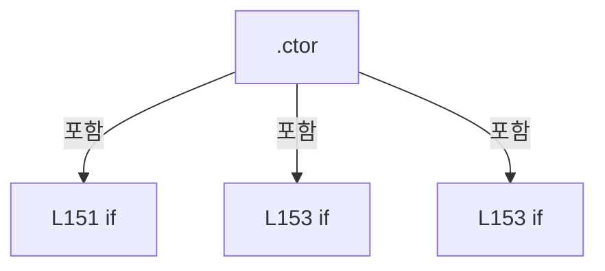

변경 전 점검: 입력/반환 타입, 위 호출자, 예외/취소 경로, 공유 상태와 저장·전송 소비자를 함께 확인합니다. 값의 단위나 물리 방향을 이름만으로 확정하지 않습니다.

### LocalFunctionStatement `SelectOutputViewerCellCallback` · L165–168

[Drilling.UI/Menu/Menus/CMenuCorrection.cs:165–168](https://github.com/kjuws10-rgb/A3Drilling/blob/dfa5920e6301d9ec4b0eab1452ae59521aafc986/Drilling.UI/Menu/Menus/CMenuCorrection.cs#L165-L168)

| 항목 | 실제 추출 값 |
| --- | --- |
| 서명 | void SelectOutputViewerCellCallback(object?) |
| 접근/수식자 | Private / async |
| 반환/값 타입 | void |
| 소속 타입 | NamedType:Drilling.UI.Menu.Menus.CMenuCorrection |

입력 계약:

| 이름 | 타입 | 전달 | 선택/기본값 |
| --- | --- | --- | --- |
| parameter | object? | None | False /  |

현재 부분 분석에서 직접 연결된 호출자는 없습니다. XAML/이벤트/인터페이스·델리게이트·외부 진입을 추가 확인해야 하며, 미사용으로 판정한 것이 아닙니다.

호출하는 대상과 해석 범위:

| 원본 행 | 표현식 | 분석 상태 | 대상/소스 위치 |
| --- | --- | --- | --- |
| 167 | SelectOutputViewerCell | resolved | System.Threading.Tasks.Task Drilling.UI.Menu.Menus.CMenuCorrection.SelectOutputViewerCell(object?) · Drilling.UI/Menu/Menus/CMenuCorrection.cs:539 |

본문의 실제 연산·분기·예외·반환 순서(원문 위치 순):

| 원본 행 | 종류 | 주석 해설 |
| --- | --- | --- |
| 167 | await | 비동기 완료를 기다립니다: await SelectOutputViewerCell(parameter) |
| 167 | call | 함수·델리게이트 또는 객체 생성자를 호출합니다: SelectOutputViewerCell(parameter) |

변경 전 점검: 입력/반환 타입, 위 호출자, 예외/취소 경로, 공유 상태와 저장·전송 소비자를 함께 확인합니다. 값의 단위나 물리 방향을 이름만으로 확정하지 않습니다.

### LocalFunctionStatement `BackToOutputViewerGlassCallback` · L172–175

[Drilling.UI/Menu/Menus/CMenuCorrection.cs:172–175](https://github.com/kjuws10-rgb/A3Drilling/blob/dfa5920e6301d9ec4b0eab1452ae59521aafc986/Drilling.UI/Menu/Menus/CMenuCorrection.cs#L172-L175)

| 항목 | 실제 추출 값 |
| --- | --- |
| 서명 | void BackToOutputViewerGlassCallback(object?) |
| 접근/수식자 | Private / async |
| 반환/값 타입 | void |
| 소속 타입 | NamedType:Drilling.UI.Menu.Menus.CMenuCorrection |

입력 계약:

| 이름 | 타입 | 전달 | 선택/기본값 |
| --- | --- | --- | --- |
| parameter | object? | None | False /  |

현재 부분 분석에서 직접 연결된 호출자는 없습니다. XAML/이벤트/인터페이스·델리게이트·외부 진입을 추가 확인해야 하며, 미사용으로 판정한 것이 아닙니다.

호출하는 대상과 해석 범위:

| 원본 행 | 표현식 | 분석 상태 | 대상/소스 위치 |
| --- | --- | --- | --- |
| 174 | BackToOutputViewerGlass | resolved | System.Threading.Tasks.Task Drilling.UI.Menu.Menus.CMenuCorrection.BackToOutputViewerGlass(object?) · Drilling.UI/Menu/Menus/CMenuCorrection.cs:608 |

본문의 실제 연산·분기·예외·반환 순서(원문 위치 순):

| 원본 행 | 종류 | 주석 해설 |
| --- | --- | --- |
| 174 | await | 비동기 완료를 기다립니다: await BackToOutputViewerGlass(parameter) |
| 174 | call | 함수·델리게이트 또는 객체 생성자를 호출합니다: BackToOutputViewerGlass(parameter) |

변경 전 점검: 입력/반환 타입, 위 호출자, 예외/취소 경로, 공유 상태와 저장·전송 소비자를 함께 확인합니다. 값의 단위나 물리 방향을 이름만으로 확정하지 않습니다.

### MethodDeclaration `TryConfirmInitialReviewStart` · L180–212

[Drilling.UI/Menu/Menus/CMenuCorrection.cs:180–212](https://github.com/kjuws10-rgb/A3Drilling/blob/dfa5920e6301d9ec4b0eab1452ae59521aafc986/Drilling.UI/Menu/Menus/CMenuCorrection.cs#L180-L212)

| 항목 | 실제 추출 값 |
| --- | --- |
| 서명 | bool Drilling.UI.Menu.Menus.CMenuCorrection.TryConfirmInitialReviewStart(string, string, string, System.Func<string, string, bool>?, out double, out double) |
| 접근/수식자 | Private / private |
| 반환/값 타입 | bool |
| 소속 타입 | NamedType:Drilling.UI.Menu.Menus.CMenuCorrection |

입력 계약:

| 이름 | 타입 | 전달 | 선택/기본값 |
| --- | --- | --- | --- |
| title | string | None | False /  |
| context | string | None | False /  |
| fallbackMessage | string | None | False /  |
| injectedConfirmation | System.Func<string, string, bool>? | None | False /  |
| shiftOffsetX | double | Out | False /  |
| shiftOffsetY | double | Out | False /  |

정적 호출자로 확인된 위치:

| 호출 파일/행 | 호출 표현식 | 런타임 분기 가능 |
| --- | --- | --- |
| [Drilling.UI/Menu/Menus/CMenuCorrection.cs:2960–2966](https://github.com/kjuws10-rgb/A3Drilling/blob/dfa5920e6301d9ec4b0eab1452ae59521aafc986/Drilling.UI/Menu/Menus/CMenuCorrection.cs#L2960-L2966) | TryConfirmInitialReviewStart | False |
| [Drilling.UI/Menu/Menus/CMenuCorrection.cs:3935–3941](https://github.com/kjuws10-rgb/A3Drilling/blob/dfa5920e6301d9ec4b0eab1452ae59521aafc986/Drilling.UI/Menu/Menus/CMenuCorrection.cs#L3935-L3941) | TryConfirmInitialReviewStart | False |

호출하는 대상과 해석 범위:

| 원본 행 | 표현식 | 분석 상태 | 대상/소스 위치 |
| --- | --- | --- | --- |
| 191 | injectedConfirmation | resolved · 동적 구현 선택 가능 | bool System.Func<string, string, bool>.Invoke(string, string) |
| 193 | .Station | resolved | Drilling.Common.Station.CStationManager Drilling.Common.Managers.CManager.Station() · Drilling.Common/Managers/CManager.cs:330 |
| 196 | CRecipeConfirmDialog.ShowConfirmation | resolved | bool Drilling.UI.Popup.CRecipeConfirmDialog.ShowConfirmation(string, string, string, bool) · Drilling.UI/Popup/CRecipeConfirmDialog.xaml.cs:11 |
| 202 | CReviewShiftOffsetDialog.Show | resolved | Drilling.UI.Popup.EN_REVIEW_SHIFT_OFFSET_CHOICE Drilling.UI.Popup.CReviewShiftOffsetDialog.Show(Drilling.Common.Station.ST_MANUAL_MOF_COMPLETION, string) · Drilling.UI/Popup/CReviewShiftOffsetDialog.xaml.cs:27 |

본문의 실제 연산·분기·예외·반환 순서(원문 위치 순):

| 원본 행 | 종류 | 주석 해설 |
| --- | --- | --- |
| 188 | assignment | 값을 대상에 대입합니다: shiftOffsetX = 0.0 |
| 189 | assignment | 값을 대상에 대입합니다: shiftOffsetY = 0.0 |
| 190 | if | 조건에 따라 분기합니다: if (injectedConfirmation is not null) |
| 191 | call | 함수·델리게이트 또는 객체 생성자를 호출합니다: injectedConfirmation(title, fallbackMessage) |
| 191 | return | 호출자에게 값 또는 제어를 반환합니다: return injectedConfirmation(title, fallbackMessage); |
| 193 | call | 함수·델리게이트 또는 객체 생성자를 호출합니다: .Station() |
| 193 | local-declaration | 지역 변수를 선언합니다: var completion = _defaultManager?.Station().LastCompletedManualMof; |
| 193 | variable-initializer | 변수의 초기값을 지정합니다: completion = _defaultManager?.Station().LastCompletedManualMof |
| 194 | if | 조건에 따라 분기합니다: if (completion is null) |
| 196 | call | 함수·델리게이트 또는 객체 생성자를 호출합니다: CRecipeConfirmDialog.ShowConfirmation( title, fallbackMessage + "\n\n성공 완료한 Manual MOF 이력이 없습니다.\nShift Offset 0.000 / 0.000 mm로 검사를 시작합니다.", "시작") |
| 196 | return | 호출자에게 값 또는 제어를 반환합니다: return CRecipeConfirmDialog.ShowConfirmation( title, fallbackMessage + "\n\n성공 완료한 Manual MOF 이력이 없습니다.\nShift Offset 0.000 / 0.000 mm로 검사를 시작합니다.", "시작"); |
| 202 | call | 함수·델리게이트 또는 객체 생성자를 호출합니다: CReviewShiftOffsetDialog.Show(completion, context) |
| 202 | local-declaration | 지역 변수를 선언합니다: var choice = CReviewShiftOffsetDialog.Show(completion, context); |
| 202 | variable-initializer | 변수의 초기값을 지정합니다: choice = CReviewShiftOffsetDialog.Show(completion, context) |
| 203 | if | 조건에 따라 분기합니다: if (choice == EN_REVIEW_SHIFT_OFFSET_CHOICE.Cancel) |
| 204 | return | 호출자에게 값 또는 제어를 반환합니다: return false; |
| 205 | if | 조건에 따라 분기합니다: if (choice == EN_REVIEW_SHIFT_OFFSET_CHOICE.Apply) |
| 207 | assignment | 값을 대상에 대입합니다: shiftOffsetX = completion.ShiftOffsetX |
| 208 | assignment | 값을 대상에 대입합니다: shiftOffsetY = completion.ShiftOffsetY |
| 211 | return | 호출자에게 값 또는 제어를 반환합니다: return true; |

제어 구문의 포함 구조(실제 실행 순서/CFG가 아닌 구문 탐색 그림):

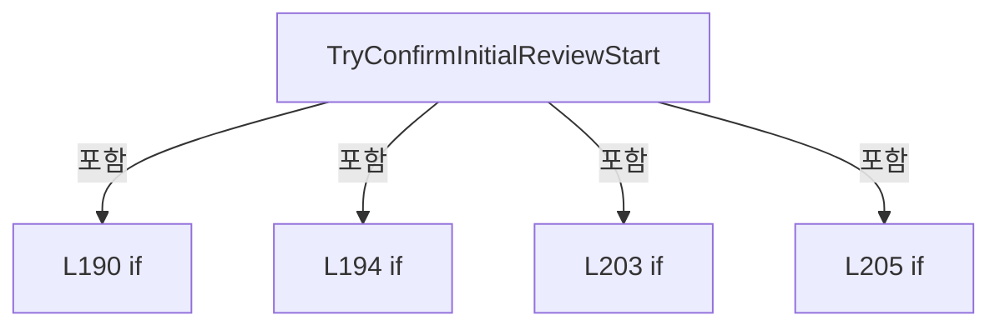

변경 전 점검: 입력/반환 타입, 위 호출자, 예외/취소 경로, 공유 상태와 저장·전송 소비자를 함께 확인합니다. 값의 단위나 물리 방향을 이름만으로 확정하지 않습니다.

### PropertyDeclaration `Menu` · L216–222

[Drilling.UI/Menu/Menus/CMenuCorrection.cs:216–222](https://github.com/kjuws10-rgb/A3Drilling/blob/dfa5920e6301d9ec4b0eab1452ae59521aafc986/Drilling.UI/Menu/Menus/CMenuCorrection.cs#L216-L222)

| 항목 | 실제 추출 값 |
| --- | --- |
| 서명 | Drilling.UI.Menu.Menus.EN_MENU Drilling.UI.Menu.Menus.CMenuCorrection.Menu |
| 접근/수식자 | Public / public, override |
| 반환/값 타입 | Drilling.UI.Menu.Menus.EN_MENU |
| 소속 타입 | NamedType:Drilling.UI.Menu.Menus.CMenuCorrection |

현재 부분 분석에서 직접 연결된 호출자는 없습니다. XAML/이벤트/인터페이스·델리게이트·외부 진입을 추가 확인해야 하며, 미사용으로 판정한 것이 아닙니다.

변경 전 점검: 입력/반환 타입, 위 호출자, 예외/취소 경로, 공유 상태와 저장·전송 소비자를 함께 확인합니다. 값의 단위나 물리 방향을 이름만으로 확정하지 않습니다.

### GetAccessorDeclaration `get_Menu` · L218–221

[Drilling.UI/Menu/Menus/CMenuCorrection.cs:218–221](https://github.com/kjuws10-rgb/A3Drilling/blob/dfa5920e6301d9ec4b0eab1452ae59521aafc986/Drilling.UI/Menu/Menus/CMenuCorrection.cs#L218-L221)

| 항목 | 실제 추출 값 |
| --- | --- |
| 서명 | Drilling.UI.Menu.Menus.EN_MENU Drilling.UI.Menu.Menus.CMenuCorrection.Menu.get |
| 접근/수식자 | Public / get |
| 반환/값 타입 | Drilling.UI.Menu.Menus.EN_MENU |
| 소속 타입 | NamedType:Drilling.UI.Menu.Menus.CMenuCorrection |

현재 부분 분석에서 직접 연결된 호출자는 없습니다. XAML/이벤트/인터페이스·델리게이트·외부 진입을 추가 확인해야 하며, 미사용으로 판정한 것이 아닙니다.

본문의 실제 연산·분기·예외·반환 순서(원문 위치 순):

| 원본 행 | 종류 | 주석 해설 |
| --- | --- | --- |
| 220 | return | 호출자에게 값 또는 제어를 반환합니다: return EN_MENU.Correction; |

변경 전 점검: 입력/반환 타입, 위 호출자, 예외/취소 경로, 공유 상태와 저장·전송 소비자를 함께 확인합니다. 값의 단위나 물리 방향을 이름만으로 확정하지 않습니다.

### PropertyDeclaration `Title` · L224–230

[Drilling.UI/Menu/Menus/CMenuCorrection.cs:224–230](https://github.com/kjuws10-rgb/A3Drilling/blob/dfa5920e6301d9ec4b0eab1452ae59521aafc986/Drilling.UI/Menu/Menus/CMenuCorrection.cs#L224-L230)

| 항목 | 실제 추출 값 |
| --- | --- |
| 서명 | string Drilling.UI.Menu.Menus.CMenuCorrection.Title |
| 접근/수식자 | Public / public |
| 반환/값 타입 | string |
| 소속 타입 | NamedType:Drilling.UI.Menu.Menus.CMenuCorrection |

현재 부분 분석에서 직접 연결된 호출자는 없습니다. XAML/이벤트/인터페이스·델리게이트·외부 진입을 추가 확인해야 하며, 미사용으로 판정한 것이 아닙니다.

변경 전 점검: 입력/반환 타입, 위 호출자, 예외/취소 경로, 공유 상태와 저장·전송 소비자를 함께 확인합니다. 값의 단위나 물리 방향을 이름만으로 확정하지 않습니다.

### GetAccessorDeclaration `get_Title` · L226–229

[Drilling.UI/Menu/Menus/CMenuCorrection.cs:226–229](https://github.com/kjuws10-rgb/A3Drilling/blob/dfa5920e6301d9ec4b0eab1452ae59521aafc986/Drilling.UI/Menu/Menus/CMenuCorrection.cs#L226-L229)

| 항목 | 실제 추출 값 |
| --- | --- |
| 서명 | string Drilling.UI.Menu.Menus.CMenuCorrection.Title.get |
| 접근/수식자 | Public / get |
| 반환/값 타입 | string |
| 소속 타입 | NamedType:Drilling.UI.Menu.Menus.CMenuCorrection |

현재 부분 분석에서 직접 연결된 호출자는 없습니다. XAML/이벤트/인터페이스·델리게이트·외부 진입을 추가 확인해야 하며, 미사용으로 판정한 것이 아닙니다.

본문의 실제 연산·분기·예외·반환 순서(원문 위치 순):

| 원본 행 | 종류 | 주석 해설 |
| --- | --- | --- |
| 228 | return | 호출자에게 값 또는 제어를 반환합니다: return $"CORRECTION / {_selectedTab}"; |

변경 전 점검: 입력/반환 타입, 위 호출자, 예외/취소 경로, 공유 상태와 저장·전송 소비자를 함께 확인합니다. 값의 단위나 물리 방향을 이름만으로 확정하지 않습니다.

### PropertyDeclaration `Subtitle` · L232–238

[Drilling.UI/Menu/Menus/CMenuCorrection.cs:232–238](https://github.com/kjuws10-rgb/A3Drilling/blob/dfa5920e6301d9ec4b0eab1452ae59521aafc986/Drilling.UI/Menu/Menus/CMenuCorrection.cs#L232-L238)

| 항목 | 실제 추출 값 |
| --- | --- |
| 서명 | string Drilling.UI.Menu.Menus.CMenuCorrection.Subtitle |
| 접근/수식자 | Public / public |
| 반환/값 타입 | string |
| 소속 타입 | NamedType:Drilling.UI.Menu.Menus.CMenuCorrection |

현재 부분 분석에서 직접 연결된 호출자는 없습니다. XAML/이벤트/인터페이스·델리게이트·외부 진입을 추가 확인해야 하며, 미사용으로 판정한 것이 아닙니다.

변경 전 점검: 입력/반환 타입, 위 호출자, 예외/취소 경로, 공유 상태와 저장·전송 소비자를 함께 확인합니다. 값의 단위나 물리 방향을 이름만으로 확정하지 않습니다.

### GetAccessorDeclaration `get_Subtitle` · L234–237

[Drilling.UI/Menu/Menus/CMenuCorrection.cs:234–237](https://github.com/kjuws10-rgb/A3Drilling/blob/dfa5920e6301d9ec4b0eab1452ae59521aafc986/Drilling.UI/Menu/Menus/CMenuCorrection.cs#L234-L237)

| 항목 | 실제 추출 값 |
| --- | --- |
| 서명 | string Drilling.UI.Menu.Menus.CMenuCorrection.Subtitle.get |
| 접근/수식자 | Public / get |
| 반환/값 타입 | string |
| 소속 타입 | NamedType:Drilling.UI.Menu.Menus.CMenuCorrection |

현재 부분 분석에서 직접 연결된 호출자는 없습니다. XAML/이벤트/인터페이스·델리게이트·외부 진입을 추가 확인해야 하며, 미사용으로 판정한 것이 아닙니다.

호출하는 대상과 해석 범위:

| 원본 행 | 표현식 | 분석 상태 | 대상/소스 위치 |
| --- | --- | --- | --- |
| 236 | GetSubtitle | resolved | string Drilling.UI.Menu.Menus.CMenuCorrection.GetSubtitle(string) · Drilling.UI/Menu/Menus/CMenuCorrection.cs:2544 |

본문의 실제 연산·분기·예외·반환 순서(원문 위치 순):

| 원본 행 | 종류 | 주석 해설 |
| --- | --- | --- |
| 236 | call | 함수·델리게이트 또는 객체 생성자를 호출합니다: GetSubtitle(_selectedTab) |
| 236 | return | 호출자에게 값 또는 제어를 반환합니다: return GetSubtitle(_selectedTab); |

변경 전 점검: 입력/반환 타입, 위 호출자, 예외/취소 경로, 공유 상태와 저장·전송 소비자를 함께 확인합니다. 값의 단위나 물리 방향을 이름만으로 확정하지 않습니다.

### PropertyDeclaration `SelectedTab` · L240–246

[Drilling.UI/Menu/Menus/CMenuCorrection.cs:240–246](https://github.com/kjuws10-rgb/A3Drilling/blob/dfa5920e6301d9ec4b0eab1452ae59521aafc986/Drilling.UI/Menu/Menus/CMenuCorrection.cs#L240-L246)

| 항목 | 실제 추출 값 |
| --- | --- |
| 서명 | string Drilling.UI.Menu.Menus.CMenuCorrection.SelectedTab |
| 접근/수식자 | Public / public |
| 반환/값 타입 | string |
| 소속 타입 | NamedType:Drilling.UI.Menu.Menus.CMenuCorrection |

현재 부분 분석에서 직접 연결된 호출자는 없습니다. XAML/이벤트/인터페이스·델리게이트·외부 진입을 추가 확인해야 하며, 미사용으로 판정한 것이 아닙니다.

변경 전 점검: 입력/반환 타입, 위 호출자, 예외/취소 경로, 공유 상태와 저장·전송 소비자를 함께 확인합니다. 값의 단위나 물리 방향을 이름만으로 확정하지 않습니다.

### GetAccessorDeclaration `get_SelectedTab` · L242–245

[Drilling.UI/Menu/Menus/CMenuCorrection.cs:242–245](https://github.com/kjuws10-rgb/A3Drilling/blob/dfa5920e6301d9ec4b0eab1452ae59521aafc986/Drilling.UI/Menu/Menus/CMenuCorrection.cs#L242-L245)

| 항목 | 실제 추출 값 |
| --- | --- |
| 서명 | string Drilling.UI.Menu.Menus.CMenuCorrection.SelectedTab.get |
| 접근/수식자 | Public / get |
| 반환/값 타입 | string |
| 소속 타입 | NamedType:Drilling.UI.Menu.Menus.CMenuCorrection |

현재 부분 분석에서 직접 연결된 호출자는 없습니다. XAML/이벤트/인터페이스·델리게이트·외부 진입을 추가 확인해야 하며, 미사용으로 판정한 것이 아닙니다.

본문의 실제 연산·분기·예외·반환 순서(원문 위치 순):

| 원본 행 | 종류 | 주석 해설 |
| --- | --- | --- |
| 244 | return | 호출자에게 값 또는 제어를 반환합니다: return _selectedTab; |

변경 전 점검: 입력/반환 타입, 위 호출자, 예외/취소 경로, 공유 상태와 저장·전송 소비자를 함께 확인합니다. 값의 단위나 물리 방향을 이름만으로 확정하지 않습니다.

### PropertyDeclaration `SelectedReviewTabIndex` · L248–260

[Drilling.UI/Menu/Menus/CMenuCorrection.cs:248–260](https://github.com/kjuws10-rgb/A3Drilling/blob/dfa5920e6301d9ec4b0eab1452ae59521aafc986/Drilling.UI/Menu/Menus/CMenuCorrection.cs#L248-L260)

| 항목 | 실제 추출 값 |
| --- | --- |
| 서명 | int Drilling.UI.Menu.Menus.CMenuCorrection.SelectedReviewTabIndex |
| 접근/수식자 | Public / public |
| 반환/값 타입 | int |
| 소속 타입 | NamedType:Drilling.UI.Menu.Menus.CMenuCorrection |

현재 부분 분석에서 직접 연결된 호출자는 없습니다. XAML/이벤트/인터페이스·델리게이트·외부 진입을 추가 확인해야 하며, 미사용으로 판정한 것이 아닙니다.

변경 전 점검: 입력/반환 타입, 위 호출자, 예외/취소 경로, 공유 상태와 저장·전송 소비자를 함께 확인합니다. 값의 단위나 물리 방향을 이름만으로 확정하지 않습니다.

### GetAccessorDeclaration `get_SelectedReviewTabIndex` · L250–250

[Drilling.UI/Menu/Menus/CMenuCorrection.cs:250–250](https://github.com/kjuws10-rgb/A3Drilling/blob/dfa5920e6301d9ec4b0eab1452ae59521aafc986/Drilling.UI/Menu/Menus/CMenuCorrection.cs#L250-L250)

| 항목 | 실제 추출 값 |
| --- | --- |
| 서명 | int Drilling.UI.Menu.Menus.CMenuCorrection.SelectedReviewTabIndex.get |
| 접근/수식자 | Public / get |
| 반환/값 타입 | int |
| 소속 타입 | NamedType:Drilling.UI.Menu.Menus.CMenuCorrection |

현재 부분 분석에서 직접 연결된 호출자는 없습니다. XAML/이벤트/인터페이스·델리게이트·외부 진입을 추가 확인해야 하며, 미사용으로 판정한 것이 아닙니다.

변경 전 점검: 입력/반환 타입, 위 호출자, 예외/취소 경로, 공유 상태와 저장·전송 소비자를 함께 확인합니다. 값의 단위나 물리 방향을 이름만으로 확정하지 않습니다.

### SetAccessorDeclaration `set_SelectedReviewTabIndex` · L251–259

[Drilling.UI/Menu/Menus/CMenuCorrection.cs:251–259](https://github.com/kjuws10-rgb/A3Drilling/blob/dfa5920e6301d9ec4b0eab1452ae59521aafc986/Drilling.UI/Menu/Menus/CMenuCorrection.cs#L251-L259)

| 항목 | 실제 추출 값 |
| --- | --- |
| 서명 | void Drilling.UI.Menu.Menus.CMenuCorrection.SelectedReviewTabIndex.set |
| 접근/수식자 | Public / set |
| 반환/값 타입 | void |
| 소속 타입 | NamedType:Drilling.UI.Menu.Menus.CMenuCorrection |

입력 계약:

| 이름 | 타입 | 전달 | 선택/기본값 |
| --- | --- | --- | --- |
| value | int | None | False /  |

현재 부분 분석에서 직접 연결된 호출자는 없습니다. XAML/이벤트/인터페이스·델리게이트·외부 진입을 추가 확인해야 하며, 미사용으로 판정한 것이 아닙니다.

호출하는 대상과 해석 범위:

| 원본 행 | 표현식 | 분석 상태 | 대상/소스 위치 |
| --- | --- | --- | --- |
| 253 | Math.Clamp | resolved | int System.Math.Clamp(int, int, int) |
| 258 | OnPropertyChanged | resolved | void Drilling.UI.Menu.CBindingBase.OnPropertyChanged(string?) · Drilling.UI/Menu/CBindingBase.cs:761 |
| 258 | nameof | unresolved | None |

본문의 실제 연산·분기·예외·반환 순서(원문 위치 순):

| 원본 행 | 종류 | 주석 해설 |
| --- | --- | --- |
| 253 | call | 함수·델리게이트 또는 객체 생성자를 호출합니다: Math.Clamp(value, 0, 7) |
| 253 | local-declaration | 지역 변수를 선언합니다: var normalized = Math.Clamp(value, 0, 7); |
| 253 | variable-initializer | 변수의 초기값을 지정합니다: normalized = Math.Clamp(value, 0, 7) |
| 254 | if | 조건에 따라 분기합니다: if (_selectedReviewTabIndex == normalized) |
| 255 | return | 호출자에게 값 또는 제어를 반환합니다: return; |
| 257 | assignment | 값을 대상에 대입합니다: _selectedReviewTabIndex = normalized |
| 258 | call | 함수·델리게이트 또는 객체 생성자를 호출합니다: OnPropertyChanged(nameof(SelectedReviewTabIndex)) |
| 258 | call | 함수·델리게이트 또는 객체 생성자를 호출합니다: nameof(SelectedReviewTabIndex) |

제어 구문의 포함 구조(실제 실행 순서/CFG가 아닌 구문 탐색 그림):

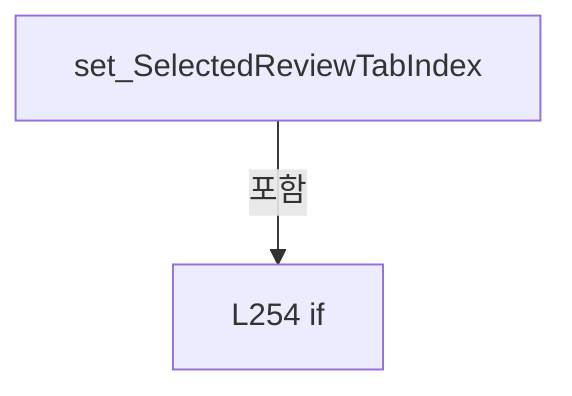

변경 전 점검: 입력/반환 타입, 위 호출자, 예외/취소 경로, 공유 상태와 저장·전송 소비자를 함께 확인합니다. 값의 단위나 물리 방향을 이름만으로 확정하지 않습니다.

### PropertyDeclaration `IsOtherCorrectionTab` · L262–268

[Drilling.UI/Menu/Menus/CMenuCorrection.cs:262–268](https://github.com/kjuws10-rgb/A3Drilling/blob/dfa5920e6301d9ec4b0eab1452ae59521aafc986/Drilling.UI/Menu/Menus/CMenuCorrection.cs#L262-L268)

| 항목 | 실제 추출 값 |
| --- | --- |
| 서명 | bool Drilling.UI.Menu.Menus.CMenuCorrection.IsOtherCorrectionTab |
| 접근/수식자 | Public / public |
| 반환/값 타입 | bool |
| 소속 타입 | NamedType:Drilling.UI.Menu.Menus.CMenuCorrection |

현재 부분 분석에서 직접 연결된 호출자는 없습니다. XAML/이벤트/인터페이스·델리게이트·외부 진입을 추가 확인해야 하며, 미사용으로 판정한 것이 아닙니다.

변경 전 점검: 입력/반환 타입, 위 호출자, 예외/취소 경로, 공유 상태와 저장·전송 소비자를 함께 확인합니다. 값의 단위나 물리 방향을 이름만으로 확정하지 않습니다.

### GetAccessorDeclaration `get_IsOtherCorrectionTab` · L264–267

[Drilling.UI/Menu/Menus/CMenuCorrection.cs:264–267](https://github.com/kjuws10-rgb/A3Drilling/blob/dfa5920e6301d9ec4b0eab1452ae59521aafc986/Drilling.UI/Menu/Menus/CMenuCorrection.cs#L264-L267)

| 항목 | 실제 추출 값 |
| --- | --- |
| 서명 | bool Drilling.UI.Menu.Menus.CMenuCorrection.IsOtherCorrectionTab.get |
| 접근/수식자 | Public / get |
| 반환/값 타입 | bool |
| 소속 타입 | NamedType:Drilling.UI.Menu.Menus.CMenuCorrection |

현재 부분 분석에서 직접 연결된 호출자는 없습니다. XAML/이벤트/인터페이스·델리게이트·외부 진입을 추가 확인해야 하며, 미사용으로 판정한 것이 아닙니다.

본문의 실제 연산·분기·예외·반환 순서(원문 위치 순):

| 원본 행 | 종류 | 주석 해설 |
| --- | --- | --- |
| 266 | return | 호출자에게 값 또는 제어를 반환합니다: return !IsDefaultTab && !IsOutputHistoryTab && !IsAlignDistortionTab && !IsReviewCorrectionTab; |

변경 전 점검: 입력/반환 타입, 위 호출자, 예외/취소 경로, 공유 상태와 저장·전송 소비자를 함께 확인합니다. 값의 단위나 물리 방향을 이름만으로 확정하지 않습니다.

### PropertyDeclaration `IsDefaultTab` · L270–270

[Drilling.UI/Menu/Menus/CMenuCorrection.cs:270–270](https://github.com/kjuws10-rgb/A3Drilling/blob/dfa5920e6301d9ec4b0eab1452ae59521aafc986/Drilling.UI/Menu/Menus/CMenuCorrection.cs#L270-L270)

| 항목 | 실제 추출 값 |
| --- | --- |
| 서명 | bool Drilling.UI.Menu.Menus.CMenuCorrection.IsDefaultTab |
| 접근/수식자 | Public / public |
| 반환/값 타입 | bool |
| 소속 타입 | NamedType:Drilling.UI.Menu.Menus.CMenuCorrection |

현재 부분 분석에서 직접 연결된 호출자는 없습니다. XAML/이벤트/인터페이스·델리게이트·외부 진입을 추가 확인해야 하며, 미사용으로 판정한 것이 아닙니다.

변경 전 점검: 입력/반환 타입, 위 호출자, 예외/취소 경로, 공유 상태와 저장·전송 소비자를 함께 확인합니다. 값의 단위나 물리 방향을 이름만으로 확정하지 않습니다.

### PropertyDeclaration `IsAlignDistortionTab` · L271–271

[Drilling.UI/Menu/Menus/CMenuCorrection.cs:271–271](https://github.com/kjuws10-rgb/A3Drilling/blob/dfa5920e6301d9ec4b0eab1452ae59521aafc986/Drilling.UI/Menu/Menus/CMenuCorrection.cs#L271-L271)

| 항목 | 실제 추출 값 |
| --- | --- |
| 서명 | bool Drilling.UI.Menu.Menus.CMenuCorrection.IsAlignDistortionTab |
| 접근/수식자 | Public / public |
| 반환/값 타입 | bool |
| 소속 타입 | NamedType:Drilling.UI.Menu.Menus.CMenuCorrection |

현재 부분 분석에서 직접 연결된 호출자는 없습니다. XAML/이벤트/인터페이스·델리게이트·외부 진입을 추가 확인해야 하며, 미사용으로 판정한 것이 아닙니다.

변경 전 점검: 입력/반환 타입, 위 호출자, 예외/취소 경로, 공유 상태와 저장·전송 소비자를 함께 확인합니다. 값의 단위나 물리 방향을 이름만으로 확정하지 않습니다.

### PropertyDeclaration `IsReviewCorrectionTab` · L272–272

[Drilling.UI/Menu/Menus/CMenuCorrection.cs:272–272](https://github.com/kjuws10-rgb/A3Drilling/blob/dfa5920e6301d9ec4b0eab1452ae59521aafc986/Drilling.UI/Menu/Menus/CMenuCorrection.cs#L272-L272)

| 항목 | 실제 추출 값 |
| --- | --- |
| 서명 | bool Drilling.UI.Menu.Menus.CMenuCorrection.IsReviewCorrectionTab |
| 접근/수식자 | Public / public |
| 반환/값 타입 | bool |
| 소속 타입 | NamedType:Drilling.UI.Menu.Menus.CMenuCorrection |

현재 부분 분석에서 직접 연결된 호출자는 없습니다. XAML/이벤트/인터페이스·델리게이트·외부 진입을 추가 확인해야 하며, 미사용으로 판정한 것이 아닙니다.

변경 전 점검: 입력/반환 타입, 위 호출자, 예외/취소 경로, 공유 상태와 저장·전송 소비자를 함께 확인합니다. 값의 단위나 물리 방향을 이름만으로 확정하지 않습니다.

### PropertyDeclaration `Simple` · L273–273

[Drilling.UI/Menu/Menus/CMenuCorrection.cs:273–273](https://github.com/kjuws10-rgb/A3Drilling/blob/dfa5920e6301d9ec4b0eab1452ae59521aafc986/Drilling.UI/Menu/Menus/CMenuCorrection.cs#L273-L273)

| 항목 | 실제 추출 값 |
| --- | --- |
| 서명 | Drilling.UI.Menu.Menus.CSimpleCorrectionPanel Drilling.UI.Menu.Menus.CMenuCorrection.Simple |
| 접근/수식자 | Public / public |
| 반환/값 타입 | Drilling.UI.Menu.Menus.CSimpleCorrectionPanel |
| 소속 타입 | NamedType:Drilling.UI.Menu.Menus.CMenuCorrection |

현재 부분 분석에서 직접 연결된 호출자는 없습니다. XAML/이벤트/인터페이스·델리게이트·외부 진입을 추가 확인해야 하며, 미사용으로 판정한 것이 아닙니다.

변경 전 점검: 입력/반환 타입, 위 호출자, 예외/취소 경로, 공유 상태와 저장·전송 소비자를 함께 확인합니다. 값의 단위나 물리 방향을 이름만으로 확정하지 않습니다.

### GetAccessorDeclaration `get_Simple` · L273–273

[Drilling.UI/Menu/Menus/CMenuCorrection.cs:273–273](https://github.com/kjuws10-rgb/A3Drilling/blob/dfa5920e6301d9ec4b0eab1452ae59521aafc986/Drilling.UI/Menu/Menus/CMenuCorrection.cs#L273-L273)

| 항목 | 실제 추출 값 |
| --- | --- |
| 서명 | Drilling.UI.Menu.Menus.CSimpleCorrectionPanel Drilling.UI.Menu.Menus.CMenuCorrection.Simple.get |
| 접근/수식자 | Public / get |
| 반환/값 타입 | Drilling.UI.Menu.Menus.CSimpleCorrectionPanel |
| 소속 타입 | NamedType:Drilling.UI.Menu.Menus.CMenuCorrection |

현재 부분 분석에서 직접 연결된 호출자는 없습니다. XAML/이벤트/인터페이스·델리게이트·외부 진입을 추가 확인해야 하며, 미사용으로 판정한 것이 아닙니다.

변경 전 점검: 입력/반환 타입, 위 호출자, 예외/취소 경로, 공유 상태와 저장·전송 소비자를 함께 확인합니다. 값의 단위나 물리 방향을 이름만으로 확정하지 않습니다.

### PropertyDeclaration `Rough` · L274–274

[Drilling.UI/Menu/Menus/CMenuCorrection.cs:274–274](https://github.com/kjuws10-rgb/A3Drilling/blob/dfa5920e6301d9ec4b0eab1452ae59521aafc986/Drilling.UI/Menu/Menus/CMenuCorrection.cs#L274-L274)

| 항목 | 실제 추출 값 |
| --- | --- |
| 서명 | Drilling.UI.Menu.Menus.CSimpleCorrectionPanel Drilling.UI.Menu.Menus.CMenuCorrection.Rough |
| 접근/수식자 | Public / public |
| 반환/값 타입 | Drilling.UI.Menu.Menus.CSimpleCorrectionPanel |
| 소속 타입 | NamedType:Drilling.UI.Menu.Menus.CMenuCorrection |

현재 부분 분석에서 직접 연결된 호출자는 없습니다. XAML/이벤트/인터페이스·델리게이트·외부 진입을 추가 확인해야 하며, 미사용으로 판정한 것이 아닙니다.

변경 전 점검: 입력/반환 타입, 위 호출자, 예외/취소 경로, 공유 상태와 저장·전송 소비자를 함께 확인합니다. 값의 단위나 물리 방향을 이름만으로 확정하지 않습니다.

### GetAccessorDeclaration `get_Rough` · L274–274

[Drilling.UI/Menu/Menus/CMenuCorrection.cs:274–274](https://github.com/kjuws10-rgb/A3Drilling/blob/dfa5920e6301d9ec4b0eab1452ae59521aafc986/Drilling.UI/Menu/Menus/CMenuCorrection.cs#L274-L274)

| 항목 | 실제 추출 값 |
| --- | --- |
| 서명 | Drilling.UI.Menu.Menus.CSimpleCorrectionPanel Drilling.UI.Menu.Menus.CMenuCorrection.Rough.get |
| 접근/수식자 | Public / get |
| 반환/값 타입 | Drilling.UI.Menu.Menus.CSimpleCorrectionPanel |
| 소속 타입 | NamedType:Drilling.UI.Menu.Menus.CMenuCorrection |

현재 부분 분석에서 직접 연결된 호출자는 없습니다. XAML/이벤트/인터페이스·델리게이트·외부 진입을 추가 확인해야 하며, 미사용으로 판정한 것이 아닙니다.

변경 전 점검: 입력/반환 타입, 위 호출자, 예외/취소 경로, 공유 상태와 저장·전송 소비자를 함께 확인합니다. 값의 단위나 물리 방향을 이름만으로 확정하지 않습니다.

### PropertyDeclaration `Fine` · L275–275

[Drilling.UI/Menu/Menus/CMenuCorrection.cs:275–275](https://github.com/kjuws10-rgb/A3Drilling/blob/dfa5920e6301d9ec4b0eab1452ae59521aafc986/Drilling.UI/Menu/Menus/CMenuCorrection.cs#L275-L275)

| 항목 | 실제 추출 값 |
| --- | --- |
| 서명 | Drilling.UI.Menu.Menus.CFineCorrectionPanel Drilling.UI.Menu.Menus.CMenuCorrection.Fine |
| 접근/수식자 | Public / public |
| 반환/값 타입 | Drilling.UI.Menu.Menus.CFineCorrectionPanel |
| 소속 타입 | NamedType:Drilling.UI.Menu.Menus.CMenuCorrection |

현재 부분 분석에서 직접 연결된 호출자는 없습니다. XAML/이벤트/인터페이스·델리게이트·외부 진입을 추가 확인해야 하며, 미사용으로 판정한 것이 아닙니다.

변경 전 점검: 입력/반환 타입, 위 호출자, 예외/취소 경로, 공유 상태와 저장·전송 소비자를 함께 확인합니다. 값의 단위나 물리 방향을 이름만으로 확정하지 않습니다.

### GetAccessorDeclaration `get_Fine` · L275–275

[Drilling.UI/Menu/Menus/CMenuCorrection.cs:275–275](https://github.com/kjuws10-rgb/A3Drilling/blob/dfa5920e6301d9ec4b0eab1452ae59521aafc986/Drilling.UI/Menu/Menus/CMenuCorrection.cs#L275-L275)

| 항목 | 실제 추출 값 |
| --- | --- |
| 서명 | Drilling.UI.Menu.Menus.CFineCorrectionPanel Drilling.UI.Menu.Menus.CMenuCorrection.Fine.get |
| 접근/수식자 | Public / get |
| 반환/값 타입 | Drilling.UI.Menu.Menus.CFineCorrectionPanel |
| 소속 타입 | NamedType:Drilling.UI.Menu.Menus.CMenuCorrection |

현재 부분 분석에서 직접 연결된 호출자는 없습니다. XAML/이벤트/인터페이스·델리게이트·외부 진입을 추가 확인해야 하며, 미사용으로 판정한 것이 아닙니다.

변경 전 점검: 입력/반환 타입, 위 호출자, 예외/취소 경로, 공유 상태와 저장·전송 소비자를 함께 확인합니다. 값의 단위나 물리 방향을 이름만으로 확정하지 않습니다.

### PropertyDeclaration `IsCorrectionCommandsVisible` · L276–276

[Drilling.UI/Menu/Menus/CMenuCorrection.cs:276–276](https://github.com/kjuws10-rgb/A3Drilling/blob/dfa5920e6301d9ec4b0eab1452ae59521aafc986/Drilling.UI/Menu/Menus/CMenuCorrection.cs#L276-L276)

| 항목 | 실제 추출 값 |
| --- | --- |
| 서명 | bool Drilling.UI.Menu.Menus.CMenuCorrection.IsCorrectionCommandsVisible |
| 접근/수식자 | Public / public |
| 반환/값 타입 | bool |
| 소속 타입 | NamedType:Drilling.UI.Menu.Menus.CMenuCorrection |

현재 부분 분석에서 직접 연결된 호출자는 없습니다. XAML/이벤트/인터페이스·델리게이트·외부 진입을 추가 확인해야 하며, 미사용으로 판정한 것이 아닙니다.

변경 전 점검: 입력/반환 타입, 위 호출자, 예외/취소 경로, 공유 상태와 저장·전송 소비자를 함께 확인합니다. 값의 단위나 물리 방향을 이름만으로 확정하지 않습니다.

### PropertyDeclaration `AlignDistortion` · L277–277

[Drilling.UI/Menu/Menus/CMenuCorrection.cs:277–277](https://github.com/kjuws10-rgb/A3Drilling/blob/dfa5920e6301d9ec4b0eab1452ae59521aafc986/Drilling.UI/Menu/Menus/CMenuCorrection.cs#L277-L277)

| 항목 | 실제 추출 값 |
| --- | --- |
| 서명 | Drilling.UI.Menu.Menus.CAlignDistortionPanel Drilling.UI.Menu.Menus.CMenuCorrection.AlignDistortion |
| 접근/수식자 | Public / public |
| 반환/값 타입 | Drilling.UI.Menu.Menus.CAlignDistortionPanel |
| 소속 타입 | NamedType:Drilling.UI.Menu.Menus.CMenuCorrection |

현재 부분 분석에서 직접 연결된 호출자는 없습니다. XAML/이벤트/인터페이스·델리게이트·외부 진입을 추가 확인해야 하며, 미사용으로 판정한 것이 아닙니다.

변경 전 점검: 입력/반환 타입, 위 호출자, 예외/취소 경로, 공유 상태와 저장·전송 소비자를 함께 확인합니다. 값의 단위나 물리 방향을 이름만으로 확정하지 않습니다.

### GetAccessorDeclaration `get_AlignDistortion` · L277–277

[Drilling.UI/Menu/Menus/CMenuCorrection.cs:277–277](https://github.com/kjuws10-rgb/A3Drilling/blob/dfa5920e6301d9ec4b0eab1452ae59521aafc986/Drilling.UI/Menu/Menus/CMenuCorrection.cs#L277-L277)

| 항목 | 실제 추출 값 |
| --- | --- |
| 서명 | Drilling.UI.Menu.Menus.CAlignDistortionPanel Drilling.UI.Menu.Menus.CMenuCorrection.AlignDistortion.get |
| 접근/수식자 | Public / get |
| 반환/값 타입 | Drilling.UI.Menu.Menus.CAlignDistortionPanel |
| 소속 타입 | NamedType:Drilling.UI.Menu.Menus.CMenuCorrection |

현재 부분 분석에서 직접 연결된 호출자는 없습니다. XAML/이벤트/인터페이스·델리게이트·외부 진입을 추가 확인해야 하며, 미사용으로 판정한 것이 아닙니다.

변경 전 점검: 입력/반환 타입, 위 호출자, 예외/취소 경로, 공유 상태와 저장·전송 소비자를 함께 확인합니다. 값의 단위나 물리 방향을 이름만으로 확정하지 않습니다.

### PropertyDeclaration `IsOutputHistoryTab` · L279–285

[Drilling.UI/Menu/Menus/CMenuCorrection.cs:279–285](https://github.com/kjuws10-rgb/A3Drilling/blob/dfa5920e6301d9ec4b0eab1452ae59521aafc986/Drilling.UI/Menu/Menus/CMenuCorrection.cs#L279-L285)

| 항목 | 실제 추출 값 |
| --- | --- |
| 서명 | bool Drilling.UI.Menu.Menus.CMenuCorrection.IsOutputHistoryTab |
| 접근/수식자 | Public / public |
| 반환/값 타입 | bool |
| 소속 타입 | NamedType:Drilling.UI.Menu.Menus.CMenuCorrection |

현재 부분 분석에서 직접 연결된 호출자는 없습니다. XAML/이벤트/인터페이스·델리게이트·외부 진입을 추가 확인해야 하며, 미사용으로 판정한 것이 아닙니다.

변경 전 점검: 입력/반환 타입, 위 호출자, 예외/취소 경로, 공유 상태와 저장·전송 소비자를 함께 확인합니다. 값의 단위나 물리 방향을 이름만으로 확정하지 않습니다.

### GetAccessorDeclaration `get_IsOutputHistoryTab` · L281–284

[Drilling.UI/Menu/Menus/CMenuCorrection.cs:281–284](https://github.com/kjuws10-rgb/A3Drilling/blob/dfa5920e6301d9ec4b0eab1452ae59521aafc986/Drilling.UI/Menu/Menus/CMenuCorrection.cs#L281-L284)

| 항목 | 실제 추출 값 |
| --- | --- |
| 서명 | bool Drilling.UI.Menu.Menus.CMenuCorrection.IsOutputHistoryTab.get |
| 접근/수식자 | Public / get |
| 반환/값 타입 | bool |
| 소속 타입 | NamedType:Drilling.UI.Menu.Menus.CMenuCorrection |

현재 부분 분석에서 직접 연결된 호출자는 없습니다. XAML/이벤트/인터페이스·델리게이트·외부 진입을 추가 확인해야 하며, 미사용으로 판정한 것이 아닙니다.

호출하는 대상과 해석 범위:

| 원본 행 | 표현식 | 분석 상태 | 대상/소스 위치 |
| --- | --- | --- | --- |
| 283 | _selectedTab.Equals | resolved | bool string.Equals(string?, System.StringComparison) |

본문의 실제 연산·분기·예외·반환 순서(원문 위치 순):

| 원본 행 | 종류 | 주석 해설 |
| --- | --- | --- |
| 283 | call | 함수·델리게이트 또는 객체 생성자를 호출합니다: _selectedTab.Equals("VIEWER", StringComparison.OrdinalIgnoreCase) |
| 283 | return | 호출자에게 값 또는 제어를 반환합니다: return _selectedTab.Equals("VIEWER", StringComparison.OrdinalIgnoreCase); |

변경 전 점검: 입력/반환 타입, 위 호출자, 예외/취소 경로, 공유 상태와 저장·전송 소비자를 함께 확인합니다. 값의 단위나 물리 방향을 이름만으로 확정하지 않습니다.

### PropertyDeclaration `IsCorrectionHistoryVisible` · L287–293

[Drilling.UI/Menu/Menus/CMenuCorrection.cs:287–293](https://github.com/kjuws10-rgb/A3Drilling/blob/dfa5920e6301d9ec4b0eab1452ae59521aafc986/Drilling.UI/Menu/Menus/CMenuCorrection.cs#L287-L293)

| 항목 | 실제 추출 값 |
| --- | --- |
| 서명 | bool Drilling.UI.Menu.Menus.CMenuCorrection.IsCorrectionHistoryVisible |
| 접근/수식자 | Public / public |
| 반환/값 타입 | bool |
| 소속 타입 | NamedType:Drilling.UI.Menu.Menus.CMenuCorrection |

현재 부분 분석에서 직접 연결된 호출자는 없습니다. XAML/이벤트/인터페이스·델리게이트·외부 진입을 추가 확인해야 하며, 미사용으로 판정한 것이 아닙니다.

변경 전 점검: 입력/반환 타입, 위 호출자, 예외/취소 경로, 공유 상태와 저장·전송 소비자를 함께 확인합니다. 값의 단위나 물리 방향을 이름만으로 확정하지 않습니다.

### GetAccessorDeclaration `get_IsCorrectionHistoryVisible` · L289–292

[Drilling.UI/Menu/Menus/CMenuCorrection.cs:289–292](https://github.com/kjuws10-rgb/A3Drilling/blob/dfa5920e6301d9ec4b0eab1452ae59521aafc986/Drilling.UI/Menu/Menus/CMenuCorrection.cs#L289-L292)

| 항목 | 실제 추출 값 |
| --- | --- |
| 서명 | bool Drilling.UI.Menu.Menus.CMenuCorrection.IsCorrectionHistoryVisible.get |
| 접근/수식자 | Public / get |
| 반환/값 타입 | bool |
| 소속 타입 | NamedType:Drilling.UI.Menu.Menus.CMenuCorrection |

현재 부분 분석에서 직접 연결된 호출자는 없습니다. XAML/이벤트/인터페이스·델리게이트·외부 진입을 추가 확인해야 하며, 미사용으로 판정한 것이 아닙니다.

본문의 실제 연산·분기·예외·반환 순서(원문 위치 순):

| 원본 행 | 종류 | 주석 해설 |
| --- | --- | --- |
| 291 | return | 호출자에게 값 또는 제어를 반환합니다: return !IsDefaultTab && !IsOutputHistoryTab; |

변경 전 점검: 입력/반환 타입, 위 호출자, 예외/취소 경로, 공유 상태와 저장·전송 소비자를 함께 확인합니다. 값의 단위나 물리 방향을 이름만으로 확정하지 않습니다.

### PropertyDeclaration `OutputViewerGlassPreviewImage` · L295–295

[Drilling.UI/Menu/Menus/CMenuCorrection.cs:295–295](https://github.com/kjuws10-rgb/A3Drilling/blob/dfa5920e6301d9ec4b0eab1452ae59521aafc986/Drilling.UI/Menu/Menus/CMenuCorrection.cs#L295-L295)

| 항목 | 실제 추출 값 |
| --- | --- |
| 서명 | ImageSource? Drilling.UI.Menu.Menus.CMenuCorrection.OutputViewerGlassPreviewImage |
| 접근/수식자 | Public / public |
| 반환/값 타입 | ImageSource? |
| 소속 타입 | NamedType:Drilling.UI.Menu.Menus.CMenuCorrection |

현재 부분 분석에서 직접 연결된 호출자는 없습니다. XAML/이벤트/인터페이스·델리게이트·외부 진입을 추가 확인해야 하며, 미사용으로 판정한 것이 아닙니다.

변경 전 점검: 입력/반환 타입, 위 호출자, 예외/취소 경로, 공유 상태와 저장·전송 소비자를 함께 확인합니다. 값의 단위나 물리 방향을 이름만으로 확정하지 않습니다.

### GetAccessorDeclaration `get_OutputViewerGlassPreviewImage` · L295–295

[Drilling.UI/Menu/Menus/CMenuCorrection.cs:295–295](https://github.com/kjuws10-rgb/A3Drilling/blob/dfa5920e6301d9ec4b0eab1452ae59521aafc986/Drilling.UI/Menu/Menus/CMenuCorrection.cs#L295-L295)

| 항목 | 실제 추출 값 |
| --- | --- |
| 서명 | ImageSource? Drilling.UI.Menu.Menus.CMenuCorrection.OutputViewerGlassPreviewImage.get |
| 접근/수식자 | Public / get |
| 반환/값 타입 | ImageSource? |
| 소속 타입 | NamedType:Drilling.UI.Menu.Menus.CMenuCorrection |

현재 부분 분석에서 직접 연결된 호출자는 없습니다. XAML/이벤트/인터페이스·델리게이트·외부 진입을 추가 확인해야 하며, 미사용으로 판정한 것이 아닙니다.

변경 전 점검: 입력/반환 타입, 위 호출자, 예외/취소 경로, 공유 상태와 저장·전송 소비자를 함께 확인합니다. 값의 단위나 물리 방향을 이름만으로 확정하지 않습니다.

### SetAccessorDeclaration `set_OutputViewerGlassPreviewImage` · L295–295

[Drilling.UI/Menu/Menus/CMenuCorrection.cs:295–295](https://github.com/kjuws10-rgb/A3Drilling/blob/dfa5920e6301d9ec4b0eab1452ae59521aafc986/Drilling.UI/Menu/Menus/CMenuCorrection.cs#L295-L295)

| 항목 | 실제 추출 값 |
| --- | --- |
| 서명 | void Drilling.UI.Menu.Menus.CMenuCorrection.OutputViewerGlassPreviewImage.set |
| 접근/수식자 | Private / private, set |
| 반환/값 타입 | void |
| 소속 타입 | NamedType:Drilling.UI.Menu.Menus.CMenuCorrection |

입력 계약:

| 이름 | 타입 | 전달 | 선택/기본값 |
| --- | --- | --- | --- |
| value | ImageSource? | None | False /  |

현재 부분 분석에서 직접 연결된 호출자는 없습니다. XAML/이벤트/인터페이스·델리게이트·외부 진입을 추가 확인해야 하며, 미사용으로 판정한 것이 아닙니다.

변경 전 점검: 입력/반환 타입, 위 호출자, 예외/취소 경로, 공유 상태와 저장·전송 소비자를 함께 확인합니다. 값의 단위나 물리 방향을 이름만으로 확정하지 않습니다.

### PropertyDeclaration `OutputViewerSelectedCellName` · L296–296

[Drilling.UI/Menu/Menus/CMenuCorrection.cs:296–296](https://github.com/kjuws10-rgb/A3Drilling/blob/dfa5920e6301d9ec4b0eab1452ae59521aafc986/Drilling.UI/Menu/Menus/CMenuCorrection.cs#L296-L296)

| 항목 | 실제 추출 값 |
| --- | --- |
| 서명 | string Drilling.UI.Menu.Menus.CMenuCorrection.OutputViewerSelectedCellName |
| 접근/수식자 | Public / public |
| 반환/값 타입 | string |
| 소속 타입 | NamedType:Drilling.UI.Menu.Menus.CMenuCorrection |

현재 부분 분석에서 직접 연결된 호출자는 없습니다. XAML/이벤트/인터페이스·델리게이트·외부 진입을 추가 확인해야 하며, 미사용으로 판정한 것이 아닙니다.

본문의 실제 연산·분기·예외·반환 순서(원문 위치 순):

| 원본 행 | 종류 | 주석 해설 |
| --- | --- | --- |
| 296 | conditional-expression | 조건에 따라 결과식을 선택합니다: _outputViewerIsCellDetailVisible && _outputViewerSelectedCellNo > 0 ? $"CELL{_outputViewerSelectedCellNo:00}" : "NO CELL SELECTED" |

변경 전 점검: 입력/반환 타입, 위 호출자, 예외/취소 경로, 공유 상태와 저장·전송 소비자를 함께 확인합니다. 값의 단위나 물리 방향을 이름만으로 확정하지 않습니다.

### PropertyDeclaration `OutputViewerSelectedShotName` · L297–297

[Drilling.UI/Menu/Menus/CMenuCorrection.cs:297–297](https://github.com/kjuws10-rgb/A3Drilling/blob/dfa5920e6301d9ec4b0eab1452ae59521aafc986/Drilling.UI/Menu/Menus/CMenuCorrection.cs#L297-L297)

| 항목 | 실제 추출 값 |
| --- | --- |
| 서명 | string Drilling.UI.Menu.Menus.CMenuCorrection.OutputViewerSelectedShotName |
| 접근/수식자 | Public / public |
| 반환/값 타입 | string |
| 소속 타입 | NamedType:Drilling.UI.Menu.Menus.CMenuCorrection |

현재 부분 분석에서 직접 연결된 호출자는 없습니다. XAML/이벤트/인터페이스·델리게이트·외부 진입을 추가 확인해야 하며, 미사용으로 판정한 것이 아닙니다.

호출하는 대상과 해석 범위:

| 원본 행 | 표현식 | 분석 상태 | 대상/소스 위치 |
| --- | --- | --- | --- |
| 297 | GetOutputViewerSelectedShot | resolved | Drilling.Common.Recipe.ST_HEAD_SHOT_POINT? Drilling.UI.Menu.Menus.CMenuCorrection.GetOutputViewerSelectedShot() · Drilling.UI/Menu/Menus/CMenuCorrection.cs:830 |
| 297 | CReviewShotNameFormatter.ToMatrixName | resolved | string Drilling.Common.Review.CReviewShotNameFormatter.ToMatrixName(int, int) · Drilling.Common/Review/CReviewManager.cs:4057 |

본문의 실제 연산·분기·예외·반환 순서(원문 위치 순):

| 원본 행 | 종류 | 주석 해설 |
| --- | --- | --- |
| 297 | call | 함수·델리게이트 또는 객체 생성자를 호출합니다: GetOutputViewerSelectedShot() |
| 297 | call | 함수·델리게이트 또는 객체 생성자를 호출합니다: CReviewShotNameFormatter.ToMatrixName(shot.CellShotNo, shot.GroupCountX) |
| 297 | conditional-expression | 조건에 따라 결과식을 선택합니다: GetOutputViewerSelectedShot() is { } shot ? $"{CReviewShotNameFormatter.ToMatrixName(shot.CellShotNo, shot.GroupCountX)} · H{shot.HeadNo:00}" : "NO SHOT SELECTED" |

변경 전 점검: 입력/반환 타입, 위 호출자, 예외/취소 경로, 공유 상태와 저장·전송 소비자를 함께 확인합니다. 값의 단위나 물리 방향을 이름만으로 확정하지 않습니다.

### PropertyDeclaration `OutputViewerSelectedShotDetail` · L298–298

[Drilling.UI/Menu/Menus/CMenuCorrection.cs:298–298](https://github.com/kjuws10-rgb/A3Drilling/blob/dfa5920e6301d9ec4b0eab1452ae59521aafc986/Drilling.UI/Menu/Menus/CMenuCorrection.cs#L298-L298)

| 항목 | 실제 추출 값 |
| --- | --- |
| 서명 | string Drilling.UI.Menu.Menus.CMenuCorrection.OutputViewerSelectedShotDetail |
| 접근/수식자 | Public / public |
| 반환/값 타입 | string |
| 소속 타입 | NamedType:Drilling.UI.Menu.Menus.CMenuCorrection |

현재 부분 분석에서 직접 연결된 호출자는 없습니다. XAML/이벤트/인터페이스·델리게이트·외부 진입을 추가 확인해야 하며, 미사용으로 판정한 것이 아닙니다.

호출하는 대상과 해석 범위:

| 원본 행 | 표현식 | 분석 상태 | 대상/소스 위치 |
| --- | --- | --- | --- |
| 298 | GetOutputViewerSelectedShot | resolved | Drilling.Common.Recipe.ST_HEAD_SHOT_POINT? Drilling.UI.Menu.Menus.CMenuCorrection.GetOutputViewerSelectedShot() · Drilling.UI/Menu/Menus/CMenuCorrection.cs:830 |

본문의 실제 연산·분기·예외·반환 순서(원문 위치 순):

| 원본 행 | 종류 | 주석 해설 |
| --- | --- | --- |
| 298 | call | 함수·델리게이트 또는 객체 생성자를 호출합니다: GetOutputViewerSelectedShot() |
| 298 | conditional-expression | 조건에 따라 결과식을 선택합니다: GetOutputViewerSelectedShot() is { } shot ? $"CELL{shot.CellNo:00} · ROW {shot.GroupRow + 1:N0} · COL {shot.GroupColumn + 1:N0}" : "-" |

변경 전 점검: 입력/반환 타입, 위 호출자, 예외/취소 경로, 공유 상태와 저장·전송 소비자를 함께 확인합니다. 값의 단위나 물리 방향을 이름만으로 확정하지 않습니다.

### PropertyDeclaration `OutputViewerCellShotMapSurfaceWidth` · L299–299

[Drilling.UI/Menu/Menus/CMenuCorrection.cs:299–299](https://github.com/kjuws10-rgb/A3Drilling/blob/dfa5920e6301d9ec4b0eab1452ae59521aafc986/Drilling.UI/Menu/Menus/CMenuCorrection.cs#L299-L299)

| 항목 | 실제 추출 값 |
| --- | --- |
| 서명 | double Drilling.UI.Menu.Menus.CMenuCorrection.OutputViewerCellShotMapSurfaceWidth |
| 접근/수식자 | Public / public |
| 반환/값 타입 | double |
| 소속 타입 | NamedType:Drilling.UI.Menu.Menus.CMenuCorrection |

현재 부분 분석에서 직접 연결된 호출자는 없습니다. XAML/이벤트/인터페이스·델리게이트·외부 진입을 추가 확인해야 하며, 미사용으로 판정한 것이 아닙니다.

호출하는 대상과 해석 범위:

| 원본 행 | 표현식 | 분석 상태 | 대상/소스 위치 |
| --- | --- | --- | --- |
| 299 | GetOutputViewerShotMapSize | resolved | Size Drilling.UI.Menu.Menus.CMenuCorrection.GetOutputViewerShotMapSize() · Drilling.UI/Menu/Menus/CMenuCorrection.cs:840 |

본문의 실제 연산·분기·예외·반환 순서(원문 위치 순):

| 원본 행 | 종류 | 주석 해설 |
| --- | --- | --- |
| 299 | call | 함수·델리게이트 또는 객체 생성자를 호출합니다: GetOutputViewerShotMapSize() |

변경 전 점검: 입력/반환 타입, 위 호출자, 예외/취소 경로, 공유 상태와 저장·전송 소비자를 함께 확인합니다. 값의 단위나 물리 방향을 이름만으로 확정하지 않습니다.

### PropertyDeclaration `OutputViewerCellShotMapSurfaceHeight` · L300–300

[Drilling.UI/Menu/Menus/CMenuCorrection.cs:300–300](https://github.com/kjuws10-rgb/A3Drilling/blob/dfa5920e6301d9ec4b0eab1452ae59521aafc986/Drilling.UI/Menu/Menus/CMenuCorrection.cs#L300-L300)

| 항목 | 실제 추출 값 |
| --- | --- |
| 서명 | double Drilling.UI.Menu.Menus.CMenuCorrection.OutputViewerCellShotMapSurfaceHeight |
| 접근/수식자 | Public / public |
| 반환/값 타입 | double |
| 소속 타입 | NamedType:Drilling.UI.Menu.Menus.CMenuCorrection |

현재 부분 분석에서 직접 연결된 호출자는 없습니다. XAML/이벤트/인터페이스·델리게이트·외부 진입을 추가 확인해야 하며, 미사용으로 판정한 것이 아닙니다.

호출하는 대상과 해석 범위:

| 원본 행 | 표현식 | 분석 상태 | 대상/소스 위치 |
| --- | --- | --- | --- |
| 300 | GetOutputViewerShotMapSize | resolved | Size Drilling.UI.Menu.Menus.CMenuCorrection.GetOutputViewerShotMapSize() · Drilling.UI/Menu/Menus/CMenuCorrection.cs:840 |

본문의 실제 연산·분기·예외·반환 순서(원문 위치 순):

| 원본 행 | 종류 | 주석 해설 |
| --- | --- | --- |
| 300 | call | 함수·델리게이트 또는 객체 생성자를 호출합니다: GetOutputViewerShotMapSize() |

변경 전 점검: 입력/반환 타입, 위 호출자, 예외/취소 경로, 공유 상태와 저장·전송 소비자를 함께 확인합니다. 값의 단위나 물리 방향을 이름만으로 확정하지 않습니다.

### PropertyDeclaration `OutputViewerIsGlassPreviewVisible` · L301–301

[Drilling.UI/Menu/Menus/CMenuCorrection.cs:301–301](https://github.com/kjuws10-rgb/A3Drilling/blob/dfa5920e6301d9ec4b0eab1452ae59521aafc986/Drilling.UI/Menu/Menus/CMenuCorrection.cs#L301-L301)

| 항목 | 실제 추출 값 |
| --- | --- |
| 서명 | bool Drilling.UI.Menu.Menus.CMenuCorrection.OutputViewerIsGlassPreviewVisible |
| 접근/수식자 | Public / public |
| 반환/값 타입 | bool |
| 소속 타입 | NamedType:Drilling.UI.Menu.Menus.CMenuCorrection |

현재 부분 분석에서 직접 연결된 호출자는 없습니다. XAML/이벤트/인터페이스·델리게이트·외부 진입을 추가 확인해야 하며, 미사용으로 판정한 것이 아닙니다.

변경 전 점검: 입력/반환 타입, 위 호출자, 예외/취소 경로, 공유 상태와 저장·전송 소비자를 함께 확인합니다. 값의 단위나 물리 방향을 이름만으로 확정하지 않습니다.

### PropertyDeclaration `OutputViewerIsCellDetailVisible` · L302–302

[Drilling.UI/Menu/Menus/CMenuCorrection.cs:302–302](https://github.com/kjuws10-rgb/A3Drilling/blob/dfa5920e6301d9ec4b0eab1452ae59521aafc986/Drilling.UI/Menu/Menus/CMenuCorrection.cs#L302-L302)

| 항목 | 실제 추출 값 |
| --- | --- |
| 서명 | bool Drilling.UI.Menu.Menus.CMenuCorrection.OutputViewerIsCellDetailVisible |
| 접근/수식자 | Public / public |
| 반환/값 타입 | bool |
| 소속 타입 | NamedType:Drilling.UI.Menu.Menus.CMenuCorrection |

현재 부분 분석에서 직접 연결된 호출자는 없습니다. XAML/이벤트/인터페이스·델리게이트·외부 진입을 추가 확인해야 하며, 미사용으로 판정한 것이 아닙니다.

변경 전 점검: 입력/반환 타입, 위 호출자, 예외/취소 경로, 공유 상태와 저장·전송 소비자를 함께 확인합니다. 값의 단위나 물리 방향을 이름만으로 확정하지 않습니다.

### PropertyDeclaration `OutputViewerHasNoCellSelection` · L303–303

[Drilling.UI/Menu/Menus/CMenuCorrection.cs:303–303](https://github.com/kjuws10-rgb/A3Drilling/blob/dfa5920e6301d9ec4b0eab1452ae59521aafc986/Drilling.UI/Menu/Menus/CMenuCorrection.cs#L303-L303)

| 항목 | 실제 추출 값 |
| --- | --- |
| 서명 | bool Drilling.UI.Menu.Menus.CMenuCorrection.OutputViewerHasNoCellSelection |
| 접근/수식자 | Public / public |
| 반환/값 타입 | bool |
| 소속 타입 | NamedType:Drilling.UI.Menu.Menus.CMenuCorrection |

현재 부분 분석에서 직접 연결된 호출자는 없습니다. XAML/이벤트/인터페이스·델리게이트·외부 진입을 추가 확인해야 하며, 미사용으로 판정한 것이 아닙니다.

변경 전 점검: 입력/반환 타입, 위 호출자, 예외/취소 경로, 공유 상태와 저장·전송 소비자를 함께 확인합니다. 값의 단위나 물리 방향을 이름만으로 확정하지 않습니다.

### PropertyDeclaration `LoadedReviewFileName` · L305–311

[Drilling.UI/Menu/Menus/CMenuCorrection.cs:305–311](https://github.com/kjuws10-rgb/A3Drilling/blob/dfa5920e6301d9ec4b0eab1452ae59521aafc986/Drilling.UI/Menu/Menus/CMenuCorrection.cs#L305-L311)

| 항목 | 실제 추출 값 |
| --- | --- |
| 서명 | string Drilling.UI.Menu.Menus.CMenuCorrection.LoadedReviewFileName |
| 접근/수식자 | Public / public |
| 반환/값 타입 | string |
| 소속 타입 | NamedType:Drilling.UI.Menu.Menus.CMenuCorrection |

현재 부분 분석에서 직접 연결된 호출자는 없습니다. XAML/이벤트/인터페이스·델리게이트·외부 진입을 추가 확인해야 하며, 미사용으로 판정한 것이 아닙니다.

변경 전 점검: 입력/반환 타입, 위 호출자, 예외/취소 경로, 공유 상태와 저장·전송 소비자를 함께 확인합니다. 값의 단위나 물리 방향을 이름만으로 확정하지 않습니다.

### GetAccessorDeclaration `get_LoadedReviewFileName` · L307–310

[Drilling.UI/Menu/Menus/CMenuCorrection.cs:307–310](https://github.com/kjuws10-rgb/A3Drilling/blob/dfa5920e6301d9ec4b0eab1452ae59521aafc986/Drilling.UI/Menu/Menus/CMenuCorrection.cs#L307-L310)

| 항목 | 실제 추출 값 |
| --- | --- |
| 서명 | string Drilling.UI.Menu.Menus.CMenuCorrection.LoadedReviewFileName.get |
| 접근/수식자 | Public / get |
| 반환/값 타입 | string |
| 소속 타입 | NamedType:Drilling.UI.Menu.Menus.CMenuCorrection |

현재 부분 분석에서 직접 연결된 호출자는 없습니다. XAML/이벤트/인터페이스·델리게이트·외부 진입을 추가 확인해야 하며, 미사용으로 판정한 것이 아닙니다.

본문의 실제 연산·분기·예외·반환 순서(원문 위치 순):

| 원본 행 | 종류 | 주석 해설 |
| --- | --- | --- |
| 309 | return | 호출자에게 값 또는 제어를 반환합니다: return _loadedReviewResult?.FileName ?? "Not loaded"; |

변경 전 점검: 입력/반환 타입, 위 호출자, 예외/취소 경로, 공유 상태와 저장·전송 소비자를 함께 확인합니다. 값의 단위나 물리 방향을 이름만으로 확정하지 않습니다.

### PropertyDeclaration `LoadedReviewSettingSummary` · L313–320

[Drilling.UI/Menu/Menus/CMenuCorrection.cs:313–320](https://github.com/kjuws10-rgb/A3Drilling/blob/dfa5920e6301d9ec4b0eab1452ae59521aafc986/Drilling.UI/Menu/Menus/CMenuCorrection.cs#L313-L320)

| 항목 | 실제 추출 값 |
| --- | --- |
| 서명 | string Drilling.UI.Menu.Menus.CMenuCorrection.LoadedReviewSettingSummary |
| 접근/수식자 | Public / public |
| 반환/값 타입 | string |
| 소속 타입 | NamedType:Drilling.UI.Menu.Menus.CMenuCorrection |

현재 부분 분석에서 직접 연결된 호출자는 없습니다. XAML/이벤트/인터페이스·델리게이트·외부 진입을 추가 확인해야 하며, 미사용으로 판정한 것이 아닙니다.

변경 전 점검: 입력/반환 타입, 위 호출자, 예외/취소 경로, 공유 상태와 저장·전송 소비자를 함께 확인합니다. 값의 단위나 물리 방향을 이름만으로 확정하지 않습니다.

### GetAccessorDeclaration `get_LoadedReviewSettingSummary` · L315–319

[Drilling.UI/Menu/Menus/CMenuCorrection.cs:315–319](https://github.com/kjuws10-rgb/A3Drilling/blob/dfa5920e6301d9ec4b0eab1452ae59521aafc986/Drilling.UI/Menu/Menus/CMenuCorrection.cs#L315-L319)

| 항목 | 실제 추출 값 |
| --- | --- |
| 서명 | string Drilling.UI.Menu.Menus.CMenuCorrection.LoadedReviewSettingSummary.get |
| 접근/수식자 | Public / get |
| 반환/값 타입 | string |
| 소속 타입 | NamedType:Drilling.UI.Menu.Menus.CMenuCorrection |

현재 부분 분석에서 직접 연결된 호출자는 없습니다. XAML/이벤트/인터페이스·델리게이트·외부 진입을 추가 확인해야 하며, 미사용으로 판정한 것이 아닙니다.

호출하는 대상과 해석 범위:

| 원본 행 | 표현식 | 분석 상태 | 대상/소스 위치 |
| --- | --- | --- | --- |
| 317 | FormatReviewSettingDetail | resolved | string Drilling.UI.Menu.Menus.CMenuCorrection.FormatReviewSettingDetail(Drilling.Common.Review.ST_REVIEW_RESULT_FILE_DATA?) · Drilling.UI/Menu/Menus/CMenuCorrection.cs:2011 |
| 318 | string.IsNullOrWhiteSpace | resolved | bool string.IsNullOrWhiteSpace(string?) |

본문의 실제 연산·분기·예외·반환 순서(원문 위치 순):

| 원본 행 | 종류 | 주석 해설 |
| --- | --- | --- |
| 317 | call | 함수·델리게이트 또는 객체 생성자를 호출합니다: FormatReviewSettingDetail(_loadedReviewResult) |
| 317 | local-declaration | 지역 변수를 선언합니다: var detail = FormatReviewSettingDetail(_loadedReviewResult); |
| 317 | variable-initializer | 변수의 초기값을 지정합니다: detail = FormatReviewSettingDetail(_loadedReviewResult) |
| 318 | call | 함수·델리게이트 또는 객체 생성자를 호출합니다: string.IsNullOrWhiteSpace(detail) |
| 318 | conditional-expression | 조건에 따라 결과식을 선택합니다: string.IsNullOrWhiteSpace(detail) ? LoadedReviewRule : $"{LoadedReviewRule} · {detail}" |
| 318 | return | 호출자에게 값 또는 제어를 반환합니다: return string.IsNullOrWhiteSpace(detail) ? LoadedReviewRule : $"{LoadedReviewRule} · {detail}"; |

변경 전 점검: 입력/반환 타입, 위 호출자, 예외/취소 경로, 공유 상태와 저장·전송 소비자를 함께 확인합니다. 값의 단위나 물리 방향을 이름만으로 확정하지 않습니다.

### PropertyDeclaration `LoadedReviewRule` · L322–322

[Drilling.UI/Menu/Menus/CMenuCorrection.cs:322–322](https://github.com/kjuws10-rgb/A3Drilling/blob/dfa5920e6301d9ec4b0eab1452ae59521aafc986/Drilling.UI/Menu/Menus/CMenuCorrection.cs#L322-L322)

| 항목 | 실제 추출 값 |
| --- | --- |
| 서명 | string Drilling.UI.Menu.Menus.CMenuCorrection.LoadedReviewRule |
| 접근/수식자 | Public / public |
| 반환/값 타입 | string |
| 소속 타입 | NamedType:Drilling.UI.Menu.Menus.CMenuCorrection |

현재 부분 분석에서 직접 연결된 호출자는 없습니다. XAML/이벤트/인터페이스·델리게이트·외부 진입을 추가 확인해야 하며, 미사용으로 판정한 것이 아닙니다.

호출하는 대상과 해석 범위:

| 원본 행 | 표현식 | 분석 상태 | 대상/소스 위치 |
| --- | --- | --- | --- |
| 322 | string.IsNullOrWhiteSpace | resolved | bool string.IsNullOrWhiteSpace(string?) |
| 322 | _loadedReviewResult.Rule.ToUpperInvariant | resolved | string string.ToUpperInvariant() |

본문의 실제 연산·분기·예외·반환 순서(원문 위치 순):

| 원본 행 | 종류 | 주석 해설 |
| --- | --- | --- |
| 322 | call | 함수·델리게이트 또는 객체 생성자를 호출합니다: string.IsNullOrWhiteSpace(_loadedReviewResult?.Rule) |
| 322 | call | 함수·델리게이트 또는 객체 생성자를 호출합니다: _loadedReviewResult.Rule.ToUpperInvariant() |
| 322 | conditional-expression | 조건에 따라 결과식을 선택합니다: string.IsNullOrWhiteSpace(_loadedReviewResult?.Rule) ? "-" : _loadedReviewResult.Rule.ToUpperInvariant() |

변경 전 점검: 입력/반환 타입, 위 호출자, 예외/취소 경로, 공유 상태와 저장·전송 소비자를 함께 확인합니다. 값의 단위나 물리 방향을 이름만으로 확정하지 않습니다.

### PropertyDeclaration `LoadedReviewSettingDetail` · L323–323

[Drilling.UI/Menu/Menus/CMenuCorrection.cs:323–323](https://github.com/kjuws10-rgb/A3Drilling/blob/dfa5920e6301d9ec4b0eab1452ae59521aafc986/Drilling.UI/Menu/Menus/CMenuCorrection.cs#L323-L323)

| 항목 | 실제 추출 값 |
| --- | --- |
| 서명 | string Drilling.UI.Menu.Menus.CMenuCorrection.LoadedReviewSettingDetail |
| 접근/수식자 | Public / public |
| 반환/값 타입 | string |
| 소속 타입 | NamedType:Drilling.UI.Menu.Menus.CMenuCorrection |

현재 부분 분석에서 직접 연결된 호출자는 없습니다. XAML/이벤트/인터페이스·델리게이트·외부 진입을 추가 확인해야 하며, 미사용으로 판정한 것이 아닙니다.

호출하는 대상과 해석 범위:

| 원본 행 | 표현식 | 분석 상태 | 대상/소스 위치 |
| --- | --- | --- | --- |
| 323 | FormatReviewSettingDetail | resolved | string Drilling.UI.Menu.Menus.CMenuCorrection.FormatReviewSettingDetail(Drilling.Common.Review.ST_REVIEW_RESULT_FILE_DATA?) · Drilling.UI/Menu/Menus/CMenuCorrection.cs:2011 |

본문의 실제 연산·분기·예외·반환 순서(원문 위치 순):

| 원본 행 | 종류 | 주석 해설 |
| --- | --- | --- |
| 323 | call | 함수·델리게이트 또는 객체 생성자를 호출합니다: FormatReviewSettingDetail(_loadedReviewResult) |

변경 전 점검: 입력/반환 타입, 위 호출자, 예외/취소 경로, 공유 상태와 저장·전송 소비자를 함께 확인합니다. 값의 단위나 물리 방향을 이름만으로 확정하지 않습니다.

### PropertyDeclaration `ReviewLoadStatus` · L325–331

[Drilling.UI/Menu/Menus/CMenuCorrection.cs:325–331](https://github.com/kjuws10-rgb/A3Drilling/blob/dfa5920e6301d9ec4b0eab1452ae59521aafc986/Drilling.UI/Menu/Menus/CMenuCorrection.cs#L325-L331)

| 항목 | 실제 추출 값 |
| --- | --- |
| 서명 | string Drilling.UI.Menu.Menus.CMenuCorrection.ReviewLoadStatus |
| 접근/수식자 | Public / public |
| 반환/값 타입 | string |
| 소속 타입 | NamedType:Drilling.UI.Menu.Menus.CMenuCorrection |

현재 부분 분석에서 직접 연결된 호출자는 없습니다. XAML/이벤트/인터페이스·델리게이트·외부 진입을 추가 확인해야 하며, 미사용으로 판정한 것이 아닙니다.

변경 전 점검: 입력/반환 타입, 위 호출자, 예외/취소 경로, 공유 상태와 저장·전송 소비자를 함께 확인합니다. 값의 단위나 물리 방향을 이름만으로 확정하지 않습니다.

### GetAccessorDeclaration `get_ReviewLoadStatus` · L327–330

[Drilling.UI/Menu/Menus/CMenuCorrection.cs:327–330](https://github.com/kjuws10-rgb/A3Drilling/blob/dfa5920e6301d9ec4b0eab1452ae59521aafc986/Drilling.UI/Menu/Menus/CMenuCorrection.cs#L327-L330)

| 항목 | 실제 추출 값 |
| --- | --- |
| 서명 | string Drilling.UI.Menu.Menus.CMenuCorrection.ReviewLoadStatus.get |
| 접근/수식자 | Public / get |
| 반환/값 타입 | string |
| 소속 타입 | NamedType:Drilling.UI.Menu.Menus.CMenuCorrection |

현재 부분 분석에서 직접 연결된 호출자는 없습니다. XAML/이벤트/인터페이스·델리게이트·외부 진입을 추가 확인해야 하며, 미사용으로 판정한 것이 아닙니다.

본문의 실제 연산·분기·예외·반환 순서(원문 위치 순):

| 원본 행 | 종류 | 주석 해설 |
| --- | --- | --- |
| 329 | return | 호출자에게 값 또는 제어를 반환합니다: return _reviewLoadStatus; |

변경 전 점검: 입력/반환 타입, 위 호출자, 예외/취소 경로, 공유 상태와 저장·전송 소비자를 함께 확인합니다. 값의 단위나 물리 방향을 이름만으로 확정하지 않습니다.

### PropertyDeclaration `ReviewLoadStatusBrush` · L333–339

[Drilling.UI/Menu/Menus/CMenuCorrection.cs:333–339](https://github.com/kjuws10-rgb/A3Drilling/blob/dfa5920e6301d9ec4b0eab1452ae59521aafc986/Drilling.UI/Menu/Menus/CMenuCorrection.cs#L333-L339)

| 항목 | 실제 추출 값 |
| --- | --- |
| 서명 | Brush Drilling.UI.Menu.Menus.CMenuCorrection.ReviewLoadStatusBrush |
| 접근/수식자 | Public / public |
| 반환/값 타입 | Brush |
| 소속 타입 | NamedType:Drilling.UI.Menu.Menus.CMenuCorrection |

현재 부분 분석에서 직접 연결된 호출자는 없습니다. XAML/이벤트/인터페이스·델리게이트·외부 진입을 추가 확인해야 하며, 미사용으로 판정한 것이 아닙니다.

변경 전 점검: 입력/반환 타입, 위 호출자, 예외/취소 경로, 공유 상태와 저장·전송 소비자를 함께 확인합니다. 값의 단위나 물리 방향을 이름만으로 확정하지 않습니다.

### GetAccessorDeclaration `get_ReviewLoadStatusBrush` · L335–338

[Drilling.UI/Menu/Menus/CMenuCorrection.cs:335–338](https://github.com/kjuws10-rgb/A3Drilling/blob/dfa5920e6301d9ec4b0eab1452ae59521aafc986/Drilling.UI/Menu/Menus/CMenuCorrection.cs#L335-L338)

| 항목 | 실제 추출 값 |
| --- | --- |
| 서명 | Brush Drilling.UI.Menu.Menus.CMenuCorrection.ReviewLoadStatusBrush.get |
| 접근/수식자 | Public / get |
| 반환/값 타입 | Brush |
| 소속 타입 | NamedType:Drilling.UI.Menu.Menus.CMenuCorrection |

현재 부분 분석에서 직접 연결된 호출자는 없습니다. XAML/이벤트/인터페이스·델리게이트·외부 진입을 추가 확인해야 하며, 미사용으로 판정한 것이 아닙니다.

호출하는 대상과 해석 범위:

| 원본 행 | 표현식 | 분석 상태 | 대상/소스 위치 |
| --- | --- | --- | --- |
| 337 | CStatusBrush.ForDisplayState | resolved | Brush Drilling.UI.Menu.Menus.CStatusBrush.ForDisplayState(string) · Drilling.UI/Menu/Menus/CMenuBase.cs:294 |

본문의 실제 연산·분기·예외·반환 순서(원문 위치 순):

| 원본 행 | 종류 | 주석 해설 |
| --- | --- | --- |
| 337 | call | 함수·델리게이트 또는 객체 생성자를 호출합니다: CStatusBrush.ForDisplayState(_reviewLoadState) |
| 337 | return | 호출자에게 값 또는 제어를 반환합니다: return CStatusBrush.ForDisplayState(_reviewLoadState); |

변경 전 점검: 입력/반환 타입, 위 호출자, 예외/취소 경로, 공유 상태와 저장·전송 소비자를 함께 확인합니다. 값의 단위나 물리 방향을 이름만으로 확정하지 않습니다.

### PropertyDeclaration `CurrentSettingState` · L341–347

[Drilling.UI/Menu/Menus/CMenuCorrection.cs:341–347](https://github.com/kjuws10-rgb/A3Drilling/blob/dfa5920e6301d9ec4b0eab1452ae59521aafc986/Drilling.UI/Menu/Menus/CMenuCorrection.cs#L341-L347)

| 항목 | 실제 추출 값 |
| --- | --- |
| 서명 | string Drilling.UI.Menu.Menus.CMenuCorrection.CurrentSettingState |
| 접근/수식자 | Public / public |
| 반환/값 타입 | string |
| 소속 타입 | NamedType:Drilling.UI.Menu.Menus.CMenuCorrection |

현재 부분 분석에서 직접 연결된 호출자는 없습니다. XAML/이벤트/인터페이스·델리게이트·외부 진입을 추가 확인해야 하며, 미사용으로 판정한 것이 아닙니다.

변경 전 점검: 입력/반환 타입, 위 호출자, 예외/취소 경로, 공유 상태와 저장·전송 소비자를 함께 확인합니다. 값의 단위나 물리 방향을 이름만으로 확정하지 않습니다.

### GetAccessorDeclaration `get_CurrentSettingState` · L343–346

[Drilling.UI/Menu/Menus/CMenuCorrection.cs:343–346](https://github.com/kjuws10-rgb/A3Drilling/blob/dfa5920e6301d9ec4b0eab1452ae59521aafc986/Drilling.UI/Menu/Menus/CMenuCorrection.cs#L343-L346)

| 항목 | 실제 추출 값 |
| --- | --- |
| 서명 | string Drilling.UI.Menu.Menus.CMenuCorrection.CurrentSettingState.get |
| 접근/수식자 | Public / get |
| 반환/값 타입 | string |
| 소속 타입 | NamedType:Drilling.UI.Menu.Menus.CMenuCorrection |

현재 부분 분석에서 직접 연결된 호출자는 없습니다. XAML/이벤트/인터페이스·델리게이트·외부 진입을 추가 확인해야 하며, 미사용으로 판정한 것이 아닙니다.

본문의 실제 연산·분기·예외·반환 순서(원문 위치 순):

| 원본 행 | 종류 | 주석 해설 |
| --- | --- | --- |
| 345 | return | 호출자에게 값 또는 제어를 반환합니다: return _currentSettingState; |

변경 전 점검: 입력/반환 타입, 위 호출자, 예외/취소 경로, 공유 상태와 저장·전송 소비자를 함께 확인합니다. 값의 단위나 물리 방향을 이름만으로 확정하지 않습니다.

### PropertyDeclaration `CurrentSettingDetail` · L349–355

[Drilling.UI/Menu/Menus/CMenuCorrection.cs:349–355](https://github.com/kjuws10-rgb/A3Drilling/blob/dfa5920e6301d9ec4b0eab1452ae59521aafc986/Drilling.UI/Menu/Menus/CMenuCorrection.cs#L349-L355)

| 항목 | 실제 추출 값 |
| --- | --- |
| 서명 | string Drilling.UI.Menu.Menus.CMenuCorrection.CurrentSettingDetail |
| 접근/수식자 | Public / public |
| 반환/값 타입 | string |
| 소속 타입 | NamedType:Drilling.UI.Menu.Menus.CMenuCorrection |

현재 부분 분석에서 직접 연결된 호출자는 없습니다. XAML/이벤트/인터페이스·델리게이트·외부 진입을 추가 확인해야 하며, 미사용으로 판정한 것이 아닙니다.

변경 전 점검: 입력/반환 타입, 위 호출자, 예외/취소 경로, 공유 상태와 저장·전송 소비자를 함께 확인합니다. 값의 단위나 물리 방향을 이름만으로 확정하지 않습니다.

### GetAccessorDeclaration `get_CurrentSettingDetail` · L351–354

[Drilling.UI/Menu/Menus/CMenuCorrection.cs:351–354](https://github.com/kjuws10-rgb/A3Drilling/blob/dfa5920e6301d9ec4b0eab1452ae59521aafc986/Drilling.UI/Menu/Menus/CMenuCorrection.cs#L351-L354)

| 항목 | 실제 추출 값 |
| --- | --- |
| 서명 | string Drilling.UI.Menu.Menus.CMenuCorrection.CurrentSettingDetail.get |
| 접근/수식자 | Public / get |
| 반환/값 타입 | string |
| 소속 타입 | NamedType:Drilling.UI.Menu.Menus.CMenuCorrection |

현재 부분 분석에서 직접 연결된 호출자는 없습니다. XAML/이벤트/인터페이스·델리게이트·외부 진입을 추가 확인해야 하며, 미사용으로 판정한 것이 아닙니다.

본문의 실제 연산·분기·예외·반환 순서(원문 위치 순):

| 원본 행 | 종류 | 주석 해설 |
| --- | --- | --- |
| 353 | return | 호출자에게 값 또는 제어를 반환합니다: return _currentSettingDetail; |

변경 전 점검: 입력/반환 타입, 위 호출자, 예외/취소 경로, 공유 상태와 저장·전송 소비자를 함께 확인합니다. 값의 단위나 물리 방향을 이름만으로 확정하지 않습니다.

### PropertyDeclaration `CurrentVisionSettingState` · L357–363

[Drilling.UI/Menu/Menus/CMenuCorrection.cs:357–363](https://github.com/kjuws10-rgb/A3Drilling/blob/dfa5920e6301d9ec4b0eab1452ae59521aafc986/Drilling.UI/Menu/Menus/CMenuCorrection.cs#L357-L363)

| 항목 | 실제 추출 값 |
| --- | --- |
| 서명 | string Drilling.UI.Menu.Menus.CMenuCorrection.CurrentVisionSettingState |
| 접근/수식자 | Public / public |
| 반환/값 타입 | string |
| 소속 타입 | NamedType:Drilling.UI.Menu.Menus.CMenuCorrection |

현재 부분 분석에서 직접 연결된 호출자는 없습니다. XAML/이벤트/인터페이스·델리게이트·외부 진입을 추가 확인해야 하며, 미사용으로 판정한 것이 아닙니다.

변경 전 점검: 입력/반환 타입, 위 호출자, 예외/취소 경로, 공유 상태와 저장·전송 소비자를 함께 확인합니다. 값의 단위나 물리 방향을 이름만으로 확정하지 않습니다.

### GetAccessorDeclaration `get_CurrentVisionSettingState` · L359–362

[Drilling.UI/Menu/Menus/CMenuCorrection.cs:359–362](https://github.com/kjuws10-rgb/A3Drilling/blob/dfa5920e6301d9ec4b0eab1452ae59521aafc986/Drilling.UI/Menu/Menus/CMenuCorrection.cs#L359-L362)

| 항목 | 실제 추출 값 |
| --- | --- |
| 서명 | string Drilling.UI.Menu.Menus.CMenuCorrection.CurrentVisionSettingState.get |
| 접근/수식자 | Public / get |
| 반환/값 타입 | string |
| 소속 타입 | NamedType:Drilling.UI.Menu.Menus.CMenuCorrection |

현재 부분 분석에서 직접 연결된 호출자는 없습니다. XAML/이벤트/인터페이스·델리게이트·외부 진입을 추가 확인해야 하며, 미사용으로 판정한 것이 아닙니다.

본문의 실제 연산·분기·예외·반환 순서(원문 위치 순):

| 원본 행 | 종류 | 주석 해설 |
| --- | --- | --- |
| 361 | return | 호출자에게 값 또는 제어를 반환합니다: return _currentVisionSettingState; |

변경 전 점검: 입력/반환 타입, 위 호출자, 예외/취소 경로, 공유 상태와 저장·전송 소비자를 함께 확인합니다. 값의 단위나 물리 방향을 이름만으로 확정하지 않습니다.

### PropertyDeclaration `CurrentScannerSettingState` · L365–371

[Drilling.UI/Menu/Menus/CMenuCorrection.cs:365–371](https://github.com/kjuws10-rgb/A3Drilling/blob/dfa5920e6301d9ec4b0eab1452ae59521aafc986/Drilling.UI/Menu/Menus/CMenuCorrection.cs#L365-L371)

| 항목 | 실제 추출 값 |
| --- | --- |
| 서명 | string Drilling.UI.Menu.Menus.CMenuCorrection.CurrentScannerSettingState |
| 접근/수식자 | Public / public |
| 반환/값 타입 | string |
| 소속 타입 | NamedType:Drilling.UI.Menu.Menus.CMenuCorrection |

현재 부분 분석에서 직접 연결된 호출자는 없습니다. XAML/이벤트/인터페이스·델리게이트·외부 진입을 추가 확인해야 하며, 미사용으로 판정한 것이 아닙니다.

변경 전 점검: 입력/반환 타입, 위 호출자, 예외/취소 경로, 공유 상태와 저장·전송 소비자를 함께 확인합니다. 값의 단위나 물리 방향을 이름만으로 확정하지 않습니다.

### GetAccessorDeclaration `get_CurrentScannerSettingState` · L367–370

[Drilling.UI/Menu/Menus/CMenuCorrection.cs:367–370](https://github.com/kjuws10-rgb/A3Drilling/blob/dfa5920e6301d9ec4b0eab1452ae59521aafc986/Drilling.UI/Menu/Menus/CMenuCorrection.cs#L367-L370)

| 항목 | 실제 추출 값 |
| --- | --- |
| 서명 | string Drilling.UI.Menu.Menus.CMenuCorrection.CurrentScannerSettingState.get |
| 접근/수식자 | Public / get |
| 반환/값 타입 | string |
| 소속 타입 | NamedType:Drilling.UI.Menu.Menus.CMenuCorrection |

현재 부분 분석에서 직접 연결된 호출자는 없습니다. XAML/이벤트/인터페이스·델리게이트·외부 진입을 추가 확인해야 하며, 미사용으로 판정한 것이 아닙니다.

본문의 실제 연산·분기·예외·반환 순서(원문 위치 순):

| 원본 행 | 종류 | 주석 해설 |
| --- | --- | --- |
| 369 | return | 호출자에게 값 또는 제어를 반환합니다: return _currentScannerSettingState; |

변경 전 점검: 입력/반환 타입, 위 호출자, 예외/취소 경로, 공유 상태와 저장·전송 소비자를 함께 확인합니다. 값의 단위나 물리 방향을 이름만으로 확정하지 않습니다.

### PropertyDeclaration `CurrentReviewOffsetRecipeName` · L373–379

[Drilling.UI/Menu/Menus/CMenuCorrection.cs:373–379](https://github.com/kjuws10-rgb/A3Drilling/blob/dfa5920e6301d9ec4b0eab1452ae59521aafc986/Drilling.UI/Menu/Menus/CMenuCorrection.cs#L373-L379)

| 항목 | 실제 추출 값 |
| --- | --- |
| 서명 | string Drilling.UI.Menu.Menus.CMenuCorrection.CurrentReviewOffsetRecipeName |
| 접근/수식자 | Public / public |
| 반환/값 타입 | string |
| 소속 타입 | NamedType:Drilling.UI.Menu.Menus.CMenuCorrection |

현재 부분 분석에서 직접 연결된 호출자는 없습니다. XAML/이벤트/인터페이스·델리게이트·외부 진입을 추가 확인해야 하며, 미사용으로 판정한 것이 아닙니다.

변경 전 점검: 입력/반환 타입, 위 호출자, 예외/취소 경로, 공유 상태와 저장·전송 소비자를 함께 확인합니다. 값의 단위나 물리 방향을 이름만으로 확정하지 않습니다.

### GetAccessorDeclaration `get_CurrentReviewOffsetRecipeName` · L375–378

[Drilling.UI/Menu/Menus/CMenuCorrection.cs:375–378](https://github.com/kjuws10-rgb/A3Drilling/blob/dfa5920e6301d9ec4b0eab1452ae59521aafc986/Drilling.UI/Menu/Menus/CMenuCorrection.cs#L375-L378)

| 항목 | 실제 추출 값 |
| --- | --- |
| 서명 | string Drilling.UI.Menu.Menus.CMenuCorrection.CurrentReviewOffsetRecipeName.get |
| 접근/수식자 | Public / get |
| 반환/값 타입 | string |
| 소속 타입 | NamedType:Drilling.UI.Menu.Menus.CMenuCorrection |

현재 부분 분석에서 직접 연결된 호출자는 없습니다. XAML/이벤트/인터페이스·델리게이트·외부 진입을 추가 확인해야 하며, 미사용으로 판정한 것이 아닙니다.

본문의 실제 연산·분기·예외·반환 순서(원문 위치 순):

| 원본 행 | 종류 | 주석 해설 |
| --- | --- | --- |
| 377 | return | 호출자에게 값 또는 제어를 반환합니다: return _currentReviewOffsetRecipeName; |

변경 전 점검: 입력/반환 타입, 위 호출자, 예외/취소 경로, 공유 상태와 저장·전송 소비자를 함께 확인합니다. 값의 단위나 물리 방향을 이름만으로 확정하지 않습니다.

### PropertyDeclaration `SelectTabCommand` · L381–381

[Drilling.UI/Menu/Menus/CMenuCorrection.cs:381–381](https://github.com/kjuws10-rgb/A3Drilling/blob/dfa5920e6301d9ec4b0eab1452ae59521aafc986/Drilling.UI/Menu/Menus/CMenuCorrection.cs#L381-L381)

| 항목 | 실제 추출 값 |
| --- | --- |
| 서명 | Drilling.UI.Menu.CButtonCommand Drilling.UI.Menu.Menus.CMenuCorrection.SelectTabCommand |
| 접근/수식자 | Public / public |
| 반환/값 타입 | Drilling.UI.Menu.CButtonCommand |
| 소속 타입 | NamedType:Drilling.UI.Menu.Menus.CMenuCorrection |

현재 부분 분석에서 직접 연결된 호출자는 없습니다. XAML/이벤트/인터페이스·델리게이트·외부 진입을 추가 확인해야 하며, 미사용으로 판정한 것이 아닙니다.

변경 전 점검: 입력/반환 타입, 위 호출자, 예외/취소 경로, 공유 상태와 저장·전송 소비자를 함께 확인합니다. 값의 단위나 물리 방향을 이름만으로 확정하지 않습니다.

### GetAccessorDeclaration `get_SelectTabCommand` · L381–381

[Drilling.UI/Menu/Menus/CMenuCorrection.cs:381–381](https://github.com/kjuws10-rgb/A3Drilling/blob/dfa5920e6301d9ec4b0eab1452ae59521aafc986/Drilling.UI/Menu/Menus/CMenuCorrection.cs#L381-L381)

| 항목 | 실제 추출 값 |
| --- | --- |
| 서명 | Drilling.UI.Menu.CButtonCommand Drilling.UI.Menu.Menus.CMenuCorrection.SelectTabCommand.get |
| 접근/수식자 | Public / get |
| 반환/값 타입 | Drilling.UI.Menu.CButtonCommand |
| 소속 타입 | NamedType:Drilling.UI.Menu.Menus.CMenuCorrection |

현재 부분 분석에서 직접 연결된 호출자는 없습니다. XAML/이벤트/인터페이스·델리게이트·외부 진입을 추가 확인해야 하며, 미사용으로 판정한 것이 아닙니다.

변경 전 점검: 입력/반환 타입, 위 호출자, 예외/취소 경로, 공유 상태와 저장·전송 소비자를 함께 확인합니다. 값의 단위나 물리 방향을 이름만으로 확정하지 않습니다.

### PropertyDeclaration `ExecuteCommand` · L382–382

[Drilling.UI/Menu/Menus/CMenuCorrection.cs:382–382](https://github.com/kjuws10-rgb/A3Drilling/blob/dfa5920e6301d9ec4b0eab1452ae59521aafc986/Drilling.UI/Menu/Menus/CMenuCorrection.cs#L382-L382)

| 항목 | 실제 추출 값 |
| --- | --- |
| 서명 | Drilling.UI.Menu.CButtonCommand Drilling.UI.Menu.Menus.CMenuCorrection.ExecuteCommand |
| 접근/수식자 | Public / public |
| 반환/값 타입 | Drilling.UI.Menu.CButtonCommand |
| 소속 타입 | NamedType:Drilling.UI.Menu.Menus.CMenuCorrection |

현재 부분 분석에서 직접 연결된 호출자는 없습니다. XAML/이벤트/인터페이스·델리게이트·외부 진입을 추가 확인해야 하며, 미사용으로 판정한 것이 아닙니다.

변경 전 점검: 입력/반환 타입, 위 호출자, 예외/취소 경로, 공유 상태와 저장·전송 소비자를 함께 확인합니다. 값의 단위나 물리 방향을 이름만으로 확정하지 않습니다.

### GetAccessorDeclaration `get_ExecuteCommand` · L382–382

[Drilling.UI/Menu/Menus/CMenuCorrection.cs:382–382](https://github.com/kjuws10-rgb/A3Drilling/blob/dfa5920e6301d9ec4b0eab1452ae59521aafc986/Drilling.UI/Menu/Menus/CMenuCorrection.cs#L382-L382)

| 항목 | 실제 추출 값 |
| --- | --- |
| 서명 | Drilling.UI.Menu.CButtonCommand Drilling.UI.Menu.Menus.CMenuCorrection.ExecuteCommand.get |
| 접근/수식자 | Public / get |
| 반환/값 타입 | Drilling.UI.Menu.CButtonCommand |
| 소속 타입 | NamedType:Drilling.UI.Menu.Menus.CMenuCorrection |

현재 부분 분석에서 직접 연결된 호출자는 없습니다. XAML/이벤트/인터페이스·델리게이트·외부 진입을 추가 확인해야 하며, 미사용으로 판정한 것이 아닙니다.

변경 전 점검: 입력/반환 타입, 위 호출자, 예외/취소 경로, 공유 상태와 저장·전송 소비자를 함께 확인합니다. 값의 단위나 물리 방향을 이름만으로 확정하지 않습니다.

### PropertyDeclaration `SelectOutputViewerCellCommand` · L383–383

[Drilling.UI/Menu/Menus/CMenuCorrection.cs:383–383](https://github.com/kjuws10-rgb/A3Drilling/blob/dfa5920e6301d9ec4b0eab1452ae59521aafc986/Drilling.UI/Menu/Menus/CMenuCorrection.cs#L383-L383)

| 항목 | 실제 추출 값 |
| --- | --- |
| 서명 | Drilling.UI.Menu.CButtonCommand Drilling.UI.Menu.Menus.CMenuCorrection.SelectOutputViewerCellCommand |
| 접근/수식자 | Public / public |
| 반환/값 타입 | Drilling.UI.Menu.CButtonCommand |
| 소속 타입 | NamedType:Drilling.UI.Menu.Menus.CMenuCorrection |

현재 부분 분석에서 직접 연결된 호출자는 없습니다. XAML/이벤트/인터페이스·델리게이트·외부 진입을 추가 확인해야 하며, 미사용으로 판정한 것이 아닙니다.

변경 전 점검: 입력/반환 타입, 위 호출자, 예외/취소 경로, 공유 상태와 저장·전송 소비자를 함께 확인합니다. 값의 단위나 물리 방향을 이름만으로 확정하지 않습니다.

### GetAccessorDeclaration `get_SelectOutputViewerCellCommand` · L383–383

[Drilling.UI/Menu/Menus/CMenuCorrection.cs:383–383](https://github.com/kjuws10-rgb/A3Drilling/blob/dfa5920e6301d9ec4b0eab1452ae59521aafc986/Drilling.UI/Menu/Menus/CMenuCorrection.cs#L383-L383)

| 항목 | 실제 추출 값 |
| --- | --- |
| 서명 | Drilling.UI.Menu.CButtonCommand Drilling.UI.Menu.Menus.CMenuCorrection.SelectOutputViewerCellCommand.get |
| 접근/수식자 | Public / get |
| 반환/값 타입 | Drilling.UI.Menu.CButtonCommand |
| 소속 타입 | NamedType:Drilling.UI.Menu.Menus.CMenuCorrection |

현재 부분 분석에서 직접 연결된 호출자는 없습니다. XAML/이벤트/인터페이스·델리게이트·외부 진입을 추가 확인해야 하며, 미사용으로 판정한 것이 아닙니다.

변경 전 점검: 입력/반환 타입, 위 호출자, 예외/취소 경로, 공유 상태와 저장·전송 소비자를 함께 확인합니다. 값의 단위나 물리 방향을 이름만으로 확정하지 않습니다.

### PropertyDeclaration `SelectOutputViewerShotCommand` · L384–384

[Drilling.UI/Menu/Menus/CMenuCorrection.cs:384–384](https://github.com/kjuws10-rgb/A3Drilling/blob/dfa5920e6301d9ec4b0eab1452ae59521aafc986/Drilling.UI/Menu/Menus/CMenuCorrection.cs#L384-L384)

| 항목 | 실제 추출 값 |
| --- | --- |
| 서명 | Drilling.UI.Menu.CButtonCommand Drilling.UI.Menu.Menus.CMenuCorrection.SelectOutputViewerShotCommand |
| 접근/수식자 | Public / public |
| 반환/값 타입 | Drilling.UI.Menu.CButtonCommand |
| 소속 타입 | NamedType:Drilling.UI.Menu.Menus.CMenuCorrection |

현재 부분 분석에서 직접 연결된 호출자는 없습니다. XAML/이벤트/인터페이스·델리게이트·외부 진입을 추가 확인해야 하며, 미사용으로 판정한 것이 아닙니다.

변경 전 점검: 입력/반환 타입, 위 호출자, 예외/취소 경로, 공유 상태와 저장·전송 소비자를 함께 확인합니다. 값의 단위나 물리 방향을 이름만으로 확정하지 않습니다.

### GetAccessorDeclaration `get_SelectOutputViewerShotCommand` · L384–384

[Drilling.UI/Menu/Menus/CMenuCorrection.cs:384–384](https://github.com/kjuws10-rgb/A3Drilling/blob/dfa5920e6301d9ec4b0eab1452ae59521aafc986/Drilling.UI/Menu/Menus/CMenuCorrection.cs#L384-L384)

| 항목 | 실제 추출 값 |
| --- | --- |
| 서명 | Drilling.UI.Menu.CButtonCommand Drilling.UI.Menu.Menus.CMenuCorrection.SelectOutputViewerShotCommand.get |
| 접근/수식자 | Public / get |
| 반환/값 타입 | Drilling.UI.Menu.CButtonCommand |
| 소속 타입 | NamedType:Drilling.UI.Menu.Menus.CMenuCorrection |

현재 부분 분석에서 직접 연결된 호출자는 없습니다. XAML/이벤트/인터페이스·델리게이트·외부 진입을 추가 확인해야 하며, 미사용으로 판정한 것이 아닙니다.

변경 전 점검: 입력/반환 타입, 위 호출자, 예외/취소 경로, 공유 상태와 저장·전송 소비자를 함께 확인합니다. 값의 단위나 물리 방향을 이름만으로 확정하지 않습니다.

### PropertyDeclaration `BackToOutputViewerGlassCommand` · L385–385

[Drilling.UI/Menu/Menus/CMenuCorrection.cs:385–385](https://github.com/kjuws10-rgb/A3Drilling/blob/dfa5920e6301d9ec4b0eab1452ae59521aafc986/Drilling.UI/Menu/Menus/CMenuCorrection.cs#L385-L385)

| 항목 | 실제 추출 값 |
| --- | --- |
| 서명 | Drilling.UI.Menu.CButtonCommand Drilling.UI.Menu.Menus.CMenuCorrection.BackToOutputViewerGlassCommand |
| 접근/수식자 | Public / public |
| 반환/값 타입 | Drilling.UI.Menu.CButtonCommand |
| 소속 타입 | NamedType:Drilling.UI.Menu.Menus.CMenuCorrection |

현재 부분 분석에서 직접 연결된 호출자는 없습니다. XAML/이벤트/인터페이스·델리게이트·외부 진입을 추가 확인해야 하며, 미사용으로 판정한 것이 아닙니다.

변경 전 점검: 입력/반환 타입, 위 호출자, 예외/취소 경로, 공유 상태와 저장·전송 소비자를 함께 확인합니다. 값의 단위나 물리 방향을 이름만으로 확정하지 않습니다.

### GetAccessorDeclaration `get_BackToOutputViewerGlassCommand` · L385–385

[Drilling.UI/Menu/Menus/CMenuCorrection.cs:385–385](https://github.com/kjuws10-rgb/A3Drilling/blob/dfa5920e6301d9ec4b0eab1452ae59521aafc986/Drilling.UI/Menu/Menus/CMenuCorrection.cs#L385-L385)

| 항목 | 실제 추출 값 |
| --- | --- |
| 서명 | Drilling.UI.Menu.CButtonCommand Drilling.UI.Menu.Menus.CMenuCorrection.BackToOutputViewerGlassCommand.get |
| 접근/수식자 | Public / get |
| 반환/값 타입 | Drilling.UI.Menu.CButtonCommand |
| 소속 타입 | NamedType:Drilling.UI.Menu.Menus.CMenuCorrection |

현재 부분 분석에서 직접 연결된 호출자는 없습니다. XAML/이벤트/인터페이스·델리게이트·외부 진입을 추가 확인해야 하며, 미사용으로 판정한 것이 아닙니다.

변경 전 점검: 입력/반환 타입, 위 호출자, 예외/취소 경로, 공유 상태와 저장·전송 소비자를 함께 확인합니다. 값의 단위나 물리 방향을 이름만으로 확정하지 않습니다.

### MethodDeclaration `ConfigureReview` · L387–391

[Drilling.UI/Menu/Menus/CMenuCorrection.cs:387–391](https://github.com/kjuws10-rgb/A3Drilling/blob/dfa5920e6301d9ec4b0eab1452ae59521aafc986/Drilling.UI/Menu/Menus/CMenuCorrection.cs#L387-L391)

| 항목 | 실제 추출 값 |
| --- | --- |
| 서명 | void Drilling.UI.Menu.Menus.CMenuCorrection.ConfigureReview(Drilling.UI.Menu.Menus.CMenuReview) |
| 접근/수식자 | Public / public |
| 반환/값 타입 | void |
| 소속 타입 | NamedType:Drilling.UI.Menu.Menus.CMenuCorrection |

입력 계약:

| 이름 | 타입 | 전달 | 선택/기본값 |
| --- | --- | --- | --- |
| review | Drilling.UI.Menu.Menus.CMenuReview | None | False /  |

정적 호출자로 확인된 위치:

| 호출 파일/행 | 호출 표현식 | 런타임 분기 가능 |
| --- | --- | --- |
| [Drilling.UI/CRootView.cs:2264–2264](https://github.com/kjuws10-rgb/A3Drilling/blob/dfa5920e6301d9ec4b0eab1452ae59521aafc986/Drilling.UI/CRootView.cs#L2264-L2264) | correctionMenu.ConfigureReview | False |

호출하는 대상과 해석 범위:

| 원본 행 | 표현식 | 분석 상태 | 대상/소스 위치 |
| --- | --- | --- | --- |
| 389 | new ArgumentNullException | resolved | System.ArgumentNullException.ArgumentNullException(string?) |
| 389 | nameof | unresolved | None |

본문의 실제 연산·분기·예외·반환 순서(원문 위치 순):

| 원본 행 | 종류 | 주석 해설 |
| --- | --- | --- |
| 389 | assignment | 값을 대상에 대입합니다: Review = review ?? throw new ArgumentNullException(nameof(review)) |
| 389 | call | 함수·델리게이트 또는 객체 생성자를 호출합니다: new ArgumentNullException(nameof(review)) |
| 389 | call | 함수·델리게이트 또는 객체 생성자를 호출합니다: nameof(review) |
| 389 | throw | 예외를 발생/전달합니다: throw new ArgumentNullException(nameof(review)) |
| 390 | assignment | 값을 대상에 대입합니다: Review.OpenSavedReviewResultAsync = OpenSavedReviewResult |

변경 전 점검: 입력/반환 타입, 위 호출자, 예외/취소 경로, 공유 상태와 저장·전송 소비자를 함께 확인합니다. 값의 단위나 물리 방향을 이름만으로 확정하지 않습니다.

### MethodDeclaration `OpenSavedReviewResult` · L393–400

[Drilling.UI/Menu/Menus/CMenuCorrection.cs:393–400](https://github.com/kjuws10-rgb/A3Drilling/blob/dfa5920e6301d9ec4b0eab1452ae59521aafc986/Drilling.UI/Menu/Menus/CMenuCorrection.cs#L393-L400)

| 항목 | 실제 추출 값 |
| --- | --- |
| 서명 | System.Threading.Tasks.Task Drilling.UI.Menu.Menus.CMenuCorrection.OpenSavedReviewResult(string) |
| 접근/수식자 | Private / private, async |
| 반환/값 타입 | System.Threading.Tasks.Task |
| 소속 타입 | NamedType:Drilling.UI.Menu.Menus.CMenuCorrection |

입력 계약:

| 이름 | 타입 | 전달 | 선택/기본값 |
| --- | --- | --- | --- |
| resultPath | string | None | False /  |

현재 부분 분석에서 직접 연결된 호출자는 없습니다. XAML/이벤트/인터페이스·델리게이트·외부 진입을 추가 확인해야 하며, 미사용으로 판정한 것이 아닙니다.

호출하는 대상과 해석 범위:

| 원본 행 | 표현식 | 분석 상태 | 대상/소스 위치 |
| --- | --- | --- | --- |
| 395 | string.IsNullOrWhiteSpace | resolved | bool string.IsNullOrWhiteSpace(string?) |
| 396 | new ArgumentException | resolved | System.ArgumentException.ArgumentException(string?, string?) |
| 396 | nameof | unresolved | None |
| 398 | ReviewData.OpenResult | resolved | System.Threading.Tasks.Task Drilling.UI.Menu.Menus.CMenuCorrection.CReviewDataPanel.OpenResult(string, System.Threading.CancellationToken) · Drilling.UI/Menu/Menus/CMenuCorrection.ReviewData.cs:121 |

본문의 실제 연산·분기·예외·반환 순서(원문 위치 순):

| 원본 행 | 종류 | 주석 해설 |
| --- | --- | --- |
| 395 | call | 함수·델리게이트 또는 객체 생성자를 호출합니다: string.IsNullOrWhiteSpace(resultPath) |
| 395 | if | 조건에 따라 분기합니다: if (string.IsNullOrWhiteSpace(resultPath)) |
| 396 | call | 함수·델리게이트 또는 객체 생성자를 호출합니다: new ArgumentException("저장된 검사 결과 경로가 없습니다.", nameof(resultPath)) |
| 396 | call | 함수·델리게이트 또는 객체 생성자를 호출합니다: nameof(resultPath) |
| 396 | throw | 예외를 발생/전달합니다: throw new ArgumentException("저장된 검사 결과 경로가 없습니다.", nameof(resultPath)); |
| 398 | await | 비동기 완료를 기다립니다: await ReviewData.OpenResult(resultPath) |
| 398 | call | 함수·델리게이트 또는 객체 생성자를 호출합니다: ReviewData.OpenResult(resultPath) |
| 399 | assignment | 값을 대상에 대입합니다: SelectedReviewTabIndex = 7 |

제어 구문의 포함 구조(실제 실행 순서/CFG가 아닌 구문 탐색 그림):

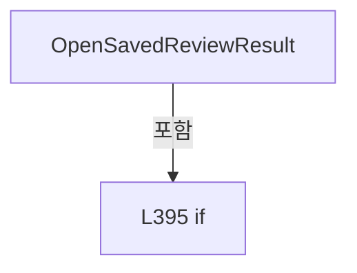

변경 전 점검: 입력/반환 타입, 위 호출자, 예외/취소 경로, 공유 상태와 저장·전송 소비자를 함께 확인합니다. 값의 단위나 물리 방향을 이름만으로 확정하지 않습니다.

### MethodDeclaration `TrySelectReviewInspectionMode` · L402–409

[Drilling.UI/Menu/Menus/CMenuCorrection.cs:402–409](https://github.com/kjuws10-rgb/A3Drilling/blob/dfa5920e6301d9ec4b0eab1452ae59521aafc986/Drilling.UI/Menu/Menus/CMenuCorrection.cs#L402-L409)

| 항목 | 실제 추출 값 |
| --- | --- |
| 서명 | bool Drilling.UI.Menu.Menus.CMenuCorrection.TrySelectReviewInspectionMode(string) |
| 접근/수식자 | Public / public |
| 반환/값 타입 | bool |
| 소속 타입 | NamedType:Drilling.UI.Menu.Menus.CMenuCorrection |

입력 계약:

| 이름 | 타입 | 전달 | 선택/기본값 |
| --- | --- | --- | --- |
| mode | string | None | False /  |

정적 호출자로 확인된 위치:

| 호출 파일/행 | 호출 표현식 | 런타임 분기 가능 |
| --- | --- | --- |
| [Drilling.UI/Views/CCorrectionView.xaml.cs:37–37](https://github.com/kjuws10-rgb/A3Drilling/blob/dfa5920e6301d9ec4b0eab1452ae59521aafc986/Drilling.UI/Views/CCorrectionView.xaml.cs#L37-L37) | correction.TrySelectReviewInspectionMode | False |

호출하는 대상과 해석 범위:

| 원본 행 | 표현식 | 분석 상태 | 대상/소스 위치 |
| --- | --- | --- | --- |
| 407 | Review.SelectModeCommand.Execute | resolved | void Drilling.UI.Menu.CButtonCommand.Execute(object?) · Drilling.UI/Menu/CButtonCommand.cs:19 |

본문의 실제 연산·분기·예외·반환 순서(원문 위치 순):

| 원본 행 | 종류 | 주석 해설 |
| --- | --- | --- |
| 404 | if | 조건에 따라 분기합니다: if (Review is null &#124;&#124; Review.IsReviewExecutionActive) |
| 405 | return | 호출자에게 값 또는 제어를 반환합니다: return false; |
| 407 | call | 함수·델리게이트 또는 객체 생성자를 호출합니다: Review.SelectModeCommand.Execute(mode) |
| 408 | return | 호출자에게 값 또는 제어를 반환합니다: return true; |

제어 구문의 포함 구조(실제 실행 순서/CFG가 아닌 구문 탐색 그림):

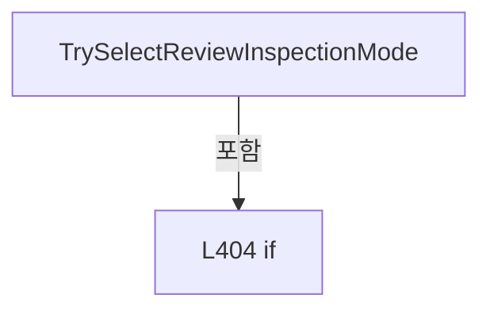

변경 전 점검: 입력/반환 타입, 위 호출자, 예외/취소 경로, 공유 상태와 저장·전송 소비자를 함께 확인합니다. 값의 단위나 물리 방향을 이름만으로 확정하지 않습니다.

### MethodDeclaration `Build` · L411–507

[Drilling.UI/Menu/Menus/CMenuCorrection.cs:411–507](https://github.com/kjuws10-rgb/A3Drilling/blob/dfa5920e6301d9ec4b0eab1452ae59521aafc986/Drilling.UI/Menu/Menus/CMenuCorrection.cs#L411-L507)

| 항목 | 실제 추출 값 |
| --- | --- |
| 서명 | System.Threading.Tasks.Task<Drilling.UI.Menu.Menus.CScreenViewModel> Drilling.UI.Menu.Menus.CMenuCorrection.Build(System.Threading.CancellationToken) |
| 접근/수식자 | Public / public, override, async |
| 반환/값 타입 | System.Threading.Tasks.Task<Drilling.UI.Menu.Menus.CScreenViewModel> |
| 소속 타입 | NamedType:Drilling.UI.Menu.Menus.CMenuCorrection |

입력 계약:

| 이름 | 타입 | 전달 | 선택/기본값 |
| --- | --- | --- | --- |
| cancellationToken | System.Threading.CancellationToken | None | True / null |

현재 부분 분석에서 직접 연결된 호출자는 없습니다. XAML/이벤트/인터페이스·델리게이트·외부 진입을 추가 확인해야 하며, 미사용으로 판정한 것이 아닙니다.

호출하는 대상과 해석 범위:

| 원본 행 | 표현식 | 분석 상태 | 대상/소스 위치 |
| --- | --- | --- | --- |
| 413 | cancellationToken.ThrowIfCancellationRequested | resolved | void System.Threading.CancellationToken.ThrowIfCancellationRequested() |
| 414 | ApplyTabData | resolved | void Drilling.UI.Menu.Menus.CMenuCorrection.ApplyTabData(string) · Drilling.UI/Menu/Menus/CMenuCorrection.cs:1329 |
| 419 | LoadSelectedOutputViewerRecipe | resolved | System.Threading.Tasks.Task<Drilling.Common.Managers.ST_RECIPE_DEFINITION?> Drilling.UI.Menu.Menus.CMenuCorrection.LoadSelectedOutputViewerRecipe(System.Threading.CancellationToken, bool) · Drilling.UI/Menu/Menus/CMenuCorrection.cs:754 |
| 420 | _settingManager.LoadSection(EN_SETTING_TAB.Option, cancellationToken) .Concat(_settingManager.LoadSection(EN_SETTING_TAB.Motor, cancellationToken)).ToArray | resolved | Drilling.Common.Managers.ST_SYSTEM_PARAMETER[] System.Collections.Generic.IEnumerable<Drilling.Common.Managers.ST_SYSTEM_PARAMETER>.ToArray<Drilling.Common.Managers.ST_SYSTEM_PARAMETER>() |
| 420 | _settingManager.LoadSection(EN_SETTING_TAB.Option, cancellationToken) .Concat | resolved | System.Collections.Generic.IEnumerable<Drilling.Common.Managers.ST_SYSTEM_PARAMETER> System.Collections.Generic.IEnumerable<Drilling.Common.Managers.ST_SYSTEM_PARAMETER>.Concat<Drilling.Common.Managers.ST_SYSTEM_PARAMETER>(System.Collections.Generic.IEnumerable<Drilling.Common.Managers.ST_SYSTEM_PARAMETER>) |
| 420 | _settingManager.LoadSection | resolved | System.Collections.Generic.IReadOnlyList<Drilling.Common.Managers.ST_SYSTEM_PARAMETER> Drilling.Common.Managers.CSettingManager.LoadSection(Drilling.Common.Managers.EN_SETTING_TAB, System.Threading.CancellationToken) · Drilling.Common/Managers/CSettingManager.cs:26 |
| 421 | _settingManager.LoadSection | resolved | System.Collections.Generic.IReadOnlyList<Drilling.Common.Managers.ST_SYSTEM_PARAMETER> Drilling.Common.Managers.CSettingManager.LoadSection(Drilling.Common.Managers.EN_SETTING_TAB, System.Threading.CancellationToken) · Drilling.Common/Managers/CSettingManager.cs:26 |
| 422 | DefaultOffset.Update | resolved | void Drilling.UI.Menu.Menus.CDefaultOffsetPanel.Update(Drilling.Common.Managers.ST_RECIPE_DEFINITION?, System.Collections.Generic.IReadOnlyList<Drilling.Common.Managers.ST_SYSTEM_PARAMETER>) · Drilling.UI/Menu/Menus/CMenuCorrection.cs:4452 |
| 425 | DefaultOffset.Clear | resolved | void Drilling.UI.Menu.Menus.CDefaultOffsetPanel.Clear(string) · Drilling.UI/Menu/Menus/CMenuCorrection.cs:4483 |
| 431 | UpdateAlignPreview | resolved | void Drilling.UI.Menu.Menus.CMenuCorrection.UpdateAlignPreview(Drilling.Common.Managers.ST_RECIPE_DEFINITION?) · Drilling.UI/Menu/Menus/CMenuCorrection.cs:2878 |
| 431 | LoadSelectedOutputViewerRecipe | resolved | System.Threading.Tasks.Task<Drilling.Common.Managers.ST_RECIPE_DEFINITION?> Drilling.UI.Menu.Menus.CMenuCorrection.LoadSelectedOutputViewerRecipe(System.Threading.CancellationToken, bool) · Drilling.UI/Menu/Menus/CMenuCorrection.cs:754 |
| 432 | RefreshAlignOffsetTolerance | resolved | double? Drilling.UI.Menu.Menus.CMenuCorrection.RefreshAlignOffsetTolerance() · Drilling.UI/Menu/Menus/CMenuCorrection.cs:2881 |
| 433 | AlignDistortion.Wapage.UpdateSettings | resolved | void Drilling.UI.Menu.Menus.CAlignWapagePanel.UpdateSettings(System.Collections.Generic.IReadOnlyList<Drilling.Common.Managers.ST_SYSTEM_PARAMETER>) · Drilling.UI/Menu/Menus/CMenuCorrection.cs:5453 |
| 433 | _settingManager.LoadSection | resolved | System.Collections.Generic.IReadOnlyList<Drilling.Common.Managers.ST_SYSTEM_PARAMETER> Drilling.Common.Managers.CSettingManager.LoadSection(Drilling.Common.Managers.EN_SETTING_TAB, System.Threading.CancellationToken) · Drilling.Common/Managers/CSettingManager.cs:26 |
| 441 | AlignDistortion.Clear | resolved | void Drilling.UI.Menu.Menus.CAlignDistortionPanel.Clear(string, Drilling.Common.Managers.ST_RECIPE_DEFINITION?) · Drilling.UI/Menu/Menus/CMenuCorrection.cs:5228 |
| 450 | Review.Build | resolved · 동적 구현 선택 가능 | System.Threading.Tasks.Task<Drilling.UI.Menu.Menus.CScreenViewModel> Drilling.UI.Menu.Menus.CMenuReview.Build(System.Threading.CancellationToken) · Drilling.UI/Menu/Menus/CMenuReview.cs:389 |
| 452 | LoadSelectedOutputViewerRecipe | resolved | System.Threading.Tasks.Task<Drilling.Common.Managers.ST_RECIPE_DEFINITION?> Drilling.UI.Menu.Menus.CMenuCorrection.LoadSelectedOutputViewerRecipe(System.Threading.CancellationToken, bool) · Drilling.UI/Menu/Menus/CMenuCorrection.cs:754 |
| 453 | _settingManager.LoadSection(EN_SETTING_TAB.Option, cancellationToken).Concat(_settingManager.LoadSection(EN_SETTING_TAB.Motor, cancellationToken)).ToArray | resolved | Drilling.Common.Managers.ST_SYSTEM_PARAMETER[] System.Collections.Generic.IEnumerable<Drilling.Common.Managers.ST_SYSTEM_PARAMETER>.ToArray<Drilling.Common.Managers.ST_SYSTEM_PARAMETER>() |
| 453 | _settingManager.LoadSection(EN_SETTING_TAB.Option, cancellationToken).Concat | resolved | System.Collections.Generic.IEnumerable<Drilling.Common.Managers.ST_SYSTEM_PARAMETER> System.Collections.Generic.IEnumerable<Drilling.Common.Managers.ST_SYSTEM_PARAMETER>.Concat<Drilling.Common.Managers.ST_SYSTEM_PARAMETER>(System.Collections.Generic.IEnumerable<Drilling.Common.Managers.ST_SYSTEM_PARAMETER>) |
| 453 | _settingManager.LoadSection | resolved | System.Collections.Generic.IReadOnlyList<Drilling.Common.Managers.ST_SYSTEM_PARAMETER> Drilling.Common.Managers.CSettingManager.LoadSection(Drilling.Common.Managers.EN_SETTING_TAB, System.Threading.CancellationToken) · Drilling.Common/Managers/CSettingManager.cs:26 |
| 453 | _settingManager.LoadSection | resolved | System.Collections.Generic.IReadOnlyList<Drilling.Common.Managers.ST_SYSTEM_PARAMETER> Drilling.Common.Managers.CSettingManager.LoadSection(Drilling.Common.Managers.EN_SETTING_TAB, System.Threading.CancellationToken) · Drilling.Common/Managers/CSettingManager.cs:26 |
| 457 | .GetBaseException | resolved · 동적 구현 선택 가능 | System.Exception System.AggregateException.GetBaseException() |
| 461 | Task.FromResult | resolved | System.Threading.Tasks.Task<Drilling.Common.Review.ST_REVIEW_OFFSET_FILE_DATA> System.Threading.Tasks.Task.FromResult<Drilling.Common.Review.ST_REVIEW_OFFSET_FILE_DATA>(Drilling.Common.Review.ST_REVIEW_OFFSET_FILE_DATA) |
| 461 | ST_REVIEW_OFFSET_FILE_DATA.Empty | resolved | Drilling.Common.Review.ST_REVIEW_OFFSET_FILE_DATA Drilling.Common.Review.ST_REVIEW_OFFSET_FILE_DATA.Empty(string) · Drilling.Common/Review/CReviewManager.cs:4281 |
| 461 | Task.Run | resolved | System.Threading.Tasks.Task<Drilling.Common.Review.ST_REVIEW_OFFSET_FILE_DATA> System.Threading.Tasks.Task.Run<Drilling.Common.Review.ST_REVIEW_OFFSET_FILE_DATA>(System.Func<System.Threading.Tasks.Task<Drilling.Common.Review.ST_REVIEW_OFFSET_FILE_DATA>?>, System.Threading.CancellationToken) |
| 461 | _reviewOffsetFile.LoadLatest | resolved | System.Threading.Tasks.Task<Drilling.Common.Review.ST_REVIEW_OFFSET_FILE_DATA> Drilling.Common.Review.CReviewOffsetFileBase.LoadLatest(string, System.Threading.CancellationToken) · Drilling.Common/Review/CReviewManager.cs:4313 |
| 464 | _simpleOffsetLoad.WaitAsync | resolved | System.Threading.Tasks.Task<Drilling.Common.Review.ST_REVIEW_OFFSET_FILE_DATA> System.Threading.Tasks.Task<Drilling.Common.Review.ST_REVIEW_OFFSET_FILE_DATA>.WaitAsync(System.Threading.CancellationToken) |
| 468 | Simple.Update | resolved | void Drilling.UI.Menu.Menus.CSimpleCorrectionPanel.Update(Drilling.Common.Managers.ST_RECIPE_DEFINITION?, System.Collections.Generic.IReadOnlyList<Drilling.Common.Managers.ST_SYSTEM_PARAMETER>, Drilling.Common.Review.ST_REVIEW_OFFSET_FILE_DATA?) · Drilling.UI/Menu/Menus/CMenuCorrection.cs:7611 |
| 469 | Rough.Update | resolved | void Drilling.UI.Menu.Menus.CSimpleCorrectionPanel.Update(Drilling.Common.Managers.ST_RECIPE_DEFINITION?, System.Collections.Generic.IReadOnlyList<Drilling.Common.Managers.ST_SYSTEM_PARAMETER>, Drilling.Common.Review.ST_REVIEW_OFFSET_FILE_DATA?) · Drilling.UI/Menu/Menus/CMenuCorrection.cs:7611 |
| 472 | Fine.Update | resolved | void Drilling.UI.Menu.Menus.CFineCorrectionPanel.Update(Drilling.Common.Managers.ST_RECIPE_DEFINITION?, System.Collections.Generic.IReadOnlyList<Drilling.Common.Managers.ST_SYSTEM_PARAMETER>) · Drilling.UI/Menu/Menus/CMenuCorrection.cs:6062 |
| 476 | Fine.Clear | resolved | void Drilling.UI.Menu.Menus.CFineCorrectionPanel.Clear(string) · Drilling.UI/Menu/Menus/CMenuCorrection.cs:6138 |
| 485 | ReportInvalidReviewOffset | resolved | void Drilling.UI.Menu.Menus.CMenuCorrection.ReportInvalidReviewOffset(System.Exception) · Drilling.UI/Menu/Menus/CMenuCorrection.cs:3151 |
| 486 | Simple.Clear | resolved | void Drilling.UI.Menu.Menus.CSimpleCorrectionPanel.Clear(string) · Drilling.UI/Menu/Menus/CMenuCorrection.cs:7703 |
| 487 | Rough.Clear | resolved | void Drilling.UI.Menu.Menus.CSimpleCorrectionPanel.Clear(string) · Drilling.UI/Menu/Menus/CMenuCorrection.cs:7703 |
| 488 | Fine.Clear | resolved | void Drilling.UI.Menu.Menus.CFineCorrectionPanel.Clear(string) · Drilling.UI/Menu/Menus/CMenuCorrection.cs:6138 |
| 494 | RefreshOutputViewerData | resolved | System.Threading.Tasks.Task Drilling.UI.Menu.Menus.CMenuCorrection.RefreshOutputViewerData(System.Threading.CancellationToken) · Drilling.UI/Menu/Menus/CMenuCorrection.cs:617 |
| 497 | new CScreenViewModel | resolved | Drilling.UI.Menu.Menus.CScreenViewModel.CScreenViewModel(Drilling.UI.Menu.Menus.EN_MENU, string, string, System.Collections.Generic.IReadOnlyList<Drilling.UI.Menu.Menus.ST_DISPLAY_ITEM>, System.Collections.Generic.IReadOnlyList<Drilling.UI.Menu.Menus.ST_SCREEN_SECTION>, bool, Drilling.UI.Menu.Menus.CMenuMain?, Drilling.UI.Menu.Menus.CMenuManual?, Drilling.UI.Menu.Menus.CMenuRecipe?, Drilling.UI.Menu.Menus.CMenuSetting?, Drilling.UI.Menu.Menus.CMenuAlarm?, Drilling.UI.Menu.Menus.CMenuMonitor?, Drilling.UI.Menu.Menus.CMenuReview?, Drilling.UI.Menu.Menus.CMenuCorrection?, Drilling.UI.Menu.Menus.CMenuPm?) · Drilling.UI/Menu/Menus/CMenuBase.cs:411 |
| 501 | new | resolved | Drilling.UI.Menu.Menus.ST_DISPLAY_ITEM.ST_DISPLAY_ITEM(string, string, string) · Drilling.UI/Menu/Menus/CMenuBase.cs:43 |
| 501 | new | resolved | Drilling.UI.Menu.Menus.ST_DISPLAY_ITEM.ST_DISPLAY_ITEM(string, string, string) · Drilling.UI/Menu/Menus/CMenuBase.cs:43 |
| 501 | GetSourceName | resolved | string Drilling.UI.Menu.Menus.CMenuCorrection.GetSourceName(string) · Drilling.UI/Menu/Menus/CMenuCorrection.cs:2558 |
| 501 | new | resolved | Drilling.UI.Menu.Menus.ST_DISPLAY_ITEM.ST_DISPLAY_ITEM(string, string, string) · Drilling.UI/Menu/Menus/CMenuBase.cs:43 |
| 501 | GetStateName | resolved | string Drilling.UI.Menu.Menus.CMenuCorrection.GetStateName(string) · Drilling.UI/Menu/Menus/CMenuCorrection.cs:2571 |
| 502 | new | resolved | Drilling.UI.Menu.Menus.ST_SCREEN_SECTION.ST_SCREEN_SECTION(string, System.Collections.Generic.IReadOnlyList<Drilling.UI.Menu.Menus.ST_DISPLAY_ITEM>) · Drilling.UI/Menu/Menus/CMenuBase.cs:410 |
| 502 | new | resolved | Drilling.UI.Menu.Menus.ST_SCREEN_SECTION.ST_SCREEN_SECTION(string, System.Collections.Generic.IReadOnlyList<Drilling.UI.Menu.Menus.ST_DISPLAY_ITEM>) · Drilling.UI/Menu/Menus/CMenuBase.cs:410 |
| 502 | new | resolved | Drilling.UI.Menu.Menus.ST_SCREEN_SECTION.ST_SCREEN_SECTION(string, System.Collections.Generic.IReadOnlyList<Drilling.UI.Menu.Menus.ST_DISPLAY_ITEM>) · Drilling.UI/Menu/Menus/CMenuBase.cs:410 |

본문의 실제 연산·분기·예외·반환 순서(원문 위치 순):

| 원본 행 | 종류 | 주석 해설 |
| --- | --- | --- |
| 413 | call | 함수·델리게이트 또는 객체 생성자를 호출합니다: cancellationToken.ThrowIfCancellationRequested() |
| 414 | call | 함수·델리게이트 또는 객체 생성자를 호출합니다: ApplyTabData(_selectedTab) |
| 415 | if | 조건에 따라 분기합니다: if (IsDefaultTab) |
| 417 | try | 예외 처리 범위입니다: try |
| 419 | await | 비동기 완료를 기다립니다: await LoadSelectedOutputViewerRecipe(cancellationToken, fallbackToFirst: false) |
| 419 | call | 함수·델리게이트 또는 객체 생성자를 호출합니다: LoadSelectedOutputViewerRecipe(cancellationToken, fallbackToFirst: false) |
| 419 | local-declaration | 지역 변수를 선언합니다: var recipe = await LoadSelectedOutputViewerRecipe(cancellationToken, fallbackToFirst: false); |
| 419 | variable-initializer | 변수의 초기값을 지정합니다: recipe = await LoadSelectedOutputViewerRecipe(cancellationToken, fallbackToFirst: false) |
| 420 | call | 함수·델리게이트 또는 객체 생성자를 호출합니다: _settingManager.LoadSection(EN_SETTING_TAB.Option, cancellationToken) |
| 420 | call | 함수·델리게이트 또는 객체 생성자를 호출합니다: _settingManager.LoadSection(EN_SETTING_TAB.Option, cancellationToken) .Concat(_settingManager.LoadSection(EN_SETTING_TAB.Motor, cancellationToken)).ToArray() |
| 420 | call | 함수·델리게이트 또는 객체 생성자를 호출합니다: _settingManager.LoadSection(EN_SETTING_TAB.Option, cancellationToken) .Concat(_settingManager.LoadSection(EN_SETTING_TAB.Motor, cancellationToken)) |
| 420 | local-declaration | 지역 변수를 선언합니다: var settings = _settingManager.LoadSection(EN_SETTING_TAB.Option, cancellationToken) .Concat(_settingManager.LoadSection(EN_SETTING_TAB.Motor, cancellationToken)).ToArray(); |
| 420 | variable-initializer | 변수의 초기값을 지정합니다: settings = _settingManager.LoadSection(EN_SETTING_TAB.Option, cancellationToken) .Concat(_settingManager.LoadSection(EN_SETTING_TAB.Motor, cancellationToken)).ToArray() |
| 421 | call | 함수·델리게이트 또는 객체 생성자를 호출합니다: _settingManager.LoadSection(EN_SETTING_TAB.Motor, cancellationToken) |
| 422 | call | 함수·델리게이트 또는 객체 생성자를 호출합니다: DefaultOffset.Update(recipe, settings) |
| 424 | catch | 지정 예외를 처리합니다: catch (OperationCanceledException) when (cancellationToken.IsCancellationRequested) |
| 424 | throw | 예외를 발생/전달합니다: throw; |
| 425 | call | 함수·델리게이트 또는 객체 생성자를 호출합니다: DefaultOffset.Clear(exception.Message) |
| 425 | catch | 지정 예외를 처리합니다: catch (Exception exception) |
| 427 | if | 조건에 따라 분기합니다: if (IsAlignDistortionTab) |
| 429 | try | 예외 처리 범위입니다: try |
| 431 | await | 비동기 완료를 기다립니다: await LoadSelectedOutputViewerRecipe(cancellationToken, fallbackToFirst: false) |
| 431 | call | 함수·델리게이트 또는 객체 생성자를 호출합니다: UpdateAlignPreview(await LoadSelectedOutputViewerRecipe(cancellationToken, fallbackToFirst: false)) |
| 431 | call | 함수·델리게이트 또는 객체 생성자를 호출합니다: LoadSelectedOutputViewerRecipe(cancellationToken, fallbackToFirst: false) |
| 432 | call | 함수·델리게이트 또는 객체 생성자를 호출합니다: RefreshAlignOffsetTolerance() |
| 433 | call | 함수·델리게이트 또는 객체 생성자를 호출합니다: AlignDistortion.Wapage.UpdateSettings(_settingManager.LoadSection(EN_SETTING_TAB.Option, cancellationToken)) |
| 433 | call | 함수·델리게이트 또는 객체 생성자를 호출합니다: _settingManager.LoadSection(EN_SETTING_TAB.Option, cancellationToken) |
| 435 | catch | 지정 예외를 처리합니다: catch (OperationCanceledException) when (cancellationToken.IsCancellationRequested) |
| 437 | throw | 예외를 발생/전달합니다: throw; |
| 439 | catch | 지정 예외를 처리합니다: catch (Exception exception) |
| 441 | call | 함수·델리게이트 또는 객체 생성자를 호출합니다: AlignDistortion.Clear($"Glass preview unavailable: {exception.Message}") |
| 445 | if | 조건에 따라 분기합니다: if (IsReviewCorrectionTab) |
| 447 | try | 예외 처리 범위입니다: try |
| 449 | if | 조건에 따라 분기합니다: if (Review is not null) |
| 450 | await | 비동기 완료를 기다립니다: await Review.Build(cancellationToken) |
| 450 | call | 함수·델리게이트 또는 객체 생성자를 호출합니다: Review.Build(cancellationToken) |
| 452 | await | 비동기 완료를 기다립니다: await LoadSelectedOutputViewerRecipe(cancellationToken, fallbackToFirst: false) |
| 452 | call | 함수·델리게이트 또는 객체 생성자를 호출합니다: LoadSelectedOutputViewerRecipe(cancellationToken, fallbackToFirst: false) |
| 452 | local-declaration | 지역 변수를 선언합니다: var recipe = await LoadSelectedOutputViewerRecipe(cancellationToken, fallbackToFirst: false); |
| 452 | variable-initializer | 변수의 초기값을 지정합니다: recipe = await LoadSelectedOutputViewerRecipe(cancellationToken, fallbackToFirst: false) |
| 453 | call | 함수·델리게이트 또는 객체 생성자를 호출합니다: _settingManager.LoadSection(EN_SETTING_TAB.Option, cancellationToken).Concat(_settingManager.LoadSection(EN_SETTING_TAB.Motor, cancellationToken)).ToArray() |
| 453 | call | 함수·델리게이트 또는 객체 생성자를 호출합니다: _settingManager.LoadSection(EN_SETTING_TAB.Option, cancellationToken).Concat(_settingManager.LoadSection(EN_SETTING_TAB.Motor, cancellationToken)) |
| 453 | call | 함수·델리게이트 또는 객체 생성자를 호출합니다: _settingManager.LoadSection(EN_SETTING_TAB.Option, cancellationToken) |
| 453 | call | 함수·델리게이트 또는 객체 생성자를 호출합니다: _settingManager.LoadSection(EN_SETTING_TAB.Motor, cancellationToken) |
| 453 | local-declaration | 지역 변수를 선언합니다: var settings = _settingManager.LoadSection(EN_SETTING_TAB.Option, cancellationToken).Concat(_settingManager.LoadSection(EN_SETTING_TAB.Motor, cancellationToken)).ToArray(); |
| 453 | variable-initializer | 변수의 초기값을 지정합니다: settings = _settingManager.LoadSection(EN_SETTING_TAB.Option, cancellationToken).Concat(_settingManager.LoadSection(EN_SETTING_TAB.Motor, cancellationToken)).ToArray() |
| 454 | local-declaration | 지역 변수를 선언합니다: ST_REVIEW_OFFSET_FILE_DATA? current = null; |
| 454 | variable-initializer | 변수의 초기값을 지정합니다: current = null |
| 455 | if | 조건에 따라 분기합니다: if (recipe is not null) |
| 457 | call | 함수·델리게이트 또는 객체 생성자를 호출합니다: .GetBaseException() |
| 457 | if | 조건에 따라 분기합니다: if (_simpleOffsetLoad is null &#124;&#124; _simpleOffsetLoad.IsCanceled &#124;&#124; _simpleOffsetRecipeId != recipe.Id &#124;&#124; (_simpleOffsetLoad.IsFaulted && _simpleOffsetLoad.Exception?.GetBaseException()is not CReviewOffsetValidationException)) |
| 459 | assignment | 값을 대상에 대입합니다: _lastReviewOffsetWarning = "" |
| 460 | assignment | 값을 대상에 대입합니다: _simpleOffsetRecipeId = recipe.Id |
| 461 | assignment | 값을 대상에 대입합니다: _simpleOffsetLoad = _reviewOffsetFile is null ? Task.FromResult(ST_REVIEW_OFFSET_FILE_DATA.Empty(recipe.Id)) : Task.Run(() => _reviewOffsetFile.LoadLatest(recipe.Id, cancellationToken), cancellationToken) |
| 461 | call | 함수·델리게이트 또는 객체 생성자를 호출합니다: Task.FromResult(ST_REVIEW_OFFSET_FILE_DATA.Empty(recipe.Id)) |
| 461 | call | 함수·델리게이트 또는 객체 생성자를 호출합니다: ST_REVIEW_OFFSET_FILE_DATA.Empty(recipe.Id) |
| 461 | call | 함수·델리게이트 또는 객체 생성자를 호출합니다: Task.Run(() => _reviewOffsetFile.LoadLatest(recipe.Id, cancellationToken), cancellationToken) |
| 461 | call | 함수·델리게이트 또는 객체 생성자를 호출합니다: _reviewOffsetFile.LoadLatest(recipe.Id, cancellationToken) |
| 461 | conditional-expression | 조건에 따라 결과식을 선택합니다: _reviewOffsetFile is null ? Task.FromResult(ST_REVIEW_OFFSET_FILE_DATA.Empty(recipe.Id)) : Task.Run(() => _reviewOffsetFile.LoadLatest(recipe.Id, cancellationToken), cancellationToken) |
| 464 | assignment | 값을 대상에 대입합니다: current = await _simpleOffsetLoad.WaitAsync(cancellationToken) |
| 464 | await | 비동기 완료를 기다립니다: await _simpleOffsetLoad.WaitAsync(cancellationToken) |
| 464 | call | 함수·델리게이트 또는 객체 생성자를 호출합니다: _simpleOffsetLoad.WaitAsync(cancellationToken) |
| 465 | assignment | 값을 대상에 대입합니다: _lastReviewOffsetWarning = "" |
| 468 | call | 함수·델리게이트 또는 객체 생성자를 호출합니다: Simple.Update(recipe, settings, current) |
| 469 | call | 함수·델리게이트 또는 객체 생성자를 호출합니다: Rough.Update(recipe, settings, current) |
| 470 | try | 예외 처리 범위입니다: try |
| 472 | call | 함수·델리게이트 또는 객체 생성자를 호출합니다: Fine.Update(recipe, settings) |
| 474 | catch | 지정 예외를 처리합니다: catch (Exception exception) |
| 476 | call | 함수·델리게이트 또는 객체 생성자를 호출합니다: Fine.Clear($"Glass preview unavailable: {exception.Message}") |
| 479 | catch | 지정 예외를 처리합니다: catch (OperationCanceledException) when (cancellationToken.IsCancellationRequested) |
| 481 | throw | 예외를 발생/전달합니다: throw; |
| 483 | catch | 지정 예외를 처리합니다: catch (Exception exception) |
| 485 | call | 함수·델리게이트 또는 객체 생성자를 호출합니다: ReportInvalidReviewOffset(exception) |
| 486 | call | 함수·델리게이트 또는 객체 생성자를 호출합니다: Simple.Clear($"Glass preview unavailable: {exception.Message}") |
| 487 | call | 함수·델리게이트 또는 객체 생성자를 호출합니다: Rough.Clear($"Glass preview unavailable: {exception.Message}") |
| 488 | call | 함수·델리게이트 또는 객체 생성자를 호출합니다: Fine.Clear($"Glass preview unavailable: {exception.Message}") |
| 492 | if | 조건에 따라 분기합니다: if (IsOutputHistoryTab) |
| 494 | await | 비동기 완료를 기다립니다: await RefreshOutputViewerData(cancellationToken) |
| 494 | call | 함수·델리게이트 또는 객체 생성자를 호출합니다: RefreshOutputViewerData(cancellationToken) |
| 497 | call | 함수·델리게이트 또는 객체 생성자를 호출합니다: new CScreenViewModel( EN_MENU.Correction, Title, Subtitle, [new("Selected", _selectedTab), new("Source", GetSourceName(_selectedTab)), new("State", GetStateName(_selectedTab))], [new("Correction Source", []), new("Correc… |
| 497 | local-declaration | 지역 변수를 선언합니다: var screen = new CScreenViewModel( EN_MENU.Correction, Title, Subtitle, [new("Selected", _selectedTab), new("Source", GetSourceName(_selectedTab)), new("State", GetStateName(_selectedTab))], [new("Correction Source", []), new("Cor |
| 497 | variable-initializer | 변수의 초기값을 지정합니다: screen = new CScreenViewModel( EN_MENU.Correction, Title, Subtitle, [new("Selected", _selectedTab), new("Source", GetSourceName(_selectedTab)), new("State", GetStateName(_selectedTab))], [new("Correction Source", []), new("Correct |
| 501 | call | 함수·델리게이트 또는 객체 생성자를 호출합니다: new("Selected", _selectedTab) |
| 501 | call | 함수·델리게이트 또는 객체 생성자를 호출합니다: new("Source", GetSourceName(_selectedTab)) |
| 501 | call | 함수·델리게이트 또는 객체 생성자를 호출합니다: GetSourceName(_selectedTab) |
| 501 | call | 함수·델리게이트 또는 객체 생성자를 호출합니다: new("State", GetStateName(_selectedTab)) |
| 501 | call | 함수·델리게이트 또는 객체 생성자를 호출합니다: GetStateName(_selectedTab) |
| 502 | call | 함수·델리게이트 또는 객체 생성자를 호출합니다: new("Correction Source", []) |
| 502 | call | 함수·델리게이트 또는 객체 생성자를 호출합니다: new("Correction Candidate", []) |
| 502 | call | 함수·델리게이트 또는 객체 생성자를 호출합니다: new("Apply Preview", []) |
| 506 | return | 호출자에게 값 또는 제어를 반환합니다: return screen; |

제어 구문의 포함 구조(실제 실행 순서/CFG가 아닌 구문 탐색 그림):

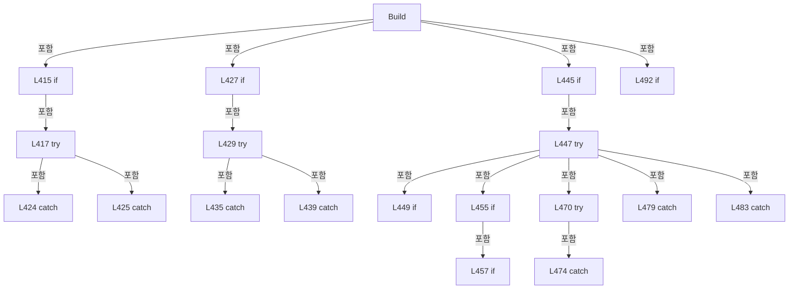

변경 전 점검: 입력/반환 타입, 위 호출자, 예외/취소 경로, 공유 상태와 저장·전송 소비자를 함께 확인합니다. 값의 단위나 물리 방향을 이름만으로 확정하지 않습니다.

### MethodDeclaration `SelectTab` · L509–537

[Drilling.UI/Menu/Menus/CMenuCorrection.cs:509–537](https://github.com/kjuws10-rgb/A3Drilling/blob/dfa5920e6301d9ec4b0eab1452ae59521aafc986/Drilling.UI/Menu/Menus/CMenuCorrection.cs#L509-L537)

| 항목 | 실제 추출 값 |
| --- | --- |
| 서명 | void Drilling.UI.Menu.Menus.CMenuCorrection.SelectTab(object?) |
| 접근/수식자 | Private / private |
| 반환/값 타입 | void |
| 소속 타입 | NamedType:Drilling.UI.Menu.Menus.CMenuCorrection |

입력 계약:

| 이름 | 타입 | 전달 | 선택/기본값 |
| --- | --- | --- | --- |
| parameter | object? | None | False /  |

현재 부분 분석에서 직접 연결된 호출자는 없습니다. XAML/이벤트/인터페이스·델리게이트·외부 진입을 추가 확인해야 하며, 미사용으로 판정한 것이 아닙니다.

호출하는 대상과 해석 범위:

| 원본 행 | 표현식 | 분석 상태 | 대상/소스 위치 |
| --- | --- | --- | --- |
| 511 | .ToString | resolved · 동적 구현 선택 가능 | string? object.ToString() |
| 511 | .Trim | resolved | string string.Trim() |
| 512 | string.IsNullOrWhiteSpace | resolved | bool string.IsNullOrWhiteSpace(string?) |
| 522 | CorrectionTabs.FirstOrDefault | resolved | string? System.Collections.Generic.IEnumerable<string>.FirstOrDefault<string>(System.Func<string, bool>) |
| 535 | _statusReporter | resolved · 동적 구현 선택 가능 | void System.Action<string>.Invoke(string) |
| 536 | _refreshCurrentScreen | resolved · 동적 구현 선택 가능 | System.Threading.Tasks.Task System.Func<System.Threading.Tasks.Task>.Invoke() |

본문의 실제 연산·분기·예외·반환 순서(원문 위치 순):

| 원본 행 | 종류 | 주석 해설 |
| --- | --- | --- |
| 511 | call | 함수·델리게이트 또는 객체 생성자를 호출합니다: .ToString() |
| 511 | call | 함수·델리게이트 또는 객체 생성자를 호출합니다: .Trim() |
| 511 | local-declaration | 지역 변수를 선언합니다: var tabName = parameter?.ToString()?.Trim(); |
| 511 | variable-initializer | 변수의 초기값을 지정합니다: tabName = parameter?.ToString()?.Trim() |
| 512 | call | 함수·델리게이트 또는 객체 생성자를 호출합니다: string.IsNullOrWhiteSpace(tabName) |
| 512 | if | 조건에 따라 분기합니다: if (string.IsNullOrWhiteSpace(tabName)) |
| 514 | return | 호출자에게 값 또는 제어를 반환합니다: return; |
| 522 | call | 함수·델리게이트 또는 객체 생성자를 호출합니다: CorrectionTabs.FirstOrDefault(MatchesItem) |
| 522 | local-declaration | 지역 변수를 선언합니다: var normalizedTab = CorrectionTabs.FirstOrDefault(MatchesItem); |
| 522 | variable-initializer | 변수의 초기값을 지정합니다: normalizedTab = CorrectionTabs.FirstOrDefault(MatchesItem) |
| 523 | if | 조건에 따라 분기합니다: if (normalizedTab is null) |
| 525 | return | 호출자에게 값 또는 제어를 반환합니다: return; |
| 528 | if | 조건에 따라 분기합니다: if (normalizedTab == "REVIEW" && (_selectedTab != "REVIEW" &#124;&#124; _simpleOffsetLoad?.IsFaulted == true)) |
| 530 | assignment | 값을 대상에 대입합니다: _simpleOffsetLoad = null |
| 531 | assignment | 값을 대상에 대입합니다: _lastReviewOffsetWarning = "" |
| 534 | assignment | 값을 대상에 대입합니다: _selectedTab = normalizedTab |
| 535 | call | 함수·델리게이트 또는 객체 생성자를 호출합니다: _statusReporter($"Correction tab selected: {_selectedTab}.") |
| 536 | assignment | 값을 대상에 대입합니다: _ = _refreshCurrentScreen() |
| 536 | call | 함수·델리게이트 또는 객체 생성자를 호출합니다: _refreshCurrentScreen() |

제어 구문의 포함 구조(실제 실행 순서/CFG가 아닌 구문 탐색 그림):

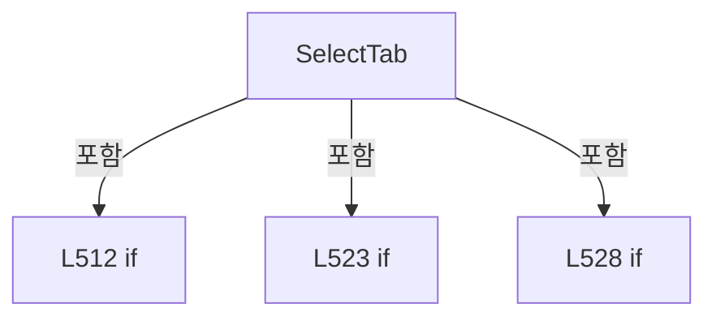

변경 전 점검: 입력/반환 타입, 위 호출자, 예외/취소 경로, 공유 상태와 저장·전송 소비자를 함께 확인합니다. 값의 단위나 물리 방향을 이름만으로 확정하지 않습니다.

### LocalFunctionStatement `MatchesItem` · L517–520

[Drilling.UI/Menu/Menus/CMenuCorrection.cs:517–520](https://github.com/kjuws10-rgb/A3Drilling/blob/dfa5920e6301d9ec4b0eab1452ae59521aafc986/Drilling.UI/Menu/Menus/CMenuCorrection.cs#L517-L520)

| 항목 | 실제 추출 값 |
| --- | --- |
| 서명 | bool MatchesItem(string) |
| 접근/수식자 | Private /  |
| 반환/값 타입 | bool |
| 소속 타입 | NamedType:Drilling.UI.Menu.Menus.CMenuCorrection |

입력 계약:

| 이름 | 타입 | 전달 | 선택/기본값 |
| --- | --- | --- | --- |
| tab | string | None | False /  |

현재 부분 분석에서 직접 연결된 호출자는 없습니다. XAML/이벤트/인터페이스·델리게이트·외부 진입을 추가 확인해야 하며, 미사용으로 판정한 것이 아닙니다.

호출하는 대상과 해석 범위:

| 원본 행 | 표현식 | 분석 상태 | 대상/소스 위치 |
| --- | --- | --- | --- |
| 519 | tab.Equals | resolved | bool string.Equals(string?, System.StringComparison) |

본문의 실제 연산·분기·예외·반환 순서(원문 위치 순):

| 원본 행 | 종류 | 주석 해설 |
| --- | --- | --- |
| 519 | call | 함수·델리게이트 또는 객체 생성자를 호출합니다: tab.Equals(tabName, StringComparison.OrdinalIgnoreCase) |
| 519 | return | 호출자에게 값 또는 제어를 반환합니다: return tab.Equals(tabName, StringComparison.OrdinalIgnoreCase); |

변경 전 점검: 입력/반환 타입, 위 호출자, 예외/취소 경로, 공유 상태와 저장·전송 소비자를 함께 확인합니다. 값의 단위나 물리 방향을 이름만으로 확정하지 않습니다.

### MethodDeclaration `SelectOutputViewerCell` · L539–551

[Drilling.UI/Menu/Menus/CMenuCorrection.cs:539–551](https://github.com/kjuws10-rgb/A3Drilling/blob/dfa5920e6301d9ec4b0eab1452ae59521aafc986/Drilling.UI/Menu/Menus/CMenuCorrection.cs#L539-L551)

| 항목 | 실제 추출 값 |
| --- | --- |
| 서명 | System.Threading.Tasks.Task Drilling.UI.Menu.Menus.CMenuCorrection.SelectOutputViewerCell(object?) |
| 접근/수식자 | Private / private, async |
| 반환/값 타입 | System.Threading.Tasks.Task |
| 소속 타입 | NamedType:Drilling.UI.Menu.Menus.CMenuCorrection |

입력 계약:

| 이름 | 타입 | 전달 | 선택/기본값 |
| --- | --- | --- | --- |
| parameter | object? | None | False /  |

정적 호출자로 확인된 위치:

| 호출 파일/행 | 호출 표현식 | 런타임 분기 가능 |
| --- | --- | --- |
| [Drilling.UI/Menu/Menus/CMenuCorrection.cs:167–167](https://github.com/kjuws10-rgb/A3Drilling/blob/dfa5920e6301d9ec4b0eab1452ae59521aafc986/Drilling.UI/Menu/Menus/CMenuCorrection.cs#L167-L167) | SelectOutputViewerCell | False |

호출하는 대상과 해석 범위:

| 원본 행 | 표현식 | 분석 상태 | 대상/소스 위치 |
| --- | --- | --- | --- |
| 541 | int.TryParse | resolved | bool int.TryParse(string?, System.Globalization.NumberStyles, System.IFormatProvider?, out int) |
| 541 | .ToString | resolved · 동적 구현 선택 가능 | string? object.ToString() |
| 546 | Math.Max | resolved | int System.Math.Max(int, int) |
| 549 | _statusReporter | resolved · 동적 구현 선택 가능 | void System.Action<string>.Invoke(string) |
| 550 | _refreshCurrentScreen | resolved · 동적 구현 선택 가능 | System.Threading.Tasks.Task System.Func<System.Threading.Tasks.Task>.Invoke() |

본문의 실제 연산·분기·예외·반환 순서(원문 위치 순):

| 원본 행 | 종류 | 주석 해설 |
| --- | --- | --- |
| 541 | call | 함수·델리게이트 또는 객체 생성자를 호출합니다: int.TryParse(parameter?.ToString(), NumberStyles.Integer, CultureInfo.InvariantCulture, out var cellNo) |
| 541 | call | 함수·델리게이트 또는 객체 생성자를 호출합니다: .ToString() |
| 541 | if | 조건에 따라 분기합니다: if (!int.TryParse(parameter?.ToString(), NumberStyles.Integer, CultureInfo.InvariantCulture, out var cellNo)) |
| 543 | return | 호출자에게 값 또는 제어를 반환합니다: return; |
| 546 | assignment | 값을 대상에 대입합니다: _outputViewerSelectedCellNo = Math.Max(1, cellNo) |
| 546 | call | 함수·델리게이트 또는 객체 생성자를 호출합니다: Math.Max(1, cellNo) |
| 547 | assignment | 값을 대상에 대입합니다: _outputViewerIsCellDetailVisible = true |
| 548 | assignment | 값을 대상에 대입합니다: _outputViewerSelectedShotKey = "" |
| 549 | call | 함수·델리게이트 또는 객체 생성자를 호출합니다: _statusReporter($"Offset Viewer cell selected: CELL{_outputViewerSelectedCellNo:00}.") |
| 550 | await | 비동기 완료를 기다립니다: await _refreshCurrentScreen() |
| 550 | call | 함수·델리게이트 또는 객체 생성자를 호출합니다: _refreshCurrentScreen() |

제어 구문의 포함 구조(실제 실행 순서/CFG가 아닌 구문 탐색 그림):


변경 전 점검: 입력/반환 타입, 위 호출자, 예외/취소 경로, 공유 상태와 저장·전송 소비자를 함께 확인합니다. 값의 단위나 물리 방향을 이름만으로 확정하지 않습니다.

### MethodDeclaration `SelectOutputViewerShot` · L553–562

[Drilling.UI/Menu/Menus/CMenuCorrection.cs:553–562](https://github.com/kjuws10-rgb/A3Drilling/blob/dfa5920e6301d9ec4b0eab1452ae59521aafc986/Drilling.UI/Menu/Menus/CMenuCorrection.cs#L553-L562)

| 항목 | 실제 추출 값 |
| --- | --- |
| 서명 | void Drilling.UI.Menu.Menus.CMenuCorrection.SelectOutputViewerShot(object?) |
| 접근/수식자 | Private / private |
| 반환/값 타입 | void |
| 소속 타입 | NamedType:Drilling.UI.Menu.Menus.CMenuCorrection |

입력 계약:

| 이름 | 타입 | 전달 | 선택/기본값 |
| --- | --- | --- | --- |
| parameter | object? | None | False /  |

정적 호출자로 확인된 위치:

| 호출 파일/행 | 호출 표현식 | 런타임 분기 가능 |
| --- | --- | --- |
| [Drilling.UI/Menu/Menus/CMenuCorrection.cs:566–566](https://github.com/kjuws10-rgb/A3Drilling/blob/dfa5920e6301d9ec4b0eab1452ae59521aafc986/Drilling.UI/Menu/Menus/CMenuCorrection.cs#L566-L566) | SelectOutputViewerShot | False |

호출하는 대상과 해석 범위:

| 원본 행 | 표현식 | 분석 상태 | 대상/소스 위치 |
| --- | --- | --- | --- |
| 555 | .ToString | resolved · 동적 구현 선택 가능 | string? object.ToString() |
| 555 | .Trim | resolved | string string.Trim() |
| 556 | string.IsNullOrWhiteSpace | resolved | bool string.IsNullOrWhiteSpace(string?) |
| 556 | _outputViewerSelectedCellShots.Any | resolved | bool System.Collections.Generic.IEnumerable<Drilling.Common.Recipe.ST_HEAD_SHOT_POINT>.Any<Drilling.Common.Recipe.ST_HEAD_SHOT_POINT>(System.Func<Drilling.Common.Recipe.ST_HEAD_SHOT_POINT, bool>) |
| 556 | shot.ShotKey.Equals | resolved | bool string.Equals(string?, System.StringComparison) |
| 561 | ApplyOutputViewerShotSelection | resolved | void Drilling.UI.Menu.Menus.CMenuCorrection.ApplyOutputViewerShotSelection(string) · Drilling.UI/Menu/Menus/CMenuCorrection.cs:592 |

본문의 실제 연산·분기·예외·반환 순서(원문 위치 순):

| 원본 행 | 종류 | 주석 해설 |
| --- | --- | --- |
| 555 | call | 함수·델리게이트 또는 객체 생성자를 호출합니다: .ToString() |
| 555 | call | 함수·델리게이트 또는 객체 생성자를 호출합니다: .Trim() |
| 555 | local-declaration | 지역 변수를 선언합니다: var shotKey = parameter?.ToString()?.Trim(); |
| 555 | variable-initializer | 변수의 초기값을 지정합니다: shotKey = parameter?.ToString()?.Trim() |
| 556 | call | 함수·델리게이트 또는 객체 생성자를 호출합니다: string.IsNullOrWhiteSpace(shotKey) |
| 556 | call | 함수·델리게이트 또는 객체 생성자를 호출합니다: _outputViewerSelectedCellShots.Any(shot => shot.ShotKey.Equals(shotKey, StringComparison.OrdinalIgnoreCase)) |
| 556 | call | 함수·델리게이트 또는 객체 생성자를 호출합니다: shot.ShotKey.Equals(shotKey, StringComparison.OrdinalIgnoreCase) |
| 556 | if | 조건에 따라 분기합니다: if (string.IsNullOrWhiteSpace(shotKey) &#124;&#124; !_outputViewerSelectedCellShots.Any(shot => shot.ShotKey.Equals(shotKey, StringComparison.OrdinalIgnoreCase))) |
| 558 | return | 호출자에게 값 또는 제어를 반환합니다: return; |
| 561 | call | 함수·델리게이트 또는 객체 생성자를 호출합니다: ApplyOutputViewerShotSelection(shotKey) |

제어 구문의 포함 구조(실제 실행 순서/CFG가 아닌 구문 탐색 그림):


변경 전 점검: 입력/반환 타입, 위 호출자, 예외/취소 경로, 공유 상태와 저장·전송 소비자를 함께 확인합니다. 값의 단위나 물리 방향을 이름만으로 확정하지 않습니다.

### MethodDeclaration `SelectOutputViewerShotByKey` · L564–567

[Drilling.UI/Menu/Menus/CMenuCorrection.cs:564–567](https://github.com/kjuws10-rgb/A3Drilling/blob/dfa5920e6301d9ec4b0eab1452ae59521aafc986/Drilling.UI/Menu/Menus/CMenuCorrection.cs#L564-L567)

| 항목 | 실제 추출 값 |
| --- | --- |
| 서명 | void Drilling.UI.Menu.Menus.CMenuCorrection.SelectOutputViewerShotByKey(string) |
| 접근/수식자 | Public / public |
| 반환/값 타입 | void |
| 소속 타입 | NamedType:Drilling.UI.Menu.Menus.CMenuCorrection |

입력 계약:

| 이름 | 타입 | 전달 | 선택/기본값 |
| --- | --- | --- | --- |
| shotKey | string | None | False /  |

정적 호출자로 확인된 위치:

| 호출 파일/행 | 호출 표현식 | 런타임 분기 가능 |
| --- | --- | --- |
| [Drilling.UI/Views/CCorrectionView.xaml.cs:75–75](https://github.com/kjuws10-rgb/A3Drilling/blob/dfa5920e6301d9ec4b0eab1452ae59521aafc986/Drilling.UI/Views/CCorrectionView.xaml.cs#L75-L75) | correction.SelectOutputViewerShotByKey | False |

호출하는 대상과 해석 범위:

| 원본 행 | 표현식 | 분석 상태 | 대상/소스 위치 |
| --- | --- | --- | --- |
| 566 | SelectOutputViewerShot | resolved | void Drilling.UI.Menu.Menus.CMenuCorrection.SelectOutputViewerShot(object?) · Drilling.UI/Menu/Menus/CMenuCorrection.cs:553 |

본문의 실제 연산·분기·예외·반환 순서(원문 위치 순):

| 원본 행 | 종류 | 주석 해설 |
| --- | --- | --- |
| 566 | call | 함수·델리게이트 또는 객체 생성자를 호출합니다: SelectOutputViewerShot(shotKey) |

변경 전 점검: 입력/반환 타입, 위 호출자, 예외/취소 경로, 공유 상태와 저장·전송 소비자를 함께 확인합니다. 값의 단위나 물리 방향을 이름만으로 확정하지 않습니다.

### MethodDeclaration `SelectOutputViewerShotAt` · L569–590

[Drilling.UI/Menu/Menus/CMenuCorrection.cs:569–590](https://github.com/kjuws10-rgb/A3Drilling/blob/dfa5920e6301d9ec4b0eab1452ae59521aafc986/Drilling.UI/Menu/Menus/CMenuCorrection.cs#L569-L590)

| 항목 | 실제 추출 값 |
| --- | --- |
| 서명 | void Drilling.UI.Menu.Menus.CMenuCorrection.SelectOutputViewerShotAt(double, double) |
| 접근/수식자 | Public / public |
| 반환/값 타입 | void |
| 소속 타입 | NamedType:Drilling.UI.Menu.Menus.CMenuCorrection |

입력 계약:

| 이름 | 타입 | 전달 | 선택/기본값 |
| --- | --- | --- | --- |
| designX | double | None | False /  |
| designY | double | None | False /  |

현재 부분 분석에서 직접 연결된 호출자는 없습니다. XAML/이벤트/인터페이스·델리게이트·외부 진입을 추가 확인해야 하며, 미사용으로 판정한 것이 아닙니다.

호출하는 대상과 해석 범위:

| 원본 행 | 표현식 | 분석 상태 | 대상/소스 위치 |
| --- | --- | --- | --- |
| 577 | GetOutputViewerShotMapRect | resolved | Rect Drilling.UI.Menu.Menus.CMenuCorrection.GetOutputViewerShotMapRect(int, int) · Drilling.UI/Menu/Menus/CMenuCorrection.cs:850 |
| 578 | mapRect.Contains | unresolved | None |
| 578 | new Point | unresolved | None |
| 583 | Math.Clamp | resolved | int System.Math.Clamp(int, int, int) |
| 584 | Math.Clamp | resolved | int System.Math.Clamp(int, int, int) |
| 585 | _outputViewerSelectedCellShots.FirstOrDefault | resolved | Drilling.Common.Recipe.ST_HEAD_SHOT_POINT? System.Collections.Generic.IEnumerable<Drilling.Common.Recipe.ST_HEAD_SHOT_POINT>.FirstOrDefault<Drilling.Common.Recipe.ST_HEAD_SHOT_POINT>(System.Func<Drilling.Common.Recipe.ST_HEAD_SHOT_POINT, bool>) |
| 588 | ApplyOutputViewerShotSelection | resolved | void Drilling.UI.Menu.Menus.CMenuCorrection.ApplyOutputViewerShotSelection(string) · Drilling.UI/Menu/Menus/CMenuCorrection.cs:592 |

본문의 실제 연산·분기·예외·반환 순서(원문 위치 순):

| 원본 행 | 종류 | 주석 해설 |
| --- | --- | --- |
| 571 | if | 조건에 따라 분기합니다: if (!_outputViewerIsCellDetailVisible &#124;&#124; _outputViewerSelectedCellShots.Count == 0) |
| 573 | return | 호출자에게 값 또는 제어를 반환합니다: return; |
| 576 | local-declaration | 지역 변수를 선언합니다: var firstShot = _outputViewerSelectedCellShots[0]; |
| 576 | variable-initializer | 변수의 초기값을 지정합니다: firstShot = _outputViewerSelectedCellShots[0] |
| 577 | call | 함수·델리게이트 또는 객체 생성자를 호출합니다: GetOutputViewerShotMapRect(firstShot.GroupCountX, firstShot.GroupCountY) |
| 577 | local-declaration | 지역 변수를 선언합니다: var mapRect = GetOutputViewerShotMapRect(firstShot.GroupCountX, firstShot.GroupCountY); |
| 577 | variable-initializer | 변수의 초기값을 지정합니다: mapRect = GetOutputViewerShotMapRect(firstShot.GroupCountX, firstShot.GroupCountY) |
| 578 | call | 함수·델리게이트 또는 객체 생성자를 호출합니다: mapRect.Contains(new Point(designX, designY)) |
| 578 | call | 함수·델리게이트 또는 객체 생성자를 호출합니다: new Point(designX, designY) |
| 578 | if | 조건에 따라 분기합니다: if (!mapRect.Contains(new Point(designX, designY))) |
| 580 | return | 호출자에게 값 또는 제어를 반환합니다: return; |
| 583 | call | 함수·델리게이트 또는 객체 생성자를 호출합니다: Math.Clamp((int)((designX - mapRect.Left) / mapRect.Width * firstShot.GroupCountX), 0, firstShot.GroupCountX - 1) |
| 583 | local-declaration | 지역 변수를 선언합니다: var column = Math.Clamp((int)((designX - mapRect.Left) / mapRect.Width * firstShot.GroupCountX), 0, firstShot.GroupCountX - 1); |
| 583 | variable-initializer | 변수의 초기값을 지정합니다: column = Math.Clamp((int)((designX - mapRect.Left) / mapRect.Width * firstShot.GroupCountX), 0, firstShot.GroupCountX - 1) |
| 584 | call | 함수·델리게이트 또는 객체 생성자를 호출합니다: Math.Clamp((int)((designY - mapRect.Top) / mapRect.Height * firstShot.GroupCountY), 0, firstShot.GroupCountY - 1) |
| 584 | local-declaration | 지역 변수를 선언합니다: var row = Math.Clamp((int)((designY - mapRect.Top) / mapRect.Height * firstShot.GroupCountY), 0, firstShot.GroupCountY - 1); |
| 584 | variable-initializer | 변수의 초기값을 지정합니다: row = Math.Clamp((int)((designY - mapRect.Top) / mapRect.Height * firstShot.GroupCountY), 0, firstShot.GroupCountY - 1) |
| 585 | call | 함수·델리게이트 또는 객체 생성자를 호출합니다: _outputViewerSelectedCellShots.FirstOrDefault(item => item.GroupColumn == column && item.GroupRow == row) |
| 585 | local-declaration | 지역 변수를 선언합니다: var shot = _outputViewerSelectedCellShots.FirstOrDefault(item => item.GroupColumn == column && item.GroupRow == row); |
| 585 | variable-initializer | 변수의 초기값을 지정합니다: shot = _outputViewerSelectedCellShots.FirstOrDefault(item => item.GroupColumn == column && item.GroupRow == row) |
| 586 | if | 조건에 따라 분기합니다: if (shot is not null) |
| 588 | call | 함수·델리게이트 또는 객체 생성자를 호출합니다: ApplyOutputViewerShotSelection(shot.ShotKey) |

제어 구문의 포함 구조(실제 실행 순서/CFG가 아닌 구문 탐색 그림):

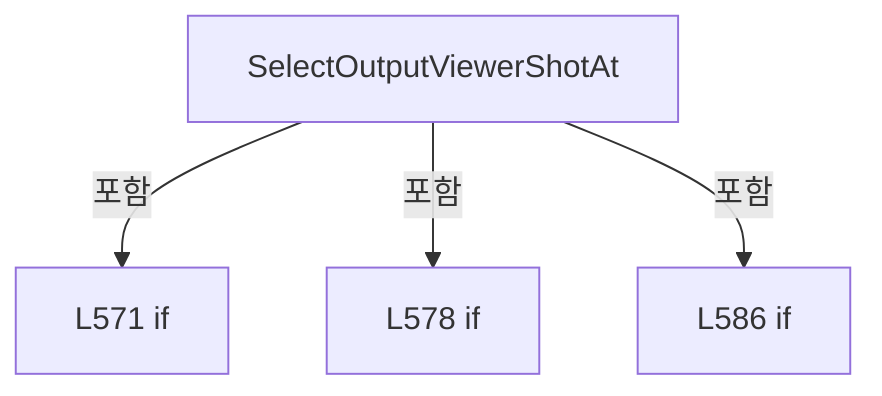

변경 전 점검: 입력/반환 타입, 위 호출자, 예외/취소 경로, 공유 상태와 저장·전송 소비자를 함께 확인합니다. 값의 단위나 물리 방향을 이름만으로 확정하지 않습니다.

### MethodDeclaration `ApplyOutputViewerShotSelection` · L592–606

[Drilling.UI/Menu/Menus/CMenuCorrection.cs:592–606](https://github.com/kjuws10-rgb/A3Drilling/blob/dfa5920e6301d9ec4b0eab1452ae59521aafc986/Drilling.UI/Menu/Menus/CMenuCorrection.cs#L592-L606)

| 항목 | 실제 추출 값 |
| --- | --- |
| 서명 | void Drilling.UI.Menu.Menus.CMenuCorrection.ApplyOutputViewerShotSelection(string) |
| 접근/수식자 | Private / private |
| 반환/값 타입 | void |
| 소속 타입 | NamedType:Drilling.UI.Menu.Menus.CMenuCorrection |

입력 계약:

| 이름 | 타입 | 전달 | 선택/기본값 |
| --- | --- | --- | --- |
| shotKey | string | None | False /  |

정적 호출자로 확인된 위치:

| 호출 파일/행 | 호출 표현식 | 런타임 분기 가능 |
| --- | --- | --- |
| [Drilling.UI/Menu/Menus/CMenuCorrection.cs:561–561](https://github.com/kjuws10-rgb/A3Drilling/blob/dfa5920e6301d9ec4b0eab1452ae59521aafc986/Drilling.UI/Menu/Menus/CMenuCorrection.cs#L561-L561) | ApplyOutputViewerShotSelection | False |
| [Drilling.UI/Menu/Menus/CMenuCorrection.cs:588–588](https://github.com/kjuws10-rgb/A3Drilling/blob/dfa5920e6301d9ec4b0eab1452ae59521aafc986/Drilling.UI/Menu/Menus/CMenuCorrection.cs#L588-L588) | ApplyOutputViewerShotSelection | False |

호출하는 대상과 해석 범위:

| 원본 행 | 표현식 | 분석 상태 | 대상/소스 위치 |
| --- | --- | --- | --- |
| 594 | _outputViewerSelectedShotKey.Equals | resolved | bool string.Equals(string?, System.StringComparison) |
| 600 | BuildOutputViewerCellShotMap | resolved | ImageSource? Drilling.UI.Menu.Menus.CMenuCorrection.BuildOutputViewerCellShotMap(System.Collections.Generic.IReadOnlyList<Drilling.Common.Recipe.ST_HEAD_SHOT_POINT>, System.Collections.Generic.IReadOnlyDictionary<string, Drilling.Common.Recipe.ST_RECIPE_SHOT_MASKING_RESULT>, string) · Drilling.UI/Menu/Menus/CMenuCorrection.cs:877 |
| 601 | OutputOffsets.SelectShot | resolved | void Drilling.UI.Menu.Menus.COutputOffsetViewerPanel.SelectShot(string) · Drilling.UI/Menu/Menus/CMenuCorrection.cs:7059 |
| 602 | .Invoke | resolved · 동적 구현 선택 가능 | void System.EventHandler.Invoke(object?, System.EventArgs) |
| 603 | .Invoke | resolved · 동적 구현 선택 가능 | void System.EventHandler.Invoke(object?, System.EventArgs) |
| 604 | .Invoke | resolved · 동적 구현 선택 가능 | void System.EventHandler.Invoke(object?, System.EventArgs) |
| 605 | _statusReporter | resolved · 동적 구현 선택 가능 | void System.Action<string>.Invoke(string) |

본문의 실제 연산·분기·예외·반환 순서(원문 위치 순):

| 원본 행 | 종류 | 주석 해설 |
| --- | --- | --- |
| 594 | call | 함수·델리게이트 또는 객체 생성자를 호출합니다: _outputViewerSelectedShotKey.Equals(shotKey, StringComparison.OrdinalIgnoreCase) |
| 594 | if | 조건에 따라 분기합니다: if (_outputViewerSelectedShotKey.Equals(shotKey, StringComparison.OrdinalIgnoreCase)) |
| 596 | return | 호출자에게 값 또는 제어를 반환합니다: return; |
| 599 | assignment | 값을 대상에 대입합니다: _outputViewerSelectedShotKey = shotKey |
| 600 | assignment | 값을 대상에 대입합니다: OutputViewerCellShotMapImage = BuildOutputViewerCellShotMap(_outputViewerSelectedCellShots, _outputViewerSelectedShotStates, _outputViewerSelectedShotKey) |
| 600 | call | 함수·델리게이트 또는 객체 생성자를 호출합니다: BuildOutputViewerCellShotMap(_outputViewerSelectedCellShots, _outputViewerSelectedShotStates, _outputViewerSelectedShotKey) |
| 601 | call | 함수·델리게이트 또는 객체 생성자를 호출합니다: OutputOffsets.SelectShot(_outputViewerSelectedShotKey) |
| 602 | call | 함수·델리게이트 또는 객체 생성자를 호출합니다: .Invoke(this, EventArgs.Empty) |
| 603 | call | 함수·델리게이트 또는 객체 생성자를 호출합니다: .Invoke(this, EventArgs.Empty) |
| 604 | call | 함수·델리게이트 또는 객체 생성자를 호출합니다: .Invoke(this, EventArgs.Empty) |
| 605 | call | 함수·델리게이트 또는 객체 생성자를 호출합니다: _statusReporter($"Offset Viewer shot selected: {OutputViewerSelectedShotName}.") |

제어 구문의 포함 구조(실제 실행 순서/CFG가 아닌 구문 탐색 그림):

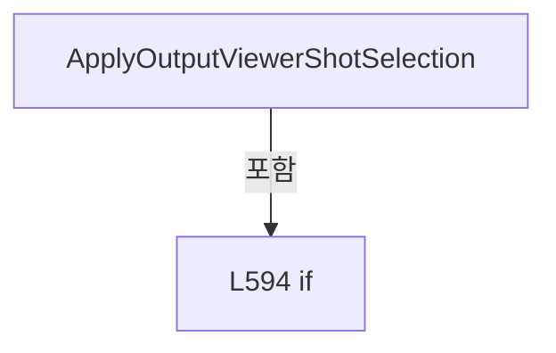

변경 전 점검: 입력/반환 타입, 위 호출자, 예외/취소 경로, 공유 상태와 저장·전송 소비자를 함께 확인합니다. 값의 단위나 물리 방향을 이름만으로 확정하지 않습니다.

### MethodDeclaration `BackToOutputViewerGlass` · L608–615

[Drilling.UI/Menu/Menus/CMenuCorrection.cs:608–615](https://github.com/kjuws10-rgb/A3Drilling/blob/dfa5920e6301d9ec4b0eab1452ae59521aafc986/Drilling.UI/Menu/Menus/CMenuCorrection.cs#L608-L615)

| 항목 | 실제 추출 값 |
| --- | --- |
| 서명 | System.Threading.Tasks.Task Drilling.UI.Menu.Menus.CMenuCorrection.BackToOutputViewerGlass(object?) |
| 접근/수식자 | Private / private, async |
| 반환/값 타입 | System.Threading.Tasks.Task |
| 소속 타입 | NamedType:Drilling.UI.Menu.Menus.CMenuCorrection |

입력 계약:

| 이름 | 타입 | 전달 | 선택/기본값 |
| --- | --- | --- | --- |
| parameter | object? | None | False /  |

정적 호출자로 확인된 위치:

| 호출 파일/행 | 호출 표현식 | 런타임 분기 가능 |
| --- | --- | --- |
| [Drilling.UI/Menu/Menus/CMenuCorrection.cs:174–174](https://github.com/kjuws10-rgb/A3Drilling/blob/dfa5920e6301d9ec4b0eab1452ae59521aafc986/Drilling.UI/Menu/Menus/CMenuCorrection.cs#L174-L174) | BackToOutputViewerGlass | False |

호출하는 대상과 해석 범위:

| 원본 행 | 표현식 | 분석 상태 | 대상/소스 위치 |
| --- | --- | --- | --- |
| 613 | _statusReporter | resolved · 동적 구현 선택 가능 | void System.Action<string>.Invoke(string) |
| 614 | _refreshCurrentScreen | resolved · 동적 구현 선택 가능 | System.Threading.Tasks.Task System.Func<System.Threading.Tasks.Task>.Invoke() |

본문의 실제 연산·분기·예외·반환 순서(원문 위치 순):

| 원본 행 | 종류 | 주석 해설 |
| --- | --- | --- |
| 610 | assignment | 값을 대상에 대입합니다: _outputViewerIsCellDetailVisible = false |
| 611 | assignment | 값을 대상에 대입합니다: _outputViewerSelectedCellNo = 0 |
| 612 | assignment | 값을 대상에 대입합니다: _outputViewerSelectedShotKey = "" |
| 613 | call | 함수·델리게이트 또는 객체 생성자를 호출합니다: _statusReporter("Offset Viewer glass preview opened.") |
| 614 | await | 비동기 완료를 기다립니다: await _refreshCurrentScreen() |
| 614 | call | 함수·델리게이트 또는 객체 생성자를 호출합니다: _refreshCurrentScreen() |

변경 전 점검: 입력/반환 타입, 위 호출자, 예외/취소 경로, 공유 상태와 저장·전송 소비자를 함께 확인합니다. 값의 단위나 물리 방향을 이름만으로 확정하지 않습니다.

### MethodDeclaration `RefreshOutputViewerData` · L617–752

[Drilling.UI/Menu/Menus/CMenuCorrection.cs:617–752](https://github.com/kjuws10-rgb/A3Drilling/blob/dfa5920e6301d9ec4b0eab1452ae59521aafc986/Drilling.UI/Menu/Menus/CMenuCorrection.cs#L617-L752)

| 항목 | 실제 추출 값 |
| --- | --- |
| 서명 | System.Threading.Tasks.Task Drilling.UI.Menu.Menus.CMenuCorrection.RefreshOutputViewerData(System.Threading.CancellationToken) |
| 접근/수식자 | Private / private, async |
| 반환/값 타입 | System.Threading.Tasks.Task |
| 소속 타입 | NamedType:Drilling.UI.Menu.Menus.CMenuCorrection |

입력 계약:

| 이름 | 타입 | 전달 | 선택/기본값 |
| --- | --- | --- | --- |
| cancellationToken | System.Threading.CancellationToken | None | False /  |

정적 호출자로 확인된 위치:

| 호출 파일/행 | 호출 표현식 | 런타임 분기 가능 |
| --- | --- | --- |
| [Drilling.UI/Menu/Menus/CMenuCorrection.cs:494–494](https://github.com/kjuws10-rgb/A3Drilling/blob/dfa5920e6301d9ec4b0eab1452ae59521aafc986/Drilling.UI/Menu/Menus/CMenuCorrection.cs#L494-L494) | RefreshOutputViewerData | False |

호출하는 대상과 해석 범위:

| 원본 행 | 표현식 | 분석 상태 | 대상/소스 위치 |
| --- | --- | --- | --- |
| 619 | System.Threading.Interlocked.Increment | resolved | int System.Threading.Interlocked.Increment(ref int) |
| 622 | LoadSelectedOutputViewerRecipe | resolved | System.Threading.Tasks.Task<Drilling.Common.Managers.ST_RECIPE_DEFINITION?> Drilling.UI.Menu.Menus.CMenuCorrection.LoadSelectedOutputViewerRecipe(System.Threading.CancellationToken, bool) · Drilling.UI/Menu/Menus/CMenuCorrection.cs:754 |
| 627 | ClearOutputViewerCellSelectionData | resolved | void Drilling.UI.Menu.Menus.CMenuCorrection.ClearOutputViewerCellSelectionData() · Drilling.UI/Menu/Menus/CMenuCorrection.cs:821 |
| 628 | OutputOffsets.Clear | resolved | void Drilling.UI.Menu.Menus.COutputOffsetViewerPanel.Clear() · Drilling.UI/Menu/Menus/CMenuCorrection.cs:7052 |
| 633 | new List<ST_SYSTEM_PARAMETER> | resolved | System.Collections.Generic.List<Drilling.Common.Managers.ST_SYSTEM_PARAMETER>.List() |
| 634 | settings.AddRange | resolved | void System.Collections.Generic.List<Drilling.Common.Managers.ST_SYSTEM_PARAMETER>.AddRange(System.Collections.Generic.IEnumerable<Drilling.Common.Managers.ST_SYSTEM_PARAMETER>) |
| 634 | _settingManager.LoadSection | resolved | System.Collections.Generic.IReadOnlyList<Drilling.Common.Managers.ST_SYSTEM_PARAMETER> Drilling.Common.Managers.CSettingManager.LoadSection(Drilling.Common.Managers.EN_SETTING_TAB, System.Threading.CancellationToken) · Drilling.Common/Managers/CSettingManager.cs:26 |
| 635 | settings.AddRange | resolved | void System.Collections.Generic.List<Drilling.Common.Managers.ST_SYSTEM_PARAMETER>.AddRange(System.Collections.Generic.IEnumerable<Drilling.Common.Managers.ST_SYSTEM_PARAMETER>) |
| 635 | _settingManager.LoadSection | resolved | System.Collections.Generic.IReadOnlyList<Drilling.Common.Managers.ST_SYSTEM_PARAMETER> Drilling.Common.Managers.CSettingManager.LoadSection(Drilling.Common.Managers.EN_SETTING_TAB, System.Threading.CancellationToken) · Drilling.Common/Managers/CSettingManager.cs:26 |
| 636 | BuildOutputViewerParameterMap | resolved | System.Collections.Generic.Dictionary<string, string> Drilling.UI.Menu.Menus.CMenuCorrection.BuildOutputViewerParameterMap(Drilling.Common.Managers.ST_RECIPE_DEFINITION, System.Collections.Generic.IReadOnlyList<Drilling.Common.Managers.ST_SYSTEM_PARAMETER>) · Drilling.UI/Menu/Menus/CMenuCorrection.cs:771 |
| 637 | _reviewOffsetFile.LoadLatest | resolved | System.Threading.Tasks.Task<Drilling.Common.Review.ST_REVIEW_OFFSET_FILE_DATA> Drilling.Common.Review.CReviewOffsetFileBase.LoadLatest(string, System.Threading.CancellationToken) · Drilling.Common/Review/CReviewManager.cs:4313 |
| 639 | ApplyReviewOffsetsToOutputViewerParameters | resolved | void Drilling.UI.Menu.Menus.CMenuCorrection.ApplyReviewOffsetsToOutputViewerParameters(System.Collections.Generic.IDictionary<string, string>, Drilling.Common.Review.ST_REVIEW_OFFSET_FILE_DATA) · Drilling.UI/Menu/Menus/CMenuCorrection.cs:1016 |
| 640 | Math.Max | resolved | int System.Math.Max(int, int) |
| 640 | ReadOutputViewerInt | resolved | int Drilling.UI.Menu.Menus.CMenuCorrection.ReadOutputViewerInt(System.Collections.Generic.IReadOnlyDictionary<string, string>, int, params string[]) · Drilling.UI/Menu/Menus/CMenuCorrection.cs:1231 |
| 643 | Math.Clamp | resolved | int System.Math.Clamp(int, int, int) |
| 643 | Math.Max | resolved | int System.Math.Max(int, int) |
| 652 | OutputViewerParametersMatch | resolved | bool Drilling.UI.Menu.Menus.CMenuCorrection.OutputViewerParametersMatch(System.Collections.Generic.IReadOnlyDictionary<string, string>?, System.Collections.Generic.IReadOnlyDictionary<string, string>) · Drilling.UI/Menu/Menus/CMenuCorrection.cs:803 |
| 654 | Task.Run | resolved | System.Threading.Tasks.Task<Drilling.UI.Menu.Menus.ST_CORRECTION_OFFSET_VIEWER_PREVIEW> System.Threading.Tasks.Task.Run<Drilling.UI.Menu.Menus.ST_CORRECTION_OFFSET_VIEWER_PREVIEW>(System.Func<Drilling.UI.Menu.Menus.ST_CORRECTION_OFFSET_VIEWER_PREVIEW>, System.Threading.CancellationToken) |
| 654 | BuildOutputViewerGlassPreview | resolved | Drilling.UI.Menu.Menus.ST_CORRECTION_OFFSET_VIEWER_PREVIEW Drilling.UI.Menu.Menus.CMenuCorrection.BuildOutputViewerGlassPreview(System.Collections.Generic.IReadOnlyDictionary<string, string>, int, int) · Drilling.UI/Menu/Menus/CMenuCorrection.cs:1021 |
| 655 | cancellationToken.ThrowIfCancellationRequested | resolved | void System.Threading.CancellationToken.ThrowIfCancellationRequested() |
| 656 | System.Threading.Volatile.Read | resolved | int System.Threading.Volatile.Read(ref readonly int) |
| 661 | CopyOutputViewerParameters | resolved | System.Collections.Generic.IReadOnlyDictionary<string, string> Drilling.UI.Menu.Menus.CMenuCorrection.CopyOutputViewerParameters(System.Collections.Generic.IReadOnlyDictionary<string, string>) · Drilling.UI/Menu/Menus/CMenuCorrection.cs:798 |
| 667 | System.Threading.Volatile.Read | resolved | int System.Threading.Volatile.Read(ref readonly int) |
| 677 | BuildOutputViewerCoordinateParameterMap | resolved | System.Collections.Generic.IReadOnlyDictionary<string, string> Drilling.UI.Menu.Menus.CMenuCorrection.BuildOutputViewerCoordinateParameterMap(System.Collections.Generic.IReadOnlyDictionary<string, string>) · Drilling.UI/Menu/Menus/CMenuCorrection.cs:1219 |
| 679 | OutputViewerParametersMatch | resolved | bool Drilling.UI.Menu.Menus.CMenuCorrection.OutputViewerParametersMatch(System.Collections.Generic.IReadOnlyDictionary<string, string>?, System.Collections.Generic.IReadOnlyDictionary<string, string>) · Drilling.UI/Menu/Menus/CMenuCorrection.cs:803 |
| 685 | Task.Run<IReadOnlyList<ST_HEAD_SHOT_POINT>> | resolved | System.Threading.Tasks.Task<System.Collections.Generic.IReadOnlyList<Drilling.Common.Recipe.ST_HEAD_SHOT_POINT>> System.Threading.Tasks.Task.Run<System.Collections.Generic.IReadOnlyList<Drilling.Common.Recipe.ST_HEAD_SHOT_POINT>>(System.Func<System.Collections.Generic.IReadOnlyList<Drilling.Common.Recipe.ST_HEAD_SHOT_POINT>>, System.Threading.CancellationToken) |
| 687 | CShotCoordinatePlanBuilder.Build | resolved | Drilling.Common.Recipe.ST_SHOT_COORDINATE_PLAN Drilling.Common.Recipe.CShotCoordinatePlanBuilder.Build(System.Collections.Generic.IReadOnlyDictionary<string, string>) · Drilling.Common/Recipe/CShotCoordinatePlanBuilder.cs:11 |
| 688 | plan.Shots.Where(shot => shot.CellNo == selectedCellNo).ToArray | resolved | Drilling.Common.Recipe.ST_HEAD_SHOT_POINT[] System.Collections.Generic.IEnumerable<Drilling.Common.Recipe.ST_HEAD_SHOT_POINT>.ToArray<Drilling.Common.Recipe.ST_HEAD_SHOT_POINT>() |
| 688 | plan.Shots.Where | resolved | System.Collections.Generic.IEnumerable<Drilling.Common.Recipe.ST_HEAD_SHOT_POINT> System.Collections.Generic.IEnumerable<Drilling.Common.Recipe.ST_HEAD_SHOT_POINT>.Where<Drilling.Common.Recipe.ST_HEAD_SHOT_POINT>(System.Func<Drilling.Common.Recipe.ST_HEAD_SHOT_POINT, bool>) |
| 690 | cancellationToken.ThrowIfCancellationRequested | resolved | void System.Threading.CancellationToken.ThrowIfCancellationRequested() |
| 691 | System.Threading.Volatile.Read | resolved | int System.Threading.Volatile.Read(ref readonly int) |
| 696 | CopyOutputViewerParameters | resolved | System.Collections.Generic.IReadOnlyDictionary<string, string> Drilling.UI.Menu.Menus.CMenuCorrection.CopyOutputViewerParameters(System.Collections.Generic.IReadOnlyDictionary<string, string>) · Drilling.UI/Menu/Menus/CMenuCorrection.cs:798 |
| 701 | _outputViewerSelectedShotKey.Equals | resolved | bool string.Equals(string?, System.StringComparison) |
| 701 | selectedShots.Any | resolved | bool System.Collections.Generic.IEnumerable<Drilling.Common.Recipe.ST_HEAD_SHOT_POINT>.Any<Drilling.Common.Recipe.ST_HEAD_SHOT_POINT>(System.Func<Drilling.Common.Recipe.ST_HEAD_SHOT_POINT, bool>) |
| 701 | shot.ShotKey.Equals | resolved | bool string.Equals(string?, System.StringComparison) |
| 707 | Task.Run | resolved | System.Threading.Tasks.Task<(System.Collections.Generic.IReadOnlyDictionary<string, Drilling.Common.Recipe.ST_RECIPE_SHOT_MASKING_RESULT> States, ImageSource? Image)> System.Threading.Tasks.Task.Run<(System.Collections.Generic.IReadOnlyDictionary<string, Drilling.Common.Recipe.ST_RECIPE_SHOT_MASKING_RESULT> States, ImageSource? Image)>(System.Func<(System.Collections.Generic.IReadOnlyDictionary<string, Drilling.Common.Recipe.ST_RECIPE_SHOT_MASKING_RESULT> States, ImageSource? Image)>, System.Threading.CancellationToken) |
| 709 | CRecipeShotMaskingPlan.Build | resolved | Drilling.Common.Recipe.CRecipeShotMaskingPlan Drilling.Common.Recipe.CRecipeShotMaskingPlan.Build(System.Collections.Generic.IReadOnlyDictionary<string, string>) · Drilling.Common/Recipe/CShotCoordinatePlanBuilder.cs:813 |
| 710 | selectedShots.ToDictionary | resolved | System.Collections.Generic.Dictionary<string, Drilling.Common.Recipe.ST_RECIPE_SHOT_MASKING_RESULT> System.Collections.Generic.IEnumerable<Drilling.Common.Recipe.ST_HEAD_SHOT_POINT>.ToDictionary<Drilling.Common.Recipe.ST_HEAD_SHOT_POINT, string, Drilling.Common.Recipe.ST_RECIPE_SHOT_MASKING_RESULT>(System.Func<Drilling.Common.Recipe.ST_HEAD_SHOT_POINT, string>, System.Func<Drilling.Common.Recipe.ST_HEAD_SHOT_POINT, Drilling.Common.Recipe.ST_RECIPE_SHOT_MASKING_RESULT>, System.Collections.Generic.IEqualityComparer<string>?) |
| 712 | maskingPlan.EvaluateShot | resolved | Drilling.Common.Recipe.ST_RECIPE_SHOT_MASKING_RESULT Drilling.Common.Recipe.CRecipeShotMaskingPlan.EvaluateShot(Drilling.Common.Recipe.ST_HEAD_SHOT_POINT) · Drilling.Common/Recipe/CShotCoordinatePlanBuilder.cs:853 |
| 714 | BuildOutputViewerCellShotMap | resolved | ImageSource? Drilling.UI.Menu.Menus.CMenuCorrection.BuildOutputViewerCellShotMap(System.Collections.Generic.IReadOnlyList<Drilling.Common.Recipe.ST_HEAD_SHOT_POINT>, System.Collections.Generic.IReadOnlyDictionary<string, Drilling.Common.Recipe.ST_RECIPE_SHOT_MASKING_RESULT>, string) · Drilling.UI/Menu/Menus/CMenuCorrection.cs:877 |
| 716 | cancellationToken.ThrowIfCancellationRequested | resolved | void System.Threading.CancellationToken.ThrowIfCancellationRequested() |
| 717 | System.Threading.Volatile.Read | resolved | int System.Threading.Volatile.Read(ref readonly int) |
| 725 | CreateOutputViewerHeadCards | resolved | System.Collections.Generic.IReadOnlyList<Drilling.UI.Menu.Menus.ST_CORRECTION_OUTPUT_VIEWER_HEAD_CARD> Drilling.UI.Menu.Menus.CMenuCorrection.CreateOutputViewerHeadCards(System.Collections.Generic.IReadOnlyList<Drilling.Common.Recipe.ST_HEAD_SHOT_POINT>) · Drilling.UI/Menu/Menus/CMenuCorrection.cs:856 |
| 726 | OutputOffsets.Update | resolved | void Drilling.UI.Menu.Menus.COutputOffsetViewerPanel.Update(System.Collections.Generic.IReadOnlyDictionary<string, string>, System.Collections.Generic.IReadOnlyList<Drilling.Common.Recipe.ST_HEAD_SHOT_POINT>, string) · Drilling.UI/Menu/Menus/CMenuCorrection.cs:7044 |
| 730 | ClearOutputViewerCellSelectionData | resolved | void Drilling.UI.Menu.Menus.CMenuCorrection.ClearOutputViewerCellSelectionData() · Drilling.UI/Menu/Menus/CMenuCorrection.cs:821 |
| 731 | OutputOffsets.Clear | resolved | void Drilling.UI.Menu.Menus.COutputOffsetViewerPanel.Clear() · Drilling.UI/Menu/Menus/CMenuCorrection.cs:7052 |
| 740 | System.Threading.Volatile.Read | resolved | int System.Threading.Volatile.Read(ref readonly int) |
| 745 | ReportInvalidReviewOffset | resolved | void Drilling.UI.Menu.Menus.CMenuCorrection.ReportInvalidReviewOffset(System.Exception) · Drilling.UI/Menu/Menus/CMenuCorrection.cs:3151 |
| 748 | ClearOutputViewerCellSelectionData | resolved | void Drilling.UI.Menu.Menus.CMenuCorrection.ClearOutputViewerCellSelectionData() · Drilling.UI/Menu/Menus/CMenuCorrection.cs:821 |
| 749 | OutputOffsets.Clear | resolved | void Drilling.UI.Menu.Menus.COutputOffsetViewerPanel.Clear() · Drilling.UI/Menu/Menus/CMenuCorrection.cs:7052 |

본문의 실제 연산·분기·예외·반환 순서(원문 위치 순):

| 원본 행 | 종류 | 주석 해설 |
| --- | --- | --- |
| 619 | call | 함수·델리게이트 또는 객체 생성자를 호출합니다: System.Threading.Interlocked.Increment(ref _outputViewerRefreshVersion) |
| 619 | local-declaration | 지역 변수를 선언합니다: var refreshVersion = System.Threading.Interlocked.Increment(ref _outputViewerRefreshVersion); |
| 619 | variable-initializer | 변수의 초기값을 지정합니다: refreshVersion = System.Threading.Interlocked.Increment(ref _outputViewerRefreshVersion) |
| 620 | try | 예외 처리 범위입니다: try |
| 622 | await | 비동기 완료를 기다립니다: await LoadSelectedOutputViewerRecipe(cancellationToken) |
| 622 | call | 함수·델리게이트 또는 객체 생성자를 호출합니다: LoadSelectedOutputViewerRecipe(cancellationToken) |
| 622 | local-declaration | 지역 변수를 선언합니다: var recipe = await LoadSelectedOutputViewerRecipe(cancellationToken); |
| 622 | variable-initializer | 변수의 초기값을 지정합니다: recipe = await LoadSelectedOutputViewerRecipe(cancellationToken) |
| 623 | if | 조건에 따라 분기합니다: if (recipe is null) |
| 625 | assignment | 값을 대상에 대입합니다: OutputViewerGlassPreviewImage = null |
| 626 | assignment | 값을 대상에 대입합니다: OutputViewerCellPreviewLabels = [] |
| 627 | call | 함수·델리게이트 또는 객체 생성자를 호출합니다: ClearOutputViewerCellSelectionData() |
| 628 | call | 함수·델리게이트 또는 객체 생성자를 호출합니다: OutputOffsets.Clear() |
| 629 | assignment | 값을 대상에 대입합니다: OutputViewerSummary = "Recipe not loaded" |
| 630 | return | 호출자에게 값 또는 제어를 반환합니다: return; |
| 633 | call | 함수·델리게이트 또는 객체 생성자를 호출합니다: new List<ST_SYSTEM_PARAMETER>() |
| 633 | local-declaration | 지역 변수를 선언합니다: var settings = new List<ST_SYSTEM_PARAMETER>(); |
| 633 | variable-initializer | 변수의 초기값을 지정합니다: settings = new List<ST_SYSTEM_PARAMETER>() |
| 634 | call | 함수·델리게이트 또는 객체 생성자를 호출합니다: settings.AddRange(_settingManager.LoadSection(EN_SETTING_TAB.Option, cancellationToken)) |
| 634 | call | 함수·델리게이트 또는 객체 생성자를 호출합니다: _settingManager.LoadSection(EN_SETTING_TAB.Option, cancellationToken) |
| 635 | call | 함수·델리게이트 또는 객체 생성자를 호출합니다: settings.AddRange(_settingManager.LoadSection(EN_SETTING_TAB.Motor, cancellationToken)) |
| 635 | call | 함수·델리게이트 또는 객체 생성자를 호출합니다: _settingManager.LoadSection(EN_SETTING_TAB.Motor, cancellationToken) |
| 636 | call | 함수·델리게이트 또는 객체 생성자를 호출합니다: BuildOutputViewerParameterMap(recipe, settings) |
| 636 | local-declaration | 지역 변수를 선언합니다: var parameters = BuildOutputViewerParameterMap(recipe, settings); |
| 636 | variable-initializer | 변수의 초기값을 지정합니다: parameters = BuildOutputViewerParameterMap(recipe, settings) |
| 637 | await | 비동기 완료를 기다립니다: await _reviewOffsetFile.LoadLatest(recipe.Id, cancellationToken) |
| 637 | call | 함수·델리게이트 또는 객체 생성자를 호출합니다: _reviewOffsetFile.LoadLatest(recipe.Id, cancellationToken) |
| 637 | local-declaration | 지역 변수를 선언합니다: var reviewOffsetFile = await _reviewOffsetFile.LoadLatest(recipe.Id, cancellationToken); |
| 637 | variable-initializer | 변수의 초기값을 지정합니다: reviewOffsetFile = await _reviewOffsetFile.LoadLatest(recipe.Id, cancellationToken) |
| 638 | assignment | 값을 대상에 대입합니다: _lastReviewOffsetWarning = "" |
| 639 | call | 함수·델리게이트 또는 객체 생성자를 호출합니다: ApplyReviewOffsetsToOutputViewerParameters(parameters, reviewOffsetFile) |
| 640 | call | 함수·델리게이트 또는 객체 생성자를 호출합니다: Math.Max(CCellPatternCalculator.MinCellCount, ReadOutputViewerInt(parameters, CCellPatternCalculator.MinCellCount, "MAX_CELL_NUMBER")) |
| 640 | call | 함수·델리게이트 또는 객체 생성자를 호출합니다: ReadOutputViewerInt(parameters, CCellPatternCalculator.MinCellCount, "MAX_CELL_NUMBER") |
| 640 | local-declaration | 지역 변수를 선언합니다: var cellCount = Math.Max(CCellPatternCalculator.MinCellCount, ReadOutputViewerInt(parameters, CCellPatternCalculator.MinCellCount, "MAX_CELL_NUMBER")); |
| 640 | variable-initializer | 변수의 초기값을 지정합니다: cellCount = Math.Max(CCellPatternCalculator.MinCellCount, ReadOutputViewerInt(parameters, CCellPatternCalculator.MinCellCount, "MAX_CELL_NUMBER")) |
| 641 | if | 조건에 따라 분기합니다: if (_outputViewerIsCellDetailVisible) |
| 643 | assignment | 값을 대상에 대입합니다: _outputViewerSelectedCellNo = Math.Clamp(Math.Max(1, _outputViewerSelectedCellNo), 1, cellCount) |
| 643 | call | 함수·델리게이트 또는 객체 생성자를 호출합니다: Math.Clamp(Math.Max(1, _outputViewerSelectedCellNo), 1, cellCount) |
| 643 | call | 함수·델리게이트 또는 객체 생성자를 호출합니다: Math.Max(1, _outputViewerSelectedCellNo) |
| 645 | else | 앞 조건이 거짓인 경로입니다: else |
| 647 | assignment | 값을 대상에 대입합니다: _outputViewerSelectedCellNo = 0 |
| 650 | conditional-expression | 조건에 따라 결과식을 선택합니다: _outputViewerIsCellDetailVisible ? _outputViewerSelectedCellNo : 0 |
| 650 | local-declaration | 지역 변수를 선언합니다: var selectedCellNo = _outputViewerIsCellDetailVisible ? _outputViewerSelectedCellNo : 0; |
| 650 | variable-initializer | 변수의 초기값을 지정합니다: selectedCellNo = _outputViewerIsCellDetailVisible ? _outputViewerSelectedCellNo : 0 |
| 651 | local-declaration | 지역 변수를 선언합니다: var preview = _outputViewerPreviewCache; |
| 651 | variable-initializer | 변수의 초기값을 지정합니다: preview = _outputViewerPreviewCache |
| 652 | call | 함수·델리게이트 또는 객체 생성자를 호출합니다: OutputViewerParametersMatch(_outputViewerPreviewParameters, parameters) |
| 652 | if | 조건에 따라 분기합니다: if (preview is null &#124;&#124; _outputViewerPreviewCellCount != cellCount &#124;&#124; _outputViewerPreviewSelectedCellNo != selectedCellNo &#124;&#124; !OutputViewerParametersMatch(_outputViewerPreviewParameters, parameters)) |
| 654 | assignment | 값을 대상에 대입합니다: preview = await Task.Run(() => BuildOutputViewerGlassPreview(parameters, cellCount, selectedCellNo), cancellationToken) |
| 654 | await | 비동기 완료를 기다립니다: await Task.Run(() => BuildOutputViewerGlassPreview(parameters, cellCount, selectedCellNo), cancellationToken) |
| 654 | call | 함수·델리게이트 또는 객체 생성자를 호출합니다: Task.Run(() => BuildOutputViewerGlassPreview(parameters, cellCount, selectedCellNo), cancellationToken) |
| 654 | call | 함수·델리게이트 또는 객체 생성자를 호출합니다: BuildOutputViewerGlassPreview(parameters, cellCount, selectedCellNo) |
| 655 | call | 함수·델리게이트 또는 객체 생성자를 호출합니다: cancellationToken.ThrowIfCancellationRequested() |
| 656 | call | 함수·델리게이트 또는 객체 생성자를 호출합니다: System.Threading.Volatile.Read(ref _outputViewerRefreshVersion) |
| 656 | if | 조건에 따라 분기합니다: if (refreshVersion != System.Threading.Volatile.Read(ref _outputViewerRefreshVersion)) |
| 658 | return | 호출자에게 값 또는 제어를 반환합니다: return; |
| 661 | assignment | 값을 대상에 대입합니다: _outputViewerPreviewParameters = CopyOutputViewerParameters(parameters) |
| 661 | call | 함수·델리게이트 또는 객체 생성자를 호출합니다: CopyOutputViewerParameters(parameters) |
| 662 | assignment | 값을 대상에 대입합니다: _outputViewerPreviewCellCount = cellCount |
| 663 | assignment | 값을 대상에 대입합니다: _outputViewerPreviewSelectedCellNo = selectedCellNo |
| 664 | assignment | 값을 대상에 대입합니다: _outputViewerPreviewCache = preview |
| 667 | call | 함수·델리게이트 또는 객체 생성자를 호출합니다: System.Threading.Volatile.Read(ref _outputViewerRefreshVersion) |
| 667 | if | 조건에 따라 분기합니다: if (refreshVersion != System.Threading.Volatile.Read(ref _outputViewerRefreshVersion)) |
| 669 | return | 호출자에게 값 또는 제어를 반환합니다: return; |
| 672 | assignment | 값을 대상에 대입합니다: OutputViewerGlassPreviewImage = preview.Image |
| 673 | assignment | 값을 대상에 대입합니다: OutputViewerCellPreviewLabels = preview.CellLabels |
| 674 | assignment | 값을 대상에 대입합니다: OutputViewerSummary = preview.Summary |
| 675 | if | 조건에 따라 분기합니다: if (_outputViewerIsCellDetailVisible) |
| 677 | call | 함수·델리게이트 또는 객체 생성자를 호출합니다: BuildOutputViewerCoordinateParameterMap(parameters) |
| 677 | local-declaration | 지역 변수를 선언합니다: var coordinateParameters = BuildOutputViewerCoordinateParameterMap(parameters); |
| 677 | variable-initializer | 변수의 초기값을 지정합니다: coordinateParameters = BuildOutputViewerCoordinateParameterMap(parameters) |
| 678 | local-declaration | 지역 변수를 선언합니다: IReadOnlyList<ST_HEAD_SHOT_POINT> selectedShots; |
| 679 | call | 함수·델리게이트 또는 객체 생성자를 호출합니다: OutputViewerParametersMatch(_outputViewerShotParameters, coordinateParameters) |
| 679 | if | 조건에 따라 분기합니다: if (_outputViewerShotCellNo == selectedCellNo && OutputViewerParametersMatch(_outputViewerShotParameters, coordinateParameters)) |
| 681 | assignment | 값을 대상에 대입합니다: selectedShots = _outputViewerShotCache |
| 683 | else | 앞 조건이 거짓인 경로입니다: else |
| 685 | assignment | 값을 대상에 대입합니다: selectedShots = await Task.Run<IReadOnlyList<ST_HEAD_SHOT_POINT>>(() => { var plan = CShotCoordinatePlanBuilder.Build(coordinateParameters); return plan.Shots.Where(shot => shot.CellNo == selectedCellNo).ToArray(); }, cancellation |
| 685 | await | 비동기 완료를 기다립니다: await Task.Run<IReadOnlyList<ST_HEAD_SHOT_POINT>>(() => { var plan = CShotCoordinatePlanBuilder.Build(coordinateParameters); return plan.Shots.Where(shot => shot.CellNo == selectedCellNo).ToArray(); }, cancellationToken) |
| 685 | call | 함수·델리게이트 또는 객체 생성자를 호출합니다: Task.Run<IReadOnlyList<ST_HEAD_SHOT_POINT>>(() => { var plan = CShotCoordinatePlanBuilder.Build(coordinateParameters); return plan.Shots.Where(shot => shot.CellNo == selectedCellNo).ToArray(); }, cancellationToken) |
| 687 | call | 함수·델리게이트 또는 객체 생성자를 호출합니다: CShotCoordinatePlanBuilder.Build(coordinateParameters) |
| 687 | local-declaration | 지역 변수를 선언합니다: var plan = CShotCoordinatePlanBuilder.Build(coordinateParameters); |
| 687 | variable-initializer | 변수의 초기값을 지정합니다: plan = CShotCoordinatePlanBuilder.Build(coordinateParameters) |
| 688 | call | 함수·델리게이트 또는 객체 생성자를 호출합니다: plan.Shots.Where(shot => shot.CellNo == selectedCellNo).ToArray() |
| 688 | call | 함수·델리게이트 또는 객체 생성자를 호출합니다: plan.Shots.Where(shot => shot.CellNo == selectedCellNo) |
| 688 | return | 호출자에게 값 또는 제어를 반환합니다: return plan.Shots.Where(shot => shot.CellNo == selectedCellNo).ToArray(); |
| 690 | call | 함수·델리게이트 또는 객체 생성자를 호출합니다: cancellationToken.ThrowIfCancellationRequested() |
| 691 | call | 함수·델리게이트 또는 객체 생성자를 호출합니다: System.Threading.Volatile.Read(ref _outputViewerRefreshVersion) |
| 691 | if | 조건에 따라 분기합니다: if (refreshVersion != System.Threading.Volatile.Read(ref _outputViewerRefreshVersion)) |
| 693 | return | 호출자에게 값 또는 제어를 반환합니다: return; |
| 696 | assignment | 값을 대상에 대입합니다: _outputViewerShotParameters = CopyOutputViewerParameters(coordinateParameters) |
| 696 | call | 함수·델리게이트 또는 객체 생성자를 호출합니다: CopyOutputViewerParameters(coordinateParameters) |
| 697 | assignment | 값을 대상에 대입합니다: _outputViewerShotCellNo = selectedCellNo |
| 698 | assignment | 값을 대상에 대입합니다: _outputViewerShotCache = selectedShots |
| 701 | call | 함수·델리게이트 또는 객체 생성자를 호출합니다: _outputViewerSelectedShotKey.Equals("", StringComparison.Ordinal) |
| 701 | call | 함수·델리게이트 또는 객체 생성자를 호출합니다: selectedShots.Any(shot => shot.ShotKey.Equals(_outputViewerSelectedShotKey, StringComparison.OrdinalIgnoreCase)) |
| 701 | call | 함수·델리게이트 또는 객체 생성자를 호출합니다: shot.ShotKey.Equals(_outputViewerSelectedShotKey, StringComparison.OrdinalIgnoreCase) |
| 701 | if | 조건에 따라 분기합니다: if (!_outputViewerSelectedShotKey.Equals("", StringComparison.Ordinal) && !selectedShots.Any(shot => shot.ShotKey.Equals(_outputViewerSelectedShotKey, StringComparison.OrdinalIgnoreCase))) |
| 703 | assignment | 값을 대상에 대입합니다: _outputViewerSelectedShotKey = "" |
| 706 | local-declaration | 지역 변수를 선언합니다: var selectedShotKey = _outputViewerSelectedShotKey; |
| 706 | variable-initializer | 변수의 초기값을 지정합니다: selectedShotKey = _outputViewerSelectedShotKey |
| 707 | await | 비동기 완료를 기다립니다: await Task.Run(() => { var maskingPlan = CRecipeShotMaskingPlan.Build(coordinateParameters); IReadOnlyDictionary<string, ST_RECIPE_SHOT_MASKING_RESULT> states = selectedShots.ToDictionary( shot => shot.ShotKey, shot => maskingPlan |
| 707 | call | 함수·델리게이트 또는 객체 생성자를 호출합니다: Task.Run(() => { var maskingPlan = CRecipeShotMaskingPlan.Build(coordinateParameters); IReadOnlyDictionary<string, ST_RECIPE_SHOT_MASKING_RESULT> states = selectedShots.ToDictionary( shot => shot.ShotKey, shot => masking… |
| 707 | local-declaration | 지역 변수를 선언합니다: var shotPreview = await Task.Run(() => { var maskingPlan = CRecipeShotMaskingPlan.Build(coordinateParameters); IReadOnlyDictionary<string, ST_RECIPE_SHOT_MASKING_RESULT> states = selectedShots.ToDictionary( shot => shot.ShotKey, s |
| 707 | variable-initializer | 변수의 초기값을 지정합니다: shotPreview = await Task.Run(() => { var maskingPlan = CRecipeShotMaskingPlan.Build(coordinateParameters); IReadOnlyDictionary<string, ST_RECIPE_SHOT_MASKING_RESULT> states = selectedShots.ToDictionary( shot => shot.ShotKey, shot  |
| 709 | call | 함수·델리게이트 또는 객체 생성자를 호출합니다: CRecipeShotMaskingPlan.Build(coordinateParameters) |
| 709 | local-declaration | 지역 변수를 선언합니다: var maskingPlan = CRecipeShotMaskingPlan.Build(coordinateParameters); |
| 709 | variable-initializer | 변수의 초기값을 지정합니다: maskingPlan = CRecipeShotMaskingPlan.Build(coordinateParameters) |
| 710 | call | 함수·델리게이트 또는 객체 생성자를 호출합니다: selectedShots.ToDictionary( shot => shot.ShotKey, shot => maskingPlan.EvaluateShot(shot), StringComparer.OrdinalIgnoreCase) |
| 710 | local-declaration | 지역 변수를 선언합니다: IReadOnlyDictionary<string, ST_RECIPE_SHOT_MASKING_RESULT> states = selectedShots.ToDictionary( shot => shot.ShotKey, shot => maskingPlan.EvaluateShot(shot), StringComparer.OrdinalIgnoreCase); |
| 710 | variable-initializer | 변수의 초기값을 지정합니다: states = selectedShots.ToDictionary( shot => shot.ShotKey, shot => maskingPlan.EvaluateShot(shot), StringComparer.OrdinalIgnoreCase) |
| 712 | call | 함수·델리게이트 또는 객체 생성자를 호출합니다: maskingPlan.EvaluateShot(shot) |
| 714 | call | 함수·델리게이트 또는 객체 생성자를 호출합니다: BuildOutputViewerCellShotMap(selectedShots, states, selectedShotKey) |
| 714 | return | 호출자에게 값 또는 제어를 반환합니다: return (States: states, Image: BuildOutputViewerCellShotMap(selectedShots, states, selectedShotKey)); |
| 716 | call | 함수·델리게이트 또는 객체 생성자를 호출합니다: cancellationToken.ThrowIfCancellationRequested() |
| 717 | call | 함수·델리게이트 또는 객체 생성자를 호출합니다: System.Threading.Volatile.Read(ref _outputViewerRefreshVersion) |
| 717 | if | 조건에 따라 분기합니다: if (refreshVersion != System.Threading.Volatile.Read(ref _outputViewerRefreshVersion)) |
| 719 | return | 호출자에게 값 또는 제어를 반환합니다: return; |
| 722 | assignment | 값을 대상에 대입합니다: _outputViewerSelectedCellShots = selectedShots |
| 723 | assignment | 값을 대상에 대입합니다: _outputViewerSelectedShotStates = shotPreview.States |
| 724 | assignment | 값을 대상에 대입합니다: OutputViewerCellShotMapImage = shotPreview.Image |
| 725 | assignment | 값을 대상에 대입합니다: OutputViewerHeadCards = CreateOutputViewerHeadCards(selectedShots) |
| 725 | call | 함수·델리게이트 또는 객체 생성자를 호출합니다: CreateOutputViewerHeadCards(selectedShots) |
| 726 | call | 함수·델리게이트 또는 객체 생성자를 호출합니다: OutputOffsets.Update(coordinateParameters, selectedShots, selectedShotKey) |
| 728 | else | 앞 조건이 거짓인 경로입니다: else |
| 730 | call | 함수·델리게이트 또는 객체 생성자를 호출합니다: ClearOutputViewerCellSelectionData() |
| 731 | call | 함수·델리게이트 또는 객체 생성자를 호출합니다: OutputOffsets.Clear() |
| 734 | catch | 지정 예외를 처리합니다: catch (OperationCanceledException) when (cancellationToken.IsCancellationRequested) |
| 736 | throw | 예외를 발생/전달합니다: throw; |
| 738 | catch | 지정 예외를 처리합니다: catch (Exception exception) |
| 740 | call | 함수·델리게이트 또는 객체 생성자를 호출합니다: System.Threading.Volatile.Read(ref _outputViewerRefreshVersion) |
| 740 | if | 조건에 따라 분기합니다: if (refreshVersion != System.Threading.Volatile.Read(ref _outputViewerRefreshVersion)) |
| 742 | return | 호출자에게 값 또는 제어를 반환합니다: return; |
| 745 | call | 함수·델리게이트 또는 객체 생성자를 호출합니다: ReportInvalidReviewOffset(exception) |
| 746 | assignment | 값을 대상에 대입합니다: OutputViewerGlassPreviewImage = null |
| 747 | assignment | 값을 대상에 대입합니다: OutputViewerCellPreviewLabels = [] |
| 748 | call | 함수·델리게이트 또는 객체 생성자를 호출합니다: ClearOutputViewerCellSelectionData() |
| 749 | call | 함수·델리게이트 또는 객체 생성자를 호출합니다: OutputOffsets.Clear() |
| 750 | assignment | 값을 대상에 대입합니다: OutputViewerSummary = $"Offset Viewer unavailable: {exception.Message}" |

제어 구문의 포함 구조(실제 실행 순서/CFG가 아닌 구문 탐색 그림):

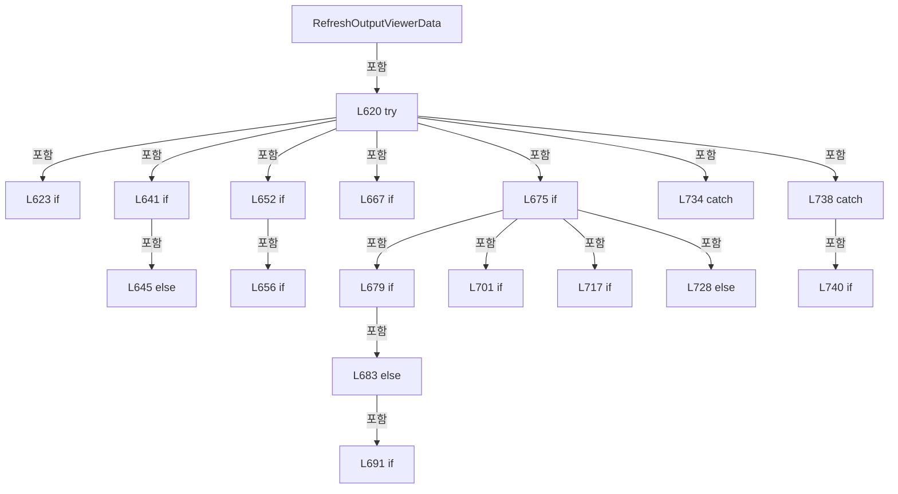

변경 전 점검: 입력/반환 타입, 위 호출자, 예외/취소 경로, 공유 상태와 저장·전송 소비자를 함께 확인합니다. 값의 단위나 물리 방향을 이름만으로 확정하지 않습니다.

### MethodDeclaration `LoadSelectedOutputViewerRecipe` · L754–769

[Drilling.UI/Menu/Menus/CMenuCorrection.cs:754–769](https://github.com/kjuws10-rgb/A3Drilling/blob/dfa5920e6301d9ec4b0eab1452ae59521aafc986/Drilling.UI/Menu/Menus/CMenuCorrection.cs#L754-L769)

| 항목 | 실제 추출 값 |
| --- | --- |
| 서명 | System.Threading.Tasks.Task<Drilling.Common.Managers.ST_RECIPE_DEFINITION?> Drilling.UI.Menu.Menus.CMenuCorrection.LoadSelectedOutputViewerRecipe(System.Threading.CancellationToken, bool) |
| 접근/수식자 | Private / private, async |
| 반환/값 타입 | System.Threading.Tasks.Task<Drilling.Common.Managers.ST_RECIPE_DEFINITION?> |
| 소속 타입 | NamedType:Drilling.UI.Menu.Menus.CMenuCorrection |

입력 계약:

| 이름 | 타입 | 전달 | 선택/기본값 |
| --- | --- | --- | --- |
| cancellationToken | System.Threading.CancellationToken | None | False /  |
| fallbackToFirst | bool | None | True / true |

정적 호출자로 확인된 위치:

| 호출 파일/행 | 호출 표현식 | 런타임 분기 가능 |
| --- | --- | --- |
| [Drilling.UI/Menu/Menus/CMenuCorrection.cs:419–419](https://github.com/kjuws10-rgb/A3Drilling/blob/dfa5920e6301d9ec4b0eab1452ae59521aafc986/Drilling.UI/Menu/Menus/CMenuCorrection.cs#L419-L419) | LoadSelectedOutputViewerRecipe | False |
| [Drilling.UI/Menu/Menus/CMenuCorrection.cs:431–431](https://github.com/kjuws10-rgb/A3Drilling/blob/dfa5920e6301d9ec4b0eab1452ae59521aafc986/Drilling.UI/Menu/Menus/CMenuCorrection.cs#L431-L431) | LoadSelectedOutputViewerRecipe | False |
| [Drilling.UI/Menu/Menus/CMenuCorrection.cs:452–452](https://github.com/kjuws10-rgb/A3Drilling/blob/dfa5920e6301d9ec4b0eab1452ae59521aafc986/Drilling.UI/Menu/Menus/CMenuCorrection.cs#L452-L452) | LoadSelectedOutputViewerRecipe | False |
| [Drilling.UI/Menu/Menus/CMenuCorrection.cs:622–622](https://github.com/kjuws10-rgb/A3Drilling/blob/dfa5920e6301d9ec4b0eab1452ae59521aafc986/Drilling.UI/Menu/Menus/CMenuCorrection.cs#L622-L622) | LoadSelectedOutputViewerRecipe | False |
| [Drilling.UI/Menu/Menus/CMenuCorrection.cs:2632–2632](https://github.com/kjuws10-rgb/A3Drilling/blob/dfa5920e6301d9ec4b0eab1452ae59521aafc986/Drilling.UI/Menu/Menus/CMenuCorrection.cs#L2632-L2632) | LoadSelectedOutputViewerRecipe | False |
| [Drilling.UI/Menu/Menus/CMenuCorrection.cs:2727–2727](https://github.com/kjuws10-rgb/A3Drilling/blob/dfa5920e6301d9ec4b0eab1452ae59521aafc986/Drilling.UI/Menu/Menus/CMenuCorrection.cs#L2727-L2727) | LoadSelectedOutputViewerRecipe | False |
| [Drilling.UI/Menu/Menus/CMenuCorrection.cs:2748–2748](https://github.com/kjuws10-rgb/A3Drilling/blob/dfa5920e6301d9ec4b0eab1452ae59521aafc986/Drilling.UI/Menu/Menus/CMenuCorrection.cs#L2748-L2748) | LoadSelectedOutputViewerRecipe | False |
| [Drilling.UI/Menu/Menus/CMenuCorrection.cs:2760–2760](https://github.com/kjuws10-rgb/A3Drilling/blob/dfa5920e6301d9ec4b0eab1452ae59521aafc986/Drilling.UI/Menu/Menus/CMenuCorrection.cs#L2760-L2760) | LoadSelectedOutputViewerRecipe | False |
| [Drilling.UI/Menu/Menus/CMenuCorrection.cs:2787–2787](https://github.com/kjuws10-rgb/A3Drilling/blob/dfa5920e6301d9ec4b0eab1452ae59521aafc986/Drilling.UI/Menu/Menus/CMenuCorrection.cs#L2787-L2787) | LoadSelectedOutputViewerRecipe | False |
| [Drilling.UI/Menu/Menus/CMenuCorrection.cs:2868–2868](https://github.com/kjuws10-rgb/A3Drilling/blob/dfa5920e6301d9ec4b0eab1452ae59521aafc986/Drilling.UI/Menu/Menus/CMenuCorrection.cs#L2868-L2868) | LoadSelectedOutputViewerRecipe | False |
| [Drilling.UI/Menu/Menus/CMenuCorrection.cs:2899–2899](https://github.com/kjuws10-rgb/A3Drilling/blob/dfa5920e6301d9ec4b0eab1452ae59521aafc986/Drilling.UI/Menu/Menus/CMenuCorrection.cs#L2899-L2899) | LoadSelectedOutputViewerRecipe | False |
| [Drilling.UI/Menu/Menus/CMenuCorrection.cs:2981–2981](https://github.com/kjuws10-rgb/A3Drilling/blob/dfa5920e6301d9ec4b0eab1452ae59521aafc986/Drilling.UI/Menu/Menus/CMenuCorrection.cs#L2981-L2981) | LoadSelectedOutputViewerRecipe | False |
| [Drilling.UI/Menu/Menus/CMenuCorrection.cs:3063–3063](https://github.com/kjuws10-rgb/A3Drilling/blob/dfa5920e6301d9ec4b0eab1452ae59521aafc986/Drilling.UI/Menu/Menus/CMenuCorrection.cs#L3063-L3063) | LoadSelectedOutputViewerRecipe | False |
| [Drilling.UI/Menu/Menus/CMenuCorrection.cs:3075–3075](https://github.com/kjuws10-rgb/A3Drilling/blob/dfa5920e6301d9ec4b0eab1452ae59521aafc986/Drilling.UI/Menu/Menus/CMenuCorrection.cs#L3075-L3075) | LoadSelectedOutputViewerRecipe | False |
| [Drilling.UI/Menu/Menus/CMenuCorrection.cs:3175–3175](https://github.com/kjuws10-rgb/A3Drilling/blob/dfa5920e6301d9ec4b0eab1452ae59521aafc986/Drilling.UI/Menu/Menus/CMenuCorrection.cs#L3175-L3175) | LoadSelectedOutputViewerRecipe | False |
| [Drilling.UI/Menu/Menus/CMenuCorrection.cs:3603–3603](https://github.com/kjuws10-rgb/A3Drilling/blob/dfa5920e6301d9ec4b0eab1452ae59521aafc986/Drilling.UI/Menu/Menus/CMenuCorrection.cs#L3603-L3603) | LoadSelectedOutputViewerRecipe | False |
| [Drilling.UI/Menu/Menus/CMenuCorrection.cs:3918–3918](https://github.com/kjuws10-rgb/A3Drilling/blob/dfa5920e6301d9ec4b0eab1452ae59521aafc986/Drilling.UI/Menu/Menus/CMenuCorrection.cs#L3918-L3918) | LoadSelectedOutputViewerRecipe | False |
| [Drilling.UI/Menu/Menus/CMenuCorrection.cs:3949–3949](https://github.com/kjuws10-rgb/A3Drilling/blob/dfa5920e6301d9ec4b0eab1452ae59521aafc986/Drilling.UI/Menu/Menus/CMenuCorrection.cs#L3949-L3949) | LoadSelectedOutputViewerRecipe | False |
| [Drilling.UI/Menu/Menus/CMenuCorrection.cs:3976–3976](https://github.com/kjuws10-rgb/A3Drilling/blob/dfa5920e6301d9ec4b0eab1452ae59521aafc986/Drilling.UI/Menu/Menus/CMenuCorrection.cs#L3976-L3976) | LoadSelectedOutputViewerRecipe | False |
| [Drilling.UI/Menu/Menus/CMenuCorrection.cs:4070–4070](https://github.com/kjuws10-rgb/A3Drilling/blob/dfa5920e6301d9ec4b0eab1452ae59521aafc986/Drilling.UI/Menu/Menus/CMenuCorrection.cs#L4070-L4070) | LoadSelectedOutputViewerRecipe | False |
| [Drilling.UI/Menu/Menus/CMenuCorrection.cs:4086–4086](https://github.com/kjuws10-rgb/A3Drilling/blob/dfa5920e6301d9ec4b0eab1452ae59521aafc986/Drilling.UI/Menu/Menus/CMenuCorrection.cs#L4086-L4086) | LoadSelectedOutputViewerRecipe | False |
| [Drilling.UI/Menu/Menus/CMenuCorrection.cs:4163–4163](https://github.com/kjuws10-rgb/A3Drilling/blob/dfa5920e6301d9ec4b0eab1452ae59521aafc986/Drilling.UI/Menu/Menus/CMenuCorrection.cs#L4163-L4163) | LoadSelectedOutputViewerRecipe | False |
| [Drilling.UI/Menu/Menus/CMenuCorrection.cs:4186–4186](https://github.com/kjuws10-rgb/A3Drilling/blob/dfa5920e6301d9ec4b0eab1452ae59521aafc986/Drilling.UI/Menu/Menus/CMenuCorrection.cs#L4186-L4186) | LoadSelectedOutputViewerRecipe | False |

호출하는 대상과 해석 범위:

| 원본 행 | 표현식 | 분석 상태 | 대상/소스 위치 |
| --- | --- | --- | --- |
| 756 | _recipeManager.LoadRecipes | resolved | System.Threading.Tasks.Task<System.Collections.Generic.IReadOnlyList<Drilling.Common.Managers.ST_RECIPE_DEFINITION>> Drilling.Common.Managers.CRecipeManager.LoadRecipes(System.Threading.CancellationToken) · Drilling.Common/Managers/CRecipeManager.cs:40 |
| 757 | NormalizeRecipeId | resolved | string Drilling.UI.Menu.Menus.CMenuCorrection.NormalizeRecipeId(string) · Drilling.UI/Menu/Menus/CMenuCorrection.cs:2284 |
| 757 | _selectedRecipeIdProvider | resolved · 동적 구현 선택 가능 | string System.Func<string>.Invoke() |
| 768 | string.IsNullOrWhiteSpace | resolved | bool string.IsNullOrWhiteSpace(string?) |
| 768 | recipes.FirstOrDefault | resolved | Drilling.Common.Managers.ST_RECIPE_DEFINITION? System.Collections.Generic.IEnumerable<Drilling.Common.Managers.ST_RECIPE_DEFINITION>.FirstOrDefault<Drilling.Common.Managers.ST_RECIPE_DEFINITION>() |
| 768 | recipes.FirstOrDefault | resolved | Drilling.Common.Managers.ST_RECIPE_DEFINITION? System.Collections.Generic.IEnumerable<Drilling.Common.Managers.ST_RECIPE_DEFINITION>.FirstOrDefault<Drilling.Common.Managers.ST_RECIPE_DEFINITION>(System.Func<Drilling.Common.Managers.ST_RECIPE_DEFINITION, bool>) |
| 768 | recipes.FirstOrDefault | resolved | Drilling.Common.Managers.ST_RECIPE_DEFINITION? System.Collections.Generic.IEnumerable<Drilling.Common.Managers.ST_RECIPE_DEFINITION>.FirstOrDefault<Drilling.Common.Managers.ST_RECIPE_DEFINITION>(System.Func<Drilling.Common.Managers.ST_RECIPE_DEFINITION, bool>) |
| 768 | recipes.FirstOrDefault | resolved | Drilling.Common.Managers.ST_RECIPE_DEFINITION? System.Collections.Generic.IEnumerable<Drilling.Common.Managers.ST_RECIPE_DEFINITION>.FirstOrDefault<Drilling.Common.Managers.ST_RECIPE_DEFINITION>() |

본문의 실제 연산·분기·예외·반환 순서(원문 위치 순):

| 원본 행 | 종류 | 주석 해설 |
| --- | --- | --- |
| 756 | await | 비동기 완료를 기다립니다: await _recipeManager.LoadRecipes(cancellationToken) |
| 756 | call | 함수·델리게이트 또는 객체 생성자를 호출합니다: _recipeManager.LoadRecipes(cancellationToken) |
| 756 | local-declaration | 지역 변수를 선언합니다: var recipes = await _recipeManager.LoadRecipes(cancellationToken); |
| 756 | variable-initializer | 변수의 초기값을 지정합니다: recipes = await _recipeManager.LoadRecipes(cancellationToken) |
| 757 | call | 함수·델리게이트 또는 객체 생성자를 호출합니다: NormalizeRecipeId(_selectedRecipeIdProvider()) |
| 757 | call | 함수·델리게이트 또는 객체 생성자를 호출합니다: _selectedRecipeIdProvider() |
| 757 | local-declaration | 지역 변수를 선언합니다: var selectedRecipeId = NormalizeRecipeId(_selectedRecipeIdProvider()); |
| 757 | variable-initializer | 변수의 초기값을 지정합니다: selectedRecipeId = NormalizeRecipeId(_selectedRecipeIdProvider()) |
| 768 | call | 함수·델리게이트 또는 객체 생성자를 호출합니다: string.IsNullOrWhiteSpace(selectedRecipeId) |
| 768 | call | 함수·델리게이트 또는 객체 생성자를 호출합니다: recipes.FirstOrDefault() |
| 768 | call | 함수·델리게이트 또는 객체 생성자를 호출합니다: recipes.FirstOrDefault(MatchById) |
| 768 | call | 함수·델리게이트 또는 객체 생성자를 호출합니다: recipes.FirstOrDefault(MatchByName) |
| 768 | call | 함수·델리게이트 또는 객체 생성자를 호출합니다: recipes.FirstOrDefault() |
| 768 | conditional-expression | 조건에 따라 결과식을 선택합니다: string.IsNullOrWhiteSpace(selectedRecipeId) ? (fallbackToFirst ? recipes.FirstOrDefault() : null) : recipes.FirstOrDefault(MatchById) ?? recipes.FirstOrDefault(MatchByName) ?? (fallbackToFirst ? recipes.FirstOrDefault() : null) |
| 768 | conditional-expression | 조건에 따라 결과식을 선택합니다: fallbackToFirst ? recipes.FirstOrDefault() : null |
| 768 | conditional-expression | 조건에 따라 결과식을 선택합니다: fallbackToFirst ? recipes.FirstOrDefault() : null |
| 768 | return | 호출자에게 값 또는 제어를 반환합니다: return string.IsNullOrWhiteSpace(selectedRecipeId) ? (fallbackToFirst ? recipes.FirstOrDefault() : null) : recipes.FirstOrDefault(MatchById) ?? recipes.FirstOrDefault(MatchByName) ?? (fallbackToFirst ? recipes.FirstOrDefault() : n |

변경 전 점검: 입력/반환 타입, 위 호출자, 예외/취소 경로, 공유 상태와 저장·전송 소비자를 함께 확인합니다. 값의 단위나 물리 방향을 이름만으로 확정하지 않습니다.

### LocalFunctionStatement `MatchById` · L758–761

[Drilling.UI/Menu/Menus/CMenuCorrection.cs:758–761](https://github.com/kjuws10-rgb/A3Drilling/blob/dfa5920e6301d9ec4b0eab1452ae59521aafc986/Drilling.UI/Menu/Menus/CMenuCorrection.cs#L758-L761)

| 항목 | 실제 추출 값 |
| --- | --- |
| 서명 | bool MatchById(Drilling.Common.Managers.ST_RECIPE_DEFINITION) |
| 접근/수식자 | Private /  |
| 반환/값 타입 | bool |
| 소속 타입 | NamedType:Drilling.UI.Menu.Menus.CMenuCorrection |

입력 계약:

| 이름 | 타입 | 전달 | 선택/기본값 |
| --- | --- | --- | --- |
| recipe | Drilling.Common.Managers.ST_RECIPE_DEFINITION | None | False /  |

현재 부분 분석에서 직접 연결된 호출자는 없습니다. XAML/이벤트/인터페이스·델리게이트·외부 진입을 추가 확인해야 하며, 미사용으로 판정한 것이 아닙니다.

호출하는 대상과 해석 범위:

| 원본 행 | 표현식 | 분석 상태 | 대상/소스 위치 |
| --- | --- | --- | --- |
| 760 | recipe.Id.Equals | resolved | bool string.Equals(string?, System.StringComparison) |

본문의 실제 연산·분기·예외·반환 순서(원문 위치 순):

| 원본 행 | 종류 | 주석 해설 |
| --- | --- | --- |
| 760 | call | 함수·델리게이트 또는 객체 생성자를 호출합니다: recipe.Id.Equals(selectedRecipeId, StringComparison.OrdinalIgnoreCase) |
| 760 | return | 호출자에게 값 또는 제어를 반환합니다: return recipe.Id.Equals(selectedRecipeId, StringComparison.OrdinalIgnoreCase); |

변경 전 점검: 입력/반환 타입, 위 호출자, 예외/취소 경로, 공유 상태와 저장·전송 소비자를 함께 확인합니다. 값의 단위나 물리 방향을 이름만으로 확정하지 않습니다.

### LocalFunctionStatement `MatchByName` · L763–766

[Drilling.UI/Menu/Menus/CMenuCorrection.cs:763–766](https://github.com/kjuws10-rgb/A3Drilling/blob/dfa5920e6301d9ec4b0eab1452ae59521aafc986/Drilling.UI/Menu/Menus/CMenuCorrection.cs#L763-L766)

| 항목 | 실제 추출 값 |
| --- | --- |
| 서명 | bool MatchByName(Drilling.Common.Managers.ST_RECIPE_DEFINITION) |
| 접근/수식자 | Private /  |
| 반환/값 타입 | bool |
| 소속 타입 | NamedType:Drilling.UI.Menu.Menus.CMenuCorrection |

입력 계약:

| 이름 | 타입 | 전달 | 선택/기본값 |
| --- | --- | --- | --- |
| recipe | Drilling.Common.Managers.ST_RECIPE_DEFINITION | None | False /  |

현재 부분 분석에서 직접 연결된 호출자는 없습니다. XAML/이벤트/인터페이스·델리게이트·외부 진입을 추가 확인해야 하며, 미사용으로 판정한 것이 아닙니다.

호출하는 대상과 해석 범위:

| 원본 행 | 표현식 | 분석 상태 | 대상/소스 위치 |
| --- | --- | --- | --- |
| 765 | recipe.Name.Equals | resolved | bool string.Equals(string?, System.StringComparison) |

본문의 실제 연산·분기·예외·반환 순서(원문 위치 순):

| 원본 행 | 종류 | 주석 해설 |
| --- | --- | --- |
| 765 | call | 함수·델리게이트 또는 객체 생성자를 호출합니다: recipe.Name.Equals(selectedRecipeId, StringComparison.OrdinalIgnoreCase) |
| 765 | return | 호출자에게 값 또는 제어를 반환합니다: return recipe.Name.Equals(selectedRecipeId, StringComparison.OrdinalIgnoreCase); |

변경 전 점검: 입력/반환 타입, 위 호출자, 예외/취소 경로, 공유 상태와 저장·전송 소비자를 함께 확인합니다. 값의 단위나 물리 방향을 이름만으로 확정하지 않습니다.

### MethodDeclaration `BuildOutputViewerParameterMap` · L771–788

[Drilling.UI/Menu/Menus/CMenuCorrection.cs:771–788](https://github.com/kjuws10-rgb/A3Drilling/blob/dfa5920e6301d9ec4b0eab1452ae59521aafc986/Drilling.UI/Menu/Menus/CMenuCorrection.cs#L771-L788)

| 항목 | 실제 추출 값 |
| --- | --- |
| 서명 | System.Collections.Generic.Dictionary<string, string> Drilling.UI.Menu.Menus.CMenuCorrection.BuildOutputViewerParameterMap(Drilling.Common.Managers.ST_RECIPE_DEFINITION, System.Collections.Generic.IReadOnlyList<Drilling.Common.Managers.ST_SYSTEM_PARAMETER>) |
| 접근/수식자 | Private / private, static |
| 반환/값 타입 | System.Collections.Generic.Dictionary<string, string> |
| 소속 타입 | NamedType:Drilling.UI.Menu.Menus.CMenuCorrection |

입력 계약:

| 이름 | 타입 | 전달 | 선택/기본값 |
| --- | --- | --- | --- |
| recipe | Drilling.Common.Managers.ST_RECIPE_DEFINITION | None | False /  |
| settings | System.Collections.Generic.IReadOnlyList<Drilling.Common.Managers.ST_SYSTEM_PARAMETER> | None | False /  |

정적 호출자로 확인된 위치:

| 호출 파일/행 | 호출 표현식 | 런타임 분기 가능 |
| --- | --- | --- |
| [Drilling.UI/Menu/Menus/CMenuCorrection.ReviewData.Display.cs:192–192](https://github.com/kjuws10-rgb/A3Drilling/blob/dfa5920e6301d9ec4b0eab1452ae59521aafc986/Drilling.UI/Menu/Menus/CMenuCorrection.ReviewData.Display.cs#L192-L192) | BuildOutputViewerParameterMap | False |
| [Drilling.UI/Menu/Menus/CMenuCorrection.cs:636–636](https://github.com/kjuws10-rgb/A3Drilling/blob/dfa5920e6301d9ec4b0eab1452ae59521aafc986/Drilling.UI/Menu/Menus/CMenuCorrection.cs#L636-L636) | BuildOutputViewerParameterMap | False |
| [Drilling.UI/Menu/Menus/CMenuCorrection.cs:1498–1498](https://github.com/kjuws10-rgb/A3Drilling/blob/dfa5920e6301d9ec4b0eab1452ae59521aafc986/Drilling.UI/Menu/Menus/CMenuCorrection.cs#L1498-L1498) | BuildOutputViewerParameterMap | False |
| [Drilling.UI/Menu/Menus/CMenuCorrection.cs:1730–1730](https://github.com/kjuws10-rgb/A3Drilling/blob/dfa5920e6301d9ec4b0eab1452ae59521aafc986/Drilling.UI/Menu/Menus/CMenuCorrection.cs#L1730-L1730) | BuildOutputViewerParameterMap | False |
| [Drilling.UI/Menu/Menus/CMenuCorrection.cs:1817–1817](https://github.com/kjuws10-rgb/A3Drilling/blob/dfa5920e6301d9ec4b0eab1452ae59521aafc986/Drilling.UI/Menu/Menus/CMenuCorrection.cs#L1817-L1817) | BuildOutputViewerParameterMap | False |
| [Drilling.UI/Menu/Menus/CMenuCorrection.cs:2793–2793](https://github.com/kjuws10-rgb/A3Drilling/blob/dfa5920e6301d9ec4b0eab1452ae59521aafc986/Drilling.UI/Menu/Menus/CMenuCorrection.cs#L2793-L2793) | BuildOutputViewerParameterMap | False |
| [Drilling.UI/Menu/Menus/CMenuCorrection.cs:3078–3078](https://github.com/kjuws10-rgb/A3Drilling/blob/dfa5920e6301d9ec4b0eab1452ae59521aafc986/Drilling.UI/Menu/Menus/CMenuCorrection.cs#L3078-L3078) | BuildOutputViewerParameterMap | False |
| [Drilling.UI/Menu/Menus/CMenuCorrection.cs:3977–3977](https://github.com/kjuws10-rgb/A3Drilling/blob/dfa5920e6301d9ec4b0eab1452ae59521aafc986/Drilling.UI/Menu/Menus/CMenuCorrection.cs#L3977-L3977) | BuildOutputViewerParameterMap | False |
| [Drilling.UI/Menu/Menus/CMenuCorrection.cs:4168–4168](https://github.com/kjuws10-rgb/A3Drilling/blob/dfa5920e6301d9ec4b0eab1452ae59521aafc986/Drilling.UI/Menu/Menus/CMenuCorrection.cs#L4168-L4168) | BuildOutputViewerParameterMap | False |

호출하는 대상과 해석 범위:

| 원본 행 | 표현식 | 분석 상태 | 대상/소스 위치 |
| --- | --- | --- | --- |
| 773 | new Dictionary<string, string> | resolved | System.Collections.Generic.Dictionary<string, string>.Dictionary(System.Collections.Generic.IEqualityComparer<string>?) |
| 776 | SetOutputViewerParameter | resolved | void Drilling.UI.Menu.Menus.CMenuCorrection.SetOutputViewerParameter(System.Collections.Generic.IDictionary<string, string>, string, string) · Drilling.UI/Menu/Menus/CMenuCorrection.cs:790 |
| 777 | SetOutputViewerParameter | resolved | void Drilling.UI.Menu.Menus.CMenuCorrection.SetOutputViewerParameter(System.Collections.Generic.IDictionary<string, string>, string, string) · Drilling.UI/Menu/Menus/CMenuCorrection.cs:790 |
| 782 | SetOutputViewerParameter | resolved | void Drilling.UI.Menu.Menus.CMenuCorrection.SetOutputViewerParameter(System.Collections.Generic.IDictionary<string, string>, string, string) · Drilling.UI/Menu/Menus/CMenuCorrection.cs:790 |
| 783 | SetOutputViewerParameter | resolved | void Drilling.UI.Menu.Menus.CMenuCorrection.SetOutputViewerParameter(System.Collections.Generic.IDictionary<string, string>, string, string) · Drilling.UI/Menu/Menus/CMenuCorrection.cs:790 |
| 786 | parameters.TryAdd | resolved | bool System.Collections.Generic.Dictionary<string, string>.TryAdd(string, string) |

본문의 실제 연산·분기·예외·반환 순서(원문 위치 순):

| 원본 행 | 종류 | 주석 해설 |
| --- | --- | --- |
| 773 | call | 함수·델리게이트 또는 객체 생성자를 호출합니다: new Dictionary<string, string>(StringComparer.OrdinalIgnoreCase) |
| 773 | local-declaration | 지역 변수를 선언합니다: var parameters = new Dictionary<string, string>(StringComparer.OrdinalIgnoreCase); |
| 773 | variable-initializer | 변수의 초기값을 지정합니다: parameters = new Dictionary<string, string>(StringComparer.OrdinalIgnoreCase) |
| 774 | foreach | 컬렉션 요소를 순회합니다: foreach (var parameter in recipe.Parameters) |
| 776 | call | 함수·델리게이트 또는 객체 생성자를 호출합니다: SetOutputViewerParameter(parameters, parameter.Key, parameter.Value) |
| 777 | call | 함수·델리게이트 또는 객체 생성자를 호출합니다: SetOutputViewerParameter(parameters, parameter.Name, parameter.Value) |
| 780 | foreach | 컬렉션 요소를 순회합니다: foreach (var setting in settings) |
| 782 | call | 함수·델리게이트 또는 객체 생성자를 호출합니다: SetOutputViewerParameter(parameters, setting.Key, setting.Value) |
| 783 | call | 함수·델리게이트 또는 객체 생성자를 호출합니다: SetOutputViewerParameter(parameters, setting.Name, setting.Value) |
| 786 | call | 함수·델리게이트 또는 객체 생성자를 호출합니다: parameters.TryAdd("HEAD_COUNT", "8") |
| 787 | return | 호출자에게 값 또는 제어를 반환합니다: return parameters; |

제어 구문의 포함 구조(실제 실행 순서/CFG가 아닌 구문 탐색 그림):


변경 전 점검: 입력/반환 타입, 위 호출자, 예외/취소 경로, 공유 상태와 저장·전송 소비자를 함께 확인합니다. 값의 단위나 물리 방향을 이름만으로 확정하지 않습니다.

### MethodDeclaration `SetOutputViewerParameter` · L790–796

[Drilling.UI/Menu/Menus/CMenuCorrection.cs:790–796](https://github.com/kjuws10-rgb/A3Drilling/blob/dfa5920e6301d9ec4b0eab1452ae59521aafc986/Drilling.UI/Menu/Menus/CMenuCorrection.cs#L790-L796)

| 항목 | 실제 추출 값 |
| --- | --- |
| 서명 | void Drilling.UI.Menu.Menus.CMenuCorrection.SetOutputViewerParameter(System.Collections.Generic.IDictionary<string, string>, string, string) |
| 접근/수식자 | Private / private, static |
| 반환/값 타입 | void |
| 소속 타입 | NamedType:Drilling.UI.Menu.Menus.CMenuCorrection |

입력 계약:

| 이름 | 타입 | 전달 | 선택/기본값 |
| --- | --- | --- | --- |
| parameters | System.Collections.Generic.IDictionary<string, string> | None | False /  |
| key | string | None | False /  |
| value | string | None | False /  |

정적 호출자로 확인된 위치:

| 호출 파일/행 | 호출 표현식 | 런타임 분기 가능 |
| --- | --- | --- |
| [Drilling.UI/Menu/Menus/CMenuCorrection.cs:776–776](https://github.com/kjuws10-rgb/A3Drilling/blob/dfa5920e6301d9ec4b0eab1452ae59521aafc986/Drilling.UI/Menu/Menus/CMenuCorrection.cs#L776-L776) | SetOutputViewerParameter | False |
| [Drilling.UI/Menu/Menus/CMenuCorrection.cs:777–777](https://github.com/kjuws10-rgb/A3Drilling/blob/dfa5920e6301d9ec4b0eab1452ae59521aafc986/Drilling.UI/Menu/Menus/CMenuCorrection.cs#L777-L777) | SetOutputViewerParameter | False |
| [Drilling.UI/Menu/Menus/CMenuCorrection.cs:782–782](https://github.com/kjuws10-rgb/A3Drilling/blob/dfa5920e6301d9ec4b0eab1452ae59521aafc986/Drilling.UI/Menu/Menus/CMenuCorrection.cs#L782-L782) | SetOutputViewerParameter | False |
| [Drilling.UI/Menu/Menus/CMenuCorrection.cs:783–783](https://github.com/kjuws10-rgb/A3Drilling/blob/dfa5920e6301d9ec4b0eab1452ae59521aafc986/Drilling.UI/Menu/Menus/CMenuCorrection.cs#L783-L783) | SetOutputViewerParameter | False |

호출하는 대상과 해석 범위:

| 원본 행 | 표현식 | 분석 상태 | 대상/소스 위치 |
| --- | --- | --- | --- |
| 792 | string.IsNullOrWhiteSpace | resolved | bool string.IsNullOrWhiteSpace(string?) |
| 794 | key.Trim | resolved | string string.Trim() |

본문의 실제 연산·분기·예외·반환 순서(원문 위치 순):

| 원본 행 | 종류 | 주석 해설 |
| --- | --- | --- |
| 792 | call | 함수·델리게이트 또는 객체 생성자를 호출합니다: string.IsNullOrWhiteSpace(key) |
| 792 | if | 조건에 따라 분기합니다: if (!string.IsNullOrWhiteSpace(key)) |
| 794 | assignment | 값을 대상에 대입합니다: parameters[key.Trim()] = value |
| 794 | call | 함수·델리게이트 또는 객체 생성자를 호출합니다: key.Trim() |

제어 구문의 포함 구조(실제 실행 순서/CFG가 아닌 구문 탐색 그림):


변경 전 점검: 입력/반환 타입, 위 호출자, 예외/취소 경로, 공유 상태와 저장·전송 소비자를 함께 확인합니다. 값의 단위나 물리 방향을 이름만으로 확정하지 않습니다.

### MethodDeclaration `CopyOutputViewerParameters` · L798–801

[Drilling.UI/Menu/Menus/CMenuCorrection.cs:798–801](https://github.com/kjuws10-rgb/A3Drilling/blob/dfa5920e6301d9ec4b0eab1452ae59521aafc986/Drilling.UI/Menu/Menus/CMenuCorrection.cs#L798-L801)

| 항목 | 실제 추출 값 |
| --- | --- |
| 서명 | System.Collections.Generic.IReadOnlyDictionary<string, string> Drilling.UI.Menu.Menus.CMenuCorrection.CopyOutputViewerParameters(System.Collections.Generic.IReadOnlyDictionary<string, string>) |
| 접근/수식자 | Private / private, static |
| 반환/값 타입 | System.Collections.Generic.IReadOnlyDictionary<string, string> |
| 소속 타입 | NamedType:Drilling.UI.Menu.Menus.CMenuCorrection |

입력 계약:

| 이름 | 타입 | 전달 | 선택/기본값 |
| --- | --- | --- | --- |
| parameters | System.Collections.Generic.IReadOnlyDictionary<string, string> | None | False /  |

정적 호출자로 확인된 위치:

| 호출 파일/행 | 호출 표현식 | 런타임 분기 가능 |
| --- | --- | --- |
| [Drilling.UI/Menu/Menus/CMenuCorrection.cs:661–661](https://github.com/kjuws10-rgb/A3Drilling/blob/dfa5920e6301d9ec4b0eab1452ae59521aafc986/Drilling.UI/Menu/Menus/CMenuCorrection.cs#L661-L661) | CopyOutputViewerParameters | False |
| [Drilling.UI/Menu/Menus/CMenuCorrection.cs:696–696](https://github.com/kjuws10-rgb/A3Drilling/blob/dfa5920e6301d9ec4b0eab1452ae59521aafc986/Drilling.UI/Menu/Menus/CMenuCorrection.cs#L696-L696) | CopyOutputViewerParameters | False |

호출하는 대상과 해석 범위:

| 원본 행 | 표현식 | 분석 상태 | 대상/소스 위치 |
| --- | --- | --- | --- |
| 800 | new Dictionary<string, string> | resolved | System.Collections.Generic.Dictionary<string, string>.Dictionary(System.Collections.Generic.IEnumerable<System.Collections.Generic.KeyValuePair<string, string>>, System.Collections.Generic.IEqualityComparer<string>?) |

본문의 실제 연산·분기·예외·반환 순서(원문 위치 순):

| 원본 행 | 종류 | 주석 해설 |
| --- | --- | --- |
| 800 | call | 함수·델리게이트 또는 객체 생성자를 호출합니다: new Dictionary<string, string>(parameters, StringComparer.OrdinalIgnoreCase) |
| 800 | return | 호출자에게 값 또는 제어를 반환합니다: return new Dictionary<string, string>(parameters, StringComparer.OrdinalIgnoreCase); |

변경 전 점검: 입력/반환 타입, 위 호출자, 예외/취소 경로, 공유 상태와 저장·전송 소비자를 함께 확인합니다. 값의 단위나 물리 방향을 이름만으로 확정하지 않습니다.

### MethodDeclaration `OutputViewerParametersMatch` · L803–819

[Drilling.UI/Menu/Menus/CMenuCorrection.cs:803–819](https://github.com/kjuws10-rgb/A3Drilling/blob/dfa5920e6301d9ec4b0eab1452ae59521aafc986/Drilling.UI/Menu/Menus/CMenuCorrection.cs#L803-L819)

| 항목 | 실제 추출 값 |
| --- | --- |
| 서명 | bool Drilling.UI.Menu.Menus.CMenuCorrection.OutputViewerParametersMatch(System.Collections.Generic.IReadOnlyDictionary<string, string>?, System.Collections.Generic.IReadOnlyDictionary<string, string>) |
| 접근/수식자 | Private / private, static |
| 반환/값 타입 | bool |
| 소속 타입 | NamedType:Drilling.UI.Menu.Menus.CMenuCorrection |

입력 계약:

| 이름 | 타입 | 전달 | 선택/기본값 |
| --- | --- | --- | --- |
| cached | System.Collections.Generic.IReadOnlyDictionary<string, string>? | None | False /  |
| current | System.Collections.Generic.IReadOnlyDictionary<string, string> | None | False /  |

정적 호출자로 확인된 위치:

| 호출 파일/행 | 호출 표현식 | 런타임 분기 가능 |
| --- | --- | --- |
| [Drilling.UI/Menu/Menus/CMenuCorrection.cs:652–652](https://github.com/kjuws10-rgb/A3Drilling/blob/dfa5920e6301d9ec4b0eab1452ae59521aafc986/Drilling.UI/Menu/Menus/CMenuCorrection.cs#L652-L652) | OutputViewerParametersMatch | False |
| [Drilling.UI/Menu/Menus/CMenuCorrection.cs:679–679](https://github.com/kjuws10-rgb/A3Drilling/blob/dfa5920e6301d9ec4b0eab1452ae59521aafc986/Drilling.UI/Menu/Menus/CMenuCorrection.cs#L679-L679) | OutputViewerParametersMatch | False |

호출하는 대상과 해석 범위:

| 원본 행 | 표현식 | 분석 상태 | 대상/소스 위치 |
| --- | --- | --- | --- |
| 812 | cached.TryGetValue | resolved · 동적 구현 선택 가능 | bool System.Collections.Generic.IReadOnlyDictionary<string, string>.TryGetValue(string, out string) |
| 812 | value.Equals | resolved | bool string.Equals(string?, System.StringComparison) |

본문의 실제 연산·분기·예외·반환 순서(원문 위치 순):

| 원본 행 | 종류 | 주석 해설 |
| --- | --- | --- |
| 805 | if | 조건에 따라 분기합니다: if (cached is null &#124;&#124; cached.Count != current.Count) |
| 807 | return | 호출자에게 값 또는 제어를 반환합니다: return false; |
| 810 | foreach | 컬렉션 요소를 순회합니다: foreach (var parameter in current) |
| 812 | call | 함수·델리게이트 또는 객체 생성자를 호출합니다: cached.TryGetValue(parameter.Key, out var value) |
| 812 | call | 함수·델리게이트 또는 객체 생성자를 호출합니다: value.Equals(parameter.Value, StringComparison.Ordinal) |
| 812 | if | 조건에 따라 분기합니다: if (!cached.TryGetValue(parameter.Key, out var value) &#124;&#124; !value.Equals(parameter.Value, StringComparison.Ordinal)) |
| 814 | return | 호출자에게 값 또는 제어를 반환합니다: return false; |
| 818 | return | 호출자에게 값 또는 제어를 반환합니다: return true; |

제어 구문의 포함 구조(실제 실행 순서/CFG가 아닌 구문 탐색 그림):

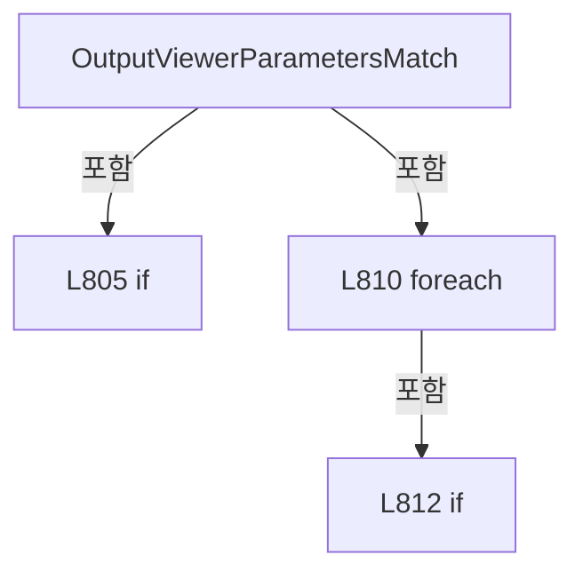

변경 전 점검: 입력/반환 타입, 위 호출자, 예외/취소 경로, 공유 상태와 저장·전송 소비자를 함께 확인합니다. 값의 단위나 물리 방향을 이름만으로 확정하지 않습니다.

### MethodDeclaration `ClearOutputViewerCellSelectionData` · L821–828

[Drilling.UI/Menu/Menus/CMenuCorrection.cs:821–828](https://github.com/kjuws10-rgb/A3Drilling/blob/dfa5920e6301d9ec4b0eab1452ae59521aafc986/Drilling.UI/Menu/Menus/CMenuCorrection.cs#L821-L828)

| 항목 | 실제 추출 값 |
| --- | --- |
| 서명 | void Drilling.UI.Menu.Menus.CMenuCorrection.ClearOutputViewerCellSelectionData() |
| 접근/수식자 | Private / private |
| 반환/값 타입 | void |
| 소속 타입 | NamedType:Drilling.UI.Menu.Menus.CMenuCorrection |

정적 호출자로 확인된 위치:

| 호출 파일/행 | 호출 표현식 | 런타임 분기 가능 |
| --- | --- | --- |
| [Drilling.UI/Menu/Menus/CMenuCorrection.cs:627–627](https://github.com/kjuws10-rgb/A3Drilling/blob/dfa5920e6301d9ec4b0eab1452ae59521aafc986/Drilling.UI/Menu/Menus/CMenuCorrection.cs#L627-L627) | ClearOutputViewerCellSelectionData | False |
| [Drilling.UI/Menu/Menus/CMenuCorrection.cs:730–730](https://github.com/kjuws10-rgb/A3Drilling/blob/dfa5920e6301d9ec4b0eab1452ae59521aafc986/Drilling.UI/Menu/Menus/CMenuCorrection.cs#L730-L730) | ClearOutputViewerCellSelectionData | False |
| [Drilling.UI/Menu/Menus/CMenuCorrection.cs:748–748](https://github.com/kjuws10-rgb/A3Drilling/blob/dfa5920e6301d9ec4b0eab1452ae59521aafc986/Drilling.UI/Menu/Menus/CMenuCorrection.cs#L748-L748) | ClearOutputViewerCellSelectionData | False |

호출하는 대상과 해석 범위:

| 원본 행 | 표현식 | 분석 상태 | 대상/소스 위치 |
| --- | --- | --- | --- |
| 824 | new Dictionary<string, ST_RECIPE_SHOT_MASKING_RESULT> | resolved | System.Collections.Generic.Dictionary<string, Drilling.Common.Recipe.ST_RECIPE_SHOT_MASKING_RESULT>.Dictionary(System.Collections.Generic.IEqualityComparer<string>?) |
| 827 | CreateOutputViewerHeadCards | resolved | System.Collections.Generic.IReadOnlyList<Drilling.UI.Menu.Menus.ST_CORRECTION_OUTPUT_VIEWER_HEAD_CARD> Drilling.UI.Menu.Menus.CMenuCorrection.CreateOutputViewerHeadCards(System.Collections.Generic.IReadOnlyList<Drilling.Common.Recipe.ST_HEAD_SHOT_POINT>) · Drilling.UI/Menu/Menus/CMenuCorrection.cs:856 |

본문의 실제 연산·분기·예외·반환 순서(원문 위치 순):

| 원본 행 | 종류 | 주석 해설 |
| --- | --- | --- |
| 823 | assignment | 값을 대상에 대입합니다: _outputViewerSelectedCellShots = [] |
| 824 | assignment | 값을 대상에 대입합니다: _outputViewerSelectedShotStates = new Dictionary<string, ST_RECIPE_SHOT_MASKING_RESULT>(StringComparer.OrdinalIgnoreCase) |
| 824 | call | 함수·델리게이트 또는 객체 생성자를 호출합니다: new Dictionary<string, ST_RECIPE_SHOT_MASKING_RESULT>(StringComparer.OrdinalIgnoreCase) |
| 825 | assignment | 값을 대상에 대입합니다: _outputViewerSelectedShotKey = "" |
| 826 | assignment | 값을 대상에 대입합니다: OutputViewerCellShotMapImage = null |
| 827 | assignment | 값을 대상에 대입합니다: OutputViewerHeadCards = CreateOutputViewerHeadCards([]) |
| 827 | call | 함수·델리게이트 또는 객체 생성자를 호출합니다: CreateOutputViewerHeadCards([]) |

변경 전 점검: 입력/반환 타입, 위 호출자, 예외/취소 경로, 공유 상태와 저장·전송 소비자를 함께 확인합니다. 값의 단위나 물리 방향을 이름만으로 확정하지 않습니다.

### MethodDeclaration `GetOutputViewerSelectedShot` · L830–838

[Drilling.UI/Menu/Menus/CMenuCorrection.cs:830–838](https://github.com/kjuws10-rgb/A3Drilling/blob/dfa5920e6301d9ec4b0eab1452ae59521aafc986/Drilling.UI/Menu/Menus/CMenuCorrection.cs#L830-L838)

| 항목 | 실제 추출 값 |
| --- | --- |
| 서명 | Drilling.Common.Recipe.ST_HEAD_SHOT_POINT? Drilling.UI.Menu.Menus.CMenuCorrection.GetOutputViewerSelectedShot() |
| 접근/수식자 | Private / private |
| 반환/값 타입 | Drilling.Common.Recipe.ST_HEAD_SHOT_POINT? |
| 소속 타입 | NamedType:Drilling.UI.Menu.Menus.CMenuCorrection |

정적 호출자로 확인된 위치:

| 호출 파일/행 | 호출 표현식 | 런타임 분기 가능 |
| --- | --- | --- |
| [Drilling.UI/Menu/Menus/CMenuCorrection.cs:297–297](https://github.com/kjuws10-rgb/A3Drilling/blob/dfa5920e6301d9ec4b0eab1452ae59521aafc986/Drilling.UI/Menu/Menus/CMenuCorrection.cs#L297-L297) | GetOutputViewerSelectedShot | False |
| [Drilling.UI/Menu/Menus/CMenuCorrection.cs:298–298](https://github.com/kjuws10-rgb/A3Drilling/blob/dfa5920e6301d9ec4b0eab1452ae59521aafc986/Drilling.UI/Menu/Menus/CMenuCorrection.cs#L298-L298) | GetOutputViewerSelectedShot | False |

호출하는 대상과 해석 범위:

| 원본 행 | 표현식 | 분석 상태 | 대상/소스 위치 |
| --- | --- | --- | --- |
| 832 | string.IsNullOrWhiteSpace | resolved | bool string.IsNullOrWhiteSpace(string?) |
| 837 | _outputViewerSelectedCellShots.FirstOrDefault | resolved | Drilling.Common.Recipe.ST_HEAD_SHOT_POINT? System.Collections.Generic.IEnumerable<Drilling.Common.Recipe.ST_HEAD_SHOT_POINT>.FirstOrDefault<Drilling.Common.Recipe.ST_HEAD_SHOT_POINT>(System.Func<Drilling.Common.Recipe.ST_HEAD_SHOT_POINT, bool>) |
| 837 | shot.ShotKey.Equals | resolved | bool string.Equals(string?, System.StringComparison) |

본문의 실제 연산·분기·예외·반환 순서(원문 위치 순):

| 원본 행 | 종류 | 주석 해설 |
| --- | --- | --- |
| 832 | call | 함수·델리게이트 또는 객체 생성자를 호출합니다: string.IsNullOrWhiteSpace(_outputViewerSelectedShotKey) |
| 832 | if | 조건에 따라 분기합니다: if (string.IsNullOrWhiteSpace(_outputViewerSelectedShotKey)) |
| 834 | return | 호출자에게 값 또는 제어를 반환합니다: return null; |
| 837 | call | 함수·델리게이트 또는 객체 생성자를 호출합니다: _outputViewerSelectedCellShots.FirstOrDefault(shot => shot.ShotKey.Equals(_outputViewerSelectedShotKey, StringComparison.OrdinalIgnoreCase)) |
| 837 | call | 함수·델리게이트 또는 객체 생성자를 호출합니다: shot.ShotKey.Equals(_outputViewerSelectedShotKey, StringComparison.OrdinalIgnoreCase) |
| 837 | return | 호출자에게 값 또는 제어를 반환합니다: return _outputViewerSelectedCellShots.FirstOrDefault(shot => shot.ShotKey.Equals(_outputViewerSelectedShotKey, StringComparison.OrdinalIgnoreCase)); |

제어 구문의 포함 구조(실제 실행 순서/CFG가 아닌 구문 탐색 그림):


변경 전 점검: 입력/반환 타입, 위 호출자, 예외/취소 경로, 공유 상태와 저장·전송 소비자를 함께 확인합니다. 값의 단위나 물리 방향을 이름만으로 확정하지 않습니다.

### MethodDeclaration `GetOutputViewerShotMapSize` · L840–848

[Drilling.UI/Menu/Menus/CMenuCorrection.cs:840–848](https://github.com/kjuws10-rgb/A3Drilling/blob/dfa5920e6301d9ec4b0eab1452ae59521aafc986/Drilling.UI/Menu/Menus/CMenuCorrection.cs#L840-L848)

| 항목 | 실제 추출 값 |
| --- | --- |
| 서명 | Size Drilling.UI.Menu.Menus.CMenuCorrection.GetOutputViewerShotMapSize() |
| 접근/수식자 | Private / private |
| 반환/값 타입 | Size |
| 소속 타입 | NamedType:Drilling.UI.Menu.Menus.CMenuCorrection |

정적 호출자로 확인된 위치:

| 호출 파일/행 | 호출 표현식 | 런타임 분기 가능 |
| --- | --- | --- |
| [Drilling.UI/Menu/Menus/CMenuCorrection.cs:299–299](https://github.com/kjuws10-rgb/A3Drilling/blob/dfa5920e6301d9ec4b0eab1452ae59521aafc986/Drilling.UI/Menu/Menus/CMenuCorrection.cs#L299-L299) | GetOutputViewerShotMapSize | False |
| [Drilling.UI/Menu/Menus/CMenuCorrection.cs:300–300](https://github.com/kjuws10-rgb/A3Drilling/blob/dfa5920e6301d9ec4b0eab1452ae59521aafc986/Drilling.UI/Menu/Menus/CMenuCorrection.cs#L300-L300) | GetOutputViewerShotMapSize | False |

호출하는 대상과 해석 범위:

| 원본 행 | 표현식 | 분석 상태 | 대상/소스 위치 |
| --- | --- | --- | --- |
| 842 | _outputViewerSelectedCellShots.FirstOrDefault | resolved | Drilling.Common.Recipe.ST_HEAD_SHOT_POINT? System.Collections.Generic.IEnumerable<Drilling.Common.Recipe.ST_HEAD_SHOT_POINT>.FirstOrDefault<Drilling.Common.Recipe.ST_HEAD_SHOT_POINT>() |
| 844 | new Size | unresolved | None |
| 847 | new Size | unresolved | None |
| 847 | new Size | unresolved | None |

본문의 실제 연산·분기·예외·반환 순서(원문 위치 순):

| 원본 행 | 종류 | 주석 해설 |
| --- | --- | --- |
| 842 | call | 함수·델리게이트 또는 객체 생성자를 호출합니다: _outputViewerSelectedCellShots.FirstOrDefault() |
| 842 | if | 조건에 따라 분기합니다: if (_outputViewerSelectedCellShots.FirstOrDefault() is not { } firstShot) |
| 844 | call | 함수·델리게이트 또는 객체 생성자를 호출합니다: new Size(680.0, 420.0) |
| 844 | return | 호출자에게 값 또는 제어를 반환합니다: return new Size(680.0, 420.0); |
| 847 | call | 함수·델리게이트 또는 객체 생성자를 호출합니다: new Size(680.0, 420.0) |
| 847 | call | 함수·델리게이트 또는 객체 생성자를 호출합니다: new Size(420.0, 680.0) |
| 847 | conditional-expression | 조건에 따라 결과식을 선택합니다: firstShot.GroupCountX > firstShot.GroupCountY ? new Size(680.0, 420.0) : new Size(420.0, 680.0) |
| 847 | return | 호출자에게 값 또는 제어를 반환합니다: return firstShot.GroupCountX > firstShot.GroupCountY ? new Size(680.0, 420.0) : new Size(420.0, 680.0); |

제어 구문의 포함 구조(실제 실행 순서/CFG가 아닌 구문 탐색 그림):


변경 전 점검: 입력/반환 타입, 위 호출자, 예외/취소 경로, 공유 상태와 저장·전송 소비자를 함께 확인합니다. 값의 단위나 물리 방향을 이름만으로 확정하지 않습니다.

### MethodDeclaration `GetOutputViewerShotMapRect` · L850–854

[Drilling.UI/Menu/Menus/CMenuCorrection.cs:850–854](https://github.com/kjuws10-rgb/A3Drilling/blob/dfa5920e6301d9ec4b0eab1452ae59521aafc986/Drilling.UI/Menu/Menus/CMenuCorrection.cs#L850-L854)

| 항목 | 실제 추출 값 |
| --- | --- |
| 서명 | Rect Drilling.UI.Menu.Menus.CMenuCorrection.GetOutputViewerShotMapRect(int, int) |
| 접근/수식자 | Private / private, static |
| 반환/값 타입 | Rect |
| 소속 타입 | NamedType:Drilling.UI.Menu.Menus.CMenuCorrection |

입력 계약:

| 이름 | 타입 | 전달 | 선택/기본값 |
| --- | --- | --- | --- |
| groupCountX | int | None | False /  |
| groupCountY | int | None | False /  |

정적 호출자로 확인된 위치:

| 호출 파일/행 | 호출 표현식 | 런타임 분기 가능 |
| --- | --- | --- |
| [Drilling.UI/Menu/Menus/CMenuCorrection.cs:577–577](https://github.com/kjuws10-rgb/A3Drilling/blob/dfa5920e6301d9ec4b0eab1452ae59521aafc986/Drilling.UI/Menu/Menus/CMenuCorrection.cs#L577-L577) | GetOutputViewerShotMapRect | False |
| [Drilling.UI/Menu/Menus/CMenuCorrection.cs:889–889](https://github.com/kjuws10-rgb/A3Drilling/blob/dfa5920e6301d9ec4b0eab1452ae59521aafc986/Drilling.UI/Menu/Menus/CMenuCorrection.cs#L889-L889) | GetOutputViewerShotMapRect | False |

호출하는 대상과 해석 범위:

| 원본 행 | 표현식 | 분석 상태 | 대상/소스 위치 |
| --- | --- | --- | --- |
| 852 | new Size | unresolved | None |
| 852 | new Size | unresolved | None |
| 853 | new Rect | unresolved | None |

본문의 실제 연산·분기·예외·반환 순서(원문 위치 순):

| 원본 행 | 종류 | 주석 해설 |
| --- | --- | --- |
| 852 | call | 함수·델리게이트 또는 객체 생성자를 호출합니다: new Size(680.0, 420.0) |
| 852 | call | 함수·델리게이트 또는 객체 생성자를 호출합니다: new Size(420.0, 680.0) |
| 852 | conditional-expression | 조건에 따라 결과식을 선택합니다: groupCountX > groupCountY ? new Size(680.0, 420.0) : new Size(420.0, 680.0) |
| 852 | local-declaration | 지역 변수를 선언합니다: var size = groupCountX > groupCountY ? new Size(680.0, 420.0) : new Size(420.0, 680.0); |
| 852 | variable-initializer | 변수의 초기값을 지정합니다: size = groupCountX > groupCountY ? new Size(680.0, 420.0) : new Size(420.0, 680.0) |
| 853 | call | 함수·델리게이트 또는 객체 생성자를 호출합니다: new Rect(28.0, 28.0, size.Width - 56.0, size.Height - 56.0) |
| 853 | return | 호출자에게 값 또는 제어를 반환합니다: return new Rect(28.0, 28.0, size.Width - 56.0, size.Height - 56.0); |

변경 전 점검: 입력/반환 타입, 위 호출자, 예외/취소 경로, 공유 상태와 저장·전송 소비자를 함께 확인합니다. 값의 단위나 물리 방향을 이름만으로 확정하지 않습니다.

### MethodDeclaration `CreateOutputViewerHeadCards` · L856–875

[Drilling.UI/Menu/Menus/CMenuCorrection.cs:856–875](https://github.com/kjuws10-rgb/A3Drilling/blob/dfa5920e6301d9ec4b0eab1452ae59521aafc986/Drilling.UI/Menu/Menus/CMenuCorrection.cs#L856-L875)

| 항목 | 실제 추출 값 |
| --- | --- |
| 서명 | System.Collections.Generic.IReadOnlyList<Drilling.UI.Menu.Menus.ST_CORRECTION_OUTPUT_VIEWER_HEAD_CARD> Drilling.UI.Menu.Menus.CMenuCorrection.CreateOutputViewerHeadCards(System.Collections.Generic.IReadOnlyList<Drilling.Common.Recipe.ST_HEAD_SHOT_POINT>) |
| 접근/수식자 | Private / private, static |
| 반환/값 타입 | System.Collections.Generic.IReadOnlyList<Drilling.UI.Menu.Menus.ST_CORRECTION_OUTPUT_VIEWER_HEAD_CARD> |
| 소속 타입 | NamedType:Drilling.UI.Menu.Menus.CMenuCorrection |

입력 계약:

| 이름 | 타입 | 전달 | 선택/기본값 |
| --- | --- | --- | --- |
| shots | System.Collections.Generic.IReadOnlyList<Drilling.Common.Recipe.ST_HEAD_SHOT_POINT> | None | False /  |

정적 호출자로 확인된 위치:

| 호출 파일/행 | 호출 표현식 | 런타임 분기 가능 |
| --- | --- | --- |
| [Drilling.UI/Menu/Menus/CMenuCorrection.cs:77–77](https://github.com/kjuws10-rgb/A3Drilling/blob/dfa5920e6301d9ec4b0eab1452ae59521aafc986/Drilling.UI/Menu/Menus/CMenuCorrection.cs#L77-L77) | CreateOutputViewerHeadCards | False |
| [Drilling.UI/Menu/Menus/CMenuCorrection.cs:725–725](https://github.com/kjuws10-rgb/A3Drilling/blob/dfa5920e6301d9ec4b0eab1452ae59521aafc986/Drilling.UI/Menu/Menus/CMenuCorrection.cs#L725-L725) | CreateOutputViewerHeadCards | False |
| [Drilling.UI/Menu/Menus/CMenuCorrection.cs:827–827](https://github.com/kjuws10-rgb/A3Drilling/blob/dfa5920e6301d9ec4b0eab1452ae59521aafc986/Drilling.UI/Menu/Menus/CMenuCorrection.cs#L827-L827) | CreateOutputViewerHeadCards | False |

호출하는 대상과 해석 범위:

| 원본 행 | 표현식 | 분석 상태 | 대상/소스 위치 |
| --- | --- | --- | --- |
| 858 | shots.Select(shot => shot.HeadNo).ToHashSet | resolved | System.Collections.Generic.HashSet<int> System.Collections.Generic.IEnumerable<int>.ToHashSet<int>() |
| 858 | shots.Select | resolved | System.Collections.Generic.IEnumerable<int> System.Collections.Generic.IEnumerable<Drilling.Common.Recipe.ST_HEAD_SHOT_POINT>.Select<Drilling.Common.Recipe.ST_HEAD_SHOT_POINT, int>(System.Func<Drilling.Common.Recipe.ST_HEAD_SHOT_POINT, int>) |
| 859 | new SolidColorBrush | unresolved | None |
| 859 | Color.FromRgb | unresolved | None |
| 860 | new SolidColorBrush | unresolved | None |
| 860 | Color.FromRgb | unresolved | None |
| 861 | new SolidColorBrush | unresolved | None |
| 861 | Color.FromRgb | unresolved | None |
| 862 | inactiveBackground.Freeze | unresolved | None |
| 863 | inactiveBorder.Freeze | unresolved | None |
| 864 | inactiveText.Freeze | unresolved | None |
| 865 | Enumerable.Range(1, 8).Select(headNo => { var isAssigned = assignedHeads.Contains(headNo); return new ST_CORRECTION_OUTPUT_VIEWER_HEAD_CARD( headNo, isAssigned, isAssigned ? CMenuMain.CreateHeadBrush(headNo) : inactiveBackground, isAssigned ? Brushes.White : inactiveBorder, isAssigned ? Brushes.White : inactiveText); }).ToArray | unresolved | None |
| 865 | Enumerable.Range(1, 8).Select | candidate | OverloadResolutionFailure |
| 865 | Enumerable.Range | resolved | System.Collections.Generic.IEnumerable<int> System.Linq.Enumerable.Range(int, int) |
| 867 | assignedHeads.Contains | resolved | bool System.Collections.Generic.HashSet<int>.Contains(int) |
| 868 | new ST_CORRECTION_OUTPUT_VIEWER_HEAD_CARD | candidate | OverloadResolutionFailure |
| 871 | CMenuMain.CreateHeadBrush | resolved | Brush Drilling.UI.Menu.Menus.CMenuMain.CreateHeadBrush(int, byte) · Drilling.UI/Menu/Menus/CMenuMain.cs:2246 |

본문의 실제 연산·분기·예외·반환 순서(원문 위치 순):

| 원본 행 | 종류 | 주석 해설 |
| --- | --- | --- |
| 858 | call | 함수·델리게이트 또는 객체 생성자를 호출합니다: shots.Select(shot => shot.HeadNo).ToHashSet() |
| 858 | call | 함수·델리게이트 또는 객체 생성자를 호출합니다: shots.Select(shot => shot.HeadNo) |
| 858 | local-declaration | 지역 변수를 선언합니다: var assignedHeads = shots.Select(shot => shot.HeadNo).ToHashSet(); |
| 858 | variable-initializer | 변수의 초기값을 지정합니다: assignedHeads = shots.Select(shot => shot.HeadNo).ToHashSet() |
| 859 | call | 함수·델리게이트 또는 객체 생성자를 호출합니다: new SolidColorBrush(Color.FromRgb(76, 91, 105)) |
| 859 | call | 함수·델리게이트 또는 객체 생성자를 호출합니다: Color.FromRgb(76, 91, 105) |
| 859 | local-declaration | 지역 변수를 선언합니다: var inactiveBackground = new SolidColorBrush(Color.FromRgb(76, 91, 105)); |
| 859 | variable-initializer | 변수의 초기값을 지정합니다: inactiveBackground = new SolidColorBrush(Color.FromRgb(76, 91, 105)) |
| 860 | call | 함수·델리게이트 또는 객체 생성자를 호출합니다: new SolidColorBrush(Color.FromRgb(139, 157, 174)) |
| 860 | call | 함수·델리게이트 또는 객체 생성자를 호출합니다: Color.FromRgb(139, 157, 174) |
| 860 | local-declaration | 지역 변수를 선언합니다: var inactiveBorder = new SolidColorBrush(Color.FromRgb(139, 157, 174)); |
| 860 | variable-initializer | 변수의 초기값을 지정합니다: inactiveBorder = new SolidColorBrush(Color.FromRgb(139, 157, 174)) |
| 861 | call | 함수·델리게이트 또는 객체 생성자를 호출합니다: new SolidColorBrush(Color.FromRgb(248, 250, 252)) |
| 861 | call | 함수·델리게이트 또는 객체 생성자를 호출합니다: Color.FromRgb(248, 250, 252) |
| 861 | local-declaration | 지역 변수를 선언합니다: var inactiveText = new SolidColorBrush(Color.FromRgb(248, 250, 252)); |
| 861 | variable-initializer | 변수의 초기값을 지정합니다: inactiveText = new SolidColorBrush(Color.FromRgb(248, 250, 252)) |
| 862 | call | 함수·델리게이트 또는 객체 생성자를 호출합니다: inactiveBackground.Freeze() |
| 863 | call | 함수·델리게이트 또는 객체 생성자를 호출합니다: inactiveBorder.Freeze() |
| 864 | call | 함수·델리게이트 또는 객체 생성자를 호출합니다: inactiveText.Freeze() |
| 865 | call | 함수·델리게이트 또는 객체 생성자를 호출합니다: Enumerable.Range(1, 8) |
| 865 | call | 함수·델리게이트 또는 객체 생성자를 호출합니다: Enumerable.Range(1, 8).Select(headNo => { var isAssigned = assignedHeads.Contains(headNo); return new ST_CORRECTION_OUTPUT_VIEWER_HEAD_CARD( headNo, isAssigned, isAssigned ? CMenuMain.CreateHeadBrush(headNo) : inactiveBa… |
| 865 | call | 함수·델리게이트 또는 객체 생성자를 호출합니다: Enumerable.Range(1, 8).Select(headNo => { var isAssigned = assignedHeads.Contains(headNo); return new ST_CORRECTION_OUTPUT_VIEWER_HEAD_CARD( headNo, isAssigned, isAssigned ? CMenuMain.CreateHeadBrush(headNo) : inactiveBa… |
| 865 | return | 호출자에게 값 또는 제어를 반환합니다: return Enumerable.Range(1, 8).Select(headNo => { var isAssigned = assignedHeads.Contains(headNo); return new ST_CORRECTION_OUTPUT_VIEWER_HEAD_CARD( headNo, isAssigned, isAssigned ? CMenuMain.CreateHeadBrush(headNo) : inactiveBackg |
| 867 | call | 함수·델리게이트 또는 객체 생성자를 호출합니다: assignedHeads.Contains(headNo) |
| 867 | local-declaration | 지역 변수를 선언합니다: var isAssigned = assignedHeads.Contains(headNo); |
| 867 | variable-initializer | 변수의 초기값을 지정합니다: isAssigned = assignedHeads.Contains(headNo) |
| 868 | call | 함수·델리게이트 또는 객체 생성자를 호출합니다: new ST_CORRECTION_OUTPUT_VIEWER_HEAD_CARD( headNo, isAssigned, isAssigned ? CMenuMain.CreateHeadBrush(headNo) : inactiveBackground, isAssigned ? Brushes.White : inactiveBorder, isAssigned ? Brushes.White : inactiveText) |
| 868 | return | 호출자에게 값 또는 제어를 반환합니다: return new ST_CORRECTION_OUTPUT_VIEWER_HEAD_CARD( headNo, isAssigned, isAssigned ? CMenuMain.CreateHeadBrush(headNo) : inactiveBackground, isAssigned ? Brushes.White : inactiveBorder, isAssigned ? Brushes.White : inactiveText); |
| 871 | call | 함수·델리게이트 또는 객체 생성자를 호출합니다: CMenuMain.CreateHeadBrush(headNo) |
| 871 | conditional-expression | 조건에 따라 결과식을 선택합니다: isAssigned ? CMenuMain.CreateHeadBrush(headNo) : inactiveBackground |
| 872 | conditional-expression | 조건에 따라 결과식을 선택합니다: isAssigned ? Brushes.White : inactiveBorder |
| 873 | conditional-expression | 조건에 따라 결과식을 선택합니다: isAssigned ? Brushes.White : inactiveText |

변경 전 점검: 입력/반환 타입, 위 호출자, 예외/취소 경로, 공유 상태와 저장·전송 소비자를 함께 확인합니다. 값의 단위나 물리 방향을 이름만으로 확정하지 않습니다.

### MethodDeclaration `BuildOutputViewerCellShotMap` · L877–987

[Drilling.UI/Menu/Menus/CMenuCorrection.cs:877–987](https://github.com/kjuws10-rgb/A3Drilling/blob/dfa5920e6301d9ec4b0eab1452ae59521aafc986/Drilling.UI/Menu/Menus/CMenuCorrection.cs#L877-L987)

| 항목 | 실제 추출 값 |
| --- | --- |
| 서명 | ImageSource? Drilling.UI.Menu.Menus.CMenuCorrection.BuildOutputViewerCellShotMap(System.Collections.Generic.IReadOnlyList<Drilling.Common.Recipe.ST_HEAD_SHOT_POINT>, System.Collections.Generic.IReadOnlyDictionary<string, Drilling.Common.Recipe.ST_RECIPE_SHOT_MASKING_RESULT>, string) |
| 접근/수식자 | Private / private, static |
| 반환/값 타입 | ImageSource? |
| 소속 타입 | NamedType:Drilling.UI.Menu.Menus.CMenuCorrection |

입력 계약:

| 이름 | 타입 | 전달 | 선택/기본값 |
| --- | --- | --- | --- |
| shots | System.Collections.Generic.IReadOnlyList<Drilling.Common.Recipe.ST_HEAD_SHOT_POINT> | None | False /  |
| shotStates | System.Collections.Generic.IReadOnlyDictionary<string, Drilling.Common.Recipe.ST_RECIPE_SHOT_MASKING_RESULT> | None | False /  |
| selectedShotKey | string | None | False /  |

정적 호출자로 확인된 위치:

| 호출 파일/행 | 호출 표현식 | 런타임 분기 가능 |
| --- | --- | --- |
| [Drilling.UI/Menu/Menus/CMenuCorrection.cs:600–600](https://github.com/kjuws10-rgb/A3Drilling/blob/dfa5920e6301d9ec4b0eab1452ae59521aafc986/Drilling.UI/Menu/Menus/CMenuCorrection.cs#L600-L600) | BuildOutputViewerCellShotMap | False |
| [Drilling.UI/Menu/Menus/CMenuCorrection.cs:714–714](https://github.com/kjuws10-rgb/A3Drilling/blob/dfa5920e6301d9ec4b0eab1452ae59521aafc986/Drilling.UI/Menu/Menus/CMenuCorrection.cs#L714-L714) | BuildOutputViewerCellShotMap | False |

호출하는 대상과 해석 범위:

| 원본 행 | 표현식 | 분석 상태 | 대상/소스 위치 |
| --- | --- | --- | --- |
| 888 | new Size | unresolved | None |
| 888 | new Size | unresolved | None |
| 889 | GetOutputViewerShotMapRect | resolved | Rect Drilling.UI.Menu.Menus.CMenuCorrection.GetOutputViewerShotMapRect(int, int) · Drilling.UI/Menu/Menus/CMenuCorrection.cs:850 |
| 892 | Math.Clamp | candidate | OverloadResolutionFailure |
| 892 | Math.Min | candidate | OverloadResolutionFailure |
| 893 | new DrawingGroup | unresolved | None |
| 894 | drawing.Open | unresolved | None |
| 896 | context.DrawRectangle | unresolved | None |
| 896 | new SolidColorBrush | unresolved | None |
| 896 | Color.FromArgb | unresolved | None |
| 896 | new Rect | unresolved | None |
| 897 | context.DrawRectangle | unresolved | None |
| 897 | new SolidColorBrush | unresolved | None |
| 897 | Color.FromRgb | unresolved | None |
| 899 | new Pen | unresolved | None |
| 899 | new SolidColorBrush | unresolved | None |
| 899 | Color.FromArgb | unresolved | None |
| 900 | gridPen.Freeze | unresolved | None |
| 901 | Math.Max | resolved | int System.Math.Max(int, int) |
| 902 | Math.Max | resolved | int System.Math.Max(int, int) |
| 906 | context.DrawLine | unresolved | None |
| 906 | new Point | unresolved | None |
| 906 | new Point | unresolved | None |
| 912 | context.DrawLine | unresolved | None |
| 912 | new Point | unresolved | None |
| 912 | new Point | unresolved | None |
| 916 | Math.Max | resolved | int System.Math.Max(int, int) |
| 916 | Math.Ceiling | resolved | double System.Math.Ceiling(double) |
| 917 | new StreamGeometry | unresolved | None |
| 918 | new StreamGeometry | unresolved | None |
| 919 | new StreamGeometry | unresolved | None |
| 920 | shotGeometry.Open | unresolved | None |
| 921 | maskingGeometry.Open | unresolved | None |
| 922 | chessGeometry.Open | unresolved | None |
| 929 | shotStates.TryGetValue | resolved · 동적 구현 선택 가능 | bool System.Collections.Generic.IReadOnlyDictionary<string, Drilling.Common.Recipe.ST_RECIPE_SHOT_MASKING_RESULT>.TryGetValue(string, out Drilling.Common.Recipe.ST_RECIPE_SHOT_MASKING_RESULT) |
| 932 | AddOutputViewerShotCircle | candidate | OverloadResolutionFailure |
| 937 | AddOutputViewerMaskCross | candidate | OverloadResolutionFailure |
| 937 | Math.Max | candidate | OverloadResolutionFailure |
| 942 | AddOutputViewerChessDiamond | candidate | OverloadResolutionFailure |
| 942 | Math.Max | candidate | OverloadResolutionFailure |
| 947 | shotGeometry.Freeze | unresolved | None |
| 948 | maskingGeometry.Freeze | unresolved | None |
| 949 | chessGeometry.Freeze | unresolved | None |
| 950 | new SolidColorBrush | unresolved | None |
| 950 | Color.FromRgb | unresolved | None |
| 951 | shotBrush.Freeze | unresolved | None |
| 952 | context.DrawGeometry | unresolved | None |
| 953 | new SolidColorBrush | unresolved | None |
| 953 | Color.FromRgb | unresolved | None |
| 954 | new SolidColorBrush | unresolved | None |
| 954 | Color.FromRgb | unresolved | None |
| 955 | maskingBrush.Freeze | unresolved | None |
| 956 | chessBrush.Freeze | unresolved | None |
| 957 | new Pen | unresolved | None |
| 958 | new Pen | unresolved | None |
| 959 | maskingPen.Freeze | unresolved | None |
| 960 | chessPen.Freeze | unresolved | None |
| 961 | context.DrawGeometry | unresolved | None |
| 962 | context.DrawGeometry | unresolved | None |
| 962 | new SolidColorBrush | unresolved | None |
| 962 | Color.FromArgb | unresolved | None |
| 964 | string.IsNullOrWhiteSpace | resolved | bool string.IsNullOrWhiteSpace(string?) |
| 964 | shots.FirstOrDefault | resolved | Drilling.Common.Recipe.ST_HEAD_SHOT_POINT? System.Collections.Generic.IEnumerable<Drilling.Common.Recipe.ST_HEAD_SHOT_POINT>.FirstOrDefault<Drilling.Common.Recipe.ST_HEAD_SHOT_POINT>(System.Func<Drilling.Common.Recipe.ST_HEAD_SHOT_POINT, bool>) |
| 964 | shot.ShotKey.Equals | resolved | bool string.Equals(string?, System.StringComparison) |
| 969 | new SolidColorBrush | unresolved | None |
| 969 | Color.FromRgb | unresolved | None |
| 970 | selectedBrush.Freeze | unresolved | None |
| 971 | new Pen | unresolved | None |
| 972 | selectedPen.Freeze | unresolved | None |
| 973 | context.DrawEllipse | unresolved | None |
| 973 | new SolidColorBrush | unresolved | None |
| 973 | Color.FromArgb | unresolved | None |
| 973 | new Point | unresolved | None |
| 974 | context.DrawLine | unresolved | None |
| 974 | new Point | unresolved | None |
| 974 | new Point | unresolved | None |
| 975 | context.DrawLine | unresolved | None |
| 975 | new Point | unresolved | None |
| 975 | new Point | unresolved | None |
| 978 | new Pen | unresolved | None |
| 978 | new SolidColorBrush | unresolved | None |
| 978 | Color.FromRgb | unresolved | None |
| 979 | framePen.Freeze | unresolved | None |
| 980 | context.DrawRectangle | unresolved | None |
| 983 | drawing.Freeze | unresolved | None |
| 984 | new DrawingImage | unresolved | None |
| 985 | image.Freeze | unresolved | None |

본문의 실제 연산·분기·예외·반환 순서(원문 위치 순):

| 원본 행 | 종류 | 주석 해설 |
| --- | --- | --- |
| 882 | if | 조건에 따라 분기합니다: if (shots.Count == 0 &#124;&#124; shots[0].GroupCountX <= 0 &#124;&#124; shots[0].GroupCountY <= 0) |
| 884 | return | 호출자에게 값 또는 제어를 반환합니다: return null; |
| 887 | local-declaration | 지역 변수를 선언합니다: var firstShot = shots[0]; |
| 887 | variable-initializer | 변수의 초기값을 지정합니다: firstShot = shots[0] |
| 888 | call | 함수·델리게이트 또는 객체 생성자를 호출합니다: new Size(680.0, 420.0) |
| 888 | call | 함수·델리게이트 또는 객체 생성자를 호출합니다: new Size(420.0, 680.0) |
| 888 | conditional-expression | 조건에 따라 결과식을 선택합니다: firstShot.GroupCountX > firstShot.GroupCountY ? new Size(680.0, 420.0) : new Size(420.0, 680.0) |
| 888 | local-declaration | 지역 변수를 선언합니다: var mapSize = firstShot.GroupCountX > firstShot.GroupCountY ? new Size(680.0, 420.0) : new Size(420.0, 680.0); |
| 888 | variable-initializer | 변수의 초기값을 지정합니다: mapSize = firstShot.GroupCountX > firstShot.GroupCountY ? new Size(680.0, 420.0) : new Size(420.0, 680.0) |
| 889 | call | 함수·델리게이트 또는 객체 생성자를 호출합니다: GetOutputViewerShotMapRect(firstShot.GroupCountX, firstShot.GroupCountY) |
| 889 | local-declaration | 지역 변수를 선언합니다: var mapRect = GetOutputViewerShotMapRect(firstShot.GroupCountX, firstShot.GroupCountY); |
| 889 | variable-initializer | 변수의 초기값을 지정합니다: mapRect = GetOutputViewerShotMapRect(firstShot.GroupCountX, firstShot.GroupCountY) |
| 890 | local-declaration | 지역 변수를 선언합니다: var cellWidth = mapRect.Width / firstShot.GroupCountX; |
| 890 | variable-initializer | 변수의 초기값을 지정합니다: cellWidth = mapRect.Width / firstShot.GroupCountX |
| 891 | local-declaration | 지역 변수를 선언합니다: var cellHeight = mapRect.Height / firstShot.GroupCountY; |
| 891 | variable-initializer | 변수의 초기값을 지정합니다: cellHeight = mapRect.Height / firstShot.GroupCountY |
| 892 | call | 함수·델리게이트 또는 객체 생성자를 호출합니다: Math.Clamp(Math.Min(cellWidth, cellHeight) * 0.30, 1.2, 3.8) |
| 892 | call | 함수·델리게이트 또는 객체 생성자를 호출합니다: Math.Min(cellWidth, cellHeight) |
| 892 | local-declaration | 지역 변수를 선언합니다: var pointRadius = Math.Clamp(Math.Min(cellWidth, cellHeight) * 0.30, 1.2, 3.8); |
| 892 | variable-initializer | 변수의 초기값을 지정합니다: pointRadius = Math.Clamp(Math.Min(cellWidth, cellHeight) * 0.30, 1.2, 3.8) |
| 893 | call | 함수·델리게이트 또는 객체 생성자를 호출합니다: new DrawingGroup() |
| 893 | local-declaration | 지역 변수를 선언합니다: var drawing = new DrawingGroup(); |
| 893 | variable-initializer | 변수의 초기값을 지정합니다: drawing = new DrawingGroup() |
| 894 | call | 함수·델리게이트 또는 객체 생성자를 호출합니다: drawing.Open() |
| 894 | variable-initializer | 변수의 초기값을 지정합니다: context = drawing.Open() |
| 894 | using | 자원 사용과 정리 범위를 지정합니다: using (var context = drawing.Open()) |
| 896 | call | 함수·델리게이트 또는 객체 생성자를 호출합니다: context.DrawRectangle(new SolidColorBrush(Color.FromArgb(1, 0, 0, 0)), null, new Rect(0.0, 0.0, mapSize.Width, mapSize.Height)) |
| 896 | call | 함수·델리게이트 또는 객체 생성자를 호출합니다: new SolidColorBrush(Color.FromArgb(1, 0, 0, 0)) |
| 896 | call | 함수·델리게이트 또는 객체 생성자를 호출합니다: Color.FromArgb(1, 0, 0, 0) |
| 896 | call | 함수·델리게이트 또는 객체 생성자를 호출합니다: new Rect(0.0, 0.0, mapSize.Width, mapSize.Height) |
| 897 | call | 함수·델리게이트 또는 객체 생성자를 호출합니다: context.DrawRectangle(new SolidColorBrush(Color.FromRgb(17, 24, 32)), null, mapRect) |
| 897 | call | 함수·델리게이트 또는 객체 생성자를 호출합니다: new SolidColorBrush(Color.FromRgb(17, 24, 32)) |
| 897 | call | 함수·델리게이트 또는 객체 생성자를 호출합니다: Color.FromRgb(17, 24, 32) |
| 899 | call | 함수·델리게이트 또는 객체 생성자를 호출합니다: new Pen(new SolidColorBrush(Color.FromArgb(72, 102, 136, 164)), 0.8) |
| 899 | call | 함수·델리게이트 또는 객체 생성자를 호출합니다: new SolidColorBrush(Color.FromArgb(72, 102, 136, 164)) |
| 899 | call | 함수·델리게이트 또는 객체 생성자를 호출합니다: Color.FromArgb(72, 102, 136, 164) |
| 899 | local-declaration | 지역 변수를 선언합니다: var gridPen = new Pen(new SolidColorBrush(Color.FromArgb(72, 102, 136, 164)), 0.8); |
| 899 | variable-initializer | 변수의 초기값을 지정합니다: gridPen = new Pen(new SolidColorBrush(Color.FromArgb(72, 102, 136, 164)), 0.8) |
| 900 | call | 함수·델리게이트 또는 객체 생성자를 호출합니다: gridPen.Freeze() |
| 901 | call | 함수·델리게이트 또는 객체 생성자를 호출합니다: Math.Max(1, firstShot.GroupCountX / 6) |
| 901 | local-declaration | 지역 변수를 선언합니다: var columnStep = Math.Max(1, firstShot.GroupCountX / 6); |
| 901 | variable-initializer | 변수의 초기값을 지정합니다: columnStep = Math.Max(1, firstShot.GroupCountX / 6) |
| 902 | call | 함수·델리게이트 또는 객체 생성자를 호출합니다: Math.Max(1, firstShot.GroupCountY / 8) |
| 902 | local-declaration | 지역 변수를 선언합니다: var rowStep = Math.Max(1, firstShot.GroupCountY / 8); |
| 902 | variable-initializer | 변수의 초기값을 지정합니다: rowStep = Math.Max(1, firstShot.GroupCountY / 8) |
| 903 | compound-assignment-or-event-subscription | 복합 대입 또는 이벤트 구독/해지 표현입니다: column += columnStep |
| 903 | variable-initializer | 변수의 초기값을 지정합니다: column = columnStep |
| 903 | for | 초기화·조건·증감이 있는 반복입니다: for (var column = columnStep; column < firstShot.GroupCountX; column += columnStep) |
| 905 | local-declaration | 지역 변수를 선언합니다: var x = mapRect.Left + (mapRect.Width * column / firstShot.GroupCountX); |
| 905 | variable-initializer | 변수의 초기값을 지정합니다: x = mapRect.Left + (mapRect.Width * column / firstShot.GroupCountX) |
| 906 | call | 함수·델리게이트 또는 객체 생성자를 호출합니다: context.DrawLine(gridPen, new Point(x, mapRect.Top), new Point(x, mapRect.Bottom)) |
| 906 | call | 함수·델리게이트 또는 객체 생성자를 호출합니다: new Point(x, mapRect.Top) |
| 906 | call | 함수·델리게이트 또는 객체 생성자를 호출합니다: new Point(x, mapRect.Bottom) |
| 909 | compound-assignment-or-event-subscription | 복합 대입 또는 이벤트 구독/해지 표현입니다: row += rowStep |
| 909 | variable-initializer | 변수의 초기값을 지정합니다: row = rowStep |
| 909 | for | 초기화·조건·증감이 있는 반복입니다: for (var row = rowStep; row < firstShot.GroupCountY; row += rowStep) |
| 911 | local-declaration | 지역 변수를 선언합니다: var y = mapRect.Top + (mapRect.Height * row / firstShot.GroupCountY); |
| 911 | variable-initializer | 변수의 초기값을 지정합니다: y = mapRect.Top + (mapRect.Height * row / firstShot.GroupCountY) |
| 912 | call | 함수·델리게이트 또는 객체 생성자를 호출합니다: context.DrawLine(gridPen, new Point(mapRect.Left, y), new Point(mapRect.Right, y)) |
| 912 | call | 함수·델리게이트 또는 객체 생성자를 호출합니다: new Point(mapRect.Left, y) |
| 912 | call | 함수·델리게이트 또는 객체 생성자를 호출합니다: new Point(mapRect.Right, y) |
| 915 | local-declaration | 지역 변수를 선언합니다: const int maximumPreviewPoints = 10_000; |
| 915 | variable-initializer | 변수의 초기값을 지정합니다: maximumPreviewPoints = 10_000 |
| 916 | call | 함수·델리게이트 또는 객체 생성자를 호출합니다: Math.Max(1, (int)Math.Ceiling(shots.Count / (double)maximumPreviewPoints)) |
| 916 | call | 함수·델리게이트 또는 객체 생성자를 호출합니다: Math.Ceiling(shots.Count / (double)maximumPreviewPoints) |
| 916 | local-declaration | 지역 변수를 선언합니다: var sampleStep = Math.Max(1, (int)Math.Ceiling(shots.Count / (double)maximumPreviewPoints)); |
| 916 | variable-initializer | 변수의 초기값을 지정합니다: sampleStep = Math.Max(1, (int)Math.Ceiling(shots.Count / (double)maximumPreviewPoints)) |
| 917 | call | 함수·델리게이트 또는 객체 생성자를 호출합니다: new StreamGeometry() |
| 917 | local-declaration | 지역 변수를 선언합니다: var shotGeometry = new StreamGeometry(); |
| 917 | variable-initializer | 변수의 초기값을 지정합니다: shotGeometry = new StreamGeometry() |
| 918 | call | 함수·델리게이트 또는 객체 생성자를 호출합니다: new StreamGeometry() |
| 918 | local-declaration | 지역 변수를 선언합니다: var maskingGeometry = new StreamGeometry(); |
| 918 | variable-initializer | 변수의 초기값을 지정합니다: maskingGeometry = new StreamGeometry() |
| 919 | call | 함수·델리게이트 또는 객체 생성자를 호출합니다: new StreamGeometry() |
| 919 | local-declaration | 지역 변수를 선언합니다: var chessGeometry = new StreamGeometry(); |
| 919 | variable-initializer | 변수의 초기값을 지정합니다: chessGeometry = new StreamGeometry() |
| 920 | call | 함수·델리게이트 또는 객체 생성자를 호출합니다: shotGeometry.Open() |
| 920 | variable-initializer | 변수의 초기값을 지정합니다: shotContext = shotGeometry.Open() |
| 920 | using | 자원 사용과 정리 범위를 지정합니다: using (var shotContext = shotGeometry.Open()) |
| 921 | call | 함수·델리게이트 또는 객체 생성자를 호출합니다: maskingGeometry.Open() |
| 921 | variable-initializer | 변수의 초기값을 지정합니다: maskingContext = maskingGeometry.Open() |
| 921 | using | 자원 사용과 정리 범위를 지정합니다: using (var maskingContext = maskingGeometry.Open()) |
| 922 | call | 함수·델리게이트 또는 객체 생성자를 호출합니다: chessGeometry.Open() |
| 922 | variable-initializer | 변수의 초기값을 지정합니다: chessContext = chessGeometry.Open() |
| 922 | using | 자원 사용과 정리 범위를 지정합니다: using (var chessContext = chessGeometry.Open()) |
| 924 | compound-assignment-or-event-subscription | 복합 대입 또는 이벤트 구독/해지 표현입니다: index += sampleStep |
| 924 | variable-initializer | 변수의 초기값을 지정합니다: index = 0 |
| 924 | for | 초기화·조건·증감이 있는 반복입니다: for (var index = 0; index < shots.Count; index += sampleStep) |
| 926 | local-declaration | 지역 변수를 선언합니다: var shot = shots[index]; |
| 926 | variable-initializer | 변수의 초기값을 지정합니다: shot = shots[index] |
| 927 | local-declaration | 지역 변수를 선언합니다: var x = mapRect.Left + ((shot.GroupColumn + 0.5) * cellWidth); |
| 927 | variable-initializer | 변수의 초기값을 지정합니다: x = mapRect.Left + ((shot.GroupColumn + 0.5) * cellWidth) |
| 928 | local-declaration | 지역 변수를 선언합니다: var y = mapRect.Top + ((shot.GroupRow + 0.5) * cellHeight); |
| 928 | variable-initializer | 변수의 초기값을 지정합니다: y = mapRect.Top + ((shot.GroupRow + 0.5) * cellHeight) |
| 929 | call | 함수·델리게이트 또는 객체 생성자를 호출합니다: shotStates.TryGetValue(shot.ShotKey, out var value) |
| 929 | conditional-expression | 조건에 따라 결과식을 선택합니다: shotStates.TryGetValue(shot.ShotKey, out var value) ? value : ST_RECIPE_SHOT_MASKING_RESULT.Empty |
| 929 | local-declaration | 지역 변수를 선언합니다: var state = shotStates.TryGetValue(shot.ShotKey, out var value) ? value : ST_RECIPE_SHOT_MASKING_RESULT.Empty; |
| 929 | variable-initializer | 변수의 초기값을 지정합니다: state = shotStates.TryGetValue(shot.ShotKey, out var value) ? value : ST_RECIPE_SHOT_MASKING_RESULT.Empty |
| 930 | if | 조건에 따라 분기합니다: if (!state.IsMasked && !state.IsChessSkipped) |
| 932 | call | 함수·델리게이트 또는 객체 생성자를 호출합니다: AddOutputViewerShotCircle(shotContext, x, y, pointRadius) |
| 935 | if | 조건에 따라 분기합니다: if (state.IsMasked) |
| 937 | call | 함수·델리게이트 또는 객체 생성자를 호출합니다: AddOutputViewerMaskCross(maskingContext, x, y, Math.Max(2.2, pointRadius * 1.8)) |
| 937 | call | 함수·델리게이트 또는 객체 생성자를 호출합니다: Math.Max(2.2, pointRadius * 1.8) |
| 940 | if | 조건에 따라 분기합니다: if (state.IsChessSkipped) |
| 942 | call | 함수·델리게이트 또는 객체 생성자를 호출합니다: AddOutputViewerChessDiamond(chessContext, x, y, Math.Max(2.2, pointRadius * 1.8)) |
| 942 | call | 함수·델리게이트 또는 객체 생성자를 호출합니다: Math.Max(2.2, pointRadius * 1.8) |
| 947 | call | 함수·델리게이트 또는 객체 생성자를 호출합니다: shotGeometry.Freeze() |
| 948 | call | 함수·델리게이트 또는 객체 생성자를 호출합니다: maskingGeometry.Freeze() |
| 949 | call | 함수·델리게이트 또는 객체 생성자를 호출합니다: chessGeometry.Freeze() |
| 950 | call | 함수·델리게이트 또는 객체 생성자를 호출합니다: new SolidColorBrush(Color.FromRgb(45, 212, 191)) |
| 950 | call | 함수·델리게이트 또는 객체 생성자를 호출합니다: Color.FromRgb(45, 212, 191) |
| 950 | local-declaration | 지역 변수를 선언합니다: var shotBrush = new SolidColorBrush(Color.FromRgb(45, 212, 191)); |
| 950 | variable-initializer | 변수의 초기값을 지정합니다: shotBrush = new SolidColorBrush(Color.FromRgb(45, 212, 191)) |
| 951 | call | 함수·델리게이트 또는 객체 생성자를 호출합니다: shotBrush.Freeze() |
| 952 | call | 함수·델리게이트 또는 객체 생성자를 호출합니다: context.DrawGeometry(shotBrush, null, shotGeometry) |
| 953 | call | 함수·델리게이트 또는 객체 생성자를 호출합니다: new SolidColorBrush(Color.FromRgb(248, 113, 113)) |
| 953 | call | 함수·델리게이트 또는 객체 생성자를 호출합니다: Color.FromRgb(248, 113, 113) |
| 953 | local-declaration | 지역 변수를 선언합니다: var maskingBrush = new SolidColorBrush(Color.FromRgb(248, 113, 113)); |
| 953 | variable-initializer | 변수의 초기값을 지정합니다: maskingBrush = new SolidColorBrush(Color.FromRgb(248, 113, 113)) |
| 954 | call | 함수·델리게이트 또는 객체 생성자를 호출합니다: new SolidColorBrush(Color.FromRgb(192, 132, 252)) |
| 954 | call | 함수·델리게이트 또는 객체 생성자를 호출합니다: Color.FromRgb(192, 132, 252) |
| 954 | local-declaration | 지역 변수를 선언합니다: var chessBrush = new SolidColorBrush(Color.FromRgb(192, 132, 252)); |
| 954 | variable-initializer | 변수의 초기값을 지정합니다: chessBrush = new SolidColorBrush(Color.FromRgb(192, 132, 252)) |
| 955 | call | 함수·델리게이트 또는 객체 생성자를 호출합니다: maskingBrush.Freeze() |
| 956 | call | 함수·델리게이트 또는 객체 생성자를 호출합니다: chessBrush.Freeze() |
| 957 | call | 함수·델리게이트 또는 객체 생성자를 호출합니다: new Pen(maskingBrush, 1.8) |
| 957 | local-declaration | 지역 변수를 선언합니다: var maskingPen = new Pen(maskingBrush, 1.8); |
| 957 | variable-initializer | 변수의 초기값을 지정합니다: maskingPen = new Pen(maskingBrush, 1.8) |
| 958 | call | 함수·델리게이트 또는 객체 생성자를 호출합니다: new Pen(chessBrush, 1.5) |
| 958 | local-declaration | 지역 변수를 선언합니다: var chessPen = new Pen(chessBrush, 1.5); |
| 958 | variable-initializer | 변수의 초기값을 지정합니다: chessPen = new Pen(chessBrush, 1.5) |
| 959 | call | 함수·델리게이트 또는 객체 생성자를 호출합니다: maskingPen.Freeze() |
| 960 | call | 함수·델리게이트 또는 객체 생성자를 호출합니다: chessPen.Freeze() |
| 961 | call | 함수·델리게이트 또는 객체 생성자를 호출합니다: context.DrawGeometry(null, maskingPen, maskingGeometry) |
| 962 | call | 함수·델리게이트 또는 객체 생성자를 호출합니다: context.DrawGeometry(new SolidColorBrush(Color.FromArgb(76, 192, 132, 252)), chessPen, chessGeometry) |
| 962 | call | 함수·델리게이트 또는 객체 생성자를 호출합니다: new SolidColorBrush(Color.FromArgb(76, 192, 132, 252)) |
| 962 | call | 함수·델리게이트 또는 객체 생성자를 호출합니다: Color.FromArgb(76, 192, 132, 252) |
| 964 | call | 함수·델리게이트 또는 객체 생성자를 호출합니다: string.IsNullOrWhiteSpace(selectedShotKey) |
| 964 | call | 함수·델리게이트 또는 객체 생성자를 호출합니다: shots.FirstOrDefault(shot => shot.ShotKey.Equals(selectedShotKey, StringComparison.OrdinalIgnoreCase)) |
| 964 | call | 함수·델리게이트 또는 객체 생성자를 호출합니다: shot.ShotKey.Equals(selectedShotKey, StringComparison.OrdinalIgnoreCase) |
| 964 | conditional-expression | 조건에 따라 결과식을 선택합니다: string.IsNullOrWhiteSpace(selectedShotKey) ? null : shots.FirstOrDefault(shot => shot.ShotKey.Equals(selectedShotKey, StringComparison.OrdinalIgnoreCase)) |
| 964 | local-declaration | 지역 변수를 선언합니다: var selectedShot = string.IsNullOrWhiteSpace(selectedShotKey) ? null : shots.FirstOrDefault(shot => shot.ShotKey.Equals(selectedShotKey, StringComparison.OrdinalIgnoreCase)); |
| 964 | variable-initializer | 변수의 초기값을 지정합니다: selectedShot = string.IsNullOrWhiteSpace(selectedShotKey) ? null : shots.FirstOrDefault(shot => shot.ShotKey.Equals(selectedShotKey, StringComparison.OrdinalIgnoreCase)) |
| 965 | if | 조건에 따라 분기합니다: if (selectedShot is not null) |
| 967 | local-declaration | 지역 변수를 선언합니다: var selectedX = mapRect.Left + ((selectedShot.GroupColumn + 0.5) * cellWidth); |
| 967 | variable-initializer | 변수의 초기값을 지정합니다: selectedX = mapRect.Left + ((selectedShot.GroupColumn + 0.5) * cellWidth) |
| 968 | local-declaration | 지역 변수를 선언합니다: var selectedY = mapRect.Top + ((selectedShot.GroupRow + 0.5) * cellHeight); |
| 968 | variable-initializer | 변수의 초기값을 지정합니다: selectedY = mapRect.Top + ((selectedShot.GroupRow + 0.5) * cellHeight) |
| 969 | call | 함수·델리게이트 또는 객체 생성자를 호출합니다: new SolidColorBrush(Color.FromRgb(251, 191, 36)) |
| 969 | call | 함수·델리게이트 또는 객체 생성자를 호출합니다: Color.FromRgb(251, 191, 36) |
| 969 | local-declaration | 지역 변수를 선언합니다: var selectedBrush = new SolidColorBrush(Color.FromRgb(251, 191, 36)); |
| 969 | variable-initializer | 변수의 초기값을 지정합니다: selectedBrush = new SolidColorBrush(Color.FromRgb(251, 191, 36)) |
| 970 | call | 함수·델리게이트 또는 객체 생성자를 호출합니다: selectedBrush.Freeze() |
| 971 | call | 함수·델리게이트 또는 객체 생성자를 호출합니다: new Pen(selectedBrush, 2.0) |
| 971 | local-declaration | 지역 변수를 선언합니다: var selectedPen = new Pen(selectedBrush, 2.0); |
| 971 | variable-initializer | 변수의 초기값을 지정합니다: selectedPen = new Pen(selectedBrush, 2.0) |
| 972 | call | 함수·델리게이트 또는 객체 생성자를 호출합니다: selectedPen.Freeze() |
| 973 | call | 함수·델리게이트 또는 객체 생성자를 호출합니다: context.DrawEllipse(new SolidColorBrush(Color.FromArgb(165, 17, 24, 32)), selectedPen, new Point(selectedX, selectedY), 8.0, 8.0) |
| 973 | call | 함수·델리게이트 또는 객체 생성자를 호출합니다: new SolidColorBrush(Color.FromArgb(165, 17, 24, 32)) |
| 973 | call | 함수·델리게이트 또는 객체 생성자를 호출합니다: Color.FromArgb(165, 17, 24, 32) |
| 973 | call | 함수·델리게이트 또는 객체 생성자를 호출합니다: new Point(selectedX, selectedY) |
| 974 | call | 함수·델리게이트 또는 객체 생성자를 호출합니다: context.DrawLine(selectedPen, new Point(selectedX - 12.0, selectedY), new Point(selectedX + 12.0, selectedY)) |
| 974 | call | 함수·델리게이트 또는 객체 생성자를 호출합니다: new Point(selectedX - 12.0, selectedY) |
| 974 | call | 함수·델리게이트 또는 객체 생성자를 호출합니다: new Point(selectedX + 12.0, selectedY) |
| 975 | call | 함수·델리게이트 또는 객체 생성자를 호출합니다: context.DrawLine(selectedPen, new Point(selectedX, selectedY - 12.0), new Point(selectedX, selectedY + 12.0)) |
| 975 | call | 함수·델리게이트 또는 객체 생성자를 호출합니다: new Point(selectedX, selectedY - 12.0) |
| 975 | call | 함수·델리게이트 또는 객체 생성자를 호출합니다: new Point(selectedX, selectedY + 12.0) |
| 978 | call | 함수·델리게이트 또는 객체 생성자를 호출합니다: new Pen(new SolidColorBrush(Color.FromRgb(102, 136, 164)), 1.4) |
| 978 | call | 함수·델리게이트 또는 객체 생성자를 호출합니다: new SolidColorBrush(Color.FromRgb(102, 136, 164)) |
| 978 | call | 함수·델리게이트 또는 객체 생성자를 호출합니다: Color.FromRgb(102, 136, 164) |
| 978 | local-declaration | 지역 변수를 선언합니다: var framePen = new Pen(new SolidColorBrush(Color.FromRgb(102, 136, 164)), 1.4); |
| 978 | variable-initializer | 변수의 초기값을 지정합니다: framePen = new Pen(new SolidColorBrush(Color.FromRgb(102, 136, 164)), 1.4) |
| 979 | call | 함수·델리게이트 또는 객체 생성자를 호출합니다: framePen.Freeze() |
| 980 | call | 함수·델리게이트 또는 객체 생성자를 호출합니다: context.DrawRectangle(null, framePen, mapRect) |
| 983 | call | 함수·델리게이트 또는 객체 생성자를 호출합니다: drawing.Freeze() |
| 984 | call | 함수·델리게이트 또는 객체 생성자를 호출합니다: new DrawingImage(drawing) |
| 984 | local-declaration | 지역 변수를 선언합니다: var image = new DrawingImage(drawing); |
| 984 | variable-initializer | 변수의 초기값을 지정합니다: image = new DrawingImage(drawing) |
| 985 | call | 함수·델리게이트 또는 객체 생성자를 호출합니다: image.Freeze() |
| 986 | return | 호출자에게 값 또는 제어를 반환합니다: return image; |

제어 구문의 포함 구조(실제 실행 순서/CFG가 아닌 구문 탐색 그림):

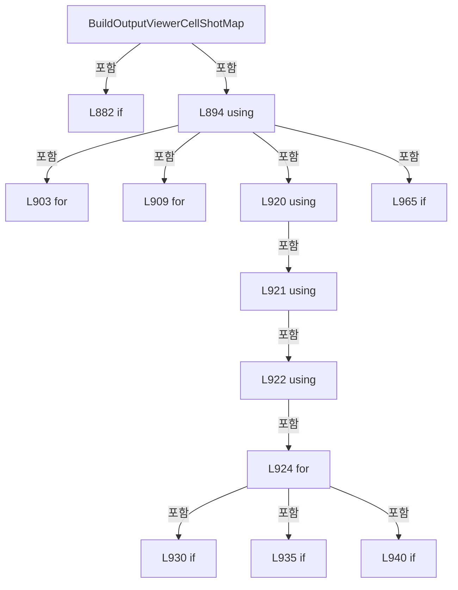

변경 전 점검: 입력/반환 타입, 위 호출자, 예외/취소 경로, 공유 상태와 저장·전송 소비자를 함께 확인합니다. 값의 단위나 물리 방향을 이름만으로 확정하지 않습니다.

### MethodDeclaration `AddOutputViewerShotCircle` · L989–998

[Drilling.UI/Menu/Menus/CMenuCorrection.cs:989–998](https://github.com/kjuws10-rgb/A3Drilling/blob/dfa5920e6301d9ec4b0eab1452ae59521aafc986/Drilling.UI/Menu/Menus/CMenuCorrection.cs#L989-L998)

| 항목 | 실제 추출 값 |
| --- | --- |
| 서명 | void Drilling.UI.Menu.Menus.CMenuCorrection.AddOutputViewerShotCircle(StreamGeometryContext, double, double, double) |
| 접근/수식자 | Private / private, static |
| 반환/값 타입 | void |
| 소속 타입 | NamedType:Drilling.UI.Menu.Menus.CMenuCorrection |

입력 계약:

| 이름 | 타입 | 전달 | 선택/기본값 |
| --- | --- | --- | --- |
| context | StreamGeometryContext | None | False /  |
| centerX | double | None | False /  |
| centerY | double | None | False /  |
| radius | double | None | False /  |

현재 부분 분석에서 직접 연결된 호출자는 없습니다. XAML/이벤트/인터페이스·델리게이트·외부 진입을 추가 확인해야 하며, 미사용으로 판정한 것이 아닙니다.

호출하는 대상과 해석 범위:

| 원본 행 | 표현식 | 분석 상태 | 대상/소스 위치 |
| --- | --- | --- | --- |
| 993 | context.BeginFigure | unresolved | None |
| 993 | new Point | unresolved | None |
| 994 | context.BezierTo | unresolved | None |
| 994 | new Point | unresolved | None |
| 994 | new Point | unresolved | None |
| 994 | new Point | unresolved | None |
| 995 | context.BezierTo | unresolved | None |
| 995 | new Point | unresolved | None |
| 995 | new Point | unresolved | None |
| 995 | new Point | unresolved | None |
| 996 | context.BezierTo | unresolved | None |
| 996 | new Point | unresolved | None |
| 996 | new Point | unresolved | None |
| 996 | new Point | unresolved | None |
| 997 | context.BezierTo | unresolved | None |
| 997 | new Point | unresolved | None |
| 997 | new Point | unresolved | None |
| 997 | new Point | unresolved | None |

본문의 실제 연산·분기·예외·반환 순서(원문 위치 순):

| 원본 행 | 종류 | 주석 해설 |
| --- | --- | --- |
| 991 | local-declaration | 지역 변수를 선언합니다: const double bezierCircle = 0.5522847498307936; |
| 991 | variable-initializer | 변수의 초기값을 지정합니다: bezierCircle = 0.5522847498307936 |
| 992 | local-declaration | 지역 변수를 선언합니다: var control = radius * bezierCircle; |
| 992 | variable-initializer | 변수의 초기값을 지정합니다: control = radius * bezierCircle |
| 993 | call | 함수·델리게이트 또는 객체 생성자를 호출합니다: context.BeginFigure(new Point(centerX + radius, centerY), true, true) |
| 993 | call | 함수·델리게이트 또는 객체 생성자를 호출합니다: new Point(centerX + radius, centerY) |
| 994 | call | 함수·델리게이트 또는 객체 생성자를 호출합니다: context.BezierTo(new Point(centerX + radius, centerY + control), new Point(centerX + control, centerY + radius), new Point(centerX, centerY + radius), true, false) |
| 994 | call | 함수·델리게이트 또는 객체 생성자를 호출합니다: new Point(centerX + radius, centerY + control) |
| 994 | call | 함수·델리게이트 또는 객체 생성자를 호출합니다: new Point(centerX + control, centerY + radius) |
| 994 | call | 함수·델리게이트 또는 객체 생성자를 호출합니다: new Point(centerX, centerY + radius) |
| 995 | call | 함수·델리게이트 또는 객체 생성자를 호출합니다: context.BezierTo(new Point(centerX - control, centerY + radius), new Point(centerX - radius, centerY + control), new Point(centerX - radius, centerY), true, false) |
| 995 | call | 함수·델리게이트 또는 객체 생성자를 호출합니다: new Point(centerX - control, centerY + radius) |
| 995 | call | 함수·델리게이트 또는 객체 생성자를 호출합니다: new Point(centerX - radius, centerY + control) |
| 995 | call | 함수·델리게이트 또는 객체 생성자를 호출합니다: new Point(centerX - radius, centerY) |
| 996 | call | 함수·델리게이트 또는 객체 생성자를 호출합니다: context.BezierTo(new Point(centerX - radius, centerY - control), new Point(centerX - control, centerY - radius), new Point(centerX, centerY - radius), true, false) |
| 996 | call | 함수·델리게이트 또는 객체 생성자를 호출합니다: new Point(centerX - radius, centerY - control) |
| 996 | call | 함수·델리게이트 또는 객체 생성자를 호출합니다: new Point(centerX - control, centerY - radius) |
| 996 | call | 함수·델리게이트 또는 객체 생성자를 호출합니다: new Point(centerX, centerY - radius) |
| 997 | call | 함수·델리게이트 또는 객체 생성자를 호출합니다: context.BezierTo(new Point(centerX + control, centerY - radius), new Point(centerX + radius, centerY - control), new Point(centerX + radius, centerY), true, false) |
| 997 | call | 함수·델리게이트 또는 객체 생성자를 호출합니다: new Point(centerX + control, centerY - radius) |
| 997 | call | 함수·델리게이트 또는 객체 생성자를 호출합니다: new Point(centerX + radius, centerY - control) |
| 997 | call | 함수·델리게이트 또는 객체 생성자를 호출합니다: new Point(centerX + radius, centerY) |

변경 전 점검: 입력/반환 타입, 위 호출자, 예외/취소 경로, 공유 상태와 저장·전송 소비자를 함께 확인합니다. 값의 단위나 물리 방향을 이름만으로 확정하지 않습니다.

### MethodDeclaration `AddOutputViewerMaskCross` · L1000–1006

[Drilling.UI/Menu/Menus/CMenuCorrection.cs:1000–1006](https://github.com/kjuws10-rgb/A3Drilling/blob/dfa5920e6301d9ec4b0eab1452ae59521aafc986/Drilling.UI/Menu/Menus/CMenuCorrection.cs#L1000-L1006)

| 항목 | 실제 추출 값 |
| --- | --- |
| 서명 | void Drilling.UI.Menu.Menus.CMenuCorrection.AddOutputViewerMaskCross(StreamGeometryContext, double, double, double) |
| 접근/수식자 | Private / private, static |
| 반환/값 타입 | void |
| 소속 타입 | NamedType:Drilling.UI.Menu.Menus.CMenuCorrection |

입력 계약:

| 이름 | 타입 | 전달 | 선택/기본값 |
| --- | --- | --- | --- |
| context | StreamGeometryContext | None | False /  |
| centerX | double | None | False /  |
| centerY | double | None | False /  |
| radius | double | None | False /  |

현재 부분 분석에서 직접 연결된 호출자는 없습니다. XAML/이벤트/인터페이스·델리게이트·외부 진입을 추가 확인해야 하며, 미사용으로 판정한 것이 아닙니다.

호출하는 대상과 해석 범위:

| 원본 행 | 표현식 | 분석 상태 | 대상/소스 위치 |
| --- | --- | --- | --- |
| 1002 | context.BeginFigure | unresolved | None |
| 1002 | new Point | unresolved | None |
| 1003 | context.LineTo | unresolved | None |
| 1003 | new Point | unresolved | None |
| 1004 | context.BeginFigure | unresolved | None |
| 1004 | new Point | unresolved | None |
| 1005 | context.LineTo | unresolved | None |
| 1005 | new Point | unresolved | None |

본문의 실제 연산·분기·예외·반환 순서(원문 위치 순):

| 원본 행 | 종류 | 주석 해설 |
| --- | --- | --- |
| 1002 | call | 함수·델리게이트 또는 객체 생성자를 호출합니다: context.BeginFigure(new Point(centerX - radius, centerY - radius), false, false) |
| 1002 | call | 함수·델리게이트 또는 객체 생성자를 호출합니다: new Point(centerX - radius, centerY - radius) |
| 1003 | call | 함수·델리게이트 또는 객체 생성자를 호출합니다: context.LineTo(new Point(centerX + radius, centerY + radius), true, false) |
| 1003 | call | 함수·델리게이트 또는 객체 생성자를 호출합니다: new Point(centerX + radius, centerY + radius) |
| 1004 | call | 함수·델리게이트 또는 객체 생성자를 호출합니다: context.BeginFigure(new Point(centerX - radius, centerY + radius), false, false) |
| 1004 | call | 함수·델리게이트 또는 객체 생성자를 호출합니다: new Point(centerX - radius, centerY + radius) |
| 1005 | call | 함수·델리게이트 또는 객체 생성자를 호출합니다: context.LineTo(new Point(centerX + radius, centerY - radius), true, false) |
| 1005 | call | 함수·델리게이트 또는 객체 생성자를 호출합니다: new Point(centerX + radius, centerY - radius) |

변경 전 점검: 입력/반환 타입, 위 호출자, 예외/취소 경로, 공유 상태와 저장·전송 소비자를 함께 확인합니다. 값의 단위나 물리 방향을 이름만으로 확정하지 않습니다.

### MethodDeclaration `AddOutputViewerChessDiamond` · L1008–1014

[Drilling.UI/Menu/Menus/CMenuCorrection.cs:1008–1014](https://github.com/kjuws10-rgb/A3Drilling/blob/dfa5920e6301d9ec4b0eab1452ae59521aafc986/Drilling.UI/Menu/Menus/CMenuCorrection.cs#L1008-L1014)

| 항목 | 실제 추출 값 |
| --- | --- |
| 서명 | void Drilling.UI.Menu.Menus.CMenuCorrection.AddOutputViewerChessDiamond(StreamGeometryContext, double, double, double) |
| 접근/수식자 | Private / private, static |
| 반환/값 타입 | void |
| 소속 타입 | NamedType:Drilling.UI.Menu.Menus.CMenuCorrection |

입력 계약:

| 이름 | 타입 | 전달 | 선택/기본값 |
| --- | --- | --- | --- |
| context | StreamGeometryContext | None | False /  |
| centerX | double | None | False /  |
| centerY | double | None | False /  |
| radius | double | None | False /  |

현재 부분 분석에서 직접 연결된 호출자는 없습니다. XAML/이벤트/인터페이스·델리게이트·외부 진입을 추가 확인해야 하며, 미사용으로 판정한 것이 아닙니다.

호출하는 대상과 해석 범위:

| 원본 행 | 표현식 | 분석 상태 | 대상/소스 위치 |
| --- | --- | --- | --- |
| 1010 | context.BeginFigure | unresolved | None |
| 1010 | new Point | unresolved | None |
| 1011 | context.LineTo | unresolved | None |
| 1011 | new Point | unresolved | None |
| 1012 | context.LineTo | unresolved | None |
| 1012 | new Point | unresolved | None |
| 1013 | context.LineTo | unresolved | None |
| 1013 | new Point | unresolved | None |

본문의 실제 연산·분기·예외·반환 순서(원문 위치 순):

| 원본 행 | 종류 | 주석 해설 |
| --- | --- | --- |
| 1010 | call | 함수·델리게이트 또는 객체 생성자를 호출합니다: context.BeginFigure(new Point(centerX, centerY - radius), true, true) |
| 1010 | call | 함수·델리게이트 또는 객체 생성자를 호출합니다: new Point(centerX, centerY - radius) |
| 1011 | call | 함수·델리게이트 또는 객체 생성자를 호출합니다: context.LineTo(new Point(centerX + radius, centerY), true, false) |
| 1011 | call | 함수·델리게이트 또는 객체 생성자를 호출합니다: new Point(centerX + radius, centerY) |
| 1012 | call | 함수·델리게이트 또는 객체 생성자를 호출합니다: context.LineTo(new Point(centerX, centerY + radius), true, false) |
| 1012 | call | 함수·델리게이트 또는 객체 생성자를 호출합니다: new Point(centerX, centerY + radius) |
| 1013 | call | 함수·델리게이트 또는 객체 생성자를 호출합니다: context.LineTo(new Point(centerX - radius, centerY), true, false) |
| 1013 | call | 함수·델리게이트 또는 객체 생성자를 호출합니다: new Point(centerX - radius, centerY) |

변경 전 점검: 입력/반환 타입, 위 호출자, 예외/취소 경로, 공유 상태와 저장·전송 소비자를 함께 확인합니다. 값의 단위나 물리 방향을 이름만으로 확정하지 않습니다.

### MethodDeclaration `ApplyReviewOffsetsToOutputViewerParameters` · L1016–1019

[Drilling.UI/Menu/Menus/CMenuCorrection.cs:1016–1019](https://github.com/kjuws10-rgb/A3Drilling/blob/dfa5920e6301d9ec4b0eab1452ae59521aafc986/Drilling.UI/Menu/Menus/CMenuCorrection.cs#L1016-L1019)

| 항목 | 실제 추출 값 |
| --- | --- |
| 서명 | void Drilling.UI.Menu.Menus.CMenuCorrection.ApplyReviewOffsetsToOutputViewerParameters(System.Collections.Generic.IDictionary<string, string>, Drilling.Common.Review.ST_REVIEW_OFFSET_FILE_DATA) |
| 접근/수식자 | Internal / internal, static |
| 반환/값 타입 | void |
| 소속 타입 | NamedType:Drilling.UI.Menu.Menus.CMenuCorrection |

입력 계약:

| 이름 | 타입 | 전달 | 선택/기본값 |
| --- | --- | --- | --- |
| parameters | System.Collections.Generic.IDictionary<string, string> | None | False /  |
| reviewOffsetFile | Drilling.Common.Review.ST_REVIEW_OFFSET_FILE_DATA | None | False /  |

정적 호출자로 확인된 위치:

| 호출 파일/행 | 호출 표현식 | 런타임 분기 가능 |
| --- | --- | --- |
| [Drilling.UI/Menu/Menus/CMenuCorrection.cs:639–639](https://github.com/kjuws10-rgb/A3Drilling/blob/dfa5920e6301d9ec4b0eab1452ae59521aafc986/Drilling.UI/Menu/Menus/CMenuCorrection.cs#L639-L639) | ApplyReviewOffsetsToOutputViewerParameters | False |
| [Drilling.UI/Menu/Menus/CMenuCorrection.cs:7628–7628](https://github.com/kjuws10-rgb/A3Drilling/blob/dfa5920e6301d9ec4b0eab1452ae59521aafc986/Drilling.UI/Menu/Menus/CMenuCorrection.cs#L7628-L7628) | CMenuCorrection.ApplyReviewOffsetsToOutputViewerParameters | False |
| [Drilling.UI/Menu/Menus/CMenuMonitor.cs:3111–3111](https://github.com/kjuws10-rgb/A3Drilling/blob/dfa5920e6301d9ec4b0eab1452ae59521aafc986/Drilling.UI/Menu/Menus/CMenuMonitor.cs#L3111-L3111) | CMenuCorrection.ApplyReviewOffsetsToOutputViewerParameters | False |

호출하는 대상과 해석 범위:

| 원본 행 | 표현식 | 분석 상태 | 대상/소스 위치 |
| --- | --- | --- | --- |
| 1018 | CReviewOffsetData.ApplyToParameters | resolved | void Drilling.Common.Recipe.CReviewOffsetData.ApplyToParameters(System.Collections.Generic.IDictionary<string, string>, Drilling.Common.Review.ST_REVIEW_OFFSET_FILE_DATA) · Drilling.Common/Recipe/CShotCoordinatePlanBuilder.cs:1167 |

본문의 실제 연산·분기·예외·반환 순서(원문 위치 순):

| 원본 행 | 종류 | 주석 해설 |
| --- | --- | --- |
| 1018 | call | 함수·델리게이트 또는 객체 생성자를 호출합니다: CReviewOffsetData.ApplyToParameters(parameters, reviewOffsetFile) |

변경 전 점검: 입력/반환 타입, 위 호출자, 예외/취소 경로, 공유 상태와 저장·전송 소비자를 함께 확인합니다. 값의 단위나 물리 방향을 이름만으로 확정하지 않습니다.

### MethodDeclaration `BuildOutputViewerGlassPreview` · L1021–1151

[Drilling.UI/Menu/Menus/CMenuCorrection.cs:1021–1151](https://github.com/kjuws10-rgb/A3Drilling/blob/dfa5920e6301d9ec4b0eab1452ae59521aafc986/Drilling.UI/Menu/Menus/CMenuCorrection.cs#L1021-L1151)

| 항목 | 실제 추출 값 |
| --- | --- |
| 서명 | Drilling.UI.Menu.Menus.ST_CORRECTION_OFFSET_VIEWER_PREVIEW Drilling.UI.Menu.Menus.CMenuCorrection.BuildOutputViewerGlassPreview(System.Collections.Generic.IReadOnlyDictionary<string, string>, int, int) |
| 접근/수식자 | Internal / internal, static |
| 반환/값 타입 | Drilling.UI.Menu.Menus.ST_CORRECTION_OFFSET_VIEWER_PREVIEW |
| 소속 타입 | NamedType:Drilling.UI.Menu.Menus.CMenuCorrection |

입력 계약:

| 이름 | 타입 | 전달 | 선택/기본값 |
| --- | --- | --- | --- |
| parameters | System.Collections.Generic.IReadOnlyDictionary<string, string> | None | False /  |
| cellCount | int | None | False /  |
| selectedCellNo | int | None | False /  |

정적 호출자로 확인된 위치:

| 호출 파일/행 | 호출 표현식 | 런타임 분기 가능 |
| --- | --- | --- |
| [Drilling.UI/Menu/Menus/CMenuCorrection.ReviewData.Offset.cs:232–232](https://github.com/kjuws10-rgb/A3Drilling/blob/dfa5920e6301d9ec4b0eab1452ae59521aafc986/Drilling.UI/Menu/Menus/CMenuCorrection.ReviewData.Offset.cs#L232-L232) | BuildOutputViewerGlassPreview | False |
| [Drilling.UI/Menu/Menus/CMenuCorrection.cs:654–654](https://github.com/kjuws10-rgb/A3Drilling/blob/dfa5920e6301d9ec4b0eab1452ae59521aafc986/Drilling.UI/Menu/Menus/CMenuCorrection.cs#L654-L654) | BuildOutputViewerGlassPreview | False |
| [Drilling.UI/Menu/Menus/CMenuCorrection.cs:2795–2795](https://github.com/kjuws10-rgb/A3Drilling/blob/dfa5920e6301d9ec4b0eab1452ae59521aafc986/Drilling.UI/Menu/Menus/CMenuCorrection.cs#L2795-L2795) | BuildOutputViewerGlassPreview | False |
| [Drilling.UI/Menu/Menus/CMenuCorrection.cs:4171–4171](https://github.com/kjuws10-rgb/A3Drilling/blob/dfa5920e6301d9ec4b0eab1452ae59521aafc986/Drilling.UI/Menu/Menus/CMenuCorrection.cs#L4171-L4171) | BuildOutputViewerGlassPreview | False |
| [Drilling.UI/Menu/Menus/CMenuMonitor.cs:3274–3277](https://github.com/kjuws10-rgb/A3Drilling/blob/dfa5920e6301d9ec4b0eab1452ae59521aafc986/Drilling.UI/Menu/Menus/CMenuMonitor.cs#L3274-L3277) | CMenuCorrection.BuildOutputViewerGlassPreview | False |

호출하는 대상과 해석 범위:

| 원본 행 | 표현식 | 분석 상태 | 대상/소스 위치 |
| --- | --- | --- | --- |
| 1029 | ReadOutputViewerDouble | resolved | double Drilling.UI.Menu.Menus.CMenuCorrection.ReadOutputViewerDouble(System.Collections.Generic.IReadOnlyDictionary<string, string>, double, params string[]) · Drilling.UI/Menu/Menus/CMenuCorrection.cs:1254 |
| 1030 | ReadOutputViewerDouble | resolved | double Drilling.UI.Menu.Menus.CMenuCorrection.ReadOutputViewerDouble(System.Collections.Generic.IReadOnlyDictionary<string, string>, double, params string[]) · Drilling.UI/Menu/Menus/CMenuCorrection.cs:1254 |
| 1031 | ReadOutputViewerDouble | resolved | double Drilling.UI.Menu.Menus.CMenuCorrection.ReadOutputViewerDouble(System.Collections.Generic.IReadOnlyDictionary<string, string>, double, params string[]) · Drilling.UI/Menu/Menus/CMenuCorrection.cs:1254 |
| 1032 | ReadOutputViewerDouble | resolved | double Drilling.UI.Menu.Menus.CMenuCorrection.ReadOutputViewerDouble(System.Collections.Generic.IReadOnlyDictionary<string, string>, double, params string[]) · Drilling.UI/Menu/Menus/CMenuCorrection.cs:1254 |
| 1033 | ReadOutputViewerDouble | resolved | double Drilling.UI.Menu.Menus.CMenuCorrection.ReadOutputViewerDouble(System.Collections.Generic.IReadOnlyDictionary<string, string>, double, params string[]) · Drilling.UI/Menu/Menus/CMenuCorrection.cs:1254 |
| 1034 | ReadOutputViewerInt | resolved | int Drilling.UI.Menu.Menus.CMenuCorrection.ReadOutputViewerInt(System.Collections.Generic.IReadOnlyDictionary<string, string>, int, params string[]) · Drilling.UI/Menu/Menus/CMenuCorrection.cs:1231 |
| 1035 | CRecipeModelPixelCountReader.ReadModelTypeCount | resolved | int Drilling.Common.Recipe.CRecipeModelPixelCountReader.ReadModelTypeCount(System.Collections.Generic.IReadOnlyDictionary<string, string>) · Drilling.Common/Recipe/CCellPatternCalculator.cs:428 |
| 1038 | new ST_CORRECTION_OFFSET_VIEWER_PREVIEW | resolved | Drilling.UI.Menu.Menus.ST_CORRECTION_OFFSET_VIEWER_PREVIEW.ST_CORRECTION_OFFSET_VIEWER_PREVIEW(ImageSource?, System.Collections.Generic.IReadOnlyList<Drilling.UI.Menu.Menus.ST_CELL_PREVIEW_LABEL>, string) · Drilling.UI/Menu/Menus/CMenuCorrection.cs:6941 |
| 1046 | CCellPreviewDrawing.CreateDistortionKeyPreviews | resolved | System.Collections.Generic.IReadOnlyList<Drilling.UI.Menu.Menus.ST_DISTORTION_KEY_PREVIEW> Drilling.UI.Menu.Menus.CCellPreviewDrawing.CreateDistortionKeyPreviews(double, double, double, double, System.Func<string, double?>) · Drilling.UI/Menu/Menus/CCellPreviewDrawing.cs:61 |
| 1047 | Math.Min | resolved | double System.Math.Min(double, double) |
| 1052 | new ST_GLASS_PREVIEW_FRAME | resolved | Drilling.UI.Menu.Menus.ST_GLASS_PREVIEW_FRAME.ST_GLASS_PREVIEW_FRAME(double, double, double, double) · Drilling.UI/Menu/Menus/CMenuMain.cs:3474 |
| 1053 | new Rect | unresolved | None |
| 1054 | new DrawingGroup | unresolved | None |
| 1055 | new List<ST_CELL_PREVIEW_LABEL> | resolved | System.Collections.Generic.List<Drilling.UI.Menu.Menus.ST_CELL_PREVIEW_LABEL>.List() |
| 1056 | new List<(StreamGeometry Boundary, Pen Pen)> | resolved | System.Collections.Generic.List<(StreamGeometry Boundary, Pen Pen)>.List() |
| 1059 | drawing.Open | unresolved | None |
| 1061 | context.DrawRectangle | unresolved | None |
| 1061 | new SolidColorBrush | unresolved | None |
| 1061 | Color.FromArgb | unresolved | None |
| 1061 | new Rect | unresolved | None |
| 1062 | context.PushClip | unresolved | None |
| 1062 | new RectangleGeometry | unresolved | None |
| 1065 | ReadOutputViewerDouble | resolved | double Drilling.UI.Menu.Menus.CMenuCorrection.ReadOutputViewerDouble(System.Collections.Generic.IReadOnlyDictionary<string, string>, double, params string[]) · Drilling.UI/Menu/Menus/CMenuCorrection.cs:1254 |
| 1066 | ReadOutputViewerDouble | resolved | double Drilling.UI.Menu.Menus.CMenuCorrection.ReadOutputViewerDouble(System.Collections.Generic.IReadOnlyDictionary<string, string>, double, params string[]) · Drilling.UI/Menu/Menus/CMenuCorrection.cs:1254 |
| 1067 | ReadOutputViewerDouble | resolved | double Drilling.UI.Menu.Menus.CMenuCorrection.ReadOutputViewerDouble(System.Collections.Generic.IReadOnlyDictionary<string, string>, double, params string[]) · Drilling.UI/Menu/Menus/CMenuCorrection.cs:1254 |
| 1068 | CRecipeModelPixelCountReader.ReadCellModelType | resolved | int Drilling.Common.Recipe.CRecipeModelPixelCountReader.ReadCellModelType(System.Collections.Generic.IReadOnlyDictionary<string, string>, int, int) · Drilling.Common/Recipe/CCellPatternCalculator.cs:433 |
| 1069 | CRecipeModelPixelCountReader.ReadPatternForModel | resolved | Drilling.Common.Recipe.ST_RECIPE_MODEL_PATTERN Drilling.Common.Recipe.CRecipeModelPixelCountReader.ReadPatternForModel(System.Collections.Generic.IReadOnlyDictionary<string, string>, int) · Drilling.Common/Recipe/CCellPatternCalculator.cs:455 |
| 1070 | CCellPatternCalculator.Calculate | resolved | Drilling.Common.Recipe.ST_CELL_PATTERN_LAYOUT Drilling.Common.Recipe.CCellPatternCalculator.Calculate(Drilling.Common.Recipe.ST_CELL_PATTERN_DEFINITION, bool) · Drilling.Common/Recipe/CCellPatternCalculator.cs:66 |
| 1070 | new ST_CELL_PATTERN_DEFINITION | resolved | Drilling.Common.Recipe.ST_CELL_PATTERN_DEFINITION.ST_CELL_PATTERN_DEFINITION(int, double, double, double, double, int, int, int, int, double, double) · Drilling.Common/Recipe/CCellPatternCalculator.cs:277 |
| 1077 | BuildOutputViewerCellBoundaryGeometry | resolved | StreamGeometry? Drilling.UI.Menu.Menus.CMenuCorrection.BuildOutputViewerCellBoundaryGeometry(double, double, double, double, int, int, double, double, double) · Drilling.UI/Menu/Menus/CMenuCorrection.cs:1153 |
| 1085 | CMenuMain.CreateHeadBrush | resolved | Brush Drilling.UI.Menu.Menus.CMenuMain.CreateHeadBrush(int, byte) · Drilling.UI/Menu/Menus/CMenuMain.cs:2246 |
| 1087 | new SolidColorBrush | unresolved | None |
| 1087 | Color.FromRgb | unresolved | None |
| 1088 | CMenuMain.CreateHeadBrush | resolved | Brush Drilling.UI.Menu.Menus.CMenuMain.CreateHeadBrush(int, byte) · Drilling.UI/Menu/Menus/CMenuMain.cs:2246 |
| 1091 | boundaryBrush.Freeze | unresolved | None |
| 1094 | new Pen | unresolved | None |
| 1095 | boundaryPen.Freeze | unresolved | None |
| 1096 | context.DrawGeometry | unresolved | None |
| 1097 | drawnCellBoundaries.Add | candidate | OverloadResolutionFailure |
| 1098 | CCellPreviewDrawing.CreateCellLabel | candidate | OverloadResolutionFailure |
| 1101 | cellLabels.Add | resolved | void System.Collections.Generic.List<Drilling.UI.Menu.Menus.ST_CELL_PREVIEW_LABEL>.Add(Drilling.UI.Menu.Menus.ST_CELL_PREVIEW_LABEL) |
| 1107 | context.DrawGeometry | unresolved | None |
| 1110 | context.Pop | unresolved | None |
| 1111 | CCellPreviewDrawing.DrawAlignKeys | candidate | OverloadResolutionFailure |
| 1112 | CCellPreviewDrawing.DrawDistortionKeys | candidate | OverloadResolutionFailure |
| 1115 | drawing.Freeze | unresolved | None |
| 1117 | Math.Max | resolved | double System.Math.Max(double, double) |
| 1118 | new Rect | unresolved | None |
| 1119 | new Rect | unresolved | None |
| 1120 | cellLabels.Select(label => label with { CanvasCenterX = label.CanvasCenterX - frameLeft + paddingX, CanvasCenterY = label.CanvasCenterY - frameTop + paddingY, Width = Math.Max(18.0, label.CellNo.ToString(CultureInfo.InvariantCulture).Length * 6.2 + 8.0), DesignWidth = cellRect.Width, DesignHeight = cellRect.Height }).ToArray | resolved | Drilling.UI.Menu.Menus.ST_CELL_PREVIEW_LABEL[] System.Collections.Generic.IEnumerable<Drilling.UI.Menu.Menus.ST_CELL_PREVIEW_LABEL>.ToArray<Drilling.UI.Menu.Menus.ST_CELL_PREVIEW_LABEL>() |
| 1120 | cellLabels.Select | resolved | System.Collections.Generic.IEnumerable<Drilling.UI.Menu.Menus.ST_CELL_PREVIEW_LABEL> System.Collections.Generic.IEnumerable<Drilling.UI.Menu.Menus.ST_CELL_PREVIEW_LABEL>.Select<Drilling.UI.Menu.Menus.ST_CELL_PREVIEW_LABEL, Drilling.UI.Menu.Menus.ST_CELL_PREVIEW_LABEL>(System.Func<Drilling.UI.Menu.Menus.ST_CELL_PREVIEW_LABEL, Drilling.UI.Menu.Menus.ST_CELL_PREVIEW_LABEL>) |
| 1124 | Math.Max | resolved | double System.Math.Max(double, double) |
| 1124 | label.CellNo.ToString | resolved | string int.ToString(System.IFormatProvider?) |
| 1128 | new DrawingGroup | unresolved | None |
| 1129 | cellDrawing.Open | unresolved | None |
| 1131 | cellContext.DrawRectangle | unresolved | None |
| 1131 | new SolidColorBrush | unresolved | None |
| 1131 | Color.FromArgb | unresolved | None |
| 1132 | cellContext.DrawRectangle | unresolved | None |
| 1132 | new Pen | unresolved | None |
| 1132 | new SolidColorBrush | unresolved | None |
| 1132 | Color.FromRgb | unresolved | None |
| 1133 | cellContext.PushClip | unresolved | None |
| 1133 | new RectangleGeometry | unresolved | None |
| 1134 | cellContext.PushTransform | unresolved | None |
| 1134 | new TranslateTransform | unresolved | None |
| 1135 | cellContext.DrawDrawing | unresolved | None |
| 1136 | cellContext.Pop | unresolved | None |
| 1137 | cellContext.Pop | unresolved | None |
| 1138 | DrawOutputViewerPreviewAxisIndicator | candidate | OverloadResolutionFailure |
| 1141 | cellDrawing.Freeze | unresolved | None |
| 1142 | new DrawingImage | unresolved | None |
| 1143 | cellImage.Freeze | unresolved | None |
| 1144 | FormatOutputViewerPreviewDouble | resolved | string Drilling.UI.Menu.Menus.CMenuCorrection.FormatOutputViewerPreviewDouble(double) · Drilling.UI/Menu/Menus/CMenuCorrection.cs:1277 |
| 1144 | FormatOutputViewerPreviewDouble | resolved | string Drilling.UI.Menu.Menus.CMenuCorrection.FormatOutputViewerPreviewDouble(double) · Drilling.UI/Menu/Menus/CMenuCorrection.cs:1277 |
| 1150 | new ST_CORRECTION_OFFSET_VIEWER_PREVIEW | candidate | OverloadResolutionFailure |

본문의 실제 연산·분기·예외·반환 순서(원문 위치 순):

| 원본 행 | 종류 | 주석 해설 |
| --- | --- | --- |
| 1023 | local-declaration | 지역 변수를 선언합니다: const double canvasWidth = 860.0; |
| 1023 | variable-initializer | 변수의 초기값을 지정합니다: canvasWidth = 860.0 |
| 1024 | local-declaration | 지역 변수를 선언합니다: const double canvasHeight = 430.0; |
| 1024 | variable-initializer | 변수의 초기값을 지정합니다: canvasHeight = 430.0 |
| 1025 | local-declaration | 지역 변수를 선언합니다: const double maxLeft = 44.0; |
| 1025 | variable-initializer | 변수의 초기값을 지정합니다: maxLeft = 44.0 |
| 1026 | local-declaration | 지역 변수를 선언합니다: const double maxTop = 50.0; |
| 1026 | variable-initializer | 변수의 초기값을 지정합니다: maxTop = 50.0 |
| 1027 | local-declaration | 지역 변수를 선언합니다: const double maxWidth = 772.0; |
| 1027 | variable-initializer | 변수의 초기값을 지정합니다: maxWidth = 772.0 |
| 1028 | local-declaration | 지역 변수를 선언합니다: const double maxHeight = 340.0; |
| 1028 | variable-initializer | 변수의 초기값을 지정합니다: maxHeight = 340.0 |
| 1029 | call | 함수·델리게이트 또는 객체 생성자를 호출합니다: ReadOutputViewerDouble(parameters, 500.0, "GLASS_SIZE_X") |
| 1029 | local-declaration | 지역 변수를 선언합니다: var glassWidth = ReadOutputViewerDouble(parameters, 500.0, "GLASS_SIZE_X"); |
| 1029 | variable-initializer | 변수의 초기값을 지정합니다: glassWidth = ReadOutputViewerDouble(parameters, 500.0, "GLASS_SIZE_X") |
| 1030 | call | 함수·델리게이트 또는 객체 생성자를 호출합니다: ReadOutputViewerDouble(parameters, 300.0, "GLASS_SIZE_Y") |
| 1030 | local-declaration | 지역 변수를 선언합니다: var glassHeight = ReadOutputViewerDouble(parameters, 300.0, "GLASS_SIZE_Y"); |
| 1030 | variable-initializer | 변수의 초기값을 지정합니다: glassHeight = ReadOutputViewerDouble(parameters, 300.0, "GLASS_SIZE_Y") |
| 1031 | call | 함수·델리게이트 또는 객체 생성자를 호출합니다: ReadOutputViewerDouble(parameters, 55.0, "AK_MARGIN_X") |
| 1031 | local-declaration | 지역 변수를 선언합니다: var akMarginX = ReadOutputViewerDouble(parameters, 55.0, "AK_MARGIN_X"); |
| 1031 | variable-initializer | 변수의 초기값을 지정합니다: akMarginX = ReadOutputViewerDouble(parameters, 55.0, "AK_MARGIN_X") |
| 1032 | call | 함수·델리게이트 또는 객체 생성자를 호출합니다: ReadOutputViewerDouble(parameters, 45.0, "AK_MARGIN_Y") |
| 1032 | local-declaration | 지역 변수를 선언합니다: var akMarginY = ReadOutputViewerDouble(parameters, 45.0, "AK_MARGIN_Y"); |
| 1032 | variable-initializer | 변수의 초기값을 지정합니다: akMarginY = ReadOutputViewerDouble(parameters, 45.0, "AK_MARGIN_Y") |
| 1033 | call | 함수·델리게이트 또는 객체 생성자를 호출합니다: ReadOutputViewerDouble(parameters, 0.09, "PIXEL_SIZE") |
| 1033 | local-declaration | 지역 변수를 선언합니다: var pixelSize = ReadOutputViewerDouble(parameters, 0.09, "PIXEL_SIZE"); |
| 1033 | variable-initializer | 변수의 초기값을 지정합니다: pixelSize = ReadOutputViewerDouble(parameters, 0.09, "PIXEL_SIZE") |
| 1034 | call | 함수·델리게이트 또는 객체 생성자를 호출합니다: ReadOutputViewerInt(parameters, 1, "SPLITED_BEAM_COUNT") |
| 1034 | local-declaration | 지역 변수를 선언합니다: var splitBeamCount = ReadOutputViewerInt(parameters, 1, "SPLITED_BEAM_COUNT"); |
| 1034 | variable-initializer | 변수의 초기값을 지정합니다: splitBeamCount = ReadOutputViewerInt(parameters, 1, "SPLITED_BEAM_COUNT") |
| 1035 | call | 함수·델리게이트 또는 객체 생성자를 호출합니다: CRecipeModelPixelCountReader.ReadModelTypeCount(parameters) |
| 1035 | local-declaration | 지역 변수를 선언합니다: var modelTypeCount = CRecipeModelPixelCountReader.ReadModelTypeCount(parameters); |
| 1035 | variable-initializer | 변수의 초기값을 지정합니다: modelTypeCount = CRecipeModelPixelCountReader.ReadModelTypeCount(parameters) |
| 1036 | if | 조건에 따라 분기합니다: if (glassWidth <= 0.0 &#124;&#124; glassHeight <= 0.0) |
| 1038 | call | 함수·델리게이트 또는 객체 생성자를 호출합니다: new ST_CORRECTION_OFFSET_VIEWER_PREVIEW(null, [], "Glass size is not valid.") |
| 1038 | return | 호출자에게 값 또는 제어를 반환합니다: return new ST_CORRECTION_OFFSET_VIEWER_PREVIEW(null, [], "Glass size is not valid."); |
| 1046 | call | 함수·델리게이트 또는 객체 생성자를 호출합니다: CCellPreviewDrawing.CreateDistortionKeyPreviews(glassWidth, glassHeight, akMarginX, akMarginY, ReadDistortionValue) |
| 1046 | local-declaration | 지역 변수를 선언합니다: var distortionKeys = CCellPreviewDrawing.CreateDistortionKeyPreviews(glassWidth, glassHeight, akMarginX, akMarginY, ReadDistortionValue); |
| 1046 | variable-initializer | 변수의 초기값을 지정합니다: distortionKeys = CCellPreviewDrawing.CreateDistortionKeyPreviews(glassWidth, glassHeight, akMarginX, akMarginY, ReadDistortionValue) |
| 1047 | call | 함수·델리게이트 또는 객체 생성자를 호출합니다: Math.Min(maxWidth / glassWidth, maxHeight / glassHeight) |
| 1047 | local-declaration | 지역 변수를 선언합니다: var scale = Math.Min(maxWidth / glassWidth, maxHeight / glassHeight); |
| 1047 | variable-initializer | 변수의 초기값을 지정합니다: scale = Math.Min(maxWidth / glassWidth, maxHeight / glassHeight) |
| 1048 | local-declaration | 지역 변수를 선언합니다: var frameWidth = glassWidth * scale; |
| 1048 | variable-initializer | 변수의 초기값을 지정합니다: frameWidth = glassWidth * scale |
| 1049 | local-declaration | 지역 변수를 선언합니다: var frameHeight = glassHeight * scale; |
| 1049 | variable-initializer | 변수의 초기값을 지정합니다: frameHeight = glassHeight * scale |
| 1050 | local-declaration | 지역 변수를 선언합니다: var frameLeft = maxLeft + (maxWidth - frameWidth) / 2.0; |
| 1050 | variable-initializer | 변수의 초기값을 지정합니다: frameLeft = maxLeft + (maxWidth - frameWidth) / 2.0 |
| 1051 | local-declaration | 지역 변수를 선언합니다: var frameTop = maxTop + (maxHeight - frameHeight) / 2.0; |
| 1051 | variable-initializer | 변수의 초기값을 지정합니다: frameTop = maxTop + (maxHeight - frameHeight) / 2.0 |
| 1052 | call | 함수·델리게이트 또는 객체 생성자를 호출합니다: new ST_GLASS_PREVIEW_FRAME(frameLeft, frameTop, frameWidth, frameHeight) |
| 1052 | local-declaration | 지역 변수를 선언합니다: var frame = new ST_GLASS_PREVIEW_FRAME(frameLeft, frameTop, frameWidth, frameHeight); |
| 1052 | variable-initializer | 변수의 초기값을 지정합니다: frame = new ST_GLASS_PREVIEW_FRAME(frameLeft, frameTop, frameWidth, frameHeight) |
| 1053 | call | 함수·델리게이트 또는 객체 생성자를 호출합니다: new Rect(frameLeft, frameTop, frameWidth, frameHeight) |
| 1053 | local-declaration | 지역 변수를 선언합니다: var frameBounds = new Rect(frameLeft, frameTop, frameWidth, frameHeight); |
| 1053 | variable-initializer | 변수의 초기값을 지정합니다: frameBounds = new Rect(frameLeft, frameTop, frameWidth, frameHeight) |
| 1054 | call | 함수·델리게이트 또는 객체 생성자를 호출합니다: new DrawingGroup() |
| 1054 | local-declaration | 지역 변수를 선언합니다: var drawing = new DrawingGroup(); |
| 1054 | variable-initializer | 변수의 초기값을 지정합니다: drawing = new DrawingGroup() |
| 1055 | call | 함수·델리게이트 또는 객체 생성자를 호출합니다: new List<ST_CELL_PREVIEW_LABEL>() |
| 1055 | local-declaration | 지역 변수를 선언합니다: var cellLabels = new List<ST_CELL_PREVIEW_LABEL>(); |
| 1055 | variable-initializer | 변수의 초기값을 지정합니다: cellLabels = new List<ST_CELL_PREVIEW_LABEL>() |
| 1056 | call | 함수·델리게이트 또는 객체 생성자를 호출합니다: new List<(StreamGeometry Boundary, Pen Pen)>() |
| 1056 | local-declaration | 지역 변수를 선언합니다: var drawnCellBoundaries = new List<(StreamGeometry Boundary, Pen Pen)>(); |
| 1056 | variable-initializer | 변수의 초기값을 지정합니다: drawnCellBoundaries = new List<(StreamGeometry Boundary, Pen Pen)>() |
| 1057 | local-declaration | 지역 변수를 선언합니다: long totalShotGroupCount = 0; |
| 1057 | variable-initializer | 변수의 초기값을 지정합니다: totalShotGroupCount = 0 |
| 1058 | local-declaration | 지역 변수를 선언합니다: var invalidCellCount = 0; |
| 1058 | variable-initializer | 변수의 초기값을 지정합니다: invalidCellCount = 0 |
| 1059 | call | 함수·델리게이트 또는 객체 생성자를 호출합니다: drawing.Open() |
| 1059 | variable-initializer | 변수의 초기값을 지정합니다: context = drawing.Open() |
| 1059 | using | 자원 사용과 정리 범위를 지정합니다: using (var context = drawing.Open()) |
| 1061 | call | 함수·델리게이트 또는 객체 생성자를 호출합니다: context.DrawRectangle(new SolidColorBrush(Color.FromArgb(1, 0, 0, 0)), null, new Rect(0, 0, canvasWidth, canvasHeight)) |
| 1061 | call | 함수·델리게이트 또는 객체 생성자를 호출합니다: new SolidColorBrush(Color.FromArgb(1, 0, 0, 0)) |
| 1061 | call | 함수·델리게이트 또는 객체 생성자를 호출합니다: Color.FromArgb(1, 0, 0, 0) |
| 1061 | call | 함수·델리게이트 또는 객체 생성자를 호출합니다: new Rect(0, 0, canvasWidth, canvasHeight) |
| 1062 | call | 함수·델리게이트 또는 객체 생성자를 호출합니다: context.PushClip(new RectangleGeometry(frameBounds)) |
| 1062 | call | 함수·델리게이트 또는 객체 생성자를 호출합니다: new RectangleGeometry(frameBounds) |
| 1063 | variable-initializer | 변수의 초기값을 지정합니다: cellNo = 1 |
| 1063 | for | 초기화·조건·증감이 있는 반복입니다: for (var cellNo = 1; cellNo <= cellCount; cellNo++) |
| 1065 | call | 함수·델리게이트 또는 객체 생성자를 호출합니다: ReadOutputViewerDouble(parameters, 0.0, $"CELL{cellNo}_ALIGN_TO_1ST_PIXEL_X") |
| 1065 | local-declaration | 지역 변수를 선언합니다: var firstPixelX = ReadOutputViewerDouble(parameters, 0.0, $"CELL{cellNo}_ALIGN_TO_1ST_PIXEL_X"); |
| 1065 | variable-initializer | 변수의 초기값을 지정합니다: firstPixelX = ReadOutputViewerDouble(parameters, 0.0, $"CELL{cellNo}_ALIGN_TO_1ST_PIXEL_X") |
| 1066 | call | 함수·델리게이트 또는 객체 생성자를 호출합니다: ReadOutputViewerDouble(parameters, 0.0, $"CELL{cellNo}_ALIGN_TO_1ST_PIXEL_Y") |
| 1066 | local-declaration | 지역 변수를 선언합니다: var firstPixelY = ReadOutputViewerDouble(parameters, 0.0, $"CELL{cellNo}_ALIGN_TO_1ST_PIXEL_Y"); |
| 1066 | variable-initializer | 변수의 초기값을 지정합니다: firstPixelY = ReadOutputViewerDouble(parameters, 0.0, $"CELL{cellNo}_ALIGN_TO_1ST_PIXEL_Y") |
| 1067 | call | 함수·델리게이트 또는 객체 생성자를 호출합니다: ReadOutputViewerDouble(parameters, 0.0, $"CELL{cellNo}_ROTATION") |
| 1067 | local-declaration | 지역 변수를 선언합니다: var rotation = ReadOutputViewerDouble(parameters, 0.0, $"CELL{cellNo}_ROTATION"); |
| 1067 | variable-initializer | 변수의 초기값을 지정합니다: rotation = ReadOutputViewerDouble(parameters, 0.0, $"CELL{cellNo}_ROTATION") |
| 1068 | call | 함수·델리게이트 또는 객체 생성자를 호출합니다: CRecipeModelPixelCountReader.ReadCellModelType(parameters, cellNo, modelTypeCount) |
| 1068 | local-declaration | 지역 변수를 선언합니다: var modelType = CRecipeModelPixelCountReader.ReadCellModelType(parameters, cellNo, modelTypeCount); |
| 1068 | variable-initializer | 변수의 초기값을 지정합니다: modelType = CRecipeModelPixelCountReader.ReadCellModelType(parameters, cellNo, modelTypeCount) |
| 1069 | call | 함수·델리게이트 또는 객체 생성자를 호출합니다: CRecipeModelPixelCountReader.ReadPatternForModel(parameters, modelType) |
| 1069 | local-declaration | 지역 변수를 선언합니다: var modelPattern = CRecipeModelPixelCountReader.ReadPatternForModel(parameters, modelType); |
| 1069 | variable-initializer | 변수의 초기값을 지정합니다: modelPattern = CRecipeModelPixelCountReader.ReadPatternForModel(parameters, modelType) |
| 1070 | call | 함수·델리게이트 또는 객체 생성자를 호출합니다: CCellPatternCalculator.Calculate(new ST_CELL_PATTERN_DEFINITION(cellNo, firstPixelX, firstPixelY, rotation, pixelSize, modelPattern.PixelCountX, modelPattern.PixelCountY, modelPattern.ProcessPitch, splitBeamCount, akMarg… |
| 1070 | call | 함수·델리게이트 또는 객체 생성자를 호출합니다: new ST_CELL_PATTERN_DEFINITION(cellNo, firstPixelX, firstPixelY, rotation, pixelSize, modelPattern.PixelCountX, modelPattern.PixelCountY, modelPattern.ProcessPitch, splitBeamCount, akMarginX, akMarginY) |
| 1070 | local-declaration | 지역 변수를 선언합니다: var layout = CCellPatternCalculator.Calculate(new ST_CELL_PATTERN_DEFINITION(cellNo, firstPixelX, firstPixelY, rotation, pixelSize, modelPattern.PixelCountX, modelPattern.PixelCountY, modelPattern.ProcessPitch, splitBeamCount, akM |
| 1070 | variable-initializer | 변수의 초기값을 지정합니다: layout = CCellPatternCalculator.Calculate(new ST_CELL_PATTERN_DEFINITION(cellNo, firstPixelX, firstPixelY, rotation, pixelSize, modelPattern.PixelCountX, modelPattern.PixelCountY, modelPattern.ProcessPitch, splitBeamCount, akMargi |
| 1071 | if | 조건에 따라 분기합니다: if (!layout.IsValid) |
| 1076 | compound-assignment-or-event-subscription | 복합 대입 또는 이벤트 구독/해지 표현입니다: totalShotGroupCount += (long)layout.GroupCountX * layout.GroupCountY |
| 1077 | call | 함수·델리게이트 또는 객체 생성자를 호출합니다: BuildOutputViewerCellBoundaryGeometry(frameLeft, frameTop, scale, pixelSize, modelPattern.PixelCountX, modelPattern.PixelCountY, akMarginX + firstPixelX, akMarginY + firstPixelY, rotation) |
| 1077 | local-declaration | 지역 변수를 선언합니다: var boundary = BuildOutputViewerCellBoundaryGeometry(frameLeft, frameTop, scale, pixelSize, modelPattern.PixelCountX, modelPattern.PixelCountY, akMarginX + firstPixelX, akMarginY + firstPixelY, rotation); |
| 1077 | variable-initializer | 변수의 초기값을 지정합니다: boundary = BuildOutputViewerCellBoundaryGeometry(frameLeft, frameTop, scale, pixelSize, modelPattern.PixelCountX, modelPattern.PixelCountY, akMarginX + firstPixelX, akMarginY + firstPixelY, rotation) |
| 1078 | if | 조건에 따라 분기합니다: if (boundary is null) |
| 1080 | continue | 다음 반복으로 진행합니다: continue; |
| 1083 | local-declaration | 지역 변수를 선언합니다: var isSelectedCell = selectedCellNo > 0 && cellNo == selectedCellNo; |
| 1083 | variable-initializer | 변수의 초기값을 지정합니다: isSelectedCell = selectedCellNo > 0 && cellNo == selectedCellNo |
| 1084 | conditional-expression | 조건에 따라 결과식을 선택합니다: selectedCellNo <= 0 ? (byte)180 : isSelectedCell ? (byte)170 : (byte)80 |
| 1084 | conditional-expression | 조건에 따라 결과식을 선택합니다: isSelectedCell ? (byte)170 : (byte)80 |
| 1084 | local-declaration | 지역 변수를 선언합니다: var cellAlpha = selectedCellNo <= 0 ? (byte)180 : isSelectedCell ? (byte)170 : (byte)80; |
| 1084 | variable-initializer | 변수의 초기값을 지정합니다: cellAlpha = selectedCellNo <= 0 ? (byte)180 : isSelectedCell ? (byte)170 : (byte)80 |
| 1085 | call | 함수·델리게이트 또는 객체 생성자를 호출합니다: CMenuMain.CreateHeadBrush(((cellNo - 1) % 8) + 1, cellAlpha) |
| 1085 | local-declaration | 지역 변수를 선언합니다: var cellBrush = CMenuMain.CreateHeadBrush(((cellNo - 1) % 8) + 1, cellAlpha); |
| 1085 | variable-initializer | 변수의 초기값을 지정합니다: cellBrush = CMenuMain.CreateHeadBrush(((cellNo - 1) % 8) + 1, cellAlpha) |
| 1086 | conditional-expression | 조건에 따라 결과식을 선택합니다: isSelectedCell ? new SolidColorBrush(Color.FromRgb(246, 196, 83)) : CMenuMain.CreateHeadBrush(((cellNo - 1) % 8) + 1, 150) |
| 1086 | local-declaration | 지역 변수를 선언합니다: var boundaryBrush = isSelectedCell ? new SolidColorBrush(Color.FromRgb(246, 196, 83)) : CMenuMain.CreateHeadBrush(((cellNo - 1) % 8) + 1, 150); |
| 1086 | variable-initializer | 변수의 초기값을 지정합니다: boundaryBrush = isSelectedCell ? new SolidColorBrush(Color.FromRgb(246, 196, 83)) : CMenuMain.CreateHeadBrush(((cellNo - 1) % 8) + 1, 150) |
| 1087 | call | 함수·델리게이트 또는 객체 생성자를 호출합니다: new SolidColorBrush(Color.FromRgb(246, 196, 83)) |
| 1087 | call | 함수·델리게이트 또는 객체 생성자를 호출합니다: Color.FromRgb(246, 196, 83) |
| 1088 | call | 함수·델리게이트 또는 객체 생성자를 호출합니다: CMenuMain.CreateHeadBrush(((cellNo - 1) % 8) + 1, 150) |
| 1089 | if | 조건에 따라 분기합니다: if (boundaryBrush.CanFreeze) |
| 1091 | call | 함수·델리게이트 또는 객체 생성자를 호출합니다: boundaryBrush.Freeze() |
| 1094 | call | 함수·델리게이트 또는 객체 생성자를 호출합니다: new Pen(boundaryBrush, isSelectedCell ? 3.0 : 1.2) |
| 1094 | conditional-expression | 조건에 따라 결과식을 선택합니다: isSelectedCell ? 3.0 : 1.2 |
| 1094 | local-declaration | 지역 변수를 선언합니다: var boundaryPen = new Pen(boundaryBrush, isSelectedCell ? 3.0 : 1.2); |
| 1094 | variable-initializer | 변수의 초기값을 지정합니다: boundaryPen = new Pen(boundaryBrush, isSelectedCell ? 3.0 : 1.2) |
| 1095 | call | 함수·델리게이트 또는 객체 생성자를 호출합니다: boundaryPen.Freeze() |
| 1096 | call | 함수·델리게이트 또는 객체 생성자를 호출합니다: context.DrawGeometry(cellBrush, null, boundary) |
| 1097 | call | 함수·델리게이트 또는 객체 생성자를 호출합니다: drawnCellBoundaries.Add((boundary, boundaryPen)) |
| 1098 | call | 함수·델리게이트 또는 객체 생성자를 호출합니다: CCellPreviewDrawing.CreateCellLabel(cellNo, boundary.Bounds, canvasWidth, canvasHeight, isSelectedCell) |
| 1098 | local-declaration | 지역 변수를 선언합니다: var label = CCellPreviewDrawing.CreateCellLabel(cellNo, boundary.Bounds, canvasWidth, canvasHeight, isSelectedCell); |
| 1098 | variable-initializer | 변수의 초기값을 지정합니다: label = CCellPreviewDrawing.CreateCellLabel(cellNo, boundary.Bounds, canvasWidth, canvasHeight, isSelectedCell) |
| 1099 | if | 조건에 따라 분기합니다: if (label is not null) |
| 1101 | call | 함수·델리게이트 또는 객체 생성자를 호출합니다: cellLabels.Add(label) |
| 1105 | foreach | 컬렉션 요소를 순회합니다: foreach (var drawnCell in drawnCellBoundaries) |
| 1107 | call | 함수·델리게이트 또는 객체 생성자를 호출합니다: context.DrawGeometry(null, drawnCell.Pen, drawnCell.Boundary) |
| 1110 | call | 함수·델리게이트 또는 객체 생성자를 호출합니다: context.Pop() |
| 1111 | call | 함수·델리게이트 또는 객체 생성자를 호출합니다: CCellPreviewDrawing.DrawAlignKeys(context, frame, glassWidth, glassHeight, akMarginX, akMarginY) |
| 1112 | call | 함수·델리게이트 또는 객체 생성자를 호출합니다: CCellPreviewDrawing.DrawDistortionKeys(context, frame, glassWidth, glassHeight, distortionKeys) |
| 1115 | call | 함수·델리게이트 또는 객체 생성자를 호출합니다: drawing.Freeze() |
| 1116 | local-declaration | 지역 변수를 선언합니다: var paddingX = frameWidth * 0.03; |
| 1116 | variable-initializer | 변수의 초기값을 지정합니다: paddingX = frameWidth * 0.03 |
| 1117 | call | 함수·델리게이트 또는 객체 생성자를 호출합니다: Math.Max(22.0, frameHeight * 0.03) |
| 1117 | local-declaration | 지역 변수를 선언합니다: var paddingY = Math.Max(22.0, frameHeight * 0.03); |
| 1117 | variable-initializer | 변수의 초기값을 지정합니다: paddingY = Math.Max(22.0, frameHeight * 0.03) |
| 1118 | call | 함수·델리게이트 또는 객체 생성자를 호출합니다: new Rect(0, 0, frameWidth + (paddingX * 2.0), frameHeight + (paddingY * 2.0)) |
| 1118 | local-declaration | 지역 변수를 선언합니다: var cellRect = new Rect(0, 0, frameWidth + (paddingX * 2.0), frameHeight + (paddingY * 2.0)); |
| 1118 | variable-initializer | 변수의 초기값을 지정합니다: cellRect = new Rect(0, 0, frameWidth + (paddingX * 2.0), frameHeight + (paddingY * 2.0)) |
| 1119 | call | 함수·델리게이트 또는 객체 생성자를 호출합니다: new Rect(paddingX, paddingY, frameWidth, frameHeight) |
| 1119 | local-declaration | 지역 변수를 선언합니다: var glassRect = new Rect(paddingX, paddingY, frameWidth, frameHeight); |
| 1119 | variable-initializer | 변수의 초기값을 지정합니다: glassRect = new Rect(paddingX, paddingY, frameWidth, frameHeight) |
| 1120 | call | 함수·델리게이트 또는 객체 생성자를 호출합니다: cellLabels.Select(label => label with { CanvasCenterX = label.CanvasCenterX - frameLeft + paddingX, CanvasCenterY = label.CanvasCenterY - frameTop + paddingY, Width = Math.Max(18.0, label.CellNo.ToString(CultureInfo.Inva… |
| 1120 | call | 함수·델리게이트 또는 객체 생성자를 호출합니다: cellLabels.Select(label => label with { CanvasCenterX = label.CanvasCenterX - frameLeft + paddingX, CanvasCenterY = label.CanvasCenterY - frameTop + paddingY, Width = Math.Max(18.0, label.CellNo.ToString(CultureInfo.Inva… |
| 1120 | local-declaration | 지역 변수를 선언합니다: var translatedCellLabels = cellLabels.Select(label => label with { CanvasCenterX = label.CanvasCenterX - frameLeft + paddingX, CanvasCenterY = label.CanvasCenterY - frameTop + paddingY, Width = Math.Max(18.0, label.CellNo.ToString |
| 1120 | variable-initializer | 변수의 초기값을 지정합니다: translatedCellLabels = cellLabels.Select(label => label with { CanvasCenterX = label.CanvasCenterX - frameLeft + paddingX, CanvasCenterY = label.CanvasCenterY - frameTop + paddingY, Width = Math.Max(18.0, label.CellNo.ToString(Cul |
| 1122 | assignment | 값을 대상에 대입합니다: CanvasCenterX = label.CanvasCenterX - frameLeft + paddingX |
| 1123 | assignment | 값을 대상에 대입합니다: CanvasCenterY = label.CanvasCenterY - frameTop + paddingY |
| 1124 | assignment | 값을 대상에 대입합니다: Width = Math.Max(18.0, label.CellNo.ToString(CultureInfo.InvariantCulture).Length * 6.2 + 8.0) |
| 1124 | call | 함수·델리게이트 또는 객체 생성자를 호출합니다: Math.Max(18.0, label.CellNo.ToString(CultureInfo.InvariantCulture).Length * 6.2 + 8.0) |
| 1124 | call | 함수·델리게이트 또는 객체 생성자를 호출합니다: label.CellNo.ToString(CultureInfo.InvariantCulture) |
| 1125 | assignment | 값을 대상에 대입합니다: DesignWidth = cellRect.Width |
| 1126 | assignment | 값을 대상에 대입합니다: DesignHeight = cellRect.Height |
| 1128 | call | 함수·델리게이트 또는 객체 생성자를 호출합니다: new DrawingGroup() |
| 1128 | local-declaration | 지역 변수를 선언합니다: var cellDrawing = new DrawingGroup(); |
| 1128 | variable-initializer | 변수의 초기값을 지정합니다: cellDrawing = new DrawingGroup() |
| 1129 | call | 함수·델리게이트 또는 객체 생성자를 호출합니다: cellDrawing.Open() |
| 1129 | variable-initializer | 변수의 초기값을 지정합니다: cellContext = cellDrawing.Open() |
| 1129 | using | 자원 사용과 정리 범위를 지정합니다: using (var cellContext = cellDrawing.Open()) |
| 1131 | call | 함수·델리게이트 또는 객체 생성자를 호출합니다: cellContext.DrawRectangle(new SolidColorBrush(Color.FromArgb(1, 0, 0, 0)), null, cellRect) |
| 1131 | call | 함수·델리게이트 또는 객체 생성자를 호출합니다: new SolidColorBrush(Color.FromArgb(1, 0, 0, 0)) |
| 1131 | call | 함수·델리게이트 또는 객체 생성자를 호출합니다: Color.FromArgb(1, 0, 0, 0) |
| 1132 | call | 함수·델리게이트 또는 객체 생성자를 호출합니다: cellContext.DrawRectangle(null, new Pen(new SolidColorBrush(Color.FromRgb(102, 136, 164)), 1.8), glassRect) |
| 1132 | call | 함수·델리게이트 또는 객체 생성자를 호출합니다: new Pen(new SolidColorBrush(Color.FromRgb(102, 136, 164)), 1.8) |
| 1132 | call | 함수·델리게이트 또는 객체 생성자를 호출합니다: new SolidColorBrush(Color.FromRgb(102, 136, 164)) |
| 1132 | call | 함수·델리게이트 또는 객체 생성자를 호출합니다: Color.FromRgb(102, 136, 164) |
| 1133 | call | 함수·델리게이트 또는 객체 생성자를 호출합니다: cellContext.PushClip(new RectangleGeometry(cellRect)) |
| 1133 | call | 함수·델리게이트 또는 객체 생성자를 호출합니다: new RectangleGeometry(cellRect) |
| 1134 | call | 함수·델리게이트 또는 객체 생성자를 호출합니다: cellContext.PushTransform(new TranslateTransform(-(frameLeft - paddingX), -(frameTop - paddingY))) |
| 1134 | call | 함수·델리게이트 또는 객체 생성자를 호출합니다: new TranslateTransform(-(frameLeft - paddingX), -(frameTop - paddingY)) |
| 1135 | call | 함수·델리게이트 또는 객체 생성자를 호출합니다: cellContext.DrawDrawing(drawing) |
| 1136 | call | 함수·델리게이트 또는 객체 생성자를 호출합니다: cellContext.Pop() |
| 1137 | call | 함수·델리게이트 또는 객체 생성자를 호출합니다: cellContext.Pop() |
| 1138 | call | 함수·델리게이트 또는 객체 생성자를 호출합니다: DrawOutputViewerPreviewAxisIndicator(cellContext, glassRect) |
| 1141 | call | 함수·델리게이트 또는 객체 생성자를 호출합니다: cellDrawing.Freeze() |
| 1142 | call | 함수·델리게이트 또는 객체 생성자를 호출합니다: new DrawingImage(cellDrawing) |
| 1142 | local-declaration | 지역 변수를 선언합니다: var cellImage = new DrawingImage(cellDrawing); |
| 1142 | variable-initializer | 변수의 초기값을 지정합니다: cellImage = new DrawingImage(cellDrawing) |
| 1143 | call | 함수·델리게이트 또는 객체 생성자를 호출합니다: cellImage.Freeze() |
| 1144 | call | 함수·델리게이트 또는 객체 생성자를 호출합니다: FormatOutputViewerPreviewDouble(glassWidth) |
| 1144 | call | 함수·델리게이트 또는 객체 생성자를 호출합니다: FormatOutputViewerPreviewDouble(glassHeight) |
| 1144 | local-declaration | 지역 변수를 선언합니다: var summary = $"{cellCount:N0} Cells / {totalShotGroupCount:N0} Shot Centers / Glass {FormatOutputViewerPreviewDouble(glassWidth)} x {FormatOutputViewerPreviewDouble(glassHeight)} mm"; |
| 1144 | variable-initializer | 변수의 초기값을 지정합니다: summary = $"{cellCount:N0} Cells / {totalShotGroupCount:N0} Shot Centers / Glass {FormatOutputViewerPreviewDouble(glassWidth)} x {FormatOutputViewerPreviewDouble(glassHeight)} mm" |
| 1145 | if | 조건에 따라 분기합니다: if (invalidCellCount > 0) |
| 1147 | compound-assignment-or-event-subscription | 복합 대입 또는 이벤트 구독/해지 표현입니다: summary += $" / {invalidCellCount:N0} Invalid Cells" |
| 1150 | call | 함수·델리게이트 또는 객체 생성자를 호출합니다: new ST_CORRECTION_OFFSET_VIEWER_PREVIEW(cellImage, translatedCellLabels, summary) |
| 1150 | return | 호출자에게 값 또는 제어를 반환합니다: return new ST_CORRECTION_OFFSET_VIEWER_PREVIEW(cellImage, translatedCellLabels, summary); |

제어 구문의 포함 구조(실제 실행 순서/CFG가 아닌 구문 탐색 그림):


변경 전 점검: 입력/반환 타입, 위 호출자, 예외/취소 경로, 공유 상태와 저장·전송 소비자를 함께 확인합니다. 값의 단위나 물리 방향을 이름만으로 확정하지 않습니다.

### LocalFunctionStatement `ReadDistortionValue` · L1041–1044

[Drilling.UI/Menu/Menus/CMenuCorrection.cs:1041–1044](https://github.com/kjuws10-rgb/A3Drilling/blob/dfa5920e6301d9ec4b0eab1452ae59521aafc986/Drilling.UI/Menu/Menus/CMenuCorrection.cs#L1041-L1044)

| 항목 | 실제 추출 값 |
| --- | --- |
| 서명 | double? ReadDistortionValue(string) |
| 접근/수식자 | Private /  |
| 반환/값 타입 | double? |
| 소속 타입 | NamedType:Drilling.UI.Menu.Menus.CMenuCorrection |

입력 계약:

| 이름 | 타입 | 전달 | 선택/기본값 |
| --- | --- | --- | --- |
| key | string | None | False /  |

현재 부분 분석에서 직접 연결된 호출자는 없습니다. XAML/이벤트/인터페이스·델리게이트·외부 진입을 추가 확인해야 하며, 미사용으로 판정한 것이 아닙니다.

호출하는 대상과 해석 범위:

| 원본 행 | 표현식 | 분석 상태 | 대상/소스 위치 |
| --- | --- | --- | --- |
| 1043 | ReadOutputViewerNullableDouble | resolved | double? Drilling.UI.Menu.Menus.CMenuCorrection.ReadOutputViewerNullableDouble(System.Collections.Generic.IReadOnlyDictionary<string, string>, string) · Drilling.UI/Menu/Menus/CMenuCorrection.cs:1272 |

본문의 실제 연산·분기·예외·반환 순서(원문 위치 순):

| 원본 행 | 종류 | 주석 해설 |
| --- | --- | --- |
| 1043 | call | 함수·델리게이트 또는 객체 생성자를 호출합니다: ReadOutputViewerNullableDouble(parameters, key) |
| 1043 | return | 호출자에게 값 또는 제어를 반환합니다: return ReadOutputViewerNullableDouble(parameters, key); |

변경 전 점검: 입력/반환 타입, 위 호출자, 예외/취소 경로, 공유 상태와 저장·전송 소비자를 함께 확인합니다. 값의 단위나 물리 방향을 이름만으로 확정하지 않습니다.

### MethodDeclaration `BuildOutputViewerCellBoundaryGeometry` · L1153–1188

[Drilling.UI/Menu/Menus/CMenuCorrection.cs:1153–1188](https://github.com/kjuws10-rgb/A3Drilling/blob/dfa5920e6301d9ec4b0eab1452ae59521aafc986/Drilling.UI/Menu/Menus/CMenuCorrection.cs#L1153-L1188)

| 항목 | 실제 추출 값 |
| --- | --- |
| 서명 | StreamGeometry? Drilling.UI.Menu.Menus.CMenuCorrection.BuildOutputViewerCellBoundaryGeometry(double, double, double, double, int, int, double, double, double) |
| 접근/수식자 | Private / private, static |
| 반환/값 타입 | StreamGeometry? |
| 소속 타입 | NamedType:Drilling.UI.Menu.Menus.CMenuCorrection |

입력 계약:

| 이름 | 타입 | 전달 | 선택/기본값 |
| --- | --- | --- | --- |
| frameLeft | double | None | False /  |
| frameTop | double | None | False /  |
| scale | double | None | False /  |
| pixelSize | double | None | False /  |
| pixelCountX | int | None | False /  |
| pixelCountY | int | None | False /  |
| firstX | double | None | False /  |
| firstY | double | None | False /  |
| rotationDegrees | double | None | False /  |

정적 호출자로 확인된 위치:

| 호출 파일/행 | 호출 표현식 | 런타임 분기 가능 |
| --- | --- | --- |
| [Drilling.UI/Menu/Menus/CMenuCorrection.ReviewData.Display.cs:1021–1030](https://github.com/kjuws10-rgb/A3Drilling/blob/dfa5920e6301d9ec4b0eab1452ae59521aafc986/Drilling.UI/Menu/Menus/CMenuCorrection.ReviewData.Display.cs#L1021-L1030) | BuildOutputViewerCellBoundaryGeometry | False |
| [Drilling.UI/Menu/Menus/CMenuCorrection.cs:1077–1077](https://github.com/kjuws10-rgb/A3Drilling/blob/dfa5920e6301d9ec4b0eab1452ae59521aafc986/Drilling.UI/Menu/Menus/CMenuCorrection.cs#L1077-L1077) | BuildOutputViewerCellBoundaryGeometry | False |

호출하는 대상과 해석 범위:

| 원본 행 | 표현식 | 분석 상태 | 대상/소스 위치 |
| --- | --- | --- | --- |
| 1155 | double.IsFinite | resolved | bool double.IsFinite(double) |
| 1161 | Math.Cos | resolved | double System.Math.Cos(double) |
| 1162 | Math.Sin | resolved | double System.Math.Sin(double) |
| 1168 | new Point | unresolved | None |
| 1169 | new Point | unresolved | None |
| 1170 | new Point | unresolved | None |
| 1171 | new Point | unresolved | None |
| 1173 | localCorners.Select(local => { var x = firstX + (local.X * cos) - (local.Y * sin); var y = firstY + (local.X * sin) + (local.Y * cos); return new Point(frameLeft + (x * scale), frameTop + (y * scale)); }).ToArray | unresolved | None |
| 1173 | localCorners.Select | candidate | OverloadResolutionFailure |
| 1177 | new Point | unresolved | None |
| 1179 | new StreamGeometry | unresolved | None |
| 1180 | geometry.Open | unresolved | None |
| 1182 | geometryContext.BeginFigure | unresolved | None |
| 1183 | geometryContext.PolyLineTo | unresolved | None |
| 1183 | canvasCorners.Skip(1).ToArray | unresolved | None |
| 1183 | canvasCorners.Skip | unresolved | None |
| 1186 | geometry.Freeze | unresolved | None |

본문의 실제 연산·분기·예외·반환 순서(원문 위치 순):

| 원본 행 | 종류 | 주석 해설 |
| --- | --- | --- |
| 1155 | call | 함수·델리게이트 또는 객체 생성자를 호출합니다: double.IsFinite(pixelSize) |
| 1155 | if | 조건에 따라 분기합니다: if (pixelCountX <= 0 &#124;&#124; pixelCountY <= 0 &#124;&#124; !double.IsFinite(pixelSize) &#124;&#124; pixelSize <= 0.0) |
| 1157 | return | 호출자에게 값 또는 제어를 반환합니다: return null; |
| 1160 | local-declaration | 지역 변수를 선언합니다: var radians = rotationDegrees * Math.PI / 180.0; |
| 1160 | variable-initializer | 변수의 초기값을 지정합니다: radians = rotationDegrees * Math.PI / 180.0 |
| 1161 | call | 함수·델리게이트 또는 객체 생성자를 호출합니다: Math.Cos(radians) |
| 1161 | local-declaration | 지역 변수를 선언합니다: var cos = Math.Cos(radians); |
| 1161 | variable-initializer | 변수의 초기값을 지정합니다: cos = Math.Cos(radians) |
| 1162 | call | 함수·델리게이트 또는 객체 생성자를 호출합니다: Math.Sin(radians) |
| 1162 | local-declaration | 지역 변수를 선언합니다: var sin = Math.Sin(radians); |
| 1162 | variable-initializer | 변수의 초기값을 지정합니다: sin = Math.Sin(radians) |
| 1163 | local-declaration | 지역 변수를 선언합니다: var halfPixel = pixelSize / 2.0; |
| 1163 | variable-initializer | 변수의 초기값을 지정합니다: halfPixel = pixelSize / 2.0 |
| 1164 | local-declaration | 지역 변수를 선언합니다: var localMaxX = ((pixelCountX - 1) * pixelSize) + halfPixel; |
| 1164 | variable-initializer | 변수의 초기값을 지정합니다: localMaxX = ((pixelCountX - 1) * pixelSize) + halfPixel |
| 1165 | local-declaration | 지역 변수를 선언합니다: var localMaxY = ((pixelCountY - 1) * pixelSize) + halfPixel; |
| 1165 | variable-initializer | 변수의 초기값을 지정합니다: localMaxY = ((pixelCountY - 1) * pixelSize) + halfPixel |
| 1166 | local-declaration | 지역 변수를 선언합니다: var localCorners = new[] { new Point(-halfPixel, -halfPixel), new Point(localMaxX, -halfPixel), new Point(localMaxX, localMaxY), new Point(-halfPixel, localMaxY) }; |
| 1166 | variable-initializer | 변수의 초기값을 지정합니다: localCorners = new[] { new Point(-halfPixel, -halfPixel), new Point(localMaxX, -halfPixel), new Point(localMaxX, localMaxY), new Point(-halfPixel, localMaxY) } |
| 1168 | call | 함수·델리게이트 또는 객체 생성자를 호출합니다: new Point(-halfPixel, -halfPixel) |
| 1169 | call | 함수·델리게이트 또는 객체 생성자를 호출합니다: new Point(localMaxX, -halfPixel) |
| 1170 | call | 함수·델리게이트 또는 객체 생성자를 호출합니다: new Point(localMaxX, localMaxY) |
| 1171 | call | 함수·델리게이트 또는 객체 생성자를 호출합니다: new Point(-halfPixel, localMaxY) |
| 1173 | call | 함수·델리게이트 또는 객체 생성자를 호출합니다: localCorners.Select(local => { var x = firstX + (local.X * cos) - (local.Y * sin); var y = firstY + (local.X * sin) + (local.Y * cos); return new Point(frameLeft + (x * scale), frameTop + (y * scale)); }).ToArray() |
| 1173 | call | 함수·델리게이트 또는 객체 생성자를 호출합니다: localCorners.Select(local => { var x = firstX + (local.X * cos) - (local.Y * sin); var y = firstY + (local.X * sin) + (local.Y * cos); return new Point(frameLeft + (x * scale), frameTop + (y * scale)); }) |
| 1173 | local-declaration | 지역 변수를 선언합니다: var canvasCorners = localCorners.Select(local => { var x = firstX + (local.X * cos) - (local.Y * sin); var y = firstY + (local.X * sin) + (local.Y * cos); return new Point(frameLeft + (x * scale), frameTop + (y * scale)); }).ToArr |
| 1173 | variable-initializer | 변수의 초기값을 지정합니다: canvasCorners = localCorners.Select(local => { var x = firstX + (local.X * cos) - (local.Y * sin); var y = firstY + (local.X * sin) + (local.Y * cos); return new Point(frameLeft + (x * scale), frameTop + (y * scale)); }).ToArray() |
| 1175 | local-declaration | 지역 변수를 선언합니다: var x = firstX + (local.X * cos) - (local.Y * sin); |
| 1175 | variable-initializer | 변수의 초기값을 지정합니다: x = firstX + (local.X * cos) - (local.Y * sin) |
| 1176 | local-declaration | 지역 변수를 선언합니다: var y = firstY + (local.X * sin) + (local.Y * cos); |
| 1176 | variable-initializer | 변수의 초기값을 지정합니다: y = firstY + (local.X * sin) + (local.Y * cos) |
| 1177 | call | 함수·델리게이트 또는 객체 생성자를 호출합니다: new Point(frameLeft + (x * scale), frameTop + (y * scale)) |
| 1177 | return | 호출자에게 값 또는 제어를 반환합니다: return new Point(frameLeft + (x * scale), frameTop + (y * scale)); |
| 1179 | call | 함수·델리게이트 또는 객체 생성자를 호출합니다: new StreamGeometry() |
| 1179 | local-declaration | 지역 변수를 선언합니다: var geometry = new StreamGeometry(); |
| 1179 | variable-initializer | 변수의 초기값을 지정합니다: geometry = new StreamGeometry() |
| 1180 | call | 함수·델리게이트 또는 객체 생성자를 호출합니다: geometry.Open() |
| 1180 | variable-initializer | 변수의 초기값을 지정합니다: geometryContext = geometry.Open() |
| 1180 | using | 자원 사용과 정리 범위를 지정합니다: using (var geometryContext = geometry.Open()) |
| 1182 | call | 함수·델리게이트 또는 객체 생성자를 호출합니다: geometryContext.BeginFigure(canvasCorners[0], false, true) |
| 1183 | call | 함수·델리게이트 또는 객체 생성자를 호출합니다: geometryContext.PolyLineTo(canvasCorners.Skip(1).ToArray(), true, false) |
| 1183 | call | 함수·델리게이트 또는 객체 생성자를 호출합니다: canvasCorners.Skip(1).ToArray() |
| 1183 | call | 함수·델리게이트 또는 객체 생성자를 호출합니다: canvasCorners.Skip(1) |
| 1186 | call | 함수·델리게이트 또는 객체 생성자를 호출합니다: geometry.Freeze() |
| 1187 | return | 호출자에게 값 또는 제어를 반환합니다: return geometry; |

제어 구문의 포함 구조(실제 실행 순서/CFG가 아닌 구문 탐색 그림):


변경 전 점검: 입력/반환 타입, 위 호출자, 예외/취소 경로, 공유 상태와 저장·전송 소비자를 함께 확인합니다. 값의 단위나 물리 방향을 이름만으로 확정하지 않습니다.

### MethodDeclaration `DrawOutputViewerPreviewAxisIndicator` · L1190–1211

[Drilling.UI/Menu/Menus/CMenuCorrection.cs:1190–1211](https://github.com/kjuws10-rgb/A3Drilling/blob/dfa5920e6301d9ec4b0eab1452ae59521aafc986/Drilling.UI/Menu/Menus/CMenuCorrection.cs#L1190-L1211)

| 항목 | 실제 추출 값 |
| --- | --- |
| 서명 | void Drilling.UI.Menu.Menus.CMenuCorrection.DrawOutputViewerPreviewAxisIndicator(DrawingContext, Rect) |
| 접근/수식자 | Private / private, static |
| 반환/값 타입 | void |
| 소속 타입 | NamedType:Drilling.UI.Menu.Menus.CMenuCorrection |

입력 계약:

| 이름 | 타입 | 전달 | 선택/기본값 |
| --- | --- | --- | --- |
| context | DrawingContext | None | False /  |
| glassRect | Rect | None | False /  |

현재 부분 분석에서 직접 연결된 호출자는 없습니다. XAML/이벤트/인터페이스·델리게이트·외부 진입을 추가 확인해야 하며, 미사용으로 판정한 것이 아닙니다.

호출하는 대상과 해석 범위:

| 원본 행 | 표현식 | 분석 상태 | 대상/소스 위치 |
| --- | --- | --- | --- |
| 1192 | new SolidColorBrush | unresolved | None |
| 1192 | Color.FromRgb | unresolved | None |
| 1193 | axisBrush.Freeze | unresolved | None |
| 1194 | new Pen | unresolved | None |
| 1199 | axisPen.Freeze | unresolved | None |
| 1200 | new Point | unresolved | None |
| 1200 | Math.Max | candidate | OverloadResolutionFailure |
| 1200 | Math.Max | candidate | OverloadResolutionFailure |
| 1201 | new Point | unresolved | None |
| 1202 | new Point | unresolved | None |
| 1203 | context.DrawLine | unresolved | None |
| 1204 | context.DrawLine | unresolved | None |
| 1204 | new Point | unresolved | None |
| 1205 | context.DrawLine | unresolved | None |
| 1205 | new Point | unresolved | None |
| 1206 | context.DrawLine | unresolved | None |
| 1207 | context.DrawLine | unresolved | None |
| 1207 | new Point | unresolved | None |
| 1208 | context.DrawLine | unresolved | None |
| 1208 | new Point | unresolved | None |
| 1209 | DrawOutputViewerPreviewAxisText | candidate | OverloadResolutionFailure |
| 1209 | new Point | unresolved | None |
| 1209 | Math.Max | candidate | OverloadResolutionFailure |
| 1210 | DrawOutputViewerPreviewAxisText | candidate | OverloadResolutionFailure |
| 1210 | new Point | unresolved | None |

본문의 실제 연산·분기·예외·반환 순서(원문 위치 순):

| 원본 행 | 종류 | 주석 해설 |
| --- | --- | --- |
| 1192 | call | 함수·델리게이트 또는 객체 생성자를 호출합니다: new SolidColorBrush(Color.FromRgb(248, 250, 252)) |
| 1192 | call | 함수·델리게이트 또는 객체 생성자를 호출합니다: Color.FromRgb(248, 250, 252) |
| 1192 | local-declaration | 지역 변수를 선언합니다: var axisBrush = new SolidColorBrush(Color.FromRgb(248, 250, 252)); |
| 1192 | variable-initializer | 변수의 초기값을 지정합니다: axisBrush = new SolidColorBrush(Color.FromRgb(248, 250, 252)) |
| 1193 | call | 함수·델리게이트 또는 객체 생성자를 호출합니다: axisBrush.Freeze() |
| 1194 | call | 함수·델리게이트 또는 객체 생성자를 호출합니다: new Pen(axisBrush, 2.0) { StartLineCap = PenLineCap.Round, EndLineCap = PenLineCap.Round } |
| 1194 | local-declaration | 지역 변수를 선언합니다: var axisPen = new Pen(axisBrush, 2.0) { StartLineCap = PenLineCap.Round, EndLineCap = PenLineCap.Round }; |
| 1194 | variable-initializer | 변수의 초기값을 지정합니다: axisPen = new Pen(axisBrush, 2.0) { StartLineCap = PenLineCap.Round, EndLineCap = PenLineCap.Round } |
| 1196 | assignment | 값을 대상에 대입합니다: StartLineCap = PenLineCap.Round |
| 1197 | assignment | 값을 대상에 대입합니다: EndLineCap = PenLineCap.Round |
| 1199 | call | 함수·델리게이트 또는 객체 생성자를 호출합니다: axisPen.Freeze() |
| 1200 | call | 함수·델리게이트 또는 객체 생성자를 호출합니다: new Point(Math.Max(4.0, glassRect.Left - 8.0), Math.Max(4.0, glassRect.Top - 12.0)) |
| 1200 | call | 함수·델리게이트 또는 객체 생성자를 호출합니다: Math.Max(4.0, glassRect.Left - 8.0) |
| 1200 | call | 함수·델리게이트 또는 객체 생성자를 호출합니다: Math.Max(4.0, glassRect.Top - 12.0) |
| 1200 | local-declaration | 지역 변수를 선언합니다: var origin = new Point(Math.Max(4.0, glassRect.Left - 8.0), Math.Max(4.0, glassRect.Top - 12.0)); |
| 1200 | variable-initializer | 변수의 초기값을 지정합니다: origin = new Point(Math.Max(4.0, glassRect.Left - 8.0), Math.Max(4.0, glassRect.Top - 12.0)) |
| 1201 | call | 함수·델리게이트 또는 객체 생성자를 호출합니다: new Point(origin.X + 46.0, origin.Y) |
| 1201 | local-declaration | 지역 변수를 선언합니다: var xEnd = new Point(origin.X + 46.0, origin.Y); |
| 1201 | variable-initializer | 변수의 초기값을 지정합니다: xEnd = new Point(origin.X + 46.0, origin.Y) |
| 1202 | call | 함수·델리게이트 또는 객체 생성자를 호출합니다: new Point(origin.X, origin.Y + 42.0) |
| 1202 | local-declaration | 지역 변수를 선언합니다: var yEnd = new Point(origin.X, origin.Y + 42.0); |
| 1202 | variable-initializer | 변수의 초기값을 지정합니다: yEnd = new Point(origin.X, origin.Y + 42.0) |
| 1203 | call | 함수·델리게이트 또는 객체 생성자를 호출합니다: context.DrawLine(axisPen, origin, xEnd) |
| 1204 | call | 함수·델리게이트 또는 객체 생성자를 호출합니다: context.DrawLine(axisPen, new Point(xEnd.X - 8.0, xEnd.Y - 4.0), xEnd) |
| 1204 | call | 함수·델리게이트 또는 객체 생성자를 호출합니다: new Point(xEnd.X - 8.0, xEnd.Y - 4.0) |
| 1205 | call | 함수·델리게이트 또는 객체 생성자를 호출합니다: context.DrawLine(axisPen, new Point(xEnd.X - 8.0, xEnd.Y + 4.0), xEnd) |
| 1205 | call | 함수·델리게이트 또는 객체 생성자를 호출합니다: new Point(xEnd.X - 8.0, xEnd.Y + 4.0) |
| 1206 | call | 함수·델리게이트 또는 객체 생성자를 호출합니다: context.DrawLine(axisPen, origin, yEnd) |
| 1207 | call | 함수·델리게이트 또는 객체 생성자를 호출합니다: context.DrawLine(axisPen, new Point(yEnd.X - 4.0, yEnd.Y - 8.0), yEnd) |
| 1207 | call | 함수·델리게이트 또는 객체 생성자를 호출합니다: new Point(yEnd.X - 4.0, yEnd.Y - 8.0) |
| 1208 | call | 함수·델리게이트 또는 객체 생성자를 호출합니다: context.DrawLine(axisPen, new Point(yEnd.X + 4.0, yEnd.Y - 8.0), yEnd) |
| 1208 | call | 함수·델리게이트 또는 객체 생성자를 호출합니다: new Point(yEnd.X + 4.0, yEnd.Y - 8.0) |
| 1209 | call | 함수·델리게이트 또는 객체 생성자를 호출합니다: DrawOutputViewerPreviewAxisText(context, "X+", new Point(xEnd.X + 4.0, Math.Max(2.0, xEnd.Y - 10.0)), axisBrush) |
| 1209 | call | 함수·델리게이트 또는 객체 생성자를 호출합니다: new Point(xEnd.X + 4.0, Math.Max(2.0, xEnd.Y - 10.0)) |
| 1209 | call | 함수·델리게이트 또는 객체 생성자를 호출합니다: Math.Max(2.0, xEnd.Y - 10.0) |
| 1210 | call | 함수·델리게이트 또는 객체 생성자를 호출합니다: DrawOutputViewerPreviewAxisText(context, "Y+", new Point(yEnd.X + 4.0, yEnd.Y - 4.0), axisBrush) |
| 1210 | call | 함수·델리게이트 또는 객체 생성자를 호출합니다: new Point(yEnd.X + 4.0, yEnd.Y - 4.0) |

변경 전 점검: 입력/반환 타입, 위 호출자, 예외/취소 경로, 공유 상태와 저장·전송 소비자를 함께 확인합니다. 값의 단위나 물리 방향을 이름만으로 확정하지 않습니다.

### MethodDeclaration `DrawOutputViewerPreviewAxisText` · L1213–1217

[Drilling.UI/Menu/Menus/CMenuCorrection.cs:1213–1217](https://github.com/kjuws10-rgb/A3Drilling/blob/dfa5920e6301d9ec4b0eab1452ae59521aafc986/Drilling.UI/Menu/Menus/CMenuCorrection.cs#L1213-L1217)

| 항목 | 실제 추출 값 |
| --- | --- |
| 서명 | void Drilling.UI.Menu.Menus.CMenuCorrection.DrawOutputViewerPreviewAxisText(DrawingContext, string, Point, Brush) |
| 접근/수식자 | Private / private, static |
| 반환/값 타입 | void |
| 소속 타입 | NamedType:Drilling.UI.Menu.Menus.CMenuCorrection |

입력 계약:

| 이름 | 타입 | 전달 | 선택/기본값 |
| --- | --- | --- | --- |
| context | DrawingContext | None | False /  |
| text | string | None | False /  |
| point | Point | None | False /  |
| brush | Brush | None | False /  |

현재 부분 분석에서 직접 연결된 호출자는 없습니다. XAML/이벤트/인터페이스·델리게이트·외부 진입을 추가 확인해야 하며, 미사용으로 판정한 것이 아닙니다.

호출하는 대상과 해석 범위:

| 원본 행 | 표현식 | 분석 상태 | 대상/소스 위치 |
| --- | --- | --- | --- |
| 1215 | new FormattedText | unresolved | None |
| 1215 | new Typeface | unresolved | None |
| 1216 | context.DrawText | unresolved | None |

본문의 실제 연산·분기·예외·반환 순서(원문 위치 순):

| 원본 행 | 종류 | 주석 해설 |
| --- | --- | --- |
| 1215 | call | 함수·델리게이트 또는 객체 생성자를 호출합니다: new FormattedText(text, CultureInfo.InvariantCulture, FlowDirection.LeftToRight, new Typeface("Segoe UI Semibold"), 13.0, brush, 1.0) |
| 1215 | call | 함수·델리게이트 또는 객체 생성자를 호출합니다: new Typeface("Segoe UI Semibold") |
| 1215 | local-declaration | 지역 변수를 선언합니다: var label = new FormattedText(text, CultureInfo.InvariantCulture, FlowDirection.LeftToRight, new Typeface("Segoe UI Semibold"), 13.0, brush, 1.0); |
| 1215 | variable-initializer | 변수의 초기값을 지정합니다: label = new FormattedText(text, CultureInfo.InvariantCulture, FlowDirection.LeftToRight, new Typeface("Segoe UI Semibold"), 13.0, brush, 1.0) |
| 1216 | call | 함수·델리게이트 또는 객체 생성자를 호출합니다: context.DrawText(label, point) |

변경 전 점검: 입력/반환 타입, 위 호출자, 예외/취소 경로, 공유 상태와 저장·전송 소비자를 함께 확인합니다. 값의 단위나 물리 방향을 이름만으로 확정하지 않습니다.

### MethodDeclaration `BuildOutputViewerCoordinateParameterMap` · L1219–1229

[Drilling.UI/Menu/Menus/CMenuCorrection.cs:1219–1229](https://github.com/kjuws10-rgb/A3Drilling/blob/dfa5920e6301d9ec4b0eab1452ae59521aafc986/Drilling.UI/Menu/Menus/CMenuCorrection.cs#L1219-L1229)

| 항목 | 실제 추출 값 |
| --- | --- |
| 서명 | System.Collections.Generic.IReadOnlyDictionary<string, string> Drilling.UI.Menu.Menus.CMenuCorrection.BuildOutputViewerCoordinateParameterMap(System.Collections.Generic.IReadOnlyDictionary<string, string>) |
| 접근/수식자 | Private / private, static |
| 반환/값 타입 | System.Collections.Generic.IReadOnlyDictionary<string, string> |
| 소속 타입 | NamedType:Drilling.UI.Menu.Menus.CMenuCorrection |

입력 계약:

| 이름 | 타입 | 전달 | 선택/기본값 |
| --- | --- | --- | --- |
| parameters | System.Collections.Generic.IReadOnlyDictionary<string, string> | None | False /  |

정적 호출자로 확인된 위치:

| 호출 파일/행 | 호출 표현식 | 런타임 분기 가능 |
| --- | --- | --- |
| [Drilling.UI/Menu/Menus/CMenuCorrection.cs:677–677](https://github.com/kjuws10-rgb/A3Drilling/blob/dfa5920e6301d9ec4b0eab1452ae59521aafc986/Drilling.UI/Menu/Menus/CMenuCorrection.cs#L677-L677) | BuildOutputViewerCoordinateParameterMap | False |

호출하는 대상과 해석 범위:

| 원본 행 | 표현식 | 분석 상태 | 대상/소스 위치 |
| --- | --- | --- | --- |
| 1221 | new Dictionary<string, string> | resolved | System.Collections.Generic.Dictionary<string, string>.Dictionary(System.Collections.Generic.IEnumerable<System.Collections.Generic.KeyValuePair<string, string>>, System.Collections.Generic.IEqualityComparer<string>?) |
| 1222 | Math.Clamp | resolved | int System.Math.Clamp(int, int, int) |
| 1222 | ReadOutputViewerInt | resolved | int Drilling.UI.Menu.Menus.CMenuCorrection.ReadOutputViewerInt(System.Collections.Generic.IReadOnlyDictionary<string, string>, int, params string[]) · Drilling.UI/Menu/Menus/CMenuCorrection.cs:1231 |

본문의 실제 연산·분기·예외·반환 순서(원문 위치 순):

| 원본 행 | 종류 | 주석 해설 |
| --- | --- | --- |
| 1221 | call | 함수·델리게이트 또는 객체 생성자를 호출합니다: new Dictionary<string, string>(parameters, StringComparer.OrdinalIgnoreCase) |
| 1221 | local-declaration | 지역 변수를 선언합니다: var viewerParameters = new Dictionary<string, string>(parameters, StringComparer.OrdinalIgnoreCase); |
| 1221 | variable-initializer | 변수의 초기값을 지정합니다: viewerParameters = new Dictionary<string, string>(parameters, StringComparer.OrdinalIgnoreCase) |
| 1222 | call | 함수·델리게이트 또는 객체 생성자를 호출합니다: Math.Clamp(ReadOutputViewerInt(viewerParameters, 8, "HEAD_COUNT"), 1, 8) |
| 1222 | call | 함수·델리게이트 또는 객체 생성자를 호출합니다: ReadOutputViewerInt(viewerParameters, 8, "HEAD_COUNT") |
| 1222 | local-declaration | 지역 변수를 선언합니다: var headCount = Math.Clamp(ReadOutputViewerInt(viewerParameters, 8, "HEAD_COUNT"), 1, 8); |
| 1222 | variable-initializer | 변수의 초기값을 지정합니다: headCount = Math.Clamp(ReadOutputViewerInt(viewerParameters, 8, "HEAD_COUNT"), 1, 8) |
| 1223 | variable-initializer | 변수의 초기값을 지정합니다: headNo = 1 |
| 1223 | for | 초기화·조건·증감이 있는 반복입니다: for (var headNo = 1; headNo <= headCount; headNo++) |
| 1225 | assignment | 값을 대상에 대입합니다: viewerParameters[$"H{headNo:00}_USE"] = "ON" |
| 1228 | return | 호출자에게 값 또는 제어를 반환합니다: return viewerParameters; |

제어 구문의 포함 구조(실제 실행 순서/CFG가 아닌 구문 탐색 그림):

```mermaid
flowchart TD
 M["BuildOutputViewerCoordinateParameterMap"]
 N0["L1223 for"]
 M -->|포함| N0
```

변경 전 점검: 입력/반환 타입, 위 호출자, 예외/취소 경로, 공유 상태와 저장·전송 소비자를 함께 확인합니다. 값의 단위나 물리 방향을 이름만으로 확정하지 않습니다.

### MethodDeclaration `ReadOutputViewerInt` · L1231–1252

[Drilling.UI/Menu/Menus/CMenuCorrection.cs:1231–1252](https://github.com/kjuws10-rgb/A3Drilling/blob/dfa5920e6301d9ec4b0eab1452ae59521aafc986/Drilling.UI/Menu/Menus/CMenuCorrection.cs#L1231-L1252)

| 항목 | 실제 추출 값 |
| --- | --- |
| 서명 | int Drilling.UI.Menu.Menus.CMenuCorrection.ReadOutputViewerInt(System.Collections.Generic.IReadOnlyDictionary<string, string>, int, params string[]) |
| 접근/수식자 | Private / private, static |
| 반환/값 타입 | int |
| 소속 타입 | NamedType:Drilling.UI.Menu.Menus.CMenuCorrection |

입력 계약:

| 이름 | 타입 | 전달 | 선택/기본값 |
| --- | --- | --- | --- |
| parameters | System.Collections.Generic.IReadOnlyDictionary<string, string> | None | False /  |
| defaultValue | int | None | False /  |
| keys | string[] | None | False /  |

정적 호출자로 확인된 위치:

| 호출 파일/행 | 호출 표현식 | 런타임 분기 가능 |
| --- | --- | --- |
| [Drilling.UI/Menu/Menus/CMenuCorrection.ReviewData.Display.cs:236–236](https://github.com/kjuws10-rgb/A3Drilling/blob/dfa5920e6301d9ec4b0eab1452ae59521aafc986/Drilling.UI/Menu/Menus/CMenuCorrection.ReviewData.Display.cs#L236-L236) | ReadOutputViewerInt | False |
| [Drilling.UI/Menu/Menus/CMenuCorrection.ReviewData.Display.cs:365–365](https://github.com/kjuws10-rgb/A3Drilling/blob/dfa5920e6301d9ec4b0eab1452ae59521aafc986/Drilling.UI/Menu/Menus/CMenuCorrection.ReviewData.Display.cs#L365-L365) | ReadOutputViewerInt | False |
| [Drilling.UI/Menu/Menus/CMenuCorrection.ReviewData.Offset.cs:223–223](https://github.com/kjuws10-rgb/A3Drilling/blob/dfa5920e6301d9ec4b0eab1452ae59521aafc986/Drilling.UI/Menu/Menus/CMenuCorrection.ReviewData.Offset.cs#L223-L223) | ReadOutputViewerInt | False |
| [Drilling.UI/Menu/Menus/CMenuCorrection.ReviewData.Offset.cs:368–368](https://github.com/kjuws10-rgb/A3Drilling/blob/dfa5920e6301d9ec4b0eab1452ae59521aafc986/Drilling.UI/Menu/Menus/CMenuCorrection.ReviewData.Offset.cs#L368-L368) | ReadOutputViewerInt | False |
| [Drilling.UI/Menu/Menus/CMenuCorrection.cs:640–640](https://github.com/kjuws10-rgb/A3Drilling/blob/dfa5920e6301d9ec4b0eab1452ae59521aafc986/Drilling.UI/Menu/Menus/CMenuCorrection.cs#L640-L640) | ReadOutputViewerInt | False |
| [Drilling.UI/Menu/Menus/CMenuCorrection.cs:1034–1034](https://github.com/kjuws10-rgb/A3Drilling/blob/dfa5920e6301d9ec4b0eab1452ae59521aafc986/Drilling.UI/Menu/Menus/CMenuCorrection.cs#L1034-L1034) | ReadOutputViewerInt | False |
| [Drilling.UI/Menu/Menus/CMenuCorrection.cs:1222–1222](https://github.com/kjuws10-rgb/A3Drilling/blob/dfa5920e6301d9ec4b0eab1452ae59521aafc986/Drilling.UI/Menu/Menus/CMenuCorrection.cs#L1222-L1222) | ReadOutputViewerInt | False |

호출하는 대상과 해석 범위:

| 원본 행 | 표현식 | 분석 상태 | 대상/소스 위치 |
| --- | --- | --- | --- |
| 1235 | parameters.TryGetValue | resolved · 동적 구현 선택 가능 | bool System.Collections.Generic.IReadOnlyDictionary<string, string>.TryGetValue(string, out string) |
| 1240 | int.TryParse | resolved | bool int.TryParse(string?, System.Globalization.NumberStyles, System.IFormatProvider?, out int) |
| 1245 | double.TryParse | resolved | bool double.TryParse(string?, System.Globalization.NumberStyles, System.IFormatProvider?, out double) |
| 1247 | Math.Round | resolved | double System.Math.Round(double) |

본문의 실제 연산·분기·예외·반환 순서(원문 위치 순):

| 원본 행 | 종류 | 주석 해설 |
| --- | --- | --- |
| 1233 | foreach | 컬렉션 요소를 순회합니다: foreach (var key in keys) |
| 1235 | call | 함수·델리게이트 또는 객체 생성자를 호출합니다: parameters.TryGetValue(key, out var value) |
| 1235 | if | 조건에 따라 분기합니다: if (!parameters.TryGetValue(key, out var value)) |
| 1237 | continue | 다음 반복으로 진행합니다: continue; |
| 1240 | call | 함수·델리게이트 또는 객체 생성자를 호출합니다: int.TryParse(value, NumberStyles.Integer, CultureInfo.InvariantCulture, out var intResult) |
| 1240 | if | 조건에 따라 분기합니다: if (int.TryParse(value, NumberStyles.Integer, CultureInfo.InvariantCulture, out var intResult)) |
| 1242 | return | 호출자에게 값 또는 제어를 반환합니다: return intResult; |
| 1245 | call | 함수·델리게이트 또는 객체 생성자를 호출합니다: double.TryParse(value, NumberStyles.Float, CultureInfo.InvariantCulture, out var doubleResult) |
| 1245 | if | 조건에 따라 분기합니다: if (double.TryParse(value, NumberStyles.Float, CultureInfo.InvariantCulture, out var doubleResult)) |
| 1247 | call | 함수·델리게이트 또는 객체 생성자를 호출합니다: Math.Round(doubleResult) |
| 1247 | return | 호출자에게 값 또는 제어를 반환합니다: return (int)Math.Round(doubleResult); |
| 1251 | return | 호출자에게 값 또는 제어를 반환합니다: return defaultValue; |

제어 구문의 포함 구조(실제 실행 순서/CFG가 아닌 구문 탐색 그림):

```mermaid
flowchart TD
 M["ReadOutputViewerInt"]
 N0["L1233 foreach"]
 M -->|포함| N0
 N1["L1235 if"]
 N0 -->|포함| N1
 N2["L1240 if"]
 N0 -->|포함| N2
 N3["L1245 if"]
 N0 -->|포함| N3
```

변경 전 점검: 입력/반환 타입, 위 호출자, 예외/취소 경로, 공유 상태와 저장·전송 소비자를 함께 확인합니다. 값의 단위나 물리 방향을 이름만으로 확정하지 않습니다.

### MethodDeclaration `ReadOutputViewerDouble` · L1254–1270

[Drilling.UI/Menu/Menus/CMenuCorrection.cs:1254–1270](https://github.com/kjuws10-rgb/A3Drilling/blob/dfa5920e6301d9ec4b0eab1452ae59521aafc986/Drilling.UI/Menu/Menus/CMenuCorrection.cs#L1254-L1270)

| 항목 | 실제 추출 값 |
| --- | --- |
| 서명 | double Drilling.UI.Menu.Menus.CMenuCorrection.ReadOutputViewerDouble(System.Collections.Generic.IReadOnlyDictionary<string, string>, double, params string[]) |
| 접근/수식자 | Private / private, static |
| 반환/값 타입 | double |
| 소속 타입 | NamedType:Drilling.UI.Menu.Menus.CMenuCorrection |

입력 계약:

| 이름 | 타입 | 전달 | 선택/기본값 |
| --- | --- | --- | --- |
| parameters | System.Collections.Generic.IReadOnlyDictionary<string, string> | None | False /  |
| defaultValue | double | None | False /  |
| keys | string[] | None | False /  |

정적 호출자로 확인된 위치:

| 호출 파일/행 | 호출 표현식 | 런타임 분기 가능 |
| --- | --- | --- |
| [Drilling.UI/Menu/Menus/CMenuCorrection.ReviewData.Display.cs:364–364](https://github.com/kjuws10-rgb/A3Drilling/blob/dfa5920e6301d9ec4b0eab1452ae59521aafc986/Drilling.UI/Menu/Menus/CMenuCorrection.ReviewData.Display.cs#L364-L364) | ReadOutputViewerDouble | False |
| [Drilling.UI/Menu/Menus/CMenuCorrection.ReviewData.Display.cs:366–366](https://github.com/kjuws10-rgb/A3Drilling/blob/dfa5920e6301d9ec4b0eab1452ae59521aafc986/Drilling.UI/Menu/Menus/CMenuCorrection.ReviewData.Display.cs#L366-L366) | ReadOutputViewerDouble | False |
| [Drilling.UI/Menu/Menus/CMenuCorrection.ReviewData.Display.cs:367–367](https://github.com/kjuws10-rgb/A3Drilling/blob/dfa5920e6301d9ec4b0eab1452ae59521aafc986/Drilling.UI/Menu/Menus/CMenuCorrection.ReviewData.Display.cs#L367-L367) | ReadOutputViewerDouble | False |
| [Drilling.UI/Menu/Menus/CMenuCorrection.ReviewData.Display.cs:374–374](https://github.com/kjuws10-rgb/A3Drilling/blob/dfa5920e6301d9ec4b0eab1452ae59521aafc986/Drilling.UI/Menu/Menus/CMenuCorrection.ReviewData.Display.cs#L374-L374) | ReadOutputViewerDouble | False |
| [Drilling.UI/Menu/Menus/CMenuCorrection.ReviewData.Display.cs:375–375](https://github.com/kjuws10-rgb/A3Drilling/blob/dfa5920e6301d9ec4b0eab1452ae59521aafc986/Drilling.UI/Menu/Menus/CMenuCorrection.ReviewData.Display.cs#L375-L375) | ReadOutputViewerDouble | False |
| [Drilling.UI/Menu/Menus/CMenuCorrection.ReviewData.Display.cs:376–376](https://github.com/kjuws10-rgb/A3Drilling/blob/dfa5920e6301d9ec4b0eab1452ae59521aafc986/Drilling.UI/Menu/Menus/CMenuCorrection.ReviewData.Display.cs#L376-L376) | ReadOutputViewerDouble | False |
| [Drilling.UI/Menu/Menus/CMenuCorrection.ReviewData.Display.cs:983–983](https://github.com/kjuws10-rgb/A3Drilling/blob/dfa5920e6301d9ec4b0eab1452ae59521aafc986/Drilling.UI/Menu/Menus/CMenuCorrection.ReviewData.Display.cs#L983-L983) | ReadOutputViewerDouble | False |
| [Drilling.UI/Menu/Menus/CMenuCorrection.ReviewData.Display.cs:984–984](https://github.com/kjuws10-rgb/A3Drilling/blob/dfa5920e6301d9ec4b0eab1452ae59521aafc986/Drilling.UI/Menu/Menus/CMenuCorrection.ReviewData.Display.cs#L984-L984) | ReadOutputViewerDouble | False |
| [Drilling.UI/Menu/Menus/CMenuCorrection.ReviewData.Display.cs:1006–1006](https://github.com/kjuws10-rgb/A3Drilling/blob/dfa5920e6301d9ec4b0eab1452ae59521aafc986/Drilling.UI/Menu/Menus/CMenuCorrection.ReviewData.Display.cs#L1006-L1006) | ReadOutputViewerDouble | False |
| [Drilling.UI/Menu/Menus/CMenuCorrection.ReviewData.Display.cs:1007–1007](https://github.com/kjuws10-rgb/A3Drilling/blob/dfa5920e6301d9ec4b0eab1452ae59521aafc986/Drilling.UI/Menu/Menus/CMenuCorrection.ReviewData.Display.cs#L1007-L1007) | ReadOutputViewerDouble | False |
| [Drilling.UI/Menu/Menus/CMenuCorrection.ReviewData.Display.cs:1008–1008](https://github.com/kjuws10-rgb/A3Drilling/blob/dfa5920e6301d9ec4b0eab1452ae59521aafc986/Drilling.UI/Menu/Menus/CMenuCorrection.ReviewData.Display.cs#L1008-L1008) | ReadOutputViewerDouble | False |
| [Drilling.UI/Menu/Menus/CMenuCorrection.ReviewData.Display.cs:1028–1028](https://github.com/kjuws10-rgb/A3Drilling/blob/dfa5920e6301d9ec4b0eab1452ae59521aafc986/Drilling.UI/Menu/Menus/CMenuCorrection.ReviewData.Display.cs#L1028-L1028) | ReadOutputViewerDouble | False |
| [Drilling.UI/Menu/Menus/CMenuCorrection.ReviewData.Display.cs:1029–1029](https://github.com/kjuws10-rgb/A3Drilling/blob/dfa5920e6301d9ec4b0eab1452ae59521aafc986/Drilling.UI/Menu/Menus/CMenuCorrection.ReviewData.Display.cs#L1029-L1029) | ReadOutputViewerDouble | False |
| [Drilling.UI/Menu/Menus/CMenuCorrection.ReviewData.Display.cs:1030–1030](https://github.com/kjuws10-rgb/A3Drilling/blob/dfa5920e6301d9ec4b0eab1452ae59521aafc986/Drilling.UI/Menu/Menus/CMenuCorrection.ReviewData.Display.cs#L1030-L1030) | ReadOutputViewerDouble | False |
| [Drilling.UI/Menu/Menus/CMenuCorrection.cs:1029–1029](https://github.com/kjuws10-rgb/A3Drilling/blob/dfa5920e6301d9ec4b0eab1452ae59521aafc986/Drilling.UI/Menu/Menus/CMenuCorrection.cs#L1029-L1029) | ReadOutputViewerDouble | False |
| [Drilling.UI/Menu/Menus/CMenuCorrection.cs:1030–1030](https://github.com/kjuws10-rgb/A3Drilling/blob/dfa5920e6301d9ec4b0eab1452ae59521aafc986/Drilling.UI/Menu/Menus/CMenuCorrection.cs#L1030-L1030) | ReadOutputViewerDouble | False |
| [Drilling.UI/Menu/Menus/CMenuCorrection.cs:1031–1031](https://github.com/kjuws10-rgb/A3Drilling/blob/dfa5920e6301d9ec4b0eab1452ae59521aafc986/Drilling.UI/Menu/Menus/CMenuCorrection.cs#L1031-L1031) | ReadOutputViewerDouble | False |
| [Drilling.UI/Menu/Menus/CMenuCorrection.cs:1032–1032](https://github.com/kjuws10-rgb/A3Drilling/blob/dfa5920e6301d9ec4b0eab1452ae59521aafc986/Drilling.UI/Menu/Menus/CMenuCorrection.cs#L1032-L1032) | ReadOutputViewerDouble | False |
| [Drilling.UI/Menu/Menus/CMenuCorrection.cs:1033–1033](https://github.com/kjuws10-rgb/A3Drilling/blob/dfa5920e6301d9ec4b0eab1452ae59521aafc986/Drilling.UI/Menu/Menus/CMenuCorrection.cs#L1033-L1033) | ReadOutputViewerDouble | False |
| [Drilling.UI/Menu/Menus/CMenuCorrection.cs:1065–1065](https://github.com/kjuws10-rgb/A3Drilling/blob/dfa5920e6301d9ec4b0eab1452ae59521aafc986/Drilling.UI/Menu/Menus/CMenuCorrection.cs#L1065-L1065) | ReadOutputViewerDouble | False |
| [Drilling.UI/Menu/Menus/CMenuCorrection.cs:1066–1066](https://github.com/kjuws10-rgb/A3Drilling/blob/dfa5920e6301d9ec4b0eab1452ae59521aafc986/Drilling.UI/Menu/Menus/CMenuCorrection.cs#L1066-L1066) | ReadOutputViewerDouble | False |
| [Drilling.UI/Menu/Menus/CMenuCorrection.cs:1067–1067](https://github.com/kjuws10-rgb/A3Drilling/blob/dfa5920e6301d9ec4b0eab1452ae59521aafc986/Drilling.UI/Menu/Menus/CMenuCorrection.cs#L1067-L1067) | ReadOutputViewerDouble | False |

호출하는 대상과 해석 범위:

| 원본 행 | 표현식 | 분석 상태 | 대상/소스 위치 |
| --- | --- | --- | --- |
| 1258 | parameters.TryGetValue | resolved · 동적 구현 선택 가능 | bool System.Collections.Generic.IReadOnlyDictionary<string, string>.TryGetValue(string, out string) |
| 1263 | double.TryParse | resolved | bool double.TryParse(string?, System.Globalization.NumberStyles, System.IFormatProvider?, out double) |
| 1263 | double.IsFinite | resolved | bool double.IsFinite(double) |

본문의 실제 연산·분기·예외·반환 순서(원문 위치 순):

| 원본 행 | 종류 | 주석 해설 |
| --- | --- | --- |
| 1256 | foreach | 컬렉션 요소를 순회합니다: foreach (var key in keys) |
| 1258 | call | 함수·델리게이트 또는 객체 생성자를 호출합니다: parameters.TryGetValue(key, out var value) |
| 1258 | if | 조건에 따라 분기합니다: if (!parameters.TryGetValue(key, out var value)) |
| 1260 | continue | 다음 반복으로 진행합니다: continue; |
| 1263 | call | 함수·델리게이트 또는 객체 생성자를 호출합니다: double.TryParse(value, NumberStyles.Float, CultureInfo.InvariantCulture, out var result) |
| 1263 | call | 함수·델리게이트 또는 객체 생성자를 호출합니다: double.IsFinite(result) |
| 1263 | if | 조건에 따라 분기합니다: if (double.TryParse(value, NumberStyles.Float, CultureInfo.InvariantCulture, out var result) && double.IsFinite(result)) |
| 1265 | return | 호출자에게 값 또는 제어를 반환합니다: return result; |
| 1269 | return | 호출자에게 값 또는 제어를 반환합니다: return defaultValue; |

제어 구문의 포함 구조(실제 실행 순서/CFG가 아닌 구문 탐색 그림):

```mermaid
flowchart TD
 M["ReadOutputViewerDouble"]
 N0["L1256 foreach"]
 M -->|포함| N0
 N1["L1258 if"]
 N0 -->|포함| N1
 N2["L1263 if"]
 N0 -->|포함| N2
```

변경 전 점검: 입력/반환 타입, 위 호출자, 예외/취소 경로, 공유 상태와 저장·전송 소비자를 함께 확인합니다. 값의 단위나 물리 방향을 이름만으로 확정하지 않습니다.

### MethodDeclaration `ReadOutputViewerNullableDouble` · L1272–1275

[Drilling.UI/Menu/Menus/CMenuCorrection.cs:1272–1275](https://github.com/kjuws10-rgb/A3Drilling/blob/dfa5920e6301d9ec4b0eab1452ae59521aafc986/Drilling.UI/Menu/Menus/CMenuCorrection.cs#L1272-L1275)

| 항목 | 실제 추출 값 |
| --- | --- |
| 서명 | double? Drilling.UI.Menu.Menus.CMenuCorrection.ReadOutputViewerNullableDouble(System.Collections.Generic.IReadOnlyDictionary<string, string>, string) |
| 접근/수식자 | Private / private, static |
| 반환/값 타입 | double? |
| 소속 타입 | NamedType:Drilling.UI.Menu.Menus.CMenuCorrection |

입력 계약:

| 이름 | 타입 | 전달 | 선택/기본값 |
| --- | --- | --- | --- |
| parameters | System.Collections.Generic.IReadOnlyDictionary<string, string> | None | False /  |
| key | string | None | False /  |

정적 호출자로 확인된 위치:

| 호출 파일/행 | 호출 표현식 | 런타임 분기 가능 |
| --- | --- | --- |
| [Drilling.UI/Menu/Menus/CMenuCorrection.cs:1043–1043](https://github.com/kjuws10-rgb/A3Drilling/blob/dfa5920e6301d9ec4b0eab1452ae59521aafc986/Drilling.UI/Menu/Menus/CMenuCorrection.cs#L1043-L1043) | ReadOutputViewerNullableDouble | False |

호출하는 대상과 해석 범위:

| 원본 행 | 표현식 | 분석 상태 | 대상/소스 위치 |
| --- | --- | --- | --- |
| 1274 | parameters.TryGetValue | resolved · 동적 구현 선택 가능 | bool System.Collections.Generic.IReadOnlyDictionary<string, string>.TryGetValue(string, out string) |
| 1274 | double.TryParse | resolved | bool double.TryParse(string?, System.Globalization.NumberStyles, System.IFormatProvider?, out double) |
| 1274 | double.IsFinite | resolved | bool double.IsFinite(double) |

본문의 실제 연산·분기·예외·반환 순서(원문 위치 순):

| 원본 행 | 종류 | 주석 해설 |
| --- | --- | --- |
| 1274 | call | 함수·델리게이트 또는 객체 생성자를 호출합니다: parameters.TryGetValue(key, out var value) |
| 1274 | call | 함수·델리게이트 또는 객체 생성자를 호출합니다: double.TryParse(value, NumberStyles.Float, CultureInfo.InvariantCulture, out var result) |
| 1274 | call | 함수·델리게이트 또는 객체 생성자를 호출합니다: double.IsFinite(result) |
| 1274 | conditional-expression | 조건에 따라 결과식을 선택합니다: parameters.TryGetValue(key, out var value) && double.TryParse(value, NumberStyles.Float, CultureInfo.InvariantCulture, out var result) && double.IsFinite(result) ? result : null |
| 1274 | return | 호출자에게 값 또는 제어를 반환합니다: return parameters.TryGetValue(key, out var value) && double.TryParse(value, NumberStyles.Float, CultureInfo.InvariantCulture, out var result) && double.IsFinite(result) ? result : null; |

변경 전 점검: 입력/반환 타입, 위 호출자, 예외/취소 경로, 공유 상태와 저장·전송 소비자를 함께 확인합니다. 값의 단위나 물리 방향을 이름만으로 확정하지 않습니다.

### MethodDeclaration `FormatOutputViewerPreviewDouble` · L1277–1280

[Drilling.UI/Menu/Menus/CMenuCorrection.cs:1277–1280](https://github.com/kjuws10-rgb/A3Drilling/blob/dfa5920e6301d9ec4b0eab1452ae59521aafc986/Drilling.UI/Menu/Menus/CMenuCorrection.cs#L1277-L1280)

| 항목 | 실제 추출 값 |
| --- | --- |
| 서명 | string Drilling.UI.Menu.Menus.CMenuCorrection.FormatOutputViewerPreviewDouble(double) |
| 접근/수식자 | Private / private, static |
| 반환/값 타입 | string |
| 소속 타입 | NamedType:Drilling.UI.Menu.Menus.CMenuCorrection |

입력 계약:

| 이름 | 타입 | 전달 | 선택/기본값 |
| --- | --- | --- | --- |
| value | double | None | False /  |

정적 호출자로 확인된 위치:

| 호출 파일/행 | 호출 표현식 | 런타임 분기 가능 |
| --- | --- | --- |
| [Drilling.UI/Menu/Menus/CMenuCorrection.cs:1144–1144](https://github.com/kjuws10-rgb/A3Drilling/blob/dfa5920e6301d9ec4b0eab1452ae59521aafc986/Drilling.UI/Menu/Menus/CMenuCorrection.cs#L1144-L1144) | FormatOutputViewerPreviewDouble | False |
| [Drilling.UI/Menu/Menus/CMenuCorrection.cs:1144–1144](https://github.com/kjuws10-rgb/A3Drilling/blob/dfa5920e6301d9ec4b0eab1452ae59521aafc986/Drilling.UI/Menu/Menus/CMenuCorrection.cs#L1144-L1144) | FormatOutputViewerPreviewDouble | False |

호출하는 대상과 해석 범위:

| 원본 행 | 표현식 | 분석 상태 | 대상/소스 위치 |
| --- | --- | --- | --- |
| 1279 | value.ToString | resolved | string double.ToString(string?, System.IFormatProvider?) |

본문의 실제 연산·분기·예외·반환 순서(원문 위치 순):

| 원본 행 | 종류 | 주석 해설 |
| --- | --- | --- |
| 1279 | call | 함수·델리게이트 또는 객체 생성자를 호출합니다: value.ToString("0.###", CultureInfo.InvariantCulture) |
| 1279 | return | 호출자에게 값 또는 제어를 반환합니다: return value.ToString("0.###", CultureInfo.InvariantCulture); |

변경 전 점검: 입력/반환 타입, 위 호출자, 예외/취소 경로, 공유 상태와 저장·전송 소비자를 함께 확인합니다. 값의 단위나 물리 방향을 이름만으로 확정하지 않습니다.

### MethodDeclaration `FormatOffsetPair` · L1282–1285

[Drilling.UI/Menu/Menus/CMenuCorrection.cs:1282–1285](https://github.com/kjuws10-rgb/A3Drilling/blob/dfa5920e6301d9ec4b0eab1452ae59521aafc986/Drilling.UI/Menu/Menus/CMenuCorrection.cs#L1282-L1285)

| 항목 | 실제 추출 값 |
| --- | --- |
| 서명 | string Drilling.UI.Menu.Menus.CMenuCorrection.FormatOffsetPair(double, double) |
| 접근/수식자 | Private / private, static |
| 반환/값 타입 | string |
| 소속 타입 | NamedType:Drilling.UI.Menu.Menus.CMenuCorrection |

입력 계약:

| 이름 | 타입 | 전달 | 선택/기본값 |
| --- | --- | --- | --- |
| x | double | None | False /  |
| y | double | None | False /  |

현재 부분 분석에서 직접 연결된 호출자는 없습니다. XAML/이벤트/인터페이스·델리게이트·외부 진입을 추가 확인해야 하며, 미사용으로 판정한 것이 아닙니다.

호출하는 대상과 해석 범위:

| 원본 행 | 표현식 | 분석 상태 | 대상/소스 위치 |
| --- | --- | --- | --- |
| 1284 | FormatOffsetValue | resolved | string Drilling.UI.Menu.Menus.CMenuCorrection.FormatOffsetValue(double) · Drilling.UI/Menu/Menus/CMenuCorrection.cs:1287 |
| 1284 | FormatOffsetValue | resolved | string Drilling.UI.Menu.Menus.CMenuCorrection.FormatOffsetValue(double) · Drilling.UI/Menu/Menus/CMenuCorrection.cs:1287 |

본문의 실제 연산·분기·예외·반환 순서(원문 위치 순):

| 원본 행 | 종류 | 주석 해설 |
| --- | --- | --- |
| 1284 | call | 함수·델리게이트 또는 객체 생성자를 호출합니다: FormatOffsetValue(x) |
| 1284 | call | 함수·델리게이트 또는 객체 생성자를 호출합니다: FormatOffsetValue(y) |
| 1284 | return | 호출자에게 값 또는 제어를 반환합니다: return $"{FormatOffsetValue(x)} / {FormatOffsetValue(y)}"; |

변경 전 점검: 입력/반환 타입, 위 호출자, 예외/취소 경로, 공유 상태와 저장·전송 소비자를 함께 확인합니다. 값의 단위나 물리 방향을 이름만으로 확정하지 않습니다.

### MethodDeclaration `FormatOffsetValue` · L1287–1290

[Drilling.UI/Menu/Menus/CMenuCorrection.cs:1287–1290](https://github.com/kjuws10-rgb/A3Drilling/blob/dfa5920e6301d9ec4b0eab1452ae59521aafc986/Drilling.UI/Menu/Menus/CMenuCorrection.cs#L1287-L1290)

| 항목 | 실제 추출 값 |
| --- | --- |
| 서명 | string Drilling.UI.Menu.Menus.CMenuCorrection.FormatOffsetValue(double) |
| 접근/수식자 | Private / private, static |
| 반환/값 타입 | string |
| 소속 타입 | NamedType:Drilling.UI.Menu.Menus.CMenuCorrection |

입력 계약:

| 이름 | 타입 | 전달 | 선택/기본값 |
| --- | --- | --- | --- |
| value | double | None | False /  |

정적 호출자로 확인된 위치:

| 호출 파일/행 | 호출 표현식 | 런타임 분기 가능 |
| --- | --- | --- |
| [Drilling.UI/Menu/Menus/CMenuCorrection.cs:1284–1284](https://github.com/kjuws10-rgb/A3Drilling/blob/dfa5920e6301d9ec4b0eab1452ae59521aafc986/Drilling.UI/Menu/Menus/CMenuCorrection.cs#L1284-L1284) | FormatOffsetValue | False |
| [Drilling.UI/Menu/Menus/CMenuCorrection.cs:1284–1284](https://github.com/kjuws10-rgb/A3Drilling/blob/dfa5920e6301d9ec4b0eab1452ae59521aafc986/Drilling.UI/Menu/Menus/CMenuCorrection.cs#L1284-L1284) | FormatOffsetValue | False |

호출하는 대상과 해석 범위:

| 원본 행 | 표현식 | 분석 상태 | 대상/소스 위치 |
| --- | --- | --- | --- |
| 1289 | value.ToString | resolved | string double.ToString(string?, System.IFormatProvider?) |

본문의 실제 연산·분기·예외·반환 순서(원문 위치 순):

| 원본 행 | 종류 | 주석 해설 |
| --- | --- | --- |
| 1289 | call | 함수·델리게이트 또는 객체 생성자를 호출합니다: value.ToString("+0.000;-0.000;0.000", CultureInfo.InvariantCulture) |
| 1289 | return | 호출자에게 값 또는 제어를 반환합니다: return value.ToString("+0.000;-0.000;0.000", CultureInfo.InvariantCulture); |

변경 전 점검: 입력/반환 타입, 위 호출자, 예외/취소 경로, 공유 상태와 저장·전송 소비자를 함께 확인합니다. 값의 단위나 물리 방향을 이름만으로 확정하지 않습니다.

### MethodDeclaration `Execute` · L1292–1327

[Drilling.UI/Menu/Menus/CMenuCorrection.cs:1292–1327](https://github.com/kjuws10-rgb/A3Drilling/blob/dfa5920e6301d9ec4b0eab1452ae59521aafc986/Drilling.UI/Menu/Menus/CMenuCorrection.cs#L1292-L1327)

| 항목 | 실제 추출 값 |
| --- | --- |
| 서명 | void Drilling.UI.Menu.Menus.CMenuCorrection.Execute(object?) |
| 접근/수식자 | Private / private |
| 반환/값 타입 | void |
| 소속 타입 | NamedType:Drilling.UI.Menu.Menus.CMenuCorrection |

입력 계약:

| 이름 | 타입 | 전달 | 선택/기본값 |
| --- | --- | --- | --- |
| parameter | object? | None | False /  |

현재 부분 분석에서 직접 연결된 호출자는 없습니다. XAML/이벤트/인터페이스·델리게이트·외부 진입을 추가 확인해야 하며, 미사용으로 판정한 것이 아닙니다.

호출하는 대상과 해석 범위:

| 원본 행 | 표현식 | 분석 상태 | 대상/소스 위치 |
| --- | --- | --- | --- |
| 1294 | .ToString | resolved · 동적 구현 선택 가능 | string? object.ToString() |
| 1294 | .Trim().ToUpperInvariant | resolved | string string.ToUpperInvariant() |
| 1294 | .Trim | resolved | string string.Trim() |
| 1295 | string.IsNullOrWhiteSpace | resolved | bool string.IsNullOrWhiteSpace(string?) |
| 1302 | CRecipeConfirmDialog.ShowConfirmation | resolved | bool Drilling.UI.Popup.CRecipeConfirmDialog.ShowConfirmation(string, string, string, bool) · Drilling.UI/Popup/CRecipeConfirmDialog.xaml.cs:11 |
| 1310 | CRecipeConfirmDialog.ShowConfirmation | resolved | bool Drilling.UI.Popup.CRecipeConfirmDialog.ShowConfirmation(string, string, string, bool) · Drilling.UI/Popup/CRecipeConfirmDialog.xaml.cs:11 |
| 1320 | CRecipeConfirmDialog.ShowConfirmation | resolved | bool Drilling.UI.Popup.CRecipeConfirmDialog.ShowConfirmation(string, string, string, bool) · Drilling.UI/Popup/CRecipeConfirmDialog.xaml.cs:11 |
| 1326 | _statusReporter | resolved · 동적 구현 선택 가능 | void System.Action<string>.Invoke(string) |

본문의 실제 연산·분기·예외·반환 순서(원문 위치 순):

| 원본 행 | 종류 | 주석 해설 |
| --- | --- | --- |
| 1294 | call | 함수·델리게이트 또는 객체 생성자를 호출합니다: .ToString() |
| 1294 | call | 함수·델리게이트 또는 객체 생성자를 호출합니다: .Trim().ToUpperInvariant() |
| 1294 | call | 함수·델리게이트 또는 객체 생성자를 호출합니다: .Trim() |
| 1294 | local-declaration | 지역 변수를 선언합니다: var command = parameter?.ToString()?.Trim().ToUpperInvariant(); |
| 1294 | variable-initializer | 변수의 초기값을 지정합니다: command = parameter?.ToString()?.Trim().ToUpperInvariant() |
| 1295 | call | 함수·델리게이트 또는 객체 생성자를 호출합니다: string.IsNullOrWhiteSpace(command) |
| 1295 | if | 조건에 따라 분기합니다: if (string.IsNullOrWhiteSpace(command)) |
| 1297 | return | 호출자에게 값 또는 제어를 반환합니다: return; |
| 1300 | if | 조건에 따라 분기합니다: if (command == "CALCULATE") |
| 1302 | call | 함수·델리게이트 또는 객체 생성자를 호출합니다: CRecipeConfirmDialog.ShowConfirmation("보정값 계산", "보정값을 계산하시겠습니까?") |
| 1302 | if | 조건에 따라 분기합니다: if (!CRecipeConfirmDialog.ShowConfirmation("보정값 계산", "보정값을 계산하시겠습니까?")) |
| 1304 | return | 호출자에게 값 또는 제어를 반환합니다: return; |
| 1308 | if | 조건에 따라 분기합니다: if (command == "APPLY") |
| 1310 | call | 함수·델리게이트 또는 객체 생성자를 호출합니다: CRecipeConfirmDialog.ShowConfirmation("보정값 적용", "계산된 보정값을 적용하시겠습니까?") |
| 1310 | if | 조건에 따라 분기합니다: if (!CRecipeConfirmDialog.ShowConfirmation("보정값 적용", "계산된 보정값을 적용하시겠습니까?")) |
| 1312 | return | 호출자에게 값 또는 제어를 반환합니다: return; |
| 1316 | if | 조건에 따라 분기합니다: if (command == "SAVE") |
| 1318 | local-declaration | 지역 변수를 선언합니다: var saveTitle = "보정값 저장"; |
| 1318 | variable-initializer | 변수의 초기값을 지정합니다: saveTitle = "보정값 저장" |
| 1319 | local-declaration | 지역 변수를 선언합니다: var saveMessage = "적용된 보정값을 저장하시겠습니까?"; |
| 1319 | variable-initializer | 변수의 초기값을 지정합니다: saveMessage = "적용된 보정값을 저장하시겠습니까?" |
| 1320 | call | 함수·델리게이트 또는 객체 생성자를 호출합니다: CRecipeConfirmDialog.ShowConfirmation(saveTitle, saveMessage) |
| 1320 | if | 조건에 따라 분기합니다: if (!CRecipeConfirmDialog.ShowConfirmation(saveTitle, saveMessage)) |
| 1322 | return | 호출자에게 값 또는 제어를 반환합니다: return; |
| 1326 | call | 함수·델리게이트 또는 객체 생성자를 호출합니다: _statusReporter($"Correction {command} requested. Tab={_selectedTab}.") |

제어 구문의 포함 구조(실제 실행 순서/CFG가 아닌 구문 탐색 그림):

```mermaid
flowchart TD
 M["Execute"]
 N0["L1295 if"]
 M -->|포함| N0
 N1["L1300 if"]
 M -->|포함| N1
 N2["L1302 if"]
 N1 -->|포함| N2
 N3["L1308 if"]
 M -->|포함| N3
 N4["L1310 if"]
 N3 -->|포함| N4
 N5["L1316 if"]
 M -->|포함| N5
 N6["L1320 if"]
 N5 -->|포함| N6
```

변경 전 점검: 입력/반환 타입, 위 호출자, 예외/취소 경로, 공유 상태와 저장·전송 소비자를 함께 확인합니다. 값의 단위나 물리 방향을 이름만으로 확정하지 않습니다.

### MethodDeclaration `ApplyTabData` · L1329–1354

[Drilling.UI/Menu/Menus/CMenuCorrection.cs:1329–1354](https://github.com/kjuws10-rgb/A3Drilling/blob/dfa5920e6301d9ec4b0eab1452ae59521aafc986/Drilling.UI/Menu/Menus/CMenuCorrection.cs#L1329-L1354)

| 항목 | 실제 추출 값 |
| --- | --- |
| 서명 | void Drilling.UI.Menu.Menus.CMenuCorrection.ApplyTabData(string) |
| 접근/수식자 | Private / private |
| 반환/값 타입 | void |
| 소속 타입 | NamedType:Drilling.UI.Menu.Menus.CMenuCorrection |

입력 계약:

| 이름 | 타입 | 전달 | 선택/기본값 |
| --- | --- | --- | --- |
| selectedTab | string | None | False /  |

정적 호출자로 확인된 위치:

| 호출 파일/행 | 호출 표현식 | 런타임 분기 가능 |
| --- | --- | --- |
| [Drilling.UI/Menu/Menus/CMenuCorrection.cs:414–414](https://github.com/kjuws10-rgb/A3Drilling/blob/dfa5920e6301d9ec4b0eab1452ae59521aafc986/Drilling.UI/Menu/Menus/CMenuCorrection.cs#L414-L414) | ApplyTabData | False |
| [Drilling.UI/Menu/Menus/CMenuCorrection.cs:1424–1424](https://github.com/kjuws10-rgb/A3Drilling/blob/dfa5920e6301d9ec4b0eab1452ae59521aafc986/Drilling.UI/Menu/Menus/CMenuCorrection.cs#L1424-L1424) | ApplyTabData | False |
| [Drilling.UI/Menu/Menus/CMenuCorrection.cs:1440–1440](https://github.com/kjuws10-rgb/A3Drilling/blob/dfa5920e6301d9ec4b0eab1452ae59521aafc986/Drilling.UI/Menu/Menus/CMenuCorrection.cs#L1440-L1440) | ApplyTabData | False |
| [Drilling.UI/Menu/Menus/CMenuCorrection.cs:1477–1477](https://github.com/kjuws10-rgb/A3Drilling/blob/dfa5920e6301d9ec4b0eab1452ae59521aafc986/Drilling.UI/Menu/Menus/CMenuCorrection.cs#L1477-L1477) | ApplyTabData | False |
| [Drilling.UI/Menu/Menus/CMenuCorrection.cs:1717–1717](https://github.com/kjuws10-rgb/A3Drilling/blob/dfa5920e6301d9ec4b0eab1452ae59521aafc986/Drilling.UI/Menu/Menus/CMenuCorrection.cs#L1717-L1717) | ApplyTabData | False |
| [Drilling.UI/Menu/Menus/CMenuCorrection.cs:1778–1778](https://github.com/kjuws10-rgb/A3Drilling/blob/dfa5920e6301d9ec4b0eab1452ae59521aafc986/Drilling.UI/Menu/Menus/CMenuCorrection.cs#L1778-L1778) | ApplyTabData | False |

호출하는 대상과 해석 범위:

| 원본 행 | 표현식 | 분석 상태 | 대상/소스 위치 |
| --- | --- | --- | --- |
| 1336 | CorrectionTabs.Select(BuildCORRECTION_TAB).ToArray | resolved | Drilling.UI.Menu.Menus.ST_CORRECTION_TAB[] System.Collections.Generic.IEnumerable<Drilling.UI.Menu.Menus.ST_CORRECTION_TAB>.ToArray<Drilling.UI.Menu.Menus.ST_CORRECTION_TAB>() |
| 1336 | CorrectionTabs.Select | resolved | System.Collections.Generic.IEnumerable<Drilling.UI.Menu.Menus.ST_CORRECTION_TAB> System.Collections.Generic.IEnumerable<string>.Select<string, Drilling.UI.Menu.Menus.ST_CORRECTION_TAB>(System.Func<string, Drilling.UI.Menu.Menus.ST_CORRECTION_TAB>) |
| 1340 | CreateApcIcrData | resolved | (System.Collections.Generic.IReadOnlyList<Drilling.UI.Menu.Menus.ST_DISPLAY_ITEM> Summary, System.Collections.Generic.IReadOnlyList<Drilling.UI.Menu.Menus.ST_CORRECTION_SOURCE_ROW> Source, System.Collections.Generic.IReadOnlyList<Drilling.UI.Menu.Menus.ST_CORRECTION_VALUE_ROW> Candidate, System.Collections.Generic.IReadOnlyList<Drilling.UI.Menu.Menus.ST_CORRECTION_VALUE_ROW> Apply, System.Collections.Generic.IReadOnlyList<Drilling.UI.Menu.Menus.ST_DISPLAY_ITEM> Detail, System.Collections.Generic.IReadOnlyList<Drilling.UI.Menu.Menus.ST_CORRECTION_HISTORY_ROW> History) Drilling.UI.Menu.Menus.CMenuCorrection.CreateApcIcrData() · Drilling.UI/Menu/Menus/CMenuCorrection.cs:2490 |
| 1341 | CreateOutputHistoryData | resolved | (System.Collections.Generic.IReadOnlyList<Drilling.UI.Menu.Menus.ST_DISPLAY_ITEM> Summary, System.Collections.Generic.IReadOnlyList<Drilling.UI.Menu.Menus.ST_CORRECTION_SOURCE_ROW> Source, System.Collections.Generic.IReadOnlyList<Drilling.UI.Menu.Menus.ST_CORRECTION_VALUE_ROW> Candidate, System.Collections.Generic.IReadOnlyList<Drilling.UI.Menu.Menus.ST_CORRECTION_VALUE_ROW> Apply, System.Collections.Generic.IReadOnlyList<Drilling.UI.Menu.Menus.ST_DISPLAY_ITEM> Detail, System.Collections.Generic.IReadOnlyList<Drilling.UI.Menu.Menus.ST_CORRECTION_HISTORY_ROW> History) Drilling.UI.Menu.Menus.CMenuCorrection.CreateOutputHistoryData() · Drilling.UI/Menu/Menus/CMenuCorrection.cs:2512 |
| 1343 | OnPropertyChanged | resolved | void Drilling.UI.Menu.CBindingBase.OnPropertyChanged(string?) · Drilling.UI/Menu/CBindingBase.cs:761 |
| 1343 | nameof | unresolved | None |
| 1344 | OnPropertyChanged | resolved | void Drilling.UI.Menu.CBindingBase.OnPropertyChanged(string?) · Drilling.UI/Menu/CBindingBase.cs:761 |
| 1344 | nameof | unresolved | None |
| 1345 | OnPropertyChanged | resolved | void Drilling.UI.Menu.CBindingBase.OnPropertyChanged(string?) · Drilling.UI/Menu/CBindingBase.cs:761 |
| 1345 | nameof | unresolved | None |
| 1346 | OnPropertyChanged | resolved | void Drilling.UI.Menu.CBindingBase.OnPropertyChanged(string?) · Drilling.UI/Menu/CBindingBase.cs:761 |
| 1346 | nameof | unresolved | None |
| 1347 | OnPropertyChanged | resolved | void Drilling.UI.Menu.CBindingBase.OnPropertyChanged(string?) · Drilling.UI/Menu/CBindingBase.cs:761 |
| 1347 | nameof | unresolved | None |
| 1348 | OnPropertyChanged | resolved | void Drilling.UI.Menu.CBindingBase.OnPropertyChanged(string?) · Drilling.UI/Menu/CBindingBase.cs:761 |
| 1348 | nameof | unresolved | None |
| 1349 | OnPropertyChanged | resolved | void Drilling.UI.Menu.CBindingBase.OnPropertyChanged(string?) · Drilling.UI/Menu/CBindingBase.cs:761 |
| 1349 | nameof | unresolved | None |
| 1350 | OnPropertyChanged | resolved | void Drilling.UI.Menu.CBindingBase.OnPropertyChanged(string?) · Drilling.UI/Menu/CBindingBase.cs:761 |
| 1350 | nameof | unresolved | None |
| 1351 | OnPropertyChanged | resolved | void Drilling.UI.Menu.CBindingBase.OnPropertyChanged(string?) · Drilling.UI/Menu/CBindingBase.cs:761 |
| 1351 | nameof | unresolved | None |
| 1352 | OnPropertyChanged | resolved | void Drilling.UI.Menu.CBindingBase.OnPropertyChanged(string?) · Drilling.UI/Menu/CBindingBase.cs:761 |
| 1352 | nameof | unresolved | None |
| 1353 | OnPropertyChanged | resolved | void Drilling.UI.Menu.CBindingBase.OnPropertyChanged(string?) · Drilling.UI/Menu/CBindingBase.cs:761 |
| 1353 | nameof | unresolved | None |

본문의 실제 연산·분기·예외·반환 순서(원문 위치 순):

| 원본 행 | 종류 | 주석 해설 |
| --- | --- | --- |
| 1336 | assignment | 값을 대상에 대입합니다: Tabs = CorrectionTabs.Select(BuildCORRECTION_TAB).ToArray() |
| 1336 | call | 함수·델리게이트 또는 객체 생성자를 호출합니다: CorrectionTabs.Select(BuildCORRECTION_TAB).ToArray() |
| 1336 | call | 함수·델리게이트 또는 객체 생성자를 호출합니다: CorrectionTabs.Select(BuildCORRECTION_TAB) |
| 1337 | assignment | 값을 대상에 대입합니다: (SummaryItems, SourceRows, CandidateRows, ApplyRows, DetailItems, HistoryRows) = selectedTab switch { "DEFAULT" or "ALIGN/DISTORTION" or "REVIEW" => ([], [], [], [], [], []), "APC / ICR" => CreateApcIcrData(), "VIEWER" => CreateOu |
| 1337 | switch-expression | 값별 결과식을 선택합니다: selectedTab switch { "DEFAULT" or "ALIGN/DISTORTION" or "REVIEW" => ([], [], [], [], [], []), "APC / ICR" => CreateApcIcrData(), "VIEWER" => CreateOutputHistoryData(), _ => ([], [], [], [], [], [])} |
| 1340 | call | 함수·델리게이트 또는 객체 생성자를 호출합니다: CreateApcIcrData() |
| 1341 | call | 함수·델리게이트 또는 객체 생성자를 호출합니다: CreateOutputHistoryData() |
| 1343 | call | 함수·델리게이트 또는 객체 생성자를 호출합니다: OnPropertyChanged(nameof(Tabs)) |
| 1343 | call | 함수·델리게이트 또는 객체 생성자를 호출합니다: nameof(Tabs) |
| 1344 | call | 함수·델리게이트 또는 객체 생성자를 호출합니다: OnPropertyChanged(nameof(IsDefaultTab)) |
| 1344 | call | 함수·델리게이트 또는 객체 생성자를 호출합니다: nameof(IsDefaultTab) |
| 1345 | call | 함수·델리게이트 또는 객체 생성자를 호출합니다: OnPropertyChanged(nameof(IsAlignDistortionTab)) |
| 1345 | call | 함수·델리게이트 또는 객체 생성자를 호출합니다: nameof(IsAlignDistortionTab) |
| 1346 | call | 함수·델리게이트 또는 객체 생성자를 호출합니다: OnPropertyChanged(nameof(IsReviewCorrectionTab)) |
| 1346 | call | 함수·델리게이트 또는 객체 생성자를 호출합니다: nameof(IsReviewCorrectionTab) |
| 1347 | call | 함수·델리게이트 또는 객체 생성자를 호출합니다: OnPropertyChanged(nameof(IsCorrectionCommandsVisible)) |
| 1347 | call | 함수·델리게이트 또는 객체 생성자를 호출합니다: nameof(IsCorrectionCommandsVisible) |
| 1348 | call | 함수·델리게이트 또는 객체 생성자를 호출합니다: OnPropertyChanged(nameof(IsOtherCorrectionTab)) |
| 1348 | call | 함수·델리게이트 또는 객체 생성자를 호출합니다: nameof(IsOtherCorrectionTab) |
| 1349 | call | 함수·델리게이트 또는 객체 생성자를 호출합니다: OnPropertyChanged(nameof(IsOutputHistoryTab)) |
| 1349 | call | 함수·델리게이트 또는 객체 생성자를 호출합니다: nameof(IsOutputHistoryTab) |
| 1350 | call | 함수·델리게이트 또는 객체 생성자를 호출합니다: OnPropertyChanged(nameof(IsCorrectionHistoryVisible)) |
| 1350 | call | 함수·델리게이트 또는 객체 생성자를 호출합니다: nameof(IsCorrectionHistoryVisible) |
| 1351 | call | 함수·델리게이트 또는 객체 생성자를 호출합니다: OnPropertyChanged(nameof(SelectedTab)) |
| 1351 | call | 함수·델리게이트 또는 객체 생성자를 호출합니다: nameof(SelectedTab) |
| 1352 | call | 함수·델리게이트 또는 객체 생성자를 호출합니다: OnPropertyChanged(nameof(Title)) |
| 1352 | call | 함수·델리게이트 또는 객체 생성자를 호출합니다: nameof(Title) |
| 1353 | call | 함수·델리게이트 또는 객체 생성자를 호출합니다: OnPropertyChanged(nameof(Subtitle)) |
| 1353 | call | 함수·델리게이트 또는 객체 생성자를 호출합니다: nameof(Subtitle) |

제어 구문의 포함 구조(실제 실행 순서/CFG가 아닌 구문 탐색 그림):

```mermaid
flowchart TD
 M["ApplyTabData"]
 N0["L1337 switch-expression"]
 M -->|포함| N0
```

변경 전 점검: 입력/반환 타입, 위 호출자, 예외/취소 경로, 공유 상태와 저장·전송 소비자를 함께 확인합니다. 값의 단위나 물리 방향을 이름만으로 확정하지 않습니다.

### LocalFunctionStatement `BuildCORRECTION_TAB` · L1331–1334

[Drilling.UI/Menu/Menus/CMenuCorrection.cs:1331–1334](https://github.com/kjuws10-rgb/A3Drilling/blob/dfa5920e6301d9ec4b0eab1452ae59521aafc986/Drilling.UI/Menu/Menus/CMenuCorrection.cs#L1331-L1334)

| 항목 | 실제 추출 값 |
| --- | --- |
| 서명 | Drilling.UI.Menu.Menus.ST_CORRECTION_TAB BuildCORRECTION_TAB(string) |
| 접근/수식자 | Private /  |
| 반환/값 타입 | Drilling.UI.Menu.Menus.ST_CORRECTION_TAB |
| 소속 타입 | NamedType:Drilling.UI.Menu.Menus.CMenuCorrection |

입력 계약:

| 이름 | 타입 | 전달 | 선택/기본값 |
| --- | --- | --- | --- |
| tab | string | None | False /  |

현재 부분 분석에서 직접 연결된 호출자는 없습니다. XAML/이벤트/인터페이스·델리게이트·외부 진입을 추가 확인해야 하며, 미사용으로 판정한 것이 아닙니다.

호출하는 대상과 해석 범위:

| 원본 행 | 표현식 | 분석 상태 | 대상/소스 위치 |
| --- | --- | --- | --- |
| 1333 | new ST_CORRECTION_TAB | resolved | Drilling.UI.Menu.Menus.ST_CORRECTION_TAB.ST_CORRECTION_TAB(string, bool) · Drilling.UI/Menu/Menus/CMenuCorrection.cs:6839 |
| 1333 | tab.Equals | resolved | bool string.Equals(string?, System.StringComparison) |

본문의 실제 연산·분기·예외·반환 순서(원문 위치 순):

| 원본 행 | 종류 | 주석 해설 |
| --- | --- | --- |
| 1333 | call | 함수·델리게이트 또는 객체 생성자를 호출합니다: new ST_CORRECTION_TAB(tab, tab.Equals(selectedTab, StringComparison.OrdinalIgnoreCase)) |
| 1333 | call | 함수·델리게이트 또는 객체 생성자를 호출합니다: tab.Equals(selectedTab, StringComparison.OrdinalIgnoreCase) |
| 1333 | return | 호출자에게 값 또는 제어를 반환합니다: return new ST_CORRECTION_TAB(tab, tab.Equals(selectedTab, StringComparison.OrdinalIgnoreCase)); |

변경 전 점검: 입력/반환 타입, 위 호출자, 예외/취소 경로, 공유 상태와 저장·전송 소비자를 함께 확인합니다. 값의 단위나 물리 방향을 이름만으로 확정하지 않습니다.

### MethodDeclaration `LoadReviewResult` · L1356–1373

[Drilling.UI/Menu/Menus/CMenuCorrection.cs:1356–1373](https://github.com/kjuws10-rgb/A3Drilling/blob/dfa5920e6301d9ec4b0eab1452ae59521aafc986/Drilling.UI/Menu/Menus/CMenuCorrection.cs#L1356-L1373)

| 항목 | 실제 추출 값 |
| --- | --- |
| 서명 | System.Threading.Tasks.Task Drilling.UI.Menu.Menus.CMenuCorrection.LoadReviewResult() |
| 접근/수식자 | Private / private, async |
| 반환/값 타입 | System.Threading.Tasks.Task |
| 소속 타입 | NamedType:Drilling.UI.Menu.Menus.CMenuCorrection |

현재 부분 분석에서 직접 연결된 호출자는 없습니다. XAML/이벤트/인터페이스·델리게이트·외부 진입을 추가 확인해야 하며, 미사용으로 판정한 것이 아닙니다.

호출하는 대상과 해석 범위:

| 원본 행 | 표현식 | 분석 상태 | 대상/소스 위치 |
| --- | --- | --- | --- |
| 1358 | new OpenFileDialog | unresolved | None |
| 1364 | Directory.Exists | resolved | bool System.IO.Directory.Exists(string?) |
| 1366 | dialog.ShowDialog | unresolved | None |
| 1368 | _statusReporter | resolved · 동적 구현 선택 가능 | void System.Action<string>.Invoke(string) |
| 1372 | LoadReviewResultFile | candidate | OverloadResolutionFailure |

본문의 실제 연산·분기·예외·반환 순서(원문 위치 순):

| 원본 행 | 종류 | 주석 해설 |
| --- | --- | --- |
| 1358 | call | 함수·델리게이트 또는 객체 생성자를 호출합니다: new OpenFileDialog { Title = "Load Review Result", Filter = "Review Result CSV (*.csv)&#124;*.csv&#124;All Files (*.*)&#124;*.*", CheckFileExists = true, Multiselect = false, InitialDirectory = Directory.Exists(_reviewResultFile.RootPa… |
| 1358 | local-declaration | 지역 변수를 선언합니다: var dialog = new OpenFileDialog { Title = "Load Review Result", Filter = "Review Result CSV (*.csv)&#124;*.csv&#124;All Files (*.*)&#124;*.*", CheckFileExists = true, Multiselect = false, InitialDirectory = Directory.Exists(_reviewResultFile.Roo |
| 1358 | variable-initializer | 변수의 초기값을 지정합니다: dialog = new OpenFileDialog { Title = "Load Review Result", Filter = "Review Result CSV (*.csv)&#124;*.csv&#124;All Files (*.*)&#124;*.*", CheckFileExists = true, Multiselect = false, InitialDirectory = Directory.Exists(_reviewResultFile.RootPat |
| 1360 | assignment | 값을 대상에 대입합니다: Title = "Load Review Result" |
| 1361 | assignment | 값을 대상에 대입합니다: Filter = "Review Result CSV (*.csv)&#124;*.csv&#124;All Files (*.*)&#124;*.*" |
| 1362 | assignment | 값을 대상에 대입합니다: CheckFileExists = true |
| 1363 | assignment | 값을 대상에 대입합니다: Multiselect = false |
| 1364 | assignment | 값을 대상에 대입합니다: InitialDirectory = Directory.Exists(_reviewResultFile.RootPath) ? _reviewResultFile.RootPath : AppContext.BaseDirectory |
| 1364 | call | 함수·델리게이트 또는 객체 생성자를 호출합니다: Directory.Exists(_reviewResultFile.RootPath) |
| 1364 | conditional-expression | 조건에 따라 결과식을 선택합니다: Directory.Exists(_reviewResultFile.RootPath) ? _reviewResultFile.RootPath : AppContext.BaseDirectory |
| 1366 | call | 함수·델리게이트 또는 객체 생성자를 호출합니다: dialog.ShowDialog() |
| 1366 | if | 조건에 따라 분기합니다: if (dialog.ShowDialog() != true) |
| 1368 | call | 함수·델리게이트 또는 객체 생성자를 호출합니다: _statusReporter("Review Result load canceled.") |
| 1369 | return | 호출자에게 값 또는 제어를 반환합니다: return; |
| 1372 | await | 비동기 완료를 기다립니다: await LoadReviewResultFile(dialog.FileName, showCompletionDialog: true, confirmRecipeMismatch: true) |
| 1372 | call | 함수·델리게이트 또는 객체 생성자를 호출합니다: LoadReviewResultFile(dialog.FileName, showCompletionDialog: true, confirmRecipeMismatch: true) |

제어 구문의 포함 구조(실제 실행 순서/CFG가 아닌 구문 탐색 그림):

```mermaid
flowchart TD
 M["LoadReviewResult"]
 N0["L1366 if"]
 M -->|포함| N0
```

변경 전 점검: 입력/반환 타입, 위 호출자, 예외/취소 경로, 공유 상태와 저장·전송 소비자를 함께 확인합니다. 값의 단위나 물리 방향을 이름만으로 확정하지 않습니다.

### MethodDeclaration `LoadReviewResultFile` · L1375–1445

[Drilling.UI/Menu/Menus/CMenuCorrection.cs:1375–1445](https://github.com/kjuws10-rgb/A3Drilling/blob/dfa5920e6301d9ec4b0eab1452ae59521aafc986/Drilling.UI/Menu/Menus/CMenuCorrection.cs#L1375-L1445)

| 항목 | 실제 추출 값 |
| --- | --- |
| 서명 | System.Threading.Tasks.Task<bool> Drilling.UI.Menu.Menus.CMenuCorrection.LoadReviewResultFile(string, bool, bool) |
| 접근/수식자 | Private / private, async |
| 반환/값 타입 | System.Threading.Tasks.Task<bool> |
| 소속 타입 | NamedType:Drilling.UI.Menu.Menus.CMenuCorrection |

입력 계약:

| 이름 | 타입 | 전달 | 선택/기본값 |
| --- | --- | --- | --- |
| filePath | string | None | False /  |
| showCompletionDialog | bool | None | True / false |
| confirmRecipeMismatch | bool | None | True / false |

현재 부분 분석에서 직접 연결된 호출자는 없습니다. XAML/이벤트/인터페이스·델리게이트·외부 진입을 추가 확인해야 하며, 미사용으로 판정한 것이 아닙니다.

호출하는 대상과 해석 범위:

| 원본 행 | 표현식 | 분석 상태 | 대상/소스 위치 |
| --- | --- | --- | --- |
| 1379 | _reviewResultFile.Load | resolved | System.Threading.Tasks.Task<Drilling.Common.Review.ST_REVIEW_RESULT_FILE_DATA> Drilling.Common.Review.CReviewResultFileBase.Load(string, System.Threading.CancellationToken) · Drilling.Common/Review/CReviewManager.cs:4269 |
| 1380 | HasSelectedRecipeMismatch | resolved | bool Drilling.UI.Menu.Menus.CMenuCorrection.HasSelectedRecipeMismatch(Drilling.Common.Review.ST_REVIEW_RESULT_FILE_DATA) · Drilling.UI/Menu/Menus/CMenuCorrection.cs:2251 |
| 1385 | CreateRecipeMismatchException | resolved | System.IO.InvalidDataException Drilling.UI.Menu.Menus.CMenuCorrection.CreateRecipeMismatchException(Drilling.Common.Review.ST_REVIEW_RESULT_FILE_DATA) · Drilling.UI/Menu/Menus/CMenuCorrection.cs:2262 |
| 1388 | NormalizeRecipeId | resolved | string Drilling.UI.Menu.Menus.CMenuCorrection.NormalizeRecipeId(string) · Drilling.UI/Menu/Menus/CMenuCorrection.cs:2284 |
| 1388 | _selectedRecipeIdProvider | resolved · 동적 구현 선택 가능 | string System.Func<string>.Invoke() |
| 1389 | CRecipeConfirmDialog.ShowConfirmation | resolved | bool Drilling.UI.Popup.CRecipeConfirmDialog.ShowConfirmation(string, string, string, bool) · Drilling.UI/Popup/CRecipeConfirmDialog.xaml.cs:11 |
| 1389 | NormalizeRecipeId | resolved | string Drilling.UI.Menu.Menus.CMenuCorrection.NormalizeRecipeId(string) · Drilling.UI/Menu/Menus/CMenuCorrection.cs:2284 |
| 1391 | _statusReporter | resolved · 동적 구현 선택 가능 | void System.Action<string>.Invoke(string) |
| 1397 | LoadCurrentSettingState | resolved | System.Threading.Tasks.Task<Drilling.UI.Menu.Menus.ST_CORRECTION_AXIS_SETTING_STATE> Drilling.UI.Menu.Menus.CMenuCorrection.LoadCurrentSettingState(System.Collections.Generic.IEnumerable<int>) · Drilling.UI/Menu/Menus/CMenuCorrection.cs:1987 |
| 1397 | GetReviewResultHeadNos | resolved | System.Collections.Generic.IEnumerable<int> Drilling.UI.Menu.Menus.CMenuCorrection.GetReviewResultHeadNos(Drilling.Common.Review.ST_REVIEW_RESULT_FILE_DATA) · Drilling.UI/Menu/Menus/CMenuCorrection.cs:2065 |
| 1405 | result.Rows.Select(row => new ST_CORRECTION_REVIEW_RESULT_ROW(row.ShotKey, $"H{row.HeadNo:00}", row.CellNo, row.ErrorX, row.ErrorY, row.Judge)).ToArray | resolved | Drilling.UI.Menu.Menus.ST_CORRECTION_REVIEW_RESULT_ROW[] System.Collections.Generic.IEnumerable<Drilling.UI.Menu.Menus.ST_CORRECTION_REVIEW_RESULT_ROW>.ToArray<Drilling.UI.Menu.Menus.ST_CORRECTION_REVIEW_RESULT_ROW>() |
| 1405 | result.Rows.Select | resolved | System.Collections.Generic.IEnumerable<Drilling.UI.Menu.Menus.ST_CORRECTION_REVIEW_RESULT_ROW> System.Collections.Generic.IEnumerable<Drilling.Common.Review.ST_REVIEW_RESULT_FILE_ROW>.Select<Drilling.Common.Review.ST_REVIEW_RESULT_FILE_ROW, Drilling.UI.Menu.Menus.ST_CORRECTION_REVIEW_RESULT_ROW>(System.Func<Drilling.Common.Review.ST_REVIEW_RESULT_FILE_ROW, Drilling.UI.Menu.Menus.ST_CORRECTION_REVIEW_RESULT_ROW>) |
| 1405 | new ST_CORRECTION_REVIEW_RESULT_ROW | resolved | Drilling.UI.Menu.Menus.ST_CORRECTION_REVIEW_RESULT_ROW.ST_CORRECTION_REVIEW_RESULT_ROW(string, string, int, double, double, string) · Drilling.UI/Menu/Menus/CMenuCorrection.cs:6950 |
| 1409 | LoadCurrentReviewOffsets | resolved | System.Threading.Tasks.Task<System.Collections.Generic.IReadOnlyList<Drilling.UI.Menu.Menus.ST_CORRECTION_REVIEW_OFFSET_ROW>> Drilling.UI.Menu.Menus.CMenuCorrection.LoadCurrentReviewOffsets(Drilling.Common.Review.ST_REVIEW_RESULT_FILE_DATA) · Drilling.UI/Menu/Menus/CMenuCorrection.cs:1811 |
| 1423 | _reviewDataHistory.Insert | resolved | void System.Collections.Generic.List<Drilling.UI.Menu.Menus.ST_CORRECTION_HISTORY_ROW>.Insert(int, Drilling.UI.Menu.Menus.ST_CORRECTION_HISTORY_ROW) |
| 1423 | new ST_CORRECTION_HISTORY_ROW | resolved | Drilling.UI.Menu.Menus.ST_CORRECTION_HISTORY_ROW.ST_CORRECTION_HISTORY_ROW(string, string, string, string, string, string, string) · Drilling.UI/Menu/Menus/CMenuCorrection.cs:6870 |
| 1423 | DateTime.Now.ToString | resolved | string System.DateTime.ToString(string?, System.IFormatProvider?) |
| 1424 | ApplyTabData | resolved | void Drilling.UI.Menu.Menus.CMenuCorrection.ApplyTabData(string) · Drilling.UI/Menu/Menus/CMenuCorrection.cs:1329 |
| 1425 | _statusReporter | resolved · 동적 구현 선택 가능 | void System.Action<string>.Invoke(string) |
| 1426 | _refreshCurrentScreen | resolved · 동적 구현 선택 가능 | System.Threading.Tasks.Task System.Func<System.Threading.Tasks.Task>.Invoke() |
| 1429 | CRecipeConfirmDialog.ShowCompletion | resolved | void Drilling.UI.Popup.CRecipeConfirmDialog.ShowCompletion(string, string, Window?) · Drilling.UI/Popup/CRecipeConfirmDialog.xaml.cs:81 |
| 1439 | _reviewDataHistory.Insert | resolved | void System.Collections.Generic.List<Drilling.UI.Menu.Menus.ST_CORRECTION_HISTORY_ROW>.Insert(int, Drilling.UI.Menu.Menus.ST_CORRECTION_HISTORY_ROW) |
| 1439 | new ST_CORRECTION_HISTORY_ROW | resolved | Drilling.UI.Menu.Menus.ST_CORRECTION_HISTORY_ROW.ST_CORRECTION_HISTORY_ROW(string, string, string, string, string, string, string) · Drilling.UI/Menu/Menus/CMenuCorrection.cs:6870 |
| 1439 | DateTime.Now.ToString | resolved | string System.DateTime.ToString(string?, System.IFormatProvider?) |
| 1439 | Path.GetFileName | resolved | string? System.IO.Path.GetFileName(string?) |
| 1440 | ApplyTabData | resolved | void Drilling.UI.Menu.Menus.CMenuCorrection.ApplyTabData(string) · Drilling.UI/Menu/Menus/CMenuCorrection.cs:1329 |
| 1441 | _statusReporter | resolved · 동적 구현 선택 가능 | void System.Action<string>.Invoke(string) |
| 1442 | _refreshCurrentScreen | resolved · 동적 구현 선택 가능 | System.Threading.Tasks.Task System.Func<System.Threading.Tasks.Task>.Invoke() |

본문의 실제 연산·분기·예외·반환 순서(원문 위치 순):

| 원본 행 | 종류 | 주석 해설 |
| --- | --- | --- |
| 1377 | try | 예외 처리 범위입니다: try |
| 1379 | await | 비동기 완료를 기다립니다: await _reviewResultFile.Load(filePath) |
| 1379 | call | 함수·델리게이트 또는 객체 생성자를 호출합니다: _reviewResultFile.Load(filePath) |
| 1379 | local-declaration | 지역 변수를 선언합니다: var result = await _reviewResultFile.Load(filePath); |
| 1379 | variable-initializer | 변수의 초기값을 지정합니다: result = await _reviewResultFile.Load(filePath) |
| 1380 | call | 함수·델리게이트 또는 객체 생성자를 호출합니다: HasSelectedRecipeMismatch(result) |
| 1380 | local-declaration | 지역 변수를 선언합니다: var recipeMismatch = HasSelectedRecipeMismatch(result); |
| 1380 | variable-initializer | 변수의 초기값을 지정합니다: recipeMismatch = HasSelectedRecipeMismatch(result) |
| 1381 | if | 조건에 따라 분기합니다: if (recipeMismatch) |
| 1383 | if | 조건에 따라 분기합니다: if (!confirmRecipeMismatch) |
| 1385 | call | 함수·델리게이트 또는 객체 생성자를 호출합니다: CreateRecipeMismatchException(result) |
| 1385 | throw | 예외를 발생/전달합니다: throw CreateRecipeMismatchException(result); |
| 1388 | call | 함수·델리게이트 또는 객체 생성자를 호출합니다: NormalizeRecipeId(_selectedRecipeIdProvider()) |
| 1388 | call | 함수·델리게이트 또는 객체 생성자를 호출합니다: _selectedRecipeIdProvider() |
| 1388 | local-declaration | 지역 변수를 선언합니다: var selectedRecipeId = NormalizeRecipeId(_selectedRecipeIdProvider()); |
| 1388 | variable-initializer | 변수의 초기값을 지정합니다: selectedRecipeId = NormalizeRecipeId(_selectedRecipeIdProvider()) |
| 1389 | call | 함수·델리게이트 또는 객체 생성자를 호출합니다: CRecipeConfirmDialog.ShowConfirmation("Recipe 불일치", $"현재 Recipe: {selectedRecipeId}\nReview Result Recipe: {NormalizeRecipeId(result.RecipeId)}\n\nRecipe가 서로 다릅니다. 조회하시겠습니까?", "조회") |
| 1389 | call | 함수·델리게이트 또는 객체 생성자를 호출합니다: NormalizeRecipeId(result.RecipeId) |
| 1389 | if | 조건에 따라 분기합니다: if (!CRecipeConfirmDialog.ShowConfirmation("Recipe 불일치", $"현재 Recipe: {selectedRecipeId}\nReview Result Recipe: {NormalizeRecipeId(result.RecipeId)}\n\nRecipe가 서로 다릅니다. 조회하시겠습니까?", "조회")) |
| 1391 | call | 함수·델리게이트 또는 객체 생성자를 호출합니다: _statusReporter("Review Result load canceled because the Recipe does not match.") |
| 1392 | return | 호출자에게 값 또는 제어를 반환합니다: return false; |
| 1396 | assignment | 값을 대상에 대입합니다: _loadedReviewResult = result |
| 1397 | await | 비동기 완료를 기다립니다: await LoadCurrentSettingState(GetReviewResultHeadNos(result)) |
| 1397 | call | 함수·델리게이트 또는 객체 생성자를 호출합니다: LoadCurrentSettingState(GetReviewResultHeadNos(result)) |
| 1397 | call | 함수·델리게이트 또는 객체 생성자를 호출합니다: GetReviewResultHeadNos(result) |
| 1397 | local-declaration | 지역 변수를 선언합니다: var settingState = await LoadCurrentSettingState(GetReviewResultHeadNos(result)); |
| 1397 | variable-initializer | 변수의 초기값을 지정합니다: settingState = await LoadCurrentSettingState(GetReviewResultHeadNos(result)) |
| 1398 | assignment | 값을 대상에 대입합니다: _currentSettingState = settingState.Summary |
| 1399 | assignment | 값을 대상에 대입합니다: _currentSettingDetail = settingState.Detail |
| 1400 | assignment | 값을 대상에 대입합니다: _currentVisionSettingState = settingState.Vision |
| 1401 | assignment | 값을 대상에 대입합니다: _currentScannerSettingState = settingState.Scanner |
| 1402 | assignment | 값을 대상에 대입합니다: CurrentVisionFlipRow = settingState.VisionRow |
| 1403 | assignment | 값을 대상에 대입합니다: CurrentScannerFlipRows = settingState.ScannerRows |
| 1404 | assignment | 값을 대상에 대입합니다: _currentReviewOffsetRecipeName = "Recipe: -" |
| 1405 | assignment | 값을 대상에 대입합니다: ReviewResultRows = result.Rows.Select(row => new ST_CORRECTION_REVIEW_RESULT_ROW(row.ShotKey, $"H{row.HeadNo:00}", row.CellNo, row.ErrorX, row.ErrorY, row.Judge)).ToArray() |
| 1405 | call | 함수·델리게이트 또는 객체 생성자를 호출합니다: result.Rows.Select(row => new ST_CORRECTION_REVIEW_RESULT_ROW(row.ShotKey, $"H{row.HeadNo:00}", row.CellNo, row.ErrorX, row.ErrorY, row.Judge)).ToArray() |
| 1405 | call | 함수·델리게이트 또는 객체 생성자를 호출합니다: result.Rows.Select(row => new ST_CORRECTION_REVIEW_RESULT_ROW(row.ShotKey, $"H{row.HeadNo:00}", row.CellNo, row.ErrorX, row.ErrorY, row.Judge)) |
| 1405 | call | 함수·델리게이트 또는 객체 생성자를 호출합니다: new ST_CORRECTION_REVIEW_RESULT_ROW(row.ShotKey, $"H{row.HeadNo:00}", row.CellNo, row.ErrorX, row.ErrorY, row.Judge) |
| 1406 | local-declaration | 지역 변수를 선언합니다: string? offsetLoadWarning = null; |
| 1406 | variable-initializer | 변수의 초기값을 지정합니다: offsetLoadWarning = null |
| 1407 | try | 예외 처리 범위입니다: try |
| 1409 | assignment | 값을 대상에 대입합니다: CurrentOffsetRows = await LoadCurrentReviewOffsets(result) |
| 1409 | await | 비동기 완료를 기다립니다: await LoadCurrentReviewOffsets(result) |
| 1409 | call | 함수·델리게이트 또는 객체 생성자를 호출합니다: LoadCurrentReviewOffsets(result) |
| 1411 | catch | 지정 예외를 처리합니다: catch (Exception exception) |
| 1413 | assignment | 값을 대상에 대입합니다: CurrentOffsetRows = [] |
| 1414 | assignment | 값을 대상에 대입합니다: offsetLoadWarning = exception.Message |
| 1417 | assignment | 값을 대상에 대입합니다: CalculatedOffsetRows = [] |
| 1418 | assignment | 값을 대상에 대입합니다: ApplyPreviewRows = [] |
| 1419 | assignment | 값을 대상에 대입합니다: _calculatedSettingDetail = "" |
| 1420 | assignment | 값을 대상에 대입합니다: _hasPendingReviewOffsetApply = false |
| 1421 | assignment | 값을 대상에 대입합니다: _reviewLoadStatus = recipeMismatch ? $"{result.Rows.Count} rows loaded. Recipe mismatch: view only." : offsetLoadWarning is null ? $"{result.Rows.Count} rows loaded." : $"{result.Rows.Count} rows loaded. Current Review Offset unav |
| 1421 | conditional-expression | 조건에 따라 결과식을 선택합니다: recipeMismatch ? $"{result.Rows.Count} rows loaded. Recipe mismatch: view only." : offsetLoadWarning is null ? $"{result.Rows.Count} rows loaded." : $"{result.Rows.Count} rows loaded. Current Review Offset unavailable: {offsetLoad |
| 1421 | conditional-expression | 조건에 따라 결과식을 선택합니다: offsetLoadWarning is null ? $"{result.Rows.Count} rows loaded." : $"{result.Rows.Count} rows loaded. Current Review Offset unavailable: {offsetLoadWarning}" |
| 1422 | assignment | 값을 대상에 대입합니다: _reviewLoadState = recipeMismatch &#124;&#124; offsetLoadWarning is not null ? "WARN" : "OK" |
| 1422 | conditional-expression | 조건에 따라 결과식을 선택합니다: recipeMismatch &#124;&#124; offsetLoadWarning is not null ? "WARN" : "OK" |
| 1423 | call | 함수·델리게이트 또는 객체 생성자를 호출합니다: _reviewDataHistory.Insert(0, new ST_CORRECTION_HISTORY_ROW(DateTime.Now.ToString("HH:mm:ss", CultureInfo.InvariantCulture), Environment.UserName, "REVIEW DATA", result.FileName, "-", $"{result.Rows.Count} Rows", "Loaded"… |
| 1423 | call | 함수·델리게이트 또는 객체 생성자를 호출합니다: new ST_CORRECTION_HISTORY_ROW(DateTime.Now.ToString("HH:mm:ss", CultureInfo.InvariantCulture), Environment.UserName, "REVIEW DATA", result.FileName, "-", $"{result.Rows.Count} Rows", "Loaded") |
| 1423 | call | 함수·델리게이트 또는 객체 생성자를 호출합니다: DateTime.Now.ToString("HH:mm:ss", CultureInfo.InvariantCulture) |
| 1424 | call | 함수·델리게이트 또는 객체 생성자를 호출합니다: ApplyTabData(_selectedTab) |
| 1425 | call | 함수·델리게이트 또는 객체 생성자를 호출합니다: _statusReporter($"Review Result loaded: {result.FileName} / {result.Rows.Count} rows.") |
| 1426 | await | 비동기 완료를 기다립니다: await _refreshCurrentScreen() |
| 1426 | call | 함수·델리게이트 또는 객체 생성자를 호출합니다: _refreshCurrentScreen() |
| 1427 | if | 조건에 따라 분기합니다: if (showCompletionDialog) |
| 1429 | call | 함수·델리게이트 또는 객체 생성자를 호출합니다: CRecipeConfirmDialog.ShowCompletion("검사 결과 불러오기 완료", $"{result.FileName} 파일을 불러왔습니다.") |
| 1432 | return | 호출자에게 값 또는 제어를 반환합니다: return true; |
| 1434 | catch | 지정 예외를 처리합니다: catch (Exception exception) |
| 1436 | local-declaration | 지역 변수를 선언합니다: var message = $"Review Result load failed: {exception.Message}"; |
| 1436 | variable-initializer | 변수의 초기값을 지정합니다: message = $"Review Result load failed: {exception.Message}" |
| 1437 | assignment | 값을 대상에 대입합니다: _reviewLoadStatus = message |
| 1438 | assignment | 값을 대상에 대입합니다: _reviewLoadState = "NG" |
| 1439 | call | 함수·델리게이트 또는 객체 생성자를 호출합니다: _reviewDataHistory.Insert(0, new ST_CORRECTION_HISTORY_ROW(DateTime.Now.ToString("HH:mm:ss", CultureInfo.InvariantCulture), Environment.UserName, "REVIEW DATA", Path.GetFileName(filePath), "-", "Not Loaded", "NG")) |
| 1439 | call | 함수·델리게이트 또는 객체 생성자를 호출합니다: new ST_CORRECTION_HISTORY_ROW(DateTime.Now.ToString("HH:mm:ss", CultureInfo.InvariantCulture), Environment.UserName, "REVIEW DATA", Path.GetFileName(filePath), "-", "Not Loaded", "NG") |
| 1439 | call | 함수·델리게이트 또는 객체 생성자를 호출합니다: DateTime.Now.ToString("HH:mm:ss", CultureInfo.InvariantCulture) |
| 1439 | call | 함수·델리게이트 또는 객체 생성자를 호출합니다: Path.GetFileName(filePath) |
| 1440 | call | 함수·델리게이트 또는 객체 생성자를 호출합니다: ApplyTabData(_selectedTab) |
| 1441 | call | 함수·델리게이트 또는 객체 생성자를 호출합니다: _statusReporter(message) |
| 1442 | await | 비동기 완료를 기다립니다: await _refreshCurrentScreen() |
| 1442 | call | 함수·델리게이트 또는 객체 생성자를 호출합니다: _refreshCurrentScreen() |
| 1443 | return | 호출자에게 값 또는 제어를 반환합니다: return false; |

제어 구문의 포함 구조(실제 실행 순서/CFG가 아닌 구문 탐색 그림):

```mermaid
flowchart TD
 M["LoadReviewResultFile"]
 N0["L1377 try"]
 M -->|포함| N0
 N1["L1381 if"]
 N0 -->|포함| N1
 N2["L1383 if"]
 N1 -->|포함| N2
 N3["L1389 if"]
 N1 -->|포함| N3
 N4["L1407 try"]
 N0 -->|포함| N4
 N5["L1411 catch"]
 N4 -->|포함| N5
 N6["L1427 if"]
 N0 -->|포함| N6
 N7["L1434 catch"]
 N0 -->|포함| N7
```

변경 전 점검: 입력/반환 타입, 위 호출자, 예외/취소 경로, 공유 상태와 저장·전송 소비자를 함께 확인합니다. 값의 단위나 물리 방향을 이름만으로 확정하지 않습니다.

### MethodDeclaration `CalculateReviewOffsets` · L1447–1531

[Drilling.UI/Menu/Menus/CMenuCorrection.cs:1447–1531](https://github.com/kjuws10-rgb/A3Drilling/blob/dfa5920e6301d9ec4b0eab1452ae59521aafc986/Drilling.UI/Menu/Menus/CMenuCorrection.cs#L1447-L1531)

| 항목 | 실제 추출 값 |
| --- | --- |
| 서명 | System.Threading.Tasks.Task Drilling.UI.Menu.Menus.CMenuCorrection.CalculateReviewOffsets(bool) |
| 접근/수식자 | Private / private, async |
| 반환/값 타입 | System.Threading.Tasks.Task |
| 소속 타입 | NamedType:Drilling.UI.Menu.Menus.CMenuCorrection |

입력 계약:

| 이름 | 타입 | 전달 | 선택/기본값 |
| --- | --- | --- | --- |
| replacePendingApply | bool | None | True / false |

정적 호출자로 확인된 위치:

| 호출 파일/행 | 호출 표현식 | 런타임 분기 가능 |
| --- | --- | --- |
| [Drilling.UI/Menu/Menus/CMenuCorrection.cs:1574–1574](https://github.com/kjuws10-rgb/A3Drilling/blob/dfa5920e6301d9ec4b0eab1452ae59521aafc986/Drilling.UI/Menu/Menus/CMenuCorrection.cs#L1574-L1574) | CalculateReviewOffsets | False |

호출하는 대상과 해석 범위:

| 원본 행 | 표현식 | 분석 상태 | 대상/소스 위치 |
| --- | --- | --- | --- |
| 1451 | ReportReviewDataCommand | resolved | System.Threading.Tasks.Task Drilling.UI.Menu.Menus.CMenuCorrection.ReportReviewDataCommand(string, string, string, string?) · Drilling.UI/Menu/Menus/CMenuCorrection.cs:1773 |
| 1455 | HasSelectedRecipeMismatch | resolved | bool Drilling.UI.Menu.Menus.CMenuCorrection.HasSelectedRecipeMismatch(Drilling.Common.Review.ST_REVIEW_RESULT_FILE_DATA) · Drilling.UI/Menu/Menus/CMenuCorrection.cs:2251 |
| 1457 | ReportReviewDataCommand | resolved | System.Threading.Tasks.Task Drilling.UI.Menu.Menus.CMenuCorrection.ReportReviewDataCommand(string, string, string, string?) · Drilling.UI/Menu/Menus/CMenuCorrection.cs:1773 |
| 1465 | ReportReviewDataCommand | resolved | System.Threading.Tasks.Task Drilling.UI.Menu.Menus.CMenuCorrection.ReportReviewDataCommand(string, string, string, string?) · Drilling.UI/Menu/Menus/CMenuCorrection.cs:1773 |
| 1474 | ExecuteCommand.NotifyCanExecuteChanged | resolved | void Drilling.UI.Menu.CButtonCommand.NotifyCanExecuteChanged() · Drilling.UI/Menu/CButtonCommand.cs:24 |
| 1477 | ApplyTabData | resolved | void Drilling.UI.Menu.Menus.CMenuCorrection.ApplyTabData(string) · Drilling.UI/Menu/Menus/CMenuCorrection.cs:1329 |
| 1478 | NotifyReviewDataPropertiesChanged | resolved | void Drilling.UI.Menu.Menus.CMenuCorrection.NotifyReviewDataPropertiesChanged() · Drilling.UI/Menu/Menus/CMenuCorrection.cs:1784 |
| 1479 | _statusReporter | resolved · 동적 구현 선택 가능 | void System.Action<string>.Invoke(string) |
| 1483 | LoadReviewResultRecipe | resolved | System.Threading.Tasks.Task<Drilling.Common.Managers.ST_RECIPE_DEFINITION> Drilling.UI.Menu.Menus.CMenuCorrection.LoadReviewResultRecipe(Drilling.Common.Review.ST_REVIEW_RESULT_FILE_DATA) · Drilling.UI/Menu/Menus/CMenuCorrection.cs:1830 |
| 1487 | Task.Run | resolved | System.Threading.Tasks.Task<System.Collections.Generic.IReadOnlyList<Drilling.Common.Review.ST_REVIEW_PLAN_POINT>> System.Threading.Tasks.Task.Run<System.Collections.Generic.IReadOnlyList<Drilling.Common.Review.ST_REVIEW_PLAN_POINT>>(System.Func<System.Collections.Generic.IReadOnlyList<Drilling.Common.Review.ST_REVIEW_PLAN_POINT>>) |
| 1487 | CreateCorrectionRows | resolved | System.Collections.Generic.IReadOnlyList<Drilling.Common.Review.ST_REVIEW_PLAN_POINT> Drilling.UI.Menu.Menus.CMenuCorrection.CreateCorrectionRows(Drilling.Common.Review.ST_REVIEW_RESULT_FILE_DATA, Drilling.Common.Managers.ST_RECIPE_DEFINITION) · Drilling.UI/Menu/Menus/CMenuCorrection.cs:1847 |
| 1488 | LoadCurrentVisionFlipType | resolved | System.Threading.Tasks.Task<Drilling.Common.Review.EN_VISION_FLIP_TYPE> Drilling.UI.Menu.Menus.CMenuCorrection.LoadCurrentVisionFlipType() · Drilling.UI/Menu/Menus/CMenuCorrection.cs:2212 |
| 1489 | LoadCurrentScannerAxisTransforms | resolved | System.Collections.Generic.IReadOnlyDictionary<int, Drilling.Common.Recipe.ST_SCANNER_AXIS_TRANSFORM> Drilling.UI.Menu.Menus.CMenuCorrection.LoadCurrentScannerAxisTransforms(System.Collections.Generic.IEnumerable<int>) · Drilling.UI/Menu/Menus/CMenuCorrection.cs:2220 |
| 1489 | GetCorrectionHeadNos | resolved | System.Collections.Generic.IEnumerable<int> Drilling.UI.Menu.Menus.CMenuCorrection.GetCorrectionHeadNos(System.Collections.Generic.IReadOnlyList<Drilling.Common.Review.ST_REVIEW_PLAN_POINT>) · Drilling.UI/Menu/Menus/CMenuCorrection.cs:1979 |
| 1490 | FormatVisionFlipSummary | resolved | string Drilling.UI.Menu.Menus.CMenuCorrection.FormatVisionFlipSummary(Drilling.Common.Review.EN_VISION_FLIP_TYPE) · Drilling.UI/Menu/Menus/CMenuCorrection.cs:2145 |
| 1491 | FormatScannerSettingSummary | resolved | string Drilling.UI.Menu.Menus.CMenuCorrection.FormatScannerSettingSummary(System.Collections.Generic.IReadOnlyDictionary<int, Drilling.Common.Recipe.ST_SCANNER_AXIS_TRANSFORM>) · Drilling.UI/Menu/Menus/CMenuCorrection.cs:2078 |
| 1492 | FormatAxisSettingSummary | resolved | string Drilling.UI.Menu.Menus.CMenuCorrection.FormatAxisSettingSummary(string, string) · Drilling.UI/Menu/Menus/CMenuCorrection.cs:2073 |
| 1493 | FormatAxisSettingDetail | resolved | string Drilling.UI.Menu.Menus.CMenuCorrection.FormatAxisSettingDetail(Drilling.Common.Review.EN_VISION_FLIP_TYPE, System.Collections.Generic.IReadOnlyDictionary<int, Drilling.Common.Recipe.ST_SCANNER_AXIS_TRANSFORM>) · Drilling.UI/Menu/Menus/CMenuCorrection.cs:2187 |
| 1494 | CreateVisionFlipRow | resolved | Drilling.UI.Menu.Menus.ST_CORRECTION_AXIS_FLIP_ROW Drilling.UI.Menu.Menus.CMenuCorrection.CreateVisionFlipRow(Drilling.Common.Review.EN_VISION_FLIP_TYPE) · Drilling.UI/Menu/Menus/CMenuCorrection.cs:2006 |
| 1495 | CreateScannerFlipRows | resolved | System.Collections.Generic.IReadOnlyList<Drilling.UI.Menu.Menus.ST_CORRECTION_AXIS_FLIP_ROW> Drilling.UI.Menu.Menus.CMenuCorrection.CreateScannerFlipRows(System.Collections.Generic.IReadOnlyDictionary<int, Drilling.Common.Recipe.ST_SCANNER_AXIS_TRANSFORM>) · Drilling.UI/Menu/Menus/CMenuCorrection.cs:2049 |
| 1496 | _reviewOffsetFile.LoadLatest | resolved | System.Threading.Tasks.Task<Drilling.Common.Review.ST_REVIEW_OFFSET_FILE_DATA> Drilling.Common.Review.CReviewOffsetFileBase.LoadLatest(string, System.Threading.CancellationToken) · Drilling.Common/Review/CReviewManager.cs:4313 |
| 1497 | FormatReviewOffsetSource | resolved | string Drilling.UI.Menu.Menus.CMenuCorrection.FormatReviewOffsetSource(string, Drilling.Common.Review.ST_REVIEW_OFFSET_FILE_DATA) · Drilling.UI/Menu/Menus/CMenuCorrection.cs:2359 |
| 1498 | BuildOutputViewerParameterMap | resolved | System.Collections.Generic.Dictionary<string, string> Drilling.UI.Menu.Menus.CMenuCorrection.BuildOutputViewerParameterMap(Drilling.Common.Managers.ST_RECIPE_DEFINITION, System.Collections.Generic.IReadOnlyList<Drilling.Common.Managers.ST_SYSTEM_PARAMETER>) · Drilling.UI/Menu/Menus/CMenuCorrection.cs:771 |
| 1498 | LoadSimpleOffsetSettings | resolved | Drilling.Common.Managers.ST_SYSTEM_PARAMETER[] Drilling.UI.Menu.Menus.CMenuCorrection.LoadSimpleOffsetSettings() · Drilling.UI/Menu/Menus/CMenuCorrection.cs:4227 |
| 1499 | Task.Run | resolved | System.Threading.Tasks.Task<(System.Collections.Generic.IReadOnlyList<Drilling.UI.Menu.Menus.ST_CORRECTION_REVIEW_OFFSET_ROW> CurrentRows, System.Collections.Generic.List<Drilling.UI.Menu.Menus.ST_CORRECTION_REVIEW_OFFSET_ROW> CalculatedRows)> System.Threading.Tasks.Task.Run<(System.Collections.Generic.IReadOnlyList<Drilling.UI.Menu.Menus.ST_CORRECTION_REVIEW_OFFSET_ROW> CurrentRows, System.Collections.Generic.List<Drilling.UI.Menu.Menus.ST_CORRECTION_REVIEW_OFFSET_ROW> CalculatedRows)>(System.Func<(System.Collections.Generic.IReadOnlyList<Drilling.UI.Menu.Menus.ST_CORRECTION_REVIEW_OFFSET_ROW> CurrentRows, System.Collections.Generic.List<Drilling.UI.Menu.Menus.ST_CORRECTION_REVIEW_OFFSET_ROW> CalculatedRows)>) |
| 1501 | CreateCurrentReviewOffsets | resolved | System.Collections.Generic.IReadOnlyList<Drilling.UI.Menu.Menus.ST_CORRECTION_REVIEW_OFFSET_ROW> Drilling.UI.Menu.Menus.CMenuCorrection.CreateCurrentReviewOffsets(Drilling.Common.Review.ST_REVIEW_OFFSET_FILE_DATA, System.Collections.Generic.IReadOnlyList<Drilling.Common.Review.ST_REVIEW_PLAN_POINT>, System.Collections.Generic.IReadOnlyDictionary<string, string>) · Drilling.UI/Menu/Menus/CMenuCorrection.cs:1964 |
| 1502 | new List<ST_CORRECTION_REVIEW_OFFSET_ROW> | resolved | System.Collections.Generic.List<Drilling.UI.Menu.Menus.ST_CORRECTION_REVIEW_OFFSET_ROW>.List(int) |
| 1505 | NormalizeReviewShotKey | resolved | string Drilling.UI.Menu.Menus.CMenuCorrection.NormalizeReviewShotKey(string, int) · Drilling.UI/Menu/Menus/CMenuCorrection.cs:2289 |
| 1506 | CReviewManager.VisionErrorToScannerOffset | resolved | Drilling.Common.Review.ST_REVIEW_COORDINATE_OFFSET Drilling.Common.Review.CReviewManager.VisionErrorToScannerOffset(double, double, Drilling.Common.Review.EN_VISION_FLIP_TYPE, Drilling.Common.Recipe.ST_SCANNER_AXIS_TRANSFORM) · Drilling.Common/Review/CReviewManager.cs:3629 |
| 1507 | row.Judge.Equals | resolved | bool string.Equals(string?, System.StringComparison) |
| 1508 | calculatedRows.Add | resolved | void System.Collections.Generic.List<Drilling.UI.Menu.Menus.ST_CORRECTION_REVIEW_OFFSET_ROW>.Add(Drilling.UI.Menu.Menus.ST_CORRECTION_REVIEW_OFFSET_ROW) |
| 1508 | new ST_CORRECTION_REVIEW_OFFSET_ROW | resolved | Drilling.UI.Menu.Menus.ST_CORRECTION_REVIEW_OFFSET_ROW.ST_CORRECTION_REVIEW_OFFSET_ROW(string, string, double, double, string) · Drilling.UI/Menu/Menus/CMenuCorrection.cs:6982 |
| 1517 | ReportReviewDataCommand | resolved | System.Threading.Tasks.Task Drilling.UI.Menu.Menus.CMenuCorrection.ReportReviewDataCommand(string, string, string, string?) · Drilling.UI/Menu/Menus/CMenuCorrection.cs:1773 |
| 1524 | ReportReviewDataCommand | resolved | System.Threading.Tasks.Task Drilling.UI.Menu.Menus.CMenuCorrection.ReportReviewDataCommand(string, string, string, string?) · Drilling.UI/Menu/Menus/CMenuCorrection.cs:1773 |
| 1529 | ExecuteCommand.NotifyCanExecuteChanged | resolved | void Drilling.UI.Menu.CButtonCommand.NotifyCanExecuteChanged() · Drilling.UI/Menu/CButtonCommand.cs:24 |

본문의 실제 연산·분기·예외·반환 순서(원문 위치 순):

| 원본 행 | 종류 | 주석 해설 |
| --- | --- | --- |
| 1449 | if | 조건에 따라 분기합니다: if (_loadedReviewResult is null) |
| 1451 | await | 비동기 완료를 기다립니다: await ReportReviewDataCommand("Calculate", "Load a Review Result CSV before calculating.", "WARN") |
| 1451 | call | 함수·델리게이트 또는 객체 생성자를 호출합니다: ReportReviewDataCommand("Calculate", "Load a Review Result CSV before calculating.", "WARN") |
| 1452 | return | 호출자에게 값 또는 제어를 반환합니다: return; |
| 1455 | call | 함수·델리게이트 또는 객체 생성자를 호출합니다: HasSelectedRecipeMismatch(_loadedReviewResult) |
| 1455 | if | 조건에 따라 분기합니다: if (HasSelectedRecipeMismatch(_loadedReviewResult)) |
| 1457 | await | 비동기 완료를 기다립니다: await ReportReviewDataCommand("Calculate", "Review Result Recipe와 현재 Recipe가 다릅니다. 조회만 가능하며 계산하려면 같은 Recipe를 선택해 주세요.", "WARN") |
| 1457 | call | 함수·델리게이트 또는 객체 생성자를 호출합니다: ReportReviewDataCommand("Calculate", "Review Result Recipe와 현재 Recipe가 다릅니다. 조회만 가능하며 계산하려면 같은 Recipe를 선택해 주세요.", "WARN") |
| 1458 | return | 호출자에게 값 또는 제어를 반환합니다: return; |
| 1461 | if | 조건에 따라 분기합니다: if (_hasPendingReviewOffsetApply) |
| 1463 | if | 조건에 따라 분기합니다: if (!replacePendingApply) |
| 1465 | await | 비동기 완료를 기다립니다: await ReportReviewDataCommand("Calculate", "Review Offsets are pending save. Save or load the Review Result again before recalculating.", "WARN") |
| 1465 | call | 함수·델리게이트 또는 객체 생성자를 호출합니다: ReportReviewDataCommand("Calculate", "Review Offsets are pending save. Save or load the Review Result again before recalculating.", "WARN") |
| 1466 | return | 호출자에게 값 또는 제어를 반환합니다: return; |
| 1469 | assignment | 값을 대상에 대입합니다: _hasPendingReviewOffsetApply = false |
| 1470 | assignment | 값을 대상에 대입합니다: ApplyPreviewRows = [] |
| 1473 | assignment | 값을 대상에 대입합니다: _isReviewOperationRunning = true |
| 1474 | call | 함수·델리게이트 또는 객체 생성자를 호출합니다: ExecuteCommand.NotifyCanExecuteChanged() |
| 1475 | assignment | 값을 대상에 대입합니다: _reviewLoadStatus = "Calculating Review Offsets..." |
| 1476 | assignment | 값을 대상에 대입합니다: _reviewLoadState = "WAIT" |
| 1477 | call | 함수·델리게이트 또는 객체 생성자를 호출합니다: ApplyTabData(_selectedTab) |
| 1478 | call | 함수·델리게이트 또는 객체 생성자를 호출합니다: NotifyReviewDataPropertiesChanged() |
| 1479 | call | 함수·델리게이트 또는 객체 생성자를 호출합니다: _statusReporter(_reviewLoadStatus) |
| 1480 | try | 예외 처리 범위입니다: try |
| 1482 | local-declaration | 지역 변수를 선언합니다: var result = _loadedReviewResult; |
| 1482 | variable-initializer | 변수의 초기값을 지정합니다: result = _loadedReviewResult |
| 1483 | await | 비동기 완료를 기다립니다: await LoadReviewResultRecipe(_loadedReviewResult) |
| 1483 | call | 함수·델리게이트 또는 객체 생성자를 호출합니다: LoadReviewResultRecipe(_loadedReviewResult) |
| 1483 | local-declaration | 지역 변수를 선언합니다: var recipe = await LoadReviewResultRecipe(_loadedReviewResult); |
| 1483 | variable-initializer | 변수의 초기값을 지정합니다: recipe = await LoadReviewResultRecipe(_loadedReviewResult) |
| 1487 | await | 비동기 완료를 기다립니다: await Task.Run(() => CreateCorrectionRows(result, recipe)) |
| 1487 | call | 함수·델리게이트 또는 객체 생성자를 호출합니다: Task.Run(() => CreateCorrectionRows(result, recipe)) |
| 1487 | call | 함수·델리게이트 또는 객체 생성자를 호출합니다: CreateCorrectionRows(result, recipe) |
| 1487 | local-declaration | 지역 변수를 선언합니다: var correctionRows = await Task.Run(() => CreateCorrectionRows(result, recipe)); |
| 1487 | variable-initializer | 변수의 초기값을 지정합니다: correctionRows = await Task.Run(() => CreateCorrectionRows(result, recipe)) |
| 1488 | await | 비동기 완료를 기다립니다: await LoadCurrentVisionFlipType() |
| 1488 | call | 함수·델리게이트 또는 객체 생성자를 호출합니다: LoadCurrentVisionFlipType() |
| 1488 | local-declaration | 지역 변수를 선언합니다: var flipType = await LoadCurrentVisionFlipType(); |
| 1488 | variable-initializer | 변수의 초기값을 지정합니다: flipType = await LoadCurrentVisionFlipType() |
| 1489 | call | 함수·델리게이트 또는 객체 생성자를 호출합니다: LoadCurrentScannerAxisTransforms(GetCorrectionHeadNos(correctionRows)) |
| 1489 | call | 함수·델리게이트 또는 객체 생성자를 호출합니다: GetCorrectionHeadNos(correctionRows) |
| 1489 | local-declaration | 지역 변수를 선언합니다: var scannerAxisTransforms = LoadCurrentScannerAxisTransforms(GetCorrectionHeadNos(correctionRows)); |
| 1489 | variable-initializer | 변수의 초기값을 지정합니다: scannerAxisTransforms = LoadCurrentScannerAxisTransforms(GetCorrectionHeadNos(correctionRows)) |
| 1490 | assignment | 값을 대상에 대입합니다: _currentVisionSettingState = FormatVisionFlipSummary(flipType) |
| 1490 | call | 함수·델리게이트 또는 객체 생성자를 호출합니다: FormatVisionFlipSummary(flipType) |
| 1491 | assignment | 값을 대상에 대입합니다: _currentScannerSettingState = FormatScannerSettingSummary(scannerAxisTransforms) |
| 1491 | call | 함수·델리게이트 또는 객체 생성자를 호출합니다: FormatScannerSettingSummary(scannerAxisTransforms) |
| 1492 | assignment | 값을 대상에 대입합니다: _currentSettingState = FormatAxisSettingSummary(_currentVisionSettingState, _currentScannerSettingState) |
| 1492 | call | 함수·델리게이트 또는 객체 생성자를 호출합니다: FormatAxisSettingSummary(_currentVisionSettingState, _currentScannerSettingState) |
| 1493 | assignment | 값을 대상에 대입합니다: _currentSettingDetail = FormatAxisSettingDetail(flipType, scannerAxisTransforms) |
| 1493 | call | 함수·델리게이트 또는 객체 생성자를 호출합니다: FormatAxisSettingDetail(flipType, scannerAxisTransforms) |
| 1494 | assignment | 값을 대상에 대입합니다: CurrentVisionFlipRow = CreateVisionFlipRow(flipType) |
| 1494 | call | 함수·델리게이트 또는 객체 생성자를 호출합니다: CreateVisionFlipRow(flipType) |
| 1495 | assignment | 값을 대상에 대입합니다: CurrentScannerFlipRows = CreateScannerFlipRows(scannerAxisTransforms) |
| 1495 | call | 함수·델리게이트 또는 객체 생성자를 호출합니다: CreateScannerFlipRows(scannerAxisTransforms) |
| 1496 | await | 비동기 완료를 기다립니다: await _reviewOffsetFile.LoadLatest(recipe.Id) |
| 1496 | call | 함수·델리게이트 또는 객체 생성자를 호출합니다: _reviewOffsetFile.LoadLatest(recipe.Id) |
| 1496 | local-declaration | 지역 변수를 선언합니다: var currentReviewOffsetFile = await _reviewOffsetFile.LoadLatest(recipe.Id); |
| 1496 | variable-initializer | 변수의 초기값을 지정합니다: currentReviewOffsetFile = await _reviewOffsetFile.LoadLatest(recipe.Id) |
| 1497 | assignment | 값을 대상에 대입합니다: _currentReviewOffsetRecipeName = FormatReviewOffsetSource(recipe.Id, currentReviewOffsetFile) |
| 1497 | call | 함수·델리게이트 또는 객체 생성자를 호출합니다: FormatReviewOffsetSource(recipe.Id, currentReviewOffsetFile) |
| 1498 | call | 함수·델리게이트 또는 객체 생성자를 호출합니다: BuildOutputViewerParameterMap(recipe, LoadSimpleOffsetSettings()) |
| 1498 | call | 함수·델리게이트 또는 객체 생성자를 호출합니다: LoadSimpleOffsetSettings() |
| 1498 | local-declaration | 지역 변수를 선언합니다: var offsetParameters = BuildOutputViewerParameterMap(recipe, LoadSimpleOffsetSettings()); |
| 1498 | variable-initializer | 변수의 초기값을 지정합니다: offsetParameters = BuildOutputViewerParameterMap(recipe, LoadSimpleOffsetSettings()) |
| 1499 | await | 비동기 완료를 기다립니다: await Task.Run(() => { var currentRows = CreateCurrentReviewOffsets(currentReviewOffsetFile, correctionRows, offsetParameters); var calculatedRows = new List<ST_CORRECTION_REVIEW_OFFSET_ROW>(correctionRows.Count); foreach (var row |
| 1499 | call | 함수·델리게이트 또는 객체 생성자를 호출합니다: Task.Run(() => { var currentRows = CreateCurrentReviewOffsets(currentReviewOffsetFile, correctionRows, offsetParameters); var calculatedRows = new List<ST_CORRECTION_REVIEW_OFFSET_ROW>(correctionRows.Count); foreach (var… |
| 1499 | local-declaration | 지역 변수를 선언합니다: var calculation = await Task.Run(() => { var currentRows = CreateCurrentReviewOffsets(currentReviewOffsetFile, correctionRows, offsetParameters); var calculatedRows = new List<ST_CORRECTION_REVIEW_OFFSET_ROW>(correctionRows.Count) |
| 1499 | variable-initializer | 변수의 초기값을 지정합니다: calculation = await Task.Run(() => { var currentRows = CreateCurrentReviewOffsets(currentReviewOffsetFile, correctionRows, offsetParameters); var calculatedRows = new List<ST_CORRECTION_REVIEW_OFFSET_ROW>(correctionRows.Count); fo |
| 1501 | call | 함수·델리게이트 또는 객체 생성자를 호출합니다: CreateCurrentReviewOffsets(currentReviewOffsetFile, correctionRows, offsetParameters) |
| 1501 | local-declaration | 지역 변수를 선언합니다: var currentRows = CreateCurrentReviewOffsets(currentReviewOffsetFile, correctionRows, offsetParameters); |
| 1501 | variable-initializer | 변수의 초기값을 지정합니다: currentRows = CreateCurrentReviewOffsets(currentReviewOffsetFile, correctionRows, offsetParameters) |
| 1502 | call | 함수·델리게이트 또는 객체 생성자를 호출합니다: new List<ST_CORRECTION_REVIEW_OFFSET_ROW>(correctionRows.Count) |
| 1502 | local-declaration | 지역 변수를 선언합니다: var calculatedRows = new List<ST_CORRECTION_REVIEW_OFFSET_ROW>(correctionRows.Count); |
| 1502 | variable-initializer | 변수의 초기값을 지정합니다: calculatedRows = new List<ST_CORRECTION_REVIEW_OFFSET_ROW>(correctionRows.Count) |
| 1503 | foreach | 컬렉션 요소를 순회합니다: foreach (var row in correctionRows) |
| 1505 | call | 함수·델리게이트 또는 객체 생성자를 호출합니다: NormalizeReviewShotKey(row.ShotKey, row.CellNo) |
| 1505 | local-declaration | 지역 변수를 선언합니다: var shotKey = NormalizeReviewShotKey(row.ShotKey, row.CellNo); |
| 1505 | variable-initializer | 변수의 초기값을 지정합니다: shotKey = NormalizeReviewShotKey(row.ShotKey, row.CellNo) |
| 1506 | call | 함수·델리게이트 또는 객체 생성자를 호출합니다: CReviewManager.VisionErrorToScannerOffset(row.ErrorX, row.ErrorY, flipType, scannerAxisTransforms[row.HeadNo]) |
| 1506 | local-declaration | 지역 변수를 선언합니다: var calculated = CReviewManager.VisionErrorToScannerOffset(row.ErrorX, row.ErrorY, flipType, scannerAxisTransforms[row.HeadNo]); |
| 1506 | variable-initializer | 변수의 초기값을 지정합니다: calculated = CReviewManager.VisionErrorToScannerOffset(row.ErrorX, row.ErrorY, flipType, scannerAxisTransforms[row.HeadNo]) |
| 1507 | call | 함수·델리게이트 또는 객체 생성자를 호출합니다: row.Judge.Equals("NG", StringComparison.OrdinalIgnoreCase) |
| 1507 | conditional-expression | 조건에 따라 결과식을 선택합니다: row.Judge.Equals("NG", StringComparison.OrdinalIgnoreCase) ? "NG" : "OK" |
| 1507 | local-declaration | 지역 변수를 선언합니다: var judge = row.Judge.Equals("NG", StringComparison.OrdinalIgnoreCase) ? "NG" : "OK"; |
| 1507 | variable-initializer | 변수의 초기값을 지정합니다: judge = row.Judge.Equals("NG", StringComparison.OrdinalIgnoreCase) ? "NG" : "OK" |
| 1508 | call | 함수·델리게이트 또는 객체 생성자를 호출합니다: calculatedRows.Add(new ST_CORRECTION_REVIEW_OFFSET_ROW(shotKey, $"H{row.HeadNo:00}", calculated.X, calculated.Y, judge)) |
| 1508 | call | 함수·델리게이트 또는 객체 생성자를 호출합니다: new ST_CORRECTION_REVIEW_OFFSET_ROW(shotKey, $"H{row.HeadNo:00}", calculated.X, calculated.Y, judge) |
| 1511 | return | 호출자에게 값 또는 제어를 반환합니다: return (CurrentRows: currentRows, CalculatedRows: calculatedRows); |
| 1513 | assignment | 값을 대상에 대입합니다: CurrentOffsetRows = calculation.CurrentRows |
| 1514 | assignment | 값을 대상에 대입합니다: CalculatedOffsetRows = calculation.CalculatedRows |
| 1515 | assignment | 값을 대상에 대입합니다: ApplyPreviewRows = [] |
| 1516 | assignment | 값을 대상에 대입합니다: _calculatedSettingDetail = _currentSettingDetail |
| 1517 | await | 비동기 완료를 기다립니다: await ReportReviewDataCommand("Calculate", $"{calculation.CalculatedRows.Count} Review Offsets calculated. Select Apply to create Apply Preview.", "OK", $"{_currentSettingState} / {calculation.CalculatedRows.Count} Rows") |
| 1517 | call | 함수·델리게이트 또는 객체 생성자를 호출합니다: ReportReviewDataCommand("Calculate", $"{calculation.CalculatedRows.Count} Review Offsets calculated. Select Apply to create Apply Preview.", "OK", $"{_currentSettingState} / {calculation.CalculatedRows.Count} Rows") |
| 1519 | catch | 지정 예외를 처리합니다: catch (Exception exception) |
| 1521 | assignment | 값을 대상에 대입합니다: CalculatedOffsetRows = [] |
| 1522 | assignment | 값을 대상에 대입합니다: ApplyPreviewRows = [] |
| 1523 | assignment | 값을 대상에 대입합니다: _calculatedSettingDetail = "" |
| 1524 | await | 비동기 완료를 기다립니다: await ReportReviewDataCommand("Calculate", $"Review Offset calculation failed: {exception.Message}", "NG") |
| 1524 | call | 함수·델리게이트 또는 객체 생성자를 호출합니다: ReportReviewDataCommand("Calculate", $"Review Offset calculation failed: {exception.Message}", "NG") |
| 1526 | finally | 종료 정리 구간입니다: finally |
| 1528 | assignment | 값을 대상에 대입합니다: _isReviewOperationRunning = false |
| 1529 | call | 함수·델리게이트 또는 객체 생성자를 호출합니다: ExecuteCommand.NotifyCanExecuteChanged() |

제어 구문의 포함 구조(실제 실행 순서/CFG가 아닌 구문 탐색 그림):

```mermaid
flowchart TD
 M["CalculateReviewOffsets"]
 N0["L1449 if"]
 M -->|포함| N0
 N1["L1455 if"]
 M -->|포함| N1
 N2["L1461 if"]
 M -->|포함| N2
 N3["L1463 if"]
 N2 -->|포함| N3
 N4["L1480 try"]
 M -->|포함| N4
 N5["L1503 foreach"]
 N4 -->|포함| N5
 N6["L1519 catch"]
 N4 -->|포함| N6
 N7["L1526 finally"]
 N4 -->|포함| N7
```

변경 전 점검: 입력/반환 타입, 위 호출자, 예외/취소 경로, 공유 상태와 저장·전송 소비자를 함께 확인합니다. 값의 단위나 물리 방향을 이름만으로 확정하지 않습니다.

### MethodDeclaration `ApplyReviewOffsets` · L1533–1662

[Drilling.UI/Menu/Menus/CMenuCorrection.cs:1533–1662](https://github.com/kjuws10-rgb/A3Drilling/blob/dfa5920e6301d9ec4b0eab1452ae59521aafc986/Drilling.UI/Menu/Menus/CMenuCorrection.cs#L1533-L1662)

| 항목 | 실제 추출 값 |
| --- | --- |
| 서명 | System.Threading.Tasks.Task Drilling.UI.Menu.Menus.CMenuCorrection.ApplyReviewOffsets() |
| 접근/수식자 | Private / private, async |
| 반환/값 타입 | System.Threading.Tasks.Task |
| 소속 타입 | NamedType:Drilling.UI.Menu.Menus.CMenuCorrection |

현재 부분 분석에서 직접 연결된 호출자는 없습니다. XAML/이벤트/인터페이스·델리게이트·외부 진입을 추가 확인해야 하며, 미사용으로 판정한 것이 아닙니다.

호출하는 대상과 해석 범위:

| 원본 행 | 표현식 | 분석 상태 | 대상/소스 위치 |
| --- | --- | --- | --- |
| 1537 | ReportReviewDataCommand | resolved | System.Threading.Tasks.Task Drilling.UI.Menu.Menus.CMenuCorrection.ReportReviewDataCommand(string, string, string, string?) · Drilling.UI/Menu/Menus/CMenuCorrection.cs:1773 |
| 1543 | ReportReviewDataCommand | resolved | System.Threading.Tasks.Task Drilling.UI.Menu.Menus.CMenuCorrection.ReportReviewDataCommand(string, string, string, string?) · Drilling.UI/Menu/Menus/CMenuCorrection.cs:1773 |
| 1547 | HasSelectedRecipeMismatch | resolved | bool Drilling.UI.Menu.Menus.CMenuCorrection.HasSelectedRecipeMismatch(Drilling.Common.Review.ST_REVIEW_RESULT_FILE_DATA) · Drilling.UI/Menu/Menus/CMenuCorrection.cs:2251 |
| 1549 | ReportReviewDataCommand | resolved | System.Threading.Tasks.Task Drilling.UI.Menu.Menus.CMenuCorrection.ReportReviewDataCommand(string, string, string, string?) · Drilling.UI/Menu/Menus/CMenuCorrection.cs:1773 |
| 1556 | LoadCurrentSettingState | resolved | System.Threading.Tasks.Task<Drilling.UI.Menu.Menus.ST_CORRECTION_AXIS_SETTING_STATE> Drilling.UI.Menu.Menus.CMenuCorrection.LoadCurrentSettingState(System.Collections.Generic.IEnumerable<int>) · Drilling.UI/Menu/Menus/CMenuCorrection.cs:1987 |
| 1556 | GetReviewResultHeadNos | resolved | System.Collections.Generic.IEnumerable<int> Drilling.UI.Menu.Menus.CMenuCorrection.GetReviewResultHeadNos(Drilling.Common.Review.ST_REVIEW_RESULT_FILE_DATA) · Drilling.UI/Menu/Menus/CMenuCorrection.cs:2065 |
| 1560 | ReportReviewDataCommand | resolved | System.Threading.Tasks.Task Drilling.UI.Menu.Menus.CMenuCorrection.ReportReviewDataCommand(string, string, string, string?) · Drilling.UI/Menu/Menus/CMenuCorrection.cs:1773 |
| 1564 | _calculatedSettingDetail.Equals | resolved | bool string.Equals(string?, System.StringComparison) |
| 1567 | ApplyCurrentSettingState | resolved | void Drilling.UI.Menu.Menus.CMenuCorrection.ApplyCurrentSettingState(Drilling.UI.Menu.Menus.ST_CORRECTION_AXIS_SETTING_STATE) · Drilling.UI/Menu/Menus/CMenuCorrection.cs:1996 |
| 1568 | CRecipeConfirmDialog.ShowConfirmation | resolved | bool Drilling.UI.Popup.CRecipeConfirmDialog.ShowConfirmation(string, string, string, bool) · Drilling.UI/Popup/CRecipeConfirmDialog.xaml.cs:11 |
| 1570 | ReportReviewDataCommand | resolved | System.Threading.Tasks.Task Drilling.UI.Menu.Menus.CMenuCorrection.ReportReviewDataCommand(string, string, string, string?) · Drilling.UI/Menu/Menus/CMenuCorrection.cs:1773 |
| 1574 | CalculateReviewOffsets | resolved | System.Threading.Tasks.Task Drilling.UI.Menu.Menus.CMenuCorrection.CalculateReviewOffsets(bool) · Drilling.UI/Menu/Menus/CMenuCorrection.cs:1447 |
| 1575 | _calculatedSettingDetail.Equals | resolved | bool string.Equals(string?, System.StringComparison) |
| 1580 | CRecipeConfirmDialog.ShowConfirmation | resolved | bool Drilling.UI.Popup.CRecipeConfirmDialog.ShowConfirmation(string, string, string, bool) · Drilling.UI/Popup/CRecipeConfirmDialog.xaml.cs:11 |
| 1587 | ReportReviewDataCommand | resolved | System.Threading.Tasks.Task Drilling.UI.Menu.Menus.CMenuCorrection.ReportReviewDataCommand(string, string, string, string?) · Drilling.UI/Menu/Menus/CMenuCorrection.cs:1773 |
| 1596 | CurrentOffsetRows.Select(SelectShotKey).ToHashSet | resolved | System.Collections.Generic.HashSet<string> System.Collections.Generic.IEnumerable<string>.ToHashSet<string>(System.Collections.Generic.IEqualityComparer<string>?) |
| 1596 | CurrentOffsetRows.Select | resolved | System.Collections.Generic.IEnumerable<string> System.Collections.Generic.IEnumerable<Drilling.UI.Menu.Menus.ST_CORRECTION_REVIEW_OFFSET_ROW>.Select<Drilling.UI.Menu.Menus.ST_CORRECTION_REVIEW_OFFSET_ROW, string>(System.Func<Drilling.UI.Menu.Menus.ST_CORRECTION_REVIEW_OFFSET_ROW, string>) |
| 1602 | CalculatedOffsetRows.Any | resolved | bool System.Collections.Generic.IEnumerable<Drilling.UI.Menu.Menus.ST_CORRECTION_REVIEW_OFFSET_ROW>.Any<Drilling.UI.Menu.Menus.ST_CORRECTION_REVIEW_OFFSET_ROW>(System.Func<Drilling.UI.Menu.Menus.ST_CORRECTION_REVIEW_OFFSET_ROW, bool>) |
| 1604 | ReportReviewDataCommand | resolved | System.Threading.Tasks.Task Drilling.UI.Menu.Menus.CMenuCorrection.ReportReviewDataCommand(string, string, string, string?) · Drilling.UI/Menu/Menus/CMenuCorrection.cs:1773 |
| 1623 | CurrentOffsetRows.GroupBy(SelectShotKey2, StringComparer.OrdinalIgnoreCase).ToDictionary | resolved | System.Collections.Generic.Dictionary<string, Drilling.UI.Menu.Menus.ST_CORRECTION_REVIEW_OFFSET_ROW> System.Collections.Generic.IEnumerable<System.Linq.IGrouping<string, Drilling.UI.Menu.Menus.ST_CORRECTION_REVIEW_OFFSET_ROW>>.ToDictionary<System.Linq.IGrouping<string, Drilling.UI.Menu.Menus.ST_CORRECTION_REVIEW_OFFSET_ROW>, string, Drilling.UI.Menu.Menus.ST_CORRECTION_REVIEW_OFFSET_ROW>(System.Func<System.Linq.IGrouping<string, Drilling.UI.Menu.Menus.ST_CORRECTION_REVIEW_OFFSET_ROW>, string>, System.Func<System.Linq.IGrouping<string, Drilling.UI.Menu.Menus.ST_CORRECTION_REVIEW_OFFSET_ROW>, Drilling.UI.Menu.Menus.ST_CORRECTION_REVIEW_OFFSET_ROW>, System.Collections.Generic.IEqualityComparer<string>?) |
| 1623 | CurrentOffsetRows.GroupBy | resolved | System.Collections.Generic.IEnumerable<System.Linq.IGrouping<string, Drilling.UI.Menu.Menus.ST_CORRECTION_REVIEW_OFFSET_ROW>> System.Collections.Generic.IEnumerable<Drilling.UI.Menu.Menus.ST_CORRECTION_REVIEW_OFFSET_ROW>.GroupBy<Drilling.UI.Menu.Menus.ST_CORRECTION_REVIEW_OFFSET_ROW, string>(System.Func<Drilling.UI.Menu.Menus.ST_CORRECTION_REVIEW_OFFSET_ROW, string>, System.Collections.Generic.IEqualityComparer<string>?) |
| 1638 | CalculatedOffsetRows.Select(SelectItem).ToArray | resolved | Drilling.UI.Menu.Menus.ST_CORRECTION_REVIEW_OFFSET_ROW[] System.Collections.Generic.IEnumerable<Drilling.UI.Menu.Menus.ST_CORRECTION_REVIEW_OFFSET_ROW>.ToArray<Drilling.UI.Menu.Menus.ST_CORRECTION_REVIEW_OFFSET_ROW>() |
| 1638 | CalculatedOffsetRows.Select | resolved | System.Collections.Generic.IEnumerable<Drilling.UI.Menu.Menus.ST_CORRECTION_REVIEW_OFFSET_ROW> System.Collections.Generic.IEnumerable<Drilling.UI.Menu.Menus.ST_CORRECTION_REVIEW_OFFSET_ROW>.Select<Drilling.UI.Menu.Menus.ST_CORRECTION_REVIEW_OFFSET_ROW, Drilling.UI.Menu.Menus.ST_CORRECTION_REVIEW_OFFSET_ROW>(System.Func<Drilling.UI.Menu.Menus.ST_CORRECTION_REVIEW_OFFSET_ROW, Drilling.UI.Menu.Menus.ST_CORRECTION_REVIEW_OFFSET_ROW>) |
| 1644 | ApplyPreviewRows.Any | resolved | bool System.Collections.Generic.IEnumerable<Drilling.UI.Menu.Menus.ST_CORRECTION_REVIEW_OFFSET_ROW>.Any<Drilling.UI.Menu.Menus.ST_CORRECTION_REVIEW_OFFSET_ROW>(System.Func<Drilling.UI.Menu.Menus.ST_CORRECTION_REVIEW_OFFSET_ROW, bool>) |
| 1647 | ReportReviewDataCommand | resolved | System.Threading.Tasks.Task Drilling.UI.Menu.Menus.CMenuCorrection.ReportReviewDataCommand(string, string, string, string?) · Drilling.UI/Menu/Menus/CMenuCorrection.cs:1773 |
| 1661 | ReportReviewDataCommand | resolved | System.Threading.Tasks.Task Drilling.UI.Menu.Menus.CMenuCorrection.ReportReviewDataCommand(string, string, string, string?) · Drilling.UI/Menu/Menus/CMenuCorrection.cs:1773 |
| 1661 | ApplyPreviewRows.Count | resolved | int System.Collections.Generic.IEnumerable<Drilling.UI.Menu.Menus.ST_CORRECTION_REVIEW_OFFSET_ROW>.Count<Drilling.UI.Menu.Menus.ST_CORRECTION_REVIEW_OFFSET_ROW>(System.Func<Drilling.UI.Menu.Menus.ST_CORRECTION_REVIEW_OFFSET_ROW, bool>) |
| 1661 | ApplyPreviewRows.Count | resolved | int System.Collections.Generic.IEnumerable<Drilling.UI.Menu.Menus.ST_CORRECTION_REVIEW_OFFSET_ROW>.Count<Drilling.UI.Menu.Menus.ST_CORRECTION_REVIEW_OFFSET_ROW>(System.Func<Drilling.UI.Menu.Menus.ST_CORRECTION_REVIEW_OFFSET_ROW, bool>) |

본문의 실제 연산·분기·예외·반환 순서(원문 위치 순):

| 원본 행 | 종류 | 주석 해설 |
| --- | --- | --- |
| 1535 | if | 조건에 따라 분기합니다: if (_loadedReviewResult is null) |
| 1537 | await | 비동기 완료를 기다립니다: await ReportReviewDataCommand("Apply", "Load and calculate a Review Result before applying.", "WARN") |
| 1537 | call | 함수·델리게이트 또는 객체 생성자를 호출합니다: ReportReviewDataCommand("Apply", "Load and calculate a Review Result before applying.", "WARN") |
| 1538 | return | 호출자에게 값 또는 제어를 반환합니다: return; |
| 1541 | if | 조건에 따라 분기합니다: if (CalculatedOffsetRows.Count == 0) |
| 1543 | await | 비동기 완료를 기다립니다: await ReportReviewDataCommand("Apply", "Calculate the Review Offsets before applying.", "WARN") |
| 1543 | call | 함수·델리게이트 또는 객체 생성자를 호출합니다: ReportReviewDataCommand("Apply", "Calculate the Review Offsets before applying.", "WARN") |
| 1544 | return | 호출자에게 값 또는 제어를 반환합니다: return; |
| 1547 | call | 함수·델리게이트 또는 객체 생성자를 호출합니다: HasSelectedRecipeMismatch(_loadedReviewResult) |
| 1547 | if | 조건에 따라 분기합니다: if (HasSelectedRecipeMismatch(_loadedReviewResult)) |
| 1549 | await | 비동기 완료를 기다립니다: await ReportReviewDataCommand("Apply", "Review Result Recipe와 현재 Recipe가 다릅니다. 보정값을 적용할 수 없습니다.", "WARN") |
| 1549 | call | 함수·델리게이트 또는 객체 생성자를 호출합니다: ReportReviewDataCommand("Apply", "Review Result Recipe와 현재 Recipe가 다릅니다. 보정값을 적용할 수 없습니다.", "WARN") |
| 1550 | return | 호출자에게 값 또는 제어를 반환합니다: return; |
| 1553 | local-declaration | 지역 변수를 선언합니다: ST_CORRECTION_AXIS_SETTING_STATE currentSettingState; |
| 1554 | try | 예외 처리 범위입니다: try |
| 1556 | assignment | 값을 대상에 대입합니다: currentSettingState = await LoadCurrentSettingState(GetReviewResultHeadNos(_loadedReviewResult)) |
| 1556 | await | 비동기 완료를 기다립니다: await LoadCurrentSettingState(GetReviewResultHeadNos(_loadedReviewResult)) |
| 1556 | call | 함수·델리게이트 또는 객체 생성자를 호출합니다: LoadCurrentSettingState(GetReviewResultHeadNos(_loadedReviewResult)) |
| 1556 | call | 함수·델리게이트 또는 객체 생성자를 호출합니다: GetReviewResultHeadNos(_loadedReviewResult) |
| 1558 | catch | 지정 예외를 처리합니다: catch (Exception exception) |
| 1560 | await | 비동기 완료를 기다립니다: await ReportReviewDataCommand("Apply", $"현재 Flip 설정을 확인하지 못했습니다: {exception.Message}", "NG") |
| 1560 | call | 함수·델리게이트 또는 객체 생성자를 호출합니다: ReportReviewDataCommand("Apply", $"현재 Flip 설정을 확인하지 못했습니다: {exception.Message}", "NG") |
| 1561 | return | 호출자에게 값 또는 제어를 반환합니다: return; |
| 1564 | call | 함수·델리게이트 또는 객체 생성자를 호출합니다: _calculatedSettingDetail.Equals(currentSettingState.Detail, StringComparison.Ordinal) |
| 1564 | local-declaration | 지역 변수를 선언합니다: var flipSettingsChanged = !_calculatedSettingDetail.Equals(currentSettingState.Detail, StringComparison.Ordinal); |
| 1564 | variable-initializer | 변수의 초기값을 지정합니다: flipSettingsChanged = !_calculatedSettingDetail.Equals(currentSettingState.Detail, StringComparison.Ordinal) |
| 1565 | if | 조건에 따라 분기합니다: if (flipSettingsChanged) |
| 1567 | call | 함수·델리게이트 또는 객체 생성자를 호출합니다: ApplyCurrentSettingState(currentSettingState) |
| 1568 | call | 함수·델리게이트 또는 객체 생성자를 호출합니다: CRecipeConfirmDialog.ShowConfirmation("Flip 설정 변경 확인", "Calculate 이후 Vision 또는 Scanner Flip 설정이 변경되었습니다.\n변경된 Flip 설정으로 다시 계산한 뒤 적용하시겠습니까?", "재계산 후 적용") |
| 1568 | if | 조건에 따라 분기합니다: if (!CRecipeConfirmDialog.ShowConfirmation("Flip 설정 변경 확인", "Calculate 이후 Vision 또는 Scanner Flip 설정이 변경되었습니다.\n변경된 Flip 설정으로 다시 계산한 뒤 적용하시겠습니까?", "재계산 후 적용")) |
| 1570 | await | 비동기 완료를 기다립니다: await ReportReviewDataCommand("Apply", "Flip 설정 변경으로 적용을 취소했습니다. 기존 계산값은 적용되지 않았습니다.", "WARN") |
| 1570 | call | 함수·델리게이트 또는 객체 생성자를 호출합니다: ReportReviewDataCommand("Apply", "Flip 설정 변경으로 적용을 취소했습니다. 기존 계산값은 적용되지 않았습니다.", "WARN") |
| 1571 | return | 호출자에게 값 또는 제어를 반환합니다: return; |
| 1574 | await | 비동기 완료를 기다립니다: await CalculateReviewOffsets(replacePendingApply: true) |
| 1574 | call | 함수·델리게이트 또는 객체 생성자를 호출합니다: CalculateReviewOffsets(replacePendingApply: true) |
| 1575 | call | 함수·델리게이트 또는 객체 생성자를 호출합니다: _calculatedSettingDetail.Equals(currentSettingState.Detail, StringComparison.Ordinal) |
| 1575 | if | 조건에 따라 분기합니다: if (CalculatedOffsetRows.Count == 0 &#124;&#124; !_calculatedSettingDetail.Equals(currentSettingState.Detail, StringComparison.Ordinal)) |
| 1577 | return | 호출자에게 값 또는 제어를 반환합니다: return; |
| 1580 | call | 함수·델리게이트 또는 객체 생성자를 호출합니다: CRecipeConfirmDialog.ShowConfirmation("보정값 적용", "계산된 보정값을 적용하시겠습니까?") |
| 1580 | else | 앞 조건이 거짓인 경로입니다: else |
| 1580 | if | 조건에 따라 분기합니다: if (!CRecipeConfirmDialog.ShowConfirmation("보정값 적용", "계산된 보정값을 적용하시겠습니까?")) |
| 1582 | return | 호출자에게 값 또는 제어를 반환합니다: return; |
| 1585 | if | 조건에 따라 분기합니다: if (CalculatedOffsetRows.Count != CurrentOffsetRows.Count) |
| 1587 | await | 비동기 완료를 기다립니다: await ReportReviewDataCommand("Apply", $"Current Review Offset is incomplete: {CurrentOffsetRows.Count}/{CalculatedOffsetRows.Count} rows.", "NG") |
| 1587 | call | 함수·델리게이트 또는 객체 생성자를 호출합니다: ReportReviewDataCommand("Apply", $"Current Review Offset is incomplete: {CurrentOffsetRows.Count}/{CalculatedOffsetRows.Count} rows.", "NG") |
| 1588 | return | 호출자에게 값 또는 제어를 반환합니다: return; |
| 1596 | call | 함수·델리게이트 또는 객체 생성자를 호출합니다: CurrentOffsetRows.Select(SelectShotKey).ToHashSet(StringComparer.OrdinalIgnoreCase) |
| 1596 | call | 함수·델리게이트 또는 객체 생성자를 호출합니다: CurrentOffsetRows.Select(SelectShotKey) |
| 1596 | local-declaration | 지역 변수를 선언합니다: var currentKeys = CurrentOffsetRows.Select(SelectShotKey).ToHashSet(StringComparer.OrdinalIgnoreCase); |
| 1596 | variable-initializer | 변수의 초기값을 지정합니다: currentKeys = CurrentOffsetRows.Select(SelectShotKey).ToHashSet(StringComparer.OrdinalIgnoreCase) |
| 1602 | call | 함수·델리게이트 또는 객체 생성자를 호출합니다: CalculatedOffsetRows.Any(MatchesItem) |
| 1602 | if | 조건에 따라 분기합니다: if (CalculatedOffsetRows.Any(MatchesItem)) |
| 1604 | await | 비동기 완료를 기다립니다: await ReportReviewDataCommand("Apply", "Calculated Review Offset contains a Shot that is not present in the current Review Offsets.", "NG") |
| 1604 | call | 함수·델리게이트 또는 객체 생성자를 호출합니다: ReportReviewDataCommand("Apply", "Calculated Review Offset contains a Shot that is not present in the current Review Offsets.", "NG") |
| 1605 | return | 호출자에게 값 또는 제어를 반환합니다: return; |
| 1623 | call | 함수·델리게이트 또는 객체 생성자를 호출합니다: CurrentOffsetRows.GroupBy(SelectShotKey2, StringComparer.OrdinalIgnoreCase).ToDictionary(SelectKey, SelectValue, StringComparer.OrdinalIgnoreCase) |
| 1623 | call | 함수·델리게이트 또는 객체 생성자를 호출합니다: CurrentOffsetRows.GroupBy(SelectShotKey2, StringComparer.OrdinalIgnoreCase) |
| 1623 | local-declaration | 지역 변수를 선언합니다: var currentOffsets = CurrentOffsetRows.GroupBy(SelectShotKey2, StringComparer.OrdinalIgnoreCase).ToDictionary(SelectKey, SelectValue, StringComparer.OrdinalIgnoreCase); |
| 1623 | variable-initializer | 변수의 초기값을 지정합니다: currentOffsets = CurrentOffsetRows.GroupBy(SelectShotKey2, StringComparer.OrdinalIgnoreCase).ToDictionary(SelectKey, SelectValue, StringComparer.OrdinalIgnoreCase) |
| 1638 | assignment | 값을 대상에 대입합니다: ApplyPreviewRows = CalculatedOffsetRows.Select(SelectItem).ToArray() |
| 1638 | call | 함수·델리게이트 또는 객체 생성자를 호출합니다: CalculatedOffsetRows.Select(SelectItem).ToArray() |
| 1638 | call | 함수·델리게이트 또는 객체 생성자를 호출합니다: CalculatedOffsetRows.Select(SelectItem) |
| 1644 | assignment | 값을 대상에 대입합니다: _hasPendingReviewOffsetApply = ApplyPreviewRows.Any(MatchesItem2) |
| 1644 | call | 함수·델리게이트 또는 객체 생성자를 호출합니다: ApplyPreviewRows.Any(MatchesItem2) |
| 1645 | if | 조건에 따라 분기합니다: if (!_hasPendingReviewOffsetApply) |
| 1647 | await | 비동기 완료를 기다립니다: await ReportReviewDataCommand("Apply", "There are no Review Offset changes to apply.", "OK", "0 Rows / No Change") |
| 1647 | call | 함수·델리게이트 또는 객체 생성자를 호출합니다: ReportReviewDataCommand("Apply", "There are no Review Offset changes to apply.", "OK", "0 Rows / No Change") |
| 1648 | return | 호출자에게 값 또는 제어를 반환합니다: return; |
| 1661 | await | 비동기 완료를 기다립니다: await ReportReviewDataCommand("Apply", $"{ApplyPreviewRows.Count(MatchesState)} calculated values are shown in Apply Preview. Save is required.", "WARN", $"{ApplyPreviewRows.Count(MatchesState2)} Rows / Pending Save") |
| 1661 | call | 함수·델리게이트 또는 객체 생성자를 호출합니다: ReportReviewDataCommand("Apply", $"{ApplyPreviewRows.Count(MatchesState)} calculated values are shown in Apply Preview. Save is required.", "WARN", $"{ApplyPreviewRows.Count(MatchesState2)} Rows / Pending Save") |
| 1661 | call | 함수·델리게이트 또는 객체 생성자를 호출합니다: ApplyPreviewRows.Count(MatchesState) |
| 1661 | call | 함수·델리게이트 또는 객체 생성자를 호출합니다: ApplyPreviewRows.Count(MatchesState2) |

제어 구문의 포함 구조(실제 실행 순서/CFG가 아닌 구문 탐색 그림):

```mermaid
flowchart TD
 M["ApplyReviewOffsets"]
 N0["L1535 if"]
 M -->|포함| N0
 N1["L1541 if"]
 M -->|포함| N1
 N2["L1547 if"]
 M -->|포함| N2
 N3["L1554 try"]
 M -->|포함| N3
 N4["L1558 catch"]
 N3 -->|포함| N4
 N5["L1565 if"]
 M -->|포함| N5
 N6["L1568 if"]
 N5 -->|포함| N6
 N7["L1575 if"]
 N5 -->|포함| N7
 N8["L1580 else"]
 N5 -->|포함| N8
 N9["L1580 if"]
 N5 -->|포함| N9
 N10["L1585 if"]
 M -->|포함| N10
 N11["L1602 if"]
 M -->|포함| N11
 N12["L1645 if"]
 M -->|포함| N12
```

변경 전 점검: 입력/반환 타입, 위 호출자, 예외/취소 경로, 공유 상태와 저장·전송 소비자를 함께 확인합니다. 값의 단위나 물리 방향을 이름만으로 확정하지 않습니다.

### LocalFunctionStatement `SelectShotKey` · L1591–1594

[Drilling.UI/Menu/Menus/CMenuCorrection.cs:1591–1594](https://github.com/kjuws10-rgb/A3Drilling/blob/dfa5920e6301d9ec4b0eab1452ae59521aafc986/Drilling.UI/Menu/Menus/CMenuCorrection.cs#L1591-L1594)

| 항목 | 실제 추출 값 |
| --- | --- |
| 서명 | string SelectShotKey(Drilling.UI.Menu.Menus.ST_CORRECTION_REVIEW_OFFSET_ROW) |
| 접근/수식자 | Private /  |
| 반환/값 타입 | string |
| 소속 타입 | NamedType:Drilling.UI.Menu.Menus.CMenuCorrection |

입력 계약:

| 이름 | 타입 | 전달 | 선택/기본값 |
| --- | --- | --- | --- |
| row | Drilling.UI.Menu.Menus.ST_CORRECTION_REVIEW_OFFSET_ROW | None | False /  |

현재 부분 분석에서 직접 연결된 호출자는 없습니다. XAML/이벤트/인터페이스·델리게이트·외부 진입을 추가 확인해야 하며, 미사용으로 판정한 것이 아닙니다.

본문의 실제 연산·분기·예외·반환 순서(원문 위치 순):

| 원본 행 | 종류 | 주석 해설 |
| --- | --- | --- |
| 1593 | return | 호출자에게 값 또는 제어를 반환합니다: return row.ShotKey; |

변경 전 점검: 입력/반환 타입, 위 호출자, 예외/취소 경로, 공유 상태와 저장·전송 소비자를 함께 확인합니다. 값의 단위나 물리 방향을 이름만으로 확정하지 않습니다.

### LocalFunctionStatement `MatchesItem` · L1597–1600

[Drilling.UI/Menu/Menus/CMenuCorrection.cs:1597–1600](https://github.com/kjuws10-rgb/A3Drilling/blob/dfa5920e6301d9ec4b0eab1452ae59521aafc986/Drilling.UI/Menu/Menus/CMenuCorrection.cs#L1597-L1600)

| 항목 | 실제 추출 값 |
| --- | --- |
| 서명 | bool MatchesItem(Drilling.UI.Menu.Menus.ST_CORRECTION_REVIEW_OFFSET_ROW) |
| 접근/수식자 | Private /  |
| 반환/값 타입 | bool |
| 소속 타입 | NamedType:Drilling.UI.Menu.Menus.CMenuCorrection |

입력 계약:

| 이름 | 타입 | 전달 | 선택/기본값 |
| --- | --- | --- | --- |
| row | Drilling.UI.Menu.Menus.ST_CORRECTION_REVIEW_OFFSET_ROW | None | False /  |

현재 부분 분석에서 직접 연결된 호출자는 없습니다. XAML/이벤트/인터페이스·델리게이트·외부 진입을 추가 확인해야 하며, 미사용으로 판정한 것이 아닙니다.

호출하는 대상과 해석 범위:

| 원본 행 | 표현식 | 분석 상태 | 대상/소스 위치 |
| --- | --- | --- | --- |
| 1599 | currentKeys.Contains | resolved | bool System.Collections.Generic.HashSet<string>.Contains(string) |

본문의 실제 연산·분기·예외·반환 순서(원문 위치 순):

| 원본 행 | 종류 | 주석 해설 |
| --- | --- | --- |
| 1599 | call | 함수·델리게이트 또는 객체 생성자를 호출합니다: currentKeys.Contains(row.ShotKey) |
| 1599 | return | 호출자에게 값 또는 제어를 반환합니다: return !currentKeys.Contains(row.ShotKey); |

변경 전 점검: 입력/반환 타입, 위 호출자, 예외/취소 경로, 공유 상태와 저장·전송 소비자를 함께 확인합니다. 값의 단위나 물리 방향을 이름만으로 확정하지 않습니다.

### LocalFunctionStatement `SelectShotKey2` · L1608–1611

[Drilling.UI/Menu/Menus/CMenuCorrection.cs:1608–1611](https://github.com/kjuws10-rgb/A3Drilling/blob/dfa5920e6301d9ec4b0eab1452ae59521aafc986/Drilling.UI/Menu/Menus/CMenuCorrection.cs#L1608-L1611)

| 항목 | 실제 추출 값 |
| --- | --- |
| 서명 | string SelectShotKey2(Drilling.UI.Menu.Menus.ST_CORRECTION_REVIEW_OFFSET_ROW) |
| 접근/수식자 | Private /  |
| 반환/값 타입 | string |
| 소속 타입 | NamedType:Drilling.UI.Menu.Menus.CMenuCorrection |

입력 계약:

| 이름 | 타입 | 전달 | 선택/기본값 |
| --- | --- | --- | --- |
| row | Drilling.UI.Menu.Menus.ST_CORRECTION_REVIEW_OFFSET_ROW | None | False /  |

현재 부분 분석에서 직접 연결된 호출자는 없습니다. XAML/이벤트/인터페이스·델리게이트·외부 진입을 추가 확인해야 하며, 미사용으로 판정한 것이 아닙니다.

본문의 실제 연산·분기·예외·반환 순서(원문 위치 순):

| 원본 행 | 종류 | 주석 해설 |
| --- | --- | --- |
| 1610 | return | 호출자에게 값 또는 제어를 반환합니다: return row.ShotKey; |

변경 전 점검: 입력/반환 타입, 위 호출자, 예외/취소 경로, 공유 상태와 저장·전송 소비자를 함께 확인합니다. 값의 단위나 물리 방향을 이름만으로 확정하지 않습니다.

### LocalFunctionStatement `SelectKey` · L1613–1616

[Drilling.UI/Menu/Menus/CMenuCorrection.cs:1613–1616](https://github.com/kjuws10-rgb/A3Drilling/blob/dfa5920e6301d9ec4b0eab1452ae59521aafc986/Drilling.UI/Menu/Menus/CMenuCorrection.cs#L1613-L1616)

| 항목 | 실제 추출 값 |
| --- | --- |
| 서명 | string SelectKey(System.Linq.IGrouping<string, Drilling.UI.Menu.Menus.ST_CORRECTION_REVIEW_OFFSET_ROW>) |
| 접근/수식자 | Private /  |
| 반환/값 타입 | string |
| 소속 타입 | NamedType:Drilling.UI.Menu.Menus.CMenuCorrection |

입력 계약:

| 이름 | 타입 | 전달 | 선택/기본값 |
| --- | --- | --- | --- |
| group | System.Linq.IGrouping<string, Drilling.UI.Menu.Menus.ST_CORRECTION_REVIEW_OFFSET_ROW> | None | False /  |

현재 부분 분석에서 직접 연결된 호출자는 없습니다. XAML/이벤트/인터페이스·델리게이트·외부 진입을 추가 확인해야 하며, 미사용으로 판정한 것이 아닙니다.

본문의 실제 연산·분기·예외·반환 순서(원문 위치 순):

| 원본 행 | 종류 | 주석 해설 |
| --- | --- | --- |
| 1615 | return | 호출자에게 값 또는 제어를 반환합니다: return group.Key; |

변경 전 점검: 입력/반환 타입, 위 호출자, 예외/취소 경로, 공유 상태와 저장·전송 소비자를 함께 확인합니다. 값의 단위나 물리 방향을 이름만으로 확정하지 않습니다.

### LocalFunctionStatement `SelectValue` · L1618–1621

[Drilling.UI/Menu/Menus/CMenuCorrection.cs:1618–1621](https://github.com/kjuws10-rgb/A3Drilling/blob/dfa5920e6301d9ec4b0eab1452ae59521aafc986/Drilling.UI/Menu/Menus/CMenuCorrection.cs#L1618-L1621)

| 항목 | 실제 추출 값 |
| --- | --- |
| 서명 | Drilling.UI.Menu.Menus.ST_CORRECTION_REVIEW_OFFSET_ROW SelectValue(System.Linq.IGrouping<string, Drilling.UI.Menu.Menus.ST_CORRECTION_REVIEW_OFFSET_ROW>) |
| 접근/수식자 | Private /  |
| 반환/값 타입 | Drilling.UI.Menu.Menus.ST_CORRECTION_REVIEW_OFFSET_ROW |
| 소속 타입 | NamedType:Drilling.UI.Menu.Menus.CMenuCorrection |

입력 계약:

| 이름 | 타입 | 전달 | 선택/기본값 |
| --- | --- | --- | --- |
| group | System.Linq.IGrouping<string, Drilling.UI.Menu.Menus.ST_CORRECTION_REVIEW_OFFSET_ROW> | None | False /  |

현재 부분 분석에서 직접 연결된 호출자는 없습니다. XAML/이벤트/인터페이스·델리게이트·외부 진입을 추가 확인해야 하며, 미사용으로 판정한 것이 아닙니다.

호출하는 대상과 해석 범위:

| 원본 행 | 표현식 | 분석 상태 | 대상/소스 위치 |
| --- | --- | --- | --- |
| 1620 | group.Last | resolved | Drilling.UI.Menu.Menus.ST_CORRECTION_REVIEW_OFFSET_ROW System.Collections.Generic.IEnumerable<Drilling.UI.Menu.Menus.ST_CORRECTION_REVIEW_OFFSET_ROW>.Last<Drilling.UI.Menu.Menus.ST_CORRECTION_REVIEW_OFFSET_ROW>() |

본문의 실제 연산·분기·예외·반환 순서(원문 위치 순):

| 원본 행 | 종류 | 주석 해설 |
| --- | --- | --- |
| 1620 | call | 함수·델리게이트 또는 객체 생성자를 호출합니다: group.Last() |
| 1620 | return | 호출자에게 값 또는 제어를 반환합니다: return group.Last(); |

변경 전 점검: 입력/반환 타입, 위 호출자, 예외/취소 경로, 공유 상태와 저장·전송 소비자를 함께 확인합니다. 값의 단위나 물리 방향을 이름만으로 확정하지 않습니다.

### LocalFunctionStatement `SelectItem` · L1624–1636

[Drilling.UI/Menu/Menus/CMenuCorrection.cs:1624–1636](https://github.com/kjuws10-rgb/A3Drilling/blob/dfa5920e6301d9ec4b0eab1452ae59521aafc986/Drilling.UI/Menu/Menus/CMenuCorrection.cs#L1624-L1636)

| 항목 | 실제 추출 값 |
| --- | --- |
| 서명 | Drilling.UI.Menu.Menus.ST_CORRECTION_REVIEW_OFFSET_ROW SelectItem(Drilling.UI.Menu.Menus.ST_CORRECTION_REVIEW_OFFSET_ROW) |
| 접근/수식자 | Private /  |
| 반환/값 타입 | Drilling.UI.Menu.Menus.ST_CORRECTION_REVIEW_OFFSET_ROW |
| 소속 타입 | NamedType:Drilling.UI.Menu.Menus.CMenuCorrection |

입력 계약:

| 이름 | 타입 | 전달 | 선택/기본값 |
| --- | --- | --- | --- |
| row | Drilling.UI.Menu.Menus.ST_CORRECTION_REVIEW_OFFSET_ROW | None | False /  |

현재 부분 분석에서 직접 연결된 호출자는 없습니다. XAML/이벤트/인터페이스·델리게이트·외부 진입을 추가 확인해야 하며, 미사용으로 판정한 것이 아닙니다.

호출하는 대상과 해석 범위:

| 원본 행 | 표현식 | 분석 상태 | 대상/소스 위치 |
| --- | --- | --- | --- |
| 1634 | HasOffsetChanged | resolved | bool Drilling.UI.Menu.Menus.CMenuCorrection.HasOffsetChanged(Drilling.UI.Menu.Menus.ST_CORRECTION_REVIEW_OFFSET_ROW, Drilling.UI.Menu.Menus.ST_CORRECTION_REVIEW_OFFSET_ROW) · Drilling.UI/Menu/Menus/CMenuCorrection.cs:1767 |

본문의 실제 연산·분기·예외·반환 순서(원문 위치 순):

| 원본 행 | 종류 | 주석 해설 |
| --- | --- | --- |
| 1626 | local-declaration | 지역 변수를 선언합니다: var current = currentOffsets[row.ShotKey]; |
| 1626 | variable-initializer | 변수의 초기값을 지정합니다: current = currentOffsets[row.ShotKey] |
| 1627 | local-declaration | 지역 변수를 선언합니다: var preview = row with { OffsetXValue = current.OffsetXValue + row.OffsetXValue, OffsetYValue = current.OffsetYValue + row.OffsetYValue }; |
| 1627 | variable-initializer | 변수의 초기값을 지정합니다: preview = row with { OffsetXValue = current.OffsetXValue + row.OffsetXValue, OffsetYValue = current.OffsetYValue + row.OffsetYValue } |
| 1629 | assignment | 값을 대상에 대입합니다: OffsetXValue = current.OffsetXValue + row.OffsetXValue |
| 1630 | assignment | 값을 대상에 대입합니다: OffsetYValue = current.OffsetYValue + row.OffsetYValue |
| 1632 | return | 호출자에게 값 또는 제어를 반환합니다: return preview with { State = HasOffsetChanged(current, preview) ? "PENDING" : "CURRENT" }; |
| 1634 | assignment | 값을 대상에 대입합니다: State = HasOffsetChanged(current, preview) ? "PENDING" : "CURRENT" |
| 1634 | call | 함수·델리게이트 또는 객체 생성자를 호출합니다: HasOffsetChanged(current, preview) |
| 1634 | conditional-expression | 조건에 따라 결과식을 선택합니다: HasOffsetChanged(current, preview) ? "PENDING" : "CURRENT" |

변경 전 점검: 입력/반환 타입, 위 호출자, 예외/취소 경로, 공유 상태와 저장·전송 소비자를 함께 확인합니다. 값의 단위나 물리 방향을 이름만으로 확정하지 않습니다.

### LocalFunctionStatement `MatchesItem2` · L1639–1642

[Drilling.UI/Menu/Menus/CMenuCorrection.cs:1639–1642](https://github.com/kjuws10-rgb/A3Drilling/blob/dfa5920e6301d9ec4b0eab1452ae59521aafc986/Drilling.UI/Menu/Menus/CMenuCorrection.cs#L1639-L1642)

| 항목 | 실제 추출 값 |
| --- | --- |
| 서명 | bool MatchesItem2(Drilling.UI.Menu.Menus.ST_CORRECTION_REVIEW_OFFSET_ROW) |
| 접근/수식자 | Private /  |
| 반환/값 타입 | bool |
| 소속 타입 | NamedType:Drilling.UI.Menu.Menus.CMenuCorrection |

입력 계약:

| 이름 | 타입 | 전달 | 선택/기본값 |
| --- | --- | --- | --- |
| row | Drilling.UI.Menu.Menus.ST_CORRECTION_REVIEW_OFFSET_ROW | None | False /  |

현재 부분 분석에서 직접 연결된 호출자는 없습니다. XAML/이벤트/인터페이스·델리게이트·외부 진입을 추가 확인해야 하며, 미사용으로 판정한 것이 아닙니다.

호출하는 대상과 해석 범위:

| 원본 행 | 표현식 | 분석 상태 | 대상/소스 위치 |
| --- | --- | --- | --- |
| 1641 | row.State.Equals | resolved | bool string.Equals(string?, System.StringComparison) |

본문의 실제 연산·분기·예외·반환 순서(원문 위치 순):

| 원본 행 | 종류 | 주석 해설 |
| --- | --- | --- |
| 1641 | call | 함수·델리게이트 또는 객체 생성자를 호출합니다: row.State.Equals("PENDING", StringComparison.OrdinalIgnoreCase) |
| 1641 | return | 호출자에게 값 또는 제어를 반환합니다: return row.State.Equals("PENDING", StringComparison.OrdinalIgnoreCase); |

변경 전 점검: 입력/반환 타입, 위 호출자, 예외/취소 경로, 공유 상태와 저장·전송 소비자를 함께 확인합니다. 값의 단위나 물리 방향을 이름만으로 확정하지 않습니다.

### LocalFunctionStatement `MatchesState` · L1651–1654

[Drilling.UI/Menu/Menus/CMenuCorrection.cs:1651–1654](https://github.com/kjuws10-rgb/A3Drilling/blob/dfa5920e6301d9ec4b0eab1452ae59521aafc986/Drilling.UI/Menu/Menus/CMenuCorrection.cs#L1651-L1654)

| 항목 | 실제 추출 값 |
| --- | --- |
| 서명 | bool MatchesState(Drilling.UI.Menu.Menus.ST_CORRECTION_REVIEW_OFFSET_ROW) |
| 접근/수식자 | Private /  |
| 반환/값 타입 | bool |
| 소속 타입 | NamedType:Drilling.UI.Menu.Menus.CMenuCorrection |

입력 계약:

| 이름 | 타입 | 전달 | 선택/기본값 |
| --- | --- | --- | --- |
| row | Drilling.UI.Menu.Menus.ST_CORRECTION_REVIEW_OFFSET_ROW | None | False /  |

현재 부분 분석에서 직접 연결된 호출자는 없습니다. XAML/이벤트/인터페이스·델리게이트·외부 진입을 추가 확인해야 하며, 미사용으로 판정한 것이 아닙니다.

호출하는 대상과 해석 범위:

| 원본 행 | 표현식 | 분석 상태 | 대상/소스 위치 |
| --- | --- | --- | --- |
| 1653 | row.State.Equals | resolved | bool string.Equals(string?, System.StringComparison) |

본문의 실제 연산·분기·예외·반환 순서(원문 위치 순):

| 원본 행 | 종류 | 주석 해설 |
| --- | --- | --- |
| 1653 | call | 함수·델리게이트 또는 객체 생성자를 호출합니다: row.State.Equals("PENDING", StringComparison.OrdinalIgnoreCase) |
| 1653 | return | 호출자에게 값 또는 제어를 반환합니다: return row.State.Equals("PENDING", StringComparison.OrdinalIgnoreCase); |

변경 전 점검: 입력/반환 타입, 위 호출자, 예외/취소 경로, 공유 상태와 저장·전송 소비자를 함께 확인합니다. 값의 단위나 물리 방향을 이름만으로 확정하지 않습니다.

### LocalFunctionStatement `MatchesState2` · L1656–1659

[Drilling.UI/Menu/Menus/CMenuCorrection.cs:1656–1659](https://github.com/kjuws10-rgb/A3Drilling/blob/dfa5920e6301d9ec4b0eab1452ae59521aafc986/Drilling.UI/Menu/Menus/CMenuCorrection.cs#L1656-L1659)

| 항목 | 실제 추출 값 |
| --- | --- |
| 서명 | bool MatchesState2(Drilling.UI.Menu.Menus.ST_CORRECTION_REVIEW_OFFSET_ROW) |
| 접근/수식자 | Private /  |
| 반환/값 타입 | bool |
| 소속 타입 | NamedType:Drilling.UI.Menu.Menus.CMenuCorrection |

입력 계약:

| 이름 | 타입 | 전달 | 선택/기본값 |
| --- | --- | --- | --- |
| row | Drilling.UI.Menu.Menus.ST_CORRECTION_REVIEW_OFFSET_ROW | None | False /  |

현재 부분 분석에서 직접 연결된 호출자는 없습니다. XAML/이벤트/인터페이스·델리게이트·외부 진입을 추가 확인해야 하며, 미사용으로 판정한 것이 아닙니다.

호출하는 대상과 해석 범위:

| 원본 행 | 표현식 | 분석 상태 | 대상/소스 위치 |
| --- | --- | --- | --- |
| 1658 | row.State.Equals | resolved | bool string.Equals(string?, System.StringComparison) |

본문의 실제 연산·분기·예외·반환 순서(원문 위치 순):

| 원본 행 | 종류 | 주석 해설 |
| --- | --- | --- |
| 1658 | call | 함수·델리게이트 또는 객체 생성자를 호출합니다: row.State.Equals("PENDING", StringComparison.OrdinalIgnoreCase) |
| 1658 | return | 호출자에게 값 또는 제어를 반환합니다: return row.State.Equals("PENDING", StringComparison.OrdinalIgnoreCase); |

변경 전 점검: 입력/반환 타입, 위 호출자, 예외/취소 경로, 공유 상태와 저장·전송 소비자를 함께 확인합니다. 값의 단위나 물리 방향을 이름만으로 확정하지 않습니다.

### MethodDeclaration `SaveAppliedReviewOffsets` · L1664–1765

[Drilling.UI/Menu/Menus/CMenuCorrection.cs:1664–1765](https://github.com/kjuws10-rgb/A3Drilling/blob/dfa5920e6301d9ec4b0eab1452ae59521aafc986/Drilling.UI/Menu/Menus/CMenuCorrection.cs#L1664-L1765)

| 항목 | 실제 추출 값 |
| --- | --- |
| 서명 | System.Threading.Tasks.Task Drilling.UI.Menu.Menus.CMenuCorrection.SaveAppliedReviewOffsets() |
| 접근/수식자 | Private / private, async |
| 반환/값 타입 | System.Threading.Tasks.Task |
| 소속 타입 | NamedType:Drilling.UI.Menu.Menus.CMenuCorrection |

현재 부분 분석에서 직접 연결된 호출자는 없습니다. XAML/이벤트/인터페이스·델리게이트·외부 진입을 추가 확인해야 하며, 미사용으로 판정한 것이 아닙니다.

호출하는 대상과 해석 범위:

| 원본 행 | 표현식 | 분석 상태 | 대상/소스 위치 |
| --- | --- | --- | --- |
| 1668 | ReportReviewDataCommand | resolved | System.Threading.Tasks.Task Drilling.UI.Menu.Menus.CMenuCorrection.ReportReviewDataCommand(string, string, string, string?) · Drilling.UI/Menu/Menus/CMenuCorrection.cs:1773 |
| 1672 | HasSelectedRecipeMismatch | resolved | bool Drilling.UI.Menu.Menus.CMenuCorrection.HasSelectedRecipeMismatch(Drilling.Common.Review.ST_REVIEW_RESULT_FILE_DATA) · Drilling.UI/Menu/Menus/CMenuCorrection.cs:2251 |
| 1674 | ReportReviewDataCommand | resolved | System.Threading.Tasks.Task Drilling.UI.Menu.Menus.CMenuCorrection.ReportReviewDataCommand(string, string, string, string?) · Drilling.UI/Menu/Menus/CMenuCorrection.cs:1773 |
| 1680 | ReportReviewDataCommand | resolved | System.Threading.Tasks.Task Drilling.UI.Menu.Menus.CMenuCorrection.ReportReviewDataCommand(string, string, string, string?) · Drilling.UI/Menu/Menus/CMenuCorrection.cs:1773 |
| 1705 | ApplyPreviewRows.Where(MatchesState).ToArray | resolved | Drilling.UI.Menu.Menus.ST_CORRECTION_REVIEW_OFFSET_ROW[] System.Collections.Generic.IEnumerable<Drilling.UI.Menu.Menus.ST_CORRECTION_REVIEW_OFFSET_ROW>.ToArray<Drilling.UI.Menu.Menus.ST_CORRECTION_REVIEW_OFFSET_ROW>() |
| 1705 | ApplyPreviewRows.Where | resolved | System.Collections.Generic.IEnumerable<Drilling.UI.Menu.Menus.ST_CORRECTION_REVIEW_OFFSET_ROW> System.Collections.Generic.IEnumerable<Drilling.UI.Menu.Menus.ST_CORRECTION_REVIEW_OFFSET_ROW>.Where<Drilling.UI.Menu.Menus.ST_CORRECTION_REVIEW_OFFSET_ROW>(System.Func<Drilling.UI.Menu.Menus.ST_CORRECTION_REVIEW_OFFSET_ROW, bool>) |
| 1709 | ReportReviewDataCommand | resolved | System.Threading.Tasks.Task Drilling.UI.Menu.Menus.CMenuCorrection.ReportReviewDataCommand(string, string, string, string?) · Drilling.UI/Menu/Menus/CMenuCorrection.cs:1773 |
| 1714 | ExecuteCommand.NotifyCanExecuteChanged | resolved | void Drilling.UI.Menu.CButtonCommand.NotifyCanExecuteChanged() · Drilling.UI/Menu/CButtonCommand.cs:24 |
| 1717 | ApplyTabData | resolved | void Drilling.UI.Menu.Menus.CMenuCorrection.ApplyTabData(string) · Drilling.UI/Menu/Menus/CMenuCorrection.cs:1329 |
| 1718 | NotifyReviewDataPropertiesChanged | resolved | void Drilling.UI.Menu.Menus.CMenuCorrection.NotifyReviewDataPropertiesChanged() · Drilling.UI/Menu/Menus/CMenuCorrection.cs:1784 |
| 1719 | _statusReporter | resolved · 동적 구현 선택 가능 | void System.Action<string>.Invoke(string) |
| 1722 | NormalizeRecipeId | resolved | string Drilling.UI.Menu.Menus.CMenuCorrection.NormalizeRecipeId(string) · Drilling.UI/Menu/Menus/CMenuCorrection.cs:2284 |
| 1722 | _selectedRecipeIdProvider | resolved · 동적 구현 선택 가능 | string System.Func<string>.Invoke() |
| 1723 | string.IsNullOrWhiteSpace | resolved | bool string.IsNullOrWhiteSpace(string?) |
| 1725 | NormalizeRecipeId | resolved | string Drilling.UI.Menu.Menus.CMenuCorrection.NormalizeRecipeId(string) · Drilling.UI/Menu/Menus/CMenuCorrection.cs:2284 |
| 1728 | _reviewOffsetFile.LoadLatest | resolved | System.Threading.Tasks.Task<Drilling.Common.Review.ST_REVIEW_OFFSET_FILE_DATA> Drilling.Common.Review.CReviewOffsetFileBase.LoadLatest(string, System.Threading.CancellationToken) · Drilling.Common/Review/CReviewManager.cs:4313 |
| 1729 | LoadReviewResultRecipe | resolved | System.Threading.Tasks.Task<Drilling.Common.Managers.ST_RECIPE_DEFINITION> Drilling.UI.Menu.Menus.CMenuCorrection.LoadReviewResultRecipe(Drilling.Common.Review.ST_REVIEW_RESULT_FILE_DATA) · Drilling.UI/Menu/Menus/CMenuCorrection.cs:1830 |
| 1730 | BuildOutputViewerParameterMap | resolved | System.Collections.Generic.Dictionary<string, string> Drilling.UI.Menu.Menus.CMenuCorrection.BuildOutputViewerParameterMap(Drilling.Common.Managers.ST_RECIPE_DEFINITION, System.Collections.Generic.IReadOnlyList<Drilling.Common.Managers.ST_SYSTEM_PARAMETER>) · Drilling.UI/Menu/Menus/CMenuCorrection.cs:771 |
| 1730 | LoadSimpleOffsetSettings | resolved | Drilling.Common.Managers.ST_SYSTEM_PARAMETER[] Drilling.UI.Menu.Menus.CMenuCorrection.LoadSimpleOffsetSettings() · Drilling.UI/Menu/Menus/CMenuCorrection.cs:4227 |
| 1731 | Task.Run | resolved | System.Threading.Tasks.Task<System.Collections.Generic.IReadOnlyList<Drilling.Common.Review.ST_REVIEW_OFFSET_ROW>> System.Threading.Tasks.Task.Run<System.Collections.Generic.IReadOnlyList<Drilling.Common.Review.ST_REVIEW_OFFSET_ROW>>(System.Func<System.Collections.Generic.IReadOnlyList<Drilling.Common.Review.ST_REVIEW_OFFSET_ROW>>) |
| 1731 | MergeReviewOffsetRows | resolved | System.Collections.Generic.IReadOnlyList<Drilling.Common.Review.ST_REVIEW_OFFSET_ROW> Drilling.UI.Menu.Menus.CMenuCorrection.MergeReviewOffsetRows(System.Collections.Generic.IReadOnlyList<Drilling.Common.Review.ST_REVIEW_OFFSET_ROW>, System.Collections.Generic.IReadOnlyList<Drilling.UI.Menu.Menus.ST_CORRECTION_REVIEW_OFFSET_ROW>, System.Collections.Generic.IReadOnlyDictionary<string, string>) · Drilling.UI/Menu/Menus/CMenuCorrection.cs:2382 |
| 1735 | SaveReviewOffsetFromResult | resolved | System.Threading.Tasks.Task<Drilling.Common.Review.ST_REVIEW_OFFSET_FILE_DATA?> Drilling.UI.Menu.Menus.CMenuCorrection.SaveReviewOffsetFromResult(string, System.Collections.Generic.IReadOnlyList<Drilling.Common.Review.ST_REVIEW_OFFSET_ROW>, string) · Drilling.UI/Menu/Menus/CMenuCorrection.cs:2295 |
| 1741 | ReportReviewDataCommand | resolved | System.Threading.Tasks.Task Drilling.UI.Menu.Menus.CMenuCorrection.ReportReviewDataCommand(string, string, string, string?) · Drilling.UI/Menu/Menus/CMenuCorrection.cs:1773 |
| 1749 | ApplyPreviewRows.Select(SelectValue).ToArray | resolved | Drilling.UI.Menu.Menus.ST_CORRECTION_REVIEW_OFFSET_ROW[] System.Collections.Generic.IEnumerable<Drilling.UI.Menu.Menus.ST_CORRECTION_REVIEW_OFFSET_ROW>.ToArray<Drilling.UI.Menu.Menus.ST_CORRECTION_REVIEW_OFFSET_ROW>() |
| 1749 | ApplyPreviewRows.Select | resolved | System.Collections.Generic.IEnumerable<Drilling.UI.Menu.Menus.ST_CORRECTION_REVIEW_OFFSET_ROW> System.Collections.Generic.IEnumerable<Drilling.UI.Menu.Menus.ST_CORRECTION_REVIEW_OFFSET_ROW>.Select<Drilling.UI.Menu.Menus.ST_CORRECTION_REVIEW_OFFSET_ROW, Drilling.UI.Menu.Menus.ST_CORRECTION_REVIEW_OFFSET_ROW>(System.Func<Drilling.UI.Menu.Menus.ST_CORRECTION_REVIEW_OFFSET_ROW, Drilling.UI.Menu.Menus.ST_CORRECTION_REVIEW_OFFSET_ROW>) |
| 1750 | ApplyPreviewRows.Select(SelectCORRECTION_REVIEW_OFFSET_ROW).ToArray | resolved | Drilling.UI.Menu.Menus.ST_CORRECTION_REVIEW_OFFSET_ROW[] System.Collections.Generic.IEnumerable<Drilling.UI.Menu.Menus.ST_CORRECTION_REVIEW_OFFSET_ROW>.ToArray<Drilling.UI.Menu.Menus.ST_CORRECTION_REVIEW_OFFSET_ROW>() |
| 1750 | ApplyPreviewRows.Select | resolved | System.Collections.Generic.IEnumerable<Drilling.UI.Menu.Menus.ST_CORRECTION_REVIEW_OFFSET_ROW> System.Collections.Generic.IEnumerable<Drilling.UI.Menu.Menus.ST_CORRECTION_REVIEW_OFFSET_ROW>.Select<Drilling.UI.Menu.Menus.ST_CORRECTION_REVIEW_OFFSET_ROW, Drilling.UI.Menu.Menus.ST_CORRECTION_REVIEW_OFFSET_ROW>(System.Func<Drilling.UI.Menu.Menus.ST_CORRECTION_REVIEW_OFFSET_ROW, Drilling.UI.Menu.Menus.ST_CORRECTION_REVIEW_OFFSET_ROW>) |
| 1752 | FormatReviewOffsetSource | resolved | string Drilling.UI.Menu.Menus.CMenuCorrection.FormatReviewOffsetSource(string, Drilling.Common.Review.ST_REVIEW_OFFSET_FILE_DATA) · Drilling.UI/Menu/Menus/CMenuCorrection.cs:2359 |
| 1753 | ReportReviewDataCommand | resolved | System.Threading.Tasks.Task Drilling.UI.Menu.Menus.CMenuCorrection.ReportReviewDataCommand(string, string, string, string?) · Drilling.UI/Menu/Menus/CMenuCorrection.cs:1773 |
| 1754 | CRecipeConfirmDialog.ShowCompletion | resolved | void Drilling.UI.Popup.CRecipeConfirmDialog.ShowCompletion(string, string, Window?) · Drilling.UI/Popup/CRecipeConfirmDialog.xaml.cs:81 |
| 1758 | ReportReviewDataCommand | resolved | System.Threading.Tasks.Task Drilling.UI.Menu.Menus.CMenuCorrection.ReportReviewDataCommand(string, string, string, string?) · Drilling.UI/Menu/Menus/CMenuCorrection.cs:1773 |
| 1763 | ExecuteCommand.NotifyCanExecuteChanged | resolved | void Drilling.UI.Menu.CButtonCommand.NotifyCanExecuteChanged() · Drilling.UI/Menu/CButtonCommand.cs:24 |

본문의 실제 연산·분기·예외·반환 순서(원문 위치 순):

| 원본 행 | 종류 | 주석 해설 |
| --- | --- | --- |
| 1666 | if | 조건에 따라 분기합니다: if (_loadedReviewResult is null) |
| 1668 | await | 비동기 완료를 기다립니다: await ReportReviewDataCommand("Save", "Apply the calculated Review Offsets before saving.", "WARN") |
| 1668 | call | 함수·델리게이트 또는 객체 생성자를 호출합니다: ReportReviewDataCommand("Save", "Apply the calculated Review Offsets before saving.", "WARN") |
| 1669 | return | 호출자에게 값 또는 제어를 반환합니다: return; |
| 1672 | call | 함수·델리게이트 또는 객체 생성자를 호출합니다: HasSelectedRecipeMismatch(_loadedReviewResult) |
| 1672 | if | 조건에 따라 분기합니다: if (HasSelectedRecipeMismatch(_loadedReviewResult)) |
| 1674 | await | 비동기 완료를 기다립니다: await ReportReviewDataCommand("Save", "Review Result Recipe와 현재 Recipe가 다릅니다. 보정값을 저장할 수 없습니다.", "WARN") |
| 1674 | call | 함수·델리게이트 또는 객체 생성자를 호출합니다: ReportReviewDataCommand("Save", "Review Result Recipe와 현재 Recipe가 다릅니다. 보정값을 저장할 수 없습니다.", "WARN") |
| 1675 | return | 호출자에게 값 또는 제어를 반환합니다: return; |
| 1678 | if | 조건에 따라 분기합니다: if (!_hasPendingReviewOffsetApply) |
| 1680 | await | 비동기 완료를 기다립니다: await ReportReviewDataCommand("Save", "Apply the calculated Review Offsets before saving.", "WARN") |
| 1680 | call | 함수·델리게이트 또는 객체 생성자를 호출합니다: ReportReviewDataCommand("Save", "Apply the calculated Review Offsets before saving.", "WARN") |
| 1681 | return | 호출자에게 값 또는 제어를 반환합니다: return; |
| 1705 | call | 함수·델리게이트 또는 객체 생성자를 호출합니다: ApplyPreviewRows.Where(MatchesState).ToArray() |
| 1705 | call | 함수·델리게이트 또는 객체 생성자를 호출합니다: ApplyPreviewRows.Where(MatchesState) |
| 1705 | local-declaration | 지역 변수를 선언합니다: var pendingRows = ApplyPreviewRows.Where(MatchesState).ToArray(); |
| 1705 | variable-initializer | 변수의 초기값을 지정합니다: pendingRows = ApplyPreviewRows.Where(MatchesState).ToArray() |
| 1706 | if | 조건에 따라 분기합니다: if (pendingRows.Length == 0) |
| 1708 | assignment | 값을 대상에 대입합니다: _hasPendingReviewOffsetApply = false |
| 1709 | await | 비동기 완료를 기다립니다: await ReportReviewDataCommand("Save", "There are no pending Review Offsets to save.", "OK", "0 Rows / No Change") |
| 1709 | call | 함수·델리게이트 또는 객체 생성자를 호출합니다: ReportReviewDataCommand("Save", "There are no pending Review Offsets to save.", "OK", "0 Rows / No Change") |
| 1710 | return | 호출자에게 값 또는 제어를 반환합니다: return; |
| 1713 | assignment | 값을 대상에 대입합니다: _isReviewOperationRunning = true |
| 1714 | call | 함수·델리게이트 또는 객체 생성자를 호출합니다: ExecuteCommand.NotifyCanExecuteChanged() |
| 1715 | assignment | 값을 대상에 대입합니다: _reviewLoadStatus = "Saving Review Offsets..." |
| 1716 | assignment | 값을 대상에 대입합니다: _reviewLoadState = "WAIT" |
| 1717 | call | 함수·델리게이트 또는 객체 생성자를 호출합니다: ApplyTabData(_selectedTab) |
| 1718 | call | 함수·델리게이트 또는 객체 생성자를 호출합니다: NotifyReviewDataPropertiesChanged() |
| 1719 | call | 함수·델리게이트 또는 객체 생성자를 호출합니다: _statusReporter(_reviewLoadStatus) |
| 1720 | try | 예외 처리 범위입니다: try |
| 1722 | call | 함수·델리게이트 또는 객체 생성자를 호출합니다: NormalizeRecipeId(_selectedRecipeIdProvider()) |
| 1722 | call | 함수·델리게이트 또는 객체 생성자를 호출합니다: _selectedRecipeIdProvider() |
| 1722 | local-declaration | 지역 변수를 선언합니다: var selectedRecipeId = NormalizeRecipeId(_selectedRecipeIdProvider()); |
| 1722 | variable-initializer | 변수의 초기값을 지정합니다: selectedRecipeId = NormalizeRecipeId(_selectedRecipeIdProvider()) |
| 1723 | call | 함수·델리게이트 또는 객체 생성자를 호출합니다: string.IsNullOrWhiteSpace(selectedRecipeId) |
| 1723 | if | 조건에 따라 분기합니다: if (string.IsNullOrWhiteSpace(selectedRecipeId)) |
| 1725 | assignment | 값을 대상에 대입합니다: selectedRecipeId = NormalizeRecipeId(_loadedReviewResult.RecipeId) |
| 1725 | call | 함수·델리게이트 또는 객체 생성자를 호출합니다: NormalizeRecipeId(_loadedReviewResult.RecipeId) |
| 1728 | await | 비동기 완료를 기다립니다: await _reviewOffsetFile.LoadLatest(selectedRecipeId) |
| 1728 | call | 함수·델리게이트 또는 객체 생성자를 호출합니다: _reviewOffsetFile.LoadLatest(selectedRecipeId) |
| 1728 | local-declaration | 지역 변수를 선언합니다: var latestOffsets = await _reviewOffsetFile.LoadLatest(selectedRecipeId); |
| 1728 | variable-initializer | 변수의 초기값을 지정합니다: latestOffsets = await _reviewOffsetFile.LoadLatest(selectedRecipeId) |
| 1729 | await | 비동기 완료를 기다립니다: await LoadReviewResultRecipe(_loadedReviewResult) |
| 1729 | call | 함수·델리게이트 또는 객체 생성자를 호출합니다: LoadReviewResultRecipe(_loadedReviewResult) |
| 1729 | local-declaration | 지역 변수를 선언합니다: var offsetRecipe = await LoadReviewResultRecipe(_loadedReviewResult); |
| 1729 | variable-initializer | 변수의 초기값을 지정합니다: offsetRecipe = await LoadReviewResultRecipe(_loadedReviewResult) |
| 1730 | call | 함수·델리게이트 또는 객체 생성자를 호출합니다: BuildOutputViewerParameterMap(offsetRecipe, LoadSimpleOffsetSettings()) |
| 1730 | call | 함수·델리게이트 또는 객체 생성자를 호출합니다: LoadSimpleOffsetSettings() |
| 1730 | local-declaration | 지역 변수를 선언합니다: var offsetParameters = BuildOutputViewerParameterMap(offsetRecipe, LoadSimpleOffsetSettings()); |
| 1730 | variable-initializer | 변수의 초기값을 지정합니다: offsetParameters = BuildOutputViewerParameterMap(offsetRecipe, LoadSimpleOffsetSettings()) |
| 1731 | await | 비동기 완료를 기다립니다: await Task.Run(() => MergeReviewOffsetRows( latestOffsets.Rows, ApplyPreviewRows, offsetParameters)) |
| 1731 | call | 함수·델리게이트 또는 객체 생성자를 호출합니다: Task.Run(() => MergeReviewOffsetRows( latestOffsets.Rows, ApplyPreviewRows, offsetParameters)) |
| 1731 | call | 함수·델리게이트 또는 객체 생성자를 호출합니다: MergeReviewOffsetRows( latestOffsets.Rows, ApplyPreviewRows, offsetParameters) |
| 1731 | local-declaration | 지역 변수를 선언합니다: var mergedRows = await Task.Run(() => MergeReviewOffsetRows( latestOffsets.Rows, ApplyPreviewRows, offsetParameters)); |
| 1731 | variable-initializer | 변수의 초기값을 지정합니다: mergedRows = await Task.Run(() => MergeReviewOffsetRows( latestOffsets.Rows, ApplyPreviewRows, offsetParameters)) |
| 1735 | await | 비동기 완료를 기다립니다: await SaveReviewOffsetFromResult( selectedRecipeId, mergedRows, _loadedReviewResult.FilePath) |
| 1735 | call | 함수·델리게이트 또는 객체 생성자를 호출합니다: SaveReviewOffsetFromResult( selectedRecipeId, mergedRows, _loadedReviewResult.FilePath) |
| 1735 | local-declaration | 지역 변수를 선언합니다: var savedOffsetFile = await SaveReviewOffsetFromResult( selectedRecipeId, mergedRows, _loadedReviewResult.FilePath); |
| 1735 | variable-initializer | 변수의 초기값을 지정합니다: savedOffsetFile = await SaveReviewOffsetFromResult( selectedRecipeId, mergedRows, _loadedReviewResult.FilePath) |
| 1739 | if | 조건에 따라 분기합니다: if (savedOffsetFile is null) |
| 1741 | await | 비동기 완료를 기다립니다: await ReportReviewDataCommand( "Save", "동일한 검사 결과의 Review Offset 중복 적용을 취소했습니다.", "WARN", $"{pendingRows.Length:N0} Rows / Pending Save") |
| 1741 | call | 함수·델리게이트 또는 객체 생성자를 호출합니다: ReportReviewDataCommand( "Save", "동일한 검사 결과의 Review Offset 중복 적용을 취소했습니다.", "WARN", $"{pendingRows.Length:N0} Rows / Pending Save") |
| 1746 | return | 호출자에게 값 또는 제어를 반환합니다: return; |
| 1749 | assignment | 값을 대상에 대입합니다: ApplyPreviewRows = ApplyPreviewRows.Select(SelectValue).ToArray() |
| 1749 | call | 함수·델리게이트 또는 객체 생성자를 호출합니다: ApplyPreviewRows.Select(SelectValue).ToArray() |
| 1749 | call | 함수·델리게이트 또는 객체 생성자를 호출합니다: ApplyPreviewRows.Select(SelectValue) |
| 1750 | assignment | 값을 대상에 대입합니다: CurrentOffsetRows = ApplyPreviewRows.Select(SelectCORRECTION_REVIEW_OFFSET_ROW).ToArray() |
| 1750 | call | 함수·델리게이트 또는 객체 생성자를 호출합니다: ApplyPreviewRows.Select(SelectCORRECTION_REVIEW_OFFSET_ROW).ToArray() |
| 1750 | call | 함수·델리게이트 또는 객체 생성자를 호출합니다: ApplyPreviewRows.Select(SelectCORRECTION_REVIEW_OFFSET_ROW) |
| 1751 | assignment | 값을 대상에 대입합니다: _hasPendingReviewOffsetApply = false |
| 1752 | assignment | 값을 대상에 대입합니다: _currentReviewOffsetRecipeName = FormatReviewOffsetSource(selectedRecipeId, savedOffsetFile) |
| 1752 | call | 함수·델리게이트 또는 객체 생성자를 호출합니다: FormatReviewOffsetSource(selectedRecipeId, savedOffsetFile) |
| 1753 | await | 비동기 완료를 기다립니다: await ReportReviewDataCommand("Save", $"{pendingRows.Length} Review Offsets saved to {savedOffsetFile.FileName}.", "OK", $"{savedOffsetFile.FileName} / {savedOffsetFile.Rows.Count} Rows") |
| 1753 | call | 함수·델리게이트 또는 객체 생성자를 호출합니다: ReportReviewDataCommand("Save", $"{pendingRows.Length} Review Offsets saved to {savedOffsetFile.FileName}.", "OK", $"{savedOffsetFile.FileName} / {savedOffsetFile.Rows.Count} Rows") |
| 1754 | call | 함수·델리게이트 또는 객체 생성자를 호출합니다: CRecipeConfirmDialog.ShowCompletion("Review Offset 저장 완료", $"{savedOffsetFile.FileName} 파일에 Review Offset을 저장하였습니다.") |
| 1756 | catch | 지정 예외를 처리합니다: catch (Exception exception) |
| 1758 | await | 비동기 완료를 기다립니다: await ReportReviewDataCommand("Save", $"Review Offset save failed: {exception.Message}", "NG") |
| 1758 | call | 함수·델리게이트 또는 객체 생성자를 호출합니다: ReportReviewDataCommand("Save", $"Review Offset save failed: {exception.Message}", "NG") |
| 1760 | finally | 종료 정리 구간입니다: finally |
| 1762 | assignment | 값을 대상에 대입합니다: _isReviewOperationRunning = false |
| 1763 | call | 함수·델리게이트 또는 객체 생성자를 호출합니다: ExecuteCommand.NotifyCanExecuteChanged() |

제어 구문의 포함 구조(실제 실행 순서/CFG가 아닌 구문 탐색 그림):

```mermaid
flowchart TD
 M["SaveAppliedReviewOffsets"]
 N0["L1666 if"]
 M -->|포함| N0
 N1["L1672 if"]
 M -->|포함| N1
 N2["L1678 if"]
 M -->|포함| N2
 N3["L1706 if"]
 M -->|포함| N3
 N4["L1720 try"]
 M -->|포함| N4
 N5["L1723 if"]
 N4 -->|포함| N5
 N6["L1739 if"]
 N4 -->|포함| N6
 N7["L1756 catch"]
 N4 -->|포함| N7
 N8["L1760 finally"]
 N4 -->|포함| N8
```

변경 전 점검: 입력/반환 타입, 위 호출자, 예외/취소 경로, 공유 상태와 저장·전송 소비자를 함께 확인합니다. 값의 단위나 물리 방향을 이름만으로 확정하지 않습니다.

### LocalFunctionStatement `MatchesState` · L1684–1687

[Drilling.UI/Menu/Menus/CMenuCorrection.cs:1684–1687](https://github.com/kjuws10-rgb/A3Drilling/blob/dfa5920e6301d9ec4b0eab1452ae59521aafc986/Drilling.UI/Menu/Menus/CMenuCorrection.cs#L1684-L1687)

| 항목 | 실제 추출 값 |
| --- | --- |
| 서명 | bool MatchesState(Drilling.UI.Menu.Menus.ST_CORRECTION_REVIEW_OFFSET_ROW) |
| 접근/수식자 | Private /  |
| 반환/값 타입 | bool |
| 소속 타입 | NamedType:Drilling.UI.Menu.Menus.CMenuCorrection |

입력 계약:

| 이름 | 타입 | 전달 | 선택/기본값 |
| --- | --- | --- | --- |
| row | Drilling.UI.Menu.Menus.ST_CORRECTION_REVIEW_OFFSET_ROW | None | False /  |

현재 부분 분석에서 직접 연결된 호출자는 없습니다. XAML/이벤트/인터페이스·델리게이트·외부 진입을 추가 확인해야 하며, 미사용으로 판정한 것이 아닙니다.

호출하는 대상과 해석 범위:

| 원본 행 | 표현식 | 분석 상태 | 대상/소스 위치 |
| --- | --- | --- | --- |
| 1686 | row.State.Equals | resolved | bool string.Equals(string?, System.StringComparison) |

본문의 실제 연산·분기·예외·반환 순서(원문 위치 순):

| 원본 행 | 종류 | 주석 해설 |
| --- | --- | --- |
| 1686 | call | 함수·델리게이트 또는 객체 생성자를 호출합니다: row.State.Equals("PENDING", StringComparison.OrdinalIgnoreCase) |
| 1686 | return | 호출자에게 값 또는 제어를 반환합니다: return row.State.Equals("PENDING", StringComparison.OrdinalIgnoreCase); |

변경 전 점검: 입력/반환 타입, 위 호출자, 예외/취소 경로, 공유 상태와 저장·전송 소비자를 함께 확인합니다. 값의 단위나 물리 방향을 이름만으로 확정하지 않습니다.

### LocalFunctionStatement `SelectValue` · L1689–1695

[Drilling.UI/Menu/Menus/CMenuCorrection.cs:1689–1695](https://github.com/kjuws10-rgb/A3Drilling/blob/dfa5920e6301d9ec4b0eab1452ae59521aafc986/Drilling.UI/Menu/Menus/CMenuCorrection.cs#L1689-L1695)

| 항목 | 실제 추출 값 |
| --- | --- |
| 서명 | Drilling.UI.Menu.Menus.ST_CORRECTION_REVIEW_OFFSET_ROW SelectValue(Drilling.UI.Menu.Menus.ST_CORRECTION_REVIEW_OFFSET_ROW) |
| 접근/수식자 | Private /  |
| 반환/값 타입 | Drilling.UI.Menu.Menus.ST_CORRECTION_REVIEW_OFFSET_ROW |
| 소속 타입 | NamedType:Drilling.UI.Menu.Menus.CMenuCorrection |

입력 계약:

| 이름 | 타입 | 전달 | 선택/기본값 |
| --- | --- | --- | --- |
| row | Drilling.UI.Menu.Menus.ST_CORRECTION_REVIEW_OFFSET_ROW | None | False /  |

현재 부분 분석에서 직접 연결된 호출자는 없습니다. XAML/이벤트/인터페이스·델리게이트·외부 진입을 추가 확인해야 하며, 미사용으로 판정한 것이 아닙니다.

호출하는 대상과 해석 범위:

| 원본 행 | 표현식 | 분석 상태 | 대상/소스 위치 |
| --- | --- | --- | --- |
| 1693 | row.State.Equals | resolved | bool string.Equals(string?, System.StringComparison) |

본문의 실제 연산·분기·예외·반환 순서(원문 위치 순):

| 원본 행 | 종류 | 주석 해설 |
| --- | --- | --- |
| 1691 | return | 호출자에게 값 또는 제어를 반환합니다: return row with { State = row.State.Equals("PENDING", StringComparison.OrdinalIgnoreCase) ? "SAVED" : row.State }; |
| 1693 | assignment | 값을 대상에 대입합니다: State = row.State.Equals("PENDING", StringComparison.OrdinalIgnoreCase) ? "SAVED" : row.State |
| 1693 | call | 함수·델리게이트 또는 객체 생성자를 호출합니다: row.State.Equals("PENDING", StringComparison.OrdinalIgnoreCase) |
| 1693 | conditional-expression | 조건에 따라 결과식을 선택합니다: row.State.Equals("PENDING", StringComparison.OrdinalIgnoreCase) ? "SAVED" : row.State |

변경 전 점검: 입력/반환 타입, 위 호출자, 예외/취소 경로, 공유 상태와 저장·전송 소비자를 함께 확인합니다. 값의 단위나 물리 방향을 이름만으로 확정하지 않습니다.

### LocalFunctionStatement `SelectCORRECTION_REVIEW_OFFSET_ROW` · L1697–1703

[Drilling.UI/Menu/Menus/CMenuCorrection.cs:1697–1703](https://github.com/kjuws10-rgb/A3Drilling/blob/dfa5920e6301d9ec4b0eab1452ae59521aafc986/Drilling.UI/Menu/Menus/CMenuCorrection.cs#L1697-L1703)

| 항목 | 실제 추출 값 |
| --- | --- |
| 서명 | Drilling.UI.Menu.Menus.ST_CORRECTION_REVIEW_OFFSET_ROW SelectCORRECTION_REVIEW_OFFSET_ROW(Drilling.UI.Menu.Menus.ST_CORRECTION_REVIEW_OFFSET_ROW) |
| 접근/수식자 | Private /  |
| 반환/값 타입 | Drilling.UI.Menu.Menus.ST_CORRECTION_REVIEW_OFFSET_ROW |
| 소속 타입 | NamedType:Drilling.UI.Menu.Menus.CMenuCorrection |

입력 계약:

| 이름 | 타입 | 전달 | 선택/기본값 |
| --- | --- | --- | --- |
| row | Drilling.UI.Menu.Menus.ST_CORRECTION_REVIEW_OFFSET_ROW | None | False /  |

현재 부분 분석에서 직접 연결된 호출자는 없습니다. XAML/이벤트/인터페이스·델리게이트·외부 진입을 추가 확인해야 하며, 미사용으로 판정한 것이 아닙니다.

본문의 실제 연산·분기·예외·반환 순서(원문 위치 순):

| 원본 행 | 종류 | 주석 해설 |
| --- | --- | --- |
| 1699 | return | 호출자에게 값 또는 제어를 반환합니다: return row with { State = "CURRENT" }; |
| 1701 | assignment | 값을 대상에 대입합니다: State = "CURRENT" |

변경 전 점검: 입력/반환 타입, 위 호출자, 예외/취소 경로, 공유 상태와 저장·전송 소비자를 함께 확인합니다. 값의 단위나 물리 방향을 이름만으로 확정하지 않습니다.

### MethodDeclaration `HasOffsetChanged` · L1767–1771

[Drilling.UI/Menu/Menus/CMenuCorrection.cs:1767–1771](https://github.com/kjuws10-rgb/A3Drilling/blob/dfa5920e6301d9ec4b0eab1452ae59521aafc986/Drilling.UI/Menu/Menus/CMenuCorrection.cs#L1767-L1771)

| 항목 | 실제 추출 값 |
| --- | --- |
| 서명 | bool Drilling.UI.Menu.Menus.CMenuCorrection.HasOffsetChanged(Drilling.UI.Menu.Menus.ST_CORRECTION_REVIEW_OFFSET_ROW, Drilling.UI.Menu.Menus.ST_CORRECTION_REVIEW_OFFSET_ROW) |
| 접근/수식자 | Private / private, static |
| 반환/값 타입 | bool |
| 소속 타입 | NamedType:Drilling.UI.Menu.Menus.CMenuCorrection |

입력 계약:

| 이름 | 타입 | 전달 | 선택/기본값 |
| --- | --- | --- | --- |
| before | Drilling.UI.Menu.Menus.ST_CORRECTION_REVIEW_OFFSET_ROW | None | False /  |
| after | Drilling.UI.Menu.Menus.ST_CORRECTION_REVIEW_OFFSET_ROW | None | False /  |

정적 호출자로 확인된 위치:

| 호출 파일/행 | 호출 표현식 | 런타임 분기 가능 |
| --- | --- | --- |
| [Drilling.UI/Menu/Menus/CMenuCorrection.cs:1634–1634](https://github.com/kjuws10-rgb/A3Drilling/blob/dfa5920e6301d9ec4b0eab1452ae59521aafc986/Drilling.UI/Menu/Menus/CMenuCorrection.cs#L1634-L1634) | HasOffsetChanged | False |

호출하는 대상과 해석 범위:

| 원본 행 | 표현식 | 분석 상태 | 대상/소스 위치 |
| --- | --- | --- | --- |
| 1770 | Math.Abs | resolved | double System.Math.Abs(double) |
| 1770 | Math.Abs | resolved | double System.Math.Abs(double) |

본문의 실제 연산·분기·예외·반환 순서(원문 위치 순):

| 원본 행 | 종류 | 주석 해설 |
| --- | --- | --- |
| 1769 | local-declaration | 지역 변수를 선언합니다: const double comparisonTolerance = 0.0000005; |
| 1769 | variable-initializer | 변수의 초기값을 지정합니다: comparisonTolerance = 0.0000005 |
| 1770 | call | 함수·델리게이트 또는 객체 생성자를 호출합니다: Math.Abs(before.OffsetXValue - after.OffsetXValue) |
| 1770 | call | 함수·델리게이트 또는 객체 생성자를 호출합니다: Math.Abs(before.OffsetYValue - after.OffsetYValue) |
| 1770 | return | 호출자에게 값 또는 제어를 반환합니다: return Math.Abs(before.OffsetXValue - after.OffsetXValue) >= comparisonTolerance &#124;&#124; Math.Abs(before.OffsetYValue - after.OffsetYValue) >= comparisonTolerance; |

변경 전 점검: 입력/반환 타입, 위 호출자, 예외/취소 경로, 공유 상태와 저장·전송 소비자를 함께 확인합니다. 값의 단위나 물리 방향을 이름만으로 확정하지 않습니다.

### MethodDeclaration `ReportReviewDataCommand` · L1773–1782

[Drilling.UI/Menu/Menus/CMenuCorrection.cs:1773–1782](https://github.com/kjuws10-rgb/A3Drilling/blob/dfa5920e6301d9ec4b0eab1452ae59521aafc986/Drilling.UI/Menu/Menus/CMenuCorrection.cs#L1773-L1782)

| 항목 | 실제 추출 값 |
| --- | --- |
| 서명 | System.Threading.Tasks.Task Drilling.UI.Menu.Menus.CMenuCorrection.ReportReviewDataCommand(string, string, string, string?) |
| 접근/수식자 | Private / private |
| 반환/값 타입 | System.Threading.Tasks.Task |
| 소속 타입 | NamedType:Drilling.UI.Menu.Menus.CMenuCorrection |

입력 계약:

| 이름 | 타입 | 전달 | 선택/기본값 |
| --- | --- | --- | --- |
| item | string | None | False /  |
| message | string | None | False /  |
| result | string | None | False /  |
| historyAfter | string? | None | True / null |

정적 호출자로 확인된 위치:

| 호출 파일/행 | 호출 표현식 | 런타임 분기 가능 |
| --- | --- | --- |
| [Drilling.UI/Menu/Menus/CMenuCorrection.cs:1451–1451](https://github.com/kjuws10-rgb/A3Drilling/blob/dfa5920e6301d9ec4b0eab1452ae59521aafc986/Drilling.UI/Menu/Menus/CMenuCorrection.cs#L1451-L1451) | ReportReviewDataCommand | False |
| [Drilling.UI/Menu/Menus/CMenuCorrection.cs:1457–1457](https://github.com/kjuws10-rgb/A3Drilling/blob/dfa5920e6301d9ec4b0eab1452ae59521aafc986/Drilling.UI/Menu/Menus/CMenuCorrection.cs#L1457-L1457) | ReportReviewDataCommand | False |
| [Drilling.UI/Menu/Menus/CMenuCorrection.cs:1465–1465](https://github.com/kjuws10-rgb/A3Drilling/blob/dfa5920e6301d9ec4b0eab1452ae59521aafc986/Drilling.UI/Menu/Menus/CMenuCorrection.cs#L1465-L1465) | ReportReviewDataCommand | False |
| [Drilling.UI/Menu/Menus/CMenuCorrection.cs:1517–1517](https://github.com/kjuws10-rgb/A3Drilling/blob/dfa5920e6301d9ec4b0eab1452ae59521aafc986/Drilling.UI/Menu/Menus/CMenuCorrection.cs#L1517-L1517) | ReportReviewDataCommand | False |
| [Drilling.UI/Menu/Menus/CMenuCorrection.cs:1524–1524](https://github.com/kjuws10-rgb/A3Drilling/blob/dfa5920e6301d9ec4b0eab1452ae59521aafc986/Drilling.UI/Menu/Menus/CMenuCorrection.cs#L1524-L1524) | ReportReviewDataCommand | False |
| [Drilling.UI/Menu/Menus/CMenuCorrection.cs:1537–1537](https://github.com/kjuws10-rgb/A3Drilling/blob/dfa5920e6301d9ec4b0eab1452ae59521aafc986/Drilling.UI/Menu/Menus/CMenuCorrection.cs#L1537-L1537) | ReportReviewDataCommand | False |
| [Drilling.UI/Menu/Menus/CMenuCorrection.cs:1543–1543](https://github.com/kjuws10-rgb/A3Drilling/blob/dfa5920e6301d9ec4b0eab1452ae59521aafc986/Drilling.UI/Menu/Menus/CMenuCorrection.cs#L1543-L1543) | ReportReviewDataCommand | False |
| [Drilling.UI/Menu/Menus/CMenuCorrection.cs:1549–1549](https://github.com/kjuws10-rgb/A3Drilling/blob/dfa5920e6301d9ec4b0eab1452ae59521aafc986/Drilling.UI/Menu/Menus/CMenuCorrection.cs#L1549-L1549) | ReportReviewDataCommand | False |
| [Drilling.UI/Menu/Menus/CMenuCorrection.cs:1560–1560](https://github.com/kjuws10-rgb/A3Drilling/blob/dfa5920e6301d9ec4b0eab1452ae59521aafc986/Drilling.UI/Menu/Menus/CMenuCorrection.cs#L1560-L1560) | ReportReviewDataCommand | False |
| [Drilling.UI/Menu/Menus/CMenuCorrection.cs:1570–1570](https://github.com/kjuws10-rgb/A3Drilling/blob/dfa5920e6301d9ec4b0eab1452ae59521aafc986/Drilling.UI/Menu/Menus/CMenuCorrection.cs#L1570-L1570) | ReportReviewDataCommand | False |
| [Drilling.UI/Menu/Menus/CMenuCorrection.cs:1587–1587](https://github.com/kjuws10-rgb/A3Drilling/blob/dfa5920e6301d9ec4b0eab1452ae59521aafc986/Drilling.UI/Menu/Menus/CMenuCorrection.cs#L1587-L1587) | ReportReviewDataCommand | False |
| [Drilling.UI/Menu/Menus/CMenuCorrection.cs:1604–1604](https://github.com/kjuws10-rgb/A3Drilling/blob/dfa5920e6301d9ec4b0eab1452ae59521aafc986/Drilling.UI/Menu/Menus/CMenuCorrection.cs#L1604-L1604) | ReportReviewDataCommand | False |
| [Drilling.UI/Menu/Menus/CMenuCorrection.cs:1647–1647](https://github.com/kjuws10-rgb/A3Drilling/blob/dfa5920e6301d9ec4b0eab1452ae59521aafc986/Drilling.UI/Menu/Menus/CMenuCorrection.cs#L1647-L1647) | ReportReviewDataCommand | False |
| [Drilling.UI/Menu/Menus/CMenuCorrection.cs:1661–1661](https://github.com/kjuws10-rgb/A3Drilling/blob/dfa5920e6301d9ec4b0eab1452ae59521aafc986/Drilling.UI/Menu/Menus/CMenuCorrection.cs#L1661-L1661) | ReportReviewDataCommand | False |
| [Drilling.UI/Menu/Menus/CMenuCorrection.cs:1668–1668](https://github.com/kjuws10-rgb/A3Drilling/blob/dfa5920e6301d9ec4b0eab1452ae59521aafc986/Drilling.UI/Menu/Menus/CMenuCorrection.cs#L1668-L1668) | ReportReviewDataCommand | False |
| [Drilling.UI/Menu/Menus/CMenuCorrection.cs:1674–1674](https://github.com/kjuws10-rgb/A3Drilling/blob/dfa5920e6301d9ec4b0eab1452ae59521aafc986/Drilling.UI/Menu/Menus/CMenuCorrection.cs#L1674-L1674) | ReportReviewDataCommand | False |
| [Drilling.UI/Menu/Menus/CMenuCorrection.cs:1680–1680](https://github.com/kjuws10-rgb/A3Drilling/blob/dfa5920e6301d9ec4b0eab1452ae59521aafc986/Drilling.UI/Menu/Menus/CMenuCorrection.cs#L1680-L1680) | ReportReviewDataCommand | False |
| [Drilling.UI/Menu/Menus/CMenuCorrection.cs:1709–1709](https://github.com/kjuws10-rgb/A3Drilling/blob/dfa5920e6301d9ec4b0eab1452ae59521aafc986/Drilling.UI/Menu/Menus/CMenuCorrection.cs#L1709-L1709) | ReportReviewDataCommand | False |
| [Drilling.UI/Menu/Menus/CMenuCorrection.cs:1741–1745](https://github.com/kjuws10-rgb/A3Drilling/blob/dfa5920e6301d9ec4b0eab1452ae59521aafc986/Drilling.UI/Menu/Menus/CMenuCorrection.cs#L1741-L1745) | ReportReviewDataCommand | False |
| [Drilling.UI/Menu/Menus/CMenuCorrection.cs:1753–1753](https://github.com/kjuws10-rgb/A3Drilling/blob/dfa5920e6301d9ec4b0eab1452ae59521aafc986/Drilling.UI/Menu/Menus/CMenuCorrection.cs#L1753-L1753) | ReportReviewDataCommand | False |
| [Drilling.UI/Menu/Menus/CMenuCorrection.cs:1758–1758](https://github.com/kjuws10-rgb/A3Drilling/blob/dfa5920e6301d9ec4b0eab1452ae59521aafc986/Drilling.UI/Menu/Menus/CMenuCorrection.cs#L1758-L1758) | ReportReviewDataCommand | False |

호출하는 대상과 해석 범위:

| 원본 행 | 표현식 | 분석 상태 | 대상/소스 위치 |
| --- | --- | --- | --- |
| 1777 | _reviewDataHistory.Insert | resolved | void System.Collections.Generic.List<Drilling.UI.Menu.Menus.ST_CORRECTION_HISTORY_ROW>.Insert(int, Drilling.UI.Menu.Menus.ST_CORRECTION_HISTORY_ROW) |
| 1777 | new ST_CORRECTION_HISTORY_ROW | resolved | Drilling.UI.Menu.Menus.ST_CORRECTION_HISTORY_ROW.ST_CORRECTION_HISTORY_ROW(string, string, string, string, string, string, string) · Drilling.UI/Menu/Menus/CMenuCorrection.cs:6870 |
| 1777 | DateTime.Now.ToString | resolved | string System.DateTime.ToString(string?, System.IFormatProvider?) |
| 1778 | ApplyTabData | resolved | void Drilling.UI.Menu.Menus.CMenuCorrection.ApplyTabData(string) · Drilling.UI/Menu/Menus/CMenuCorrection.cs:1329 |
| 1779 | _statusReporter | resolved · 동적 구현 선택 가능 | void System.Action<string>.Invoke(string) |
| 1780 | NotifyReviewDataPropertiesChanged | resolved | void Drilling.UI.Menu.Menus.CMenuCorrection.NotifyReviewDataPropertiesChanged() · Drilling.UI/Menu/Menus/CMenuCorrection.cs:1784 |

본문의 실제 연산·분기·예외·반환 순서(원문 위치 순):

| 원본 행 | 종류 | 주석 해설 |
| --- | --- | --- |
| 1775 | assignment | 값을 대상에 대입합니다: _reviewLoadStatus = message |
| 1776 | assignment | 값을 대상에 대입합니다: _reviewLoadState = result |
| 1777 | call | 함수·델리게이트 또는 객체 생성자를 호출합니다: _reviewDataHistory.Insert(0, new ST_CORRECTION_HISTORY_ROW(DateTime.Now.ToString("HH:mm:ss", CultureInfo.InvariantCulture), Environment.UserName, "REVIEW DATA", item, LoadedReviewFileName, historyAfter ?? message, result… |
| 1777 | call | 함수·델리게이트 또는 객체 생성자를 호출합니다: new ST_CORRECTION_HISTORY_ROW(DateTime.Now.ToString("HH:mm:ss", CultureInfo.InvariantCulture), Environment.UserName, "REVIEW DATA", item, LoadedReviewFileName, historyAfter ?? message, result) |
| 1777 | call | 함수·델리게이트 또는 객체 생성자를 호출합니다: DateTime.Now.ToString("HH:mm:ss", CultureInfo.InvariantCulture) |
| 1778 | call | 함수·델리게이트 또는 객체 생성자를 호출합니다: ApplyTabData(_selectedTab) |
| 1779 | call | 함수·델리게이트 또는 객체 생성자를 호출합니다: _statusReporter(message) |
| 1780 | call | 함수·델리게이트 또는 객체 생성자를 호출합니다: NotifyReviewDataPropertiesChanged() |
| 1781 | return | 호출자에게 값 또는 제어를 반환합니다: return Task.CompletedTask; |

변경 전 점검: 입력/반환 타입, 위 호출자, 예외/취소 경로, 공유 상태와 저장·전송 소비자를 함께 확인합니다. 값의 단위나 물리 방향을 이름만으로 확정하지 않습니다.

### MethodDeclaration `NotifyReviewDataPropertiesChanged` · L1784–1809

[Drilling.UI/Menu/Menus/CMenuCorrection.cs:1784–1809](https://github.com/kjuws10-rgb/A3Drilling/blob/dfa5920e6301d9ec4b0eab1452ae59521aafc986/Drilling.UI/Menu/Menus/CMenuCorrection.cs#L1784-L1809)

| 항목 | 실제 추출 값 |
| --- | --- |
| 서명 | void Drilling.UI.Menu.Menus.CMenuCorrection.NotifyReviewDataPropertiesChanged() |
| 접근/수식자 | Private / private |
| 반환/값 타입 | void |
| 소속 타입 | NamedType:Drilling.UI.Menu.Menus.CMenuCorrection |

정적 호출자로 확인된 위치:

| 호출 파일/행 | 호출 표현식 | 런타임 분기 가능 |
| --- | --- | --- |
| [Drilling.UI/Menu/Menus/CMenuCorrection.cs:1478–1478](https://github.com/kjuws10-rgb/A3Drilling/blob/dfa5920e6301d9ec4b0eab1452ae59521aafc986/Drilling.UI/Menu/Menus/CMenuCorrection.cs#L1478-L1478) | NotifyReviewDataPropertiesChanged | False |
| [Drilling.UI/Menu/Menus/CMenuCorrection.cs:1718–1718](https://github.com/kjuws10-rgb/A3Drilling/blob/dfa5920e6301d9ec4b0eab1452ae59521aafc986/Drilling.UI/Menu/Menus/CMenuCorrection.cs#L1718-L1718) | NotifyReviewDataPropertiesChanged | False |
| [Drilling.UI/Menu/Menus/CMenuCorrection.cs:1780–1780](https://github.com/kjuws10-rgb/A3Drilling/blob/dfa5920e6301d9ec4b0eab1452ae59521aafc986/Drilling.UI/Menu/Menus/CMenuCorrection.cs#L1780-L1780) | NotifyReviewDataPropertiesChanged | False |

호출하는 대상과 해석 범위:

| 원본 행 | 표현식 | 분석 상태 | 대상/소스 위치 |
| --- | --- | --- | --- |
| 1786 | OnPropertyChanged | resolved | void Drilling.UI.Menu.CBindingBase.OnPropertyChanged(string?) · Drilling.UI/Menu/CBindingBase.cs:761 |
| 1786 | nameof | unresolved | None |
| 1787 | OnPropertyChanged | resolved | void Drilling.UI.Menu.CBindingBase.OnPropertyChanged(string?) · Drilling.UI/Menu/CBindingBase.cs:761 |
| 1787 | nameof | unresolved | None |
| 1788 | OnPropertyChanged | resolved | void Drilling.UI.Menu.CBindingBase.OnPropertyChanged(string?) · Drilling.UI/Menu/CBindingBase.cs:761 |
| 1788 | nameof | unresolved | None |
| 1789 | OnPropertyChanged | resolved | void Drilling.UI.Menu.CBindingBase.OnPropertyChanged(string?) · Drilling.UI/Menu/CBindingBase.cs:761 |
| 1789 | nameof | unresolved | None |
| 1790 | OnPropertyChanged | resolved | void Drilling.UI.Menu.CBindingBase.OnPropertyChanged(string?) · Drilling.UI/Menu/CBindingBase.cs:761 |
| 1790 | nameof | unresolved | None |
| 1791 | OnPropertyChanged | resolved | void Drilling.UI.Menu.CBindingBase.OnPropertyChanged(string?) · Drilling.UI/Menu/CBindingBase.cs:761 |
| 1791 | nameof | unresolved | None |
| 1792 | OnPropertyChanged | resolved | void Drilling.UI.Menu.CBindingBase.OnPropertyChanged(string?) · Drilling.UI/Menu/CBindingBase.cs:761 |
| 1792 | nameof | unresolved | None |
| 1793 | OnPropertyChanged | resolved | void Drilling.UI.Menu.CBindingBase.OnPropertyChanged(string?) · Drilling.UI/Menu/CBindingBase.cs:761 |
| 1793 | nameof | unresolved | None |
| 1794 | OnPropertyChanged | resolved | void Drilling.UI.Menu.CBindingBase.OnPropertyChanged(string?) · Drilling.UI/Menu/CBindingBase.cs:761 |
| 1794 | nameof | unresolved | None |
| 1795 | OnPropertyChanged | resolved | void Drilling.UI.Menu.CBindingBase.OnPropertyChanged(string?) · Drilling.UI/Menu/CBindingBase.cs:761 |
| 1795 | nameof | unresolved | None |
| 1796 | OnPropertyChanged | resolved | void Drilling.UI.Menu.CBindingBase.OnPropertyChanged(string?) · Drilling.UI/Menu/CBindingBase.cs:761 |
| 1796 | nameof | unresolved | None |
| 1797 | OnPropertyChanged | resolved | void Drilling.UI.Menu.CBindingBase.OnPropertyChanged(string?) · Drilling.UI/Menu/CBindingBase.cs:761 |
| 1797 | nameof | unresolved | None |
| 1798 | OnPropertyChanged | resolved | void Drilling.UI.Menu.CBindingBase.OnPropertyChanged(string?) · Drilling.UI/Menu/CBindingBase.cs:761 |
| 1798 | nameof | unresolved | None |
| 1799 | OnPropertyChanged | resolved | void Drilling.UI.Menu.CBindingBase.OnPropertyChanged(string?) · Drilling.UI/Menu/CBindingBase.cs:761 |
| 1799 | nameof | unresolved | None |
| 1800 | OnPropertyChanged | resolved | void Drilling.UI.Menu.CBindingBase.OnPropertyChanged(string?) · Drilling.UI/Menu/CBindingBase.cs:761 |
| 1800 | nameof | unresolved | None |
| 1801 | OnPropertyChanged | resolved | void Drilling.UI.Menu.CBindingBase.OnPropertyChanged(string?) · Drilling.UI/Menu/CBindingBase.cs:761 |
| 1801 | nameof | unresolved | None |
| 1802 | OnPropertyChanged | resolved | void Drilling.UI.Menu.CBindingBase.OnPropertyChanged(string?) · Drilling.UI/Menu/CBindingBase.cs:761 |
| 1802 | nameof | unresolved | None |
| 1803 | OnPropertyChanged | resolved | void Drilling.UI.Menu.CBindingBase.OnPropertyChanged(string?) · Drilling.UI/Menu/CBindingBase.cs:761 |
| 1803 | nameof | unresolved | None |
| 1804 | OnPropertyChanged | resolved | void Drilling.UI.Menu.CBindingBase.OnPropertyChanged(string?) · Drilling.UI/Menu/CBindingBase.cs:761 |
| 1804 | nameof | unresolved | None |
| 1805 | OnPropertyChanged | resolved | void Drilling.UI.Menu.CBindingBase.OnPropertyChanged(string?) · Drilling.UI/Menu/CBindingBase.cs:761 |
| 1805 | nameof | unresolved | None |
| 1806 | OnPropertyChanged | resolved | void Drilling.UI.Menu.CBindingBase.OnPropertyChanged(string?) · Drilling.UI/Menu/CBindingBase.cs:761 |
| 1806 | nameof | unresolved | None |
| 1807 | OnPropertyChanged | resolved | void Drilling.UI.Menu.CBindingBase.OnPropertyChanged(string?) · Drilling.UI/Menu/CBindingBase.cs:761 |
| 1807 | nameof | unresolved | None |
| 1808 | OnPropertyChanged | resolved | void Drilling.UI.Menu.CBindingBase.OnPropertyChanged(string?) · Drilling.UI/Menu/CBindingBase.cs:761 |
| 1808 | nameof | unresolved | None |

본문의 실제 연산·분기·예외·반환 순서(원문 위치 순):

| 원본 행 | 종류 | 주석 해설 |
| --- | --- | --- |
| 1786 | call | 함수·델리게이트 또는 객체 생성자를 호출합니다: OnPropertyChanged(nameof(SummaryItems)) |
| 1786 | call | 함수·델리게이트 또는 객체 생성자를 호출합니다: nameof(SummaryItems) |
| 1787 | call | 함수·델리게이트 또는 객체 생성자를 호출합니다: OnPropertyChanged(nameof(SourceRows)) |
| 1787 | call | 함수·델리게이트 또는 객체 생성자를 호출합니다: nameof(SourceRows) |
| 1788 | call | 함수·델리게이트 또는 객체 생성자를 호출합니다: OnPropertyChanged(nameof(CandidateRows)) |
| 1788 | call | 함수·델리게이트 또는 객체 생성자를 호출합니다: nameof(CandidateRows) |
| 1789 | call | 함수·델리게이트 또는 객체 생성자를 호출합니다: OnPropertyChanged(nameof(ApplyRows)) |
| 1789 | call | 함수·델리게이트 또는 객체 생성자를 호출합니다: nameof(ApplyRows) |
| 1790 | call | 함수·델리게이트 또는 객체 생성자를 호출합니다: OnPropertyChanged(nameof(DetailItems)) |
| 1790 | call | 함수·델리게이트 또는 객체 생성자를 호출합니다: nameof(DetailItems) |
| 1791 | call | 함수·델리게이트 또는 객체 생성자를 호출합니다: OnPropertyChanged(nameof(HistoryRows)) |
| 1791 | call | 함수·델리게이트 또는 객체 생성자를 호출합니다: nameof(HistoryRows) |
| 1792 | call | 함수·델리게이트 또는 객체 생성자를 호출합니다: OnPropertyChanged(nameof(ReviewResultRows)) |
| 1792 | call | 함수·델리게이트 또는 객체 생성자를 호출합니다: nameof(ReviewResultRows) |
| 1793 | call | 함수·델리게이트 또는 객체 생성자를 호출합니다: OnPropertyChanged(nameof(CalculatedOffsetRows)) |
| 1793 | call | 함수·델리게이트 또는 객체 생성자를 호출합니다: nameof(CalculatedOffsetRows) |
| 1794 | call | 함수·델리게이트 또는 객체 생성자를 호출합니다: OnPropertyChanged(nameof(CurrentOffsetRows)) |
| 1794 | call | 함수·델리게이트 또는 객체 생성자를 호출합니다: nameof(CurrentOffsetRows) |
| 1795 | call | 함수·델리게이트 또는 객체 생성자를 호출합니다: OnPropertyChanged(nameof(ApplyPreviewRows)) |
| 1795 | call | 함수·델리게이트 또는 객체 생성자를 호출합니다: nameof(ApplyPreviewRows) |
| 1796 | call | 함수·델리게이트 또는 객체 생성자를 호출합니다: OnPropertyChanged(nameof(CurrentVisionFlipRow)) |
| 1796 | call | 함수·델리게이트 또는 객체 생성자를 호출합니다: nameof(CurrentVisionFlipRow) |
| 1797 | call | 함수·델리게이트 또는 객체 생성자를 호출합니다: OnPropertyChanged(nameof(CurrentScannerFlipRows)) |
| 1797 | call | 함수·델리게이트 또는 객체 생성자를 호출합니다: nameof(CurrentScannerFlipRows) |
| 1798 | call | 함수·델리게이트 또는 객체 생성자를 호출합니다: OnPropertyChanged(nameof(LoadedReviewFileName)) |
| 1798 | call | 함수·델리게이트 또는 객체 생성자를 호출합니다: nameof(LoadedReviewFileName) |
| 1799 | call | 함수·델리게이트 또는 객체 생성자를 호출합니다: OnPropertyChanged(nameof(LoadedReviewSettingSummary)) |
| 1799 | call | 함수·델리게이트 또는 객체 생성자를 호출합니다: nameof(LoadedReviewSettingSummary) |
| 1800 | call | 함수·델리게이트 또는 객체 생성자를 호출합니다: OnPropertyChanged(nameof(LoadedReviewRule)) |
| 1800 | call | 함수·델리게이트 또는 객체 생성자를 호출합니다: nameof(LoadedReviewRule) |
| 1801 | call | 함수·델리게이트 또는 객체 생성자를 호출합니다: OnPropertyChanged(nameof(LoadedReviewSettingDetail)) |
| 1801 | call | 함수·델리게이트 또는 객체 생성자를 호출합니다: nameof(LoadedReviewSettingDetail) |
| 1802 | call | 함수·델리게이트 또는 객체 생성자를 호출합니다: OnPropertyChanged(nameof(ReviewLoadStatus)) |
| 1802 | call | 함수·델리게이트 또는 객체 생성자를 호출합니다: nameof(ReviewLoadStatus) |
| 1803 | call | 함수·델리게이트 또는 객체 생성자를 호출합니다: OnPropertyChanged(nameof(ReviewLoadStatusBrush)) |
| 1803 | call | 함수·델리게이트 또는 객체 생성자를 호출합니다: nameof(ReviewLoadStatusBrush) |
| 1804 | call | 함수·델리게이트 또는 객체 생성자를 호출합니다: OnPropertyChanged(nameof(CurrentSettingState)) |
| 1804 | call | 함수·델리게이트 또는 객체 생성자를 호출합니다: nameof(CurrentSettingState) |
| 1805 | call | 함수·델리게이트 또는 객체 생성자를 호출합니다: OnPropertyChanged(nameof(CurrentSettingDetail)) |
| 1805 | call | 함수·델리게이트 또는 객체 생성자를 호출합니다: nameof(CurrentSettingDetail) |
| 1806 | call | 함수·델리게이트 또는 객체 생성자를 호출합니다: OnPropertyChanged(nameof(CurrentVisionSettingState)) |
| 1806 | call | 함수·델리게이트 또는 객체 생성자를 호출합니다: nameof(CurrentVisionSettingState) |
| 1807 | call | 함수·델리게이트 또는 객체 생성자를 호출합니다: OnPropertyChanged(nameof(CurrentScannerSettingState)) |
| 1807 | call | 함수·델리게이트 또는 객체 생성자를 호출합니다: nameof(CurrentScannerSettingState) |
| 1808 | call | 함수·델리게이트 또는 객체 생성자를 호출합니다: OnPropertyChanged(nameof(CurrentReviewOffsetRecipeName)) |
| 1808 | call | 함수·델리게이트 또는 객체 생성자를 호출합니다: nameof(CurrentReviewOffsetRecipeName) |

변경 전 점검: 입력/반환 타입, 위 호출자, 예외/취소 경로, 공유 상태와 저장·전송 소비자를 함께 확인합니다. 값의 단위나 물리 방향을 이름만으로 확정하지 않습니다.

### MethodDeclaration `LoadCurrentReviewOffsets` · L1811–1828

[Drilling.UI/Menu/Menus/CMenuCorrection.cs:1811–1828](https://github.com/kjuws10-rgb/A3Drilling/blob/dfa5920e6301d9ec4b0eab1452ae59521aafc986/Drilling.UI/Menu/Menus/CMenuCorrection.cs#L1811-L1828)

| 항목 | 실제 추출 값 |
| --- | --- |
| 서명 | System.Threading.Tasks.Task<System.Collections.Generic.IReadOnlyList<Drilling.UI.Menu.Menus.ST_CORRECTION_REVIEW_OFFSET_ROW>> Drilling.UI.Menu.Menus.CMenuCorrection.LoadCurrentReviewOffsets(Drilling.Common.Review.ST_REVIEW_RESULT_FILE_DATA) |
| 접근/수식자 | Private / private, async |
| 반환/값 타입 | System.Threading.Tasks.Task<System.Collections.Generic.IReadOnlyList<Drilling.UI.Menu.Menus.ST_CORRECTION_REVIEW_OFFSET_ROW>> |
| 소속 타입 | NamedType:Drilling.UI.Menu.Menus.CMenuCorrection |

입력 계약:

| 이름 | 타입 | 전달 | 선택/기본값 |
| --- | --- | --- | --- |
| result | Drilling.Common.Review.ST_REVIEW_RESULT_FILE_DATA | None | False /  |

정적 호출자로 확인된 위치:

| 호출 파일/행 | 호출 표현식 | 런타임 분기 가능 |
| --- | --- | --- |
| [Drilling.UI/Menu/Menus/CMenuCorrection.cs:1409–1409](https://github.com/kjuws10-rgb/A3Drilling/blob/dfa5920e6301d9ec4b0eab1452ae59521aafc986/Drilling.UI/Menu/Menus/CMenuCorrection.cs#L1409-L1409) | LoadCurrentReviewOffsets | False |

호출하는 대상과 해석 범위:

| 원본 행 | 표현식 | 분석 상태 | 대상/소스 위치 |
| --- | --- | --- | --- |
| 1813 | LoadReviewResultRecipe | resolved | System.Threading.Tasks.Task<Drilling.Common.Managers.ST_RECIPE_DEFINITION> Drilling.UI.Menu.Menus.CMenuCorrection.LoadReviewResultRecipe(Drilling.Common.Review.ST_REVIEW_RESULT_FILE_DATA) · Drilling.UI/Menu/Menus/CMenuCorrection.cs:1830 |
| 1814 | _reviewOffsetFile.LoadLatest | resolved | System.Threading.Tasks.Task<Drilling.Common.Review.ST_REVIEW_OFFSET_FILE_DATA> Drilling.Common.Review.CReviewOffsetFileBase.LoadLatest(string, System.Threading.CancellationToken) · Drilling.Common/Review/CReviewManager.cs:4313 |
| 1815 | FormatReviewOffsetSource | resolved | string Drilling.UI.Menu.Menus.CMenuCorrection.FormatReviewOffsetSource(string, Drilling.Common.Review.ST_REVIEW_OFFSET_FILE_DATA) · Drilling.UI/Menu/Menus/CMenuCorrection.cs:2359 |
| 1816 | CreateReviewOffsetLookup | resolved | System.Collections.Generic.IReadOnlyDictionary<string, Drilling.Common.Review.ST_REVIEW_OFFSET_ROW> Drilling.UI.Menu.Menus.CMenuCorrection.CreateReviewOffsetLookup(System.Collections.Generic.IReadOnlyList<Drilling.Common.Review.ST_REVIEW_OFFSET_ROW>) · Drilling.UI/Menu/Menus/CMenuCorrection.cs:2365 |
| 1817 | BuildOutputViewerParameterMap | resolved | System.Collections.Generic.Dictionary<string, string> Drilling.UI.Menu.Menus.CMenuCorrection.BuildOutputViewerParameterMap(Drilling.Common.Managers.ST_RECIPE_DEFINITION, System.Collections.Generic.IReadOnlyList<Drilling.Common.Managers.ST_SYSTEM_PARAMETER>) · Drilling.UI/Menu/Menus/CMenuCorrection.cs:771 |
| 1817 | LoadSimpleOffsetSettings | resolved | Drilling.Common.Managers.ST_SYSTEM_PARAMETER[] Drilling.UI.Menu.Menus.CMenuCorrection.LoadSimpleOffsetSettings() · Drilling.UI/Menu/Menus/CMenuCorrection.cs:4227 |
| 1818 | new List<ST_CORRECTION_REVIEW_OFFSET_ROW> | resolved | System.Collections.Generic.List<Drilling.UI.Menu.Menus.ST_CORRECTION_REVIEW_OFFSET_ROW>.List(int) |
| 1821 | NormalizeReviewShotKey | resolved | string Drilling.UI.Menu.Menus.CMenuCorrection.NormalizeReviewShotKey(string, int) · Drilling.UI/Menu/Menus/CMenuCorrection.cs:2289 |
| 1822 | offsetValues.GetValueOrDefault | resolved | Drilling.Common.Review.ST_REVIEW_OFFSET_ROW? System.Collections.Generic.IReadOnlyDictionary<string, Drilling.Common.Review.ST_REVIEW_OFFSET_ROW>.GetValueOrDefault<string, Drilling.Common.Review.ST_REVIEW_OFFSET_ROW>(string) |
| 1823 | CReviewOffsetData.ToScanner | resolved | (double X, double Y) Drilling.Common.Recipe.CReviewOffsetData.ToScanner(System.Collections.Generic.IReadOnlyDictionary<string, string>, int, double, double, bool) · Drilling.Common/Recipe/CShotCoordinatePlanBuilder.cs:1192 |
| 1824 | rows.Add | resolved | void System.Collections.Generic.List<Drilling.UI.Menu.Menus.ST_CORRECTION_REVIEW_OFFSET_ROW>.Add(Drilling.UI.Menu.Menus.ST_CORRECTION_REVIEW_OFFSET_ROW) |
| 1824 | new ST_CORRECTION_REVIEW_OFFSET_ROW | resolved | Drilling.UI.Menu.Menus.ST_CORRECTION_REVIEW_OFFSET_ROW.ST_CORRECTION_REVIEW_OFFSET_ROW(string, string, double, double, string) · Drilling.UI/Menu/Menus/CMenuCorrection.cs:6982 |

본문의 실제 연산·분기·예외·반환 순서(원문 위치 순):

| 원본 행 | 종류 | 주석 해설 |
| --- | --- | --- |
| 1813 | await | 비동기 완료를 기다립니다: await LoadReviewResultRecipe(result) |
| 1813 | call | 함수·델리게이트 또는 객체 생성자를 호출합니다: LoadReviewResultRecipe(result) |
| 1813 | local-declaration | 지역 변수를 선언합니다: var recipe = await LoadReviewResultRecipe(result); |
| 1813 | variable-initializer | 변수의 초기값을 지정합니다: recipe = await LoadReviewResultRecipe(result) |
| 1814 | await | 비동기 완료를 기다립니다: await _reviewOffsetFile.LoadLatest(recipe.Id) |
| 1814 | call | 함수·델리게이트 또는 객체 생성자를 호출합니다: _reviewOffsetFile.LoadLatest(recipe.Id) |
| 1814 | local-declaration | 지역 변수를 선언합니다: var reviewOffsetFile = await _reviewOffsetFile.LoadLatest(recipe.Id); |
| 1814 | variable-initializer | 변수의 초기값을 지정합니다: reviewOffsetFile = await _reviewOffsetFile.LoadLatest(recipe.Id) |
| 1815 | assignment | 값을 대상에 대입합니다: _currentReviewOffsetRecipeName = FormatReviewOffsetSource(recipe.Id, reviewOffsetFile) |
| 1815 | call | 함수·델리게이트 또는 객체 생성자를 호출합니다: FormatReviewOffsetSource(recipe.Id, reviewOffsetFile) |
| 1816 | call | 함수·델리게이트 또는 객체 생성자를 호출합니다: CreateReviewOffsetLookup(reviewOffsetFile.Rows) |
| 1816 | local-declaration | 지역 변수를 선언합니다: var offsetValues = CreateReviewOffsetLookup(reviewOffsetFile.Rows); |
| 1816 | variable-initializer | 변수의 초기값을 지정합니다: offsetValues = CreateReviewOffsetLookup(reviewOffsetFile.Rows) |
| 1817 | call | 함수·델리게이트 또는 객체 생성자를 호출합니다: BuildOutputViewerParameterMap(recipe, LoadSimpleOffsetSettings()) |
| 1817 | call | 함수·델리게이트 또는 객체 생성자를 호출합니다: LoadSimpleOffsetSettings() |
| 1817 | local-declaration | 지역 변수를 선언합니다: var parameters = BuildOutputViewerParameterMap(recipe, LoadSimpleOffsetSettings()); |
| 1817 | variable-initializer | 변수의 초기값을 지정합니다: parameters = BuildOutputViewerParameterMap(recipe, LoadSimpleOffsetSettings()) |
| 1818 | call | 함수·델리게이트 또는 객체 생성자를 호출합니다: new List<ST_CORRECTION_REVIEW_OFFSET_ROW>(result.Rows.Count) |
| 1818 | local-declaration | 지역 변수를 선언합니다: var rows = new List<ST_CORRECTION_REVIEW_OFFSET_ROW>(result.Rows.Count); |
| 1818 | variable-initializer | 변수의 초기값을 지정합니다: rows = new List<ST_CORRECTION_REVIEW_OFFSET_ROW>(result.Rows.Count) |
| 1819 | foreach | 컬렉션 요소를 순회합니다: foreach (var row in result.Rows) |
| 1821 | call | 함수·델리게이트 또는 객체 생성자를 호출합니다: NormalizeReviewShotKey(row.ShotKey, row.CellNo) |
| 1821 | local-declaration | 지역 변수를 선언합니다: var shotKey = NormalizeReviewShotKey(row.ShotKey, row.CellNo); |
| 1821 | variable-initializer | 변수의 초기값을 지정합니다: shotKey = NormalizeReviewShotKey(row.ShotKey, row.CellNo) |
| 1822 | call | 함수·델리게이트 또는 객체 생성자를 호출합니다: offsetValues.GetValueOrDefault(shotKey) |
| 1822 | local-declaration | 지역 변수를 선언합니다: var saved = offsetValues.GetValueOrDefault(shotKey); |
| 1822 | variable-initializer | 변수의 초기값을 지정합니다: saved = offsetValues.GetValueOrDefault(shotKey) |
| 1823 | call | 함수·델리게이트 또는 객체 생성자를 호출합니다: CReviewOffsetData.ToScanner(parameters, row.HeadNo, saved.ReviewOffsetX, saved.ReviewOffsetY, saved.IsDesignCoordinate) |
| 1823 | conditional-expression | 조건에 따라 결과식을 선택합니다: saved is null ? (0.0, 0.0) : CReviewOffsetData.ToScanner(parameters, row.HeadNo, saved.ReviewOffsetX, saved.ReviewOffsetY, saved.IsDesignCoordinate) |
| 1823 | local-declaration | 지역 변수를 선언합니다: var offset = saved is null ? (0.0, 0.0) : CReviewOffsetData.ToScanner(parameters, row.HeadNo, saved.ReviewOffsetX, saved.ReviewOffsetY, saved.IsDesignCoordinate); |
| 1823 | variable-initializer | 변수의 초기값을 지정합니다: offset = saved is null ? (0.0, 0.0) : CReviewOffsetData.ToScanner(parameters, row.HeadNo, saved.ReviewOffsetX, saved.ReviewOffsetY, saved.IsDesignCoordinate) |
| 1824 | call | 함수·델리게이트 또는 객체 생성자를 호출합니다: rows.Add(new ST_CORRECTION_REVIEW_OFFSET_ROW(shotKey, $"H{row.HeadNo:00}", offset.Item1, offset.Item2, "CURRENT")) |
| 1824 | call | 함수·델리게이트 또는 객체 생성자를 호출합니다: new ST_CORRECTION_REVIEW_OFFSET_ROW(shotKey, $"H{row.HeadNo:00}", offset.Item1, offset.Item2, "CURRENT") |
| 1827 | return | 호출자에게 값 또는 제어를 반환합니다: return rows; |

제어 구문의 포함 구조(실제 실행 순서/CFG가 아닌 구문 탐색 그림):

```mermaid
flowchart TD
 M["LoadCurrentReviewOffsets"]
 N0["L1819 foreach"]
 M -->|포함| N0
```

변경 전 점검: 입력/반환 타입, 위 호출자, 예외/취소 경로, 공유 상태와 저장·전송 소비자를 함께 확인합니다. 값의 단위나 물리 방향을 이름만으로 확정하지 않습니다.

### MethodDeclaration `LoadReviewResultRecipe` · L1830–1845

[Drilling.UI/Menu/Menus/CMenuCorrection.cs:1830–1845](https://github.com/kjuws10-rgb/A3Drilling/blob/dfa5920e6301d9ec4b0eab1452ae59521aafc986/Drilling.UI/Menu/Menus/CMenuCorrection.cs#L1830-L1845)

| 항목 | 실제 추출 값 |
| --- | --- |
| 서명 | System.Threading.Tasks.Task<Drilling.Common.Managers.ST_RECIPE_DEFINITION> Drilling.UI.Menu.Menus.CMenuCorrection.LoadReviewResultRecipe(Drilling.Common.Review.ST_REVIEW_RESULT_FILE_DATA) |
| 접근/수식자 | Private / private, async |
| 반환/값 타입 | System.Threading.Tasks.Task<Drilling.Common.Managers.ST_RECIPE_DEFINITION> |
| 소속 타입 | NamedType:Drilling.UI.Menu.Menus.CMenuCorrection |

입력 계약:

| 이름 | 타입 | 전달 | 선택/기본값 |
| --- | --- | --- | --- |
| result | Drilling.Common.Review.ST_REVIEW_RESULT_FILE_DATA | None | False /  |

정적 호출자로 확인된 위치:

| 호출 파일/행 | 호출 표현식 | 런타임 분기 가능 |
| --- | --- | --- |
| [Drilling.UI/Menu/Menus/CMenuCorrection.cs:1483–1483](https://github.com/kjuws10-rgb/A3Drilling/blob/dfa5920e6301d9ec4b0eab1452ae59521aafc986/Drilling.UI/Menu/Menus/CMenuCorrection.cs#L1483-L1483) | LoadReviewResultRecipe | False |
| [Drilling.UI/Menu/Menus/CMenuCorrection.cs:1729–1729](https://github.com/kjuws10-rgb/A3Drilling/blob/dfa5920e6301d9ec4b0eab1452ae59521aafc986/Drilling.UI/Menu/Menus/CMenuCorrection.cs#L1729-L1729) | LoadReviewResultRecipe | False |
| [Drilling.UI/Menu/Menus/CMenuCorrection.cs:1813–1813](https://github.com/kjuws10-rgb/A3Drilling/blob/dfa5920e6301d9ec4b0eab1452ae59521aafc986/Drilling.UI/Menu/Menus/CMenuCorrection.cs#L1813-L1813) | LoadReviewResultRecipe | False |

호출하는 대상과 해석 범위:

| 원본 행 | 표현식 | 분석 상태 | 대상/소스 위치 |
| --- | --- | --- | --- |
| 1832 | NormalizeRecipeId | resolved | string Drilling.UI.Menu.Menus.CMenuCorrection.NormalizeRecipeId(string) · Drilling.UI/Menu/Menus/CMenuCorrection.cs:2284 |
| 1838 | (await _recipeManager.LoadRecipes()).FirstOrDefault | resolved | Drilling.Common.Managers.ST_RECIPE_DEFINITION? System.Collections.Generic.IEnumerable<Drilling.Common.Managers.ST_RECIPE_DEFINITION>.FirstOrDefault<Drilling.Common.Managers.ST_RECIPE_DEFINITION>(System.Func<Drilling.Common.Managers.ST_RECIPE_DEFINITION, bool>) |
| 1838 | _recipeManager.LoadRecipes | resolved | System.Threading.Tasks.Task<System.Collections.Generic.IReadOnlyList<Drilling.Common.Managers.ST_RECIPE_DEFINITION>> Drilling.Common.Managers.CRecipeManager.LoadRecipes(System.Threading.CancellationToken) · Drilling.Common/Managers/CRecipeManager.cs:40 |
| 1841 | new InvalidOperationException | resolved | System.InvalidOperationException.InvalidOperationException(string?) |

본문의 실제 연산·분기·예외·반환 순서(원문 위치 순):

| 원본 행 | 종류 | 주석 해설 |
| --- | --- | --- |
| 1832 | call | 함수·델리게이트 또는 객체 생성자를 호출합니다: NormalizeRecipeId(result.RecipeId) |
| 1832 | local-declaration | 지역 변수를 선언합니다: var reviewRecipeId = NormalizeRecipeId(result.RecipeId); |
| 1832 | variable-initializer | 변수의 초기값을 지정합니다: reviewRecipeId = NormalizeRecipeId(result.RecipeId) |
| 1838 | await | 비동기 완료를 기다립니다: await _recipeManager.LoadRecipes() |
| 1838 | call | 함수·델리게이트 또는 객체 생성자를 호출합니다: (await _recipeManager.LoadRecipes()).FirstOrDefault(MatchesItem) |
| 1838 | call | 함수·델리게이트 또는 객체 생성자를 호출합니다: _recipeManager.LoadRecipes() |
| 1838 | local-declaration | 지역 변수를 선언합니다: var recipe = (await _recipeManager.LoadRecipes()).FirstOrDefault(MatchesItem); |
| 1838 | variable-initializer | 변수의 초기값을 지정합니다: recipe = (await _recipeManager.LoadRecipes()).FirstOrDefault(MatchesItem) |
| 1839 | if | 조건에 따라 분기합니다: if (recipe is null) |
| 1841 | call | 함수·델리게이트 또는 객체 생성자를 호출합니다: new InvalidOperationException($"Review Result recipe could not be loaded: {reviewRecipeId}.") |
| 1841 | throw | 예외를 발생/전달합니다: throw new InvalidOperationException($"Review Result recipe could not be loaded: {reviewRecipeId}."); |
| 1844 | return | 호출자에게 값 또는 제어를 반환합니다: return recipe; |

제어 구문의 포함 구조(실제 실행 순서/CFG가 아닌 구문 탐색 그림):

```mermaid
flowchart TD
 M["LoadReviewResultRecipe"]
 N0["L1839 if"]
 M -->|포함| N0
```

변경 전 점검: 입력/반환 타입, 위 호출자, 예외/취소 경로, 공유 상태와 저장·전송 소비자를 함께 확인합니다. 값의 단위나 물리 방향을 이름만으로 확정하지 않습니다.

### LocalFunctionStatement `MatchesItem` · L1833–1836

[Drilling.UI/Menu/Menus/CMenuCorrection.cs:1833–1836](https://github.com/kjuws10-rgb/A3Drilling/blob/dfa5920e6301d9ec4b0eab1452ae59521aafc986/Drilling.UI/Menu/Menus/CMenuCorrection.cs#L1833-L1836)

| 항목 | 실제 추출 값 |
| --- | --- |
| 서명 | bool MatchesItem(Drilling.Common.Managers.ST_RECIPE_DEFINITION) |
| 접근/수식자 | Private /  |
| 반환/값 타입 | bool |
| 소속 타입 | NamedType:Drilling.UI.Menu.Menus.CMenuCorrection |

입력 계약:

| 이름 | 타입 | 전달 | 선택/기본값 |
| --- | --- | --- | --- |
| item | Drilling.Common.Managers.ST_RECIPE_DEFINITION | None | False /  |

현재 부분 분석에서 직접 연결된 호출자는 없습니다. XAML/이벤트/인터페이스·델리게이트·외부 진입을 추가 확인해야 하며, 미사용으로 판정한 것이 아닙니다.

호출하는 대상과 해석 범위:

| 원본 행 | 표현식 | 분석 상태 | 대상/소스 위치 |
| --- | --- | --- | --- |
| 1835 | NormalizeRecipeId(item.Id).Equals | resolved | bool string.Equals(string?, System.StringComparison) |
| 1835 | NormalizeRecipeId | resolved | string Drilling.UI.Menu.Menus.CMenuCorrection.NormalizeRecipeId(string) · Drilling.UI/Menu/Menus/CMenuCorrection.cs:2284 |

본문의 실제 연산·분기·예외·반환 순서(원문 위치 순):

| 원본 행 | 종류 | 주석 해설 |
| --- | --- | --- |
| 1835 | call | 함수·델리게이트 또는 객체 생성자를 호출합니다: NormalizeRecipeId(item.Id).Equals(reviewRecipeId, StringComparison.OrdinalIgnoreCase) |
| 1835 | call | 함수·델리게이트 또는 객체 생성자를 호출합니다: NormalizeRecipeId(item.Id) |
| 1835 | return | 호출자에게 값 또는 제어를 반환합니다: return NormalizeRecipeId(item.Id).Equals(reviewRecipeId, StringComparison.OrdinalIgnoreCase); |

변경 전 점검: 입력/반환 타입, 위 호출자, 예외/취소 경로, 공유 상태와 저장·전송 소비자를 함께 확인합니다. 값의 단위나 물리 방향을 이름만으로 확정하지 않습니다.

### MethodDeclaration `CreateCorrectionRows` · L1847–1911

[Drilling.UI/Menu/Menus/CMenuCorrection.cs:1847–1911](https://github.com/kjuws10-rgb/A3Drilling/blob/dfa5920e6301d9ec4b0eab1452ae59521aafc986/Drilling.UI/Menu/Menus/CMenuCorrection.cs#L1847-L1911)

| 항목 | 실제 추출 값 |
| --- | --- |
| 서명 | System.Collections.Generic.IReadOnlyList<Drilling.Common.Review.ST_REVIEW_PLAN_POINT> Drilling.UI.Menu.Menus.CMenuCorrection.CreateCorrectionRows(Drilling.Common.Review.ST_REVIEW_RESULT_FILE_DATA, Drilling.Common.Managers.ST_RECIPE_DEFINITION) |
| 접근/수식자 | Private / private |
| 반환/값 타입 | System.Collections.Generic.IReadOnlyList<Drilling.Common.Review.ST_REVIEW_PLAN_POINT> |
| 소속 타입 | NamedType:Drilling.UI.Menu.Menus.CMenuCorrection |

입력 계약:

| 이름 | 타입 | 전달 | 선택/기본값 |
| --- | --- | --- | --- |
| result | Drilling.Common.Review.ST_REVIEW_RESULT_FILE_DATA | None | False /  |
| recipe | Drilling.Common.Managers.ST_RECIPE_DEFINITION | None | False /  |

정적 호출자로 확인된 위치:

| 호출 파일/행 | 호출 표현식 | 런타임 분기 가능 |
| --- | --- | --- |
| [Drilling.UI/Menu/Menus/CMenuCorrection.cs:1487–1487](https://github.com/kjuws10-rgb/A3Drilling/blob/dfa5920e6301d9ec4b0eab1452ae59521aafc986/Drilling.UI/Menu/Menus/CMenuCorrection.cs#L1487-L1487) | CreateCorrectionRows | False |

호출하는 대상과 해석 범위:

| 원본 행 | 표현식 | 분석 상태 | 대상/소스 위치 |
| --- | --- | --- | --- |
| 1849 | Math.Max | resolved | int System.Math.Max(int, int) |
| 1850 | new HashSet<string> | resolved | System.Collections.Generic.HashSet<string>.HashSet(System.Collections.Generic.IEqualityComparer<string>?) |
| 1853 | requestedShotKeys.Add | resolved | bool System.Collections.Generic.HashSet<string>.Add(string) |
| 1853 | NormalizeReviewShotKey | resolved | string Drilling.UI.Menu.Menus.CMenuCorrection.NormalizeReviewShotKey(string, int) · Drilling.UI/Menu/Menus/CMenuCorrection.cs:2289 |
| 1856 | _reviewManager.CreateAllPlan | resolved | Drilling.Common.Review.ST_REVIEW_PLAN Drilling.Common.Review.CReviewManager.CreateAllPlan(Drilling.Common.Managers.ST_RECIPE_DEFINITION, int) · Drilling.Common/Review/CReviewManager.cs:195 |
| 1857 | new Dictionary<string, ST_REVIEW_PLAN_POINT> | resolved | System.Collections.Generic.Dictionary<string, Drilling.Common.Review.ST_REVIEW_PLAN_POINT>.Dictionary(System.Collections.Generic.IEqualityComparer<string>?) |
| 1860 | NormalizeReviewShotKey | resolved | string Drilling.UI.Menu.Menus.CMenuCorrection.NormalizeReviewShotKey(string, int) · Drilling.UI/Menu/Menus/CMenuCorrection.cs:2289 |
| 1861 | NormalizeReviewShotKey | resolved | string Drilling.UI.Menu.Menus.CMenuCorrection.NormalizeReviewShotKey(string, int) · Drilling.UI/Menu/Menus/CMenuCorrection.cs:2289 |
| 1861 | FormatReviewShotName | resolved | string Drilling.UI.Menu.Menus.CMenuCorrection.FormatReviewShotName(Drilling.Common.Review.ST_REVIEW_PLAN_POINT) · Drilling.UI/Menu/Menus/CMenuCorrection.cs:2448 |
| 1862 | requestedShotKeys.Contains | resolved | bool System.Collections.Generic.HashSet<string>.Contains(string) |
| 1867 | requestedShotKeys.Contains | resolved | bool System.Collections.Generic.HashSet<string>.Contains(string) |
| 1878 | new List<ST_REVIEW_PLAN_POINT> | resolved | System.Collections.Generic.List<Drilling.Common.Review.ST_REVIEW_PLAN_POINT>.List(int) |
| 1881 | NormalizeReviewShotKey | resolved | string Drilling.UI.Menu.Menus.CMenuCorrection.NormalizeReviewShotKey(string, int) · Drilling.UI/Menu/Menus/CMenuCorrection.cs:2289 |
| 1882 | sourceByShotKey.TryGetValue | resolved | bool System.Collections.Generic.Dictionary<string, Drilling.Common.Review.ST_REVIEW_PLAN_POINT>.TryGetValue(string, out Drilling.Common.Review.ST_REVIEW_PLAN_POINT) |
| 1884 | new InvalidDataException | resolved | System.IO.InvalidDataException.InvalidDataException(string?) |
| 1889 | new InvalidDataException | resolved | System.IO.InvalidDataException.InvalidDataException(string?) |
| 1892 | row.Judge.Equals | resolved | bool string.Equals(string?, System.StringComparison) |
| 1893 | measuredRows.Add | resolved | void System.Collections.Generic.List<Drilling.Common.Review.ST_REVIEW_PLAN_POINT>.Add(Drilling.Common.Review.ST_REVIEW_PLAN_POINT) |
| 1896 | ParseCorrectionRule | resolved | Drilling.Common.Review.EN_REVIEW_CORRECTION_RULE? Drilling.UI.Menu.Menus.CMenuCorrection.ParseCorrectionRule(string) · Drilling.UI/Menu/Menus/CMenuCorrection.cs:1924 |
| 1899 | UseDisplayShotKeys | resolved | System.Collections.Generic.IReadOnlyList<Drilling.Common.Review.ST_REVIEW_PLAN_POINT> Drilling.UI.Menu.Menus.CMenuCorrection.UseDisplayShotKeys(System.Collections.Generic.IReadOnlyList<Drilling.Common.Review.ST_REVIEW_PLAN_POINT>) · Drilling.UI/Menu/Menus/CMenuCorrection.cs:1913 |
| 1902 | result.RuleScope.Equals | resolved | bool string.Equals(string?, System.StringComparison) |
| 1903 | ParseRoughReference | resolved | Drilling.Common.Review.EN_REVIEW_REFERENCE_LINE Drilling.UI.Menu.Menus.CMenuCorrection.ParseRoughReference(string) · Drilling.UI/Menu/Menus/CMenuCorrection.cs:1949 |
| 1904 | new ST_REVIEW_CORRECTION_PLAN | resolved | Drilling.Common.Review.ST_REVIEW_CORRECTION_PLAN.ST_REVIEW_CORRECTION_PLAN(Drilling.Common.Review.EN_REVIEW_CORRECTION_RULE, Drilling.Common.Review.EN_REVIEW_CORRECTION_SCOPE, System.Collections.Generic.IReadOnlyList<Drilling.Common.Review.ST_REVIEW_PLAN_POINT>, Drilling.Common.Review.EN_REVIEW_REFERENCE_LINE, int) · Drilling.Common/Review/CReviewManager.cs:4162 |
| 1910 | UseDisplayShotKeys | resolved | System.Collections.Generic.IReadOnlyList<Drilling.Common.Review.ST_REVIEW_PLAN_POINT> Drilling.UI.Menu.Menus.CMenuCorrection.UseDisplayShotKeys(System.Collections.Generic.IReadOnlyList<Drilling.Common.Review.ST_REVIEW_PLAN_POINT>) · Drilling.UI/Menu/Menus/CMenuCorrection.cs:1913 |
| 1910 | CReviewManager.ProjectCorrectionRows | resolved | System.Collections.Generic.IReadOnlyList<Drilling.Common.Review.ST_REVIEW_PLAN_POINT> Drilling.Common.Review.CReviewManager.ProjectCorrectionRows(Drilling.Common.Review.ST_REVIEW_PLAN, System.Collections.Generic.IReadOnlyList<Drilling.Common.Review.ST_REVIEW_PLAN_POINT>) · Drilling.Common/Review/CReviewManager.cs:787 |

본문의 실제 연산·분기·예외·반환 순서(원문 위치 순):

| 원본 행 | 종류 | 주석 해설 |
| --- | --- | --- |
| 1849 | call | 함수·델리게이트 또는 객체 생성자를 호출합니다: Math.Max(1, result.BeamNo) |
| 1849 | local-declaration | 지역 변수를 선언합니다: var beamNo = Math.Max(1, result.BeamNo); |
| 1849 | variable-initializer | 변수의 초기값을 지정합니다: beamNo = Math.Max(1, result.BeamNo) |
| 1850 | call | 함수·델리게이트 또는 객체 생성자를 호출합니다: new HashSet<string>(StringComparer.OrdinalIgnoreCase) |
| 1850 | local-declaration | 지역 변수를 선언합니다: var requestedShotKeys = new HashSet<string>(StringComparer.OrdinalIgnoreCase); |
| 1850 | variable-initializer | 변수의 초기값을 지정합니다: requestedShotKeys = new HashSet<string>(StringComparer.OrdinalIgnoreCase) |
| 1851 | foreach | 컬렉션 요소를 순회합니다: foreach (var row in result.Rows) |
| 1853 | call | 함수·델리게이트 또는 객체 생성자를 호출합니다: requestedShotKeys.Add(NormalizeReviewShotKey(row.ShotKey, row.CellNo)) |
| 1853 | call | 함수·델리게이트 또는 객체 생성자를 호출합니다: NormalizeReviewShotKey(row.ShotKey, row.CellNo) |
| 1856 | call | 함수·델리게이트 또는 객체 생성자를 호출합니다: _reviewManager.CreateAllPlan(recipe, beamNo) |
| 1856 | local-declaration | 지역 변수를 선언합니다: var allPlan = _reviewManager.CreateAllPlan(recipe, beamNo); |
| 1856 | variable-initializer | 변수의 초기값을 지정합니다: allPlan = _reviewManager.CreateAllPlan(recipe, beamNo) |
| 1857 | call | 함수·델리게이트 또는 객체 생성자를 호출합니다: new Dictionary<string, ST_REVIEW_PLAN_POINT>(StringComparer.OrdinalIgnoreCase) |
| 1857 | local-declaration | 지역 변수를 선언합니다: var sourceByShotKey = new Dictionary<string, ST_REVIEW_PLAN_POINT>(StringComparer.OrdinalIgnoreCase); |
| 1857 | variable-initializer | 변수의 초기값을 지정합니다: sourceByShotKey = new Dictionary<string, ST_REVIEW_PLAN_POINT>(StringComparer.OrdinalIgnoreCase) |
| 1858 | foreach | 컬렉션 요소를 순회합니다: foreach (var point in allPlan.Points) |
| 1860 | call | 함수·델리게이트 또는 객체 생성자를 호출합니다: NormalizeReviewShotKey(point.ShotKey, point.CellNo) |
| 1860 | local-declaration | 지역 변수를 선언합니다: var numericShotKey = NormalizeReviewShotKey(point.ShotKey, point.CellNo); |
| 1860 | variable-initializer | 변수의 초기값을 지정합니다: numericShotKey = NormalizeReviewShotKey(point.ShotKey, point.CellNo) |
| 1861 | call | 함수·델리게이트 또는 객체 생성자를 호출합니다: NormalizeReviewShotKey($"CELL{point.CellNo}_{FormatReviewShotName(point)}", point.CellNo) |
| 1861 | call | 함수·델리게이트 또는 객체 생성자를 호출합니다: FormatReviewShotName(point) |
| 1861 | local-declaration | 지역 변수를 선언합니다: var displayShotKey = NormalizeReviewShotKey($"CELL{point.CellNo}_{FormatReviewShotName(point)}", point.CellNo); |
| 1861 | variable-initializer | 변수의 초기값을 지정합니다: displayShotKey = NormalizeReviewShotKey($"CELL{point.CellNo}_{FormatReviewShotName(point)}", point.CellNo) |
| 1862 | call | 함수·델리게이트 또는 객체 생성자를 호출합니다: requestedShotKeys.Contains(numericShotKey) |
| 1862 | if | 조건에 따라 분기합니다: if (requestedShotKeys.Contains(numericShotKey)) |
| 1864 | assignment | 값을 대상에 대입합니다: sourceByShotKey[numericShotKey] = point |
| 1867 | call | 함수·델리게이트 또는 객체 생성자를 호출합니다: requestedShotKeys.Contains(displayShotKey) |
| 1867 | if | 조건에 따라 분기합니다: if (requestedShotKeys.Contains(displayShotKey)) |
| 1869 | assignment | 값을 대상에 대입합니다: sourceByShotKey[displayShotKey] = point |
| 1872 | if | 조건에 따라 분기합니다: if (sourceByShotKey.Count == requestedShotKeys.Count) |
| 1874 | break | 해당 반복/분기 구간을 종료합니다: break; |
| 1878 | call | 함수·델리게이트 또는 객체 생성자를 호출합니다: new List<ST_REVIEW_PLAN_POINT>(result.Rows.Count) |
| 1878 | local-declaration | 지역 변수를 선언합니다: var measuredRows = new List<ST_REVIEW_PLAN_POINT>(result.Rows.Count); |
| 1878 | variable-initializer | 변수의 초기값을 지정합니다: measuredRows = new List<ST_REVIEW_PLAN_POINT>(result.Rows.Count) |
| 1879 | foreach | 컬렉션 요소를 순회합니다: foreach (var row in result.Rows) |
| 1881 | call | 함수·델리게이트 또는 객체 생성자를 호출합니다: NormalizeReviewShotKey(row.ShotKey, row.CellNo) |
| 1881 | local-declaration | 지역 변수를 선언합니다: var shotKey = NormalizeReviewShotKey(row.ShotKey, row.CellNo); |
| 1881 | variable-initializer | 변수의 초기값을 지정합니다: shotKey = NormalizeReviewShotKey(row.ShotKey, row.CellNo) |
| 1882 | call | 함수·델리게이트 또는 객체 생성자를 호출합니다: sourceByShotKey.TryGetValue(shotKey, out var sourcePoint) |
| 1882 | if | 조건에 따라 분기합니다: if (!sourceByShotKey.TryGetValue(shotKey, out var sourcePoint)) |
| 1884 | call | 함수·델리게이트 또는 객체 생성자를 호출합니다: new InvalidDataException($"Review Result Shot is not present in the selected Recipe: {shotKey}.") |
| 1884 | throw | 예외를 발생/전달합니다: throw new InvalidDataException($"Review Result Shot is not present in the selected Recipe: {shotKey}."); |
| 1887 | if | 조건에 따라 분기합니다: if (sourcePoint.HeadNo != row.HeadNo) |
| 1889 | call | 함수·델리게이트 또는 객체 생성자를 호출합니다: new InvalidDataException($"Review Result Head does not match the selected Recipe: {shotKey} / File=H{row.HeadNo:00}, Recipe=H{sourcePoint.HeadNo:00}.") |
| 1889 | throw | 예외를 발생/전달합니다: throw new InvalidDataException($"Review Result Head does not match the selected Recipe: {shotKey} / File=H{row.HeadNo:00}, Recipe=H{sourcePoint.HeadNo:00}."); |
| 1892 | call | 함수·델리게이트 또는 객체 생성자를 호출합니다: row.Judge.Equals("NG", StringComparison.OrdinalIgnoreCase) |
| 1892 | local-declaration | 지역 변수를 선언합니다: var isNg = row.Judge.Equals("NG", StringComparison.OrdinalIgnoreCase); |
| 1892 | variable-initializer | 변수의 초기값을 지정합니다: isNg = row.Judge.Equals("NG", StringComparison.OrdinalIgnoreCase) |
| 1893 | assignment | 값을 대상에 대입합니다: Use = true |
| 1893 | assignment | 값을 대상에 대입합니다: BeamNo = beamNo |
| 1893 | assignment | 값을 대상에 대입합니다: ErrorX = row.ErrorX |
| 1893 | assignment | 값을 대상에 대입합니다: ErrorY = row.ErrorY |
| 1893 | assignment | 값을 대상에 대입합니다: State = isNg ? EN_REVIEW_POINT_STATE.Ng : EN_REVIEW_POINT_STATE.Ok |
| 1893 | assignment | 값을 대상에 대입합니다: Judge = isNg ? "NG" : "OK" |
| 1893 | call | 함수·델리게이트 또는 객체 생성자를 호출합니다: measuredRows.Add(sourcePoint with { Use = true, BeamNo = beamNo, ErrorX = row.ErrorX, ErrorY = row.ErrorY, State = isNg ? EN_REVIEW_POINT_STATE.Ng : EN_REVIEW_POINT_STATE.Ok, Judge = isNg ? "NG" : "OK" }) |
| 1893 | conditional-expression | 조건에 따라 결과식을 선택합니다: isNg ? EN_REVIEW_POINT_STATE.Ng : EN_REVIEW_POINT_STATE.Ok |
| 1893 | conditional-expression | 조건에 따라 결과식을 선택합니다: isNg ? "NG" : "OK" |
| 1896 | call | 함수·델리게이트 또는 객체 생성자를 호출합니다: ParseCorrectionRule(result.Rule) |
| 1896 | local-declaration | 지역 변수를 선언합니다: var rule = ParseCorrectionRule(result.Rule); |
| 1896 | variable-initializer | 변수의 초기값을 지정합니다: rule = ParseCorrectionRule(result.Rule) |
| 1897 | if | 조건에 따라 분기합니다: if (rule is null) |
| 1899 | call | 함수·델리게이트 또는 객체 생성자를 호출합니다: UseDisplayShotKeys(measuredRows) |
| 1899 | return | 호출자에게 값 또는 제어를 반환합니다: return UseDisplayShotKeys(measuredRows); |
| 1902 | call | 함수·델리게이트 또는 객체 생성자를 호출합니다: result.RuleScope.Equals("HEAD_CELL", StringComparison.OrdinalIgnoreCase) |
| 1902 | conditional-expression | 조건에 따라 결과식을 선택합니다: result.RuleScope.Equals("HEAD_CELL", StringComparison.OrdinalIgnoreCase) ? EN_REVIEW_CORRECTION_SCOPE.HeadCell : EN_REVIEW_CORRECTION_SCOPE.Head |
| 1902 | local-declaration | 지역 변수를 선언합니다: var scope = result.RuleScope.Equals("HEAD_CELL", StringComparison.OrdinalIgnoreCase) ? EN_REVIEW_CORRECTION_SCOPE.HeadCell : EN_REVIEW_CORRECTION_SCOPE.Head; |
| 1902 | variable-initializer | 변수의 초기값을 지정합니다: scope = result.RuleScope.Equals("HEAD_CELL", StringComparison.OrdinalIgnoreCase) ? EN_REVIEW_CORRECTION_SCOPE.HeadCell : EN_REVIEW_CORRECTION_SCOPE.Head |
| 1903 | call | 함수·델리게이트 또는 객체 생성자를 호출합니다: ParseRoughReference(result.RoughReference) |
| 1903 | local-declaration | 지역 변수를 선언합니다: var roughReference = ParseRoughReference(result.RoughReference); |
| 1903 | variable-initializer | 변수의 초기값을 지정합니다: roughReference = ParseRoughReference(result.RoughReference) |
| 1904 | call | 함수·델리게이트 또는 객체 생성자를 호출합니다: new ST_REVIEW_CORRECTION_PLAN(rule.Value, scope, allPlan.Points, roughReference, result.FineLineCount) |
| 1904 | local-declaration | 지역 변수를 선언합니다: var reviewCorrectionPlan = new ST_REVIEW_CORRECTION_PLAN(rule.Value, scope, allPlan.Points, roughReference, result.FineLineCount); |
| 1904 | variable-initializer | 변수의 초기값을 지정합니다: reviewCorrectionPlan = new ST_REVIEW_CORRECTION_PLAN(rule.Value, scope, allPlan.Points, roughReference, result.FineLineCount) |
| 1905 | local-declaration | 지역 변수를 선언합니다: var correctionPlan = allPlan with { Points = measuredRows, CorrectionPlan = reviewCorrectionPlan }; |
| 1905 | variable-initializer | 변수의 초기값을 지정합니다: correctionPlan = allPlan with { Points = measuredRows, CorrectionPlan = reviewCorrectionPlan } |
| 1907 | assignment | 값을 대상에 대입합니다: Points = measuredRows |
| 1908 | assignment | 값을 대상에 대입합니다: CorrectionPlan = reviewCorrectionPlan |
| 1910 | call | 함수·델리게이트 또는 객체 생성자를 호출합니다: UseDisplayShotKeys(CReviewManager.ProjectCorrectionRows(correctionPlan, measuredRows)) |
| 1910 | call | 함수·델리게이트 또는 객체 생성자를 호출합니다: CReviewManager.ProjectCorrectionRows(correctionPlan, measuredRows) |
| 1910 | return | 호출자에게 값 또는 제어를 반환합니다: return UseDisplayShotKeys(CReviewManager.ProjectCorrectionRows(correctionPlan, measuredRows)); |

제어 구문의 포함 구조(실제 실행 순서/CFG가 아닌 구문 탐색 그림):

```mermaid
flowchart TD
 M["CreateCorrectionRows"]
 N0["L1851 foreach"]
 M -->|포함| N0
 N1["L1858 foreach"]
 M -->|포함| N1
 N2["L1862 if"]
 N1 -->|포함| N2
 N3["L1867 if"]
 N1 -->|포함| N3
 N4["L1872 if"]
 N1 -->|포함| N4
 N5["L1879 foreach"]
 M -->|포함| N5
 N6["L1882 if"]
 N5 -->|포함| N6
 N7["L1887 if"]
 N5 -->|포함| N7
 N8["L1897 if"]
 M -->|포함| N8
```

변경 전 점검: 입력/반환 타입, 위 호출자, 예외/취소 경로, 공유 상태와 저장·전송 소비자를 함께 확인합니다. 값의 단위나 물리 방향을 이름만으로 확정하지 않습니다.

### MethodDeclaration `UseDisplayShotKeys` · L1913–1922

[Drilling.UI/Menu/Menus/CMenuCorrection.cs:1913–1922](https://github.com/kjuws10-rgb/A3Drilling/blob/dfa5920e6301d9ec4b0eab1452ae59521aafc986/Drilling.UI/Menu/Menus/CMenuCorrection.cs#L1913-L1922)

| 항목 | 실제 추출 값 |
| --- | --- |
| 서명 | System.Collections.Generic.IReadOnlyList<Drilling.Common.Review.ST_REVIEW_PLAN_POINT> Drilling.UI.Menu.Menus.CMenuCorrection.UseDisplayShotKeys(System.Collections.Generic.IReadOnlyList<Drilling.Common.Review.ST_REVIEW_PLAN_POINT>) |
| 접근/수식자 | Private / private, static |
| 반환/값 타입 | System.Collections.Generic.IReadOnlyList<Drilling.Common.Review.ST_REVIEW_PLAN_POINT> |
| 소속 타입 | NamedType:Drilling.UI.Menu.Menus.CMenuCorrection |

입력 계약:

| 이름 | 타입 | 전달 | 선택/기본값 |
| --- | --- | --- | --- |
| rows | System.Collections.Generic.IReadOnlyList<Drilling.Common.Review.ST_REVIEW_PLAN_POINT> | None | False /  |

정적 호출자로 확인된 위치:

| 호출 파일/행 | 호출 표현식 | 런타임 분기 가능 |
| --- | --- | --- |
| [Drilling.UI/Menu/Menus/CMenuCorrection.cs:1899–1899](https://github.com/kjuws10-rgb/A3Drilling/blob/dfa5920e6301d9ec4b0eab1452ae59521aafc986/Drilling.UI/Menu/Menus/CMenuCorrection.cs#L1899-L1899) | UseDisplayShotKeys | False |
| [Drilling.UI/Menu/Menus/CMenuCorrection.cs:1910–1910](https://github.com/kjuws10-rgb/A3Drilling/blob/dfa5920e6301d9ec4b0eab1452ae59521aafc986/Drilling.UI/Menu/Menus/CMenuCorrection.cs#L1910-L1910) | UseDisplayShotKeys | False |

호출하는 대상과 해석 범위:

| 원본 행 | 표현식 | 분석 상태 | 대상/소스 위치 |
| --- | --- | --- | --- |
| 1915 | new List<ST_REVIEW_PLAN_POINT> | resolved | System.Collections.Generic.List<Drilling.Common.Review.ST_REVIEW_PLAN_POINT>.List(int) |
| 1918 | displayRows.Add | resolved | void System.Collections.Generic.List<Drilling.Common.Review.ST_REVIEW_PLAN_POINT>.Add(Drilling.Common.Review.ST_REVIEW_PLAN_POINT) |
| 1918 | FormatReviewShotName | resolved | string Drilling.UI.Menu.Menus.CMenuCorrection.FormatReviewShotName(Drilling.Common.Review.ST_REVIEW_PLAN_POINT) · Drilling.UI/Menu/Menus/CMenuCorrection.cs:2448 |

본문의 실제 연산·분기·예외·반환 순서(원문 위치 순):

| 원본 행 | 종류 | 주석 해설 |
| --- | --- | --- |
| 1915 | call | 함수·델리게이트 또는 객체 생성자를 호출합니다: new List<ST_REVIEW_PLAN_POINT>(rows.Count) |
| 1915 | local-declaration | 지역 변수를 선언합니다: var displayRows = new List<ST_REVIEW_PLAN_POINT>(rows.Count); |
| 1915 | variable-initializer | 변수의 초기값을 지정합니다: displayRows = new List<ST_REVIEW_PLAN_POINT>(rows.Count) |
| 1916 | foreach | 컬렉션 요소를 순회합니다: foreach (var row in rows) |
| 1918 | assignment | 값을 대상에 대입합니다: ShotKey = $"CELL{row.CellNo}_{FormatReviewShotName(row)}" |
| 1918 | call | 함수·델리게이트 또는 객체 생성자를 호출합니다: displayRows.Add(row with { ShotKey = $"CELL{row.CellNo}_{FormatReviewShotName(row)}" }) |
| 1918 | call | 함수·델리게이트 또는 객체 생성자를 호출합니다: FormatReviewShotName(row) |
| 1921 | return | 호출자에게 값 또는 제어를 반환합니다: return displayRows; |

제어 구문의 포함 구조(실제 실행 순서/CFG가 아닌 구문 탐색 그림):

```mermaid
flowchart TD
 M["UseDisplayShotKeys"]
 N0["L1916 foreach"]
 M -->|포함| N0
```

변경 전 점검: 입력/반환 타입, 위 호출자, 예외/취소 경로, 공유 상태와 저장·전송 소비자를 함께 확인합니다. 값의 단위나 물리 방향을 이름만으로 확정하지 않습니다.

### MethodDeclaration `ParseCorrectionRule` · L1924–1947

[Drilling.UI/Menu/Menus/CMenuCorrection.cs:1924–1947](https://github.com/kjuws10-rgb/A3Drilling/blob/dfa5920e6301d9ec4b0eab1452ae59521aafc986/Drilling.UI/Menu/Menus/CMenuCorrection.cs#L1924-L1947)

| 항목 | 실제 추출 값 |
| --- | --- |
| 서명 | Drilling.Common.Review.EN_REVIEW_CORRECTION_RULE? Drilling.UI.Menu.Menus.CMenuCorrection.ParseCorrectionRule(string) |
| 접근/수식자 | Private / private, static |
| 반환/값 타입 | Drilling.Common.Review.EN_REVIEW_CORRECTION_RULE? |
| 소속 타입 | NamedType:Drilling.UI.Menu.Menus.CMenuCorrection |

입력 계약:

| 이름 | 타입 | 전달 | 선택/기본값 |
| --- | --- | --- | --- |
| rule | string | None | False /  |

정적 호출자로 확인된 위치:

| 호출 파일/행 | 호출 표현식 | 런타임 분기 가능 |
| --- | --- | --- |
| [Drilling.UI/Menu/Menus/CMenuCorrection.cs:1896–1896](https://github.com/kjuws10-rgb/A3Drilling/blob/dfa5920e6301d9ec4b0eab1452ae59521aafc986/Drilling.UI/Menu/Menus/CMenuCorrection.cs#L1896-L1896) | ParseCorrectionRule | False |

호출하는 대상과 해석 범위:

| 원본 행 | 표현식 | 분석 상태 | 대상/소스 위치 |
| --- | --- | --- | --- |
| 1926 | rule.Equals | resolved | bool string.Equals(string?, System.StringComparison) |
| 1931 | rule.Equals | resolved | bool string.Equals(string?, System.StringComparison) |
| 1936 | rule.Equals | resolved | bool string.Equals(string?, System.StringComparison) |
| 1941 | rule.Equals | resolved | bool string.Equals(string?, System.StringComparison) |

본문의 실제 연산·분기·예외·반환 순서(원문 위치 순):

| 원본 행 | 종류 | 주석 해설 |
| --- | --- | --- |
| 1926 | call | 함수·델리게이트 또는 객체 생성자를 호출합니다: rule.Equals("SIMPLE", StringComparison.OrdinalIgnoreCase) |
| 1926 | if | 조건에 따라 분기합니다: if (rule.Equals("SIMPLE", StringComparison.OrdinalIgnoreCase)) |
| 1928 | return | 호출자에게 값 또는 제어를 반환합니다: return EN_REVIEW_CORRECTION_RULE.Simple; |
| 1931 | call | 함수·델리게이트 또는 객체 생성자를 호출합니다: rule.Equals("ROUGH", StringComparison.OrdinalIgnoreCase) |
| 1931 | if | 조건에 따라 분기합니다: if (rule.Equals("ROUGH", StringComparison.OrdinalIgnoreCase)) |
| 1933 | return | 호출자에게 값 또는 제어를 반환합니다: return EN_REVIEW_CORRECTION_RULE.Rough; |
| 1936 | call | 함수·델리게이트 또는 객체 생성자를 호출합니다: rule.Equals("FINE", StringComparison.OrdinalIgnoreCase) |
| 1936 | if | 조건에 따라 분기합니다: if (rule.Equals("FINE", StringComparison.OrdinalIgnoreCase)) |
| 1938 | return | 호출자에게 값 또는 제어를 반환합니다: return EN_REVIEW_CORRECTION_RULE.Fine; |
| 1941 | call | 함수·델리게이트 또는 객체 생성자를 호출합니다: rule.Equals("EDGE", StringComparison.OrdinalIgnoreCase) |
| 1941 | if | 조건에 따라 분기합니다: if (rule.Equals("EDGE", StringComparison.OrdinalIgnoreCase)) |
| 1943 | return | 호출자에게 값 또는 제어를 반환합니다: return EN_REVIEW_CORRECTION_RULE.Edge; |
| 1946 | return | 호출자에게 값 또는 제어를 반환합니다: return null; |

제어 구문의 포함 구조(실제 실행 순서/CFG가 아닌 구문 탐색 그림):

```mermaid
flowchart TD
 M["ParseCorrectionRule"]
 N0["L1926 if"]
 M -->|포함| N0
 N1["L1931 if"]
 M -->|포함| N1
 N2["L1936 if"]
 M -->|포함| N2
 N3["L1941 if"]
 M -->|포함| N3
```

변경 전 점검: 입력/반환 타입, 위 호출자, 예외/취소 경로, 공유 상태와 저장·전송 소비자를 함께 확인합니다. 값의 단위나 물리 방향을 이름만으로 확정하지 않습니다.

### MethodDeclaration `ParseRoughReference` · L1949–1962

[Drilling.UI/Menu/Menus/CMenuCorrection.cs:1949–1962](https://github.com/kjuws10-rgb/A3Drilling/blob/dfa5920e6301d9ec4b0eab1452ae59521aafc986/Drilling.UI/Menu/Menus/CMenuCorrection.cs#L1949-L1962)

| 항목 | 실제 추출 값 |
| --- | --- |
| 서명 | Drilling.Common.Review.EN_REVIEW_REFERENCE_LINE Drilling.UI.Menu.Menus.CMenuCorrection.ParseRoughReference(string) |
| 접근/수식자 | Private / private, static |
| 반환/값 타입 | Drilling.Common.Review.EN_REVIEW_REFERENCE_LINE |
| 소속 타입 | NamedType:Drilling.UI.Menu.Menus.CMenuCorrection |

입력 계약:

| 이름 | 타입 | 전달 | 선택/기본값 |
| --- | --- | --- | --- |
| reference | string | None | False /  |

정적 호출자로 확인된 위치:

| 호출 파일/행 | 호출 표현식 | 런타임 분기 가능 |
| --- | --- | --- |
| [Drilling.UI/Menu/Menus/CMenuCorrection.cs:1903–1903](https://github.com/kjuws10-rgb/A3Drilling/blob/dfa5920e6301d9ec4b0eab1452ae59521aafc986/Drilling.UI/Menu/Menus/CMenuCorrection.cs#L1903-L1903) | ParseRoughReference | False |

호출하는 대상과 해석 범위:

| 원본 행 | 표현식 | 분석 상태 | 대상/소스 위치 |
| --- | --- | --- | --- |
| 1951 | reference.Equals | resolved | bool string.Equals(string?, System.StringComparison) |
| 1956 | reference.Equals | resolved | bool string.Equals(string?, System.StringComparison) |

본문의 실제 연산·분기·예외·반환 순서(원문 위치 순):

| 원본 행 | 종류 | 주석 해설 |
| --- | --- | --- |
| 1951 | call | 함수·델리게이트 또는 객체 생성자를 호출합니다: reference.Equals("CENTER", StringComparison.OrdinalIgnoreCase) |
| 1951 | if | 조건에 따라 분기합니다: if (reference.Equals("CENTER", StringComparison.OrdinalIgnoreCase)) |
| 1953 | return | 호출자에게 값 또는 제어를 반환합니다: return EN_REVIEW_REFERENCE_LINE.Center; |
| 1956 | call | 함수·델리게이트 또는 객체 생성자를 호출합니다: reference.Equals("LAST", StringComparison.OrdinalIgnoreCase) |
| 1956 | if | 조건에 따라 분기합니다: if (reference.Equals("LAST", StringComparison.OrdinalIgnoreCase)) |
| 1958 | return | 호출자에게 값 또는 제어를 반환합니다: return EN_REVIEW_REFERENCE_LINE.Last; |
| 1961 | return | 호출자에게 값 또는 제어를 반환합니다: return EN_REVIEW_REFERENCE_LINE.First; |

제어 구문의 포함 구조(실제 실행 순서/CFG가 아닌 구문 탐색 그림):

```mermaid
flowchart TD
 M["ParseRoughReference"]
 N0["L1951 if"]
 M -->|포함| N0
 N1["L1956 if"]
 M -->|포함| N1
```

변경 전 점검: 입력/반환 타입, 위 호출자, 예외/취소 경로, 공유 상태와 저장·전송 소비자를 함께 확인합니다. 값의 단위나 물리 방향을 이름만으로 확정하지 않습니다.

### MethodDeclaration `CreateCurrentReviewOffsets` · L1964–1977

[Drilling.UI/Menu/Menus/CMenuCorrection.cs:1964–1977](https://github.com/kjuws10-rgb/A3Drilling/blob/dfa5920e6301d9ec4b0eab1452ae59521aafc986/Drilling.UI/Menu/Menus/CMenuCorrection.cs#L1964-L1977)

| 항목 | 실제 추출 값 |
| --- | --- |
| 서명 | System.Collections.Generic.IReadOnlyList<Drilling.UI.Menu.Menus.ST_CORRECTION_REVIEW_OFFSET_ROW> Drilling.UI.Menu.Menus.CMenuCorrection.CreateCurrentReviewOffsets(Drilling.Common.Review.ST_REVIEW_OFFSET_FILE_DATA, System.Collections.Generic.IReadOnlyList<Drilling.Common.Review.ST_REVIEW_PLAN_POINT>, System.Collections.Generic.IReadOnlyDictionary<string, string>) |
| 접근/수식자 | Private / private, static |
| 반환/값 타입 | System.Collections.Generic.IReadOnlyList<Drilling.UI.Menu.Menus.ST_CORRECTION_REVIEW_OFFSET_ROW> |
| 소속 타입 | NamedType:Drilling.UI.Menu.Menus.CMenuCorrection |

입력 계약:

| 이름 | 타입 | 전달 | 선택/기본값 |
| --- | --- | --- | --- |
| reviewOffsetFile | Drilling.Common.Review.ST_REVIEW_OFFSET_FILE_DATA | None | False /  |
| correctionRows | System.Collections.Generic.IReadOnlyList<Drilling.Common.Review.ST_REVIEW_PLAN_POINT> | None | False /  |
| parameters | System.Collections.Generic.IReadOnlyDictionary<string, string> | None | False /  |

정적 호출자로 확인된 위치:

| 호출 파일/행 | 호출 표현식 | 런타임 분기 가능 |
| --- | --- | --- |
| [Drilling.UI/Menu/Menus/CMenuCorrection.cs:1501–1501](https://github.com/kjuws10-rgb/A3Drilling/blob/dfa5920e6301d9ec4b0eab1452ae59521aafc986/Drilling.UI/Menu/Menus/CMenuCorrection.cs#L1501-L1501) | CreateCurrentReviewOffsets | False |

호출하는 대상과 해석 범위:

| 원본 행 | 표현식 | 분석 상태 | 대상/소스 위치 |
| --- | --- | --- | --- |
| 1966 | CreateReviewOffsetLookup | resolved | System.Collections.Generic.IReadOnlyDictionary<string, Drilling.Common.Review.ST_REVIEW_OFFSET_ROW> Drilling.UI.Menu.Menus.CMenuCorrection.CreateReviewOffsetLookup(System.Collections.Generic.IReadOnlyList<Drilling.Common.Review.ST_REVIEW_OFFSET_ROW>) · Drilling.UI/Menu/Menus/CMenuCorrection.cs:2365 |
| 1967 | new List<ST_CORRECTION_REVIEW_OFFSET_ROW> | resolved | System.Collections.Generic.List<Drilling.UI.Menu.Menus.ST_CORRECTION_REVIEW_OFFSET_ROW>.List(int) |
| 1970 | NormalizeReviewShotKey | resolved | string Drilling.UI.Menu.Menus.CMenuCorrection.NormalizeReviewShotKey(string, int) · Drilling.UI/Menu/Menus/CMenuCorrection.cs:2289 |
| 1971 | offsetValues.GetValueOrDefault | resolved | Drilling.Common.Review.ST_REVIEW_OFFSET_ROW? System.Collections.Generic.IReadOnlyDictionary<string, Drilling.Common.Review.ST_REVIEW_OFFSET_ROW>.GetValueOrDefault<string, Drilling.Common.Review.ST_REVIEW_OFFSET_ROW>(string) |
| 1972 | CReviewOffsetData.ToScanner | resolved | (double X, double Y) Drilling.Common.Recipe.CReviewOffsetData.ToScanner(System.Collections.Generic.IReadOnlyDictionary<string, string>, int, double, double, bool) · Drilling.Common/Recipe/CShotCoordinatePlanBuilder.cs:1192 |
| 1973 | rows.Add | resolved | void System.Collections.Generic.List<Drilling.UI.Menu.Menus.ST_CORRECTION_REVIEW_OFFSET_ROW>.Add(Drilling.UI.Menu.Menus.ST_CORRECTION_REVIEW_OFFSET_ROW) |
| 1973 | new ST_CORRECTION_REVIEW_OFFSET_ROW | resolved | Drilling.UI.Menu.Menus.ST_CORRECTION_REVIEW_OFFSET_ROW.ST_CORRECTION_REVIEW_OFFSET_ROW(string, string, double, double, string) · Drilling.UI/Menu/Menus/CMenuCorrection.cs:6982 |

본문의 실제 연산·분기·예외·반환 순서(원문 위치 순):

| 원본 행 | 종류 | 주석 해설 |
| --- | --- | --- |
| 1966 | call | 함수·델리게이트 또는 객체 생성자를 호출합니다: CreateReviewOffsetLookup(reviewOffsetFile.Rows) |
| 1966 | local-declaration | 지역 변수를 선언합니다: var offsetValues = CreateReviewOffsetLookup(reviewOffsetFile.Rows); |
| 1966 | variable-initializer | 변수의 초기값을 지정합니다: offsetValues = CreateReviewOffsetLookup(reviewOffsetFile.Rows) |
| 1967 | call | 함수·델리게이트 또는 객체 생성자를 호출합니다: new List<ST_CORRECTION_REVIEW_OFFSET_ROW>(correctionRows.Count) |
| 1967 | local-declaration | 지역 변수를 선언합니다: var rows = new List<ST_CORRECTION_REVIEW_OFFSET_ROW>(correctionRows.Count); |
| 1967 | variable-initializer | 변수의 초기값을 지정합니다: rows = new List<ST_CORRECTION_REVIEW_OFFSET_ROW>(correctionRows.Count) |
| 1968 | foreach | 컬렉션 요소를 순회합니다: foreach (var point in correctionRows) |
| 1970 | call | 함수·델리게이트 또는 객체 생성자를 호출합니다: NormalizeReviewShotKey(point.ShotKey, point.CellNo) |
| 1970 | local-declaration | 지역 변수를 선언합니다: var shotKey = NormalizeReviewShotKey(point.ShotKey, point.CellNo); |
| 1970 | variable-initializer | 변수의 초기값을 지정합니다: shotKey = NormalizeReviewShotKey(point.ShotKey, point.CellNo) |
| 1971 | call | 함수·델리게이트 또는 객체 생성자를 호출합니다: offsetValues.GetValueOrDefault(shotKey) |
| 1971 | local-declaration | 지역 변수를 선언합니다: var saved = offsetValues.GetValueOrDefault(shotKey); |
| 1971 | variable-initializer | 변수의 초기값을 지정합니다: saved = offsetValues.GetValueOrDefault(shotKey) |
| 1972 | call | 함수·델리게이트 또는 객체 생성자를 호출합니다: CReviewOffsetData.ToScanner(parameters, point.HeadNo, saved.ReviewOffsetX, saved.ReviewOffsetY, saved.IsDesignCoordinate) |
| 1972 | conditional-expression | 조건에 따라 결과식을 선택합니다: saved is null ? (0.0, 0.0) : CReviewOffsetData.ToScanner(parameters, point.HeadNo, saved.ReviewOffsetX, saved.ReviewOffsetY, saved.IsDesignCoordinate) |
| 1972 | local-declaration | 지역 변수를 선언합니다: var offset = saved is null ? (0.0, 0.0) : CReviewOffsetData.ToScanner(parameters, point.HeadNo, saved.ReviewOffsetX, saved.ReviewOffsetY, saved.IsDesignCoordinate); |
| 1972 | variable-initializer | 변수의 초기값을 지정합니다: offset = saved is null ? (0.0, 0.0) : CReviewOffsetData.ToScanner(parameters, point.HeadNo, saved.ReviewOffsetX, saved.ReviewOffsetY, saved.IsDesignCoordinate) |
| 1973 | call | 함수·델리게이트 또는 객체 생성자를 호출합니다: rows.Add(new ST_CORRECTION_REVIEW_OFFSET_ROW(shotKey, $"H{point.HeadNo:00}", offset.Item1, offset.Item2, "CURRENT")) |
| 1973 | call | 함수·델리게이트 또는 객체 생성자를 호출합니다: new ST_CORRECTION_REVIEW_OFFSET_ROW(shotKey, $"H{point.HeadNo:00}", offset.Item1, offset.Item2, "CURRENT") |
| 1976 | return | 호출자에게 값 또는 제어를 반환합니다: return rows; |

제어 구문의 포함 구조(실제 실행 순서/CFG가 아닌 구문 탐색 그림):

```mermaid
flowchart TD
 M["CreateCurrentReviewOffsets"]
 N0["L1968 foreach"]
 M -->|포함| N0
```

변경 전 점검: 입력/반환 타입, 위 호출자, 예외/취소 경로, 공유 상태와 저장·전송 소비자를 함께 확인합니다. 값의 단위나 물리 방향을 이름만으로 확정하지 않습니다.

### MethodDeclaration `GetCorrectionHeadNos` · L1979–1985

[Drilling.UI/Menu/Menus/CMenuCorrection.cs:1979–1985](https://github.com/kjuws10-rgb/A3Drilling/blob/dfa5920e6301d9ec4b0eab1452ae59521aafc986/Drilling.UI/Menu/Menus/CMenuCorrection.cs#L1979-L1985)

| 항목 | 실제 추출 값 |
| --- | --- |
| 서명 | System.Collections.Generic.IEnumerable<int> Drilling.UI.Menu.Menus.CMenuCorrection.GetCorrectionHeadNos(System.Collections.Generic.IReadOnlyList<Drilling.Common.Review.ST_REVIEW_PLAN_POINT>) |
| 접근/수식자 | Private / private, static |
| 반환/값 타입 | System.Collections.Generic.IEnumerable<int> |
| 소속 타입 | NamedType:Drilling.UI.Menu.Menus.CMenuCorrection |

입력 계약:

| 이름 | 타입 | 전달 | 선택/기본값 |
| --- | --- | --- | --- |
| correctionRows | System.Collections.Generic.IReadOnlyList<Drilling.Common.Review.ST_REVIEW_PLAN_POINT> | None | False /  |

정적 호출자로 확인된 위치:

| 호출 파일/행 | 호출 표현식 | 런타임 분기 가능 |
| --- | --- | --- |
| [Drilling.UI/Menu/Menus/CMenuCorrection.cs:1489–1489](https://github.com/kjuws10-rgb/A3Drilling/blob/dfa5920e6301d9ec4b0eab1452ae59521aafc986/Drilling.UI/Menu/Menus/CMenuCorrection.cs#L1489-L1489) | GetCorrectionHeadNos | False |

본문의 실제 연산·분기·예외·반환 순서(원문 위치 순):

| 원본 행 | 종류 | 주석 해설 |
| --- | --- | --- |
| 1981 | foreach | 컬렉션 요소를 순회합니다: foreach (var row in correctionRows) |
| 1983 | yield | 열거값/종료를 전달합니다: yield return row.HeadNo; |

제어 구문의 포함 구조(실제 실행 순서/CFG가 아닌 구문 탐색 그림):

```mermaid
flowchart TD
 M["GetCorrectionHeadNos"]
 N0["L1981 foreach"]
 M -->|포함| N0
```

변경 전 점검: 입력/반환 타입, 위 호출자, 예외/취소 경로, 공유 상태와 저장·전송 소비자를 함께 확인합니다. 값의 단위나 물리 방향을 이름만으로 확정하지 않습니다.

### MethodDeclaration `LoadCurrentSettingState` · L1987–1994

[Drilling.UI/Menu/Menus/CMenuCorrection.cs:1987–1994](https://github.com/kjuws10-rgb/A3Drilling/blob/dfa5920e6301d9ec4b0eab1452ae59521aafc986/Drilling.UI/Menu/Menus/CMenuCorrection.cs#L1987-L1994)

| 항목 | 실제 추출 값 |
| --- | --- |
| 서명 | System.Threading.Tasks.Task<Drilling.UI.Menu.Menus.ST_CORRECTION_AXIS_SETTING_STATE> Drilling.UI.Menu.Menus.CMenuCorrection.LoadCurrentSettingState(System.Collections.Generic.IEnumerable<int>) |
| 접근/수식자 | Private / private, async |
| 반환/값 타입 | System.Threading.Tasks.Task<Drilling.UI.Menu.Menus.ST_CORRECTION_AXIS_SETTING_STATE> |
| 소속 타입 | NamedType:Drilling.UI.Menu.Menus.CMenuCorrection |

입력 계약:

| 이름 | 타입 | 전달 | 선택/기본값 |
| --- | --- | --- | --- |
| headNos | System.Collections.Generic.IEnumerable<int> | None | False /  |

정적 호출자로 확인된 위치:

| 호출 파일/행 | 호출 표현식 | 런타임 분기 가능 |
| --- | --- | --- |
| [Drilling.UI/Menu/Menus/CMenuCorrection.cs:1397–1397](https://github.com/kjuws10-rgb/A3Drilling/blob/dfa5920e6301d9ec4b0eab1452ae59521aafc986/Drilling.UI/Menu/Menus/CMenuCorrection.cs#L1397-L1397) | LoadCurrentSettingState | False |
| [Drilling.UI/Menu/Menus/CMenuCorrection.cs:1556–1556](https://github.com/kjuws10-rgb/A3Drilling/blob/dfa5920e6301d9ec4b0eab1452ae59521aafc986/Drilling.UI/Menu/Menus/CMenuCorrection.cs#L1556-L1556) | LoadCurrentSettingState | False |

호출하는 대상과 해석 범위:

| 원본 행 | 표현식 | 분석 상태 | 대상/소스 위치 |
| --- | --- | --- | --- |
| 1989 | LoadCurrentVisionFlipType | resolved | System.Threading.Tasks.Task<Drilling.Common.Review.EN_VISION_FLIP_TYPE> Drilling.UI.Menu.Menus.CMenuCorrection.LoadCurrentVisionFlipType() · Drilling.UI/Menu/Menus/CMenuCorrection.cs:2212 |
| 1990 | LoadCurrentScannerAxisTransforms | resolved | System.Collections.Generic.IReadOnlyDictionary<int, Drilling.Common.Recipe.ST_SCANNER_AXIS_TRANSFORM> Drilling.UI.Menu.Menus.CMenuCorrection.LoadCurrentScannerAxisTransforms(System.Collections.Generic.IEnumerable<int>) · Drilling.UI/Menu/Menus/CMenuCorrection.cs:2220 |
| 1991 | FormatVisionFlipSummary | resolved | string Drilling.UI.Menu.Menus.CMenuCorrection.FormatVisionFlipSummary(Drilling.Common.Review.EN_VISION_FLIP_TYPE) · Drilling.UI/Menu/Menus/CMenuCorrection.cs:2145 |
| 1992 | FormatScannerSettingSummary | resolved | string Drilling.UI.Menu.Menus.CMenuCorrection.FormatScannerSettingSummary(System.Collections.Generic.IReadOnlyDictionary<int, Drilling.Common.Recipe.ST_SCANNER_AXIS_TRANSFORM>) · Drilling.UI/Menu/Menus/CMenuCorrection.cs:2078 |
| 1993 | new ST_CORRECTION_AXIS_SETTING_STATE | resolved | Drilling.UI.Menu.Menus.ST_CORRECTION_AXIS_SETTING_STATE.ST_CORRECTION_AXIS_SETTING_STATE(string, string, string, string, Drilling.UI.Menu.Menus.ST_CORRECTION_AXIS_FLIP_ROW, System.Collections.Generic.IReadOnlyList<Drilling.UI.Menu.Menus.ST_CORRECTION_AXIS_FLIP_ROW>) · Drilling.UI/Menu/Menus/CMenuCorrection.cs:6942 |
| 1993 | FormatAxisSettingSummary | resolved | string Drilling.UI.Menu.Menus.CMenuCorrection.FormatAxisSettingSummary(string, string) · Drilling.UI/Menu/Menus/CMenuCorrection.cs:2073 |
| 1993 | FormatAxisSettingDetail | resolved | string Drilling.UI.Menu.Menus.CMenuCorrection.FormatAxisSettingDetail(Drilling.Common.Review.EN_VISION_FLIP_TYPE, System.Collections.Generic.IReadOnlyDictionary<int, Drilling.Common.Recipe.ST_SCANNER_AXIS_TRANSFORM>) · Drilling.UI/Menu/Menus/CMenuCorrection.cs:2187 |
| 1993 | CreateVisionFlipRow | resolved | Drilling.UI.Menu.Menus.ST_CORRECTION_AXIS_FLIP_ROW Drilling.UI.Menu.Menus.CMenuCorrection.CreateVisionFlipRow(Drilling.Common.Review.EN_VISION_FLIP_TYPE) · Drilling.UI/Menu/Menus/CMenuCorrection.cs:2006 |
| 1993 | CreateScannerFlipRows | resolved | System.Collections.Generic.IReadOnlyList<Drilling.UI.Menu.Menus.ST_CORRECTION_AXIS_FLIP_ROW> Drilling.UI.Menu.Menus.CMenuCorrection.CreateScannerFlipRows(System.Collections.Generic.IReadOnlyDictionary<int, Drilling.Common.Recipe.ST_SCANNER_AXIS_TRANSFORM>) · Drilling.UI/Menu/Menus/CMenuCorrection.cs:2049 |

본문의 실제 연산·분기·예외·반환 순서(원문 위치 순):

| 원본 행 | 종류 | 주석 해설 |
| --- | --- | --- |
| 1989 | await | 비동기 완료를 기다립니다: await LoadCurrentVisionFlipType() |
| 1989 | call | 함수·델리게이트 또는 객체 생성자를 호출합니다: LoadCurrentVisionFlipType() |
| 1989 | local-declaration | 지역 변수를 선언합니다: var flipType = await LoadCurrentVisionFlipType(); |
| 1989 | variable-initializer | 변수의 초기값을 지정합니다: flipType = await LoadCurrentVisionFlipType() |
| 1990 | call | 함수·델리게이트 또는 객체 생성자를 호출합니다: LoadCurrentScannerAxisTransforms(headNos) |
| 1990 | local-declaration | 지역 변수를 선언합니다: var scannerAxisTransforms = LoadCurrentScannerAxisTransforms(headNos); |
| 1990 | variable-initializer | 변수의 초기값을 지정합니다: scannerAxisTransforms = LoadCurrentScannerAxisTransforms(headNos) |
| 1991 | call | 함수·델리게이트 또는 객체 생성자를 호출합니다: FormatVisionFlipSummary(flipType) |
| 1991 | local-declaration | 지역 변수를 선언합니다: var vision = FormatVisionFlipSummary(flipType); |
| 1991 | variable-initializer | 변수의 초기값을 지정합니다: vision = FormatVisionFlipSummary(flipType) |
| 1992 | call | 함수·델리게이트 또는 객체 생성자를 호출합니다: FormatScannerSettingSummary(scannerAxisTransforms) |
| 1992 | local-declaration | 지역 변수를 선언합니다: var scanner = FormatScannerSettingSummary(scannerAxisTransforms); |
| 1992 | variable-initializer | 변수의 초기값을 지정합니다: scanner = FormatScannerSettingSummary(scannerAxisTransforms) |
| 1993 | call | 함수·델리게이트 또는 객체 생성자를 호출합니다: new ST_CORRECTION_AXIS_SETTING_STATE(FormatAxisSettingSummary(vision, scanner), FormatAxisSettingDetail(flipType, scannerAxisTransforms), vision, scanner, CreateVisionFlipRow(flipType), CreateScannerFlipRows(scannerAxisT… |
| 1993 | call | 함수·델리게이트 또는 객체 생성자를 호출합니다: FormatAxisSettingSummary(vision, scanner) |
| 1993 | call | 함수·델리게이트 또는 객체 생성자를 호출합니다: FormatAxisSettingDetail(flipType, scannerAxisTransforms) |
| 1993 | call | 함수·델리게이트 또는 객체 생성자를 호출합니다: CreateVisionFlipRow(flipType) |
| 1993 | call | 함수·델리게이트 또는 객체 생성자를 호출합니다: CreateScannerFlipRows(scannerAxisTransforms) |
| 1993 | return | 호출자에게 값 또는 제어를 반환합니다: return new ST_CORRECTION_AXIS_SETTING_STATE(FormatAxisSettingSummary(vision, scanner), FormatAxisSettingDetail(flipType, scannerAxisTransforms), vision, scanner, CreateVisionFlipRow(flipType), CreateScannerFlipRows(scannerAxisTran |

변경 전 점검: 입력/반환 타입, 위 호출자, 예외/취소 경로, 공유 상태와 저장·전송 소비자를 함께 확인합니다. 값의 단위나 물리 방향을 이름만으로 확정하지 않습니다.

### MethodDeclaration `ApplyCurrentSettingState` · L1996–2004

[Drilling.UI/Menu/Menus/CMenuCorrection.cs:1996–2004](https://github.com/kjuws10-rgb/A3Drilling/blob/dfa5920e6301d9ec4b0eab1452ae59521aafc986/Drilling.UI/Menu/Menus/CMenuCorrection.cs#L1996-L2004)

| 항목 | 실제 추출 값 |
| --- | --- |
| 서명 | void Drilling.UI.Menu.Menus.CMenuCorrection.ApplyCurrentSettingState(Drilling.UI.Menu.Menus.ST_CORRECTION_AXIS_SETTING_STATE) |
| 접근/수식자 | Private / private |
| 반환/값 타입 | void |
| 소속 타입 | NamedType:Drilling.UI.Menu.Menus.CMenuCorrection |

입력 계약:

| 이름 | 타입 | 전달 | 선택/기본값 |
| --- | --- | --- | --- |
| settingState | Drilling.UI.Menu.Menus.ST_CORRECTION_AXIS_SETTING_STATE | None | False /  |

정적 호출자로 확인된 위치:

| 호출 파일/행 | 호출 표현식 | 런타임 분기 가능 |
| --- | --- | --- |
| [Drilling.UI/Menu/Menus/CMenuCorrection.cs:1567–1567](https://github.com/kjuws10-rgb/A3Drilling/blob/dfa5920e6301d9ec4b0eab1452ae59521aafc986/Drilling.UI/Menu/Menus/CMenuCorrection.cs#L1567-L1567) | ApplyCurrentSettingState | False |

본문의 실제 연산·분기·예외·반환 순서(원문 위치 순):

| 원본 행 | 종류 | 주석 해설 |
| --- | --- | --- |
| 1998 | assignment | 값을 대상에 대입합니다: _currentSettingState = settingState.Summary |
| 1999 | assignment | 값을 대상에 대입합니다: _currentSettingDetail = settingState.Detail |
| 2000 | assignment | 값을 대상에 대입합니다: _currentVisionSettingState = settingState.Vision |
| 2001 | assignment | 값을 대상에 대입합니다: _currentScannerSettingState = settingState.Scanner |
| 2002 | assignment | 값을 대상에 대입합니다: CurrentVisionFlipRow = settingState.VisionRow |
| 2003 | assignment | 값을 대상에 대입합니다: CurrentScannerFlipRows = settingState.ScannerRows |

변경 전 점검: 입력/반환 타입, 위 호출자, 예외/취소 경로, 공유 상태와 저장·전송 소비자를 함께 확인합니다. 값의 단위나 물리 방향을 이름만으로 확정하지 않습니다.

### MethodDeclaration `CreateVisionFlipRow` · L2006–2009

[Drilling.UI/Menu/Menus/CMenuCorrection.cs:2006–2009](https://github.com/kjuws10-rgb/A3Drilling/blob/dfa5920e6301d9ec4b0eab1452ae59521aafc986/Drilling.UI/Menu/Menus/CMenuCorrection.cs#L2006-L2009)

| 항목 | 실제 추출 값 |
| --- | --- |
| 서명 | Drilling.UI.Menu.Menus.ST_CORRECTION_AXIS_FLIP_ROW Drilling.UI.Menu.Menus.CMenuCorrection.CreateVisionFlipRow(Drilling.Common.Review.EN_VISION_FLIP_TYPE) |
| 접근/수식자 | Private / private, static |
| 반환/값 타입 | Drilling.UI.Menu.Menus.ST_CORRECTION_AXIS_FLIP_ROW |
| 소속 타입 | NamedType:Drilling.UI.Menu.Menus.CMenuCorrection |

입력 계약:

| 이름 | 타입 | 전달 | 선택/기본값 |
| --- | --- | --- | --- |
| flipType | Drilling.Common.Review.EN_VISION_FLIP_TYPE | None | False /  |

정적 호출자로 확인된 위치:

| 호출 파일/행 | 호출 표현식 | 런타임 분기 가능 |
| --- | --- | --- |
| [Drilling.UI/Menu/Menus/CMenuCorrection.cs:1494–1494](https://github.com/kjuws10-rgb/A3Drilling/blob/dfa5920e6301d9ec4b0eab1452ae59521aafc986/Drilling.UI/Menu/Menus/CMenuCorrection.cs#L1494-L1494) | CreateVisionFlipRow | False |
| [Drilling.UI/Menu/Menus/CMenuCorrection.cs:1993–1993](https://github.com/kjuws10-rgb/A3Drilling/blob/dfa5920e6301d9ec4b0eab1452ae59521aafc986/Drilling.UI/Menu/Menus/CMenuCorrection.cs#L1993-L1993) | CreateVisionFlipRow | False |

호출하는 대상과 해석 범위:

| 원본 행 | 표현식 | 분석 상태 | 대상/소스 위치 |
| --- | --- | --- | --- |
| 2008 | new ST_CORRECTION_AXIS_FLIP_ROW | resolved | Drilling.UI.Menu.Menus.ST_CORRECTION_AXIS_FLIP_ROW.ST_CORRECTION_AXIS_FLIP_ROW(string, bool, bool, bool) · Drilling.UI/Menu/Menus/CMenuCorrection.cs:6943 |
| 2008 | flipType.HasFlag | resolved | bool System.Enum.HasFlag(System.Enum) |
| 2008 | flipType.HasFlag | resolved | bool System.Enum.HasFlag(System.Enum) |
| 2008 | flipType.HasFlag | resolved | bool System.Enum.HasFlag(System.Enum) |

본문의 실제 연산·분기·예외·반환 순서(원문 위치 순):

| 원본 행 | 종류 | 주석 해설 |
| --- | --- | --- |
| 2008 | call | 함수·델리게이트 또는 객체 생성자를 호출합니다: new ST_CORRECTION_AXIS_FLIP_ROW("VISION", flipType.HasFlag(EN_VISION_FLIP_TYPE.XFlip), flipType.HasFlag(EN_VISION_FLIP_TYPE.YFlip), flipType.HasFlag(EN_VISION_FLIP_TYPE.XyFlip)) |
| 2008 | call | 함수·델리게이트 또는 객체 생성자를 호출합니다: flipType.HasFlag(EN_VISION_FLIP_TYPE.XFlip) |
| 2008 | call | 함수·델리게이트 또는 객체 생성자를 호출합니다: flipType.HasFlag(EN_VISION_FLIP_TYPE.YFlip) |
| 2008 | call | 함수·델리게이트 또는 객체 생성자를 호출합니다: flipType.HasFlag(EN_VISION_FLIP_TYPE.XyFlip) |
| 2008 | return | 호출자에게 값 또는 제어를 반환합니다: return new ST_CORRECTION_AXIS_FLIP_ROW("VISION", flipType.HasFlag(EN_VISION_FLIP_TYPE.XFlip), flipType.HasFlag(EN_VISION_FLIP_TYPE.YFlip), flipType.HasFlag(EN_VISION_FLIP_TYPE.XyFlip)); |

변경 전 점검: 입력/반환 타입, 위 호출자, 예외/취소 경로, 공유 상태와 저장·전송 소비자를 함께 확인합니다. 값의 단위나 물리 방향을 이름만으로 확정하지 않습니다.

### MethodDeclaration `FormatReviewSettingDetail` · L2011–2047

[Drilling.UI/Menu/Menus/CMenuCorrection.cs:2011–2047](https://github.com/kjuws10-rgb/A3Drilling/blob/dfa5920e6301d9ec4b0eab1452ae59521aafc986/Drilling.UI/Menu/Menus/CMenuCorrection.cs#L2011-L2047)

| 항목 | 실제 추출 값 |
| --- | --- |
| 서명 | string Drilling.UI.Menu.Menus.CMenuCorrection.FormatReviewSettingDetail(Drilling.Common.Review.ST_REVIEW_RESULT_FILE_DATA?) |
| 접근/수식자 | Private / private, static |
| 반환/값 타입 | string |
| 소속 타입 | NamedType:Drilling.UI.Menu.Menus.CMenuCorrection |

입력 계약:

| 이름 | 타입 | 전달 | 선택/기본값 |
| --- | --- | --- | --- |
| result | Drilling.Common.Review.ST_REVIEW_RESULT_FILE_DATA? | None | False /  |

정적 호출자로 확인된 위치:

| 호출 파일/행 | 호출 표현식 | 런타임 분기 가능 |
| --- | --- | --- |
| [Drilling.UI/Menu/Menus/CMenuCorrection.cs:317–317](https://github.com/kjuws10-rgb/A3Drilling/blob/dfa5920e6301d9ec4b0eab1452ae59521aafc986/Drilling.UI/Menu/Menus/CMenuCorrection.cs#L317-L317) | FormatReviewSettingDetail | False |
| [Drilling.UI/Menu/Menus/CMenuCorrection.cs:323–323](https://github.com/kjuws10-rgb/A3Drilling/blob/dfa5920e6301d9ec4b0eab1452ae59521aafc986/Drilling.UI/Menu/Menus/CMenuCorrection.cs#L323-L323) | FormatReviewSettingDetail | False |

호출하는 대상과 해석 범위:

| 원본 행 | 표현식 | 분석 상태 | 대상/소스 위치 |
| --- | --- | --- | --- |
| 2018 | string.IsNullOrWhiteSpace | resolved | bool string.IsNullOrWhiteSpace(string?) |
| 2018 | result.Rule.ToUpperInvariant | resolved | string string.ToUpperInvariant() |
| 2019 | new List<string> | resolved | System.Collections.Generic.List<string>.List() |
| 2020 | string.IsNullOrWhiteSpace | resolved | bool string.IsNullOrWhiteSpace(string?) |
| 2022 | parts.Add | resolved | void System.Collections.Generic.List<string>.Add(string) |
| 2022 | result.RuleScope.Replace | resolved | string string.Replace(string, string?, System.StringComparison) |
| 2028 | string.IsNullOrWhiteSpace | resolved | bool string.IsNullOrWhiteSpace(string?) |
| 2029 | parts.Add | resolved | void System.Collections.Generic.List<string>.Add(string) |
| 2031 | string.IsNullOrWhiteSpace | resolved | bool string.IsNullOrWhiteSpace(string?) |
| 2033 | parts.Add | resolved | void System.Collections.Generic.List<string>.Add(string) |
| 2033 | result.RoughReference.ToUpperInvariant | resolved | string string.ToUpperInvariant() |
| 2037 | parts.Add | resolved | void System.Collections.Generic.List<string>.Add(string) |
| 2040 | parts.Add | resolved | void System.Collections.Generic.List<string>.Add(string) |
| 2040 | Math.Max | resolved | int System.Math.Max(int, int) |
| 2041 | string.IsNullOrWhiteSpace | resolved | bool string.IsNullOrWhiteSpace(string?) |
| 2043 | parts.Add | resolved | void System.Collections.Generic.List<string>.Add(string) |
| 2043 | result.InspectionMethod.ToUpperInvariant | resolved | string string.ToUpperInvariant() |
| 2046 | string.Join | resolved | string string.Join(string?, System.Collections.Generic.IEnumerable<string?>) |

본문의 실제 연산·분기·예외·반환 순서(원문 위치 순):

| 원본 행 | 종류 | 주석 해설 |
| --- | --- | --- |
| 2013 | if | 조건에 따라 분기합니다: if (result is null) |
| 2015 | return | 호출자에게 값 또는 제어를 반환합니다: return ""; |
| 2018 | call | 함수·델리게이트 또는 객체 생성자를 호출합니다: string.IsNullOrWhiteSpace(result.Rule) |
| 2018 | call | 함수·델리게이트 또는 객체 생성자를 호출합니다: result.Rule.ToUpperInvariant() |
| 2018 | conditional-expression | 조건에 따라 결과식을 선택합니다: string.IsNullOrWhiteSpace(result.Rule) ? "ALL" : result.Rule.ToUpperInvariant() |
| 2018 | local-declaration | 지역 변수를 선언합니다: var rule = string.IsNullOrWhiteSpace(result.Rule) ? "ALL" : result.Rule.ToUpperInvariant(); |
| 2018 | variable-initializer | 변수의 초기값을 지정합니다: rule = string.IsNullOrWhiteSpace(result.Rule) ? "ALL" : result.Rule.ToUpperInvariant() |
| 2019 | call | 함수·델리게이트 또는 객체 생성자를 호출합니다: new List<string>() |
| 2019 | local-declaration | 지역 변수를 선언합니다: var parts = new List<string>(); |
| 2019 | variable-initializer | 변수의 초기값을 지정합니다: parts = new List<string>() |
| 2020 | call | 함수·델리게이트 또는 객체 생성자를 호출합니다: string.IsNullOrWhiteSpace(result.RuleScope) |
| 2020 | if | 조건에 따라 분기합니다: if (!string.IsNullOrWhiteSpace(result.RuleScope)) |
| 2022 | call | 함수·델리게이트 또는 객체 생성자를 호출합니다: parts.Add(result.RuleScope.Replace("_", " + ", StringComparison.Ordinal)) |
| 2022 | call | 함수·델리게이트 또는 객체 생성자를 호출합니다: result.RuleScope.Replace("_", " + ", StringComparison.Ordinal) |
| 2025 | if | 조건에 따라 분기합니다: if (rule == "SIMPLE") |
| 2027 | conditional-expression | 조건에 따라 결과식을 선택합니다: result.ReferenceCellNo is null ? "Cell-" : $"Cell{result.ReferenceCellNo.Value}" |
| 2027 | local-declaration | 지역 변수를 선언합니다: var cell = result.ReferenceCellNo is null ? "Cell-" : $"Cell{result.ReferenceCellNo.Value}"; |
| 2027 | variable-initializer | 변수의 초기값을 지정합니다: cell = result.ReferenceCellNo is null ? "Cell-" : $"Cell{result.ReferenceCellNo.Value}" |
| 2028 | call | 함수·델리게이트 또는 객체 생성자를 호출합니다: string.IsNullOrWhiteSpace(result.ReferenceShot) |
| 2028 | conditional-expression | 조건에 따라 결과식을 선택합니다: string.IsNullOrWhiteSpace(result.ReferenceShot) ? "-" : result.ReferenceShot |
| 2028 | local-declaration | 지역 변수를 선언합니다: var shot = string.IsNullOrWhiteSpace(result.ReferenceShot) ? "-" : result.ReferenceShot; |
| 2028 | variable-initializer | 변수의 초기값을 지정합니다: shot = string.IsNullOrWhiteSpace(result.ReferenceShot) ? "-" : result.ReferenceShot |
| 2029 | call | 함수·델리게이트 또는 객체 생성자를 호출합니다: parts.Add($"{cell} / {shot}") |
| 2031 | call | 함수·델리게이트 또는 객체 생성자를 호출합니다: string.IsNullOrWhiteSpace(result.RoughReference) |
| 2031 | else | 앞 조건이 거짓인 경로입니다: else |
| 2031 | if | 조건에 따라 분기합니다: if (rule == "ROUGH" && !string.IsNullOrWhiteSpace(result.RoughReference)) |
| 2033 | call | 함수·델리게이트 또는 객체 생성자를 호출합니다: parts.Add(result.RoughReference.ToUpperInvariant()) |
| 2033 | call | 함수·델리게이트 또는 객체 생성자를 호출합니다: result.RoughReference.ToUpperInvariant() |
| 2035 | else | 앞 조건이 거짓인 경로입니다: else |
| 2035 | if | 조건에 따라 분기합니다: if (rule == "FINE" && result.FineLineCount > 0) |
| 2037 | call | 함수·델리게이트 또는 객체 생성자를 호출합니다: parts.Add(result.FineLineCount == 1 ? "1 Line" : $"{result.FineLineCount} Lines") |
| 2037 | conditional-expression | 조건에 따라 결과식을 선택합니다: result.FineLineCount == 1 ? "1 Line" : $"{result.FineLineCount} Lines" |
| 2040 | call | 함수·델리게이트 또는 객체 생성자를 호출합니다: parts.Add($"Beam{Math.Max(1, result.BeamNo)}") |
| 2040 | call | 함수·델리게이트 또는 객체 생성자를 호출합니다: Math.Max(1, result.BeamNo) |
| 2041 | call | 함수·델리게이트 또는 객체 생성자를 호출합니다: string.IsNullOrWhiteSpace(result.InspectionMethod) |
| 2041 | if | 조건에 따라 분기합니다: if (!string.IsNullOrWhiteSpace(result.InspectionMethod)) |
| 2043 | call | 함수·델리게이트 또는 객체 생성자를 호출합니다: parts.Add(result.InspectionMethod.ToUpperInvariant()) |
| 2043 | call | 함수·델리게이트 또는 객체 생성자를 호출합니다: result.InspectionMethod.ToUpperInvariant() |
| 2046 | call | 함수·델리게이트 또는 객체 생성자를 호출합니다: string.Join(" · ", parts) |
| 2046 | return | 호출자에게 값 또는 제어를 반환합니다: return string.Join(" · ", parts); |

제어 구문의 포함 구조(실제 실행 순서/CFG가 아닌 구문 탐색 그림):

```mermaid
flowchart TD
 M["FormatReviewSettingDetail"]
 N0["L2013 if"]
 M -->|포함| N0
 N1["L2020 if"]
 M -->|포함| N1
 N2["L2025 if"]
 M -->|포함| N2
 N3["L2031 else"]
 N2 -->|포함| N3
 N4["L2031 if"]
 N2 -->|포함| N4
 N5["L2035 else"]
 N3 -->|포함| N5
 N6["L2035 if"]
 N3 -->|포함| N6
 N7["L2041 if"]
 M -->|포함| N7
```

변경 전 점검: 입력/반환 타입, 위 호출자, 예외/취소 경로, 공유 상태와 저장·전송 소비자를 함께 확인합니다. 값의 단위나 물리 방향을 이름만으로 확정하지 않습니다.

### MethodDeclaration `CreateScannerFlipRows` · L2049–2063

[Drilling.UI/Menu/Menus/CMenuCorrection.cs:2049–2063](https://github.com/kjuws10-rgb/A3Drilling/blob/dfa5920e6301d9ec4b0eab1452ae59521aafc986/Drilling.UI/Menu/Menus/CMenuCorrection.cs#L2049-L2063)

| 항목 | 실제 추출 값 |
| --- | --- |
| 서명 | System.Collections.Generic.IReadOnlyList<Drilling.UI.Menu.Menus.ST_CORRECTION_AXIS_FLIP_ROW> Drilling.UI.Menu.Menus.CMenuCorrection.CreateScannerFlipRows(System.Collections.Generic.IReadOnlyDictionary<int, Drilling.Common.Recipe.ST_SCANNER_AXIS_TRANSFORM>) |
| 접근/수식자 | Private / private, static |
| 반환/값 타입 | System.Collections.Generic.IReadOnlyList<Drilling.UI.Menu.Menus.ST_CORRECTION_AXIS_FLIP_ROW> |
| 소속 타입 | NamedType:Drilling.UI.Menu.Menus.CMenuCorrection |

입력 계약:

| 이름 | 타입 | 전달 | 선택/기본값 |
| --- | --- | --- | --- |
| scannerAxisTransforms | System.Collections.Generic.IReadOnlyDictionary<int, Drilling.Common.Recipe.ST_SCANNER_AXIS_TRANSFORM> | None | False /  |

정적 호출자로 확인된 위치:

| 호출 파일/행 | 호출 표현식 | 런타임 분기 가능 |
| --- | --- | --- |
| [Drilling.UI/Menu/Menus/CMenuCorrection.cs:1495–1495](https://github.com/kjuws10-rgb/A3Drilling/blob/dfa5920e6301d9ec4b0eab1452ae59521aafc986/Drilling.UI/Menu/Menus/CMenuCorrection.cs#L1495-L1495) | CreateScannerFlipRows | False |
| [Drilling.UI/Menu/Menus/CMenuCorrection.cs:1993–1993](https://github.com/kjuws10-rgb/A3Drilling/blob/dfa5920e6301d9ec4b0eab1452ae59521aafc986/Drilling.UI/Menu/Menus/CMenuCorrection.cs#L1993-L1993) | CreateScannerFlipRows | False |

호출하는 대상과 해석 범위:

| 원본 행 | 표현식 | 분석 상태 | 대상/소스 위치 |
| --- | --- | --- | --- |
| 2056 | new List<ST_CORRECTION_AXIS_FLIP_ROW> | resolved | System.Collections.Generic.List<Drilling.UI.Menu.Menus.ST_CORRECTION_AXIS_FLIP_ROW>.List(int) |
| 2057 | scannerAxisTransforms.OrderBy | resolved | System.Linq.IOrderedEnumerable<System.Collections.Generic.KeyValuePair<int, Drilling.Common.Recipe.ST_SCANNER_AXIS_TRANSFORM>> System.Collections.Generic.IEnumerable<System.Collections.Generic.KeyValuePair<int, Drilling.Common.Recipe.ST_SCANNER_AXIS_TRANSFORM>>.OrderBy<System.Collections.Generic.KeyValuePair<int, Drilling.Common.Recipe.ST_SCANNER_AXIS_TRANSFORM>, int>(System.Func<System.Collections.Generic.KeyValuePair<int, Drilling.Common.Recipe.ST_SCANNER_AXIS_TRANSFORM>, int>) |
| 2059 | rows.Add | resolved | void System.Collections.Generic.List<Drilling.UI.Menu.Menus.ST_CORRECTION_AXIS_FLIP_ROW>.Add(Drilling.UI.Menu.Menus.ST_CORRECTION_AXIS_FLIP_ROW) |
| 2059 | new ST_CORRECTION_AXIS_FLIP_ROW | resolved | Drilling.UI.Menu.Menus.ST_CORRECTION_AXIS_FLIP_ROW.ST_CORRECTION_AXIS_FLIP_ROW(string, bool, bool, bool) · Drilling.UI/Menu/Menus/CMenuCorrection.cs:6943 |

본문의 실제 연산·분기·예외·반환 순서(원문 위치 순):

| 원본 행 | 종류 | 주석 해설 |
| --- | --- | --- |
| 2056 | call | 함수·델리게이트 또는 객체 생성자를 호출합니다: new List<ST_CORRECTION_AXIS_FLIP_ROW>(scannerAxisTransforms.Count) |
| 2056 | local-declaration | 지역 변수를 선언합니다: var rows = new List<ST_CORRECTION_AXIS_FLIP_ROW>(scannerAxisTransforms.Count); |
| 2056 | variable-initializer | 변수의 초기값을 지정합니다: rows = new List<ST_CORRECTION_AXIS_FLIP_ROW>(scannerAxisTransforms.Count) |
| 2057 | call | 함수·델리게이트 또는 객체 생성자를 호출합니다: scannerAxisTransforms.OrderBy(GetHeadNo) |
| 2057 | foreach | 컬렉션 요소를 순회합니다: foreach (var item in scannerAxisTransforms.OrderBy(GetHeadNo)) |
| 2059 | call | 함수·델리게이트 또는 객체 생성자를 호출합니다: rows.Add(new ST_CORRECTION_AXIS_FLIP_ROW($"H{item.Key:00}", item.Value.XFlip, item.Value.YFlip, item.Value.XyFlip)) |
| 2059 | call | 함수·델리게이트 또는 객체 생성자를 호출합니다: new ST_CORRECTION_AXIS_FLIP_ROW($"H{item.Key:00}", item.Value.XFlip, item.Value.YFlip, item.Value.XyFlip) |
| 2062 | return | 호출자에게 값 또는 제어를 반환합니다: return rows; |

제어 구문의 포함 구조(실제 실행 순서/CFG가 아닌 구문 탐색 그림):

```mermaid
flowchart TD
 M["CreateScannerFlipRows"]
 N0["L2057 foreach"]
 M -->|포함| N0
```

변경 전 점검: 입력/반환 타입, 위 호출자, 예외/취소 경로, 공유 상태와 저장·전송 소비자를 함께 확인합니다. 값의 단위나 물리 방향을 이름만으로 확정하지 않습니다.

### LocalFunctionStatement `GetHeadNo` · L2051–2054

[Drilling.UI/Menu/Menus/CMenuCorrection.cs:2051–2054](https://github.com/kjuws10-rgb/A3Drilling/blob/dfa5920e6301d9ec4b0eab1452ae59521aafc986/Drilling.UI/Menu/Menus/CMenuCorrection.cs#L2051-L2054)

| 항목 | 실제 추출 값 |
| --- | --- |
| 서명 | int GetHeadNo(System.Collections.Generic.KeyValuePair<int, Drilling.Common.Recipe.ST_SCANNER_AXIS_TRANSFORM>) |
| 접근/수식자 | Private / static |
| 반환/값 타입 | int |
| 소속 타입 | NamedType:Drilling.UI.Menu.Menus.CMenuCorrection |

입력 계약:

| 이름 | 타입 | 전달 | 선택/기본값 |
| --- | --- | --- | --- |
| item | System.Collections.Generic.KeyValuePair<int, Drilling.Common.Recipe.ST_SCANNER_AXIS_TRANSFORM> | None | False /  |

현재 부분 분석에서 직접 연결된 호출자는 없습니다. XAML/이벤트/인터페이스·델리게이트·외부 진입을 추가 확인해야 하며, 미사용으로 판정한 것이 아닙니다.

본문의 실제 연산·분기·예외·반환 순서(원문 위치 순):

| 원본 행 | 종류 | 주석 해설 |
| --- | --- | --- |
| 2053 | return | 호출자에게 값 또는 제어를 반환합니다: return item.Key; |

변경 전 점검: 입력/반환 타입, 위 호출자, 예외/취소 경로, 공유 상태와 저장·전송 소비자를 함께 확인합니다. 값의 단위나 물리 방향을 이름만으로 확정하지 않습니다.

### MethodDeclaration `GetReviewResultHeadNos` · L2065–2071

[Drilling.UI/Menu/Menus/CMenuCorrection.cs:2065–2071](https://github.com/kjuws10-rgb/A3Drilling/blob/dfa5920e6301d9ec4b0eab1452ae59521aafc986/Drilling.UI/Menu/Menus/CMenuCorrection.cs#L2065-L2071)

| 항목 | 실제 추출 값 |
| --- | --- |
| 서명 | System.Collections.Generic.IEnumerable<int> Drilling.UI.Menu.Menus.CMenuCorrection.GetReviewResultHeadNos(Drilling.Common.Review.ST_REVIEW_RESULT_FILE_DATA) |
| 접근/수식자 | Private / private, static |
| 반환/값 타입 | System.Collections.Generic.IEnumerable<int> |
| 소속 타입 | NamedType:Drilling.UI.Menu.Menus.CMenuCorrection |

입력 계약:

| 이름 | 타입 | 전달 | 선택/기본값 |
| --- | --- | --- | --- |
| result | Drilling.Common.Review.ST_REVIEW_RESULT_FILE_DATA | None | False /  |

정적 호출자로 확인된 위치:

| 호출 파일/행 | 호출 표현식 | 런타임 분기 가능 |
| --- | --- | --- |
| [Drilling.UI/Menu/Menus/CMenuCorrection.cs:1397–1397](https://github.com/kjuws10-rgb/A3Drilling/blob/dfa5920e6301d9ec4b0eab1452ae59521aafc986/Drilling.UI/Menu/Menus/CMenuCorrection.cs#L1397-L1397) | GetReviewResultHeadNos | False |
| [Drilling.UI/Menu/Menus/CMenuCorrection.cs:1556–1556](https://github.com/kjuws10-rgb/A3Drilling/blob/dfa5920e6301d9ec4b0eab1452ae59521aafc986/Drilling.UI/Menu/Menus/CMenuCorrection.cs#L1556-L1556) | GetReviewResultHeadNos | False |

본문의 실제 연산·분기·예외·반환 순서(원문 위치 순):

| 원본 행 | 종류 | 주석 해설 |
| --- | --- | --- |
| 2067 | foreach | 컬렉션 요소를 순회합니다: foreach (var row in result.Rows) |
| 2069 | yield | 열거값/종료를 전달합니다: yield return row.HeadNo; |

제어 구문의 포함 구조(실제 실행 순서/CFG가 아닌 구문 탐색 그림):

```mermaid
flowchart TD
 M["GetReviewResultHeadNos"]
 N0["L2067 foreach"]
 M -->|포함| N0
```

변경 전 점검: 입력/반환 타입, 위 호출자, 예외/취소 경로, 공유 상태와 저장·전송 소비자를 함께 확인합니다. 값의 단위나 물리 방향을 이름만으로 확정하지 않습니다.

### MethodDeclaration `FormatAxisSettingSummary` · L2073–2076

[Drilling.UI/Menu/Menus/CMenuCorrection.cs:2073–2076](https://github.com/kjuws10-rgb/A3Drilling/blob/dfa5920e6301d9ec4b0eab1452ae59521aafc986/Drilling.UI/Menu/Menus/CMenuCorrection.cs#L2073-L2076)

| 항목 | 실제 추출 값 |
| --- | --- |
| 서명 | string Drilling.UI.Menu.Menus.CMenuCorrection.FormatAxisSettingSummary(string, string) |
| 접근/수식자 | Private / private, static |
| 반환/값 타입 | string |
| 소속 타입 | NamedType:Drilling.UI.Menu.Menus.CMenuCorrection |

입력 계약:

| 이름 | 타입 | 전달 | 선택/기본값 |
| --- | --- | --- | --- |
| vision | string | None | False /  |
| scanner | string | None | False /  |

정적 호출자로 확인된 위치:

| 호출 파일/행 | 호출 표현식 | 런타임 분기 가능 |
| --- | --- | --- |
| [Drilling.UI/Menu/Menus/CMenuCorrection.cs:1492–1492](https://github.com/kjuws10-rgb/A3Drilling/blob/dfa5920e6301d9ec4b0eab1452ae59521aafc986/Drilling.UI/Menu/Menus/CMenuCorrection.cs#L1492-L1492) | FormatAxisSettingSummary | False |
| [Drilling.UI/Menu/Menus/CMenuCorrection.cs:1993–1993](https://github.com/kjuws10-rgb/A3Drilling/blob/dfa5920e6301d9ec4b0eab1452ae59521aafc986/Drilling.UI/Menu/Menus/CMenuCorrection.cs#L1993-L1993) | FormatAxisSettingSummary | False |

본문의 실제 연산·분기·예외·반환 순서(원문 위치 순):

| 원본 행 | 종류 | 주석 해설 |
| --- | --- | --- |
| 2075 | return | 호출자에게 값 또는 제어를 반환합니다: return $"Vision: {vision} &#124; Scanner: {scanner}"; |

변경 전 점검: 입력/반환 타입, 위 호출자, 예외/취소 경로, 공유 상태와 저장·전송 소비자를 함께 확인합니다. 값의 단위나 물리 방향을 이름만으로 확정하지 않습니다.

### MethodDeclaration `FormatScannerSettingSummary` · L2078–2110

[Drilling.UI/Menu/Menus/CMenuCorrection.cs:2078–2110](https://github.com/kjuws10-rgb/A3Drilling/blob/dfa5920e6301d9ec4b0eab1452ae59521aafc986/Drilling.UI/Menu/Menus/CMenuCorrection.cs#L2078-L2110)

| 항목 | 실제 추출 값 |
| --- | --- |
| 서명 | string Drilling.UI.Menu.Menus.CMenuCorrection.FormatScannerSettingSummary(System.Collections.Generic.IReadOnlyDictionary<int, Drilling.Common.Recipe.ST_SCANNER_AXIS_TRANSFORM>) |
| 접근/수식자 | Private / private, static |
| 반환/값 타입 | string |
| 소속 타입 | NamedType:Drilling.UI.Menu.Menus.CMenuCorrection |

입력 계약:

| 이름 | 타입 | 전달 | 선택/기본값 |
| --- | --- | --- | --- |
| scannerAxisTransforms | System.Collections.Generic.IReadOnlyDictionary<int, Drilling.Common.Recipe.ST_SCANNER_AXIS_TRANSFORM> | None | False /  |

정적 호출자로 확인된 위치:

| 호출 파일/행 | 호출 표현식 | 런타임 분기 가능 |
| --- | --- | --- |
| [Drilling.UI/Menu/Menus/CMenuCorrection.cs:1491–1491](https://github.com/kjuws10-rgb/A3Drilling/blob/dfa5920e6301d9ec4b0eab1452ae59521aafc986/Drilling.UI/Menu/Menus/CMenuCorrection.cs#L1491-L1491) | FormatScannerSettingSummary | False |
| [Drilling.UI/Menu/Menus/CMenuCorrection.cs:1992–1992](https://github.com/kjuws10-rgb/A3Drilling/blob/dfa5920e6301d9ec4b0eab1452ae59521aafc986/Drilling.UI/Menu/Menus/CMenuCorrection.cs#L1992-L1992) | FormatScannerSettingSummary | False |

호출하는 대상과 해석 범위:

| 원본 행 | 표현식 | 분석 상태 | 대상/소스 위치 |
| --- | --- | --- | --- |
| 2090 | scannerAxisTransforms.OrderBy(GetHeadNo).ToArray | resolved | System.Collections.Generic.KeyValuePair<int, Drilling.Common.Recipe.ST_SCANNER_AXIS_TRANSFORM>[] System.Collections.Generic.IEnumerable<System.Collections.Generic.KeyValuePair<int, Drilling.Common.Recipe.ST_SCANNER_AXIS_TRANSFORM>>.ToArray<System.Collections.Generic.KeyValuePair<int, Drilling.Common.Recipe.ST_SCANNER_AXIS_TRANSFORM>>() |
| 2090 | scannerAxisTransforms.OrderBy | resolved | System.Linq.IOrderedEnumerable<System.Collections.Generic.KeyValuePair<int, Drilling.Common.Recipe.ST_SCANNER_AXIS_TRANSFORM>> System.Collections.Generic.IEnumerable<System.Collections.Generic.KeyValuePair<int, Drilling.Common.Recipe.ST_SCANNER_AXIS_TRANSFORM>>.OrderBy<System.Collections.Generic.KeyValuePair<int, Drilling.Common.Recipe.ST_SCANNER_AXIS_TRANSFORM>, int>(System.Func<System.Collections.Generic.KeyValuePair<int, Drilling.Common.Recipe.ST_SCANNER_AXIS_TRANSFORM>, int>) |
| 2091 | new Dictionary<ST_SCANNER_AXIS_TRANSFORM, List<int>> | resolved | System.Collections.Generic.Dictionary<Drilling.Common.Recipe.ST_SCANNER_AXIS_TRANSFORM, System.Collections.Generic.List<int>>.Dictionary() |
| 2094 | groupedHeadNos.TryGetValue | resolved | bool System.Collections.Generic.Dictionary<Drilling.Common.Recipe.ST_SCANNER_AXIS_TRANSFORM, System.Collections.Generic.List<int>>.TryGetValue(Drilling.Common.Recipe.ST_SCANNER_AXIS_TRANSFORM, out System.Collections.Generic.List<int>) |
| 2097 | groupedHeadNos.Add | resolved | void System.Collections.Generic.Dictionary<Drilling.Common.Recipe.ST_SCANNER_AXIS_TRANSFORM, System.Collections.Generic.List<int>>.Add(Drilling.Common.Recipe.ST_SCANNER_AXIS_TRANSFORM, System.Collections.Generic.List<int>) |
| 2100 | headNos.Add | resolved | void System.Collections.Generic.List<int>.Add(int) |
| 2103 | new List<string> | resolved | System.Collections.Generic.List<string>.List() |
| 2106 | settingGroups.Add | resolved | void System.Collections.Generic.List<string>.Add(string) |
| 2106 | FormatHeadRange | resolved | string Drilling.UI.Menu.Menus.CMenuCorrection.FormatHeadRange(System.Collections.Generic.IReadOnlyList<int>) · Drilling.UI/Menu/Menus/CMenuCorrection.cs:2112 |
| 2106 | FormatScannerFlipSummary | resolved | string Drilling.UI.Menu.Menus.CMenuCorrection.FormatScannerFlipSummary(Drilling.Common.Recipe.ST_SCANNER_AXIS_TRANSFORM) · Drilling.UI/Menu/Menus/CMenuCorrection.cs:2166 |
| 2109 | string.Join | resolved | string string.Join(string?, System.Collections.Generic.IEnumerable<string?>) |

본문의 실제 연산·분기·예외·반환 순서(원문 위치 순):

| 원본 행 | 종류 | 주석 해설 |
| --- | --- | --- |
| 2085 | if | 조건에 따라 분기합니다: if (scannerAxisTransforms.Count == 0) |
| 2087 | return | 호출자에게 값 또는 제어를 반환합니다: return "-"; |
| 2090 | call | 함수·델리게이트 또는 객체 생성자를 호출합니다: scannerAxisTransforms.OrderBy(GetHeadNo).ToArray() |
| 2090 | call | 함수·델리게이트 또는 객체 생성자를 호출합니다: scannerAxisTransforms.OrderBy(GetHeadNo) |
| 2090 | local-declaration | 지역 변수를 선언합니다: var orderedTransforms = scannerAxisTransforms.OrderBy(GetHeadNo).ToArray(); |
| 2090 | variable-initializer | 변수의 초기값을 지정합니다: orderedTransforms = scannerAxisTransforms.OrderBy(GetHeadNo).ToArray() |
| 2091 | call | 함수·델리게이트 또는 객체 생성자를 호출합니다: new Dictionary<ST_SCANNER_AXIS_TRANSFORM, List<int>>() |
| 2091 | local-declaration | 지역 변수를 선언합니다: var groupedHeadNos = new Dictionary<ST_SCANNER_AXIS_TRANSFORM, List<int>>(); |
| 2091 | variable-initializer | 변수의 초기값을 지정합니다: groupedHeadNos = new Dictionary<ST_SCANNER_AXIS_TRANSFORM, List<int>>() |
| 2092 | foreach | 컬렉션 요소를 순회합니다: foreach (var item in orderedTransforms) |
| 2094 | call | 함수·델리게이트 또는 객체 생성자를 호출합니다: groupedHeadNos.TryGetValue(item.Value, out var headNos) |
| 2094 | if | 조건에 따라 분기합니다: if (!groupedHeadNos.TryGetValue(item.Value, out var headNos)) |
| 2096 | assignment | 값을 대상에 대입합니다: headNos = [] |
| 2097 | call | 함수·델리게이트 또는 객체 생성자를 호출합니다: groupedHeadNos.Add(item.Value, headNos) |
| 2100 | call | 함수·델리게이트 또는 객체 생성자를 호출합니다: headNos.Add(item.Key) |
| 2103 | call | 함수·델리게이트 또는 객체 생성자를 호출합니다: new List<string>() |
| 2103 | local-declaration | 지역 변수를 선언합니다: var settingGroups = new List<string>(); |
| 2103 | variable-initializer | 변수의 초기값을 지정합니다: settingGroups = new List<string>() |
| 2104 | foreach | 컬렉션 요소를 순회합니다: foreach (var group in groupedHeadNos) |
| 2106 | call | 함수·델리게이트 또는 객체 생성자를 호출합니다: settingGroups.Add($"{FormatHeadRange(group.Value)} · {FormatScannerFlipSummary(group.Key)}") |
| 2106 | call | 함수·델리게이트 또는 객체 생성자를 호출합니다: FormatHeadRange(group.Value) |
| 2106 | call | 함수·델리게이트 또는 객체 생성자를 호출합니다: FormatScannerFlipSummary(group.Key) |
| 2109 | call | 함수·델리게이트 또는 객체 생성자를 호출합니다: string.Join(" / ", settingGroups) |
| 2109 | return | 호출자에게 값 또는 제어를 반환합니다: return string.Join(" / ", settingGroups); |

제어 구문의 포함 구조(실제 실행 순서/CFG가 아닌 구문 탐색 그림):

```mermaid
flowchart TD
 M["FormatScannerSettingSummary"]
 N0["L2085 if"]
 M -->|포함| N0
 N1["L2092 foreach"]
 M -->|포함| N1
 N2["L2094 if"]
 N1 -->|포함| N2
 N3["L2104 foreach"]
 M -->|포함| N3
```

변경 전 점검: 입력/반환 타입, 위 호출자, 예외/취소 경로, 공유 상태와 저장·전송 소비자를 함께 확인합니다. 값의 단위나 물리 방향을 이름만으로 확정하지 않습니다.

### LocalFunctionStatement `GetHeadNo` · L2080–2083

[Drilling.UI/Menu/Menus/CMenuCorrection.cs:2080–2083](https://github.com/kjuws10-rgb/A3Drilling/blob/dfa5920e6301d9ec4b0eab1452ae59521aafc986/Drilling.UI/Menu/Menus/CMenuCorrection.cs#L2080-L2083)

| 항목 | 실제 추출 값 |
| --- | --- |
| 서명 | int GetHeadNo(System.Collections.Generic.KeyValuePair<int, Drilling.Common.Recipe.ST_SCANNER_AXIS_TRANSFORM>) |
| 접근/수식자 | Private / static |
| 반환/값 타입 | int |
| 소속 타입 | NamedType:Drilling.UI.Menu.Menus.CMenuCorrection |

입력 계약:

| 이름 | 타입 | 전달 | 선택/기본값 |
| --- | --- | --- | --- |
| item | System.Collections.Generic.KeyValuePair<int, Drilling.Common.Recipe.ST_SCANNER_AXIS_TRANSFORM> | None | False /  |

현재 부분 분석에서 직접 연결된 호출자는 없습니다. XAML/이벤트/인터페이스·델리게이트·외부 진입을 추가 확인해야 하며, 미사용으로 판정한 것이 아닙니다.

본문의 실제 연산·분기·예외·반환 순서(원문 위치 순):

| 원본 행 | 종류 | 주석 해설 |
| --- | --- | --- |
| 2082 | return | 호출자에게 값 또는 제어를 반환합니다: return item.Key; |

변경 전 점검: 입력/반환 타입, 위 호출자, 예외/취소 경로, 공유 상태와 저장·전송 소비자를 함께 확인합니다. 값의 단위나 물리 방향을 이름만으로 확정하지 않습니다.

### MethodDeclaration `FormatHeadRange` · L2112–2138

[Drilling.UI/Menu/Menus/CMenuCorrection.cs:2112–2138](https://github.com/kjuws10-rgb/A3Drilling/blob/dfa5920e6301d9ec4b0eab1452ae59521aafc986/Drilling.UI/Menu/Menus/CMenuCorrection.cs#L2112-L2138)

| 항목 | 실제 추출 값 |
| --- | --- |
| 서명 | string Drilling.UI.Menu.Menus.CMenuCorrection.FormatHeadRange(System.Collections.Generic.IReadOnlyList<int>) |
| 접근/수식자 | Private / private, static |
| 반환/값 타입 | string |
| 소속 타입 | NamedType:Drilling.UI.Menu.Menus.CMenuCorrection |

입력 계약:

| 이름 | 타입 | 전달 | 선택/기본값 |
| --- | --- | --- | --- |
| headNos | System.Collections.Generic.IReadOnlyList<int> | None | False /  |

정적 호출자로 확인된 위치:

| 호출 파일/행 | 호출 표현식 | 런타임 분기 가능 |
| --- | --- | --- |
| [Drilling.UI/Menu/Menus/CMenuCorrection.cs:2106–2106](https://github.com/kjuws10-rgb/A3Drilling/blob/dfa5920e6301d9ec4b0eab1452ae59521aafc986/Drilling.UI/Menu/Menus/CMenuCorrection.cs#L2106-L2106) | FormatHeadRange | False |

호출하는 대상과 해석 범위:

| 원본 행 | 표현식 | 분석 상태 | 대상/소스 위치 |
| --- | --- | --- | --- |
| 2119 | new List<string> | resolved | System.Collections.Generic.List<string>.List() |
| 2131 | ranges.Add | resolved | void System.Collections.Generic.List<string>.Add(string) |
| 2131 | FormatHeadRangePart | resolved | string Drilling.UI.Menu.Menus.CMenuCorrection.FormatHeadRangePart(int, int) · Drilling.UI/Menu/Menus/CMenuCorrection.cs:2140 |
| 2136 | ranges.Add | resolved | void System.Collections.Generic.List<string>.Add(string) |
| 2136 | FormatHeadRangePart | resolved | string Drilling.UI.Menu.Menus.CMenuCorrection.FormatHeadRangePart(int, int) · Drilling.UI/Menu/Menus/CMenuCorrection.cs:2140 |
| 2137 | string.Join | resolved | string string.Join(string?, System.Collections.Generic.IEnumerable<string?>) |

본문의 실제 연산·분기·예외·반환 순서(원문 위치 순):

| 원본 행 | 종류 | 주석 해설 |
| --- | --- | --- |
| 2114 | if | 조건에 따라 분기합니다: if (headNos.Count == 0) |
| 2116 | return | 호출자에게 값 또는 제어를 반환합니다: return "-"; |
| 2119 | call | 함수·델리게이트 또는 객체 생성자를 호출합니다: new List<string>() |
| 2119 | local-declaration | 지역 변수를 선언합니다: var ranges = new List<string>(); |
| 2119 | variable-initializer | 변수의 초기값을 지정합니다: ranges = new List<string>() |
| 2120 | local-declaration | 지역 변수를 선언합니다: var rangeStart = headNos[0]; |
| 2120 | variable-initializer | 변수의 초기값을 지정합니다: rangeStart = headNos[0] |
| 2121 | local-declaration | 지역 변수를 선언합니다: var rangeEnd = rangeStart; |
| 2121 | variable-initializer | 변수의 초기값을 지정합니다: rangeEnd = rangeStart |
| 2122 | variable-initializer | 변수의 초기값을 지정합니다: index = 1 |
| 2122 | for | 초기화·조건·증감이 있는 반복입니다: for (var index = 1; index < headNos.Count; index++) |
| 2124 | local-declaration | 지역 변수를 선언합니다: var headNo = headNos[index]; |
| 2124 | variable-initializer | 변수의 초기값을 지정합니다: headNo = headNos[index] |
| 2125 | if | 조건에 따라 분기합니다: if (headNo == rangeEnd + 1) |
| 2127 | assignment | 값을 대상에 대입합니다: rangeEnd = headNo |
| 2128 | continue | 다음 반복으로 진행합니다: continue; |
| 2131 | call | 함수·델리게이트 또는 객체 생성자를 호출합니다: ranges.Add(FormatHeadRangePart(rangeStart, rangeEnd)) |
| 2131 | call | 함수·델리게이트 또는 객체 생성자를 호출합니다: FormatHeadRangePart(rangeStart, rangeEnd) |
| 2132 | assignment | 값을 대상에 대입합니다: rangeStart = headNo |
| 2133 | assignment | 값을 대상에 대입합니다: rangeEnd = headNo |
| 2136 | call | 함수·델리게이트 또는 객체 생성자를 호출합니다: ranges.Add(FormatHeadRangePart(rangeStart, rangeEnd)) |
| 2136 | call | 함수·델리게이트 또는 객체 생성자를 호출합니다: FormatHeadRangePart(rangeStart, rangeEnd) |
| 2137 | call | 함수·델리게이트 또는 객체 생성자를 호출합니다: string.Join(", ", ranges) |
| 2137 | return | 호출자에게 값 또는 제어를 반환합니다: return string.Join(", ", ranges); |

제어 구문의 포함 구조(실제 실행 순서/CFG가 아닌 구문 탐색 그림):

```mermaid
flowchart TD
 M["FormatHeadRange"]
 N0["L2114 if"]
 M -->|포함| N0
 N1["L2122 for"]
 M -->|포함| N1
 N2["L2125 if"]
 N1 -->|포함| N2
```

변경 전 점검: 입력/반환 타입, 위 호출자, 예외/취소 경로, 공유 상태와 저장·전송 소비자를 함께 확인합니다. 값의 단위나 물리 방향을 이름만으로 확정하지 않습니다.

### MethodDeclaration `FormatHeadRangePart` · L2140–2143

[Drilling.UI/Menu/Menus/CMenuCorrection.cs:2140–2143](https://github.com/kjuws10-rgb/A3Drilling/blob/dfa5920e6301d9ec4b0eab1452ae59521aafc986/Drilling.UI/Menu/Menus/CMenuCorrection.cs#L2140-L2143)

| 항목 | 실제 추출 값 |
| --- | --- |
| 서명 | string Drilling.UI.Menu.Menus.CMenuCorrection.FormatHeadRangePart(int, int) |
| 접근/수식자 | Private / private, static |
| 반환/값 타입 | string |
| 소속 타입 | NamedType:Drilling.UI.Menu.Menus.CMenuCorrection |

입력 계약:

| 이름 | 타입 | 전달 | 선택/기본값 |
| --- | --- | --- | --- |
| rangeStart | int | None | False /  |
| rangeEnd | int | None | False /  |

정적 호출자로 확인된 위치:

| 호출 파일/행 | 호출 표현식 | 런타임 분기 가능 |
| --- | --- | --- |
| [Drilling.UI/Menu/Menus/CMenuCorrection.cs:2131–2131](https://github.com/kjuws10-rgb/A3Drilling/blob/dfa5920e6301d9ec4b0eab1452ae59521aafc986/Drilling.UI/Menu/Menus/CMenuCorrection.cs#L2131-L2131) | FormatHeadRangePart | False |
| [Drilling.UI/Menu/Menus/CMenuCorrection.cs:2136–2136](https://github.com/kjuws10-rgb/A3Drilling/blob/dfa5920e6301d9ec4b0eab1452ae59521aafc986/Drilling.UI/Menu/Menus/CMenuCorrection.cs#L2136-L2136) | FormatHeadRangePart | False |

본문의 실제 연산·분기·예외·반환 순서(원문 위치 순):

| 원본 행 | 종류 | 주석 해설 |
| --- | --- | --- |
| 2142 | conditional-expression | 조건에 따라 결과식을 선택합니다: rangeStart == rangeEnd ? $"H{rangeStart:00}" : $"H{rangeStart:00}-H{rangeEnd:00}" |
| 2142 | return | 호출자에게 값 또는 제어를 반환합니다: return rangeStart == rangeEnd ? $"H{rangeStart:00}" : $"H{rangeStart:00}-H{rangeEnd:00}"; |

변경 전 점검: 입력/반환 타입, 위 호출자, 예외/취소 경로, 공유 상태와 저장·전송 소비자를 함께 확인합니다. 값의 단위나 물리 방향을 이름만으로 확정하지 않습니다.

### MethodDeclaration `FormatVisionFlipSummary` · L2145–2164

[Drilling.UI/Menu/Menus/CMenuCorrection.cs:2145–2164](https://github.com/kjuws10-rgb/A3Drilling/blob/dfa5920e6301d9ec4b0eab1452ae59521aafc986/Drilling.UI/Menu/Menus/CMenuCorrection.cs#L2145-L2164)

| 항목 | 실제 추출 값 |
| --- | --- |
| 서명 | string Drilling.UI.Menu.Menus.CMenuCorrection.FormatVisionFlipSummary(Drilling.Common.Review.EN_VISION_FLIP_TYPE) |
| 접근/수식자 | Private / private, static |
| 반환/값 타입 | string |
| 소속 타입 | NamedType:Drilling.UI.Menu.Menus.CMenuCorrection |

입력 계약:

| 이름 | 타입 | 전달 | 선택/기본값 |
| --- | --- | --- | --- |
| flipType | Drilling.Common.Review.EN_VISION_FLIP_TYPE | None | False /  |

정적 호출자로 확인된 위치:

| 호출 파일/행 | 호출 표현식 | 런타임 분기 가능 |
| --- | --- | --- |
| [Drilling.UI/Menu/Menus/CMenuCorrection.cs:1490–1490](https://github.com/kjuws10-rgb/A3Drilling/blob/dfa5920e6301d9ec4b0eab1452ae59521aafc986/Drilling.UI/Menu/Menus/CMenuCorrection.cs#L1490-L1490) | FormatVisionFlipSummary | False |
| [Drilling.UI/Menu/Menus/CMenuCorrection.cs:1991–1991](https://github.com/kjuws10-rgb/A3Drilling/blob/dfa5920e6301d9ec4b0eab1452ae59521aafc986/Drilling.UI/Menu/Menus/CMenuCorrection.cs#L1991-L1991) | FormatVisionFlipSummary | False |

호출하는 대상과 해석 범위:

| 원본 행 | 표현식 | 분석 상태 | 대상/소스 위치 |
| --- | --- | --- | --- |
| 2147 | new List<string> | resolved | System.Collections.Generic.List<string>.List() |
| 2148 | flipType.HasFlag | resolved | bool System.Enum.HasFlag(System.Enum) |
| 2150 | items.Add | resolved | void System.Collections.Generic.List<string>.Add(string) |
| 2153 | flipType.HasFlag | resolved | bool System.Enum.HasFlag(System.Enum) |
| 2155 | items.Add | resolved | void System.Collections.Generic.List<string>.Add(string) |
| 2158 | flipType.HasFlag | resolved | bool System.Enum.HasFlag(System.Enum) |
| 2160 | items.Add | resolved | void System.Collections.Generic.List<string>.Add(string) |
| 2163 | string.Join | resolved | string string.Join(string?, System.Collections.Generic.IEnumerable<string?>) |

본문의 실제 연산·분기·예외·반환 순서(원문 위치 순):

| 원본 행 | 종류 | 주석 해설 |
| --- | --- | --- |
| 2147 | call | 함수·델리게이트 또는 객체 생성자를 호출합니다: new List<string>() |
| 2147 | local-declaration | 지역 변수를 선언합니다: var items = new List<string>(); |
| 2147 | variable-initializer | 변수의 초기값을 지정합니다: items = new List<string>() |
| 2148 | call | 함수·델리게이트 또는 객체 생성자를 호출합니다: flipType.HasFlag(EN_VISION_FLIP_TYPE.XFlip) |
| 2148 | if | 조건에 따라 분기합니다: if (flipType.HasFlag(EN_VISION_FLIP_TYPE.XFlip)) |
| 2150 | call | 함수·델리게이트 또는 객체 생성자를 호출합니다: items.Add("X") |
| 2153 | call | 함수·델리게이트 또는 객체 생성자를 호출합니다: flipType.HasFlag(EN_VISION_FLIP_TYPE.YFlip) |
| 2153 | if | 조건에 따라 분기합니다: if (flipType.HasFlag(EN_VISION_FLIP_TYPE.YFlip)) |
| 2155 | call | 함수·델리게이트 또는 객체 생성자를 호출합니다: items.Add("Y") |
| 2158 | call | 함수·델리게이트 또는 객체 생성자를 호출합니다: flipType.HasFlag(EN_VISION_FLIP_TYPE.XyFlip) |
| 2158 | if | 조건에 따라 분기합니다: if (flipType.HasFlag(EN_VISION_FLIP_TYPE.XyFlip)) |
| 2160 | call | 함수·델리게이트 또는 객체 생성자를 호출합니다: items.Add("XY") |
| 2163 | call | 함수·델리게이트 또는 객체 생성자를 호출합니다: string.Join("+", items) |
| 2163 | conditional-expression | 조건에 따라 결과식을 선택합니다: items.Count == 0 ? "OFF" : string.Join("+", items) |
| 2163 | return | 호출자에게 값 또는 제어를 반환합니다: return items.Count == 0 ? "OFF" : string.Join("+", items); |

제어 구문의 포함 구조(실제 실행 순서/CFG가 아닌 구문 탐색 그림):

```mermaid
flowchart TD
 M["FormatVisionFlipSummary"]
 N0["L2148 if"]
 M -->|포함| N0
 N1["L2153 if"]
 M -->|포함| N1
 N2["L2158 if"]
 M -->|포함| N2
```

변경 전 점검: 입력/반환 타입, 위 호출자, 예외/취소 경로, 공유 상태와 저장·전송 소비자를 함께 확인합니다. 값의 단위나 물리 방향을 이름만으로 확정하지 않습니다.

### MethodDeclaration `FormatScannerFlipSummary` · L2166–2185

[Drilling.UI/Menu/Menus/CMenuCorrection.cs:2166–2185](https://github.com/kjuws10-rgb/A3Drilling/blob/dfa5920e6301d9ec4b0eab1452ae59521aafc986/Drilling.UI/Menu/Menus/CMenuCorrection.cs#L2166-L2185)

| 항목 | 실제 추출 값 |
| --- | --- |
| 서명 | string Drilling.UI.Menu.Menus.CMenuCorrection.FormatScannerFlipSummary(Drilling.Common.Recipe.ST_SCANNER_AXIS_TRANSFORM) |
| 접근/수식자 | Private / private, static |
| 반환/값 타입 | string |
| 소속 타입 | NamedType:Drilling.UI.Menu.Menus.CMenuCorrection |

입력 계약:

| 이름 | 타입 | 전달 | 선택/기본값 |
| --- | --- | --- | --- |
| transform | Drilling.Common.Recipe.ST_SCANNER_AXIS_TRANSFORM | None | False /  |

정적 호출자로 확인된 위치:

| 호출 파일/행 | 호출 표현식 | 런타임 분기 가능 |
| --- | --- | --- |
| [Drilling.UI/Menu/Menus/CMenuCorrection.cs:2106–2106](https://github.com/kjuws10-rgb/A3Drilling/blob/dfa5920e6301d9ec4b0eab1452ae59521aafc986/Drilling.UI/Menu/Menus/CMenuCorrection.cs#L2106-L2106) | FormatScannerFlipSummary | False |

호출하는 대상과 해석 범위:

| 원본 행 | 표현식 | 분석 상태 | 대상/소스 위치 |
| --- | --- | --- | --- |
| 2168 | new List<string> | resolved | System.Collections.Generic.List<string>.List() |
| 2171 | items.Add | resolved | void System.Collections.Generic.List<string>.Add(string) |
| 2176 | items.Add | resolved | void System.Collections.Generic.List<string>.Add(string) |
| 2181 | items.Add | resolved | void System.Collections.Generic.List<string>.Add(string) |
| 2184 | string.Join | resolved | string string.Join(string?, System.Collections.Generic.IEnumerable<string?>) |

본문의 실제 연산·분기·예외·반환 순서(원문 위치 순):

| 원본 행 | 종류 | 주석 해설 |
| --- | --- | --- |
| 2168 | call | 함수·델리게이트 또는 객체 생성자를 호출합니다: new List<string>() |
| 2168 | local-declaration | 지역 변수를 선언합니다: var items = new List<string>(); |
| 2168 | variable-initializer | 변수의 초기값을 지정합니다: items = new List<string>() |
| 2169 | if | 조건에 따라 분기합니다: if (transform.XFlip) |
| 2171 | call | 함수·델리게이트 또는 객체 생성자를 호출합니다: items.Add("X") |
| 2174 | if | 조건에 따라 분기합니다: if (transform.YFlip) |
| 2176 | call | 함수·델리게이트 또는 객체 생성자를 호출합니다: items.Add("Y") |
| 2179 | if | 조건에 따라 분기합니다: if (transform.XyFlip) |
| 2181 | call | 함수·델리게이트 또는 객체 생성자를 호출합니다: items.Add("XY") |
| 2184 | call | 함수·델리게이트 또는 객체 생성자를 호출합니다: string.Join("+", items) |
| 2184 | conditional-expression | 조건에 따라 결과식을 선택합니다: items.Count == 0 ? "OFF" : string.Join("+", items) |
| 2184 | return | 호출자에게 값 또는 제어를 반환합니다: return items.Count == 0 ? "OFF" : string.Join("+", items); |

제어 구문의 포함 구조(실제 실행 순서/CFG가 아닌 구문 탐색 그림):

```mermaid
flowchart TD
 M["FormatScannerFlipSummary"]
 N0["L2169 if"]
 M -->|포함| N0
 N1["L2174 if"]
 M -->|포함| N1
 N2["L2179 if"]
 M -->|포함| N2
```

변경 전 점검: 입력/반환 타입, 위 호출자, 예외/취소 경로, 공유 상태와 저장·전송 소비자를 함께 확인합니다. 값의 단위나 물리 방향을 이름만으로 확정하지 않습니다.

### MethodDeclaration `FormatAxisSettingDetail` · L2187–2210

[Drilling.UI/Menu/Menus/CMenuCorrection.cs:2187–2210](https://github.com/kjuws10-rgb/A3Drilling/blob/dfa5920e6301d9ec4b0eab1452ae59521aafc986/Drilling.UI/Menu/Menus/CMenuCorrection.cs#L2187-L2210)

| 항목 | 실제 추출 값 |
| --- | --- |
| 서명 | string Drilling.UI.Menu.Menus.CMenuCorrection.FormatAxisSettingDetail(Drilling.Common.Review.EN_VISION_FLIP_TYPE, System.Collections.Generic.IReadOnlyDictionary<int, Drilling.Common.Recipe.ST_SCANNER_AXIS_TRANSFORM>) |
| 접근/수식자 | Private / private, static |
| 반환/값 타입 | string |
| 소속 타입 | NamedType:Drilling.UI.Menu.Menus.CMenuCorrection |

입력 계약:

| 이름 | 타입 | 전달 | 선택/기본값 |
| --- | --- | --- | --- |
| visionFlipType | Drilling.Common.Review.EN_VISION_FLIP_TYPE | None | False /  |
| scannerAxisTransforms | System.Collections.Generic.IReadOnlyDictionary<int, Drilling.Common.Recipe.ST_SCANNER_AXIS_TRANSFORM> | None | False /  |

정적 호출자로 확인된 위치:

| 호출 파일/행 | 호출 표현식 | 런타임 분기 가능 |
| --- | --- | --- |
| [Drilling.UI/Menu/Menus/CMenuCorrection.cs:1493–1493](https://github.com/kjuws10-rgb/A3Drilling/blob/dfa5920e6301d9ec4b0eab1452ae59521aafc986/Drilling.UI/Menu/Menus/CMenuCorrection.cs#L1493-L1493) | FormatAxisSettingDetail | False |
| [Drilling.UI/Menu/Menus/CMenuCorrection.cs:1993–1993](https://github.com/kjuws10-rgb/A3Drilling/blob/dfa5920e6301d9ec4b0eab1452ae59521aafc986/Drilling.UI/Menu/Menus/CMenuCorrection.cs#L1993-L1993) | FormatAxisSettingDetail | False |

호출하는 대상과 해석 범위:

| 원본 행 | 표현식 | 분석 상태 | 대상/소스 위치 |
| --- | --- | --- | --- |
| 2194 | new List<string> | resolved | System.Collections.Generic.List<string>.List() |
| 2196 | CReviewManager.FormatVisionFlipType | resolved | string Drilling.Common.Review.CReviewManager.FormatVisionFlipType(Drilling.Common.Review.EN_VISION_FLIP_TYPE) · Drilling.Common/Review/CReviewManager.cs:3669 |
| 2199 | scannerAxisTransforms.OrderBy | resolved | System.Linq.IOrderedEnumerable<System.Collections.Generic.KeyValuePair<int, Drilling.Common.Recipe.ST_SCANNER_AXIS_TRANSFORM>> System.Collections.Generic.IEnumerable<System.Collections.Generic.KeyValuePair<int, Drilling.Common.Recipe.ST_SCANNER_AXIS_TRANSFORM>>.OrderBy<System.Collections.Generic.KeyValuePair<int, Drilling.Common.Recipe.ST_SCANNER_AXIS_TRANSFORM>, int>(System.Func<System.Collections.Generic.KeyValuePair<int, Drilling.Common.Recipe.ST_SCANNER_AXIS_TRANSFORM>, int>) |
| 2201 | lines.Add | resolved | void System.Collections.Generic.List<string>.Add(string) |
| 2201 | CScannerAxisTransform.Format | resolved | string Drilling.Common.Recipe.CScannerAxisTransform.Format(Drilling.Common.Recipe.ST_SCANNER_AXIS_TRANSFORM) · Drilling.Common/Recipe/CShotCoordinatePlanBuilder.cs:1267 |
| 2206 | lines.Add | resolved | void System.Collections.Generic.List<string>.Add(string) |
| 2209 | string.Join | resolved | string string.Join(string?, System.Collections.Generic.IEnumerable<string?>) |

본문의 실제 연산·분기·예외·반환 순서(원문 위치 순):

| 원본 행 | 종류 | 주석 해설 |
| --- | --- | --- |
| 2194 | call | 함수·델리게이트 또는 객체 생성자를 호출합니다: new List<string> { $"Vision Flip: {CReviewManager.FormatVisionFlipType(visionFlipType)}", "Scanner Flip:" } |
| 2194 | local-declaration | 지역 변수를 선언합니다: var lines = new List<string> { $"Vision Flip: {CReviewManager.FormatVisionFlipType(visionFlipType)}", "Scanner Flip:" }; |
| 2194 | variable-initializer | 변수의 초기값을 지정합니다: lines = new List<string> { $"Vision Flip: {CReviewManager.FormatVisionFlipType(visionFlipType)}", "Scanner Flip:" } |
| 2196 | call | 함수·델리게이트 또는 객체 생성자를 호출합니다: CReviewManager.FormatVisionFlipType(visionFlipType) |
| 2199 | call | 함수·델리게이트 또는 객체 생성자를 호출합니다: scannerAxisTransforms.OrderBy(GetHeadNo) |
| 2199 | foreach | 컬렉션 요소를 순회합니다: foreach (var item in scannerAxisTransforms.OrderBy(GetHeadNo)) |
| 2201 | call | 함수·델리게이트 또는 객체 생성자를 호출합니다: lines.Add($"H{item.Key:00}: {CScannerAxisTransform.Format(item.Value)}") |
| 2201 | call | 함수·델리게이트 또는 객체 생성자를 호출합니다: CScannerAxisTransform.Format(item.Value) |
| 2204 | if | 조건에 따라 분기합니다: if (scannerAxisTransforms.Count == 0) |
| 2206 | call | 함수·델리게이트 또는 객체 생성자를 호출합니다: lines.Add("-") |
| 2209 | call | 함수·델리게이트 또는 객체 생성자를 호출합니다: string.Join(Environment.NewLine, lines) |
| 2209 | return | 호출자에게 값 또는 제어를 반환합니다: return string.Join(Environment.NewLine, lines); |

제어 구문의 포함 구조(실제 실행 순서/CFG가 아닌 구문 탐색 그림):

```mermaid
flowchart TD
 M["FormatAxisSettingDetail"]
 N0["L2199 foreach"]
 M -->|포함| N0
 N1["L2204 if"]
 M -->|포함| N1
```

변경 전 점검: 입력/반환 타입, 위 호출자, 예외/취소 경로, 공유 상태와 저장·전송 소비자를 함께 확인합니다. 값의 단위나 물리 방향을 이름만으로 확정하지 않습니다.

### LocalFunctionStatement `GetHeadNo` · L2189–2192

[Drilling.UI/Menu/Menus/CMenuCorrection.cs:2189–2192](https://github.com/kjuws10-rgb/A3Drilling/blob/dfa5920e6301d9ec4b0eab1452ae59521aafc986/Drilling.UI/Menu/Menus/CMenuCorrection.cs#L2189-L2192)

| 항목 | 실제 추출 값 |
| --- | --- |
| 서명 | int GetHeadNo(System.Collections.Generic.KeyValuePair<int, Drilling.Common.Recipe.ST_SCANNER_AXIS_TRANSFORM>) |
| 접근/수식자 | Private / static |
| 반환/값 타입 | int |
| 소속 타입 | NamedType:Drilling.UI.Menu.Menus.CMenuCorrection |

입력 계약:

| 이름 | 타입 | 전달 | 선택/기본값 |
| --- | --- | --- | --- |
| item | System.Collections.Generic.KeyValuePair<int, Drilling.Common.Recipe.ST_SCANNER_AXIS_TRANSFORM> | None | False /  |

현재 부분 분석에서 직접 연결된 호출자는 없습니다. XAML/이벤트/인터페이스·델리게이트·외부 진입을 추가 확인해야 하며, 미사용으로 판정한 것이 아닙니다.

본문의 실제 연산·분기·예외·반환 순서(원문 위치 순):

| 원본 행 | 종류 | 주석 해설 |
| --- | --- | --- |
| 2191 | return | 호출자에게 값 또는 제어를 반환합니다: return item.Key; |

변경 전 점검: 입력/반환 타입, 위 호출자, 예외/취소 경로, 공유 상태와 저장·전송 소비자를 함께 확인합니다. 값의 단위나 물리 방향을 이름만으로 확정하지 않습니다.

### MethodDeclaration `LoadCurrentVisionFlipType` · L2212–2218

[Drilling.UI/Menu/Menus/CMenuCorrection.cs:2212–2218](https://github.com/kjuws10-rgb/A3Drilling/blob/dfa5920e6301d9ec4b0eab1452ae59521aafc986/Drilling.UI/Menu/Menus/CMenuCorrection.cs#L2212-L2218)

| 항목 | 실제 추출 값 |
| --- | --- |
| 서명 | System.Threading.Tasks.Task<Drilling.Common.Review.EN_VISION_FLIP_TYPE> Drilling.UI.Menu.Menus.CMenuCorrection.LoadCurrentVisionFlipType() |
| 접근/수식자 | Private / private |
| 반환/값 타입 | System.Threading.Tasks.Task<Drilling.Common.Review.EN_VISION_FLIP_TYPE> |
| 소속 타입 | NamedType:Drilling.UI.Menu.Menus.CMenuCorrection |

정적 호출자로 확인된 위치:

| 호출 파일/행 | 호출 표현식 | 런타임 분기 가능 |
| --- | --- | --- |
| [Drilling.UI/Menu/Menus/CMenuCorrection.cs:1488–1488](https://github.com/kjuws10-rgb/A3Drilling/blob/dfa5920e6301d9ec4b0eab1452ae59521aafc986/Drilling.UI/Menu/Menus/CMenuCorrection.cs#L1488-L1488) | LoadCurrentVisionFlipType | False |
| [Drilling.UI/Menu/Menus/CMenuCorrection.cs:1989–1989](https://github.com/kjuws10-rgb/A3Drilling/blob/dfa5920e6301d9ec4b0eab1452ae59521aafc986/Drilling.UI/Menu/Menus/CMenuCorrection.cs#L1989-L1989) | LoadCurrentVisionFlipType | False |

호출하는 대상과 해석 범위:

| 원본 행 | 표현식 | 분석 상태 | 대상/소스 위치 |
| --- | --- | --- | --- |
| 2214 | _settingManager.GetValue | resolved | string Drilling.Common.Managers.CSettingManager.GetValue(Drilling.Common.Managers.EN_SETTING_TAB, string, string, System.Threading.CancellationToken) · Drilling.Common/Managers/CSettingManager.cs:59 |
| 2215 | _settingManager.GetValue | resolved | string Drilling.Common.Managers.CSettingManager.GetValue(Drilling.Common.Managers.EN_SETTING_TAB, string, string, System.Threading.CancellationToken) · Drilling.Common/Managers/CSettingManager.cs:59 |
| 2216 | _settingManager.GetValue | resolved | string Drilling.Common.Managers.CSettingManager.GetValue(Drilling.Common.Managers.EN_SETTING_TAB, string, string, System.Threading.CancellationToken) · Drilling.Common/Managers/CSettingManager.cs:59 |
| 2217 | Task.FromResult | resolved | System.Threading.Tasks.Task<Drilling.Common.Review.EN_VISION_FLIP_TYPE> System.Threading.Tasks.Task.FromResult<Drilling.Common.Review.EN_VISION_FLIP_TYPE>(Drilling.Common.Review.EN_VISION_FLIP_TYPE) |
| 2217 | CReviewManager.ParseVisionFlipType | resolved | Drilling.Common.Review.EN_VISION_FLIP_TYPE Drilling.Common.Review.CReviewManager.ParseVisionFlipType(string?, string?, string?) · Drilling.Common/Review/CReviewManager.cs:3664 |

본문의 실제 연산·분기·예외·반환 순서(원문 위치 순):

| 원본 행 | 종류 | 주석 해설 |
| --- | --- | --- |
| 2214 | call | 함수·델리게이트 또는 객체 생성자를 호출합니다: _settingManager.GetValue(EN_SETTING_TAB.Option, "VisionXFlip", "") |
| 2214 | local-declaration | 지역 변수를 선언합니다: var xFlipValue = _settingManager.GetValue(EN_SETTING_TAB.Option, "VisionXFlip", ""); |
| 2214 | variable-initializer | 변수의 초기값을 지정합니다: xFlipValue = _settingManager.GetValue(EN_SETTING_TAB.Option, "VisionXFlip", "") |
| 2215 | call | 함수·델리게이트 또는 객체 생성자를 호출합니다: _settingManager.GetValue(EN_SETTING_TAB.Option, "VisionYFlip", "") |
| 2215 | local-declaration | 지역 변수를 선언합니다: var yFlipValue = _settingManager.GetValue(EN_SETTING_TAB.Option, "VisionYFlip", ""); |
| 2215 | variable-initializer | 변수의 초기값을 지정합니다: yFlipValue = _settingManager.GetValue(EN_SETTING_TAB.Option, "VisionYFlip", "") |
| 2216 | call | 함수·델리게이트 또는 객체 생성자를 호출합니다: _settingManager.GetValue(EN_SETTING_TAB.Option, "VisionXyFlip", "") |
| 2216 | local-declaration | 지역 변수를 선언합니다: var xyFlipValue = _settingManager.GetValue(EN_SETTING_TAB.Option, "VisionXyFlip", ""); |
| 2216 | variable-initializer | 변수의 초기값을 지정합니다: xyFlipValue = _settingManager.GetValue(EN_SETTING_TAB.Option, "VisionXyFlip", "") |
| 2217 | call | 함수·델리게이트 또는 객체 생성자를 호출합니다: Task.FromResult(CReviewManager.ParseVisionFlipType(xFlipValue, yFlipValue, xyFlipValue)) |
| 2217 | call | 함수·델리게이트 또는 객체 생성자를 호출합니다: CReviewManager.ParseVisionFlipType(xFlipValue, yFlipValue, xyFlipValue) |
| 2217 | return | 호출자에게 값 또는 제어를 반환합니다: return Task.FromResult(CReviewManager.ParseVisionFlipType(xFlipValue, yFlipValue, xyFlipValue)); |

변경 전 점검: 입력/반환 타입, 위 호출자, 예외/취소 경로, 공유 상태와 저장·전송 소비자를 함께 확인합니다. 값의 단위나 물리 방향을 이름만으로 확정하지 않습니다.

### MethodDeclaration `LoadCurrentScannerAxisTransforms` · L2220–2249

[Drilling.UI/Menu/Menus/CMenuCorrection.cs:2220–2249](https://github.com/kjuws10-rgb/A3Drilling/blob/dfa5920e6301d9ec4b0eab1452ae59521aafc986/Drilling.UI/Menu/Menus/CMenuCorrection.cs#L2220-L2249)

| 항목 | 실제 추출 값 |
| --- | --- |
| 서명 | System.Collections.Generic.IReadOnlyDictionary<int, Drilling.Common.Recipe.ST_SCANNER_AXIS_TRANSFORM> Drilling.UI.Menu.Menus.CMenuCorrection.LoadCurrentScannerAxisTransforms(System.Collections.Generic.IEnumerable<int>) |
| 접근/수식자 | Private / private |
| 반환/값 타입 | System.Collections.Generic.IReadOnlyDictionary<int, Drilling.Common.Recipe.ST_SCANNER_AXIS_TRANSFORM> |
| 소속 타입 | NamedType:Drilling.UI.Menu.Menus.CMenuCorrection |

입력 계약:

| 이름 | 타입 | 전달 | 선택/기본값 |
| --- | --- | --- | --- |
| headNos | System.Collections.Generic.IEnumerable<int> | None | False /  |

정적 호출자로 확인된 위치:

| 호출 파일/행 | 호출 표현식 | 런타임 분기 가능 |
| --- | --- | --- |
| [Drilling.UI/Menu/Menus/CMenuCorrection.cs:1489–1489](https://github.com/kjuws10-rgb/A3Drilling/blob/dfa5920e6301d9ec4b0eab1452ae59521aafc986/Drilling.UI/Menu/Menus/CMenuCorrection.cs#L1489-L1489) | LoadCurrentScannerAxisTransforms | False |
| [Drilling.UI/Menu/Menus/CMenuCorrection.cs:1990–1990](https://github.com/kjuws10-rgb/A3Drilling/blob/dfa5920e6301d9ec4b0eab1452ae59521aafc986/Drilling.UI/Menu/Menus/CMenuCorrection.cs#L1990-L1990) | LoadCurrentScannerAxisTransforms | False |

호출하는 대상과 해석 범위:

| 원본 행 | 표현식 | 분석 상태 | 대상/소스 위치 |
| --- | --- | --- | --- |
| 2232 | headNos.Distinct().OrderBy(GetHeadNo).ToArray | resolved | int[] System.Collections.Generic.IEnumerable<int>.ToArray<int>() |
| 2232 | headNos.Distinct().OrderBy | resolved | System.Linq.IOrderedEnumerable<int> System.Collections.Generic.IEnumerable<int>.OrderBy<int, int>(System.Func<int, int>) |
| 2232 | headNos.Distinct | resolved | System.Collections.Generic.IEnumerable<int> System.Collections.Generic.IEnumerable<int>.Distinct<int>() |
| 2233 | distinctHeadNos.FirstOrDefault | resolved | int System.Collections.Generic.IEnumerable<int>.FirstOrDefault<int>(System.Func<int, bool>) |
| 2236 | new InvalidOperationException | resolved | System.InvalidOperationException.InvalidOperationException(string?) |
| 2239 | _settingManager.LoadSection | resolved | System.Collections.Generic.IReadOnlyList<Drilling.Common.Managers.ST_SYSTEM_PARAMETER> Drilling.Common.Managers.CSettingManager.LoadSection(Drilling.Common.Managers.EN_SETTING_TAB, System.Threading.CancellationToken) · Drilling.Common/Managers/CSettingManager.cs:26 |
| 2242 | new Dictionary<int, ST_SCANNER_AXIS_TRANSFORM> | resolved | System.Collections.Generic.Dictionary<int, Drilling.Common.Recipe.ST_SCANNER_AXIS_TRANSFORM>.Dictionary(int) |
| 2245 | CScannerAxisTransform.Read | resolved | Drilling.Common.Recipe.ST_SCANNER_AXIS_TRANSFORM Drilling.Common.Recipe.CScannerAxisTransform.Read(System.Collections.Generic.IReadOnlyList<Drilling.Common.Managers.ST_SYSTEM_PARAMETER>, int) · Drilling.Common/Recipe/CShotCoordinatePlanBuilder.cs:1246 |

본문의 실제 연산·분기·예외·반환 순서(원문 위치 순):

| 원본 행 | 종류 | 주석 해설 |
| --- | --- | --- |
| 2232 | call | 함수·델리게이트 또는 객체 생성자를 호출합니다: headNos.Distinct().OrderBy(GetHeadNo).ToArray() |
| 2232 | call | 함수·델리게이트 또는 객체 생성자를 호출합니다: headNos.Distinct().OrderBy(GetHeadNo) |
| 2232 | call | 함수·델리게이트 또는 객체 생성자를 호출합니다: headNos.Distinct() |
| 2232 | local-declaration | 지역 변수를 선언합니다: var distinctHeadNos = headNos.Distinct().OrderBy(GetHeadNo).ToArray(); |
| 2232 | variable-initializer | 변수의 초기값을 지정합니다: distinctHeadNos = headNos.Distinct().OrderBy(GetHeadNo).ToArray() |
| 2233 | call | 함수·델리게이트 또는 객체 생성자를 호출합니다: distinctHeadNos.FirstOrDefault(IsInvalidHeadNo) |
| 2233 | local-declaration | 지역 변수를 선언합니다: var invalidHeadNo = distinctHeadNos.FirstOrDefault(IsInvalidHeadNo); |
| 2233 | variable-initializer | 변수의 초기값을 지정합니다: invalidHeadNo = distinctHeadNos.FirstOrDefault(IsInvalidHeadNo) |
| 2234 | if | 조건에 따라 분기합니다: if (invalidHeadNo != 0) |
| 2236 | call | 함수·델리게이트 또는 객체 생성자를 호출합니다: new InvalidOperationException($"Review Result Head number must be between 1 and 8. Current value: {invalidHeadNo}.") |
| 2236 | throw | 예외를 발생/전달합니다: throw new InvalidOperationException($"Review Result Head number must be between 1 and 8. Current value: {invalidHeadNo}."); |
| 2239 | call | 함수·델리게이트 또는 객체 생성자를 호출합니다: _settingManager.LoadSection(EN_SETTING_TAB.Option) |
| 2239 | local-declaration | 지역 변수를 선언합니다: var optionSettings = _settingManager.LoadSection(EN_SETTING_TAB.Option); |
| 2239 | variable-initializer | 변수의 초기값을 지정합니다: optionSettings = _settingManager.LoadSection(EN_SETTING_TAB.Option) |
| 2240 | local-declaration | 지역 변수를 선언합니다: const int firstHeadNo = 1; |
| 2240 | variable-initializer | 변수의 초기값을 지정합니다: firstHeadNo = 1 |
| 2241 | local-declaration | 지역 변수를 선언합니다: const int lastHeadNo = 8; |
| 2241 | variable-initializer | 변수의 초기값을 지정합니다: lastHeadNo = 8 |
| 2242 | call | 함수·델리게이트 또는 객체 생성자를 호출합니다: new Dictionary<int, ST_SCANNER_AXIS_TRANSFORM>(lastHeadNo) |
| 2242 | local-declaration | 지역 변수를 선언합니다: var transforms = new Dictionary<int, ST_SCANNER_AXIS_TRANSFORM>(lastHeadNo); |
| 2242 | variable-initializer | 변수의 초기값을 지정합니다: transforms = new Dictionary<int, ST_SCANNER_AXIS_TRANSFORM>(lastHeadNo) |
| 2243 | variable-initializer | 변수의 초기값을 지정합니다: headNo = firstHeadNo |
| 2243 | for | 초기화·조건·증감이 있는 반복입니다: for (var headNo = firstHeadNo; headNo <= lastHeadNo; headNo++) |
| 2245 | assignment | 값을 대상에 대입합니다: transforms[headNo] = CScannerAxisTransform.Read(optionSettings, headNo) |
| 2245 | call | 함수·델리게이트 또는 객체 생성자를 호출합니다: CScannerAxisTransform.Read(optionSettings, headNo) |
| 2248 | return | 호출자에게 값 또는 제어를 반환합니다: return transforms; |

제어 구문의 포함 구조(실제 실행 순서/CFG가 아닌 구문 탐색 그림):

```mermaid
flowchart TD
 M["LoadCurrentScannerAxisTransforms"]
 N0["L2234 if"]
 M -->|포함| N0
 N1["L2243 for"]
 M -->|포함| N1
```

변경 전 점검: 입력/반환 타입, 위 호출자, 예외/취소 경로, 공유 상태와 저장·전송 소비자를 함께 확인합니다. 값의 단위나 물리 방향을 이름만으로 확정하지 않습니다.

### LocalFunctionStatement `GetHeadNo` · L2222–2225

[Drilling.UI/Menu/Menus/CMenuCorrection.cs:2222–2225](https://github.com/kjuws10-rgb/A3Drilling/blob/dfa5920e6301d9ec4b0eab1452ae59521aafc986/Drilling.UI/Menu/Menus/CMenuCorrection.cs#L2222-L2225)

| 항목 | 실제 추출 값 |
| --- | --- |
| 서명 | int GetHeadNo(int) |
| 접근/수식자 | Private / static |
| 반환/값 타입 | int |
| 소속 타입 | NamedType:Drilling.UI.Menu.Menus.CMenuCorrection |

입력 계약:

| 이름 | 타입 | 전달 | 선택/기본값 |
| --- | --- | --- | --- |
| headNo | int | None | False /  |

현재 부분 분석에서 직접 연결된 호출자는 없습니다. XAML/이벤트/인터페이스·델리게이트·외부 진입을 추가 확인해야 하며, 미사용으로 판정한 것이 아닙니다.

본문의 실제 연산·분기·예외·반환 순서(원문 위치 순):

| 원본 행 | 종류 | 주석 해설 |
| --- | --- | --- |
| 2224 | return | 호출자에게 값 또는 제어를 반환합니다: return headNo; |

변경 전 점검: 입력/반환 타입, 위 호출자, 예외/취소 경로, 공유 상태와 저장·전송 소비자를 함께 확인합니다. 값의 단위나 물리 방향을 이름만으로 확정하지 않습니다.

### LocalFunctionStatement `IsInvalidHeadNo` · L2227–2230

[Drilling.UI/Menu/Menus/CMenuCorrection.cs:2227–2230](https://github.com/kjuws10-rgb/A3Drilling/blob/dfa5920e6301d9ec4b0eab1452ae59521aafc986/Drilling.UI/Menu/Menus/CMenuCorrection.cs#L2227-L2230)

| 항목 | 실제 추출 값 |
| --- | --- |
| 서명 | bool IsInvalidHeadNo(int) |
| 접근/수식자 | Private / static |
| 반환/값 타입 | bool |
| 소속 타입 | NamedType:Drilling.UI.Menu.Menus.CMenuCorrection |

입력 계약:

| 이름 | 타입 | 전달 | 선택/기본값 |
| --- | --- | --- | --- |
| headNo | int | None | False /  |

현재 부분 분석에서 직접 연결된 호출자는 없습니다. XAML/이벤트/인터페이스·델리게이트·외부 진입을 추가 확인해야 하며, 미사용으로 판정한 것이 아닙니다.

본문의 실제 연산·분기·예외·반환 순서(원문 위치 순):

| 원본 행 | 종류 | 주석 해설 |
| --- | --- | --- |
| 2229 | return | 호출자에게 값 또는 제어를 반환합니다: return headNo is < 1 or > 8; |

변경 전 점검: 입력/반환 타입, 위 호출자, 예외/취소 경로, 공유 상태와 저장·전송 소비자를 함께 확인합니다. 값의 단위나 물리 방향을 이름만으로 확정하지 않습니다.

### MethodDeclaration `HasSelectedRecipeMismatch` · L2251–2260

[Drilling.UI/Menu/Menus/CMenuCorrection.cs:2251–2260](https://github.com/kjuws10-rgb/A3Drilling/blob/dfa5920e6301d9ec4b0eab1452ae59521aafc986/Drilling.UI/Menu/Menus/CMenuCorrection.cs#L2251-L2260)

| 항목 | 실제 추출 값 |
| --- | --- |
| 서명 | bool Drilling.UI.Menu.Menus.CMenuCorrection.HasSelectedRecipeMismatch(Drilling.Common.Review.ST_REVIEW_RESULT_FILE_DATA) |
| 접근/수식자 | Private / private |
| 반환/값 타입 | bool |
| 소속 타입 | NamedType:Drilling.UI.Menu.Menus.CMenuCorrection |

입력 계약:

| 이름 | 타입 | 전달 | 선택/기본값 |
| --- | --- | --- | --- |
| result | Drilling.Common.Review.ST_REVIEW_RESULT_FILE_DATA | None | False /  |

정적 호출자로 확인된 위치:

| 호출 파일/행 | 호출 표현식 | 런타임 분기 가능 |
| --- | --- | --- |
| [Drilling.UI/Menu/Menus/CMenuCorrection.cs:1380–1380](https://github.com/kjuws10-rgb/A3Drilling/blob/dfa5920e6301d9ec4b0eab1452ae59521aafc986/Drilling.UI/Menu/Menus/CMenuCorrection.cs#L1380-L1380) | HasSelectedRecipeMismatch | False |
| [Drilling.UI/Menu/Menus/CMenuCorrection.cs:1455–1455](https://github.com/kjuws10-rgb/A3Drilling/blob/dfa5920e6301d9ec4b0eab1452ae59521aafc986/Drilling.UI/Menu/Menus/CMenuCorrection.cs#L1455-L1455) | HasSelectedRecipeMismatch | False |
| [Drilling.UI/Menu/Menus/CMenuCorrection.cs:1547–1547](https://github.com/kjuws10-rgb/A3Drilling/blob/dfa5920e6301d9ec4b0eab1452ae59521aafc986/Drilling.UI/Menu/Menus/CMenuCorrection.cs#L1547-L1547) | HasSelectedRecipeMismatch | False |
| [Drilling.UI/Menu/Menus/CMenuCorrection.cs:1672–1672](https://github.com/kjuws10-rgb/A3Drilling/blob/dfa5920e6301d9ec4b0eab1452ae59521aafc986/Drilling.UI/Menu/Menus/CMenuCorrection.cs#L1672-L1672) | HasSelectedRecipeMismatch | False |

호출하는 대상과 해석 범위:

| 원본 행 | 표현식 | 분석 상태 | 대상/소스 위치 |
| --- | --- | --- | --- |
| 2253 | NormalizeRecipeId | resolved | string Drilling.UI.Menu.Menus.CMenuCorrection.NormalizeRecipeId(string) · Drilling.UI/Menu/Menus/CMenuCorrection.cs:2284 |
| 2253 | _selectedRecipeIdProvider | resolved · 동적 구현 선택 가능 | string System.Func<string>.Invoke() |
| 2254 | string.IsNullOrWhiteSpace | resolved | bool string.IsNullOrWhiteSpace(string?) |
| 2259 | selectedRecipeId.Equals | resolved | bool string.Equals(string?, System.StringComparison) |
| 2259 | NormalizeRecipeId | resolved | string Drilling.UI.Menu.Menus.CMenuCorrection.NormalizeRecipeId(string) · Drilling.UI/Menu/Menus/CMenuCorrection.cs:2284 |

본문의 실제 연산·분기·예외·반환 순서(원문 위치 순):

| 원본 행 | 종류 | 주석 해설 |
| --- | --- | --- |
| 2253 | call | 함수·델리게이트 또는 객체 생성자를 호출합니다: NormalizeRecipeId(_selectedRecipeIdProvider()) |
| 2253 | call | 함수·델리게이트 또는 객체 생성자를 호출합니다: _selectedRecipeIdProvider() |
| 2253 | local-declaration | 지역 변수를 선언합니다: var selectedRecipeId = NormalizeRecipeId(_selectedRecipeIdProvider()); |
| 2253 | variable-initializer | 변수의 초기값을 지정합니다: selectedRecipeId = NormalizeRecipeId(_selectedRecipeIdProvider()) |
| 2254 | call | 함수·델리게이트 또는 객체 생성자를 호출합니다: string.IsNullOrWhiteSpace(selectedRecipeId) |
| 2254 | if | 조건에 따라 분기합니다: if (string.IsNullOrWhiteSpace(selectedRecipeId)) |
| 2256 | return | 호출자에게 값 또는 제어를 반환합니다: return false; |
| 2259 | call | 함수·델리게이트 또는 객체 생성자를 호출합니다: selectedRecipeId.Equals(NormalizeRecipeId(result.RecipeId), StringComparison.OrdinalIgnoreCase) |
| 2259 | call | 함수·델리게이트 또는 객체 생성자를 호출합니다: NormalizeRecipeId(result.RecipeId) |
| 2259 | return | 호출자에게 값 또는 제어를 반환합니다: return !selectedRecipeId.Equals(NormalizeRecipeId(result.RecipeId), StringComparison.OrdinalIgnoreCase); |

제어 구문의 포함 구조(실제 실행 순서/CFG가 아닌 구문 탐색 그림):

```mermaid
flowchart TD
 M["HasSelectedRecipeMismatch"]
 N0["L2254 if"]
 M -->|포함| N0
```

변경 전 점검: 입력/반환 타입, 위 호출자, 예외/취소 경로, 공유 상태와 저장·전송 소비자를 함께 확인합니다. 값의 단위나 물리 방향을 이름만으로 확정하지 않습니다.

### MethodDeclaration `CreateRecipeMismatchException` · L2262–2265

[Drilling.UI/Menu/Menus/CMenuCorrection.cs:2262–2265](https://github.com/kjuws10-rgb/A3Drilling/blob/dfa5920e6301d9ec4b0eab1452ae59521aafc986/Drilling.UI/Menu/Menus/CMenuCorrection.cs#L2262-L2265)

| 항목 | 실제 추출 값 |
| --- | --- |
| 서명 | System.IO.InvalidDataException Drilling.UI.Menu.Menus.CMenuCorrection.CreateRecipeMismatchException(Drilling.Common.Review.ST_REVIEW_RESULT_FILE_DATA) |
| 접근/수식자 | Private / private |
| 반환/값 타입 | System.IO.InvalidDataException |
| 소속 타입 | NamedType:Drilling.UI.Menu.Menus.CMenuCorrection |

입력 계약:

| 이름 | 타입 | 전달 | 선택/기본값 |
| --- | --- | --- | --- |
| result | Drilling.Common.Review.ST_REVIEW_RESULT_FILE_DATA | None | False /  |

정적 호출자로 확인된 위치:

| 호출 파일/행 | 호출 표현식 | 런타임 분기 가능 |
| --- | --- | --- |
| [Drilling.UI/Menu/Menus/CMenuCorrection.cs:1385–1385](https://github.com/kjuws10-rgb/A3Drilling/blob/dfa5920e6301d9ec4b0eab1452ae59521aafc986/Drilling.UI/Menu/Menus/CMenuCorrection.cs#L1385-L1385) | CreateRecipeMismatchException | False |

호출하는 대상과 해석 범위:

| 원본 행 | 표현식 | 분석 상태 | 대상/소스 위치 |
| --- | --- | --- | --- |
| 2264 | new InvalidDataException | resolved | System.IO.InvalidDataException.InvalidDataException(string?) |
| 2264 | NormalizeRecipeId | resolved | string Drilling.UI.Menu.Menus.CMenuCorrection.NormalizeRecipeId(string) · Drilling.UI/Menu/Menus/CMenuCorrection.cs:2284 |
| 2264 | _selectedRecipeIdProvider | resolved · 동적 구현 선택 가능 | string System.Func<string>.Invoke() |

본문의 실제 연산·분기·예외·반환 순서(원문 위치 순):

| 원본 행 | 종류 | 주석 해설 |
| --- | --- | --- |
| 2264 | call | 함수·델리게이트 또는 객체 생성자를 호출합니다: new InvalidDataException($"Review Result recipe mismatch. Selected={NormalizeRecipeId(_selectedRecipeIdProvider())}, File={result.RecipeId}.") |
| 2264 | call | 함수·델리게이트 또는 객체 생성자를 호출합니다: NormalizeRecipeId(_selectedRecipeIdProvider()) |
| 2264 | call | 함수·델리게이트 또는 객체 생성자를 호출합니다: _selectedRecipeIdProvider() |
| 2264 | return | 호출자에게 값 또는 제어를 반환합니다: return new InvalidDataException($"Review Result recipe mismatch. Selected={NormalizeRecipeId(_selectedRecipeIdProvider())}, File={result.RecipeId}."); |

변경 전 점검: 입력/반환 타입, 위 호출자, 예외/취소 경로, 공유 상태와 저장·전송 소비자를 함께 확인합니다. 값의 단위나 물리 방향을 이름만으로 확정하지 않습니다.

### MethodDeclaration `CreateReviewData` · L2267–2282

[Drilling.UI/Menu/Menus/CMenuCorrection.cs:2267–2282](https://github.com/kjuws10-rgb/A3Drilling/blob/dfa5920e6301d9ec4b0eab1452ae59521aafc986/Drilling.UI/Menu/Menus/CMenuCorrection.cs#L2267-L2282)

| 항목 | 실제 추출 값 |
| --- | --- |
| 서명 | (System.Collections.Generic.IReadOnlyList<Drilling.UI.Menu.Menus.ST_DISPLAY_ITEM> Summary, System.Collections.Generic.IReadOnlyList<Drilling.UI.Menu.Menus.ST_CORRECTION_SOURCE_ROW> Source, System.Collections.Generic.IReadOnlyList<Drilling.UI.Menu.Menus.ST_CORRECTION_VALUE_ROW> Candidate, System.Collections.Generic.IReadOnlyList<Drilling.UI.Menu.Menus.ST_CORRECTION_VALUE_ROW> Apply, System.Collections.Generic.IReadOnlyList<Drilling.UI.Menu.Menus.ST_DISPLAY_ITEM> Detail, System.Collections.Generic.IReadOnlyList<Drilling.UI.Menu.Menus.ST_CORRECTION_HISTORY_ROW> History) Drilling.UI.Menu.Menus.CMenuCorrection.CreateReviewData() |
| 접근/수식자 | Private / private |
| 반환/값 타입 | (System.Collections.Generic.IReadOnlyList<Drilling.UI.Menu.Menus.ST_DISPLAY_ITEM> Summary, System.Collections.Generic.IReadOnlyList<Drilling.UI.Menu.Menus.ST_CORRECTION_SOURCE_ROW> Source, System.Collections.Generic.IReadOnlyList<Drilling.UI.Menu.Menus.ST_CORRECTION_VALUE_ROW> Candidate, System.Collections.Generic.IReadOnlyList<Drilling.UI.Menu.Menus.ST_CORRECTION_VALUE_ROW> Apply, System.Collections.Generic.IReadOnlyList<Drilling.UI.Menu.Menus.ST_DISPLAY_ITEM> Detail, System.Collections.Generic.IReadOnlyList<Drilling.UI.Menu.Menus.ST_CORRECTION_HISTORY_ROW> History) |
| 소속 타입 | NamedType:Drilling.UI.Menu.Menus.CMenuCorrection |

현재 부분 분석에서 직접 연결된 호출자는 없습니다. XAML/이벤트/인터페이스·델리게이트·외부 진입을 추가 확인해야 하며, 미사용으로 판정한 것이 아닙니다.

호출하는 대상과 해석 범위:

| 원본 행 | 표현식 | 분석 상태 | 대상/소스 위치 |
| --- | --- | --- | --- |
| 2275 | .Rows.Count | resolved | int System.Collections.Generic.IEnumerable<Drilling.Common.Review.ST_REVIEW_RESULT_FILE_ROW>.Count<Drilling.Common.Review.ST_REVIEW_RESULT_FILE_ROW>(System.Func<Drilling.Common.Review.ST_REVIEW_RESULT_FILE_ROW, bool>) |
| 2277 | new | resolved | Drilling.UI.Menu.Menus.ST_DISPLAY_ITEM.ST_DISPLAY_ITEM(string, string, string) · Drilling.UI/Menu/Menus/CMenuBase.cs:43 |
| 2278 | new | resolved | Drilling.UI.Menu.Menus.ST_DISPLAY_ITEM.ST_DISPLAY_ITEM(string, string, string) · Drilling.UI/Menu/Menus/CMenuBase.cs:43 |
| 2278 | .Rows.Count.ToString | resolved | string int.ToString(System.IFormatProvider?) |
| 2279 | new | resolved | Drilling.UI.Menu.Menus.ST_DISPLAY_ITEM.ST_DISPLAY_ITEM(string, string, string) · Drilling.UI/Menu/Menus/CMenuBase.cs:43 |
| 2279 | ngCount.ToString | resolved | string int.ToString(System.IFormatProvider?) |
| 2280 | new | resolved | Drilling.UI.Menu.Menus.ST_DISPLAY_ITEM.ST_DISPLAY_ITEM(string, string, string) · Drilling.UI/Menu/Menus/CMenuBase.cs:43 |
| 2280 | NormalizeRecipeId | resolved | string Drilling.UI.Menu.Menus.CMenuCorrection.NormalizeRecipeId(string) · Drilling.UI/Menu/Menus/CMenuCorrection.cs:2284 |
| 2280 | _selectedRecipeIdProvider | resolved · 동적 구현 선택 가능 | string System.Func<string>.Invoke() |
| 2281 | _reviewDataHistory.ToArray | resolved | Drilling.UI.Menu.Menus.ST_CORRECTION_HISTORY_ROW[] System.Collections.Generic.List<Drilling.UI.Menu.Menus.ST_CORRECTION_HISTORY_ROW>.ToArray() |

본문의 실제 연산·분기·예외·반환 순서(원문 위치 순):

| 원본 행 | 종류 | 주석 해설 |
| --- | --- | --- |
| 2269 | local-declaration | 지역 변수를 선언합니다: var result = _loadedReviewResult; |
| 2269 | variable-initializer | 변수의 초기값을 지정합니다: result = _loadedReviewResult |
| 2275 | call | 함수·델리게이트 또는 객체 생성자를 호출합니다: .Rows.Count(MatchesJudge) |
| 2275 | local-declaration | 지역 변수를 선언합니다: var ngCount = result?.Rows.Count(MatchesJudge) ?? 0; |
| 2275 | variable-initializer | 변수의 초기값을 지정합니다: ngCount = result?.Rows.Count(MatchesJudge) ?? 0 |
| 2276 | return | 호출자에게 값 또는 제어를 반환합니다: return ([ new("Review Result", result?.FileName ?? "Not Loaded"), new("Shot Count", result?.Rows.Count.ToString(CultureInfo.InvariantCulture) ?? "0"), new("NG Count", ngCount.ToString(CultureInfo.InvariantCulture), ngCount > 0 ? " |
| 2277 | call | 함수·델리게이트 또는 객체 생성자를 호출합니다: new("Review Result", result?.FileName ?? "Not Loaded") |
| 2278 | call | 함수·델리게이트 또는 객체 생성자를 호출합니다: new("Shot Count", result?.Rows.Count.ToString(CultureInfo.InvariantCulture) ?? "0") |
| 2278 | call | 함수·델리게이트 또는 객체 생성자를 호출합니다: .Rows.Count.ToString(CultureInfo.InvariantCulture) |
| 2279 | call | 함수·델리게이트 또는 객체 생성자를 호출합니다: new("NG Count", ngCount.ToString(CultureInfo.InvariantCulture), ngCount > 0 ? "WARN" : "OK") |
| 2279 | call | 함수·델리게이트 또는 객체 생성자를 호출합니다: ngCount.ToString(CultureInfo.InvariantCulture) |
| 2279 | conditional-expression | 조건에 따라 결과식을 선택합니다: ngCount > 0 ? "WARN" : "OK" |
| 2280 | call | 함수·델리게이트 또는 객체 생성자를 호출합니다: new("Recipe", result?.RecipeId ?? NormalizeRecipeId(_selectedRecipeIdProvider())) |
| 2280 | call | 함수·델리게이트 또는 객체 생성자를 호출합니다: NormalizeRecipeId(_selectedRecipeIdProvider()) |
| 2280 | call | 함수·델리게이트 또는 객체 생성자를 호출합니다: _selectedRecipeIdProvider() |
| 2281 | call | 함수·델리게이트 또는 객체 생성자를 호출합니다: _reviewDataHistory.ToArray() |

변경 전 점검: 입력/반환 타입, 위 호출자, 예외/취소 경로, 공유 상태와 저장·전송 소비자를 함께 확인합니다. 값의 단위나 물리 방향을 이름만으로 확정하지 않습니다.

### LocalFunctionStatement `MatchesJudge` · L2270–2273

[Drilling.UI/Menu/Menus/CMenuCorrection.cs:2270–2273](https://github.com/kjuws10-rgb/A3Drilling/blob/dfa5920e6301d9ec4b0eab1452ae59521aafc986/Drilling.UI/Menu/Menus/CMenuCorrection.cs#L2270-L2273)

| 항목 | 실제 추출 값 |
| --- | --- |
| 서명 | bool MatchesJudge(Drilling.Common.Review.ST_REVIEW_RESULT_FILE_ROW) |
| 접근/수식자 | Private /  |
| 반환/값 타입 | bool |
| 소속 타입 | NamedType:Drilling.UI.Menu.Menus.CMenuCorrection |

입력 계약:

| 이름 | 타입 | 전달 | 선택/기본값 |
| --- | --- | --- | --- |
| row | Drilling.Common.Review.ST_REVIEW_RESULT_FILE_ROW | None | False /  |

현재 부분 분석에서 직접 연결된 호출자는 없습니다. XAML/이벤트/인터페이스·델리게이트·외부 진입을 추가 확인해야 하며, 미사용으로 판정한 것이 아닙니다.

호출하는 대상과 해석 범위:

| 원본 행 | 표현식 | 분석 상태 | 대상/소스 위치 |
| --- | --- | --- | --- |
| 2272 | row.Judge.Equals | resolved | bool string.Equals(string?, System.StringComparison) |

본문의 실제 연산·분기·예외·반환 순서(원문 위치 순):

| 원본 행 | 종류 | 주석 해설 |
| --- | --- | --- |
| 2272 | call | 함수·델리게이트 또는 객체 생성자를 호출합니다: row.Judge.Equals("NG", StringComparison.OrdinalIgnoreCase) |
| 2272 | return | 호출자에게 값 또는 제어를 반환합니다: return row.Judge.Equals("NG", StringComparison.OrdinalIgnoreCase); |

변경 전 점검: 입력/반환 타입, 위 호출자, 예외/취소 경로, 공유 상태와 저장·전송 소비자를 함께 확인합니다. 값의 단위나 물리 방향을 이름만으로 확정하지 않습니다.

### MethodDeclaration `NormalizeRecipeId` · L2284–2287

[Drilling.UI/Menu/Menus/CMenuCorrection.cs:2284–2287](https://github.com/kjuws10-rgb/A3Drilling/blob/dfa5920e6301d9ec4b0eab1452ae59521aafc986/Drilling.UI/Menu/Menus/CMenuCorrection.cs#L2284-L2287)

| 항목 | 실제 추출 값 |
| --- | --- |
| 서명 | string Drilling.UI.Menu.Menus.CMenuCorrection.NormalizeRecipeId(string) |
| 접근/수식자 | Private / private, static |
| 반환/값 타입 | string |
| 소속 타입 | NamedType:Drilling.UI.Menu.Menus.CMenuCorrection |

입력 계약:

| 이름 | 타입 | 전달 | 선택/기본값 |
| --- | --- | --- | --- |
| value | string | None | False /  |

정적 호출자로 확인된 위치:

| 호출 파일/행 | 호출 표현식 | 런타임 분기 가능 |
| --- | --- | --- |
| [Drilling.UI/Menu/Menus/CMenuCorrection.ReviewData.cs:210–210](https://github.com/kjuws10-rgb/A3Drilling/blob/dfa5920e6301d9ec4b0eab1452ae59521aafc986/Drilling.UI/Menu/Menus/CMenuCorrection.ReviewData.cs#L210-L210) | NormalizeRecipeId | False |
| [Drilling.UI/Menu/Menus/CMenuCorrection.ReviewData.cs:215–215](https://github.com/kjuws10-rgb/A3Drilling/blob/dfa5920e6301d9ec4b0eab1452ae59521aafc986/Drilling.UI/Menu/Menus/CMenuCorrection.ReviewData.cs#L215-L215) | NormalizeRecipeId | False |
| [Drilling.UI/Menu/Menus/CMenuCorrection.cs:757–757](https://github.com/kjuws10-rgb/A3Drilling/blob/dfa5920e6301d9ec4b0eab1452ae59521aafc986/Drilling.UI/Menu/Menus/CMenuCorrection.cs#L757-L757) | NormalizeRecipeId | False |
| [Drilling.UI/Menu/Menus/CMenuCorrection.cs:1388–1388](https://github.com/kjuws10-rgb/A3Drilling/blob/dfa5920e6301d9ec4b0eab1452ae59521aafc986/Drilling.UI/Menu/Menus/CMenuCorrection.cs#L1388-L1388) | NormalizeRecipeId | False |
| [Drilling.UI/Menu/Menus/CMenuCorrection.cs:1389–1389](https://github.com/kjuws10-rgb/A3Drilling/blob/dfa5920e6301d9ec4b0eab1452ae59521aafc986/Drilling.UI/Menu/Menus/CMenuCorrection.cs#L1389-L1389) | NormalizeRecipeId | False |
| [Drilling.UI/Menu/Menus/CMenuCorrection.cs:1722–1722](https://github.com/kjuws10-rgb/A3Drilling/blob/dfa5920e6301d9ec4b0eab1452ae59521aafc986/Drilling.UI/Menu/Menus/CMenuCorrection.cs#L1722-L1722) | NormalizeRecipeId | False |
| [Drilling.UI/Menu/Menus/CMenuCorrection.cs:1725–1725](https://github.com/kjuws10-rgb/A3Drilling/blob/dfa5920e6301d9ec4b0eab1452ae59521aafc986/Drilling.UI/Menu/Menus/CMenuCorrection.cs#L1725-L1725) | NormalizeRecipeId | False |
| [Drilling.UI/Menu/Menus/CMenuCorrection.cs:1832–1832](https://github.com/kjuws10-rgb/A3Drilling/blob/dfa5920e6301d9ec4b0eab1452ae59521aafc986/Drilling.UI/Menu/Menus/CMenuCorrection.cs#L1832-L1832) | NormalizeRecipeId | False |
| [Drilling.UI/Menu/Menus/CMenuCorrection.cs:1835–1835](https://github.com/kjuws10-rgb/A3Drilling/blob/dfa5920e6301d9ec4b0eab1452ae59521aafc986/Drilling.UI/Menu/Menus/CMenuCorrection.cs#L1835-L1835) | NormalizeRecipeId | False |
| [Drilling.UI/Menu/Menus/CMenuCorrection.cs:2253–2253](https://github.com/kjuws10-rgb/A3Drilling/blob/dfa5920e6301d9ec4b0eab1452ae59521aafc986/Drilling.UI/Menu/Menus/CMenuCorrection.cs#L2253-L2253) | NormalizeRecipeId | False |
| [Drilling.UI/Menu/Menus/CMenuCorrection.cs:2259–2259](https://github.com/kjuws10-rgb/A3Drilling/blob/dfa5920e6301d9ec4b0eab1452ae59521aafc986/Drilling.UI/Menu/Menus/CMenuCorrection.cs#L2259-L2259) | NormalizeRecipeId | False |
| [Drilling.UI/Menu/Menus/CMenuCorrection.cs:2264–2264](https://github.com/kjuws10-rgb/A3Drilling/blob/dfa5920e6301d9ec4b0eab1452ae59521aafc986/Drilling.UI/Menu/Menus/CMenuCorrection.cs#L2264-L2264) | NormalizeRecipeId | False |
| [Drilling.UI/Menu/Menus/CMenuCorrection.cs:2280–2280](https://github.com/kjuws10-rgb/A3Drilling/blob/dfa5920e6301d9ec4b0eab1452ae59521aafc986/Drilling.UI/Menu/Menus/CMenuCorrection.cs#L2280-L2280) | NormalizeRecipeId | False |
| [Drilling.UI/Menu/Menus/CMenuCorrection.cs:2361–2361](https://github.com/kjuws10-rgb/A3Drilling/blob/dfa5920e6301d9ec4b0eab1452ae59521aafc986/Drilling.UI/Menu/Menus/CMenuCorrection.cs#L2361-L2361) | NormalizeRecipeId | False |
| [Drilling.UI/Menu/Menus/CMenuCorrection.cs:2615–2615](https://github.com/kjuws10-rgb/A3Drilling/blob/dfa5920e6301d9ec4b0eab1452ae59521aafc986/Drilling.UI/Menu/Menus/CMenuCorrection.cs#L2615-L2615) | NormalizeRecipeId | False |
| [Drilling.UI/Menu/Menus/CMenuCorrection.cs:2619–2619](https://github.com/kjuws10-rgb/A3Drilling/blob/dfa5920e6301d9ec4b0eab1452ae59521aafc986/Drilling.UI/Menu/Menus/CMenuCorrection.cs#L2619-L2619) | NormalizeRecipeId | False |
| [Drilling.UI/Menu/Menus/CMenuCorrection.cs:4088–4088](https://github.com/kjuws10-rgb/A3Drilling/blob/dfa5920e6301d9ec4b0eab1452ae59521aafc986/Drilling.UI/Menu/Menus/CMenuCorrection.cs#L4088-L4088) | NormalizeRecipeId | False |
| [Drilling.UI/Menu/Menus/CMenuCorrection.cs:4088–4088](https://github.com/kjuws10-rgb/A3Drilling/blob/dfa5920e6301d9ec4b0eab1452ae59521aafc986/Drilling.UI/Menu/Menus/CMenuCorrection.cs#L4088-L4088) | NormalizeRecipeId | False |

호출하는 대상과 해석 범위:

| 원본 행 | 표현식 | 분석 상태 | 대상/소스 위치 |
| --- | --- | --- | --- |
| 2286 | Path.GetFileNameWithoutExtension | resolved | string? System.IO.Path.GetFileNameWithoutExtension(string?) |
| 2286 | .Trim | resolved | string string.Trim() |

본문의 실제 연산·분기·예외·반환 순서(원문 위치 순):

| 원본 행 | 종류 | 주석 해설 |
| --- | --- | --- |
| 2286 | call | 함수·델리게이트 또는 객체 생성자를 호출합니다: Path.GetFileNameWithoutExtension(value?.Trim() ?? "") |
| 2286 | call | 함수·델리게이트 또는 객체 생성자를 호출합니다: .Trim() |
| 2286 | return | 호출자에게 값 또는 제어를 반환합니다: return Path.GetFileNameWithoutExtension(value?.Trim() ?? ""); |

변경 전 점검: 입력/반환 타입, 위 호출자, 예외/취소 경로, 공유 상태와 저장·전송 소비자를 함께 확인합니다. 값의 단위나 물리 방향을 이름만으로 확정하지 않습니다.

### MethodDeclaration `NormalizeReviewShotKey` · L2289–2293

[Drilling.UI/Menu/Menus/CMenuCorrection.cs:2289–2293](https://github.com/kjuws10-rgb/A3Drilling/blob/dfa5920e6301d9ec4b0eab1452ae59521aafc986/Drilling.UI/Menu/Menus/CMenuCorrection.cs#L2289-L2293)

| 항목 | 실제 추출 값 |
| --- | --- |
| 서명 | string Drilling.UI.Menu.Menus.CMenuCorrection.NormalizeReviewShotKey(string, int) |
| 접근/수식자 | Private / private, static |
| 반환/값 타입 | string |
| 소속 타입 | NamedType:Drilling.UI.Menu.Menus.CMenuCorrection |

입력 계약:

| 이름 | 타입 | 전달 | 선택/기본값 |
| --- | --- | --- | --- |
| value | string | None | False /  |
| cellNo | int | None | False /  |

정적 호출자로 확인된 위치:

| 호출 파일/행 | 호출 표현식 | 런타임 분기 가능 |
| --- | --- | --- |
| [Drilling.UI/Menu/Menus/CMenuCorrection.ReviewData.Offset.cs:339–339](https://github.com/kjuws10-rgb/A3Drilling/blob/dfa5920e6301d9ec4b0eab1452ae59521aafc986/Drilling.UI/Menu/Menus/CMenuCorrection.ReviewData.Offset.cs#L339-L339) | NormalizeReviewShotKey | False |
| [Drilling.UI/Menu/Menus/CMenuCorrection.ReviewData.Offset.cs:355–355](https://github.com/kjuws10-rgb/A3Drilling/blob/dfa5920e6301d9ec4b0eab1452ae59521aafc986/Drilling.UI/Menu/Menus/CMenuCorrection.ReviewData.Offset.cs#L355-L355) | NormalizeReviewShotKey | False |
| [Drilling.UI/Menu/Menus/CMenuCorrection.ReviewData.Offset.cs:474–474](https://github.com/kjuws10-rgb/A3Drilling/blob/dfa5920e6301d9ec4b0eab1452ae59521aafc986/Drilling.UI/Menu/Menus/CMenuCorrection.ReviewData.Offset.cs#L474-L474) | NormalizeReviewShotKey | False |
| [Drilling.UI/Menu/Menus/CMenuCorrection.ReviewData.Offset.cs:476–476](https://github.com/kjuws10-rgb/A3Drilling/blob/dfa5920e6301d9ec4b0eab1452ae59521aafc986/Drilling.UI/Menu/Menus/CMenuCorrection.ReviewData.Offset.cs#L476-L476) | NormalizeReviewShotKey | False |
| [Drilling.UI/Menu/Menus/CMenuCorrection.ReviewData.Offset.cs:486–486](https://github.com/kjuws10-rgb/A3Drilling/blob/dfa5920e6301d9ec4b0eab1452ae59521aafc986/Drilling.UI/Menu/Menus/CMenuCorrection.ReviewData.Offset.cs#L486-L486) | NormalizeReviewShotKey | False |
| [Drilling.UI/Menu/Menus/CMenuCorrection.ReviewData.Offset.cs:488–488](https://github.com/kjuws10-rgb/A3Drilling/blob/dfa5920e6301d9ec4b0eab1452ae59521aafc986/Drilling.UI/Menu/Menus/CMenuCorrection.ReviewData.Offset.cs#L488-L488) | NormalizeReviewShotKey | False |
| [Drilling.UI/Menu/Menus/CMenuCorrection.cs:1505–1505](https://github.com/kjuws10-rgb/A3Drilling/blob/dfa5920e6301d9ec4b0eab1452ae59521aafc986/Drilling.UI/Menu/Menus/CMenuCorrection.cs#L1505-L1505) | NormalizeReviewShotKey | False |
| [Drilling.UI/Menu/Menus/CMenuCorrection.cs:1821–1821](https://github.com/kjuws10-rgb/A3Drilling/blob/dfa5920e6301d9ec4b0eab1452ae59521aafc986/Drilling.UI/Menu/Menus/CMenuCorrection.cs#L1821-L1821) | NormalizeReviewShotKey | False |
| [Drilling.UI/Menu/Menus/CMenuCorrection.cs:1853–1853](https://github.com/kjuws10-rgb/A3Drilling/blob/dfa5920e6301d9ec4b0eab1452ae59521aafc986/Drilling.UI/Menu/Menus/CMenuCorrection.cs#L1853-L1853) | NormalizeReviewShotKey | False |
| [Drilling.UI/Menu/Menus/CMenuCorrection.cs:1860–1860](https://github.com/kjuws10-rgb/A3Drilling/blob/dfa5920e6301d9ec4b0eab1452ae59521aafc986/Drilling.UI/Menu/Menus/CMenuCorrection.cs#L1860-L1860) | NormalizeReviewShotKey | False |
| [Drilling.UI/Menu/Menus/CMenuCorrection.cs:1861–1861](https://github.com/kjuws10-rgb/A3Drilling/blob/dfa5920e6301d9ec4b0eab1452ae59521aafc986/Drilling.UI/Menu/Menus/CMenuCorrection.cs#L1861-L1861) | NormalizeReviewShotKey | False |
| [Drilling.UI/Menu/Menus/CMenuCorrection.cs:1881–1881](https://github.com/kjuws10-rgb/A3Drilling/blob/dfa5920e6301d9ec4b0eab1452ae59521aafc986/Drilling.UI/Menu/Menus/CMenuCorrection.cs#L1881-L1881) | NormalizeReviewShotKey | False |
| [Drilling.UI/Menu/Menus/CMenuCorrection.cs:1970–1970](https://github.com/kjuws10-rgb/A3Drilling/blob/dfa5920e6301d9ec4b0eab1452ae59521aafc986/Drilling.UI/Menu/Menus/CMenuCorrection.cs#L1970-L1970) | NormalizeReviewShotKey | False |

호출하는 대상과 해석 범위:

| 원본 행 | 표현식 | 분석 상태 | 대상/소스 위치 |
| --- | --- | --- | --- |
| 2291 | (value ?? "").Trim().Replace("-", "_", StringComparison.Ordinal).Replace(".", "_", StringComparison.Ordinal).ToUpperInvariant | resolved | string string.ToUpperInvariant() |
| 2291 | (value ?? "").Trim().Replace("-", "_", StringComparison.Ordinal).Replace | resolved | string string.Replace(string, string?, System.StringComparison) |
| 2291 | (value ?? "").Trim().Replace | resolved | string string.Replace(string, string?, System.StringComparison) |
| 2291 | (value ?? "").Trim | resolved | string string.Trim() |
| 2292 | normalized.StartsWith | resolved | bool string.StartsWith(string, System.StringComparison) |

본문의 실제 연산·분기·예외·반환 순서(원문 위치 순):

| 원본 행 | 종류 | 주석 해설 |
| --- | --- | --- |
| 2291 | call | 함수·델리게이트 또는 객체 생성자를 호출합니다: (value ?? "").Trim().Replace("-", "_", StringComparison.Ordinal).Replace(".", "_", StringComparison.Ordinal).ToUpperInvariant() |
| 2291 | call | 함수·델리게이트 또는 객체 생성자를 호출합니다: (value ?? "").Trim().Replace("-", "_", StringComparison.Ordinal).Replace(".", "_", StringComparison.Ordinal) |
| 2291 | call | 함수·델리게이트 또는 객체 생성자를 호출합니다: (value ?? "").Trim().Replace("-", "_", StringComparison.Ordinal) |
| 2291 | call | 함수·델리게이트 또는 객체 생성자를 호출합니다: (value ?? "").Trim() |
| 2291 | local-declaration | 지역 변수를 선언합니다: var normalized = (value ?? "").Trim().Replace("-", "_", StringComparison.Ordinal).Replace(".", "_", StringComparison.Ordinal).ToUpperInvariant(); |
| 2291 | variable-initializer | 변수의 초기값을 지정합니다: normalized = (value ?? "").Trim().Replace("-", "_", StringComparison.Ordinal).Replace(".", "_", StringComparison.Ordinal).ToUpperInvariant() |
| 2292 | call | 함수·델리게이트 또는 객체 생성자를 호출합니다: normalized.StartsWith("CELL", StringComparison.Ordinal) |
| 2292 | conditional-expression | 조건에 따라 결과식을 선택합니다: normalized.StartsWith("CELL", StringComparison.Ordinal) ? normalized : $"CELL{cellNo}_{normalized}" |
| 2292 | return | 호출자에게 값 또는 제어를 반환합니다: return normalized.StartsWith("CELL", StringComparison.Ordinal) ? normalized : $"CELL{cellNo}_{normalized}"; |

변경 전 점검: 입력/반환 타입, 위 호출자, 예외/취소 경로, 공유 상태와 저장·전송 소비자를 함께 확인합니다. 값의 단위나 물리 방향을 이름만으로 확정하지 않습니다.

### MethodDeclaration `SaveReviewOffsetFromResult` · L2295–2342

[Drilling.UI/Menu/Menus/CMenuCorrection.cs:2295–2342](https://github.com/kjuws10-rgb/A3Drilling/blob/dfa5920e6301d9ec4b0eab1452ae59521aafc986/Drilling.UI/Menu/Menus/CMenuCorrection.cs#L2295-L2342)

| 항목 | 실제 추출 값 |
| --- | --- |
| 서명 | System.Threading.Tasks.Task<Drilling.Common.Review.ST_REVIEW_OFFSET_FILE_DATA?> Drilling.UI.Menu.Menus.CMenuCorrection.SaveReviewOffsetFromResult(string, System.Collections.Generic.IReadOnlyList<Drilling.Common.Review.ST_REVIEW_OFFSET_ROW>, string) |
| 접근/수식자 | Private / private, async |
| 반환/값 타입 | System.Threading.Tasks.Task<Drilling.Common.Review.ST_REVIEW_OFFSET_FILE_DATA?> |
| 소속 타입 | NamedType:Drilling.UI.Menu.Menus.CMenuCorrection |

입력 계약:

| 이름 | 타입 | 전달 | 선택/기본값 |
| --- | --- | --- | --- |
| recipeId | string | None | False /  |
| rows | System.Collections.Generic.IReadOnlyList<Drilling.Common.Review.ST_REVIEW_OFFSET_ROW> | None | False /  |
| sourceResultFile | string | None | False /  |

정적 호출자로 확인된 위치:

| 호출 파일/행 | 호출 표현식 | 런타임 분기 가능 |
| --- | --- | --- |
| [Drilling.UI/Menu/Menus/CMenuCorrection.cs:1735–1738](https://github.com/kjuws10-rgb/A3Drilling/blob/dfa5920e6301d9ec4b0eab1452ae59521aafc986/Drilling.UI/Menu/Menus/CMenuCorrection.cs#L1735-L1738) | SaveReviewOffsetFromResult | False |
| [Drilling.UI/Menu/Menus/CMenuCorrection.cs:3106–3106](https://github.com/kjuws10-rgb/A3Drilling/blob/dfa5920e6301d9ec4b0eab1452ae59521aafc986/Drilling.UI/Menu/Menus/CMenuCorrection.cs#L3106-L3106) | SaveReviewOffsetFromResult | False |
| [Drilling.UI/Menu/Menus/CMenuCorrection.cs:4005–4005](https://github.com/kjuws10-rgb/A3Drilling/blob/dfa5920e6301d9ec4b0eab1452ae59521aafc986/Drilling.UI/Menu/Menus/CMenuCorrection.cs#L4005-L4005) | SaveReviewOffsetFromResult | False |

호출하는 대상과 해석 범위:

| 원본 행 | 표현식 | 분석 상태 | 대상/소스 위치 |
| --- | --- | --- | --- |
| 2300 | string.IsNullOrWhiteSpace | resolved | bool string.IsNullOrWhiteSpace(string?) |
| 2302 | new InvalidOperationException | resolved | System.InvalidOperationException.InvalidOperationException(string?) |
| 2306 | Task.Run | resolved | System.Threading.Tasks.Task<Drilling.Common.Review.ST_REVIEW_OFFSET_SOURCE_APPLICATION?> System.Threading.Tasks.Task.Run<Drilling.Common.Review.ST_REVIEW_OFFSET_SOURCE_APPLICATION?>(System.Func<System.Threading.Tasks.Task<Drilling.Common.Review.ST_REVIEW_OFFSET_SOURCE_APPLICATION?>?>) |
| 2306 | _reviewOffsetFile.FindSourceApplication | resolved | System.Threading.Tasks.Task<Drilling.Common.Review.ST_REVIEW_OFFSET_SOURCE_APPLICATION?> Drilling.Common.Review.CReviewOffsetFileBase.FindSourceApplication(string, string, System.Threading.CancellationToken) · Drilling.Common/Review/CReviewManager.cs:4315 |
| 2312 | ConfirmDuplicateReviewOffset | resolved | bool Drilling.UI.Menu.Menus.CMenuCorrection.ConfirmDuplicateReviewOffset(Drilling.Common.Review.ST_REVIEW_OFFSET_SOURCE_APPLICATION) · Drilling.UI/Menu/Menus/CMenuCorrection.cs:2344 |
| 2322 | Task.Run | resolved | System.Threading.Tasks.Task<Drilling.Common.Review.ST_REVIEW_OFFSET_FILE_DATA> System.Threading.Tasks.Task.Run<Drilling.Common.Review.ST_REVIEW_OFFSET_FILE_DATA>(System.Func<System.Threading.Tasks.Task<Drilling.Common.Review.ST_REVIEW_OFFSET_FILE_DATA>?>) |
| 2322 | _reviewOffsetFile.SaveNewFromSource | resolved | System.Threading.Tasks.Task<Drilling.Common.Review.ST_REVIEW_OFFSET_FILE_DATA> Drilling.Common.Review.CReviewOffsetFileBase.SaveNewFromSource(string, System.Collections.Generic.IReadOnlyList<Drilling.Common.Review.ST_REVIEW_OFFSET_ROW>, string, bool, System.Threading.CancellationToken) · Drilling.Common/Review/CReviewManager.cs:4319 |
| 2331 | ConfirmDuplicateReviewOffset | resolved | bool Drilling.UI.Menu.Menus.CMenuCorrection.ConfirmDuplicateReviewOffset(Drilling.Common.Review.ST_REVIEW_OFFSET_SOURCE_APPLICATION) · Drilling.UI/Menu/Menus/CMenuCorrection.cs:2344 |
| 2336 | Task.Run | resolved | System.Threading.Tasks.Task<Drilling.Common.Review.ST_REVIEW_OFFSET_FILE_DATA> System.Threading.Tasks.Task.Run<Drilling.Common.Review.ST_REVIEW_OFFSET_FILE_DATA>(System.Func<System.Threading.Tasks.Task<Drilling.Common.Review.ST_REVIEW_OFFSET_FILE_DATA>?>) |
| 2336 | _reviewOffsetFile.SaveNewFromSource | resolved | System.Threading.Tasks.Task<Drilling.Common.Review.ST_REVIEW_OFFSET_FILE_DATA> Drilling.Common.Review.CReviewOffsetFileBase.SaveNewFromSource(string, System.Collections.Generic.IReadOnlyList<Drilling.Common.Review.ST_REVIEW_OFFSET_ROW>, string, bool, System.Threading.CancellationToken) · Drilling.Common/Review/CReviewManager.cs:4319 |

본문의 실제 연산·분기·예외·반환 순서(원문 위치 순):

| 원본 행 | 종류 | 주석 해설 |
| --- | --- | --- |
| 2300 | call | 함수·델리게이트 또는 객체 생성자를 호출합니다: string.IsNullOrWhiteSpace(sourceResultFile) |
| 2300 | if | 조건에 따라 분기합니다: if (string.IsNullOrWhiteSpace(sourceResultFile)) |
| 2302 | call | 함수·델리게이트 또는 객체 생성자를 호출합니다: new InvalidOperationException( "검사 결과 파일이 저장되지 않아 Review Offset 적용 이력을 기록할 수 없습니다.") |
| 2302 | throw | 예외를 발생/전달합니다: throw new InvalidOperationException( "검사 결과 파일이 저장되지 않아 Review Offset 적용 이력을 기록할 수 없습니다."); |
| 2306 | await | 비동기 완료를 기다립니다: await Task.Run(() => _reviewOffsetFile.FindSourceApplication( recipeId, sourceResultFile)) |
| 2306 | call | 함수·델리게이트 또는 객체 생성자를 호출합니다: Task.Run(() => _reviewOffsetFile.FindSourceApplication( recipeId, sourceResultFile)) |
| 2306 | call | 함수·델리게이트 또는 객체 생성자를 호출합니다: _reviewOffsetFile.FindSourceApplication( recipeId, sourceResultFile) |
| 2306 | local-declaration | 지역 변수를 선언합니다: var existing = await Task.Run(() => _reviewOffsetFile.FindSourceApplication( recipeId, sourceResultFile)); |
| 2306 | variable-initializer | 변수의 초기값을 지정합니다: existing = await Task.Run(() => _reviewOffsetFile.FindSourceApplication( recipeId, sourceResultFile)) |
| 2309 | local-declaration | 지역 변수를 선언합니다: var allowDuplicate = false; |
| 2309 | variable-initializer | 변수의 초기값을 지정합니다: allowDuplicate = false |
| 2310 | if | 조건에 따라 분기합니다: if (existing is not null) |
| 2312 | call | 함수·델리게이트 또는 객체 생성자를 호출합니다: ConfirmDuplicateReviewOffset(existing) |
| 2312 | if | 조건에 따라 분기합니다: if (!ConfirmDuplicateReviewOffset(existing)) |
| 2314 | return | 호출자에게 값 또는 제어를 반환합니다: return null; |
| 2317 | assignment | 값을 대상에 대입합니다: allowDuplicate = true |
| 2320 | try | 예외 처리 범위입니다: try |
| 2322 | await | 비동기 완료를 기다립니다: await Task.Run(() => _reviewOffsetFile.SaveNewFromSource( recipeId, rows, sourceResultFile, allowDuplicate)) |
| 2322 | call | 함수·델리게이트 또는 객체 생성자를 호출합니다: Task.Run(() => _reviewOffsetFile.SaveNewFromSource( recipeId, rows, sourceResultFile, allowDuplicate)) |
| 2322 | call | 함수·델리게이트 또는 객체 생성자를 호출합니다: _reviewOffsetFile.SaveNewFromSource( recipeId, rows, sourceResultFile, allowDuplicate) |
| 2322 | return | 호출자에게 값 또는 제어를 반환합니다: return await Task.Run(() => _reviewOffsetFile.SaveNewFromSource( recipeId, rows, sourceResultFile, allowDuplicate)); |
| 2328 | catch | 지정 예외를 처리합니다: catch (CReviewOffsetDuplicateSourceException duplicate) when (!allowDuplicate) |
| 2331 | call | 함수·델리게이트 또는 객체 생성자를 호출합니다: ConfirmDuplicateReviewOffset(duplicate.ExistingApplication) |
| 2331 | if | 조건에 따라 분기합니다: if (!ConfirmDuplicateReviewOffset(duplicate.ExistingApplication)) |
| 2333 | return | 호출자에게 값 또는 제어를 반환합니다: return null; |
| 2336 | await | 비동기 완료를 기다립니다: await Task.Run(() => _reviewOffsetFile.SaveNewFromSource( recipeId, rows, sourceResultFile, allowDuplicate: true)) |
| 2336 | call | 함수·델리게이트 또는 객체 생성자를 호출합니다: Task.Run(() => _reviewOffsetFile.SaveNewFromSource( recipeId, rows, sourceResultFile, allowDuplicate: true)) |
| 2336 | call | 함수·델리게이트 또는 객체 생성자를 호출합니다: _reviewOffsetFile.SaveNewFromSource( recipeId, rows, sourceResultFile, allowDuplicate: true) |
| 2336 | return | 호출자에게 값 또는 제어를 반환합니다: return await Task.Run(() => _reviewOffsetFile.SaveNewFromSource( recipeId, rows, sourceResultFile, allowDuplicate: true)); |

제어 구문의 포함 구조(실제 실행 순서/CFG가 아닌 구문 탐색 그림):

```mermaid
flowchart TD
 M["SaveReviewOffsetFromResult"]
 N0["L2300 if"]
 M -->|포함| N0
 N1["L2310 if"]
 M -->|포함| N1
 N2["L2312 if"]
 N1 -->|포함| N2
 N3["L2320 try"]
 M -->|포함| N3
 N4["L2328 catch"]
 N3 -->|포함| N4
 N5["L2331 if"]
 N4 -->|포함| N5
```

변경 전 점검: 입력/반환 타입, 위 호출자, 예외/취소 경로, 공유 상태와 저장·전송 소비자를 함께 확인합니다. 값의 단위나 물리 방향을 이름만으로 확정하지 않습니다.

### MethodDeclaration `ConfirmDuplicateReviewOffset` · L2344–2357

[Drilling.UI/Menu/Menus/CMenuCorrection.cs:2344–2357](https://github.com/kjuws10-rgb/A3Drilling/blob/dfa5920e6301d9ec4b0eab1452ae59521aafc986/Drilling.UI/Menu/Menus/CMenuCorrection.cs#L2344-L2357)

| 항목 | 실제 추출 값 |
| --- | --- |
| 서명 | bool Drilling.UI.Menu.Menus.CMenuCorrection.ConfirmDuplicateReviewOffset(Drilling.Common.Review.ST_REVIEW_OFFSET_SOURCE_APPLICATION) |
| 접근/수식자 | Private / private |
| 반환/값 타입 | bool |
| 소속 타입 | NamedType:Drilling.UI.Menu.Menus.CMenuCorrection |

입력 계약:

| 이름 | 타입 | 전달 | 선택/기본값 |
| --- | --- | --- | --- |
| existing | Drilling.Common.Review.ST_REVIEW_OFFSET_SOURCE_APPLICATION | None | False /  |

정적 호출자로 확인된 위치:

| 호출 파일/행 | 호출 표현식 | 런타임 분기 가능 |
| --- | --- | --- |
| [Drilling.UI/Menu/Menus/CMenuCorrection.cs:2312–2312](https://github.com/kjuws10-rgb/A3Drilling/blob/dfa5920e6301d9ec4b0eab1452ae59521aafc986/Drilling.UI/Menu/Menus/CMenuCorrection.cs#L2312-L2312) | ConfirmDuplicateReviewOffset | False |
| [Drilling.UI/Menu/Menus/CMenuCorrection.cs:2331–2331](https://github.com/kjuws10-rgb/A3Drilling/blob/dfa5920e6301d9ec4b0eab1452ae59521aafc986/Drilling.UI/Menu/Menus/CMenuCorrection.cs#L2331-L2331) | ConfirmDuplicateReviewOffset | False |

호출하는 대상과 해석 범위:

| 원본 행 | 표현식 | 분석 상태 | 대상/소스 위치 |
| --- | --- | --- | --- |
| 2347 | existing.AppliedAt.ToLocalTime | resolved | System.DateTimeOffset System.DateTimeOffset.ToLocalTime() |
| 2354 | DuplicateReviewOffsetConfirmation | resolved · 동적 구현 선택 가능 | bool System.Func<string, string, bool>.Invoke(string, string) |

본문의 실제 연산·분기·예외·반환 순서(원문 위치 순):

| 원본 행 | 종류 | 주석 해설 |
| --- | --- | --- |
| 2347 | call | 함수·델리게이트 또는 객체 생성자를 호출합니다: existing.AppliedAt.ToLocalTime() |
| 2347 | local-declaration | 지역 변수를 선언합니다: var appliedAt = existing.AppliedAt.ToLocalTime(); |
| 2347 | variable-initializer | 변수의 초기값을 지정합니다: appliedAt = existing.AppliedAt.ToLocalTime() |
| 2348 | local-declaration | 지역 변수를 선언합니다: var message = $"{appliedAt:yyyy년 MM월 dd일} 이력 파일 내에 동일한 파일로 " + "Review Offset을 적용한 이력이 있습니다.\n\n" + $"Source Result: {existing.SourceResultFile}\n" + $"기존 Offset: {existing.OffsetFile}\n" + $"적용 시각: {appliedAt:yyyy-MM-dd HH:mm:ss} |
| 2348 | variable-initializer | 변수의 초기값을 지정합니다: message = $"{appliedAt:yyyy년 MM월 dd일} 이력 파일 내에 동일한 파일로 " + "Review Offset을 적용한 이력이 있습니다.\n\n" + $"Source Result: {existing.SourceResultFile}\n" + $"기존 Offset: {existing.OffsetFile}\n" + $"적용 시각: {appliedAt:yyyy-MM-dd HH:mm:ss}\n\n |
| 2354 | call | 함수·델리게이트 또는 객체 생성자를 호출합니다: DuplicateReviewOffsetConfirmation( "Review Offset 중복 적용 확인", message) |
| 2354 | return | 호출자에게 값 또는 제어를 반환합니다: return DuplicateReviewOffsetConfirmation( "Review Offset 중복 적용 확인", message); |

변경 전 점검: 입력/반환 타입, 위 호출자, 예외/취소 경로, 공유 상태와 저장·전송 소비자를 함께 확인합니다. 값의 단위나 물리 방향을 이름만으로 확정하지 않습니다.

### MethodDeclaration `FormatReviewOffsetSource` · L2359–2363

[Drilling.UI/Menu/Menus/CMenuCorrection.cs:2359–2363](https://github.com/kjuws10-rgb/A3Drilling/blob/dfa5920e6301d9ec4b0eab1452ae59521aafc986/Drilling.UI/Menu/Menus/CMenuCorrection.cs#L2359-L2363)

| 항목 | 실제 추출 값 |
| --- | --- |
| 서명 | string Drilling.UI.Menu.Menus.CMenuCorrection.FormatReviewOffsetSource(string, Drilling.Common.Review.ST_REVIEW_OFFSET_FILE_DATA) |
| 접근/수식자 | Private / private, static |
| 반환/값 타입 | string |
| 소속 타입 | NamedType:Drilling.UI.Menu.Menus.CMenuCorrection |

입력 계약:

| 이름 | 타입 | 전달 | 선택/기본값 |
| --- | --- | --- | --- |
| recipeId | string | None | False /  |
| reviewOffsetFile | Drilling.Common.Review.ST_REVIEW_OFFSET_FILE_DATA | None | False /  |

정적 호출자로 확인된 위치:

| 호출 파일/행 | 호출 표현식 | 런타임 분기 가능 |
| --- | --- | --- |
| [Drilling.UI/Menu/Menus/CMenuCorrection.cs:1497–1497](https://github.com/kjuws10-rgb/A3Drilling/blob/dfa5920e6301d9ec4b0eab1452ae59521aafc986/Drilling.UI/Menu/Menus/CMenuCorrection.cs#L1497-L1497) | FormatReviewOffsetSource | False |
| [Drilling.UI/Menu/Menus/CMenuCorrection.cs:1752–1752](https://github.com/kjuws10-rgb/A3Drilling/blob/dfa5920e6301d9ec4b0eab1452ae59521aafc986/Drilling.UI/Menu/Menus/CMenuCorrection.cs#L1752-L1752) | FormatReviewOffsetSource | False |
| [Drilling.UI/Menu/Menus/CMenuCorrection.cs:1815–1815](https://github.com/kjuws10-rgb/A3Drilling/blob/dfa5920e6301d9ec4b0eab1452ae59521aafc986/Drilling.UI/Menu/Menus/CMenuCorrection.cs#L1815-L1815) | FormatReviewOffsetSource | False |

호출하는 대상과 해석 범위:

| 원본 행 | 표현식 | 분석 상태 | 대상/소스 위치 |
| --- | --- | --- | --- |
| 2361 | NormalizeRecipeId | resolved | string Drilling.UI.Menu.Menus.CMenuCorrection.NormalizeRecipeId(string) · Drilling.UI/Menu/Menus/CMenuCorrection.cs:2284 |
| 2362 | string.IsNullOrWhiteSpace | resolved | bool string.IsNullOrWhiteSpace(string?) |

본문의 실제 연산·분기·예외·반환 순서(원문 위치 순):

| 원본 행 | 종류 | 주석 해설 |
| --- | --- | --- |
| 2361 | call | 함수·델리게이트 또는 객체 생성자를 호출합니다: NormalizeRecipeId(recipeId) |
| 2361 | local-declaration | 지역 변수를 선언합니다: var normalizedRecipeId = NormalizeRecipeId(recipeId); |
| 2361 | variable-initializer | 변수의 초기값을 지정합니다: normalizedRecipeId = NormalizeRecipeId(recipeId) |
| 2362 | call | 함수·델리게이트 또는 객체 생성자를 호출합니다: string.IsNullOrWhiteSpace(reviewOffsetFile.FileName) |
| 2362 | conditional-expression | 조건에 따라 결과식을 선택합니다: string.IsNullOrWhiteSpace(reviewOffsetFile.FileName) ? $"{normalizedRecipeId}_reviewoffset / NONE" : $"{normalizedRecipeId}_reviewoffset / {reviewOffsetFile.FileName}" |
| 2362 | return | 호출자에게 값 또는 제어를 반환합니다: return string.IsNullOrWhiteSpace(reviewOffsetFile.FileName) ? $"{normalizedRecipeId}_reviewoffset / NONE" : $"{normalizedRecipeId}_reviewoffset / {reviewOffsetFile.FileName}"; |

변경 전 점검: 입력/반환 타입, 위 호출자, 예외/취소 경로, 공유 상태와 저장·전송 소비자를 함께 확인합니다. 값의 단위나 물리 방향을 이름만으로 확정하지 않습니다.

### MethodDeclaration `CreateReviewOffsetLookup` · L2365–2380

[Drilling.UI/Menu/Menus/CMenuCorrection.cs:2365–2380](https://github.com/kjuws10-rgb/A3Drilling/blob/dfa5920e6301d9ec4b0eab1452ae59521aafc986/Drilling.UI/Menu/Menus/CMenuCorrection.cs#L2365-L2380)

| 항목 | 실제 추출 값 |
| --- | --- |
| 서명 | System.Collections.Generic.IReadOnlyDictionary<string, Drilling.Common.Review.ST_REVIEW_OFFSET_ROW> Drilling.UI.Menu.Menus.CMenuCorrection.CreateReviewOffsetLookup(System.Collections.Generic.IReadOnlyList<Drilling.Common.Review.ST_REVIEW_OFFSET_ROW>) |
| 접근/수식자 | Private / private, static |
| 반환/값 타입 | System.Collections.Generic.IReadOnlyDictionary<string, Drilling.Common.Review.ST_REVIEW_OFFSET_ROW> |
| 소속 타입 | NamedType:Drilling.UI.Menu.Menus.CMenuCorrection |

입력 계약:

| 이름 | 타입 | 전달 | 선택/기본값 |
| --- | --- | --- | --- |
| rows | System.Collections.Generic.IReadOnlyList<Drilling.Common.Review.ST_REVIEW_OFFSET_ROW> | None | False /  |

정적 호출자로 확인된 위치:

| 호출 파일/행 | 호출 표현식 | 런타임 분기 가능 |
| --- | --- | --- |
| [Drilling.UI/Menu/Menus/CMenuCorrection.cs:1816–1816](https://github.com/kjuws10-rgb/A3Drilling/blob/dfa5920e6301d9ec4b0eab1452ae59521aafc986/Drilling.UI/Menu/Menus/CMenuCorrection.cs#L1816-L1816) | CreateReviewOffsetLookup | False |
| [Drilling.UI/Menu/Menus/CMenuCorrection.cs:1966–1966](https://github.com/kjuws10-rgb/A3Drilling/blob/dfa5920e6301d9ec4b0eab1452ae59521aafc986/Drilling.UI/Menu/Menus/CMenuCorrection.cs#L1966-L1966) | CreateReviewOffsetLookup | False |

호출하는 대상과 해석 범위:

| 원본 행 | 표현식 | 분석 상태 | 대상/소스 위치 |
| --- | --- | --- | --- |
| 2367 | new Dictionary<string, ST_REVIEW_OFFSET_ROW> | resolved | System.Collections.Generic.Dictionary<string, Drilling.Common.Review.ST_REVIEW_OFFSET_ROW>.Dictionary(System.Collections.Generic.IEqualityComparer<string>?) |
| 2370 | NormalizeReviewOffsetShotId | resolved | string Drilling.UI.Menu.Menus.CMenuCorrection.NormalizeReviewOffsetShotId(string) · Drilling.UI/Menu/Menus/CMenuCorrection.cs:2443 |
| 2371 | string.IsNullOrWhiteSpace | resolved | bool string.IsNullOrWhiteSpace(string?) |

본문의 실제 연산·분기·예외·반환 순서(원문 위치 순):

| 원본 행 | 종류 | 주석 해설 |
| --- | --- | --- |
| 2367 | call | 함수·델리게이트 또는 객체 생성자를 호출합니다: new Dictionary<string, ST_REVIEW_OFFSET_ROW>(StringComparer.OrdinalIgnoreCase) |
| 2367 | local-declaration | 지역 변수를 선언합니다: var values = new Dictionary<string, ST_REVIEW_OFFSET_ROW>(StringComparer.OrdinalIgnoreCase); |
| 2367 | variable-initializer | 변수의 초기값을 지정합니다: values = new Dictionary<string, ST_REVIEW_OFFSET_ROW>(StringComparer.OrdinalIgnoreCase) |
| 2368 | foreach | 컬렉션 요소를 순회합니다: foreach (var row in rows) |
| 2370 | call | 함수·델리게이트 또는 객체 생성자를 호출합니다: NormalizeReviewOffsetShotId(row.ShotId) |
| 2370 | local-declaration | 지역 변수를 선언합니다: var shotId = NormalizeReviewOffsetShotId(row.ShotId); |
| 2370 | variable-initializer | 변수의 초기값을 지정합니다: shotId = NormalizeReviewOffsetShotId(row.ShotId) |
| 2371 | call | 함수·델리게이트 또는 객체 생성자를 호출합니다: string.IsNullOrWhiteSpace(shotId) |
| 2371 | if | 조건에 따라 분기합니다: if (row.CellId <= 0 &#124;&#124; string.IsNullOrWhiteSpace(shotId)) |
| 2373 | continue | 다음 반복으로 진행합니다: continue; |
| 2376 | assignment | 값을 대상에 대입합니다: values[$"CELL{row.CellId}_{shotId}"] = row |
| 2379 | return | 호출자에게 값 또는 제어를 반환합니다: return values; |

제어 구문의 포함 구조(실제 실행 순서/CFG가 아닌 구문 탐색 그림):

```mermaid
flowchart TD
 M["CreateReviewOffsetLookup"]
 N0["L2368 foreach"]
 M -->|포함| N0
 N1["L2371 if"]
 N0 -->|포함| N1
```

변경 전 점검: 입력/반환 타입, 위 호출자, 예외/취소 경로, 공유 상태와 저장·전송 소비자를 함께 확인합니다. 값의 단위나 물리 방향을 이름만으로 확정하지 않습니다.

### MethodDeclaration `MergeReviewOffsetRows` · L2382–2416

[Drilling.UI/Menu/Menus/CMenuCorrection.cs:2382–2416](https://github.com/kjuws10-rgb/A3Drilling/blob/dfa5920e6301d9ec4b0eab1452ae59521aafc986/Drilling.UI/Menu/Menus/CMenuCorrection.cs#L2382-L2416)

| 항목 | 실제 추출 값 |
| --- | --- |
| 서명 | System.Collections.Generic.IReadOnlyList<Drilling.Common.Review.ST_REVIEW_OFFSET_ROW> Drilling.UI.Menu.Menus.CMenuCorrection.MergeReviewOffsetRows(System.Collections.Generic.IReadOnlyList<Drilling.Common.Review.ST_REVIEW_OFFSET_ROW>, System.Collections.Generic.IReadOnlyList<Drilling.UI.Menu.Menus.ST_CORRECTION_REVIEW_OFFSET_ROW>, System.Collections.Generic.IReadOnlyDictionary<string, string>) |
| 접근/수식자 | Private / private, static |
| 반환/값 타입 | System.Collections.Generic.IReadOnlyList<Drilling.Common.Review.ST_REVIEW_OFFSET_ROW> |
| 소속 타입 | NamedType:Drilling.UI.Menu.Menus.CMenuCorrection |

입력 계약:

| 이름 | 타입 | 전달 | 선택/기본값 |
| --- | --- | --- | --- |
| currentRows | System.Collections.Generic.IReadOnlyList<Drilling.Common.Review.ST_REVIEW_OFFSET_ROW> | None | False /  |
| appliedRows | System.Collections.Generic.IReadOnlyList<Drilling.UI.Menu.Menus.ST_CORRECTION_REVIEW_OFFSET_ROW> | None | False /  |
| parameters | System.Collections.Generic.IReadOnlyDictionary<string, string> | None | False /  |

정적 호출자로 확인된 위치:

| 호출 파일/행 | 호출 표현식 | 런타임 분기 가능 |
| --- | --- | --- |
| [Drilling.UI/Menu/Menus/CMenuCorrection.cs:1731–1734](https://github.com/kjuws10-rgb/A3Drilling/blob/dfa5920e6301d9ec4b0eab1452ae59521aafc986/Drilling.UI/Menu/Menus/CMenuCorrection.cs#L1731-L1734) | MergeReviewOffsetRows | False |

호출하는 대상과 해석 범위:

| 원본 행 | 표현식 | 분석 상태 | 대상/소스 위치 |
| --- | --- | --- | --- |
| 2384 | new Dictionary<string, ST_REVIEW_OFFSET_ROW> | resolved | System.Collections.Generic.Dictionary<string, Drilling.Common.Review.ST_REVIEW_OFFSET_ROW>.Dictionary(System.Collections.Generic.IEqualityComparer<string>?) |
| 2387 | NormalizeReviewOffsetShotId | resolved | string Drilling.UI.Menu.Menus.CMenuCorrection.NormalizeReviewOffsetShotId(string) · Drilling.UI/Menu/Menus/CMenuCorrection.cs:2443 |
| 2388 | string.IsNullOrWhiteSpace | resolved | bool string.IsNullOrWhiteSpace(string?) |
| 2401 | TryParseReviewOffsetShotKey | resolved | bool Drilling.UI.Menu.Menus.CMenuCorrection.TryParseReviewOffsetShotKey(string, out int, out string) · Drilling.UI/Menu/Menus/CMenuCorrection.cs:2418 |
| 2406 | int.TryParse | resolved | bool int.TryParse(string?, System.Globalization.NumberStyles, System.IFormatProvider?, out int) |
| 2406 | row.Head.Trim().TrimStart | resolved | string string.TrimStart(params System.ReadOnlySpan<char>) |
| 2406 | row.Head.Trim | resolved | string string.Trim() |
| 2407 | new InvalidOperationException | resolved | System.InvalidOperationException.InvalidOperationException(string?) |
| 2408 | CScannerAxisTransform.ScannerOffsetToDesign | resolved | (double X, double Y) Drilling.Common.Recipe.CScannerAxisTransform.ScannerOffsetToDesign(System.Collections.Generic.IReadOnlyDictionary<string, string>, int, double, double) · Drilling.Common/Recipe/CShotCoordinatePlanBuilder.cs:1272 |
| 2409 | new ST_REVIEW_OFFSET_ROW | resolved | Drilling.Common.Review.ST_REVIEW_OFFSET_ROW.ST_REVIEW_OFFSET_ROW(int, string, double, double) · Drilling.Common/Review/CReviewManager.cs:4273 |
| 2415 | rows.Values.OrderBy(row => row.CellId).ThenBy(row => row.ShotId, StringComparer.OrdinalIgnoreCase).ToArray | resolved | Drilling.Common.Review.ST_REVIEW_OFFSET_ROW[] System.Collections.Generic.IEnumerable<Drilling.Common.Review.ST_REVIEW_OFFSET_ROW>.ToArray<Drilling.Common.Review.ST_REVIEW_OFFSET_ROW>() |
| 2415 | rows.Values.OrderBy(row => row.CellId).ThenBy | resolved | System.Linq.IOrderedEnumerable<Drilling.Common.Review.ST_REVIEW_OFFSET_ROW> System.Linq.IOrderedEnumerable<Drilling.Common.Review.ST_REVIEW_OFFSET_ROW>.ThenBy<Drilling.Common.Review.ST_REVIEW_OFFSET_ROW, string>(System.Func<Drilling.Common.Review.ST_REVIEW_OFFSET_ROW, string>, System.Collections.Generic.IComparer<string>?) |
| 2415 | rows.Values.OrderBy | resolved | System.Linq.IOrderedEnumerable<Drilling.Common.Review.ST_REVIEW_OFFSET_ROW> System.Collections.Generic.IEnumerable<Drilling.Common.Review.ST_REVIEW_OFFSET_ROW>.OrderBy<Drilling.Common.Review.ST_REVIEW_OFFSET_ROW, int>(System.Func<Drilling.Common.Review.ST_REVIEW_OFFSET_ROW, int>) |

본문의 실제 연산·분기·예외·반환 순서(원문 위치 순):

| 원본 행 | 종류 | 주석 해설 |
| --- | --- | --- |
| 2384 | call | 함수·델리게이트 또는 객체 생성자를 호출합니다: new Dictionary<string, ST_REVIEW_OFFSET_ROW>(StringComparer.OrdinalIgnoreCase) |
| 2384 | local-declaration | 지역 변수를 선언합니다: var rows = new Dictionary<string, ST_REVIEW_OFFSET_ROW>(StringComparer.OrdinalIgnoreCase); |
| 2384 | variable-initializer | 변수의 초기값을 지정합니다: rows = new Dictionary<string, ST_REVIEW_OFFSET_ROW>(StringComparer.OrdinalIgnoreCase) |
| 2385 | foreach | 컬렉션 요소를 순회합니다: foreach (var row in currentRows) |
| 2387 | call | 함수·델리게이트 또는 객체 생성자를 호출합니다: NormalizeReviewOffsetShotId(row.ShotId) |
| 2387 | local-declaration | 지역 변수를 선언합니다: var shotId = NormalizeReviewOffsetShotId(row.ShotId); |
| 2387 | variable-initializer | 변수의 초기값을 지정합니다: shotId = NormalizeReviewOffsetShotId(row.ShotId) |
| 2388 | call | 함수·델리게이트 또는 객체 생성자를 호출합니다: string.IsNullOrWhiteSpace(shotId) |
| 2388 | if | 조건에 따라 분기합니다: if (row.CellId <= 0 &#124;&#124; string.IsNullOrWhiteSpace(shotId)) |
| 2390 | continue | 다음 반복으로 진행합니다: continue; |
| 2393 | assignment | 값을 대상에 대입합니다: rows[$"CELL{row.CellId}_{shotId}"] = row with { ShotId = shotId } |
| 2395 | assignment | 값을 대상에 대입합니다: ShotId = shotId |
| 2399 | foreach | 컬렉션 요소를 순회합니다: foreach (var row in appliedRows) |
| 2401 | call | 함수·델리게이트 또는 객체 생성자를 호출합니다: TryParseReviewOffsetShotKey(row.ShotKey, out var cellId, out var shotId) |
| 2401 | if | 조건에 따라 분기합니다: if (!TryParseReviewOffsetShotKey(row.ShotKey, out var cellId, out var shotId)) |
| 2403 | continue | 다음 반복으로 진행합니다: continue; |
| 2406 | call | 함수·델리게이트 또는 객체 생성자를 호출합니다: int.TryParse(row.Head.Trim().TrimStart('H', 'h'), NumberStyles.Integer, CultureInfo.InvariantCulture, out var headNo) |
| 2406 | call | 함수·델리게이트 또는 객체 생성자를 호출합니다: row.Head.Trim().TrimStart('H', 'h') |
| 2406 | call | 함수·델리게이트 또는 객체 생성자를 호출합니다: row.Head.Trim() |
| 2406 | if | 조건에 따라 분기합니다: if (!int.TryParse(row.Head.Trim().TrimStart('H', 'h'), NumberStyles.Integer, CultureInfo.InvariantCulture, out var headNo) &#124;&#124; headNo is < 1 or > 8) |
| 2407 | call | 함수·델리게이트 또는 객체 생성자를 호출합니다: new InvalidOperationException($"Review Offset Head를 확인할 수 없습니다: {row.Head} / {row.ShotKey}") |
| 2407 | throw | 예외를 발생/전달합니다: throw new InvalidOperationException($"Review Offset Head를 확인할 수 없습니다: {row.Head} / {row.ShotKey}"); |
| 2408 | call | 함수·델리게이트 또는 객체 생성자를 호출합니다: CScannerAxisTransform.ScannerOffsetToDesign(parameters, headNo, row.OffsetXValue, row.OffsetYValue) |
| 2408 | local-declaration | 지역 변수를 선언합니다: var design = CScannerAxisTransform.ScannerOffsetToDesign(parameters, headNo, row.OffsetXValue, row.OffsetYValue); |
| 2408 | variable-initializer | 변수의 초기값을 지정합니다: design = CScannerAxisTransform.ScannerOffsetToDesign(parameters, headNo, row.OffsetXValue, row.OffsetYValue) |
| 2409 | assignment | 값을 대상에 대입합니다: rows[$"CELL{cellId}_{shotId}"] = new ST_REVIEW_OFFSET_ROW(cellId, shotId, design.X, design.Y) { IsDesignCoordinate = true } |
| 2409 | call | 함수·델리게이트 또는 객체 생성자를 호출합니다: new ST_REVIEW_OFFSET_ROW(cellId, shotId, design.X, design.Y) { IsDesignCoordinate = true } |
| 2411 | assignment | 값을 대상에 대입합니다: IsDesignCoordinate = true |
| 2415 | call | 함수·델리게이트 또는 객체 생성자를 호출합니다: rows.Values.OrderBy(row => row.CellId).ThenBy(row => row.ShotId, StringComparer.OrdinalIgnoreCase).ToArray() |
| 2415 | call | 함수·델리게이트 또는 객체 생성자를 호출합니다: rows.Values.OrderBy(row => row.CellId).ThenBy(row => row.ShotId, StringComparer.OrdinalIgnoreCase) |
| 2415 | call | 함수·델리게이트 또는 객체 생성자를 호출합니다: rows.Values.OrderBy(row => row.CellId) |
| 2415 | return | 호출자에게 값 또는 제어를 반환합니다: return rows.Values.OrderBy(row => row.CellId).ThenBy(row => row.ShotId, StringComparer.OrdinalIgnoreCase).ToArray(); |

제어 구문의 포함 구조(실제 실행 순서/CFG가 아닌 구문 탐색 그림):

```mermaid
flowchart TD
 M["MergeReviewOffsetRows"]
 N0["L2385 foreach"]
 M -->|포함| N0
 N1["L2388 if"]
 N0 -->|포함| N1
 N2["L2399 foreach"]
 M -->|포함| N2
 N3["L2401 if"]
 N2 -->|포함| N3
 N4["L2406 if"]
 N2 -->|포함| N4
```

변경 전 점검: 입력/반환 타입, 위 호출자, 예외/취소 경로, 공유 상태와 저장·전송 소비자를 함께 확인합니다. 값의 단위나 물리 방향을 이름만으로 확정하지 않습니다.

### MethodDeclaration `TryParseReviewOffsetShotKey` · L2418–2441

[Drilling.UI/Menu/Menus/CMenuCorrection.cs:2418–2441](https://github.com/kjuws10-rgb/A3Drilling/blob/dfa5920e6301d9ec4b0eab1452ae59521aafc986/Drilling.UI/Menu/Menus/CMenuCorrection.cs#L2418-L2441)

| 항목 | 실제 추출 값 |
| --- | --- |
| 서명 | bool Drilling.UI.Menu.Menus.CMenuCorrection.TryParseReviewOffsetShotKey(string, out int, out string) |
| 접근/수식자 | Private / private, static |
| 반환/값 타입 | bool |
| 소속 타입 | NamedType:Drilling.UI.Menu.Menus.CMenuCorrection |

입력 계약:

| 이름 | 타입 | 전달 | 선택/기본값 |
| --- | --- | --- | --- |
| value | string | None | False /  |
| cellId | int | Out | False /  |
| shotId | string | Out | False /  |

정적 호출자로 확인된 위치:

| 호출 파일/행 | 호출 표현식 | 런타임 분기 가능 |
| --- | --- | --- |
| [Drilling.UI/Menu/Menus/CMenuCorrection.cs:2401–2401](https://github.com/kjuws10-rgb/A3Drilling/blob/dfa5920e6301d9ec4b0eab1452ae59521aafc986/Drilling.UI/Menu/Menus/CMenuCorrection.cs#L2401-L2401) | TryParseReviewOffsetShotKey | False |

호출하는 대상과 해석 범위:

| 원본 행 | 표현식 | 분석 상태 | 대상/소스 위치 |
| --- | --- | --- | --- |
| 2422 | (value ?? "").Trim().Replace("-", "_", StringComparison.Ordinal).Replace(".", "_", StringComparison.Ordinal).ToUpperInvariant | resolved | string string.ToUpperInvariant() |
| 2422 | (value ?? "").Trim().Replace("-", "_", StringComparison.Ordinal).Replace | resolved | string string.Replace(string, string?, System.StringComparison) |
| 2422 | (value ?? "").Trim().Replace | resolved | string string.Replace(string, string?, System.StringComparison) |
| 2422 | (value ?? "").Trim | resolved | string string.Trim() |
| 2423 | normalized.StartsWith | resolved | bool string.StartsWith(string, System.StringComparison) |
| 2428 | normalized.IndexOf | resolved | int string.IndexOf(char) |
| 2434 | int.TryParse | resolved | bool int.TryParse(string?, System.Globalization.NumberStyles, System.IFormatProvider?, out int) |
| 2439 | NormalizeReviewOffsetShotId | resolved | string Drilling.UI.Menu.Menus.CMenuCorrection.NormalizeReviewOffsetShotId(string) · Drilling.UI/Menu/Menus/CMenuCorrection.cs:2443 |
| 2440 | string.IsNullOrWhiteSpace | resolved | bool string.IsNullOrWhiteSpace(string?) |

본문의 실제 연산·분기·예외·반환 순서(원문 위치 순):

| 원본 행 | 종류 | 주석 해설 |
| --- | --- | --- |
| 2420 | assignment | 값을 대상에 대입합니다: cellId = 0 |
| 2421 | assignment | 값을 대상에 대입합니다: shotId = "" |
| 2422 | call | 함수·델리게이트 또는 객체 생성자를 호출합니다: (value ?? "").Trim().Replace("-", "_", StringComparison.Ordinal).Replace(".", "_", StringComparison.Ordinal).ToUpperInvariant() |
| 2422 | call | 함수·델리게이트 또는 객체 생성자를 호출합니다: (value ?? "").Trim().Replace("-", "_", StringComparison.Ordinal).Replace(".", "_", StringComparison.Ordinal) |
| 2422 | call | 함수·델리게이트 또는 객체 생성자를 호출합니다: (value ?? "").Trim().Replace("-", "_", StringComparison.Ordinal) |
| 2422 | call | 함수·델리게이트 또는 객체 생성자를 호출합니다: (value ?? "").Trim() |
| 2422 | local-declaration | 지역 변수를 선언합니다: var normalized = (value ?? "").Trim().Replace("-", "_", StringComparison.Ordinal).Replace(".", "_", StringComparison.Ordinal).ToUpperInvariant(); |
| 2422 | variable-initializer | 변수의 초기값을 지정합니다: normalized = (value ?? "").Trim().Replace("-", "_", StringComparison.Ordinal).Replace(".", "_", StringComparison.Ordinal).ToUpperInvariant() |
| 2423 | call | 함수·델리게이트 또는 객체 생성자를 호출합니다: normalized.StartsWith("CELL", StringComparison.Ordinal) |
| 2423 | if | 조건에 따라 분기합니다: if (!normalized.StartsWith("CELL", StringComparison.Ordinal)) |
| 2425 | return | 호출자에게 값 또는 제어를 반환합니다: return false; |
| 2428 | call | 함수·델리게이트 또는 객체 생성자를 호출합니다: normalized.IndexOf('_') |
| 2428 | local-declaration | 지역 변수를 선언합니다: var separatorIndex = normalized.IndexOf('_'); |
| 2428 | variable-initializer | 변수의 초기값을 지정합니다: separatorIndex = normalized.IndexOf('_') |
| 2429 | if | 조건에 따라 분기합니다: if (separatorIndex <= 4 &#124;&#124; separatorIndex >= normalized.Length - 1) |
| 2431 | return | 호출자에게 값 또는 제어를 반환합니다: return false; |
| 2434 | call | 함수·델리게이트 또는 객체 생성자를 호출합니다: int.TryParse(normalized[4..separatorIndex], NumberStyles.Integer, CultureInfo.InvariantCulture, out cellId) |
| 2434 | if | 조건에 따라 분기합니다: if (!int.TryParse(normalized[4..separatorIndex], NumberStyles.Integer, CultureInfo.InvariantCulture, out cellId)) |
| 2436 | return | 호출자에게 값 또는 제어를 반환합니다: return false; |
| 2439 | assignment | 값을 대상에 대입합니다: shotId = NormalizeReviewOffsetShotId(normalized[(separatorIndex + 1)..]) |
| 2439 | call | 함수·델리게이트 또는 객체 생성자를 호출합니다: NormalizeReviewOffsetShotId(normalized[(separatorIndex + 1)..]) |
| 2440 | call | 함수·델리게이트 또는 객체 생성자를 호출합니다: string.IsNullOrWhiteSpace(shotId) |
| 2440 | return | 호출자에게 값 또는 제어를 반환합니다: return cellId > 0 && !string.IsNullOrWhiteSpace(shotId); |

제어 구문의 포함 구조(실제 실행 순서/CFG가 아닌 구문 탐색 그림):

```mermaid
flowchart TD
 M["TryParseReviewOffsetShotKey"]
 N0["L2423 if"]
 M -->|포함| N0
 N1["L2429 if"]
 M -->|포함| N1
 N2["L2434 if"]
 M -->|포함| N2
```

변경 전 점검: 입력/반환 타입, 위 호출자, 예외/취소 경로, 공유 상태와 저장·전송 소비자를 함께 확인합니다. 값의 단위나 물리 방향을 이름만으로 확정하지 않습니다.

### MethodDeclaration `NormalizeReviewOffsetShotId` · L2443–2446

[Drilling.UI/Menu/Menus/CMenuCorrection.cs:2443–2446](https://github.com/kjuws10-rgb/A3Drilling/blob/dfa5920e6301d9ec4b0eab1452ae59521aafc986/Drilling.UI/Menu/Menus/CMenuCorrection.cs#L2443-L2446)

| 항목 | 실제 추출 값 |
| --- | --- |
| 서명 | string Drilling.UI.Menu.Menus.CMenuCorrection.NormalizeReviewOffsetShotId(string) |
| 접근/수식자 | Private / private, static |
| 반환/값 타입 | string |
| 소속 타입 | NamedType:Drilling.UI.Menu.Menus.CMenuCorrection |

입력 계약:

| 이름 | 타입 | 전달 | 선택/기본값 |
| --- | --- | --- | --- |
| value | string | None | False /  |

정적 호출자로 확인된 위치:

| 호출 파일/행 | 호출 표현식 | 런타임 분기 가능 |
| --- | --- | --- |
| [Drilling.UI/Menu/Menus/CMenuCorrection.ReviewData.Offset.cs:169–169](https://github.com/kjuws10-rgb/A3Drilling/blob/dfa5920e6301d9ec4b0eab1452ae59521aafc986/Drilling.UI/Menu/Menus/CMenuCorrection.ReviewData.Offset.cs#L169-L169) | NormalizeReviewOffsetShotId | False |
| [Drilling.UI/Menu/Menus/CMenuCorrection.ReviewData.Offset.cs:181–181](https://github.com/kjuws10-rgb/A3Drilling/blob/dfa5920e6301d9ec4b0eab1452ae59521aafc986/Drilling.UI/Menu/Menus/CMenuCorrection.ReviewData.Offset.cs#L181-L181) | NormalizeReviewOffsetShotId | False |
| [Drilling.UI/Menu/Menus/CMenuCorrection.ReviewData.Offset.cs:292–292](https://github.com/kjuws10-rgb/A3Drilling/blob/dfa5920e6301d9ec4b0eab1452ae59521aafc986/Drilling.UI/Menu/Menus/CMenuCorrection.ReviewData.Offset.cs#L292-L292) | NormalizeReviewOffsetShotId | False |
| [Drilling.UI/Menu/Menus/CMenuCorrection.ReviewData.Offset.cs:304–304](https://github.com/kjuws10-rgb/A3Drilling/blob/dfa5920e6301d9ec4b0eab1452ae59521aafc986/Drilling.UI/Menu/Menus/CMenuCorrection.ReviewData.Offset.cs#L304-L304) | NormalizeReviewOffsetShotId | False |
| [Drilling.UI/Menu/Menus/CMenuCorrection.cs:2370–2370](https://github.com/kjuws10-rgb/A3Drilling/blob/dfa5920e6301d9ec4b0eab1452ae59521aafc986/Drilling.UI/Menu/Menus/CMenuCorrection.cs#L2370-L2370) | NormalizeReviewOffsetShotId | False |
| [Drilling.UI/Menu/Menus/CMenuCorrection.cs:2387–2387](https://github.com/kjuws10-rgb/A3Drilling/blob/dfa5920e6301d9ec4b0eab1452ae59521aafc986/Drilling.UI/Menu/Menus/CMenuCorrection.cs#L2387-L2387) | NormalizeReviewOffsetShotId | False |
| [Drilling.UI/Menu/Menus/CMenuCorrection.cs:2439–2439](https://github.com/kjuws10-rgb/A3Drilling/blob/dfa5920e6301d9ec4b0eab1452ae59521aafc986/Drilling.UI/Menu/Menus/CMenuCorrection.cs#L2439-L2439) | NormalizeReviewOffsetShotId | False |
| [Drilling.UI/Menu/Menus/CMenuCorrection.cs:3085–3085](https://github.com/kjuws10-rgb/A3Drilling/blob/dfa5920e6301d9ec4b0eab1452ae59521aafc986/Drilling.UI/Menu/Menus/CMenuCorrection.cs#L3085-L3085) | NormalizeReviewOffsetShotId | False |
| [Drilling.UI/Menu/Menus/CMenuCorrection.cs:3090–3090](https://github.com/kjuws10-rgb/A3Drilling/blob/dfa5920e6301d9ec4b0eab1452ae59521aafc986/Drilling.UI/Menu/Menus/CMenuCorrection.cs#L3090-L3090) | NormalizeReviewOffsetShotId | False |
| [Drilling.UI/Menu/Menus/CMenuCorrection.cs:3984–3984](https://github.com/kjuws10-rgb/A3Drilling/blob/dfa5920e6301d9ec4b0eab1452ae59521aafc986/Drilling.UI/Menu/Menus/CMenuCorrection.cs#L3984-L3984) | NormalizeReviewOffsetShotId | False |
| [Drilling.UI/Menu/Menus/CMenuCorrection.cs:4196–4196](https://github.com/kjuws10-rgb/A3Drilling/blob/dfa5920e6301d9ec4b0eab1452ae59521aafc986/Drilling.UI/Menu/Menus/CMenuCorrection.cs#L4196-L4196) | NormalizeReviewOffsetShotId | False |

호출하는 대상과 해석 범위:

| 원본 행 | 표현식 | 분석 상태 | 대상/소스 위치 |
| --- | --- | --- | --- |
| 2445 | (value ?? "").Trim().Replace("-", "_", StringComparison.Ordinal).Replace(".", "_", StringComparison.Ordinal).ToUpperInvariant | resolved | string string.ToUpperInvariant() |
| 2445 | (value ?? "").Trim().Replace("-", "_", StringComparison.Ordinal).Replace | resolved | string string.Replace(string, string?, System.StringComparison) |
| 2445 | (value ?? "").Trim().Replace | resolved | string string.Replace(string, string?, System.StringComparison) |
| 2445 | (value ?? "").Trim | resolved | string string.Trim() |

본문의 실제 연산·분기·예외·반환 순서(원문 위치 순):

| 원본 행 | 종류 | 주석 해설 |
| --- | --- | --- |
| 2445 | call | 함수·델리게이트 또는 객체 생성자를 호출합니다: (value ?? "").Trim().Replace("-", "_", StringComparison.Ordinal).Replace(".", "_", StringComparison.Ordinal).ToUpperInvariant() |
| 2445 | call | 함수·델리게이트 또는 객체 생성자를 호출합니다: (value ?? "").Trim().Replace("-", "_", StringComparison.Ordinal).Replace(".", "_", StringComparison.Ordinal) |
| 2445 | call | 함수·델리게이트 또는 객체 생성자를 호출합니다: (value ?? "").Trim().Replace("-", "_", StringComparison.Ordinal) |
| 2445 | call | 함수·델리게이트 또는 객체 생성자를 호출합니다: (value ?? "").Trim() |
| 2445 | return | 호출자에게 값 또는 제어를 반환합니다: return (value ?? "").Trim().Replace("-", "_", StringComparison.Ordinal).Replace(".", "_", StringComparison.Ordinal).ToUpperInvariant(); |

변경 전 점검: 입력/반환 타입, 위 호출자, 예외/취소 경로, 공유 상태와 저장·전송 소비자를 함께 확인합니다. 값의 단위나 물리 방향을 이름만으로 확정하지 않습니다.

### MethodDeclaration `FormatReviewShotName` · L2448–2451

[Drilling.UI/Menu/Menus/CMenuCorrection.cs:2448–2451](https://github.com/kjuws10-rgb/A3Drilling/blob/dfa5920e6301d9ec4b0eab1452ae59521aafc986/Drilling.UI/Menu/Menus/CMenuCorrection.cs#L2448-L2451)

| 항목 | 실제 추출 값 |
| --- | --- |
| 서명 | string Drilling.UI.Menu.Menus.CMenuCorrection.FormatReviewShotName(Drilling.Common.Review.ST_REVIEW_PLAN_POINT) |
| 접근/수식자 | Private / private, static |
| 반환/값 타입 | string |
| 소속 타입 | NamedType:Drilling.UI.Menu.Menus.CMenuCorrection |

입력 계약:

| 이름 | 타입 | 전달 | 선택/기본값 |
| --- | --- | --- | --- |
| point | Drilling.Common.Review.ST_REVIEW_PLAN_POINT | None | False /  |

정적 호출자로 확인된 위치:

| 호출 파일/행 | 호출 표현식 | 런타임 분기 가능 |
| --- | --- | --- |
| [Drilling.UI/Menu/Menus/CMenuCorrection.cs:1861–1861](https://github.com/kjuws10-rgb/A3Drilling/blob/dfa5920e6301d9ec4b0eab1452ae59521aafc986/Drilling.UI/Menu/Menus/CMenuCorrection.cs#L1861-L1861) | FormatReviewShotName | False |
| [Drilling.UI/Menu/Menus/CMenuCorrection.cs:1918–1918](https://github.com/kjuws10-rgb/A3Drilling/blob/dfa5920e6301d9ec4b0eab1452ae59521aafc986/Drilling.UI/Menu/Menus/CMenuCorrection.cs#L1918-L1918) | FormatReviewShotName | False |

호출하는 대상과 해석 범위:

| 원본 행 | 표현식 | 분석 상태 | 대상/소스 위치 |
| --- | --- | --- | --- |
| 2450 | CReviewShotNameFormatter.ToMatrixName | resolved | string Drilling.Common.Review.CReviewShotNameFormatter.ToMatrixName(int, int) · Drilling.Common/Review/CReviewManager.cs:4057 |

본문의 실제 연산·분기·예외·반환 순서(원문 위치 순):

| 원본 행 | 종류 | 주석 해설 |
| --- | --- | --- |
| 2450 | call | 함수·델리게이트 또는 객체 생성자를 호출합니다: CReviewShotNameFormatter.ToMatrixName(point.ShotNo, point.PixelCountX) |
| 2450 | return | 호출자에게 값 또는 제어를 반환합니다: return CReviewShotNameFormatter.ToMatrixName(point.ShotNo, point.PixelCountX); |

변경 전 점검: 입력/반환 타입, 위 호출자, 예외/취소 경로, 공유 상태와 저장·전송 소비자를 함께 확인합니다. 값의 단위나 물리 방향을 이름만으로 확정하지 않습니다.

### MethodDeclaration `CreateAlignCompData` · L2453–2470

[Drilling.UI/Menu/Menus/CMenuCorrection.cs:2453–2470](https://github.com/kjuws10-rgb/A3Drilling/blob/dfa5920e6301d9ec4b0eab1452ae59521aafc986/Drilling.UI/Menu/Menus/CMenuCorrection.cs#L2453-L2470)

| 항목 | 실제 추출 값 |
| --- | --- |
| 서명 | (System.Collections.Generic.IReadOnlyList<Drilling.UI.Menu.Menus.ST_DISPLAY_ITEM> Summary, System.Collections.Generic.IReadOnlyList<Drilling.UI.Menu.Menus.ST_CORRECTION_SOURCE_ROW> Source, System.Collections.Generic.IReadOnlyList<Drilling.UI.Menu.Menus.ST_CORRECTION_VALUE_ROW> Candidate, System.Collections.Generic.IReadOnlyList<Drilling.UI.Menu.Menus.ST_CORRECTION_VALUE_ROW> Apply, System.Collections.Generic.IReadOnlyList<Drilling.UI.Menu.Menus.ST_DISPLAY_ITEM> Detail, System.Collections.Generic.IReadOnlyList<Drilling.UI.Menu.Menus.ST_CORRECTION_HISTORY_ROW> History) Drilling.UI.Menu.Menus.CMenuCorrection.CreateAlignCompData() |
| 접근/수식자 | Private / private, static |
| 반환/값 타입 | (System.Collections.Generic.IReadOnlyList<Drilling.UI.Menu.Menus.ST_DISPLAY_ITEM> Summary, System.Collections.Generic.IReadOnlyList<Drilling.UI.Menu.Menus.ST_CORRECTION_SOURCE_ROW> Source, System.Collections.Generic.IReadOnlyList<Drilling.UI.Menu.Menus.ST_CORRECTION_VALUE_ROW> Candidate, System.Collections.Generic.IReadOnlyList<Drilling.UI.Menu.Menus.ST_CORRECTION_VALUE_ROW> Apply, System.Collections.Generic.IReadOnlyList<Drilling.UI.Menu.Menus.ST_DISPLAY_ITEM> Detail, System.Collections.Generic.IReadOnlyList<Drilling.UI.Menu.Menus.ST_CORRECTION_HISTORY_ROW> History) |
| 소속 타입 | NamedType:Drilling.UI.Menu.Menus.CMenuCorrection |

현재 부분 분석에서 직접 연결된 호출자는 없습니다. XAML/이벤트/인터페이스·델리게이트·외부 진입을 추가 확인해야 하며, 미사용으로 판정한 것이 아닙니다.

호출하는 대상과 해석 범위:

| 원본 행 | 표현식 | 분석 상태 | 대상/소스 위치 |
| --- | --- | --- | --- |
| 2455 | new | resolved | Drilling.UI.Menu.Menus.ST_DISPLAY_ITEM.ST_DISPLAY_ITEM(string, string, string) · Drilling.UI/Menu/Menus/CMenuBase.cs:43 |
| 2455 | new | resolved | Drilling.UI.Menu.Menus.ST_DISPLAY_ITEM.ST_DISPLAY_ITEM(string, string, string) · Drilling.UI/Menu/Menus/CMenuBase.cs:43 |
| 2455 | new | resolved | Drilling.UI.Menu.Menus.ST_DISPLAY_ITEM.ST_DISPLAY_ITEM(string, string, string) · Drilling.UI/Menu/Menus/CMenuBase.cs:43 |
| 2455 | new | resolved | Drilling.UI.Menu.Menus.ST_DISPLAY_ITEM.ST_DISPLAY_ITEM(string, string, string) · Drilling.UI/Menu/Menus/CMenuBase.cs:43 |
| 2456 | new | resolved | Drilling.UI.Menu.Menus.ST_CORRECTION_SOURCE_ROW.ST_CORRECTION_SOURCE_ROW(string, string, string, string, string) · Drilling.UI/Menu/Menus/CMenuCorrection.cs:6840 |
| 2457 | new | resolved | Drilling.UI.Menu.Menus.ST_CORRECTION_SOURCE_ROW.ST_CORRECTION_SOURCE_ROW(string, string, string, string, string) · Drilling.UI/Menu/Menus/CMenuCorrection.cs:6840 |
| 2458 | new | resolved | Drilling.UI.Menu.Menus.ST_CORRECTION_SOURCE_ROW.ST_CORRECTION_SOURCE_ROW(string, string, string, string, string) · Drilling.UI/Menu/Menus/CMenuCorrection.cs:6840 |
| 2460 | new | resolved | Drilling.UI.Menu.Menus.ST_CORRECTION_VALUE_ROW.ST_CORRECTION_VALUE_ROW(string, string, string, string, string) · Drilling.UI/Menu/Menus/CMenuCorrection.cs:6851 |
| 2461 | new | resolved | Drilling.UI.Menu.Menus.ST_CORRECTION_VALUE_ROW.ST_CORRECTION_VALUE_ROW(string, string, string, string, string) · Drilling.UI/Menu/Menus/CMenuCorrection.cs:6851 |
| 2462 | new | resolved | Drilling.UI.Menu.Menus.ST_CORRECTION_VALUE_ROW.ST_CORRECTION_VALUE_ROW(string, string, string, string, string) · Drilling.UI/Menu/Menus/CMenuCorrection.cs:6851 |
| 2463 | new | resolved | Drilling.UI.Menu.Menus.ST_CORRECTION_VALUE_ROW.ST_CORRECTION_VALUE_ROW(string, string, string, string, string) · Drilling.UI/Menu/Menus/CMenuCorrection.cs:6851 |
| 2465 | new | resolved | Drilling.UI.Menu.Menus.ST_CORRECTION_VALUE_ROW.ST_CORRECTION_VALUE_ROW(string, string, string, string, string) · Drilling.UI/Menu/Menus/CMenuCorrection.cs:6851 |
| 2466 | new | resolved | Drilling.UI.Menu.Menus.ST_CORRECTION_VALUE_ROW.ST_CORRECTION_VALUE_ROW(string, string, string, string, string) · Drilling.UI/Menu/Menus/CMenuCorrection.cs:6851 |
| 2467 | new | resolved | Drilling.UI.Menu.Menus.ST_CORRECTION_VALUE_ROW.ST_CORRECTION_VALUE_ROW(string, string, string, string, string) · Drilling.UI/Menu/Menus/CMenuCorrection.cs:6851 |
| 2468 | new | resolved | Drilling.UI.Menu.Menus.ST_CORRECTION_VALUE_ROW.ST_CORRECTION_VALUE_ROW(string, string, string, string, string) · Drilling.UI/Menu/Menus/CMenuCorrection.cs:6851 |
| 2469 | new | resolved | Drilling.UI.Menu.Menus.ST_DISPLAY_ITEM.ST_DISPLAY_ITEM(string, string, string) · Drilling.UI/Menu/Menus/CMenuBase.cs:43 |
| 2469 | new | resolved | Drilling.UI.Menu.Menus.ST_DISPLAY_ITEM.ST_DISPLAY_ITEM(string, string, string) · Drilling.UI/Menu/Menus/CMenuBase.cs:43 |
| 2469 | new | resolved | Drilling.UI.Menu.Menus.ST_DISPLAY_ITEM.ST_DISPLAY_ITEM(string, string, string) · Drilling.UI/Menu/Menus/CMenuBase.cs:43 |
| 2469 | CreateCommonHistory | resolved | System.Collections.Generic.IReadOnlyList<Drilling.UI.Menu.Menus.ST_CORRECTION_HISTORY_ROW> Drilling.UI.Menu.Menus.CMenuCorrection.CreateCommonHistory() · Drilling.UI/Menu/Menus/CMenuCorrection.cs:2534 |

본문의 실제 연산·분기·예외·반환 순서(원문 위치 순):

| 원본 행 | 종류 | 주석 해설 |
| --- | --- | --- |
| 2455 | call | 함수·델리게이트 또는 객체 생성자를 호출합니다: new("Align Result", "Ready") |
| 2455 | call | 함수·델리게이트 또는 객체 생성자를 호출합니다: new("Distortion Key", "6") |
| 2455 | call | 함수·델리게이트 또는 객체 생성자를 호출합니다: new("Theta", "+0.002 deg") |
| 2455 | call | 함수·델리게이트 또는 객체 생성자를 호출합니다: new("Weight", "X 0.80 / Y 0.80") |
| 2455 | return | 호출자에게 값 또는 제어를 반환합니다: return ([new("Align Result", "Ready"), new("Distortion Key", "6"), new("Theta", "+0.002 deg"), new("Weight", "X 0.80 / Y 0.80")], [ new("Align", "Front Key", "X +0.012 / Y -0.006", "OK", "Vision PC"), new("Align", "Rear Key", "X + |
| 2456 | call | 함수·델리게이트 또는 객체 생성자를 호출합니다: new("Align", "Front Key", "X +0.012 / Y -0.006", "OK", "Vision PC") |
| 2457 | call | 함수·델리게이트 또는 객체 생성자를 호출합니다: new("Align", "Rear Key", "X +0.009 / Y -0.004", "OK", "Vision PC") |
| 2458 | call | 함수·델리게이트 또는 객체 생성자를 호출합니다: new("Distortion", "KEY 01-06", "6 point", "Ready", "Vision Result") |
| 2460 | call | 함수·델리게이트 또는 객체 생성자를 호출합니다: new("Align X", "Weighted", "+0.010", "mm", "Ready") |
| 2461 | call | 함수·델리게이트 또는 객체 생성자를 호출합니다: new("Align Y", "Weighted", "-0.005", "mm", "Ready") |
| 2462 | call | 함수·델리게이트 또는 객체 생성자를 호출합니다: new("Align Theta", "Rotation", "+0.002", "deg", "Ready") |
| 2463 | call | 함수·델리게이트 또는 객체 생성자를 호출합니다: new("Distortion", "Max DA", "42.0", "um", "OK") |
| 2465 | call | 함수·델리게이트 또는 객체 생성자를 호출합니다: new("X Start Weight", "Recipe", "0.80", "-", "Ready") |
| 2466 | call | 함수·델리게이트 또는 객체 생성자를 호출합니다: new("X End Weight", "Recipe", "0.80", "-", "Ready") |
| 2467 | call | 함수·델리게이트 또는 객체 생성자를 호출합니다: new("Y Start Weight", "Recipe", "0.80", "-", "Ready") |
| 2468 | call | 함수·델리게이트 또는 객체 생성자를 호출합니다: new("Y End Weight", "Recipe", "0.80", "-", "Ready") |
| 2469 | call | 함수·델리게이트 또는 객체 생성자를 호출합니다: new("Target", "Align result compensation") |
| 2469 | call | 함수·델리게이트 또는 객체 생성자를 호출합니다: new("Apply To", "Process coordinate transform") |
| 2469 | call | 함수·델리게이트 또는 객체 생성자를 호출합니다: new("Distortion Key", "6 key display / result storage") |
| 2469 | call | 함수·델리게이트 또는 객체 생성자를 호출합니다: CreateCommonHistory() |

변경 전 점검: 입력/반환 타입, 위 호출자, 예외/취소 경로, 공유 상태와 저장·전송 소비자를 함께 확인합니다. 값의 단위나 물리 방향을 이름만으로 확정하지 않습니다.

### MethodDeclaration `CreateOffsetCompData` · L2472–2488

[Drilling.UI/Menu/Menus/CMenuCorrection.cs:2472–2488](https://github.com/kjuws10-rgb/A3Drilling/blob/dfa5920e6301d9ec4b0eab1452ae59521aafc986/Drilling.UI/Menu/Menus/CMenuCorrection.cs#L2472-L2488)

| 항목 | 실제 추출 값 |
| --- | --- |
| 서명 | (System.Collections.Generic.IReadOnlyList<Drilling.UI.Menu.Menus.ST_DISPLAY_ITEM> Summary, System.Collections.Generic.IReadOnlyList<Drilling.UI.Menu.Menus.ST_CORRECTION_SOURCE_ROW> Source, System.Collections.Generic.IReadOnlyList<Drilling.UI.Menu.Menus.ST_CORRECTION_VALUE_ROW> Candidate, System.Collections.Generic.IReadOnlyList<Drilling.UI.Menu.Menus.ST_CORRECTION_VALUE_ROW> Apply, System.Collections.Generic.IReadOnlyList<Drilling.UI.Menu.Menus.ST_DISPLAY_ITEM> Detail, System.Collections.Generic.IReadOnlyList<Drilling.UI.Menu.Menus.ST_CORRECTION_HISTORY_ROW> History) Drilling.UI.Menu.Menus.CMenuCorrection.CreateOffsetCompData() |
| 접근/수식자 | Private / private, static |
| 반환/값 타입 | (System.Collections.Generic.IReadOnlyList<Drilling.UI.Menu.Menus.ST_DISPLAY_ITEM> Summary, System.Collections.Generic.IReadOnlyList<Drilling.UI.Menu.Menus.ST_CORRECTION_SOURCE_ROW> Source, System.Collections.Generic.IReadOnlyList<Drilling.UI.Menu.Menus.ST_CORRECTION_VALUE_ROW> Candidate, System.Collections.Generic.IReadOnlyList<Drilling.UI.Menu.Menus.ST_CORRECTION_VALUE_ROW> Apply, System.Collections.Generic.IReadOnlyList<Drilling.UI.Menu.Menus.ST_DISPLAY_ITEM> Detail, System.Collections.Generic.IReadOnlyList<Drilling.UI.Menu.Menus.ST_CORRECTION_HISTORY_ROW> History) |
| 소속 타입 | NamedType:Drilling.UI.Menu.Menus.CMenuCorrection |

현재 부분 분석에서 직접 연결된 호출자는 없습니다. XAML/이벤트/인터페이스·델리게이트·외부 진입을 추가 확인해야 하며, 미사용으로 판정한 것이 아닙니다.

호출하는 대상과 해석 범위:

| 원본 행 | 표현식 | 분석 상태 | 대상/소스 위치 |
| --- | --- | --- | --- |
| 2474 | new | resolved | Drilling.UI.Menu.Menus.ST_DISPLAY_ITEM.ST_DISPLAY_ITEM(string, string, string) · Drilling.UI/Menu/Menus/CMenuBase.cs:43 |
| 2474 | new | resolved | Drilling.UI.Menu.Menus.ST_DISPLAY_ITEM.ST_DISPLAY_ITEM(string, string, string) · Drilling.UI/Menu/Menus/CMenuBase.cs:43 |
| 2474 | new | resolved | Drilling.UI.Menu.Menus.ST_DISPLAY_ITEM.ST_DISPLAY_ITEM(string, string, string) · Drilling.UI/Menu/Menus/CMenuBase.cs:43 |
| 2474 | new | resolved | Drilling.UI.Menu.Menus.ST_DISPLAY_ITEM.ST_DISPLAY_ITEM(string, string, string) · Drilling.UI/Menu/Menus/CMenuBase.cs:43 |
| 2475 | new | resolved | Drilling.UI.Menu.Menus.ST_CORRECTION_SOURCE_ROW.ST_CORRECTION_SOURCE_ROW(string, string, string, string, string) · Drilling.UI/Menu/Menus/CMenuCorrection.cs:6840 |
| 2476 | new | resolved | Drilling.UI.Menu.Menus.ST_CORRECTION_SOURCE_ROW.ST_CORRECTION_SOURCE_ROW(string, string, string, string, string) · Drilling.UI/Menu/Menus/CMenuCorrection.cs:6840 |
| 2477 | new | resolved | Drilling.UI.Menu.Menus.ST_CORRECTION_SOURCE_ROW.ST_CORRECTION_SOURCE_ROW(string, string, string, string, string) · Drilling.UI/Menu/Menus/CMenuCorrection.cs:6840 |
| 2479 | new | resolved | Drilling.UI.Menu.Menus.ST_CORRECTION_VALUE_ROW.ST_CORRECTION_VALUE_ROW(string, string, string, string, string) · Drilling.UI/Menu/Menus/CMenuCorrection.cs:6851 |
| 2480 | new | resolved | Drilling.UI.Menu.Menus.ST_CORRECTION_VALUE_ROW.ST_CORRECTION_VALUE_ROW(string, string, string, string, string) · Drilling.UI/Menu/Menus/CMenuCorrection.cs:6851 |
| 2481 | new | resolved | Drilling.UI.Menu.Menus.ST_CORRECTION_VALUE_ROW.ST_CORRECTION_VALUE_ROW(string, string, string, string, string) · Drilling.UI/Menu/Menus/CMenuCorrection.cs:6851 |
| 2482 | new | resolved | Drilling.UI.Menu.Menus.ST_CORRECTION_VALUE_ROW.ST_CORRECTION_VALUE_ROW(string, string, string, string, string) · Drilling.UI/Menu/Menus/CMenuCorrection.cs:6851 |
| 2484 | new | resolved | Drilling.UI.Menu.Menus.ST_CORRECTION_VALUE_ROW.ST_CORRECTION_VALUE_ROW(string, string, string, string, string) · Drilling.UI/Menu/Menus/CMenuCorrection.cs:6851 |
| 2485 | new | resolved | Drilling.UI.Menu.Menus.ST_CORRECTION_VALUE_ROW.ST_CORRECTION_VALUE_ROW(string, string, string, string, string) · Drilling.UI/Menu/Menus/CMenuCorrection.cs:6851 |
| 2486 | new | resolved | Drilling.UI.Menu.Menus.ST_CORRECTION_VALUE_ROW.ST_CORRECTION_VALUE_ROW(string, string, string, string, string) · Drilling.UI/Menu/Menus/CMenuCorrection.cs:6851 |
| 2487 | new | resolved | Drilling.UI.Menu.Menus.ST_DISPLAY_ITEM.ST_DISPLAY_ITEM(string, string, string) · Drilling.UI/Menu/Menus/CMenuBase.cs:43 |
| 2487 | new | resolved | Drilling.UI.Menu.Menus.ST_DISPLAY_ITEM.ST_DISPLAY_ITEM(string, string, string) · Drilling.UI/Menu/Menus/CMenuBase.cs:43 |
| 2487 | new | resolved | Drilling.UI.Menu.Menus.ST_DISPLAY_ITEM.ST_DISPLAY_ITEM(string, string, string) · Drilling.UI/Menu/Menus/CMenuBase.cs:43 |
| 2487 | CreateCommonHistory | resolved | System.Collections.Generic.IReadOnlyList<Drilling.UI.Menu.Menus.ST_CORRECTION_HISTORY_ROW> Drilling.UI.Menu.Menus.CMenuCorrection.CreateCommonHistory() · Drilling.UI/Menu/Menus/CMenuCorrection.cs:2534 |

본문의 실제 연산·분기·예외·반환 순서(원문 위치 순):

| 원본 행 | 종류 | 주석 해설 |
| --- | --- | --- |
| 2474 | call | 함수·델리게이트 또는 객체 생성자를 호출합니다: new("Mode", "Recipe Offset") |
| 2474 | call | 함수·델리게이트 또는 객체 생성자를 호출합니다: new("Review Offset", "Ready") |
| 2474 | call | 함수·델리게이트 또는 객체 생성자를 호출합니다: new("Cell Shift", "50") |
| 2474 | call | 함수·델리게이트 또는 객체 생성자를 호출합니다: new("Default Offset", "Ready") |
| 2474 | return | 호출자에게 값 또는 제어를 반환합니다: return ([new("Mode", "Recipe Offset"), new("Review Offset", "Ready"), new("Cell Shift", "50"), new("Default Offset", "Ready")], [ new("Recipe", "Shot Offset", "Cell / Shot", "Loaded", "JHMI_RCP"), new("Recipe", "Cell Shift", "CELL |
| 2475 | call | 함수·델리게이트 또는 객체 생성자를 호출합니다: new("Recipe", "Shot Offset", "Cell / Shot", "Loaded", "JHMI_RCP") |
| 2476 | call | 함수·델리게이트 또는 객체 생성자를 호출합니다: new("Recipe", "Cell Shift", "CELL01-CELL50", "Loaded", "JHMI_RCP") |
| 2477 | call | 함수·델리게이트 또는 객체 생성자를 호출합니다: new("Setup", "Scanner Default Offset", "8 scanner", "Ready", "Default Offset") |
| 2479 | call | 함수·델리게이트 또는 객체 생성자를 호출합니다: new("CELL1_A1_RECIPE_OFFSET_X", "Shot", "+0.003", "mm", "Ready") |
| 2480 | call | 함수·델리게이트 또는 객체 생성자를 호출합니다: new("CELL7_A1_RECIPE_OFFSET_Y", "Shot", "+0.002", "mm", "Ready") |
| 2481 | call | 함수·델리게이트 또는 객체 생성자를 호출합니다: new("CELL12_ALIGN_X", "Cell", "-0.010", "mm", "Ready") |
| 2482 | call | 함수·델리게이트 또는 객체 생성자를 호출합니다: new("SCANNER_04_DEFAULT_X", "Default", "+0.006", "mm", "Ready") |
| 2484 | call | 함수·델리게이트 또는 객체 생성자를 호출합니다: new("Simple Offset", "Key-in", "Recipe value edit", "-", "Ready") |
| 2485 | call | 함수·델리게이트 또는 객체 생성자를 호출합니다: new("Rough Offset", "Cell 1 Point", "Cell batch apply", "-", "Pending") |
| 2486 | call | 함수·델리게이트 또는 객체 생성자를 호출합니다: new("Default Offset", "Scanner interval", "Head default apply", "-", "Ready") |
| 2487 | call | 함수·델리게이트 또는 객체 생성자를 호출합니다: new("Target", "Recipe offset parameter") |
| 2487 | call | 함수·델리게이트 또는 객체 생성자를 호출합니다: new("Simple Offset", "Direct key-in value") |
| 2487 | call | 함수·델리게이트 또는 객체 생성자를 호출합니다: new("Excluded", "Scanner Field Correction / Scan Comp") |
| 2487 | call | 함수·델리게이트 또는 객체 생성자를 호출합니다: CreateCommonHistory() |

변경 전 점검: 입력/반환 타입, 위 호출자, 예외/취소 경로, 공유 상태와 저장·전송 소비자를 함께 확인합니다. 값의 단위나 물리 방향을 이름만으로 확정하지 않습니다.

### MethodDeclaration `CreateApcIcrData` · L2490–2501

[Drilling.UI/Menu/Menus/CMenuCorrection.cs:2490–2501](https://github.com/kjuws10-rgb/A3Drilling/blob/dfa5920e6301d9ec4b0eab1452ae59521aafc986/Drilling.UI/Menu/Menus/CMenuCorrection.cs#L2490-L2501)

| 항목 | 실제 추출 값 |
| --- | --- |
| 서명 | (System.Collections.Generic.IReadOnlyList<Drilling.UI.Menu.Menus.ST_DISPLAY_ITEM> Summary, System.Collections.Generic.IReadOnlyList<Drilling.UI.Menu.Menus.ST_CORRECTION_SOURCE_ROW> Source, System.Collections.Generic.IReadOnlyList<Drilling.UI.Menu.Menus.ST_CORRECTION_VALUE_ROW> Candidate, System.Collections.Generic.IReadOnlyList<Drilling.UI.Menu.Menus.ST_CORRECTION_VALUE_ROW> Apply, System.Collections.Generic.IReadOnlyList<Drilling.UI.Menu.Menus.ST_DISPLAY_ITEM> Detail, System.Collections.Generic.IReadOnlyList<Drilling.UI.Menu.Menus.ST_CORRECTION_HISTORY_ROW> History) Drilling.UI.Menu.Menus.CMenuCorrection.CreateApcIcrData() |
| 접근/수식자 | Private / private, static |
| 반환/값 타입 | (System.Collections.Generic.IReadOnlyList<Drilling.UI.Menu.Menus.ST_DISPLAY_ITEM> Summary, System.Collections.Generic.IReadOnlyList<Drilling.UI.Menu.Menus.ST_CORRECTION_SOURCE_ROW> Source, System.Collections.Generic.IReadOnlyList<Drilling.UI.Menu.Menus.ST_CORRECTION_VALUE_ROW> Candidate, System.Collections.Generic.IReadOnlyList<Drilling.UI.Menu.Menus.ST_CORRECTION_VALUE_ROW> Apply, System.Collections.Generic.IReadOnlyList<Drilling.UI.Menu.Menus.ST_DISPLAY_ITEM> Detail, System.Collections.Generic.IReadOnlyList<Drilling.UI.Menu.Menus.ST_CORRECTION_HISTORY_ROW> History) |
| 소속 타입 | NamedType:Drilling.UI.Menu.Menus.CMenuCorrection |

정적 호출자로 확인된 위치:

| 호출 파일/행 | 호출 표현식 | 런타임 분기 가능 |
| --- | --- | --- |
| [Drilling.UI/Menu/Menus/CMenuCorrection.cs:1340–1340](https://github.com/kjuws10-rgb/A3Drilling/blob/dfa5920e6301d9ec4b0eab1452ae59521aafc986/Drilling.UI/Menu/Menus/CMenuCorrection.cs#L1340-L1340) | CreateApcIcrData | False |

호출하는 대상과 해석 범위:

| 원본 행 | 표현식 | 분석 상태 | 대상/소스 위치 |
| --- | --- | --- | --- |
| 2492 | new | resolved | Drilling.UI.Menu.Menus.ST_DISPLAY_ITEM.ST_DISPLAY_ITEM(string, string, string) · Drilling.UI/Menu/Menus/CMenuBase.cs:43 |
| 2492 | new | resolved | Drilling.UI.Menu.Menus.ST_DISPLAY_ITEM.ST_DISPLAY_ITEM(string, string, string) · Drilling.UI/Menu/Menus/CMenuBase.cs:43 |
| 2492 | new | resolved | Drilling.UI.Menu.Menus.ST_DISPLAY_ITEM.ST_DISPLAY_ITEM(string, string, string) · Drilling.UI/Menu/Menus/CMenuBase.cs:43 |
| 2492 | new | resolved | Drilling.UI.Menu.Menus.ST_DISPLAY_ITEM.ST_DISPLAY_ITEM(string, string, string) · Drilling.UI/Menu/Menus/CMenuBase.cs:43 |
| 2493 | new | resolved | Drilling.UI.Menu.Menus.ST_CORRECTION_SOURCE_ROW.ST_CORRECTION_SOURCE_ROW(string, string, string, string, string) · Drilling.UI/Menu/Menus/CMenuCorrection.cs:6840 |
| 2494 | new | resolved | Drilling.UI.Menu.Menus.ST_CORRECTION_SOURCE_ROW.ST_CORRECTION_SOURCE_ROW(string, string, string, string, string) · Drilling.UI/Menu/Menus/CMenuCorrection.cs:6840 |
| 2495 | new | resolved | Drilling.UI.Menu.Menus.ST_CORRECTION_SOURCE_ROW.ST_CORRECTION_SOURCE_ROW(string, string, string, string, string) · Drilling.UI/Menu/Menus/CMenuCorrection.cs:6840 |
| 2496 | new | resolved | Drilling.UI.Menu.Menus.ST_CORRECTION_VALUE_ROW.ST_CORRECTION_VALUE_ROW(string, string, string, string, string) · Drilling.UI/Menu/Menus/CMenuCorrection.cs:6851 |
| 2496 | new | resolved | Drilling.UI.Menu.Menus.ST_CORRECTION_VALUE_ROW.ST_CORRECTION_VALUE_ROW(string, string, string, string, string) · Drilling.UI/Menu/Menus/CMenuCorrection.cs:6851 |
| 2496 | new | resolved | Drilling.UI.Menu.Menus.ST_CORRECTION_VALUE_ROW.ST_CORRECTION_VALUE_ROW(string, string, string, string, string) · Drilling.UI/Menu/Menus/CMenuCorrection.cs:6851 |
| 2497 | new | resolved | Drilling.UI.Menu.Menus.ST_CORRECTION_VALUE_ROW.ST_CORRECTION_VALUE_ROW(string, string, string, string, string) · Drilling.UI/Menu/Menus/CMenuCorrection.cs:6851 |
| 2498 | new | resolved | Drilling.UI.Menu.Menus.ST_CORRECTION_VALUE_ROW.ST_CORRECTION_VALUE_ROW(string, string, string, string, string) · Drilling.UI/Menu/Menus/CMenuCorrection.cs:6851 |
| 2499 | new | resolved | Drilling.UI.Menu.Menus.ST_CORRECTION_VALUE_ROW.ST_CORRECTION_VALUE_ROW(string, string, string, string, string) · Drilling.UI/Menu/Menus/CMenuCorrection.cs:6851 |
| 2500 | new | resolved | Drilling.UI.Menu.Menus.ST_DISPLAY_ITEM.ST_DISPLAY_ITEM(string, string, string) · Drilling.UI/Menu/Menus/CMenuBase.cs:43 |
| 2500 | new | resolved | Drilling.UI.Menu.Menus.ST_DISPLAY_ITEM.ST_DISPLAY_ITEM(string, string, string) · Drilling.UI/Menu/Menus/CMenuBase.cs:43 |
| 2500 | new | resolved | Drilling.UI.Menu.Menus.ST_DISPLAY_ITEM.ST_DISPLAY_ITEM(string, string, string) · Drilling.UI/Menu/Menus/CMenuBase.cs:43 |
| 2500 | CreateCommonHistory | resolved | System.Collections.Generic.IReadOnlyList<Drilling.UI.Menu.Menus.ST_CORRECTION_HISTORY_ROW> Drilling.UI.Menu.Menus.CMenuCorrection.CreateCommonHistory() · Drilling.UI/Menu/Menus/CMenuCorrection.cs:2534 |

본문의 실제 연산·분기·예외·반환 순서(원문 위치 순):

| 원본 행 | 종류 | 주석 해설 |
| --- | --- | --- |
| 2492 | call | 함수·델리게이트 또는 객체 생성자를 호출합니다: new("APC", "OFF", "WAIT") |
| 2492 | call | 함수·델리게이트 또는 객체 생성자를 호출합니다: new("ICR", "OFF", "WAIT") |
| 2492 | call | 함수·델리게이트 또는 객체 생성자를 호출합니다: new("Precision", "+/-13 um") |
| 2492 | call | 함수·델리게이트 또는 객체 생성자를 호출합니다: new("Source", "CIM Share") |
| 2492 | return | 호출자에게 값 또는 제어를 반환합니다: return ([new("APC", "OFF", "WAIT"), new("ICR", "OFF", "WAIT"), new("Precision", "+/-13 um"), new("Source", "CIM Share")], [ new("APC", "APC File", "Not Loaded", "WAIT", "CIM PC Share"), new("ICR", "ICR File", "Not Loaded", "WAIT", |
| 2493 | call | 함수·델리게이트 또는 객체 생성자를 호출합니다: new("APC", "APC File", "Not Loaded", "WAIT", "CIM PC Share") |
| 2494 | call | 함수·델리게이트 또는 객체 생성자를 호출합니다: new("ICR", "ICR File", "Not Loaded", "WAIT", "CIM PC Share") |
| 2495 | call | 함수·델리게이트 또는 객체 생성자를 호출합니다: new("Setting", "OFFSET_PRECISION", "+/-13", "Ready", "EC_LD") |
| 2496 | call | 함수·델리게이트 또는 객체 생성자를 호출합니다: new("APC_USE", "External", "0", "-", "WAIT") |
| 2496 | call | 함수·델리게이트 또는 객체 생성자를 호출합니다: new("ICR_USE", "External", "0", "-", "WAIT") |
| 2496 | call | 함수·델리게이트 또는 객체 생성자를 호출합니다: new("OFFSET_PRECISION", "Limit", "13", "um", "Ready") |
| 2497 | call | 함수·델리게이트 또는 객체 생성자를 호출합니다: new("APC Apply", "Correction Table", "Standby", "-", "WAIT") |
| 2498 | call | 함수·델리게이트 또는 객체 생성자를 호출합니다: new("ICR Apply", "Correction Table", "Standby", "-", "WAIT") |
| 2499 | call | 함수·델리게이트 또는 객체 생성자를 호출합니다: new("Source Backup", "History", "Required", "-", "Ready") |
| 2500 | call | 함수·델리게이트 또는 객체 생성자를 호출합니다: new("Target", "External precision compensation") |
| 2500 | call | 함수·델리게이트 또는 객체 생성자를 호출합니다: new("Input", "CIM/shared folder file") |
| 2500 | call | 함수·델리게이트 또는 객체 생성자를 호출합니다: new("Apply To", "Correction table / process model") |
| 2500 | call | 함수·델리게이트 또는 객체 생성자를 호출합니다: CreateCommonHistory() |

변경 전 점검: 입력/반환 타입, 위 호출자, 예외/취소 경로, 공유 상태와 저장·전송 소비자를 함께 확인합니다. 값의 단위나 물리 방향을 이름만으로 확정하지 않습니다.

### MethodDeclaration `CreateZeroDefenseData` · L2503–2510

[Drilling.UI/Menu/Menus/CMenuCorrection.cs:2503–2510](https://github.com/kjuws10-rgb/A3Drilling/blob/dfa5920e6301d9ec4b0eab1452ae59521aafc986/Drilling.UI/Menu/Menus/CMenuCorrection.cs#L2503-L2510)

| 항목 | 실제 추출 값 |
| --- | --- |
| 서명 | (System.Collections.Generic.IReadOnlyList<Drilling.UI.Menu.Menus.ST_DISPLAY_ITEM> Summary, System.Collections.Generic.IReadOnlyList<Drilling.UI.Menu.Menus.ST_CORRECTION_SOURCE_ROW> Source, System.Collections.Generic.IReadOnlyList<Drilling.UI.Menu.Menus.ST_CORRECTION_VALUE_ROW> Candidate, System.Collections.Generic.IReadOnlyList<Drilling.UI.Menu.Menus.ST_CORRECTION_VALUE_ROW> Apply, System.Collections.Generic.IReadOnlyList<Drilling.UI.Menu.Menus.ST_DISPLAY_ITEM> Detail, System.Collections.Generic.IReadOnlyList<Drilling.UI.Menu.Menus.ST_CORRECTION_HISTORY_ROW> History) Drilling.UI.Menu.Menus.CMenuCorrection.CreateZeroDefenseData() |
| 접근/수식자 | Private / private, static |
| 반환/값 타입 | (System.Collections.Generic.IReadOnlyList<Drilling.UI.Menu.Menus.ST_DISPLAY_ITEM> Summary, System.Collections.Generic.IReadOnlyList<Drilling.UI.Menu.Menus.ST_CORRECTION_SOURCE_ROW> Source, System.Collections.Generic.IReadOnlyList<Drilling.UI.Menu.Menus.ST_CORRECTION_VALUE_ROW> Candidate, System.Collections.Generic.IReadOnlyList<Drilling.UI.Menu.Menus.ST_CORRECTION_VALUE_ROW> Apply, System.Collections.Generic.IReadOnlyList<Drilling.UI.Menu.Menus.ST_DISPLAY_ITEM> Detail, System.Collections.Generic.IReadOnlyList<Drilling.UI.Menu.Menus.ST_CORRECTION_HISTORY_ROW> History) |
| 소속 타입 | NamedType:Drilling.UI.Menu.Menus.CMenuCorrection |

현재 부분 분석에서 직접 연결된 호출자는 없습니다. XAML/이벤트/인터페이스·델리게이트·외부 진입을 추가 확인해야 하며, 미사용으로 판정한 것이 아닙니다.

호출하는 대상과 해석 범위:

| 원본 행 | 표현식 | 분석 상태 | 대상/소스 위치 |
| --- | --- | --- | --- |
| 2505 | new | resolved | Drilling.UI.Menu.Menus.ST_DISPLAY_ITEM.ST_DISPLAY_ITEM(string, string, string) · Drilling.UI/Menu/Menus/CMenuBase.cs:43 |
| 2505 | new | resolved | Drilling.UI.Menu.Menus.ST_DISPLAY_ITEM.ST_DISPLAY_ITEM(string, string, string) · Drilling.UI/Menu/Menus/CMenuBase.cs:43 |
| 2505 | new | resolved | Drilling.UI.Menu.Menus.ST_DISPLAY_ITEM.ST_DISPLAY_ITEM(string, string, string) · Drilling.UI/Menu/Menus/CMenuBase.cs:43 |
| 2505 | new | resolved | Drilling.UI.Menu.Menus.ST_DISPLAY_ITEM.ST_DISPLAY_ITEM(string, string, string) · Drilling.UI/Menu/Menus/CMenuBase.cs:43 |
| 2506 | new | resolved | Drilling.UI.Menu.Menus.ST_CORRECTION_SOURCE_ROW.ST_CORRECTION_SOURCE_ROW(string, string, string, string, string) · Drilling.UI/Menu/Menus/CMenuCorrection.cs:6840 |
| 2507 | new | resolved | Drilling.UI.Menu.Menus.ST_CORRECTION_SOURCE_ROW.ST_CORRECTION_SOURCE_ROW(string, string, string, string, string) · Drilling.UI/Menu/Menus/CMenuCorrection.cs:6840 |
| 2508 | new | resolved | Drilling.UI.Menu.Menus.ST_CORRECTION_SOURCE_ROW.ST_CORRECTION_SOURCE_ROW(string, string, string, string, string) · Drilling.UI/Menu/Menus/CMenuCorrection.cs:6840 |
| 2509 | new | resolved | Drilling.UI.Menu.Menus.ST_CORRECTION_VALUE_ROW.ST_CORRECTION_VALUE_ROW(string, string, string, string, string) · Drilling.UI/Menu/Menus/CMenuCorrection.cs:6851 |
| 2509 | new | resolved | Drilling.UI.Menu.Menus.ST_CORRECTION_VALUE_ROW.ST_CORRECTION_VALUE_ROW(string, string, string, string, string) · Drilling.UI/Menu/Menus/CMenuCorrection.cs:6851 |
| 2509 | new | resolved | Drilling.UI.Menu.Menus.ST_CORRECTION_VALUE_ROW.ST_CORRECTION_VALUE_ROW(string, string, string, string, string) · Drilling.UI/Menu/Menus/CMenuCorrection.cs:6851 |
| 2509 | new | resolved | Drilling.UI.Menu.Menus.ST_CORRECTION_VALUE_ROW.ST_CORRECTION_VALUE_ROW(string, string, string, string, string) · Drilling.UI/Menu/Menus/CMenuCorrection.cs:6851 |
| 2509 | new | resolved | Drilling.UI.Menu.Menus.ST_CORRECTION_VALUE_ROW.ST_CORRECTION_VALUE_ROW(string, string, string, string, string) · Drilling.UI/Menu/Menus/CMenuCorrection.cs:6851 |
| 2509 | new | resolved | Drilling.UI.Menu.Menus.ST_CORRECTION_VALUE_ROW.ST_CORRECTION_VALUE_ROW(string, string, string, string, string) · Drilling.UI/Menu/Menus/CMenuCorrection.cs:6851 |
| 2509 | new | resolved | Drilling.UI.Menu.Menus.ST_DISPLAY_ITEM.ST_DISPLAY_ITEM(string, string, string) · Drilling.UI/Menu/Menus/CMenuBase.cs:43 |
| 2509 | new | resolved | Drilling.UI.Menu.Menus.ST_DISPLAY_ITEM.ST_DISPLAY_ITEM(string, string, string) · Drilling.UI/Menu/Menus/CMenuBase.cs:43 |
| 2509 | new | resolved | Drilling.UI.Menu.Menus.ST_DISPLAY_ITEM.ST_DISPLAY_ITEM(string, string, string) · Drilling.UI/Menu/Menus/CMenuBase.cs:43 |
| 2509 | CreateCommonHistory | resolved | System.Collections.Generic.IReadOnlyList<Drilling.UI.Menu.Menus.ST_CORRECTION_HISTORY_ROW> Drilling.UI.Menu.Menus.CMenuCorrection.CreateCommonHistory() · Drilling.UI/Menu/Menus/CMenuCorrection.cs:2534 |

본문의 실제 연산·분기·예외·반환 순서(원문 위치 순):

| 원본 행 | 종류 | 주석 해설 |
| --- | --- | --- |
| 2505 | call | 함수·델리게이트 또는 객체 생성자를 호출합니다: new("0-Line Point", "5") |
| 2505 | call | 함수·델리게이트 또는 객체 생성자를 호출합니다: new("Mode", "Review") |
| 2505 | call | 함수·델리게이트 또는 객체 생성자를 호출합니다: new("Judge", "Ready") |
| 2505 | call | 함수·델리게이트 또는 객체 생성자를 호출합니다: new("Apply", "Standby") |
| 2505 | return | 호출자에게 값 또는 제어를 반환합니다: return ([new("0-Line Point", "5"), new("Mode", "Review"), new("Judge", "Ready"), new("Apply", "Standby")], [ new("Recipe", "ZERO_DEFENCE_REVIEW_POINT", "5", "Loaded", "JHMI_RCP"), new("Review", "0-Line Result", "5 point", "Ready", |
| 2506 | call | 함수·델리게이트 또는 객체 생성자를 호출합니다: new("Recipe", "ZERO_DEFENCE_REVIEW_POINT", "5", "Loaded", "JHMI_RCP") |
| 2507 | call | 함수·델리게이트 또는 객체 생성자를 호출합니다: new("Review", "0-Line Result", "5 point", "Ready", "Review Result") |
| 2508 | call | 함수·델리게이트 또는 객체 생성자를 호출합니다: new("Stage", "Line Move", "Stage PC", "Ready", "Melsec / Stage PC") |
| 2509 | call | 함수·델리게이트 또는 객체 생성자를 호출합니다: new("Line Error X", "Average", "+0.008", "mm", "OK") |
| 2509 | call | 함수·델리게이트 또는 객체 생성자를 호출합니다: new("Line Error Y", "Average", "-0.006", "mm", "OK") |
| 2509 | call | 함수·델리게이트 또는 객체 생성자를 호출합니다: new("Max Deviation", "0-Line", "0.018", "mm", "OK") |
| 2509 | call | 함수·델리게이트 또는 객체 생성자를 호출합니다: new("0-Line Offset X", "Recipe", "+0.008", "mm", "Ready") |
| 2509 | call | 함수·델리게이트 또는 객체 생성자를 호출합니다: new("0-Line Offset Y", "Recipe", "-0.006", "mm", "Ready") |
| 2509 | call | 함수·델리게이트 또는 객체 생성자를 호출합니다: new("Defense Result", "Interlock", "OK", "-", "Ready") |
| 2509 | call | 함수·델리게이트 또는 객체 생성자를 호출합니다: new("Target", "0-line defense review") |
| 2509 | call | 함수·델리게이트 또는 객체 생성자를 호출합니다: new("Review Point", "Recipe ZERO_DEFENCE_REVIEW_POINT") |
| 2509 | call | 함수·델리게이트 또는 객체 생성자를 호출합니다: new("Apply To", "Recipe offset / process model") |
| 2509 | call | 함수·델리게이트 또는 객체 생성자를 호출합니다: CreateCommonHistory() |

변경 전 점검: 입력/반환 타입, 위 호출자, 예외/취소 경로, 공유 상태와 저장·전송 소비자를 함께 확인합니다. 값의 단위나 물리 방향을 이름만으로 확정하지 않습니다.

### MethodDeclaration `CreateOutputHistoryData` · L2512–2532

[Drilling.UI/Menu/Menus/CMenuCorrection.cs:2512–2532](https://github.com/kjuws10-rgb/A3Drilling/blob/dfa5920e6301d9ec4b0eab1452ae59521aafc986/Drilling.UI/Menu/Menus/CMenuCorrection.cs#L2512-L2532)

| 항목 | 실제 추출 값 |
| --- | --- |
| 서명 | (System.Collections.Generic.IReadOnlyList<Drilling.UI.Menu.Menus.ST_DISPLAY_ITEM> Summary, System.Collections.Generic.IReadOnlyList<Drilling.UI.Menu.Menus.ST_CORRECTION_SOURCE_ROW> Source, System.Collections.Generic.IReadOnlyList<Drilling.UI.Menu.Menus.ST_CORRECTION_VALUE_ROW> Candidate, System.Collections.Generic.IReadOnlyList<Drilling.UI.Menu.Menus.ST_CORRECTION_VALUE_ROW> Apply, System.Collections.Generic.IReadOnlyList<Drilling.UI.Menu.Menus.ST_DISPLAY_ITEM> Detail, System.Collections.Generic.IReadOnlyList<Drilling.UI.Menu.Menus.ST_CORRECTION_HISTORY_ROW> History) Drilling.UI.Menu.Menus.CMenuCorrection.CreateOutputHistoryData() |
| 접근/수식자 | Private / private, static |
| 반환/값 타입 | (System.Collections.Generic.IReadOnlyList<Drilling.UI.Menu.Menus.ST_DISPLAY_ITEM> Summary, System.Collections.Generic.IReadOnlyList<Drilling.UI.Menu.Menus.ST_CORRECTION_SOURCE_ROW> Source, System.Collections.Generic.IReadOnlyList<Drilling.UI.Menu.Menus.ST_CORRECTION_VALUE_ROW> Candidate, System.Collections.Generic.IReadOnlyList<Drilling.UI.Menu.Menus.ST_CORRECTION_VALUE_ROW> Apply, System.Collections.Generic.IReadOnlyList<Drilling.UI.Menu.Menus.ST_DISPLAY_ITEM> Detail, System.Collections.Generic.IReadOnlyList<Drilling.UI.Menu.Menus.ST_CORRECTION_HISTORY_ROW> History) |
| 소속 타입 | NamedType:Drilling.UI.Menu.Menus.CMenuCorrection |

정적 호출자로 확인된 위치:

| 호출 파일/행 | 호출 표현식 | 런타임 분기 가능 |
| --- | --- | --- |
| [Drilling.UI/Menu/Menus/CMenuCorrection.cs:1341–1341](https://github.com/kjuws10-rgb/A3Drilling/blob/dfa5920e6301d9ec4b0eab1452ae59521aafc986/Drilling.UI/Menu/Menus/CMenuCorrection.cs#L1341-L1341) | CreateOutputHistoryData | False |

호출하는 대상과 해석 범위:

| 원본 행 | 표현식 | 분석 상태 | 대상/소스 위치 |
| --- | --- | --- | --- |
| 2514 | new | resolved | Drilling.UI.Menu.Menus.ST_DISPLAY_ITEM.ST_DISPLAY_ITEM(string, string, string) · Drilling.UI/Menu/Menus/CMenuBase.cs:43 |
| 2514 | new | resolved | Drilling.UI.Menu.Menus.ST_DISPLAY_ITEM.ST_DISPLAY_ITEM(string, string, string) · Drilling.UI/Menu/Menus/CMenuBase.cs:43 |
| 2514 | new | resolved | Drilling.UI.Menu.Menus.ST_DISPLAY_ITEM.ST_DISPLAY_ITEM(string, string, string) · Drilling.UI/Menu/Menus/CMenuBase.cs:43 |
| 2514 | new | resolved | Drilling.UI.Menu.Menus.ST_DISPLAY_ITEM.ST_DISPLAY_ITEM(string, string, string) · Drilling.UI/Menu/Menus/CMenuBase.cs:43 |
| 2515 | new | resolved | Drilling.UI.Menu.Menus.ST_CORRECTION_SOURCE_ROW.ST_CORRECTION_SOURCE_ROW(string, string, string, string, string) · Drilling.UI/Menu/Menus/CMenuCorrection.cs:6840 |
| 2516 | new | resolved | Drilling.UI.Menu.Menus.ST_CORRECTION_SOURCE_ROW.ST_CORRECTION_SOURCE_ROW(string, string, string, string, string) · Drilling.UI/Menu/Menus/CMenuCorrection.cs:6840 |
| 2517 | new | resolved | Drilling.UI.Menu.Menus.ST_CORRECTION_SOURCE_ROW.ST_CORRECTION_SOURCE_ROW(string, string, string, string, string) · Drilling.UI/Menu/Menus/CMenuCorrection.cs:6840 |
| 2519 | new | resolved | Drilling.UI.Menu.Menus.ST_CORRECTION_VALUE_ROW.ST_CORRECTION_VALUE_ROW(string, string, string, string, string) · Drilling.UI/Menu/Menus/CMenuCorrection.cs:6851 |
| 2520 | new | resolved | Drilling.UI.Menu.Menus.ST_CORRECTION_VALUE_ROW.ST_CORRECTION_VALUE_ROW(string, string, string, string, string) · Drilling.UI/Menu/Menus/CMenuCorrection.cs:6851 |
| 2521 | new | resolved | Drilling.UI.Menu.Menus.ST_CORRECTION_VALUE_ROW.ST_CORRECTION_VALUE_ROW(string, string, string, string, string) · Drilling.UI/Menu/Menus/CMenuCorrection.cs:6851 |
| 2523 | new | resolved | Drilling.UI.Menu.Menus.ST_CORRECTION_VALUE_ROW.ST_CORRECTION_VALUE_ROW(string, string, string, string, string) · Drilling.UI/Menu/Menus/CMenuCorrection.cs:6851 |
| 2524 | new | resolved | Drilling.UI.Menu.Menus.ST_CORRECTION_VALUE_ROW.ST_CORRECTION_VALUE_ROW(string, string, string, string, string) · Drilling.UI/Menu/Menus/CMenuCorrection.cs:6851 |
| 2525 | new | resolved | Drilling.UI.Menu.Menus.ST_CORRECTION_VALUE_ROW.ST_CORRECTION_VALUE_ROW(string, string, string, string, string) · Drilling.UI/Menu/Menus/CMenuCorrection.cs:6851 |
| 2526 | new | resolved | Drilling.UI.Menu.Menus.ST_DISPLAY_ITEM.ST_DISPLAY_ITEM(string, string, string) · Drilling.UI/Menu/Menus/CMenuBase.cs:43 |
| 2526 | new | resolved | Drilling.UI.Menu.Menus.ST_DISPLAY_ITEM.ST_DISPLAY_ITEM(string, string, string) · Drilling.UI/Menu/Menus/CMenuBase.cs:43 |
| 2526 | new | resolved | Drilling.UI.Menu.Menus.ST_DISPLAY_ITEM.ST_DISPLAY_ITEM(string, string, string) · Drilling.UI/Menu/Menus/CMenuBase.cs:43 |
| 2527 | new | resolved | Drilling.UI.Menu.Menus.ST_CORRECTION_HISTORY_ROW.ST_CORRECTION_HISTORY_ROW(string, string, string, string, string, string, string) · Drilling.UI/Menu/Menus/CMenuCorrection.cs:6870 |
| 2528 | new | resolved | Drilling.UI.Menu.Menus.ST_CORRECTION_HISTORY_ROW.ST_CORRECTION_HISTORY_ROW(string, string, string, string, string, string, string) · Drilling.UI/Menu/Menus/CMenuCorrection.cs:6870 |
| 2529 | new | resolved | Drilling.UI.Menu.Menus.ST_CORRECTION_HISTORY_ROW.ST_CORRECTION_HISTORY_ROW(string, string, string, string, string, string, string) · Drilling.UI/Menu/Menus/CMenuCorrection.cs:6870 |
| 2530 | new | resolved | Drilling.UI.Menu.Menus.ST_CORRECTION_HISTORY_ROW.ST_CORRECTION_HISTORY_ROW(string, string, string, string, string, string, string) · Drilling.UI/Menu/Menus/CMenuCorrection.cs:6870 |

본문의 실제 연산·분기·예외·반환 순서(원문 위치 순):

| 원본 행 | 종류 | 주석 해설 |
| --- | --- | --- |
| 2514 | call | 함수·델리게이트 또는 객체 생성자를 호출합니다: new("Output", "Correction Table") |
| 2514 | call | 함수·델리게이트 또는 객체 생성자를 호출합니다: new("Recipe", "DRILL_A01") |
| 2514 | call | 함수·델리게이트 또는 객체 생성자를 호출합니다: new("Last Apply", "10:24:36") |
| 2514 | call | 함수·델리게이트 또는 객체 생성자를 호출합니다: new("State", "Modified", "WARN") |
| 2514 | return | 호출자에게 값 또는 제어를 반환합니다: return ([new("Output", "Correction Table"), new("Recipe", "DRILL_A01"), new("Last Apply", "10:24:36"), new("State", "Modified", "WARN")], [ new("Output", "Recipe", "DRILL_A01.csv", "Modified", "Config\\RECIPE"), new("Output", "Cor |
| 2515 | call | 함수·델리게이트 또는 객체 생성자를 호출합니다: new("Output", "Recipe", "DRILL_A01.csv", "Modified", "Config\\RECIPE") |
| 2516 | call | 함수·델리게이트 또는 객체 생성자를 호출합니다: new("Output", "Correction Table", "Current", "Ready", "Config\\Correction") |
| 2517 | call | 함수·델리게이트 또는 객체 생성자를 호출합니다: new("Log", "Correction History", "Today", "Ready", "Data\\Log") |
| 2519 | call | 함수·델리게이트 또는 객체 생성자를 호출합니다: new("Review Offset", "Recipe", "+0.006 / -0.004", "mm", "Ready") |
| 2520 | call | 함수·델리게이트 또는 객체 생성자를 호출합니다: new("Align Offset", "Transform", "+0.010 / -0.005", "mm", "Ready") |
| 2521 | call | 함수·델리게이트 또는 객체 생성자를 호출합니다: new("Zero Defense", "Recipe", "+0.008 / -0.006", "mm", "Ready") |
| 2523 | call | 함수·델리게이트 또는 객체 생성자를 호출합니다: new("Recipe Save", "DRILL_A01.csv", "Required", "-", "Pending") |
| 2524 | call | 함수·델리게이트 또는 객체 생성자를 호출합니다: new("Script Build", "Process Model", "Correction applied", "-", "Ready") |
| 2525 | call | 함수·델리게이트 또는 객체 생성자를 호출합니다: new("History Write", "Correction Log", "Required", "-", "Ready") |
| 2526 | call | 함수·델리게이트 또는 객체 생성자를 호출합니다: new("Target", "Final correction output") |
| 2526 | call | 함수·델리게이트 또는 객체 생성자를 호출합니다: new("Apply Order", "Review / Align / Offset / APC-ICR / Zero") |
| 2526 | call | 함수·델리게이트 또는 객체 생성자를 호출합니다: new("History", "Before / After / User / Time") |
| 2527 | call | 함수·델리게이트 또는 객체 생성자를 호출합니다: new("10:24:36", "ENG1", "ZERO DEFENSE", "Line Offset", "0.000 / 0.000", "+0.008 / -0.006", "Pending") |
| 2528 | call | 함수·델리게이트 또는 객체 생성자를 호출합니다: new("10:18:11", "ENG1", "OFFSET COMP", "CELL1_A1_RECIPE_OFFSET_X", "0.000", "+0.003", "Saved") |
| 2529 | call | 함수·델리게이트 또는 객체 생성자를 호출합니다: new("10:12:40", "ENG1", "ALIGN/DISTORTION", "Theta", "0.000", "+0.002", "Saved") |
| 2530 | call | 함수·델리게이트 또는 객체 생성자를 호출합니다: new("10:04:29", "ENG1", "REVIEW DATA", "Review Result", "-", "Loaded", "OK") |

변경 전 점검: 입력/반환 타입, 위 호출자, 예외/취소 경로, 공유 상태와 저장·전송 소비자를 함께 확인합니다. 값의 단위나 물리 방향을 이름만으로 확정하지 않습니다.

### MethodDeclaration `CreateCommonHistory` · L2534–2542

[Drilling.UI/Menu/Menus/CMenuCorrection.cs:2534–2542](https://github.com/kjuws10-rgb/A3Drilling/blob/dfa5920e6301d9ec4b0eab1452ae59521aafc986/Drilling.UI/Menu/Menus/CMenuCorrection.cs#L2534-L2542)

| 항목 | 실제 추출 값 |
| --- | --- |
| 서명 | System.Collections.Generic.IReadOnlyList<Drilling.UI.Menu.Menus.ST_CORRECTION_HISTORY_ROW> Drilling.UI.Menu.Menus.CMenuCorrection.CreateCommonHistory() |
| 접근/수식자 | Private / private, static |
| 반환/값 타입 | System.Collections.Generic.IReadOnlyList<Drilling.UI.Menu.Menus.ST_CORRECTION_HISTORY_ROW> |
| 소속 타입 | NamedType:Drilling.UI.Menu.Menus.CMenuCorrection |

정적 호출자로 확인된 위치:

| 호출 파일/행 | 호출 표현식 | 런타임 분기 가능 |
| --- | --- | --- |
| [Drilling.UI/Menu/Menus/CMenuCorrection.cs:2469–2469](https://github.com/kjuws10-rgb/A3Drilling/blob/dfa5920e6301d9ec4b0eab1452ae59521aafc986/Drilling.UI/Menu/Menus/CMenuCorrection.cs#L2469-L2469) | CreateCommonHistory | False |
| [Drilling.UI/Menu/Menus/CMenuCorrection.cs:2487–2487](https://github.com/kjuws10-rgb/A3Drilling/blob/dfa5920e6301d9ec4b0eab1452ae59521aafc986/Drilling.UI/Menu/Menus/CMenuCorrection.cs#L2487-L2487) | CreateCommonHistory | False |
| [Drilling.UI/Menu/Menus/CMenuCorrection.cs:2500–2500](https://github.com/kjuws10-rgb/A3Drilling/blob/dfa5920e6301d9ec4b0eab1452ae59521aafc986/Drilling.UI/Menu/Menus/CMenuCorrection.cs#L2500-L2500) | CreateCommonHistory | False |
| [Drilling.UI/Menu/Menus/CMenuCorrection.cs:2509–2509](https://github.com/kjuws10-rgb/A3Drilling/blob/dfa5920e6301d9ec4b0eab1452ae59521aafc986/Drilling.UI/Menu/Menus/CMenuCorrection.cs#L2509-L2509) | CreateCommonHistory | False |

호출하는 대상과 해석 범위:

| 원본 행 | 표현식 | 분석 상태 | 대상/소스 위치 |
| --- | --- | --- | --- |
| 2537 | new | resolved | Drilling.UI.Menu.Menus.ST_CORRECTION_HISTORY_ROW.ST_CORRECTION_HISTORY_ROW(string, string, string, string, string, string, string) · Drilling.UI/Menu/Menus/CMenuCorrection.cs:6870 |
| 2538 | new | resolved | Drilling.UI.Menu.Menus.ST_CORRECTION_HISTORY_ROW.ST_CORRECTION_HISTORY_ROW(string, string, string, string, string, string, string) · Drilling.UI/Menu/Menus/CMenuCorrection.cs:6870 |
| 2539 | new | resolved | Drilling.UI.Menu.Menus.ST_CORRECTION_HISTORY_ROW.ST_CORRECTION_HISTORY_ROW(string, string, string, string, string, string, string) · Drilling.UI/Menu/Menus/CMenuCorrection.cs:6870 |
| 2540 | new | resolved | Drilling.UI.Menu.Menus.ST_CORRECTION_HISTORY_ROW.ST_CORRECTION_HISTORY_ROW(string, string, string, string, string, string, string) · Drilling.UI/Menu/Menus/CMenuCorrection.cs:6870 |

본문의 실제 연산·분기·예외·반환 순서(원문 위치 순):

| 원본 행 | 종류 | 주석 해설 |
| --- | --- | --- |
| 2536 | return | 호출자에게 값 또는 제어를 반환합니다: return[ new("10:24:36", "ENG1", "REVIEW DATA", "Review Result", "-", "Loaded", "OK"), new("10:18:11", "ENG1", "OFFSET COMP", "CELL1_A1_RECIPE_OFFSET_X", "0.000", "+0.003", "Saved"), new("10:12:40", "ENG1", "ALIGN/DISTORTION", "The |
| 2537 | call | 함수·델리게이트 또는 객체 생성자를 호출합니다: new("10:24:36", "ENG1", "REVIEW DATA", "Review Result", "-", "Loaded", "OK") |
| 2538 | call | 함수·델리게이트 또는 객체 생성자를 호출합니다: new("10:18:11", "ENG1", "OFFSET COMP", "CELL1_A1_RECIPE_OFFSET_X", "0.000", "+0.003", "Saved") |
| 2539 | call | 함수·델리게이트 또는 객체 생성자를 호출합니다: new("10:12:40", "ENG1", "ALIGN/DISTORTION", "Theta", "0.000", "+0.002", "Saved") |
| 2540 | call | 함수·델리게이트 또는 객체 생성자를 호출합니다: new("10:05:09", "ENG1", "APC / ICR", "APC File", "-", "Standby", "WAIT") |

변경 전 점검: 입력/반환 타입, 위 호출자, 예외/취소 경로, 공유 상태와 저장·전송 소비자를 함께 확인합니다. 값의 단위나 물리 방향을 이름만으로 확정하지 않습니다.

### MethodDeclaration `GetSubtitle` · L2544–2556

[Drilling.UI/Menu/Menus/CMenuCorrection.cs:2544–2556](https://github.com/kjuws10-rgb/A3Drilling/blob/dfa5920e6301d9ec4b0eab1452ae59521aafc986/Drilling.UI/Menu/Menus/CMenuCorrection.cs#L2544-L2556)

| 항목 | 실제 추출 값 |
| --- | --- |
| 서명 | string Drilling.UI.Menu.Menus.CMenuCorrection.GetSubtitle(string) |
| 접근/수식자 | Private / private, static |
| 반환/값 타입 | string |
| 소속 타입 | NamedType:Drilling.UI.Menu.Menus.CMenuCorrection |

입력 계약:

| 이름 | 타입 | 전달 | 선택/기본값 |
| --- | --- | --- | --- |
| selectedTab | string | None | False /  |

정적 호출자로 확인된 위치:

| 호출 파일/행 | 호출 표현식 | 런타임 분기 가능 |
| --- | --- | --- |
| [Drilling.UI/Menu/Menus/CMenuCorrection.cs:236–236](https://github.com/kjuws10-rgb/A3Drilling/blob/dfa5920e6301d9ec4b0eab1452ae59521aafc986/Drilling.UI/Menu/Menus/CMenuCorrection.cs#L236-L236) | GetSubtitle | False |

본문의 실제 연산·분기·예외·반환 순서(원문 위치 순):

| 원본 행 | 종류 | 주석 해설 |
| --- | --- | --- |
| 2546 | return | 호출자에게 값 또는 제어를 반환합니다: return selectedTab switch { "DEFAULT" => "", "REVIEW DATA" => "Review result load, measurement error review and compensation point selection", "ALIGN/DISTORTION" => "Align Key / Distortion Key base coordinates", "REVIEW" => "User- |
| 2546 | switch-expression | 값별 결과식을 선택합니다: selectedTab switch { "DEFAULT" => "", "REVIEW DATA" => "Review result load, measurement error review and compensation point selection", "ALIGN/DISTORTION" => "Align Key / Distortion Key base coordinates", "REVIEW" => "User-entered |

제어 구문의 포함 구조(실제 실행 순서/CFG가 아닌 구문 탐색 그림):

```mermaid
flowchart TD
 M["GetSubtitle"]
 N0["L2546 switch-expression"]
 M -->|포함| N0
```

변경 전 점검: 입력/반환 타입, 위 호출자, 예외/취소 경로, 공유 상태와 저장·전송 소비자를 함께 확인합니다. 값의 단위나 물리 방향을 이름만으로 확정하지 않습니다.

### MethodDeclaration `GetSourceName` · L2558–2569

[Drilling.UI/Menu/Menus/CMenuCorrection.cs:2558–2569](https://github.com/kjuws10-rgb/A3Drilling/blob/dfa5920e6301d9ec4b0eab1452ae59521aafc986/Drilling.UI/Menu/Menus/CMenuCorrection.cs#L2558-L2569)

| 항목 | 실제 추출 값 |
| --- | --- |
| 서명 | string Drilling.UI.Menu.Menus.CMenuCorrection.GetSourceName(string) |
| 접근/수식자 | Private / private, static |
| 반환/값 타입 | string |
| 소속 타입 | NamedType:Drilling.UI.Menu.Menus.CMenuCorrection |

입력 계약:

| 이름 | 타입 | 전달 | 선택/기본값 |
| --- | --- | --- | --- |
| selectedTab | string | None | False /  |

정적 호출자로 확인된 위치:

| 호출 파일/행 | 호출 표현식 | 런타임 분기 가능 |
| --- | --- | --- |
| [Drilling.UI/Menu/Menus/CMenuCorrection.cs:501–501](https://github.com/kjuws10-rgb/A3Drilling/blob/dfa5920e6301d9ec4b0eab1452ae59521aafc986/Drilling.UI/Menu/Menus/CMenuCorrection.cs#L501-L501) | GetSourceName | False |

본문의 실제 연산·분기·예외·반환 순서(원문 위치 순):

| 원본 행 | 종류 | 주석 해설 |
| --- | --- | --- |
| 2560 | return | 호출자에게 값 또는 제어를 반환합니다: return selectedTab switch { "DEFAULT" => "Recipe", "APC / ICR" => "External", "ALIGN/DISTORTION" => "Vision", "REVIEW" => "Recipe", "VIEWER" => "Mixed", _ => "Review" }; |
| 2560 | switch-expression | 값별 결과식을 선택합니다: selectedTab switch { "DEFAULT" => "Recipe", "APC / ICR" => "External", "ALIGN/DISTORTION" => "Vision", "REVIEW" => "Recipe", "VIEWER" => "Mixed", _ => "Review" } |

제어 구문의 포함 구조(실제 실행 순서/CFG가 아닌 구문 탐색 그림):

```mermaid
flowchart TD
 M["GetSourceName"]
 N0["L2560 switch-expression"]
 M -->|포함| N0
```

변경 전 점검: 입력/반환 타입, 위 호출자, 예외/취소 경로, 공유 상태와 저장·전송 소비자를 함께 확인합니다. 값의 단위나 물리 방향을 이름만으로 확정하지 않습니다.

### MethodDeclaration `GetStateName` · L2571–2574

[Drilling.UI/Menu/Menus/CMenuCorrection.cs:2571–2574](https://github.com/kjuws10-rgb/A3Drilling/blob/dfa5920e6301d9ec4b0eab1452ae59521aafc986/Drilling.UI/Menu/Menus/CMenuCorrection.cs#L2571-L2574)

| 항목 | 실제 추출 값 |
| --- | --- |
| 서명 | string Drilling.UI.Menu.Menus.CMenuCorrection.GetStateName(string) |
| 접근/수식자 | Private / private, static |
| 반환/값 타입 | string |
| 소속 타입 | NamedType:Drilling.UI.Menu.Menus.CMenuCorrection |

입력 계약:

| 이름 | 타입 | 전달 | 선택/기본값 |
| --- | --- | --- | --- |
| selectedTab | string | None | False /  |

정적 호출자로 확인된 위치:

| 호출 파일/행 | 호출 표현식 | 런타임 분기 가능 |
| --- | --- | --- |
| [Drilling.UI/Menu/Menus/CMenuCorrection.cs:501–501](https://github.com/kjuws10-rgb/A3Drilling/blob/dfa5920e6301d9ec4b0eab1452ae59521aafc986/Drilling.UI/Menu/Menus/CMenuCorrection.cs#L501-L501) | GetStateName | False |

본문의 실제 연산·분기·예외·반환 순서(원문 위치 순):

| 원본 행 | 종류 | 주석 해설 |
| --- | --- | --- |
| 2573 | conditional-expression | 조건에 따라 결과식을 선택합니다: selectedTab is "APC / ICR" ? "WAIT" : "Ready" |
| 2573 | return | 호출자에게 값 또는 제어를 반환합니다: return selectedTab is "APC / ICR" ? "WAIT" : "Ready"; |

변경 전 점검: 입력/반환 타입, 위 호출자, 예외/취소 경로, 공유 상태와 저장·전송 소비자를 함께 확인합니다. 값의 단위나 물리 방향을 이름만으로 확정하지 않습니다.

### MethodDeclaration `StopForHeavyAlarm` · L2578–2588

[Drilling.UI/Menu/Menus/CMenuCorrection.cs:2578–2588](https://github.com/kjuws10-rgb/A3Drilling/blob/dfa5920e6301d9ec4b0eab1452ae59521aafc986/Drilling.UI/Menu/Menus/CMenuCorrection.cs#L2578-L2588)

| 항목 | 실제 추출 값 |
| --- | --- |
| 서명 | System.Threading.Tasks.Task Drilling.UI.Menu.Menus.CMenuCorrection.StopForHeavyAlarm() |
| 접근/수식자 | Public / public, override, async |
| 반환/값 타입 | System.Threading.Tasks.Task |
| 소속 타입 | NamedType:Drilling.UI.Menu.Menus.CMenuCorrection |

현재 부분 분석에서 직접 연결된 호출자는 없습니다. XAML/이벤트/인터페이스·델리게이트·외부 진입을 추가 확인해야 하며, 미사용으로 판정한 것이 아닙니다.

호출하는 대상과 해석 범위:

| 원본 행 | 표현식 | 분석 상태 | 대상/소스 위치 |
| --- | --- | --- | --- |
| 2581 | Review.StopForHeavyAlarm | resolved · 동적 구현 선택 가능 | System.Threading.Tasks.Task Drilling.UI.Menu.Menus.CMenuReview.StopForHeavyAlarm() · Drilling.UI/Menu/Menus/CMenuReview.cs:2114 |
| 2582 | .Cancel | resolved | void System.Threading.CancellationTokenSource.Cancel() |
| 2583 | .Cancel | resolved | void System.Threading.CancellationTokenSource.Cancel() |
| 2584 | .Cancel | resolved | void System.Threading.CancellationTokenSource.Cancel() |
| 2586 | _reviewManager.Stop | resolved | void Drilling.Common.Review.CReviewManager.Stop() · Drilling.Common/Review/CReviewManager.cs:441 |
| 2587 | stopped.Task.WaitAsync | resolved | System.Threading.Tasks.Task System.Threading.Tasks.Task.WaitAsync(System.TimeSpan) |
| 2587 | TimeSpan.FromSeconds | resolved | System.TimeSpan System.TimeSpan.FromSeconds(long) |

본문의 실제 연산·분기·예외·반환 순서(원문 위치 순):

| 원본 행 | 종류 | 주석 해설 |
| --- | --- | --- |
| 2580 | if | 조건에 따라 분기합니다: if (Review is not null) |
| 2581 | await | 비동기 완료를 기다립니다: await Review.StopForHeavyAlarm() |
| 2581 | call | 함수·델리게이트 또는 객체 생성자를 호출합니다: Review.StopForHeavyAlarm() |
| 2582 | call | 함수·델리게이트 또는 객체 생성자를 호출합니다: .Cancel() |
| 2583 | call | 함수·델리게이트 또는 객체 생성자를 호출합니다: .Cancel() |
| 2584 | call | 함수·델리게이트 또는 객체 생성자를 호출합니다: .Cancel() |
| 2585 | if | 조건에 따라 분기합니다: if (_isReviewOperationRunning) |
| 2586 | call | 함수·델리게이트 또는 객체 생성자를 호출합니다: _reviewManager.Stop() |
| 2587 | await | 비동기 완료를 기다립니다: await stopped.Task.WaitAsync(TimeSpan.FromSeconds(15)) |
| 2587 | call | 함수·델리게이트 또는 객체 생성자를 호출합니다: stopped.Task.WaitAsync(TimeSpan.FromSeconds(15)) |
| 2587 | call | 함수·델리게이트 또는 객체 생성자를 호출합니다: TimeSpan.FromSeconds(15) |
| 2587 | if | 조건에 따라 분기합니다: if (_defaultStopped is { } stopped) |

제어 구문의 포함 구조(실제 실행 순서/CFG가 아닌 구문 탐색 그림):

```mermaid
flowchart TD
 M["StopForHeavyAlarm"]
 N0["L2580 if"]
 M -->|포함| N0
 N1["L2585 if"]
 M -->|포함| N1
 N2["L2587 if"]
 M -->|포함| N2
```

변경 전 점검: 입력/반환 타입, 위 호출자, 예외/취소 경로, 공유 상태와 저장·전송 소비자를 함께 확인합니다. 값의 단위나 물리 방향을 이름만으로 확정하지 않습니다.

### MethodDeclaration `ExecuteAlignBaseAction` · L2592–2682

[Drilling.UI/Menu/Menus/CMenuCorrection.cs:2592–2682](https://github.com/kjuws10-rgb/A3Drilling/blob/dfa5920e6301d9ec4b0eab1452ae59521aafc986/Drilling.UI/Menu/Menus/CMenuCorrection.cs#L2592-L2682)

| 항목 | 실제 추출 값 |
| --- | --- |
| 서명 | System.Threading.Tasks.Task Drilling.UI.Menu.Menus.CMenuCorrection.ExecuteAlignBaseAction(string) |
| 접근/수식자 | Private / private, async |
| 반환/값 타입 | System.Threading.Tasks.Task |
| 소속 타입 | NamedType:Drilling.UI.Menu.Menus.CMenuCorrection |

입력 계약:

| 이름 | 타입 | 전달 | 선택/기본값 |
| --- | --- | --- | --- |
| action | string | None | False /  |

현재 부분 분석에서 직접 연결된 호출자는 없습니다. XAML/이벤트/인터페이스·델리게이트·외부 진입을 추가 확인해야 하며, 미사용으로 판정한 것이 아닙니다.

호출하는 대상과 해석 범위:

| 원본 행 | 표현식 | 분석 상태 | 대상/소스 위치 |
| --- | --- | --- | --- |
| 2596 | action.StartsWith | resolved | bool string.StartsWith(string, System.StringComparison) |
| 2598 | ExecuteWapageAction | resolved | System.Threading.Tasks.Task Drilling.UI.Menu.Menus.CMenuCorrection.ExecuteWapageAction(string) · Drilling.UI/Menu/Menus/CMenuCorrection.cs:2684 |
| 2603 | ExecuteAlignOffsetAction | resolved | System.Threading.Tasks.Task Drilling.UI.Menu.Menus.CMenuCorrection.ExecuteAlignOffsetAction(string, System.Func<string, string, bool>?, System.Action<string, string>?, System.Action<Drilling.UI.Menu.Menus.CAlignOffsetViewerPanel>?, System.Func<Drilling.Common.Correction.ST_ALIGN_OFFSET_TOLERANCE_CHECK, bool>?) · Drilling.UI/Menu/Menus/CMenuCorrection.cs:2773 |
| 2609 | LoadAlignLastData | resolved | System.Threading.Tasks.Task Drilling.UI.Menu.Menus.CMenuCorrection.LoadAlignLastData(System.Func<string, string, bool>?, System.Action<string, string>?) · Drilling.UI/Menu/Menus/CMenuCorrection.cs:2723 |
| 2615 | NormalizeRecipeId | resolved | string Drilling.UI.Menu.Menus.CMenuCorrection.NormalizeRecipeId(string) · Drilling.UI/Menu/Menus/CMenuCorrection.cs:2284 |
| 2615 | _selectedRecipeIdProvider | resolved · 동적 구현 선택 가능 | string System.Func<string>.Invoke() |
| 2616 | string.IsNullOrWhiteSpace | resolved | bool string.IsNullOrWhiteSpace(string?) |
| 2617 | new InvalidOperationException | resolved | System.InvalidOperationException.InvalidOperationException(string?) |
| 2618 | _recipeManager.RefreshRecipe | resolved | System.Threading.Tasks.Task<Drilling.Common.Managers.ST_RECIPE_DEFINITION?> Drilling.Common.Managers.CRecipeManager.RefreshRecipe(string, System.Threading.CancellationToken) · Drilling.Common/Managers/CRecipeManager.cs:159 |
| 2619 | recipeId.Equals | resolved | bool string.Equals(string?, System.StringComparison) |
| 2619 | NormalizeRecipeId | resolved | string Drilling.UI.Menu.Menus.CMenuCorrection.NormalizeRecipeId(string) · Drilling.UI/Menu/Menus/CMenuCorrection.cs:2284 |
| 2619 | _selectedRecipeIdProvider | resolved · 동적 구현 선택 가능 | string System.Func<string>.Invoke() |
| 2623 | AlignDistortion.Clear | resolved | void Drilling.UI.Menu.Menus.CAlignDistortionPanel.Clear(string, Drilling.Common.Managers.ST_RECIPE_DEFINITION?) · Drilling.UI/Menu/Menus/CMenuCorrection.cs:5228 |
| 2624 | new InvalidOperationException | resolved | System.InvalidOperationException.InvalidOperationException(string?) |
| 2627 | UpdateAlignPreview | resolved | void Drilling.UI.Menu.Menus.CMenuCorrection.UpdateAlignPreview(Drilling.Common.Managers.ST_RECIPE_DEFINITION?) · Drilling.UI/Menu/Menus/CMenuCorrection.cs:2878 |
| 2628 | _statusReporter | resolved · 동적 구현 선택 가능 | void System.Action<string>.Invoke(string) |
| 2632 | LoadSelectedOutputViewerRecipe | resolved | System.Threading.Tasks.Task<Drilling.Common.Managers.ST_RECIPE_DEFINITION?> Drilling.UI.Menu.Menus.CMenuCorrection.LoadSelectedOutputViewerRecipe(System.Threading.CancellationToken, bool) · Drilling.UI/Menu/Menus/CMenuCorrection.cs:754 |
| 2632 | new InvalidOperationException | resolved | System.InvalidOperationException.InvalidOperationException(string?) |
| 2633 | UpdateAlignPreview | resolved | void Drilling.UI.Menu.Menus.CMenuCorrection.UpdateAlignPreview(Drilling.Common.Managers.ST_RECIPE_DEFINITION?) · Drilling.UI/Menu/Menus/CMenuCorrection.cs:2878 |
| 2637 | CRecipeConfirmDialog.ShowConfirmation | resolved | bool Drilling.UI.Popup.CRecipeConfirmDialog.ShowConfirmation(string, string, string, bool) · Drilling.UI/Popup/CRecipeConfirmDialog.xaml.cs:11 |
| 2639 | SaveAlignBaseValues | resolved | System.Threading.Tasks.Task Drilling.UI.Menu.Menus.CMenuCorrection.SaveAlignBaseValues(string, System.Collections.Generic.IReadOnlyDictionary<string, string>) · Drilling.UI/Menu/Menus/CMenuCorrection.cs:2758 |
| 2639 | CAlignBaseData.ZeroValues | resolved | System.Collections.Generic.IReadOnlyDictionary<string, string> Drilling.UI.Menu.Menus.CAlignBaseData.ZeroValues() · Drilling.UI/Menu/Menus/CMenuCorrection.cs:4247 |
| 2640 | CRecipeConfirmDialog.ShowCompletion | resolved | void Drilling.UI.Popup.CRecipeConfirmDialog.ShowCompletion(string, string, Window?) · Drilling.UI/Popup/CRecipeConfirmDialog.xaml.cs:81 |
| 2643 | new CAlignBaseEditPanel | resolved | Drilling.UI.Menu.Menus.CAlignBaseEditPanel.CAlignBaseEditPanel(Drilling.Common.Managers.ST_RECIPE_DEFINITION, Drilling.UI.Menu.Menus.CAlignDistortionPanel) · Drilling.UI/Menu/Menus/CMenuCorrection.cs:4305 |
| 2644 | new CAlignBaseEditDialog | resolved | Drilling.UI.Popup.CAlignBaseEditDialog.CAlignBaseEditDialog(Drilling.UI.Menu.Menus.CAlignBaseEditPanel, System.Func<System.Collections.Generic.IReadOnlyDictionary<string, string>, System.Threading.Tasks.Task>) · Drilling.UI/Popup/CAlignBaseEditDialog.xaml.cs:16 |
| 2644 | SaveAlignBaseValues | resolved | System.Threading.Tasks.Task Drilling.UI.Menu.Menus.CMenuCorrection.SaveAlignBaseValues(string, System.Collections.Generic.IReadOnlyDictionary<string, string>) · Drilling.UI/Menu/Menus/CMenuCorrection.cs:2758 |
| 2648 | dialog.ShowDialog | unresolved | None |
| 2649 | CRecipeConfirmDialog.ShowCompletion | resolved | void Drilling.UI.Popup.CRecipeConfirmDialog.ShowCompletion(string, string, Window?) · Drilling.UI/Popup/CRecipeConfirmDialog.xaml.cs:81 |
| 2652 | CAlignBaseData.ReadLastLoads | resolved | System.Collections.Generic.IReadOnlyDictionary<string, string> Drilling.UI.Menu.Menus.CAlignBaseData.ReadLastLoads(Drilling.UI.Menu.Menus.CAlignDistortionPanel) · Drilling.UI/Menu/Menus/CMenuCorrection.cs:4248 |
| 2653 | CAlignBaseData.Apply | resolved | Drilling.Common.Managers.ST_RECIPE_DEFINITION Drilling.UI.Menu.Menus.CAlignBaseData.Apply(Drilling.Common.Managers.ST_RECIPE_DEFINITION, System.Collections.Generic.IReadOnlyDictionary<string, string>) · Drilling.UI/Menu/Menus/CMenuCorrection.cs:4268 |
| 2654 | CRecipeConfirmDialog.ShowConfirmation | resolved | bool Drilling.UI.Popup.CRecipeConfirmDialog.ShowConfirmation(string, string, string, bool) · Drilling.UI/Popup/CRecipeConfirmDialog.xaml.cs:11 |
| 2661 | SaveAlignBaseValues | resolved | System.Threading.Tasks.Task Drilling.UI.Menu.Menus.CMenuCorrection.SaveAlignBaseValues(string, System.Collections.Generic.IReadOnlyDictionary<string, string>) · Drilling.UI/Menu/Menus/CMenuCorrection.cs:2758 |
| 2662 | CRecipeConfirmDialog.ShowCompletion | resolved | void Drilling.UI.Popup.CRecipeConfirmDialog.ShowCompletion(string, string, Window?) · Drilling.UI/Popup/CRecipeConfirmDialog.xaml.cs:81 |
| 2674 | action.StartsWith | resolved | bool string.StartsWith(string, System.StringComparison) |
| 2677 | action.StartsWith | resolved | bool string.StartsWith(string, System.StringComparison) |
| 2678 | AlignDistortion.Wapage.SetStatus | resolved | void Drilling.UI.Menu.Menus.CAlignWapagePanel.SetStatus(string) · Drilling.UI/Menu/Menus/CMenuCorrection.cs:5494 |
| 2679 | _statusReporter | resolved · 동적 구현 선택 가능 | void System.Action<string>.Invoke(string) |
| 2680 | CRecipeConfirmDialog.ShowWarning | resolved | void Drilling.UI.Popup.CRecipeConfirmDialog.ShowWarning(string, string, Window?) · Drilling.UI/Popup/CRecipeConfirmDialog.xaml.cs:86 |

본문의 실제 연산·분기·예외·반환 순서(원문 위치 순):

| 원본 행 | 종류 | 주석 해설 |
| --- | --- | --- |
| 2594 | try | 예외 처리 범위입니다: try |
| 2596 | call | 함수·델리게이트 또는 객체 생성자를 호출합니다: action.StartsWith("WAPAGE_", StringComparison.Ordinal) |
| 2596 | if | 조건에 따라 분기합니다: if (action.StartsWith("WAPAGE_", StringComparison.Ordinal)) |
| 2598 | await | 비동기 완료를 기다립니다: await ExecuteWapageAction(action) |
| 2598 | call | 함수·델리게이트 또는 객체 생성자를 호출합니다: ExecuteWapageAction(action) |
| 2599 | return | 호출자에게 값 또는 제어를 반환합니다: return; |
| 2601 | if | 조건에 따라 분기합니다: if (action is "OFFSET_APPLY" or "OFFSET_INIT" or "OFFSET_VIEW") |
| 2603 | await | 비동기 완료를 기다립니다: await ExecuteAlignOffsetAction(action) |
| 2603 | call | 함수·델리게이트 또는 객체 생성자를 호출합니다: ExecuteAlignOffsetAction(action) |
| 2604 | return | 호출자에게 값 또는 제어를 반환합니다: return; |
| 2607 | if | 조건에 따라 분기합니다: if (action == "LOAD") |
| 2609 | await | 비동기 완료를 기다립니다: await LoadAlignLastData() |
| 2609 | call | 함수·델리게이트 또는 객체 생성자를 호출합니다: LoadAlignLastData() |
| 2610 | return | 호출자에게 값 또는 제어를 반환합니다: return; |
| 2613 | if | 조건에 따라 분기합니다: if (action == "REFRESH") |
| 2615 | call | 함수·델리게이트 또는 객체 생성자를 호출합니다: NormalizeRecipeId(_selectedRecipeIdProvider()) |
| 2615 | call | 함수·델리게이트 또는 객체 생성자를 호출합니다: _selectedRecipeIdProvider() |
| 2615 | local-declaration | 지역 변수를 선언합니다: var recipeId = NormalizeRecipeId(_selectedRecipeIdProvider()); |
| 2615 | variable-initializer | 변수의 초기값을 지정합니다: recipeId = NormalizeRecipeId(_selectedRecipeIdProvider()) |
| 2616 | call | 함수·델리게이트 또는 객체 생성자를 호출합니다: string.IsNullOrWhiteSpace(recipeId) |
| 2616 | if | 조건에 따라 분기합니다: if (string.IsNullOrWhiteSpace(recipeId)) |
| 2617 | call | 함수·델리게이트 또는 객체 생성자를 호출합니다: new InvalidOperationException("현재 선택된 레시피가 없습니다.") |
| 2617 | throw | 예외를 발생/전달합니다: throw new InvalidOperationException("현재 선택된 레시피가 없습니다."); |
| 2618 | await | 비동기 완료를 기다립니다: await _recipeManager.RefreshRecipe(recipeId) |
| 2618 | call | 함수·델리게이트 또는 객체 생성자를 호출합니다: _recipeManager.RefreshRecipe(recipeId) |
| 2618 | local-declaration | 지역 변수를 선언합니다: var refreshed = await _recipeManager.RefreshRecipe(recipeId); |
| 2618 | variable-initializer | 변수의 초기값을 지정합니다: refreshed = await _recipeManager.RefreshRecipe(recipeId) |
| 2619 | call | 함수·델리게이트 또는 객체 생성자를 호출합니다: recipeId.Equals(NormalizeRecipeId(_selectedRecipeIdProvider()), StringComparison.OrdinalIgnoreCase) |
| 2619 | call | 함수·델리게이트 또는 객체 생성자를 호출합니다: NormalizeRecipeId(_selectedRecipeIdProvider()) |
| 2619 | call | 함수·델리게이트 또는 객체 생성자를 호출합니다: _selectedRecipeIdProvider() |
| 2619 | if | 조건에 따라 분기합니다: if (!recipeId.Equals(NormalizeRecipeId(_selectedRecipeIdProvider()), StringComparison.OrdinalIgnoreCase)) |
| 2620 | return | 호출자에게 값 또는 제어를 반환합니다: return; |
| 2621 | if | 조건에 따라 분기합니다: if (refreshed is null) |
| 2623 | call | 함수·델리게이트 또는 객체 생성자를 호출합니다: AlignDistortion.Clear("현재 레시피 파일을 찾을 수 없습니다.") |
| 2624 | call | 함수·델리게이트 또는 객체 생성자를 호출합니다: new InvalidOperationException("현재 레시피 파일을 찾을 수 없습니다.") |
| 2624 | throw | 예외를 발생/전달합니다: throw new InvalidOperationException("현재 레시피 파일을 찾을 수 없습니다."); |
| 2627 | call | 함수·델리게이트 또는 객체 생성자를 호출합니다: UpdateAlignPreview(refreshed) |
| 2628 | call | 함수·델리게이트 또는 객체 생성자를 호출합니다: _statusReporter($"{refreshed.Name} 레시피에서 Base 값을 다시 읽었습니다.") |
| 2629 | return | 호출자에게 값 또는 제어를 반환합니다: return; |
| 2632 | await | 비동기 완료를 기다립니다: await LoadSelectedOutputViewerRecipe(CancellationToken.None, fallbackToFirst: false) |
| 2632 | call | 함수·델리게이트 또는 객체 생성자를 호출합니다: LoadSelectedOutputViewerRecipe(CancellationToken.None, fallbackToFirst: false) |
| 2632 | call | 함수·델리게이트 또는 객체 생성자를 호출합니다: new InvalidOperationException("현재 선택된 레시피가 없습니다.") |
| 2632 | local-declaration | 지역 변수를 선언합니다: var recipe = await LoadSelectedOutputViewerRecipe(CancellationToken.None, fallbackToFirst: false) ?? throw new InvalidOperationException("현재 선택된 레시피가 없습니다."); |
| 2632 | throw | 예외를 발생/전달합니다: throw new InvalidOperationException("현재 선택된 레시피가 없습니다.") |
| 2632 | variable-initializer | 변수의 초기값을 지정합니다: recipe = await LoadSelectedOutputViewerRecipe(CancellationToken.None, fallbackToFirst: false) ?? throw new InvalidOperationException("현재 선택된 레시피가 없습니다.") |
| 2633 | call | 함수·델리게이트 또는 객체 생성자를 호출합니다: UpdateAlignPreview(recipe) |
| 2634 | switch | 값에 따라 분기합니다: switch (action) |
| 2636 | case | 분기값/패턴의 구간입니다: case "INIT": |
| 2637 | call | 함수·델리게이트 또는 객체 생성자를 호출합니다: CRecipeConfirmDialog.ShowConfirmation("Base 초기화", $"현재 레시피: {recipe.Name}\n\nAK1~AK4, DK1~DK6의 Base X/Y 20개 값을 모두 0.0으로 초기화하시겠습니까?\n레시피에 즉시 저장되며 되돌릴 수 없습니다.", "초기화", useDangerStyle: true) |
| 2637 | if | 조건에 따라 분기합니다: if (!CRecipeConfirmDialog.ShowConfirmation("Base 초기화", $"현재 레시피: {recipe.Name}\n\nAK1~AK4, DK1~DK6의 Base X/Y 20개 값을 모두 0.0으로 초기화하시겠습니까?\n레시피에 즉시 저장되며 되돌릴 수 없습니다.", "초기화", useDangerStyle: true)) |
| 2638 | return | 호출자에게 값 또는 제어를 반환합니다: return; |
| 2639 | await | 비동기 완료를 기다립니다: await SaveAlignBaseValues(recipe.Id, CAlignBaseData.ZeroValues()) |
| 2639 | call | 함수·델리게이트 또는 객체 생성자를 호출합니다: SaveAlignBaseValues(recipe.Id, CAlignBaseData.ZeroValues()) |
| 2639 | call | 함수·델리게이트 또는 객체 생성자를 호출합니다: CAlignBaseData.ZeroValues() |
| 2640 | call | 함수·델리게이트 또는 객체 생성자를 호출합니다: CRecipeConfirmDialog.ShowCompletion("Base 초기화 완료", "Base X/Y 20개 값을 0.0으로 초기화하고 레시피에 저장했습니다.") |
| 2641 | break | 해당 반복/분기 구간을 종료합니다: break; |
| 2642 | case | 분기값/패턴의 구간입니다: case "EDIT": |
| 2643 | call | 함수·델리게이트 또는 객체 생성자를 호출합니다: new CAlignBaseEditPanel(recipe, AlignDistortion) |
| 2643 | local-declaration | 지역 변수를 선언합니다: var editor = new CAlignBaseEditPanel(recipe, AlignDistortion); |
| 2643 | variable-initializer | 변수의 초기값을 지정합니다: editor = new CAlignBaseEditPanel(recipe, AlignDistortion) |
| 2644 | call | 함수·델리게이트 또는 객체 생성자를 호출합니다: SaveAlignBaseValues(recipe.Id, values) |
| 2644 | call | 함수·델리게이트 또는 객체 생성자를 호출합니다: new CAlignBaseEditDialog(editor, values => SaveAlignBaseValues(recipe.Id, values)) { Owner = Application.Current?.MainWindow } |
| 2644 | local-declaration | 지역 변수를 선언합니다: var dialog = new CAlignBaseEditDialog(editor, values => SaveAlignBaseValues(recipe.Id, values)) { Owner = Application.Current?.MainWindow }; |
| 2644 | variable-initializer | 변수의 초기값을 지정합니다: dialog = new CAlignBaseEditDialog(editor, values => SaveAlignBaseValues(recipe.Id, values)) { Owner = Application.Current?.MainWindow } |
| 2646 | assignment | 값을 대상에 대입합니다: Owner = Application.Current?.MainWindow |
| 2648 | call | 함수·델리게이트 또는 객체 생성자를 호출합니다: dialog.ShowDialog() |
| 2648 | if | 조건에 따라 분기합니다: if (dialog.ShowDialog() == true) |
| 2649 | call | 함수·델리게이트 또는 객체 생성자를 호출합니다: CRecipeConfirmDialog.ShowCompletion("Base 저장 완료", $"{recipe.Name} 레시피에 Base 값을 저장했습니다.") |
| 2650 | break | 해당 반복/분기 구간을 종료합니다: break; |
| 2651 | case | 분기값/패턴의 구간입니다: case "LOAD_TO_BASE": |
| 2652 | call | 함수·델리게이트 또는 객체 생성자를 호출합니다: CAlignBaseData.ReadLastLoads(AlignDistortion) |
| 2652 | local-declaration | 지역 변수를 선언합니다: var loaded = CAlignBaseData.ReadLastLoads(AlignDistortion); |
| 2652 | variable-initializer | 변수의 초기값을 지정합니다: loaded = CAlignBaseData.ReadLastLoads(AlignDistortion) |
| 2653 | call | 함수·델리게이트 또는 객체 생성자를 호출합니다: CAlignBaseData.Apply(recipe, loaded) |
| 2654 | call | 함수·델리게이트 또는 객체 생성자를 호출합니다: CRecipeConfirmDialog.ShowConfirmation( "Load to Base", $"현재 레시피: {recipe.Name}\n\nAK 및 선택한 DK {AlignDistortion.LoadKeyNames.Count}개 키의 Base X/Y를 화면의 LastLoad 값으로 덮어쓰시겠습니까?\n선택하지 않은 DK의 Base는 유지됩니다.\n레시피에 즉시 저장되며 되돌릴 수 없습… |
| 2654 | if | 조건에 따라 분기합니다: if (!CRecipeConfirmDialog.ShowConfirmation( "Load to Base", $"현재 레시피: {recipe.Name}\n\nAK 및 선택한 DK {AlignDistortion.LoadKeyNames.Count}개 키의 Base X/Y를 화면의 LastLoad 값으로 덮어쓰시겠습니까?\n선택하지 않은 DK의 Base는 유지됩니다.\n레시피에 즉시 저장되며 되돌릴 수 없…) |
| 2660 | return | 호출자에게 값 또는 제어를 반환합니다: return; |
| 2661 | await | 비동기 완료를 기다립니다: await SaveAlignBaseValues(recipe.Id, loaded) |
| 2661 | call | 함수·델리게이트 또는 객체 생성자를 호출합니다: SaveAlignBaseValues(recipe.Id, loaded) |
| 2662 | call | 함수·델리게이트 또는 객체 생성자를 호출합니다: CRecipeConfirmDialog.ShowCompletion("Load to Base 완료", "LastLoad X/Y 값을 Base에 반영하고 레시피에 저장했습니다.") |
| 2663 | break | 해당 반복/분기 구간을 종료합니다: break; |
| 2666 | catch | 지정 예외를 처리합니다: catch (Exception exception) |
| 2668 | local-declaration | 지역 변수를 선언합니다: var title = action switch { "LOAD" => "Load 확인", "OFFSET_APPLY" => "Offset Apply 확인", "OFFSET_INIT" => "Offset Init 확인", "OFFSET_VIEW" => "Current Offset View 확인", _ when action.StartsWith("WAPAGE_", StringComparison.Ordinal) => " |
| 2668 | switch-expression | 값별 결과식을 선택합니다: action switch { "LOAD" => "Load 확인", "OFFSET_APPLY" => "Offset Apply 확인", "OFFSET_INIT" => "Offset Init 확인", "OFFSET_VIEW" => "Current Offset View 확인", _ when action.StartsWith("WAPAGE_", StringComparison.Ordinal) => "Wapage 확인",  |
| 2668 | variable-initializer | 변수의 초기값을 지정합니다: title = action switch { "LOAD" => "Load 확인", "OFFSET_APPLY" => "Offset Apply 확인", "OFFSET_INIT" => "Offset Init 확인", "OFFSET_VIEW" => "Current Offset View 확인", _ when action.StartsWith("WAPAGE_", StringComparison.Ordinal) => "Wapa |
| 2674 | call | 함수·델리게이트 또는 객체 생성자를 호출합니다: action.StartsWith("WAPAGE_", StringComparison.Ordinal) |
| 2677 | call | 함수·델리게이트 또는 객체 생성자를 호출합니다: action.StartsWith("WAPAGE_", StringComparison.Ordinal) |
| 2677 | if | 조건에 따라 분기합니다: if (action.StartsWith("WAPAGE_", StringComparison.Ordinal)) |
| 2678 | call | 함수·델리게이트 또는 객체 생성자를 호출합니다: AlignDistortion.Wapage.SetStatus(exception.Message) |
| 2679 | call | 함수·델리게이트 또는 객체 생성자를 호출합니다: _statusReporter($"{title}: {exception.Message}") |
| 2680 | call | 함수·델리게이트 또는 객체 생성자를 호출합니다: CRecipeConfirmDialog.ShowWarning(title, exception.Message) |

제어 구문의 포함 구조(실제 실행 순서/CFG가 아닌 구문 탐색 그림):

```mermaid
flowchart TD
 M["ExecuteAlignBaseAction"]
 N0["L2594 try"]
 M -->|포함| N0
 N1["L2596 if"]
 N0 -->|포함| N1
 N2["L2601 if"]
 N0 -->|포함| N2
 N3["L2607 if"]
 N0 -->|포함| N3
 N4["L2613 if"]
 N0 -->|포함| N4
 N5["L2616 if"]
 N4 -->|포함| N5
 N6["L2619 if"]
 N4 -->|포함| N6
 N7["L2621 if"]
 N4 -->|포함| N7
 N8["L2634 switch"]
 N0 -->|포함| N8
 N9["L2637 if"]
 N8 -->|포함| N9
 N10["L2648 if"]
 N8 -->|포함| N10
 N11["L2654 if"]
 N8 -->|포함| N11
 N12["L2666 catch"]
 N0 -->|포함| N12
 N13["L2668 switch-expression"]
 N12 -->|포함| N13
 N14["L2677 if"]
 N12 -->|포함| N14
```

변경 전 점검: 입력/반환 타입, 위 호출자, 예외/취소 경로, 공유 상태와 저장·전송 소비자를 함께 확인합니다. 값의 단위나 물리 방향을 이름만으로 확정하지 않습니다.

### MethodDeclaration `ExecuteWapageAction` · L2684–2721

[Drilling.UI/Menu/Menus/CMenuCorrection.cs:2684–2721](https://github.com/kjuws10-rgb/A3Drilling/blob/dfa5920e6301d9ec4b0eab1452ae59521aafc986/Drilling.UI/Menu/Menus/CMenuCorrection.cs#L2684-L2721)

| 항목 | 실제 추출 값 |
| --- | --- |
| 서명 | System.Threading.Tasks.Task Drilling.UI.Menu.Menus.CMenuCorrection.ExecuteWapageAction(string) |
| 접근/수식자 | Private / private, async |
| 반환/값 타입 | System.Threading.Tasks.Task |
| 소속 타입 | NamedType:Drilling.UI.Menu.Menus.CMenuCorrection |

입력 계약:

| 이름 | 타입 | 전달 | 선택/기본값 |
| --- | --- | --- | --- |
| action | string | None | False /  |

정적 호출자로 확인된 위치:

| 호출 파일/행 | 호출 표현식 | 런타임 분기 가능 |
| --- | --- | --- |
| [Drilling.UI/Menu/Menus/CMenuCorrection.cs:2598–2598](https://github.com/kjuws10-rgb/A3Drilling/blob/dfa5920e6301d9ec4b0eab1452ae59521aafc986/Drilling.UI/Menu/Menus/CMenuCorrection.cs#L2598-L2598) | ExecuteWapageAction | False |

호출하는 대상과 해석 범위:

| 원본 행 | 표현식 | 분석 상태 | 대상/소스 위치 |
| --- | --- | --- | --- |
| 2687 | panel.UpdateSettings | resolved | void Drilling.UI.Menu.Menus.CAlignWapagePanel.UpdateSettings(System.Collections.Generic.IReadOnlyList<Drilling.Common.Managers.ST_SYSTEM_PARAMETER>) · Drilling.UI/Menu/Menus/CMenuCorrection.cs:5453 |
| 2687 | _settingManager.LoadSection | resolved | System.Collections.Generic.IReadOnlyList<Drilling.Common.Managers.ST_SYSTEM_PARAMETER> Drilling.Common.Managers.CSettingManager.LoadSection(Drilling.Common.Managers.EN_SETTING_TAB, System.Threading.CancellationToken) · Drilling.Common/Managers/CSettingManager.cs:26 |
| 2690 | panel.SetStatus | resolved | void Drilling.UI.Menu.Menus.CAlignWapagePanel.SetStatus(string) · Drilling.UI/Menu/Menus/CMenuCorrection.cs:5494 |
| 2691 | new CancellationTokenSource | resolved | System.Threading.CancellationTokenSource.CancellationTokenSource(System.TimeSpan) |
| 2691 | TimeSpan.FromSeconds | resolved | System.TimeSpan System.TimeSpan.FromSeconds(long) |
| 2692 | _wapage.Load | resolved | System.Threading.Tasks.Task<System.Collections.Generic.IReadOnlyDictionary<string, double>> Drilling.Common.Correction.CAlignWapageService.Load(System.Threading.CancellationToken) · Drilling.Common/Correction/CAlignInterpolation.cs:408 |
| 2693 | panel.ApplyLoad | resolved | void Drilling.UI.Menu.Menus.CAlignWapagePanel.ApplyLoad(System.Collections.Generic.IReadOnlyDictionary<string, double>, System.DateTimeOffset) · Drilling.UI/Menu/Menus/CMenuCorrection.cs:5473 |
| 2694 | _statusReporter | resolved · 동적 구현 선택 가능 | void System.Action<string>.Invoke(string) |
| 2695 | AlignDistortion.BaseActionCommand.NotifyCanExecuteChanged | resolved | void Drilling.UI.Menu.CButtonCommand.NotifyCanExecuteChanged() · Drilling.UI/Menu/CButtonCommand.cs:24 |
| 2702 | new InvalidOperationException | resolved | System.InvalidOperationException.InvalidOperationException(string?) |
| 2703 | CRecipeConfirmDialog.ShowConfirmation | resolved | bool Drilling.UI.Popup.CRecipeConfirmDialog.ShowConfirmation(string, string, string, bool) · Drilling.UI/Popup/CRecipeConfirmDialog.xaml.cs:11 |
| 2703 | string.Join | resolved | string string.Join(string?, System.Collections.Generic.IEnumerable<string?>) |
| 2703 | CAlignWapageService.Points.Select | resolved | System.Collections.Generic.IEnumerable<string> System.Collections.Generic.IEnumerable<Drilling.Common.Correction.ST_WAPAGE_ALIGNBASE_POINT>.Select<Drilling.Common.Correction.ST_WAPAGE_ALIGNBASE_POINT, string>(System.Func<Drilling.Common.Correction.ST_WAPAGE_ALIGNBASE_POINT, string>) |
| 2705 | panel.SetStatus | resolved | void Drilling.UI.Menu.Menus.CAlignWapagePanel.SetStatus(string) · Drilling.UI/Menu/Menus/CMenuCorrection.cs:5494 |
| 2706 | new CancellationTokenSource | resolved | System.Threading.CancellationTokenSource.CancellationTokenSource(System.TimeSpan) |
| 2706 | TimeSpan.FromSeconds | resolved | System.TimeSpan System.TimeSpan.FromSeconds(long) |
| 2707 | panel.ApplyBase | resolved | void Drilling.UI.Menu.Menus.CAlignWapagePanel.ApplyBase(System.Collections.Generic.IReadOnlyDictionary<string, double>) · Drilling.UI/Menu/Menus/CMenuCorrection.cs:5484 |
| 2707 | _wapage.SetBase | resolved | System.Threading.Tasks.Task<System.Collections.Generic.IReadOnlyDictionary<string, double>> Drilling.Common.Correction.CAlignWapageService.SetBase(System.Collections.Generic.IReadOnlyDictionary<string, double>, System.Threading.CancellationToken) · Drilling.Common/Correction/CAlignInterpolation.cs:433 |
| 2708 | _statusReporter | resolved · 동적 구현 선택 가능 | void System.Action<string>.Invoke(string) |
| 2713 | new InvalidOperationException | resolved | System.InvalidOperationException.InvalidOperationException(string?) |
| 2714 | CRecipeConfirmDialog.ShowConfirmation | resolved | bool Drilling.UI.Popup.CRecipeConfirmDialog.ShowConfirmation(string, string, string, bool) · Drilling.UI/Popup/CRecipeConfirmDialog.xaml.cs:11 |
| 2716 | panel.SetStatus | resolved | void Drilling.UI.Menu.Menus.CAlignWapagePanel.SetStatus(string) · Drilling.UI/Menu/Menus/CMenuCorrection.cs:5494 |
| 2717 | new CancellationTokenSource | resolved | System.Threading.CancellationTokenSource.CancellationTokenSource(System.TimeSpan) |
| 2717 | TimeSpan.FromSeconds | resolved | System.TimeSpan System.TimeSpan.FromSeconds(long) |
| 2718 | panel.ApplyRange | resolved | void Drilling.UI.Menu.Menus.CAlignWapagePanel.ApplyRange(System.Collections.Generic.IReadOnlyDictionary<string, double>) · Drilling.UI/Menu/Menus/CMenuCorrection.cs:5489 |
| 2718 | _wapage.SetRange | resolved | System.Threading.Tasks.Task<System.Collections.Generic.IReadOnlyDictionary<string, double>> Drilling.Common.Correction.CAlignWapageService.SetRange(double, System.Threading.CancellationToken) · Drilling.Common/Correction/CAlignInterpolation.cs:439 |
| 2719 | _statusReporter | resolved · 동적 구현 선택 가능 | void System.Action<string>.Invoke(string) |

본문의 실제 연산·분기·예외·반환 순서(원문 위치 순):

| 원본 행 | 종류 | 주석 해설 |
| --- | --- | --- |
| 2686 | local-declaration | 지역 변수를 선언합니다: var panel = AlignDistortion.Wapage; |
| 2686 | variable-initializer | 변수의 초기값을 지정합니다: panel = AlignDistortion.Wapage |
| 2687 | call | 함수·델리게이트 또는 객체 생성자를 호출합니다: panel.UpdateSettings(_settingManager.LoadSection(EN_SETTING_TAB.Option)) |
| 2687 | call | 함수·델리게이트 또는 객체 생성자를 호출합니다: _settingManager.LoadSection(EN_SETTING_TAB.Option) |
| 2688 | if | 조건에 따라 분기합니다: if (action == "WAPAGE_LOAD") |
| 2690 | call | 함수·델리게이트 또는 객체 생성자를 호출합니다: panel.SetStatus("MELSEC 값을 읽는 중...") |
| 2691 | call | 함수·델리게이트 또는 객체 생성자를 호출합니다: new CancellationTokenSource(TimeSpan.FromSeconds(10)) |
| 2691 | call | 함수·델리게이트 또는 객체 생성자를 호출합니다: TimeSpan.FromSeconds(10) |
| 2691 | using-declaration | 정리할 자원을 선언합니다: using var loadTimeout = new CancellationTokenSource(TimeSpan.FromSeconds(10)); |
| 2691 | variable-initializer | 변수의 초기값을 지정합니다: loadTimeout = new CancellationTokenSource(TimeSpan.FromSeconds(10)) |
| 2692 | await | 비동기 완료를 기다립니다: await _wapage.Load(loadTimeout.Token) |
| 2692 | call | 함수·델리게이트 또는 객체 생성자를 호출합니다: _wapage.Load(loadTimeout.Token) |
| 2692 | local-declaration | 지역 변수를 선언합니다: var values = await _wapage.Load(loadTimeout.Token); |
| 2692 | variable-initializer | 변수의 초기값을 지정합니다: values = await _wapage.Load(loadTimeout.Token) |
| 2693 | call | 함수·델리게이트 또는 객체 생성자를 호출합니다: panel.ApplyLoad(values, DateTimeOffset.Now) |
| 2694 | call | 함수·델리게이트 또는 객체 생성자를 호출합니다: _statusReporter("Wapage: Vision 원본 / AlignBase / Range 24개 값을 한 번 읽었습니다.") |
| 2695 | call | 함수·델리게이트 또는 객체 생성자를 호출합니다: AlignDistortion.BaseActionCommand.NotifyCanExecuteChanged() |
| 2696 | return | 호출자에게 값 또는 제어를 반환합니다: return; |
| 2698 | if | 조건에 따라 분기합니다: if (action == "WAPAGE_SET_BASE") |
| 2700 | local-declaration | 지역 변수를 선언합니다: var vision = panel.LoadedVisionValues; |
| 2700 | variable-initializer | 변수의 초기값을 지정합니다: vision = panel.LoadedVisionValues |
| 2701 | if | 조건에 따라 분기합니다: if (vision is null) |
| 2702 | call | 함수·델리게이트 또는 객체 생성자를 호출합니다: new InvalidOperationException("Vision 값을 먼저 Load해 주세요.") |
| 2702 | throw | 예외를 발생/전달합니다: throw new InvalidOperationException("Vision 값을 먼저 Load해 주세요."); |
| 2703 | call | 함수·델리게이트 또는 객체 생성자를 호출합니다: CRecipeConfirmDialog.ShowConfirmation("Vision → Wapage Set", $"마지막 Load: {panel.LastLoadTime}\n화면의 Vision X/Y 8개 값을 Wapage AlignBase에 그대로 기록하시겠습니까?\n\n" + string.Join("\n", CAlignWapageService.Points.Select(point => $"{p… |
| 2703 | call | 함수·델리게이트 또는 객체 생성자를 호출합니다: string.Join("\n", CAlignWapageService.Points.Select(point => $"{point.Label}: {vision[point.VisionId]:0.####} pixel → {point.BaseId}")) |
| 2703 | call | 함수·델리게이트 또는 객체 생성자를 호출합니다: CAlignWapageService.Points.Select(point => $"{point.Label}: {vision[point.VisionId]:0.####} pixel → {point.BaseId}") |
| 2703 | if | 조건에 따라 분기합니다: if (!CRecipeConfirmDialog.ShowConfirmation("Vision → Wapage Set", $"마지막 Load: {panel.LastLoadTime}\n화면의 Vision X/Y 8개 값을 Wapage AlignBase에 그대로 기록하시겠습니까?\n\n" + string.Join("\n", CAlignWapageService.Points.Select(point => $"{…) |
| 2704 | return | 호출자에게 값 또는 제어를 반환합니다: return; |
| 2705 | call | 함수·델리게이트 또는 객체 생성자를 호출합니다: panel.SetStatus("Vision → Wapage 값을 기록하고 확인하는 중...") |
| 2706 | call | 함수·델리게이트 또는 객체 생성자를 호출합니다: new CancellationTokenSource(TimeSpan.FromSeconds(10)) |
| 2706 | call | 함수·델리게이트 또는 객체 생성자를 호출합니다: TimeSpan.FromSeconds(10) |
| 2706 | using-declaration | 정리할 자원을 선언합니다: using var baseTimeout = new CancellationTokenSource(TimeSpan.FromSeconds(10)); |
| 2706 | variable-initializer | 변수의 초기값을 지정합니다: baseTimeout = new CancellationTokenSource(TimeSpan.FromSeconds(10)) |
| 2707 | await | 비동기 완료를 기다립니다: await _wapage.SetBase(vision, baseTimeout.Token) |
| 2707 | call | 함수·델리게이트 또는 객체 생성자를 호출합니다: panel.ApplyBase(await _wapage.SetBase(vision, baseTimeout.Token)) |
| 2707 | call | 함수·델리게이트 또는 객체 생성자를 호출합니다: _wapage.SetBase(vision, baseTimeout.Token) |
| 2708 | call | 함수·델리게이트 또는 객체 생성자를 호출합니다: _statusReporter("Wapage AlignBase 8개 값 기록 및 읽기 확인 완료.") |
| 2709 | return | 호출자에게 값 또는 제어를 반환합니다: return; |
| 2711 | if | 조건에 따라 분기합니다: if (action == "WAPAGE_SET_RANGE") |
| 2713 | call | 함수·델리게이트 또는 객체 생성자를 호출합니다: new InvalidOperationException("Align Camera Resolution과 Wapage AlignBase Tolerance 설정을 확인하세요.") |
| 2713 | local-declaration | 지역 변수를 선언합니다: var pixels = panel.CalculatedPixels ?? throw new InvalidOperationException("Align Camera Resolution과 Wapage AlignBase Tolerance 설정을 확인하세요."); |
| 2713 | throw | 예외를 발생/전달합니다: throw new InvalidOperationException("Align Camera Resolution과 Wapage AlignBase Tolerance 설정을 확인하세요.") |
| 2713 | variable-initializer | 변수의 초기값을 지정합니다: pixels = panel.CalculatedPixels ?? throw new InvalidOperationException("Align Camera Resolution과 Wapage AlignBase Tolerance 설정을 확인하세요.") |
| 2714 | call | 함수·델리게이트 또는 객체 생성자를 호출합니다: CRecipeConfirmDialog.ShowConfirmation("Wapage Range Set", $"{panel.CalculationText}\n\n계산된 {pixels:0.####} pixel을 Wapage AlignBase Range X1~X4 / Y1~Y4에 기록하시겠습니까?", "Set") |
| 2714 | if | 조건에 따라 분기합니다: if (!CRecipeConfirmDialog.ShowConfirmation("Wapage Range Set", $"{panel.CalculationText}\n\n계산된 {pixels:0.####} pixel을 Wapage AlignBase Range X1~X4 / Y1~Y4에 기록하시겠습니까?", "Set")) |
| 2715 | return | 호출자에게 값 또는 제어를 반환합니다: return; |
| 2716 | call | 함수·델리게이트 또는 객체 생성자를 호출합니다: panel.SetStatus("Wapage Range를 기록하고 확인하는 중...") |
| 2717 | call | 함수·델리게이트 또는 객체 생성자를 호출합니다: new CancellationTokenSource(TimeSpan.FromSeconds(10)) |
| 2717 | call | 함수·델리게이트 또는 객체 생성자를 호출합니다: TimeSpan.FromSeconds(10) |
| 2717 | using-declaration | 정리할 자원을 선언합니다: using var rangeTimeout = new CancellationTokenSource(TimeSpan.FromSeconds(10)); |
| 2717 | variable-initializer | 변수의 초기값을 지정합니다: rangeTimeout = new CancellationTokenSource(TimeSpan.FromSeconds(10)) |
| 2718 | await | 비동기 완료를 기다립니다: await _wapage.SetRange(pixels, rangeTimeout.Token) |
| 2718 | call | 함수·델리게이트 또는 객체 생성자를 호출합니다: panel.ApplyRange(await _wapage.SetRange(pixels, rangeTimeout.Token)) |
| 2718 | call | 함수·델리게이트 또는 객체 생성자를 호출합니다: _wapage.SetRange(pixels, rangeTimeout.Token) |
| 2719 | call | 함수·델리게이트 또는 객체 생성자를 호출합니다: _statusReporter("Wapage AlignBase Range 8개 값 기록 및 읽기 확인 완료.") |

제어 구문의 포함 구조(실제 실행 순서/CFG가 아닌 구문 탐색 그림):

```mermaid
flowchart TD
 M["ExecuteWapageAction"]
 N0["L2688 if"]
 M -->|포함| N0
 N1["L2698 if"]
 M -->|포함| N1
 N2["L2701 if"]
 N1 -->|포함| N2
 N3["L2703 if"]
 N1 -->|포함| N3
 N4["L2711 if"]
 M -->|포함| N4
 N5["L2714 if"]
 N4 -->|포함| N5
```

변경 전 점검: 입력/반환 타입, 위 호출자, 예외/취소 경로, 공유 상태와 저장·전송 소비자를 함께 확인합니다. 값의 단위나 물리 방향을 이름만으로 확정하지 않습니다.

### MethodDeclaration `LoadAlignLastData` · L2723–2756

[Drilling.UI/Menu/Menus/CMenuCorrection.cs:2723–2756](https://github.com/kjuws10-rgb/A3Drilling/blob/dfa5920e6301d9ec4b0eab1452ae59521aafc986/Drilling.UI/Menu/Menus/CMenuCorrection.cs#L2723-L2756)

| 항목 | 실제 추출 값 |
| --- | --- |
| 서명 | System.Threading.Tasks.Task Drilling.UI.Menu.Menus.CMenuCorrection.LoadAlignLastData(System.Func<string, string, bool>?, System.Action<string, string>?) |
| 접근/수식자 | Private / private, async |
| 반환/값 타입 | System.Threading.Tasks.Task |
| 소속 타입 | NamedType:Drilling.UI.Menu.Menus.CMenuCorrection |

입력 계약:

| 이름 | 타입 | 전달 | 선택/기본값 |
| --- | --- | --- | --- |
| confirm | System.Func<string, string, bool>? | None | True / null |
| warn | System.Action<string, string>? | None | True / null |

정적 호출자로 확인된 위치:

| 호출 파일/행 | 호출 표현식 | 런타임 분기 가능 |
| --- | --- | --- |
| [Drilling.UI/Menu/Menus/CMenuCorrection.cs:2609–2609](https://github.com/kjuws10-rgb/A3Drilling/blob/dfa5920e6301d9ec4b0eab1452ae59521aafc986/Drilling.UI/Menu/Menus/CMenuCorrection.cs#L2609-L2609) | LoadAlignLastData | False |

호출하는 대상과 해석 범위:

| 원본 행 | 표현식 | 분석 상태 | 대상/소스 위치 |
| --- | --- | --- | --- |
| 2725 | CRecipeConfirmDialog.ShowConfirmation | resolved | bool Drilling.UI.Popup.CRecipeConfirmDialog.ShowConfirmation(string, string, string, bool) · Drilling.UI/Popup/CRecipeConfirmDialog.xaml.cs:11 |
| 2726 | CRecipeConfirmDialog.ShowWarning | resolved | void Drilling.UI.Popup.CRecipeConfirmDialog.ShowWarning(string, string, Window?) · Drilling.UI/Popup/CRecipeConfirmDialog.xaml.cs:86 |
| 2727 | LoadSelectedOutputViewerRecipe | resolved | System.Threading.Tasks.Task<Drilling.Common.Managers.ST_RECIPE_DEFINITION?> Drilling.UI.Menu.Menus.CMenuCorrection.LoadSelectedOutputViewerRecipe(System.Threading.CancellationToken, bool) · Drilling.UI/Menu/Menus/CMenuCorrection.cs:754 |
| 2727 | new InvalidOperationException | resolved | System.InvalidOperationException.InvalidOperationException(string?) |
| 2728 | UpdateAlignPreview | resolved | void Drilling.UI.Menu.Menus.CMenuCorrection.UpdateAlignPreview(Drilling.Common.Managers.ST_RECIPE_DEFINITION?) · Drilling.UI/Menu/Menus/CMenuCorrection.cs:2878 |
| 2729 | AlignDistortion.LoadParameterKeys.ToArray | resolved | string[] System.Collections.Generic.IEnumerable<string>.ToArray<string>() |
| 2731 | _alignLastLoad.GetMode | resolved | Drilling.Common.Interface.EN_COMM_STATE Drilling.UI.Menu.Menus.CAlignLastLoadService.GetMode(System.Collections.Generic.IReadOnlyCollection<string>?) · Drilling.UI/Menu/Menus/CMenuCorrection.cs:5515 |
| 2734 | warn | resolved · 동적 구현 선택 가능 | void System.Action<string, string>.Invoke(string, string) |
| 2739 | string.Join | resolved | string string.Join(string?, System.Collections.Generic.IEnumerable<string?>) |
| 2739 | string.Join | resolved | string string.Join(string?, System.Collections.Generic.IEnumerable<string?>) |
| 2740 | confirm | resolved · 동적 구현 선택 가능 | bool System.Func<string, string, bool>.Invoke(string, string) |
| 2743 | new InvalidOperationException | resolved | System.InvalidOperationException.InvalidOperationException(string?) |
| 2744 | _alignLastLoad.GetMode | resolved | Drilling.Common.Interface.EN_COMM_STATE Drilling.UI.Menu.Menus.CAlignLastLoadService.GetMode(System.Collections.Generic.IReadOnlyCollection<string>?) · Drilling.UI/Menu/Menus/CMenuCorrection.cs:5515 |
| 2745 | new InvalidOperationException | resolved | System.InvalidOperationException.InvalidOperationException(string?) |
| 2746 | new CancellationTokenSource | resolved | System.Threading.CancellationTokenSource.CancellationTokenSource(System.TimeSpan) |
| 2746 | TimeSpan.FromSeconds | resolved | System.TimeSpan System.TimeSpan.FromSeconds(long) |
| 2747 | CAlignLastLoadService.CreateSimulationValues | resolved | System.Collections.Generic.IReadOnlyDictionary<string, double> Drilling.UI.Menu.Menus.CAlignLastLoadService.CreateSimulationValues(Drilling.Common.Managers.ST_RECIPE_DEFINITION, System.Func<double>?, System.Collections.Generic.IReadOnlyCollection<string>?) · Drilling.UI/Menu/Menus/CMenuCorrection.cs:5527 |
| 2747 | _alignLastLoad.ReadOnlineAsync | resolved | System.Threading.Tasks.Task<System.Collections.Generic.IReadOnlyDictionary<string, double>> Drilling.UI.Menu.Menus.CAlignLastLoadService.ReadOnlineAsync(System.Threading.CancellationToken, System.Collections.Generic.IReadOnlyCollection<string>?) · Drilling.UI/Menu/Menus/CMenuCorrection.cs:5545 |
| 2748 | LoadSelectedOutputViewerRecipe | resolved | System.Threading.Tasks.Task<Drilling.Common.Managers.ST_RECIPE_DEFINITION?> Drilling.UI.Menu.Menus.CMenuCorrection.LoadSelectedOutputViewerRecipe(System.Threading.CancellationToken, bool) · Drilling.UI/Menu/Menus/CMenuCorrection.cs:754 |
| 2749 | current.Id.Equals | resolved | bool string.Equals(string?, System.StringComparison) |
| 2750 | new InvalidOperationException | resolved | System.InvalidOperationException.InvalidOperationException(string?) |
| 2751 | UpdateAlignPreview | resolved | void Drilling.UI.Menu.Menus.CMenuCorrection.UpdateAlignPreview(Drilling.Common.Managers.ST_RECIPE_DEFINITION?) · Drilling.UI/Menu/Menus/CMenuCorrection.cs:2878 |
| 2753 | new InvalidOperationException | resolved | System.InvalidOperationException.InvalidOperationException(string?) |
| 2754 | AlignDistortion.ApplyLastLoad | resolved | void Drilling.UI.Menu.Menus.CAlignDistortionPanel.ApplyLastLoad(string, System.Collections.Generic.IReadOnlyDictionary<string, double>, System.DateTimeOffset, System.Collections.Generic.IReadOnlyCollection<string>?, bool) · Drilling.UI/Menu/Menus/CMenuCorrection.cs:4986 |
| 2755 | _statusReporter | resolved · 동적 구현 선택 가능 | void System.Action<string>.Invoke(string) |

본문의 실제 연산·분기·예외·반환 순서(원문 위치 순):

| 원본 행 | 종류 | 주석 해설 |
| --- | --- | --- |
| 2725 | assignment | 값을 대상에 대입합니다: confirm ??= (title, message) => CRecipeConfirmDialog.ShowConfirmation(title, message, "Load") |
| 2725 | call | 함수·델리게이트 또는 객체 생성자를 호출합니다: CRecipeConfirmDialog.ShowConfirmation(title, message, "Load") |
| 2726 | assignment | 값을 대상에 대입합니다: warn ??= (title, message) => CRecipeConfirmDialog.ShowWarning(title, message) |
| 2726 | call | 함수·델리게이트 또는 객체 생성자를 호출합니다: CRecipeConfirmDialog.ShowWarning(title, message) |
| 2727 | await | 비동기 완료를 기다립니다: await LoadSelectedOutputViewerRecipe(CancellationToken.None, fallbackToFirst: false) |
| 2727 | call | 함수·델리게이트 또는 객체 생성자를 호출합니다: LoadSelectedOutputViewerRecipe(CancellationToken.None, fallbackToFirst: false) |
| 2727 | call | 함수·델리게이트 또는 객체 생성자를 호출합니다: new InvalidOperationException("현재 선택된 레시피가 없습니다.") |
| 2727 | local-declaration | 지역 변수를 선언합니다: var recipe = await LoadSelectedOutputViewerRecipe(CancellationToken.None, fallbackToFirst: false) ?? throw new InvalidOperationException("현재 선택된 레시피가 없습니다."); |
| 2727 | throw | 예외를 발생/전달합니다: throw new InvalidOperationException("현재 선택된 레시피가 없습니다.") |
| 2727 | variable-initializer | 변수의 초기값을 지정합니다: recipe = await LoadSelectedOutputViewerRecipe(CancellationToken.None, fallbackToFirst: false) ?? throw new InvalidOperationException("현재 선택된 레시피가 없습니다.") |
| 2728 | call | 함수·델리게이트 또는 객체 생성자를 호출합니다: UpdateAlignPreview(recipe) |
| 2729 | call | 함수·델리게이트 또는 객체 생성자를 호출합니다: AlignDistortion.LoadParameterKeys.ToArray() |
| 2729 | local-declaration | 지역 변수를 선언합니다: var targets = AlignDistortion.LoadParameterKeys.ToArray(); |
| 2729 | variable-initializer | 변수의 초기값을 지정합니다: targets = AlignDistortion.LoadParameterKeys.ToArray() |
| 2730 | local-declaration | 지역 변수를 선언합니다: var selectionSignature = AlignDistortion.LoadSelectionSignature; |
| 2730 | variable-initializer | 변수의 초기값을 지정합니다: selectionSignature = AlignDistortion.LoadSelectionSignature |
| 2731 | call | 함수·델리게이트 또는 객체 생성자를 호출합니다: _alignLastLoad.GetMode(targets) |
| 2731 | local-declaration | 지역 변수를 선언합니다: var mode = _alignLastLoad.GetMode(targets); |
| 2731 | variable-initializer | 변수의 초기값을 지정합니다: mode = _alignLastLoad.GetMode(targets) |
| 2732 | if | 조건에 따라 분기합니다: if (mode == EN_COMM_STATE.Offline) |
| 2734 | call | 함수·델리게이트 또는 객체 생성자를 호출합니다: warn("MELSEC 연결 확인", "MELSEC이 연결되어 있지 않습니다.") |
| 2735 | return | 호출자에게 값 또는 제어를 반환합니다: return; |
| 2738 | local-declaration | 지역 변수를 선언합니다: var simulation = mode == EN_COMM_STATE.Simulation; |
| 2738 | variable-initializer | 변수의 초기값을 지정합니다: simulation = mode == EN_COMM_STATE.Simulation |
| 2739 | call | 함수·델리게이트 또는 객체 생성자를 호출합니다: string.Join(", ", AlignDistortion.LoadKeyNames) |
| 2739 | call | 함수·델리게이트 또는 객체 생성자를 호출합니다: string.Join(", ", AlignDistortion.LoadKeyNames) |
| 2739 | conditional-expression | 조건에 따라 결과식을 선택합니다: simulation ? $"시뮬레이션 랜덤값을 불러오시겠습니까?\n대상: {string.Join(", ", AlignDistortion.LoadKeyNames)} (X/Y {targets.Length}개 값)\n각 Base X/Y 값을 기준으로 -1 ~ +1 mm 범위의 랜덤값을 불러옵니다." : $"MELSEC Data를 Load하시겠습니까?\n대상: {string.Join(", ", AlignDistort |
| 2739 | local-declaration | 지역 변수를 선언합니다: var prompt = simulation ? $"시뮬레이션 랜덤값을 불러오시겠습니까?\n대상: {string.Join(", ", AlignDistortion.LoadKeyNames)} (X/Y {targets.Length}개 값)\n각 Base X/Y 값을 기준으로 -1 ~ +1 mm 범위의 랜덤값을 불러옵니다." : $"MELSEC Data를 Load하시겠습니까?\n대상: {string.Join(", ", |
| 2739 | variable-initializer | 변수의 초기값을 지정합니다: prompt = simulation ? $"시뮬레이션 랜덤값을 불러오시겠습니까?\n대상: {string.Join(", ", AlignDistortion.LoadKeyNames)} (X/Y {targets.Length}개 값)\n각 Base X/Y 값을 기준으로 -1 ~ +1 mm 범위의 랜덤값을 불러옵니다." : $"MELSEC Data를 Load하시겠습니까?\n대상: {string.Join(", ", Ali |
| 2740 | call | 함수·델리게이트 또는 객체 생성자를 호출합니다: confirm(simulation ? "Simulation Load" : "MELSEC Data Load", prompt) |
| 2740 | conditional-expression | 조건에 따라 결과식을 선택합니다: simulation ? "Simulation Load" : "MELSEC Data Load" |
| 2740 | if | 조건에 따라 분기합니다: if (!confirm(simulation ? "Simulation Load" : "MELSEC Data Load", prompt)) |
| 2741 | return | 호출자에게 값 또는 제어를 반환합니다: return; |
| 2742 | if | 조건에 따라 분기합니다: if (selectionSignature != AlignDistortion.LoadSelectionSignature) |
| 2743 | call | 함수·델리게이트 또는 객체 생성자를 호출합니다: new InvalidOperationException("선택한 DK 또는 키 위치가 변경되었습니다. Load를 다시 실행하세요.") |
| 2743 | throw | 예외를 발생/전달합니다: throw new InvalidOperationException("선택한 DK 또는 키 위치가 변경되었습니다. Load를 다시 실행하세요."); |
| 2744 | call | 함수·델리게이트 또는 객체 생성자를 호출합니다: _alignLastLoad.GetMode(targets) |
| 2744 | if | 조건에 따라 분기합니다: if (_alignLastLoad.GetMode(targets) != mode) |
| 2745 | call | 함수·델리게이트 또는 객체 생성자를 호출합니다: new InvalidOperationException("MELSEC 상태가 변경되었습니다. Load를 다시 실행하세요.") |
| 2745 | throw | 예외를 발생/전달합니다: throw new InvalidOperationException("MELSEC 상태가 변경되었습니다. Load를 다시 실행하세요."); |
| 2746 | call | 함수·델리게이트 또는 객체 생성자를 호출합니다: new CancellationTokenSource(TimeSpan.FromSeconds(10)) |
| 2746 | call | 함수·델리게이트 또는 객체 생성자를 호출합니다: TimeSpan.FromSeconds(10) |
| 2746 | using-declaration | 정리할 자원을 선언합니다: using var timeout = new CancellationTokenSource(TimeSpan.FromSeconds(10)); |
| 2746 | variable-initializer | 변수의 초기값을 지정합니다: timeout = new CancellationTokenSource(TimeSpan.FromSeconds(10)) |
| 2747 | await | 비동기 완료를 기다립니다: await _alignLastLoad.ReadOnlineAsync(timeout.Token, targets) |
| 2747 | call | 함수·델리게이트 또는 객체 생성자를 호출합니다: CAlignLastLoadService.CreateSimulationValues(recipe, parameterKeys: targets) |
| 2747 | call | 함수·델리게이트 또는 객체 생성자를 호출합니다: _alignLastLoad.ReadOnlineAsync(timeout.Token, targets) |
| 2747 | conditional-expression | 조건에 따라 결과식을 선택합니다: simulation ? CAlignLastLoadService.CreateSimulationValues(recipe, parameterKeys: targets) : await _alignLastLoad.ReadOnlineAsync(timeout.Token, targets) |
| 2747 | local-declaration | 지역 변수를 선언합니다: var values = simulation ? CAlignLastLoadService.CreateSimulationValues(recipe, parameterKeys: targets) : await _alignLastLoad.ReadOnlineAsync(timeout.Token, targets); |
| 2747 | variable-initializer | 변수의 초기값을 지정합니다: values = simulation ? CAlignLastLoadService.CreateSimulationValues(recipe, parameterKeys: targets) : await _alignLastLoad.ReadOnlineAsync(timeout.Token, targets) |
| 2748 | await | 비동기 완료를 기다립니다: await LoadSelectedOutputViewerRecipe(CancellationToken.None, fallbackToFirst: false) |
| 2748 | call | 함수·델리게이트 또는 객체 생성자를 호출합니다: LoadSelectedOutputViewerRecipe(CancellationToken.None, fallbackToFirst: false) |
| 2748 | local-declaration | 지역 변수를 선언합니다: var current = await LoadSelectedOutputViewerRecipe(CancellationToken.None, fallbackToFirst: false); |
| 2748 | variable-initializer | 변수의 초기값을 지정합니다: current = await LoadSelectedOutputViewerRecipe(CancellationToken.None, fallbackToFirst: false) |
| 2749 | call | 함수·델리게이트 또는 객체 생성자를 호출합니다: current.Id.Equals(recipe.Id, StringComparison.OrdinalIgnoreCase) |
| 2749 | if | 조건에 따라 분기합니다: if (current is null &#124;&#124; !current.Id.Equals(recipe.Id, StringComparison.OrdinalIgnoreCase)) |
| 2750 | call | 함수·델리게이트 또는 객체 생성자를 호출합니다: new InvalidOperationException("현재 레시피가 변경되었습니다. Load를 다시 실행하세요.") |
| 2750 | throw | 예외를 발생/전달합니다: throw new InvalidOperationException("현재 레시피가 변경되었습니다. Load를 다시 실행하세요."); |
| 2751 | call | 함수·델리게이트 또는 객체 생성자를 호출합니다: UpdateAlignPreview(current) |
| 2752 | if | 조건에 따라 분기합니다: if (selectionSignature != AlignDistortion.LoadSelectionSignature) |
| 2753 | call | 함수·델리게이트 또는 객체 생성자를 호출합니다: new InvalidOperationException("Load 중 선택한 DK 또는 키 위치가 변경되었습니다. 다시 Load해 주세요.") |
| 2753 | throw | 예외를 발생/전달합니다: throw new InvalidOperationException("Load 중 선택한 DK 또는 키 위치가 변경되었습니다. 다시 Load해 주세요."); |
| 2754 | call | 함수·델리게이트 또는 객체 생성자를 호출합니다: AlignDistortion.ApplyLastLoad(recipe.Id, values, DateTimeOffset.Now, targets, simulation) |
| 2755 | call | 함수·델리게이트 또는 객체 생성자를 호출합니다: _statusReporter($"{(simulation ? "Simulation" : "MELSEC")} LastLoad X/Y {targets.Length}개 값을 불러왔습니다.") |
| 2755 | conditional-expression | 조건에 따라 결과식을 선택합니다: simulation ? "Simulation" : "MELSEC" |

제어 구문의 포함 구조(실제 실행 순서/CFG가 아닌 구문 탐색 그림):

```mermaid
flowchart TD
 M["LoadAlignLastData"]
 N0["L2732 if"]
 M -->|포함| N0
 N1["L2740 if"]
 M -->|포함| N1
 N2["L2742 if"]
 M -->|포함| N2
 N3["L2744 if"]
 M -->|포함| N3
 N4["L2749 if"]
 M -->|포함| N4
 N5["L2752 if"]
 M -->|포함| N5
```

변경 전 점검: 입력/반환 타입, 위 호출자, 예외/취소 경로, 공유 상태와 저장·전송 소비자를 함께 확인합니다. 값의 단위나 물리 방향을 이름만으로 확정하지 않습니다.

### MethodDeclaration `SaveAlignBaseValues` · L2758–2769

[Drilling.UI/Menu/Menus/CMenuCorrection.cs:2758–2769](https://github.com/kjuws10-rgb/A3Drilling/blob/dfa5920e6301d9ec4b0eab1452ae59521aafc986/Drilling.UI/Menu/Menus/CMenuCorrection.cs#L2758-L2769)

| 항목 | 실제 추출 값 |
| --- | --- |
| 서명 | System.Threading.Tasks.Task Drilling.UI.Menu.Menus.CMenuCorrection.SaveAlignBaseValues(string, System.Collections.Generic.IReadOnlyDictionary<string, string>) |
| 접근/수식자 | Private / private, async |
| 반환/값 타입 | System.Threading.Tasks.Task |
| 소속 타입 | NamedType:Drilling.UI.Menu.Menus.CMenuCorrection |

입력 계약:

| 이름 | 타입 | 전달 | 선택/기본값 |
| --- | --- | --- | --- |
| recipeId | string | None | False /  |
| values | System.Collections.Generic.IReadOnlyDictionary<string, string> | None | False /  |

정적 호출자로 확인된 위치:

| 호출 파일/행 | 호출 표현식 | 런타임 분기 가능 |
| --- | --- | --- |
| [Drilling.UI/Menu/Menus/CMenuCorrection.cs:2639–2639](https://github.com/kjuws10-rgb/A3Drilling/blob/dfa5920e6301d9ec4b0eab1452ae59521aafc986/Drilling.UI/Menu/Menus/CMenuCorrection.cs#L2639-L2639) | SaveAlignBaseValues | False |
| [Drilling.UI/Menu/Menus/CMenuCorrection.cs:2644–2644](https://github.com/kjuws10-rgb/A3Drilling/blob/dfa5920e6301d9ec4b0eab1452ae59521aafc986/Drilling.UI/Menu/Menus/CMenuCorrection.cs#L2644-L2644) | SaveAlignBaseValues | False |
| [Drilling.UI/Menu/Menus/CMenuCorrection.cs:2661–2661](https://github.com/kjuws10-rgb/A3Drilling/blob/dfa5920e6301d9ec4b0eab1452ae59521aafc986/Drilling.UI/Menu/Menus/CMenuCorrection.cs#L2661-L2661) | SaveAlignBaseValues | False |

호출하는 대상과 해석 범위:

| 원본 행 | 표현식 | 분석 상태 | 대상/소스 위치 |
| --- | --- | --- | --- |
| 2760 | LoadSelectedOutputViewerRecipe | resolved | System.Threading.Tasks.Task<Drilling.Common.Managers.ST_RECIPE_DEFINITION?> Drilling.UI.Menu.Menus.CMenuCorrection.LoadSelectedOutputViewerRecipe(System.Threading.CancellationToken, bool) · Drilling.UI/Menu/Menus/CMenuCorrection.cs:754 |
| 2761 | current.Id.Equals | resolved | bool string.Equals(string?, System.StringComparison) |
| 2762 | new InvalidOperationException | resolved | System.InvalidOperationException.InvalidOperationException(string?) |
| 2764 | CAlignBaseData.Apply | resolved | Drilling.Common.Managers.ST_RECIPE_DEFINITION Drilling.UI.Menu.Menus.CAlignBaseData.Apply(Drilling.Common.Managers.ST_RECIPE_DEFINITION, System.Collections.Generic.IReadOnlyDictionary<string, string>) · Drilling.UI/Menu/Menus/CMenuCorrection.cs:4268 |
| 2765 | _recipeManager.SaveRecipe | resolved | System.Threading.Tasks.Task Drilling.Common.Managers.CRecipeManager.SaveRecipe(Drilling.Common.Managers.ST_RECIPE_DEFINITION, System.Threading.CancellationToken) · Drilling.Common/Managers/CRecipeManager.cs:73 |
| 2766 | (await _recipeManager.LoadRecipes()).Single | resolved | Drilling.Common.Managers.ST_RECIPE_DEFINITION System.Collections.Generic.IEnumerable<Drilling.Common.Managers.ST_RECIPE_DEFINITION>.Single<Drilling.Common.Managers.ST_RECIPE_DEFINITION>(System.Func<Drilling.Common.Managers.ST_RECIPE_DEFINITION, bool>) |
| 2766 | _recipeManager.LoadRecipes | resolved | System.Threading.Tasks.Task<System.Collections.Generic.IReadOnlyList<Drilling.Common.Managers.ST_RECIPE_DEFINITION>> Drilling.Common.Managers.CRecipeManager.LoadRecipes(System.Threading.CancellationToken) · Drilling.Common/Managers/CRecipeManager.cs:40 |
| 2766 | recipe.Id.Equals | resolved | bool string.Equals(string?, System.StringComparison) |
| 2767 | UpdateAlignPreview | resolved | void Drilling.UI.Menu.Menus.CMenuCorrection.UpdateAlignPreview(Drilling.Common.Managers.ST_RECIPE_DEFINITION?) · Drilling.UI/Menu/Menus/CMenuCorrection.cs:2878 |
| 2768 | _statusReporter | resolved · 동적 구현 선택 가능 | void System.Action<string>.Invoke(string) |

본문의 실제 연산·분기·예외·반환 순서(원문 위치 순):

| 원본 행 | 종류 | 주석 해설 |
| --- | --- | --- |
| 2760 | await | 비동기 완료를 기다립니다: await LoadSelectedOutputViewerRecipe(CancellationToken.None, fallbackToFirst: false) |
| 2760 | call | 함수·델리게이트 또는 객체 생성자를 호출합니다: LoadSelectedOutputViewerRecipe(CancellationToken.None, fallbackToFirst: false) |
| 2760 | local-declaration | 지역 변수를 선언합니다: var current = await LoadSelectedOutputViewerRecipe(CancellationToken.None, fallbackToFirst: false); |
| 2760 | variable-initializer | 변수의 초기값을 지정합니다: current = await LoadSelectedOutputViewerRecipe(CancellationToken.None, fallbackToFirst: false) |
| 2761 | call | 함수·델리게이트 또는 객체 생성자를 호출합니다: current.Id.Equals(recipeId, StringComparison.OrdinalIgnoreCase) |
| 2761 | if | 조건에 따라 분기합니다: if (current is null &#124;&#124; !current.Id.Equals(recipeId, StringComparison.OrdinalIgnoreCase)) |
| 2762 | call | 함수·델리게이트 또는 객체 생성자를 호출합니다: new InvalidOperationException("현재 레시피가 변경되었습니다. Base 작업을 다시 실행하세요.") |
| 2762 | throw | 예외를 발생/전달합니다: throw new InvalidOperationException("현재 레시피가 변경되었습니다. Base 작업을 다시 실행하세요."); |
| 2764 | call | 함수·델리게이트 또는 객체 생성자를 호출합니다: CAlignBaseData.Apply(current, values) |
| 2764 | local-declaration | 지역 변수를 선언합니다: var updated = CAlignBaseData.Apply(current, values); |
| 2764 | variable-initializer | 변수의 초기값을 지정합니다: updated = CAlignBaseData.Apply(current, values) |
| 2765 | await | 비동기 완료를 기다립니다: await _recipeManager.SaveRecipe(updated) |
| 2765 | call | 함수·델리게이트 또는 객체 생성자를 호출합니다: _recipeManager.SaveRecipe(updated) |
| 2766 | await | 비동기 완료를 기다립니다: await _recipeManager.LoadRecipes() |
| 2766 | call | 함수·델리게이트 또는 객체 생성자를 호출합니다: (await _recipeManager.LoadRecipes()).Single(recipe => recipe.Id.Equals(recipeId, StringComparison.OrdinalIgnoreCase)) |
| 2766 | call | 함수·델리게이트 또는 객체 생성자를 호출합니다: _recipeManager.LoadRecipes() |
| 2766 | call | 함수·델리게이트 또는 객체 생성자를 호출합니다: recipe.Id.Equals(recipeId, StringComparison.OrdinalIgnoreCase) |
| 2766 | local-declaration | 지역 변수를 선언합니다: var saved = (await _recipeManager.LoadRecipes()).Single(recipe => recipe.Id.Equals(recipeId, StringComparison.OrdinalIgnoreCase)); |
| 2766 | variable-initializer | 변수의 초기값을 지정합니다: saved = (await _recipeManager.LoadRecipes()).Single(recipe => recipe.Id.Equals(recipeId, StringComparison.OrdinalIgnoreCase)) |
| 2767 | call | 함수·델리게이트 또는 객체 생성자를 호출합니다: UpdateAlignPreview(saved) |
| 2768 | call | 함수·델리게이트 또는 객체 생성자를 호출합니다: _statusReporter($"{saved.Name} 레시피의 Base 값을 저장했습니다.") |

제어 구문의 포함 구조(실제 실행 순서/CFG가 아닌 구문 탐색 그림):

```mermaid
flowchart TD
 M["SaveAlignBaseValues"]
 N0["L2761 if"]
 M -->|포함| N0
```

변경 전 점검: 입력/반환 타입, 위 호출자, 예외/취소 경로, 공유 상태와 저장·전송 소비자를 함께 확인합니다. 값의 단위나 물리 방향을 이름만으로 확정하지 않습니다.

### MethodDeclaration `ExecuteAlignOffsetAction` · L2773–2876

[Drilling.UI/Menu/Menus/CMenuCorrection.cs:2773–2876](https://github.com/kjuws10-rgb/A3Drilling/blob/dfa5920e6301d9ec4b0eab1452ae59521aafc986/Drilling.UI/Menu/Menus/CMenuCorrection.cs#L2773-L2876)

| 항목 | 실제 추출 값 |
| --- | --- |
| 서명 | System.Threading.Tasks.Task Drilling.UI.Menu.Menus.CMenuCorrection.ExecuteAlignOffsetAction(string, System.Func<string, string, bool>?, System.Action<string, string>?, System.Action<Drilling.UI.Menu.Menus.CAlignOffsetViewerPanel>?, System.Func<Drilling.Common.Correction.ST_ALIGN_OFFSET_TOLERANCE_CHECK, bool>?) |
| 접근/수식자 | Private / private, async |
| 반환/값 타입 | System.Threading.Tasks.Task |
| 소속 타입 | NamedType:Drilling.UI.Menu.Menus.CMenuCorrection |

입력 계약:

| 이름 | 타입 | 전달 | 선택/기본값 |
| --- | --- | --- | --- |
| action | string | None | False /  |
| confirm | System.Func<string, string, bool>? | None | True / null |
| completed | System.Action<string, string>? | None | True / null |
| showViewer | System.Action<Drilling.UI.Menu.Menus.CAlignOffsetViewerPanel>? | None | True / null |
| resolveExceeded | System.Func<Drilling.Common.Correction.ST_ALIGN_OFFSET_TOLERANCE_CHECK, bool>? | None | True / null |

정적 호출자로 확인된 위치:

| 호출 파일/행 | 호출 표현식 | 런타임 분기 가능 |
| --- | --- | --- |
| [Drilling.UI/Menu/Menus/CMenuCorrection.cs:2603–2603](https://github.com/kjuws10-rgb/A3Drilling/blob/dfa5920e6301d9ec4b0eab1452ae59521aafc986/Drilling.UI/Menu/Menus/CMenuCorrection.cs#L2603-L2603) | ExecuteAlignOffsetAction | False |

호출하는 대상과 해석 범위:

| 원본 행 | 표현식 | 분석 상태 | 대상/소스 위치 |
| --- | --- | --- | --- |
| 2781 | CRecipeConfirmDialog.ShowConfirmation | resolved | bool Drilling.UI.Popup.CRecipeConfirmDialog.ShowConfirmation(string, string, string, bool) · Drilling.UI/Popup/CRecipeConfirmDialog.xaml.cs:11 |
| 2782 | CRecipeConfirmDialog.ShowCompletion | resolved | void Drilling.UI.Popup.CRecipeConfirmDialog.ShowCompletion(string, string, Window?) · Drilling.UI/Popup/CRecipeConfirmDialog.xaml.cs:81 |
| 2783 | new CAlignOffsetToleranceDialog(review) { Owner = Application.Current?.MainWindow }.ShowDialog | unresolved | None |
| 2783 | new CAlignOffsetToleranceDialog | resolved | Drilling.UI.Popup.CAlignOffsetToleranceDialog.CAlignOffsetToleranceDialog(Drilling.Common.Correction.ST_ALIGN_OFFSET_TOLERANCE_CHECK) · Drilling.UI/Popup/CAlignOffsetToleranceDialog.xaml.cs:9 |
| 2787 | LoadSelectedOutputViewerRecipe | resolved | System.Threading.Tasks.Task<Drilling.Common.Managers.ST_RECIPE_DEFINITION?> Drilling.UI.Menu.Menus.CMenuCorrection.LoadSelectedOutputViewerRecipe(System.Threading.CancellationToken, bool) · Drilling.UI/Menu/Menus/CMenuCorrection.cs:754 |
| 2787 | new InvalidOperationException | resolved | System.InvalidOperationException.InvalidOperationException(string?) |
| 2788 | UpdateAlignPreview | resolved | void Drilling.UI.Menu.Menus.CMenuCorrection.UpdateAlignPreview(Drilling.Common.Managers.ST_RECIPE_DEFINITION?) · Drilling.UI/Menu/Menus/CMenuCorrection.cs:2878 |
| 2789 | RefreshAlignOffsetTolerance | resolved | double? Drilling.UI.Menu.Menus.CMenuCorrection.RefreshAlignOffsetTolerance() · Drilling.UI/Menu/Menus/CMenuCorrection.cs:2881 |
| 2792 | _settingManager.LoadSection(EN_SETTING_TAB.Option).Concat(_settingManager.LoadSection(EN_SETTING_TAB.Motor)).ToArray | resolved | Drilling.Common.Managers.ST_SYSTEM_PARAMETER[] System.Collections.Generic.IEnumerable<Drilling.Common.Managers.ST_SYSTEM_PARAMETER>.ToArray<Drilling.Common.Managers.ST_SYSTEM_PARAMETER>() |
| 2792 | _settingManager.LoadSection(EN_SETTING_TAB.Option).Concat | resolved | System.Collections.Generic.IEnumerable<Drilling.Common.Managers.ST_SYSTEM_PARAMETER> System.Collections.Generic.IEnumerable<Drilling.Common.Managers.ST_SYSTEM_PARAMETER>.Concat<Drilling.Common.Managers.ST_SYSTEM_PARAMETER>(System.Collections.Generic.IEnumerable<Drilling.Common.Managers.ST_SYSTEM_PARAMETER>) |
| 2792 | _settingManager.LoadSection | resolved | System.Collections.Generic.IReadOnlyList<Drilling.Common.Managers.ST_SYSTEM_PARAMETER> Drilling.Common.Managers.CSettingManager.LoadSection(Drilling.Common.Managers.EN_SETTING_TAB, System.Threading.CancellationToken) · Drilling.Common/Managers/CSettingManager.cs:26 |
| 2792 | _settingManager.LoadSection | resolved | System.Collections.Generic.IReadOnlyList<Drilling.Common.Managers.ST_SYSTEM_PARAMETER> Drilling.Common.Managers.CSettingManager.LoadSection(Drilling.Common.Managers.EN_SETTING_TAB, System.Threading.CancellationToken) · Drilling.Common/Managers/CSettingManager.cs:26 |
| 2793 | BuildOutputViewerParameterMap | resolved | System.Collections.Generic.Dictionary<string, string> Drilling.UI.Menu.Menus.CMenuCorrection.BuildOutputViewerParameterMap(Drilling.Common.Managers.ST_RECIPE_DEFINITION, System.Collections.Generic.IReadOnlyList<Drilling.Common.Managers.ST_SYSTEM_PARAMETER>) · Drilling.UI/Menu/Menus/CMenuCorrection.cs:771 |
| 2794 | int.Parse | resolved | int int.Parse(string, System.IFormatProvider?) |
| 2795 | new CAlignOffsetViewerPanel | resolved | Drilling.UI.Menu.Menus.CAlignOffsetViewerPanel.CAlignOffsetViewerPanel(Drilling.Common.Managers.ST_RECIPE_DEFINITION, System.Collections.Generic.IReadOnlyDictionary<string, string>, System.Func<int, Drilling.UI.Menu.Menus.ST_CORRECTION_OFFSET_VIEWER_PREVIEW>, bool) · Drilling.UI/Menu/Menus/CMenuCorrection.cs:5607 |
| 2795 | BuildOutputViewerGlassPreview | resolved | Drilling.UI.Menu.Menus.ST_CORRECTION_OFFSET_VIEWER_PREVIEW Drilling.UI.Menu.Menus.CMenuCorrection.BuildOutputViewerGlassPreview(System.Collections.Generic.IReadOnlyDictionary<string, string>, int, int) · Drilling.UI/Menu/Menus/CMenuCorrection.cs:1021 |
| 2797 | showViewer | resolved · 동적 구현 선택 가능 | void System.Action<Drilling.UI.Menu.Menus.CAlignOffsetViewerPanel>.Invoke(Drilling.UI.Menu.Menus.CAlignOffsetViewerPanel) |
| 2799 | new CAlignOffsetViewerDialog(viewer) { Owner = Application.Current?.MainWindow }.ShowDialog | unresolved | None |
| 2799 | new CAlignOffsetViewerDialog | resolved | Drilling.UI.Popup.CAlignOffsetViewerDialog.CAlignOffsetViewerDialog(Drilling.UI.Menu.Menus.CAlignOffsetViewerPanel) · Drilling.UI/Popup/CAlignOffsetViewerDialog.xaml.cs:10 |
| 2807 | new InvalidOperationException | resolved | System.InvalidOperationException.InvalidOperationException(string?) |
| 2809 | AlignDistortion.CreateLoadedInterpolationModel | resolved | Drilling.Common.Correction.CAlignInterpolation Drilling.UI.Menu.Menus.CAlignDistortionPanel.CreateLoadedInterpolationModel() · Drilling.UI/Menu/Menus/CMenuCorrection.cs:5281 |
| 2810 | Task.Run | resolved | System.Threading.Tasks.Task<System.Collections.Generic.IReadOnlyList<Drilling.Common.Recipe.ST_ALIGN_SHOT_OFFSET>> System.Threading.Tasks.Task.Run<System.Collections.Generic.IReadOnlyList<Drilling.Common.Recipe.ST_ALIGN_SHOT_OFFSET>>(System.Func<System.Collections.Generic.IReadOnlyList<Drilling.Common.Recipe.ST_ALIGN_SHOT_OFFSET>>) |
| 2810 | CAlignShotOffsetData.Calculate | resolved | System.Collections.Generic.IReadOnlyList<Drilling.Common.Recipe.ST_ALIGN_SHOT_OFFSET> Drilling.Common.Recipe.CAlignShotOffsetData.Calculate(Drilling.Common.Managers.ST_RECIPE_DEFINITION, Drilling.Common.Correction.CAlignInterpolation) · Drilling.Common/Recipe/CShotCoordinatePlanBuilder.cs:678 |
| 2810 | CAlignShotOffsetData.ZeroValues | resolved | System.Collections.Generic.IReadOnlyList<Drilling.Common.Recipe.ST_ALIGN_SHOT_OFFSET> Drilling.Common.Recipe.CAlignShotOffsetData.ZeroValues(Drilling.Common.Managers.ST_RECIPE_DEFINITION) · Drilling.Common/Recipe/CShotCoordinatePlanBuilder.cs:700 |
| 2812 | EnsureAlignOffsetRecipeUnchanged | resolved | System.Threading.Tasks.Task Drilling.UI.Menu.Menus.CMenuCorrection.EnsureAlignOffsetRecipeUnchanged(Drilling.Common.Managers.ST_RECIPE_DEFINITION) · Drilling.UI/Menu/Menus/CMenuCorrection.cs:2897 |
| 2814 | new InvalidOperationException | resolved | System.InvalidOperationException.InvalidOperationException(string?) |
| 2817 | CAlignOffsetTolerance.Check | resolved | Drilling.Common.Correction.ST_ALIGN_OFFSET_TOLERANCE_CHECK Drilling.Common.Correction.CAlignOffsetTolerance.Check(double, System.Collections.Generic.IReadOnlyList<Drilling.Common.Recipe.ST_ALIGN_SHOT_OFFSET>) · Drilling.Common/Correction/CAlignInterpolation.cs:176 |
| 2820 | resolveExceeded | resolved · 동적 구현 선택 가능 | bool System.Func<Drilling.Common.Correction.ST_ALIGN_OFFSET_TOLERANCE_CHECK, bool>.Invoke(Drilling.Common.Correction.ST_ALIGN_OFFSET_TOLERANCE_CHECK) |
| 2822 | _statusReporter | resolved · 동적 구현 선택 가능 | void System.Action<string>.Invoke(string) |
| 2827 | calculatedOffsets.Where(shot => !CAlignOffsetTolerance.Exceeds(shot, check.Tolerance)).ToArray | resolved | Drilling.Common.Recipe.ST_ALIGN_SHOT_OFFSET[] System.Collections.Generic.IEnumerable<Drilling.Common.Recipe.ST_ALIGN_SHOT_OFFSET>.ToArray<Drilling.Common.Recipe.ST_ALIGN_SHOT_OFFSET>() |
| 2827 | calculatedOffsets.Where | resolved | System.Collections.Generic.IEnumerable<Drilling.Common.Recipe.ST_ALIGN_SHOT_OFFSET> System.Collections.Generic.IEnumerable<Drilling.Common.Recipe.ST_ALIGN_SHOT_OFFSET>.Where<Drilling.Common.Recipe.ST_ALIGN_SHOT_OFFSET>(System.Func<Drilling.Common.Recipe.ST_ALIGN_SHOT_OFFSET, bool>) |
| 2827 | CAlignOffsetTolerance.Exceeds | resolved | bool Drilling.Common.Correction.CAlignOffsetTolerance.Exceeds(Drilling.Common.Recipe.ST_ALIGN_SHOT_OFFSET, double) · Drilling.Common/Correction/CAlignInterpolation.cs:175 |
| 2829 | confirm | resolved · 동적 구현 선택 가능 | bool System.Func<string, string, bool>.Invoke(string, string) |
| 2831 | EnsureAlignOffsetRecipeUnchanged | resolved | System.Threading.Tasks.Task Drilling.UI.Menu.Menus.CMenuCorrection.EnsureAlignOffsetRecipeUnchanged(Drilling.Common.Managers.ST_RECIPE_DEFINITION) · Drilling.UI/Menu/Menus/CMenuCorrection.cs:2897 |
| 2833 | new InvalidOperationException | resolved | System.InvalidOperationException.InvalidOperationException(string?) |
| 2834 | RefreshAlignOffsetTolerance | resolved | double? Drilling.UI.Menu.Menus.CMenuCorrection.RefreshAlignOffsetTolerance() · Drilling.UI/Menu/Menus/CMenuCorrection.cs:2881 |
| 2835 | new InvalidOperationException | resolved | System.InvalidOperationException.InvalidOperationException(string?) |
| 2836 | new InvalidOperationException | resolved | System.InvalidOperationException.InvalidOperationException(string?) |
| 2838 | AlignDistortion.LoadKeyNames.ToHashSet | resolved | System.Collections.Generic.HashSet<string> System.Collections.Generic.IEnumerable<string>.ToHashSet<string>(System.Collections.Generic.IEqualityComparer<string>?) |
| 2839 | AlignDistortion.Keys.Select(key => { var correction = action == "OFFSET_INIT" ? new ST_ALIGN_CORRECTION(0, 0) : model!.Contains(key.GlassX, key.GlassY) ? model.Evaluate(key.GlassX, key.GlassY) : (ST_ALIGN_CORRECTION? )null; if (correction is { } result) correction = new ST_ALIGN_CORRECTION(CAlignShotOffsetData.RoundValue(result.X), CAlignShotOffset… | resolved | Drilling.Common.Correction.ST_ALIGN_OFFSET_KEY_LOG[] System.Collections.Generic.IEnumerable<Drilling.Common.Correction.ST_ALIGN_OFFSET_KEY_LOG>.ToArray<Drilling.Common.Correction.ST_ALIGN_OFFSET_KEY_LOG>() |
| 2839 | AlignDistortion.Keys.Select | resolved | System.Collections.Generic.IEnumerable<Drilling.Common.Correction.ST_ALIGN_OFFSET_KEY_LOG> System.Collections.Generic.IEnumerable<Drilling.UI.Menu.Menus.ST_ALIGN_DISTORTION_KEY>.Select<Drilling.UI.Menu.Menus.ST_ALIGN_DISTORTION_KEY, Drilling.Common.Correction.ST_ALIGN_OFFSET_KEY_LOG>(System.Func<Drilling.UI.Menu.Menus.ST_ALIGN_DISTORTION_KEY, Drilling.Common.Correction.ST_ALIGN_OFFSET_KEY_LOG>) |
| 2841 | new ST_ALIGN_CORRECTION | resolved | Drilling.Common.Correction.ST_ALIGN_CORRECTION.ST_ALIGN_CORRECTION(double, double) · Drilling.Common/Correction/CAlignInterpolation.cs:122 |
| 2841 | model!.Contains | resolved | bool Drilling.Common.Correction.CAlignInterpolation.Contains(double, double) · Drilling.Common/Correction/CAlignInterpolation.cs:55 |
| 2841 | model.Evaluate | resolved | Drilling.Common.Correction.ST_ALIGN_CORRECTION Drilling.Common.Correction.CAlignInterpolation.Evaluate(double, double) · Drilling.Common/Correction/CAlignInterpolation.cs:74 |
| 2843 | new ST_ALIGN_CORRECTION | resolved | Drilling.Common.Correction.ST_ALIGN_CORRECTION.ST_ALIGN_CORRECTION(double, double) · Drilling.Common/Correction/CAlignInterpolation.cs:122 |
| 2843 | CAlignShotOffsetData.RoundValue | resolved | double Drilling.Common.Recipe.CAlignShotOffsetData.RoundValue(double) · Drilling.Common/Recipe/CShotCoordinatePlanBuilder.cs:659 |
| 2843 | CAlignShotOffsetData.RoundValue | resolved | double Drilling.Common.Recipe.CAlignShotOffsetData.RoundValue(double) · Drilling.Common/Recipe/CShotCoordinatePlanBuilder.cs:659 |
| 2844 | new ST_ALIGN_OFFSET_KEY_LOG | resolved | Drilling.Common.Correction.ST_ALIGN_OFFSET_KEY_LOG.ST_ALIGN_OFFSET_KEY_LOG(string, bool, double, double, double?, double?, double?, double?, double?, double?) · Drilling.Common/Correction/CAlignInterpolation.cs:123 |
| 2844 | includedKeys.Contains | resolved | bool System.Collections.Generic.HashSet<string>.Contains(string) |
| 2847 | excluded.Select(shot => (shot.CellNo, shot.ShotName)).ToHashSet | resolved | System.Collections.Generic.HashSet<(int CellNo, string ShotName)> System.Collections.Generic.IEnumerable<(int CellNo, string ShotName)>.ToHashSet<(int CellNo, string ShotName)>() |
| 2847 | excluded.Select | resolved | System.Collections.Generic.IEnumerable<(int CellNo, string ShotName)> System.Collections.Generic.IEnumerable<Drilling.Common.Recipe.ST_ALIGN_SHOT_OFFSET>.Select<Drilling.Common.Recipe.ST_ALIGN_SHOT_OFFSET, (int CellNo, string ShotName)>(System.Func<Drilling.Common.Recipe.ST_ALIGN_SHOT_OFFSET, (int CellNo, string ShotName)>) |
| 2848 | recipe.Parameters.ToDictionary | resolved | System.Collections.Generic.Dictionary<string, string> System.Collections.Generic.IEnumerable<Drilling.Common.Managers.ST_RECIPE_PARAMETER>.ToDictionary<Drilling.Common.Managers.ST_RECIPE_PARAMETER, string, string>(System.Func<Drilling.Common.Managers.ST_RECIPE_PARAMETER, string>, System.Func<Drilling.Common.Managers.ST_RECIPE_PARAMETER, string>, System.Collections.Generic.IEqualityComparer<string>?) |
| 2849 | calculatedOffsets.Select(shot => !excludedKeys.Contains((shot.CellNo, shot.ShotName)) ? shot : shot with { X = CAlignShotOffsetData.ReadValue(previousValues, CAlignShotOffsetData.ParameterKey(shot.CellNo, shot.ShotName, "X")), Y = CAlignShotOffsetData.ReadValue(previousValues, CAlignShotOffsetData.ParameterKey(shot.CellNo, shot.ShotName, "Y")) }).T… | resolved | Drilling.Common.Recipe.ST_ALIGN_SHOT_OFFSET[] System.Collections.Generic.IEnumerable<Drilling.Common.Recipe.ST_ALIGN_SHOT_OFFSET>.ToArray<Drilling.Common.Recipe.ST_ALIGN_SHOT_OFFSET>() |
| 2849 | calculatedOffsets.Select | resolved | System.Collections.Generic.IEnumerable<Drilling.Common.Recipe.ST_ALIGN_SHOT_OFFSET> System.Collections.Generic.IEnumerable<Drilling.Common.Recipe.ST_ALIGN_SHOT_OFFSET>.Select<Drilling.Common.Recipe.ST_ALIGN_SHOT_OFFSET, Drilling.Common.Recipe.ST_ALIGN_SHOT_OFFSET>(System.Func<Drilling.Common.Recipe.ST_ALIGN_SHOT_OFFSET, Drilling.Common.Recipe.ST_ALIGN_SHOT_OFFSET>) |
| 2849 | excludedKeys.Contains | resolved | bool System.Collections.Generic.HashSet<(int CellNo, string ShotName)>.Contains((int CellNo, string ShotName)) |
| 2849 | CAlignShotOffsetData.ReadValue | resolved | double Drilling.Common.Recipe.CAlignShotOffsetData.ReadValue(System.Collections.Generic.IReadOnlyDictionary<string, string>, string) · Drilling.Common/Recipe/CShotCoordinatePlanBuilder.cs:669 |
| 2849 | CAlignShotOffsetData.ParameterKey | resolved | string Drilling.Common.Recipe.CAlignShotOffsetData.ParameterKey(int, string, string) · Drilling.Common/Recipe/CShotCoordinatePlanBuilder.cs:658 |
| 2849 | CAlignShotOffsetData.ReadValue | resolved | double Drilling.Common.Recipe.CAlignShotOffsetData.ReadValue(System.Collections.Generic.IReadOnlyDictionary<string, string>, string) · Drilling.Common/Recipe/CShotCoordinatePlanBuilder.cs:669 |
| 2849 | CAlignShotOffsetData.ParameterKey | resolved | string Drilling.Common.Recipe.CAlignShotOffsetData.ParameterKey(int, string, string) · Drilling.Common/Recipe/CShotCoordinatePlanBuilder.cs:658 |
| 2850 | new ST_ALIGN_OFFSET_LOG | resolved | Drilling.Common.Correction.ST_ALIGN_OFFSET_LOG.ST_ALIGN_OFFSET_LOG(string, string, bool, System.DateTimeOffset, System.DateTimeOffset?, bool, System.Collections.Generic.IReadOnlyList<Drilling.Common.Correction.ST_ALIGN_OFFSET_KEY_LOG>, System.Collections.Generic.IReadOnlyList<Drilling.Common.Recipe.ST_ALIGN_SHOT_OFFSET>) · Drilling.Common/Correction/CAlignInterpolation.cs:135 |
| 2856 | CAlignShotOffsetData.Apply | resolved | Drilling.Common.Managers.ST_RECIPE_DEFINITION Drilling.Common.Recipe.CAlignShotOffsetData.Apply(Drilling.Common.Managers.ST_RECIPE_DEFINITION, System.Collections.Generic.IReadOnlyList<Drilling.Common.Recipe.ST_ALIGN_SHOT_OFFSET>) · Drilling.Common/Recipe/CShotCoordinatePlanBuilder.cs:707 |
| 2857 | _recipeManager.SaveRecipe | resolved | System.Threading.Tasks.Task Drilling.Common.Managers.CRecipeManager.SaveRecipe(Drilling.Common.Managers.ST_RECIPE_DEFINITION, System.Threading.CancellationToken) · Drilling.Common/Managers/CRecipeManager.cs:73 |
| 2861 | logFile.Save | resolved | System.Threading.Tasks.Task<string> Drilling.Common.Correction.CAlignOffsetLogFileBase.Save(Drilling.Common.Correction.ST_ALIGN_OFFSET_LOG, System.Threading.CancellationToken) · Drilling.Common/Correction/CAlignInterpolation.cs:153 |
| 2868 | LoadSelectedOutputViewerRecipe | resolved | System.Threading.Tasks.Task<Drilling.Common.Managers.ST_RECIPE_DEFINITION?> Drilling.UI.Menu.Menus.CMenuCorrection.LoadSelectedOutputViewerRecipe(System.Threading.CancellationToken, bool) · Drilling.UI/Menu/Menus/CMenuCorrection.cs:754 |
| 2869 | UpdateAlignPreview | resolved | void Drilling.UI.Menu.Menus.CMenuCorrection.UpdateAlignPreview(Drilling.Common.Managers.ST_RECIPE_DEFINITION?) · Drilling.UI/Menu/Menus/CMenuCorrection.cs:2878 |
| 2870 | _refreshCurrentScreen | resolved · 동적 구현 선택 가능 | System.Threading.Tasks.Task System.Func<System.Threading.Tasks.Task>.Invoke() |
| 2872 | new InvalidOperationException | resolved | System.InvalidOperationException.InvalidOperationException(string?, System.Exception?) |
| 2874 | _statusReporter | resolved · 동적 구현 선택 가능 | void System.Action<string>.Invoke(string) |
| 2875 | completed | resolved · 동적 구현 선택 가능 | void System.Action<string, string>.Invoke(string, string) |

본문의 실제 연산·분기·예외·반환 순서(원문 위치 순):

| 원본 행 | 종류 | 주석 해설 |
| --- | --- | --- |
| 2781 | assignment | 값을 대상에 대입합니다: confirm ??= (title, message) => CRecipeConfirmDialog.ShowConfirmation(title, message, action == "OFFSET_INIT" ? "초기화" : "적용", useDangerStyle: action == "OFFSET_INIT") |
| 2781 | call | 함수·델리게이트 또는 객체 생성자를 호출합니다: CRecipeConfirmDialog.ShowConfirmation(title, message, action == "OFFSET_INIT" ? "초기화" : "적용", useDangerStyle: action == "OFFSET_INIT") |
| 2781 | conditional-expression | 조건에 따라 결과식을 선택합니다: action == "OFFSET_INIT" ? "초기화" : "적용" |
| 2782 | assignment | 값을 대상에 대입합니다: completed ??= (title, message) => CRecipeConfirmDialog.ShowCompletion(title, message) |
| 2782 | call | 함수·델리게이트 또는 객체 생성자를 호출합니다: CRecipeConfirmDialog.ShowCompletion(title, message) |
| 2783 | assignment | 값을 대상에 대입합니다: resolveExceeded ??= review => new CAlignOffsetToleranceDialog(review) { Owner = Application.Current?.MainWindow }.ShowDialog() == true |
| 2783 | call | 함수·델리게이트 또는 객체 생성자를 호출합니다: new CAlignOffsetToleranceDialog(review) { Owner = Application.Current?.MainWindow }.ShowDialog() |
| 2783 | call | 함수·델리게이트 또는 객체 생성자를 호출합니다: new CAlignOffsetToleranceDialog(review) { Owner = Application.Current?.MainWindow } |
| 2785 | assignment | 값을 대상에 대입합니다: Owner = Application.Current?.MainWindow |
| 2787 | await | 비동기 완료를 기다립니다: await LoadSelectedOutputViewerRecipe(CancellationToken.None, fallbackToFirst: false) |
| 2787 | call | 함수·델리게이트 또는 객체 생성자를 호출합니다: LoadSelectedOutputViewerRecipe(CancellationToken.None, fallbackToFirst: false) |
| 2787 | call | 함수·델리게이트 또는 객체 생성자를 호출합니다: new InvalidOperationException("현재 선택된 레시피가 없습니다.") |
| 2787 | local-declaration | 지역 변수를 선언합니다: var recipe = await LoadSelectedOutputViewerRecipe(CancellationToken.None, fallbackToFirst: false) ?? throw new InvalidOperationException("현재 선택된 레시피가 없습니다."); |
| 2787 | throw | 예외를 발생/전달합니다: throw new InvalidOperationException("현재 선택된 레시피가 없습니다.") |
| 2787 | variable-initializer | 변수의 초기값을 지정합니다: recipe = await LoadSelectedOutputViewerRecipe(CancellationToken.None, fallbackToFirst: false) ?? throw new InvalidOperationException("현재 선택된 레시피가 없습니다.") |
| 2788 | call | 함수·델리게이트 또는 객체 생성자를 호출합니다: UpdateAlignPreview(recipe) |
| 2789 | call | 함수·델리게이트 또는 객체 생성자를 호출합니다: RefreshAlignOffsetTolerance() |
| 2789 | local-declaration | 지역 변수를 선언합니다: var tolerance = RefreshAlignOffsetTolerance(); |
| 2789 | variable-initializer | 변수의 초기값을 지정합니다: tolerance = RefreshAlignOffsetTolerance() |
| 2790 | if | 조건에 따라 분기합니다: if (action == "OFFSET_VIEW") |
| 2792 | call | 함수·델리게이트 또는 객체 생성자를 호출합니다: _settingManager.LoadSection(EN_SETTING_TAB.Option).Concat(_settingManager.LoadSection(EN_SETTING_TAB.Motor)).ToArray() |
| 2792 | call | 함수·델리게이트 또는 객체 생성자를 호출합니다: _settingManager.LoadSection(EN_SETTING_TAB.Option).Concat(_settingManager.LoadSection(EN_SETTING_TAB.Motor)) |
| 2792 | call | 함수·델리게이트 또는 객체 생성자를 호출합니다: _settingManager.LoadSection(EN_SETTING_TAB.Option) |
| 2792 | call | 함수·델리게이트 또는 객체 생성자를 호출합니다: _settingManager.LoadSection(EN_SETTING_TAB.Motor) |
| 2792 | local-declaration | 지역 변수를 선언합니다: var settings = _settingManager.LoadSection(EN_SETTING_TAB.Option).Concat(_settingManager.LoadSection(EN_SETTING_TAB.Motor)).ToArray(); |
| 2792 | variable-initializer | 변수의 초기값을 지정합니다: settings = _settingManager.LoadSection(EN_SETTING_TAB.Option).Concat(_settingManager.LoadSection(EN_SETTING_TAB.Motor)).ToArray() |
| 2793 | call | 함수·델리게이트 또는 객체 생성자를 호출합니다: BuildOutputViewerParameterMap(recipe, settings) |
| 2793 | local-declaration | 지역 변수를 선언합니다: var parameters = BuildOutputViewerParameterMap(recipe, settings); |
| 2793 | variable-initializer | 변수의 초기값을 지정합니다: parameters = BuildOutputViewerParameterMap(recipe, settings) |
| 2794 | call | 함수·델리게이트 또는 객체 생성자를 호출합니다: int.Parse(parameters["MAX_CELL_NUMBER"], System.Globalization.CultureInfo.InvariantCulture) |
| 2794 | local-declaration | 지역 변수를 선언합니다: var cellCount = int.Parse(parameters["MAX_CELL_NUMBER"], System.Globalization.CultureInfo.InvariantCulture); |
| 2794 | variable-initializer | 변수의 초기값을 지정합니다: cellCount = int.Parse(parameters["MAX_CELL_NUMBER"], System.Globalization.CultureInfo.InvariantCulture) |
| 2795 | call | 함수·델리게이트 또는 객체 생성자를 호출합니다: new CAlignOffsetViewerPanel(recipe, parameters, cellNo => BuildOutputViewerGlassPreview(parameters, cellCount, cellNo)) |
| 2795 | call | 함수·델리게이트 또는 객체 생성자를 호출합니다: BuildOutputViewerGlassPreview(parameters, cellCount, cellNo) |
| 2795 | local-declaration | 지역 변수를 선언합니다: var viewer = new CAlignOffsetViewerPanel(recipe, parameters, cellNo => BuildOutputViewerGlassPreview(parameters, cellCount, cellNo)); |
| 2795 | variable-initializer | 변수의 초기값을 지정합니다: viewer = new CAlignOffsetViewerPanel(recipe, parameters, cellNo => BuildOutputViewerGlassPreview(parameters, cellCount, cellNo)) |
| 2796 | if | 조건에 따라 분기합니다: if (showViewer is not null) |
| 2797 | call | 함수·델리게이트 또는 객체 생성자를 호출합니다: showViewer(viewer) |
| 2798 | else | 앞 조건이 거짓인 경로입니다: else |
| 2799 | call | 함수·델리게이트 또는 객체 생성자를 호출합니다: new CAlignOffsetViewerDialog(viewer) { Owner = Application.Current?.MainWindow }.ShowDialog() |
| 2799 | call | 함수·델리게이트 또는 객체 생성자를 호출합니다: new CAlignOffsetViewerDialog(viewer) { Owner = Application.Current?.MainWindow } |
| 2801 | assignment | 값을 대상에 대입합니다: Owner = Application.Current?.MainWindow |
| 2803 | return | 호출자에게 값 또는 제어를 반환합니다: return; |
| 2806 | if | 조건에 따라 분기합니다: if (action == "OFFSET_APPLY" && tolerance is null) |
| 2807 | call | 함수·델리게이트 또는 객체 생성자를 호출합니다: new InvalidOperationException("Setting > COMMON > ALIGN의 Align Offset Tolerance를 확인해 주세요.") |
| 2807 | throw | 예외를 발생/전달합니다: throw new InvalidOperationException("Setting > COMMON > ALIGN의 Align Offset Tolerance를 확인해 주세요."); |
| 2808 | local-declaration | 지역 변수를 선언합니다: var inputSignature = AlignDistortion.OffsetInputSignature; |
| 2808 | variable-initializer | 변수의 초기값을 지정합니다: inputSignature = AlignDistortion.OffsetInputSignature |
| 2809 | call | 함수·델리게이트 또는 객체 생성자를 호출합니다: AlignDistortion.CreateLoadedInterpolationModel() |
| 2809 | conditional-expression | 조건에 따라 결과식을 선택합니다: action == "OFFSET_APPLY" ? AlignDistortion.CreateLoadedInterpolationModel() : null |
| 2809 | local-declaration | 지역 변수를 선언합니다: var model = action == "OFFSET_APPLY" ? AlignDistortion.CreateLoadedInterpolationModel() : null; |
| 2809 | variable-initializer | 변수의 초기값을 지정합니다: model = action == "OFFSET_APPLY" ? AlignDistortion.CreateLoadedInterpolationModel() : null |
| 2810 | await | 비동기 완료를 기다립니다: await Task.Run(() => action == "OFFSET_APPLY" ? CAlignShotOffsetData.Calculate(recipe, model!) : CAlignShotOffsetData.ZeroValues(recipe)) |
| 2810 | call | 함수·델리게이트 또는 객체 생성자를 호출합니다: Task.Run(() => action == "OFFSET_APPLY" ? CAlignShotOffsetData.Calculate(recipe, model!) : CAlignShotOffsetData.ZeroValues(recipe)) |
| 2810 | call | 함수·델리게이트 또는 객체 생성자를 호출합니다: CAlignShotOffsetData.Calculate(recipe, model!) |
| 2810 | call | 함수·델리게이트 또는 객체 생성자를 호출합니다: CAlignShotOffsetData.ZeroValues(recipe) |
| 2810 | conditional-expression | 조건에 따라 결과식을 선택합니다: action == "OFFSET_APPLY" ? CAlignShotOffsetData.Calculate(recipe, model!) : CAlignShotOffsetData.ZeroValues(recipe) |
| 2810 | local-declaration | 지역 변수를 선언합니다: var calculatedOffsets = await Task.Run(() => action == "OFFSET_APPLY" ? CAlignShotOffsetData.Calculate(recipe, model!) : CAlignShotOffsetData.ZeroValues(recipe)); |
| 2810 | variable-initializer | 변수의 초기값을 지정합니다: calculatedOffsets = await Task.Run(() => action == "OFFSET_APPLY" ? CAlignShotOffsetData.Calculate(recipe, model!) : CAlignShotOffsetData.ZeroValues(recipe)) |
| 2811 | local-declaration | 지역 변수를 선언합니다: var offsets = calculatedOffsets; |
| 2811 | variable-initializer | 변수의 초기값을 지정합니다: offsets = calculatedOffsets |
| 2812 | await | 비동기 완료를 기다립니다: await EnsureAlignOffsetRecipeUnchanged(recipe) |
| 2812 | call | 함수·델리게이트 또는 객체 생성자를 호출합니다: EnsureAlignOffsetRecipeUnchanged(recipe) |
| 2813 | if | 조건에 따라 분기합니다: if (action == "OFFSET_APPLY" && inputSignature != AlignDistortion.OffsetInputSignature) |
| 2814 | call | 함수·델리게이트 또는 객체 생성자를 호출합니다: new InvalidOperationException("계산 중 키 선택 또는 Load 값이 변경되었습니다. 다시 Apply해 주세요.") |
| 2814 | throw | 예외를 발생/전달합니다: throw new InvalidOperationException("계산 중 키 선택 또는 Load 값이 변경되었습니다. 다시 Apply해 주세요."); |
| 2815 | conditional-expression | 조건에 따라 결과식을 선택합니다: action == "OFFSET_APPLY" ? "Offset Apply" : "Offset Init" |
| 2815 | local-declaration | 지역 변수를 선언합니다: var title = action == "OFFSET_APPLY" ? "Offset Apply" : "Offset Init"; |
| 2815 | variable-initializer | 변수의 초기값을 지정합니다: title = action == "OFFSET_APPLY" ? "Offset Apply" : "Offset Init" |
| 2816 | conditional-expression | 조건에 따라 결과식을 선택합니다: action == "OFFSET_APPLY" ? $"Lagrange 알고리즘 방식으로 전체 {offsets.Count:N0}개 Shot에 Align Offset을 적용하시겠습니까?\n기존 Align Offset은 새 계산값으로 대체됩니다." : $"전체 {offsets.Count:N0}개 Shot의 저장된 Align Offset X/Y를 0.000으로 초기화하시겠습니까?\n이 작업은 되돌릴 수 없습니다." |
| 2816 | local-declaration | 지역 변수를 선언합니다: var message = action == "OFFSET_APPLY" ? $"Lagrange 알고리즘 방식으로 전체 {offsets.Count:N0}개 Shot에 Align Offset을 적용하시겠습니까?\n기존 Align Offset은 새 계산값으로 대체됩니다." : $"전체 {offsets.Count:N0}개 Shot의 저장된 Align Offset X/Y를 0.000으로 초기화하시겠습니까?\n이 작업은  |
| 2816 | variable-initializer | 변수의 초기값을 지정합니다: message = action == "OFFSET_APPLY" ? $"Lagrange 알고리즘 방식으로 전체 {offsets.Count:N0}개 Shot에 Align Offset을 적용하시겠습니까?\n기존 Align Offset은 새 계산값으로 대체됩니다." : $"전체 {offsets.Count:N0}개 Shot의 저장된 Align Offset X/Y를 0.000으로 초기화하시겠습니까?\n이 작업은 되돌릴  |
| 2817 | call | 함수·델리게이트 또는 객체 생성자를 호출합니다: CAlignOffsetTolerance.Check(tolerance!.Value, calculatedOffsets) |
| 2817 | conditional-expression | 조건에 따라 결과식을 선택합니다: action == "OFFSET_APPLY" ? CAlignOffsetTolerance.Check(tolerance!.Value, calculatedOffsets) : null |
| 2817 | local-declaration | 지역 변수를 선언합니다: var check = action == "OFFSET_APPLY" ? CAlignOffsetTolerance.Check(tolerance!.Value, calculatedOffsets) : null; |
| 2817 | variable-initializer | 변수의 초기값을 지정합니다: check = action == "OFFSET_APPLY" ? CAlignOffsetTolerance.Check(tolerance!.Value, calculatedOffsets) : null |
| 2818 | if | 조건에 따라 분기합니다: if (check is { ExceededShots.Count: > 0 }) |
| 2820 | call | 함수·델리게이트 또는 객체 생성자를 호출합니다: resolveExceeded(check) |
| 2820 | if | 조건에 따라 분기합니다: if (!resolveExceeded(check) &#124;&#124; !check.CanApplyRemaining) |
| 2822 | call | 함수·델리게이트 또는 객체 생성자를 호출합니다: _statusReporter("Align Offset 적용을 취소했습니다. 기존 레시피 값은 유지됩니다.") |
| 2823 | return | 호출자에게 값 또는 제어를 반환합니다: return; |
| 2827 | assignment | 값을 대상에 대입합니다: offsets = calculatedOffsets.Where(shot => !CAlignOffsetTolerance.Exceeds(shot, check.Tolerance)).ToArray() |
| 2827 | call | 함수·델리게이트 또는 객체 생성자를 호출합니다: calculatedOffsets.Where(shot => !CAlignOffsetTolerance.Exceeds(shot, check.Tolerance)).ToArray() |
| 2827 | call | 함수·델리게이트 또는 객체 생성자를 호출합니다: calculatedOffsets.Where(shot => !CAlignOffsetTolerance.Exceeds(shot, check.Tolerance)) |
| 2827 | call | 함수·델리게이트 또는 객체 생성자를 호출합니다: CAlignOffsetTolerance.Exceeds(shot, check.Tolerance) |
| 2829 | call | 함수·델리게이트 또는 객체 생성자를 호출합니다: confirm(title, message) |
| 2829 | else | 앞 조건이 거짓인 경로입니다: else |
| 2829 | if | 조건에 따라 분기합니다: if (!confirm(title, message)) |
| 2830 | return | 호출자에게 값 또는 제어를 반환합니다: return; |
| 2831 | await | 비동기 완료를 기다립니다: await EnsureAlignOffsetRecipeUnchanged(recipe) |
| 2831 | call | 함수·델리게이트 또는 객체 생성자를 호출합니다: EnsureAlignOffsetRecipeUnchanged(recipe) |
| 2832 | if | 조건에 따라 분기합니다: if (action == "OFFSET_APPLY" && inputSignature != AlignDistortion.OffsetInputSignature) |
| 2833 | call | 함수·델리게이트 또는 객체 생성자를 호출합니다: new InvalidOperationException("키 선택 또는 Load 값이 변경되었습니다. 다시 Apply해 주세요.") |
| 2833 | throw | 예외를 발생/전달합니다: throw new InvalidOperationException("키 선택 또는 Load 값이 변경되었습니다. 다시 Apply해 주세요."); |
| 2834 | call | 함수·델리게이트 또는 객체 생성자를 호출합니다: RefreshAlignOffsetTolerance() |
| 2834 | if | 조건에 따라 분기합니다: if (action == "OFFSET_APPLY" && RefreshAlignOffsetTolerance() != tolerance) |
| 2835 | call | 함수·델리게이트 또는 객체 생성자를 호출합니다: new InvalidOperationException("확인 중 Align Offset Tolerance가 변경되었습니다. 다시 Apply해 주세요.") |
| 2835 | throw | 예외를 발생/전달합니다: throw new InvalidOperationException("확인 중 Align Offset Tolerance가 변경되었습니다. 다시 Apply해 주세요."); |
| 2836 | call | 함수·델리게이트 또는 객체 생성자를 호출합니다: new InvalidOperationException("Align Offset 로그 저장 경로가 설정되지 않았습니다.") |
| 2836 | local-declaration | 지역 변수를 선언합니다: var logFile = _alignOffsetLogFile ?? throw new InvalidOperationException("Align Offset 로그 저장 경로가 설정되지 않았습니다."); |
| 2836 | throw | 예외를 발생/전달합니다: throw new InvalidOperationException("Align Offset 로그 저장 경로가 설정되지 않았습니다.") |
| 2836 | variable-initializer | 변수의 초기값을 지정합니다: logFile = _alignOffsetLogFile ?? throw new InvalidOperationException("Align Offset 로그 저장 경로가 설정되지 않았습니다.") |
| 2838 | call | 함수·델리게이트 또는 객체 생성자를 호출합니다: AlignDistortion.LoadKeyNames.ToHashSet(StringComparer.Ordinal) |
| 2838 | local-declaration | 지역 변수를 선언합니다: var includedKeys = AlignDistortion.LoadKeyNames.ToHashSet(StringComparer.Ordinal); |
| 2838 | variable-initializer | 변수의 초기값을 지정합니다: includedKeys = AlignDistortion.LoadKeyNames.ToHashSet(StringComparer.Ordinal) |
| 2839 | call | 함수·델리게이트 또는 객체 생성자를 호출합니다: AlignDistortion.Keys.Select(key => { var correction = action == "OFFSET_INIT" ? new ST_ALIGN_CORRECTION(0, 0) : model!.Contains(key.GlassX, key.GlassY) ? model.Evaluate(key.GlassX, key.GlassY) : (ST_ALIGN_CORRECTION? )nu… |
| 2839 | call | 함수·델리게이트 또는 객체 생성자를 호출합니다: AlignDistortion.Keys.Select(key => { var correction = action == "OFFSET_INIT" ? new ST_ALIGN_CORRECTION(0, 0) : model!.Contains(key.GlassX, key.GlassY) ? model.Evaluate(key.GlassX, key.GlassY) : (ST_ALIGN_CORRECTION? )nu… |
| 2839 | local-declaration | 지역 변수를 선언합니다: var keyLog = AlignDistortion.Keys.Select(key => { var correction = action == "OFFSET_INIT" ? new ST_ALIGN_CORRECTION(0, 0) : model!.Contains(key.GlassX, key.GlassY) ? model.Evaluate(key.GlassX, key.GlassY) : (ST_ALIGN_CORRECTION?  |
| 2839 | variable-initializer | 변수의 초기값을 지정합니다: keyLog = AlignDistortion.Keys.Select(key => { var correction = action == "OFFSET_INIT" ? new ST_ALIGN_CORRECTION(0, 0) : model!.Contains(key.GlassX, key.GlassY) ? model.Evaluate(key.GlassX, key.GlassY) : (ST_ALIGN_CORRECTION? )nul |
| 2841 | call | 함수·델리게이트 또는 객체 생성자를 호출합니다: new ST_ALIGN_CORRECTION(0, 0) |
| 2841 | call | 함수·델리게이트 또는 객체 생성자를 호출합니다: model!.Contains(key.GlassX, key.GlassY) |
| 2841 | call | 함수·델리게이트 또는 객체 생성자를 호출합니다: model.Evaluate(key.GlassX, key.GlassY) |
| 2841 | conditional-expression | 조건에 따라 결과식을 선택합니다: action == "OFFSET_INIT" ? new ST_ALIGN_CORRECTION(0, 0) : model!.Contains(key.GlassX, key.GlassY) ? model.Evaluate(key.GlassX, key.GlassY) : (ST_ALIGN_CORRECTION? )null |
| 2841 | conditional-expression | 조건에 따라 결과식을 선택합니다: model!.Contains(key.GlassX, key.GlassY) ? model.Evaluate(key.GlassX, key.GlassY) : (ST_ALIGN_CORRECTION? )null |
| 2841 | local-declaration | 지역 변수를 선언합니다: var correction = action == "OFFSET_INIT" ? new ST_ALIGN_CORRECTION(0, 0) : model!.Contains(key.GlassX, key.GlassY) ? model.Evaluate(key.GlassX, key.GlassY) : (ST_ALIGN_CORRECTION? )null; |
| 2841 | variable-initializer | 변수의 초기값을 지정합니다: correction = action == "OFFSET_INIT" ? new ST_ALIGN_CORRECTION(0, 0) : model!.Contains(key.GlassX, key.GlassY) ? model.Evaluate(key.GlassX, key.GlassY) : (ST_ALIGN_CORRECTION? )null |
| 2842 | if | 조건에 따라 분기합니다: if (correction is { } result) |
| 2843 | assignment | 값을 대상에 대입합니다: correction = new ST_ALIGN_CORRECTION(CAlignShotOffsetData.RoundValue(result.X), CAlignShotOffsetData.RoundValue(result.Y)) |
| 2843 | call | 함수·델리게이트 또는 객체 생성자를 호출합니다: new ST_ALIGN_CORRECTION(CAlignShotOffsetData.RoundValue(result.X), CAlignShotOffsetData.RoundValue(result.Y)) |
| 2843 | call | 함수·델리게이트 또는 객체 생성자를 호출합니다: CAlignShotOffsetData.RoundValue(result.X) |
| 2843 | call | 함수·델리게이트 또는 객체 생성자를 호출합니다: CAlignShotOffsetData.RoundValue(result.Y) |
| 2844 | call | 함수·델리게이트 또는 객체 생성자를 호출합니다: new ST_ALIGN_OFFSET_KEY_LOG(key.Name, includedKeys.Contains(key.Name), key.GlassX, key.GlassY, key.BaseRawX, key.BaseRawY, key.LastLoadRawX, key.LastLoadRawY, correction?.X, correction?.Y) |
| 2844 | call | 함수·델리게이트 또는 객체 생성자를 호출합니다: includedKeys.Contains(key.Name) |
| 2844 | return | 호출자에게 값 또는 제어를 반환합니다: return new ST_ALIGN_OFFSET_KEY_LOG(key.Name, includedKeys.Contains(key.Name), key.GlassX, key.GlassY, key.BaseRawX, key.BaseRawY, key.LastLoadRawX, key.LastLoadRawY, correction?.X, correction?.Y); |
| 2846 | local-declaration | 지역 변수를 선언합니다: var excluded = check?.ExceededShots ?? []; |
| 2846 | variable-initializer | 변수의 초기값을 지정합니다: excluded = check?.ExceededShots ?? [] |
| 2847 | call | 함수·델리게이트 또는 객체 생성자를 호출합니다: excluded.Select(shot => (shot.CellNo, shot.ShotName)).ToHashSet() |
| 2847 | call | 함수·델리게이트 또는 객체 생성자를 호출합니다: excluded.Select(shot => (shot.CellNo, shot.ShotName)) |
| 2847 | local-declaration | 지역 변수를 선언합니다: var excludedKeys = excluded.Select(shot => (shot.CellNo, shot.ShotName)).ToHashSet(); |
| 2847 | variable-initializer | 변수의 초기값을 지정합니다: excludedKeys = excluded.Select(shot => (shot.CellNo, shot.ShotName)).ToHashSet() |
| 2848 | call | 함수·델리게이트 또는 객체 생성자를 호출합니다: recipe.Parameters.ToDictionary(parameter => parameter.Key, parameter => parameter.Value, StringComparer.OrdinalIgnoreCase) |
| 2848 | local-declaration | 지역 변수를 선언합니다: var previousValues = recipe.Parameters.ToDictionary(parameter => parameter.Key, parameter => parameter.Value, StringComparer.OrdinalIgnoreCase); |
| 2848 | variable-initializer | 변수의 초기값을 지정합니다: previousValues = recipe.Parameters.ToDictionary(parameter => parameter.Key, parameter => parameter.Value, StringComparer.OrdinalIgnoreCase) |
| 2849 | assignment | 값을 대상에 대입합니다: X = CAlignShotOffsetData.ReadValue(previousValues, CAlignShotOffsetData.ParameterKey(shot.CellNo, shot.ShotName, "X")) |
| 2849 | assignment | 값을 대상에 대입합니다: Y = CAlignShotOffsetData.ReadValue(previousValues, CAlignShotOffsetData.ParameterKey(shot.CellNo, shot.ShotName, "Y")) |
| 2849 | call | 함수·델리게이트 또는 객체 생성자를 호출합니다: calculatedOffsets.Select(shot => !excludedKeys.Contains((shot.CellNo, shot.ShotName)) ? shot : shot with { X = CAlignShotOffsetData.ReadValue(previousValues, CAlignShotOffsetData.ParameterKey(shot.CellNo, shot.ShotName, … |
| 2849 | call | 함수·델리게이트 또는 객체 생성자를 호출합니다: calculatedOffsets.Select(shot => !excludedKeys.Contains((shot.CellNo, shot.ShotName)) ? shot : shot with { X = CAlignShotOffsetData.ReadValue(previousValues, CAlignShotOffsetData.ParameterKey(shot.CellNo, shot.ShotName, … |
| 2849 | call | 함수·델리게이트 또는 객체 생성자를 호출합니다: excludedKeys.Contains((shot.CellNo, shot.ShotName)) |
| 2849 | call | 함수·델리게이트 또는 객체 생성자를 호출합니다: CAlignShotOffsetData.ReadValue(previousValues, CAlignShotOffsetData.ParameterKey(shot.CellNo, shot.ShotName, "X")) |
| 2849 | call | 함수·델리게이트 또는 객체 생성자를 호출합니다: CAlignShotOffsetData.ParameterKey(shot.CellNo, shot.ShotName, "X") |
| 2849 | call | 함수·델리게이트 또는 객체 생성자를 호출합니다: CAlignShotOffsetData.ReadValue(previousValues, CAlignShotOffsetData.ParameterKey(shot.CellNo, shot.ShotName, "Y")) |
| 2849 | call | 함수·델리게이트 또는 객체 생성자를 호출합니다: CAlignShotOffsetData.ParameterKey(shot.CellNo, shot.ShotName, "Y") |
| 2849 | conditional-expression | 조건에 따라 결과식을 선택합니다: !excludedKeys.Contains((shot.CellNo, shot.ShotName)) ? shot : shot with { X = CAlignShotOffsetData.ReadValue(previousValues, CAlignShotOffsetData.ParameterKey(shot.CellNo, shot.ShotName, "X")), Y = CAlignShotOffsetData.ReadValue(p |
| 2849 | local-declaration | 지역 변수를 선언합니다: var savedOffsets = calculatedOffsets.Select(shot => !excludedKeys.Contains((shot.CellNo, shot.ShotName)) ? shot : shot with { X = CAlignShotOffsetData.ReadValue(previousValues, CAlignShotOffsetData.ParameterKey(shot.CellNo, shot.S |
| 2849 | variable-initializer | 변수의 초기값을 지정합니다: savedOffsets = calculatedOffsets.Select(shot => !excludedKeys.Contains((shot.CellNo, shot.ShotName)) ? shot : shot with { X = CAlignShotOffsetData.ReadValue(previousValues, CAlignShotOffsetData.ParameterKey(shot.CellNo, shot.ShotN |
| 2850 | call | 함수·델리게이트 또는 객체 생성자를 호출합니다: new ST_ALIGN_OFFSET_LOG(recipe.Id, recipe.Name, action == "OFFSET_INIT", default, AlignDistortion.LastLoadedAt, AlignDistortion.LastLoadIsSimulation, keyLog, savedOffsets) { Tolerance = action == "OFFSET_APPLY" ? toleran… |
| 2850 | local-declaration | 지역 변수를 선언합니다: var log = new ST_ALIGN_OFFSET_LOG(recipe.Id, recipe.Name, action == "OFFSET_INIT", default, AlignDistortion.LastLoadedAt, AlignDistortion.LastLoadIsSimulation, keyLog, savedOffsets) { Tolerance = action == "OFFSET_APPLY" ? toleran |
| 2850 | variable-initializer | 변수의 초기값을 지정합니다: log = new ST_ALIGN_OFFSET_LOG(recipe.Id, recipe.Name, action == "OFFSET_INIT", default, AlignDistortion.LastLoadedAt, AlignDistortion.LastLoadIsSimulation, keyLog, savedOffsets) { Tolerance = action == "OFFSET_APPLY" ? tolerance : |
| 2852 | assignment | 값을 대상에 대입합니다: Tolerance = action == "OFFSET_APPLY" ? tolerance : null |
| 2852 | conditional-expression | 조건에 따라 결과식을 선택합니다: action == "OFFSET_APPLY" ? tolerance : null |
| 2853 | assignment | 값을 대상에 대입합니다: CalculatedOffsets = calculatedOffsets |
| 2854 | assignment | 값을 대상에 대입합니다: ExcludedOffsets = excluded |
| 2856 | call | 함수·델리게이트 또는 객체 생성자를 호출합니다: CAlignShotOffsetData.Apply(recipe, offsets) |
| 2856 | local-declaration | 지역 변수를 선언합니다: var updated = CAlignShotOffsetData.Apply(recipe, offsets); |
| 2856 | variable-initializer | 변수의 초기값을 지정합니다: updated = CAlignShotOffsetData.Apply(recipe, offsets) |
| 2857 | await | 비동기 완료를 기다립니다: await _recipeManager.SaveRecipe(updated) |
| 2857 | call | 함수·델리게이트 또는 객체 생성자를 호출합니다: _recipeManager.SaveRecipe(updated) |
| 2858 | local-declaration | 지역 변수를 선언합니다: Exception? logError = null; |
| 2858 | variable-initializer | 변수의 초기값을 지정합니다: logError = null |
| 2859 | try | 예외 처리 범위입니다: try |
| 2861 | assignment | 값을 대상에 대입합니다: ChangedAt = DateTimeOffset.Now |
| 2861 | await | 비동기 완료를 기다립니다: await logFile.Save(log with { ChangedAt = DateTimeOffset.Now }) |
| 2861 | call | 함수·델리게이트 또는 객체 생성자를 호출합니다: logFile.Save(log with { ChangedAt = DateTimeOffset.Now }) |
| 2863 | catch | 지정 예외를 처리합니다: catch (Exception exception) |
| 2865 | assignment | 값을 대상에 대입합니다: logError = exception |
| 2868 | await | 비동기 완료를 기다립니다: await LoadSelectedOutputViewerRecipe(CancellationToken.None, fallbackToFirst: false) |
| 2868 | call | 함수·델리게이트 또는 객체 생성자를 호출합니다: LoadSelectedOutputViewerRecipe(CancellationToken.None, fallbackToFirst: false) |
| 2868 | local-declaration | 지역 변수를 선언합니다: var current = await LoadSelectedOutputViewerRecipe(CancellationToken.None, fallbackToFirst: false); |
| 2868 | variable-initializer | 변수의 초기값을 지정합니다: current = await LoadSelectedOutputViewerRecipe(CancellationToken.None, fallbackToFirst: false) |
| 2869 | call | 함수·델리게이트 또는 객체 생성자를 호출합니다: UpdateAlignPreview(current) |
| 2870 | await | 비동기 완료를 기다립니다: await _refreshCurrentScreen() |
| 2870 | call | 함수·델리게이트 또는 객체 생성자를 호출합니다: _refreshCurrentScreen() |
| 2871 | if | 조건에 따라 분기합니다: if (logError is not null) |
| 2872 | call | 함수·델리게이트 또는 객체 생성자를 호출합니다: new InvalidOperationException($"레시피의 Align Offset {(action == "OFFSET_APPLY" ? "저장" : "초기화")}은 완료됐지만 CSV 로그를 저장하지 못했습니다.\n{logError.Message}", logError) |
| 2872 | conditional-expression | 조건에 따라 결과식을 선택합니다: action == "OFFSET_APPLY" ? "저장" : "초기화" |
| 2872 | throw | 예외를 발생/전달합니다: throw new InvalidOperationException($"레시피의 Align Offset {(action == "OFFSET_APPLY" ? "저장" : "초기화")}은 완료됐지만 CSV 로그를 저장하지 못했습니다.\n{logError.Message}", logError); |
| 2873 | conditional-expression | 조건에 따라 결과식을 선택합니다: action == "OFFSET_INIT" ? $"{recipe.Name} 레시피의 전체 Shot Align Offset을 0.000으로 초기화했습니다." : $"{recipe.Name}: {offsets.Count:N0}개 Shot Align Offset을 저장했습니다." + (excluded.Count > 0 ? $"\nTolerance 초과 {excluded.Count:N0}개 Shot의 X/Y는 모두  |
| 2873 | conditional-expression | 조건에 따라 결과식을 선택합니다: excluded.Count > 0 ? $"\nTolerance 초과 {excluded.Count:N0}개 Shot의 X/Y는 모두 기존 저장값을 유지했습니다." : "" |
| 2873 | local-declaration | 지역 변수를 선언합니다: var resultMessage = action == "OFFSET_INIT" ? $"{recipe.Name} 레시피의 전체 Shot Align Offset을 0.000으로 초기화했습니다." : $"{recipe.Name}: {offsets.Count:N0}개 Shot Align Offset을 저장했습니다." + (excluded.Count > 0 ? $"\nTolerance 초과 {excluded.Count |
| 2873 | variable-initializer | 변수의 초기값을 지정합니다: resultMessage = action == "OFFSET_INIT" ? $"{recipe.Name} 레시피의 전체 Shot Align Offset을 0.000으로 초기화했습니다." : $"{recipe.Name}: {offsets.Count:N0}개 Shot Align Offset을 저장했습니다." + (excluded.Count > 0 ? $"\nTolerance 초과 {excluded.Count:N0} |
| 2874 | call | 함수·델리게이트 또는 객체 생성자를 호출합니다: _statusReporter(resultMessage) |
| 2875 | call | 함수·델리게이트 또는 객체 생성자를 호출합니다: completed($"{title} 완료", resultMessage) |

제어 구문의 포함 구조(실제 실행 순서/CFG가 아닌 구문 탐색 그림):

```mermaid
flowchart TD
 M["ExecuteAlignOffsetAction"]
 N0["L2790 if"]
 M -->|포함| N0
 N1["L2796 if"]
 N0 -->|포함| N1
 N2["L2798 else"]
 N1 -->|포함| N2
 N3["L2806 if"]
 M -->|포함| N3
 N4["L2813 if"]
 M -->|포함| N4
 N5["L2818 if"]
 M -->|포함| N5
 N6["L2820 if"]
 N5 -->|포함| N6
 N7["L2829 else"]
 N5 -->|포함| N7
 N8["L2829 if"]
 N5 -->|포함| N8
 N9["L2832 if"]
 M -->|포함| N9
 N10["L2834 if"]
 M -->|포함| N10
 N11["L2842 if"]
 M -->|포함| N11
 N12["L2859 try"]
 M -->|포함| N12
 N13["L2863 catch"]
 N12 -->|포함| N13
 N14["L2871 if"]
 M -->|포함| N14
```

변경 전 점검: 입력/반환 타입, 위 호출자, 예외/취소 경로, 공유 상태와 저장·전송 소비자를 함께 확인합니다. 값의 단위나 물리 방향을 이름만으로 확정하지 않습니다.

### MethodDeclaration `UpdateAlignPreview` · L2878–2879

[Drilling.UI/Menu/Menus/CMenuCorrection.cs:2878–2879](https://github.com/kjuws10-rgb/A3Drilling/blob/dfa5920e6301d9ec4b0eab1452ae59521aafc986/Drilling.UI/Menu/Menus/CMenuCorrection.cs#L2878-L2879)

| 항목 | 실제 추출 값 |
| --- | --- |
| 서명 | void Drilling.UI.Menu.Menus.CMenuCorrection.UpdateAlignPreview(Drilling.Common.Managers.ST_RECIPE_DEFINITION?) |
| 접근/수식자 | Private / private |
| 반환/값 타입 | void |
| 소속 타입 | NamedType:Drilling.UI.Menu.Menus.CMenuCorrection |

입력 계약:

| 이름 | 타입 | 전달 | 선택/기본값 |
| --- | --- | --- | --- |
| recipe | Drilling.Common.Managers.ST_RECIPE_DEFINITION? | None | False /  |

정적 호출자로 확인된 위치:

| 호출 파일/행 | 호출 표현식 | 런타임 분기 가능 |
| --- | --- | --- |
| [Drilling.UI/Menu/Menus/CMenuCorrection.cs:431–431](https://github.com/kjuws10-rgb/A3Drilling/blob/dfa5920e6301d9ec4b0eab1452ae59521aafc986/Drilling.UI/Menu/Menus/CMenuCorrection.cs#L431-L431) | UpdateAlignPreview | False |
| [Drilling.UI/Menu/Menus/CMenuCorrection.cs:2627–2627](https://github.com/kjuws10-rgb/A3Drilling/blob/dfa5920e6301d9ec4b0eab1452ae59521aafc986/Drilling.UI/Menu/Menus/CMenuCorrection.cs#L2627-L2627) | UpdateAlignPreview | False |
| [Drilling.UI/Menu/Menus/CMenuCorrection.cs:2633–2633](https://github.com/kjuws10-rgb/A3Drilling/blob/dfa5920e6301d9ec4b0eab1452ae59521aafc986/Drilling.UI/Menu/Menus/CMenuCorrection.cs#L2633-L2633) | UpdateAlignPreview | False |
| [Drilling.UI/Menu/Menus/CMenuCorrection.cs:2728–2728](https://github.com/kjuws10-rgb/A3Drilling/blob/dfa5920e6301d9ec4b0eab1452ae59521aafc986/Drilling.UI/Menu/Menus/CMenuCorrection.cs#L2728-L2728) | UpdateAlignPreview | False |
| [Drilling.UI/Menu/Menus/CMenuCorrection.cs:2751–2751](https://github.com/kjuws10-rgb/A3Drilling/blob/dfa5920e6301d9ec4b0eab1452ae59521aafc986/Drilling.UI/Menu/Menus/CMenuCorrection.cs#L2751-L2751) | UpdateAlignPreview | False |
| [Drilling.UI/Menu/Menus/CMenuCorrection.cs:2767–2767](https://github.com/kjuws10-rgb/A3Drilling/blob/dfa5920e6301d9ec4b0eab1452ae59521aafc986/Drilling.UI/Menu/Menus/CMenuCorrection.cs#L2767-L2767) | UpdateAlignPreview | False |
| [Drilling.UI/Menu/Menus/CMenuCorrection.cs:2788–2788](https://github.com/kjuws10-rgb/A3Drilling/blob/dfa5920e6301d9ec4b0eab1452ae59521aafc986/Drilling.UI/Menu/Menus/CMenuCorrection.cs#L2788-L2788) | UpdateAlignPreview | False |
| [Drilling.UI/Menu/Menus/CMenuCorrection.cs:2869–2869](https://github.com/kjuws10-rgb/A3Drilling/blob/dfa5920e6301d9ec4b0eab1452ae59521aafc986/Drilling.UI/Menu/Menus/CMenuCorrection.cs#L2869-L2869) | UpdateAlignPreview | False |

호출하는 대상과 해석 범위:

| 원본 행 | 표현식 | 분석 상태 | 대상/소스 위치 |
| --- | --- | --- | --- |
| 2878 | AlignDistortion.Update | resolved | void Drilling.UI.Menu.Menus.CAlignDistortionPanel.Update(Drilling.Common.Managers.ST_RECIPE_DEFINITION?, System.Collections.Generic.IReadOnlyList<double>?) · Drilling.UI/Menu/Menus/CMenuCorrection.cs:5006 |
| 2879 | CAlignKeyGeometry.ReadStagePositions | resolved | double[] Drilling.Common.Correction.CAlignKeyGeometry.ReadStagePositions(System.Collections.Generic.IReadOnlyList<Drilling.Common.Managers.ST_SYSTEM_PARAMETER>) · Drilling.Common/Correction/CAlignInterpolation.cs:184 |
| 2879 | _settingManager.LoadSection | resolved | System.Collections.Generic.IReadOnlyList<Drilling.Common.Managers.ST_SYSTEM_PARAMETER> Drilling.Common.Managers.CSettingManager.LoadSection(Drilling.Common.Managers.EN_SETTING_TAB, System.Threading.CancellationToken) · Drilling.Common/Managers/CSettingManager.cs:26 |

본문의 실제 연산·분기·예외·반환 순서(원문 위치 순):

| 원본 행 | 종류 | 주석 해설 |
| --- | --- | --- |
| 2878 | call | 함수·델리게이트 또는 객체 생성자를 호출합니다: AlignDistortion.Update(recipe, CAlignKeyGeometry.ReadStagePositions(_settingManager.LoadSection(EN_SETTING_TAB.Motor))) |
| 2879 | call | 함수·델리게이트 또는 객체 생성자를 호출합니다: CAlignKeyGeometry.ReadStagePositions(_settingManager.LoadSection(EN_SETTING_TAB.Motor)) |
| 2879 | call | 함수·델리게이트 또는 객체 생성자를 호출합니다: _settingManager.LoadSection(EN_SETTING_TAB.Motor) |

변경 전 점검: 입력/반환 타입, 위 호출자, 예외/취소 경로, 공유 상태와 저장·전송 소비자를 함께 확인합니다. 값의 단위나 물리 방향을 이름만으로 확정하지 않습니다.

### MethodDeclaration `RefreshAlignOffsetTolerance` · L2881–2895

[Drilling.UI/Menu/Menus/CMenuCorrection.cs:2881–2895](https://github.com/kjuws10-rgb/A3Drilling/blob/dfa5920e6301d9ec4b0eab1452ae59521aafc986/Drilling.UI/Menu/Menus/CMenuCorrection.cs#L2881-L2895)

| 항목 | 실제 추출 값 |
| --- | --- |
| 서명 | double? Drilling.UI.Menu.Menus.CMenuCorrection.RefreshAlignOffsetTolerance() |
| 접근/수식자 | Private / private |
| 반환/값 타입 | double? |
| 소속 타입 | NamedType:Drilling.UI.Menu.Menus.CMenuCorrection |

정적 호출자로 확인된 위치:

| 호출 파일/행 | 호출 표현식 | 런타임 분기 가능 |
| --- | --- | --- |
| [Drilling.UI/Menu/Menus/CMenuCorrection.cs:432–432](https://github.com/kjuws10-rgb/A3Drilling/blob/dfa5920e6301d9ec4b0eab1452ae59521aafc986/Drilling.UI/Menu/Menus/CMenuCorrection.cs#L432-L432) | RefreshAlignOffsetTolerance | False |
| [Drilling.UI/Menu/Menus/CMenuCorrection.cs:2789–2789](https://github.com/kjuws10-rgb/A3Drilling/blob/dfa5920e6301d9ec4b0eab1452ae59521aafc986/Drilling.UI/Menu/Menus/CMenuCorrection.cs#L2789-L2789) | RefreshAlignOffsetTolerance | False |
| [Drilling.UI/Menu/Menus/CMenuCorrection.cs:2834–2834](https://github.com/kjuws10-rgb/A3Drilling/blob/dfa5920e6301d9ec4b0eab1452ae59521aafc986/Drilling.UI/Menu/Menus/CMenuCorrection.cs#L2834-L2834) | RefreshAlignOffsetTolerance | False |

호출하는 대상과 해석 범위:

| 원본 행 | 표현식 | 분석 상태 | 대상/소스 위치 |
| --- | --- | --- | --- |
| 2886 | CAlignOffsetTolerance.Parse | resolved | double Drilling.Common.Correction.CAlignOffsetTolerance.Parse(string) · Drilling.Common/Correction/CAlignInterpolation.cs:167 |
| 2886 | _settingManager.GetValue | resolved | string Drilling.Common.Managers.CSettingManager.GetValue(Drilling.Common.Managers.EN_SETTING_TAB, string, string, System.Threading.CancellationToken) · Drilling.Common/Managers/CSettingManager.cs:59 |
| 2893 | AlignDistortion.UpdateOffsetTolerance | resolved | void Drilling.UI.Menu.Menus.CAlignDistortionPanel.UpdateOffsetTolerance(double?) · Drilling.UI/Menu/Menus/CMenuCorrection.cs:5260 |

본문의 실제 연산·분기·예외·반환 순서(원문 위치 순):

| 원본 행 | 종류 | 주석 해설 |
| --- | --- | --- |
| 2883 | local-declaration | 지역 변수를 선언합니다: double? tolerance; |
| 2884 | try | 예외 처리 범위입니다: try |
| 2886 | assignment | 값을 대상에 대입합니다: tolerance = CAlignOffsetTolerance.Parse(_settingManager.GetValue(EN_SETTING_TAB.Option, CAlignOffsetTolerance.SettingKey, "0.500")) |
| 2886 | call | 함수·델리게이트 또는 객체 생성자를 호출합니다: CAlignOffsetTolerance.Parse(_settingManager.GetValue(EN_SETTING_TAB.Option, CAlignOffsetTolerance.SettingKey, "0.500")) |
| 2886 | call | 함수·델리게이트 또는 객체 생성자를 호출합니다: _settingManager.GetValue(EN_SETTING_TAB.Option, CAlignOffsetTolerance.SettingKey, "0.500") |
| 2888 | catch | 지정 예외를 처리합니다: catch (InvalidOperationException) |
| 2890 | assignment | 값을 대상에 대입합니다: tolerance = null |
| 2893 | call | 함수·델리게이트 또는 객체 생성자를 호출합니다: AlignDistortion.UpdateOffsetTolerance(tolerance) |
| 2894 | return | 호출자에게 값 또는 제어를 반환합니다: return tolerance; |

제어 구문의 포함 구조(실제 실행 순서/CFG가 아닌 구문 탐색 그림):

```mermaid
flowchart TD
 M["RefreshAlignOffsetTolerance"]
 N0["L2884 try"]
 M -->|포함| N0
 N1["L2888 catch"]
 N0 -->|포함| N1
```

변경 전 점검: 입력/반환 타입, 위 호출자, 예외/취소 경로, 공유 상태와 저장·전송 소비자를 함께 확인합니다. 값의 단위나 물리 방향을 이름만으로 확정하지 않습니다.

### MethodDeclaration `EnsureAlignOffsetRecipeUnchanged` · L2897–2905

[Drilling.UI/Menu/Menus/CMenuCorrection.cs:2897–2905](https://github.com/kjuws10-rgb/A3Drilling/blob/dfa5920e6301d9ec4b0eab1452ae59521aafc986/Drilling.UI/Menu/Menus/CMenuCorrection.cs#L2897-L2905)

| 항목 | 실제 추출 값 |
| --- | --- |
| 서명 | System.Threading.Tasks.Task Drilling.UI.Menu.Menus.CMenuCorrection.EnsureAlignOffsetRecipeUnchanged(Drilling.Common.Managers.ST_RECIPE_DEFINITION) |
| 접근/수식자 | Private / private, async |
| 반환/값 타입 | System.Threading.Tasks.Task |
| 소속 타입 | NamedType:Drilling.UI.Menu.Menus.CMenuCorrection |

입력 계약:

| 이름 | 타입 | 전달 | 선택/기본값 |
| --- | --- | --- | --- |
| expected | Drilling.Common.Managers.ST_RECIPE_DEFINITION | None | False /  |

정적 호출자로 확인된 위치:

| 호출 파일/행 | 호출 표현식 | 런타임 분기 가능 |
| --- | --- | --- |
| [Drilling.UI/Menu/Menus/CMenuCorrection.cs:2812–2812](https://github.com/kjuws10-rgb/A3Drilling/blob/dfa5920e6301d9ec4b0eab1452ae59521aafc986/Drilling.UI/Menu/Menus/CMenuCorrection.cs#L2812-L2812) | EnsureAlignOffsetRecipeUnchanged | False |
| [Drilling.UI/Menu/Menus/CMenuCorrection.cs:2831–2831](https://github.com/kjuws10-rgb/A3Drilling/blob/dfa5920e6301d9ec4b0eab1452ae59521aafc986/Drilling.UI/Menu/Menus/CMenuCorrection.cs#L2831-L2831) | EnsureAlignOffsetRecipeUnchanged | False |

호출하는 대상과 해석 범위:

| 원본 행 | 표현식 | 분석 상태 | 대상/소스 위치 |
| --- | --- | --- | --- |
| 2899 | LoadSelectedOutputViewerRecipe | resolved | System.Threading.Tasks.Task<Drilling.Common.Managers.ST_RECIPE_DEFINITION?> Drilling.UI.Menu.Menus.CMenuCorrection.LoadSelectedOutputViewerRecipe(System.Threading.CancellationToken, bool) · Drilling.UI/Menu/Menus/CMenuCorrection.cs:754 |
| 2900 | current.Id.Equals | resolved | bool string.Equals(string?, System.StringComparison) |
| 2901 | new InvalidOperationException | resolved | System.InvalidOperationException.InvalidOperationException(string?) |
| 2902 | current.Parameters.ToDictionary | resolved | System.Collections.Generic.Dictionary<string, string> System.Collections.Generic.IEnumerable<Drilling.Common.Managers.ST_RECIPE_PARAMETER>.ToDictionary<Drilling.Common.Managers.ST_RECIPE_PARAMETER, string, string>(System.Func<Drilling.Common.Managers.ST_RECIPE_PARAMETER, string>, System.Func<Drilling.Common.Managers.ST_RECIPE_PARAMETER, string>, System.Collections.Generic.IEqualityComparer<string>?) |
| 2903 | expected.Parameters.Any | resolved | bool System.Collections.Generic.IEnumerable<Drilling.Common.Managers.ST_RECIPE_PARAMETER>.Any<Drilling.Common.Managers.ST_RECIPE_PARAMETER>(System.Func<Drilling.Common.Managers.ST_RECIPE_PARAMETER, bool>) |
| 2903 | values.TryGetValue | resolved | bool System.Collections.Generic.Dictionary<string, string>.TryGetValue(string, out string) |
| 2904 | new InvalidOperationException | resolved | System.InvalidOperationException.InvalidOperationException(string?) |

본문의 실제 연산·분기·예외·반환 순서(원문 위치 순):

| 원본 행 | 종류 | 주석 해설 |
| --- | --- | --- |
| 2899 | await | 비동기 완료를 기다립니다: await LoadSelectedOutputViewerRecipe(CancellationToken.None, fallbackToFirst: false) |
| 2899 | call | 함수·델리게이트 또는 객체 생성자를 호출합니다: LoadSelectedOutputViewerRecipe(CancellationToken.None, fallbackToFirst: false) |
| 2899 | local-declaration | 지역 변수를 선언합니다: var current = await LoadSelectedOutputViewerRecipe(CancellationToken.None, fallbackToFirst: false); |
| 2899 | variable-initializer | 변수의 초기값을 지정합니다: current = await LoadSelectedOutputViewerRecipe(CancellationToken.None, fallbackToFirst: false) |
| 2900 | call | 함수·델리게이트 또는 객체 생성자를 호출합니다: current.Id.Equals(expected.Id, StringComparison.OrdinalIgnoreCase) |
| 2900 | if | 조건에 따라 분기합니다: if (current is null &#124;&#124; !current.Id.Equals(expected.Id, StringComparison.OrdinalIgnoreCase) &#124;&#124; current.Parameters.Count != expected.Parameters.Count) |
| 2901 | call | 함수·델리게이트 또는 객체 생성자를 호출합니다: new InvalidOperationException("현재 레시피가 변경되었습니다. Offset 작업을 다시 실행해 주세요.") |
| 2901 | throw | 예외를 발생/전달합니다: throw new InvalidOperationException("현재 레시피가 변경되었습니다. Offset 작업을 다시 실행해 주세요."); |
| 2902 | call | 함수·델리게이트 또는 객체 생성자를 호출합니다: current.Parameters.ToDictionary(parameter => parameter.Key, parameter => parameter.Value, StringComparer.OrdinalIgnoreCase) |
| 2902 | local-declaration | 지역 변수를 선언합니다: var values = current.Parameters.ToDictionary(parameter => parameter.Key, parameter => parameter.Value, StringComparer.OrdinalIgnoreCase); |
| 2902 | variable-initializer | 변수의 초기값을 지정합니다: values = current.Parameters.ToDictionary(parameter => parameter.Key, parameter => parameter.Value, StringComparer.OrdinalIgnoreCase) |
| 2903 | call | 함수·델리게이트 또는 객체 생성자를 호출합니다: expected.Parameters.Any(parameter => !values.TryGetValue(parameter.Key, out var value) &#124;&#124; parameter.Value != value) |
| 2903 | call | 함수·델리게이트 또는 객체 생성자를 호출합니다: values.TryGetValue(parameter.Key, out var value) |
| 2903 | if | 조건에 따라 분기합니다: if (expected.Parameters.Any(parameter => !values.TryGetValue(parameter.Key, out var value) &#124;&#124; parameter.Value != value)) |
| 2904 | call | 함수·델리게이트 또는 객체 생성자를 호출합니다: new InvalidOperationException("현재 레시피 값이 변경되었습니다. Offset 작업을 다시 실행해 주세요.") |
| 2904 | throw | 예외를 발생/전달합니다: throw new InvalidOperationException("현재 레시피 값이 변경되었습니다. Offset 작업을 다시 실행해 주세요."); |

제어 구문의 포함 구조(실제 실행 순서/CFG가 아닌 구문 탐색 그림):

```mermaid
flowchart TD
 M["EnsureAlignOffsetRecipeUnchanged"]
 N0["L2900 if"]
 M -->|포함| N0
 N1["L2903 if"]
 M -->|포함| N1
```

변경 전 점검: 입력/반환 타입, 위 호출자, 예외/취소 경로, 공유 상태와 저장·전송 소비자를 함께 확인합니다. 값의 단위나 물리 방향을 이름만으로 확정하지 않습니다.

### MethodDeclaration `ExecuteFineAction` · L2909–3029

[Drilling.UI/Menu/Menus/CMenuCorrection.cs:2909–3029](https://github.com/kjuws10-rgb/A3Drilling/blob/dfa5920e6301d9ec4b0eab1452ae59521aafc986/Drilling.UI/Menu/Menus/CMenuCorrection.cs#L2909-L3029)

| 항목 | 실제 추출 값 |
| --- | --- |
| 서명 | System.Threading.Tasks.Task Drilling.UI.Menu.Menus.CMenuCorrection.ExecuteFineAction(string, System.Func<string, string, bool>?, System.Action<string, string>?, System.Func<System.Collections.Generic.IReadOnlyList<Drilling.Common.Review.ST_REVIEW_PLAN_POINT>, System.Threading.CancellationToken, System.Threading.Tasks.Task<System.Collections.Generic.IReadOnlyList<Drilling.Common.Interface.Vision.ST_VISION_MARK_FIND>>>?) |
| 접근/수식자 | Private / private, async |
| 반환/값 타입 | System.Threading.Tasks.Task |
| 소속 타입 | NamedType:Drilling.UI.Menu.Menus.CMenuCorrection |

입력 계약:

| 이름 | 타입 | 전달 | 선택/기본값 |
| --- | --- | --- | --- |
| action | string | None | False /  |
| confirm | System.Func<string, string, bool>? | None | True / null |
| warn | System.Action<string, string>? | None | True / null |
| simulationMeasurement | System.Func<System.Collections.Generic.IReadOnlyList<Drilling.Common.Review.ST_REVIEW_PLAN_POINT>, System.Threading.CancellationToken, System.Threading.Tasks.Task<System.Collections.Generic.IReadOnlyList<Drilling.Common.Interface.Vision.ST_VISION_MARK_FIND>>>? | None | True / null |

정적 호출자로 확인된 위치:

| 호출 파일/행 | 호출 표현식 | 런타임 분기 가능 |
| --- | --- | --- |
| [Drilling.UI/Menu/Menus/CMenuCorrection.cs:157–157](https://github.com/kjuws10-rgb/A3Drilling/blob/dfa5920e6301d9ec4b0eab1452ae59521aafc986/Drilling.UI/Menu/Menus/CMenuCorrection.cs#L157-L157) | ExecuteFineAction | False |

호출하는 대상과 해석 범위:

| 원본 행 | 표현식 | 분석 상태 | 대상/소스 위치 |
| --- | --- | --- | --- |
| 2918 | ExecuteReviewOffsetRollback | resolved | System.Threading.Tasks.Task Drilling.UI.Menu.Menus.CMenuCorrection.ExecuteReviewOffsetRollback(System.Func<string, string, bool>?, System.Action<string, string>?, System.Action<string, string>?) · Drilling.UI/Menu/Menus/CMenuCorrection.cs:4045 |
| 2924 | ExecuteFineOffsetAction | resolved | System.Threading.Tasks.Task Drilling.UI.Menu.Menus.CMenuCorrection.ExecuteFineOffsetAction(string, System.Func<string, string, bool>?, System.Action<string, string>?, System.Action<string, string>?, System.Action<Drilling.UI.Menu.Menus.CAlignOffsetViewerPanel>?) · Drilling.UI/Menu/Menus/CMenuCorrection.cs:3033 |
| 2930 | .Cancel | resolved | void System.Threading.CancellationTokenSource.Cancel() |
| 2934 | CheckOperationAlarm | resolved | bool Drilling.UI.Menu.Menus.CMenuBase.CheckOperationAlarm(string) · Drilling.UI/Menu/Menus/CMenuBase.cs:15 |
| 2939 | CRecipeConfirmDialog.ShowConfirmation | resolved | bool Drilling.UI.Popup.CRecipeConfirmDialog.ShowConfirmation(string, string, string, bool) · Drilling.UI/Popup/CRecipeConfirmDialog.xaml.cs:11 |
| 2940 | CRecipeConfirmDialog.ShowWarning | resolved | void Drilling.UI.Popup.CRecipeConfirmDialog.ShowWarning(string, string, Window?) · Drilling.UI/Popup/CRecipeConfirmDialog.xaml.cs:86 |
| 2942 | Simple.SetOffsetOperationRunning | resolved | void Drilling.UI.Menu.Menus.CSimpleCorrectionPanel.SetOffsetOperationRunning(bool) · Drilling.UI/Menu/Menus/CMenuCorrection.cs:7810 |
| 2943 | Rough.SetOffsetOperationRunning | resolved | void Drilling.UI.Menu.Menus.CSimpleCorrectionPanel.SetOffsetOperationRunning(bool) · Drilling.UI/Menu/Menus/CMenuCorrection.cs:7810 |
| 2944 | Fine.SetOperationRunning | resolved | void Drilling.UI.Menu.Menus.CFineCorrectionPanel.SetOperationRunning(bool) · Drilling.UI/Menu/Menus/CMenuCorrection.cs:6337 |
| 2945 | ExecuteCommand.NotifyCanExecuteChanged | resolved | void Drilling.UI.Menu.CButtonCommand.NotifyCanExecuteChanged() · Drilling.UI/Menu/CButtonCommand.cs:24 |
| 2952 | Fine.Lines.Where(line => line.OrderNo >= start).Sum | resolved | int System.Collections.Generic.IEnumerable<Drilling.UI.Menu.Menus.CFineInspectionLine>.Sum<Drilling.UI.Menu.Menus.CFineInspectionLine>(System.Func<Drilling.UI.Menu.Menus.CFineInspectionLine, int>) |
| 2952 | Fine.Lines.Where | resolved | System.Collections.Generic.IEnumerable<Drilling.UI.Menu.Menus.CFineInspectionLine> System.Collections.Generic.IEnumerable<Drilling.UI.Menu.Menus.CFineInspectionLine>.Where<Drilling.UI.Menu.Menus.CFineInspectionLine>(System.Func<Drilling.UI.Menu.Menus.CFineInspectionLine, bool>) |
| 2960 | TryConfirmInitialReviewStart | resolved | bool Drilling.UI.Menu.Menus.CMenuCorrection.TryConfirmInitialReviewStart(string, string, string, System.Func<string, string, bool>?, out double, out double) · Drilling.UI/Menu/Menus/CMenuCorrection.cs:180 |
| 2969 | confirm | resolved · 동적 구현 선택 가능 | bool System.Func<string, string, bool>.Invoke(string, string) |
| 2973 | CheckOperationAlarm | resolved | bool Drilling.UI.Menu.Menus.CMenuBase.CheckOperationAlarm(string) · Drilling.UI/Menu/Menus/CMenuBase.cs:15 |
| 2975 | new CancellationTokenSource | resolved | System.Threading.CancellationTokenSource.CancellationTokenSource() |
| 2977 | Fine.Prepare | resolved | void Drilling.UI.Menu.Menus.CFineCorrectionPanel.Prepare() · Drilling.UI/Menu/Menus/CMenuCorrection.cs:6343 |
| 2979 | System.Windows.Threading.Dispatcher.Yield | unresolved | None |
| 2980 | token.ThrowIfCancellationRequested | resolved | void System.Threading.CancellationToken.ThrowIfCancellationRequested() |
| 2981 | Fine.Update | resolved | void Drilling.UI.Menu.Menus.CFineCorrectionPanel.Update(Drilling.Common.Managers.ST_RECIPE_DEFINITION?, System.Collections.Generic.IReadOnlyList<Drilling.Common.Managers.ST_SYSTEM_PARAMETER>) · Drilling.UI/Menu/Menus/CMenuCorrection.cs:6062 |
| 2981 | LoadSelectedOutputViewerRecipe | resolved | System.Threading.Tasks.Task<Drilling.Common.Managers.ST_RECIPE_DEFINITION?> Drilling.UI.Menu.Menus.CMenuCorrection.LoadSelectedOutputViewerRecipe(System.Threading.CancellationToken, bool) · Drilling.UI/Menu/Menus/CMenuCorrection.cs:754 |
| 2981 | LoadSimpleOffsetSettings | resolved | Drilling.Common.Managers.ST_SYSTEM_PARAMETER[] Drilling.UI.Menu.Menus.CMenuCorrection.LoadSimpleOffsetSettings() · Drilling.UI/Menu/Menus/CMenuCorrection.cs:4227 |
| 2983 | new InvalidOperationException | resolved | System.InvalidOperationException.InvalidOperationException(string?) |
| 2984 | token.ThrowIfCancellationRequested | resolved | void System.Threading.CancellationToken.ThrowIfCancellationRequested() |
| 2986 | Fine.SetShiftOffset | resolved | void Drilling.UI.Menu.Menus.CFineCorrectionPanel.SetShiftOffset(double, double) · Drilling.UI/Menu/Menus/CMenuCorrection.cs:6313 |
| 2987 | Fine.CreateRequest | resolved | Drilling.Common.Review.ST_FINE_REVIEW_REQUEST Drilling.UI.Menu.Menus.CFineCorrectionPanel.CreateRequest(int, bool) · Drilling.UI/Menu/Menus/CMenuCorrection.cs:6282 |
| 2989 | new InvalidOperationException | resolved | System.InvalidOperationException.InvalidOperationException(string?) |
| 2990 | token.ThrowIfCancellationRequested | resolved | void System.Threading.CancellationToken.ThrowIfCancellationRequested() |
| 2991 | Fine.Begin | resolved | void Drilling.UI.Menu.Menus.CFineCorrectionPanel.Begin() · Drilling.UI/Menu/Menus/CMenuCorrection.cs:6350 |
| 3001 | _reviewManager.StartFineCorrection | resolved | System.Threading.Tasks.Task<Drilling.Common.Review.ST_FINE_REVIEW_SNAPSHOT> Drilling.Common.Review.CReviewManager.StartFineCorrection(Drilling.Common.Review.ST_FINE_REVIEW_REQUEST, System.Action<Drilling.Common.Review.ST_FINE_REVIEW_SNAPSHOT>, System.Threading.CancellationToken, System.Func<System.Collections.Generic.IReadOnlyList<Drilling.Common.Review.ST_REVIEW_PLAN_POINT>, System.Threading.CancellationToken, System.Threading.Tasks.Task<System.Collections.Generic.IReadOnlyList<Drilling.Common.Interface.Vision.ST_VISION_MARK_FIND>>>?) · Drilling.Common/Review/CReviewManager.cs:2633 |
| 3002 | _statusReporter | resolved · 동적 구현 선택 가능 | void System.Action<string>.Invoke(string) |
| 3004 | warn | resolved · 동적 구현 선택 가능 | void System.Action<string, string>.Invoke(string, string) |
| 3006 | warn | resolved · 동적 구현 선택 가능 | void System.Action<string, string>.Invoke(string, string) |
| 3010 | Fine.SetError | resolved | void Drilling.UI.Menu.Menus.CFineCorrectionPanel.SetError(string) · Drilling.UI/Menu/Menus/CMenuCorrection.cs:6367 |
| 3014 | Fine.SetError | resolved | void Drilling.UI.Menu.Menus.CFineCorrectionPanel.SetError(string) · Drilling.UI/Menu/Menus/CMenuCorrection.cs:6367 |
| 3015 | _statusReporter | resolved · 동적 구현 선택 가능 | void System.Action<string>.Invoke(string) |
| 3016 | warn | resolved · 동적 구현 선택 가능 | void System.Action<string, string>.Invoke(string, string) |
| 3020 | .Dispose | resolved | void System.Threading.CancellationTokenSource.Dispose() |
| 3022 | Fine.End | resolved | void Drilling.UI.Menu.Menus.CFineCorrectionPanel.End() · Drilling.UI/Menu/Menus/CMenuCorrection.cs:6361 |
| 3024 | Simple.SetOffsetOperationRunning | resolved | void Drilling.UI.Menu.Menus.CSimpleCorrectionPanel.SetOffsetOperationRunning(bool) · Drilling.UI/Menu/Menus/CMenuCorrection.cs:7810 |
| 3025 | Rough.SetOffsetOperationRunning | resolved | void Drilling.UI.Menu.Menus.CSimpleCorrectionPanel.SetOffsetOperationRunning(bool) · Drilling.UI/Menu/Menus/CMenuCorrection.cs:7810 |
| 3026 | Fine.SetOperationRunning | resolved | void Drilling.UI.Menu.Menus.CFineCorrectionPanel.SetOperationRunning(bool) · Drilling.UI/Menu/Menus/CMenuCorrection.cs:6337 |
| 3027 | ExecuteCommand.NotifyCanExecuteChanged | resolved | void Drilling.UI.Menu.CButtonCommand.NotifyCanExecuteChanged() · Drilling.UI/Menu/CButtonCommand.cs:24 |

본문의 실제 연산·분기·예외·반환 순서(원문 위치 순):

| 원본 행 | 종류 | 주석 해설 |
| --- | --- | --- |
| 2916 | if | 조건에 따라 분기합니다: if (action == "OFFSET_ROLLBACK") |
| 2918 | await | 비동기 완료를 기다립니다: await ExecuteReviewOffsetRollback(confirm, warn: warn) |
| 2918 | call | 함수·델리게이트 또는 객체 생성자를 호출합니다: ExecuteReviewOffsetRollback(confirm, warn: warn) |
| 2919 | return | 호출자에게 값 또는 제어를 반환합니다: return; |
| 2922 | if | 조건에 따라 분기합니다: if (action is "OFFSET_APPLY" or "OFFSET_INIT" or "OFFSET_VIEW") |
| 2924 | await | 비동기 완료를 기다립니다: await ExecuteFineOffsetAction(action, confirm, warn: warn) |
| 2924 | call | 함수·델리게이트 또는 객체 생성자를 호출합니다: ExecuteFineOffsetAction(action, confirm, warn: warn) |
| 2925 | return | 호출자에게 값 또는 제어를 반환합니다: return; |
| 2928 | if | 조건에 따라 분기합니다: if (action == "STOP") |
| 2930 | call | 함수·델리게이트 또는 객체 생성자를 호출합니다: .Cancel() |
| 2931 | return | 호출자에게 값 또는 제어를 반환합니다: return; |
| 2934 | call | 함수·델리게이트 또는 객체 생성자를 호출합니다: CheckOperationAlarm("FINE REVIEW") |
| 2934 | if | 조건에 따라 분기합니다: if (action is "START" or "RESTART" or "RESUME_NG" && !CheckOperationAlarm("FINE REVIEW")) |
| 2935 | return | 호출자에게 값 또는 제어를 반환합니다: return; |
| 2936 | if | 조건에 따라 분기합니다: if (_isReviewOperationRunning &#124;&#124; action is not ("START" or "RESTART" or "RESUME_NG") &#124;&#124; !Fine.CanConfigure &#124;&#124; Fine.Lines.Count == 0) |
| 2937 | return | 호출자에게 값 또는 제어를 반환합니다: return; |
| 2938 | local-declaration | 지역 변수를 선언합니다: var injectedConfirmation = confirm; |
| 2938 | variable-initializer | 변수의 초기값을 지정합니다: injectedConfirmation = confirm |
| 2939 | assignment | 값을 대상에 대입합니다: confirm ??= (title, message) => CRecipeConfirmDialog.ShowConfirmation(title, message) |
| 2939 | call | 함수·델리게이트 또는 객체 생성자를 호출합니다: CRecipeConfirmDialog.ShowConfirmation(title, message) |
| 2940 | assignment | 값을 대상에 대입합니다: warn ??= (title, message) => CRecipeConfirmDialog.ShowWarning(title, message) |
| 2940 | call | 함수·델리게이트 또는 객체 생성자를 호출합니다: CRecipeConfirmDialog.ShowWarning(title, message) |
| 2941 | assignment | 값을 대상에 대입합니다: _isReviewOperationRunning = true |
| 2942 | call | 함수·델리게이트 또는 객체 생성자를 호출합니다: Simple.SetOffsetOperationRunning(true) |
| 2943 | call | 함수·델리게이트 또는 객체 생성자를 호출합니다: Rough.SetOffsetOperationRunning(true) |
| 2944 | call | 함수·델리게이트 또는 객체 생성자를 호출합니다: Fine.SetOperationRunning(true) |
| 2945 | call | 함수·델리게이트 또는 객체 생성자를 호출합니다: ExecuteCommand.NotifyCanExecuteChanged() |
| 2946 | local-declaration | 지역 변수를 선언합니다: var version = Fine.SourceVersion; |
| 2946 | variable-initializer | 변수의 초기값을 지정합니다: version = Fine.SourceVersion |
| 2947 | try | 예외 처리 범위입니다: try |
| 2949 | local-declaration | 지역 변수를 선언합니다: var resume = action == "RESUME_NG"; |
| 2949 | variable-initializer | 변수의 초기값을 지정합니다: resume = action == "RESUME_NG" |
| 2950 | local-declaration | 지역 변수를 선언합니다: var initial = action == "START"; |
| 2950 | variable-initializer | 변수의 초기값을 지정합니다: initial = action == "START" |
| 2951 | conditional-expression | 조건에 따라 결과식을 선택합니다: resume ? Fine.RetryStartLineNo ?? 1 : 1 |
| 2951 | local-declaration | 지역 변수를 선언합니다: var start = resume ? Fine.RetryStartLineNo ?? 1 : 1; |
| 2951 | variable-initializer | 변수의 초기값을 지정합니다: start = resume ? Fine.RetryStartLineNo ?? 1 : 1 |
| 2952 | call | 함수·델리게이트 또는 객체 생성자를 호출합니다: Fine.Lines.Where(line => line.OrderNo >= start).Sum(line => line.Points.Count) |
| 2952 | call | 함수·델리게이트 또는 객체 생성자를 호출합니다: Fine.Lines.Where(line => line.OrderNo >= start) |
| 2952 | local-declaration | 지역 변수를 선언합니다: var count = Fine.Lines.Where(line => line.OrderNo >= start).Sum(line => line.Points.Count); |
| 2952 | variable-initializer | 변수의 초기값을 지정합니다: count = Fine.Lines.Where(line => line.OrderNo >= start).Sum(line => line.Points.Count) |
| 2953 | local-declaration | 지역 변수를 선언합니다: var message = $"{Fine.RecipeName} / {Fine.InspectionMethod} / Beam {Fine.SelectedBeam}\n" + $"Line #{start}부터 {count:N0}개 Shot을 검사하시겠습니까?\n" + "Stage는 공통 Process Move / IOF로 동작하며, MELSEC과 Vision은 각각 해당 장치의 연결·시뮬레이션 설정을 따릅니다."; |
| 2953 | variable-initializer | 변수의 초기값을 지정합니다: message = $"{Fine.RecipeName} / {Fine.InspectionMethod} / Beam {Fine.SelectedBeam}\n" + $"Line #{start}부터 {count:N0}개 Shot을 검사하시겠습니까?\n" + "Stage는 공통 Process Move / IOF로 동작하며, MELSEC과 Vision은 각각 해당 장치의 연결·시뮬레이션 설정을 따릅니다." |
| 2956 | local-declaration | 지역 변수를 선언합니다: var shiftOffsetX = 0.0; |
| 2956 | variable-initializer | 변수의 초기값을 지정합니다: shiftOffsetX = 0.0 |
| 2957 | local-declaration | 지역 변수를 선언합니다: var shiftOffsetY = 0.0; |
| 2957 | variable-initializer | 변수의 초기값을 지정합니다: shiftOffsetY = 0.0 |
| 2958 | if | 조건에 따라 분기합니다: if (initial) |
| 2960 | call | 함수·델리게이트 또는 객체 생성자를 호출합니다: TryConfirmInitialReviewStart( "FINE Review Start", $"FINE / {Fine.RecipeName} / {Fine.InspectionMethod} / Beam {Fine.SelectedBeam} / {count:N0} Shots", message, injectedConfirmation, out shiftOffsetX, out shiftOffsetY) |
| 2960 | if | 조건에 따라 분기합니다: if (!TryConfirmInitialReviewStart( "FINE Review Start", $"FINE / {Fine.RecipeName} / {Fine.InspectionMethod} / Beam {Fine.SelectedBeam} / {count:N0} Shots", message, injectedConfirmation, out shiftOffsetX, out shiftOffsetY)) |
| 2967 | return | 호출자에게 값 또는 제어를 반환합니다: return; |
| 2969 | call | 함수·델리게이트 또는 객체 생성자를 호출합니다: confirm("FINE Review Start", message) |
| 2969 | else | 앞 조건이 거짓인 경로입니다: else |
| 2969 | if | 조건에 따라 분기합니다: if (!confirm("FINE Review Start", message)) |
| 2971 | return | 호출자에게 값 또는 제어를 반환합니다: return; |
| 2973 | call | 함수·델리게이트 또는 객체 생성자를 호출합니다: CheckOperationAlarm("FINE REVIEW") |
| 2973 | if | 조건에 따라 분기합니다: if (!CheckOperationAlarm("FINE REVIEW")) |
| 2974 | return | 호출자에게 값 또는 제어를 반환합니다: return; |
| 2975 | assignment | 값을 대상에 대입합니다: _fineCancellation = new CancellationTokenSource() |
| 2975 | call | 함수·델리게이트 또는 객체 생성자를 호출합니다: new CancellationTokenSource() |
| 2976 | local-declaration | 지역 변수를 선언합니다: var token = _fineCancellation.Token; |
| 2976 | variable-initializer | 변수의 초기값을 지정합니다: token = _fineCancellation.Token |
| 2977 | call | 함수·델리게이트 또는 객체 생성자를 호출합니다: Fine.Prepare() |
| 2979 | await | 비동기 완료를 기다립니다: await System.Windows.Threading.Dispatcher.Yield(System.Windows.Threading.DispatcherPriority.Background) |
| 2979 | call | 함수·델리게이트 또는 객체 생성자를 호출합니다: System.Windows.Threading.Dispatcher.Yield(System.Windows.Threading.DispatcherPriority.Background) |
| 2980 | call | 함수·델리게이트 또는 객체 생성자를 호출합니다: token.ThrowIfCancellationRequested() |
| 2981 | await | 비동기 완료를 기다립니다: await LoadSelectedOutputViewerRecipe(token, fallbackToFirst: false) |
| 2981 | call | 함수·델리게이트 또는 객체 생성자를 호출합니다: Fine.Update(await LoadSelectedOutputViewerRecipe(token, fallbackToFirst: false), LoadSimpleOffsetSettings()) |
| 2981 | call | 함수·델리게이트 또는 객체 생성자를 호출합니다: LoadSelectedOutputViewerRecipe(token, fallbackToFirst: false) |
| 2981 | call | 함수·델리게이트 또는 객체 생성자를 호출합니다: LoadSimpleOffsetSettings() |
| 2982 | if | 조건에 따라 분기합니다: if (version != Fine.SourceVersion) |
| 2983 | call | 함수·델리게이트 또는 객체 생성자를 호출합니다: new InvalidOperationException("레시피 또는 Setting이 변경되었습니다. 검사 대상을 다시 확인해 주세요.") |
| 2983 | throw | 예외를 발생/전달합니다: throw new InvalidOperationException("레시피 또는 Setting이 변경되었습니다. 검사 대상을 다시 확인해 주세요."); |
| 2984 | call | 함수·델리게이트 또는 객체 생성자를 호출합니다: token.ThrowIfCancellationRequested() |
| 2985 | if | 조건에 따라 분기합니다: if (initial) |
| 2986 | call | 함수·델리게이트 또는 객체 생성자를 호출합니다: Fine.SetShiftOffset(shiftOffsetX, shiftOffsetY) |
| 2987 | call | 함수·델리게이트 또는 객체 생성자를 호출합니다: Fine.CreateRequest(start, resume) |
| 2987 | local-declaration | 지역 변수를 선언합니다: var request = Fine.CreateRequest(start, resume); |
| 2987 | variable-initializer | 변수의 초기값을 지정합니다: request = Fine.CreateRequest(start, resume) |
| 2988 | if | 조건에 따라 분기합니다: if (version != Fine.SourceVersion) |
| 2989 | call | 함수·델리게이트 또는 객체 생성자를 호출합니다: new InvalidOperationException("검사 대상이 변경되었습니다. 다시 확인해 주세요.") |
| 2989 | throw | 예외를 발생/전달합니다: throw new InvalidOperationException("검사 대상이 변경되었습니다. 다시 확인해 주세요."); |
| 2990 | call | 함수·델리게이트 또는 객체 생성자를 호출합니다: token.ThrowIfCancellationRequested() |
| 2991 | call | 함수·델리게이트 또는 객체 생성자를 호출합니다: Fine.Begin() |
| 2992 | local-declaration | 지역 변수를 선언합니다: var dispatcher = System.Windows.Application.Current?.Dispatcher; |
| 2992 | variable-initializer | 변수의 초기값을 지정합니다: dispatcher = System.Windows.Application.Current?.Dispatcher |
| 3001 | await | 비동기 완료를 기다립니다: await _reviewManager.StartFineCorrection(request, Publish, token, simulationMeasurement) |
| 3001 | call | 함수·델리게이트 또는 객체 생성자를 호출합니다: _reviewManager.StartFineCorrection(request, Publish, token, simulationMeasurement) |
| 3001 | local-declaration | 지역 변수를 선언합니다: var result = await _reviewManager.StartFineCorrection(request, Publish, token, simulationMeasurement); |
| 3001 | variable-initializer | 변수의 초기값을 지정합니다: result = await _reviewManager.StartFineCorrection(request, Publish, token, simulationMeasurement) |
| 3002 | call | 함수·델리게이트 또는 객체 생성자를 호출합니다: _statusReporter(result.Message) |
| 3003 | if | 조건에 따라 분기합니다: if (result.State == EN_REVIEW_SEQUENCE_STATE.Failed) |
| 3004 | call | 함수·델리게이트 또는 객체 생성자를 호출합니다: warn("FINE 검사 확인", result.Message) |
| 3005 | if | 조건에 따라 분기합니다: if (result.ResultSaveError.Length > 0) |
| 3006 | call | 함수·델리게이트 또는 객체 생성자를 호출합니다: warn("FINE 검사 결과 저장 실패", result.ResultSaveError) |
| 3008 | catch | 지정 예외를 처리합니다: catch (OperationCanceledException) |
| 3010 | call | 함수·델리게이트 또는 객체 생성자를 호출합니다: Fine.SetError("FINE 검사 중지") |
| 3012 | catch | 지정 예외를 처리합니다: catch (Exception error) |
| 3014 | call | 함수·델리게이트 또는 객체 생성자를 호출합니다: Fine.SetError(error.Message) |
| 3015 | call | 함수·델리게이트 또는 객체 생성자를 호출합니다: _statusReporter(error.Message) |
| 3016 | call | 함수·델리게이트 또는 객체 생성자를 호출합니다: warn("FINE 확인", error.Message) |
| 3018 | finally | 종료 정리 구간입니다: finally |
| 3020 | call | 함수·델리게이트 또는 객체 생성자를 호출합니다: .Dispose() |
| 3021 | assignment | 값을 대상에 대입합니다: _fineCancellation = null |
| 3022 | call | 함수·델리게이트 또는 객체 생성자를 호출합니다: Fine.End() |
| 3023 | assignment | 값을 대상에 대입합니다: _isReviewOperationRunning = false |
| 3024 | call | 함수·델리게이트 또는 객체 생성자를 호출합니다: Simple.SetOffsetOperationRunning(false) |
| 3025 | call | 함수·델리게이트 또는 객체 생성자를 호출합니다: Rough.SetOffsetOperationRunning(false) |
| 3026 | call | 함수·델리게이트 또는 객체 생성자를 호출합니다: Fine.SetOperationRunning(false) |
| 3027 | call | 함수·델리게이트 또는 객체 생성자를 호출합니다: ExecuteCommand.NotifyCanExecuteChanged() |

제어 구문의 포함 구조(실제 실행 순서/CFG가 아닌 구문 탐색 그림):

```mermaid
flowchart TD
 M["ExecuteFineAction"]
 N0["L2916 if"]
 M -->|포함| N0
 N1["L2922 if"]
 M -->|포함| N1
 N2["L2928 if"]
 M -->|포함| N2
 N3["L2934 if"]
 M -->|포함| N3
 N4["L2936 if"]
 M -->|포함| N4
 N5["L2947 try"]
 M -->|포함| N5
 N6["L2958 if"]
 N5 -->|포함| N6
 N7["L2960 if"]
 N6 -->|포함| N7
 N8["L2969 else"]
 N6 -->|포함| N8
 N9["L2969 if"]
 N6 -->|포함| N9
 N10["L2973 if"]
 N5 -->|포함| N10
 N11["L2982 if"]
 N5 -->|포함| N11
 N12["L2985 if"]
 N5 -->|포함| N12
 N13["L2988 if"]
 N5 -->|포함| N13
 N14["L3003 if"]
 N5 -->|포함| N14
 N15["L3005 if"]
 N5 -->|포함| N15
 N16["L3008 catch"]
 N5 -->|포함| N16
 N17["L3012 catch"]
 N5 -->|포함| N17
 N18["L3018 finally"]
 N5 -->|포함| N18
```

변경 전 점검: 입력/반환 타입, 위 호출자, 예외/취소 경로, 공유 상태와 저장·전송 소비자를 함께 확인합니다. 값의 단위나 물리 방향을 이름만으로 확정하지 않습니다.

### LocalFunctionStatement `Publish` · L2993–2999

[Drilling.UI/Menu/Menus/CMenuCorrection.cs:2993–2999](https://github.com/kjuws10-rgb/A3Drilling/blob/dfa5920e6301d9ec4b0eab1452ae59521aafc986/Drilling.UI/Menu/Menus/CMenuCorrection.cs#L2993-L2999)

| 항목 | 실제 추출 값 |
| --- | --- |
| 서명 | void Publish(Drilling.Common.Review.ST_FINE_REVIEW_SNAPSHOT) |
| 접근/수식자 | Private /  |
| 반환/값 타입 | void |
| 소속 타입 | NamedType:Drilling.UI.Menu.Menus.CMenuCorrection |

입력 계약:

| 이름 | 타입 | 전달 | 선택/기본값 |
| --- | --- | --- | --- |
| snapshot | Drilling.Common.Review.ST_FINE_REVIEW_SNAPSHOT | None | False /  |

현재 부분 분석에서 직접 연결된 호출자는 없습니다. XAML/이벤트/인터페이스·델리게이트·외부 진입을 추가 확인해야 하며, 미사용으로 판정한 것이 아닙니다.

호출하는 대상과 해석 범위:

| 원본 행 | 표현식 | 분석 상태 | 대상/소스 위치 |
| --- | --- | --- | --- |
| 2995 | dispatcher.CheckAccess | unresolved | None |
| 2996 | Fine.ApplyProgress | resolved | void Drilling.UI.Menu.Menus.CFineCorrectionPanel.ApplyProgress(Drilling.Common.Review.ST_FINE_REVIEW_SNAPSHOT, int) · Drilling.UI/Menu/Menus/CMenuCorrection.cs:6373 |
| 2998 | dispatcher.Invoke | unresolved | None |
| 2998 | Fine.ApplyProgress | resolved | void Drilling.UI.Menu.Menus.CFineCorrectionPanel.ApplyProgress(Drilling.Common.Review.ST_FINE_REVIEW_SNAPSHOT, int) · Drilling.UI/Menu/Menus/CMenuCorrection.cs:6373 |

본문의 실제 연산·분기·예외·반환 순서(원문 위치 순):

| 원본 행 | 종류 | 주석 해설 |
| --- | --- | --- |
| 2995 | call | 함수·델리게이트 또는 객체 생성자를 호출합니다: dispatcher.CheckAccess() |
| 2995 | if | 조건에 따라 분기합니다: if (dispatcher is null &#124;&#124; dispatcher.CheckAccess()) |
| 2996 | call | 함수·델리게이트 또는 객체 생성자를 호출합니다: Fine.ApplyProgress(snapshot, version) |
| 2997 | else | 앞 조건이 거짓인 경로입니다: else |
| 2998 | call | 함수·델리게이트 또는 객체 생성자를 호출합니다: dispatcher.Invoke(() => Fine.ApplyProgress(snapshot, version)) |
| 2998 | call | 함수·델리게이트 또는 객체 생성자를 호출합니다: Fine.ApplyProgress(snapshot, version) |

제어 구문의 포함 구조(실제 실행 순서/CFG가 아닌 구문 탐색 그림):

```mermaid
flowchart TD
 M["Publish"]
 N0["L2995 if"]
 M -->|포함| N0
 N1["L2997 else"]
 N0 -->|포함| N1
```

변경 전 점검: 입력/반환 타입, 위 호출자, 예외/취소 경로, 공유 상태와 저장·전송 소비자를 함께 확인합니다. 값의 단위나 물리 방향을 이름만으로 확정하지 않습니다.

### MethodDeclaration `ExecuteFineOffsetAction` · L3033–3147

[Drilling.UI/Menu/Menus/CMenuCorrection.cs:3033–3147](https://github.com/kjuws10-rgb/A3Drilling/blob/dfa5920e6301d9ec4b0eab1452ae59521aafc986/Drilling.UI/Menu/Menus/CMenuCorrection.cs#L3033-L3147)

| 항목 | 실제 추출 값 |
| --- | --- |
| 서명 | System.Threading.Tasks.Task Drilling.UI.Menu.Menus.CMenuCorrection.ExecuteFineOffsetAction(string, System.Func<string, string, bool>?, System.Action<string, string>?, System.Action<string, string>?, System.Action<Drilling.UI.Menu.Menus.CAlignOffsetViewerPanel>?) |
| 접근/수식자 | Private / private, async |
| 반환/값 타입 | System.Threading.Tasks.Task |
| 소속 타입 | NamedType:Drilling.UI.Menu.Menus.CMenuCorrection |

입력 계약:

| 이름 | 타입 | 전달 | 선택/기본값 |
| --- | --- | --- | --- |
| action | string | None | False /  |
| confirm | System.Func<string, string, bool>? | None | True / null |
| completed | System.Action<string, string>? | None | True / null |
| warn | System.Action<string, string>? | None | True / null |
| showViewer | System.Action<Drilling.UI.Menu.Menus.CAlignOffsetViewerPanel>? | None | True / null |

정적 호출자로 확인된 위치:

| 호출 파일/행 | 호출 표현식 | 런타임 분기 가능 |
| --- | --- | --- |
| [Drilling.UI/Menu/Menus/CMenuCorrection.cs:2924–2924](https://github.com/kjuws10-rgb/A3Drilling/blob/dfa5920e6301d9ec4b0eab1452ae59521aafc986/Drilling.UI/Menu/Menus/CMenuCorrection.cs#L2924-L2924) | ExecuteFineOffsetAction | False |

호출하는 대상과 해석 범위:

| 원본 행 | 표현식 | 분석 상태 | 대상/소스 위치 |
| --- | --- | --- | --- |
| 3045 | ExecuteSimpleOffsetAction | resolved | System.Threading.Tasks.Task Drilling.UI.Menu.Menus.CMenuCorrection.ExecuteSimpleOffsetAction(string, System.Func<string, string, bool>?, System.Action<string, string>?, System.Action<string, string>?, System.Action<Drilling.UI.Menu.Menus.CAlignOffsetViewerPanel>?) · Drilling.UI/Menu/Menus/CMenuCorrection.cs:4131 |
| 3051 | CRecipeConfirmDialog.ShowConfirmation | resolved | bool Drilling.UI.Popup.CRecipeConfirmDialog.ShowConfirmation(string, string, string, bool) · Drilling.UI/Popup/CRecipeConfirmDialog.xaml.cs:11 |
| 3052 | CRecipeConfirmDialog.ShowCompletion | resolved | void Drilling.UI.Popup.CRecipeConfirmDialog.ShowCompletion(string, string, Window?) · Drilling.UI/Popup/CRecipeConfirmDialog.xaml.cs:81 |
| 3053 | CRecipeConfirmDialog.ShowWarning | resolved | void Drilling.UI.Popup.CRecipeConfirmDialog.ShowWarning(string, string, Window?) · Drilling.UI/Popup/CRecipeConfirmDialog.xaml.cs:86 |
| 3057 | Simple.SetOffsetOperationRunning | resolved | void Drilling.UI.Menu.Menus.CSimpleCorrectionPanel.SetOffsetOperationRunning(bool) · Drilling.UI/Menu/Menus/CMenuCorrection.cs:7810 |
| 3058 | Rough.SetOffsetOperationRunning | resolved | void Drilling.UI.Menu.Menus.CSimpleCorrectionPanel.SetOffsetOperationRunning(bool) · Drilling.UI/Menu/Menus/CMenuCorrection.cs:7810 |
| 3059 | Fine.SetOperationRunning | resolved | void Drilling.UI.Menu.Menus.CFineCorrectionPanel.SetOperationRunning(bool) · Drilling.UI/Menu/Menus/CMenuCorrection.cs:6337 |
| 3060 | ExecuteCommand.NotifyCanExecuteChanged | resolved | void Drilling.UI.Menu.CButtonCommand.NotifyCanExecuteChanged() · Drilling.UI/Menu/CButtonCommand.cs:24 |
| 3063 | LoadSelectedOutputViewerRecipe | resolved | System.Threading.Tasks.Task<Drilling.Common.Managers.ST_RECIPE_DEFINITION?> Drilling.UI.Menu.Menus.CMenuCorrection.LoadSelectedOutputViewerRecipe(System.Threading.CancellationToken, bool) · Drilling.UI/Menu/Menus/CMenuCorrection.cs:754 |
| 3063 | new InvalidOperationException | resolved | System.InvalidOperationException.InvalidOperationException(string?) |
| 3064 | LoadSimpleOffsetSettings | resolved | Drilling.Common.Managers.ST_SYSTEM_PARAMETER[] Drilling.UI.Menu.Menus.CMenuCorrection.LoadSimpleOffsetSettings() · Drilling.UI/Menu/Menus/CMenuCorrection.cs:4227 |
| 3065 | EnsureSource | resolved | void EnsureSource(Drilling.Common.Managers.ST_RECIPE_DEFINITION, System.Collections.Generic.IReadOnlyList<Drilling.Common.Managers.ST_SYSTEM_PARAMETER>) · Drilling.UI/Menu/Menus/CMenuCorrection.cs:3141 |
| 3067 | Fine.CreateOffsetInput | resolved | Drilling.UI.Menu.Menus.ST_FINE_OFFSET_INPUT Drilling.UI.Menu.Menus.CFineCorrectionPanel.CreateOffsetInput() · Drilling.UI/Menu/Menus/CMenuCorrection.cs:6620 |
| 3068 | Fine.GetOffsetTargets | resolved | System.Collections.Generic.IReadOnlyList<Drilling.Common.Review.ST_REVIEW_PLAN_POINT> Drilling.UI.Menu.Menus.CFineCorrectionPanel.GetOffsetTargets() · Drilling.UI/Menu/Menus/CMenuCorrection.cs:6619 |
| 3069 | targets.Select(point => new ST_FINE_OFFSET_DELTA(point, 0, 0)).ToArray | resolved | Drilling.Common.Review.ST_FINE_OFFSET_DELTA[] System.Collections.Generic.IEnumerable<Drilling.Common.Review.ST_FINE_OFFSET_DELTA>.ToArray<Drilling.Common.Review.ST_FINE_OFFSET_DELTA>() |
| 3069 | targets.Select | resolved | System.Collections.Generic.IEnumerable<Drilling.Common.Review.ST_FINE_OFFSET_DELTA> System.Collections.Generic.IEnumerable<Drilling.Common.Review.ST_REVIEW_PLAN_POINT>.Select<Drilling.Common.Review.ST_REVIEW_PLAN_POINT, Drilling.Common.Review.ST_FINE_OFFSET_DELTA>(System.Func<Drilling.Common.Review.ST_REVIEW_PLAN_POINT, Drilling.Common.Review.ST_FINE_OFFSET_DELTA>) |
| 3069 | new ST_FINE_OFFSET_DELTA | resolved | Drilling.Common.Review.ST_FINE_OFFSET_DELTA.ST_FINE_OFFSET_DELTA(Drilling.Common.Review.ST_REVIEW_PLAN_POINT, double, double) · Drilling.Common/Review/CReviewManager.cs:3697 |
| 3069 | Task.Run | resolved | System.Threading.Tasks.Task<System.Collections.Generic.IReadOnlyList<Drilling.Common.Review.ST_FINE_OFFSET_DELTA>> System.Threading.Tasks.Task.Run<System.Collections.Generic.IReadOnlyList<Drilling.Common.Review.ST_FINE_OFFSET_DELTA>>(System.Func<System.Collections.Generic.IReadOnlyList<Drilling.Common.Review.ST_FINE_OFFSET_DELTA>>) |
| 3069 | CReviewManager.CalculateFineOffsets | resolved | System.Collections.Generic.IReadOnlyList<Drilling.Common.Review.ST_FINE_OFFSET_DELTA> Drilling.Common.Review.CReviewManager.CalculateFineOffsets(System.Collections.Generic.IReadOnlyList<Drilling.Common.Review.ST_REVIEW_PLAN_POINT>, System.Collections.Generic.IReadOnlyList<Drilling.Common.Review.ST_REVIEW_PLAN_POINT>, Drilling.Common.Review.EN_VISION_FLIP_TYPE) · Drilling.Common/Review/CReviewManager.cs:3537 |
| 3070 | deltas.Select(delta => delta.Shot.CellNo).Distinct().Count | resolved | int System.Collections.Generic.IEnumerable<int>.Count<int>() |
| 3070 | deltas.Select(delta => delta.Shot.CellNo).Distinct | resolved | System.Collections.Generic.IEnumerable<int> System.Collections.Generic.IEnumerable<int>.Distinct<int>() |
| 3070 | deltas.Select | resolved | System.Collections.Generic.IEnumerable<int> System.Collections.Generic.IEnumerable<Drilling.Common.Review.ST_FINE_OFFSET_DELTA>.Select<Drilling.Common.Review.ST_FINE_OFFSET_DELTA, int>(System.Func<Drilling.Common.Review.ST_FINE_OFFSET_DELTA, int>) |
| 3071 | Fine.GetOffsetTargets | resolved | System.Collections.Generic.IReadOnlyList<Drilling.Common.Review.ST_REVIEW_PLAN_POINT> Drilling.UI.Menu.Menus.CFineCorrectionPanel.GetOffsetTargets() · Drilling.UI/Menu/Menus/CMenuCorrection.cs:6619 |
| 3073 | confirm | resolved · 동적 구현 선택 가능 | bool System.Func<string, string, bool>.Invoke(string, string) |
| 3075 | LoadSelectedOutputViewerRecipe | resolved | System.Threading.Tasks.Task<Drilling.Common.Managers.ST_RECIPE_DEFINITION?> Drilling.UI.Menu.Menus.CMenuCorrection.LoadSelectedOutputViewerRecipe(System.Threading.CancellationToken, bool) · Drilling.UI/Menu/Menus/CMenuCorrection.cs:754 |
| 3075 | new InvalidOperationException | resolved | System.InvalidOperationException.InvalidOperationException(string?) |
| 3076 | LoadSimpleOffsetSettings | resolved | Drilling.Common.Managers.ST_SYSTEM_PARAMETER[] Drilling.UI.Menu.Menus.CMenuCorrection.LoadSimpleOffsetSettings() · Drilling.UI/Menu/Menus/CMenuCorrection.cs:4227 |
| 3077 | EnsureSource | resolved | void EnsureSource(Drilling.Common.Managers.ST_RECIPE_DEFINITION, System.Collections.Generic.IReadOnlyList<Drilling.Common.Managers.ST_SYSTEM_PARAMETER>) · Drilling.UI/Menu/Menus/CMenuCorrection.cs:3141 |
| 3078 | BuildOutputViewerParameterMap | resolved | System.Collections.Generic.Dictionary<string, string> Drilling.UI.Menu.Menus.CMenuCorrection.BuildOutputViewerParameterMap(Drilling.Common.Managers.ST_RECIPE_DEFINITION, System.Collections.Generic.IReadOnlyList<Drilling.Common.Managers.ST_SYSTEM_PARAMETER>) · Drilling.UI/Menu/Menus/CMenuCorrection.cs:771 |
| 3080 | Task.Run | resolved | System.Threading.Tasks.Task<Drilling.Common.Review.ST_REVIEW_OFFSET_ROW[]> System.Threading.Tasks.Task.Run<Drilling.Common.Review.ST_REVIEW_OFFSET_ROW[]>(System.Func<System.Threading.Tasks.Task<Drilling.Common.Review.ST_REVIEW_OFFSET_ROW[]>?>) |
| 3082 | _reviewOffsetFile.LoadLatest | resolved | System.Threading.Tasks.Task<Drilling.Common.Review.ST_REVIEW_OFFSET_FILE_DATA> Drilling.Common.Review.CReviewOffsetFileBase.LoadLatest(string, System.Threading.CancellationToken) · Drilling.Common/Review/CReviewManager.cs:4313 |
| 3083 | latest.RecipeId.Equals | resolved | bool string.Equals(string?, System.StringComparison) |
| 3084 | new InvalidOperationException | resolved | System.InvalidOperationException.InvalidOperationException(string?) |
| 3085 | latest.Rows.ToDictionary | resolved | System.Collections.Generic.Dictionary<(int CellId, string), Drilling.Common.Review.ST_REVIEW_OFFSET_ROW> System.Collections.Generic.IEnumerable<Drilling.Common.Review.ST_REVIEW_OFFSET_ROW>.ToDictionary<Drilling.Common.Review.ST_REVIEW_OFFSET_ROW, (int CellId, string)>(System.Func<Drilling.Common.Review.ST_REVIEW_OFFSET_ROW, (int CellId, string)>) |
| 3085 | NormalizeReviewOffsetShotId | resolved | string Drilling.UI.Menu.Menus.CMenuCorrection.NormalizeReviewOffsetShotId(string) · Drilling.UI/Menu/Menus/CMenuCorrection.cs:2443 |
| 3089 | CReviewShotNameFormatter.ToMatrixName | resolved | string Drilling.Common.Review.CReviewShotNameFormatter.ToMatrixName(int, int) · Drilling.Common/Review/CReviewManager.cs:4057 |
| 3090 | NormalizeReviewOffsetShotId | resolved | string Drilling.UI.Menu.Menus.CMenuCorrection.NormalizeReviewOffsetShotId(string) · Drilling.UI/Menu/Menus/CMenuCorrection.cs:2443 |
| 3091 | rows.GetValueOrDefault | resolved | Drilling.Common.Review.ST_REVIEW_OFFSET_ROW? System.Collections.Generic.IReadOnlyDictionary<(int, string), Drilling.Common.Review.ST_REVIEW_OFFSET_ROW>.GetValueOrDefault<(int, string), Drilling.Common.Review.ST_REVIEW_OFFSET_ROW>((int, string)) |
| 3092 | CReviewOffsetData.ToDesign | resolved | (double X, double Y) Drilling.Common.Recipe.CReviewOffsetData.ToDesign(System.Collections.Generic.IReadOnlyDictionary<string, string>, int, double, double, bool) · Drilling.Common/Recipe/CShotCoordinatePlanBuilder.cs:1193 |
| 3093 | new | resolved | Drilling.Common.Review.ST_REVIEW_OFFSET_ROW.ST_REVIEW_OFFSET_ROW(int, string, double, double) · Drilling.Common/Review/CReviewManager.cs:4273 |
| 3093 | CAlignShotOffsetData.RoundValue | resolved | double Drilling.Common.Recipe.CAlignShotOffsetData.RoundValue(double) · Drilling.Common/Recipe/CShotCoordinatePlanBuilder.cs:659 |
| 3093 | CAlignShotOffsetData.RoundValue | resolved | double Drilling.Common.Recipe.CAlignShotOffsetData.RoundValue(double) · Drilling.Common/Recipe/CShotCoordinatePlanBuilder.cs:659 |
| 3099 | rows.Values .OrderBy(row => row.CellId) .ThenBy(row => row.ShotId) .ToArray | resolved | Drilling.Common.Review.ST_REVIEW_OFFSET_ROW[] System.Collections.Generic.IEnumerable<Drilling.Common.Review.ST_REVIEW_OFFSET_ROW>.ToArray<Drilling.Common.Review.ST_REVIEW_OFFSET_ROW>() |
| 3099 | rows.Values .OrderBy(row => row.CellId) .ThenBy | resolved | System.Linq.IOrderedEnumerable<Drilling.Common.Review.ST_REVIEW_OFFSET_ROW> System.Linq.IOrderedEnumerable<Drilling.Common.Review.ST_REVIEW_OFFSET_ROW>.ThenBy<Drilling.Common.Review.ST_REVIEW_OFFSET_ROW, string>(System.Func<Drilling.Common.Review.ST_REVIEW_OFFSET_ROW, string>) |
| 3099 | rows.Values .OrderBy | resolved | System.Linq.IOrderedEnumerable<Drilling.Common.Review.ST_REVIEW_OFFSET_ROW> System.Collections.Generic.IEnumerable<Drilling.Common.Review.ST_REVIEW_OFFSET_ROW>.OrderBy<Drilling.Common.Review.ST_REVIEW_OFFSET_ROW, int>(System.Func<Drilling.Common.Review.ST_REVIEW_OFFSET_ROW, int>) |
| 3105 | Task.Run | resolved | System.Threading.Tasks.Task<Drilling.Common.Review.ST_REVIEW_OFFSET_FILE_DATA> System.Threading.Tasks.Task.Run<Drilling.Common.Review.ST_REVIEW_OFFSET_FILE_DATA>(System.Func<System.Threading.Tasks.Task<Drilling.Common.Review.ST_REVIEW_OFFSET_FILE_DATA>?>) |
| 3105 | _reviewOffsetFile.SaveNew | resolved | System.Threading.Tasks.Task<Drilling.Common.Review.ST_REVIEW_OFFSET_FILE_DATA> Drilling.Common.Review.CReviewOffsetFileBase.SaveNew(string, System.Collections.Generic.IReadOnlyList<Drilling.Common.Review.ST_REVIEW_OFFSET_ROW>, System.Threading.CancellationToken) · Drilling.Common/Review/CReviewManager.cs:4314 |
| 3106 | SaveReviewOffsetFromResult | resolved | System.Threading.Tasks.Task<Drilling.Common.Review.ST_REVIEW_OFFSET_FILE_DATA?> Drilling.UI.Menu.Menus.CMenuCorrection.SaveReviewOffsetFromResult(string, System.Collections.Generic.IReadOnlyList<Drilling.Common.Review.ST_REVIEW_OFFSET_ROW>, string) · Drilling.UI/Menu/Menus/CMenuCorrection.cs:2295 |
| 3109 | _statusReporter | resolved · 동적 구현 선택 가능 | void System.Action<string>.Invoke(string) |
| 3114 | Task.FromResult | resolved | System.Threading.Tasks.Task<Drilling.Common.Review.ST_REVIEW_OFFSET_FILE_DATA> System.Threading.Tasks.Task.FromResult<Drilling.Common.Review.ST_REVIEW_OFFSET_FILE_DATA>(Drilling.Common.Review.ST_REVIEW_OFFSET_FILE_DATA) |
| 3115 | Simple.Update | resolved | void Drilling.UI.Menu.Menus.CSimpleCorrectionPanel.Update(Drilling.Common.Managers.ST_RECIPE_DEFINITION?, System.Collections.Generic.IReadOnlyList<Drilling.Common.Managers.ST_SYSTEM_PARAMETER>, Drilling.Common.Review.ST_REVIEW_OFFSET_FILE_DATA?) · Drilling.UI/Menu/Menus/CMenuCorrection.cs:7611 |
| 3116 | Rough.Update | resolved | void Drilling.UI.Menu.Menus.CSimpleCorrectionPanel.Update(Drilling.Common.Managers.ST_RECIPE_DEFINITION?, System.Collections.Generic.IReadOnlyList<Drilling.Common.Managers.ST_SYSTEM_PARAMETER>, Drilling.Common.Review.ST_REVIEW_OFFSET_FILE_DATA?) · Drilling.UI/Menu/Menus/CMenuCorrection.cs:7611 |
| 3119 | Fine.AcceptOffsetSave | resolved | void Drilling.UI.Menu.Menus.CFineCorrectionPanel.AcceptOffsetSave(bool, string) · Drilling.UI/Menu/Menus/CMenuCorrection.cs:6632 |
| 3121 | .FineMonitor.MarkOffsetSaved | resolved | void Drilling.Common.Review.CFineReviewMonitorStore.MarkOffsetSaved(System.Guid, string) · Drilling.Common/Review/CAutoFineReviewCoordinator.cs:447 |
| 3124 | _statusReporter | resolved · 동적 구현 선택 가능 | void System.Action<string>.Invoke(string) |
| 3125 | completed | resolved · 동적 구현 선택 가능 | void System.Action<string, string>.Invoke(string, string) |
| 3129 | _statusReporter | resolved · 동적 구현 선택 가능 | void System.Action<string>.Invoke(string) |
| 3130 | warn | resolved · 동적 구현 선택 가능 | void System.Action<string, string>.Invoke(string, string) |
| 3135 | Simple.SetOffsetOperationRunning | resolved | void Drilling.UI.Menu.Menus.CSimpleCorrectionPanel.SetOffsetOperationRunning(bool) · Drilling.UI/Menu/Menus/CMenuCorrection.cs:7810 |
| 3136 | Rough.SetOffsetOperationRunning | resolved | void Drilling.UI.Menu.Menus.CSimpleCorrectionPanel.SetOffsetOperationRunning(bool) · Drilling.UI/Menu/Menus/CMenuCorrection.cs:7810 |
| 3137 | Fine.SetOperationRunning | resolved | void Drilling.UI.Menu.Menus.CFineCorrectionPanel.SetOperationRunning(bool) · Drilling.UI/Menu/Menus/CMenuCorrection.cs:6337 |
| 3138 | ExecuteCommand.NotifyCanExecuteChanged | resolved | void Drilling.UI.Menu.CButtonCommand.NotifyCanExecuteChanged() · Drilling.UI/Menu/CButtonCommand.cs:24 |

본문의 실제 연산·분기·예외·반환 순서(원문 위치 순):

| 원본 행 | 종류 | 주석 해설 |
| --- | --- | --- |
| 3041 | if | 조건에 따라 분기합니다: if (_isReviewOperationRunning &#124;&#124; !Fine.CanConfigure &#124;&#124; action is not ("OFFSET_APPLY" or "OFFSET_INIT" or "OFFSET_VIEW")) |
| 3042 | return | 호출자에게 값 또는 제어를 반환합니다: return; |
| 3043 | if | 조건에 따라 분기합니다: if (action == "OFFSET_VIEW") |
| 3045 | await | 비동기 완료를 기다립니다: await ExecuteSimpleOffsetAction(action, confirm, completed, warn, showViewer) |
| 3045 | call | 함수·델리게이트 또는 객체 생성자를 호출합니다: ExecuteSimpleOffsetAction(action, confirm, completed, warn, showViewer) |
| 3046 | return | 호출자에게 값 또는 제어를 반환합니다: return; |
| 3049 | local-declaration | 지역 변수를 선언합니다: var initialize = action == "OFFSET_INIT"; |
| 3049 | variable-initializer | 변수의 초기값을 지정합니다: initialize = action == "OFFSET_INIT" |
| 3050 | conditional-expression | 조건에 따라 결과식을 선택합니다: initialize ? "FINE Offset Init" : "FINE Offset Apply" |
| 3050 | local-declaration | 지역 변수를 선언합니다: var title = initialize ? "FINE Offset Init" : "FINE Offset Apply"; |
| 3050 | variable-initializer | 변수의 초기값을 지정합니다: title = initialize ? "FINE Offset Init" : "FINE Offset Apply" |
| 3051 | assignment | 값을 대상에 대입합니다: confirm ??= (caption, message) => CRecipeConfirmDialog.ShowConfirmation(caption, message, initialize ? "초기화" : "적용", useDangerStyle: initialize) |
| 3051 | call | 함수·델리게이트 또는 객체 생성자를 호출합니다: CRecipeConfirmDialog.ShowConfirmation(caption, message, initialize ? "초기화" : "적용", useDangerStyle: initialize) |
| 3051 | conditional-expression | 조건에 따라 결과식을 선택합니다: initialize ? "초기화" : "적용" |
| 3052 | assignment | 값을 대상에 대입합니다: completed ??= (caption, message) => CRecipeConfirmDialog.ShowCompletion(caption, message) |
| 3052 | call | 함수·델리게이트 또는 객체 생성자를 호출합니다: CRecipeConfirmDialog.ShowCompletion(caption, message) |
| 3053 | assignment | 값을 대상에 대입합니다: warn ??= (caption, message) => CRecipeConfirmDialog.ShowWarning(caption, message) |
| 3053 | call | 함수·델리게이트 또는 객체 생성자를 호출합니다: CRecipeConfirmDialog.ShowWarning(caption, message) |
| 3054 | local-declaration | 지역 변수를 선언합니다: var version = Fine.SourceVersion; |
| 3054 | variable-initializer | 변수의 초기값을 지정합니다: version = Fine.SourceVersion |
| 3055 | local-declaration | 지역 변수를 선언합니다: var recipeId = Fine.RecipeId; |
| 3055 | variable-initializer | 변수의 초기값을 지정합니다: recipeId = Fine.RecipeId |
| 3056 | assignment | 값을 대상에 대입합니다: _isReviewOperationRunning = true |
| 3057 | call | 함수·델리게이트 또는 객체 생성자를 호출합니다: Simple.SetOffsetOperationRunning(true) |
| 3058 | call | 함수·델리게이트 또는 객체 생성자를 호출합니다: Rough.SetOffsetOperationRunning(true) |
| 3059 | call | 함수·델리게이트 또는 객체 생성자를 호출합니다: Fine.SetOperationRunning(true) |
| 3060 | call | 함수·델리게이트 또는 객체 생성자를 호출합니다: ExecuteCommand.NotifyCanExecuteChanged() |
| 3061 | try | 예외 처리 범위입니다: try |
| 3063 | await | 비동기 완료를 기다립니다: await LoadSelectedOutputViewerRecipe(CancellationToken.None, fallbackToFirst: false) |
| 3063 | call | 함수·델리게이트 또는 객체 생성자를 호출합니다: LoadSelectedOutputViewerRecipe(CancellationToken.None, fallbackToFirst: false) |
| 3063 | call | 함수·델리게이트 또는 객체 생성자를 호출합니다: new InvalidOperationException("현재 레시피가 없습니다.") |
| 3063 | local-declaration | 지역 변수를 선언합니다: var recipe = await LoadSelectedOutputViewerRecipe(CancellationToken.None, fallbackToFirst: false) ?? throw new InvalidOperationException("현재 레시피가 없습니다."); |
| 3063 | throw | 예외를 발생/전달합니다: throw new InvalidOperationException("현재 레시피가 없습니다.") |
| 3063 | variable-initializer | 변수의 초기값을 지정합니다: recipe = await LoadSelectedOutputViewerRecipe(CancellationToken.None, fallbackToFirst: false) ?? throw new InvalidOperationException("현재 레시피가 없습니다.") |
| 3064 | call | 함수·델리게이트 또는 객체 생성자를 호출합니다: LoadSimpleOffsetSettings() |
| 3064 | local-declaration | 지역 변수를 선언합니다: var settings = LoadSimpleOffsetSettings(); |
| 3064 | variable-initializer | 변수의 초기값을 지정합니다: settings = LoadSimpleOffsetSettings() |
| 3065 | call | 함수·델리게이트 또는 객체 생성자를 호출합니다: EnsureSource(recipe, settings) |
| 3067 | call | 함수·델리게이트 또는 객체 생성자를 호출합니다: Fine.CreateOffsetInput() |
| 3067 | conditional-expression | 조건에 따라 결과식을 선택합니다: initialize ? null : Fine.CreateOffsetInput() |
| 3067 | local-declaration | 지역 변수를 선언합니다: var input = initialize ? null : Fine.CreateOffsetInput(); |
| 3067 | variable-initializer | 변수의 초기값을 지정합니다: input = initialize ? null : Fine.CreateOffsetInput() |
| 3068 | call | 함수·델리게이트 또는 객체 생성자를 호출합니다: Fine.GetOffsetTargets() |
| 3068 | local-declaration | 지역 변수를 선언합니다: var targets = Fine.GetOffsetTargets(); |
| 3068 | variable-initializer | 변수의 초기값을 지정합니다: targets = Fine.GetOffsetTargets() |
| 3069 | await | 비동기 완료를 기다립니다: await Task.Run(() => CReviewManager.CalculateFineOffsets(input!.Targets, input.Measurements, input.Flip)) |
| 3069 | call | 함수·델리게이트 또는 객체 생성자를 호출합니다: targets.Select(point => new ST_FINE_OFFSET_DELTA(point, 0, 0)).ToArray() |
| 3069 | call | 함수·델리게이트 또는 객체 생성자를 호출합니다: targets.Select(point => new ST_FINE_OFFSET_DELTA(point, 0, 0)) |
| 3069 | call | 함수·델리게이트 또는 객체 생성자를 호출합니다: new ST_FINE_OFFSET_DELTA(point, 0, 0) |
| 3069 | call | 함수·델리게이트 또는 객체 생성자를 호출합니다: Task.Run(() => CReviewManager.CalculateFineOffsets(input!.Targets, input.Measurements, input.Flip)) |
| 3069 | call | 함수·델리게이트 또는 객체 생성자를 호출합니다: CReviewManager.CalculateFineOffsets(input!.Targets, input.Measurements, input.Flip) |
| 3069 | conditional-expression | 조건에 따라 결과식을 선택합니다: initialize ? targets.Select(point => new ST_FINE_OFFSET_DELTA(point, 0, 0)).ToArray() : await Task.Run(() => CReviewManager.CalculateFineOffsets(input!.Targets, input.Measurements, input.Flip)) |
| 3069 | local-declaration | 지역 변수를 선언합니다: var deltas = initialize ? targets.Select(point => new ST_FINE_OFFSET_DELTA(point, 0, 0)).ToArray() : await Task.Run(() => CReviewManager.CalculateFineOffsets(input!.Targets, input.Measurements, input.Flip)); |
| 3069 | variable-initializer | 변수의 초기값을 지정합니다: deltas = initialize ? targets.Select(point => new ST_FINE_OFFSET_DELTA(point, 0, 0)).ToArray() : await Task.Run(() => CReviewManager.CalculateFineOffsets(input!.Targets, input.Measurements, input.Flip)) |
| 3070 | call | 함수·델리게이트 또는 객체 생성자를 호출합니다: deltas.Select(delta => delta.Shot.CellNo).Distinct().Count() |
| 3070 | call | 함수·델리게이트 또는 객체 생성자를 호출합니다: deltas.Select(delta => delta.Shot.CellNo).Distinct() |
| 3070 | call | 함수·델리게이트 또는 객체 생성자를 호출합니다: deltas.Select(delta => delta.Shot.CellNo) |
| 3070 | local-declaration | 지역 변수를 선언합니다: var cells = deltas.Select(delta => delta.Shot.CellNo).Distinct().Count(); |
| 3070 | variable-initializer | 변수의 초기값을 지정합니다: cells = deltas.Select(delta => delta.Shot.CellNo).Distinct().Count() |
| 3071 | call | 함수·델리게이트 또는 객체 생성자를 호출합니다: Fine.GetOffsetTargets() |
| 3071 | local-declaration | 지역 변수를 선언합니다: var preserved = Fine.GetOffsetTargets().Count - deltas.Count; |
| 3071 | variable-initializer | 변수의 초기값을 지정합니다: preserved = Fine.GetOffsetTargets().Count - deltas.Count |
| 3072 | conditional-expression | 조건에 따라 결과식을 선택합니다: initialize ? "레시피 전체 Shot의 Review Offset X/Y를 0.000으로 초기화하시겠습니까?\n되돌릴 수 없습니다." : $"{Fine.LineCount} Line · 같은 Cell/열 기준 " + (Fine.LineCount == 1 ? "측정값" : "Y 방향 Lagrange 보간값") + "을 기존 Review Offset에 누적하시겠습니까?\nVision Flip 변환값을 설계  |
| 3072 | conditional-expression | 조건에 따라 결과식을 선택합니다: Fine.LineCount == 1 ? "측정값" : "Y 방향 Lagrange 보간값" |
| 3072 | conditional-expression | 조건에 따라 결과식을 선택합니다: preserved > 0 ? $"\n검사 기준값이 없는 {preserved:N0}개 Shot은 기존 값을 유지합니다." : "" |
| 3072 | local-declaration | 지역 변수를 선언합니다: var message = $"현재 레시피: {recipe.Name}\n대상: {cells:N0} Cells / {deltas.Count:N0} Shots\n\n" + (initialize ? "레시피 전체 Shot의 Review Offset X/Y를 0.000으로 초기화하시겠습니까?\n되돌릴 수 없습니다." : $"{Fine.LineCount} Line · 같은 Cell/열 기준 " + (Fine.LineCo |
| 3072 | variable-initializer | 변수의 초기값을 지정합니다: message = $"현재 레시피: {recipe.Name}\n대상: {cells:N0} Cells / {deltas.Count:N0} Shots\n\n" + (initialize ? "레시피 전체 Shot의 Review Offset X/Y를 0.000으로 초기화하시겠습니까?\n되돌릴 수 없습니다." : $"{Fine.LineCount} Line · 같은 Cell/열 기준 " + (Fine.LineCount  |
| 3073 | call | 함수·델리게이트 또는 객체 생성자를 호출합니다: confirm(title, message) |
| 3073 | if | 조건에 따라 분기합니다: if (!confirm(title, message)) |
| 3074 | return | 호출자에게 값 또는 제어를 반환합니다: return; |
| 3075 | assignment | 값을 대상에 대입합니다: recipe = await LoadSelectedOutputViewerRecipe(CancellationToken.None, fallbackToFirst: false) ?? throw new InvalidOperationException("현재 레시피가 없습니다.") |
| 3075 | await | 비동기 완료를 기다립니다: await LoadSelectedOutputViewerRecipe(CancellationToken.None, fallbackToFirst: false) |
| 3075 | call | 함수·델리게이트 또는 객체 생성자를 호출합니다: LoadSelectedOutputViewerRecipe(CancellationToken.None, fallbackToFirst: false) |
| 3075 | call | 함수·델리게이트 또는 객체 생성자를 호출합니다: new InvalidOperationException("현재 레시피가 없습니다.") |
| 3075 | throw | 예외를 발생/전달합니다: throw new InvalidOperationException("현재 레시피가 없습니다.") |
| 3076 | assignment | 값을 대상에 대입합니다: settings = LoadSimpleOffsetSettings() |
| 3076 | call | 함수·델리게이트 또는 객체 생성자를 호출합니다: LoadSimpleOffsetSettings() |
| 3077 | call | 함수·델리게이트 또는 객체 생성자를 호출합니다: EnsureSource(recipe, settings) |
| 3078 | call | 함수·델리게이트 또는 객체 생성자를 호출합니다: BuildOutputViewerParameterMap(recipe, settings) |
| 3078 | local-declaration | 지역 변수를 선언합니다: var parameters = BuildOutputViewerParameterMap(recipe, settings); |
| 3078 | variable-initializer | 변수의 초기값을 지정합니다: parameters = BuildOutputViewerParameterMap(recipe, settings) |
| 3079 | conditional-expression | 조건에 따라 결과식을 선택합니다: initialize ? "" : Fine.LastResultPath |
| 3079 | local-declaration | 지역 변수를 선언합니다: var sourceResultFile = initialize ? "" : Fine.LastResultPath; |
| 3079 | variable-initializer | 변수의 초기값을 지정합니다: sourceResultFile = initialize ? "" : Fine.LastResultPath |
| 3080 | await | 비동기 완료를 기다립니다: await Task.Run(async () => { var latest = await _reviewOffsetFile.LoadLatest(recipe.Id); if (!latest.RecipeId.Equals(recipe.Id, StringComparison.OrdinalIgnoreCase)) throw new InvalidOperationException("Review Offset 파일의 레시피가 일치하지  |
| 3080 | call | 함수·델리게이트 또는 객체 생성자를 호출합니다: Task.Run(async () => { var latest = await _reviewOffsetFile.LoadLatest(recipe.Id); if (!latest.RecipeId.Equals(recipe.Id, StringComparison.OrdinalIgnoreCase)) throw new InvalidOperationException("Review Offset 파일의 레시피가 일… |
| 3080 | local-declaration | 지역 변수를 선언합니다: var mergedRows = await Task.Run(async () => { var latest = await _reviewOffsetFile.LoadLatest(recipe.Id); if (!latest.RecipeId.Equals(recipe.Id, StringComparison.OrdinalIgnoreCase)) throw new InvalidOperationException("Review Offs |
| 3080 | variable-initializer | 변수의 초기값을 지정합니다: mergedRows = await Task.Run(async () => { var latest = await _reviewOffsetFile.LoadLatest(recipe.Id); if (!latest.RecipeId.Equals(recipe.Id, StringComparison.OrdinalIgnoreCase)) throw new InvalidOperationException("Review Offset 파 |
| 3082 | await | 비동기 완료를 기다립니다: await _reviewOffsetFile.LoadLatest(recipe.Id) |
| 3082 | call | 함수·델리게이트 또는 객체 생성자를 호출합니다: _reviewOffsetFile.LoadLatest(recipe.Id) |
| 3082 | local-declaration | 지역 변수를 선언합니다: var latest = await _reviewOffsetFile.LoadLatest(recipe.Id); |
| 3082 | variable-initializer | 변수의 초기값을 지정합니다: latest = await _reviewOffsetFile.LoadLatest(recipe.Id) |
| 3083 | call | 함수·델리게이트 또는 객체 생성자를 호출합니다: latest.RecipeId.Equals(recipe.Id, StringComparison.OrdinalIgnoreCase) |
| 3083 | if | 조건에 따라 분기합니다: if (!latest.RecipeId.Equals(recipe.Id, StringComparison.OrdinalIgnoreCase)) |
| 3084 | call | 함수·델리게이트 또는 객체 생성자를 호출합니다: new InvalidOperationException("Review Offset 파일의 레시피가 일치하지 않습니다.") |
| 3084 | throw | 예외를 발생/전달합니다: throw new InvalidOperationException("Review Offset 파일의 레시피가 일치하지 않습니다."); |
| 3085 | call | 함수·델리게이트 또는 객체 생성자를 호출합니다: latest.Rows.ToDictionary(row => (row.CellId, NormalizeReviewOffsetShotId(row.ShotId))) |
| 3085 | call | 함수·델리게이트 또는 객체 생성자를 호출합니다: NormalizeReviewOffsetShotId(row.ShotId) |
| 3085 | local-declaration | 지역 변수를 선언합니다: var rows = latest.Rows.ToDictionary(row => (row.CellId, NormalizeReviewOffsetShotId(row.ShotId))); |
| 3085 | variable-initializer | 변수의 초기값을 지정합니다: rows = latest.Rows.ToDictionary(row => (row.CellId, NormalizeReviewOffsetShotId(row.ShotId))) |
| 3086 | foreach | 컬렉션 요소를 순회합니다: foreach (var delta in deltas) |
| 3088 | local-declaration | 지역 변수를 선언합니다: var point = delta.Shot; |
| 3088 | variable-initializer | 변수의 초기값을 지정합니다: point = delta.Shot |
| 3089 | call | 함수·델리게이트 또는 객체 생성자를 호출합니다: CReviewShotNameFormatter.ToMatrixName(point.ShotNo, point.PixelCountX) |
| 3089 | local-declaration | 지역 변수를 선언합니다: var name = CReviewShotNameFormatter.ToMatrixName(point.ShotNo, point.PixelCountX); |
| 3089 | variable-initializer | 변수의 초기값을 지정합니다: name = CReviewShotNameFormatter.ToMatrixName(point.ShotNo, point.PixelCountX) |
| 3090 | call | 함수·델리게이트 또는 객체 생성자를 호출합니다: NormalizeReviewOffsetShotId(name) |
| 3090 | local-declaration | 지역 변수를 선언합니다: var key = (point.CellNo, NormalizeReviewOffsetShotId(name)); |
| 3090 | variable-initializer | 변수의 초기값을 지정합니다: key = (point.CellNo, NormalizeReviewOffsetShotId(name)) |
| 3091 | call | 함수·델리게이트 또는 객체 생성자를 호출합니다: rows.GetValueOrDefault(key) |
| 3091 | local-declaration | 지역 변수를 선언합니다: var previous = rows.GetValueOrDefault(key); |
| 3091 | variable-initializer | 변수의 초기값을 지정합니다: previous = rows.GetValueOrDefault(key) |
| 3092 | call | 함수·델리게이트 또는 객체 생성자를 호출합니다: CReviewOffsetData.ToDesign(parameters, point.HeadNo, previous.ReviewOffsetX, previous.ReviewOffsetY, previous.IsDesignCoordinate) |
| 3092 | conditional-expression | 조건에 따라 결과식을 선택합니다: initialize &#124;&#124; previous is null ? (X: 0.0, Y: 0.0) : CReviewOffsetData.ToDesign(parameters, point.HeadNo, previous.ReviewOffsetX, previous.ReviewOffsetY, previous.IsDesignCoordinate) |
| 3092 | local-declaration | 지역 변수를 선언합니다: var current = initialize &#124;&#124; previous is null ? (X: 0.0, Y: 0.0) : CReviewOffsetData.ToDesign(parameters, point.HeadNo, previous.ReviewOffsetX, previous.ReviewOffsetY, previous.IsDesignCoordinate); |
| 3092 | variable-initializer | 변수의 초기값을 지정합니다: current = initialize &#124;&#124; previous is null ? (X: 0.0, Y: 0.0) : CReviewOffsetData.ToDesign(parameters, point.HeadNo, previous.ReviewOffsetX, previous.ReviewOffsetY, previous.IsDesignCoordinate) |
| 3093 | call | 함수·델리게이트 또는 객체 생성자를 호출합니다: CAlignShotOffsetData.RoundValue(current.X + delta.X) |
| 3093 | call | 함수·델리게이트 또는 객체 생성자를 호출합니다: CAlignShotOffsetData.RoundValue(current.Y + delta.Y) |
| 3093 | assignment | 값을 대상에 대입합니다: rows[key] = new(point.CellNo, key.Item2, CAlignShotOffsetData.RoundValue(current.X + delta.X), CAlignShotOffsetData.RoundValue(current.Y + delta.Y)) { IsDesignCoordinate = true } |
| 3093 | call | 함수·델리게이트 또는 객체 생성자를 호출합니다: new(point.CellNo, key.Item2, CAlignShotOffsetData.RoundValue(current.X + delta.X), CAlignShotOffsetData.RoundValue(current.Y + delta.Y)) { IsDesignCoordinate = true } |
| 3095 | assignment | 값을 대상에 대입합니다: IsDesignCoordinate = true |
| 3099 | call | 함수·델리게이트 또는 객체 생성자를 호출합니다: rows.Values .OrderBy(row => row.CellId) |
| 3099 | call | 함수·델리게이트 또는 객체 생성자를 호출합니다: rows.Values .OrderBy(row => row.CellId) .ThenBy(row => row.ShotId) |
| 3099 | call | 함수·델리게이트 또는 객체 생성자를 호출합니다: rows.Values .OrderBy(row => row.CellId) .ThenBy(row => row.ShotId) .ToArray() |
| 3099 | return | 호출자에게 값 또는 제어를 반환합니다: return rows.Values .OrderBy(row => row.CellId) .ThenBy(row => row.ShotId) .ToArray(); |
| 3104 | conditional-expression | 조건에 따라 결과식을 선택합니다: initialize ? await Task.Run(() => _reviewOffsetFile.SaveNew(recipe.Id, mergedRows)) : await SaveReviewOffsetFromResult(recipe.Id, mergedRows, sourceResultFile) |
| 3104 | local-declaration | 지역 변수를 선언합니다: var saved = initialize ? await Task.Run(() => _reviewOffsetFile.SaveNew(recipe.Id, mergedRows)) : await SaveReviewOffsetFromResult(recipe.Id, mergedRows, sourceResultFile); |
| 3104 | variable-initializer | 변수의 초기값을 지정합니다: saved = initialize ? await Task.Run(() => _reviewOffsetFile.SaveNew(recipe.Id, mergedRows)) : await SaveReviewOffsetFromResult(recipe.Id, mergedRows, sourceResultFile) |
| 3105 | await | 비동기 완료를 기다립니다: await Task.Run(() => _reviewOffsetFile.SaveNew(recipe.Id, mergedRows)) |
| 3105 | call | 함수·델리게이트 또는 객체 생성자를 호출합니다: Task.Run(() => _reviewOffsetFile.SaveNew(recipe.Id, mergedRows)) |
| 3105 | call | 함수·델리게이트 또는 객체 생성자를 호출합니다: _reviewOffsetFile.SaveNew(recipe.Id, mergedRows) |
| 3106 | await | 비동기 완료를 기다립니다: await SaveReviewOffsetFromResult(recipe.Id, mergedRows, sourceResultFile) |
| 3106 | call | 함수·델리게이트 또는 객체 생성자를 호출합니다: SaveReviewOffsetFromResult(recipe.Id, mergedRows, sourceResultFile) |
| 3107 | if | 조건에 따라 분기합니다: if (saved is null) |
| 3109 | call | 함수·델리게이트 또는 객체 생성자를 호출합니다: _statusReporter("FINE Offset Apply: 동일한 검사 결과의 중복 적용을 취소했습니다.") |
| 3110 | return | 호출자에게 값 또는 제어를 반환합니다: return; |
| 3113 | assignment | 값을 대상에 대입합니다: _simpleOffsetRecipeId = saved.RecipeId |
| 3114 | assignment | 값을 대상에 대입합니다: _simpleOffsetLoad = Task.FromResult(saved) |
| 3114 | call | 함수·델리게이트 또는 객체 생성자를 호출합니다: Task.FromResult(saved) |
| 3115 | call | 함수·델리게이트 또는 객체 생성자를 호출합니다: Simple.Update(recipe, settings, saved) |
| 3116 | call | 함수·델리게이트 또는 객체 생성자를 호출합니다: Rough.Update(recipe, settings, saved) |
| 3117 | if | 조건에 따라 분기합니다: if (version == Fine.SourceVersion && recipeId == Fine.RecipeId) |
| 3119 | call | 함수·델리게이트 또는 객체 생성자를 호출합니다: Fine.AcceptOffsetSave(initialize, saved.FileName) |
| 3120 | if | 조건에 따라 분기합니다: if (!initialize) |
| 3121 | call | 함수·델리게이트 또는 객체 생성자를 호출합니다: .FineMonitor.MarkOffsetSaved(Fine.MonitorRunId, saved.FileName) |
| 3124 | call | 함수·델리게이트 또는 객체 생성자를 호출합니다: _statusReporter($"{title}: {saved.FileName}") |
| 3125 | call | 함수·델리게이트 또는 객체 생성자를 호출합니다: completed($"{title} 완료", $"{deltas.Count:N0}개 Shot의 Review Offset을 {(initialize ? "초기화" : "누적 적용")}했습니다.\n{saved.FileName}") |
| 3125 | conditional-expression | 조건에 따라 결과식을 선택합니다: initialize ? "초기화" : "누적 적용" |
| 3127 | catch | 지정 예외를 처리합니다: catch (Exception error) |
| 3129 | call | 함수·델리게이트 또는 객체 생성자를 호출합니다: _statusReporter($"{title}: {error.Message}") |
| 3130 | call | 함수·델리게이트 또는 객체 생성자를 호출합니다: warn(title, error.Message) |
| 3132 | finally | 종료 정리 구간입니다: finally |
| 3134 | assignment | 값을 대상에 대입합니다: _isReviewOperationRunning = false |
| 3135 | call | 함수·델리게이트 또는 객체 생성자를 호출합니다: Simple.SetOffsetOperationRunning(false) |
| 3136 | call | 함수·델리게이트 또는 객체 생성자를 호출합니다: Rough.SetOffsetOperationRunning(false) |
| 3137 | call | 함수·델리게이트 또는 객체 생성자를 호출합니다: Fine.SetOperationRunning(false) |
| 3138 | call | 함수·델리게이트 또는 객체 생성자를 호출합니다: ExecuteCommand.NotifyCanExecuteChanged() |

제어 구문의 포함 구조(실제 실행 순서/CFG가 아닌 구문 탐색 그림):

```mermaid
flowchart TD
 M["ExecuteFineOffsetAction"]
 N0["L3041 if"]
 M -->|포함| N0
 N1["L3043 if"]
 M -->|포함| N1
 N2["L3061 try"]
 M -->|포함| N2
 N3["L3073 if"]
 N2 -->|포함| N3
 N4["L3083 if"]
 N2 -->|포함| N4
 N5["L3086 foreach"]
 N2 -->|포함| N5
 N6["L3107 if"]
 N2 -->|포함| N6
 N7["L3117 if"]
 N2 -->|포함| N7
 N8["L3120 if"]
 N7 -->|포함| N8
 N9["L3127 catch"]
 N2 -->|포함| N9
 N10["L3132 finally"]
 N2 -->|포함| N10
```

변경 전 점검: 입력/반환 타입, 위 호출자, 예외/취소 경로, 공유 상태와 저장·전송 소비자를 함께 확인합니다. 값의 단위나 물리 방향을 이름만으로 확정하지 않습니다.

### LocalFunctionStatement `EnsureSource` · L3141–3146

[Drilling.UI/Menu/Menus/CMenuCorrection.cs:3141–3146](https://github.com/kjuws10-rgb/A3Drilling/blob/dfa5920e6301d9ec4b0eab1452ae59521aafc986/Drilling.UI/Menu/Menus/CMenuCorrection.cs#L3141-L3146)

| 항목 | 실제 추출 값 |
| --- | --- |
| 서명 | void EnsureSource(Drilling.Common.Managers.ST_RECIPE_DEFINITION, System.Collections.Generic.IReadOnlyList<Drilling.Common.Managers.ST_SYSTEM_PARAMETER>) |
| 접근/수식자 | Private /  |
| 반환/값 타입 | void |
| 소속 타입 | NamedType:Drilling.UI.Menu.Menus.CMenuCorrection |

입력 계약:

| 이름 | 타입 | 전달 | 선택/기본값 |
| --- | --- | --- | --- |
| recipe | Drilling.Common.Managers.ST_RECIPE_DEFINITION | None | False /  |
| settings | System.Collections.Generic.IReadOnlyList<Drilling.Common.Managers.ST_SYSTEM_PARAMETER> | None | False /  |

정적 호출자로 확인된 위치:

| 호출 파일/행 | 호출 표현식 | 런타임 분기 가능 |
| --- | --- | --- |
| [Drilling.UI/Menu/Menus/CMenuCorrection.cs:3065–3065](https://github.com/kjuws10-rgb/A3Drilling/blob/dfa5920e6301d9ec4b0eab1452ae59521aafc986/Drilling.UI/Menu/Menus/CMenuCorrection.cs#L3065-L3065) | EnsureSource | False |
| [Drilling.UI/Menu/Menus/CMenuCorrection.cs:3077–3077](https://github.com/kjuws10-rgb/A3Drilling/blob/dfa5920e6301d9ec4b0eab1452ae59521aafc986/Drilling.UI/Menu/Menus/CMenuCorrection.cs#L3077-L3077) | EnsureSource | False |

호출하는 대상과 해석 범위:

| 원본 행 | 표현식 | 분석 상태 | 대상/소스 위치 |
| --- | --- | --- | --- |
| 3143 | Fine.Update | resolved | void Drilling.UI.Menu.Menus.CFineCorrectionPanel.Update(Drilling.Common.Managers.ST_RECIPE_DEFINITION?, System.Collections.Generic.IReadOnlyList<Drilling.Common.Managers.ST_SYSTEM_PARAMETER>) · Drilling.UI/Menu/Menus/CMenuCorrection.cs:6062 |
| 3145 | new InvalidOperationException | resolved | System.InvalidOperationException.InvalidOperationException(string?) |

본문의 실제 연산·분기·예외·반환 순서(원문 위치 순):

| 원본 행 | 종류 | 주석 해설 |
| --- | --- | --- |
| 3143 | call | 함수·델리게이트 또는 객체 생성자를 호출합니다: Fine.Update(recipe, settings) |
| 3144 | if | 조건에 따라 분기합니다: if (Fine.RecipeId != recipeId &#124;&#124; Fine.SourceVersion != version) |
| 3145 | call | 함수·델리게이트 또는 객체 생성자를 호출합니다: new InvalidOperationException("레시피 또는 Setting이 변경되었습니다. 검사 대상을 다시 확인해 주세요.") |
| 3145 | throw | 예외를 발생/전달합니다: throw new InvalidOperationException("레시피 또는 Setting이 변경되었습니다. 검사 대상을 다시 확인해 주세요."); |

제어 구문의 포함 구조(실제 실행 순서/CFG가 아닌 구문 탐색 그림):

```mermaid
flowchart TD
 M["EnsureSource"]
 N0["L3144 if"]
 M -->|포함| N0
```

변경 전 점검: 입력/반환 타입, 위 호출자, 예외/취소 경로, 공유 상태와 저장·전송 소비자를 함께 확인합니다. 값의 단위나 물리 방향을 이름만으로 확정하지 않습니다.

### MethodDeclaration `ReportInvalidReviewOffset` · L3151–3159

[Drilling.UI/Menu/Menus/CMenuCorrection.cs:3151–3159](https://github.com/kjuws10-rgb/A3Drilling/blob/dfa5920e6301d9ec4b0eab1452ae59521aafc986/Drilling.UI/Menu/Menus/CMenuCorrection.cs#L3151-L3159)

| 항목 | 실제 추출 값 |
| --- | --- |
| 서명 | void Drilling.UI.Menu.Menus.CMenuCorrection.ReportInvalidReviewOffset(System.Exception) |
| 접근/수식자 | Private / private |
| 반환/값 타입 | void |
| 소속 타입 | NamedType:Drilling.UI.Menu.Menus.CMenuCorrection |

입력 계약:

| 이름 | 타입 | 전달 | 선택/기본값 |
| --- | --- | --- | --- |
| error | System.Exception | None | False /  |

정적 호출자로 확인된 위치:

| 호출 파일/행 | 호출 표현식 | 런타임 분기 가능 |
| --- | --- | --- |
| [Drilling.UI/Menu/Menus/CMenuCorrection.cs:485–485](https://github.com/kjuws10-rgb/A3Drilling/blob/dfa5920e6301d9ec4b0eab1452ae59521aafc986/Drilling.UI/Menu/Menus/CMenuCorrection.cs#L485-L485) | ReportInvalidReviewOffset | False |
| [Drilling.UI/Menu/Menus/CMenuCorrection.cs:745–745](https://github.com/kjuws10-rgb/A3Drilling/blob/dfa5920e6301d9ec4b0eab1452ae59521aafc986/Drilling.UI/Menu/Menus/CMenuCorrection.cs#L745-L745) | ReportInvalidReviewOffset | False |

호출하는 대상과 해석 범위:

| 원본 행 | 표현식 | 분석 상태 | 대상/소스 위치 |
| --- | --- | --- | --- |
| 3157 | _statusReporter | resolved · 동적 구현 선택 가능 | void System.Action<string>.Invoke(string) |
| 3158 | ReviewOffsetWarning | resolved · 동적 구현 선택 가능 | void System.Action<string, string>.Invoke(string, string) |

본문의 실제 연산·분기·예외·반환 순서(원문 위치 순):

| 원본 행 | 종류 | 주석 해설 |
| --- | --- | --- |
| 3153 | if | 조건에 따라 분기합니다: if (error is not CReviewOffsetValidationException &#124;&#124; _lastReviewOffsetWarning == error.Message) |
| 3154 | return | 호출자에게 값 또는 제어를 반환합니다: return; |
| 3156 | assignment | 값을 대상에 대입합니다: _lastReviewOffsetWarning = error.Message |
| 3157 | call | 함수·델리게이트 또는 객체 생성자를 호출합니다: _statusReporter(error.Message) |
| 3158 | call | 함수·델리게이트 또는 객체 생성자를 호출합니다: ReviewOffsetWarning("Review Offset 확인", error.Message) |

제어 구문의 포함 구조(실제 실행 순서/CFG가 아닌 구문 탐색 그림):

```mermaid
flowchart TD
 M["ReportInvalidReviewOffset"]
 N0["L3153 if"]
 M -->|포함| N0
```

변경 전 점검: 입력/반환 타입, 위 호출자, 예외/취소 경로, 공유 상태와 저장·전송 소비자를 함께 확인합니다. 값의 단위나 물리 방향을 이름만으로 확정하지 않습니다.

### MethodDeclaration `ExecuteDefaultAction` · L3164–3343

[Drilling.UI/Menu/Menus/CMenuCorrection.cs:3164–3343](https://github.com/kjuws10-rgb/A3Drilling/blob/dfa5920e6301d9ec4b0eab1452ae59521aafc986/Drilling.UI/Menu/Menus/CMenuCorrection.cs#L3164-L3343)

| 항목 | 실제 추출 값 |
| --- | --- |
| 서명 | System.Threading.Tasks.Task Drilling.UI.Menu.Menus.CMenuCorrection.ExecuteDefaultAction(string) |
| 접근/수식자 | Private / private, async |
| 반환/값 타입 | System.Threading.Tasks.Task |
| 소속 타입 | NamedType:Drilling.UI.Menu.Menus.CMenuCorrection |

입력 계약:

| 이름 | 타입 | 전달 | 선택/기본값 |
| --- | --- | --- | --- |
| action | string | None | False /  |

현재 부분 분석에서 직접 연결된 호출자는 없습니다. XAML/이벤트/인터페이스·델리게이트·외부 진입을 추가 확인해야 하며, 미사용으로 판정한 것이 아닙니다.

호출하는 대상과 해석 범위:

| 원본 행 | 표현식 | 분석 상태 | 대상/소스 위치 |
| --- | --- | --- | --- |
| 3166 | .Cancel | resolved | void System.Threading.CancellationTokenSource.Cancel() |
| 3169 | new CancellationTokenSource | resolved | System.Threading.CancellationTokenSource.CancellationTokenSource() |
| 3170 | new | resolved | System.Threading.Tasks.TaskCompletionSource.TaskCompletionSource(System.Threading.Tasks.TaskCreationOptions) |
| 3172 | DefaultOffset.SetBusy | resolved | void Drilling.UI.Menu.Menus.CDefaultOffsetPanel.SetBusy(bool) · Drilling.UI/Menu/Menus/CMenuCorrection.cs:4533 |
| 3175 | LoadSelectedOutputViewerRecipe | resolved | System.Threading.Tasks.Task<Drilling.Common.Managers.ST_RECIPE_DEFINITION?> Drilling.UI.Menu.Menus.CMenuCorrection.LoadSelectedOutputViewerRecipe(System.Threading.CancellationToken, bool) · Drilling.UI/Menu/Menus/CMenuCorrection.cs:754 |
| 3175 | new InvalidOperationException | resolved | System.InvalidOperationException.InvalidOperationException(string?) |
| 3176 | LoadSimpleOffsetSettings | resolved | Drilling.Common.Managers.ST_SYSTEM_PARAMETER[] Drilling.UI.Menu.Menus.CMenuCorrection.LoadSimpleOffsetSettings() · Drilling.UI/Menu/Menus/CMenuCorrection.cs:4227 |
| 3177 | CDefaultOffsetCalibration.Parameters | resolved | System.Collections.Generic.IReadOnlyDictionary<string, string> Drilling.Common.Correction.CDefaultOffsetCalibration.Parameters(Drilling.Common.Managers.ST_RECIPE_DEFINITION, System.Collections.Generic.IEnumerable<Drilling.Common.Managers.ST_SYSTEM_PARAMETER>) · Drilling.Common/Correction/CDefaultOffsetCalibration.cs:14 |
| 3178 | GuardDefaultOperation | resolved | void Drilling.UI.Menu.Menus.CMenuCorrection.GuardDefaultOperation() · Drilling.UI/Menu/Menus/CMenuCorrection.cs:3593 |
| 3181 | CreateDefaultOptions | resolved | Drilling.Common.Correction.ST_DEFAULT_OFFSET_OPTIONS Drilling.UI.Menu.Menus.CMenuCorrection.CreateDefaultOptions(System.Collections.Generic.IReadOnlyDictionary<string, string>, double?) · Drilling.UI/Menu/Menus/CMenuCorrection.cs:3345 |
| 3189 | Enumerable.Range(1, 8).ToDictionary | resolved | System.Collections.Generic.Dictionary<int, Drilling.Common.Correction.ST_DEFAULT_HEAD_GEOMETRY> System.Collections.Generic.IEnumerable<int>.ToDictionary<int, int, Drilling.Common.Correction.ST_DEFAULT_HEAD_GEOMETRY>(System.Func<int, int>, System.Func<int, Drilling.Common.Correction.ST_DEFAULT_HEAD_GEOMETRY>) |
| 3189 | Enumerable.Range | resolved | System.Collections.Generic.IEnumerable<int> System.Linq.Enumerable.Range(int, int) |
| 3189 | CDefaultOffsetCalibration.HeadGeometry | resolved | Drilling.Common.Correction.ST_DEFAULT_HEAD_GEOMETRY Drilling.Common.Correction.CDefaultOffsetCalibration.HeadGeometry(System.Collections.Generic.IReadOnlyDictionary<string, string>, int) · Drilling.Common/Correction/CDefaultOffsetCalibration.cs:58 |
| 3190 | Drilling.UI.Views.CDefaultOffsetView.EditConditions | resolved | (Drilling.Common.Correction.ST_DEFAULT_OFFSET_OPTIONS Options, int Model)? Drilling.UI.Views.CDefaultOffsetView.EditConditions(Drilling.Common.Correction.ST_DEFAULT_OFFSET_OPTIONS, System.Collections.Generic.IReadOnlyList<int>, int, System.Collections.Generic.IReadOnlyDictionary<int, Drilling.Common.Correction.ST_DEFAULT_HEAD_GEOMETRY>, double) · Drilling.UI/Views/CDefaultOffsetView.xaml.cs:60 |
| 3191 | CDefaultOffsetCalibration.DesignAlignKey3ReviewX | resolved | double Drilling.Common.Correction.CDefaultOffsetCalibration.DesignAlignKey3ReviewX(System.Collections.Generic.IReadOnlyDictionary<string, string>) · Drilling.Common/Correction/CDefaultOffsetCalibration.cs:46 |
| 3194 | ValidateDefaultOptions | resolved | void Drilling.UI.Menu.Menus.CMenuCorrection.ValidateDefaultOptions(Drilling.Common.Correction.ST_DEFAULT_OFFSET_OPTIONS) · Drilling.UI/Menu/Menus/CMenuCorrection.cs:3474 |
| 3195 | CDefaultOffsetCalibration.Pitch | resolved | double Drilling.Common.Correction.CDefaultOffsetCalibration.Pitch(System.Collections.Generic.IReadOnlyDictionary<string, string>, int) · Drilling.Common/Correction/CDefaultOffsetCalibration.cs:137 |
| 3196 | new CDefaultSetupRun | resolved | Drilling.UI.Menu.Menus.CMenuCorrection.CDefaultSetupRun.CDefaultSetupRun(Drilling.Common.Managers.ST_RECIPE_DEFINITION, Drilling.Common.Managers.ST_SYSTEM_PARAMETER[], System.Collections.Generic.IReadOnlyDictionary<string, string>, Drilling.Common.Correction.ST_DEFAULT_OFFSET_OPTIONS, int, double) · Drilling.UI/Menu/Menus/CMenuCorrection.cs:3836 |
| 3197 | DefaultOffset.ApplyConditions | resolved | void Drilling.UI.Menu.Menus.CDefaultOffsetPanel.ApplyConditions(Drilling.Common.Correction.ST_DEFAULT_OFFSET_OPTIONS, int?) · Drilling.UI/Menu/Menus/CMenuCorrection.cs:4520 |
| 3201 | new InvalidOperationException | resolved | System.InvalidOperationException.InvalidOperationException(string?) |
| 3202 | EnsureDefaultSource | resolved | System.Threading.Tasks.Task Drilling.UI.Menu.Menus.CMenuCorrection.EnsureDefaultSource(Drilling.UI.Menu.Menus.CMenuCorrection.CDefaultSetupRun, System.Threading.CancellationToken) · Drilling.UI/Menu/Menus/CMenuCorrection.cs:3599 |
| 3205 | CDefaultOffsetCalibration.Recommend | resolved | System.Collections.Generic.IReadOnlyDictionary<string, string> Drilling.Common.Correction.CDefaultOffsetCalibration.Recommend(System.Collections.Generic.IReadOnlyDictionary<string, string>, Drilling.Common.Correction.ST_DEFAULT_OFFSET_OPTIONS, System.Collections.Generic.IReadOnlyCollection<Drilling.Common.Correction.ST_DEFAULT_OFFSET_HEAD_RESULT>, System.Collections.Generic.IReadOnlyCollection<int>?) · Drilling.Common/Correction/CDefaultOffsetCalibration.cs:237 |
| 3205 | run.Results.Values.ToArray | resolved | Drilling.Common.Correction.ST_DEFAULT_OFFSET_HEAD_RESULT[] System.Collections.Generic.IEnumerable<Drilling.Common.Correction.ST_DEFAULT_OFFSET_HEAD_RESULT>.ToArray<Drilling.Common.Correction.ST_DEFAULT_OFFSET_HEAD_RESULT>() |
| 3210 | DefaultOffset.ShowResults | resolved | void Drilling.UI.Menu.Menus.CDefaultOffsetPanel.ShowResults(System.Collections.Generic.IReadOnlyDictionary<int, Drilling.Common.Correction.ST_DEFAULT_OFFSET_HEAD_RESULT>, System.Collections.Generic.IReadOnlyDictionary<string, string>?, string, System.Collections.Generic.IReadOnlySet<int>?) · Drilling.UI/Menu/Menus/CMenuCorrection.cs:4564 |
| 3215 | new InvalidOperationException | resolved | System.InvalidOperationException.InvalidOperationException(string?) |
| 3216 | DefaultConfirmation | resolved · 동적 구현 선택 가능 | bool System.Func<string, string, bool>.Invoke(string, string) |
| 3216 | CDefaultOffsetCalibration.ActiveHeads | resolved | int[] Drilling.Common.Correction.CDefaultOffsetCalibration.ActiveHeads(System.Collections.Generic.IReadOnlyDictionary<string, string>) · Drilling.Common/Correction/CDefaultOffsetCalibration.cs:234 |
| 3216 | DefaultSourceMode | resolved | string Drilling.UI.Menu.Menus.CMenuCorrection.DefaultSourceMode(Drilling.UI.Menu.Menus.CMenuCorrection.CDefaultSetupRun) · Drilling.UI/Menu/Menus/CMenuCorrection.cs:3834 |
| 3217 | ApplyDefaultValues | resolved | System.Threading.Tasks.Task Drilling.UI.Menu.Menus.CMenuCorrection.ApplyDefaultValues(Drilling.UI.Menu.Menus.CMenuCorrection.CDefaultSetupRun, System.Collections.Generic.IReadOnlyDictionary<string, string>, string, System.Threading.CancellationToken) · Drilling.UI/Menu/Menus/CMenuCorrection.cs:3447 |
| 3218 | DefaultOffset.SetMessage | resolved | void Drilling.UI.Menu.Menus.CDefaultOffsetPanel.SetMessage(string, int, bool) · Drilling.UI/Menu/Menus/CMenuCorrection.cs:4539 |
| 3223 | new InvalidOperationException | resolved | System.InvalidOperationException.InvalidOperationException(string?) |
| 3224 | DefaultConfirmation | resolved · 동적 구현 선택 가능 | bool System.Func<string, string, bool>.Invoke(string, string) |
| 3225 | RestoreDefault | resolved | System.Threading.Tasks.Task Drilling.UI.Menu.Menus.CMenuCorrection.RestoreDefault(Drilling.UI.Menu.Menus.CMenuCorrection.CDefaultSetupRun) · Drilling.UI/Menu/Menus/CMenuCorrection.cs:3807 |
| 3228 | new InvalidOperationException | resolved | System.InvalidOperationException.InvalidOperationException(string?) |
| 3231 | RunDefaultPairs | resolved | System.Threading.Tasks.Task Drilling.UI.Menu.Menus.CMenuCorrection.RunDefaultPairs(Drilling.UI.Menu.Menus.CMenuCorrection.CDefaultSetupRun, System.Threading.CancellationToken) · Drilling.UI/Menu/Menus/CMenuCorrection.cs:3347 |
| 3235 | CDefaultOffsetCalibration.ActiveHeads(run.Values).ToHashSet | resolved | System.Collections.Generic.HashSet<int> System.Collections.Generic.IEnumerable<int>.ToHashSet<int>() |
| 3235 | CDefaultOffsetCalibration.ActiveHeads | resolved | int[] Drilling.Common.Correction.CDefaultOffsetCalibration.ActiveHeads(System.Collections.Generic.IReadOnlyDictionary<string, string>) · Drilling.Common/Correction/CDefaultOffsetCalibration.cs:234 |
| 3236 | new[] { 4, 5, 3, 6, 2, 7, 1, 8 }.Where(used.Contains).ToArray | resolved | int[] System.Collections.Generic.IEnumerable<int>.ToArray<int>() |
| 3236 | new[] { 4, 5, 3, 6, 2, 7, 1, 8 }.Where | resolved | System.Collections.Generic.IEnumerable<int> System.Collections.Generic.IEnumerable<int>.Where<int>(System.Func<int, bool>) |
| 3237 | new InvalidOperationException | resolved | System.InvalidOperationException.InvalidOperationException(string?) |
| 3238 | new InvalidOperationException | resolved | System.InvalidOperationException.InvalidOperationException(string?) |
| 3242 | DefaultRestartChoice | resolved · 동적 구현 선택 가능 | Drilling.UI.Popup.EN_DEFAULT_RESTART_CHOICE System.Func<string, Drilling.UI.Popup.EN_DEFAULT_RESTART_CHOICE>.Invoke(string) |
| 3246 | DefaultConfirmation | resolved · 동적 구현 선택 가능 | bool System.Func<string, string, bool>.Invoke(string, string) |
| 3246 | string.Join | resolved | string string.Join<int>(string?, System.Collections.Generic.IEnumerable<int>) |
| 3247 | DefaultOffset.SetMessage | resolved | void Drilling.UI.Menu.Menus.CDefaultOffsetPanel.SetMessage(string, int, bool) · Drilling.UI/Menu/Menus/CMenuCorrection.cs:4539 |
| 3249 | PreflightDefault | resolved | System.Threading.Tasks.Task Drilling.UI.Menu.Menus.CMenuCorrection.PreflightDefault(Drilling.UI.Menu.Menus.CMenuCorrection.CDefaultSetupRun, System.Collections.Generic.IReadOnlyList<int>, System.Collections.Generic.IReadOnlyList<int>, bool, System.Threading.CancellationToken) · Drilling.UI/Menu/Menus/CMenuCorrection.cs:3484 |
| 3250 | EnsureDefaultSource | resolved | System.Threading.Tasks.Task Drilling.UI.Menu.Menus.CMenuCorrection.EnsureDefaultSource(Drilling.UI.Menu.Menus.CMenuCorrection.CDefaultSetupRun, System.Threading.CancellationToken) · Drilling.UI/Menu/Menus/CMenuCorrection.cs:3599 |
| 3251 | run.VerifiedResults.Clear | resolved | void System.Collections.Generic.Dictionary<int, Drilling.Common.Correction.ST_DEFAULT_OFFSET_HEAD_RESULT>.Clear() |
| 3251 | DefaultOffset.SetVerificationCount | resolved | void Drilling.UI.Menu.Menus.CDefaultOffsetPanel.SetVerificationCount(int) · Drilling.UI/Menu/Menus/CMenuCorrection.cs:4551 |
| 3254 | run.Tests.Clear | resolved | void System.Collections.Generic.Dictionary<int, Drilling.UI.Menu.Menus.CMenuCorrection.CDefaultTest>.Clear() |
| 3255 | run.Results.Clear | resolved | void System.Collections.Generic.Dictionary<int, Drilling.Common.Correction.ST_DEFAULT_OFFSET_HEAD_RESULT>.Clear() |
| 3256 | DefaultOffset.ApplyConditions | resolved | void Drilling.UI.Menu.Menus.CDefaultOffsetPanel.ApplyConditions(Drilling.Common.Correction.ST_DEFAULT_OFFSET_OPTIONS, int?) · Drilling.UI/Menu/Menus/CMenuCorrection.cs:4520 |
| 3258 | DefaultOffset.MarkFired | resolved | void Drilling.UI.Menu.Menus.CDefaultOffsetPanel.MarkFired(int, double) · Drilling.UI/Menu/Menus/CMenuCorrection.cs:4556 |
| 3263 | new Dictionary<int, ST_DEFAULT_OFFSET_HEAD_RESULT> | resolved | System.Collections.Generic.Dictionary<int, Drilling.Common.Correction.ST_DEFAULT_OFFSET_HEAD_RESULT>.Dictionary() |
| 3270 | token.ThrowIfCancellationRequested | resolved | void System.Threading.CancellationToken.ThrowIfCancellationRequested() |
| 3271 | DefaultOffset.SelectHeadForRun | resolved | void Drilling.UI.Menu.Menus.CDefaultOffsetPanel.SelectHeadForRun(int) · Drilling.UI/Menu/Menus/CMenuCorrection.cs:4557 |
| 3272 | EnsureDefaultSource | resolved | System.Threading.Tasks.Task Drilling.UI.Menu.Menus.CMenuCorrection.EnsureDefaultSource(Drilling.UI.Menu.Menus.CMenuCorrection.CDefaultSetupRun, System.Threading.CancellationToken) · Drilling.UI/Menu/Menus/CMenuCorrection.cs:3599 |
| 3273 | FireDefaultCenter | resolved | System.Threading.Tasks.Task Drilling.UI.Menu.Menus.CMenuCorrection.FireDefaultCenter(Drilling.UI.Menu.Menus.CMenuCorrection.CDefaultSetupRun, int, System.Threading.CancellationToken) · Drilling.UI/Menu/Menus/CMenuCorrection.cs:3626 |
| 3275 | DefaultOffset.SetMessage | resolved | void Drilling.UI.Menu.Menus.CDefaultOffsetPanel.SetMessage(string, int, bool) · Drilling.UI/Menu/Menus/CMenuCorrection.cs:4539 |
| 3277 | DefaultOffset.SetMessage | resolved | void Drilling.UI.Menu.Menus.CDefaultOffsetPanel.SetMessage(string, int, bool) · Drilling.UI/Menu/Menus/CMenuCorrection.cs:4539 |
| 3280 | token.ThrowIfCancellationRequested | resolved | void System.Threading.CancellationToken.ThrowIfCancellationRequested() |
| 3281 | DefaultOffset.SelectHeadForRun | resolved | void Drilling.UI.Menu.Menus.CDefaultOffsetPanel.SelectHeadForRun(int) · Drilling.UI/Menu/Menus/CMenuCorrection.cs:4557 |
| 3282 | EnsureDefaultSource | resolved | System.Threading.Tasks.Task Drilling.UI.Menu.Menus.CMenuCorrection.EnsureDefaultSource(Drilling.UI.Menu.Menus.CMenuCorrection.CDefaultSetupRun, System.Threading.CancellationToken) · Drilling.UI/Menu/Menus/CMenuCorrection.cs:3599 |
| 3283 | MeasureDefaultCenter | resolved | System.Threading.Tasks.Task<Drilling.Common.Correction.ST_DEFAULT_OFFSET_HEAD_RESULT> Drilling.UI.Menu.Menus.CMenuCorrection.MeasureDefaultCenter(Drilling.UI.Menu.Menus.CMenuCorrection.CDefaultSetupRun, int, System.Threading.CancellationToken) · Drilling.UI/Menu/Menus/CMenuCorrection.cs:3753 |
| 3287 | SaveDefaultLog | resolved | System.Threading.Tasks.Task<string> Drilling.UI.Menu.Menus.CMenuCorrection.SaveDefaultLog(Drilling.UI.Menu.Menus.CMenuCorrection.CDefaultSetupRun, string, System.Collections.Generic.IReadOnlyDictionary<string, string>?, System.Threading.CancellationToken, System.Collections.Generic.IReadOnlyDictionary<int, Drilling.Common.Correction.ST_DEFAULT_OFFSET_HEAD_RESULT>?, System.Collections.Generic.IReadOnlyDictionary<string, string>?) · Drilling.UI/Menu/Menus/CMenuCorrection.cs:3832 |
| 3288 | Math.Abs | resolved | double System.Math.Abs(double) |
| 3288 | Math.Abs | resolved | double System.Math.Abs(double) |
| 3288 | new InvalidOperationException | resolved | System.InvalidOperationException.InvalidOperationException(string?) |
| 3293 | SaveDefaultLog | resolved | System.Threading.Tasks.Task<string> Drilling.UI.Menu.Menus.CMenuCorrection.SaveDefaultLog(Drilling.UI.Menu.Menus.CMenuCorrection.CDefaultSetupRun, string, System.Collections.Generic.IReadOnlyDictionary<string, string>?, System.Threading.CancellationToken, System.Collections.Generic.IReadOnlyDictionary<int, Drilling.Common.Correction.ST_DEFAULT_OFFSET_HEAD_RESULT>?, System.Collections.Generic.IReadOnlyDictionary<string, string>?) · Drilling.UI/Menu/Menus/CMenuCorrection.cs:3832 |
| 3294 | run.Results.Remove | resolved | bool System.Collections.Generic.Dictionary<int, Drilling.Common.Correction.ST_DEFAULT_OFFSET_HEAD_RESULT>.Remove(int) |
| 3297 | DefaultOffset.ShowResults | resolved | void Drilling.UI.Menu.Menus.CDefaultOffsetPanel.ShowResults(System.Collections.Generic.IReadOnlyDictionary<int, Drilling.Common.Correction.ST_DEFAULT_OFFSET_HEAD_RESULT>, System.Collections.Generic.IReadOnlyDictionary<string, string>?, string, System.Collections.Generic.IReadOnlySet<int>?) · Drilling.UI/Menu/Menus/CMenuCorrection.cs:4564 |
| 3297 | verified.Keys.ToHashSet | resolved | System.Collections.Generic.HashSet<int> System.Collections.Generic.IEnumerable<int>.ToHashSet<int>() |
| 3298 | DefaultOffset.SetVerificationCount | resolved | void Drilling.UI.Menu.Menus.CDefaultOffsetPanel.SetVerificationCount(int) · Drilling.UI/Menu/Menus/CMenuCorrection.cs:4551 |
| 3302 | DefaultOffset.SetMessage | resolved | void Drilling.UI.Menu.Menus.CDefaultOffsetPanel.SetMessage(string, int, bool) · Drilling.UI/Menu/Menus/CMenuCorrection.cs:4539 |
| 3308 | DefaultOffset.SetMessage | resolved | void Drilling.UI.Menu.Menus.CDefaultOffsetPanel.SetMessage(string, int, bool) · Drilling.UI/Menu/Menus/CMenuCorrection.cs:4539 |
| 3312 | EnsureDefaultSource | resolved | System.Threading.Tasks.Task Drilling.UI.Menu.Menus.CMenuCorrection.EnsureDefaultSource(Drilling.UI.Menu.Menus.CMenuCorrection.CDefaultSetupRun, System.Threading.CancellationToken) · Drilling.UI/Menu/Menus/CMenuCorrection.cs:3599 |
| 3315 | DefaultOffset.ShowResults | resolved | void Drilling.UI.Menu.Menus.CDefaultOffsetPanel.ShowResults(System.Collections.Generic.IReadOnlyDictionary<int, Drilling.Common.Correction.ST_DEFAULT_OFFSET_HEAD_RESULT>, System.Collections.Generic.IReadOnlyDictionary<string, string>?, string, System.Collections.Generic.IReadOnlySet<int>?) · Drilling.UI/Menu/Menus/CMenuCorrection.cs:4564 |
| 3315 | verified.Keys.ToHashSet | resolved | System.Collections.Generic.HashSet<int> System.Collections.Generic.IEnumerable<int>.ToHashSet<int>() |
| 3316 | DefaultOffset.SetVerificationCount | resolved | void Drilling.UI.Menu.Menus.CDefaultOffsetPanel.SetVerificationCount(int) · Drilling.UI/Menu/Menus/CMenuCorrection.cs:4551 |
| 3317 | DefaultOffset.SetMessage | resolved | void Drilling.UI.Menu.Menus.CDefaultOffsetPanel.SetMessage(string, int, bool) · Drilling.UI/Menu/Menus/CMenuCorrection.cs:4539 |
| 3318 | SaveDefaultLog | resolved | System.Threading.Tasks.Task<string> Drilling.UI.Menu.Menus.CMenuCorrection.SaveDefaultLog(Drilling.UI.Menu.Menus.CMenuCorrection.CDefaultSetupRun, string, System.Collections.Generic.IReadOnlyDictionary<string, string>?, System.Threading.CancellationToken, System.Collections.Generic.IReadOnlyDictionary<int, Drilling.Common.Correction.ST_DEFAULT_OFFSET_HEAD_RESULT>?, System.Collections.Generic.IReadOnlyDictionary<string, string>?) · Drilling.UI/Menu/Menus/CMenuCorrection.cs:3832 |
| 3323 | RestoreDefault | resolved | System.Threading.Tasks.Task Drilling.UI.Menu.Menus.CMenuCorrection.RestoreDefault(Drilling.UI.Menu.Menus.CMenuCorrection.CDefaultSetupRun) · Drilling.UI/Menu/Menus/CMenuCorrection.cs:3807 |
| 3328 | DefaultOffset.SetMessage | resolved | void Drilling.UI.Menu.Menus.CDefaultOffsetPanel.SetMessage(string, int, bool) · Drilling.UI/Menu/Menus/CMenuCorrection.cs:4539 |
| 3331 | DefaultOffset.SetMessage | resolved | void Drilling.UI.Menu.Menus.CDefaultOffsetPanel.SetMessage(string, int, bool) · Drilling.UI/Menu/Menus/CMenuCorrection.cs:4539 |
| 3332 | _statusReporter | resolved · 동적 구현 선택 가능 | void System.Action<string>.Invoke(string) |
| 3333 | DefaultWarning | resolved · 동적 구현 선택 가능 | void System.Action<string, string>.Invoke(string, string) |
| 3337 | _defaultCancellation.Dispose | resolved | void System.Threading.CancellationTokenSource.Dispose() |
| 3339 | DefaultOffset.SetBusy | resolved | void Drilling.UI.Menu.Menus.CDefaultOffsetPanel.SetBusy(bool) · Drilling.UI/Menu/Menus/CMenuCorrection.cs:4533 |
| 3340 | _defaultStopped.TrySetResult | resolved | bool System.Threading.Tasks.TaskCompletionSource.TrySetResult() |
| 3341 | ExecuteCommand.NotifyCanExecuteChanged | resolved | void Drilling.UI.Menu.CButtonCommand.NotifyCanExecuteChanged() · Drilling.UI/Menu/CButtonCommand.cs:24 |

본문의 실제 연산·분기·예외·반환 순서(원문 위치 순):

| 원본 행 | 종류 | 주석 해설 |
| --- | --- | --- |
| 3166 | call | 함수·델리게이트 또는 객체 생성자를 호출합니다: .Cancel() |
| 3166 | if | 조건에 따라 분기합니다: if (action == "STOP") |
| 3166 | return | 호출자에게 값 또는 제어를 반환합니다: return; |
| 3167 | if | 조건에 따라 분기합니다: if (_isReviewOperationRunning &#124;&#124; _defaultManager is null &#124;&#124; _defaultScriptFile is null) |
| 3167 | return | 호출자에게 값 또는 제어를 반환합니다: return; |
| 3168 | assignment | 값을 대상에 대입합니다: _isReviewOperationRunning = true |
| 3169 | assignment | 값을 대상에 대입합니다: _defaultCancellation = new CancellationTokenSource() |
| 3169 | call | 함수·델리게이트 또는 객체 생성자를 호출합니다: new CancellationTokenSource() |
| 3170 | assignment | 값을 대상에 대입합니다: _defaultStopped = new(TaskCreationOptions.RunContinuationsAsynchronously) |
| 3170 | call | 함수·델리게이트 또는 객체 생성자를 호출합니다: new(TaskCreationOptions.RunContinuationsAsynchronously) |
| 3171 | local-declaration | 지역 변수를 선언합니다: var token = _defaultCancellation.Token; |
| 3171 | variable-initializer | 변수의 초기값을 지정합니다: token = _defaultCancellation.Token |
| 3172 | call | 함수·델리게이트 또는 객체 생성자를 호출합니다: DefaultOffset.SetBusy(true) |
| 3173 | try | 예외 처리 범위입니다: try |
| 3175 | await | 비동기 완료를 기다립니다: await LoadSelectedOutputViewerRecipe(token, false) |
| 3175 | call | 함수·델리게이트 또는 객체 생성자를 호출합니다: LoadSelectedOutputViewerRecipe(token, false) |
| 3175 | call | 함수·델리게이트 또는 객체 생성자를 호출합니다: new InvalidOperationException("현재 레시피가 없습니다.") |
| 3175 | local-declaration | 지역 변수를 선언합니다: var recipe = await LoadSelectedOutputViewerRecipe(token, false) ?? throw new InvalidOperationException("현재 레시피가 없습니다."); |
| 3175 | throw | 예외를 발생/전달합니다: throw new InvalidOperationException("현재 레시피가 없습니다.") |
| 3175 | variable-initializer | 변수의 초기값을 지정합니다: recipe = await LoadSelectedOutputViewerRecipe(token, false) ?? throw new InvalidOperationException("현재 레시피가 없습니다.") |
| 3176 | call | 함수·델리게이트 또는 객체 생성자를 호출합니다: LoadSimpleOffsetSettings() |
| 3176 | local-declaration | 지역 변수를 선언합니다: var settings = LoadSimpleOffsetSettings(); |
| 3176 | variable-initializer | 변수의 초기값을 지정합니다: settings = LoadSimpleOffsetSettings() |
| 3177 | call | 함수·델리게이트 또는 객체 생성자를 호출합니다: CDefaultOffsetCalibration.Parameters(recipe, settings) |
| 3177 | local-declaration | 지역 변수를 선언합니다: var values = CDefaultOffsetCalibration.Parameters(recipe, settings); |
| 3177 | variable-initializer | 변수의 초기값을 지정합니다: values = CDefaultOffsetCalibration.Parameters(recipe, settings) |
| 3178 | call | 함수·델리게이트 또는 객체 생성자를 호출합니다: GuardDefaultOperation() |
| 3179 | if | 조건에 따라 분기합니다: if (action == "CONDITIONS") |
| 3181 | call | 함수·델리게이트 또는 객체 생성자를 호출합니다: CreateDefaultOptions(values, DefaultOffset.Options?.TestStageY) |
| 3181 | local-declaration | 지역 변수를 선언합니다: var defaults = CreateDefaultOptions(values, DefaultOffset.Options?.TestStageY); |
| 3181 | variable-initializer | 변수의 초기값을 지정합니다: defaults = CreateDefaultOptions(values, DefaultOffset.Options?.TestStageY) |
| 3182 | if | 조건에 따라 분기합니다: if (DefaultOffset.Options is { } previous) |
| 3183 | assignment | 값을 대상에 대입합니다: defaults = defaults with { AlignKey3ReviewX = previous.AlignKey3ReviewX, MachiningMode = previous.MachiningMode, CrossSize = previous.CrossSize } |
| 3185 | assignment | 값을 대상에 대입합니다: AlignKey3ReviewX = previous.AlignKey3ReviewX |
| 3186 | assignment | 값을 대상에 대입합니다: MachiningMode = previous.MachiningMode |
| 3187 | assignment | 값을 대상에 대입합니다: CrossSize = previous.CrossSize |
| 3189 | call | 함수·델리게이트 또는 객체 생성자를 호출합니다: Enumerable.Range(1, 8).ToDictionary(head => head, head => CDefaultOffsetCalibration.HeadGeometry(values, head)) |
| 3189 | call | 함수·델리게이트 또는 객체 생성자를 호출합니다: Enumerable.Range(1, 8) |
| 3189 | call | 함수·델리게이트 또는 객체 생성자를 호출합니다: CDefaultOffsetCalibration.HeadGeometry(values, head) |
| 3189 | local-declaration | 지역 변수를 선언합니다: var geometry = Enumerable.Range(1, 8).ToDictionary(head => head, head => CDefaultOffsetCalibration.HeadGeometry(values, head)); |
| 3189 | variable-initializer | 변수의 초기값을 지정합니다: geometry = Enumerable.Range(1, 8).ToDictionary(head => head, head => CDefaultOffsetCalibration.HeadGeometry(values, head)) |
| 3190 | call | 함수·델리게이트 또는 객체 생성자를 호출합니다: Drilling.UI.Views.CDefaultOffsetView.EditConditions(defaults, DefaultOffset.ModelNumbers, DefaultOffset.SelectedModelNumber, geometry, CDefaultOffsetCalibration.DesignAlignKey3ReviewX(values)) |
| 3190 | local-declaration | 지역 변수를 선언합니다: var edited = Drilling.UI.Views.CDefaultOffsetView.EditConditions(defaults, DefaultOffset.ModelNumbers, DefaultOffset.SelectedModelNumber, geometry, CDefaultOffsetCalibration.DesignAlignKey3ReviewX(values)); |
| 3190 | variable-initializer | 변수의 초기값을 지정합니다: edited = Drilling.UI.Views.CDefaultOffsetView.EditConditions(defaults, DefaultOffset.ModelNumbers, DefaultOffset.SelectedModelNumber, geometry, CDefaultOffsetCalibration.DesignAlignKey3ReviewX(values)) |
| 3191 | call | 함수·델리게이트 또는 객체 생성자를 호출합니다: CDefaultOffsetCalibration.DesignAlignKey3ReviewX(values) |
| 3192 | if | 조건에 따라 분기합니다: if (edited is not { } condition) |
| 3192 | return | 호출자에게 값 또는 제어를 반환합니다: return; |
| 3193 | local-declaration | 지역 변수를 선언합니다: var options = condition.Options; |
| 3193 | variable-initializer | 변수의 초기값을 지정합니다: options = condition.Options |
| 3194 | call | 함수·델리게이트 또는 객체 생성자를 호출합니다: ValidateDefaultOptions(options) |
| 3195 | call | 함수·델리게이트 또는 객체 생성자를 호출합니다: CDefaultOffsetCalibration.Pitch(values, condition.Model) |
| 3195 | local-declaration | 지역 변수를 선언합니다: var pitch = CDefaultOffsetCalibration.Pitch(values, condition.Model); |
| 3195 | variable-initializer | 변수의 초기값을 지정합니다: pitch = CDefaultOffsetCalibration.Pitch(values, condition.Model) |
| 3196 | call | 함수·델리게이트 또는 객체 생성자를 호출합니다: new CDefaultSetupRun(recipe, settings, values, options, condition.Model, pitch) |
| 3196 | local-declaration | 지역 변수를 선언합니다: var prepared = new CDefaultSetupRun(recipe, settings, values, options, condition.Model, pitch); |
| 3196 | variable-initializer | 변수의 초기값을 지정합니다: prepared = new CDefaultSetupRun(recipe, settings, values, options, condition.Model, pitch) |
| 3197 | call | 함수·델리게이트 또는 객체 생성자를 호출합니다: DefaultOffset.ApplyConditions(options, condition.Model) |
| 3198 | assignment | 값을 대상에 대입합니다: _defaultRun = prepared |
| 3199 | return | 호출자에게 값 또는 제어를 반환합니다: return; |
| 3201 | call | 함수·델리게이트 또는 객체 생성자를 호출합니다: new InvalidOperationException("먼저 측정 조건을 적용해 주세요.") |
| 3201 | local-declaration | 지역 변수를 선언합니다: var run = _defaultRun ?? throw new InvalidOperationException("먼저 측정 조건을 적용해 주세요."); |
| 3201 | throw | 예외를 발생/전달합니다: throw new InvalidOperationException("먼저 측정 조건을 적용해 주세요.") |
| 3201 | variable-initializer | 변수의 초기값을 지정합니다: run = _defaultRun ?? throw new InvalidOperationException("먼저 측정 조건을 적용해 주세요.") |
| 3202 | await | 비동기 완료를 기다립니다: await EnsureDefaultSource(run, token) |
| 3202 | call | 함수·델리게이트 또는 객체 생성자를 호출합니다: EnsureDefaultSource(run, token) |
| 3203 | if | 조건에 따라 분기합니다: if (action == "RECOMMEND") |
| 3205 | assignment | 값을 대상에 대입합니다: run.Candidate = CDefaultOffsetCalibration.Recommend(run.Values, run.Options, run.Results.Values.ToArray()) |
| 3205 | call | 함수·델리게이트 또는 객체 생성자를 호출합니다: CDefaultOffsetCalibration.Recommend(run.Values, run.Options, run.Results.Values.ToArray()) |
| 3205 | call | 함수·델리게이트 또는 객체 생성자를 호출합니다: run.Results.Values.ToArray() |
| 3210 | call | 함수·델리게이트 또는 객체 생성자를 호출합니다: DefaultOffset.ShowResults(run.Results, run.Candidate, "추천 계산 완료 · 아직 레시피에 적용하지 않았습니다.") |
| 3211 | return | 호출자에게 값 또는 제어를 반환합니다: return; |
| 3213 | if | 조건에 따라 분기합니다: if (action == "APPLY") |
| 3215 | call | 함수·델리게이트 또는 객체 생성자를 호출합니다: new InvalidOperationException("새로운 추천 계산을 먼저 실행해 주세요.") |
| 3215 | if | 조건에 따라 분기합니다: if (run.Applied &#124;&#124; run.Candidate is null) |
| 3215 | throw | 예외를 발생/전달합니다: throw new InvalidOperationException("새로운 추천 계산을 먼저 실행해 주세요."); |
| 3216 | call | 함수·델리게이트 또는 객체 생성자를 호출합니다: DefaultConfirmation("Default 일괄 적용", $"{recipe.Name}\nUSE인 {CDefaultOffsetCalibration.ActiveHeads(run.Values).Length}개 Head의 Default를 추천값으로 한 번에 변경하시겠습니까?\n검사 모드: {DefaultSourceMode(run)}\n적용 후에는 새 가공 검증이 필요합니다.") |
| 3216 | call | 함수·델리게이트 또는 객체 생성자를 호출합니다: CDefaultOffsetCalibration.ActiveHeads(run.Values) |
| 3216 | call | 함수·델리게이트 또는 객체 생성자를 호출합니다: DefaultSourceMode(run) |
| 3216 | if | 조건에 따라 분기합니다: if (!DefaultConfirmation("Default 일괄 적용", $"{recipe.Name}\nUSE인 {CDefaultOffsetCalibration.ActiveHeads(run.Values).Length}개 Head의 Default를 추천값으로 한 번에 변경하시겠습니까?\n검사 모드: {DefaultSourceMode(run)}\n적용 후에는 새 가공 검증이 필요합니다.")) |
| 3216 | return | 호출자에게 값 또는 제어를 반환합니다: return; |
| 3217 | await | 비동기 완료를 기다립니다: await ApplyDefaultValues(run, run.Candidate, "APPLY", token) |
| 3217 | call | 함수·델리게이트 또는 객체 생성자를 호출합니다: ApplyDefaultValues(run, run.Candidate, "APPLY", token) |
| 3218 | call | 함수·델리게이트 또는 객체 생성자를 호출합니다: DefaultOffset.SetMessage("USE Head 일괄 적용 완료 · 새 가공 검증을 실행해 주세요.", 5, true) |
| 3219 | return | 호출자에게 값 또는 제어를 반환합니다: return; |
| 3221 | if | 조건에 따라 분기합니다: if (action == "ROLLBACK") |
| 3223 | call | 함수·델리게이트 또는 객체 생성자를 호출합니다: new InvalidOperationException("이번 측정에서 적용한 Default가 없습니다.") |
| 3223 | if | 조건에 따라 분기합니다: if (!run.Applied) |
| 3223 | throw | 예외를 발생/전달합니다: throw new InvalidOperationException("이번 측정에서 적용한 Default가 없습니다."); |
| 3224 | call | 함수·델리게이트 또는 객체 생성자를 호출합니다: DefaultConfirmation("이전 Default 복원", $"{recipe.Name}의 8개 Head Default를 이번 측정 조건 적용 시점의 값으로 복원하시겠습니까?") |
| 3224 | if | 조건에 따라 분기합니다: if (!DefaultConfirmation("이전 Default 복원", $"{recipe.Name}의 8개 Head Default를 이번 측정 조건 적용 시점의 값으로 복원하시겠습니까?")) |
| 3224 | return | 호출자에게 값 또는 제어를 반환합니다: return; |
| 3225 | await | 비동기 완료를 기다립니다: await RestoreDefault(run) |
| 3225 | call | 함수·델리게이트 또는 객체 생성자를 호출합니다: RestoreDefault(run) |
| 3226 | return | 호출자에게 값 또는 제어를 반환합니다: return; |
| 3228 | call | 함수·델리게이트 또는 객체 생성자를 호출합니다: new InvalidOperationException("추천값을 적용한 뒤 새 가공 검증을 실행해 주세요.") |
| 3228 | if | 조건에 따라 분기합니다: if (action == "VERIFY" && !run.Applied) |
| 3228 | throw | 예외를 발생/전달합니다: throw new InvalidOperationException("추천값을 적용한 뒤 새 가공 검증을 실행해 주세요."); |
| 3229 | if | 조건에 따라 분기합니다: if (action == "ALL" && DefaultOffset.IsPairMode) |
| 3231 | await | 비동기 완료를 기다립니다: await RunDefaultPairs(run, token) |
| 3231 | call | 함수·델리게이트 또는 객체 생성자를 호출합니다: RunDefaultPairs(run, token) |
| 3232 | return | 호출자에게 값 또는 제어를 반환합니다: return; |
| 3234 | local-declaration | 지역 변수를 선언합니다: var verify = action == "VERIFY"; |
| 3234 | variable-initializer | 변수의 초기값을 지정합니다: verify = action == "VERIFY" |
| 3235 | call | 함수·델리게이트 또는 객체 생성자를 호출합니다: CDefaultOffsetCalibration.ActiveHeads(run.Values).ToHashSet() |
| 3235 | call | 함수·델리게이트 또는 객체 생성자를 호출합니다: CDefaultOffsetCalibration.ActiveHeads(run.Values) |
| 3235 | local-declaration | 지역 변수를 선언합니다: var used = CDefaultOffsetCalibration.ActiveHeads(run.Values).ToHashSet(); |
| 3235 | variable-initializer | 변수의 초기값을 지정합니다: used = CDefaultOffsetCalibration.ActiveHeads(run.Values).ToHashSet() |
| 3236 | call | 함수·델리게이트 또는 객체 생성자를 호출합니다: new[] { 4, 5, 3, 6, 2, 7, 1, 8 }.Where(used.Contains).ToArray() |
| 3236 | call | 함수·델리게이트 또는 객체 생성자를 호출합니다: new[] { 4, 5, 3, 6, 2, 7, 1, 8 }.Where(used.Contains) |
| 3236 | conditional-expression | 조건에 따라 결과식을 선택합니다: action is "ALL" or "VERIFY" ? new[] { 4, 5, 3, 6, 2, 7, 1, 8 }.Where(used.Contains).ToArray() : new[] { DefaultOffset.SelectedHead.HeadNo } |
| 3236 | local-declaration | 지역 변수를 선언합니다: var heads = action is "ALL" or "VERIFY" ? new[] { 4, 5, 3, 6, 2, 7, 1, 8 }.Where(used.Contains).ToArray() : new[] { DefaultOffset.SelectedHead.HeadNo }; |
| 3236 | variable-initializer | 변수의 초기값을 지정합니다: heads = action is "ALL" or "VERIFY" ? new[] { 4, 5, 3, 6, 2, 7, 1, 8 }.Where(used.Contains).ToArray() : new[] { DefaultOffset.SelectedHead.HeadNo } |
| 3237 | call | 함수·델리게이트 또는 객체 생성자를 호출합니다: new InvalidOperationException("USE인 가공 대상 Head가 없습니다.") |
| 3237 | if | 조건에 따라 분기합니다: if (heads.Length == 0) |
| 3237 | throw | 예외를 발생/전달합니다: throw new InvalidOperationException("USE인 가공 대상 Head가 없습니다."); |
| 3238 | call | 함수·델리게이트 또는 객체 생성자를 호출합니다: new InvalidOperationException("USE Head 전체의 Default 적용을 완료한 뒤 새 가공 검증을 실행해 주세요.") |
| 3238 | if | 조건에 따라 분기합니다: if (verify && run.AppliedDefaults.Count != heads.Length * 2) |
| 3238 | throw | 예외를 발생/전달합니다: throw new InvalidOperationException("USE Head 전체의 Default 적용을 완료한 뒤 새 가공 검증을 실행해 주세요."); |
| 3239 | local-declaration | 지역 변수를 선언합니다: var inspectionOnly = false; |
| 3239 | variable-initializer | 변수의 초기값을 지정합니다: inspectionOnly = false |
| 3240 | if | 조건에 따라 분기합니다: if (action == "ALL" && run.AllInterrupted) |
| 3242 | call | 함수·델리게이트 또는 객체 생성자를 호출합니다: DefaultRestartChoice($"{recipe.Name}\n\n처음부터: 전체 Head를 다시 가공한 뒤 전체 검사합니다.\n검사부터 다시: 재가공 없이 전체 Head의 {run.Options.InspectionDescription}를 처음부터 다시 진행합니다.\n가공 중 중단되어 시험 위치 기록이 없는 Head가 있으면 검사 재시작은 진행하지 않습니다.") |
| 3242 | local-declaration | 지역 변수를 선언합니다: var choice = DefaultRestartChoice($"{recipe.Name}\n\n처음부터: 전체 Head를 다시 가공한 뒤 전체 검사합니다.\n검사부터 다시: 재가공 없이 전체 Head의 {run.Options.InspectionDescription}를 처음부터 다시 진행합니다.\n가공 중 중단되어 시험 위치 기록이 없는 Head가 있으면 검사 재시작은 진행하지 않습니다."); |
| 3242 | variable-initializer | 변수의 초기값을 지정합니다: choice = DefaultRestartChoice($"{recipe.Name}\n\n처음부터: 전체 Head를 다시 가공한 뒤 전체 검사합니다.\n검사부터 다시: 재가공 없이 전체 Head의 {run.Options.InspectionDescription}를 처음부터 다시 진행합니다.\n가공 중 중단되어 시험 위치 기록이 없는 Head가 있으면 검사 재시작은 진행하지 않습니다.") |
| 3243 | if | 조건에 따라 분기합니다: if (choice == EN_DEFAULT_RESTART_CHOICE.Cancel) |
| 3243 | return | 호출자에게 값 또는 제어를 반환합니다: return; |
| 3244 | assignment | 값을 대상에 대입합니다: inspectionOnly = choice == EN_DEFAULT_RESTART_CHOICE.InspectionFromStart |
| 3246 | call | 함수·델리게이트 또는 객체 생성자를 호출합니다: DefaultConfirmation(verify ? "새 가공 검증" : "Default CENTER", $"{recipe.Name} / HEAD {string.Join(", ", heads)}\n{(action == "MEASURE" ? $"이번 CENTER 시험의 {run.Options.InspectionDescription}" : "지정한 Stage Y 위치에서 CENTER 시험 가공"… |
| 3246 | call | 함수·델리게이트 또는 객체 생성자를 호출합니다: string.Join(", ", heads) |
| 3246 | conditional-expression | 조건에 따라 결과식을 선택합니다: verify ? "새 가공 검증" : "Default CENTER" |
| 3246 | conditional-expression | 조건에 따라 결과식을 선택합니다: action == "MEASURE" ? $"이번 CENTER 시험의 {run.Options.InspectionDescription}" : "지정한 Stage Y 위치에서 CENTER 시험 가공" + (action is "ALL" or "VERIFY" ? $"을 모두 마친 후 {run.Options.InspectionDescription}" : "") |
| 3246 | conditional-expression | 조건에 따라 결과식을 선택합니다: action is "ALL" or "VERIFY" ? $"을 모두 마친 후 {run.Options.InspectionDescription}" : "" |
| 3246 | else | 앞 조건이 거짓인 경로입니다: else |
| 3246 | if | 조건에 따라 분기합니다: if (!DefaultConfirmation(verify ? "새 가공 검증" : "Default CENTER", $"{recipe.Name} / HEAD {string.Join(", ", heads)}\n{(action == "MEASURE" ? $"이번 CENTER 시험의 {run.Options.InspectionDescription}" : "지정한 Stage Y 위치에서 CENTER 시험 가공…) |
| 3246 | return | 호출자에게 값 또는 제어를 반환합니다: return; |
| 3247 | call | 함수·델리게이트 또는 객체 생성자를 호출합니다: DefaultOffset.SetMessage("시작 전 대상 Head 전체 확인 중 · 아직 가공하지 않았습니다.") |
| 3248 | conditional-expression | 조건에 따라 결과식을 선택합니다: action == "MEASURE" &#124;&#124; inspectionOnly ? [] : heads |
| 3248 | local-declaration | 지역 변수를 선언합니다: var firingHeads = action == "MEASURE" &#124;&#124; inspectionOnly ? [] : heads; |
| 3248 | variable-initializer | 변수의 초기값을 지정합니다: firingHeads = action == "MEASURE" &#124;&#124; inspectionOnly ? [] : heads |
| 3249 | await | 비동기 완료를 기다립니다: await PreflightDefault(run, heads, firingHeads, action != "FIRE", token) |
| 3249 | call | 함수·델리게이트 또는 객체 생성자를 호출합니다: PreflightDefault(run, heads, firingHeads, action != "FIRE", token) |
| 3250 | await | 비동기 완료를 기다립니다: await EnsureDefaultSource(run, token) |
| 3250 | call | 함수·델리게이트 또는 객체 생성자를 호출합니다: EnsureDefaultSource(run, token) |
| 3251 | assignment | 값을 대상에 대입합니다: run.Verified = false |
| 3251 | call | 함수·델리게이트 또는 객체 생성자를 호출합니다: run.VerifiedResults.Clear() |
| 3251 | call | 함수·델리게이트 또는 객체 생성자를 호출합니다: DefaultOffset.SetVerificationCount(0) |
| 3251 | if | 조건에 따라 분기합니다: if (verify) |
| 3252 | if | 조건에 따라 분기합니다: if (action == "ALL") |
| 3254 | call | 함수·델리게이트 또는 객체 생성자를 호출합니다: run.Tests.Clear() |
| 3254 | if | 조건에 따라 분기합니다: if (!inspectionOnly) |
| 3255 | assignment | 값을 대상에 대입합니다: run.Candidate = null |
| 3255 | call | 함수·델리게이트 또는 객체 생성자를 호출합니다: run.Results.Clear() |
| 3256 | call | 함수·델리게이트 또는 객체 생성자를 호출합니다: DefaultOffset.ApplyConditions(run.Options, run.Model) |
| 3257 | if | 조건에 따라 분기합니다: if (inspectionOnly) |
| 3258 | call | 함수·델리게이트 또는 객체 생성자를 호출합니다: DefaultOffset.MarkFired(head, run.Tests[head].Q) |
| 3258 | foreach | 컬렉션 요소를 순회합니다: foreach (var head in heads) |
| 3261 | assignment | 값을 대상에 대입합니다: run.AllInterrupted = true |
| 3263 | call | 함수·델리게이트 또는 객체 생성자를 호출합니다: new Dictionary<int, ST_DEFAULT_OFFSET_HEAD_RESULT>() |
| 3263 | local-declaration | 지역 변수를 선언합니다: var verified = new Dictionary<int, ST_DEFAULT_OFFSET_HEAD_RESULT>(); |
| 3263 | variable-initializer | 변수의 초기값을 지정합니다: verified = new Dictionary<int, ST_DEFAULT_OFFSET_HEAD_RESULT>() |
| 3264 | local-declaration | 지역 변수를 선언합니다: var completedMachining = 0; |
| 3264 | variable-initializer | 변수의 초기값을 지정합니다: completedMachining = 0 |
| 3265 | try | 예외 처리 범위입니다: try |
| 3268 | foreach | 컬렉션 요소를 순회합니다: foreach (var head in heads) |
| 3268 | if | 조건에 따라 분기합니다: if (action != "MEASURE" && !inspectionOnly) |
| 3270 | call | 함수·델리게이트 또는 객체 생성자를 호출합니다: token.ThrowIfCancellationRequested() |
| 3271 | call | 함수·델리게이트 또는 객체 생성자를 호출합니다: DefaultOffset.SelectHeadForRun(head) |
| 3272 | await | 비동기 완료를 기다립니다: await EnsureDefaultSource(run, token) |
| 3272 | call | 함수·델리게이트 또는 객체 생성자를 호출합니다: EnsureDefaultSource(run, token) |
| 3273 | await | 비동기 완료를 기다립니다: await FireDefaultCenter(run, head, token) |
| 3273 | call | 함수·델리게이트 또는 객체 생성자를 호출합니다: FireDefaultCenter(run, head, token) |
| 3275 | call | 함수·델리게이트 또는 객체 생성자를 호출합니다: DefaultOffset.SetMessage($"전체 가공 {completedMachining}/{heads.Length} Head 완료", 2, completedMachining == heads.Length) |
| 3275 | if | 조건에 따라 분기합니다: if (heads.Length > 1) |
| 3277 | call | 함수·델리게이트 또는 객체 생성자를 호출합니다: DefaultOffset.SetMessage("전체 Head 가공 완료 · 전체 검사를 진행합니다.", 2, true) |
| 3277 | if | 조건에 따라 분기합니다: if (action is "ALL" or "VERIFY") |
| 3278 | foreach | 컬렉션 요소를 순회합니다: foreach (var head in heads) |
| 3278 | if | 조건에 따라 분기합니다: if (action != "FIRE") |
| 3280 | call | 함수·델리게이트 또는 객체 생성자를 호출합니다: token.ThrowIfCancellationRequested() |
| 3281 | call | 함수·델리게이트 또는 객체 생성자를 호출합니다: DefaultOffset.SelectHeadForRun(head) |
| 3282 | await | 비동기 완료를 기다립니다: await EnsureDefaultSource(run, token) |
| 3282 | call | 함수·델리게이트 또는 객체 생성자를 호출합니다: EnsureDefaultSource(run, token) |
| 3283 | await | 비동기 완료를 기다립니다: await MeasureDefaultCenter(run, head, token) |
| 3283 | call | 함수·델리게이트 또는 객체 생성자를 호출합니다: MeasureDefaultCenter(run, head, token) |
| 3283 | local-declaration | 지역 변수를 선언합니다: var result = await MeasureDefaultCenter(run, head, token); |
| 3283 | variable-initializer | 변수의 초기값을 지정합니다: result = await MeasureDefaultCenter(run, head, token) |
| 3284 | if | 조건에 따라 분기합니다: if (verify) |
| 3286 | assignment | 값을 대상에 대입합니다: verified[head] = result |
| 3287 | await | 비동기 완료를 기다립니다: await SaveDefaultLog(run, "VERIFY_HEAD", null, token, verified) |
| 3287 | call | 함수·델리게이트 또는 객체 생성자를 호출합니다: SaveDefaultLog(run, "VERIFY_HEAD", null, token, verified) |
| 3288 | call | 함수·델리게이트 또는 객체 생성자를 호출합니다: Math.Abs(result.CenterErrorX) |
| 3288 | call | 함수·델리게이트 또는 객체 생성자를 호출합니다: Math.Abs(result.CenterErrorY) |
| 3288 | call | 함수·델리게이트 또는 객체 생성자를 호출합니다: new InvalidOperationException($"HEAD {head:00} 글래스 기준 목표 대비 새 가공 중심 오차가 허용값을 초과했습니다.") |
| 3288 | if | 조건에 따라 분기합니다: if (Math.Abs(result.CenterErrorX) > run.Options.Tolerance &#124;&#124; Math.Abs(result.CenterErrorY) > run.Options.Tolerance) |
| 3288 | throw | 예외를 발생/전달합니다: throw new InvalidOperationException($"HEAD {head:00} 글래스 기준 목표 대비 새 가공 중심 오차가 허용값을 초과했습니다."); |
| 3290 | else | 앞 조건이 거짓인 경로입니다: else |
| 3292 | assignment | 값을 대상에 대입합니다: run.Results[head] = result |
| 3293 | await | 비동기 완료를 기다립니다: await SaveDefaultLog(run, "MEASURE_HEAD", null, token) |
| 3293 | call | 함수·델리게이트 또는 객체 생성자를 호출합니다: SaveDefaultLog(run, "MEASURE_HEAD", null, token) |
| 3293 | try | 예외 처리 범위입니다: try |
| 3294 | call | 함수·델리게이트 또는 객체 생성자를 호출합니다: run.Results.Remove(head) |
| 3294 | catch | 지정 예외를 처리합니다: catch  |
| 3294 | throw | 예외를 발생/전달합니다: throw; |
| 3296 | assignment | 값을 대상에 대입합니다: run.Candidate = null |
| 3297 | call | 함수·델리게이트 또는 객체 생성자를 호출합니다: DefaultOffset.ShowResults(verify ? verified : run.Results, null, verify ? "새 가공 검증 중" : "측정 완료 · 전체 Head 측정 후 추천 계산을 실행하세요.", verify ? verified.Keys.ToHashSet() : null) |
| 3297 | call | 함수·델리게이트 또는 객체 생성자를 호출합니다: verified.Keys.ToHashSet() |
| 3297 | conditional-expression | 조건에 따라 결과식을 선택합니다: verify ? verified : run.Results |
| 3297 | conditional-expression | 조건에 따라 결과식을 선택합니다: verify ? "새 가공 검증 중" : "측정 완료 · 전체 Head 측정 후 추천 계산을 실행하세요." |
| 3297 | conditional-expression | 조건에 따라 결과식을 선택합니다: verify ? verified.Keys.ToHashSet() : null |
| 3298 | call | 함수·델리게이트 또는 객체 생성자를 호출합니다: DefaultOffset.SetVerificationCount(verified.Count) |
| 3298 | if | 조건에 따라 분기합니다: if (verify) |
| 3299 | if | 조건에 따라 분기합니다: if (heads.Length > 1) |
| 3301 | conditional-expression | 조건에 따라 결과식을 선택합니다: verify ? verified.Count : run.Results.Count |
| 3301 | local-declaration | 지역 변수를 선언합니다: var completed = verify ? verified.Count : run.Results.Count; |
| 3301 | variable-initializer | 변수의 초기값을 지정합니다: completed = verify ? verified.Count : run.Results.Count |
| 3302 | call | 함수·델리게이트 또는 객체 생성자를 호출합니다: DefaultOffset.SetMessage($"전체 검사 {completed}/{heads.Length} Head 완료", 3, completed == heads.Length) |
| 3305 | if | 조건에 따라 분기합니다: if (action == "ALL") |
| 3307 | assignment | 값을 대상에 대입합니다: run.AllInterrupted = false |
| 3308 | call | 함수·델리게이트 또는 객체 생성자를 호출합니다: DefaultOffset.SetMessage("전체 Head 가공·검사 완료 · 추천 계산을 실행하세요.", 3, true) |
| 3310 | if | 조건에 따라 분기합니다: if (verify) |
| 3312 | await | 비동기 완료를 기다립니다: await EnsureDefaultSource(run, token) |
| 3312 | call | 함수·델리게이트 또는 객체 생성자를 호출합니다: EnsureDefaultSource(run, token) |
| 3313 | assignment | 값을 대상에 대입합니다: run.Verified = true |
| 3314 | assignment | 값을 대상에 대입합니다: run.VerifiedResults[result.Key] = result.Value |
| 3314 | foreach | 컬렉션 요소를 순회합니다: foreach (var result in verified) |
| 3315 | call | 함수·델리게이트 또는 객체 생성자를 호출합니다: DefaultOffset.ShowResults(verified, null, $"USE {heads.Length}개 Head 새 가공 검증 완료", verified.Keys.ToHashSet()) |
| 3315 | call | 함수·델리게이트 또는 객체 생성자를 호출합니다: verified.Keys.ToHashSet() |
| 3316 | call | 함수·델리게이트 또는 객체 생성자를 호출합니다: DefaultOffset.SetVerificationCount(verified.Count) |
| 3317 | call | 함수·델리게이트 또는 객체 생성자를 호출합니다: DefaultOffset.SetMessage($"USE {heads.Length}개 Head 새 가공 검증 완료", 6, true) |
| 3318 | await | 비동기 완료를 기다립니다: await SaveDefaultLog(run, "VERIFIED", null, token, verified) |
| 3318 | call | 함수·델리게이트 또는 객체 생성자를 호출합니다: SaveDefaultLog(run, "VERIFIED", null, token, verified) |
| 3321 | catch | 지정 예외를 처리합니다: catch  when (verify && run.Applied) |
| 3323 | await | 비동기 완료를 기다립니다: await RestoreDefault(run) |
| 3323 | call | 함수·델리게이트 또는 객체 생성자를 호출합니다: RestoreDefault(run) |
| 3324 | throw | 예외를 발생/전달합니다: throw; |
| 3327 | catch | 지정 예외를 처리합니다: catch (OperationCanceledException) |
| 3328 | call | 함수·델리게이트 또는 객체 생성자를 호출합니다: DefaultOffset.SetMessage("중지됨 · 진행 중이던 Head는 완료로 처리하지 않습니다.") |
| 3329 | catch | 지정 예외를 처리합니다: catch (Exception error) |
| 3331 | call | 함수·델리게이트 또는 객체 생성자를 호출합니다: DefaultOffset.SetMessage("실패: " + error.Message) |
| 3332 | call | 함수·델리게이트 또는 객체 생성자를 호출합니다: _statusReporter(error.Message) |
| 3333 | call | 함수·델리게이트 또는 객체 생성자를 호출합니다: DefaultWarning("Default CENTER 확인", error.Message) |
| 3335 | finally | 종료 정리 구간입니다: finally |
| 3337 | assignment | 값을 대상에 대입합니다: _defaultCancellation = null |
| 3337 | call | 함수·델리게이트 또는 객체 생성자를 호출합니다: _defaultCancellation.Dispose() |
| 3338 | assignment | 값을 대상에 대입합니다: _isReviewOperationRunning = false |
| 3339 | call | 함수·델리게이트 또는 객체 생성자를 호출합니다: DefaultOffset.SetBusy(false) |
| 3340 | assignment | 값을 대상에 대입합니다: _defaultStopped = null |
| 3340 | call | 함수·델리게이트 또는 객체 생성자를 호출합니다: _defaultStopped.TrySetResult() |
| 3341 | call | 함수·델리게이트 또는 객체 생성자를 호출합니다: ExecuteCommand.NotifyCanExecuteChanged() |

제어 구문의 포함 구조(실제 실행 순서/CFG가 아닌 구문 탐색 그림):

```mermaid
flowchart TD
 M["ExecuteDefaultAction"]
 N0["L3166 if"]
 M -->|포함| N0
 N1["L3167 if"]
 M -->|포함| N1
 N2["L3173 try"]
 M -->|포함| N2
 N3["L3179 if"]
 N2 -->|포함| N3
 N4["L3182 if"]
 N3 -->|포함| N4
 N5["L3192 if"]
 N3 -->|포함| N5
 N6["L3203 if"]
 N2 -->|포함| N6
 N7["L3213 if"]
 N2 -->|포함| N7
 N8["L3215 if"]
 N7 -->|포함| N8
 N9["L3216 if"]
 N7 -->|포함| N9
 N10["L3221 if"]
 N2 -->|포함| N10
 N11["L3223 if"]
 N10 -->|포함| N11
 N12["L3224 if"]
 N10 -->|포함| N12
 N13["L3228 if"]
 N2 -->|포함| N13
 N14["L3229 if"]
 N2 -->|포함| N14
 N15["L3237 if"]
 N2 -->|포함| N15
 N16["L3238 if"]
 N2 -->|포함| N16
 N17["L3240 if"]
 N2 -->|포함| N17
 N18["L3243 if"]
 N17 -->|포함| N18
 N19["L3246 else"]
 N17 -->|포함| N19
 N20["L3246 if"]
 N17 -->|포함| N20
 N21["L3251 if"]
 N2 -->|포함| N21
 N22["L3252 if"]
 N2 -->|포함| N22
 N23["L3254 if"]
 N22 -->|포함| N23
 N24["L3257 if"]
 N22 -->|포함| N24
 N25["L3258 foreach"]
 N24 -->|포함| N25
 N26["L3265 try"]
 N2 -->|포함| N26
 N27["L3268 foreach"]
 N26 -->|포함| N27
 N28["L3268 if"]
 N26 -->|포함| N28
 N29["L3275 if"]
 N27 -->|포함| N29
 N30["L3277 if"]
 N26 -->|포함| N30
 N31["L3278 foreach"]
 N26 -->|포함| N31
 N32["L3278 if"]
 N26 -->|포함| N32
 N33["L3284 if"]
 N31 -->|포함| N33
 N34["L3288 if"]
 N33 -->|포함| N34
 N35["L3290 else"]
 N33 -->|포함| N35
 N36["L3293 try"]
 N35 -->|포함| N36
 N37["L3294 catch"]
 N36 -->|포함| N37
 N38["L3298 if"]
 N31 -->|포함| N38
 N39["L3299 if"]
 N31 -->|포함| N39
 N40["L3305 if"]
 N26 -->|포함| N40
 N41["L3310 if"]
 N26 -->|포함| N41
 N42["L3314 foreach"]
 N41 -->|포함| N42
 N43["L3321 catch"]
 N26 -->|포함| N43
 N44["L3327 catch"]
 N2 -->|포함| N44
 N45["L3329 catch"]
 N2 -->|포함| N45
 N46["L3335 finally"]
 N2 -->|포함| N46
```

변경 전 점검: 입력/반환 타입, 위 호출자, 예외/취소 경로, 공유 상태와 저장·전송 소비자를 함께 확인합니다. 값의 단위나 물리 방향을 이름만으로 확정하지 않습니다.

### MethodDeclaration `CreateDefaultOptions` · L3345–3345

[Drilling.UI/Menu/Menus/CMenuCorrection.cs:3345–3345](https://github.com/kjuws10-rgb/A3Drilling/blob/dfa5920e6301d9ec4b0eab1452ae59521aafc986/Drilling.UI/Menu/Menus/CMenuCorrection.cs#L3345-L3345)

| 항목 | 실제 추출 값 |
| --- | --- |
| 서명 | Drilling.Common.Correction.ST_DEFAULT_OFFSET_OPTIONS Drilling.UI.Menu.Menus.CMenuCorrection.CreateDefaultOptions(System.Collections.Generic.IReadOnlyDictionary<string, string>, double?) |
| 접근/수식자 | Private / private, static |
| 반환/값 타입 | Drilling.Common.Correction.ST_DEFAULT_OFFSET_OPTIONS |
| 소속 타입 | NamedType:Drilling.UI.Menu.Menus.CMenuCorrection |

입력 계약:

| 이름 | 타입 | 전달 | 선택/기본값 |
| --- | --- | --- | --- |
| p | System.Collections.Generic.IReadOnlyDictionary<string, string> | None | False /  |
| stageY | double? | None | True / null |

정적 호출자로 확인된 위치:

| 호출 파일/행 | 호출 표현식 | 런타임 분기 가능 |
| --- | --- | --- |
| [Drilling.UI/Menu/Menus/CMenuCorrection.cs:3181–3181](https://github.com/kjuws10-rgb/A3Drilling/blob/dfa5920e6301d9ec4b0eab1452ae59521aafc986/Drilling.UI/Menu/Menus/CMenuCorrection.cs#L3181-L3181) | CreateDefaultOptions | False |

호출하는 대상과 해석 범위:

| 원본 행 | 표현식 | 분석 상태 | 대상/소스 위치 |
| --- | --- | --- | --- |
| 3345 | CDefaultOffsetCalibration.Conditions | resolved | Drilling.Common.Correction.ST_DEFAULT_OFFSET_OPTIONS Drilling.Common.Correction.CDefaultOffsetCalibration.Conditions(System.Collections.Generic.IReadOnlyDictionary<string, string>, double?) · Drilling.Common/Correction/CDefaultOffsetCalibration.cs:32 |

본문의 실제 연산·분기·예외·반환 순서(원문 위치 순):

| 원본 행 | 종류 | 주석 해설 |
| --- | --- | --- |
| 3345 | call | 함수·델리게이트 또는 객체 생성자를 호출합니다: CDefaultOffsetCalibration.Conditions(p, stageY) |

변경 전 점검: 입력/반환 타입, 위 호출자, 예외/취소 경로, 공유 상태와 저장·전송 소비자를 함께 확인합니다. 값의 단위나 물리 방향을 이름만으로 확정하지 않습니다.

### MethodDeclaration `RunDefaultPairs` · L3347–3445

[Drilling.UI/Menu/Menus/CMenuCorrection.cs:3347–3445](https://github.com/kjuws10-rgb/A3Drilling/blob/dfa5920e6301d9ec4b0eab1452ae59521aafc986/Drilling.UI/Menu/Menus/CMenuCorrection.cs#L3347-L3445)

| 항목 | 실제 추출 값 |
| --- | --- |
| 서명 | System.Threading.Tasks.Task Drilling.UI.Menu.Menus.CMenuCorrection.RunDefaultPairs(Drilling.UI.Menu.Menus.CMenuCorrection.CDefaultSetupRun, System.Threading.CancellationToken) |
| 접근/수식자 | Private / private, async |
| 반환/값 타입 | System.Threading.Tasks.Task |
| 소속 타입 | NamedType:Drilling.UI.Menu.Menus.CMenuCorrection |

입력 계약:

| 이름 | 타입 | 전달 | 선택/기본값 |
| --- | --- | --- | --- |
| run | Drilling.UI.Menu.Menus.CMenuCorrection.CDefaultSetupRun | None | False /  |
| token | System.Threading.CancellationToken | None | False /  |

정적 호출자로 확인된 위치:

| 호출 파일/행 | 호출 표현식 | 런타임 분기 가능 |
| --- | --- | --- |
| [Drilling.UI/Menu/Menus/CMenuCorrection.cs:3231–3231](https://github.com/kjuws10-rgb/A3Drilling/blob/dfa5920e6301d9ec4b0eab1452ae59521aafc986/Drilling.UI/Menu/Menus/CMenuCorrection.cs#L3231-L3231) | RunDefaultPairs | False |

호출하는 대상과 해석 범위:

| 원본 행 | 표현식 | 분석 상태 | 대상/소스 위치 |
| --- | --- | --- | --- |
| 3349 | CDefaultOffsetCalibration.ActiveHeads(run.Values).ToHashSet | resolved | System.Collections.Generic.HashSet<int> System.Collections.Generic.IEnumerable<int>.ToHashSet<int>() |
| 3349 | CDefaultOffsetCalibration.ActiveHeads | resolved | int[] Drilling.Common.Correction.CDefaultOffsetCalibration.ActiveHeads(System.Collections.Generic.IReadOnlyDictionary<string, string>) · Drilling.Common/Correction/CDefaultOffsetCalibration.cs:234 |
| 3350 | new[] { new[] { 4, 5 }, new[] { 3, 6 }, new[] { 2, 7 }, new[] { 1, 8 } } .Select(pair => pair.Where(used.Contains).ToArray()).Where(pair => pair.Length > 0).ToArray | resolved | int[][] System.Collections.Generic.IEnumerable<int[]>.ToArray<int[]>() |
| 3350 | new[] { new[] { 4, 5 }, new[] { 3, 6 }, new[] { 2, 7 }, new[] { 1, 8 } } .Select(pair => pair.Where(used.Contains).ToArray()).Where | resolved | System.Collections.Generic.IEnumerable<int[]> System.Collections.Generic.IEnumerable<int[]>.Where<int[]>(System.Func<int[], bool>) |
| 3350 | new[] { new[] { 4, 5 }, new[] { 3, 6 }, new[] { 2, 7 }, new[] { 1, 8 } } .Select | resolved | System.Collections.Generic.IEnumerable<int[]> System.Collections.Generic.IEnumerable<int[]>.Select<int[], int[]>(System.Func<int[], int[]>) |
| 3351 | pair.Where(used.Contains).ToArray | resolved | int[] System.Collections.Generic.IEnumerable<int>.ToArray<int>() |
| 3351 | pair.Where | resolved | System.Collections.Generic.IEnumerable<int> System.Collections.Generic.IEnumerable<int>.Where<int>(System.Func<int, bool>) |
| 3352 | groups.SelectMany(pair => pair).ToArray | resolved | int[] System.Collections.Generic.IEnumerable<int>.ToArray<int>() |
| 3352 | groups.SelectMany | resolved | System.Collections.Generic.IEnumerable<int> System.Collections.Generic.IEnumerable<int[]>.SelectMany<int[], int>(System.Func<int[], System.Collections.Generic.IEnumerable<int>>) |
| 3353 | new InvalidOperationException | resolved | System.InvalidOperationException.InvalidOperationException(string?) |
| 3354 | string.Join | resolved | string string.Join(string?, System.Collections.Generic.IEnumerable<string?>) |
| 3354 | groups.Select | resolved | System.Collections.Generic.IEnumerable<string> System.Collections.Generic.IEnumerable<int[]>.Select<int[], string>(System.Func<int[], string>) |
| 3354 | string.Join | resolved | string string.Join(string?, System.Collections.Generic.IEnumerable<string?>) |
| 3354 | pair.Select | resolved | System.Collections.Generic.IEnumerable<string> System.Collections.Generic.IEnumerable<int>.Select<int, string>(System.Func<int, string>) |
| 3354 | h.ToString | resolved | string int.ToString(string?) |
| 3356 | DefaultConfirmation | resolved · 동적 구현 선택 가능 | bool System.Func<string, string, bool>.Invoke(string, string) |
| 3357 | RestoreDefault | resolved | System.Threading.Tasks.Task Drilling.UI.Menu.Menus.CMenuCorrection.RestoreDefault(Drilling.UI.Menu.Menus.CMenuCorrection.CDefaultSetupRun) · Drilling.UI/Menu/Menus/CMenuCorrection.cs:3807 |
| 3358 | DefaultOffset.SetMessage | resolved | void Drilling.UI.Menu.Menus.CDefaultOffsetPanel.SetMessage(string, int, bool) · Drilling.UI/Menu/Menus/CMenuCorrection.cs:4539 |
| 3359 | PreflightDefault | resolved | System.Threading.Tasks.Task Drilling.UI.Menu.Menus.CMenuCorrection.PreflightDefault(Drilling.UI.Menu.Menus.CMenuCorrection.CDefaultSetupRun, System.Collections.Generic.IReadOnlyList<int>, System.Collections.Generic.IReadOnlyList<int>, bool, System.Threading.CancellationToken) · Drilling.UI/Menu/Menus/CMenuCorrection.cs:3484 |
| 3360 | EnsureDefaultSource | resolved | System.Threading.Tasks.Task Drilling.UI.Menu.Menus.CMenuCorrection.EnsureDefaultSource(Drilling.UI.Menu.Menus.CMenuCorrection.CDefaultSetupRun, System.Threading.CancellationToken) · Drilling.UI/Menu/Menus/CMenuCorrection.cs:3599 |
| 3361 | run.Tests.Clear | resolved | void System.Collections.Generic.Dictionary<int, Drilling.UI.Menu.Menus.CMenuCorrection.CDefaultTest>.Clear() |
| 3361 | run.Results.Clear | resolved | void System.Collections.Generic.Dictionary<int, Drilling.Common.Correction.ST_DEFAULT_OFFSET_HEAD_RESULT>.Clear() |
| 3361 | run.VerifiedResults.Clear | resolved | void System.Collections.Generic.Dictionary<int, Drilling.Common.Correction.ST_DEFAULT_OFFSET_HEAD_RESULT>.Clear() |
| 3363 | DefaultOffset.ApplyConditions | resolved | void Drilling.UI.Menu.Menus.CDefaultOffsetPanel.ApplyConditions(Drilling.Common.Correction.ST_DEFAULT_OFFSET_OPTIONS, int?) · Drilling.UI/Menu/Menus/CMenuCorrection.cs:4520 |
| 3366 | token.ThrowIfCancellationRequested | resolved | void System.Threading.CancellationToken.ThrowIfCancellationRequested() |
| 3367 | DefaultOffset.Steps[5].Set | resolved | void Drilling.UI.Menu.Menus.CDefaultOffsetStep.Set(string) · Drilling.UI/Menu/Menus/CMenuCorrection.cs:4864 |
| 3368 | string.Join | resolved | string string.Join(string?, System.Collections.Generic.IEnumerable<string?>) |
| 3368 | pair.Select | resolved | System.Collections.Generic.IEnumerable<string> System.Collections.Generic.IEnumerable<int>.Select<int, string>(System.Func<int, string>) |
| 3368 | h.ToString | resolved | string int.ToString(string?) |
| 3371 | DefaultOffset.SelectHeadForRun | resolved | void Drilling.UI.Menu.Menus.CDefaultOffsetPanel.SelectHeadForRun(int) · Drilling.UI/Menu/Menus/CMenuCorrection.cs:4557 |
| 3372 | FireDefaultCenter | resolved | System.Threading.Tasks.Task Drilling.UI.Menu.Menus.CMenuCorrection.FireDefaultCenter(Drilling.UI.Menu.Menus.CMenuCorrection.CDefaultSetupRun, int, System.Threading.CancellationToken) · Drilling.UI/Menu/Menus/CMenuCorrection.cs:3626 |
| 3374 | DefaultOffset.SetMessage | resolved | void Drilling.UI.Menu.Menus.CDefaultOffsetPanel.SetMessage(string, int, bool) · Drilling.UI/Menu/Menus/CMenuCorrection.cs:4539 |
| 3377 | token.ThrowIfCancellationRequested | resolved | void System.Threading.CancellationToken.ThrowIfCancellationRequested() |
| 3378 | DefaultOffset.SelectHeadForRun | resolved | void Drilling.UI.Menu.Menus.CDefaultOffsetPanel.SelectHeadForRun(int) · Drilling.UI/Menu/Menus/CMenuCorrection.cs:4557 |
| 3379 | MeasureDefaultCenter | resolved | System.Threading.Tasks.Task<Drilling.Common.Correction.ST_DEFAULT_OFFSET_HEAD_RESULT> Drilling.UI.Menu.Menus.CMenuCorrection.MeasureDefaultCenter(Drilling.UI.Menu.Menus.CMenuCorrection.CDefaultSetupRun, int, System.Threading.CancellationToken) · Drilling.UI/Menu/Menus/CMenuCorrection.cs:3753 |
| 3381 | SaveDefaultLog | resolved | System.Threading.Tasks.Task<string> Drilling.UI.Menu.Menus.CMenuCorrection.SaveDefaultLog(Drilling.UI.Menu.Menus.CMenuCorrection.CDefaultSetupRun, string, System.Collections.Generic.IReadOnlyDictionary<string, string>?, System.Threading.CancellationToken, System.Collections.Generic.IReadOnlyDictionary<int, Drilling.Common.Correction.ST_DEFAULT_OFFSET_HEAD_RESULT>?, System.Collections.Generic.IReadOnlyDictionary<string, string>?) · Drilling.UI/Menu/Menus/CMenuCorrection.cs:3832 |
| 3382 | run.Results.Remove | resolved | bool System.Collections.Generic.Dictionary<int, Drilling.Common.Correction.ST_DEFAULT_OFFSET_HEAD_RESULT>.Remove(int) |
| 3383 | DefaultOffset.ShowResults | resolved | void Drilling.UI.Menu.Menus.CDefaultOffsetPanel.ShowResults(System.Collections.Generic.IReadOnlyDictionary<int, Drilling.Common.Correction.ST_DEFAULT_OFFSET_HEAD_RESULT>, System.Collections.Generic.IReadOnlyDictionary<string, string>?, string, System.Collections.Generic.IReadOnlySet<int>?) · Drilling.UI/Menu/Menus/CMenuCorrection.cs:4564 |
| 3383 | run.VerifiedResults.Keys.ToHashSet | resolved | System.Collections.Generic.HashSet<int> System.Collections.Generic.IEnumerable<int>.ToHashSet<int>() |
| 3385 | CDefaultOffsetCalibration.Recommend | resolved | System.Collections.Generic.IReadOnlyDictionary<string, string> Drilling.Common.Correction.CDefaultOffsetCalibration.Recommend(System.Collections.Generic.IReadOnlyDictionary<string, string>, Drilling.Common.Correction.ST_DEFAULT_OFFSET_OPTIONS, System.Collections.Generic.IReadOnlyCollection<Drilling.Common.Correction.ST_DEFAULT_OFFSET_HEAD_RESULT>, System.Collections.Generic.IReadOnlyCollection<int>?) · Drilling.Common/Correction/CDefaultOffsetCalibration.cs:237 |
| 3385 | pair.Select(head => run.Results[head]).ToArray | resolved | Drilling.Common.Correction.ST_DEFAULT_OFFSET_HEAD_RESULT[] System.Collections.Generic.IEnumerable<Drilling.Common.Correction.ST_DEFAULT_OFFSET_HEAD_RESULT>.ToArray<Drilling.Common.Correction.ST_DEFAULT_OFFSET_HEAD_RESULT>() |
| 3385 | pair.Select | resolved | System.Collections.Generic.IEnumerable<Drilling.Common.Correction.ST_DEFAULT_OFFSET_HEAD_RESULT> System.Collections.Generic.IEnumerable<int>.Select<int, Drilling.Common.Correction.ST_DEFAULT_OFFSET_HEAD_RESULT>(System.Func<int, Drilling.Common.Correction.ST_DEFAULT_OFFSET_HEAD_RESULT>) |
| 3386 | changes.Keys.ToDictionary | resolved | System.Collections.Generic.Dictionary<string, string> System.Collections.Generic.IEnumerable<string>.ToDictionary<string, string, string>(System.Func<string, string>, System.Func<string, string>, System.Collections.Generic.IEqualityComparer<string>?) |
| 3387 | string.Join | resolved | string string.Join(string?, System.Collections.Generic.IEnumerable<string?>) |
| 3387 | pair.Select | resolved | System.Collections.Generic.IEnumerable<string> System.Collections.Generic.IEnumerable<int>.Select<int, string>(System.Func<int, string>) |
| 3387 | h.ToString | resolved | string int.ToString(string?) |
| 3390 | DefaultOffset.SetMessage | resolved | void Drilling.UI.Menu.Menus.CDefaultOffsetPanel.SetMessage(string, int, bool) · Drilling.UI/Menu/Menus/CMenuCorrection.cs:4539 |
| 3391 | ApplyDefaultValues | resolved | System.Threading.Tasks.Task Drilling.UI.Menu.Menus.CMenuCorrection.ApplyDefaultValues(Drilling.UI.Menu.Menus.CMenuCorrection.CDefaultSetupRun, System.Collections.Generic.IReadOnlyDictionary<string, string>, string, System.Threading.CancellationToken) · Drilling.UI/Menu/Menus/CMenuCorrection.cs:3447 |
| 3392 | DefaultOffset.SetMessage | resolved | void Drilling.UI.Menu.Menus.CDefaultOffsetPanel.SetMessage(string, int, bool) · Drilling.UI/Menu/Menus/CMenuCorrection.cs:4539 |
| 3395 | token.ThrowIfCancellationRequested | resolved | void System.Threading.CancellationToken.ThrowIfCancellationRequested() |
| 3396 | DefaultOffset.SelectHeadForRun | resolved | void Drilling.UI.Menu.Menus.CDefaultOffsetPanel.SelectHeadForRun(int) · Drilling.UI/Menu/Menus/CMenuCorrection.cs:4557 |
| 3397 | FireDefaultCenter | resolved | System.Threading.Tasks.Task Drilling.UI.Menu.Menus.CMenuCorrection.FireDefaultCenter(Drilling.UI.Menu.Menus.CMenuCorrection.CDefaultSetupRun, int, System.Threading.CancellationToken) · Drilling.UI/Menu/Menus/CMenuCorrection.cs:3626 |
| 3399 | new Dictionary<int, ST_DEFAULT_OFFSET_HEAD_RESULT> | resolved | System.Collections.Generic.Dictionary<int, Drilling.Common.Correction.ST_DEFAULT_OFFSET_HEAD_RESULT>.Dictionary() |
| 3402 | token.ThrowIfCancellationRequested | resolved | void System.Threading.CancellationToken.ThrowIfCancellationRequested() |
| 3403 | DefaultOffset.SelectHeadForRun | resolved | void Drilling.UI.Menu.Menus.CDefaultOffsetPanel.SelectHeadForRun(int) · Drilling.UI/Menu/Menus/CMenuCorrection.cs:4557 |
| 3404 | MeasureDefaultCenter | resolved | System.Threading.Tasks.Task<Drilling.Common.Correction.ST_DEFAULT_OFFSET_HEAD_RESULT> Drilling.UI.Menu.Menus.CMenuCorrection.MeasureDefaultCenter(Drilling.UI.Menu.Menus.CMenuCorrection.CDefaultSetupRun, int, System.Threading.CancellationToken) · Drilling.UI/Menu/Menus/CMenuCorrection.cs:3753 |
| 3406 | SaveDefaultLog | resolved | System.Threading.Tasks.Task<string> Drilling.UI.Menu.Menus.CMenuCorrection.SaveDefaultLog(Drilling.UI.Menu.Menus.CMenuCorrection.CDefaultSetupRun, string, System.Collections.Generic.IReadOnlyDictionary<string, string>?, System.Threading.CancellationToken, System.Collections.Generic.IReadOnlyDictionary<int, Drilling.Common.Correction.ST_DEFAULT_OFFSET_HEAD_RESULT>?, System.Collections.Generic.IReadOnlyDictionary<string, string>?) · Drilling.UI/Menu/Menus/CMenuCorrection.cs:3832 |
| 3407 | DefaultOffset.ShowResults | resolved | void Drilling.UI.Menu.Menus.CDefaultOffsetPanel.ShowResults(System.Collections.Generic.IReadOnlyDictionary<int, Drilling.Common.Correction.ST_DEFAULT_OFFSET_HEAD_RESULT>, System.Collections.Generic.IReadOnlyDictionary<string, string>?, string, System.Collections.Generic.IReadOnlySet<int>?) · Drilling.UI/Menu/Menus/CMenuCorrection.cs:4564 |
| 3407 | run.VerifiedResults.Keys.ToHashSet | resolved | System.Collections.Generic.HashSet<int> System.Collections.Generic.IEnumerable<int>.ToHashSet<int>() |
| 3408 | Math.Abs | resolved | double System.Math.Abs(double) |
| 3408 | Math.Abs | resolved | double System.Math.Abs(double) |
| 3410 | DefaultOffset.Heads.Single(h => h.HeadNo == head).SetResult | resolved | void Drilling.UI.Menu.Menus.CDefaultOffsetHead.SetResult(Drilling.Common.Correction.ST_DEFAULT_OFFSET_HEAD_RESULT?, System.Collections.Generic.IReadOnlyDictionary<string, string>?, string?) · Drilling.UI/Menu/Menus/CMenuCorrection.cs:4842 |
| 3410 | DefaultOffset.Heads.Single | resolved | Drilling.UI.Menu.Menus.CDefaultOffsetHead System.Collections.Generic.IEnumerable<Drilling.UI.Menu.Menus.CDefaultOffsetHead>.Single<Drilling.UI.Menu.Menus.CDefaultOffsetHead>(System.Func<Drilling.UI.Menu.Menus.CDefaultOffsetHead, bool>) |
| 3411 | new InvalidOperationException | resolved | System.InvalidOperationException.InvalidOperationException(string?) |
| 3411 | FormattableString.Invariant | resolved | string System.FormattableString.Invariant(System.FormattableString) |
| 3415 | EnsureDefaultSource | resolved | System.Threading.Tasks.Task Drilling.UI.Menu.Menus.CMenuCorrection.EnsureDefaultSource(Drilling.UI.Menu.Menus.CMenuCorrection.CDefaultSetupRun, System.Threading.CancellationToken) · Drilling.UI/Menu/Menus/CMenuCorrection.cs:3599 |
| 3416 | SaveDefaultLog | resolved | System.Threading.Tasks.Task<string> Drilling.UI.Menu.Menus.CMenuCorrection.SaveDefaultLog(Drilling.UI.Menu.Menus.CMenuCorrection.CDefaultSetupRun, string, System.Collections.Generic.IReadOnlyDictionary<string, string>?, System.Threading.CancellationToken, System.Collections.Generic.IReadOnlyDictionary<int, Drilling.Common.Correction.ST_DEFAULT_OFFSET_HEAD_RESULT>?, System.Collections.Generic.IReadOnlyDictionary<string, string>?) · Drilling.UI/Menu/Menus/CMenuCorrection.cs:3832 |
| 3418 | new Dictionary<string, string> | resolved | System.Collections.Generic.Dictionary<string, string>.Dictionary(System.Collections.Generic.IDictionary<string, string>, System.Collections.Generic.IEqualityComparer<string>?) |
| 3419 | DefaultOffset.ShowResults | resolved | void Drilling.UI.Menu.Menus.CDefaultOffsetPanel.ShowResults(System.Collections.Generic.IReadOnlyDictionary<int, Drilling.Common.Correction.ST_DEFAULT_OFFSET_HEAD_RESULT>, System.Collections.Generic.IReadOnlyDictionary<string, string>?, string, System.Collections.Generic.IReadOnlySet<int>?) · Drilling.UI/Menu/Menus/CMenuCorrection.cs:4564 |
| 3419 | run.VerifiedResults.Keys.ToHashSet | resolved | System.Collections.Generic.HashSet<int> System.Collections.Generic.IEnumerable<int>.ToHashSet<int>() |
| 3420 | DefaultOffset.SetVerificationCount | resolved | void Drilling.UI.Menu.Menus.CDefaultOffsetPanel.SetVerificationCount(int) · Drilling.UI/Menu/Menus/CMenuCorrection.cs:4551 |
| 3421 | DefaultOffset.SetMessage | resolved | void Drilling.UI.Menu.Menus.CDefaultOffsetPanel.SetMessage(string, int, bool) · Drilling.UI/Menu/Menus/CMenuCorrection.cs:4539 |
| 3425 | before.Keys.Any | resolved | bool System.Collections.Generic.IEnumerable<string>.Any<string>(System.Func<string, bool>) |
| 3429 | new CancellationTokenSource | resolved | System.Threading.CancellationTokenSource.CancellationTokenSource(System.TimeSpan) |
| 3429 | TimeSpan.FromSeconds | resolved | System.TimeSpan System.TimeSpan.FromSeconds(long) |
| 3430 | RestoreDefaultValues | resolved | System.Threading.Tasks.Task Drilling.UI.Menu.Menus.CMenuCorrection.RestoreDefaultValues(Drilling.UI.Menu.Menus.CMenuCorrection.CDefaultSetupRun, System.Collections.Generic.IReadOnlyDictionary<string, string>, string, System.Threading.CancellationToken) · Drilling.UI/Menu/Menus/CMenuCorrection.cs:3812 |
| 3431 | new AggregateException | resolved | System.AggregateException.AggregateException(string?, params System.Exception[]) |
| 3433 | run.Results.TryGetValue | resolved | bool System.Collections.Generic.Dictionary<int, Drilling.Common.Correction.ST_DEFAULT_OFFSET_HEAD_RESULT>.TryGetValue(int, out Drilling.Common.Correction.ST_DEFAULT_OFFSET_HEAD_RESULT) |
| 3434 | Math.Abs | resolved | double System.Math.Abs(double) |
| 3434 | Math.Abs | resolved | double System.Math.Abs(double) |
| 3435 | DefaultOffset.Heads.Single(h => h.HeadNo == head).SetResult | resolved | void Drilling.UI.Menu.Menus.CDefaultOffsetHead.SetResult(Drilling.Common.Correction.ST_DEFAULT_OFFSET_HEAD_RESULT?, System.Collections.Generic.IReadOnlyDictionary<string, string>?, string?) · Drilling.UI/Menu/Menus/CMenuCorrection.cs:4842 |
| 3435 | DefaultOffset.Heads.Single | resolved | Drilling.UI.Menu.Menus.CDefaultOffsetHead System.Collections.Generic.IEnumerable<Drilling.UI.Menu.Menus.CDefaultOffsetHead>.Single<Drilling.UI.Menu.Menus.CDefaultOffsetHead>(System.Func<Drilling.UI.Menu.Menus.CDefaultOffsetHead, bool>) |
| 3436 | SaveDefaultLog | resolved | System.Threading.Tasks.Task<string> Drilling.UI.Menu.Menus.CMenuCorrection.SaveDefaultLog(Drilling.UI.Menu.Menus.CMenuCorrection.CDefaultSetupRun, string, System.Collections.Generic.IReadOnlyDictionary<string, string>?, System.Threading.CancellationToken, System.Collections.Generic.IReadOnlyDictionary<int, Drilling.Common.Correction.ST_DEFAULT_OFFSET_HEAD_RESULT>?, System.Collections.Generic.IReadOnlyDictionary<string, string>?) · Drilling.UI/Menu/Menus/CMenuCorrection.cs:3832 |
| 3437 | System.Diagnostics.Trace.TraceError | resolved | void System.Diagnostics.Trace.TraceError(string?) |
| 3444 | DefaultOffset.SetMessage | resolved | void Drilling.UI.Menu.Menus.CDefaultOffsetPanel.SetMessage(string, int, bool) · Drilling.UI/Menu/Menus/CMenuCorrection.cs:4539 |

본문의 실제 연산·분기·예외·반환 순서(원문 위치 순):

| 원본 행 | 종류 | 주석 해설 |
| --- | --- | --- |
| 3349 | call | 함수·델리게이트 또는 객체 생성자를 호출합니다: CDefaultOffsetCalibration.ActiveHeads(run.Values).ToHashSet() |
| 3349 | call | 함수·델리게이트 또는 객체 생성자를 호출합니다: CDefaultOffsetCalibration.ActiveHeads(run.Values) |
| 3349 | local-declaration | 지역 변수를 선언합니다: var used = CDefaultOffsetCalibration.ActiveHeads(run.Values).ToHashSet(); |
| 3349 | variable-initializer | 변수의 초기값을 지정합니다: used = CDefaultOffsetCalibration.ActiveHeads(run.Values).ToHashSet() |
| 3350 | call | 함수·델리게이트 또는 객체 생성자를 호출합니다: new[] { new[] { 4, 5 }, new[] { 3, 6 }, new[] { 2, 7 }, new[] { 1, 8 } } .Select(pair => pair.Where(used.Contains).ToArray()).Where(pair => pair.Length > 0).ToArray() |
| 3350 | call | 함수·델리게이트 또는 객체 생성자를 호출합니다: new[] { new[] { 4, 5 }, new[] { 3, 6 }, new[] { 2, 7 }, new[] { 1, 8 } } .Select(pair => pair.Where(used.Contains).ToArray()).Where(pair => pair.Length > 0) |
| 3350 | call | 함수·델리게이트 또는 객체 생성자를 호출합니다: new[] { new[] { 4, 5 }, new[] { 3, 6 }, new[] { 2, 7 }, new[] { 1, 8 } } .Select(pair => pair.Where(used.Contains).ToArray()) |
| 3350 | local-declaration | 지역 변수를 선언합니다: var groups = new[] { new[] { 4, 5 }, new[] { 3, 6 }, new[] { 2, 7 }, new[] { 1, 8 } } .Select(pair => pair.Where(used.Contains).ToArray()).Where(pair => pair.Length > 0).ToArray(); |
| 3350 | variable-initializer | 변수의 초기값을 지정합니다: groups = new[] { new[] { 4, 5 }, new[] { 3, 6 }, new[] { 2, 7 }, new[] { 1, 8 } } .Select(pair => pair.Where(used.Contains).ToArray()).Where(pair => pair.Length > 0).ToArray() |
| 3351 | call | 함수·델리게이트 또는 객체 생성자를 호출합니다: pair.Where(used.Contains).ToArray() |
| 3351 | call | 함수·델리게이트 또는 객체 생성자를 호출합니다: pair.Where(used.Contains) |
| 3352 | call | 함수·델리게이트 또는 객체 생성자를 호출합니다: groups.SelectMany(pair => pair).ToArray() |
| 3352 | call | 함수·델리게이트 또는 객체 생성자를 호출합니다: groups.SelectMany(pair => pair) |
| 3352 | local-declaration | 지역 변수를 선언합니다: var heads = groups.SelectMany(pair => pair).ToArray(); |
| 3352 | variable-initializer | 변수의 초기값을 지정합니다: heads = groups.SelectMany(pair => pair).ToArray() |
| 3353 | call | 함수·델리게이트 또는 객체 생성자를 호출합니다: new InvalidOperationException("USE인 가공 대상 Head가 없습니다.") |
| 3353 | if | 조건에 따라 분기합니다: if (heads.Length == 0) |
| 3353 | throw | 예외를 발생/전달합니다: throw new InvalidOperationException("USE인 가공 대상 Head가 없습니다."); |
| 3354 | call | 함수·델리게이트 또는 객체 생성자를 호출합니다: string.Join(" → ", groups.Select(pair => "H" + string.Join("/H", pair.Select(h => h.ToString("00"))))) |
| 3354 | call | 함수·델리게이트 또는 객체 생성자를 호출합니다: groups.Select(pair => "H" + string.Join("/H", pair.Select(h => h.ToString("00")))) |
| 3354 | call | 함수·델리게이트 또는 객체 생성자를 호출합니다: string.Join("/H", pair.Select(h => h.ToString("00"))) |
| 3354 | call | 함수·델리게이트 또는 객체 생성자를 호출합니다: pair.Select(h => h.ToString("00")) |
| 3354 | call | 함수·델리게이트 또는 객체 생성자를 호출합니다: h.ToString("00") |
| 3354 | local-declaration | 지역 변수를 선언합니다: var order = string.Join(" → ", groups.Select(pair => "H" + string.Join("/H", pair.Select(h => h.ToString("00"))))); |
| 3354 | variable-initializer | 변수의 초기값을 지정합니다: order = string.Join(" → ", groups.Select(pair => "H" + string.Join("/H", pair.Select(h => h.ToString("00"))))) |
| 3355 | conditional-expression | 조건에 따라 결과식을 선택합니다: run.Applied ? "\n부분 적용된 값은 이번 측정 시작 전 값으로 복원한 뒤 처음 그룹부터 다시 실행합니다." : "" |
| 3355 | local-declaration | 지역 변수를 선언합니다: var restart = run.Applied ? "\n부분 적용된 값은 이번 측정 시작 전 값으로 복원한 뒤 처음 그룹부터 다시 실행합니다." : ""; |
| 3355 | variable-initializer | 변수의 초기값을 지정합니다: restart = run.Applied ? "\n부분 적용된 값은 이번 측정 시작 전 값으로 복원한 뒤 처음 그룹부터 다시 실행합니다." : "" |
| 3356 | call | 함수·델리게이트 또는 객체 생성자를 호출합니다: DefaultConfirmation("두 Head씩 가공·검사·적용", $"{run.Recipe.Name}\n{order}\n{run.Options.MachiningDescription}\nVision: {run.Options.VisionDescription}\n\n각 그룹의 가공 → 검사 → 추천값 적용 → 재가공·재검증을 자동으로 진행합니다.\n두 Head 모두 기존 허용오차 이내임을 확… |
| 3356 | if | 조건에 따라 분기합니다: if (!DefaultConfirmation("두 Head씩 가공·검사·적용", $"{run.Recipe.Name}\n{order}\n{run.Options.MachiningDescription}\nVision: {run.Options.VisionDescription}\n\n각 그룹의 가공 → 검사 → 추천값 적용 → 재가공·재검증을 자동으로 진행합니다.\n두 Head 모두 기존 허용오차 이내임을 …) |
| 3356 | return | 호출자에게 값 또는 제어를 반환합니다: return; |
| 3357 | await | 비동기 완료를 기다립니다: await RestoreDefault(run) |
| 3357 | call | 함수·델리게이트 또는 객체 생성자를 호출합니다: RestoreDefault(run) |
| 3357 | if | 조건에 따라 분기합니다: if (run.Applied) |
| 3358 | call | 함수·델리게이트 또는 객체 생성자를 호출합니다: DefaultOffset.SetMessage("짝별 실행 전 USE Head 전체 확인 중") |
| 3359 | await | 비동기 완료를 기다립니다: await PreflightDefault(run, heads, heads, inspect: true, token) |
| 3359 | call | 함수·델리게이트 또는 객체 생성자를 호출합니다: PreflightDefault(run, heads, heads, inspect: true, token) |
| 3360 | await | 비동기 완료를 기다립니다: await EnsureDefaultSource(run, token) |
| 3360 | call | 함수·델리게이트 또는 객체 생성자를 호출합니다: EnsureDefaultSource(run, token) |
| 3361 | assignment | 값을 대상에 대입합니다: run.Candidate = null |
| 3361 | call | 함수·델리게이트 또는 객체 생성자를 호출합니다: run.Tests.Clear() |
| 3361 | call | 함수·델리게이트 또는 객체 생성자를 호출합니다: run.Results.Clear() |
| 3361 | call | 함수·델리게이트 또는 객체 생성자를 호출합니다: run.VerifiedResults.Clear() |
| 3362 | assignment | 값을 대상에 대입합니다: run.AllInterrupted = true |
| 3363 | call | 함수·델리게이트 또는 객체 생성자를 호출합니다: DefaultOffset.ApplyConditions(run.Options, run.Model) |
| 3364 | foreach | 컬렉션 요소를 순회합니다: foreach (var pair in groups) |
| 3366 | call | 함수·델리게이트 또는 객체 생성자를 호출합니다: token.ThrowIfCancellationRequested() |
| 3367 | call | 함수·델리게이트 또는 객체 생성자를 호출합니다: DefaultOffset.Steps[5].Set("WAIT") |
| 3368 | call | 함수·델리게이트 또는 객체 생성자를 호출합니다: string.Join("/H", pair.Select(h => h.ToString("00"))) |
| 3368 | call | 함수·델리게이트 또는 객체 생성자를 호출합니다: pair.Select(h => h.ToString("00")) |
| 3368 | call | 함수·델리게이트 또는 객체 생성자를 호출합니다: h.ToString("00") |
| 3368 | local-declaration | 지역 변수를 선언합니다: var label = "H" + string.Join("/H", pair.Select(h => h.ToString("00"))); |
| 3368 | variable-initializer | 변수의 초기값을 지정합니다: label = "H" + string.Join("/H", pair.Select(h => h.ToString("00"))) |
| 3369 | foreach | 컬렉션 요소를 순회합니다: foreach (var head in pair) |
| 3371 | call | 함수·델리게이트 또는 객체 생성자를 호출합니다: DefaultOffset.SelectHeadForRun(head) |
| 3372 | await | 비동기 완료를 기다립니다: await FireDefaultCenter(run, head, token) |
| 3372 | call | 함수·델리게이트 또는 객체 생성자를 호출합니다: FireDefaultCenter(run, head, token) |
| 3374 | call | 함수·델리게이트 또는 객체 생성자를 호출합니다: DefaultOffset.SetMessage($"{label} 가공 완료 · 해당 그룹 검사 시작", 2, true) |
| 3375 | foreach | 컬렉션 요소를 순회합니다: foreach (var head in pair) |
| 3377 | call | 함수·델리게이트 또는 객체 생성자를 호출합니다: token.ThrowIfCancellationRequested() |
| 3378 | call | 함수·델리게이트 또는 객체 생성자를 호출합니다: DefaultOffset.SelectHeadForRun(head) |
| 3379 | await | 비동기 완료를 기다립니다: await MeasureDefaultCenter(run, head, token) |
| 3379 | call | 함수·델리게이트 또는 객체 생성자를 호출합니다: MeasureDefaultCenter(run, head, token) |
| 3379 | local-declaration | 지역 변수를 선언합니다: var result = await MeasureDefaultCenter(run, head, token); |
| 3379 | variable-initializer | 변수의 초기값을 지정합니다: result = await MeasureDefaultCenter(run, head, token) |
| 3380 | assignment | 값을 대상에 대입합니다: run.Results[head] = result |
| 3381 | await | 비동기 완료를 기다립니다: await SaveDefaultLog(run, "MEASURE_HEAD", null, token) |
| 3381 | call | 함수·델리게이트 또는 객체 생성자를 호출합니다: SaveDefaultLog(run, "MEASURE_HEAD", null, token) |
| 3381 | try | 예외 처리 범위입니다: try |
| 3382 | call | 함수·델리게이트 또는 객체 생성자를 호출합니다: run.Results.Remove(head) |
| 3382 | catch | 지정 예외를 처리합니다: catch  |
| 3382 | throw | 예외를 발생/전달합니다: throw; |
| 3383 | call | 함수·델리게이트 또는 객체 생성자를 호출합니다: DefaultOffset.ShowResults(run.Results, run.Candidate, $"{label} 측정 중 · USE {run.Results.Count}/{heads.Length} Head 측정 완료", run.VerifiedResults.Keys.ToHashSet()) |
| 3383 | call | 함수·델리게이트 또는 객체 생성자를 호출합니다: run.VerifiedResults.Keys.ToHashSet() |
| 3385 | call | 함수·델리게이트 또는 객체 생성자를 호출합니다: CDefaultOffsetCalibration.Recommend(run.Values, run.Options, pair.Select(head => run.Results[head]).ToArray(), pair) |
| 3385 | call | 함수·델리게이트 또는 객체 생성자를 호출합니다: pair.Select(head => run.Results[head]).ToArray() |
| 3385 | call | 함수·델리게이트 또는 객체 생성자를 호출합니다: pair.Select(head => run.Results[head]) |
| 3385 | local-declaration | 지역 변수를 선언합니다: var changes = CDefaultOffsetCalibration.Recommend(run.Values, run.Options, pair.Select(head => run.Results[head]).ToArray(), pair); |
| 3385 | variable-initializer | 변수의 초기값을 지정합니다: changes = CDefaultOffsetCalibration.Recommend(run.Values, run.Options, pair.Select(head => run.Results[head]).ToArray(), pair) |
| 3386 | call | 함수·델리게이트 또는 객체 생성자를 호출합니다: changes.Keys.ToDictionary(key => key, key => run.Values[key], StringComparer.OrdinalIgnoreCase) |
| 3386 | local-declaration | 지역 변수를 선언합니다: var before = changes.Keys.ToDictionary(key => key, key => run.Values[key], StringComparer.OrdinalIgnoreCase); |
| 3386 | variable-initializer | 변수의 초기값을 지정합니다: before = changes.Keys.ToDictionary(key => key, key => run.Values[key], StringComparer.OrdinalIgnoreCase) |
| 3387 | call | 함수·델리게이트 또는 객체 생성자를 호출합니다: string.Join("_", pair.Select(h => h.ToString("00"))) |
| 3387 | call | 함수·델리게이트 또는 객체 생성자를 호출합니다: pair.Select(h => h.ToString("00")) |
| 3387 | call | 함수·델리게이트 또는 객체 생성자를 호출합니다: h.ToString("00") |
| 3387 | local-declaration | 지역 변수를 선언합니다: var action = "PAIR_" + string.Join("_", pair.Select(h => h.ToString("00"))); |
| 3387 | variable-initializer | 변수의 초기값을 지정합니다: action = "PAIR_" + string.Join("_", pair.Select(h => h.ToString("00"))) |
| 3388 | try | 예외 처리 범위입니다: try |
| 3390 | call | 함수·델리게이트 또는 객체 생성자를 호출합니다: DefaultOffset.SetMessage($"{label} 추천값 적용 중", 5) |
| 3391 | await | 비동기 완료를 기다립니다: await ApplyDefaultValues(run, changes, action, token) |
| 3391 | call | 함수·델리게이트 또는 객체 생성자를 호출합니다: ApplyDefaultValues(run, changes, action, token) |
| 3392 | call | 함수·델리게이트 또는 객체 생성자를 호출합니다: DefaultOffset.SetMessage($"{label} 적용 후 새 CENTER 재가공 시작", 6) |
| 3393 | foreach | 컬렉션 요소를 순회합니다: foreach (var head in pair) |
| 3395 | call | 함수·델리게이트 또는 객체 생성자를 호출합니다: token.ThrowIfCancellationRequested() |
| 3396 | call | 함수·델리게이트 또는 객체 생성자를 호출합니다: DefaultOffset.SelectHeadForRun(head) |
| 3397 | await | 비동기 완료를 기다립니다: await FireDefaultCenter(run, head, token) |
| 3397 | call | 함수·델리게이트 또는 객체 생성자를 호출합니다: FireDefaultCenter(run, head, token) |
| 3399 | call | 함수·델리게이트 또는 객체 생성자를 호출합니다: new Dictionary<int, ST_DEFAULT_OFFSET_HEAD_RESULT>() |
| 3399 | local-declaration | 지역 변수를 선언합니다: var verified = new Dictionary<int, ST_DEFAULT_OFFSET_HEAD_RESULT>(); |
| 3399 | variable-initializer | 변수의 초기값을 지정합니다: verified = new Dictionary<int, ST_DEFAULT_OFFSET_HEAD_RESULT>() |
| 3400 | foreach | 컬렉션 요소를 순회합니다: foreach (var head in pair) |
| 3402 | call | 함수·델리게이트 또는 객체 생성자를 호출합니다: token.ThrowIfCancellationRequested() |
| 3403 | call | 함수·델리게이트 또는 객체 생성자를 호출합니다: DefaultOffset.SelectHeadForRun(head) |
| 3404 | await | 비동기 완료를 기다립니다: await MeasureDefaultCenter(run, head, token) |
| 3404 | call | 함수·델리게이트 또는 객체 생성자를 호출합니다: MeasureDefaultCenter(run, head, token) |
| 3404 | local-declaration | 지역 변수를 선언합니다: var result = await MeasureDefaultCenter(run, head, token); |
| 3404 | variable-initializer | 변수의 초기값을 지정합니다: result = await MeasureDefaultCenter(run, head, token) |
| 3405 | assignment | 값을 대상에 대입합니다: run.Results[head] = result |
| 3406 | await | 비동기 완료를 기다립니다: await SaveDefaultLog(run, action + "_VERIFY_HEAD", run.Values, token) |
| 3406 | call | 함수·델리게이트 또는 객체 생성자를 호출합니다: SaveDefaultLog(run, action + "_VERIFY_HEAD", run.Values, token) |
| 3407 | call | 함수·델리게이트 또는 객체 생성자를 호출합니다: DefaultOffset.ShowResults(run.Results, run.AppliedDefaults, $"{label} 적용 후 재검증 중 · HEAD {head:00}", run.VerifiedResults.Keys.ToHashSet()) |
| 3407 | call | 함수·델리게이트 또는 객체 생성자를 호출합니다: run.VerifiedResults.Keys.ToHashSet() |
| 3408 | call | 함수·델리게이트 또는 객체 생성자를 호출합니다: Math.Abs(result.CenterErrorX) |
| 3408 | call | 함수·델리게이트 또는 객체 생성자를 호출합니다: Math.Abs(result.CenterErrorY) |
| 3408 | if | 조건에 따라 분기합니다: if (Math.Abs(result.CenterErrorX) > run.Options.Tolerance &#124;&#124; Math.Abs(result.CenterErrorY) > run.Options.Tolerance) |
| 3410 | call | 함수·델리게이트 또는 객체 생성자를 호출합니다: DefaultOffset.Heads.Single(h => h.HeadNo == head).SetResult(result, run.AppliedDefaults, "검증 NG") |
| 3410 | call | 함수·델리게이트 또는 객체 생성자를 호출합니다: DefaultOffset.Heads.Single(h => h.HeadNo == head) |
| 3411 | call | 함수·델리게이트 또는 객체 생성자를 호출합니다: new InvalidOperationException(FormattableString.Invariant($"HEAD {head:00} 재검증 오차 X {result.CenterErrorX:0.00000} / Y {result.CenterErrorY:0.00000} mm가 허용오차 ±{run.Options.Tolerance:0.00000} mm를 초과했습니다.")) |
| 3411 | call | 함수·델리게이트 또는 객체 생성자를 호출합니다: FormattableString.Invariant($"HEAD {head:00} 재검증 오차 X {result.CenterErrorX:0.00000} / Y {result.CenterErrorY:0.00000} mm가 허용오차 ±{run.Options.Tolerance:0.00000} mm를 초과했습니다.") |
| 3411 | throw | 예외를 발생/전달합니다: throw new InvalidOperationException(FormattableString.Invariant($"HEAD {head:00} 재검증 오차 X {result.CenterErrorX:0.00000} / Y {result.CenterErrorY:0.00000} mm가 허용오차 ±{run.Options.Tolerance:0.00000} mm를 초과했습니다.")); |
| 3413 | assignment | 값을 대상에 대입합니다: verified[head] = result |
| 3415 | await | 비동기 완료를 기다립니다: await EnsureDefaultSource(run, token) |
| 3415 | call | 함수·델리게이트 또는 객체 생성자를 호출합니다: EnsureDefaultSource(run, token) |
| 3416 | await | 비동기 완료를 기다립니다: await SaveDefaultLog(run, action + "_VERIFIED", run.Values, token) |
| 3416 | call | 함수·델리게이트 또는 객체 생성자를 호출합니다: SaveDefaultLog(run, action + "_VERIFIED", run.Values, token) |
| 3417 | assignment | 값을 대상에 대입합니다: run.VerifiedResults[result.Key] = result.Value |
| 3417 | foreach | 컬렉션 요소를 순회합니다: foreach (var result in verified) |
| 3418 | assignment | 값을 대상에 대입합니다: run.Candidate = new Dictionary<string, string>(run.AppliedDefaults, StringComparer.OrdinalIgnoreCase) |
| 3418 | call | 함수·델리게이트 또는 객체 생성자를 호출합니다: new Dictionary<string, string>(run.AppliedDefaults, StringComparer.OrdinalIgnoreCase) |
| 3419 | call | 함수·델리게이트 또는 객체 생성자를 호출합니다: DefaultOffset.ShowResults(run.Results, run.Candidate, $"{label} 재검증 통과 · {run.VerifiedResults.Count}/{heads.Length} USE Head 검증 완료", run.VerifiedResults.Keys.ToHashSet()) |
| 3419 | call | 함수·델리게이트 또는 객체 생성자를 호출합니다: run.VerifiedResults.Keys.ToHashSet() |
| 3420 | call | 함수·델리게이트 또는 객체 생성자를 호출합니다: DefaultOffset.SetVerificationCount(run.VerifiedResults.Count) |
| 3421 | call | 함수·델리게이트 또는 객체 생성자를 호출합니다: DefaultOffset.SetMessage($"{label} 재검증 통과 · 다음 그룹 진행", 6, true) |
| 3423 | catch | 지정 예외를 처리합니다: catch (Exception failure) |
| 3425 | call | 함수·델리게이트 또는 객체 생성자를 호출합니다: before.Keys.Any(run.AppliedDefaults.ContainsKey) |
| 3425 | if | 조건에 따라 분기합니다: if (before.Keys.Any(run.AppliedDefaults.ContainsKey)) |
| 3429 | call | 함수·델리게이트 또는 객체 생성자를 호출합니다: new CancellationTokenSource(TimeSpan.FromSeconds(7)) |
| 3429 | call | 함수·델리게이트 또는 객체 생성자를 호출합니다: TimeSpan.FromSeconds(7) |
| 3429 | using-declaration | 정리할 자원을 선언합니다: using var cleanup = new CancellationTokenSource(TimeSpan.FromSeconds(7)); |
| 3429 | variable-initializer | 변수의 초기값을 지정합니다: cleanup = new CancellationTokenSource(TimeSpan.FromSeconds(7)) |
| 3430 | await | 비동기 완료를 기다립니다: await RestoreDefaultValues(run, before, action + "_ROLLED_BACK", cleanup.Token) |
| 3430 | call | 함수·델리게이트 또는 객체 생성자를 호출합니다: RestoreDefaultValues(run, before, action + "_ROLLED_BACK", cleanup.Token) |
| 3430 | try | 예외 처리 범위입니다: try |
| 3431 | call | 함수·델리게이트 또는 객체 생성자를 호출합니다: new AggregateException($"{label} 검증 실패/중단 후 적용 전 값 복원을 확인하지 못했습니다.", failure, restoreError) |
| 3431 | catch | 지정 예외를 처리합니다: catch (Exception restoreError) |
| 3431 | throw | 예외를 발생/전달합니다: throw new AggregateException($"{label} 검증 실패/중단 후 적용 전 값 복원을 확인하지 못했습니다.", failure, restoreError); |
| 3432 | foreach | 컬렉션 요소를 순회합니다: foreach (var head in pair) |
| 3433 | call | 함수·델리게이트 또는 객체 생성자를 호출합니다: run.Results.TryGetValue(head, out var result) |
| 3433 | if | 조건에 따라 분기합니다: if (run.Results.TryGetValue(head, out var result) && (Math.Abs(result.CenterErrorX) > run.Options.Tolerance &#124;&#124; Math.Abs(result.CenterErrorY) > run.Options.Tolerance)) |
| 3434 | call | 함수·델리게이트 또는 객체 생성자를 호출합니다: Math.Abs(result.CenterErrorX) |
| 3434 | call | 함수·델리게이트 또는 객체 생성자를 호출합니다: Math.Abs(result.CenterErrorY) |
| 3435 | call | 함수·델리게이트 또는 객체 생성자를 호출합니다: DefaultOffset.Heads.Single(h => h.HeadNo == head).SetResult(result, run.Candidate, "검증 NG") |
| 3435 | call | 함수·델리게이트 또는 객체 생성자를 호출합니다: DefaultOffset.Heads.Single(h => h.HeadNo == head) |
| 3436 | await | 비동기 완료를 기다립니다: await SaveDefaultLog(run, action + "_VERIFY_FAILED", run.Values, CancellationToken.None) |
| 3436 | call | 함수·델리게이트 또는 객체 생성자를 호출합니다: SaveDefaultLog(run, action + "_VERIFY_FAILED", run.Values, CancellationToken.None) |
| 3436 | try | 예외 처리 범위입니다: try |
| 3437 | call | 함수·델리게이트 또는 객체 생성자를 호출합니다: System.Diagnostics.Trace.TraceError("Default group verification failure log: " + logError) |
| 3437 | catch | 지정 예외를 처리합니다: catch (Exception logError) |
| 3439 | throw | 예외를 발생/전달합니다: throw; |
| 3442 | assignment | 값을 대상에 대입합니다: run.AllInterrupted = false |
| 3443 | assignment | 값을 대상에 대입합니다: run.Verified = run.VerifiedResults.Count == heads.Length |
| 3444 | call | 함수·델리게이트 또는 객체 생성자를 호출합니다: DefaultOffset.SetMessage($"USE {heads.Length}개 Head 짝별 가공·검사·적용·재검증 완료", 6, true) |

제어 구문의 포함 구조(실제 실행 순서/CFG가 아닌 구문 탐색 그림):

```mermaid
flowchart TD
 M["RunDefaultPairs"]
 N0["L3353 if"]
 M -->|포함| N0
 N1["L3356 if"]
 M -->|포함| N1
 N2["L3357 if"]
 M -->|포함| N2
 N3["L3364 foreach"]
 M -->|포함| N3
 N4["L3369 foreach"]
 N3 -->|포함| N4
 N5["L3375 foreach"]
 N3 -->|포함| N5
 N6["L3381 try"]
 N5 -->|포함| N6
 N7["L3382 catch"]
 N6 -->|포함| N7
 N8["L3388 try"]
 N3 -->|포함| N8
 N9["L3393 foreach"]
 N8 -->|포함| N9
 N10["L3400 foreach"]
 N8 -->|포함| N10
 N11["L3408 if"]
 N10 -->|포함| N11
 N12["L3417 foreach"]
 N8 -->|포함| N12
 N13["L3423 catch"]
 N8 -->|포함| N13
 N14["L3425 if"]
 N13 -->|포함| N14
 N15["L3430 try"]
 N14 -->|포함| N15
 N16["L3431 catch"]
 N15 -->|포함| N16
 N17["L3432 foreach"]
 N14 -->|포함| N17
 N18["L3433 if"]
 N17 -->|포함| N18
 N19["L3436 try"]
 N14 -->|포함| N19
 N20["L3437 catch"]
 N19 -->|포함| N20
```

변경 전 점검: 입력/반환 타입, 위 호출자, 예외/취소 경로, 공유 상태와 저장·전송 소비자를 함께 확인합니다. 값의 단위나 물리 방향을 이름만으로 확정하지 않습니다.

### MethodDeclaration `ApplyDefaultValues` · L3447–3473

[Drilling.UI/Menu/Menus/CMenuCorrection.cs:3447–3473](https://github.com/kjuws10-rgb/A3Drilling/blob/dfa5920e6301d9ec4b0eab1452ae59521aafc986/Drilling.UI/Menu/Menus/CMenuCorrection.cs#L3447-L3473)

| 항목 | 실제 추출 값 |
| --- | --- |
| 서명 | System.Threading.Tasks.Task Drilling.UI.Menu.Menus.CMenuCorrection.ApplyDefaultValues(Drilling.UI.Menu.Menus.CMenuCorrection.CDefaultSetupRun, System.Collections.Generic.IReadOnlyDictionary<string, string>, string, System.Threading.CancellationToken) |
| 접근/수식자 | Private / private, async |
| 반환/값 타입 | System.Threading.Tasks.Task |
| 소속 타입 | NamedType:Drilling.UI.Menu.Menus.CMenuCorrection |

입력 계약:

| 이름 | 타입 | 전달 | 선택/기본값 |
| --- | --- | --- | --- |
| run | Drilling.UI.Menu.Menus.CMenuCorrection.CDefaultSetupRun | None | False /  |
| changes | System.Collections.Generic.IReadOnlyDictionary<string, string> | None | False /  |
| action | string | None | False /  |
| token | System.Threading.CancellationToken | None | False /  |

정적 호출자로 확인된 위치:

| 호출 파일/행 | 호출 표현식 | 런타임 분기 가능 |
| --- | --- | --- |
| [Drilling.UI/Menu/Menus/CMenuCorrection.cs:3217–3217](https://github.com/kjuws10-rgb/A3Drilling/blob/dfa5920e6301d9ec4b0eab1452ae59521aafc986/Drilling.UI/Menu/Menus/CMenuCorrection.cs#L3217-L3217) | ApplyDefaultValues | False |
| [Drilling.UI/Menu/Menus/CMenuCorrection.cs:3391–3391](https://github.com/kjuws10-rgb/A3Drilling/blob/dfa5920e6301d9ec4b0eab1452ae59521aafc986/Drilling.UI/Menu/Menus/CMenuCorrection.cs#L3391-L3391) | ApplyDefaultValues | False |

호출하는 대상과 해석 범위:

| 원본 행 | 표현식 | 분석 상태 | 대상/소스 위치 |
| --- | --- | --- | --- |
| 3449 | EnsureDefaultSource | resolved | System.Threading.Tasks.Task Drilling.UI.Menu.Menus.CMenuCorrection.EnsureDefaultSource(Drilling.UI.Menu.Menus.CMenuCorrection.CDefaultSetupRun, System.Threading.CancellationToken) · Drilling.UI/Menu/Menus/CMenuCorrection.cs:3599 |
| 3451 | new Dictionary<string, string> | resolved | System.Collections.Generic.Dictionary<string, string>.Dictionary(System.Collections.Generic.IEnumerable<System.Collections.Generic.KeyValuePair<string, string>>, System.Collections.Generic.IEqualityComparer<string>?) |
| 3453 | SaveDefaultLog | resolved | System.Threading.Tasks.Task<string> Drilling.UI.Menu.Menus.CMenuCorrection.SaveDefaultLog(Drilling.UI.Menu.Menus.CMenuCorrection.CDefaultSetupRun, string, System.Collections.Generic.IReadOnlyDictionary<string, string>?, System.Threading.CancellationToken, System.Collections.Generic.IReadOnlyDictionary<int, Drilling.Common.Correction.ST_DEFAULT_OFFSET_HEAD_RESULT>?, System.Collections.Generic.IReadOnlyDictionary<string, string>?) · Drilling.UI/Menu/Menus/CMenuCorrection.cs:3832 |
| 3454 | _recipeManager.SaveParametersIfUnchanged | resolved | System.Threading.Tasks.Task<Drilling.Common.Managers.ST_RECIPE_DEFINITION> Drilling.Common.Managers.CRecipeManager.SaveParametersIfUnchanged(Drilling.Common.Managers.ST_RECIPE_DEFINITION, System.Collections.Generic.IReadOnlyDictionary<string, string>, System.Threading.CancellationToken) · Drilling.Common/Managers/CRecipeManager.cs:74 |
| 3456 | CDefaultOffsetCalibration.Parameters | resolved | System.Collections.Generic.IReadOnlyDictionary<string, string> Drilling.Common.Correction.CDefaultOffsetCalibration.Parameters(Drilling.Common.Managers.ST_RECIPE_DEFINITION, System.Collections.Generic.IEnumerable<Drilling.Common.Managers.ST_SYSTEM_PARAMETER>) · Drilling.Common/Correction/CDefaultOffsetCalibration.cs:14 |
| 3461 | run.VerifiedResults.Remove | resolved | bool System.Collections.Generic.Dictionary<int, Drilling.Common.Correction.ST_DEFAULT_OFFSET_HEAD_RESULT>.Remove(int) |
| 3461 | int.Parse | resolved | int int.Parse(string, System.IFormatProvider?) |
| 3461 | p.Key.Substring | resolved | string string.Substring(int, int) |
| 3463 | new Dictionary<string, string> | resolved | System.Collections.Generic.Dictionary<string, string>.Dictionary(System.Collections.Generic.IDictionary<string, string>, System.Collections.Generic.IEqualityComparer<string>?) |
| 3464 | saved.Parameters.Single | resolved | Drilling.Common.Managers.ST_RECIPE_PARAMETER System.Collections.Generic.IEnumerable<Drilling.Common.Managers.ST_RECIPE_PARAMETER>.Single<Drilling.Common.Managers.ST_RECIPE_PARAMETER>(System.Func<Drilling.Common.Managers.ST_RECIPE_PARAMETER, bool>) |
| 3464 | new IOException | resolved | System.IO.IOException.IOException(string?) |
| 3466 | DefaultOffset.Update | resolved | void Drilling.UI.Menu.Menus.CDefaultOffsetPanel.Update(Drilling.Common.Managers.ST_RECIPE_DEFINITION?, System.Collections.Generic.IReadOnlyList<Drilling.Common.Managers.ST_SYSTEM_PARAMETER>) · Drilling.UI/Menu/Menus/CMenuCorrection.cs:4452 |
| 3467 | DefaultOffset.MarkFired | resolved | void Drilling.UI.Menu.Menus.CDefaultOffsetPanel.MarkFired(int, double) · Drilling.UI/Menu/Menus/CMenuCorrection.cs:4556 |
| 3468 | DefaultOffset.ShowResults | resolved | void Drilling.UI.Menu.Menus.CDefaultOffsetPanel.ShowResults(System.Collections.Generic.IReadOnlyDictionary<int, Drilling.Common.Correction.ST_DEFAULT_OFFSET_HEAD_RESULT>, System.Collections.Generic.IReadOnlyDictionary<string, string>?, string, System.Collections.Generic.IReadOnlySet<int>?) · Drilling.UI/Menu/Menus/CMenuCorrection.cs:4564 |
| 3468 | run.VerifiedResults.Keys.ToHashSet | resolved | System.Collections.Generic.HashSet<int> System.Collections.Generic.IEnumerable<int>.ToHashSet<int>() |
| 3469 | DefaultOffset.SetRunState | resolved | void Drilling.UI.Menu.Menus.CDefaultOffsetPanel.SetRunState(bool, bool, int?) · Drilling.UI/Menu/Menus/CMenuCorrection.cs:4545 |
| 3470 | DefaultOffset.SetVerificationCount | resolved | void Drilling.UI.Menu.Menus.CDefaultOffsetPanel.SetVerificationCount(int) · Drilling.UI/Menu/Menus/CMenuCorrection.cs:4551 |
| 3471 | SaveDefaultLog | resolved | System.Threading.Tasks.Task<string> Drilling.UI.Menu.Menus.CMenuCorrection.SaveDefaultLog(Drilling.UI.Menu.Menus.CMenuCorrection.CDefaultSetupRun, string, System.Collections.Generic.IReadOnlyDictionary<string, string>?, System.Threading.CancellationToken, System.Collections.Generic.IReadOnlyDictionary<int, Drilling.Common.Correction.ST_DEFAULT_OFFSET_HEAD_RESULT>?, System.Collections.Generic.IReadOnlyDictionary<string, string>?) · Drilling.UI/Menu/Menus/CMenuCorrection.cs:3832 |
| 3472 | new IOException | resolved | System.IO.IOException.IOException(string?, System.Exception?) |

본문의 실제 연산·분기·예외·반환 순서(원문 위치 순):

| 원본 행 | 종류 | 주석 해설 |
| --- | --- | --- |
| 3449 | await | 비동기 완료를 기다립니다: await EnsureDefaultSource(run, token) |
| 3449 | call | 함수·델리게이트 또는 객체 생성자를 호출합니다: EnsureDefaultSource(run, token) |
| 3450 | local-declaration | 지역 변수를 선언합니다: var before = run.Values; |
| 3450 | variable-initializer | 변수의 초기값을 지정합니다: before = run.Values |
| 3451 | call | 함수·델리게이트 또는 객체 생성자를 호출합니다: new Dictionary<string, string>(before, StringComparer.OrdinalIgnoreCase) |
| 3451 | local-declaration | 지역 변수를 선언합니다: var after = new Dictionary<string, string>(before, StringComparer.OrdinalIgnoreCase); |
| 3451 | variable-initializer | 변수의 초기값을 지정합니다: after = new Dictionary<string, string>(before, StringComparer.OrdinalIgnoreCase) |
| 3452 | assignment | 값을 대상에 대입합니다: after[p.Key] = p.Value |
| 3452 | foreach | 컬렉션 요소를 순회합니다: foreach (var p in changes) |
| 3453 | await | 비동기 완료를 기다립니다: await SaveDefaultLog(run, action + "_REQUEST", after, token, before: before) |
| 3453 | call | 함수·델리게이트 또는 객체 생성자를 호출합니다: SaveDefaultLog(run, action + "_REQUEST", after, token, before: before) |
| 3454 | await | 비동기 완료를 기다립니다: await _recipeManager.SaveParametersIfUnchanged(run.Recipe, changes, token) |
| 3454 | call | 함수·델리게이트 또는 객체 생성자를 호출합니다: _recipeManager.SaveParametersIfUnchanged(run.Recipe, changes, token) |
| 3454 | local-declaration | 지역 변수를 선언합니다: var saved = await _recipeManager.SaveParametersIfUnchanged(run.Recipe, changes, token); |
| 3454 | variable-initializer | 변수의 초기값을 지정합니다: saved = await _recipeManager.SaveParametersIfUnchanged(run.Recipe, changes, token) |
| 3455 | assignment | 값을 대상에 대입합니다: run.Recipe = saved |
| 3456 | assignment | 값을 대상에 대입합니다: run.Values = CDefaultOffsetCalibration.Parameters(saved, run.Settings) |
| 3456 | call | 함수·델리게이트 또는 객체 생성자를 호출합니다: CDefaultOffsetCalibration.Parameters(saved, run.Settings) |
| 3457 | assignment | 값을 대상에 대입합니다: run.Applied = true |
| 3457 | assignment | 값을 대상에 대입합니다: run.Verified = false |
| 3458 | foreach | 컬렉션 요소를 순회합니다: foreach (var p in changes) |
| 3460 | assignment | 값을 대상에 대입합니다: run.AppliedDefaults[p.Key] = p.Value |
| 3461 | call | 함수·델리게이트 또는 객체 생성자를 호출합니다: run.VerifiedResults.Remove(int.Parse(p.Key.Substring(1, 2), CultureInfo.InvariantCulture)) |
| 3461 | call | 함수·델리게이트 또는 객체 생성자를 호출합니다: int.Parse(p.Key.Substring(1, 2), CultureInfo.InvariantCulture) |
| 3461 | call | 함수·델리게이트 또는 객체 생성자를 호출합니다: p.Key.Substring(1, 2) |
| 3463 | assignment | 값을 대상에 대입합니다: run.Candidate = new Dictionary<string, string>(run.AppliedDefaults, StringComparer.OrdinalIgnoreCase) |
| 3463 | call | 함수·델리게이트 또는 객체 생성자를 호출합니다: new Dictionary<string, string>(run.AppliedDefaults, StringComparer.OrdinalIgnoreCase) |
| 3464 | call | 함수·델리게이트 또는 객체 생성자를 호출합니다: saved.Parameters.Single(v => v.Key == p.Key) |
| 3464 | call | 함수·델리게이트 또는 객체 생성자를 호출합니다: new IOException("Default 저장값의 읽기 검증이 일치하지 않습니다.") |
| 3464 | foreach | 컬렉션 요소를 순회합니다: foreach (var p in changes) |
| 3464 | if | 조건에 따라 분기합니다: if (saved.Parameters.Single(v => v.Key == p.Key).Value != p.Value) |
| 3464 | throw | 예외를 발생/전달합니다: throw new IOException("Default 저장값의 읽기 검증이 일치하지 않습니다."); |
| 3465 | assignment | 값을 대상에 대입합니다: _defaultOwnSave = true |
| 3466 | assignment | 값을 대상에 대입합니다: _defaultOwnSave = false |
| 3466 | call | 함수·델리게이트 또는 객체 생성자를 호출합니다: DefaultOffset.Update(saved, run.Settings) |
| 3466 | finally | 종료 정리 구간입니다: finally |
| 3466 | try | 예외 처리 범위입니다: try |
| 3467 | call | 함수·델리게이트 또는 객체 생성자를 호출합니다: DefaultOffset.MarkFired(test.Key, test.Value.Q) |
| 3467 | foreach | 컬렉션 요소를 순회합니다: foreach (var test in run.Tests) |
| 3468 | call | 함수·델리게이트 또는 객체 생성자를 호출합니다: DefaultOffset.ShowResults(run.Results, run.Candidate, "USE Head Default 저장 완료", run.VerifiedResults.Keys.ToHashSet()) |
| 3468 | call | 함수·델리게이트 또는 객체 생성자를 호출합니다: run.VerifiedResults.Keys.ToHashSet() |
| 3469 | call | 함수·델리게이트 또는 객체 생성자를 호출합니다: DefaultOffset.SetRunState(true, true, run.AppliedDefaults.Count / 2) |
| 3470 | call | 함수·델리게이트 또는 객체 생성자를 호출합니다: DefaultOffset.SetVerificationCount(run.VerifiedResults.Count) |
| 3471 | await | 비동기 완료를 기다립니다: await SaveDefaultLog(run, action + "_APPLIED", run.Values, CancellationToken.None, before: before) |
| 3471 | call | 함수·델리게이트 또는 객체 생성자를 호출합니다: SaveDefaultLog(run, action + "_APPLIED", run.Values, CancellationToken.None, before: before) |
| 3471 | try | 예외 처리 범위입니다: try |
| 3472 | call | 함수·델리게이트 또는 객체 생성자를 호출합니다: new IOException("Default 저장·읽기검증은 완료됐지만 적용 이력 저장에 실패했습니다. 새 가공 검증 또는 이전값 복원이 필요합니다.\n" + error.Message, error) |
| 3472 | catch | 지정 예외를 처리합니다: catch (Exception error) |
| 3472 | throw | 예외를 발생/전달합니다: throw new IOException("Default 저장·읽기검증은 완료됐지만 적용 이력 저장에 실패했습니다. 새 가공 검증 또는 이전값 복원이 필요합니다.\n" + error.Message, error); |

제어 구문의 포함 구조(실제 실행 순서/CFG가 아닌 구문 탐색 그림):

```mermaid
flowchart TD
 M["ApplyDefaultValues"]
 N0["L3452 foreach"]
 M -->|포함| N0
 N1["L3458 foreach"]
 M -->|포함| N1
 N2["L3464 foreach"]
 M -->|포함| N2
 N3["L3464 if"]
 M -->|포함| N3
 N4["L3466 finally"]
 M -->|포함| N4
 N5["L3466 try"]
 M -->|포함| N5
 N6["L3467 foreach"]
 M -->|포함| N6
 N7["L3471 try"]
 M -->|포함| N7
 N8["L3472 catch"]
 N7 -->|포함| N8
```

변경 전 점검: 입력/반환 타입, 위 호출자, 예외/취소 경로, 공유 상태와 저장·전송 소비자를 함께 확인합니다. 값의 단위나 물리 방향을 이름만으로 확정하지 않습니다.

### MethodDeclaration `ValidateDefaultOptions` · L3474–3477

[Drilling.UI/Menu/Menus/CMenuCorrection.cs:3474–3477](https://github.com/kjuws10-rgb/A3Drilling/blob/dfa5920e6301d9ec4b0eab1452ae59521aafc986/Drilling.UI/Menu/Menus/CMenuCorrection.cs#L3474-L3477)

| 항목 | 실제 추출 값 |
| --- | --- |
| 서명 | void Drilling.UI.Menu.Menus.CMenuCorrection.ValidateDefaultOptions(Drilling.Common.Correction.ST_DEFAULT_OFFSET_OPTIONS) |
| 접근/수식자 | Private / private, static |
| 반환/값 타입 | void |
| 소속 타입 | NamedType:Drilling.UI.Menu.Menus.CMenuCorrection |

입력 계약:

| 이름 | 타입 | 전달 | 선택/기본값 |
| --- | --- | --- | --- |
| o | Drilling.Common.Correction.ST_DEFAULT_OFFSET_OPTIONS | None | False /  |

정적 호출자로 확인된 위치:

| 호출 파일/행 | 호출 표현식 | 런타임 분기 가능 |
| --- | --- | --- |
| [Drilling.UI/Menu/Menus/CMenuCorrection.cs:3194–3194](https://github.com/kjuws10-rgb/A3Drilling/blob/dfa5920e6301d9ec4b0eab1452ae59521aafc986/Drilling.UI/Menu/Menus/CMenuCorrection.cs#L3194-L3194) | ValidateDefaultOptions | False |

호출하는 대상과 해석 범위:

| 원본 행 | 표현식 | 분석 상태 | 대상/소스 위치 |
| --- | --- | --- | --- |
| 3476 | CDefaultOffsetCalibration.ValidateOptions | resolved | void Drilling.Common.Correction.CDefaultOffsetCalibration.ValidateOptions(Drilling.Common.Correction.ST_DEFAULT_OFFSET_OPTIONS) · Drilling.Common/Correction/CDefaultOffsetCalibration.cs:97 |

본문의 실제 연산·분기·예외·반환 순서(원문 위치 순):

| 원본 행 | 종류 | 주석 해설 |
| --- | --- | --- |
| 3476 | call | 함수·델리게이트 또는 객체 생성자를 호출합니다: CDefaultOffsetCalibration.ValidateOptions(o) |

변경 전 점검: 입력/반환 타입, 위 호출자, 예외/취소 경로, 공유 상태와 저장·전송 소비자를 함께 확인합니다. 값의 단위나 물리 방향을 이름만으로 확정하지 않습니다.

### MethodDeclaration `CanRunDefaultTask` · L3479–3480

[Drilling.UI/Menu/Menus/CMenuCorrection.cs:3479–3480](https://github.com/kjuws10-rgb/A3Drilling/blob/dfa5920e6301d9ec4b0eab1452ae59521aafc986/Drilling.UI/Menu/Menus/CMenuCorrection.cs#L3479-L3480)

| 항목 | 실제 추출 값 |
| --- | --- |
| 서명 | bool Drilling.UI.Menu.Menus.CMenuCorrection.CanRunDefaultTask(string?, bool) |
| 접근/수식자 | Private / private, static |
| 반환/값 타입 | bool |
| 소속 타입 | NamedType:Drilling.UI.Menu.Menus.CMenuCorrection |

입력 계약:

| 이름 | 타입 | 전달 | 선택/기본값 |
| --- | --- | --- | --- |
| state | string? | None | False /  |
| simulation | bool | None | False /  |

정적 호출자로 확인된 위치:

| 호출 파일/행 | 호출 표현식 | 런타임 분기 가능 |
| --- | --- | --- |
| [Drilling.UI/Menu/Menus/CMenuCorrection.cs:3556–3556](https://github.com/kjuws10-rgb/A3Drilling/blob/dfa5920e6301d9ec4b0eab1452ae59521aafc986/Drilling.UI/Menu/Menus/CMenuCorrection.cs#L3556-L3556) | CanRunDefaultTask | False |

변경 전 점검: 입력/반환 타입, 위 호출자, 예외/취소 경로, 공유 상태와 저장·전송 소비자를 함께 확인합니다. 값의 단위나 물리 방향을 이름만으로 확정하지 않습니다.

### MethodDeclaration `PreflightDefault` · L3484–3530

[Drilling.UI/Menu/Menus/CMenuCorrection.cs:3484–3530](https://github.com/kjuws10-rgb/A3Drilling/blob/dfa5920e6301d9ec4b0eab1452ae59521aafc986/Drilling.UI/Menu/Menus/CMenuCorrection.cs#L3484-L3530)

| 항목 | 실제 추출 값 |
| --- | --- |
| 서명 | System.Threading.Tasks.Task Drilling.UI.Menu.Menus.CMenuCorrection.PreflightDefault(Drilling.UI.Menu.Menus.CMenuCorrection.CDefaultSetupRun, System.Collections.Generic.IReadOnlyList<int>, System.Collections.Generic.IReadOnlyList<int>, bool, System.Threading.CancellationToken) |
| 접근/수식자 | Private / private, async |
| 반환/값 타입 | System.Threading.Tasks.Task |
| 소속 타입 | NamedType:Drilling.UI.Menu.Menus.CMenuCorrection |

입력 계약:

| 이름 | 타입 | 전달 | 선택/기본값 |
| --- | --- | --- | --- |
| run | Drilling.UI.Menu.Menus.CMenuCorrection.CDefaultSetupRun | None | False /  |
| heads | System.Collections.Generic.IReadOnlyList<int> | None | False /  |
| firingHeads | System.Collections.Generic.IReadOnlyList<int> | None | False /  |
| inspect | bool | None | False /  |
| token | System.Threading.CancellationToken | None | False /  |

정적 호출자로 확인된 위치:

| 호출 파일/행 | 호출 표현식 | 런타임 분기 가능 |
| --- | --- | --- |
| [Drilling.UI/Menu/Menus/CMenuCorrection.cs:3249–3249](https://github.com/kjuws10-rgb/A3Drilling/blob/dfa5920e6301d9ec4b0eab1452ae59521aafc986/Drilling.UI/Menu/Menus/CMenuCorrection.cs#L3249-L3249) | PreflightDefault | False |
| [Drilling.UI/Menu/Menus/CMenuCorrection.cs:3359–3359](https://github.com/kjuws10-rgb/A3Drilling/blob/dfa5920e6301d9ec4b0eab1452ae59521aafc986/Drilling.UI/Menu/Menus/CMenuCorrection.cs#L3359-L3359) | PreflightDefault | False |

호출하는 대상과 해석 범위:

| 원본 행 | 표현식 | 분석 상태 | 대상/소스 위치 |
| --- | --- | --- | --- |
| 3487 | new List<string> | resolved | System.Collections.Generic.List<string>.List() |
| 3488 | new Drilling.File.PowerTable.CPowerTableFile | resolved | Drilling.File.PowerTable.CPowerTableFile.CPowerTableFile(string, bool) · Drilling.File/PowerTable/CPowerTableFile.cs:19 |
| 3491 | token.ThrowIfCancellationRequested | resolved | void System.Threading.CancellationToken.ThrowIfCancellationRequested() |
| 3494 | DefaultRoute | resolved | (int Controller, int Task, string X, string Y) Drilling.UI.Menu.Menus.CMenuCorrection.DefaultRoute(Drilling.UI.Menu.Menus.CMenuCorrection.CDefaultSetupRun, int) · Drilling.UI/Menu/Menus/CMenuCorrection.cs:3615 |
| 3495 | firingHeads.Contains | resolved | bool System.Collections.Generic.IEnumerable<int>.Contains<int>(int) |
| 3497 | run.Tests.TryGetValue | resolved | bool System.Collections.Generic.Dictionary<int, Drilling.UI.Menu.Menus.CMenuCorrection.CDefaultTest>.TryGetValue(int, out Drilling.UI.Menu.Menus.CMenuCorrection.CDefaultTest) |
| 3497 | new InvalidOperationException | resolved | System.InvalidOperationException.InvalidOperationException(string?) |
| 3498 | test.Defaults.Any | resolved | bool System.Collections.Generic.IEnumerable<System.Collections.Generic.KeyValuePair<string, string>>.Any<System.Collections.Generic.KeyValuePair<string, string>>(System.Func<System.Collections.Generic.KeyValuePair<string, string>, bool>) |
| 3498 | run.Values.GetValueOrDefault | resolved | string? System.Collections.Generic.IReadOnlyDictionary<string, string>.GetValueOrDefault<string, string>(string) |
| 3498 | new InvalidOperationException | resolved | System.InvalidOperationException.InvalidOperationException(string?) |
| 3502 | N | resolved | double N(string) · Drilling.UI/Menu/Menus/CMenuCorrection.cs:3501 |
| 3502 | N | resolved | double N(string) · Drilling.UI/Menu/Menus/CMenuCorrection.cs:3501 |
| 3502 | N | resolved | double N(string) · Drilling.UI/Menu/Menus/CMenuCorrection.cs:3501 |
| 3503 | Math.Truncate | resolved | double System.Math.Truncate(double) |
| 3503 | new InvalidOperationException | resolved | System.InvalidOperationException.InvalidOperationException(string?) |
| 3504 | N | resolved | double N(string) · Drilling.UI/Menu/Menus/CMenuCorrection.cs:3501 |
| 3504 | N | resolved | double N(string) · Drilling.UI/Menu/Menus/CMenuCorrection.cs:3501 |
| 3504 | N | resolved | double N(string) · Drilling.UI/Menu/Menus/CMenuCorrection.cs:3501 |
| 3504 | new InvalidOperationException | resolved | System.InvalidOperationException.InvalidOperationException(string?) |
| 3505 | CDefaultOffsetCalibration.CenterScannerTargets | resolved | System.Collections.Generic.IReadOnlyList<(double X, double Y)> Drilling.Common.Correction.CDefaultOffsetCalibration.CenterScannerTargets(System.Collections.Generic.IReadOnlyDictionary<string, string>, int, Drilling.Common.Correction.ST_DEFAULT_OFFSET_OPTIONS) · Drilling.Common/Correction/CDefaultOffsetCalibration.cs:114 |
| 3506 | Task.Run | resolved | System.Threading.Tasks.Task<double> System.Threading.Tasks.Task.Run<double>(System.Func<double>, System.Threading.CancellationToken) |
| 3506 | table.ResolveAttenuatorAngle | resolved | double Drilling.File.PowerTable.CPowerTableFile.ResolveAttenuatorAngle(int, double, System.Threading.CancellationToken) · Drilling.File/PowerTable/CPowerTableFile.cs:69 |
| 3507 | manager.Interface | resolved | Drilling.Common.Interface.CInterfaceManager Drilling.Common.Managers.CManager.Interface() · Drilling.Common/Managers/CManager.cs:355 |
| 3508 | interfaces.GetInterfaceData | resolved | Drilling.Common.Interface.ST_INTERFACE_DATA? Drilling.Common.Interface.CInterfaceManager.GetInterfaceData(Drilling.Common.Interface.EN_EQP_MODULE, int) · Drilling.Common/Interface/CInterfaceManager.cs:348 |
| 3508 | interfaces.IsSimul | resolved | bool Drilling.Common.Interface.CInterfaceManager.IsSimul(Drilling.Common.Interface.EN_EQP_MODULE, int) · Drilling.Common/Interface/CInterfaceManager.cs:343 |
| 3508 | interfaces.IsConnect | resolved | bool Drilling.Common.Interface.CInterfaceManager.IsConnect(Drilling.Common.Interface.EN_EQP_MODULE, int) · Drilling.Common/Interface/CInterfaceManager.cs:338 |
| 3508 | new InvalidOperationException | resolved | System.InvalidOperationException.InvalidOperationException(string?) |
| 3509 | interfaces.ValidateAttenuatorAbsoluteMoveTarget | resolved | Drilling.Common.Interface.ST_DEVICE_COMMAND_RESULT Drilling.Common.Interface.CInterfaceManager.ValidateAttenuatorAbsoluteMoveTarget(int, double) · Drilling.Common/Interface/CInterfaceManager.cs:1885 |
| 3510 | new InvalidOperationException | resolved | System.InvalidOperationException.InvalidOperationException(string?) |
| 3512 | errors.Add | resolved | void System.Collections.Generic.List<string>.Add(string) |
| 3514 | new InvalidOperationException | resolved | System.InvalidOperationException.InvalidOperationException(string?) |
| 3514 | DefaultReadinessDetails | resolved | string Drilling.UI.Menu.Menus.CMenuCorrection.DefaultReadinessDetails(System.Collections.Generic.IEnumerable<string>) · Drilling.UI/Menu/Menus/CMenuCorrection.cs:3581 |
| 3515 | manager.Interface().StageReviewSequences.ValidateMoveReadiness | resolved | void Drilling.Common.Station.CStageReviewSequences.ValidateMoveReadiness(int) · Drilling.Common/Station/CStageReviewSequences.cs:118 |
| 3515 | manager.Interface | resolved | Drilling.Common.Interface.CInterfaceManager Drilling.Common.Managers.CManager.Interface() · Drilling.Common/Managers/CManager.cs:355 |
| 3516 | manager.Interface().StageReviewSequences.Open | resolved | Drilling.Common.Station.CStageReviewSequences.Session Drilling.Common.Station.CStageReviewSequences.Open(int, System.Func<bool>?, bool, bool) · Drilling.Common/Station/CStageReviewSequences.cs:177 |
| 3516 | manager.Interface | resolved | Drilling.Common.Interface.CInterfaceManager Drilling.Common.Managers.CManager.Interface() · Drilling.Common/Managers/CManager.cs:355 |
| 3517 | manager.Interface().IsSimul | resolved | bool Drilling.Common.Interface.CInterfaceManager.IsSimul(Drilling.Common.Interface.EN_EQP_MODULE, int) · Drilling.Common/Interface/CInterfaceManager.cs:343 |
| 3517 | manager.Interface | resolved | Drilling.Common.Interface.CInterfaceManager Drilling.Common.Managers.CManager.Interface() · Drilling.Common/Managers/CManager.cs:355 |
| 3519 | manager.Interface().Melsec.GetCachedSnapshot | resolved | System.Collections.Generic.IReadOnlyDictionary<string, Drilling.Common.Interface.ST_MELSEC_CACHED_VALUE> Drilling.Common.Interface.CMelsec.GetCachedSnapshot() · Drilling.Common/Interface/Melsec/CMelsec.cs:2535 |
| 3519 | manager.Interface | resolved | Drilling.Common.Interface.CInterfaceManager Drilling.Common.Managers.CManager.Interface() · Drilling.Common/Managers/CManager.cs:355 |
| 3521 | snapshot.GetValueOrDefault | resolved | Drilling.Common.Interface.ST_MELSEC_CACHED_VALUE? System.Collections.Generic.IReadOnlyDictionary<string, Drilling.Common.Interface.ST_MELSEC_CACHED_VALUE>.GetValueOrDefault<string, Drilling.Common.Interface.ST_MELSEC_CACHED_VALUE>(string) |
| 3521 | Convert.ToDouble | resolved | double System.Convert.ToDouble(object?, System.IFormatProvider?) |
| 3522 | new InvalidOperationException | resolved | System.InvalidOperationException.InvalidOperationException(string?) |
| 3526 | DefaultReferenceCell | resolved | int Drilling.UI.Menu.Menus.CMenuCorrection.DefaultReferenceCell(Drilling.UI.Menu.Menus.CMenuCorrection.CDefaultSetupRun) · Drilling.UI/Menu/Menus/CMenuCorrection.cs:3587 |
| 3527 | _reviewManager.OpenDefaultInspection | resolved | System.Threading.Tasks.Task<Drilling.Common.Review.CReviewManager.DefaultInspectionSession> Drilling.Common.Review.CReviewManager.OpenDefaultInspection(System.Threading.CancellationToken) · Drilling.Common/Review/CReviewManager.cs:3077 |
| 3529 | WaitDefaultReadiness | resolved | System.Threading.Tasks.Task Drilling.UI.Menu.Menus.CMenuCorrection.WaitDefaultReadiness(Drilling.UI.Menu.Menus.CMenuCorrection.CDefaultSetupRun, System.Collections.Generic.IReadOnlyList<int>, System.Collections.Generic.IReadOnlyList<int>, System.Threading.CancellationToken) · Drilling.UI/Menu/Menus/CMenuCorrection.cs:3532 |

본문의 실제 연산·분기·예외·반환 순서(원문 위치 순):

| 원본 행 | 종류 | 주석 해설 |
| --- | --- | --- |
| 3486 | local-declaration | 지역 변수를 선언합니다: var manager = _defaultManager!; |
| 3486 | variable-initializer | 변수의 초기값을 지정합니다: manager = _defaultManager! |
| 3487 | call | 함수·델리게이트 또는 객체 생성자를 호출합니다: new List<string>() |
| 3487 | local-declaration | 지역 변수를 선언합니다: var errors = new List<string>(); |
| 3487 | variable-initializer | 변수의 초기값을 지정합니다: errors = new List<string>() |
| 3488 | call | 함수·델리게이트 또는 객체 생성자를 호출합니다: new Drilling.File.PowerTable.CPowerTableFile(manager.ConfigRoot) |
| 3488 | local-declaration | 지역 변수를 선언합니다: var table = new Drilling.File.PowerTable.CPowerTableFile(manager.ConfigRoot); |
| 3488 | variable-initializer | 변수의 초기값을 지정합니다: table = new Drilling.File.PowerTable.CPowerTableFile(manager.ConfigRoot) |
| 3489 | foreach | 컬렉션 요소를 순회합니다: foreach (var head in heads) |
| 3491 | call | 함수·델리게이트 또는 객체 생성자를 호출합니다: token.ThrowIfCancellationRequested() |
| 3492 | try | 예외 처리 범위입니다: try |
| 3494 | call | 함수·델리게이트 또는 객체 생성자를 호출합니다: DefaultRoute(run, head) |
| 3495 | call | 함수·델리게이트 또는 객체 생성자를 호출합니다: firingHeads.Contains(head) |
| 3495 | if | 조건에 따라 분기합니다: if (!firingHeads.Contains(head)) |
| 3497 | call | 함수·델리게이트 또는 객체 생성자를 호출합니다: run.Tests.TryGetValue(head, out var test) |
| 3497 | call | 함수·델리게이트 또는 객체 생성자를 호출합니다: new InvalidOperationException("이번 조건으로 가공이 완료된 기록이 없습니다.") |
| 3497 | if | 조건에 따라 분기합니다: if (!run.Tests.TryGetValue(head, out var test)) |
| 3497 | throw | 예외를 발생/전달합니다: throw new InvalidOperationException("이번 조건으로 가공이 완료된 기록이 없습니다."); |
| 3498 | call | 함수·델리게이트 또는 객체 생성자를 호출합니다: test.Defaults.Any(p => run.Values.GetValueOrDefault(p.Key) != p.Value) |
| 3498 | call | 함수·델리게이트 또는 객체 생성자를 호출합니다: run.Values.GetValueOrDefault(p.Key) |
| 3498 | call | 함수·델리게이트 또는 객체 생성자를 호출합니다: new InvalidOperationException("가공 시점과 현재 Default가 다릅니다. 해당 Head를 다시 가공해 주세요.") |
| 3498 | if | 조건에 따라 분기합니다: if (test.Defaults.Any(p => run.Values.GetValueOrDefault(p.Key) != p.Value)) |
| 3498 | throw | 예외를 발생/전달합니다: throw new InvalidOperationException("가공 시점과 현재 Default가 다릅니다. 해당 Head를 다시 가공해 주세요."); |
| 3499 | continue | 다음 반복으로 진행합니다: continue; |
| 3502 | call | 함수·델리게이트 또는 객체 생성자를 호출합니다: N("LASER_FREQUENCY") |
| 3502 | call | 함수·델리게이트 또는 객체 생성자를 호출합니다: N("SHOT_COUNT") |
| 3502 | call | 함수·델리게이트 또는 객체 생성자를 호출합니다: N("LASER_POWER") |
| 3502 | local-declaration | 지역 변수를 선언합니다: var frequency = N("LASER_FREQUENCY"); |
| 3502 | local-declaration | 지역 변수를 선언합니다: var count = N("SHOT_COUNT"); |
| 3502 | local-declaration | 지역 변수를 선언합니다: var power = N("LASER_POWER"); |
| 3502 | variable-initializer | 변수의 초기값을 지정합니다: frequency = N("LASER_FREQUENCY") |
| 3502 | variable-initializer | 변수의 초기값을 지정합니다: count = N("SHOT_COUNT") |
| 3502 | variable-initializer | 변수의 초기값을 지정합니다: power = N("LASER_POWER") |
| 3503 | call | 함수·델리게이트 또는 객체 생성자를 호출합니다: Math.Truncate(count) |
| 3503 | call | 함수·델리게이트 또는 객체 생성자를 호출합니다: new InvalidOperationException("Recipe Frequency·Shot Count(1~30)·Power를 확인해 주세요.") |
| 3503 | if | 조건에 따라 분기합니다: if (frequency <= 0 &#124;&#124; count < 1 &#124;&#124; count != Math.Truncate(count) &#124;&#124; count > 30 &#124;&#124; power < 0) |
| 3503 | throw | 예외를 발생/전달합니다: throw new InvalidOperationException("Recipe Frequency·Shot Count(1~30)·Power를 확인해 주세요."); |
| 3504 | call | 함수·델리게이트 또는 객체 생성자를 호출합니다: N("SCANNER_JUMP_SPEED") |
| 3504 | call | 함수·델리게이트 또는 객체 생성자를 호출합니다: N("LASER_ON_DELAY") |
| 3504 | call | 함수·델리게이트 또는 객체 생성자를 호출합니다: N("LASER_OFF_DELAY") |
| 3504 | call | 함수·델리게이트 또는 객체 생성자를 호출합니다: new InvalidOperationException("Recipe Jump Speed·Laser On/Off Delay를 확인해 주세요.") |
| 3504 | if | 조건에 따라 분기합니다: if (N("SCANNER_JUMP_SPEED") <= 0 &#124;&#124; N("LASER_ON_DELAY") < 0 &#124;&#124; N("LASER_OFF_DELAY") < 0) |
| 3504 | throw | 예외를 발생/전달합니다: throw new InvalidOperationException("Recipe Jump Speed·Laser On/Off Delay를 확인해 주세요."); |
| 3505 | call | 함수·델리게이트 또는 객체 생성자를 호출합니다: CDefaultOffsetCalibration.CenterScannerTargets(run.Values, head, run.Options) |
| 3506 | await | 비동기 완료를 기다립니다: await Task.Run(() => table.ResolveAttenuatorAngle(head, power, token), token) |
| 3506 | call | 함수·델리게이트 또는 객체 생성자를 호출합니다: Task.Run(() => table.ResolveAttenuatorAngle(head, power, token), token) |
| 3506 | call | 함수·델리게이트 또는 객체 생성자를 호출합니다: table.ResolveAttenuatorAngle(head, power, token) |
| 3506 | local-declaration | 지역 변수를 선언합니다: var angle = await Task.Run(() => table.ResolveAttenuatorAngle(head, power, token), token); |
| 3506 | variable-initializer | 변수의 초기값을 지정합니다: angle = await Task.Run(() => table.ResolveAttenuatorAngle(head, power, token), token) |
| 3507 | call | 함수·델리게이트 또는 객체 생성자를 호출합니다: manager.Interface() |
| 3507 | local-declaration | 지역 변수를 선언합니다: var interfaces = manager.Interface(); |
| 3507 | variable-initializer | 변수의 초기값을 지정합니다: interfaces = manager.Interface() |
| 3508 | call | 함수·델리게이트 또는 객체 생성자를 호출합니다: interfaces.GetInterfaceData(EN_EQP_MODULE.Attenuator, head - 1) |
| 3508 | call | 함수·델리게이트 또는 객체 생성자를 호출합니다: interfaces.IsSimul(EN_EQP_MODULE.Attenuator, head - 1) |
| 3508 | call | 함수·델리게이트 또는 객체 생성자를 호출합니다: interfaces.IsConnect(EN_EQP_MODULE.Attenuator, head - 1) |
| 3508 | call | 함수·델리게이트 또는 객체 생성자를 호출합니다: new InvalidOperationException("ATT가 연결되어 있지 않습니다.") |
| 3508 | if | 조건에 따라 분기합니다: if (interfaces.GetInterfaceData(EN_EQP_MODULE.Attenuator, head - 1) is null &#124;&#124; !interfaces.IsSimul(EN_EQP_MODULE.Attenuator, head - 1) && !interfaces.IsConnect(EN_EQP_MODULE.Attenuator, head - 1)) |
| 3508 | throw | 예외를 발생/전달합니다: throw new InvalidOperationException("ATT가 연결되어 있지 않습니다."); |
| 3509 | call | 함수·델리게이트 또는 객체 생성자를 호출합니다: interfaces.ValidateAttenuatorAbsoluteMoveTarget(head - 1, angle) |
| 3509 | local-declaration | 지역 변수를 선언합니다: var limit = interfaces.ValidateAttenuatorAbsoluteMoveTarget(head - 1, angle); |
| 3509 | variable-initializer | 변수의 초기값을 지정합니다: limit = interfaces.ValidateAttenuatorAbsoluteMoveTarget(head - 1, angle) |
| 3510 | call | 함수·델리게이트 또는 객체 생성자를 호출합니다: new InvalidOperationException(limit.Message) |
| 3510 | if | 조건에 따라 분기합니다: if (!limit.IsSuccess) |
| 3510 | throw | 예외를 발생/전달합니다: throw new InvalidOperationException(limit.Message); |
| 3512 | call | 함수·델리게이트 또는 객체 생성자를 호출합니다: errors.Add($"HEAD {head:00} · {error.Message}") |
| 3512 | catch | 지정 예외를 처리합니다: catch (Exception error) when (error is not OperationCanceledException) |
| 3514 | call | 함수·델리게이트 또는 객체 생성자를 호출합니다: new InvalidOperationException("가공 시작 전 확인에 실패했습니다.\n" + DefaultReadinessDetails(errors)) |
| 3514 | call | 함수·델리게이트 또는 객체 생성자를 호출합니다: DefaultReadinessDetails(errors) |
| 3514 | if | 조건에 따라 분기합니다: if (errors.Count > 0) |
| 3514 | throw | 예외를 발생/전달합니다: throw new InvalidOperationException("가공 시작 전 확인에 실패했습니다.\n" + DefaultReadinessDetails(errors)); |
| 3515 | call | 함수·델리게이트 또는 객체 생성자를 호출합니다: manager.Interface().StageReviewSequences.ValidateMoveReadiness(DefaultStageDevice) |
| 3515 | call | 함수·델리게이트 또는 객체 생성자를 호출합니다: manager.Interface() |
| 3516 | call | 함수·델리게이트 또는 객체 생성자를 호출합니다: manager.Interface().StageReviewSequences.Open(DefaultStageDevice) |
| 3516 | call | 함수·델리게이트 또는 객체 생성자를 호출합니다: manager.Interface() |
| 3516 | using | 자원 사용과 정리 범위를 지정합니다: using (var stage = manager.Interface().StageReviewSequences.Open(DefaultStageDevice)) |
| 3516 | variable-initializer | 변수의 초기값을 지정합니다: stage = manager.Interface().StageReviewSequences.Open(DefaultStageDevice) |
| 3517 | call | 함수·델리게이트 또는 객체 생성자를 호출합니다: manager.Interface().IsSimul(EN_EQP_MODULE.Melsec, DefaultStageDevice) |
| 3517 | call | 함수·델리게이트 또는 객체 생성자를 호출합니다: manager.Interface() |
| 3517 | if | 조건에 따라 분기합니다: if (!manager.Interface().IsSimul(EN_EQP_MODULE.Melsec, DefaultStageDevice)) |
| 3519 | call | 함수·델리게이트 또는 객체 생성자를 호출합니다: manager.Interface().Melsec.GetCachedSnapshot() |
| 3519 | call | 함수·델리게이트 또는 객체 생성자를 호출합니다: manager.Interface() |
| 3519 | local-declaration | 지역 변수를 선언합니다: var snapshot = manager.Interface().Melsec.GetCachedSnapshot(); |
| 3519 | variable-initializer | 변수의 초기값을 지정합니다: snapshot = manager.Interface().Melsec.GetCachedSnapshot() |
| 3520 | foreach | 컬렉션 요소를 순회합니다: foreach (var id in new[] { "MOTOR_STAGE_Y_BUSY", "MOTOR_CAMERA_X_BUSY" }) |
| 3521 | call | 함수·델리게이트 또는 객체 생성자를 호출합니다: snapshot.GetValueOrDefault(id) |
| 3521 | call | 함수·델리게이트 또는 객체 생성자를 호출합니다: Convert.ToDouble(sample.Value, CultureInfo.InvariantCulture) |
| 3521 | if | 조건에 따라 분기합니다: if (snapshot.GetValueOrDefault(id) is not { IsValid: true, Value: not null } sample &#124;&#124; Convert.ToDouble(sample.Value, CultureInfo.InvariantCulture) != 0) |
| 3522 | call | 함수·델리게이트 또는 객체 생성자를 호출합니다: new InvalidOperationException("가공 시작 전 Stage Y / Review X의 정지 상태를 확인해 주세요.") |
| 3522 | throw | 예외를 발생/전달합니다: throw new InvalidOperationException("가공 시작 전 Stage Y / Review X의 정지 상태를 확인해 주세요."); |
| 3524 | if | 조건에 따라 분기합니다: if (inspect) |
| 3526 | call | 함수·델리게이트 또는 객체 생성자를 호출합니다: DefaultReferenceCell(run) |
| 3527 | await | 비동기 완료를 기다립니다: await _reviewManager.OpenDefaultInspection(token) |
| 3527 | call | 함수·델리게이트 또는 객체 생성자를 호출합니다: _reviewManager.OpenDefaultInspection(token) |
| 3527 | using-declaration | 정리할 자원을 선언합니다: using var ready = await _reviewManager.OpenDefaultInspection(token); |
| 3527 | variable-initializer | 변수의 초기값을 지정합니다: ready = await _reviewManager.OpenDefaultInspection(token) |
| 3529 | await | 비동기 완료를 기다립니다: await WaitDefaultReadiness(run, heads, firingHeads, token) |
| 3529 | call | 함수·델리게이트 또는 객체 생성자를 호출합니다: WaitDefaultReadiness(run, heads, firingHeads, token) |

제어 구문의 포함 구조(실제 실행 순서/CFG가 아닌 구문 탐색 그림):

```mermaid
flowchart TD
 M["PreflightDefault"]
 N0["L3489 foreach"]
 M -->|포함| N0
 N1["L3492 try"]
 N0 -->|포함| N1
 N2["L3495 if"]
 N1 -->|포함| N2
 N3["L3497 if"]
 N2 -->|포함| N3
 N4["L3498 if"]
 N2 -->|포함| N4
 N5["L3503 if"]
 N1 -->|포함| N5
 N6["L3504 if"]
 N1 -->|포함| N6
 N7["L3508 if"]
 N1 -->|포함| N7
 N8["L3510 if"]
 N1 -->|포함| N8
 N9["L3512 catch"]
 N1 -->|포함| N9
 N10["L3514 if"]
 M -->|포함| N10
 N11["L3516 using"]
 M -->|포함| N11
 N12["L3517 if"]
 M -->|포함| N12
 N13["L3520 foreach"]
 N12 -->|포함| N13
 N14["L3521 if"]
 N13 -->|포함| N14
 N15["L3524 if"]
 M -->|포함| N15
```

변경 전 점검: 입력/반환 타입, 위 호출자, 예외/취소 경로, 공유 상태와 저장·전송 소비자를 함께 확인합니다. 값의 단위나 물리 방향을 이름만으로 확정하지 않습니다.

### LocalFunctionStatement `N` · L3501–3501

[Drilling.UI/Menu/Menus/CMenuCorrection.cs:3501–3501](https://github.com/kjuws10-rgb/A3Drilling/blob/dfa5920e6301d9ec4b0eab1452ae59521aafc986/Drilling.UI/Menu/Menus/CMenuCorrection.cs#L3501-L3501)

| 항목 | 실제 추출 값 |
| --- | --- |
| 서명 | double N(string) |
| 접근/수식자 | Private /  |
| 반환/값 타입 | double |
| 소속 타입 | NamedType:Drilling.UI.Menu.Menus.CMenuCorrection |

입력 계약:

| 이름 | 타입 | 전달 | 선택/기본값 |
| --- | --- | --- | --- |
| suffix | string | None | False /  |

정적 호출자로 확인된 위치:

| 호출 파일/행 | 호출 표현식 | 런타임 분기 가능 |
| --- | --- | --- |
| [Drilling.UI/Menu/Menus/CMenuCorrection.cs:3502–3502](https://github.com/kjuws10-rgb/A3Drilling/blob/dfa5920e6301d9ec4b0eab1452ae59521aafc986/Drilling.UI/Menu/Menus/CMenuCorrection.cs#L3502-L3502) | N | False |
| [Drilling.UI/Menu/Menus/CMenuCorrection.cs:3502–3502](https://github.com/kjuws10-rgb/A3Drilling/blob/dfa5920e6301d9ec4b0eab1452ae59521aafc986/Drilling.UI/Menu/Menus/CMenuCorrection.cs#L3502-L3502) | N | False |
| [Drilling.UI/Menu/Menus/CMenuCorrection.cs:3502–3502](https://github.com/kjuws10-rgb/A3Drilling/blob/dfa5920e6301d9ec4b0eab1452ae59521aafc986/Drilling.UI/Menu/Menus/CMenuCorrection.cs#L3502-L3502) | N | False |
| [Drilling.UI/Menu/Menus/CMenuCorrection.cs:3504–3504](https://github.com/kjuws10-rgb/A3Drilling/blob/dfa5920e6301d9ec4b0eab1452ae59521aafc986/Drilling.UI/Menu/Menus/CMenuCorrection.cs#L3504-L3504) | N | False |
| [Drilling.UI/Menu/Menus/CMenuCorrection.cs:3504–3504](https://github.com/kjuws10-rgb/A3Drilling/blob/dfa5920e6301d9ec4b0eab1452ae59521aafc986/Drilling.UI/Menu/Menus/CMenuCorrection.cs#L3504-L3504) | N | False |
| [Drilling.UI/Menu/Menus/CMenuCorrection.cs:3504–3504](https://github.com/kjuws10-rgb/A3Drilling/blob/dfa5920e6301d9ec4b0eab1452ae59521aafc986/Drilling.UI/Menu/Menus/CMenuCorrection.cs#L3504-L3504) | N | False |

호출하는 대상과 해석 범위:

| 원본 행 | 표현식 | 분석 상태 | 대상/소스 위치 |
| --- | --- | --- | --- |
| 3501 | CDefaultOffsetCalibration.Number | resolved | double Drilling.Common.Correction.CDefaultOffsetCalibration.Number(System.Collections.Generic.IReadOnlyDictionary<string, string>, string) · Drilling.Common/Correction/CDefaultOffsetCalibration.cs:22 |

본문의 실제 연산·분기·예외·반환 순서(원문 위치 순):

| 원본 행 | 종류 | 주석 해설 |
| --- | --- | --- |
| 3501 | call | 함수·델리게이트 또는 객체 생성자를 호출합니다: CDefaultOffsetCalibration.Number(run.Values, $"H{head:00}_{suffix}") |

변경 전 점검: 입력/반환 타입, 위 호출자, 예외/취소 경로, 공유 상태와 저장·전송 소비자를 함께 확인합니다. 값의 단위나 물리 방향을 이름만으로 확정하지 않습니다.

### MethodDeclaration `WaitDefaultReadiness` · L3532–3579

[Drilling.UI/Menu/Menus/CMenuCorrection.cs:3532–3579](https://github.com/kjuws10-rgb/A3Drilling/blob/dfa5920e6301d9ec4b0eab1452ae59521aafc986/Drilling.UI/Menu/Menus/CMenuCorrection.cs#L3532-L3579)

| 항목 | 실제 추출 값 |
| --- | --- |
| 서명 | System.Threading.Tasks.Task Drilling.UI.Menu.Menus.CMenuCorrection.WaitDefaultReadiness(Drilling.UI.Menu.Menus.CMenuCorrection.CDefaultSetupRun, System.Collections.Generic.IReadOnlyList<int>, System.Collections.Generic.IReadOnlyList<int>, System.Threading.CancellationToken) |
| 접근/수식자 | Private / private, async |
| 반환/값 타입 | System.Threading.Tasks.Task |
| 소속 타입 | NamedType:Drilling.UI.Menu.Menus.CMenuCorrection |

입력 계약:

| 이름 | 타입 | 전달 | 선택/기본값 |
| --- | --- | --- | --- |
| run | Drilling.UI.Menu.Menus.CMenuCorrection.CDefaultSetupRun | None | False /  |
| heads | System.Collections.Generic.IReadOnlyList<int> | None | False /  |
| firingHeads | System.Collections.Generic.IReadOnlyList<int> | None | False /  |
| token | System.Threading.CancellationToken | None | False /  |

정적 호출자로 확인된 위치:

| 호출 파일/행 | 호출 표현식 | 런타임 분기 가능 |
| --- | --- | --- |
| [Drilling.UI/Menu/Menus/CMenuCorrection.cs:3529–3529](https://github.com/kjuws10-rgb/A3Drilling/blob/dfa5920e6301d9ec4b0eab1452ae59521aafc986/Drilling.UI/Menu/Menus/CMenuCorrection.cs#L3529-L3529) | WaitDefaultReadiness | False |
| [Drilling.UI/Menu/Menus/CMenuCorrection.cs:3634–3634](https://github.com/kjuws10-rgb/A3Drilling/blob/dfa5920e6301d9ec4b0eab1452ae59521aafc986/Drilling.UI/Menu/Menus/CMenuCorrection.cs#L3634-L3634) | WaitDefaultReadiness | False |

호출하는 대상과 해석 범위:

| 원본 행 | 표현식 | 분석 상태 | 대상/소스 위치 |
| --- | --- | --- | --- |
| 3535 | CancellationTokenSource.CreateLinkedTokenSource | resolved | System.Threading.CancellationTokenSource System.Threading.CancellationTokenSource.CreateLinkedTokenSource(System.Threading.CancellationToken) |
| 3536 | deadline.CancelAfter | resolved | void System.Threading.CancellationTokenSource.CancelAfter(System.TimeSpan) |
| 3536 | TimeSpan.FromSeconds | resolved | System.TimeSpan System.TimeSpan.FromSeconds(long) |
| 3537 | new List<string> | resolved | System.Collections.Generic.List<string>.List() |
| 3537 | new List<string> | resolved | System.Collections.Generic.List<string>.List() |
| 3542 | deadline.Token.ThrowIfCancellationRequested | resolved | void System.Threading.CancellationToken.ThrowIfCancellationRequested() |
| 3542 | GuardDefaultOperation | resolved | void Drilling.UI.Menu.Menus.CMenuCorrection.GuardDefaultOperation() · Drilling.UI/Menu/Menus/CMenuCorrection.cs:3593 |
| 3543 | pending.Clear | resolved | void System.Collections.Generic.List<string>.Clear() |
| 3543 | errors.Clear | resolved | void System.Collections.Generic.List<string>.Clear() |
| 3544 | manager.Station().GetLiveInterlockItems(run.Values, deadline.Token).Where | resolved | System.Collections.Generic.IEnumerable<Drilling.Common.InterLock.ST_INTERLOCK_ITEM> System.Collections.Generic.IEnumerable<Drilling.Common.InterLock.ST_INTERLOCK_ITEM>.Where<Drilling.Common.InterLock.ST_INTERLOCK_ITEM>(System.Func<Drilling.Common.InterLock.ST_INTERLOCK_ITEM, bool>) |
| 3544 | manager.Station().GetLiveInterlockItems | resolved | System.Collections.Generic.IReadOnlyList<Drilling.Common.InterLock.ST_INTERLOCK_ITEM> Drilling.Common.Station.CStationManager.GetLiveInterlockItems(System.Collections.Generic.IReadOnlyDictionary<string, string>, System.Threading.CancellationToken) · Drilling.Common/Station/CStationManager.cs:71 |
| 3544 | manager.Station | resolved | Drilling.Common.Station.CStationManager Drilling.Common.Managers.CManager.Station() · Drilling.Common/Managers/CManager.cs:330 |
| 3544 | i.HeadNo.GetValueOrDefault | resolved | int int?.GetValueOrDefault() |
| 3544 | firingHeads.Contains | resolved | bool System.Collections.Generic.IEnumerable<int>.Contains<int>(int) |
| 3544 | i.HeadNo.GetValueOrDefault | resolved | int int?.GetValueOrDefault() |
| 3544 | i.Signal.EndsWith | resolved | bool string.EndsWith(string, System.StringComparison) |
| 3547 | (item.State is "LOADING" or "STALE" ? pending : errors).Add | resolved | void System.Collections.Generic.List<string>.Add(string) |
| 3551 | DefaultRoute | resolved | (int Controller, int Task, string X, string Y) Drilling.UI.Menu.Menus.CMenuCorrection.DefaultRoute(Drilling.UI.Menu.Menus.CMenuCorrection.CDefaultSetupRun, int) · Drilling.UI/Menu/Menus/CMenuCorrection.cs:3615 |
| 3552 | manager.automation.IsSimul | resolved | bool Drilling.Common.Automation.CAutomationManager.IsSimul(int) · Drilling.Common/Automation/CAutomationManager.cs:63 |
| 3552 | manager.automation.IsConnect | resolved | bool Drilling.Common.Automation.CAutomationManager.IsConnect(int) · Drilling.Common/Automation/CAutomationManager.cs:58 |
| 3552 | errors.Add | resolved | void System.Collections.Generic.List<string>.Add(string) |
| 3553 | manager.automation.StatusSnapshots.GetTask | resolved | Drilling.Common.Automation.ST_AUTOMATION_STATUS_SNAPSHOT<string> Drilling.Common.Automation.CAutomationStatusSnapshotService.GetTask(int, int) · Drilling.Common/Automation/CAutomationStatusSnapshotService.cs:44 |
| 3554 | task.IsFresh | resolved | bool Drilling.Common.Automation.ST_AUTOMATION_STATUS_SNAPSHOT<string>.IsFresh(System.TimeSpan) · Drilling.Common/Automation/CAutomationStatusSnapshotService.cs:399 |
| 3554 | TimeSpan.FromSeconds | resolved | System.TimeSpan System.TimeSpan.FromSeconds(long) |
| 3554 | pending.Add | resolved | void System.Collections.Generic.List<string>.Add(string) |
| 3555 | .Split | resolved | string[] string.Split(char, System.StringSplitOptions) |
| 3556 | int.TryParse | resolved | bool int.TryParse(string?, out int) |
| 3556 | CanRunDefaultTask | resolved | bool Drilling.UI.Menu.Menus.CMenuCorrection.CanRunDefaultTask(string?, bool) · Drilling.UI/Menu/Menus/CMenuCorrection.cs:3479 |
| 3556 | manager.automation.IsSimul | resolved | bool Drilling.Common.Automation.CAutomationManager.IsSimul(int) · Drilling.Common/Automation/CAutomationManager.cs:63 |
| 3557 | errors.Add | resolved | void System.Collections.Generic.List<string>.Add(string) |
| 3557 | .ElementAtOrDefault | resolved | string? System.Collections.Generic.IEnumerable<string>.ElementAtOrDefault<string>(int) |
| 3561 | manager.Interface | resolved | Drilling.Common.Interface.CInterfaceManager Drilling.Common.Managers.CManager.Interface() · Drilling.Common/Managers/CManager.cs:355 |
| 3562 | interfaces.IsSimul | resolved | bool Drilling.Common.Interface.CInterfaceManager.IsSimul(Drilling.Common.Interface.EN_EQP_MODULE, int) · Drilling.Common/Interface/CInterfaceManager.cs:343 |
| 3562 | interfaces.IsConnect | resolved | bool Drilling.Common.Interface.CInterfaceManager.IsConnect(Drilling.Common.Interface.EN_EQP_MODULE, int) · Drilling.Common/Interface/CInterfaceManager.cs:338 |
| 3562 | errors.Add | resolved | void System.Collections.Generic.List<string>.Add(string) |
| 3563 | interfaces.AttenuatorSnapshots.GetSnapshot | resolved | Drilling.Common.Interface.ST_ATTENUATOR_STATUS_SNAPSHOT Drilling.Common.Interface.CAttenuatorStatusSnapshotService.GetSnapshot(int) · Drilling.Common/Interface/CInterfaceManager.cs:2551 |
| 3564 | att.IsFresh | resolved | bool Drilling.Common.Interface.ST_ATTENUATOR_STATUS_SNAPSHOT.IsFresh(System.TimeSpan) · Drilling.Common/Interface/CInterfaceManager.cs:2495 |
| 3564 | TimeSpan.FromSeconds | resolved | System.TimeSpan System.TimeSpan.FromSeconds(long) |
| 3564 | pending.Add | resolved | void System.Collections.Generic.List<string>.Add(string) |
| 3565 | att.IsFresh | resolved | bool Drilling.Common.Interface.ST_ATTENUATOR_STATUS_SNAPSHOT.IsFresh(System.TimeSpan) · Drilling.Common/Interface/CInterfaceManager.cs:2495 |
| 3565 | TimeSpan.FromSeconds | resolved | System.TimeSpan System.TimeSpan.FromSeconds(long) |
| 3565 | errors.Add | resolved | void System.Collections.Generic.List<string>.Add(string) |
| 3569 | new InvalidOperationException | resolved | System.InvalidOperationException.InvalidOperationException(string?) |
| 3569 | DefaultReadinessDetails | resolved | string Drilling.UI.Menu.Menus.CMenuCorrection.DefaultReadinessDetails(System.Collections.Generic.IEnumerable<string>) · Drilling.UI/Menu/Menus/CMenuCorrection.cs:3581 |
| 3573 | DefaultOffset.SetMessage | resolved | void Drilling.UI.Menu.Menus.CDefaultOffsetPanel.SetMessage(string, int, bool) · Drilling.UI/Menu/Menus/CMenuCorrection.cs:4539 |
| 3574 | Task.Delay | resolved | System.Threading.Tasks.Task System.Threading.Tasks.Task.Delay(int, System.Threading.CancellationToken) |
| 3578 | new TimeoutException | resolved | System.TimeoutException.TimeoutException(string?) |
| 3578 | DefaultReadinessDetails | resolved | string Drilling.UI.Menu.Menus.CMenuCorrection.DefaultReadinessDetails(System.Collections.Generic.IEnumerable<string>) · Drilling.UI/Menu/Menus/CMenuCorrection.cs:3581 |
| 3578 | errors.Concat | resolved | System.Collections.Generic.IEnumerable<string> System.Collections.Generic.IEnumerable<string>.Concat<string>(System.Collections.Generic.IEnumerable<string>) |

본문의 실제 연산·분기·예외·반환 순서(원문 위치 순):

| 원본 행 | 종류 | 주석 해설 |
| --- | --- | --- |
| 3534 | local-declaration | 지역 변수를 선언합니다: var manager = _defaultManager!; |
| 3534 | variable-initializer | 변수의 초기값을 지정합니다: manager = _defaultManager! |
| 3535 | call | 함수·델리게이트 또는 객체 생성자를 호출합니다: CancellationTokenSource.CreateLinkedTokenSource(token) |
| 3535 | using-declaration | 정리할 자원을 선언합니다: using var deadline = CancellationTokenSource.CreateLinkedTokenSource(token); |
| 3535 | variable-initializer | 변수의 초기값을 지정합니다: deadline = CancellationTokenSource.CreateLinkedTokenSource(token) |
| 3536 | call | 함수·델리게이트 또는 객체 생성자를 호출합니다: deadline.CancelAfter(TimeSpan.FromSeconds(10)) |
| 3536 | call | 함수·델리게이트 또는 객체 생성자를 호출합니다: TimeSpan.FromSeconds(10) |
| 3537 | call | 함수·델리게이트 또는 객체 생성자를 호출합니다: new List<string>() |
| 3537 | call | 함수·델리게이트 또는 객체 생성자를 호출합니다: new List<string>() |
| 3537 | local-declaration | 지역 변수를 선언합니다: var pending = new List<string>(); |
| 3537 | local-declaration | 지역 변수를 선언합니다: var errors = new List<string>(); |
| 3537 | variable-initializer | 변수의 초기값을 지정합니다: pending = new List<string>() |
| 3537 | variable-initializer | 변수의 초기값을 지정합니다: errors = new List<string>() |
| 3538 | try | 예외 처리 범위입니다: try |
| 3540 | while | 조건을 먼저 확인하며 반복합니다: while (true) |
| 3542 | call | 함수·델리게이트 또는 객체 생성자를 호출합니다: deadline.Token.ThrowIfCancellationRequested() |
| 3542 | call | 함수·델리게이트 또는 객체 생성자를 호출합니다: GuardDefaultOperation() |
| 3543 | call | 함수·델리게이트 또는 객체 생성자를 호출합니다: pending.Clear() |
| 3543 | call | 함수·델리게이트 또는 객체 생성자를 호출합니다: errors.Clear() |
| 3544 | call | 함수·델리게이트 또는 객체 생성자를 호출합니다: manager.Station().GetLiveInterlockItems(run.Values, deadline.Token).Where(i => i.BlocksAutoRun && (i.HeadNo.GetValueOrDefault() <= 0 &#124;&#124; firingHeads.Contains(i.HeadNo.GetValueOrDefault())) && !i.Signal.EndsWith(" ATT Posi… |
| 3544 | call | 함수·델리게이트 또는 객체 생성자를 호출합니다: manager.Station().GetLiveInterlockItems(run.Values, deadline.Token) |
| 3544 | call | 함수·델리게이트 또는 객체 생성자를 호출합니다: manager.Station() |
| 3544 | call | 함수·델리게이트 또는 객체 생성자를 호출합니다: i.HeadNo.GetValueOrDefault() |
| 3544 | call | 함수·델리게이트 또는 객체 생성자를 호출합니다: firingHeads.Contains(i.HeadNo.GetValueOrDefault()) |
| 3544 | call | 함수·델리게이트 또는 객체 생성자를 호출합니다: i.HeadNo.GetValueOrDefault() |
| 3544 | call | 함수·델리게이트 또는 객체 생성자를 호출합니다: i.Signal.EndsWith(" ATT Position", StringComparison.Ordinal) |
| 3544 | foreach | 컬렉션 요소를 순회합니다: foreach (var item in manager.Station().GetLiveInterlockItems(run.Values, deadline.Token).Where(i => i.BlocksAutoRun && (i.HeadNo.GetValueOrDefault() <= 0 &#124;&#124; firingHeads.Contains(i.HeadNo.GetValueOrDefault())) && !i.Signal.EndsWith |
| 3546 | conditional-expression | 조건에 따라 결과식을 선택합니다: item.HeadNo > 0 ? $"HEAD {item.HeadNo:00}" : "공통" |
| 3546 | local-declaration | 지역 변수를 선언합니다: var message = $"{(item.HeadNo > 0 ? $"HEAD {item.HeadNo:00}" : "공통")} · {item.Signal}: {item.State} / {item.Detail}"; |
| 3546 | variable-initializer | 변수의 초기값을 지정합니다: message = $"{(item.HeadNo > 0 ? $"HEAD {item.HeadNo:00}" : "공통")} · {item.Signal}: {item.State} / {item.Detail}" |
| 3547 | call | 함수·델리게이트 또는 객체 생성자를 호출합니다: (item.State is "LOADING" or "STALE" ? pending : errors).Add(message) |
| 3547 | conditional-expression | 조건에 따라 결과식을 선택합니다: item.State is "LOADING" or "STALE" ? pending : errors |
| 3549 | foreach | 컬렉션 요소를 순회합니다: foreach (var head in heads) |
| 3551 | call | 함수·델리게이트 또는 객체 생성자를 호출합니다: DefaultRoute(run, head) |
| 3551 | local-declaration | 지역 변수를 선언합니다: var route = DefaultRoute(run, head); |
| 3551 | variable-initializer | 변수의 초기값을 지정합니다: route = DefaultRoute(run, head) |
| 3552 | call | 함수·델리게이트 또는 객체 생성자를 호출합니다: manager.automation.IsSimul(route.Controller) |
| 3552 | call | 함수·델리게이트 또는 객체 생성자를 호출합니다: manager.automation.IsConnect(route.Controller) |
| 3552 | call | 함수·델리게이트 또는 객체 생성자를 호출합니다: errors.Add($"HEAD {head:00} · Automation이 연결되어 있지 않습니다.") |
| 3552 | continue | 다음 반복으로 진행합니다: continue; |
| 3552 | if | 조건에 따라 분기합니다: if (!manager.automation.IsSimul(route.Controller) && !manager.automation.IsConnect(route.Controller)) |
| 3553 | call | 함수·델리게이트 또는 객체 생성자를 호출합니다: manager.automation.StatusSnapshots.GetTask(route.Task, route.Controller) |
| 3553 | local-declaration | 지역 변수를 선언합니다: var task = manager.automation.StatusSnapshots.GetTask(route.Task, route.Controller); |
| 3553 | variable-initializer | 변수의 초기값을 지정합니다: task = manager.automation.StatusSnapshots.GetTask(route.Task, route.Controller) |
| 3554 | call | 함수·델리게이트 또는 객체 생성자를 호출합니다: task.IsFresh(TimeSpan.FromSeconds(2)) |
| 3554 | call | 함수·델리게이트 또는 객체 생성자를 호출합니다: TimeSpan.FromSeconds(2) |
| 3554 | call | 함수·델리게이트 또는 객체 생성자를 호출합니다: pending.Add($"HEAD {head:00} · Task {route.Task} 상태 수집 대기") |
| 3554 | continue | 다음 반복으로 진행합니다: continue; |
| 3554 | if | 조건에 따라 분기합니다: if (task.State is "LOADING" or "STALE" &#124;&#124; task.State == "OK" && !task.IsFresh(TimeSpan.FromSeconds(2))) |
| 3555 | call | 함수·델리게이트 또는 객체 생성자를 호출합니다: .Split(':') |
| 3555 | local-declaration | 지역 변수를 선언합니다: var fields = task.Value?.Split(':'); |
| 3555 | variable-initializer | 변수의 초기값을 지정합니다: fields = task.Value?.Split(':') |
| 3556 | call | 함수·델리게이트 또는 객체 생성자를 호출합니다: int.TryParse(fields[2], out var taskNo) |
| 3556 | call | 함수·델리게이트 또는 객체 생성자를 호출합니다: CanRunDefaultTask(fields[3], manager.automation.IsSimul(route.Controller)) |
| 3556 | call | 함수·델리게이트 또는 객체 생성자를 호출합니다: manager.automation.IsSimul(route.Controller) |
| 3556 | if | 조건에 따라 분기합니다: if (task.State != "OK" &#124;&#124; fields is not { Length: >= 4 } &#124;&#124; fields[0] != "OK" &#124;&#124; !int.TryParse(fields[2], out var taskNo) &#124;&#124; taskNo != route.Task &#124;&#124; !CanRunDefaultTask(fields[3], manager.automation.IsSimul(route.Controller))) |
| 3557 | call | 함수·델리게이트 또는 객체 생성자를 호출합니다: errors.Add($"HEAD {head:00} · Task {route.Task}: {fields?.ElementAtOrDefault(3) ?? task.State} / {task.Detail}") |
| 3557 | call | 함수·델리게이트 또는 객체 생성자를 호출합니다: .ElementAtOrDefault(3) |
| 3559 | foreach | 컬렉션 요소를 순회합니다: foreach (var head in firingHeads) |
| 3561 | call | 함수·델리게이트 또는 객체 생성자를 호출합니다: manager.Interface() |
| 3561 | local-declaration | 지역 변수를 선언합니다: var interfaces = manager.Interface(); |
| 3561 | variable-initializer | 변수의 초기값을 지정합니다: interfaces = manager.Interface() |
| 3562 | call | 함수·델리게이트 또는 객체 생성자를 호출합니다: interfaces.IsSimul(EN_EQP_MODULE.Attenuator, head - 1) |
| 3562 | call | 함수·델리게이트 또는 객체 생성자를 호출합니다: interfaces.IsConnect(EN_EQP_MODULE.Attenuator, head - 1) |
| 3562 | call | 함수·델리게이트 또는 객체 생성자를 호출합니다: errors.Add($"HEAD {head:00} · ATT가 연결되어 있지 않습니다.") |
| 3562 | continue | 다음 반복으로 진행합니다: continue; |
| 3562 | if | 조건에 따라 분기합니다: if (!interfaces.IsSimul(EN_EQP_MODULE.Attenuator, head - 1) && !interfaces.IsConnect(EN_EQP_MODULE.Attenuator, head - 1)) |
| 3563 | call | 함수·델리게이트 또는 객체 생성자를 호출합니다: interfaces.AttenuatorSnapshots.GetSnapshot(head - 1) |
| 3563 | local-declaration | 지역 변수를 선언합니다: var att = interfaces.AttenuatorSnapshots.GetSnapshot(head - 1); |
| 3563 | variable-initializer | 변수의 초기값을 지정합니다: att = interfaces.AttenuatorSnapshots.GetSnapshot(head - 1) |
| 3564 | call | 함수·델리게이트 또는 객체 생성자를 호출합니다: att.IsFresh(TimeSpan.FromSeconds(2)) |
| 3564 | call | 함수·델리게이트 또는 객체 생성자를 호출합니다: TimeSpan.FromSeconds(2) |
| 3564 | call | 함수·델리게이트 또는 객체 생성자를 호출합니다: pending.Add($"HEAD {head:00} · ATT 상태 수집 대기") |
| 3564 | if | 조건에 따라 분기합니다: if (att.State is "LOADING" or "STALE" &#124;&#124; att.State == "OK" && !att.IsFresh(TimeSpan.FromSeconds(2))) |
| 3565 | call | 함수·델리게이트 또는 객체 생성자를 호출합니다: att.IsFresh(TimeSpan.FromSeconds(2)) |
| 3565 | call | 함수·델리게이트 또는 객체 생성자를 호출합니다: TimeSpan.FromSeconds(2) |
| 3565 | call | 함수·델리게이트 또는 객체 생성자를 호출합니다: errors.Add($"HEAD {head:00} · ATT READY/INPOSITION 확인 필요: {att.State}/{att.Value?.CommandState}") |
| 3565 | else | 앞 조건이 거짓인 경로입니다: else |
| 3565 | if | 조건에 따라 분기합니다: if (!att.IsValid &#124;&#124; !att.IsFresh(TimeSpan.FromSeconds(2)) &#124;&#124; !att.IsInPosition &#124;&#124; att.Value?.CommandState != "READY") |
| 3567 | if | 조건에 따라 분기합니다: if (pending.Count == 0) |
| 3569 | call | 함수·델리게이트 또는 객체 생성자를 호출합니다: new InvalidOperationException("시작 전 Interlock/Task 확인에 실패했습니다.\n" + DefaultReadinessDetails(errors)) |
| 3569 | call | 함수·델리게이트 또는 객체 생성자를 호출합니다: DefaultReadinessDetails(errors) |
| 3569 | if | 조건에 따라 분기합니다: if (errors.Count > 0) |
| 3569 | throw | 예외를 발생/전달합니다: throw new InvalidOperationException("시작 전 Interlock/Task 확인에 실패했습니다.\n" + DefaultReadinessDetails(errors)); |
| 3570 | return | 호출자에게 값 또는 제어를 반환합니다: return; |
| 3572 | local-declaration | 지역 변수를 선언합니다: var progressMessage = $"시작 전 확인 중 · 공통 스냅샷 {pending.Count}개 수집 대기 (최대 10초)"; |
| 3572 | variable-initializer | 변수의 초기값을 지정합니다: progressMessage = $"시작 전 확인 중 · 공통 스냅샷 {pending.Count}개 수집 대기 (최대 10초)" |
| 3573 | call | 함수·델리게이트 또는 객체 생성자를 호출합니다: DefaultOffset.SetMessage(progressMessage) |
| 3573 | if | 조건에 따라 분기합니다: if (DefaultOffset.StatusText != progressMessage) |
| 3574 | await | 비동기 완료를 기다립니다: await Task.Delay(100, deadline.Token) |
| 3574 | call | 함수·델리게이트 또는 객체 생성자를 호출합니다: Task.Delay(100, deadline.Token) |
| 3577 | catch | 지정 예외를 처리합니다: catch (OperationCanceledException) when (!token.IsCancellationRequested) |
| 3578 | call | 함수·델리게이트 또는 객체 생성자를 호출합니다: new TimeoutException("10초 동안 시작 전 상태를 확인하지 못했습니다.\n" + DefaultReadinessDetails(errors.Concat(pending))) |
| 3578 | call | 함수·델리게이트 또는 객체 생성자를 호출합니다: DefaultReadinessDetails(errors.Concat(pending)) |
| 3578 | call | 함수·델리게이트 또는 객체 생성자를 호출합니다: errors.Concat(pending) |
| 3578 | throw | 예외를 발생/전달합니다: throw new TimeoutException("10초 동안 시작 전 상태를 확인하지 못했습니다.\n" + DefaultReadinessDetails(errors.Concat(pending))); |

제어 구문의 포함 구조(실제 실행 순서/CFG가 아닌 구문 탐색 그림):

```mermaid
flowchart TD
 M["WaitDefaultReadiness"]
 N0["L3538 try"]
 M -->|포함| N0
 N1["L3540 while"]
 N0 -->|포함| N1
 N2["L3544 foreach"]
 N1 -->|포함| N2
 N3["L3549 foreach"]
 N1 -->|포함| N3
 N4["L3552 if"]
 N3 -->|포함| N4
 N5["L3554 if"]
 N3 -->|포함| N5
 N6["L3556 if"]
 N3 -->|포함| N6
 N7["L3559 foreach"]
 N1 -->|포함| N7
 N8["L3562 if"]
 N7 -->|포함| N8
 N9["L3564 if"]
 N7 -->|포함| N9
 N10["L3565 else"]
 N9 -->|포함| N10
 N11["L3565 if"]
 N9 -->|포함| N11
 N12["L3567 if"]
 N1 -->|포함| N12
 N13["L3569 if"]
 N12 -->|포함| N13
 N14["L3573 if"]
 N1 -->|포함| N14
 N15["L3577 catch"]
 N0 -->|포함| N15
```

변경 전 점검: 입력/반환 타입, 위 호출자, 예외/취소 경로, 공유 상태와 저장·전송 소비자를 함께 확인합니다. 값의 단위나 물리 방향을 이름만으로 확정하지 않습니다.

### MethodDeclaration `DefaultReadinessDetails` · L3581–3585

[Drilling.UI/Menu/Menus/CMenuCorrection.cs:3581–3585](https://github.com/kjuws10-rgb/A3Drilling/blob/dfa5920e6301d9ec4b0eab1452ae59521aafc986/Drilling.UI/Menu/Menus/CMenuCorrection.cs#L3581-L3585)

| 항목 | 실제 추출 값 |
| --- | --- |
| 서명 | string Drilling.UI.Menu.Menus.CMenuCorrection.DefaultReadinessDetails(System.Collections.Generic.IEnumerable<string>) |
| 접근/수식자 | Private / private, static |
| 반환/값 타입 | string |
| 소속 타입 | NamedType:Drilling.UI.Menu.Menus.CMenuCorrection |

입력 계약:

| 이름 | 타입 | 전달 | 선택/기본값 |
| --- | --- | --- | --- |
| issues | System.Collections.Generic.IEnumerable<string> | None | False /  |

정적 호출자로 확인된 위치:

| 호출 파일/행 | 호출 표현식 | 런타임 분기 가능 |
| --- | --- | --- |
| [Drilling.UI/Menu/Menus/CMenuCorrection.cs:3514–3514](https://github.com/kjuws10-rgb/A3Drilling/blob/dfa5920e6301d9ec4b0eab1452ae59521aafc986/Drilling.UI/Menu/Menus/CMenuCorrection.cs#L3514-L3514) | DefaultReadinessDetails | False |
| [Drilling.UI/Menu/Menus/CMenuCorrection.cs:3569–3569](https://github.com/kjuws10-rgb/A3Drilling/blob/dfa5920e6301d9ec4b0eab1452ae59521aafc986/Drilling.UI/Menu/Menus/CMenuCorrection.cs#L3569-L3569) | DefaultReadinessDetails | False |
| [Drilling.UI/Menu/Menus/CMenuCorrection.cs:3578–3578](https://github.com/kjuws10-rgb/A3Drilling/blob/dfa5920e6301d9ec4b0eab1452ae59521aafc986/Drilling.UI/Menu/Menus/CMenuCorrection.cs#L3578-L3578) | DefaultReadinessDetails | False |

호출하는 대상과 해석 범위:

| 원본 행 | 표현식 | 분석 상태 | 대상/소스 위치 |
| --- | --- | --- | --- |
| 3583 | issues.Distinct().ToArray | resolved | string[] System.Collections.Generic.IEnumerable<string>.ToArray<string>() |
| 3583 | issues.Distinct | resolved | System.Collections.Generic.IEnumerable<string> System.Collections.Generic.IEnumerable<string>.Distinct<string>() |
| 3584 | string.Join | resolved | string string.Join(string?, System.Collections.Generic.IEnumerable<string?>) |
| 3584 | lines.Take | resolved | System.Collections.Generic.IEnumerable<string> System.Collections.Generic.IEnumerable<string>.Take<string>(int) |

본문의 실제 연산·분기·예외·반환 순서(원문 위치 순):

| 원본 행 | 종류 | 주석 해설 |
| --- | --- | --- |
| 3583 | call | 함수·델리게이트 또는 객체 생성자를 호출합니다: issues.Distinct().ToArray() |
| 3583 | call | 함수·델리게이트 또는 객체 생성자를 호출합니다: issues.Distinct() |
| 3583 | local-declaration | 지역 변수를 선언합니다: var lines = issues.Distinct().ToArray(); |
| 3583 | variable-initializer | 변수의 초기값을 지정합니다: lines = issues.Distinct().ToArray() |
| 3584 | call | 함수·델리게이트 또는 객체 생성자를 호출합니다: string.Join("\n", lines.Take(16)) |
| 3584 | call | 함수·델리게이트 또는 객체 생성자를 호출합니다: lines.Take(16) |
| 3584 | conditional-expression | 조건에 따라 결과식을 선택합니다: lines.Length > 16 ? $"\n외 {lines.Length - 16}개 항목" : "" |
| 3584 | return | 호출자에게 값 또는 제어를 반환합니다: return string.Join("\n", lines.Take(16)) + (lines.Length > 16 ? $"\n외 {lines.Length - 16}개 항목" : ""); |

변경 전 점검: 입력/반환 타입, 위 호출자, 예외/취소 경로, 공유 상태와 저장·전송 소비자를 함께 확인합니다. 값의 단위나 물리 방향을 이름만으로 확정하지 않습니다.

### MethodDeclaration `DefaultReferenceCell` · L3587–3592

[Drilling.UI/Menu/Menus/CMenuCorrection.cs:3587–3592](https://github.com/kjuws10-rgb/A3Drilling/blob/dfa5920e6301d9ec4b0eab1452ae59521aafc986/Drilling.UI/Menu/Menus/CMenuCorrection.cs#L3587-L3592)

| 항목 | 실제 추출 값 |
| --- | --- |
| 서명 | int Drilling.UI.Menu.Menus.CMenuCorrection.DefaultReferenceCell(Drilling.UI.Menu.Menus.CMenuCorrection.CDefaultSetupRun) |
| 접근/수식자 | Private / private, static |
| 반환/값 타입 | int |
| 소속 타입 | NamedType:Drilling.UI.Menu.Menus.CMenuCorrection |

입력 계약:

| 이름 | 타입 | 전달 | 선택/기본값 |
| --- | --- | --- | --- |
| run | Drilling.UI.Menu.Menus.CMenuCorrection.CDefaultSetupRun | None | False /  |

정적 호출자로 확인된 위치:

| 호출 파일/행 | 호출 표현식 | 런타임 분기 가능 |
| --- | --- | --- |
| [Drilling.UI/Menu/Menus/CMenuCorrection.cs:3526–3526](https://github.com/kjuws10-rgb/A3Drilling/blob/dfa5920e6301d9ec4b0eab1452ae59521aafc986/Drilling.UI/Menu/Menus/CMenuCorrection.cs#L3526-L3526) | DefaultReferenceCell | False |
| [Drilling.UI/Menu/Menus/CMenuCorrection.cs:3785–3785](https://github.com/kjuws10-rgb/A3Drilling/blob/dfa5920e6301d9ec4b0eab1452ae59521aafc986/Drilling.UI/Menu/Menus/CMenuCorrection.cs#L3785-L3785) | DefaultReferenceCell | False |

호출하는 대상과 해석 범위:

| 원본 행 | 표현식 | 분석 상태 | 대상/소스 위치 |
| --- | --- | --- | --- |
| 3589 | Enumerable.Range(1, (int)CDefaultOffsetCalibration.Number(run.Values, "MAX_CELL_NUMBER")) .FirstOrDefault | resolved | int System.Collections.Generic.IEnumerable<int>.FirstOrDefault<int>(System.Func<int, bool>) |
| 3589 | Enumerable.Range | resolved | System.Collections.Generic.IEnumerable<int> System.Linq.Enumerable.Range(int, int) |
| 3589 | CDefaultOffsetCalibration.Number | resolved | double Drilling.Common.Correction.CDefaultOffsetCalibration.Number(System.Collections.Generic.IReadOnlyDictionary<string, string>, string) · Drilling.Common/Correction/CDefaultOffsetCalibration.cs:22 |
| 3590 | run.Values.GetValueOrDefault | resolved | string System.Collections.Generic.IReadOnlyDictionary<string, string>.GetValueOrDefault<string, string>(string, string) |
| 3590 | run.Model.ToString | resolved | string int.ToString(System.IFormatProvider?) |
| 3591 | new InvalidOperationException | resolved | System.InvalidOperationException.InvalidOperationException(string?) |

본문의 실제 연산·분기·예외·반환 순서(원문 위치 순):

| 원본 행 | 종류 | 주석 해설 |
| --- | --- | --- |
| 3589 | call | 함수·델리게이트 또는 객체 생성자를 호출합니다: Enumerable.Range(1, (int)CDefaultOffsetCalibration.Number(run.Values, "MAX_CELL_NUMBER")) |
| 3589 | call | 함수·델리게이트 또는 객체 생성자를 호출합니다: CDefaultOffsetCalibration.Number(run.Values, "MAX_CELL_NUMBER") |
| 3589 | call | 함수·델리게이트 또는 객체 생성자를 호출합니다: Enumerable.Range(1, (int)CDefaultOffsetCalibration.Number(run.Values, "MAX_CELL_NUMBER")) .FirstOrDefault(c => run.Values.GetValueOrDefault($"CELL{c}_MODEL_TYPE", "1") == run.Model.ToString(CultureInfo.InvariantCulture)) |
| 3589 | local-declaration | 지역 변수를 선언합니다: var cell = Enumerable.Range(1, (int)CDefaultOffsetCalibration.Number(run.Values, "MAX_CELL_NUMBER")) .FirstOrDefault(c => run.Values.GetValueOrDefault($"CELL{c}_MODEL_TYPE", "1") == run.Model.ToString(CultureInfo.InvariantCulture) |
| 3589 | variable-initializer | 변수의 초기값을 지정합니다: cell = Enumerable.Range(1, (int)CDefaultOffsetCalibration.Number(run.Values, "MAX_CELL_NUMBER")) .FirstOrDefault(c => run.Values.GetValueOrDefault($"CELL{c}_MODEL_TYPE", "1") == run.Model.ToString(CultureInfo.InvariantCulture)) |
| 3590 | call | 함수·델리게이트 또는 객체 생성자를 호출합니다: run.Values.GetValueOrDefault($"CELL{c}_MODEL_TYPE", "1") |
| 3590 | call | 함수·델리게이트 또는 객체 생성자를 호출합니다: run.Model.ToString(CultureInfo.InvariantCulture) |
| 3591 | call | 함수·델리게이트 또는 객체 생성자를 호출합니다: new InvalidOperationException("선택한 MODEL을 사용하는 Cell이 없습니다. Vision의 모델 참조 Cell을 확인해 주세요.") |
| 3591 | conditional-expression | 조건에 따라 결과식을 선택합니다: cell > 0 ? cell : throw new InvalidOperationException("선택한 MODEL을 사용하는 Cell이 없습니다. Vision의 모델 참조 Cell을 확인해 주세요.") |
| 3591 | return | 호출자에게 값 또는 제어를 반환합니다: return cell > 0 ? cell : throw new InvalidOperationException("선택한 MODEL을 사용하는 Cell이 없습니다. Vision의 모델 참조 Cell을 확인해 주세요."); |
| 3591 | throw | 예외를 발생/전달합니다: throw new InvalidOperationException("선택한 MODEL을 사용하는 Cell이 없습니다. Vision의 모델 참조 Cell을 확인해 주세요.") |

변경 전 점검: 입력/반환 타입, 위 호출자, 예외/취소 경로, 공유 상태와 저장·전송 소비자를 함께 확인합니다. 값의 단위나 물리 방향을 이름만으로 확정하지 않습니다.

### MethodDeclaration `GuardDefaultOperation` · L3593–3598

[Drilling.UI/Menu/Menus/CMenuCorrection.cs:3593–3598](https://github.com/kjuws10-rgb/A3Drilling/blob/dfa5920e6301d9ec4b0eab1452ae59521aafc986/Drilling.UI/Menu/Menus/CMenuCorrection.cs#L3593-L3598)

| 항목 | 실제 추출 값 |
| --- | --- |
| 서명 | void Drilling.UI.Menu.Menus.CMenuCorrection.GuardDefaultOperation() |
| 접근/수식자 | Private / private |
| 반환/값 타입 | void |
| 소속 타입 | NamedType:Drilling.UI.Menu.Menus.CMenuCorrection |

정적 호출자로 확인된 위치:

| 호출 파일/행 | 호출 표현식 | 런타임 분기 가능 |
| --- | --- | --- |
| [Drilling.UI/Menu/Menus/CMenuCorrection.cs:3178–3178](https://github.com/kjuws10-rgb/A3Drilling/blob/dfa5920e6301d9ec4b0eab1452ae59521aafc986/Drilling.UI/Menu/Menus/CMenuCorrection.cs#L3178-L3178) | GuardDefaultOperation | False |
| [Drilling.UI/Menu/Menus/CMenuCorrection.cs:3542–3542](https://github.com/kjuws10-rgb/A3Drilling/blob/dfa5920e6301d9ec4b0eab1452ae59521aafc986/Drilling.UI/Menu/Menus/CMenuCorrection.cs#L3542-L3542) | GuardDefaultOperation | False |
| [Drilling.UI/Menu/Menus/CMenuCorrection.cs:3601–3601](https://github.com/kjuws10-rgb/A3Drilling/blob/dfa5920e6301d9ec4b0eab1452ae59521aafc986/Drilling.UI/Menu/Menus/CMenuCorrection.cs#L3601-L3601) | GuardDefaultOperation | False |
| [Drilling.UI/Menu/Menus/CMenuCorrection.cs:3691–3691](https://github.com/kjuws10-rgb/A3Drilling/blob/dfa5920e6301d9ec4b0eab1452ae59521aafc986/Drilling.UI/Menu/Menus/CMenuCorrection.cs#L3691-L3691) | GuardDefaultOperation | False |

호출하는 대상과 해석 범위:

| 원본 행 | 표현식 | 분석 상태 | 대상/소스 위치 |
| --- | --- | --- | --- |
| 3596 | manager.Station | resolved | Drilling.Common.Station.CStationManager Drilling.Common.Managers.CManager.Station() · Drilling.Common/Managers/CManager.cs:330 |
| 3596 | manager.Station | resolved | Drilling.Common.Station.CStationManager Drilling.Common.Managers.CManager.Station() · Drilling.Common/Managers/CManager.cs:330 |
| 3596 | manager.Station | resolved | Drilling.Common.Station.CStationManager Drilling.Common.Managers.CManager.Station() · Drilling.Common/Managers/CManager.cs:330 |
| 3596 | new InvalidOperationException | resolved | System.InvalidOperationException.InvalidOperationException(string?) |
| 3597 | manager.Alarm().CurAlarm.Any | resolved | bool System.Collections.Generic.IEnumerable<Drilling.Common.Alarm.ST_ALARM_DATA>.Any<Drilling.Common.Alarm.ST_ALARM_DATA>(System.Func<Drilling.Common.Alarm.ST_ALARM_DATA, bool>) |
| 3597 | manager.Alarm | resolved | Drilling.Common.Alarm.CAlarmManager Drilling.Common.Managers.CManager.Alarm() · Drilling.Common/Managers/CManager.cs:378 |
| 3597 | new InvalidOperationException | resolved | System.InvalidOperationException.InvalidOperationException(string?) |

본문의 실제 연산·분기·예외·반환 순서(원문 위치 순):

| 원본 행 | 종류 | 주석 해설 |
| --- | --- | --- |
| 3595 | local-declaration | 지역 변수를 선언합니다: var manager = _defaultManager!; |
| 3595 | variable-initializer | 변수의 초기값을 지정합니다: manager = _defaultManager! |
| 3596 | call | 함수·델리게이트 또는 객체 생성자를 호출합니다: manager.Station() |
| 3596 | call | 함수·델리게이트 또는 객체 생성자를 호출합니다: manager.Station() |
| 3596 | call | 함수·델리게이트 또는 객체 생성자를 호출합니다: manager.Station() |
| 3596 | call | 함수·델리게이트 또는 객체 생성자를 호출합니다: new InvalidOperationException("AUTO 또는 Manual MOF 동작 중이거나 정지 확인이 필요하여 Default 측정을 실행할 수 없습니다.") |
| 3596 | if | 조건에 따라 분기합니다: if (manager.Station().StageRequests.IsRunning &#124;&#124; manager.Station().StageRequests.NeedsCleanup &#124;&#124; manager.Station().ManualMofStatus is { IsRunning: true } or { RequiresStop: true }) |
| 3596 | throw | 예외를 발생/전달합니다: throw new InvalidOperationException("AUTO 또는 Manual MOF 동작 중이거나 정지 확인이 필요하여 Default 측정을 실행할 수 없습니다."); |
| 3597 | call | 함수·델리게이트 또는 객체 생성자를 호출합니다: manager.Alarm().CurAlarm.Any(a => a.Severity == EN_ALARM_LEVEL.Critical) |
| 3597 | call | 함수·델리게이트 또는 객체 생성자를 호출합니다: manager.Alarm() |
| 3597 | call | 함수·델리게이트 또는 객체 생성자를 호출합니다: new InvalidOperationException("현재 알람을 확인하고 RESET한 뒤 다시 실행해 주세요.") |
| 3597 | if | 조건에 따라 분기합니다: if (manager.Alarm().CurAlarm.Any(a => a.Severity == EN_ALARM_LEVEL.Critical)) |
| 3597 | throw | 예외를 발생/전달합니다: throw new InvalidOperationException("현재 알람을 확인하고 RESET한 뒤 다시 실행해 주세요."); |

제어 구문의 포함 구조(실제 실행 순서/CFG가 아닌 구문 탐색 그림):

```mermaid
flowchart TD
 M["GuardDefaultOperation"]
 N0["L3596 if"]
 M -->|포함| N0
 N1["L3597 if"]
 M -->|포함| N1
```

변경 전 점검: 입력/반환 타입, 위 호출자, 예외/취소 경로, 공유 상태와 저장·전송 소비자를 함께 확인합니다. 값의 단위나 물리 방향을 이름만으로 확정하지 않습니다.

### MethodDeclaration `EnsureDefaultSource` · L3599–3614

[Drilling.UI/Menu/Menus/CMenuCorrection.cs:3599–3614](https://github.com/kjuws10-rgb/A3Drilling/blob/dfa5920e6301d9ec4b0eab1452ae59521aafc986/Drilling.UI/Menu/Menus/CMenuCorrection.cs#L3599-L3614)

| 항목 | 실제 추출 값 |
| --- | --- |
| 서명 | System.Threading.Tasks.Task Drilling.UI.Menu.Menus.CMenuCorrection.EnsureDefaultSource(Drilling.UI.Menu.Menus.CMenuCorrection.CDefaultSetupRun, System.Threading.CancellationToken) |
| 접근/수식자 | Private / private, async |
| 반환/값 타입 | System.Threading.Tasks.Task |
| 소속 타입 | NamedType:Drilling.UI.Menu.Menus.CMenuCorrection |

입력 계약:

| 이름 | 타입 | 전달 | 선택/기본값 |
| --- | --- | --- | --- |
| run | Drilling.UI.Menu.Menus.CMenuCorrection.CDefaultSetupRun | None | False /  |
| token | System.Threading.CancellationToken | None | False /  |

정적 호출자로 확인된 위치:

| 호출 파일/행 | 호출 표현식 | 런타임 분기 가능 |
| --- | --- | --- |
| [Drilling.UI/Menu/Menus/CMenuCorrection.cs:3202–3202](https://github.com/kjuws10-rgb/A3Drilling/blob/dfa5920e6301d9ec4b0eab1452ae59521aafc986/Drilling.UI/Menu/Menus/CMenuCorrection.cs#L3202-L3202) | EnsureDefaultSource | False |
| [Drilling.UI/Menu/Menus/CMenuCorrection.cs:3250–3250](https://github.com/kjuws10-rgb/A3Drilling/blob/dfa5920e6301d9ec4b0eab1452ae59521aafc986/Drilling.UI/Menu/Menus/CMenuCorrection.cs#L3250-L3250) | EnsureDefaultSource | False |
| [Drilling.UI/Menu/Menus/CMenuCorrection.cs:3272–3272](https://github.com/kjuws10-rgb/A3Drilling/blob/dfa5920e6301d9ec4b0eab1452ae59521aafc986/Drilling.UI/Menu/Menus/CMenuCorrection.cs#L3272-L3272) | EnsureDefaultSource | False |
| [Drilling.UI/Menu/Menus/CMenuCorrection.cs:3282–3282](https://github.com/kjuws10-rgb/A3Drilling/blob/dfa5920e6301d9ec4b0eab1452ae59521aafc986/Drilling.UI/Menu/Menus/CMenuCorrection.cs#L3282-L3282) | EnsureDefaultSource | False |
| [Drilling.UI/Menu/Menus/CMenuCorrection.cs:3312–3312](https://github.com/kjuws10-rgb/A3Drilling/blob/dfa5920e6301d9ec4b0eab1452ae59521aafc986/Drilling.UI/Menu/Menus/CMenuCorrection.cs#L3312-L3312) | EnsureDefaultSource | False |
| [Drilling.UI/Menu/Menus/CMenuCorrection.cs:3360–3360](https://github.com/kjuws10-rgb/A3Drilling/blob/dfa5920e6301d9ec4b0eab1452ae59521aafc986/Drilling.UI/Menu/Menus/CMenuCorrection.cs#L3360-L3360) | EnsureDefaultSource | False |
| [Drilling.UI/Menu/Menus/CMenuCorrection.cs:3415–3415](https://github.com/kjuws10-rgb/A3Drilling/blob/dfa5920e6301d9ec4b0eab1452ae59521aafc986/Drilling.UI/Menu/Menus/CMenuCorrection.cs#L3415-L3415) | EnsureDefaultSource | False |
| [Drilling.UI/Menu/Menus/CMenuCorrection.cs:3449–3449](https://github.com/kjuws10-rgb/A3Drilling/blob/dfa5920e6301d9ec4b0eab1452ae59521aafc986/Drilling.UI/Menu/Menus/CMenuCorrection.cs#L3449-L3449) | EnsureDefaultSource | False |
| [Drilling.UI/Menu/Menus/CMenuCorrection.cs:3631–3631](https://github.com/kjuws10-rgb/A3Drilling/blob/dfa5920e6301d9ec4b0eab1452ae59521aafc986/Drilling.UI/Menu/Menus/CMenuCorrection.cs#L3631-L3631) | EnsureDefaultSource | False |
| [Drilling.UI/Menu/Menus/CMenuCorrection.cs:3654–3654](https://github.com/kjuws10-rgb/A3Drilling/blob/dfa5920e6301d9ec4b0eab1452ae59521aafc986/Drilling.UI/Menu/Menus/CMenuCorrection.cs#L3654-L3654) | EnsureDefaultSource | False |
| [Drilling.UI/Menu/Menus/CMenuCorrection.cs:3672–3672](https://github.com/kjuws10-rgb/A3Drilling/blob/dfa5920e6301d9ec4b0eab1452ae59521aafc986/Drilling.UI/Menu/Menus/CMenuCorrection.cs#L3672-L3672) | EnsureDefaultSource | False |
| [Drilling.UI/Menu/Menus/CMenuCorrection.cs:3793–3793](https://github.com/kjuws10-rgb/A3Drilling/blob/dfa5920e6301d9ec4b0eab1452ae59521aafc986/Drilling.UI/Menu/Menus/CMenuCorrection.cs#L3793-L3793) | EnsureDefaultSource | False |

호출하는 대상과 해석 범위:

| 원본 행 | 표현식 | 분석 상태 | 대상/소스 위치 |
| --- | --- | --- | --- |
| 3601 | GuardDefaultOperation | resolved | void Drilling.UI.Menu.Menus.CMenuCorrection.GuardDefaultOperation() · Drilling.UI/Menu/Menus/CMenuCorrection.cs:3593 |
| 3602 | token.ThrowIfCancellationRequested | resolved | void System.Threading.CancellationToken.ThrowIfCancellationRequested() |
| 3603 | LoadSelectedOutputViewerRecipe | resolved | System.Threading.Tasks.Task<Drilling.Common.Managers.ST_RECIPE_DEFINITION?> Drilling.UI.Menu.Menus.CMenuCorrection.LoadSelectedOutputViewerRecipe(System.Threading.CancellationToken, bool) · Drilling.UI/Menu/Menus/CMenuCorrection.cs:754 |
| 3604 | ReferenceEquals | resolved | bool object.ReferenceEquals(object?, object?) |
| 3609 | run.Recipe.Parameters.Where(p => p.Key != "CURRENT_PROCESS_COUNT").ToDictionary | resolved | System.Collections.Generic.Dictionary<string, string> System.Collections.Generic.IEnumerable<Drilling.Common.Managers.ST_RECIPE_PARAMETER>.ToDictionary<Drilling.Common.Managers.ST_RECIPE_PARAMETER, string, string>(System.Func<Drilling.Common.Managers.ST_RECIPE_PARAMETER, string>, System.Func<Drilling.Common.Managers.ST_RECIPE_PARAMETER, string>) |
| 3609 | run.Recipe.Parameters.Where | resolved | System.Collections.Generic.IEnumerable<Drilling.Common.Managers.ST_RECIPE_PARAMETER> System.Collections.Generic.IEnumerable<Drilling.Common.Managers.ST_RECIPE_PARAMETER>.Where<Drilling.Common.Managers.ST_RECIPE_PARAMETER>(System.Func<Drilling.Common.Managers.ST_RECIPE_PARAMETER, bool>) |
| 3610 | current.Parameters.Count | resolved | int System.Collections.Generic.IEnumerable<Drilling.Common.Managers.ST_RECIPE_PARAMETER>.Count<Drilling.Common.Managers.ST_RECIPE_PARAMETER>(System.Func<Drilling.Common.Managers.ST_RECIPE_PARAMETER, bool>) |
| 3610 | current.Parameters.Where(p => p.Key != "CURRENT_PROCESS_COUNT").All | resolved | bool System.Collections.Generic.IEnumerable<Drilling.Common.Managers.ST_RECIPE_PARAMETER>.All<Drilling.Common.Managers.ST_RECIPE_PARAMETER>(System.Func<Drilling.Common.Managers.ST_RECIPE_PARAMETER, bool>) |
| 3610 | current.Parameters.Where | resolved | System.Collections.Generic.IEnumerable<Drilling.Common.Managers.ST_RECIPE_PARAMETER> System.Collections.Generic.IEnumerable<Drilling.Common.Managers.ST_RECIPE_PARAMETER>.Where<Drilling.Common.Managers.ST_RECIPE_PARAMETER>(System.Func<Drilling.Common.Managers.ST_RECIPE_PARAMETER, bool>) |
| 3610 | expected.TryGetValue | resolved | bool System.Collections.Generic.Dictionary<string, string>.TryGetValue(string, out string) |
| 3612 | run.Settings.Select(p => (p.Key, p.Value)).SequenceEqual | resolved | bool System.Collections.Generic.IEnumerable<(string Key, string Value)>.SequenceEqual<(string Key, string Value)>(System.Collections.Generic.IEnumerable<(string Key, string Value)>) |
| 3612 | run.Settings.Select | resolved | System.Collections.Generic.IEnumerable<(string Key, string Value)> System.Collections.Generic.IEnumerable<Drilling.Common.Managers.ST_SYSTEM_PARAMETER>.Select<Drilling.Common.Managers.ST_SYSTEM_PARAMETER, (string Key, string Value)>(System.Func<Drilling.Common.Managers.ST_SYSTEM_PARAMETER, (string Key, string Value)>) |
| 3612 | LoadSimpleOffsetSettings().Select | resolved | System.Collections.Generic.IEnumerable<(string Key, string Value)> System.Collections.Generic.IEnumerable<Drilling.Common.Managers.ST_SYSTEM_PARAMETER>.Select<Drilling.Common.Managers.ST_SYSTEM_PARAMETER, (string Key, string Value)>(System.Func<Drilling.Common.Managers.ST_SYSTEM_PARAMETER, (string Key, string Value)>) |
| 3612 | LoadSimpleOffsetSettings | resolved | Drilling.Common.Managers.ST_SYSTEM_PARAMETER[] Drilling.UI.Menu.Menus.CMenuCorrection.LoadSimpleOffsetSettings() · Drilling.UI/Menu/Menus/CMenuCorrection.cs:4227 |
| 3613 | new InvalidOperationException | resolved | System.InvalidOperationException.InvalidOperationException(string?) |

본문의 실제 연산·분기·예외·반환 순서(원문 위치 순):

| 원본 행 | 종류 | 주석 해설 |
| --- | --- | --- |
| 3601 | call | 함수·델리게이트 또는 객체 생성자를 호출합니다: GuardDefaultOperation() |
| 3602 | call | 함수·델리게이트 또는 객체 생성자를 호출합니다: token.ThrowIfCancellationRequested() |
| 3603 | await | 비동기 완료를 기다립니다: await LoadSelectedOutputViewerRecipe(token, false) |
| 3603 | call | 함수·델리게이트 또는 객체 생성자를 호출합니다: LoadSelectedOutputViewerRecipe(token, false) |
| 3603 | local-declaration | 지역 변수를 선언합니다: var current = await LoadSelectedOutputViewerRecipe(token, false); |
| 3603 | variable-initializer | 변수의 초기값을 지정합니다: current = await LoadSelectedOutputViewerRecipe(token, false) |
| 3604 | call | 함수·델리게이트 또는 객체 생성자를 호출합니다: ReferenceEquals(current, run.Recipe) |
| 3604 | local-declaration | 지역 변수를 선언합니다: var sameRecipe = ReferenceEquals(current, run.Recipe); |
| 3604 | variable-initializer | 변수의 초기값을 지정합니다: sameRecipe = ReferenceEquals(current, run.Recipe) |
| 3605 | if | 조건에 따라 분기합니다: if (!sameRecipe && current?.Id == run.Recipe.Id) |
| 3609 | call | 함수·델리게이트 또는 객체 생성자를 호출합니다: run.Recipe.Parameters.Where(p => p.Key != "CURRENT_PROCESS_COUNT").ToDictionary(p => p.Key, p => p.Value) |
| 3609 | call | 함수·델리게이트 또는 객체 생성자를 호출합니다: run.Recipe.Parameters.Where(p => p.Key != "CURRENT_PROCESS_COUNT") |
| 3609 | local-declaration | 지역 변수를 선언합니다: var expected = run.Recipe.Parameters.Where(p => p.Key != "CURRENT_PROCESS_COUNT").ToDictionary(p => p.Key, p => p.Value); |
| 3609 | variable-initializer | 변수의 초기값을 지정합니다: expected = run.Recipe.Parameters.Where(p => p.Key != "CURRENT_PROCESS_COUNT").ToDictionary(p => p.Key, p => p.Value) |
| 3610 | assignment | 값을 대상에 대입합니다: sameRecipe = current.Parameters.Count(p => p.Key != "CURRENT_PROCESS_COUNT") == expected.Count && current.Parameters.Where(p => p.Key != "CURRENT_PROCESS_COUNT").All(p => expected.TryGetValue(p.Key, out var value) && p.Value == va |
| 3610 | call | 함수·델리게이트 또는 객체 생성자를 호출합니다: current.Parameters.Count(p => p.Key != "CURRENT_PROCESS_COUNT") |
| 3610 | call | 함수·델리게이트 또는 객체 생성자를 호출합니다: current.Parameters.Where(p => p.Key != "CURRENT_PROCESS_COUNT").All(p => expected.TryGetValue(p.Key, out var value) && p.Value == value) |
| 3610 | call | 함수·델리게이트 또는 객체 생성자를 호출합니다: current.Parameters.Where(p => p.Key != "CURRENT_PROCESS_COUNT") |
| 3610 | call | 함수·델리게이트 또는 객체 생성자를 호출합니다: expected.TryGetValue(p.Key, out var value) |
| 3612 | call | 함수·델리게이트 또는 객체 생성자를 호출합니다: run.Settings.Select(p => (p.Key, p.Value)).SequenceEqual(LoadSimpleOffsetSettings().Select(p => (p.Key, p.Value))) |
| 3612 | call | 함수·델리게이트 또는 객체 생성자를 호출합니다: run.Settings.Select(p => (p.Key, p.Value)) |
| 3612 | call | 함수·델리게이트 또는 객체 생성자를 호출합니다: LoadSimpleOffsetSettings().Select(p => (p.Key, p.Value)) |
| 3612 | call | 함수·델리게이트 또는 객체 생성자를 호출합니다: LoadSimpleOffsetSettings() |
| 3612 | if | 조건에 따라 분기합니다: if (!sameRecipe &#124;&#124; !run.Settings.Select(p => (p.Key, p.Value)).SequenceEqual(LoadSimpleOffsetSettings().Select(p => (p.Key, p.Value)))) |
| 3613 | call | 함수·델리게이트 또는 객체 생성자를 호출합니다: new InvalidOperationException("레시피 또는 장비 설정이 변경되었습니다. 기존 측정·추천은 재사용할 수 없습니다. 측정 조건을 다시 적용해 주세요.") |
| 3613 | throw | 예외를 발생/전달합니다: throw new InvalidOperationException("레시피 또는 장비 설정이 변경되었습니다. 기존 측정·추천은 재사용할 수 없습니다. 측정 조건을 다시 적용해 주세요."); |

제어 구문의 포함 구조(실제 실행 순서/CFG가 아닌 구문 탐색 그림):

```mermaid
flowchart TD
 M["EnsureDefaultSource"]
 N0["L3605 if"]
 M -->|포함| N0
 N1["L3612 if"]
 M -->|포함| N1
```

변경 전 점검: 입력/반환 타입, 위 호출자, 예외/취소 경로, 공유 상태와 저장·전송 소비자를 함께 확인합니다. 값의 단위나 물리 방향을 이름만으로 확정하지 않습니다.

### MethodDeclaration `DefaultRoute` · L3615–3624

[Drilling.UI/Menu/Menus/CMenuCorrection.cs:3615–3624](https://github.com/kjuws10-rgb/A3Drilling/blob/dfa5920e6301d9ec4b0eab1452ae59521aafc986/Drilling.UI/Menu/Menus/CMenuCorrection.cs#L3615-L3624)

| 항목 | 실제 추출 값 |
| --- | --- |
| 서명 | (int Controller, int Task, string X, string Y) Drilling.UI.Menu.Menus.CMenuCorrection.DefaultRoute(Drilling.UI.Menu.Menus.CMenuCorrection.CDefaultSetupRun, int) |
| 접근/수식자 | Private / private |
| 반환/값 타입 | (int Controller, int Task, string X, string Y) |
| 소속 타입 | NamedType:Drilling.UI.Menu.Menus.CMenuCorrection |

입력 계약:

| 이름 | 타입 | 전달 | 선택/기본값 |
| --- | --- | --- | --- |
| run | Drilling.UI.Menu.Menus.CMenuCorrection.CDefaultSetupRun | None | False /  |
| head | int | None | False /  |

정적 호출자로 확인된 위치:

| 호출 파일/행 | 호출 표현식 | 런타임 분기 가능 |
| --- | --- | --- |
| [Drilling.UI/Menu/Menus/CMenuCorrection.cs:3494–3494](https://github.com/kjuws10-rgb/A3Drilling/blob/dfa5920e6301d9ec4b0eab1452ae59521aafc986/Drilling.UI/Menu/Menus/CMenuCorrection.cs#L3494-L3494) | DefaultRoute | False |
| [Drilling.UI/Menu/Menus/CMenuCorrection.cs:3551–3551](https://github.com/kjuws10-rgb/A3Drilling/blob/dfa5920e6301d9ec4b0eab1452ae59521aafc986/Drilling.UI/Menu/Menus/CMenuCorrection.cs#L3551-L3551) | DefaultRoute | False |
| [Drilling.UI/Menu/Menus/CMenuCorrection.cs:3628–3628](https://github.com/kjuws10-rgb/A3Drilling/blob/dfa5920e6301d9ec4b0eab1452ae59521aafc986/Drilling.UI/Menu/Menus/CMenuCorrection.cs#L3628-L3628) | DefaultRoute | False |
| [Drilling.UI/Menu/Menus/CMenuCorrection.cs:3758–3758](https://github.com/kjuws10-rgb/A3Drilling/blob/dfa5920e6301d9ec4b0eab1452ae59521aafc986/Drilling.UI/Menu/Menus/CMenuCorrection.cs#L3758-L3758) | DefaultRoute | False |

호출하는 대상과 해석 범위:

| 원본 행 | 표현식 | 분석 상태 | 대상/소스 위치 |
| --- | --- | --- | --- |
| 3618 | run.Values.GetValueOrDefault($"H{head:00}_USE", "OFF").Trim().ToUpperInvariant | resolved | string string.ToUpperInvariant() |
| 3618 | run.Values.GetValueOrDefault($"H{head:00}_USE", "OFF").Trim | resolved | string string.Trim() |
| 3618 | run.Values.GetValueOrDefault | resolved | string System.Collections.Generic.IReadOnlyDictionary<string, string>.GetValueOrDefault<string, string>(string, string) |
| 3618 | new InvalidOperationException | resolved | System.InvalidOperationException.InvalidOperationException(string?) |
| 3619 | CScannerAxisConfiguration.BuildAxisDefinitions | resolved | System.Collections.Generic.IReadOnlyList<Drilling.Common.Automation.ST_SCANNER_AXIS_SETTING> Drilling.Common.Automation.CScannerAxisConfiguration.BuildAxisDefinitions(System.Collections.Generic.IReadOnlyList<Drilling.Common.Managers.ST_SYSTEM_PARAMETER>, int) · Drilling.Common/Automation/CScannerAxisConfiguration.cs:8 |
| 3620 | axes.Single | resolved | Drilling.Common.Automation.ST_SCANNER_AXIS_SETTING System.Collections.Generic.IEnumerable<Drilling.Common.Automation.ST_SCANNER_AXIS_SETTING>.Single<Drilling.Common.Automation.ST_SCANNER_AXIS_SETTING>(System.Func<Drilling.Common.Automation.ST_SCANNER_AXIS_SETTING, bool>) |
| 3620 | axes.Single | resolved | Drilling.Common.Automation.ST_SCANNER_AXIS_SETTING System.Collections.Generic.IEnumerable<Drilling.Common.Automation.ST_SCANNER_AXIS_SETTING>.Single<Drilling.Common.Automation.ST_SCANNER_AXIS_SETTING>(System.Func<Drilling.Common.Automation.ST_SCANNER_AXIS_SETTING, bool>) |
| 3621 | Read | resolved | double Read(string) · Drilling.UI/Menu/Menus/CMenuCorrection.cs:3617 |
| 3622 | Math.Truncate | resolved | double System.Math.Truncate(double) |
| 3622 | string.IsNullOrEmpty | resolved | bool string.IsNullOrEmpty(string?) |
| 3622 | new InvalidOperationException | resolved | System.InvalidOperationException.InvalidOperationException(string?) |

본문의 실제 연산·분기·예외·반환 순서(원문 위치 순):

| 원본 행 | 종류 | 주석 해설 |
| --- | --- | --- |
| 3618 | call | 함수·델리게이트 또는 객체 생성자를 호출합니다: run.Values.GetValueOrDefault($"H{head:00}_USE", "OFF").Trim().ToUpperInvariant() |
| 3618 | call | 함수·델리게이트 또는 객체 생성자를 호출합니다: run.Values.GetValueOrDefault($"H{head:00}_USE", "OFF").Trim() |
| 3618 | call | 함수·델리게이트 또는 객체 생성자를 호출합니다: run.Values.GetValueOrDefault($"H{head:00}_USE", "OFF") |
| 3618 | call | 함수·델리게이트 또는 객체 생성자를 호출합니다: new InvalidOperationException($"HEAD {head:00}가 USE 상태가 아닙니다.") |
| 3618 | if | 조건에 따라 분기합니다: if (run.Values.GetValueOrDefault($"H{head:00}_USE", "OFF").Trim().ToUpperInvariant() is not ("ON" or "TRUE" or "1")) |
| 3618 | throw | 예외를 발생/전달합니다: throw new InvalidOperationException($"HEAD {head:00}가 USE 상태가 아닙니다."); |
| 3619 | call | 함수·델리게이트 또는 객체 생성자를 호출합니다: CScannerAxisConfiguration.BuildAxisDefinitions(run.Settings, head) |
| 3619 | local-declaration | 지역 변수를 선언합니다: var axes = CScannerAxisConfiguration.BuildAxisDefinitions(run.Settings, head); |
| 3619 | variable-initializer | 변수의 초기값을 지정합니다: axes = CScannerAxisConfiguration.BuildAxisDefinitions(run.Settings, head) |
| 3620 | call | 함수·델리게이트 또는 객체 생성자를 호출합니다: axes.Single(a => a.AxisName == "X" && a.IsUsed) |
| 3620 | call | 함수·델리게이트 또는 객체 생성자를 호출합니다: axes.Single(a => a.AxisName == "Y" && a.IsUsed) |
| 3620 | local-declaration | 지역 변수를 선언합니다: var x = axes.Single(a => a.AxisName == "X" && a.IsUsed); |
| 3620 | local-declaration | 지역 변수를 선언합니다: var y = axes.Single(a => a.AxisName == "Y" && a.IsUsed); |
| 3620 | variable-initializer | 변수의 초기값을 지정합니다: x = axes.Single(a => a.AxisName == "X" && a.IsUsed) |
| 3620 | variable-initializer | 변수의 초기값을 지정합니다: y = axes.Single(a => a.AxisName == "Y" && a.IsUsed) |
| 3621 | call | 함수·델리게이트 또는 객체 생성자를 호출합니다: Read($"H{head:00}_AUTOMATION_TASK_NO") |
| 3621 | local-declaration | 지역 변수를 선언합니다: var taskValue = Read($"H{head:00}_AUTOMATION_TASK_NO"); |
| 3621 | variable-initializer | 변수의 초기값을 지정합니다: taskValue = Read($"H{head:00}_AUTOMATION_TASK_NO") |
| 3622 | call | 함수·델리게이트 또는 객체 생성자를 호출합니다: Math.Truncate(taskValue) |
| 3622 | call | 함수·델리게이트 또는 객체 생성자를 호출합니다: string.IsNullOrEmpty(x.ConfigurationError + y.ConfigurationError) |
| 3622 | call | 함수·델리게이트 또는 객체 생성자를 호출합니다: new InvalidOperationException("Head의 Automation/Task/축 설정을 확인해 주세요.") |
| 3622 | if | 조건에 따라 분기합니다: if (taskValue != Math.Truncate(taskValue) &#124;&#124; taskValue < 1 &#124;&#124; x.AutomationNo != y.AutomationNo &#124;&#124; !string.IsNullOrEmpty(x.ConfigurationError + y.ConfigurationError)) |
| 3622 | throw | 예외를 발생/전달합니다: throw new InvalidOperationException("Head의 Automation/Task/축 설정을 확인해 주세요."); |
| 3623 | return | 호출자에게 값 또는 제어를 반환합니다: return (x.AutomationNo, (int)taskValue, x.AxisReference, y.AxisReference); |

제어 구문의 포함 구조(실제 실행 순서/CFG가 아닌 구문 탐색 그림):

```mermaid
flowchart TD
 M["DefaultRoute"]
 N0["L3618 if"]
 M -->|포함| N0
 N1["L3622 if"]
 M -->|포함| N1
```

변경 전 점검: 입력/반환 타입, 위 호출자, 예외/취소 경로, 공유 상태와 저장·전송 소비자를 함께 확인합니다. 값의 단위나 물리 방향을 이름만으로 확정하지 않습니다.

### LocalFunctionStatement `Read` · L3617–3617

[Drilling.UI/Menu/Menus/CMenuCorrection.cs:3617–3617](https://github.com/kjuws10-rgb/A3Drilling/blob/dfa5920e6301d9ec4b0eab1452ae59521aafc986/Drilling.UI/Menu/Menus/CMenuCorrection.cs#L3617-L3617)

| 항목 | 실제 추출 값 |
| --- | --- |
| 서명 | double Read(string) |
| 접근/수식자 | Private /  |
| 반환/값 타입 | double |
| 소속 타입 | NamedType:Drilling.UI.Menu.Menus.CMenuCorrection |

입력 계약:

| 이름 | 타입 | 전달 | 선택/기본값 |
| --- | --- | --- | --- |
| key | string | None | False /  |

정적 호출자로 확인된 위치:

| 호출 파일/행 | 호출 표현식 | 런타임 분기 가능 |
| --- | --- | --- |
| [Drilling.UI/Menu/Menus/CMenuCorrection.cs:3621–3621](https://github.com/kjuws10-rgb/A3Drilling/blob/dfa5920e6301d9ec4b0eab1452ae59521aafc986/Drilling.UI/Menu/Menus/CMenuCorrection.cs#L3621-L3621) | Read | False |

호출하는 대상과 해석 범위:

| 원본 행 | 표현식 | 분석 상태 | 대상/소스 위치 |
| --- | --- | --- | --- |
| 3617 | CDefaultOffsetCalibration.Number | resolved | double Drilling.Common.Correction.CDefaultOffsetCalibration.Number(System.Collections.Generic.IReadOnlyDictionary<string, string>, string) · Drilling.Common/Correction/CDefaultOffsetCalibration.cs:22 |

본문의 실제 연산·분기·예외·반환 순서(원문 위치 순):

| 원본 행 | 종류 | 주석 해설 |
| --- | --- | --- |
| 3617 | call | 함수·델리게이트 또는 객체 생성자를 호출합니다: CDefaultOffsetCalibration.Number(run.Values, key) |

변경 전 점검: 입력/반환 타입, 위 호출자, 예외/취소 경로, 공유 상태와 저장·전송 소비자를 함께 확인합니다. 값의 단위나 물리 방향을 이름만으로 확정하지 않습니다.

### PropertyDeclaration `DefaultStageDevice` · L3625–3625

[Drilling.UI/Menu/Menus/CMenuCorrection.cs:3625–3625](https://github.com/kjuws10-rgb/A3Drilling/blob/dfa5920e6301d9ec4b0eab1452ae59521aafc986/Drilling.UI/Menu/Menus/CMenuCorrection.cs#L3625-L3625)

| 항목 | 실제 추출 값 |
| --- | --- |
| 서명 | int Drilling.UI.Menu.Menus.CMenuCorrection.DefaultStageDevice |
| 접근/수식자 | Private / private |
| 반환/값 타입 | int |
| 소속 타입 | NamedType:Drilling.UI.Menu.Menus.CMenuCorrection |

현재 부분 분석에서 직접 연결된 호출자는 없습니다. XAML/이벤트/인터페이스·델리게이트·외부 진입을 추가 확인해야 하며, 미사용으로 판정한 것이 아닙니다.

호출하는 대상과 해석 범위:

| 원본 행 | 표현식 | 분석 상태 | 대상/소스 위치 |
| --- | --- | --- | --- |
| 3625 | _defaultManager!.Interface().Melsec.Map.Single | resolved | Drilling.Common.Interface.ST_MELSEC_MAP_DATA System.Collections.Generic.IEnumerable<Drilling.Common.Interface.ST_MELSEC_MAP_DATA>.Single<Drilling.Common.Interface.ST_MELSEC_MAP_DATA>(System.Func<Drilling.Common.Interface.ST_MELSEC_MAP_DATA, bool>) |
| 3625 | _defaultManager!.Interface | resolved | Drilling.Common.Interface.CInterfaceManager Drilling.Common.Managers.CManager.Interface() · Drilling.Common/Managers/CManager.cs:355 |

본문의 실제 연산·분기·예외·반환 순서(원문 위치 순):

| 원본 행 | 종류 | 주석 해설 |
| --- | --- | --- |
| 3625 | call | 함수·델리게이트 또는 객체 생성자를 호출합니다: _defaultManager!.Interface().Melsec.Map.Single(p => p.Use && p.Id == "MOTOR_STAGE_Y_CUR_POS") |
| 3625 | call | 함수·델리게이트 또는 객체 생성자를 호출합니다: _defaultManager!.Interface() |

변경 전 점검: 입력/반환 타입, 위 호출자, 예외/취소 경로, 공유 상태와 저장·전송 소비자를 함께 확인합니다. 값의 단위나 물리 방향을 이름만으로 확정하지 않습니다.

### MethodDeclaration `FireDefaultCenter` · L3626–3724

[Drilling.UI/Menu/Menus/CMenuCorrection.cs:3626–3724](https://github.com/kjuws10-rgb/A3Drilling/blob/dfa5920e6301d9ec4b0eab1452ae59521aafc986/Drilling.UI/Menu/Menus/CMenuCorrection.cs#L3626-L3724)

| 항목 | 실제 추출 값 |
| --- | --- |
| 서명 | System.Threading.Tasks.Task Drilling.UI.Menu.Menus.CMenuCorrection.FireDefaultCenter(Drilling.UI.Menu.Menus.CMenuCorrection.CDefaultSetupRun, int, System.Threading.CancellationToken) |
| 접근/수식자 | Private / private, async |
| 반환/값 타입 | System.Threading.Tasks.Task |
| 소속 타입 | NamedType:Drilling.UI.Menu.Menus.CMenuCorrection |

입력 계약:

| 이름 | 타입 | 전달 | 선택/기본값 |
| --- | --- | --- | --- |
| run | Drilling.UI.Menu.Menus.CMenuCorrection.CDefaultSetupRun | None | False /  |
| head | int | None | False /  |
| token | System.Threading.CancellationToken | None | False /  |

정적 호출자로 확인된 위치:

| 호출 파일/행 | 호출 표현식 | 런타임 분기 가능 |
| --- | --- | --- |
| [Drilling.UI/Menu/Menus/CMenuCorrection.cs:3273–3273](https://github.com/kjuws10-rgb/A3Drilling/blob/dfa5920e6301d9ec4b0eab1452ae59521aafc986/Drilling.UI/Menu/Menus/CMenuCorrection.cs#L3273-L3273) | FireDefaultCenter | False |
| [Drilling.UI/Menu/Menus/CMenuCorrection.cs:3372–3372](https://github.com/kjuws10-rgb/A3Drilling/blob/dfa5920e6301d9ec4b0eab1452ae59521aafc986/Drilling.UI/Menu/Menus/CMenuCorrection.cs#L3372-L3372) | FireDefaultCenter | False |
| [Drilling.UI/Menu/Menus/CMenuCorrection.cs:3397–3397](https://github.com/kjuws10-rgb/A3Drilling/blob/dfa5920e6301d9ec4b0eab1452ae59521aafc986/Drilling.UI/Menu/Menus/CMenuCorrection.cs#L3397-L3397) | FireDefaultCenter | False |

호출하는 대상과 해석 범위:

| 원본 행 | 표현식 | 분석 상태 | 대상/소스 위치 |
| --- | --- | --- | --- |
| 3628 | DefaultRoute | resolved | (int Controller, int Task, string X, string Y) Drilling.UI.Menu.Menus.CMenuCorrection.DefaultRoute(Drilling.UI.Menu.Menus.CMenuCorrection.CDefaultSetupRun, int) · Drilling.UI/Menu/Menus/CMenuCorrection.cs:3615 |
| 3629 | CDefaultOffsetCalibration.HeadGeometry | resolved | Drilling.Common.Correction.ST_DEFAULT_HEAD_GEOMETRY Drilling.Common.Correction.CDefaultOffsetCalibration.HeadGeometry(System.Collections.Generic.IReadOnlyDictionary<string, string>, int) · Drilling.Common/Correction/CDefaultOffsetCalibration.cs:58 |
| 3630 | DefaultOffset.SetMessage | resolved | void Drilling.UI.Menu.Menus.CDefaultOffsetPanel.SetMessage(string, int, bool) · Drilling.UI/Menu/Menus/CMenuCorrection.cs:4539 |
| 3631 | EnsureDefaultSource | resolved | System.Threading.Tasks.Task Drilling.UI.Menu.Menus.CMenuCorrection.EnsureDefaultSource(Drilling.UI.Menu.Menus.CMenuCorrection.CDefaultSetupRun, System.Threading.CancellationToken) · Drilling.UI/Menu/Menus/CMenuCorrection.cs:3599 |
| 3634 | WaitDefaultReadiness | resolved | System.Threading.Tasks.Task Drilling.UI.Menu.Menus.CMenuCorrection.WaitDefaultReadiness(Drilling.UI.Menu.Menus.CMenuCorrection.CDefaultSetupRun, System.Collections.Generic.IReadOnlyList<int>, System.Collections.Generic.IReadOnlyList<int>, System.Threading.CancellationToken) · Drilling.UI/Menu/Menus/CMenuCorrection.cs:3532 |
| 3635 | run.Results.Remove | resolved | bool System.Collections.Generic.Dictionary<int, Drilling.Common.Correction.ST_DEFAULT_OFFSET_HEAD_RESULT>.Remove(int) |
| 3635 | run.Tests.Remove | resolved | bool System.Collections.Generic.Dictionary<int, Drilling.UI.Menu.Menus.CMenuCorrection.CDefaultTest>.Remove(int) |
| 3637 | N | resolved | double N(string) · Drilling.UI/Menu/Menus/CMenuCorrection.cs:3636 |
| 3637 | N | resolved | double N(string) · Drilling.UI/Menu/Menus/CMenuCorrection.cs:3636 |
| 3637 | N | resolved | double N(string) · Drilling.UI/Menu/Menus/CMenuCorrection.cs:3636 |
| 3638 | Math.Truncate | resolved | double System.Math.Truncate(double) |
| 3638 | new InvalidOperationException | resolved | System.InvalidOperationException.InvalidOperationException(string?) |
| 3639 | CDefaultOffsetCalibration.CenterScannerTargets | resolved | System.Collections.Generic.IReadOnlyList<(double X, double Y)> Drilling.Common.Correction.CDefaultOffsetCalibration.CenterScannerTargets(System.Collections.Generic.IReadOnlyDictionary<string, string>, int, Drilling.Common.Correction.ST_DEFAULT_OFFSET_OPTIONS) · Drilling.Common/Correction/CDefaultOffsetCalibration.cs:114 |
| 3640 | new Drilling.File.PowerTable.CPowerTableFile | resolved | Drilling.File.PowerTable.CPowerTableFile.CPowerTableFile(string, bool) · Drilling.File/PowerTable/CPowerTableFile.cs:19 |
| 3641 | Task.Run | resolved | System.Threading.Tasks.Task<double> System.Threading.Tasks.Task.Run<double>(System.Func<double>, System.Threading.CancellationToken) |
| 3641 | table.ResolveAttenuatorAngle | resolved | double Drilling.File.PowerTable.CPowerTableFile.ResolveAttenuatorAngle(int, double, System.Threading.CancellationToken) · Drilling.File/PowerTable/CPowerTableFile.cs:69 |
| 3642 | new CAttenuatorPositioningService | resolved | Drilling.Common.Interface.CAttenuatorPositioningService.CAttenuatorPositioningService(Drilling.Common.Interface.CInterfaceManager) · Drilling.Common/Interface/CInterfaceManager.cs:2203 |
| 3642 | manager.Interface | resolved | Drilling.Common.Interface.CInterfaceManager Drilling.Common.Managers.CManager.Interface() · Drilling.Common/Managers/CManager.cs:355 |
| 3643 | att.MoveAndWaitAsync | resolved | System.Threading.Tasks.Task Drilling.Common.Interface.CAttenuatorPositioningService.MoveAndWaitAsync(System.Collections.Generic.IReadOnlyList<Drilling.Common.Interface.ST_ATTENUATOR_MOVE_TARGET>, System.Threading.CancellationToken) · Drilling.Common/Interface/CInterfaceManager.cs:2244 |
| 3643 | new ST_ATTENUATOR_MOVE_TARGET | resolved | Drilling.Common.Interface.ST_ATTENUATOR_MOVE_TARGET.ST_ATTENUATOR_MOVE_TARGET(int, double) · Drilling.Common/Interface/CInterfaceManager.cs:2188 |
| 3646 | new CancellationTokenSource | resolved | System.Threading.CancellationTokenSource.CancellationTokenSource(System.TimeSpan) |
| 3646 | TimeSpan.FromSeconds | resolved | System.TimeSpan System.TimeSpan.FromSeconds(long) |
| 3647 | att.StopPendingAsync | resolved | System.Threading.Tasks.Task Drilling.Common.Interface.CAttenuatorPositioningService.StopPendingAsync(System.Threading.CancellationToken) · Drilling.Common/Interface/CInterfaceManager.cs:2294 |
| 3650 | manager.Interface().StageReviewSequences.Open | resolved | Drilling.Common.Station.CStageReviewSequences.Session Drilling.Common.Station.CStageReviewSequences.Open(int, System.Func<bool>?, bool, bool) · Drilling.Common/Station/CStageReviewSequences.cs:177 |
| 3650 | manager.Interface | resolved | Drilling.Common.Interface.CInterfaceManager Drilling.Common.Managers.CManager.Interface() · Drilling.Common/Managers/CManager.cs:355 |
| 3652 | ST_REVIEW_MOTION_PARAMETERS.Read | resolved | Drilling.Common.Review.ST_REVIEW_MOTION_PARAMETERS Drilling.Common.Review.ST_REVIEW_MOTION_PARAMETERS.Read(System.Collections.Generic.IEnumerable<Drilling.Common.Managers.ST_SYSTEM_PARAMETER>) · Drilling.Common/Review/CReviewManager.cs:4438 |
| 3653 | stage.Move | resolved | System.Threading.Tasks.Task Drilling.Common.Station.CStageReviewSequences.Session.Move(Drilling.Common.Station.ST_STAGE_MOVE_TARGET, System.Threading.CancellationToken) · Drilling.Common/Station/CStageReviewSequences.cs:538 |
| 3653 | new | resolved | Drilling.Common.Station.ST_STAGE_MOVE_TARGET.ST_STAGE_MOVE_TARGET(double, double, double, double, double, Drilling.Common.Station.EN_STAGE_MOVE_MODE) · Drilling.Common/Station/CStageReviewSequences.cs:941 |
| 3654 | EnsureDefaultSource | resolved | System.Threading.Tasks.Task Drilling.UI.Menu.Menus.CMenuCorrection.EnsureDefaultSource(Drilling.UI.Menu.Menus.CMenuCorrection.CDefaultSetupRun, System.Threading.CancellationToken) · Drilling.UI/Menu/Menus/CMenuCorrection.cs:3599 |
| 3655 | Guid.NewGuid | resolved | System.Guid System.Guid.NewGuid() |
| 3656 | DateTime.Now.ToString | resolved | string System.DateTime.ToString(string?, System.IFormatProvider?) |
| 3657 | _defaultScriptFile!.Create | resolved | Drilling.Common.Station.CAutomation1ScriptBase Drilling.Common.Station.CAutomationScriptFileBase.Create(string?) · Drilling.Common/Station/CStationManager.cs:487 |
| 3658 | script.SetDeviceNo | resolved | void Drilling.Common.Station.CAutomation1ScriptBase.SetDeviceNo(int) · Drilling.Common/Station/CStationManager.cs:366 |
| 3658 | script.SetAxis | resolved | void Drilling.Common.Station.CAutomation1ScriptBase.SetAxis(string, string, string?) · Drilling.Common/Station/CStationManager.cs:371 |
| 3658 | script.Start | resolved | void Drilling.Common.Station.CAutomation1ScriptBase.Start(string) · Drilling.Common/Station/CStationManager.cs:365 |
| 3659 | script.AddLine | resolved | void Drilling.Common.Station.CAutomation1ScriptBase.AddLine(string) · Drilling.Common/Station/CStationManager.cs:364 |
| 3660 | script.AddLine | resolved | void Drilling.Common.Station.CAutomation1ScriptBase.AddLine(string) · Drilling.Common/Station/CStationManager.cs:364 |
| 3660 | FormattableString.Invariant | resolved | string System.FormattableString.Invariant(System.FormattableString) |
| 3661 | script.LaserOff | resolved | void Drilling.Common.Station.CAutomation1ScriptBase.LaserOff() · Drilling.Common/Station/CStationManager.cs:454 |
| 3661 | script.DefaultFigureScanSetting | resolved | void Drilling.Common.Station.CAutomation1ScriptBase.DefaultFigureScanSetting(int, int, bool) · Drilling.Common/Station/CStationManager.cs:370 |
| 3661 | script.SetFrequency | resolved | void Drilling.Common.Station.CAutomation1ScriptBase.SetFrequency(double) · Drilling.Common/Station/CStationManager.cs:373 |
| 3661 | script.SetLaserPower | resolved | void Drilling.Common.Station.CAutomation1ScriptBase.SetLaserPower(double, double, bool) · Drilling.Common/Station/CStationManager.cs:374 |
| 3662 | script.SetJumpSpeed | resolved | void Drilling.Common.Station.CAutomation1ScriptBase.SetJumpSpeed(double) · Drilling.Common/Station/CStationManager.cs:379 |
| 3662 | N | resolved | double N(string) · Drilling.UI/Menu/Menus/CMenuCorrection.cs:3636 |
| 3663 | AppendDefaultCenterPattern | resolved | void Drilling.UI.Menu.Menus.CMenuCorrection.AppendDefaultCenterPattern(Drilling.Common.Station.CAutomation1ScriptBase, System.Collections.Generic.IReadOnlyDictionary<string, string>, int, Drilling.Common.Correction.ST_DEFAULT_OFFSET_OPTIONS, string, string) · Drilling.UI/Menu/Menus/CMenuCorrection.cs:3725 |
| 3664 | script.End | resolved | void Drilling.Common.Station.CAutomation1ScriptBase.End(bool) · Drilling.Common/Station/CStationManager.cs:479 |
| 3665 | Task.Run | resolved | System.Threading.Tasks.Task<Drilling.Common.Station.ST_SCRIPT_BUILD_RESULT> System.Threading.Tasks.Task.Run<Drilling.Common.Station.ST_SCRIPT_BUILD_RESULT>(System.Func<Drilling.Common.Station.ST_SCRIPT_BUILD_RESULT>, System.Threading.CancellationToken) |
| 3665 | script.Save | resolved | Drilling.Common.Station.ST_SCRIPT_BUILD_RESULT Drilling.Common.Station.CAutomation1ScriptBase.Save(System.Threading.CancellationToken) · Drilling.Common/Station/CStationManager.cs:480 |
| 3669 | manager.automation.UploadScript | resolved · 동적 구현 선택 가능 | System.Threading.Tasks.Task<string> Drilling.Common.Automation.CAutomationManager.UploadScript(string, string, int, System.Threading.CancellationToken) · Drilling.Common/Automation/CAutomationManager.cs:315 |
| 3669 | Path.GetFileName | resolved | string? System.IO.Path.GetFileName(string?) |
| 3670 | manager.automation.IsSimul | resolved | bool Drilling.Common.Automation.CAutomationManager.IsSimul(int) · Drilling.Common/Automation/CAutomationManager.cs:63 |
| 3670 | upload.StartsWith | resolved | bool string.StartsWith(string, System.StringComparison) |
| 3670 | upload.EndsWith | resolved | bool string.EndsWith(string, System.StringComparison) |
| 3671 | upload.StartsWith | resolved | bool string.StartsWith(string, System.StringComparison) |
| 3671 | new IOException | resolved | System.IO.IOException.IOException(string?) |
| 3672 | EnsureDefaultSource | resolved | System.Threading.Tasks.Task Drilling.UI.Menu.Menus.CMenuCorrection.EnsureDefaultSource(Drilling.UI.Menu.Menus.CMenuCorrection.CDefaultSetupRun, System.Threading.CancellationToken) · Drilling.UI/Menu/Menus/CMenuCorrection.cs:3599 |
| 3676 | manager.automation.IsSimul | resolved | bool Drilling.Common.Automation.CAutomationManager.IsSimul(int) · Drilling.Common/Automation/CAutomationManager.cs:63 |
| 3678 | manager.automation.RunStagePreparedScript | resolved | System.Threading.Tasks.Task Drilling.Common.Automation.CAutomationManager.RunStagePreparedScript(string, int, int, System.Threading.CancellationToken) · Drilling.Common/Automation/CAutomationManager.cs:1098 |
| 3678 | Path.GetFileName | resolved | string? System.IO.Path.GetFileName(string?) |
| 3679 | manager.automation.StartStageMachiningSimulation | resolved | void Drilling.Common.Automation.CAutomationManager.StartStageMachiningSimulation(System.Collections.Generic.IReadOnlyList<Drilling.Common.Automation.ST_STAGE_TASK_SIMULATION_TARGET>, System.Threading.CancellationToken) · Drilling.Common/Automation/CAutomationManager.cs:1298 |
| 3679 | new ST_STAGE_TASK_SIMULATION_TARGET | resolved | Drilling.Common.Automation.ST_STAGE_TASK_SIMULATION_TARGET.ST_STAGE_TASK_SIMULATION_TARGET(int, int, int) · Drilling.Common/Automation/CAutomationManager.cs:1532 |
| 3682 | manager.automation.RunScriptIfIdle | resolved | System.Threading.Tasks.Task<string> Drilling.Common.Automation.CAutomationManager.RunScriptIfIdle(string, int, int, System.Threading.CancellationToken) · Drilling.Common/Automation/CAutomationManager.cs:336 |
| 3682 | Path.GetFileName | resolved | string? System.IO.Path.GetFileName(string?) |
| 3683 | response.StartsWith | resolved | bool string.StartsWith(string, System.StringComparison) |
| 3683 | new IOException | resolved | System.IO.IOException.IOException(string?) |
| 3684 | manager.automation.StatusSnapshots.InvalidateTask | resolved | void Drilling.Common.Automation.CAutomationStatusSnapshotService.InvalidateTask(int, int) · Drilling.Common/Automation/CAutomationStatusSnapshotService.cs:361 |
| 3685 | CancellationTokenSource.CreateLinkedTokenSource | resolved | System.Threading.CancellationTokenSource System.Threading.CancellationTokenSource.CreateLinkedTokenSource(System.Threading.CancellationToken) |
| 3685 | limit.CancelAfter | resolved | void System.Threading.CancellationTokenSource.CancelAfter(System.TimeSpan) |
| 3685 | TimeSpan.FromSeconds | resolved | System.TimeSpan System.TimeSpan.FromSeconds(long) |
| 3691 | GuardDefaultOperation | resolved | void Drilling.UI.Menu.Menus.CMenuCorrection.GuardDefaultOperation() · Drilling.UI/Menu/Menus/CMenuCorrection.cs:3593 |
| 3691 | limit.Token.ThrowIfCancellationRequested | resolved | void System.Threading.CancellationToken.ThrowIfCancellationRequested() |
| 3692 | manager.automation.StatusSnapshots.GetTask | resolved | Drilling.Common.Automation.ST_AUTOMATION_STATUS_SNAPSHOT<string> Drilling.Common.Automation.CAutomationStatusSnapshotService.GetTask(int, int) · Drilling.Common/Automation/CAutomationStatusSnapshotService.cs:44 |
| 3693 | .Split | resolved | string[] string.Split(char, System.StringSplitOptions) |
| 3694 | status.IsFresh | resolved | bool Drilling.Common.Automation.ST_AUTOMATION_STATUS_SNAPSHOT<string>.IsFresh(System.TimeSpan) · Drilling.Common/Automation/CAutomationStatusSnapshotService.cs:399 |
| 3694 | TimeSpan.FromSeconds | resolved | System.TimeSpan System.TimeSpan.FromSeconds(long) |
| 3696 | .ElementAtOrDefault | resolved | string? System.Collections.Generic.IEnumerable<string>.ElementAtOrDefault<string>(int) |
| 3697 | .ElementAtOrDefault | resolved | string? System.Collections.Generic.IEnumerable<string>.ElementAtOrDefault<string>(int) |
| 3699 | Path.GetFileName(source).Equals | resolved | bool string.Equals(string?, System.StringComparison) |
| 3699 | Path.GetFileName | resolved | string? System.IO.Path.GetFileName(string?) |
| 3699 | Path.GetFileName | resolved | string? System.IO.Path.GetFileName(string?) |
| 3701 | .ElementAtOrDefault | resolved | string? System.Collections.Generic.IEnumerable<string>.ElementAtOrDefault<string>(int) |
| 3701 | new InvalidOperationException | resolved | System.InvalidOperationException.InvalidOperationException(string?) |
| 3702 | Task.Delay | resolved | System.Threading.Tasks.Task System.Threading.Tasks.Task.Delay(int, System.Threading.CancellationToken) |
| 3705 | new TimeoutException | resolved | System.TimeoutException.TimeoutException(string?) |
| 3706 | new | resolved | Drilling.UI.Menu.Menus.CMenuCorrection.CDefaultTest.CDefaultTest(System.Guid, double, bool, System.Collections.Generic.IReadOnlyDictionary<string, string>) · Drilling.UI/Menu/Menus/CMenuCorrection.cs:3835 |
| 3706 | manager.automation.IsSimul | resolved | bool Drilling.Common.Automation.CAutomationManager.IsSimul(int) · Drilling.Common/Automation/CAutomationManager.cs:63 |
| 3706 | run.Values.Where(p => p.Key.StartsWith($"H{head:00}_DEFAULT_OFFSET_")).ToDictionary | resolved | System.Collections.Generic.Dictionary<string, string> System.Collections.Generic.IEnumerable<System.Collections.Generic.KeyValuePair<string, string>>.ToDictionary<System.Collections.Generic.KeyValuePair<string, string>, string, string>(System.Func<System.Collections.Generic.KeyValuePair<string, string>, string>, System.Func<System.Collections.Generic.KeyValuePair<string, string>, string>) |
| 3706 | run.Values.Where | resolved | System.Collections.Generic.IEnumerable<System.Collections.Generic.KeyValuePair<string, string>> System.Collections.Generic.IEnumerable<System.Collections.Generic.KeyValuePair<string, string>>.Where<System.Collections.Generic.KeyValuePair<string, string>>(System.Func<System.Collections.Generic.KeyValuePair<string, string>, bool>) |
| 3706 | p.Key.StartsWith | resolved | bool string.StartsWith(string) |
| 3712 | new CancellationTokenSource | resolved | System.Threading.CancellationTokenSource.CancellationTokenSource(System.TimeSpan) |
| 3712 | TimeSpan.FromSeconds | resolved | System.TimeSpan System.TimeSpan.FromSeconds(long) |
| 3713 | new List<Exception> | resolved | System.Collections.Generic.List<System.Exception>.List() |
| 3714 | manager.automation.SetGalvoLaserOutput | resolved · 동적 구현 선택 가능 | System.Threading.Tasks.Task<string> Drilling.Common.Automation.CAutomationManager.SetGalvoLaserOutput(string, bool, int, int, System.Threading.CancellationToken) · Drilling.Common/Automation/CAutomationManager.cs:554 |
| 3714 | errors.Add | resolved | void System.Collections.Generic.List<System.Exception>.Add(System.Exception) |
| 3715 | run.Tests.ContainsKey | resolved | bool System.Collections.Generic.Dictionary<int, Drilling.UI.Menu.Menus.CMenuCorrection.CDefaultTest>.ContainsKey(int) |
| 3717 | manager.automation.StopStagePreparedTask | resolved | System.Threading.Tasks.Task Drilling.Common.Automation.CAutomationManager.StopStagePreparedTask(int, int, System.Threading.CancellationToken) · Drilling.Common/Automation/CAutomationManager.cs:1107 |
| 3717 | errors.Add | resolved | void System.Collections.Generic.List<System.Exception>.Add(System.Exception) |
| 3719 | run.Tests.Remove | resolved | bool System.Collections.Generic.Dictionary<int, Drilling.UI.Menu.Menus.CMenuCorrection.CDefaultTest>.Remove(int) |
| 3719 | new AggregateException | resolved | System.AggregateException.AggregateException(string?, System.Collections.Generic.IEnumerable<System.Exception>) |
| 3722 | DefaultOffset.MarkFired | resolved | void Drilling.UI.Menu.Menus.CDefaultOffsetPanel.MarkFired(int, double) · Drilling.UI/Menu/Menus/CMenuCorrection.cs:4556 |
| 3723 | DefaultOffset.SetMessage | resolved | void Drilling.UI.Menu.Menus.CDefaultOffsetPanel.SetMessage(string, int, bool) · Drilling.UI/Menu/Menus/CMenuCorrection.cs:4539 |

본문의 실제 연산·분기·예외·반환 순서(원문 위치 순):

| 원본 행 | 종류 | 주석 해설 |
| --- | --- | --- |
| 3628 | call | 함수·델리게이트 또는 객체 생성자를 호출합니다: DefaultRoute(run, head) |
| 3628 | local-declaration | 지역 변수를 선언합니다: var manager = _defaultManager!; |
| 3628 | local-declaration | 지역 변수를 선언합니다: var route = DefaultRoute(run, head); |
| 3628 | variable-initializer | 변수의 초기값을 지정합니다: manager = _defaultManager! |
| 3628 | variable-initializer | 변수의 초기값을 지정합니다: route = DefaultRoute(run, head) |
| 3629 | call | 함수·델리게이트 또는 객체 생성자를 호출합니다: CDefaultOffsetCalibration.HeadGeometry(run.Values, head) |
| 3630 | call | 함수·델리게이트 또는 객체 생성자를 호출합니다: DefaultOffset.SetMessage($"HEAD {head:00} CENTER 시험 가공 준비", 2) |
| 3631 | await | 비동기 완료를 기다립니다: await EnsureDefaultSource(run, token) |
| 3631 | call | 함수·델리게이트 또는 객체 생성자를 호출합니다: EnsureDefaultSource(run, token) |
| 3634 | await | 비동기 완료를 기다립니다: await WaitDefaultReadiness(run, [head], [head], token) |
| 3634 | call | 함수·델리게이트 또는 객체 생성자를 호출합니다: WaitDefaultReadiness(run, [head], [head], token) |
| 3635 | assignment | 값을 대상에 대입합니다: run.Candidate = null |
| 3635 | call | 함수·델리게이트 또는 객체 생성자를 호출합니다: run.Results.Remove(head) |
| 3635 | call | 함수·델리게이트 또는 객체 생성자를 호출합니다: run.Tests.Remove(head) |
| 3637 | call | 함수·델리게이트 또는 객체 생성자를 호출합니다: N("LASER_FREQUENCY") |
| 3637 | call | 함수·델리게이트 또는 객체 생성자를 호출합니다: N("SHOT_COUNT") |
| 3637 | call | 함수·델리게이트 또는 객체 생성자를 호출합니다: N("LASER_POWER") |
| 3637 | local-declaration | 지역 변수를 선언합니다: var frequency = N("LASER_FREQUENCY"); |
| 3637 | local-declaration | 지역 변수를 선언합니다: var count = N("SHOT_COUNT"); |
| 3637 | local-declaration | 지역 변수를 선언합니다: var power = N("LASER_POWER"); |
| 3637 | variable-initializer | 변수의 초기값을 지정합니다: frequency = N("LASER_FREQUENCY") |
| 3637 | variable-initializer | 변수의 초기값을 지정합니다: count = N("SHOT_COUNT") |
| 3637 | variable-initializer | 변수의 초기값을 지정합니다: power = N("LASER_POWER") |
| 3638 | call | 함수·델리게이트 또는 객체 생성자를 호출합니다: Math.Truncate(count) |
| 3638 | call | 함수·델리게이트 또는 객체 생성자를 호출합니다: new InvalidOperationException("Recipe의 Frequency·Shot Count·Power를 확인해 주세요.") |
| 3638 | if | 조건에 따라 분기합니다: if (frequency <= 0 &#124;&#124; count < 1 &#124;&#124; count != Math.Truncate(count) &#124;&#124; count > 30 &#124;&#124; power < 0) |
| 3638 | throw | 예외를 발생/전달합니다: throw new InvalidOperationException("Recipe의 Frequency·Shot Count·Power를 확인해 주세요."); |
| 3639 | call | 함수·델리게이트 또는 객체 생성자를 호출합니다: CDefaultOffsetCalibration.CenterScannerTargets(run.Values, head, run.Options) |
| 3640 | call | 함수·델리게이트 또는 객체 생성자를 호출합니다: new Drilling.File.PowerTable.CPowerTableFile(manager.ConfigRoot) |
| 3640 | local-declaration | 지역 변수를 선언합니다: var table = new Drilling.File.PowerTable.CPowerTableFile(manager.ConfigRoot); |
| 3640 | variable-initializer | 변수의 초기값을 지정합니다: table = new Drilling.File.PowerTable.CPowerTableFile(manager.ConfigRoot) |
| 3641 | await | 비동기 완료를 기다립니다: await Task.Run(() => table.ResolveAttenuatorAngle(head, power, token), token) |
| 3641 | call | 함수·델리게이트 또는 객체 생성자를 호출합니다: Task.Run(() => table.ResolveAttenuatorAngle(head, power, token), token) |
| 3641 | call | 함수·델리게이트 또는 객체 생성자를 호출합니다: table.ResolveAttenuatorAngle(head, power, token) |
| 3641 | local-declaration | 지역 변수를 선언합니다: var angle = await Task.Run(() => table.ResolveAttenuatorAngle(head, power, token), token); |
| 3641 | variable-initializer | 변수의 초기값을 지정합니다: angle = await Task.Run(() => table.ResolveAttenuatorAngle(head, power, token), token) |
| 3642 | call | 함수·델리게이트 또는 객체 생성자를 호출합니다: new CAttenuatorPositioningService(manager.Interface()) |
| 3642 | call | 함수·델리게이트 또는 객체 생성자를 호출합니다: manager.Interface() |
| 3642 | local-declaration | 지역 변수를 선언합니다: var att = new CAttenuatorPositioningService(manager.Interface()); |
| 3642 | variable-initializer | 변수의 초기값을 지정합니다: att = new CAttenuatorPositioningService(manager.Interface()) |
| 3643 | await | 비동기 완료를 기다립니다: await att.MoveAndWaitAsync(new[] { new ST_ATTENUATOR_MOVE_TARGET(head, angle) }, token) |
| 3643 | call | 함수·델리게이트 또는 객체 생성자를 호출합니다: att.MoveAndWaitAsync(new[] { new ST_ATTENUATOR_MOVE_TARGET(head, angle) }, token) |
| 3643 | call | 함수·델리게이트 또는 객체 생성자를 호출합니다: new ST_ATTENUATOR_MOVE_TARGET(head, angle) |
| 3643 | try | 예외 처리 범위입니다: try |
| 3644 | catch | 지정 예외를 처리합니다: catch  |
| 3646 | call | 함수·델리게이트 또는 객체 생성자를 호출합니다: new CancellationTokenSource(TimeSpan.FromSeconds(7)) |
| 3646 | call | 함수·델리게이트 또는 객체 생성자를 호출합니다: TimeSpan.FromSeconds(7) |
| 3646 | using-declaration | 정리할 자원을 선언합니다: using var stopAtt = new CancellationTokenSource(TimeSpan.FromSeconds(7)); |
| 3646 | variable-initializer | 변수의 초기값을 지정합니다: stopAtt = new CancellationTokenSource(TimeSpan.FromSeconds(7)) |
| 3647 | await | 비동기 완료를 기다립니다: await att.StopPendingAsync(stopAtt.Token) |
| 3647 | call | 함수·델리게이트 또는 객체 생성자를 호출합니다: att.StopPendingAsync(stopAtt.Token) |
| 3648 | throw | 예외를 발생/전달합니다: throw; |
| 3650 | call | 함수·델리게이트 또는 객체 생성자를 호출합니다: manager.Interface().StageReviewSequences.Open(DefaultStageDevice) |
| 3650 | call | 함수·델리게이트 또는 객체 생성자를 호출합니다: manager.Interface() |
| 3650 | using-declaration | 정리할 자원을 선언합니다: using var stage = manager.Interface().StageReviewSequences.Open(DefaultStageDevice); |
| 3650 | variable-initializer | 변수의 초기값을 지정합니다: stage = manager.Interface().StageReviewSequences.Open(DefaultStageDevice) |
| 3651 | local-declaration | 지역 변수를 선언합니다: var q = run.Options.TestStageY; |
| 3651 | variable-initializer | 변수의 초기값을 지정합니다: q = run.Options.TestStageY |
| 3652 | call | 함수·델리게이트 또는 객체 생성자를 호출합니다: ST_REVIEW_MOTION_PARAMETERS.Read(run.Settings) |
| 3652 | local-declaration | 지역 변수를 선언합니다: var motion = ST_REVIEW_MOTION_PARAMETERS.Read(run.Settings); |
| 3652 | variable-initializer | 변수의 초기값을 지정합니다: motion = ST_REVIEW_MOTION_PARAMETERS.Read(run.Settings) |
| 3653 | await | 비동기 완료를 기다립니다: await stage.Move(new(stage.CurrentX, q, motion.Speed, 80, motion.Acceleration, EN_STAGE_MOVE_MODE.StageY), token) |
| 3653 | call | 함수·델리게이트 또는 객체 생성자를 호출합니다: stage.Move(new(stage.CurrentX, q, motion.Speed, 80, motion.Acceleration, EN_STAGE_MOVE_MODE.StageY), token) |
| 3653 | call | 함수·델리게이트 또는 객체 생성자를 호출합니다: new(stage.CurrentX, q, motion.Speed, 80, motion.Acceleration, EN_STAGE_MOVE_MODE.StageY) |
| 3654 | await | 비동기 완료를 기다립니다: await EnsureDefaultSource(run, token) |
| 3654 | call | 함수·델리게이트 또는 객체 생성자를 호출합니다: EnsureDefaultSource(run, token) |
| 3655 | call | 함수·델리게이트 또는 객체 생성자를 호출합니다: Guid.NewGuid() |
| 3655 | local-declaration | 지역 변수를 선언합니다: var testId = Guid.NewGuid(); |
| 3655 | variable-initializer | 변수의 초기값을 지정합니다: testId = Guid.NewGuid() |
| 3656 | call | 함수·델리게이트 또는 객체 생성자를 호출합니다: DateTime.Now.ToString("yyyyMMdd_HHmmss_fff", CultureInfo.InvariantCulture) |
| 3656 | local-declaration | 지역 변수를 선언합니다: var scriptName = $"H{head:00}_DEFAULTOFFSET_{DateTime.Now.ToString("yyyyMMdd_HHmmss_fff", CultureInfo.InvariantCulture)}.ascript"; |
| 3656 | variable-initializer | 변수의 초기값을 지정합니다: scriptName = $"H{head:00}_DEFAULTOFFSET_{DateTime.Now.ToString("yyyyMMdd_HHmmss_fff", CultureInfo.InvariantCulture)}.ascript" |
| 3657 | call | 함수·델리게이트 또는 객체 생성자를 호출합니다: _defaultScriptFile!.Create(scriptName) |
| 3657 | local-declaration | 지역 변수를 선언합니다: var script = _defaultScriptFile!.Create(scriptName); |
| 3657 | variable-initializer | 변수의 초기값을 지정합니다: script = _defaultScriptFile!.Create(scriptName) |
| 3658 | call | 함수·델리게이트 또는 객체 생성자를 호출합니다: script.SetDeviceNo(head - 1) |
| 3658 | call | 함수·델리게이트 또는 객체 생성자를 호출합니다: script.SetAxis(route.X, route.Y) |
| 3658 | call | 함수·델리게이트 또는 객체 생성자를 호출합니다: script.Start("Default SETUP_CENTER · no Cell/Align/Review/Shift offsets") |
| 3659 | call | 함수·델리게이트 또는 객체 생성자를 호출합니다: script.AddLine($"// Session={run.Id:N}, TestId={testId:N}") |
| 3660 | call | 함수·델리게이트 또는 객체 생성자를 호출합니다: script.AddLine(FormattableString.Invariant($"// Machining={run.Options.MachiningMode}, CrossFullSize={run.Options.CrossSize:R} mm, Vision={run.Options.VisionMethod}")) |
| 3660 | call | 함수·델리게이트 또는 객체 생성자를 호출합니다: FormattableString.Invariant($"// Machining={run.Options.MachiningMode}, CrossFullSize={run.Options.CrossSize:R} mm, Vision={run.Options.VisionMethod}") |
| 3661 | call | 함수·델리게이트 또는 객체 생성자를 호출합니다: script.LaserOff() |
| 3661 | call | 함수·델리게이트 또는 객체 생성자를 호출합니다: script.DefaultFigureScanSetting(moveToCenter: false) |
| 3661 | call | 함수·델리게이트 또는 객체 생성자를 호출합니다: script.SetFrequency(frequency) |
| 3661 | call | 함수·델리게이트 또는 객체 생성자를 호출합니다: script.SetLaserPower(100) |
| 3662 | call | 함수·델리게이트 또는 객체 생성자를 호출합니다: script.SetJumpSpeed(N("SCANNER_JUMP_SPEED") / 1000) |
| 3662 | call | 함수·델리게이트 또는 객체 생성자를 호출합니다: N("SCANNER_JUMP_SPEED") |
| 3663 | call | 함수·델리게이트 또는 객체 생성자를 호출합니다: AppendDefaultCenterPattern(script, run.Values, head, run.Options, route.X, route.Y) |
| 3664 | call | 함수·델리게이트 또는 객체 생성자를 호출합니다: script.End() |
| 3665 | await | 비동기 완료를 기다립니다: await Task.Run(() => script.Save(token), token) |
| 3665 | call | 함수·델리게이트 또는 객체 생성자를 호출합니다: Task.Run(() => script.Save(token), token) |
| 3665 | call | 함수·델리게이트 또는 객체 생성자를 호출합니다: script.Save(token) |
| 3665 | local-declaration | 지역 변수를 선언합니다: var built = await Task.Run(() => script.Save(token), token); |
| 3665 | variable-initializer | 변수의 초기값을 지정합니다: built = await Task.Run(() => script.Save(token), token) |
| 3666 | local-declaration | 지역 변수를 선언합니다: var started = false; |
| 3666 | variable-initializer | 변수의 초기값을 지정합니다: started = false |
| 3667 | try | 예외 처리 범위입니다: try |
| 3669 | await | 비동기 완료를 기다립니다: await manager.automation.UploadScript(built.FilePath, Path.GetFileName(built.FileName), route.Controller, token) |
| 3669 | call | 함수·델리게이트 또는 객체 생성자를 호출합니다: manager.automation.UploadScript(built.FilePath, Path.GetFileName(built.FileName), route.Controller, token) |
| 3669 | call | 함수·델리게이트 또는 객체 생성자를 호출합니다: Path.GetFileName(built.FileName) |
| 3669 | local-declaration | 지역 변수를 선언합니다: var upload = await manager.automation.UploadScript(built.FilePath, Path.GetFileName(built.FileName), route.Controller, token); |
| 3669 | variable-initializer | 변수의 초기값을 지정합니다: upload = await manager.automation.UploadScript(built.FilePath, Path.GetFileName(built.FileName), route.Controller, token) |
| 3670 | call | 함수·델리게이트 또는 객체 생성자를 호출합니다: manager.automation.IsSimul(route.Controller) |
| 3670 | call | 함수·델리게이트 또는 객체 생성자를 호출합니다: upload.StartsWith("SIM:", StringComparison.OrdinalIgnoreCase) |
| 3670 | call | 함수·델리게이트 또는 객체 생성자를 호출합니다: upload.EndsWith(":OK", StringComparison.OrdinalIgnoreCase) |
| 3670 | local-declaration | 지역 변수를 선언합니다: var simulatedUpload = manager.automation.IsSimul(route.Controller) && upload.StartsWith("SIM:", StringComparison.OrdinalIgnoreCase) && upload.EndsWith(":OK", StringComparison.OrdinalIgnoreCase); |
| 3670 | variable-initializer | 변수의 초기값을 지정합니다: simulatedUpload = manager.automation.IsSimul(route.Controller) && upload.StartsWith("SIM:", StringComparison.OrdinalIgnoreCase) && upload.EndsWith(":OK", StringComparison.OrdinalIgnoreCase) |
| 3671 | call | 함수·델리게이트 또는 객체 생성자를 호출합니다: upload.StartsWith("OK", StringComparison.OrdinalIgnoreCase) |
| 3671 | call | 함수·델리게이트 또는 객체 생성자를 호출합니다: new IOException("CENTER 스크립트 업로드 실패: " + upload) |
| 3671 | if | 조건에 따라 분기합니다: if (!upload.StartsWith("OK", StringComparison.OrdinalIgnoreCase) && !simulatedUpload) |
| 3671 | throw | 예외를 발생/전달합니다: throw new IOException("CENTER 스크립트 업로드 실패: " + upload); |
| 3672 | await | 비동기 완료를 기다립니다: await EnsureDefaultSource(run, token) |
| 3672 | call | 함수·델리게이트 또는 객체 생성자를 호출합니다: EnsureDefaultSource(run, token) |
| 3673 | assignment | 값을 대상에 대입합니다: started = true |
| 3674 | local-declaration | 지역 변수를 선언합니다: var startedAt = DateTimeOffset.Now; |
| 3674 | variable-initializer | 변수의 초기값을 지정합니다: startedAt = DateTimeOffset.Now |
| 3675 | local-declaration | 지역 변수를 선언합니다: string response; |
| 3676 | call | 함수·델리게이트 또는 객체 생성자를 호출합니다: manager.automation.IsSimul(route.Controller) |
| 3676 | if | 조건에 따라 분기합니다: if (manager.automation.IsSimul(route.Controller)) |
| 3678 | await | 비동기 완료를 기다립니다: await manager.automation.RunStagePreparedScript(Path.GetFileName(built.FileName), route.Task, route.Controller, token) |
| 3678 | call | 함수·델리게이트 또는 객체 생성자를 호출합니다: manager.automation.RunStagePreparedScript(Path.GetFileName(built.FileName), route.Task, route.Controller, token) |
| 3678 | call | 함수·델리게이트 또는 객체 생성자를 호출합니다: Path.GetFileName(built.FileName) |
| 3679 | call | 함수·델리게이트 또는 객체 생성자를 호출합니다: manager.automation.StartStageMachiningSimulation(new[] { new ST_STAGE_TASK_SIMULATION_TARGET(head, route.Controller, route.Task) }, token) |
| 3679 | call | 함수·델리게이트 또는 객체 생성자를 호출합니다: new ST_STAGE_TASK_SIMULATION_TARGET(head, route.Controller, route.Task) |
| 3680 | assignment | 값을 대상에 대입합니다: response = "OK" |
| 3682 | assignment | 값을 대상에 대입합니다: response = await manager.automation.RunScriptIfIdle(Path.GetFileName(built.FileName), route.Task, route.Controller, token) |
| 3682 | await | 비동기 완료를 기다립니다: await manager.automation.RunScriptIfIdle(Path.GetFileName(built.FileName), route.Task, route.Controller, token) |
| 3682 | call | 함수·델리게이트 또는 객체 생성자를 호출합니다: manager.automation.RunScriptIfIdle(Path.GetFileName(built.FileName), route.Task, route.Controller, token) |
| 3682 | call | 함수·델리게이트 또는 객체 생성자를 호출합니다: Path.GetFileName(built.FileName) |
| 3682 | else | 앞 조건이 거짓인 경로입니다: else |
| 3683 | call | 함수·델리게이트 또는 객체 생성자를 호출합니다: response.StartsWith("OK", StringComparison.OrdinalIgnoreCase) |
| 3683 | call | 함수·델리게이트 또는 객체 생성자를 호출합니다: new IOException(response) |
| 3683 | if | 조건에 따라 분기합니다: if (!response.StartsWith("OK", StringComparison.OrdinalIgnoreCase)) |
| 3683 | throw | 예외를 발생/전달합니다: throw new IOException(response); |
| 3684 | call | 함수·델리게이트 또는 객체 생성자를 호출합니다: manager.automation.StatusSnapshots.InvalidateTask(route.Task, route.Controller) |
| 3685 | call | 함수·델리게이트 또는 객체 생성자를 호출합니다: CancellationTokenSource.CreateLinkedTokenSource(token) |
| 3685 | call | 함수·델리게이트 또는 객체 생성자를 호출합니다: limit.CancelAfter(TimeSpan.FromSeconds(30)) |
| 3685 | call | 함수·델리게이트 또는 객체 생성자를 호출합니다: TimeSpan.FromSeconds(30) |
| 3685 | using-declaration | 정리할 자원을 선언합니다: using var limit = CancellationTokenSource.CreateLinkedTokenSource(token); |
| 3685 | variable-initializer | 변수의 초기값을 지정합니다: limit = CancellationTokenSource.CreateLinkedTokenSource(token) |
| 3686 | local-declaration | 지역 변수를 선언합니다: var observedRun = false; |
| 3686 | variable-initializer | 변수의 초기값을 지정합니다: observedRun = false |
| 3687 | try | 예외 처리 범위입니다: try |
| 3689 | while | 조건을 먼저 확인하며 반복합니다: while (true) |
| 3691 | call | 함수·델리게이트 또는 객체 생성자를 호출합니다: GuardDefaultOperation() |
| 3691 | call | 함수·델리게이트 또는 객체 생성자를 호출합니다: limit.Token.ThrowIfCancellationRequested() |
| 3692 | call | 함수·델리게이트 또는 객체 생성자를 호출합니다: manager.automation.StatusSnapshots.GetTask(route.Task, route.Controller) |
| 3692 | local-declaration | 지역 변수를 선언합니다: var status = manager.automation.StatusSnapshots.GetTask(route.Task, route.Controller); |
| 3692 | variable-initializer | 변수의 초기값을 지정합니다: status = manager.automation.StatusSnapshots.GetTask(route.Task, route.Controller) |
| 3693 | call | 함수·델리게이트 또는 객체 생성자를 호출합니다: .Split(':') |
| 3693 | local-declaration | 지역 변수를 선언합니다: var fields = status.Value?.Split(':'); |
| 3693 | variable-initializer | 변수의 초기값을 지정합니다: fields = status.Value?.Split(':') |
| 3694 | call | 함수·델리게이트 또는 객체 생성자를 호출합니다: status.IsFresh(TimeSpan.FromSeconds(2)) |
| 3694 | call | 함수·델리게이트 또는 객체 생성자를 호출합니다: TimeSpan.FromSeconds(2) |
| 3694 | if | 조건에 따라 분기합니다: if (status.IsFresh(TimeSpan.FromSeconds(2)) && status.UpdatedAt >= startedAt) |
| 3696 | call | 함수·델리게이트 또는 객체 생성자를 호출합니다: .ElementAtOrDefault(3) |
| 3696 | local-declaration | 지역 변수를 선언합니다: var taskState = fields?.ElementAtOrDefault(3); |
| 3696 | variable-initializer | 변수의 초기값을 지정합니다: taskState = fields?.ElementAtOrDefault(3) |
| 3697 | call | 함수·델리게이트 또는 객체 생성자를 호출합니다: .ElementAtOrDefault(4) |
| 3697 | local-declaration | 지역 변수를 선언합니다: var source = fields?.ElementAtOrDefault(4) ?? ""; |
| 3697 | variable-initializer | 변수의 초기값을 지정합니다: source = fields?.ElementAtOrDefault(4) ?? "" |
| 3698 | assignment | 값을 대상에 대입합니다: observedRun = true |
| 3698 | if | 조건에 따라 분기합니다: if (taskState is "ProgramRunning" or "QueueRunning") |
| 3699 | break | 해당 반복/분기 구간을 종료합니다: break; |
| 3699 | call | 함수·델리게이트 또는 객체 생성자를 호출합니다: Path.GetFileName(source).Equals(Path.GetFileName(built.FileName), StringComparison.OrdinalIgnoreCase) |
| 3699 | call | 함수·델리게이트 또는 객체 생성자를 호출합니다: Path.GetFileName(source) |
| 3699 | call | 함수·델리게이트 또는 객체 생성자를 호출합니다: Path.GetFileName(built.FileName) |
| 3699 | if | 조건에 따라 분기합니다: if (taskState == "ProgramComplete" && (Path.GetFileName(source).Equals(Path.GetFileName(built.FileName), StringComparison.OrdinalIgnoreCase) &#124;&#124; source.Length == 0 && observedRun)) |
| 3701 | call | 함수·델리게이트 또는 객체 생성자를 호출합니다: .ElementAtOrDefault(3) |
| 3701 | call | 함수·델리게이트 또는 객체 생성자를 호출합니다: new InvalidOperationException("CENTER 시험 Task 실행 실패: " + status.Detail + status.Value) |
| 3701 | if | 조건에 따라 분기합니다: if (status.State is "ERROR" or "OFFLINE" &#124;&#124; fields?.ElementAtOrDefault(3) is "Error" or "ProgramError" or "Stopped") |
| 3701 | throw | 예외를 발생/전달합니다: throw new InvalidOperationException("CENTER 시험 Task 실행 실패: " + status.Detail + status.Value); |
| 3702 | await | 비동기 완료를 기다립니다: await Task.Delay(50, limit.Token) |
| 3702 | call | 함수·델리게이트 또는 객체 생성자를 호출합니다: Task.Delay(50, limit.Token) |
| 3705 | call | 함수·델리게이트 또는 객체 생성자를 호출합니다: new TimeoutException("CENTER 시험 Task 완료 확인 30초 초과") |
| 3705 | catch | 지정 예외를 처리합니다: catch (OperationCanceledException) when (!token.IsCancellationRequested) |
| 3705 | throw | 예외를 발생/전달합니다: throw new TimeoutException("CENTER 시험 Task 완료 확인 30초 초과"); |
| 3706 | assignment | 값을 대상에 대입합니다: run.Tests[head] = new(testId, stage.CurrentY, manager.automation.IsSimul(route.Controller), run.Values.Where(p => p.Key.StartsWith($"H{head:00}_DEFAULT_OFFSET_")).ToDictionary(p => p.Key, p => p.Value)) |
| 3706 | call | 함수·델리게이트 또는 객체 생성자를 호출합니다: new(testId, stage.CurrentY, manager.automation.IsSimul(route.Controller), run.Values.Where(p => p.Key.StartsWith($"H{head:00}_DEFAULT_OFFSET_")).ToDictionary(p => p.Key, p => p.Value)) |
| 3706 | call | 함수·델리게이트 또는 객체 생성자를 호출합니다: manager.automation.IsSimul(route.Controller) |
| 3706 | call | 함수·델리게이트 또는 객체 생성자를 호출합니다: run.Values.Where(p => p.Key.StartsWith($"H{head:00}_DEFAULT_OFFSET_")).ToDictionary(p => p.Key, p => p.Value) |
| 3706 | call | 함수·델리게이트 또는 객체 생성자를 호출합니다: run.Values.Where(p => p.Key.StartsWith($"H{head:00}_DEFAULT_OFFSET_")) |
| 3706 | call | 함수·델리게이트 또는 객체 생성자를 호출합니다: p.Key.StartsWith($"H{head:00}_DEFAULT_OFFSET_") |
| 3708 | finally | 종료 정리 구간입니다: finally |
| 3710 | if | 조건에 따라 분기합니다: if (started) |
| 3712 | call | 함수·델리게이트 또는 객체 생성자를 호출합니다: new CancellationTokenSource(TimeSpan.FromSeconds(7)) |
| 3712 | call | 함수·델리게이트 또는 객체 생성자를 호출합니다: TimeSpan.FromSeconds(7) |
| 3712 | using-declaration | 정리할 자원을 선언합니다: using var cleanup = new CancellationTokenSource(TimeSpan.FromSeconds(7)); |
| 3712 | variable-initializer | 변수의 초기값을 지정합니다: cleanup = new CancellationTokenSource(TimeSpan.FromSeconds(7)) |
| 3713 | call | 함수·델리게이트 또는 객체 생성자를 호출합니다: new List<Exception>() |
| 3713 | local-declaration | 지역 변수를 선언합니다: var errors = new List<Exception>(); |
| 3713 | variable-initializer | 변수의 초기값을 지정합니다: errors = new List<Exception>() |
| 3714 | await | 비동기 완료를 기다립니다: await manager.automation.SetGalvoLaserOutput(route.X, false, route.Task, route.Controller, cleanup.Token) |
| 3714 | call | 함수·델리게이트 또는 객체 생성자를 호출합니다: manager.automation.SetGalvoLaserOutput(route.X, false, route.Task, route.Controller, cleanup.Token) |
| 3714 | call | 함수·델리게이트 또는 객체 생성자를 호출합니다: errors.Add(e) |
| 3714 | catch | 지정 예외를 처리합니다: catch (Exception e) |
| 3714 | try | 예외 처리 범위입니다: try |
| 3715 | call | 함수·델리게이트 또는 객체 생성자를 호출합니다: run.Tests.ContainsKey(head) |
| 3715 | if | 조건에 따라 분기합니다: if (!run.Tests.ContainsKey(head)) |
| 3717 | await | 비동기 완료를 기다립니다: await manager.automation.StopStagePreparedTask(route.Task, route.Controller, cleanup.Token) |
| 3717 | call | 함수·델리게이트 또는 객체 생성자를 호출합니다: manager.automation.StopStagePreparedTask(route.Task, route.Controller, cleanup.Token) |
| 3717 | call | 함수·델리게이트 또는 객체 생성자를 호출합니다: errors.Add(e) |
| 3717 | catch | 지정 예외를 처리합니다: catch (Exception e) |
| 3717 | try | 예외 처리 범위입니다: try |
| 3719 | call | 함수·델리게이트 또는 객체 생성자를 호출합니다: run.Tests.Remove(head) |
| 3719 | call | 함수·델리게이트 또는 객체 생성자를 호출합니다: new AggregateException("CENTER 시험 정지/LASER OFF 확인 실패", errors) |
| 3719 | if | 조건에 따라 분기합니다: if (errors.Count > 0) |
| 3719 | throw | 예외를 발생/전달합니다: throw new AggregateException("CENTER 시험 정지/LASER OFF 확인 실패", errors); |
| 3722 | call | 함수·델리게이트 또는 객체 생성자를 호출합니다: DefaultOffset.MarkFired(head, run.Tests[head].Q) |
| 3723 | call | 함수·델리게이트 또는 객체 생성자를 호출합니다: DefaultOffset.SetMessage($"HEAD {head:00} 시험 가공 완료 · {run.Options.InspectionDescription} 가능", 2, true) |

제어 구문의 포함 구조(실제 실행 순서/CFG가 아닌 구문 탐색 그림):

```mermaid
flowchart TD
 M["FireDefaultCenter"]
 N0["L3638 if"]
 M -->|포함| N0
 N1["L3643 try"]
 M -->|포함| N1
 N2["L3644 catch"]
 N1 -->|포함| N2
 N3["L3667 try"]
 M -->|포함| N3
 N4["L3671 if"]
 N3 -->|포함| N4
 N5["L3676 if"]
 N3 -->|포함| N5
 N6["L3682 else"]
 N5 -->|포함| N6
 N7["L3683 if"]
 N3 -->|포함| N7
 N8["L3687 try"]
 N3 -->|포함| N8
 N9["L3689 while"]
 N8 -->|포함| N9
 N10["L3694 if"]
 N9 -->|포함| N10
 N11["L3698 if"]
 N10 -->|포함| N11
 N12["L3699 if"]
 N10 -->|포함| N12
 N13["L3701 if"]
 N9 -->|포함| N13
 N14["L3705 catch"]
 N8 -->|포함| N14
 N15["L3708 finally"]
 N3 -->|포함| N15
 N16["L3710 if"]
 N15 -->|포함| N16
 N17["L3714 catch"]
 N16 -->|포함| N17
 N18["L3714 try"]
 N16 -->|포함| N18
 N19["L3715 if"]
 N16 -->|포함| N19
 N20["L3717 catch"]
 N19 -->|포함| N20
 N21["L3717 try"]
 N19 -->|포함| N21
 N22["L3719 if"]
 N16 -->|포함| N22
```

변경 전 점검: 입력/반환 타입, 위 호출자, 예외/취소 경로, 공유 상태와 저장·전송 소비자를 함께 확인합니다. 값의 단위나 물리 방향을 이름만으로 확정하지 않습니다.

### LocalFunctionStatement `N` · L3636–3636

[Drilling.UI/Menu/Menus/CMenuCorrection.cs:3636–3636](https://github.com/kjuws10-rgb/A3Drilling/blob/dfa5920e6301d9ec4b0eab1452ae59521aafc986/Drilling.UI/Menu/Menus/CMenuCorrection.cs#L3636-L3636)

| 항목 | 실제 추출 값 |
| --- | --- |
| 서명 | double N(string) |
| 접근/수식자 | Private /  |
| 반환/값 타입 | double |
| 소속 타입 | NamedType:Drilling.UI.Menu.Menus.CMenuCorrection |

입력 계약:

| 이름 | 타입 | 전달 | 선택/기본값 |
| --- | --- | --- | --- |
| suffix | string | None | False /  |

정적 호출자로 확인된 위치:

| 호출 파일/행 | 호출 표현식 | 런타임 분기 가능 |
| --- | --- | --- |
| [Drilling.UI/Menu/Menus/CMenuCorrection.cs:3637–3637](https://github.com/kjuws10-rgb/A3Drilling/blob/dfa5920e6301d9ec4b0eab1452ae59521aafc986/Drilling.UI/Menu/Menus/CMenuCorrection.cs#L3637-L3637) | N | False |
| [Drilling.UI/Menu/Menus/CMenuCorrection.cs:3637–3637](https://github.com/kjuws10-rgb/A3Drilling/blob/dfa5920e6301d9ec4b0eab1452ae59521aafc986/Drilling.UI/Menu/Menus/CMenuCorrection.cs#L3637-L3637) | N | False |
| [Drilling.UI/Menu/Menus/CMenuCorrection.cs:3637–3637](https://github.com/kjuws10-rgb/A3Drilling/blob/dfa5920e6301d9ec4b0eab1452ae59521aafc986/Drilling.UI/Menu/Menus/CMenuCorrection.cs#L3637-L3637) | N | False |
| [Drilling.UI/Menu/Menus/CMenuCorrection.cs:3662–3662](https://github.com/kjuws10-rgb/A3Drilling/blob/dfa5920e6301d9ec4b0eab1452ae59521aafc986/Drilling.UI/Menu/Menus/CMenuCorrection.cs#L3662-L3662) | N | False |

호출하는 대상과 해석 범위:

| 원본 행 | 표현식 | 분석 상태 | 대상/소스 위치 |
| --- | --- | --- | --- |
| 3636 | CDefaultOffsetCalibration.Number | resolved | double Drilling.Common.Correction.CDefaultOffsetCalibration.Number(System.Collections.Generic.IReadOnlyDictionary<string, string>, string) · Drilling.Common/Correction/CDefaultOffsetCalibration.cs:22 |

본문의 실제 연산·분기·예외·반환 순서(원문 위치 순):

| 원본 행 | 종류 | 주석 해설 |
| --- | --- | --- |
| 3636 | call | 함수·델리게이트 또는 객체 생성자를 호출합니다: CDefaultOffsetCalibration.Number(run.Values, $"H{head:00}_{suffix}") |

변경 전 점검: 입력/반환 타입, 위 호출자, 예외/취소 경로, 공유 상태와 저장·전송 소비자를 함께 확인합니다. 값의 단위나 물리 방향을 이름만으로 확정하지 않습니다.

### MethodDeclaration `AppendDefaultCenterPattern` · L3725–3752

[Drilling.UI/Menu/Menus/CMenuCorrection.cs:3725–3752](https://github.com/kjuws10-rgb/A3Drilling/blob/dfa5920e6301d9ec4b0eab1452ae59521aafc986/Drilling.UI/Menu/Menus/CMenuCorrection.cs#L3725-L3752)

| 항목 | 실제 추출 값 |
| --- | --- |
| 서명 | void Drilling.UI.Menu.Menus.CMenuCorrection.AppendDefaultCenterPattern(Drilling.Common.Station.CAutomation1ScriptBase, System.Collections.Generic.IReadOnlyDictionary<string, string>, int, Drilling.Common.Correction.ST_DEFAULT_OFFSET_OPTIONS, string, string) |
| 접근/수식자 | Private / private, static |
| 반환/값 타입 | void |
| 소속 타입 | NamedType:Drilling.UI.Menu.Menus.CMenuCorrection |

입력 계약:

| 이름 | 타입 | 전달 | 선택/기본값 |
| --- | --- | --- | --- |
| script | Drilling.Common.Station.CAutomation1ScriptBase | None | False /  |
| values | System.Collections.Generic.IReadOnlyDictionary<string, string> | None | False /  |
| head | int | None | False /  |
| options | Drilling.Common.Correction.ST_DEFAULT_OFFSET_OPTIONS | None | False /  |
| xAxis | string | None | False /  |
| yAxis | string | None | False /  |

정적 호출자로 확인된 위치:

| 호출 파일/행 | 호출 표현식 | 런타임 분기 가능 |
| --- | --- | --- |
| [Drilling.UI/Menu/Menus/CMenuCorrection.cs:3663–3663](https://github.com/kjuws10-rgb/A3Drilling/blob/dfa5920e6301d9ec4b0eab1452ae59521aafc986/Drilling.UI/Menu/Menus/CMenuCorrection.cs#L3663-L3663) | AppendDefaultCenterPattern | False |

호출하는 대상과 해석 범위:

| 원본 행 | 표현식 | 분석 상태 | 대상/소스 위치 |
| --- | --- | --- | --- |
| 3727 | CDefaultOffsetCalibration.CenterScannerTargets | resolved | System.Collections.Generic.IReadOnlyList<(double X, double Y)> Drilling.Common.Correction.CDefaultOffsetCalibration.CenterScannerTargets(System.Collections.Generic.IReadOnlyDictionary<string, string>, int, Drilling.Common.Correction.ST_DEFAULT_OFFSET_OPTIONS) · Drilling.Common/Correction/CDefaultOffsetCalibration.cs:114 |
| 3733 | script.SetMarkSpeed | resolved | void Drilling.Common.Station.CAutomation1ScriptBase.SetMarkSpeed(double) · Drilling.Common/Station/CStationManager.cs:381 |
| 3733 | N | resolved | double N(string) · Drilling.UI/Menu/Menus/CMenuCorrection.cs:3728 |
| 3736 | script.LaserOff | resolved | void Drilling.Common.Station.CAutomation1ScriptBase.LaserOff() · Drilling.Common/Station/CStationManager.cs:454 |
| 3737 | script.Jump | resolved | void Drilling.Common.Station.CAutomation1ScriptBase.Jump(double, double) · Drilling.Common/Station/CStationManager.cs:457 |
| 3737 | script.WaitMoveDone | resolved | void Drilling.Common.Station.CAutomation1ScriptBase.WaitMoveDone() · Drilling.Common/Station/CStationManager.cs:464 |
| 3738 | Delay | resolved | void Delay(double) · Drilling.UI/Menu/Menus/CMenuCorrection.cs:3729 |
| 3738 | N | resolved | double N(string) · Drilling.UI/Menu/Menus/CMenuCorrection.cs:3728 |
| 3739 | script.LaserOn | resolved | void Drilling.Common.Station.CAutomation1ScriptBase.LaserOn() · Drilling.Common/Station/CStationManager.cs:453 |
| 3740 | script.Mark | resolved | void Drilling.Common.Station.CAutomation1ScriptBase.Mark(double, double) · Drilling.Common/Station/CStationManager.cs:458 |
| 3740 | script.WaitMoveDone | resolved | void Drilling.Common.Station.CAutomation1ScriptBase.WaitMoveDone() · Drilling.Common/Station/CStationManager.cs:464 |
| 3741 | script.LaserOff | resolved | void Drilling.Common.Station.CAutomation1ScriptBase.LaserOff() · Drilling.Common/Station/CStationManager.cs:454 |
| 3741 | Delay | resolved | void Delay(double) · Drilling.UI/Menu/Menus/CMenuCorrection.cs:3729 |
| 3741 | N | resolved | double N(string) · Drilling.UI/Menu/Menus/CMenuCorrection.cs:3728 |
| 3746 | script.Jump | resolved | void Drilling.Common.Station.CAutomation1ScriptBase.Jump(double, double) · Drilling.Common/Station/CStationManager.cs:457 |
| 3746 | script.WaitMoveDone | resolved | void Drilling.Common.Station.CAutomation1ScriptBase.WaitMoveDone() · Drilling.Common/Station/CStationManager.cs:464 |
| 3747 | Delay | resolved | void Delay(double) · Drilling.UI/Menu/Menus/CMenuCorrection.cs:3729 |
| 3747 | N | resolved | double N(string) · Drilling.UI/Menu/Menus/CMenuCorrection.cs:3728 |
| 3749 | script.LaserOn | resolved | void Drilling.Common.Station.CAutomation1ScriptBase.LaserOn() · Drilling.Common/Station/CStationManager.cs:453 |
| 3749 | Delay | resolved | void Delay(double) · Drilling.UI/Menu/Menus/CMenuCorrection.cs:3729 |
| 3749 | N | resolved | double N(string) · Drilling.UI/Menu/Menus/CMenuCorrection.cs:3728 |
| 3749 | N | resolved | double N(string) · Drilling.UI/Menu/Menus/CMenuCorrection.cs:3728 |
| 3749 | script.LaserOff | resolved | void Drilling.Common.Station.CAutomation1ScriptBase.LaserOff() · Drilling.Common/Station/CStationManager.cs:454 |
| 3750 | Delay | resolved | void Delay(double) · Drilling.UI/Menu/Menus/CMenuCorrection.cs:3729 |
| 3750 | N | resolved | double N(string) · Drilling.UI/Menu/Menus/CMenuCorrection.cs:3728 |

본문의 실제 연산·분기·예외·반환 순서(원문 위치 순):

| 원본 행 | 종류 | 주석 해설 |
| --- | --- | --- |
| 3727 | call | 함수·델리게이트 또는 객체 생성자를 호출합니다: CDefaultOffsetCalibration.CenterScannerTargets(values, head, options) |
| 3727 | local-declaration | 지역 변수를 선언합니다: var targets = CDefaultOffsetCalibration.CenterScannerTargets(values, head, options); |
| 3727 | variable-initializer | 변수의 초기값을 지정합니다: targets = CDefaultOffsetCalibration.CenterScannerTargets(values, head, options) |
| 3730 | if | 조건에 따라 분기합니다: if (options.MachiningMode == EN_DEFAULT_MACHINING_MODE.Cross) |
| 3733 | call | 함수·델리게이트 또는 객체 생성자를 호출합니다: script.SetMarkSpeed(N("SCANNER_JUMP_SPEED") / 1000) |
| 3733 | call | 함수·델리게이트 또는 객체 생성자를 호출합니다: N("SCANNER_JUMP_SPEED") |
| 3734 | compound-assignment-or-event-subscription | 복합 대입 또는 이벤트 구독/해지 표현입니다: index += 2 |
| 3734 | variable-initializer | 변수의 초기값을 지정합니다: index = 0 |
| 3734 | for | 초기화·조건·증감이 있는 반복입니다: for (var index = 0; index < targets.Count; index += 2) |
| 3736 | call | 함수·델리게이트 또는 객체 생성자를 호출합니다: script.LaserOff() |
| 3737 | call | 함수·델리게이트 또는 객체 생성자를 호출합니다: script.Jump(targets[index].X, targets[index].Y) |
| 3737 | call | 함수·델리게이트 또는 객체 생성자를 호출합니다: script.WaitMoveDone() |
| 3738 | call | 함수·델리게이트 또는 객체 생성자를 호출합니다: Delay(N("LASER_ON_DELAY")) |
| 3738 | call | 함수·델리게이트 또는 객체 생성자를 호출합니다: N("LASER_ON_DELAY") |
| 3739 | call | 함수·델리게이트 또는 객체 생성자를 호출합니다: script.LaserOn() |
| 3740 | call | 함수·델리게이트 또는 객체 생성자를 호출합니다: script.Mark(targets[index + 1].X, targets[index + 1].Y) |
| 3740 | call | 함수·델리게이트 또는 객체 생성자를 호출합니다: script.WaitMoveDone() |
| 3741 | call | 함수·델리게이트 또는 객체 생성자를 호출합니다: script.LaserOff() |
| 3741 | call | 함수·델리게이트 또는 객체 생성자를 호출합니다: Delay(N("LASER_OFF_DELAY")) |
| 3741 | call | 함수·델리게이트 또는 객체 생성자를 호출합니다: N("LASER_OFF_DELAY") |
| 3744 | else | 앞 조건이 거짓인 경로입니다: else |
| 3746 | call | 함수·델리게이트 또는 객체 생성자를 호출합니다: script.Jump(targets[0].X, targets[0].Y) |
| 3746 | call | 함수·델리게이트 또는 객체 생성자를 호출합니다: script.WaitMoveDone() |
| 3747 | call | 함수·델리게이트 또는 객체 생성자를 호출합니다: Delay(N("LASER_ON_DELAY")) |
| 3747 | call | 함수·델리게이트 또는 객체 생성자를 호출합니다: N("LASER_ON_DELAY") |
| 3749 | call | 함수·델리게이트 또는 객체 생성자를 호출합니다: script.LaserOn() |
| 3749 | call | 함수·델리게이트 또는 객체 생성자를 호출합니다: Delay((N("SHOT_COUNT") + 1) / N("LASER_FREQUENCY")) |
| 3749 | call | 함수·델리게이트 또는 객체 생성자를 호출합니다: N("SHOT_COUNT") |
| 3749 | call | 함수·델리게이트 또는 객체 생성자를 호출합니다: N("LASER_FREQUENCY") |
| 3749 | call | 함수·델리게이트 또는 객체 생성자를 호출합니다: script.LaserOff() |
| 3750 | call | 함수·델리게이트 또는 객체 생성자를 호출합니다: Delay(N("LASER_OFF_DELAY")) |
| 3750 | call | 함수·델리게이트 또는 객체 생성자를 호출합니다: N("LASER_OFF_DELAY") |

제어 구문의 포함 구조(실제 실행 순서/CFG가 아닌 구문 탐색 그림):

```mermaid
flowchart TD
 M["AppendDefaultCenterPattern"]
 N0["L3730 if"]
 M -->|포함| N0
 N1["L3734 for"]
 N0 -->|포함| N1
 N2["L3744 else"]
 N0 -->|포함| N2
```

변경 전 점검: 입력/반환 타입, 위 호출자, 예외/취소 경로, 공유 상태와 저장·전송 소비자를 함께 확인합니다. 값의 단위나 물리 방향을 이름만으로 확정하지 않습니다.

### LocalFunctionStatement `N` · L3728–3728

[Drilling.UI/Menu/Menus/CMenuCorrection.cs:3728–3728](https://github.com/kjuws10-rgb/A3Drilling/blob/dfa5920e6301d9ec4b0eab1452ae59521aafc986/Drilling.UI/Menu/Menus/CMenuCorrection.cs#L3728-L3728)

| 항목 | 실제 추출 값 |
| --- | --- |
| 서명 | double N(string) |
| 접근/수식자 | Private /  |
| 반환/값 타입 | double |
| 소속 타입 | NamedType:Drilling.UI.Menu.Menus.CMenuCorrection |

입력 계약:

| 이름 | 타입 | 전달 | 선택/기본값 |
| --- | --- | --- | --- |
| suffix | string | None | False /  |

정적 호출자로 확인된 위치:

| 호출 파일/행 | 호출 표현식 | 런타임 분기 가능 |
| --- | --- | --- |
| [Drilling.UI/Menu/Menus/CMenuCorrection.cs:3733–3733](https://github.com/kjuws10-rgb/A3Drilling/blob/dfa5920e6301d9ec4b0eab1452ae59521aafc986/Drilling.UI/Menu/Menus/CMenuCorrection.cs#L3733-L3733) | N | False |
| [Drilling.UI/Menu/Menus/CMenuCorrection.cs:3738–3738](https://github.com/kjuws10-rgb/A3Drilling/blob/dfa5920e6301d9ec4b0eab1452ae59521aafc986/Drilling.UI/Menu/Menus/CMenuCorrection.cs#L3738-L3738) | N | False |
| [Drilling.UI/Menu/Menus/CMenuCorrection.cs:3741–3741](https://github.com/kjuws10-rgb/A3Drilling/blob/dfa5920e6301d9ec4b0eab1452ae59521aafc986/Drilling.UI/Menu/Menus/CMenuCorrection.cs#L3741-L3741) | N | False |
| [Drilling.UI/Menu/Menus/CMenuCorrection.cs:3747–3747](https://github.com/kjuws10-rgb/A3Drilling/blob/dfa5920e6301d9ec4b0eab1452ae59521aafc986/Drilling.UI/Menu/Menus/CMenuCorrection.cs#L3747-L3747) | N | False |
| [Drilling.UI/Menu/Menus/CMenuCorrection.cs:3749–3749](https://github.com/kjuws10-rgb/A3Drilling/blob/dfa5920e6301d9ec4b0eab1452ae59521aafc986/Drilling.UI/Menu/Menus/CMenuCorrection.cs#L3749-L3749) | N | False |
| [Drilling.UI/Menu/Menus/CMenuCorrection.cs:3749–3749](https://github.com/kjuws10-rgb/A3Drilling/blob/dfa5920e6301d9ec4b0eab1452ae59521aafc986/Drilling.UI/Menu/Menus/CMenuCorrection.cs#L3749-L3749) | N | False |
| [Drilling.UI/Menu/Menus/CMenuCorrection.cs:3750–3750](https://github.com/kjuws10-rgb/A3Drilling/blob/dfa5920e6301d9ec4b0eab1452ae59521aafc986/Drilling.UI/Menu/Menus/CMenuCorrection.cs#L3750-L3750) | N | False |

호출하는 대상과 해석 범위:

| 원본 행 | 표현식 | 분석 상태 | 대상/소스 위치 |
| --- | --- | --- | --- |
| 3728 | CDefaultOffsetCalibration.Number | resolved | double Drilling.Common.Correction.CDefaultOffsetCalibration.Number(System.Collections.Generic.IReadOnlyDictionary<string, string>, string) · Drilling.Common/Correction/CDefaultOffsetCalibration.cs:22 |

본문의 실제 연산·분기·예외·반환 순서(원문 위치 순):

| 원본 행 | 종류 | 주석 해설 |
| --- | --- | --- |
| 3728 | call | 함수·델리게이트 또는 객체 생성자를 호출합니다: CDefaultOffsetCalibration.Number(values, $"H{head:00}_{suffix}") |

변경 전 점검: 입력/반환 타입, 위 호출자, 예외/취소 경로, 공유 상태와 저장·전송 소비자를 함께 확인합니다. 값의 단위나 물리 방향을 이름만으로 확정하지 않습니다.

### LocalFunctionStatement `Delay` · L3729–3729

[Drilling.UI/Menu/Menus/CMenuCorrection.cs:3729–3729](https://github.com/kjuws10-rgb/A3Drilling/blob/dfa5920e6301d9ec4b0eab1452ae59521aafc986/Drilling.UI/Menu/Menus/CMenuCorrection.cs#L3729-L3729)

| 항목 | 실제 추출 값 |
| --- | --- |
| 서명 | void Delay(double) |
| 접근/수식자 | Private /  |
| 반환/값 타입 | void |
| 소속 타입 | NamedType:Drilling.UI.Menu.Menus.CMenuCorrection |

입력 계약:

| 이름 | 타입 | 전달 | 선택/기본값 |
| --- | --- | --- | --- |
| value | double | None | False /  |

정적 호출자로 확인된 위치:

| 호출 파일/행 | 호출 표현식 | 런타임 분기 가능 |
| --- | --- | --- |
| [Drilling.UI/Menu/Menus/CMenuCorrection.cs:3738–3738](https://github.com/kjuws10-rgb/A3Drilling/blob/dfa5920e6301d9ec4b0eab1452ae59521aafc986/Drilling.UI/Menu/Menus/CMenuCorrection.cs#L3738-L3738) | Delay | False |
| [Drilling.UI/Menu/Menus/CMenuCorrection.cs:3741–3741](https://github.com/kjuws10-rgb/A3Drilling/blob/dfa5920e6301d9ec4b0eab1452ae59521aafc986/Drilling.UI/Menu/Menus/CMenuCorrection.cs#L3741-L3741) | Delay | False |
| [Drilling.UI/Menu/Menus/CMenuCorrection.cs:3747–3747](https://github.com/kjuws10-rgb/A3Drilling/blob/dfa5920e6301d9ec4b0eab1452ae59521aafc986/Drilling.UI/Menu/Menus/CMenuCorrection.cs#L3747-L3747) | Delay | False |
| [Drilling.UI/Menu/Menus/CMenuCorrection.cs:3749–3749](https://github.com/kjuws10-rgb/A3Drilling/blob/dfa5920e6301d9ec4b0eab1452ae59521aafc986/Drilling.UI/Menu/Menus/CMenuCorrection.cs#L3749-L3749) | Delay | False |
| [Drilling.UI/Menu/Menus/CMenuCorrection.cs:3750–3750](https://github.com/kjuws10-rgb/A3Drilling/blob/dfa5920e6301d9ec4b0eab1452ae59521aafc986/Drilling.UI/Menu/Menus/CMenuCorrection.cs#L3750-L3750) | Delay | False |

호출하는 대상과 해석 범위:

| 원본 행 | 표현식 | 분석 상태 | 대상/소스 위치 |
| --- | --- | --- | --- |
| 3729 | script.AddLine | resolved | void Drilling.Common.Station.CAutomation1ScriptBase.AddLine(string) · Drilling.Common/Station/CStationManager.cs:364 |
| 3729 | FormattableString.Invariant | resolved | string System.FormattableString.Invariant(System.FormattableString) |

본문의 실제 연산·분기·예외·반환 순서(원문 위치 순):

| 원본 행 | 종류 | 주석 해설 |
| --- | --- | --- |
| 3729 | call | 함수·델리게이트 또는 객체 생성자를 호출합니다: script.AddLine(FormattableString.Invariant($"MoveDelay([{xAxis},{yAxis}], {value:R})")) |
| 3729 | call | 함수·델리게이트 또는 객체 생성자를 호출합니다: FormattableString.Invariant($"MoveDelay([{xAxis},{yAxis}], {value:R})") |

변경 전 점검: 입력/반환 타입, 위 호출자, 예외/취소 경로, 공유 상태와 저장·전송 소비자를 함께 확인합니다. 값의 단위나 물리 방향을 이름만으로 확정하지 않습니다.

### MethodDeclaration `MeasureDefaultCenter` · L3753–3806

[Drilling.UI/Menu/Menus/CMenuCorrection.cs:3753–3806](https://github.com/kjuws10-rgb/A3Drilling/blob/dfa5920e6301d9ec4b0eab1452ae59521aafc986/Drilling.UI/Menu/Menus/CMenuCorrection.cs#L3753-L3806)

| 항목 | 실제 추출 값 |
| --- | --- |
| 서명 | System.Threading.Tasks.Task<Drilling.Common.Correction.ST_DEFAULT_OFFSET_HEAD_RESULT> Drilling.UI.Menu.Menus.CMenuCorrection.MeasureDefaultCenter(Drilling.UI.Menu.Menus.CMenuCorrection.CDefaultSetupRun, int, System.Threading.CancellationToken) |
| 접근/수식자 | Private / private, async |
| 반환/값 타입 | System.Threading.Tasks.Task<Drilling.Common.Correction.ST_DEFAULT_OFFSET_HEAD_RESULT> |
| 소속 타입 | NamedType:Drilling.UI.Menu.Menus.CMenuCorrection |

입력 계약:

| 이름 | 타입 | 전달 | 선택/기본값 |
| --- | --- | --- | --- |
| run | Drilling.UI.Menu.Menus.CMenuCorrection.CDefaultSetupRun | None | False /  |
| head | int | None | False /  |
| token | System.Threading.CancellationToken | None | False /  |

정적 호출자로 확인된 위치:

| 호출 파일/행 | 호출 표현식 | 런타임 분기 가능 |
| --- | --- | --- |
| [Drilling.UI/Menu/Menus/CMenuCorrection.cs:3283–3283](https://github.com/kjuws10-rgb/A3Drilling/blob/dfa5920e6301d9ec4b0eab1452ae59521aafc986/Drilling.UI/Menu/Menus/CMenuCorrection.cs#L3283-L3283) | MeasureDefaultCenter | False |
| [Drilling.UI/Menu/Menus/CMenuCorrection.cs:3379–3379](https://github.com/kjuws10-rgb/A3Drilling/blob/dfa5920e6301d9ec4b0eab1452ae59521aafc986/Drilling.UI/Menu/Menus/CMenuCorrection.cs#L3379-L3379) | MeasureDefaultCenter | False |
| [Drilling.UI/Menu/Menus/CMenuCorrection.cs:3404–3404](https://github.com/kjuws10-rgb/A3Drilling/blob/dfa5920e6301d9ec4b0eab1452ae59521aafc986/Drilling.UI/Menu/Menus/CMenuCorrection.cs#L3404-L3404) | MeasureDefaultCenter | False |

호출하는 대상과 해석 범위:

| 원본 행 | 표현식 | 분석 상태 | 대상/소스 위치 |
| --- | --- | --- | --- |
| 3755 | run.Tests.TryGetValue | resolved | bool System.Collections.Generic.Dictionary<int, Drilling.UI.Menu.Menus.CMenuCorrection.CDefaultTest>.TryGetValue(int, out Drilling.UI.Menu.Menus.CMenuCorrection.CDefaultTest) |
| 3755 | new InvalidOperationException | resolved | System.InvalidOperationException.InvalidOperationException(string?) |
| 3756 | run.Results.Remove | resolved | bool System.Collections.Generic.Dictionary<int, Drilling.Common.Correction.ST_DEFAULT_OFFSET_HEAD_RESULT>.Remove(int) |
| 3757 | DefaultOffset.MarkFired | resolved | void Drilling.UI.Menu.Menus.CDefaultOffsetPanel.MarkFired(int, double) · Drilling.UI/Menu/Menus/CMenuCorrection.cs:4556 |
| 3758 | DefaultRoute | resolved | (int Controller, int Task, string X, string Y) Drilling.UI.Menu.Menus.CMenuCorrection.DefaultRoute(Drilling.UI.Menu.Menus.CMenuCorrection.CDefaultSetupRun, int) · Drilling.UI/Menu/Menus/CMenuCorrection.cs:3615 |
| 3760 | _defaultManager!.automation.SetGalvoLaserOutput | resolved · 동적 구현 선택 가능 | System.Threading.Tasks.Task<string> Drilling.Common.Automation.CAutomationManager.SetGalvoLaserOutput(string, bool, int, int, System.Threading.CancellationToken) · Drilling.Common/Automation/CAutomationManager.cs:554 |
| 3761 | _defaultManager.automation.StatusSnapshots.InvalidateAxis | resolved | void Drilling.Common.Automation.CAutomationStatusSnapshotService.InvalidateAxis(string, int, int, bool) · Drilling.Common/Automation/CAutomationStatusSnapshotService.cs:25 |
| 3762 | CancellationTokenSource.CreateLinkedTokenSource | resolved | System.Threading.CancellationTokenSource System.Threading.CancellationTokenSource.CreateLinkedTokenSource(System.Threading.CancellationToken) |
| 3764 | offLimit.CancelAfter | resolved | void System.Threading.CancellationTokenSource.CancelAfter(System.TimeSpan) |
| 3764 | TimeSpan.FromSeconds | resolved | System.TimeSpan System.TimeSpan.FromSeconds(long) |
| 3769 | offLimit.Token.ThrowIfCancellationRequested | resolved | void System.Threading.CancellationToken.ThrowIfCancellationRequested() |
| 3770 | _defaultManager.automation.StatusSnapshots.GetAxis | resolved | Drilling.Common.Automation.ST_AUTOMATION_STATUS_SNAPSHOT<Drilling.Common.Automation.ST_AUTOMATION_AXIS_STATUS> Drilling.Common.Automation.CAutomationStatusSnapshotService.GetAxis(string, int, int, bool) · Drilling.Common/Automation/CAutomationStatusSnapshotService.cs:23 |
| 3771 | snapshot.IsFresh | resolved | bool Drilling.Common.Automation.ST_AUTOMATION_STATUS_SNAPSHOT<Drilling.Common.Automation.ST_AUTOMATION_AXIS_STATUS>.IsFresh(System.TimeSpan) · Drilling.Common/Automation/CAutomationStatusSnapshotService.cs:399 |
| 3771 | TimeSpan.FromSeconds | resolved | System.TimeSpan System.TimeSpan.FromSeconds(long) |
| 3772 | new InvalidOperationException | resolved | System.InvalidOperationException.InvalidOperationException(string?) |
| 3773 | Task.Delay | resolved | System.Threading.Tasks.Task System.Threading.Tasks.Task.Delay(int, System.Threading.CancellationToken) |
| 3776 | new TimeoutException | resolved | System.TimeoutException.TimeoutException(string?) |
| 3778 | run.Values.ContainsKey | resolved · 동적 구현 선택 가능 | bool System.Collections.Generic.IReadOnlyDictionary<string, string>.ContainsKey(string) |
| 3778 | CDefaultOffsetCalibration.Number | resolved | double Drilling.Common.Correction.CDefaultOffsetCalibration.Number(System.Collections.Generic.IReadOnlyDictionary<string, string>, string) · Drilling.Common/Correction/CDefaultOffsetCalibration.cs:22 |
| 3778 | CDefaultOffsetCalibration.Number | resolved | double Drilling.Common.Correction.CDefaultOffsetCalibration.Number(System.Collections.Generic.IReadOnlyDictionary<string, string>, string) · Drilling.Common/Correction/CDefaultOffsetCalibration.cs:22 |
| 3778 | CDefaultOffsetCalibration.Number | resolved | double Drilling.Common.Correction.CDefaultOffsetCalibration.Number(System.Collections.Generic.IReadOnlyDictionary<string, string>, string) · Drilling.Common/Correction/CDefaultOffsetCalibration.cs:22 |
| 3779 | CScannerAxisTransform.ReadStageDirection | resolved | double Drilling.Common.Recipe.CScannerAxisTransform.ReadStageDirection(System.Collections.Generic.IReadOnlyDictionary<string, string>) · Drilling.Common/Recipe/CShotCoordinatePlanBuilder.cs:1233 |
| 3783 | CDefaultOffsetCalibration.Number | resolved | double Drilling.Common.Correction.CDefaultOffsetCalibration.Number(System.Collections.Generic.IReadOnlyDictionary<string, string>, string) · Drilling.Common/Correction/CDefaultOffsetCalibration.cs:22 |
| 3783 | CDefaultOffsetCalibration.Number | resolved | double Drilling.Common.Correction.CDefaultOffsetCalibration.Number(System.Collections.Generic.IReadOnlyDictionary<string, string>, string) · Drilling.Common/Correction/CDefaultOffsetCalibration.cs:22 |
| 3783 | CDefaultOffsetCalibration.Number | resolved | double Drilling.Common.Correction.CDefaultOffsetCalibration.Number(System.Collections.Generic.IReadOnlyDictionary<string, string>, string) · Drilling.Common/Correction/CDefaultOffsetCalibration.cs:22 |
| 3783 | CDefaultOffsetCalibration.Number | resolved | double Drilling.Common.Correction.CDefaultOffsetCalibration.Number(System.Collections.Generic.IReadOnlyDictionary<string, string>, string) · Drilling.Common/Correction/CDefaultOffsetCalibration.cs:22 |
| 3784 | CDefaultOffsetCalibration.Number | resolved | double Drilling.Common.Correction.CDefaultOffsetCalibration.Number(System.Collections.Generic.IReadOnlyDictionary<string, string>, string) · Drilling.Common/Correction/CDefaultOffsetCalibration.cs:22 |
| 3785 | DefaultReferenceCell | resolved | int Drilling.UI.Menu.Menus.CMenuCorrection.DefaultReferenceCell(Drilling.UI.Menu.Menus.CMenuCorrection.CDefaultSetupRun) · Drilling.UI/Menu/Menus/CMenuCorrection.cs:3587 |
| 3786 | CReviewManager.ParseVisionFlipType | resolved | Drilling.Common.Review.EN_VISION_FLIP_TYPE Drilling.Common.Review.CReviewManager.ParseVisionFlipType(string?, string?, string?) · Drilling.Common/Review/CReviewManager.cs:3664 |
| 3786 | run.Values.GetValueOrDefault | resolved | string? System.Collections.Generic.IReadOnlyDictionary<string, string>.GetValueOrDefault<string, string>(string) |
| 3786 | run.Values.GetValueOrDefault | resolved | string? System.Collections.Generic.IReadOnlyDictionary<string, string>.GetValueOrDefault<string, string>(string) |
| 3786 | run.Values.GetValueOrDefault | resolved | string? System.Collections.Generic.IReadOnlyDictionary<string, string>.GetValueOrDefault<string, string>(string) |
| 3787 | _reviewManager.OpenDefaultInspection | resolved | System.Threading.Tasks.Task<Drilling.Common.Review.CReviewManager.DefaultInspectionSession> Drilling.Common.Review.CReviewManager.OpenDefaultInspection(System.Threading.CancellationToken) · Drilling.Common/Review/CReviewManager.cs:3077 |
| 3788 | CDefaultOffsetCalibration.HeadGeometry | resolved | Drilling.Common.Correction.ST_DEFAULT_HEAD_GEOMETRY Drilling.Common.Correction.CDefaultOffsetCalibration.HeadGeometry(System.Collections.Generic.IReadOnlyDictionary<string, string>, int) · Drilling.Common/Correction/CDefaultOffsetCalibration.cs:58 |
| 3789 | new List<ST_DEFAULT_OFFSET_MARK> | resolved | System.Collections.Generic.List<Drilling.Common.Correction.ST_DEFAULT_OFFSET_MARK>.List() |
| 3793 | EnsureDefaultSource | resolved | System.Threading.Tasks.Task Drilling.UI.Menu.Menus.CMenuCorrection.EnsureDefaultSource(Drilling.UI.Menu.Menus.CMenuCorrection.CDefaultSetupRun, System.Threading.CancellationToken) · Drilling.UI/Menu/Menus/CMenuCorrection.cs:3599 |
| 3794 | CDefaultOffsetCalibration.Slot | resolved | (double X, double Y) Drilling.Common.Correction.CDefaultOffsetCalibration.Slot(int, int, double, double) · Drilling.Common/Correction/CDefaultOffsetCalibration.cs:147 |
| 3796 | DefaultOffset.SetMessage | resolved | void Drilling.UI.Menu.Menus.CDefaultOffsetPanel.SetMessage(string, int, bool) · Drilling.UI/Menu/Menus/CMenuCorrection.cs:4539 |
| 3797 | inspection.Capture | resolved | System.Threading.Tasks.Task<Drilling.Common.Correction.ST_DEFAULT_OFFSET_MARK> Drilling.Common.Review.CReviewManager.DefaultInspectionSession.Capture(int, int, double, double, double, double, Drilling.Common.Review.EN_VISION_FLIP_TYPE, System.Threading.CancellationToken, int, Drilling.Common.Review.EN_ONE_SHOT_METHOD) · Drilling.Common/Review/CReviewManager.cs:3120 |
| 3798 | marks.Add | resolved | void System.Collections.Generic.List<Drilling.Common.Correction.ST_DEFAULT_OFFSET_MARK>.Add(Drilling.Common.Correction.ST_DEFAULT_OFFSET_MARK) |
| 3798 | DefaultOffset.ShowMarks | resolved | void Drilling.UI.Menu.Menus.CDefaultOffsetPanel.ShowMarks(int, System.Collections.Generic.IReadOnlyList<Drilling.Common.Correction.ST_DEFAULT_OFFSET_MARK>) · Drilling.UI/Menu/Menus/CMenuCorrection.cs:4562 |
| 3800 | CDefaultOffsetCalibration.Fit | resolved | Drilling.Common.Correction.ST_DEFAULT_OFFSET_FIT Drilling.Common.Correction.CDefaultOffsetCalibration.Fit(System.Collections.Generic.IReadOnlyList<Drilling.Common.Correction.ST_DEFAULT_OFFSET_MARK>, int, double, double, double) · Drilling.Common/Correction/CDefaultOffsetCalibration.cs:160 |
| 3801 | CDefaultOffsetCalibration.WithHeadReference | resolved | Drilling.Common.Correction.ST_DEFAULT_OFFSET_HEAD_RESULT Drilling.Common.Correction.CDefaultOffsetCalibration.WithHeadReference(System.Collections.Generic.IReadOnlyDictionary<string, string>, Drilling.Common.Correction.ST_DEFAULT_OFFSET_OPTIONS, Drilling.Common.Correction.ST_DEFAULT_OFFSET_HEAD_RESULT) · Drilling.Common/Correction/CDefaultOffsetCalibration.cs:207 |
| 3802 | new | resolved | Drilling.Common.Correction.ST_DEFAULT_OFFSET_HEAD_RESULT.ST_DEFAULT_OFFSET_HEAD_RESULT(int, System.Guid, double, double, bool, bool, bool, System.Collections.Generic.IReadOnlyList<Drilling.Common.Correction.ST_DEFAULT_OFFSET_MARK>, Drilling.Common.Correction.ST_DEFAULT_OFFSET_FIT) · Drilling.Common/Correction/CDefaultOffsetCalibration.cs:290 |
| 3802 | marks.ToArray | resolved | Drilling.Common.Correction.ST_DEFAULT_OFFSET_MARK[] System.Collections.Generic.List<Drilling.Common.Correction.ST_DEFAULT_OFFSET_MARK>.ToArray() |
| 3804 | inspection.Move | resolved | System.Threading.Tasks.Task Drilling.Common.Review.CReviewManager.DefaultInspectionSession.Move(double, double, System.Threading.CancellationToken) · Drilling.Common/Review/CReviewManager.cs:3119 |

본문의 실제 연산·분기·예외·반환 순서(원문 위치 순):

| 원본 행 | 종류 | 주석 해설 |
| --- | --- | --- |
| 3755 | call | 함수·델리게이트 또는 객체 생성자를 호출합니다: run.Tests.TryGetValue(head, out var test) |
| 3755 | call | 함수·델리게이트 또는 객체 생성자를 호출합니다: new InvalidOperationException("해당 Head를 이번 기준으로 먼저 시험 가공해 주세요.") |
| 3755 | if | 조건에 따라 분기합니다: if (!run.Tests.TryGetValue(head, out var test)) |
| 3755 | throw | 예외를 발생/전달합니다: throw new InvalidOperationException("해당 Head를 이번 기준으로 먼저 시험 가공해 주세요."); |
| 3756 | assignment | 값을 대상에 대입합니다: run.Candidate = null |
| 3756 | call | 함수·델리게이트 또는 객체 생성자를 호출합니다: run.Results.Remove(head) |
| 3757 | call | 함수·델리게이트 또는 객체 생성자를 호출합니다: DefaultOffset.MarkFired(head, test.Q) |
| 3758 | call | 함수·델리게이트 또는 객체 생성자를 호출합니다: DefaultRoute(run, head) |
| 3758 | local-declaration | 지역 변수를 선언합니다: var route = DefaultRoute(run, head); |
| 3758 | variable-initializer | 변수의 초기값을 지정합니다: route = DefaultRoute(run, head) |
| 3759 | local-declaration | 지역 변수를 선언합니다: var requestedAt = DateTimeOffset.Now; |
| 3759 | variable-initializer | 변수의 초기값을 지정합니다: requestedAt = DateTimeOffset.Now |
| 3760 | await | 비동기 완료를 기다립니다: await _defaultManager!.automation.SetGalvoLaserOutput(route.X, false, route.Task, route.Controller, token) |
| 3760 | call | 함수·델리게이트 또는 객체 생성자를 호출합니다: _defaultManager!.automation.SetGalvoLaserOutput(route.X, false, route.Task, route.Controller, token) |
| 3761 | call | 함수·델리게이트 또는 객체 생성자를 호출합니다: _defaultManager.automation.StatusSnapshots.InvalidateAxis(route.X, route.Controller, extended: true) |
| 3762 | call | 함수·델리게이트 또는 객체 생성자를 호출합니다: CancellationTokenSource.CreateLinkedTokenSource(token) |
| 3762 | variable-initializer | 변수의 초기값을 지정합니다: offLimit = CancellationTokenSource.CreateLinkedTokenSource(token) |
| 3762 | using | 자원 사용과 정리 범위를 지정합니다: using (var offLimit = CancellationTokenSource.CreateLinkedTokenSource(token)) |
| 3764 | call | 함수·델리게이트 또는 객체 생성자를 호출합니다: offLimit.CancelAfter(TimeSpan.FromSeconds(5)) |
| 3764 | call | 함수·델리게이트 또는 객체 생성자를 호출합니다: TimeSpan.FromSeconds(5) |
| 3765 | try | 예외 처리 범위입니다: try |
| 3767 | while | 조건을 먼저 확인하며 반복합니다: while (true) |
| 3769 | call | 함수·델리게이트 또는 객체 생성자를 호출합니다: offLimit.Token.ThrowIfCancellationRequested() |
| 3770 | call | 함수·델리게이트 또는 객체 생성자를 호출합니다: _defaultManager.automation.StatusSnapshots.GetAxis(route.X, route.Controller, 0, true) |
| 3770 | local-declaration | 지역 변수를 선언합니다: var snapshot = _defaultManager.automation.StatusSnapshots.GetAxis(route.X, route.Controller, 0, true); |
| 3770 | variable-initializer | 변수의 초기값을 지정합니다: snapshot = _defaultManager.automation.StatusSnapshots.GetAxis(route.X, route.Controller, 0, true) |
| 3771 | break | 해당 반복/분기 구간을 종료합니다: break; |
| 3771 | call | 함수·델리게이트 또는 객체 생성자를 호출합니다: snapshot.IsFresh(TimeSpan.FromSeconds(2)) |
| 3771 | call | 함수·델리게이트 또는 객체 생성자를 호출합니다: TimeSpan.FromSeconds(2) |
| 3771 | if | 조건에 따라 분기합니다: if (snapshot.IsFresh(TimeSpan.FromSeconds(2)) && snapshot.UpdatedAt >= requestedAt && snapshot.Value?.GalvoLaserOutputRaw == 0) |
| 3772 | call | 함수·델리게이트 또는 객체 생성자를 호출합니다: new InvalidOperationException("LASER OFF 상태를 읽을 수 없습니다.") |
| 3772 | if | 조건에 따라 분기합니다: if (snapshot.State is "ERROR" or "OFFLINE") |
| 3772 | throw | 예외를 발생/전달합니다: throw new InvalidOperationException("LASER OFF 상태를 읽을 수 없습니다."); |
| 3773 | await | 비동기 완료를 기다립니다: await Task.Delay(50, offLimit.Token) |
| 3773 | call | 함수·델리게이트 또는 객체 생성자를 호출합니다: Task.Delay(50, offLimit.Token) |
| 3776 | call | 함수·델리게이트 또는 객체 생성자를 호출합니다: new TimeoutException("측정 전 LASER OFF 확인 5초 초과") |
| 3776 | catch | 지정 예외를 처리합니다: catch (OperationCanceledException) when (!token.IsCancellationRequested) |
| 3776 | throw | 예외를 발생/전달합니다: throw new TimeoutException("측정 전 LASER OFF 확인 5초 초과"); |
| 3778 | call | 함수·델리게이트 또는 객체 생성자를 호출합니다: run.Values.ContainsKey($"H{head:00}_AK_POSITION_Y") |
| 3778 | call | 함수·델리게이트 또는 객체 생성자를 호출합니다: CDefaultOffsetCalibration.Number(run.Values, $"H{head:00}_AK_POSITION_Y") |
| 3778 | call | 함수·델리게이트 또는 객체 생성자를 호출합니다: CDefaultOffsetCalibration.Number(run.Values, "REVIEW_TO_HEAD1_GAP_Y") |
| 3778 | call | 함수·델리게이트 또는 객체 생성자를 호출합니다: CDefaultOffsetCalibration.Number(run.Values, "HeadGapY") |
| 3778 | conditional-expression | 조건에 따라 결과식을 선택합니다: run.Values.ContainsKey($"H{head:00}_AK_POSITION_Y") ? CDefaultOffsetCalibration.Number(run.Values, $"H{head:00}_AK_POSITION_Y") : CDefaultOffsetCalibration.Number(run.Values, "REVIEW_TO_HEAD1_GAP_Y") + (head % 2 == 0 ? CDefaultOff |
| 3778 | conditional-expression | 조건에 따라 결과식을 선택합니다: head % 2 == 0 ? CDefaultOffsetCalibration.Number(run.Values, "HeadGapY") : 0 |
| 3778 | local-declaration | 지역 변수를 선언합니다: var gap = run.Values.ContainsKey($"H{head:00}_AK_POSITION_Y") ? CDefaultOffsetCalibration.Number(run.Values, $"H{head:00}_AK_POSITION_Y") : CDefaultOffsetCalibration.Number(run.Values, "REVIEW_TO_HEAD1_GAP_Y") + (head % 2 == 0 ? C |
| 3778 | variable-initializer | 변수의 초기값을 지정합니다: gap = run.Values.ContainsKey($"H{head:00}_AK_POSITION_Y") ? CDefaultOffsetCalibration.Number(run.Values, $"H{head:00}_AK_POSITION_Y") : CDefaultOffsetCalibration.Number(run.Values, "REVIEW_TO_HEAD1_GAP_Y") + (head % 2 == 0 ? CDefa |
| 3779 | call | 함수·델리게이트 또는 객체 생성자를 호출합니다: CScannerAxisTransform.ReadStageDirection(run.Values) |
| 3779 | local-declaration | 지역 변수를 선언합니다: var direction = CScannerAxisTransform.ReadStageDirection(run.Values); |
| 3779 | variable-initializer | 변수의 초기값을 지정합니다: direction = CScannerAxisTransform.ReadStageDirection(run.Values) |
| 3783 | call | 함수·델리게이트 또는 객체 생성자를 호출합니다: CDefaultOffsetCalibration.Number(run.Values, "REVIEW_CAMERA_ALIGN_KEY_POS_X") |
| 3783 | call | 함수·델리게이트 또는 객체 생성자를 호출합니다: CDefaultOffsetCalibration.Number(run.Values, "H01_AK_POSITION_X") |
| 3783 | call | 함수·델리게이트 또는 객체 생성자를 호출합니다: CDefaultOffsetCalibration.Number(run.Values, "HeadGapX") |
| 3783 | call | 함수·델리게이트 또는 객체 생성자를 호출합니다: CDefaultOffsetCalibration.Number(run.Values, $"H{head:00}_DEFAULT_OFFSET_X") |
| 3783 | local-declaration | 지역 변수를 선언합니다: var centerX = CDefaultOffsetCalibration.Number(run.Values, "REVIEW_CAMERA_ALIGN_KEY_POS_X") + CDefaultOffsetCalibration.Number(run.Values, "H01_AK_POSITION_X") + (head - 1) * CDefaultOffsetCalibration.Number(run.Values, "HeadGapX" |
| 3783 | variable-initializer | 변수의 초기값을 지정합니다: centerX = CDefaultOffsetCalibration.Number(run.Values, "REVIEW_CAMERA_ALIGN_KEY_POS_X") + CDefaultOffsetCalibration.Number(run.Values, "H01_AK_POSITION_X") + (head - 1) * CDefaultOffsetCalibration.Number(run.Values, "HeadGapX") +  |
| 3784 | call | 함수·델리게이트 또는 객체 생성자를 호출합니다: CDefaultOffsetCalibration.Number(run.Values, $"H{head:00}_DEFAULT_OFFSET_Y") |
| 3784 | local-declaration | 지역 변수를 선언합니다: var centerY = test.Q - direction * gap + direction * CDefaultOffsetCalibration.Number(run.Values, $"H{head:00}_DEFAULT_OFFSET_Y"); |
| 3784 | variable-initializer | 변수의 초기값을 지정합니다: centerY = test.Q - direction * gap + direction * CDefaultOffsetCalibration.Number(run.Values, $"H{head:00}_DEFAULT_OFFSET_Y") |
| 3785 | call | 함수·델리게이트 또는 객체 생성자를 호출합니다: DefaultReferenceCell(run) |
| 3785 | local-declaration | 지역 변수를 선언합니다: var referenceCell = DefaultReferenceCell(run); |
| 3785 | variable-initializer | 변수의 초기값을 지정합니다: referenceCell = DefaultReferenceCell(run) |
| 3786 | call | 함수·델리게이트 또는 객체 생성자를 호출합니다: CReviewManager.ParseVisionFlipType(run.Values.GetValueOrDefault("VisionXFlip"), run.Values.GetValueOrDefault("VisionYFlip"), run.Values.GetValueOrDefault("VisionXyFlip")) |
| 3786 | call | 함수·델리게이트 또는 객체 생성자를 호출합니다: run.Values.GetValueOrDefault("VisionXFlip") |
| 3786 | call | 함수·델리게이트 또는 객체 생성자를 호출합니다: run.Values.GetValueOrDefault("VisionYFlip") |
| 3786 | call | 함수·델리게이트 또는 객체 생성자를 호출합니다: run.Values.GetValueOrDefault("VisionXyFlip") |
| 3786 | local-declaration | 지역 변수를 선언합니다: var flip = CReviewManager.ParseVisionFlipType(run.Values.GetValueOrDefault("VisionXFlip"), run.Values.GetValueOrDefault("VisionYFlip"), run.Values.GetValueOrDefault("VisionXyFlip")); |
| 3786 | variable-initializer | 변수의 초기값을 지정합니다: flip = CReviewManager.ParseVisionFlipType(run.Values.GetValueOrDefault("VisionXFlip"), run.Values.GetValueOrDefault("VisionYFlip"), run.Values.GetValueOrDefault("VisionXyFlip")) |
| 3787 | await | 비동기 완료를 기다립니다: await _reviewManager.OpenDefaultInspection(token) |
| 3787 | call | 함수·델리게이트 또는 객체 생성자를 호출합니다: _reviewManager.OpenDefaultInspection(token) |
| 3787 | using-declaration | 정리할 자원을 선언합니다: using var inspection = await _reviewManager.OpenDefaultInspection(token); |
| 3787 | variable-initializer | 변수의 초기값을 지정합니다: inspection = await _reviewManager.OpenDefaultInspection(token) |
| 3788 | call | 함수·델리게이트 또는 객체 생성자를 호출합니다: CDefaultOffsetCalibration.HeadGeometry(run.Values, head) |
| 3788 | local-declaration | 지역 변수를 선언합니다: var geometry = CDefaultOffsetCalibration.HeadGeometry(run.Values, head); |
| 3788 | variable-initializer | 변수의 초기값을 지정합니다: geometry = CDefaultOffsetCalibration.HeadGeometry(run.Values, head) |
| 3789 | call | 함수·델리게이트 또는 객체 생성자를 호출합니다: new List<ST_DEFAULT_OFFSET_MARK>() |
| 3789 | local-declaration | 지역 변수를 선언합니다: var marks = new List<ST_DEFAULT_OFFSET_MARK>(); |
| 3789 | variable-initializer | 변수의 초기값을 지정합니다: marks = new List<ST_DEFAULT_OFFSET_MARK>() |
| 3790 | local-declaration | 지역 변수를 선언합니다: var beamCount = run.Options.InspectionPointCount; |
| 3790 | variable-initializer | 변수의 초기값을 지정합니다: beamCount = run.Options.InspectionPointCount |
| 3791 | variable-initializer | 변수의 초기값을 지정합니다: beam = 1 |
| 3791 | for | 초기화·조건·증감이 있는 반복입니다: for (var beam = 1; beam <= beamCount; beam++) |
| 3793 | await | 비동기 완료를 기다립니다: await EnsureDefaultSource(run, token) |
| 3793 | call | 함수·델리게이트 또는 객체 생성자를 호출합니다: EnsureDefaultSource(run, token) |
| 3794 | call | 함수·델리게이트 또는 객체 생성자를 호출합니다: CDefaultOffsetCalibration.Slot(beam, run.Options.DoeBeamGridSize, run.Pitch, geometry.DoeAngle) |
| 3794 | local-declaration | 지역 변수를 선언합니다: var slot = CDefaultOffsetCalibration.Slot(beam, run.Options.DoeBeamGridSize, run.Pitch, geometry.DoeAngle); |
| 3794 | variable-initializer | 변수의 초기값을 지정합니다: slot = CDefaultOffsetCalibration.Slot(beam, run.Options.DoeBeamGridSize, run.Pitch, geometry.DoeAngle) |
| 3795 | conditional-expression | 조건에 따라 결과식을 선택합니다: run.Options.MachiningMode == EN_DEFAULT_MACHINING_MODE.Cross ? "십자" : "Beam" |
| 3795 | local-declaration | 지역 변수를 선언합니다: var targetName = run.Options.MachiningMode == EN_DEFAULT_MACHINING_MODE.Cross ? "십자" : "Beam"; |
| 3795 | variable-initializer | 변수의 초기값을 지정합니다: targetName = run.Options.MachiningMode == EN_DEFAULT_MACHINING_MODE.Cross ? "십자" : "Beam" |
| 3796 | call | 함수·델리게이트 또는 객체 생성자를 호출합니다: DefaultOffset.SetMessage($"HEAD {head:00} · {targetName} {beam}/{beamCount} 이동·측정 중", 3) |
| 3797 | await | 비동기 완료를 기다립니다: await inspection.Capture(head, beam, slot.X, slot.Y, centerX + slot.X, centerY + direction * slot.Y, flip, token, referenceCell, run.Options.VisionMethod) |
| 3797 | call | 함수·델리게이트 또는 객체 생성자를 호출합니다: inspection.Capture(head, beam, slot.X, slot.Y, centerX + slot.X, centerY + direction * slot.Y, flip, token, referenceCell, run.Options.VisionMethod) |
| 3797 | local-declaration | 지역 변수를 선언합니다: var mark = await inspection.Capture(head, beam, slot.X, slot.Y, centerX + slot.X, centerY + direction * slot.Y, flip, token, referenceCell, run.Options.VisionMethod); |
| 3797 | variable-initializer | 변수의 초기값을 지정합니다: mark = await inspection.Capture(head, beam, slot.X, slot.Y, centerX + slot.X, centerY + direction * slot.Y, flip, token, referenceCell, run.Options.VisionMethod) |
| 3798 | call | 함수·델리게이트 또는 객체 생성자를 호출합니다: marks.Add(mark) |
| 3798 | call | 함수·델리게이트 또는 객체 생성자를 호출합니다: DefaultOffset.ShowMarks(head, marks) |
| 3800 | call | 함수·델리게이트 또는 객체 생성자를 호출합니다: CDefaultOffsetCalibration.Fit(marks, run.Options.DoeBeamGridSize, run.Pitch, geometry.DoeAngle, run.Options.Tolerance) |
| 3800 | local-declaration | 지역 변수를 선언합니다: var fit = CDefaultOffsetCalibration.Fit(marks, run.Options.DoeBeamGridSize, run.Pitch, geometry.DoeAngle, run.Options.Tolerance); |
| 3800 | variable-initializer | 변수의 초기값을 지정합니다: fit = CDefaultOffsetCalibration.Fit(marks, run.Options.DoeBeamGridSize, run.Pitch, geometry.DoeAngle, run.Options.Tolerance) |
| 3801 | call | 함수·델리게이트 또는 객체 생성자를 호출합니다: CDefaultOffsetCalibration.WithHeadReference(run.Values, run.Options, new(head, test.Id, test.Q, 0, test.Simulation, inspection.StageSimulation, inspection.VisionSimulation, marks.ToArray(), fit) { Model = run.Model, Refe… |
| 3801 | local-declaration | 지역 변수를 선언합니다: var result = CDefaultOffsetCalibration.WithHeadReference(run.Values, run.Options, new(head, test.Id, test.Q, 0, test.Simulation, inspection.StageSimulation, inspection.VisionSimulation, marks.ToArray(), fit) { Model = run.Model, R |
| 3801 | variable-initializer | 변수의 초기값을 지정합니다: result = CDefaultOffsetCalibration.WithHeadReference(run.Values, run.Options, new(head, test.Id, test.Q, 0, test.Simulation, inspection.StageSimulation, inspection.VisionSimulation, marks.ToArray(), fit) { Model = run.Model, Refer |
| 3802 | call | 함수·델리게이트 또는 객체 생성자를 호출합니다: marks.ToArray() |
| 3802 | call | 함수·델리게이트 또는 객체 생성자를 호출합니다: new(head, test.Id, test.Q, 0, test.Simulation, inspection.StageSimulation, inspection.VisionSimulation, marks.ToArray(), fit) { Model = run.Model, ReferenceCell = referenceCell, Geometry = geometry } |
| 3803 | assignment | 값을 대상에 대입합니다: Model = run.Model |
| 3803 | assignment | 값을 대상에 대입합니다: ReferenceCell = referenceCell |
| 3803 | assignment | 값을 대상에 대입합니다: Geometry = geometry |
| 3804 | await | 비동기 완료를 기다립니다: await inspection.Move(result.CenterReviewX, result.CenterStageY, token) |
| 3804 | call | 함수·델리게이트 또는 객체 생성자를 호출합니다: inspection.Move(result.CenterReviewX, result.CenterStageY, token) |
| 3805 | assignment | 값을 대상에 대입합니다: R = inspection.Position.Y |
| 3805 | return | 호출자에게 값 또는 제어를 반환합니다: return result with { R = inspection.Position.Y }; |

제어 구문의 포함 구조(실제 실행 순서/CFG가 아닌 구문 탐색 그림):

```mermaid
flowchart TD
 M["MeasureDefaultCenter"]
 N0["L3755 if"]
 M -->|포함| N0
 N1["L3762 using"]
 M -->|포함| N1
 N2["L3765 try"]
 N1 -->|포함| N2
 N3["L3767 while"]
 N2 -->|포함| N3
 N4["L3771 if"]
 N3 -->|포함| N4
 N5["L3772 if"]
 N3 -->|포함| N5
 N6["L3776 catch"]
 N2 -->|포함| N6
 N7["L3791 for"]
 M -->|포함| N7
```

변경 전 점검: 입력/반환 타입, 위 호출자, 예외/취소 경로, 공유 상태와 저장·전송 소비자를 함께 확인합니다. 값의 단위나 물리 방향을 이름만으로 확정하지 않습니다.

### MethodDeclaration `RestoreDefault` · L3807–3811

[Drilling.UI/Menu/Menus/CMenuCorrection.cs:3807–3811](https://github.com/kjuws10-rgb/A3Drilling/blob/dfa5920e6301d9ec4b0eab1452ae59521aafc986/Drilling.UI/Menu/Menus/CMenuCorrection.cs#L3807-L3811)

| 항목 | 실제 추출 값 |
| --- | --- |
| 서명 | System.Threading.Tasks.Task Drilling.UI.Menu.Menus.CMenuCorrection.RestoreDefault(Drilling.UI.Menu.Menus.CMenuCorrection.CDefaultSetupRun) |
| 접근/수식자 | Private / private, async |
| 반환/값 타입 | System.Threading.Tasks.Task |
| 소속 타입 | NamedType:Drilling.UI.Menu.Menus.CMenuCorrection |

입력 계약:

| 이름 | 타입 | 전달 | 선택/기본값 |
| --- | --- | --- | --- |
| run | Drilling.UI.Menu.Menus.CMenuCorrection.CDefaultSetupRun | None | False /  |

정적 호출자로 확인된 위치:

| 호출 파일/행 | 호출 표현식 | 런타임 분기 가능 |
| --- | --- | --- |
| [Drilling.UI/Menu/Menus/CMenuCorrection.cs:3225–3225](https://github.com/kjuws10-rgb/A3Drilling/blob/dfa5920e6301d9ec4b0eab1452ae59521aafc986/Drilling.UI/Menu/Menus/CMenuCorrection.cs#L3225-L3225) | RestoreDefault | False |
| [Drilling.UI/Menu/Menus/CMenuCorrection.cs:3323–3323](https://github.com/kjuws10-rgb/A3Drilling/blob/dfa5920e6301d9ec4b0eab1452ae59521aafc986/Drilling.UI/Menu/Menus/CMenuCorrection.cs#L3323-L3323) | RestoreDefault | False |
| [Drilling.UI/Menu/Menus/CMenuCorrection.cs:3357–3357](https://github.com/kjuws10-rgb/A3Drilling/blob/dfa5920e6301d9ec4b0eab1452ae59521aafc986/Drilling.UI/Menu/Menus/CMenuCorrection.cs#L3357-L3357) | RestoreDefault | False |

호출하는 대상과 해석 범위:

| 원본 행 | 표현식 | 분석 상태 | 대상/소스 위치 |
| --- | --- | --- | --- |
| 3809 | run.Original.Where(p => run.AppliedDefaults.ContainsKey(p.Key)).ToDictionary | resolved | System.Collections.Generic.Dictionary<string, string> System.Collections.Generic.IEnumerable<System.Collections.Generic.KeyValuePair<string, string>>.ToDictionary<System.Collections.Generic.KeyValuePair<string, string>, string, string>(System.Func<System.Collections.Generic.KeyValuePair<string, string>, string>, System.Func<System.Collections.Generic.KeyValuePair<string, string>, string>) |
| 3809 | run.Original.Where | resolved | System.Collections.Generic.IEnumerable<System.Collections.Generic.KeyValuePair<string, string>> System.Collections.Generic.IEnumerable<System.Collections.Generic.KeyValuePair<string, string>>.Where<System.Collections.Generic.KeyValuePair<string, string>>(System.Func<System.Collections.Generic.KeyValuePair<string, string>, bool>) |
| 3809 | run.AppliedDefaults.ContainsKey | resolved | bool System.Collections.Generic.Dictionary<string, string>.ContainsKey(string) |
| 3810 | RestoreDefaultValues | resolved | System.Threading.Tasks.Task Drilling.UI.Menu.Menus.CMenuCorrection.RestoreDefaultValues(Drilling.UI.Menu.Menus.CMenuCorrection.CDefaultSetupRun, System.Collections.Generic.IReadOnlyDictionary<string, string>, string, System.Threading.CancellationToken) · Drilling.UI/Menu/Menus/CMenuCorrection.cs:3812 |

본문의 실제 연산·분기·예외·반환 순서(원문 위치 순):

| 원본 행 | 종류 | 주석 해설 |
| --- | --- | --- |
| 3809 | call | 함수·델리게이트 또는 객체 생성자를 호출합니다: run.Original.Where(p => run.AppliedDefaults.ContainsKey(p.Key)).ToDictionary(p => p.Key, p => p.Value) |
| 3809 | call | 함수·델리게이트 또는 객체 생성자를 호출합니다: run.Original.Where(p => run.AppliedDefaults.ContainsKey(p.Key)) |
| 3809 | call | 함수·델리게이트 또는 객체 생성자를 호출합니다: run.AppliedDefaults.ContainsKey(p.Key) |
| 3809 | local-declaration | 지역 변수를 선언합니다: var before = run.Original.Where(p => run.AppliedDefaults.ContainsKey(p.Key)).ToDictionary(p => p.Key, p => p.Value); |
| 3809 | variable-initializer | 변수의 초기값을 지정합니다: before = run.Original.Where(p => run.AppliedDefaults.ContainsKey(p.Key)).ToDictionary(p => p.Key, p => p.Value) |
| 3810 | await | 비동기 완료를 기다립니다: await RestoreDefaultValues(run, before, "ROLLED_BACK", CancellationToken.None) |
| 3810 | call | 함수·델리게이트 또는 객체 생성자를 호출합니다: RestoreDefaultValues(run, before, "ROLLED_BACK", CancellationToken.None) |

변경 전 점검: 입력/반환 타입, 위 호출자, 예외/취소 경로, 공유 상태와 저장·전송 소비자를 함께 확인합니다. 값의 단위나 물리 방향을 이름만으로 확정하지 않습니다.

### MethodDeclaration `RestoreDefaultValues` · L3812–3831

[Drilling.UI/Menu/Menus/CMenuCorrection.cs:3812–3831](https://github.com/kjuws10-rgb/A3Drilling/blob/dfa5920e6301d9ec4b0eab1452ae59521aafc986/Drilling.UI/Menu/Menus/CMenuCorrection.cs#L3812-L3831)

| 항목 | 실제 추출 값 |
| --- | --- |
| 서명 | System.Threading.Tasks.Task Drilling.UI.Menu.Menus.CMenuCorrection.RestoreDefaultValues(Drilling.UI.Menu.Menus.CMenuCorrection.CDefaultSetupRun, System.Collections.Generic.IReadOnlyDictionary<string, string>, string, System.Threading.CancellationToken) |
| 접근/수식자 | Private / private, async |
| 반환/값 타입 | System.Threading.Tasks.Task |
| 소속 타입 | NamedType:Drilling.UI.Menu.Menus.CMenuCorrection |

입력 계약:

| 이름 | 타입 | 전달 | 선택/기본값 |
| --- | --- | --- | --- |
| run | Drilling.UI.Menu.Menus.CMenuCorrection.CDefaultSetupRun | None | False /  |
| before | System.Collections.Generic.IReadOnlyDictionary<string, string> | None | False /  |
| action | string | None | False /  |
| token | System.Threading.CancellationToken | None | False /  |

정적 호출자로 확인된 위치:

| 호출 파일/행 | 호출 표현식 | 런타임 분기 가능 |
| --- | --- | --- |
| [Drilling.UI/Menu/Menus/CMenuCorrection.cs:3430–3430](https://github.com/kjuws10-rgb/A3Drilling/blob/dfa5920e6301d9ec4b0eab1452ae59521aafc986/Drilling.UI/Menu/Menus/CMenuCorrection.cs#L3430-L3430) | RestoreDefaultValues | False |
| [Drilling.UI/Menu/Menus/CMenuCorrection.cs:3810–3810](https://github.com/kjuws10-rgb/A3Drilling/blob/dfa5920e6301d9ec4b0eab1452ae59521aafc986/Drilling.UI/Menu/Menus/CMenuCorrection.cs#L3810-L3810) | RestoreDefaultValues | False |

호출하는 대상과 해석 범위:

| 원본 행 | 표현식 | 분석 상태 | 대상/소스 위치 |
| --- | --- | --- | --- |
| 3815 | _recipeManager.SaveParametersIfUnchanged | resolved | System.Threading.Tasks.Task<Drilling.Common.Managers.ST_RECIPE_DEFINITION> Drilling.Common.Managers.CRecipeManager.SaveParametersIfUnchanged(Drilling.Common.Managers.ST_RECIPE_DEFINITION, System.Collections.Generic.IReadOnlyDictionary<string, string>, System.Threading.CancellationToken) · Drilling.Common/Managers/CRecipeManager.cs:74 |
| 3816 | CDefaultOffsetCalibration.Parameters | resolved | System.Collections.Generic.IReadOnlyDictionary<string, string> Drilling.Common.Correction.CDefaultOffsetCalibration.Parameters(Drilling.Common.Managers.ST_RECIPE_DEFINITION, System.Collections.Generic.IEnumerable<Drilling.Common.Managers.ST_SYSTEM_PARAMETER>) · Drilling.Common/Correction/CDefaultOffsetCalibration.cs:14 |
| 3819 | run.AppliedDefaults.Remove | resolved | bool System.Collections.Generic.Dictionary<string, string>.Remove(string) |
| 3820 | run.VerifiedResults.Remove | resolved | bool System.Collections.Generic.Dictionary<int, Drilling.Common.Correction.ST_DEFAULT_OFFSET_HEAD_RESULT>.Remove(int) |
| 3820 | int.Parse | resolved | int int.Parse(string, System.IFormatProvider?) |
| 3820 | key.Substring | resolved | string string.Substring(int, int) |
| 3823 | CDefaultOffsetCalibration.ActiveHeads | resolved | int[] Drilling.Common.Correction.CDefaultOffsetCalibration.ActiveHeads(System.Collections.Generic.IReadOnlyDictionary<string, string>) · Drilling.Common/Correction/CDefaultOffsetCalibration.cs:234 |
| 3824 | new Dictionary<string, string> | resolved | System.Collections.Generic.Dictionary<string, string>.Dictionary(System.Collections.Generic.IDictionary<string, string>, System.Collections.Generic.IEqualityComparer<string>?) |
| 3826 | DefaultOffset.Update | resolved | void Drilling.UI.Menu.Menus.CDefaultOffsetPanel.Update(Drilling.Common.Managers.ST_RECIPE_DEFINITION?, System.Collections.Generic.IReadOnlyList<Drilling.Common.Managers.ST_SYSTEM_PARAMETER>) · Drilling.UI/Menu/Menus/CMenuCorrection.cs:4452 |
| 3827 | DefaultOffset.SetRunState | resolved | void Drilling.UI.Menu.Menus.CDefaultOffsetPanel.SetRunState(bool, bool, int?) · Drilling.UI/Menu/Menus/CMenuCorrection.cs:4545 |
| 3828 | DefaultOffset.ShowResults | resolved | void Drilling.UI.Menu.Menus.CDefaultOffsetPanel.ShowResults(System.Collections.Generic.IReadOnlyDictionary<int, Drilling.Common.Correction.ST_DEFAULT_OFFSET_HEAD_RESULT>, System.Collections.Generic.IReadOnlyDictionary<string, string>?, string, System.Collections.Generic.IReadOnlySet<int>?) · Drilling.UI/Menu/Menus/CMenuCorrection.cs:4564 |
| 3828 | run.VerifiedResults.Keys.ToHashSet | resolved | System.Collections.Generic.HashSet<int> System.Collections.Generic.IEnumerable<int>.ToHashSet<int>() |
| 3829 | DefaultOffset.SetVerificationCount | resolved | void Drilling.UI.Menu.Menus.CDefaultOffsetPanel.SetVerificationCount(int) · Drilling.UI/Menu/Menus/CMenuCorrection.cs:4551 |
| 3830 | SaveDefaultLog | resolved | System.Threading.Tasks.Task<string> Drilling.UI.Menu.Menus.CMenuCorrection.SaveDefaultLog(Drilling.UI.Menu.Menus.CMenuCorrection.CDefaultSetupRun, string, System.Collections.Generic.IReadOnlyDictionary<string, string>?, System.Threading.CancellationToken, System.Collections.Generic.IReadOnlyDictionary<int, Drilling.Common.Correction.ST_DEFAULT_OFFSET_HEAD_RESULT>?, System.Collections.Generic.IReadOnlyDictionary<string, string>?) · Drilling.UI/Menu/Menus/CMenuCorrection.cs:3832 |

본문의 실제 연산·분기·예외·반환 순서(원문 위치 순):

| 원본 행 | 종류 | 주석 해설 |
| --- | --- | --- |
| 3814 | local-declaration | 지역 변수를 선언합니다: var prior = run.Values; |
| 3814 | variable-initializer | 변수의 초기값을 지정합니다: prior = run.Values |
| 3815 | await | 비동기 완료를 기다립니다: await _recipeManager.SaveParametersIfUnchanged(run.Recipe, before, token) |
| 3815 | call | 함수·델리게이트 또는 객체 생성자를 호출합니다: _recipeManager.SaveParametersIfUnchanged(run.Recipe, before, token) |
| 3815 | local-declaration | 지역 변수를 선언합니다: var restored = await _recipeManager.SaveParametersIfUnchanged(run.Recipe, before, token); |
| 3815 | variable-initializer | 변수의 초기값을 지정합니다: restored = await _recipeManager.SaveParametersIfUnchanged(run.Recipe, before, token) |
| 3816 | assignment | 값을 대상에 대입합니다: run.Recipe = restored |
| 3816 | assignment | 값을 대상에 대입합니다: run.Values = CDefaultOffsetCalibration.Parameters(restored, run.Settings) |
| 3816 | call | 함수·델리게이트 또는 객체 생성자를 호출합니다: CDefaultOffsetCalibration.Parameters(restored, run.Settings) |
| 3817 | foreach | 컬렉션 요소를 순회합니다: foreach (var key in before.Keys) |
| 3819 | call | 함수·델리게이트 또는 객체 생성자를 호출합니다: run.AppliedDefaults.Remove(key) |
| 3820 | call | 함수·델리게이트 또는 객체 생성자를 호출합니다: run.VerifiedResults.Remove(int.Parse(key.Substring(1, 2), CultureInfo.InvariantCulture)) |
| 3820 | call | 함수·델리게이트 또는 객체 생성자를 호출합니다: int.Parse(key.Substring(1, 2), CultureInfo.InvariantCulture) |
| 3820 | call | 함수·델리게이트 또는 객체 생성자를 호출합니다: key.Substring(1, 2) |
| 3822 | assignment | 값을 대상에 대입합니다: run.Applied = run.AppliedDefaults.Count > 0 |
| 3823 | assignment | 값을 대상에 대입합니다: run.Verified = run.Applied && run.VerifiedResults.Count == CDefaultOffsetCalibration.ActiveHeads(run.Values).Length |
| 3823 | call | 함수·델리게이트 또는 객체 생성자를 호출합니다: CDefaultOffsetCalibration.ActiveHeads(run.Values) |
| 3824 | assignment | 값을 대상에 대입합니다: run.Candidate = run.Applied ? new Dictionary<string, string>(run.AppliedDefaults, StringComparer.OrdinalIgnoreCase) : null |
| 3824 | call | 함수·델리게이트 또는 객체 생성자를 호출합니다: new Dictionary<string, string>(run.AppliedDefaults, StringComparer.OrdinalIgnoreCase) |
| 3824 | conditional-expression | 조건에 따라 결과식을 선택합니다: run.Applied ? new Dictionary<string, string>(run.AppliedDefaults, StringComparer.OrdinalIgnoreCase) : null |
| 3825 | assignment | 값을 대상에 대입합니다: _defaultOwnSave = true |
| 3826 | assignment | 값을 대상에 대입합니다: _defaultOwnSave = false |
| 3826 | call | 함수·델리게이트 또는 객체 생성자를 호출합니다: DefaultOffset.Update(restored, run.Settings) |
| 3826 | finally | 종료 정리 구간입니다: finally |
| 3826 | try | 예외 처리 범위입니다: try |
| 3827 | call | 함수·델리게이트 또는 객체 생성자를 호출합니다: DefaultOffset.SetRunState(run.Candidate is not null, run.Applied, run.AppliedDefaults.Count / 2) |
| 3828 | call | 함수·델리게이트 또는 객체 생성자를 호출합니다: DefaultOffset.ShowResults(run.Results, run.Candidate, run.Applied ? "실패한 그룹은 적용 전 값으로 복원했습니다. 앞서 검증한 그룹은 유지합니다." : "측정 조건 적용 시점의 Default로 복원했습니다. 다시 측정해 주세요.", run.VerifiedResults.Keys.ToHashSet()) |
| 3828 | call | 함수·델리게이트 또는 객체 생성자를 호출합니다: run.VerifiedResults.Keys.ToHashSet() |
| 3828 | conditional-expression | 조건에 따라 결과식을 선택합니다: run.Applied ? "실패한 그룹은 적용 전 값으로 복원했습니다. 앞서 검증한 그룹은 유지합니다." : "측정 조건 적용 시점의 Default로 복원했습니다. 다시 측정해 주세요." |
| 3829 | call | 함수·델리게이트 또는 객체 생성자를 호출합니다: DefaultOffset.SetVerificationCount(run.VerifiedResults.Count) |
| 3830 | await | 비동기 완료를 기다립니다: await SaveDefaultLog(run, action, run.Values, CancellationToken.None, before: prior) |
| 3830 | call | 함수·델리게이트 또는 객체 생성자를 호출합니다: SaveDefaultLog(run, action, run.Values, CancellationToken.None, before: prior) |

제어 구문의 포함 구조(실제 실행 순서/CFG가 아닌 구문 탐색 그림):

```mermaid
flowchart TD
 M["RestoreDefaultValues"]
 N0["L3817 foreach"]
 M -->|포함| N0
 N1["L3826 finally"]
 M -->|포함| N1
 N2["L3826 try"]
 M -->|포함| N2
```

변경 전 점검: 입력/반환 타입, 위 호출자, 예외/취소 경로, 공유 상태와 저장·전송 소비자를 함께 확인합니다. 값의 단위나 물리 방향을 이름만으로 확정하지 않습니다.

### MethodDeclaration `SaveDefaultLog` · L3832–3833

[Drilling.UI/Menu/Menus/CMenuCorrection.cs:3832–3833](https://github.com/kjuws10-rgb/A3Drilling/blob/dfa5920e6301d9ec4b0eab1452ae59521aafc986/Drilling.UI/Menu/Menus/CMenuCorrection.cs#L3832-L3833)

| 항목 | 실제 추출 값 |
| --- | --- |
| 서명 | System.Threading.Tasks.Task<string> Drilling.UI.Menu.Menus.CMenuCorrection.SaveDefaultLog(Drilling.UI.Menu.Menus.CMenuCorrection.CDefaultSetupRun, string, System.Collections.Generic.IReadOnlyDictionary<string, string>?, System.Threading.CancellationToken, System.Collections.Generic.IReadOnlyDictionary<int, Drilling.Common.Correction.ST_DEFAULT_OFFSET_HEAD_RESULT>?, System.Collections.Generic.IReadOnlyDictionary<string, string>?) |
| 접근/수식자 | Private / private |
| 반환/값 타입 | System.Threading.Tasks.Task<string> |
| 소속 타입 | NamedType:Drilling.UI.Menu.Menus.CMenuCorrection |

입력 계약:

| 이름 | 타입 | 전달 | 선택/기본값 |
| --- | --- | --- | --- |
| run | Drilling.UI.Menu.Menus.CMenuCorrection.CDefaultSetupRun | None | False /  |
| action | string | None | False /  |
| after | System.Collections.Generic.IReadOnlyDictionary<string, string>? | None | False /  |
| token | System.Threading.CancellationToken | None | False /  |
| results | System.Collections.Generic.IReadOnlyDictionary<int, Drilling.Common.Correction.ST_DEFAULT_OFFSET_HEAD_RESULT>? | None | True / null |
| before | System.Collections.Generic.IReadOnlyDictionary<string, string>? | None | True / null |

정적 호출자로 확인된 위치:

| 호출 파일/행 | 호출 표현식 | 런타임 분기 가능 |
| --- | --- | --- |
| [Drilling.UI/Menu/Menus/CMenuCorrection.cs:3287–3287](https://github.com/kjuws10-rgb/A3Drilling/blob/dfa5920e6301d9ec4b0eab1452ae59521aafc986/Drilling.UI/Menu/Menus/CMenuCorrection.cs#L3287-L3287) | SaveDefaultLog | False |
| [Drilling.UI/Menu/Menus/CMenuCorrection.cs:3293–3293](https://github.com/kjuws10-rgb/A3Drilling/blob/dfa5920e6301d9ec4b0eab1452ae59521aafc986/Drilling.UI/Menu/Menus/CMenuCorrection.cs#L3293-L3293) | SaveDefaultLog | False |
| [Drilling.UI/Menu/Menus/CMenuCorrection.cs:3318–3318](https://github.com/kjuws10-rgb/A3Drilling/blob/dfa5920e6301d9ec4b0eab1452ae59521aafc986/Drilling.UI/Menu/Menus/CMenuCorrection.cs#L3318-L3318) | SaveDefaultLog | False |
| [Drilling.UI/Menu/Menus/CMenuCorrection.cs:3381–3381](https://github.com/kjuws10-rgb/A3Drilling/blob/dfa5920e6301d9ec4b0eab1452ae59521aafc986/Drilling.UI/Menu/Menus/CMenuCorrection.cs#L3381-L3381) | SaveDefaultLog | False |
| [Drilling.UI/Menu/Menus/CMenuCorrection.cs:3406–3406](https://github.com/kjuws10-rgb/A3Drilling/blob/dfa5920e6301d9ec4b0eab1452ae59521aafc986/Drilling.UI/Menu/Menus/CMenuCorrection.cs#L3406-L3406) | SaveDefaultLog | False |
| [Drilling.UI/Menu/Menus/CMenuCorrection.cs:3416–3416](https://github.com/kjuws10-rgb/A3Drilling/blob/dfa5920e6301d9ec4b0eab1452ae59521aafc986/Drilling.UI/Menu/Menus/CMenuCorrection.cs#L3416-L3416) | SaveDefaultLog | False |
| [Drilling.UI/Menu/Menus/CMenuCorrection.cs:3436–3436](https://github.com/kjuws10-rgb/A3Drilling/blob/dfa5920e6301d9ec4b0eab1452ae59521aafc986/Drilling.UI/Menu/Menus/CMenuCorrection.cs#L3436-L3436) | SaveDefaultLog | False |
| [Drilling.UI/Menu/Menus/CMenuCorrection.cs:3453–3453](https://github.com/kjuws10-rgb/A3Drilling/blob/dfa5920e6301d9ec4b0eab1452ae59521aafc986/Drilling.UI/Menu/Menus/CMenuCorrection.cs#L3453-L3453) | SaveDefaultLog | False |
| [Drilling.UI/Menu/Menus/CMenuCorrection.cs:3471–3471](https://github.com/kjuws10-rgb/A3Drilling/blob/dfa5920e6301d9ec4b0eab1452ae59521aafc986/Drilling.UI/Menu/Menus/CMenuCorrection.cs#L3471-L3471) | SaveDefaultLog | False |
| [Drilling.UI/Menu/Menus/CMenuCorrection.cs:3830–3830](https://github.com/kjuws10-rgb/A3Drilling/blob/dfa5920e6301d9ec4b0eab1452ae59521aafc986/Drilling.UI/Menu/Menus/CMenuCorrection.cs#L3830-L3830) | SaveDefaultLog | False |

호출하는 대상과 해석 범위:

| 원본 행 | 표현식 | 분석 상태 | 대상/소스 위치 |
| --- | --- | --- | --- |
| 3833 | new Drilling.File.Correction.CDefaultOffsetLogFile(_defaultManager!.ConfigRoot).Save | resolved | System.Threading.Tasks.Task<string> Drilling.File.Correction.CDefaultOffsetLogFile.Save(Drilling.Common.Correction.ST_DEFAULT_OFFSET_LOG, System.Threading.CancellationToken) · Drilling.File/Correction/CAlignOffsetLogFile.cs:10 |
| 3833 | new Drilling.File.Correction.CDefaultOffsetLogFile | resolved | Drilling.File.Correction.CDefaultOffsetLogFile.CDefaultOffsetLogFile(string) · Drilling.File/Correction/CAlignOffsetLogFile.cs:8 |
| 3833 | new | resolved | Drilling.Common.Correction.ST_DEFAULT_OFFSET_LOG.ST_DEFAULT_OFFSET_LOG(System.Guid, string, string, System.DateTimeOffset, Drilling.Common.Correction.ST_DEFAULT_OFFSET_OPTIONS, System.Collections.Generic.IReadOnlyCollection<Drilling.Common.Correction.ST_DEFAULT_OFFSET_HEAD_RESULT>, System.Collections.Generic.IReadOnlyDictionary<string, string>, System.Collections.Generic.IReadOnlyDictionary<string, string>) · Drilling.Common/Correction/CDefaultOffsetCalibration.cs:302 |
| 3833 | (results ?? run.Results).Values.ToArray | resolved | Drilling.Common.Correction.ST_DEFAULT_OFFSET_HEAD_RESULT[] System.Collections.Generic.IEnumerable<Drilling.Common.Correction.ST_DEFAULT_OFFSET_HEAD_RESULT>.ToArray<Drilling.Common.Correction.ST_DEFAULT_OFFSET_HEAD_RESULT>() |

본문의 실제 연산·분기·예외·반환 순서(원문 위치 순):

| 원본 행 | 종류 | 주석 해설 |
| --- | --- | --- |
| 3833 | call | 함수·델리게이트 또는 객체 생성자를 호출합니다: new Drilling.File.Correction.CDefaultOffsetLogFile(_defaultManager!.ConfigRoot).Save(new(run.Id, run.Recipe.Name, action, DateTimeOffset.Now, run.Options, (results ?? run.Results).Values.ToArray(), before ?? run.Original… |
| 3833 | call | 함수·델리게이트 또는 객체 생성자를 호출합니다: new Drilling.File.Correction.CDefaultOffsetLogFile(_defaultManager!.ConfigRoot) |
| 3833 | call | 함수·델리게이트 또는 객체 생성자를 호출합니다: new(run.Id, run.Recipe.Name, action, DateTimeOffset.Now, run.Options, (results ?? run.Results).Values.ToArray(), before ?? run.Original, after ?? run.Values) |
| 3833 | call | 함수·델리게이트 또는 객체 생성자를 호출합니다: (results ?? run.Results).Values.ToArray() |

변경 전 점검: 입력/반환 타입, 위 호출자, 예외/취소 경로, 공유 상태와 저장·전송 소비자를 함께 확인합니다. 값의 단위나 물리 방향을 이름만으로 확정하지 않습니다.

### MethodDeclaration `DefaultSourceMode` · L3834–3834

[Drilling.UI/Menu/Menus/CMenuCorrection.cs:3834–3834](https://github.com/kjuws10-rgb/A3Drilling/blob/dfa5920e6301d9ec4b0eab1452ae59521aafc986/Drilling.UI/Menu/Menus/CMenuCorrection.cs#L3834-L3834)

| 항목 | 실제 추출 값 |
| --- | --- |
| 서명 | string Drilling.UI.Menu.Menus.CMenuCorrection.DefaultSourceMode(Drilling.UI.Menu.Menus.CMenuCorrection.CDefaultSetupRun) |
| 접근/수식자 | Private / private, static |
| 반환/값 타입 | string |
| 소속 타입 | NamedType:Drilling.UI.Menu.Menus.CMenuCorrection |

입력 계약:

| 이름 | 타입 | 전달 | 선택/기본값 |
| --- | --- | --- | --- |
| run | Drilling.UI.Menu.Menus.CMenuCorrection.CDefaultSetupRun | None | False /  |

정적 호출자로 확인된 위치:

| 호출 파일/행 | 호출 표현식 | 런타임 분기 가능 |
| --- | --- | --- |
| [Drilling.UI/Menu/Menus/CMenuCorrection.cs:3216–3216](https://github.com/kjuws10-rgb/A3Drilling/blob/dfa5920e6301d9ec4b0eab1452ae59521aafc986/Drilling.UI/Menu/Menus/CMenuCorrection.cs#L3216-L3216) | DefaultSourceMode | False |

호출하는 대상과 해석 범위:

| 원본 행 | 표현식 | 분석 상태 | 대상/소스 위치 |
| --- | --- | --- | --- |
| 3834 | run.Results.Values.Any | resolved | bool System.Collections.Generic.IEnumerable<Drilling.Common.Correction.ST_DEFAULT_OFFSET_HEAD_RESULT>.Any<Drilling.Common.Correction.ST_DEFAULT_OFFSET_HEAD_RESULT>(System.Func<Drilling.Common.Correction.ST_DEFAULT_OFFSET_HEAD_RESULT, bool>) |

본문의 실제 연산·분기·예외·반환 순서(원문 위치 순):

| 원본 행 | 종류 | 주석 해설 |
| --- | --- | --- |
| 3834 | call | 함수·델리게이트 또는 객체 생성자를 호출합니다: run.Results.Values.Any(r => r.VisionSimulation &#124;&#124; r.StageSimulation &#124;&#124; r.AutomationSimulation) |
| 3834 | conditional-expression | 조건에 따라 결과식을 선택합니다: run.Results.Values.Any(r => r.VisionSimulation &#124;&#124; r.StageSimulation &#124;&#124; r.AutomationSimulation) ? "SIMULATION 포함" : "실장비" |

변경 전 점검: 입력/반환 타입, 위 호출자, 예외/취소 경로, 공유 상태와 저장·전송 소비자를 함께 확인합니다. 값의 단위나 물리 방향을 이름만으로 확정하지 않습니다.

### PropertyDeclaration `Id` · L3838–3838

[Drilling.UI/Menu/Menus/CMenuCorrection.cs:3838–3838](https://github.com/kjuws10-rgb/A3Drilling/blob/dfa5920e6301d9ec4b0eab1452ae59521aafc986/Drilling.UI/Menu/Menus/CMenuCorrection.cs#L3838-L3838)

| 항목 | 실제 추출 값 |
| --- | --- |
| 서명 | System.Guid Drilling.UI.Menu.Menus.CMenuCorrection.CDefaultSetupRun.Id |
| 접근/수식자 | Public / public |
| 반환/값 타입 | System.Guid |
| 소속 타입 | NamedType:Drilling.UI.Menu.Menus.CMenuCorrection.CDefaultSetupRun |

현재 부분 분석에서 직접 연결된 호출자는 없습니다. XAML/이벤트/인터페이스·델리게이트·외부 진입을 추가 확인해야 하며, 미사용으로 판정한 것이 아닙니다.

호출하는 대상과 해석 범위:

| 원본 행 | 표현식 | 분석 상태 | 대상/소스 위치 |
| --- | --- | --- | --- |
| 3838 | Guid.NewGuid | resolved | System.Guid System.Guid.NewGuid() |

본문의 실제 연산·분기·예외·반환 순서(원문 위치 순):

| 원본 행 | 종류 | 주석 해설 |
| --- | --- | --- |
| 3838 | call | 함수·델리게이트 또는 객체 생성자를 호출합니다: Guid.NewGuid() |

변경 전 점검: 입력/반환 타입, 위 호출자, 예외/취소 경로, 공유 상태와 저장·전송 소비자를 함께 확인합니다. 값의 단위나 물리 방향을 이름만으로 확정하지 않습니다.

### GetAccessorDeclaration `get_Id` · L3838–3838

[Drilling.UI/Menu/Menus/CMenuCorrection.cs:3838–3838](https://github.com/kjuws10-rgb/A3Drilling/blob/dfa5920e6301d9ec4b0eab1452ae59521aafc986/Drilling.UI/Menu/Menus/CMenuCorrection.cs#L3838-L3838)

| 항목 | 실제 추출 값 |
| --- | --- |
| 서명 | System.Guid Drilling.UI.Menu.Menus.CMenuCorrection.CDefaultSetupRun.Id.get |
| 접근/수식자 | Public / get |
| 반환/값 타입 | System.Guid |
| 소속 타입 | NamedType:Drilling.UI.Menu.Menus.CMenuCorrection.CDefaultSetupRun |

현재 부분 분석에서 직접 연결된 호출자는 없습니다. XAML/이벤트/인터페이스·델리게이트·외부 진입을 추가 확인해야 하며, 미사용으로 판정한 것이 아닙니다.

변경 전 점검: 입력/반환 타입, 위 호출자, 예외/취소 경로, 공유 상태와 저장·전송 소비자를 함께 확인합니다. 값의 단위나 물리 방향을 이름만으로 확정하지 않습니다.

### FieldDeclaration `Recipe` · L3839–3839

[Drilling.UI/Menu/Menus/CMenuCorrection.cs:3839–3839](https://github.com/kjuws10-rgb/A3Drilling/blob/dfa5920e6301d9ec4b0eab1452ae59521aafc986/Drilling.UI/Menu/Menus/CMenuCorrection.cs#L3839-L3839)

| 항목 | 실제 추출 값 |
| --- | --- |
| 서명 | Drilling.Common.Managers.ST_RECIPE_DEFINITION Drilling.UI.Menu.Menus.CMenuCorrection.CDefaultSetupRun.Recipe |
| 접근/수식자 | Public / public |
| 반환/값 타입 | Drilling.Common.Managers.ST_RECIPE_DEFINITION |
| 소속 타입 | NamedType:Drilling.UI.Menu.Menus.CMenuCorrection.CDefaultSetupRun |

현재 부분 분석에서 직접 연결된 호출자는 없습니다. XAML/이벤트/인터페이스·델리게이트·외부 진입을 추가 확인해야 하며, 미사용으로 판정한 것이 아닙니다.

본문의 실제 연산·분기·예외·반환 순서(원문 위치 순):

| 원본 행 | 종류 | 주석 해설 |
| --- | --- | --- |
| 3839 | variable-initializer | 변수의 초기값을 지정합니다: Recipe = recipe |

변경 전 점검: 입력/반환 타입, 위 호출자, 예외/취소 경로, 공유 상태와 저장·전송 소비자를 함께 확인합니다. 값의 단위나 물리 방향을 이름만으로 확정하지 않습니다.

### FieldDeclaration `Settings` · L3840–3840

[Drilling.UI/Menu/Menus/CMenuCorrection.cs:3840–3840](https://github.com/kjuws10-rgb/A3Drilling/blob/dfa5920e6301d9ec4b0eab1452ae59521aafc986/Drilling.UI/Menu/Menus/CMenuCorrection.cs#L3840-L3840)

| 항목 | 실제 추출 값 |
| --- | --- |
| 서명 | Drilling.Common.Managers.ST_SYSTEM_PARAMETER[] Drilling.UI.Menu.Menus.CMenuCorrection.CDefaultSetupRun.Settings |
| 접근/수식자 | Public / public |
| 반환/값 타입 | Drilling.Common.Managers.ST_SYSTEM_PARAMETER[] |
| 소속 타입 | NamedType:Drilling.UI.Menu.Menus.CMenuCorrection.CDefaultSetupRun |

현재 부분 분석에서 직접 연결된 호출자는 없습니다. XAML/이벤트/인터페이스·델리게이트·외부 진입을 추가 확인해야 하며, 미사용으로 판정한 것이 아닙니다.

본문의 실제 연산·분기·예외·반환 순서(원문 위치 순):

| 원본 행 | 종류 | 주석 해설 |
| --- | --- | --- |
| 3840 | variable-initializer | 변수의 초기값을 지정합니다: Settings = settings |

변경 전 점검: 입력/반환 타입, 위 호출자, 예외/취소 경로, 공유 상태와 저장·전송 소비자를 함께 확인합니다. 값의 단위나 물리 방향을 이름만으로 확정하지 않습니다.

### FieldDeclaration `Values` · L3841–3841

[Drilling.UI/Menu/Menus/CMenuCorrection.cs:3841–3841](https://github.com/kjuws10-rgb/A3Drilling/blob/dfa5920e6301d9ec4b0eab1452ae59521aafc986/Drilling.UI/Menu/Menus/CMenuCorrection.cs#L3841-L3841)

| 항목 | 실제 추출 값 |
| --- | --- |
| 서명 | System.Collections.Generic.IReadOnlyDictionary<string, string> Drilling.UI.Menu.Menus.CMenuCorrection.CDefaultSetupRun.Values |
| 접근/수식자 | Public / public |
| 반환/값 타입 | System.Collections.Generic.IReadOnlyDictionary<string, string> |
| 소속 타입 | NamedType:Drilling.UI.Menu.Menus.CMenuCorrection.CDefaultSetupRun |

현재 부분 분석에서 직접 연결된 호출자는 없습니다. XAML/이벤트/인터페이스·델리게이트·외부 진입을 추가 확인해야 하며, 미사용으로 판정한 것이 아닙니다.

본문의 실제 연산·분기·예외·반환 순서(원문 위치 순):

| 원본 행 | 종류 | 주석 해설 |
| --- | --- | --- |
| 3841 | variable-initializer | 변수의 초기값을 지정합니다: Values = values |

변경 전 점검: 입력/반환 타입, 위 호출자, 예외/취소 경로, 공유 상태와 저장·전송 소비자를 함께 확인합니다. 값의 단위나 물리 방향을 이름만으로 확정하지 않습니다.

### PropertyDeclaration `Original` · L3842–3842

[Drilling.UI/Menu/Menus/CMenuCorrection.cs:3842–3842](https://github.com/kjuws10-rgb/A3Drilling/blob/dfa5920e6301d9ec4b0eab1452ae59521aafc986/Drilling.UI/Menu/Menus/CMenuCorrection.cs#L3842-L3842)

| 항목 | 실제 추출 값 |
| --- | --- |
| 서명 | System.Collections.Generic.IReadOnlyDictionary<string, string> Drilling.UI.Menu.Menus.CMenuCorrection.CDefaultSetupRun.Original |
| 접근/수식자 | Public / public |
| 반환/값 타입 | System.Collections.Generic.IReadOnlyDictionary<string, string> |
| 소속 타입 | NamedType:Drilling.UI.Menu.Menus.CMenuCorrection.CDefaultSetupRun |

현재 부분 분석에서 직접 연결된 호출자는 없습니다. XAML/이벤트/인터페이스·델리게이트·외부 진입을 추가 확인해야 하며, 미사용으로 판정한 것이 아닙니다.

변경 전 점검: 입력/반환 타입, 위 호출자, 예외/취소 경로, 공유 상태와 저장·전송 소비자를 함께 확인합니다. 값의 단위나 물리 방향을 이름만으로 확정하지 않습니다.

### GetAccessorDeclaration `get_Original` · L3842–3842

[Drilling.UI/Menu/Menus/CMenuCorrection.cs:3842–3842](https://github.com/kjuws10-rgb/A3Drilling/blob/dfa5920e6301d9ec4b0eab1452ae59521aafc986/Drilling.UI/Menu/Menus/CMenuCorrection.cs#L3842-L3842)

| 항목 | 실제 추출 값 |
| --- | --- |
| 서명 | System.Collections.Generic.IReadOnlyDictionary<string, string> Drilling.UI.Menu.Menus.CMenuCorrection.CDefaultSetupRun.Original.get |
| 접근/수식자 | Public / get |
| 반환/값 타입 | System.Collections.Generic.IReadOnlyDictionary<string, string> |
| 소속 타입 | NamedType:Drilling.UI.Menu.Menus.CMenuCorrection.CDefaultSetupRun |

현재 부분 분석에서 직접 연결된 호출자는 없습니다. XAML/이벤트/인터페이스·델리게이트·외부 진입을 추가 확인해야 하며, 미사용으로 판정한 것이 아닙니다.

변경 전 점검: 입력/반환 타입, 위 호출자, 예외/취소 경로, 공유 상태와 저장·전송 소비자를 함께 확인합니다. 값의 단위나 물리 방향을 이름만으로 확정하지 않습니다.

### PropertyDeclaration `Options` · L3843–3843

[Drilling.UI/Menu/Menus/CMenuCorrection.cs:3843–3843](https://github.com/kjuws10-rgb/A3Drilling/blob/dfa5920e6301d9ec4b0eab1452ae59521aafc986/Drilling.UI/Menu/Menus/CMenuCorrection.cs#L3843-L3843)

| 항목 | 실제 추출 값 |
| --- | --- |
| 서명 | Drilling.Common.Correction.ST_DEFAULT_OFFSET_OPTIONS Drilling.UI.Menu.Menus.CMenuCorrection.CDefaultSetupRun.Options |
| 접근/수식자 | Public / public |
| 반환/값 타입 | Drilling.Common.Correction.ST_DEFAULT_OFFSET_OPTIONS |
| 소속 타입 | NamedType:Drilling.UI.Menu.Menus.CMenuCorrection.CDefaultSetupRun |

현재 부분 분석에서 직접 연결된 호출자는 없습니다. XAML/이벤트/인터페이스·델리게이트·외부 진입을 추가 확인해야 하며, 미사용으로 판정한 것이 아닙니다.

변경 전 점검: 입력/반환 타입, 위 호출자, 예외/취소 경로, 공유 상태와 저장·전송 소비자를 함께 확인합니다. 값의 단위나 물리 방향을 이름만으로 확정하지 않습니다.

### GetAccessorDeclaration `get_Options` · L3843–3843

[Drilling.UI/Menu/Menus/CMenuCorrection.cs:3843–3843](https://github.com/kjuws10-rgb/A3Drilling/blob/dfa5920e6301d9ec4b0eab1452ae59521aafc986/Drilling.UI/Menu/Menus/CMenuCorrection.cs#L3843-L3843)

| 항목 | 실제 추출 값 |
| --- | --- |
| 서명 | Drilling.Common.Correction.ST_DEFAULT_OFFSET_OPTIONS Drilling.UI.Menu.Menus.CMenuCorrection.CDefaultSetupRun.Options.get |
| 접근/수식자 | Public / get |
| 반환/값 타입 | Drilling.Common.Correction.ST_DEFAULT_OFFSET_OPTIONS |
| 소속 타입 | NamedType:Drilling.UI.Menu.Menus.CMenuCorrection.CDefaultSetupRun |

현재 부분 분석에서 직접 연결된 호출자는 없습니다. XAML/이벤트/인터페이스·델리게이트·외부 진입을 추가 확인해야 하며, 미사용으로 판정한 것이 아닙니다.

변경 전 점검: 입력/반환 타입, 위 호출자, 예외/취소 경로, 공유 상태와 저장·전송 소비자를 함께 확인합니다. 값의 단위나 물리 방향을 이름만으로 확정하지 않습니다.

### PropertyDeclaration `Model` · L3844–3844

[Drilling.UI/Menu/Menus/CMenuCorrection.cs:3844–3844](https://github.com/kjuws10-rgb/A3Drilling/blob/dfa5920e6301d9ec4b0eab1452ae59521aafc986/Drilling.UI/Menu/Menus/CMenuCorrection.cs#L3844-L3844)

| 항목 | 실제 추출 값 |
| --- | --- |
| 서명 | int Drilling.UI.Menu.Menus.CMenuCorrection.CDefaultSetupRun.Model |
| 접근/수식자 | Public / public |
| 반환/값 타입 | int |
| 소속 타입 | NamedType:Drilling.UI.Menu.Menus.CMenuCorrection.CDefaultSetupRun |

현재 부분 분석에서 직접 연결된 호출자는 없습니다. XAML/이벤트/인터페이스·델리게이트·외부 진입을 추가 확인해야 하며, 미사용으로 판정한 것이 아닙니다.

변경 전 점검: 입력/반환 타입, 위 호출자, 예외/취소 경로, 공유 상태와 저장·전송 소비자를 함께 확인합니다. 값의 단위나 물리 방향을 이름만으로 확정하지 않습니다.

### GetAccessorDeclaration `get_Model` · L3844–3844

[Drilling.UI/Menu/Menus/CMenuCorrection.cs:3844–3844](https://github.com/kjuws10-rgb/A3Drilling/blob/dfa5920e6301d9ec4b0eab1452ae59521aafc986/Drilling.UI/Menu/Menus/CMenuCorrection.cs#L3844-L3844)

| 항목 | 실제 추출 값 |
| --- | --- |
| 서명 | int Drilling.UI.Menu.Menus.CMenuCorrection.CDefaultSetupRun.Model.get |
| 접근/수식자 | Public / get |
| 반환/값 타입 | int |
| 소속 타입 | NamedType:Drilling.UI.Menu.Menus.CMenuCorrection.CDefaultSetupRun |

현재 부분 분석에서 직접 연결된 호출자는 없습니다. XAML/이벤트/인터페이스·델리게이트·외부 진입을 추가 확인해야 하며, 미사용으로 판정한 것이 아닙니다.

변경 전 점검: 입력/반환 타입, 위 호출자, 예외/취소 경로, 공유 상태와 저장·전송 소비자를 함께 확인합니다. 값의 단위나 물리 방향을 이름만으로 확정하지 않습니다.

### PropertyDeclaration `Pitch` · L3845–3845

[Drilling.UI/Menu/Menus/CMenuCorrection.cs:3845–3845](https://github.com/kjuws10-rgb/A3Drilling/blob/dfa5920e6301d9ec4b0eab1452ae59521aafc986/Drilling.UI/Menu/Menus/CMenuCorrection.cs#L3845-L3845)

| 항목 | 실제 추출 값 |
| --- | --- |
| 서명 | double Drilling.UI.Menu.Menus.CMenuCorrection.CDefaultSetupRun.Pitch |
| 접근/수식자 | Public / public |
| 반환/값 타입 | double |
| 소속 타입 | NamedType:Drilling.UI.Menu.Menus.CMenuCorrection.CDefaultSetupRun |

현재 부분 분석에서 직접 연결된 호출자는 없습니다. XAML/이벤트/인터페이스·델리게이트·외부 진입을 추가 확인해야 하며, 미사용으로 판정한 것이 아닙니다.

변경 전 점검: 입력/반환 타입, 위 호출자, 예외/취소 경로, 공유 상태와 저장·전송 소비자를 함께 확인합니다. 값의 단위나 물리 방향을 이름만으로 확정하지 않습니다.

### GetAccessorDeclaration `get_Pitch` · L3845–3845

[Drilling.UI/Menu/Menus/CMenuCorrection.cs:3845–3845](https://github.com/kjuws10-rgb/A3Drilling/blob/dfa5920e6301d9ec4b0eab1452ae59521aafc986/Drilling.UI/Menu/Menus/CMenuCorrection.cs#L3845-L3845)

| 항목 | 실제 추출 값 |
| --- | --- |
| 서명 | double Drilling.UI.Menu.Menus.CMenuCorrection.CDefaultSetupRun.Pitch.get |
| 접근/수식자 | Public / get |
| 반환/값 타입 | double |
| 소속 타입 | NamedType:Drilling.UI.Menu.Menus.CMenuCorrection.CDefaultSetupRun |

현재 부분 분석에서 직접 연결된 호출자는 없습니다. XAML/이벤트/인터페이스·델리게이트·외부 진입을 추가 확인해야 하며, 미사용으로 판정한 것이 아닙니다.

변경 전 점검: 입력/반환 타입, 위 호출자, 예외/취소 경로, 공유 상태와 저장·전송 소비자를 함께 확인합니다. 값의 단위나 물리 방향을 이름만으로 확정하지 않습니다.

### PropertyDeclaration `Tests` · L3846–3846

[Drilling.UI/Menu/Menus/CMenuCorrection.cs:3846–3846](https://github.com/kjuws10-rgb/A3Drilling/blob/dfa5920e6301d9ec4b0eab1452ae59521aafc986/Drilling.UI/Menu/Menus/CMenuCorrection.cs#L3846-L3846)

| 항목 | 실제 추출 값 |
| --- | --- |
| 서명 | System.Collections.Generic.Dictionary<int, Drilling.UI.Menu.Menus.CMenuCorrection.CDefaultTest> Drilling.UI.Menu.Menus.CMenuCorrection.CDefaultSetupRun.Tests |
| 접근/수식자 | Public / public |
| 반환/값 타입 | System.Collections.Generic.Dictionary<int, Drilling.UI.Menu.Menus.CMenuCorrection.CDefaultTest> |
| 소속 타입 | NamedType:Drilling.UI.Menu.Menus.CMenuCorrection.CDefaultSetupRun |

현재 부분 분석에서 직접 연결된 호출자는 없습니다. XAML/이벤트/인터페이스·델리게이트·외부 진입을 추가 확인해야 하며, 미사용으로 판정한 것이 아닙니다.

변경 전 점검: 입력/반환 타입, 위 호출자, 예외/취소 경로, 공유 상태와 저장·전송 소비자를 함께 확인합니다. 값의 단위나 물리 방향을 이름만으로 확정하지 않습니다.

### GetAccessorDeclaration `get_Tests` · L3846–3846

[Drilling.UI/Menu/Menus/CMenuCorrection.cs:3846–3846](https://github.com/kjuws10-rgb/A3Drilling/blob/dfa5920e6301d9ec4b0eab1452ae59521aafc986/Drilling.UI/Menu/Menus/CMenuCorrection.cs#L3846-L3846)

| 항목 | 실제 추출 값 |
| --- | --- |
| 서명 | System.Collections.Generic.Dictionary<int, Drilling.UI.Menu.Menus.CMenuCorrection.CDefaultTest> Drilling.UI.Menu.Menus.CMenuCorrection.CDefaultSetupRun.Tests.get |
| 접근/수식자 | Public / get |
| 반환/값 타입 | System.Collections.Generic.Dictionary<int, Drilling.UI.Menu.Menus.CMenuCorrection.CDefaultTest> |
| 소속 타입 | NamedType:Drilling.UI.Menu.Menus.CMenuCorrection.CDefaultSetupRun |

현재 부분 분석에서 직접 연결된 호출자는 없습니다. XAML/이벤트/인터페이스·델리게이트·외부 진입을 추가 확인해야 하며, 미사용으로 판정한 것이 아닙니다.

변경 전 점검: 입력/반환 타입, 위 호출자, 예외/취소 경로, 공유 상태와 저장·전송 소비자를 함께 확인합니다. 값의 단위나 물리 방향을 이름만으로 확정하지 않습니다.

### PropertyDeclaration `Results` · L3847–3847

[Drilling.UI/Menu/Menus/CMenuCorrection.cs:3847–3847](https://github.com/kjuws10-rgb/A3Drilling/blob/dfa5920e6301d9ec4b0eab1452ae59521aafc986/Drilling.UI/Menu/Menus/CMenuCorrection.cs#L3847-L3847)

| 항목 | 실제 추출 값 |
| --- | --- |
| 서명 | System.Collections.Generic.Dictionary<int, Drilling.Common.Correction.ST_DEFAULT_OFFSET_HEAD_RESULT> Drilling.UI.Menu.Menus.CMenuCorrection.CDefaultSetupRun.Results |
| 접근/수식자 | Public / public |
| 반환/값 타입 | System.Collections.Generic.Dictionary<int, Drilling.Common.Correction.ST_DEFAULT_OFFSET_HEAD_RESULT> |
| 소속 타입 | NamedType:Drilling.UI.Menu.Menus.CMenuCorrection.CDefaultSetupRun |

현재 부분 분석에서 직접 연결된 호출자는 없습니다. XAML/이벤트/인터페이스·델리게이트·외부 진입을 추가 확인해야 하며, 미사용으로 판정한 것이 아닙니다.

변경 전 점검: 입력/반환 타입, 위 호출자, 예외/취소 경로, 공유 상태와 저장·전송 소비자를 함께 확인합니다. 값의 단위나 물리 방향을 이름만으로 확정하지 않습니다.

### GetAccessorDeclaration `get_Results` · L3847–3847

[Drilling.UI/Menu/Menus/CMenuCorrection.cs:3847–3847](https://github.com/kjuws10-rgb/A3Drilling/blob/dfa5920e6301d9ec4b0eab1452ae59521aafc986/Drilling.UI/Menu/Menus/CMenuCorrection.cs#L3847-L3847)

| 항목 | 실제 추출 값 |
| --- | --- |
| 서명 | System.Collections.Generic.Dictionary<int, Drilling.Common.Correction.ST_DEFAULT_OFFSET_HEAD_RESULT> Drilling.UI.Menu.Menus.CMenuCorrection.CDefaultSetupRun.Results.get |
| 접근/수식자 | Public / get |
| 반환/값 타입 | System.Collections.Generic.Dictionary<int, Drilling.Common.Correction.ST_DEFAULT_OFFSET_HEAD_RESULT> |
| 소속 타입 | NamedType:Drilling.UI.Menu.Menus.CMenuCorrection.CDefaultSetupRun |

현재 부분 분석에서 직접 연결된 호출자는 없습니다. XAML/이벤트/인터페이스·델리게이트·외부 진입을 추가 확인해야 하며, 미사용으로 판정한 것이 아닙니다.

변경 전 점검: 입력/반환 타입, 위 호출자, 예외/취소 경로, 공유 상태와 저장·전송 소비자를 함께 확인합니다. 값의 단위나 물리 방향을 이름만으로 확정하지 않습니다.

### PropertyDeclaration `VerifiedResults` · L3848–3848

[Drilling.UI/Menu/Menus/CMenuCorrection.cs:3848–3848](https://github.com/kjuws10-rgb/A3Drilling/blob/dfa5920e6301d9ec4b0eab1452ae59521aafc986/Drilling.UI/Menu/Menus/CMenuCorrection.cs#L3848-L3848)

| 항목 | 실제 추출 값 |
| --- | --- |
| 서명 | System.Collections.Generic.Dictionary<int, Drilling.Common.Correction.ST_DEFAULT_OFFSET_HEAD_RESULT> Drilling.UI.Menu.Menus.CMenuCorrection.CDefaultSetupRun.VerifiedResults |
| 접근/수식자 | Public / public |
| 반환/값 타입 | System.Collections.Generic.Dictionary<int, Drilling.Common.Correction.ST_DEFAULT_OFFSET_HEAD_RESULT> |
| 소속 타입 | NamedType:Drilling.UI.Menu.Menus.CMenuCorrection.CDefaultSetupRun |

현재 부분 분석에서 직접 연결된 호출자는 없습니다. XAML/이벤트/인터페이스·델리게이트·외부 진입을 추가 확인해야 하며, 미사용으로 판정한 것이 아닙니다.

변경 전 점검: 입력/반환 타입, 위 호출자, 예외/취소 경로, 공유 상태와 저장·전송 소비자를 함께 확인합니다. 값의 단위나 물리 방향을 이름만으로 확정하지 않습니다.

### GetAccessorDeclaration `get_VerifiedResults` · L3848–3848

[Drilling.UI/Menu/Menus/CMenuCorrection.cs:3848–3848](https://github.com/kjuws10-rgb/A3Drilling/blob/dfa5920e6301d9ec4b0eab1452ae59521aafc986/Drilling.UI/Menu/Menus/CMenuCorrection.cs#L3848-L3848)

| 항목 | 실제 추출 값 |
| --- | --- |
| 서명 | System.Collections.Generic.Dictionary<int, Drilling.Common.Correction.ST_DEFAULT_OFFSET_HEAD_RESULT> Drilling.UI.Menu.Menus.CMenuCorrection.CDefaultSetupRun.VerifiedResults.get |
| 접근/수식자 | Public / get |
| 반환/값 타입 | System.Collections.Generic.Dictionary<int, Drilling.Common.Correction.ST_DEFAULT_OFFSET_HEAD_RESULT> |
| 소속 타입 | NamedType:Drilling.UI.Menu.Menus.CMenuCorrection.CDefaultSetupRun |

현재 부분 분석에서 직접 연결된 호출자는 없습니다. XAML/이벤트/인터페이스·델리게이트·외부 진입을 추가 확인해야 하며, 미사용으로 판정한 것이 아닙니다.

변경 전 점검: 입력/반환 타입, 위 호출자, 예외/취소 경로, 공유 상태와 저장·전송 소비자를 함께 확인합니다. 값의 단위나 물리 방향을 이름만으로 확정하지 않습니다.

### PropertyDeclaration `AppliedDefaults` · L3850–3850

[Drilling.UI/Menu/Menus/CMenuCorrection.cs:3850–3850](https://github.com/kjuws10-rgb/A3Drilling/blob/dfa5920e6301d9ec4b0eab1452ae59521aafc986/Drilling.UI/Menu/Menus/CMenuCorrection.cs#L3850-L3850)

| 항목 | 실제 추출 값 |
| --- | --- |
| 서명 | System.Collections.Generic.Dictionary<string, string> Drilling.UI.Menu.Menus.CMenuCorrection.CDefaultSetupRun.AppliedDefaults |
| 접근/수식자 | Public / public |
| 반환/값 타입 | System.Collections.Generic.Dictionary<string, string> |
| 소속 타입 | NamedType:Drilling.UI.Menu.Menus.CMenuCorrection.CDefaultSetupRun |

현재 부분 분석에서 직접 연결된 호출자는 없습니다. XAML/이벤트/인터페이스·델리게이트·외부 진입을 추가 확인해야 하며, 미사용으로 판정한 것이 아닙니다.

호출하는 대상과 해석 범위:

| 원본 행 | 표현식 | 분석 상태 | 대상/소스 위치 |
| --- | --- | --- | --- |
| 3850 | new | resolved | System.Collections.Generic.Dictionary<string, string>.Dictionary(System.Collections.Generic.IEqualityComparer<string>?) |

본문의 실제 연산·분기·예외·반환 순서(원문 위치 순):

| 원본 행 | 종류 | 주석 해설 |
| --- | --- | --- |
| 3850 | call | 함수·델리게이트 또는 객체 생성자를 호출합니다: new(StringComparer.OrdinalIgnoreCase) |

변경 전 점검: 입력/반환 타입, 위 호출자, 예외/취소 경로, 공유 상태와 저장·전송 소비자를 함께 확인합니다. 값의 단위나 물리 방향을 이름만으로 확정하지 않습니다.

### GetAccessorDeclaration `get_AppliedDefaults` · L3850–3850

[Drilling.UI/Menu/Menus/CMenuCorrection.cs:3850–3850](https://github.com/kjuws10-rgb/A3Drilling/blob/dfa5920e6301d9ec4b0eab1452ae59521aafc986/Drilling.UI/Menu/Menus/CMenuCorrection.cs#L3850-L3850)

| 항목 | 실제 추출 값 |
| --- | --- |
| 서명 | System.Collections.Generic.Dictionary<string, string> Drilling.UI.Menu.Menus.CMenuCorrection.CDefaultSetupRun.AppliedDefaults.get |
| 접근/수식자 | Public / get |
| 반환/값 타입 | System.Collections.Generic.Dictionary<string, string> |
| 소속 타입 | NamedType:Drilling.UI.Menu.Menus.CMenuCorrection.CDefaultSetupRun |

현재 부분 분석에서 직접 연결된 호출자는 없습니다. XAML/이벤트/인터페이스·델리게이트·외부 진입을 추가 확인해야 하며, 미사용으로 판정한 것이 아닙니다.

변경 전 점검: 입력/반환 타입, 위 호출자, 예외/취소 경로, 공유 상태와 저장·전송 소비자를 함께 확인합니다. 값의 단위나 물리 방향을 이름만으로 확정하지 않습니다.

### FieldDeclaration `Candidate` · L3851–3851

[Drilling.UI/Menu/Menus/CMenuCorrection.cs:3851–3851](https://github.com/kjuws10-rgb/A3Drilling/blob/dfa5920e6301d9ec4b0eab1452ae59521aafc986/Drilling.UI/Menu/Menus/CMenuCorrection.cs#L3851-L3851)

| 항목 | 실제 추출 값 |
| --- | --- |
| 서명 | System.Collections.Generic.IReadOnlyDictionary<string, string>? Drilling.UI.Menu.Menus.CMenuCorrection.CDefaultSetupRun.Candidate |
| 접근/수식자 | Public / public |
| 반환/값 타입 | System.Collections.Generic.IReadOnlyDictionary<string, string>? |
| 소속 타입 | NamedType:Drilling.UI.Menu.Menus.CMenuCorrection.CDefaultSetupRun |

현재 부분 분석에서 직접 연결된 호출자는 없습니다. XAML/이벤트/인터페이스·델리게이트·외부 진입을 추가 확인해야 하며, 미사용으로 판정한 것이 아닙니다.

변경 전 점검: 입력/반환 타입, 위 호출자, 예외/취소 경로, 공유 상태와 저장·전송 소비자를 함께 확인합니다. 값의 단위나 물리 방향을 이름만으로 확정하지 않습니다.

### FieldDeclaration `Applied` · L3852–3852

[Drilling.UI/Menu/Menus/CMenuCorrection.cs:3852–3852](https://github.com/kjuws10-rgb/A3Drilling/blob/dfa5920e6301d9ec4b0eab1452ae59521aafc986/Drilling.UI/Menu/Menus/CMenuCorrection.cs#L3852-L3852)

| 항목 | 실제 추출 값 |
| --- | --- |
| 서명 | bool Drilling.UI.Menu.Menus.CMenuCorrection.CDefaultSetupRun.Applied |
| 접근/수식자 | Public / public |
| 반환/값 타입 | bool |
| 소속 타입 | NamedType:Drilling.UI.Menu.Menus.CMenuCorrection.CDefaultSetupRun |

현재 부분 분석에서 직접 연결된 호출자는 없습니다. XAML/이벤트/인터페이스·델리게이트·외부 진입을 추가 확인해야 하며, 미사용으로 판정한 것이 아닙니다.

변경 전 점검: 입력/반환 타입, 위 호출자, 예외/취소 경로, 공유 상태와 저장·전송 소비자를 함께 확인합니다. 값의 단위나 물리 방향을 이름만으로 확정하지 않습니다.

### FieldDeclaration `Verified` · L3852–3852

[Drilling.UI/Menu/Menus/CMenuCorrection.cs:3852–3852](https://github.com/kjuws10-rgb/A3Drilling/blob/dfa5920e6301d9ec4b0eab1452ae59521aafc986/Drilling.UI/Menu/Menus/CMenuCorrection.cs#L3852-L3852)

| 항목 | 실제 추출 값 |
| --- | --- |
| 서명 | bool Drilling.UI.Menu.Menus.CMenuCorrection.CDefaultSetupRun.Verified |
| 접근/수식자 | Public / public |
| 반환/값 타입 | bool |
| 소속 타입 | NamedType:Drilling.UI.Menu.Menus.CMenuCorrection.CDefaultSetupRun |

현재 부분 분석에서 직접 연결된 호출자는 없습니다. XAML/이벤트/인터페이스·델리게이트·외부 진입을 추가 확인해야 하며, 미사용으로 판정한 것이 아닙니다.

변경 전 점검: 입력/반환 타입, 위 호출자, 예외/취소 경로, 공유 상태와 저장·전송 소비자를 함께 확인합니다. 값의 단위나 물리 방향을 이름만으로 확정하지 않습니다.

### FieldDeclaration `AllInterrupted` · L3853–3853

[Drilling.UI/Menu/Menus/CMenuCorrection.cs:3853–3853](https://github.com/kjuws10-rgb/A3Drilling/blob/dfa5920e6301d9ec4b0eab1452ae59521aafc986/Drilling.UI/Menu/Menus/CMenuCorrection.cs#L3853-L3853)

| 항목 | 실제 추출 값 |
| --- | --- |
| 서명 | bool Drilling.UI.Menu.Menus.CMenuCorrection.CDefaultSetupRun.AllInterrupted |
| 접근/수식자 | Public / public |
| 반환/값 타입 | bool |
| 소속 타입 | NamedType:Drilling.UI.Menu.Menus.CMenuCorrection.CDefaultSetupRun |

현재 부분 분석에서 직접 연결된 호출자는 없습니다. XAML/이벤트/인터페이스·델리게이트·외부 진입을 추가 확인해야 하며, 미사용으로 판정한 것이 아닙니다.

변경 전 점검: 입력/반환 타입, 위 호출자, 예외/취소 경로, 공유 상태와 저장·전송 소비자를 함께 확인합니다. 값의 단위나 물리 방향을 이름만으로 확정하지 않습니다.

### MethodDeclaration `InitializeRough` · L3856–3870

[Drilling.UI/Menu/Menus/CMenuCorrection.cs:3856–3870](https://github.com/kjuws10-rgb/A3Drilling/blob/dfa5920e6301d9ec4b0eab1452ae59521aafc986/Drilling.UI/Menu/Menus/CMenuCorrection.cs#L3856-L3870)

| 항목 | 실제 추출 값 |
| --- | --- |
| 서명 | void Drilling.UI.Menu.Menus.CMenuCorrection.InitializeRough(Drilling.Common.Interface.CInterfaceManager?) |
| 접근/수식자 | Private / private |
| 반환/값 타입 | void |
| 소속 타입 | NamedType:Drilling.UI.Menu.Menus.CMenuCorrection |

입력 계약:

| 이름 | 타입 | 전달 | 선택/기본값 |
| --- | --- | --- | --- |
| interfaces | Drilling.Common.Interface.CInterfaceManager? | None | False /  |

정적 호출자로 확인된 위치:

| 호출 파일/행 | 호출 표현식 | 런타임 분기 가능 |
| --- | --- | --- |
| [Drilling.UI/Menu/Menus/CMenuCorrection.cs:162–162](https://github.com/kjuws10-rgb/A3Drilling/blob/dfa5920e6301d9ec4b0eab1452ae59521aafc986/Drilling.UI/Menu/Menus/CMenuCorrection.cs#L162-L162) | InitializeRough | False |

호출하는 대상과 해석 범위:

| 원본 행 | 표현식 | 분석 상태 | 대상/소스 위치 |
| --- | --- | --- | --- |
| 3859 | .Cancel | resolved | void System.Threading.CancellationTokenSource.Cancel() |
| 3864 | CMotorStatusPollingService.ReadCachedSnapshot | resolved | System.Collections.Generic.IReadOnlyList<Drilling.UI.Menu.Menus.ST_MOTOR_STATUS_ITEM> Drilling.UI.Menu.Menus.CMotorStatusPollingService.ReadCachedSnapshot(Drilling.Common.Interface.CInterfaceManager) · Drilling.UI/Menu/Menus/CMenuMain.cs:4031 |
| 3865 | CMotorStatusPollingService.ReadStageConnectionState | resolved | Drilling.Common.Interface.EN_COMM_STATE Drilling.UI.Menu.Menus.CMotorStatusPollingService.ReadStageConnectionState(Drilling.Common.Interface.CInterfaceManager) · Drilling.UI/Menu/Menus/CMenuMain.cs:4068 |
| 3866 | values.FirstOrDefault | resolved | Drilling.UI.Menu.Menus.ST_MOTOR_STATUS_ITEM? System.Collections.Generic.IEnumerable<Drilling.UI.Menu.Menus.ST_MOTOR_STATUS_ITEM>.FirstOrDefault<Drilling.UI.Menu.Menus.ST_MOTOR_STATUS_ITEM>(System.Func<Drilling.UI.Menu.Menus.ST_MOTOR_STATUS_ITEM, bool>) |
| 3866 | values.FirstOrDefault | resolved | Drilling.UI.Menu.Menus.ST_MOTOR_STATUS_ITEM? System.Collections.Generic.IEnumerable<Drilling.UI.Menu.Menus.ST_MOTOR_STATUS_ITEM>.FirstOrDefault<Drilling.UI.Menu.Menus.ST_MOTOR_STATUS_ITEM>(System.Func<Drilling.UI.Menu.Menus.ST_MOTOR_STATUS_ITEM, bool>) |

본문의 실제 연산·분기·예외·반환 순서(원문 위치 순):

| 원본 행 | 종류 | 주석 해설 |
| --- | --- | --- |
| 3858 | local-declaration | 지역 변수를 선언합니다: var inspection = Rough.Inspection!; |
| 3858 | variable-initializer | 변수의 초기값을 지정합니다: inspection = Rough.Inspection! |
| 3859 | call | 함수·델리게이트 또는 객체 생성자를 호출합니다: .Cancel() |
| 3859 | compound-assignment-or-event-subscription | 복합 대입 또는 이벤트 구독/해지 표현입니다: inspection.SourceInvalidated += () => _roughCancellation?.Cancel() |
| 3860 | assignment | 값을 대상에 대입합니다: inspection.ReadFeedback = () => { if (interfaces is null) return ("-", "-", "OFFLINE"); var values = CMotorStatusPollingService.ReadCachedSnapshot(interfaces); var mode = CMotorStatusPollingService.ReadStageConnectionState(interfa |
| 3862 | if | 조건에 따라 분기합니다: if (interfaces is null) |
| 3863 | return | 호출자에게 값 또는 제어를 반환합니다: return ("-", "-", "OFFLINE"); |
| 3864 | call | 함수·델리게이트 또는 객체 생성자를 호출합니다: CMotorStatusPollingService.ReadCachedSnapshot(interfaces) |
| 3864 | local-declaration | 지역 변수를 선언합니다: var values = CMotorStatusPollingService.ReadCachedSnapshot(interfaces); |
| 3864 | variable-initializer | 변수의 초기값을 지정합니다: values = CMotorStatusPollingService.ReadCachedSnapshot(interfaces) |
| 3865 | call | 함수·델리게이트 또는 객체 생성자를 호출합니다: CMotorStatusPollingService.ReadStageConnectionState(interfaces) |
| 3865 | local-declaration | 지역 변수를 선언합니다: var mode = CMotorStatusPollingService.ReadStageConnectionState(interfaces); |
| 3865 | variable-initializer | 변수의 초기값을 지정합니다: mode = CMotorStatusPollingService.ReadStageConnectionState(interfaces) |
| 3866 | call | 함수·델리게이트 또는 객체 생성자를 호출합니다: values.FirstOrDefault(row => row.Name == "Stage Y") |
| 3866 | call | 함수·델리게이트 또는 객체 생성자를 호출합니다: values.FirstOrDefault(row => row.Name == "Review X") |
| 3866 | conditional-expression | 조건에 따라 결과식을 선택합니다: mode == EN_COMM_STATE.Simulation ? "SIMULATION" : mode == EN_COMM_STATE.Online ? "ONLINE" : "OFFLINE" |
| 3866 | conditional-expression | 조건에 따라 결과식을 선택합니다: mode == EN_COMM_STATE.Online ? "ONLINE" : "OFFLINE" |
| 3866 | return | 호출자에게 값 또는 제어를 반환합니다: return (values.FirstOrDefault(row => row.Name == "Stage Y")?.Position ?? "-", values.FirstOrDefault(row => row.Name == "Review X")?.Position ?? "-", mode == EN_COMM_STATE.Simulation ? "SIMULATION" : mode == EN_COMM_STATE.Online ?  |
| 3868 | assignment | 값을 대상에 대입합니다: Fine.ReadFeedback = inspection.ReadFeedback |
| 3869 | assignment | 값을 대상에 대입합니다: DefaultOffset.ReadFeedback = inspection.ReadFeedback |

제어 구문의 포함 구조(실제 실행 순서/CFG가 아닌 구문 탐색 그림):

```mermaid
flowchart TD
 M["InitializeRough"]
 N0["L3862 if"]
 M -->|포함| N0
```

변경 전 점검: 입력/반환 타입, 위 호출자, 예외/취소 경로, 공유 상태와 저장·전송 소비자를 함께 확인합니다. 값의 단위나 물리 방향을 이름만으로 확정하지 않습니다.

### MethodDeclaration `ExecuteRoughAction` · L3872–4041

[Drilling.UI/Menu/Menus/CMenuCorrection.cs:3872–4041](https://github.com/kjuws10-rgb/A3Drilling/blob/dfa5920e6301d9ec4b0eab1452ae59521aafc986/Drilling.UI/Menu/Menus/CMenuCorrection.cs#L3872-L4041)

| 항목 | 실제 추출 값 |
| --- | --- |
| 서명 | System.Threading.Tasks.Task Drilling.UI.Menu.Menus.CMenuCorrection.ExecuteRoughAction(string, System.Func<string, string, bool>?, System.Action<string, string>?, System.Action<string, string>?, System.Action<Drilling.UI.Menu.Menus.CAlignOffsetViewerPanel>?, System.Func<Drilling.Common.Review.ST_REVIEW_PLAN_POINT, System.Threading.CancellationToken, System.Threading.Tasks.Task<Drilling.Common.Review.ST_ROUGH_REVIEW_MEASUREMENT>>?) |
| 접근/수식자 | Private / private, async |
| 반환/값 타입 | System.Threading.Tasks.Task |
| 소속 타입 | NamedType:Drilling.UI.Menu.Menus.CMenuCorrection |

입력 계약:

| 이름 | 타입 | 전달 | 선택/기본값 |
| --- | --- | --- | --- |
| action | string | None | False /  |
| confirm | System.Func<string, string, bool>? | None | True / null |
| completed | System.Action<string, string>? | None | True / null |
| warn | System.Action<string, string>? | None | True / null |
| showViewer | System.Action<Drilling.UI.Menu.Menus.CAlignOffsetViewerPanel>? | None | True / null |
| simulationMeasurement | System.Func<Drilling.Common.Review.ST_REVIEW_PLAN_POINT, System.Threading.CancellationToken, System.Threading.Tasks.Task<Drilling.Common.Review.ST_ROUGH_REVIEW_MEASUREMENT>>? | None | True / null |

정적 호출자로 확인된 위치:

| 호출 파일/행 | 호출 표현식 | 런타임 분기 가능 |
| --- | --- | --- |
| [Drilling.UI/Menu/Menus/CMenuCorrection.cs:156–156](https://github.com/kjuws10-rgb/A3Drilling/blob/dfa5920e6301d9ec4b0eab1452ae59521aafc986/Drilling.UI/Menu/Menus/CMenuCorrection.cs#L156-L156) | ExecuteRoughAction | False |

호출하는 대상과 해석 범위:

| 원본 행 | 표현식 | 분석 상태 | 대상/소스 위치 |
| --- | --- | --- | --- |
| 3884 | .Cancel | resolved | void System.Threading.CancellationTokenSource.Cancel() |
| 3890 | ExecuteReviewOffsetRollback | resolved | System.Threading.Tasks.Task Drilling.UI.Menu.Menus.CMenuCorrection.ExecuteReviewOffsetRollback(System.Func<string, string, bool>?, System.Action<string, string>?, System.Action<string, string>?) · Drilling.UI/Menu/Menus/CMenuCorrection.cs:4045 |
| 3894 | CheckOperationAlarm | resolved | bool Drilling.UI.Menu.Menus.CMenuBase.CheckOperationAlarm(string) · Drilling.UI/Menu/Menus/CMenuBase.cs:15 |
| 3896 | inspection.CanExecute | resolved | bool Drilling.UI.Menu.Menus.CRoughCorrectionPanel.CanExecute(string) · Drilling.UI/Menu/Menus/CMenuCorrection.cs:7229 |
| 3900 | ExecuteSimpleOffsetAction | resolved | System.Threading.Tasks.Task Drilling.UI.Menu.Menus.CMenuCorrection.ExecuteSimpleOffsetAction(string, System.Func<string, string, bool>?, System.Action<string, string>?, System.Action<string, string>?, System.Action<Drilling.UI.Menu.Menus.CAlignOffsetViewerPanel>?) · Drilling.UI/Menu/Menus/CMenuCorrection.cs:4131 |
| 3905 | CRecipeConfirmDialog.ShowConfirmation | resolved | bool Drilling.UI.Popup.CRecipeConfirmDialog.ShowConfirmation(string, string, string, bool) · Drilling.UI/Popup/CRecipeConfirmDialog.xaml.cs:11 |
| 3906 | CRecipeConfirmDialog.ShowCompletion | resolved | void Drilling.UI.Popup.CRecipeConfirmDialog.ShowCompletion(string, string, Window?) · Drilling.UI/Popup/CRecipeConfirmDialog.xaml.cs:81 |
| 3907 | CRecipeConfirmDialog.ShowWarning | resolved | void Drilling.UI.Popup.CRecipeConfirmDialog.ShowWarning(string, string, Window?) · Drilling.UI/Popup/CRecipeConfirmDialog.xaml.cs:86 |
| 3909 | Simple.SetOffsetOperationRunning | resolved | void Drilling.UI.Menu.Menus.CSimpleCorrectionPanel.SetOffsetOperationRunning(bool) · Drilling.UI/Menu/Menus/CMenuCorrection.cs:7810 |
| 3910 | Rough.SetOffsetOperationRunning | resolved | void Drilling.UI.Menu.Menus.CSimpleCorrectionPanel.SetOffsetOperationRunning(bool) · Drilling.UI/Menu/Menus/CMenuCorrection.cs:7810 |
| 3911 | Fine.SetOperationRunning | resolved | void Drilling.UI.Menu.Menus.CFineCorrectionPanel.SetOperationRunning(bool) · Drilling.UI/Menu/Menus/CMenuCorrection.cs:6337 |
| 3912 | ExecuteCommand.NotifyCanExecuteChanged | resolved | void Drilling.UI.Menu.CButtonCommand.NotifyCanExecuteChanged() · Drilling.UI/Menu/CButtonCommand.cs:24 |
| 3913 | inspection.RefreshCommands | resolved | void Drilling.UI.Menu.Menus.CRoughCorrectionPanel.RefreshCommands() · Drilling.UI/Menu/Menus/CMenuCorrection.cs:7395 |
| 3917 | inspection.CreateOffsetRequest | resolved | Drilling.UI.Menu.Menus.ST_SIMPLE_OFFSET_CHANGE Drilling.UI.Menu.Menus.CRoughCorrectionPanel.CreateOffsetRequest(bool) · Drilling.UI/Menu/Menus/CMenuCorrection.cs:7416 |
| 3918 | LoadSelectedOutputViewerRecipe | resolved | System.Threading.Tasks.Task<Drilling.Common.Managers.ST_RECIPE_DEFINITION?> Drilling.UI.Menu.Menus.CMenuCorrection.LoadSelectedOutputViewerRecipe(System.Threading.CancellationToken, bool) · Drilling.UI/Menu/Menus/CMenuCorrection.cs:754 |
| 3918 | new InvalidOperationException | resolved | System.InvalidOperationException.InvalidOperationException(string?) |
| 3919 | LoadSimpleOffsetSettings | resolved | Drilling.Common.Managers.ST_SYSTEM_PARAMETER[] Drilling.UI.Menu.Menus.CMenuCorrection.LoadSimpleOffsetSettings() · Drilling.UI/Menu/Menus/CMenuCorrection.cs:4227 |
| 3920 | EnsureSimpleOffsetSource | resolved | void Drilling.UI.Menu.Menus.CMenuCorrection.EnsureSimpleOffsetSource(Drilling.UI.Menu.Menus.ST_SIMPLE_OFFSET_CHANGE, Drilling.Common.Managers.ST_RECIPE_DEFINITION, System.Collections.Generic.IReadOnlyList<Drilling.Common.Managers.ST_SYSTEM_PARAMETER>) · Drilling.UI/Menu/Menus/CMenuCorrection.cs:4228 |
| 3924 | inspection.CreatePlan | resolved | Drilling.Common.Review.ST_REVIEW_PLAN Drilling.UI.Menu.Menus.CRoughCorrectionPanel.CreatePlan() · Drilling.UI/Menu/Menus/CMenuCorrection.cs:7323 |
| 3925 | plan.Points.Count | resolved | int System.Collections.Generic.IEnumerable<Drilling.Common.Review.ST_REVIEW_PLAN_POINT>.Count<Drilling.Common.Review.ST_REVIEW_PLAN_POINT>(System.Func<Drilling.Common.Review.ST_REVIEW_PLAN_POINT, bool>) |
| 3930 | confirm | resolved · 동적 구현 선택 가능 | bool System.Func<string, string, bool>.Invoke(string, string) |
| 3935 | TryConfirmInitialReviewStart | resolved | bool Drilling.UI.Menu.Menus.CMenuCorrection.TryConfirmInitialReviewStart(string, string, string, System.Func<string, string, bool>?, out double, out double) · Drilling.UI/Menu/Menus/CMenuCorrection.cs:180 |
| 3943 | inspection.SetShiftOffset | resolved | void Drilling.UI.Menu.Menus.CRoughCorrectionPanel.SetShiftOffset(double, double) · Drilling.UI/Menu/Menus/CMenuCorrection.cs:7346 |
| 3944 | inspection.CreatePlan | resolved | Drilling.Common.Review.ST_REVIEW_PLAN Drilling.UI.Menu.Menus.CRoughCorrectionPanel.CreatePlan() · Drilling.UI/Menu/Menus/CMenuCorrection.cs:7323 |
| 3946 | CheckOperationAlarm | resolved | bool Drilling.UI.Menu.Menus.CMenuBase.CheckOperationAlarm(string) · Drilling.UI/Menu/Menus/CMenuBase.cs:15 |
| 3948 | Rough.BackToGlassCommand.Execute | resolved | void Drilling.UI.Menu.CButtonCommand.Execute(object?) · Drilling.UI/Menu/CButtonCommand.cs:19 |
| 3949 | EnsureSimpleOffsetSource | resolved | void Drilling.UI.Menu.Menus.CMenuCorrection.EnsureSimpleOffsetSource(Drilling.UI.Menu.Menus.ST_SIMPLE_OFFSET_CHANGE, Drilling.Common.Managers.ST_RECIPE_DEFINITION, System.Collections.Generic.IReadOnlyList<Drilling.Common.Managers.ST_SYSTEM_PARAMETER>) · Drilling.UI/Menu/Menus/CMenuCorrection.cs:4228 |
| 3949 | LoadSelectedOutputViewerRecipe | resolved | System.Threading.Tasks.Task<Drilling.Common.Managers.ST_RECIPE_DEFINITION?> Drilling.UI.Menu.Menus.CMenuCorrection.LoadSelectedOutputViewerRecipe(System.Threading.CancellationToken, bool) · Drilling.UI/Menu/Menus/CMenuCorrection.cs:754 |
| 3949 | new InvalidOperationException | resolved | System.InvalidOperationException.InvalidOperationException(string?) |
| 3949 | LoadSimpleOffsetSettings | resolved | Drilling.Common.Managers.ST_SYSTEM_PARAMETER[] Drilling.UI.Menu.Menus.CMenuCorrection.LoadSimpleOffsetSettings() · Drilling.UI/Menu/Menus/CMenuCorrection.cs:4227 |
| 3950 | new CancellationTokenSource | resolved | System.Threading.CancellationTokenSource.CancellationTokenSource() |
| 3952 | inspection.Begin | resolved | void Drilling.UI.Menu.Menus.CRoughCorrectionPanel.Begin(bool) · Drilling.UI/Menu/Menus/CMenuCorrection.cs:7359 |
| 3962 | _reviewManager.StartRoughCorrection | resolved | System.Threading.Tasks.Task<Drilling.Common.Review.ST_ROUGH_REVIEW_SNAPSHOT> Drilling.Common.Review.CReviewManager.StartRoughCorrection(Drilling.Common.Review.ST_REVIEW_PLAN, bool, System.Action<Drilling.Common.Review.ST_ROUGH_REVIEW_SNAPSHOT>, System.Threading.CancellationToken, System.Func<Drilling.Common.Review.ST_REVIEW_PLAN_POINT, System.Threading.CancellationToken, System.Threading.Tasks.Task<Drilling.Common.Review.ST_ROUGH_REVIEW_MEASUREMENT>>?) · Drilling.Common/Review/CReviewManager.cs:3271 |
| 3963 | _statusReporter | resolved · 동적 구현 선택 가능 | void System.Action<string>.Invoke(string) |
| 3965 | warn | resolved · 동적 구현 선택 가능 | void System.Action<string, string>.Invoke(string, string) |
| 3967 | warn | resolved · 동적 구현 선택 가능 | void System.Action<string, string>.Invoke(string, string) |
| 3973 | request.Rows.ToDictionary | resolved | System.Collections.Generic.Dictionary<(int CellId, string ShotId), (double X, double Y)> System.Collections.Generic.IEnumerable<Drilling.Common.Review.ST_REVIEW_OFFSET_ROW>.ToDictionary<Drilling.Common.Review.ST_REVIEW_OFFSET_ROW, (int CellId, string ShotId), (double X, double Y)>(System.Func<Drilling.Common.Review.ST_REVIEW_OFFSET_ROW, (int CellId, string ShotId)>, System.Func<Drilling.Common.Review.ST_REVIEW_OFFSET_ROW, (double X, double Y)>) |
| 3973 | inspection.IncrementForShot | resolved | (double X, double Y) Drilling.UI.Menu.Menus.CRoughCorrectionPanel.IncrementForShot(int, int) · Drilling.UI/Menu/Menus/CMenuCorrection.cs:7428 |
| 3973 | request.TargetHeads.GetValueOrDefault | resolved | int System.Collections.Generic.IReadOnlyDictionary<(int, string), int>.GetValueOrDefault<(int, string), int>((int, string), int) |
| 3974 | confirm | resolved · 동적 구현 선택 가능 | bool System.Func<string, string, bool>.Invoke(string, string) |
| 3976 | EnsureSimpleOffsetSource | resolved | void Drilling.UI.Menu.Menus.CMenuCorrection.EnsureSimpleOffsetSource(Drilling.UI.Menu.Menus.ST_SIMPLE_OFFSET_CHANGE, Drilling.Common.Managers.ST_RECIPE_DEFINITION, System.Collections.Generic.IReadOnlyList<Drilling.Common.Managers.ST_SYSTEM_PARAMETER>) · Drilling.UI/Menu/Menus/CMenuCorrection.cs:4228 |
| 3976 | LoadSelectedOutputViewerRecipe | resolved | System.Threading.Tasks.Task<Drilling.Common.Managers.ST_RECIPE_DEFINITION?> Drilling.UI.Menu.Menus.CMenuCorrection.LoadSelectedOutputViewerRecipe(System.Threading.CancellationToken, bool) · Drilling.UI/Menu/Menus/CMenuCorrection.cs:754 |
| 3976 | new InvalidOperationException | resolved | System.InvalidOperationException.InvalidOperationException(string?) |
| 3976 | LoadSimpleOffsetSettings | resolved | Drilling.Common.Managers.ST_SYSTEM_PARAMETER[] Drilling.UI.Menu.Menus.CMenuCorrection.LoadSimpleOffsetSettings() · Drilling.UI/Menu/Menus/CMenuCorrection.cs:4227 |
| 3977 | BuildOutputViewerParameterMap | resolved | System.Collections.Generic.Dictionary<string, string> Drilling.UI.Menu.Menus.CMenuCorrection.BuildOutputViewerParameterMap(Drilling.Common.Managers.ST_RECIPE_DEFINITION, System.Collections.Generic.IReadOnlyList<Drilling.Common.Managers.ST_SYSTEM_PARAMETER>) · Drilling.UI/Menu/Menus/CMenuCorrection.cs:771 |
| 3979 | Task.Run | resolved | System.Threading.Tasks.Task<Drilling.Common.Review.ST_REVIEW_OFFSET_ROW[]> System.Threading.Tasks.Task.Run<Drilling.Common.Review.ST_REVIEW_OFFSET_ROW[]>(System.Func<System.Threading.Tasks.Task<Drilling.Common.Review.ST_REVIEW_OFFSET_ROW[]>?>) |
| 3981 | _reviewOffsetFile.LoadLatest | resolved | System.Threading.Tasks.Task<Drilling.Common.Review.ST_REVIEW_OFFSET_FILE_DATA> Drilling.Common.Review.CReviewOffsetFileBase.LoadLatest(string, System.Threading.CancellationToken) · Drilling.Common/Review/CReviewManager.cs:4313 |
| 3982 | latest.RecipeId.Equals | resolved | bool string.Equals(string?, System.StringComparison) |
| 3983 | new InvalidOperationException | resolved | System.InvalidOperationException.InvalidOperationException(string?) |
| 3984 | latest.Rows.ToDictionary | resolved | System.Collections.Generic.Dictionary<(int CellId, string), Drilling.Common.Review.ST_REVIEW_OFFSET_ROW> System.Collections.Generic.IEnumerable<Drilling.Common.Review.ST_REVIEW_OFFSET_ROW>.ToDictionary<Drilling.Common.Review.ST_REVIEW_OFFSET_ROW, (int CellId, string)>(System.Func<Drilling.Common.Review.ST_REVIEW_OFFSET_ROW, (int CellId, string)>) |
| 3984 | NormalizeReviewOffsetShotId | resolved | string Drilling.UI.Menu.Menus.CMenuCorrection.NormalizeReviewOffsetShotId(string) · Drilling.UI/Menu/Menus/CMenuCorrection.cs:2443 |
| 3988 | merged.GetValueOrDefault | resolved | Drilling.Common.Review.ST_REVIEW_OFFSET_ROW? System.Collections.Generic.IReadOnlyDictionary<(int CellId, string), Drilling.Common.Review.ST_REVIEW_OFFSET_ROW>.GetValueOrDefault<(int CellId, string), Drilling.Common.Review.ST_REVIEW_OFFSET_ROW>((int CellId, string)) |
| 3989 | CReviewOffsetData.ToDesign | resolved | (double X, double Y) Drilling.Common.Recipe.CReviewOffsetData.ToDesign(System.Collections.Generic.IReadOnlyDictionary<string, string>, int, double, double, bool) · Drilling.Common/Recipe/CShotCoordinatePlanBuilder.cs:1193 |
| 3989 | request.TargetHeads.GetValueOrDefault | resolved | int System.Collections.Generic.IReadOnlyDictionary<(int, string), int>.GetValueOrDefault<(int, string), int>((int, string), int) |
| 3993 | CRoughCorrectionPanel.Round | resolved | double Drilling.UI.Menu.Menus.CRoughCorrectionPanel.Round(double) · Drilling.UI/Menu/Menus/CMenuCorrection.cs:7469 |
| 3994 | CRoughCorrectionPanel.Round | resolved | double Drilling.UI.Menu.Menus.CRoughCorrectionPanel.Round(double) · Drilling.UI/Menu/Menus/CMenuCorrection.cs:7469 |
| 3998 | merged.Values .OrderBy(row => row.CellId) .ThenBy(row => row.ShotId) .ToArray | resolved | Drilling.Common.Review.ST_REVIEW_OFFSET_ROW[] System.Collections.Generic.IEnumerable<Drilling.Common.Review.ST_REVIEW_OFFSET_ROW>.ToArray<Drilling.Common.Review.ST_REVIEW_OFFSET_ROW>() |
| 3998 | merged.Values .OrderBy(row => row.CellId) .ThenBy | resolved | System.Linq.IOrderedEnumerable<Drilling.Common.Review.ST_REVIEW_OFFSET_ROW> System.Linq.IOrderedEnumerable<Drilling.Common.Review.ST_REVIEW_OFFSET_ROW>.ThenBy<Drilling.Common.Review.ST_REVIEW_OFFSET_ROW, string>(System.Func<Drilling.Common.Review.ST_REVIEW_OFFSET_ROW, string>) |
| 3998 | merged.Values .OrderBy | resolved | System.Linq.IOrderedEnumerable<Drilling.Common.Review.ST_REVIEW_OFFSET_ROW> System.Collections.Generic.IEnumerable<Drilling.Common.Review.ST_REVIEW_OFFSET_ROW>.OrderBy<Drilling.Common.Review.ST_REVIEW_OFFSET_ROW, int>(System.Func<Drilling.Common.Review.ST_REVIEW_OFFSET_ROW, int>) |
| 4004 | Task.Run | resolved | System.Threading.Tasks.Task<Drilling.Common.Review.ST_REVIEW_OFFSET_FILE_DATA> System.Threading.Tasks.Task.Run<Drilling.Common.Review.ST_REVIEW_OFFSET_FILE_DATA>(System.Func<System.Threading.Tasks.Task<Drilling.Common.Review.ST_REVIEW_OFFSET_FILE_DATA>?>) |
| 4004 | _reviewOffsetFile.SaveNew | resolved | System.Threading.Tasks.Task<Drilling.Common.Review.ST_REVIEW_OFFSET_FILE_DATA> Drilling.Common.Review.CReviewOffsetFileBase.SaveNew(string, System.Collections.Generic.IReadOnlyList<Drilling.Common.Review.ST_REVIEW_OFFSET_ROW>, System.Threading.CancellationToken) · Drilling.Common/Review/CReviewManager.cs:4314 |
| 4005 | SaveReviewOffsetFromResult | resolved | System.Threading.Tasks.Task<Drilling.Common.Review.ST_REVIEW_OFFSET_FILE_DATA?> Drilling.UI.Menu.Menus.CMenuCorrection.SaveReviewOffsetFromResult(string, System.Collections.Generic.IReadOnlyList<Drilling.Common.Review.ST_REVIEW_OFFSET_ROW>, string) · Drilling.UI/Menu/Menus/CMenuCorrection.cs:2295 |
| 4008 | _statusReporter | resolved · 동적 구현 선택 가능 | void System.Action<string>.Invoke(string) |
| 4013 | Task.FromResult | resolved | System.Threading.Tasks.Task<Drilling.Common.Review.ST_REVIEW_OFFSET_FILE_DATA> System.Threading.Tasks.Task.FromResult<Drilling.Common.Review.ST_REVIEW_OFFSET_FILE_DATA>(Drilling.Common.Review.ST_REVIEW_OFFSET_FILE_DATA) |
| 4014 | inspection.MarkApplied | resolved | void Drilling.UI.Menu.Menus.CRoughCorrectionPanel.MarkApplied(bool) · Drilling.UI/Menu/Menus/CMenuCorrection.cs:7434 |
| 4015 | Rough.AcceptSavedOffsets | resolved | void Drilling.UI.Menu.Menus.CSimpleCorrectionPanel.AcceptSavedOffsets(Drilling.Common.Review.ST_REVIEW_OFFSET_FILE_DATA, System.Collections.Generic.IReadOnlyList<Drilling.Common.Review.ST_REVIEW_OFFSET_ROW>, Drilling.Common.Managers.ST_RECIPE_DEFINITION, System.Collections.Generic.IReadOnlyList<Drilling.Common.Managers.ST_SYSTEM_PARAMETER>) · Drilling.UI/Menu/Menus/CMenuCorrection.cs:7840 |
| 4016 | Simple.Update | resolved | void Drilling.UI.Menu.Menus.CSimpleCorrectionPanel.Update(Drilling.Common.Managers.ST_RECIPE_DEFINITION?, System.Collections.Generic.IReadOnlyList<Drilling.Common.Managers.ST_SYSTEM_PARAMETER>, Drilling.Common.Review.ST_REVIEW_OFFSET_FILE_DATA?) · Drilling.UI/Menu/Menus/CMenuCorrection.cs:7611 |
| 4017 | _statusReporter | resolved · 동적 구현 선택 가능 | void System.Action<string>.Invoke(string) |
| 4018 | completed | resolved · 동적 구현 선택 가능 | void System.Action<string, string>.Invoke(string, string) |
| 4022 | _statusReporter | resolved · 동적 구현 선택 가능 | void System.Action<string>.Invoke(string) |
| 4026 | _statusReporter | resolved · 동적 구현 선택 가능 | void System.Action<string>.Invoke(string) |
| 4027 | warn | resolved · 동적 구현 선택 가능 | void System.Action<string, string>.Invoke(string, string) |
| 4031 | .Dispose | resolved | void System.Threading.CancellationTokenSource.Dispose() |
| 4033 | inspection.End | resolved | void Drilling.UI.Menu.Menus.CRoughCorrectionPanel.End() · Drilling.UI/Menu/Menus/CMenuCorrection.cs:7388 |
| 4035 | Simple.SetOffsetOperationRunning | resolved | void Drilling.UI.Menu.Menus.CSimpleCorrectionPanel.SetOffsetOperationRunning(bool) · Drilling.UI/Menu/Menus/CMenuCorrection.cs:7810 |
| 4036 | Rough.SetOffsetOperationRunning | resolved | void Drilling.UI.Menu.Menus.CSimpleCorrectionPanel.SetOffsetOperationRunning(bool) · Drilling.UI/Menu/Menus/CMenuCorrection.cs:7810 |
| 4037 | Fine.SetOperationRunning | resolved | void Drilling.UI.Menu.Menus.CFineCorrectionPanel.SetOperationRunning(bool) · Drilling.UI/Menu/Menus/CMenuCorrection.cs:6337 |
| 4038 | ExecuteCommand.NotifyCanExecuteChanged | resolved | void Drilling.UI.Menu.CButtonCommand.NotifyCanExecuteChanged() · Drilling.UI/Menu/CButtonCommand.cs:24 |
| 4039 | inspection.RefreshCommands | resolved | void Drilling.UI.Menu.Menus.CRoughCorrectionPanel.RefreshCommands() · Drilling.UI/Menu/Menus/CMenuCorrection.cs:7395 |

본문의 실제 연산·분기·예외·반환 순서(원문 위치 순):

| 원본 행 | 종류 | 주석 해설 |
| --- | --- | --- |
| 3881 | local-declaration | 지역 변수를 선언합니다: var inspection = Rough.Inspection!; |
| 3881 | variable-initializer | 변수의 초기값을 지정합니다: inspection = Rough.Inspection! |
| 3882 | if | 조건에 따라 분기합니다: if (action == "REVIEW_STOP") |
| 3884 | call | 함수·델리게이트 또는 객체 생성자를 호출합니다: .Cancel() |
| 3885 | return | 호출자에게 값 또는 제어를 반환합니다: return; |
| 3888 | if | 조건에 따라 분기합니다: if (action == "OFFSET_ROLLBACK") |
| 3890 | await | 비동기 완료를 기다립니다: await ExecuteReviewOffsetRollback(confirm, completed, warn) |
| 3890 | call | 함수·델리게이트 또는 객체 생성자를 호출합니다: ExecuteReviewOffsetRollback(confirm, completed, warn) |
| 3891 | return | 호출자에게 값 또는 제어를 반환합니다: return; |
| 3894 | call | 함수·델리게이트 또는 객체 생성자를 호출합니다: CheckOperationAlarm("ROUGH REVIEW") |
| 3894 | if | 조건에 따라 분기합니다: if (action is "REVIEW_START" or "NG_RETRY" && !CheckOperationAlarm("ROUGH REVIEW")) |
| 3895 | return | 호출자에게 값 또는 제어를 반환합니다: return; |
| 3896 | call | 함수·델리게이트 또는 객체 생성자를 호출합니다: inspection.CanExecute(action) |
| 3896 | if | 조건에 따라 분기합니다: if (_isReviewOperationRunning &#124;&#124; !inspection.CanExecute(action)) |
| 3897 | return | 호출자에게 값 또는 제어를 반환합니다: return; |
| 3898 | if | 조건에 따라 분기합니다: if (action == "OFFSET_VIEW") |
| 3900 | await | 비동기 완료를 기다립니다: await ExecuteSimpleOffsetAction(action, confirm, completed, warn, showViewer) |
| 3900 | call | 함수·델리게이트 또는 객체 생성자를 호출합니다: ExecuteSimpleOffsetAction(action, confirm, completed, warn, showViewer) |
| 3901 | return | 호출자에게 값 또는 제어를 반환합니다: return; |
| 3904 | local-declaration | 지역 변수를 선언합니다: var injectedConfirmation = confirm; |
| 3904 | variable-initializer | 변수의 초기값을 지정합니다: injectedConfirmation = confirm |
| 3905 | assignment | 값을 대상에 대입합니다: confirm ??= (title, message) => CRecipeConfirmDialog.ShowConfirmation(title, message, action == "OFFSET_INIT" ? "초기화" : "확인", useDangerStyle: action == "OFFSET_INIT") |
| 3905 | call | 함수·델리게이트 또는 객체 생성자를 호출합니다: CRecipeConfirmDialog.ShowConfirmation(title, message, action == "OFFSET_INIT" ? "초기화" : "확인", useDangerStyle: action == "OFFSET_INIT") |
| 3905 | conditional-expression | 조건에 따라 결과식을 선택합니다: action == "OFFSET_INIT" ? "초기화" : "확인" |
| 3906 | assignment | 값을 대상에 대입합니다: completed ??= (title, message) => CRecipeConfirmDialog.ShowCompletion(title, message) |
| 3906 | call | 함수·델리게이트 또는 객체 생성자를 호출합니다: CRecipeConfirmDialog.ShowCompletion(title, message) |
| 3907 | assignment | 값을 대상에 대입합니다: warn ??= (title, message) => CRecipeConfirmDialog.ShowWarning(title, message) |
| 3907 | call | 함수·델리게이트 또는 객체 생성자를 호출합니다: CRecipeConfirmDialog.ShowWarning(title, message) |
| 3908 | assignment | 값을 대상에 대입합니다: _isReviewOperationRunning = true |
| 3909 | call | 함수·델리게이트 또는 객체 생성자를 호출합니다: Simple.SetOffsetOperationRunning(true) |
| 3910 | call | 함수·델리게이트 또는 객체 생성자를 호출합니다: Rough.SetOffsetOperationRunning(true) |
| 3911 | call | 함수·델리게이트 또는 객체 생성자를 호출합니다: Fine.SetOperationRunning(true) |
| 3912 | call | 함수·델리게이트 또는 객체 생성자를 호출합니다: ExecuteCommand.NotifyCanExecuteChanged() |
| 3913 | call | 함수·델리게이트 또는 객체 생성자를 호출합니다: inspection.RefreshCommands() |
| 3914 | try | 예외 처리 범위입니다: try |
| 3916 | local-declaration | 지역 변수를 선언합니다: var initialize = action == "OFFSET_INIT"; |
| 3916 | variable-initializer | 변수의 초기값을 지정합니다: initialize = action == "OFFSET_INIT" |
| 3917 | call | 함수·델리게이트 또는 객체 생성자를 호출합니다: inspection.CreateOffsetRequest(initialize) |
| 3917 | local-declaration | 지역 변수를 선언합니다: var request = inspection.CreateOffsetRequest(initialize); |
| 3917 | variable-initializer | 변수의 초기값을 지정합니다: request = inspection.CreateOffsetRequest(initialize) |
| 3918 | await | 비동기 완료를 기다립니다: await LoadSelectedOutputViewerRecipe(CancellationToken.None, fallbackToFirst: false) |
| 3918 | call | 함수·델리게이트 또는 객체 생성자를 호출합니다: LoadSelectedOutputViewerRecipe(CancellationToken.None, fallbackToFirst: false) |
| 3918 | call | 함수·델리게이트 또는 객체 생성자를 호출합니다: new InvalidOperationException("현재 선택된 레시피가 없습니다.") |
| 3918 | local-declaration | 지역 변수를 선언합니다: var recipe = await LoadSelectedOutputViewerRecipe(CancellationToken.None, fallbackToFirst: false) ?? throw new InvalidOperationException("현재 선택된 레시피가 없습니다."); |
| 3918 | throw | 예외를 발생/전달합니다: throw new InvalidOperationException("현재 선택된 레시피가 없습니다.") |
| 3918 | variable-initializer | 변수의 초기값을 지정합니다: recipe = await LoadSelectedOutputViewerRecipe(CancellationToken.None, fallbackToFirst: false) ?? throw new InvalidOperationException("현재 선택된 레시피가 없습니다.") |
| 3919 | call | 함수·델리게이트 또는 객체 생성자를 호출합니다: LoadSimpleOffsetSettings() |
| 3919 | local-declaration | 지역 변수를 선언합니다: var settings = LoadSimpleOffsetSettings(); |
| 3919 | variable-initializer | 변수의 초기값을 지정합니다: settings = LoadSimpleOffsetSettings() |
| 3920 | call | 함수·델리게이트 또는 객체 생성자를 호출합니다: EnsureSimpleOffsetSource(request, recipe, settings) |
| 3921 | if | 조건에 따라 분기합니다: if (action is "REVIEW_START" or "NG_RETRY") |
| 3923 | local-declaration | 지역 변수를 선언합니다: var retry = action == "NG_RETRY"; |
| 3923 | variable-initializer | 변수의 초기값을 지정합니다: retry = action == "NG_RETRY" |
| 3924 | call | 함수·델리게이트 또는 객체 생성자를 호출합니다: inspection.CreatePlan() |
| 3924 | local-declaration | 지역 변수를 선언합니다: var plan = inspection.CreatePlan(); |
| 3924 | variable-initializer | 변수의 초기값을 지정합니다: plan = inspection.CreatePlan() |
| 3925 | call | 함수·델리게이트 또는 객체 생성자를 호출합니다: plan.Points.Count(point => !retry &#124;&#124; point.State == EN_REVIEW_POINT_STATE.Ng) |
| 3925 | local-declaration | 지역 변수를 선언합니다: var count = plan.Points.Count(point => !retry &#124;&#124; point.State == EN_REVIEW_POINT_STATE.Ng); |
| 3925 | variable-initializer | 변수의 초기값을 지정합니다: count = plan.Points.Count(point => !retry &#124;&#124; point.State == EN_REVIEW_POINT_STATE.Ng) |
| 3926 | local-declaration | 지역 변수를 선언합니다: var message = $"{recipe.Name} / {Rough.SelectedHeadsText} / Beam {inspection.SelectedBeam}\n" + $"{count}개 Shot을 {(retry ? "재검사" : "PtoP 검사")}하시겠습니까?"; |
| 3926 | variable-initializer | 변수의 초기값을 지정합니다: message = $"{recipe.Name} / {Rough.SelectedHeadsText} / Beam {inspection.SelectedBeam}\n" + $"{count}개 Shot을 {(retry ? "재검사" : "PtoP 검사")}하시겠습니까?" |
| 3927 | conditional-expression | 조건에 따라 결과식을 선택합니다: retry ? "재검사" : "PtoP 검사" |
| 3928 | if | 조건에 따라 분기합니다: if (retry) |
| 3930 | call | 함수·델리게이트 또는 객체 생성자를 호출합니다: confirm("NG Retry", message) |
| 3930 | if | 조건에 따라 분기합니다: if (!confirm("NG Retry", message)) |
| 3931 | return | 호출자에게 값 또는 제어를 반환합니다: return; |
| 3933 | else | 앞 조건이 거짓인 경로입니다: else |
| 3935 | call | 함수·델리게이트 또는 객체 생성자를 호출합니다: TryConfirmInitialReviewStart( "Review Start", $"ROUGH / {recipe.Name} / {Rough.SelectedHeadsText} / Beam {inspection.SelectedBeam} / {count} Shots", message, injectedConfirmation, out var shiftOffsetX, out var shiftOffse… |
| 3935 | if | 조건에 따라 분기합니다: if (!TryConfirmInitialReviewStart( "Review Start", $"ROUGH / {recipe.Name} / {Rough.SelectedHeadsText} / Beam {inspection.SelectedBeam} / {count} Shots", message, injectedConfirmation, out var shiftOffsetX, out var shiftOffs…) |
| 3942 | return | 호출자에게 값 또는 제어를 반환합니다: return; |
| 3943 | call | 함수·델리게이트 또는 객체 생성자를 호출합니다: inspection.SetShiftOffset(shiftOffsetX, shiftOffsetY) |
| 3944 | assignment | 값을 대상에 대입합니다: plan = inspection.CreatePlan() |
| 3944 | call | 함수·델리게이트 또는 객체 생성자를 호출합니다: inspection.CreatePlan() |
| 3946 | call | 함수·델리게이트 또는 객체 생성자를 호출합니다: CheckOperationAlarm("ROUGH REVIEW") |
| 3946 | if | 조건에 따라 분기합니다: if (!CheckOperationAlarm("ROUGH REVIEW")) |
| 3947 | return | 호출자에게 값 또는 제어를 반환합니다: return; |
| 3948 | call | 함수·델리게이트 또는 객체 생성자를 호출합니다: Rough.BackToGlassCommand.Execute(null) |
| 3949 | await | 비동기 완료를 기다립니다: await LoadSelectedOutputViewerRecipe(CancellationToken.None, false) |
| 3949 | call | 함수·델리게이트 또는 객체 생성자를 호출합니다: EnsureSimpleOffsetSource(request, await LoadSelectedOutputViewerRecipe(CancellationToken.None, false) ?? throw new InvalidOperationException("현재 레시피가 없습니다."), LoadSimpleOffsetSettings()) |
| 3949 | call | 함수·델리게이트 또는 객체 생성자를 호출합니다: LoadSelectedOutputViewerRecipe(CancellationToken.None, false) |
| 3949 | call | 함수·델리게이트 또는 객체 생성자를 호출합니다: new InvalidOperationException("현재 레시피가 없습니다.") |
| 3949 | call | 함수·델리게이트 또는 객체 생성자를 호출합니다: LoadSimpleOffsetSettings() |
| 3949 | throw | 예외를 발생/전달합니다: throw new InvalidOperationException("현재 레시피가 없습니다.") |
| 3950 | assignment | 값을 대상에 대입합니다: _roughCancellation = new CancellationTokenSource() |
| 3950 | call | 함수·델리게이트 또는 객체 생성자를 호출합니다: new CancellationTokenSource() |
| 3951 | local-declaration | 지역 변수를 선언합니다: var version = inspection.SourceVersion; |
| 3951 | variable-initializer | 변수의 초기값을 지정합니다: version = inspection.SourceVersion |
| 3952 | call | 함수·델리게이트 또는 객체 생성자를 호출합니다: inspection.Begin(retry) |
| 3953 | local-declaration | 지역 변수를 선언합니다: var dispatcher = System.Windows.Application.Current?.Dispatcher; |
| 3953 | variable-initializer | 변수의 초기값을 지정합니다: dispatcher = System.Windows.Application.Current?.Dispatcher |
| 3962 | await | 비동기 완료를 기다립니다: await _reviewManager.StartRoughCorrection(plan, retry, Publish, _roughCancellation.Token, simulationMeasurement) |
| 3962 | call | 함수·델리게이트 또는 객체 생성자를 호출합니다: _reviewManager.StartRoughCorrection(plan, retry, Publish, _roughCancellation.Token, simulationMeasurement) |
| 3962 | local-declaration | 지역 변수를 선언합니다: var result = await _reviewManager.StartRoughCorrection(plan, retry, Publish, _roughCancellation.Token, simulationMeasurement); |
| 3962 | variable-initializer | 변수의 초기값을 지정합니다: result = await _reviewManager.StartRoughCorrection(plan, retry, Publish, _roughCancellation.Token, simulationMeasurement) |
| 3963 | call | 함수·델리게이트 또는 객체 생성자를 호출합니다: _statusReporter(result.Message) |
| 3964 | if | 조건에 따라 분기합니다: if (result.State == EN_REVIEW_SEQUENCE_STATE.Failed) |
| 3965 | call | 함수·델리게이트 또는 객체 생성자를 호출합니다: warn("ROUGH 검사 확인", result.Message) |
| 3966 | if | 조건에 따라 분기합니다: if (result.ResultSaveError.Length > 0) |
| 3967 | call | 함수·델리게이트 또는 객체 생성자를 호출합니다: warn("ROUGH 검사 결과 저장 실패", result.ResultSaveError) |
| 3968 | return | 호출자에게 값 또는 제어를 반환합니다: return; |
| 3971 | if | 조건에 따라 분기합니다: if (action is not ("OFFSET_APPLY" or "OFFSET_INIT")) |
| 3972 | return | 호출자에게 값 또는 제어를 반환합니다: return; |
| 3973 | call | 함수·델리게이트 또는 객체 생성자를 호출합니다: request.Rows.ToDictionary(row => (row.CellId, row.ShotId), row => initialize ? (X: 0.0, Y: 0.0) : inspection.IncrementForShot(request.TargetHeads.GetValueOrDefault((row.CellId, row.ShotId), request.HeadNo), row.CellId)) |
| 3973 | call | 함수·델리게이트 또는 객체 생성자를 호출합니다: inspection.IncrementForShot(request.TargetHeads.GetValueOrDefault((row.CellId, row.ShotId), request.HeadNo), row.CellId) |
| 3973 | call | 함수·델리게이트 또는 객체 생성자를 호출합니다: request.TargetHeads.GetValueOrDefault((row.CellId, row.ShotId), request.HeadNo) |
| 3973 | conditional-expression | 조건에 따라 결과식을 선택합니다: initialize ? (X: 0.0, Y: 0.0) : inspection.IncrementForShot(request.TargetHeads.GetValueOrDefault((row.CellId, row.ShotId), request.HeadNo), row.CellId) |
| 3973 | local-declaration | 지역 변수를 선언합니다: var deltas = request.Rows.ToDictionary(row => (row.CellId, row.ShotId), row => initialize ? (X: 0.0, Y: 0.0) : inspection.IncrementForShot(request.TargetHeads.GetValueOrDefault((row.CellId, row.ShotId), request.HeadNo), row.CellId |
| 3973 | variable-initializer | 변수의 초기값을 지정합니다: deltas = request.Rows.ToDictionary(row => (row.CellId, row.ShotId), row => initialize ? (X: 0.0, Y: 0.0) : inspection.IncrementForShot(request.TargetHeads.GetValueOrDefault((row.CellId, row.ShotId), request.HeadNo), row.CellId)) |
| 3974 | call | 함수·델리게이트 또는 객체 생성자를 호출합니다: confirm(initialize ? "Offset Init" : "Offset Apply", $"현재 레시피: {recipe.Name}\n{Rough.SelectedHeadsText} / {inspection.Rows.Count}개 기준 Shot / {request.Rows.Count:N0}개 적용 Shot\n\n" + (initialize ? "이 범위의 Review Offset X/Y를… |
| 3974 | conditional-expression | 조건에 따라 결과식을 선택합니다: initialize ? "Offset Init" : "Offset Apply" |
| 3974 | conditional-expression | 조건에 따라 결과식을 선택합니다: initialize ? "이 범위의 Review Offset X/Y를 0.000으로 초기화하시겠습니까?" : "OK 결과의 보정량만 기존 설계 Review Offset에 누적하시겠습니까?\nNG·미검사·이미 적용한 결과는 0.000을 누적하여 기존값을 유지합니다." |
| 3974 | if | 조건에 따라 분기합니다: if (!confirm(initialize ? "Offset Init" : "Offset Apply", $"현재 레시피: {recipe.Name}\n{Rough.SelectedHeadsText} / {inspection.Rows.Count}개 기준 Shot / {request.Rows.Count:N0}개 적용 Shot\n\n" + (initialize ? "이 범위의 Review Offset X/Y…) |
| 3975 | return | 호출자에게 값 또는 제어를 반환합니다: return; |
| 3976 | await | 비동기 완료를 기다립니다: await LoadSelectedOutputViewerRecipe(CancellationToken.None, false) |
| 3976 | call | 함수·델리게이트 또는 객체 생성자를 호출합니다: EnsureSimpleOffsetSource(request, await LoadSelectedOutputViewerRecipe(CancellationToken.None, false) ?? throw new InvalidOperationException("현재 레시피가 없습니다."), LoadSimpleOffsetSettings()) |
| 3976 | call | 함수·델리게이트 또는 객체 생성자를 호출합니다: LoadSelectedOutputViewerRecipe(CancellationToken.None, false) |
| 3976 | call | 함수·델리게이트 또는 객체 생성자를 호출합니다: new InvalidOperationException("현재 레시피가 없습니다.") |
| 3976 | call | 함수·델리게이트 또는 객체 생성자를 호출합니다: LoadSimpleOffsetSettings() |
| 3976 | throw | 예외를 발생/전달합니다: throw new InvalidOperationException("현재 레시피가 없습니다.") |
| 3977 | call | 함수·델리게이트 또는 객체 생성자를 호출합니다: BuildOutputViewerParameterMap(recipe, settings) |
| 3977 | local-declaration | 지역 변수를 선언합니다: var parameters = BuildOutputViewerParameterMap(recipe, settings); |
| 3977 | variable-initializer | 변수의 초기값을 지정합니다: parameters = BuildOutputViewerParameterMap(recipe, settings) |
| 3978 | conditional-expression | 조건에 따라 결과식을 선택합니다: initialize ? "" : inspection.LastResultPath |
| 3978 | local-declaration | 지역 변수를 선언합니다: var sourceResultFile = initialize ? "" : inspection.LastResultPath; |
| 3978 | variable-initializer | 변수의 초기값을 지정합니다: sourceResultFile = initialize ? "" : inspection.LastResultPath |
| 3979 | await | 비동기 완료를 기다립니다: await Task.Run(async () => { var latest = await _reviewOffsetFile.LoadLatest(recipe.Id); if (!latest.RecipeId.Equals(recipe.Id, StringComparison.OrdinalIgnoreCase)) throw new InvalidOperationException("Review Offset 파일의 레시피가 일치하지  |
| 3979 | call | 함수·델리게이트 또는 객체 생성자를 호출합니다: Task.Run(async () => { var latest = await _reviewOffsetFile.LoadLatest(recipe.Id); if (!latest.RecipeId.Equals(recipe.Id, StringComparison.OrdinalIgnoreCase)) throw new InvalidOperationException("Review Offset 파일의 레시피가 일… |
| 3979 | local-declaration | 지역 변수를 선언합니다: var mergedRows = await Task.Run(async () => { var latest = await _reviewOffsetFile.LoadLatest(recipe.Id); if (!latest.RecipeId.Equals(recipe.Id, StringComparison.OrdinalIgnoreCase)) throw new InvalidOperationException("Review Offs |
| 3979 | variable-initializer | 변수의 초기값을 지정합니다: mergedRows = await Task.Run(async () => { var latest = await _reviewOffsetFile.LoadLatest(recipe.Id); if (!latest.RecipeId.Equals(recipe.Id, StringComparison.OrdinalIgnoreCase)) throw new InvalidOperationException("Review Offset 파 |
| 3981 | await | 비동기 완료를 기다립니다: await _reviewOffsetFile.LoadLatest(recipe.Id) |
| 3981 | call | 함수·델리게이트 또는 객체 생성자를 호출합니다: _reviewOffsetFile.LoadLatest(recipe.Id) |
| 3981 | local-declaration | 지역 변수를 선언합니다: var latest = await _reviewOffsetFile.LoadLatest(recipe.Id); |
| 3981 | variable-initializer | 변수의 초기값을 지정합니다: latest = await _reviewOffsetFile.LoadLatest(recipe.Id) |
| 3982 | call | 함수·델리게이트 또는 객체 생성자를 호출합니다: latest.RecipeId.Equals(recipe.Id, StringComparison.OrdinalIgnoreCase) |
| 3982 | if | 조건에 따라 분기합니다: if (!latest.RecipeId.Equals(recipe.Id, StringComparison.OrdinalIgnoreCase)) |
| 3983 | call | 함수·델리게이트 또는 객체 생성자를 호출합니다: new InvalidOperationException("Review Offset 파일의 레시피가 일치하지 않습니다.") |
| 3983 | throw | 예외를 발생/전달합니다: throw new InvalidOperationException("Review Offset 파일의 레시피가 일치하지 않습니다."); |
| 3984 | call | 함수·델리게이트 또는 객체 생성자를 호출합니다: latest.Rows.ToDictionary(row => (row.CellId, NormalizeReviewOffsetShotId(row.ShotId))) |
| 3984 | call | 함수·델리게이트 또는 객체 생성자를 호출합니다: NormalizeReviewOffsetShotId(row.ShotId) |
| 3984 | local-declaration | 지역 변수를 선언합니다: var merged = latest.Rows.ToDictionary(row => (row.CellId, NormalizeReviewOffsetShotId(row.ShotId))); |
| 3984 | variable-initializer | 변수의 초기값을 지정합니다: merged = latest.Rows.ToDictionary(row => (row.CellId, NormalizeReviewOffsetShotId(row.ShotId))) |
| 3985 | foreach | 컬렉션 요소를 순회합니다: foreach (var target in request.Rows) |
| 3987 | local-declaration | 지역 변수를 선언합니다: var key = (target.CellId, target.ShotId); |
| 3987 | variable-initializer | 변수의 초기값을 지정합니다: key = (target.CellId, target.ShotId) |
| 3988 | call | 함수·델리게이트 또는 객체 생성자를 호출합니다: merged.GetValueOrDefault(key) |
| 3988 | local-declaration | 지역 변수를 선언합니다: var previous = merged.GetValueOrDefault(key); |
| 3988 | variable-initializer | 변수의 초기값을 지정합니다: previous = merged.GetValueOrDefault(key) |
| 3989 | call | 함수·델리게이트 또는 객체 생성자를 호출합니다: CReviewOffsetData.ToDesign(parameters, request.TargetHeads.GetValueOrDefault(key, request.HeadNo), previous.ReviewOffsetX, previous.ReviewOffsetY, previous.IsDesignCoordinate) |
| 3989 | call | 함수·델리게이트 또는 객체 생성자를 호출합니다: request.TargetHeads.GetValueOrDefault(key, request.HeadNo) |
| 3989 | conditional-expression | 조건에 따라 결과식을 선택합니다: previous is null ? (X: 0.0, Y: 0.0) : CReviewOffsetData.ToDesign(parameters, request.TargetHeads.GetValueOrDefault(key, request.HeadNo), previous.ReviewOffsetX, previous.ReviewOffsetY, previous.IsDesignCoordinate) |
| 3989 | local-declaration | 지역 변수를 선언합니다: var current = previous is null ? (X: 0.0, Y: 0.0) : CReviewOffsetData.ToDesign(parameters, request.TargetHeads.GetValueOrDefault(key, request.HeadNo), previous.ReviewOffsetX, previous.ReviewOffsetY, previous.IsDesignCoordinate); |
| 3989 | variable-initializer | 변수의 초기값을 지정합니다: current = previous is null ? (X: 0.0, Y: 0.0) : CReviewOffsetData.ToDesign(parameters, request.TargetHeads.GetValueOrDefault(key, request.HeadNo), previous.ReviewOffsetX, previous.ReviewOffsetY, previous.IsDesignCoordinate) |
| 3990 | local-declaration | 지역 변수를 선언합니다: var delta = deltas[key]; |
| 3990 | variable-initializer | 변수의 초기값을 지정합니다: delta = deltas[key] |
| 3991 | assignment | 값을 대상에 대입합니다: merged[key] = previous is { IsDesignCoordinate: true } && !initialize && delta == (0, 0) ? previous : target with { ReviewOffsetX = initialize ? 0 : CRoughCorrectionPanel.Round(current.X + delta.X), ReviewOffsetY = initialize ? 0  |
| 3991 | conditional-expression | 조건에 따라 결과식을 선택합니다: previous is { IsDesignCoordinate: true } && !initialize && delta == (0, 0) ? previous : target with { ReviewOffsetX = initialize ? 0 : CRoughCorrectionPanel.Round(current.X + delta.X), ReviewOffsetY = initialize ? 0 : CRoughCorrec |
| 3993 | assignment | 값을 대상에 대입합니다: ReviewOffsetX = initialize ? 0 : CRoughCorrectionPanel.Round(current.X + delta.X) |
| 3993 | call | 함수·델리게이트 또는 객체 생성자를 호출합니다: CRoughCorrectionPanel.Round(current.X + delta.X) |
| 3993 | conditional-expression | 조건에 따라 결과식을 선택합니다: initialize ? 0 : CRoughCorrectionPanel.Round(current.X + delta.X) |
| 3994 | assignment | 값을 대상에 대입합니다: ReviewOffsetY = initialize ? 0 : CRoughCorrectionPanel.Round(current.Y + delta.Y) |
| 3994 | call | 함수·델리게이트 또는 객체 생성자를 호출합니다: CRoughCorrectionPanel.Round(current.Y + delta.Y) |
| 3994 | conditional-expression | 조건에 따라 결과식을 선택합니다: initialize ? 0 : CRoughCorrectionPanel.Round(current.Y + delta.Y) |
| 3998 | call | 함수·델리게이트 또는 객체 생성자를 호출합니다: merged.Values .OrderBy(row => row.CellId) |
| 3998 | call | 함수·델리게이트 또는 객체 생성자를 호출합니다: merged.Values .OrderBy(row => row.CellId) .ThenBy(row => row.ShotId) |
| 3998 | call | 함수·델리게이트 또는 객체 생성자를 호출합니다: merged.Values .OrderBy(row => row.CellId) .ThenBy(row => row.ShotId) .ToArray() |
| 3998 | return | 호출자에게 값 또는 제어를 반환합니다: return merged.Values .OrderBy(row => row.CellId) .ThenBy(row => row.ShotId) .ToArray(); |
| 4003 | conditional-expression | 조건에 따라 결과식을 선택합니다: initialize ? await Task.Run(() => _reviewOffsetFile.SaveNew(recipe.Id, mergedRows)) : await SaveReviewOffsetFromResult(recipe.Id, mergedRows, sourceResultFile) |
| 4003 | local-declaration | 지역 변수를 선언합니다: var saved = initialize ? await Task.Run(() => _reviewOffsetFile.SaveNew(recipe.Id, mergedRows)) : await SaveReviewOffsetFromResult(recipe.Id, mergedRows, sourceResultFile); |
| 4003 | variable-initializer | 변수의 초기값을 지정합니다: saved = initialize ? await Task.Run(() => _reviewOffsetFile.SaveNew(recipe.Id, mergedRows)) : await SaveReviewOffsetFromResult(recipe.Id, mergedRows, sourceResultFile) |
| 4004 | await | 비동기 완료를 기다립니다: await Task.Run(() => _reviewOffsetFile.SaveNew(recipe.Id, mergedRows)) |
| 4004 | call | 함수·델리게이트 또는 객체 생성자를 호출합니다: Task.Run(() => _reviewOffsetFile.SaveNew(recipe.Id, mergedRows)) |
| 4004 | call | 함수·델리게이트 또는 객체 생성자를 호출합니다: _reviewOffsetFile.SaveNew(recipe.Id, mergedRows) |
| 4005 | await | 비동기 완료를 기다립니다: await SaveReviewOffsetFromResult(recipe.Id, mergedRows, sourceResultFile) |
| 4005 | call | 함수·델리게이트 또는 객체 생성자를 호출합니다: SaveReviewOffsetFromResult(recipe.Id, mergedRows, sourceResultFile) |
| 4006 | if | 조건에 따라 분기합니다: if (saved is null) |
| 4008 | call | 함수·델리게이트 또는 객체 생성자를 호출합니다: _statusReporter("ROUGH Offset Apply: 동일한 검사 결과의 중복 적용을 취소했습니다.") |
| 4009 | return | 호출자에게 값 또는 제어를 반환합니다: return; |
| 4012 | assignment | 값을 대상에 대입합니다: _simpleOffsetRecipeId = saved.RecipeId |
| 4013 | assignment | 값을 대상에 대입합니다: _simpleOffsetLoad = Task.FromResult(saved) |
| 4013 | call | 함수·델리게이트 또는 객체 생성자를 호출합니다: Task.FromResult(saved) |
| 4014 | call | 함수·델리게이트 또는 객체 생성자를 호출합니다: inspection.MarkApplied(initialize) |
| 4015 | call | 함수·델리게이트 또는 객체 생성자를 호출합니다: Rough.AcceptSavedOffsets(saved, request.Rows, recipe, settings) |
| 4016 | call | 함수·델리게이트 또는 객체 생성자를 호출합니다: Simple.Update(recipe, settings, saved) |
| 4017 | call | 함수·델리게이트 또는 객체 생성자를 호출합니다: _statusReporter($"ROUGH Review Offset 저장: {saved.FileName}") |
| 4018 | call | 함수·델리게이트 또는 객체 생성자를 호출합니다: completed(initialize ? "Offset Init 완료" : "Offset Apply 완료", $"{saved.FileName}\n{request.Rows.Count:N0}개 Shot의 Review Offset을 저장했습니다.") |
| 4018 | conditional-expression | 조건에 따라 결과식을 선택합니다: initialize ? "Offset Init 완료" : "Offset Apply 완료" |
| 4020 | catch | 지정 예외를 처리합니다: catch (OperationCanceledException) |
| 4022 | call | 함수·델리게이트 또는 객체 생성자를 호출합니다: _statusReporter("ROUGH 검사 중지") |
| 4024 | catch | 지정 예외를 처리합니다: catch (Exception exception) |
| 4026 | call | 함수·델리게이트 또는 객체 생성자를 호출합니다: _statusReporter(exception.Message) |
| 4027 | call | 함수·델리게이트 또는 객체 생성자를 호출합니다: warn("ROUGH 확인", exception.Message) |
| 4029 | finally | 종료 정리 구간입니다: finally |
| 4031 | call | 함수·델리게이트 또는 객체 생성자를 호출합니다: .Dispose() |
| 4032 | assignment | 값을 대상에 대입합니다: _roughCancellation = null |
| 4033 | call | 함수·델리게이트 또는 객체 생성자를 호출합니다: inspection.End() |
| 4034 | assignment | 값을 대상에 대입합니다: _isReviewOperationRunning = false |
| 4035 | call | 함수·델리게이트 또는 객체 생성자를 호출합니다: Simple.SetOffsetOperationRunning(false) |
| 4036 | call | 함수·델리게이트 또는 객체 생성자를 호출합니다: Rough.SetOffsetOperationRunning(false) |
| 4037 | call | 함수·델리게이트 또는 객체 생성자를 호출합니다: Fine.SetOperationRunning(false) |
| 4038 | call | 함수·델리게이트 또는 객체 생성자를 호출합니다: ExecuteCommand.NotifyCanExecuteChanged() |
| 4039 | call | 함수·델리게이트 또는 객체 생성자를 호출합니다: inspection.RefreshCommands() |

제어 구문의 포함 구조(실제 실행 순서/CFG가 아닌 구문 탐색 그림):

```mermaid
flowchart TD
 M["ExecuteRoughAction"]
 N0["L3882 if"]
 M -->|포함| N0
 N1["L3888 if"]
 M -->|포함| N1
 N2["L3894 if"]
 M -->|포함| N2
 N3["L3896 if"]
 M -->|포함| N3
 N4["L3898 if"]
 M -->|포함| N4
 N5["L3914 try"]
 M -->|포함| N5
 N6["L3921 if"]
 N5 -->|포함| N6
 N7["L3928 if"]
 N6 -->|포함| N7
 N8["L3930 if"]
 N7 -->|포함| N8
 N9["L3933 else"]
 N7 -->|포함| N9
 N10["L3935 if"]
 N9 -->|포함| N10
 N11["L3946 if"]
 N6 -->|포함| N11
 N12["L3964 if"]
 N6 -->|포함| N12
 N13["L3966 if"]
 N6 -->|포함| N13
 N14["L3971 if"]
 N5 -->|포함| N14
 N15["L3974 if"]
 N5 -->|포함| N15
 N16["L3982 if"]
 N5 -->|포함| N16
 N17["L3985 foreach"]
 N5 -->|포함| N17
 N18["L4006 if"]
 N5 -->|포함| N18
 N19["L4020 catch"]
 N5 -->|포함| N19
 N20["L4024 catch"]
 N5 -->|포함| N20
 N21["L4029 finally"]
 N5 -->|포함| N21
```

변경 전 점검: 입력/반환 타입, 위 호출자, 예외/취소 경로, 공유 상태와 저장·전송 소비자를 함께 확인합니다. 값의 단위나 물리 방향을 이름만으로 확정하지 않습니다.

### LocalFunctionStatement `Publish` · L3954–3960

[Drilling.UI/Menu/Menus/CMenuCorrection.cs:3954–3960](https://github.com/kjuws10-rgb/A3Drilling/blob/dfa5920e6301d9ec4b0eab1452ae59521aafc986/Drilling.UI/Menu/Menus/CMenuCorrection.cs#L3954-L3960)

| 항목 | 실제 추출 값 |
| --- | --- |
| 서명 | void Publish(Drilling.Common.Review.ST_ROUGH_REVIEW_SNAPSHOT) |
| 접근/수식자 | Private /  |
| 반환/값 타입 | void |
| 소속 타입 | NamedType:Drilling.UI.Menu.Menus.CMenuCorrection |

입력 계약:

| 이름 | 타입 | 전달 | 선택/기본값 |
| --- | --- | --- | --- |
| snapshot | Drilling.Common.Review.ST_ROUGH_REVIEW_SNAPSHOT | None | False /  |

현재 부분 분석에서 직접 연결된 호출자는 없습니다. XAML/이벤트/인터페이스·델리게이트·외부 진입을 추가 확인해야 하며, 미사용으로 판정한 것이 아닙니다.

호출하는 대상과 해석 범위:

| 원본 행 | 표현식 | 분석 상태 | 대상/소스 위치 |
| --- | --- | --- | --- |
| 3956 | dispatcher.CheckAccess | unresolved | None |
| 3957 | inspection.ApplyProgress | resolved | void Drilling.UI.Menu.Menus.CRoughCorrectionPanel.ApplyProgress(Drilling.Common.Review.ST_ROUGH_REVIEW_SNAPSHOT, int) · Drilling.UI/Menu/Menus/CMenuCorrection.cs:7373 |
| 3959 | dispatcher.Invoke | unresolved | None |
| 3959 | inspection.ApplyProgress | resolved | void Drilling.UI.Menu.Menus.CRoughCorrectionPanel.ApplyProgress(Drilling.Common.Review.ST_ROUGH_REVIEW_SNAPSHOT, int) · Drilling.UI/Menu/Menus/CMenuCorrection.cs:7373 |

본문의 실제 연산·분기·예외·반환 순서(원문 위치 순):

| 원본 행 | 종류 | 주석 해설 |
| --- | --- | --- |
| 3956 | call | 함수·델리게이트 또는 객체 생성자를 호출합니다: dispatcher.CheckAccess() |
| 3956 | if | 조건에 따라 분기합니다: if (dispatcher is null &#124;&#124; dispatcher.CheckAccess()) |
| 3957 | call | 함수·델리게이트 또는 객체 생성자를 호출합니다: inspection.ApplyProgress(snapshot, version) |
| 3958 | else | 앞 조건이 거짓인 경로입니다: else |
| 3959 | call | 함수·델리게이트 또는 객체 생성자를 호출합니다: dispatcher.Invoke(() => inspection.ApplyProgress(snapshot, version)) |
| 3959 | call | 함수·델리게이트 또는 객체 생성자를 호출합니다: inspection.ApplyProgress(snapshot, version) |

제어 구문의 포함 구조(실제 실행 순서/CFG가 아닌 구문 탐색 그림):

```mermaid
flowchart TD
 M["Publish"]
 N0["L3956 if"]
 M -->|포함| N0
 N1["L3958 else"]
 N0 -->|포함| N1
```

변경 전 점검: 입력/반환 타입, 위 호출자, 예외/취소 경로, 공유 상태와 저장·전송 소비자를 함께 확인합니다. 값의 단위나 물리 방향을 이름만으로 확정하지 않습니다.

### MethodDeclaration `ExecuteReviewOffsetRollback` · L4045–4129

[Drilling.UI/Menu/Menus/CMenuCorrection.cs:4045–4129](https://github.com/kjuws10-rgb/A3Drilling/blob/dfa5920e6301d9ec4b0eab1452ae59521aafc986/Drilling.UI/Menu/Menus/CMenuCorrection.cs#L4045-L4129)

| 항목 | 실제 추출 값 |
| --- | --- |
| 서명 | System.Threading.Tasks.Task Drilling.UI.Menu.Menus.CMenuCorrection.ExecuteReviewOffsetRollback(System.Func<string, string, bool>?, System.Action<string, string>?, System.Action<string, string>?) |
| 접근/수식자 | Private / private, async |
| 반환/값 타입 | System.Threading.Tasks.Task |
| 소속 타입 | NamedType:Drilling.UI.Menu.Menus.CMenuCorrection |

입력 계약:

| 이름 | 타입 | 전달 | 선택/기본값 |
| --- | --- | --- | --- |
| confirm | System.Func<string, string, bool>? | None | True / null |
| completed | System.Action<string, string>? | None | True / null |
| warn | System.Action<string, string>? | None | True / null |

정적 호출자로 확인된 위치:

| 호출 파일/행 | 호출 표현식 | 런타임 분기 가능 |
| --- | --- | --- |
| [Drilling.UI/Menu/Menus/CMenuCorrection.cs:149–149](https://github.com/kjuws10-rgb/A3Drilling/blob/dfa5920e6301d9ec4b0eab1452ae59521aafc986/Drilling.UI/Menu/Menus/CMenuCorrection.cs#L149-L149) | ExecuteReviewOffsetRollback | False |
| [Drilling.UI/Menu/Menus/CMenuCorrection.cs:2918–2918](https://github.com/kjuws10-rgb/A3Drilling/blob/dfa5920e6301d9ec4b0eab1452ae59521aafc986/Drilling.UI/Menu/Menus/CMenuCorrection.cs#L2918-L2918) | ExecuteReviewOffsetRollback | False |
| [Drilling.UI/Menu/Menus/CMenuCorrection.cs:3890–3890](https://github.com/kjuws10-rgb/A3Drilling/blob/dfa5920e6301d9ec4b0eab1452ae59521aafc986/Drilling.UI/Menu/Menus/CMenuCorrection.cs#L3890-L3890) | ExecuteReviewOffsetRollback | False |
| [Drilling.UI/Menu/Menus/CMenuCorrection.cs:4141–4141](https://github.com/kjuws10-rgb/A3Drilling/blob/dfa5920e6301d9ec4b0eab1452ae59521aafc986/Drilling.UI/Menu/Menus/CMenuCorrection.cs#L4141-L4141) | ExecuteReviewOffsetRollback | False |

호출하는 대상과 해석 범위:

| 원본 행 | 표현식 | 분석 상태 | 대상/소스 위치 |
| --- | --- | --- | --- |
| 4054 | CRecipeConfirmDialog.ShowConfirmation | resolved | bool Drilling.UI.Popup.CRecipeConfirmDialog.ShowConfirmation(string, string, string, bool) · Drilling.UI/Popup/CRecipeConfirmDialog.xaml.cs:11 |
| 4059 | CRecipeConfirmDialog.ShowCompletion | resolved | void Drilling.UI.Popup.CRecipeConfirmDialog.ShowCompletion(string, string, Window?) · Drilling.UI/Popup/CRecipeConfirmDialog.xaml.cs:81 |
| 4060 | CRecipeConfirmDialog.ShowWarning | resolved | void Drilling.UI.Popup.CRecipeConfirmDialog.ShowWarning(string, string, Window?) · Drilling.UI/Popup/CRecipeConfirmDialog.xaml.cs:86 |
| 4063 | Simple.SetOffsetOperationRunning | resolved | void Drilling.UI.Menu.Menus.CSimpleCorrectionPanel.SetOffsetOperationRunning(bool) · Drilling.UI/Menu/Menus/CMenuCorrection.cs:7810 |
| 4064 | Rough.SetOffsetOperationRunning | resolved | void Drilling.UI.Menu.Menus.CSimpleCorrectionPanel.SetOffsetOperationRunning(bool) · Drilling.UI/Menu/Menus/CMenuCorrection.cs:7810 |
| 4065 | Fine.SetOperationRunning | resolved | void Drilling.UI.Menu.Menus.CFineCorrectionPanel.SetOperationRunning(bool) · Drilling.UI/Menu/Menus/CMenuCorrection.cs:6337 |
| 4066 | ReviewData.SetSharedOffsetOperationRunning | resolved | void Drilling.UI.Menu.Menus.CMenuCorrection.CReviewDataPanel.SetSharedOffsetOperationRunning(bool) · Drilling.UI/Menu/Menus/CMenuCorrection.ReviewData.Offset.cs:549 |
| 4067 | ExecuteCommand.NotifyCanExecuteChanged | resolved | void Drilling.UI.Menu.CButtonCommand.NotifyCanExecuteChanged() · Drilling.UI/Menu/CButtonCommand.cs:24 |
| 4070 | LoadSelectedOutputViewerRecipe | resolved | System.Threading.Tasks.Task<Drilling.Common.Managers.ST_RECIPE_DEFINITION?> Drilling.UI.Menu.Menus.CMenuCorrection.LoadSelectedOutputViewerRecipe(System.Threading.CancellationToken, bool) · Drilling.UI/Menu/Menus/CMenuCorrection.cs:754 |
| 4071 | new InvalidOperationException | resolved | System.InvalidOperationException.InvalidOperationException(string?) |
| 4072 | _reviewOffsetFile.LoadLatest | resolved | System.Threading.Tasks.Task<Drilling.Common.Review.ST_REVIEW_OFFSET_FILE_DATA> Drilling.Common.Review.CReviewOffsetFileBase.LoadLatest(string, System.Threading.CancellationToken) · Drilling.Common/Review/CReviewManager.cs:4313 |
| 4073 | string.IsNullOrWhiteSpace | resolved | bool string.IsNullOrWhiteSpace(string?) |
| 4074 | new InvalidOperationException | resolved | System.InvalidOperationException.InvalidOperationException(string?) |
| 4076 | latest.SavedAt.ToLocalTime | resolved | System.DateTimeOffset System.DateTimeOffset.ToLocalTime() |
| 4083 | confirm | resolved · 동적 구현 선택 가능 | bool System.Func<string, string, bool>.Invoke(string, string) |
| 4086 | LoadSelectedOutputViewerRecipe | resolved | System.Threading.Tasks.Task<Drilling.Common.Managers.ST_RECIPE_DEFINITION?> Drilling.UI.Menu.Menus.CMenuCorrection.LoadSelectedOutputViewerRecipe(System.Threading.CancellationToken, bool) · Drilling.UI/Menu/Menus/CMenuCorrection.cs:754 |
| 4087 | new InvalidOperationException | resolved | System.InvalidOperationException.InvalidOperationException(string?) |
| 4088 | NormalizeRecipeId(recipe.Id).Equals | resolved | bool string.Equals(string?, System.StringComparison) |
| 4088 | NormalizeRecipeId | resolved | string Drilling.UI.Menu.Menus.CMenuCorrection.NormalizeRecipeId(string) · Drilling.UI/Menu/Menus/CMenuCorrection.cs:2284 |
| 4088 | NormalizeRecipeId | resolved | string Drilling.UI.Menu.Menus.CMenuCorrection.NormalizeRecipeId(string) · Drilling.UI/Menu/Menus/CMenuCorrection.cs:2284 |
| 4089 | new InvalidOperationException | resolved | System.InvalidOperationException.InvalidOperationException(string?) |
| 4091 | .Station().InvalidatePreparedReviewOffset | resolved | void Drilling.Common.Station.CStationManager.InvalidatePreparedReviewOffset() · Drilling.Common/Station/CStationManager.cs:116 |
| 4091 | .Station | resolved | Drilling.Common.Station.CStationManager Drilling.Common.Managers.CManager.Station() · Drilling.Common/Managers/CManager.cs:330 |
| 4092 | _reviewOffsetFile.RollbackLatest | resolved | System.Threading.Tasks.Task<Drilling.Common.Review.ST_REVIEW_OFFSET_ROLLBACK_RESULT> Drilling.Common.Review.CReviewOffsetFileBase.RollbackLatest(string, string, System.Threading.CancellationToken) · Drilling.Common/Review/CReviewManager.cs:4325 |
| 4093 | _reviewOffsetFile.LoadLatest | resolved | System.Threading.Tasks.Task<Drilling.Common.Review.ST_REVIEW_OFFSET_FILE_DATA> Drilling.Common.Review.CReviewOffsetFileBase.LoadLatest(string, System.Threading.CancellationToken) · Drilling.Common/Review/CReviewManager.cs:4313 |
| 4094 | active.FilePath.Equals | resolved | bool string.Equals(string?, System.StringComparison) |
| 4097 | new IOException | resolved | System.IO.IOException.IOException(string?) |
| 4101 | Task.FromResult | resolved | System.Threading.Tasks.Task<Drilling.Common.Review.ST_REVIEW_OFFSET_FILE_DATA> System.Threading.Tasks.Task.FromResult<Drilling.Common.Review.ST_REVIEW_OFFSET_FILE_DATA>(Drilling.Common.Review.ST_REVIEW_OFFSET_FILE_DATA) |
| 4102 | LoadSimpleOffsetSettings | resolved | Drilling.Common.Managers.ST_SYSTEM_PARAMETER[] Drilling.UI.Menu.Menus.CMenuCorrection.LoadSimpleOffsetSettings() · Drilling.UI/Menu/Menus/CMenuCorrection.cs:4227 |
| 4103 | Simple.Update | resolved | void Drilling.UI.Menu.Menus.CSimpleCorrectionPanel.Update(Drilling.Common.Managers.ST_RECIPE_DEFINITION?, System.Collections.Generic.IReadOnlyList<Drilling.Common.Managers.ST_SYSTEM_PARAMETER>, Drilling.Common.Review.ST_REVIEW_OFFSET_FILE_DATA?) · Drilling.UI/Menu/Menus/CMenuCorrection.cs:7611 |
| 4104 | Rough.Update | resolved | void Drilling.UI.Menu.Menus.CSimpleCorrectionPanel.Update(Drilling.Common.Managers.ST_RECIPE_DEFINITION?, System.Collections.Generic.IReadOnlyList<Drilling.Common.Managers.ST_SYSTEM_PARAMETER>, Drilling.Common.Review.ST_REVIEW_OFFSET_FILE_DATA?) · Drilling.UI/Menu/Menus/CMenuCorrection.cs:7611 |
| 4105 | Fine.AcceptOffsetRollback | resolved | void Drilling.UI.Menu.Menus.CFineCorrectionPanel.AcceptOffsetRollback(string) · Drilling.UI/Menu/Menus/CMenuCorrection.cs:6639 |
| 4106 | ReviewData.AcceptOffsetRollback | resolved | void Drilling.UI.Menu.Menus.CMenuCorrection.CReviewDataPanel.AcceptOffsetRollback() · Drilling.UI/Menu/Menus/CMenuCorrection.ReviewData.Offset.cs:554 |
| 4108 | string.IsNullOrWhiteSpace | resolved | bool string.IsNullOrWhiteSpace(string?) |
| 4112 | _statusReporter | resolved · 동적 구현 선택 가능 | void System.Action<string>.Invoke(string) |
| 4112 | resultMessage.Replace | resolved | string string.Replace(string, string?) |
| 4113 | completed | resolved · 동적 구현 선택 가능 | void System.Action<string, string>.Invoke(string, string) |
| 4117 | _statusReporter | resolved · 동적 구현 선택 가능 | void System.Action<string>.Invoke(string) |
| 4118 | warn | resolved · 동적 구현 선택 가능 | void System.Action<string, string>.Invoke(string, string) |
| 4123 | Simple.SetOffsetOperationRunning | resolved | void Drilling.UI.Menu.Menus.CSimpleCorrectionPanel.SetOffsetOperationRunning(bool) · Drilling.UI/Menu/Menus/CMenuCorrection.cs:7810 |
| 4124 | Rough.SetOffsetOperationRunning | resolved | void Drilling.UI.Menu.Menus.CSimpleCorrectionPanel.SetOffsetOperationRunning(bool) · Drilling.UI/Menu/Menus/CMenuCorrection.cs:7810 |
| 4125 | Fine.SetOperationRunning | resolved | void Drilling.UI.Menu.Menus.CFineCorrectionPanel.SetOperationRunning(bool) · Drilling.UI/Menu/Menus/CMenuCorrection.cs:6337 |
| 4126 | ReviewData.SetSharedOffsetOperationRunning | resolved | void Drilling.UI.Menu.Menus.CMenuCorrection.CReviewDataPanel.SetSharedOffsetOperationRunning(bool) · Drilling.UI/Menu/Menus/CMenuCorrection.ReviewData.Offset.cs:549 |
| 4127 | ExecuteCommand.NotifyCanExecuteChanged | resolved | void Drilling.UI.Menu.CButtonCommand.NotifyCanExecuteChanged() · Drilling.UI/Menu/CButtonCommand.cs:24 |

본문의 실제 연산·분기·예외·반환 순서(원문 위치 순):

| 원본 행 | 종류 | 주석 해설 |
| --- | --- | --- |
| 4050 | if | 조건에 따라 분기합니다: if (_isReviewOperationRunning) |
| 4051 | return | 호출자에게 값 또는 제어를 반환합니다: return; |
| 4053 | local-declaration | 지역 변수를 선언합니다: const string title = "Offset Rollback"; |
| 4053 | variable-initializer | 변수의 초기값을 지정합니다: title = "Offset Rollback" |
| 4054 | assignment | 값을 대상에 대입합니다: confirm ??= (caption, message) => CRecipeConfirmDialog.ShowConfirmation( caption, message, "되돌리기", useDangerStyle: true) |
| 4054 | call | 함수·델리게이트 또는 객체 생성자를 호출합니다: CRecipeConfirmDialog.ShowConfirmation( caption, message, "되돌리기", useDangerStyle: true) |
| 4059 | assignment | 값을 대상에 대입합니다: completed ??= (caption, message) => CRecipeConfirmDialog.ShowCompletion(caption, message) |
| 4059 | call | 함수·델리게이트 또는 객체 생성자를 호출합니다: CRecipeConfirmDialog.ShowCompletion(caption, message) |
| 4060 | assignment | 값을 대상에 대입합니다: warn ??= (caption, message) => CRecipeConfirmDialog.ShowWarning(caption, message) |
| 4060 | call | 함수·델리게이트 또는 객체 생성자를 호출합니다: CRecipeConfirmDialog.ShowWarning(caption, message) |
| 4062 | assignment | 값을 대상에 대입합니다: _isReviewOperationRunning = true |
| 4063 | call | 함수·델리게이트 또는 객체 생성자를 호출합니다: Simple.SetOffsetOperationRunning(true) |
| 4064 | call | 함수·델리게이트 또는 객체 생성자를 호출합니다: Rough.SetOffsetOperationRunning(true) |
| 4065 | call | 함수·델리게이트 또는 객체 생성자를 호출합니다: Fine.SetOperationRunning(true) |
| 4066 | call | 함수·델리게이트 또는 객체 생성자를 호출합니다: ReviewData.SetSharedOffsetOperationRunning(true) |
| 4067 | call | 함수·델리게이트 또는 객체 생성자를 호출합니다: ExecuteCommand.NotifyCanExecuteChanged() |
| 4068 | try | 예외 처리 범위입니다: try |
| 4070 | await | 비동기 완료를 기다립니다: await LoadSelectedOutputViewerRecipe(CancellationToken.None, fallbackToFirst: false) |
| 4070 | call | 함수·델리게이트 또는 객체 생성자를 호출합니다: LoadSelectedOutputViewerRecipe(CancellationToken.None, fallbackToFirst: false) |
| 4070 | local-declaration | 지역 변수를 선언합니다: var recipe = await LoadSelectedOutputViewerRecipe(CancellationToken.None, fallbackToFirst: false) ?? throw new InvalidOperationException("현재 선택된 레시피가 없습니다."); |
| 4070 | variable-initializer | 변수의 초기값을 지정합니다: recipe = await LoadSelectedOutputViewerRecipe(CancellationToken.None, fallbackToFirst: false) ?? throw new InvalidOperationException("현재 선택된 레시피가 없습니다.") |
| 4071 | call | 함수·델리게이트 또는 객체 생성자를 호출합니다: new InvalidOperationException("현재 선택된 레시피가 없습니다.") |
| 4071 | throw | 예외를 발생/전달합니다: throw new InvalidOperationException("현재 선택된 레시피가 없습니다.") |
| 4072 | await | 비동기 완료를 기다립니다: await _reviewOffsetFile.LoadLatest(recipe.Id) |
| 4072 | call | 함수·델리게이트 또는 객체 생성자를 호출합니다: _reviewOffsetFile.LoadLatest(recipe.Id) |
| 4072 | local-declaration | 지역 변수를 선언합니다: var latest = await _reviewOffsetFile.LoadLatest(recipe.Id); |
| 4072 | variable-initializer | 변수의 초기값을 지정합니다: latest = await _reviewOffsetFile.LoadLatest(recipe.Id) |
| 4073 | call | 함수·델리게이트 또는 객체 생성자를 호출합니다: string.IsNullOrWhiteSpace(latest.FilePath) |
| 4073 | if | 조건에 따라 분기합니다: if (string.IsNullOrWhiteSpace(latest.FilePath)) |
| 4074 | call | 함수·델리게이트 또는 객체 생성자를 호출합니다: new InvalidOperationException($"{recipe.Name} 레시피에 되돌릴 Review Offset 파일이 없습니다.") |
| 4074 | throw | 예외를 발생/전달합니다: throw new InvalidOperationException($"{recipe.Name} 레시피에 되돌릴 Review Offset 파일이 없습니다."); |
| 4076 | call | 함수·델리게이트 또는 객체 생성자를 호출합니다: latest.SavedAt.ToLocalTime() |
| 4076 | local-declaration | 지역 변수를 선언합니다: var savedAt = latest.SavedAt.ToLocalTime(); |
| 4076 | variable-initializer | 변수의 초기값을 지정합니다: savedAt = latest.SavedAt.ToLocalTime() |
| 4077 | local-declaration | 지역 변수를 선언합니다: var message = $"현재 레시피: {recipe.Name}\n\n" + $"{savedAt:yyyy년 MM월 dd일 HH시 mm분 ss초}에 저장한 가장 최근 Review Offset을 되돌립니다.\n" + $"대상 파일: {latest.FileName}\n\n" + "파일은 Rollback 보관 폴더로 이동되며 이전 파일이 즉시 활성화됩니다.\n" + "이전 파일이 없으면 Review Offset이 |
| 4077 | variable-initializer | 변수의 초기값을 지정합니다: message = $"현재 레시피: {recipe.Name}\n\n" + $"{savedAt:yyyy년 MM월 dd일 HH시 mm분 ss초}에 저장한 가장 최근 Review Offset을 되돌립니다.\n" + $"대상 파일: {latest.FileName}\n\n" + "파일은 Rollback 보관 폴더로 이동되며 이전 파일이 즉시 활성화됩니다.\n" + "이전 파일이 없으면 Review Offset이 없는  |
| 4083 | call | 함수·델리게이트 또는 객체 생성자를 호출합니다: confirm(title, message) |
| 4083 | if | 조건에 따라 분기합니다: if (!confirm(title, message)) |
| 4084 | return | 호출자에게 값 또는 제어를 반환합니다: return; |
| 4086 | await | 비동기 완료를 기다립니다: await LoadSelectedOutputViewerRecipe(CancellationToken.None, fallbackToFirst: false) |
| 4086 | call | 함수·델리게이트 또는 객체 생성자를 호출합니다: LoadSelectedOutputViewerRecipe(CancellationToken.None, fallbackToFirst: false) |
| 4086 | assignment | 값을 대상에 대입합니다: recipe = await LoadSelectedOutputViewerRecipe(CancellationToken.None, fallbackToFirst: false) ?? throw new InvalidOperationException("현재 선택된 레시피가 없습니다.") |
| 4087 | call | 함수·델리게이트 또는 객체 생성자를 호출합니다: new InvalidOperationException("현재 선택된 레시피가 없습니다.") |
| 4087 | throw | 예외를 발생/전달합니다: throw new InvalidOperationException("현재 선택된 레시피가 없습니다.") |
| 4088 | call | 함수·델리게이트 또는 객체 생성자를 호출합니다: NormalizeRecipeId(recipe.Id).Equals(NormalizeRecipeId(latest.RecipeId), StringComparison.OrdinalIgnoreCase) |
| 4088 | call | 함수·델리게이트 또는 객체 생성자를 호출합니다: NormalizeRecipeId(recipe.Id) |
| 4088 | call | 함수·델리게이트 또는 객체 생성자를 호출합니다: NormalizeRecipeId(latest.RecipeId) |
| 4088 | if | 조건에 따라 분기합니다: if (!NormalizeRecipeId(recipe.Id).Equals(NormalizeRecipeId(latest.RecipeId), StringComparison.OrdinalIgnoreCase)) |
| 4089 | call | 함수·델리게이트 또는 객체 생성자를 호출합니다: new InvalidOperationException("확인 중 선택 레시피가 변경되었습니다. 현재 값을 다시 확인해 주세요.") |
| 4089 | throw | 예외를 발생/전달합니다: throw new InvalidOperationException("확인 중 선택 레시피가 변경되었습니다. 현재 값을 다시 확인해 주세요."); |
| 4091 | call | 함수·델리게이트 또는 객체 생성자를 호출합니다: .Station().InvalidatePreparedReviewOffset() |
| 4091 | call | 함수·델리게이트 또는 객체 생성자를 호출합니다: .Station() |
| 4092 | await | 비동기 완료를 기다립니다: await _reviewOffsetFile.RollbackLatest(recipe.Id, latest.FilePath) |
| 4092 | call | 함수·델리게이트 또는 객체 생성자를 호출합니다: _reviewOffsetFile.RollbackLatest(recipe.Id, latest.FilePath) |
| 4092 | local-declaration | 지역 변수를 선언합니다: var rollback = await _reviewOffsetFile.RollbackLatest(recipe.Id, latest.FilePath); |
| 4092 | variable-initializer | 변수의 초기값을 지정합니다: rollback = await _reviewOffsetFile.RollbackLatest(recipe.Id, latest.FilePath) |
| 4093 | await | 비동기 완료를 기다립니다: await _reviewOffsetFile.LoadLatest(recipe.Id) |
| 4093 | call | 함수·델리게이트 또는 객체 생성자를 호출합니다: _reviewOffsetFile.LoadLatest(recipe.Id) |
| 4093 | local-declaration | 지역 변수를 선언합니다: var active = await _reviewOffsetFile.LoadLatest(recipe.Id); |
| 4093 | variable-initializer | 변수의 초기값을 지정합니다: active = await _reviewOffsetFile.LoadLatest(recipe.Id) |
| 4094 | call | 함수·델리게이트 또는 객체 생성자를 호출합니다: active.FilePath.Equals(rollback.Current.FilePath, StringComparison.OrdinalIgnoreCase) |
| 4094 | if | 조건에 따라 분기합니다: if (!active.FilePath.Equals(rollback.Current.FilePath, StringComparison.OrdinalIgnoreCase) &#124;&#124; active.SavedAt != rollback.Current.SavedAt) |
| 4097 | call | 함수·델리게이트 또는 객체 생성자를 호출합니다: new IOException("롤백 후 실제 가공에서 읽을 Review Offset 파일 검증에 실패했습니다.") |
| 4097 | throw | 예외를 발생/전달합니다: throw new IOException("롤백 후 실제 가공에서 읽을 Review Offset 파일 검증에 실패했습니다."); |
| 4100 | assignment | 값을 대상에 대입합니다: _simpleOffsetRecipeId = active.RecipeId |
| 4101 | assignment | 값을 대상에 대입합니다: _simpleOffsetLoad = Task.FromResult(active) |
| 4101 | call | 함수·델리게이트 또는 객체 생성자를 호출합니다: Task.FromResult(active) |
| 4102 | call | 함수·델리게이트 또는 객체 생성자를 호출합니다: LoadSimpleOffsetSettings() |
| 4102 | local-declaration | 지역 변수를 선언합니다: var settings = LoadSimpleOffsetSettings(); |
| 4102 | variable-initializer | 변수의 초기값을 지정합니다: settings = LoadSimpleOffsetSettings() |
| 4103 | call | 함수·델리게이트 또는 객체 생성자를 호출합니다: Simple.Update(recipe, settings, active) |
| 4104 | call | 함수·델리게이트 또는 객체 생성자를 호출합니다: Rough.Update(recipe, settings, active) |
| 4105 | call | 함수·델리게이트 또는 객체 생성자를 호출합니다: Fine.AcceptOffsetRollback(active.FileName) |
| 4106 | call | 함수·델리게이트 또는 객체 생성자를 호출합니다: ReviewData.AcceptOffsetRollback() |
| 4108 | call | 함수·델리게이트 또는 객체 생성자를 호출합니다: string.IsNullOrWhiteSpace(active.FileName) |
| 4108 | conditional-expression | 조건에 따라 결과식을 선택합니다: string.IsNullOrWhiteSpace(active.FileName) ? "활성 Review Offset 없음 (0.000)" : $"현재 활성 파일: {active.FileName}" |
| 4108 | local-declaration | 지역 변수를 선언합니다: var activeText = string.IsNullOrWhiteSpace(active.FileName) ? "활성 Review Offset 없음 (0.000)" : $"현재 활성 파일: {active.FileName}"; |
| 4108 | variable-initializer | 변수의 초기값을 지정합니다: activeText = string.IsNullOrWhiteSpace(active.FileName) ? "활성 Review Offset 없음 (0.000)" : $"현재 활성 파일: {active.FileName}" |
| 4111 | local-declaration | 지역 변수를 선언합니다: var resultMessage = $"{rollback.RemovedFileName}을 롤백했습니다.\n{activeText}\n가공 전 DoReady를 다시 실행해 주세요."; |
| 4111 | variable-initializer | 변수의 초기값을 지정합니다: resultMessage = $"{rollback.RemovedFileName}을 롤백했습니다.\n{activeText}\n가공 전 DoReady를 다시 실행해 주세요." |
| 4112 | call | 함수·델리게이트 또는 객체 생성자를 호출합니다: _statusReporter(resultMessage.Replace(Environment.NewLine, " ")) |
| 4112 | call | 함수·델리게이트 또는 객체 생성자를 호출합니다: resultMessage.Replace(Environment.NewLine, " ") |
| 4113 | call | 함수·델리게이트 또는 객체 생성자를 호출합니다: completed("Offset Rollback 완료", resultMessage) |
| 4115 | catch | 지정 예외를 처리합니다: catch (Exception exception) |
| 4117 | call | 함수·델리게이트 또는 객체 생성자를 호출합니다: _statusReporter($"{title}: {exception.Message}") |
| 4118 | call | 함수·델리게이트 또는 객체 생성자를 호출합니다: warn($"{title} 확인", exception.Message) |
| 4120 | finally | 종료 정리 구간입니다: finally |
| 4122 | assignment | 값을 대상에 대입합니다: _isReviewOperationRunning = false |
| 4123 | call | 함수·델리게이트 또는 객체 생성자를 호출합니다: Simple.SetOffsetOperationRunning(false) |
| 4124 | call | 함수·델리게이트 또는 객체 생성자를 호출합니다: Rough.SetOffsetOperationRunning(false) |
| 4125 | call | 함수·델리게이트 또는 객체 생성자를 호출합니다: Fine.SetOperationRunning(false) |
| 4126 | call | 함수·델리게이트 또는 객체 생성자를 호출합니다: ReviewData.SetSharedOffsetOperationRunning(false) |
| 4127 | call | 함수·델리게이트 또는 객체 생성자를 호출합니다: ExecuteCommand.NotifyCanExecuteChanged() |

제어 구문의 포함 구조(실제 실행 순서/CFG가 아닌 구문 탐색 그림):

```mermaid
flowchart TD
 M["ExecuteReviewOffsetRollback"]
 N0["L4050 if"]
 M -->|포함| N0
 N1["L4068 try"]
 M -->|포함| N1
 N2["L4073 if"]
 N1 -->|포함| N2
 N3["L4083 if"]
 N1 -->|포함| N3
 N4["L4088 if"]
 N1 -->|포함| N4
 N5["L4094 if"]
 N1 -->|포함| N5
 N6["L4115 catch"]
 N1 -->|포함| N6
 N7["L4120 finally"]
 N1 -->|포함| N7
```

변경 전 점검: 입력/반환 타입, 위 호출자, 예외/취소 경로, 공유 상태와 저장·전송 소비자를 함께 확인합니다. 값의 단위나 물리 방향을 이름만으로 확정하지 않습니다.

### MethodDeclaration `ExecuteSimpleOffsetAction` · L4131–4225

[Drilling.UI/Menu/Menus/CMenuCorrection.cs:4131–4225](https://github.com/kjuws10-rgb/A3Drilling/blob/dfa5920e6301d9ec4b0eab1452ae59521aafc986/Drilling.UI/Menu/Menus/CMenuCorrection.cs#L4131-L4225)

| 항목 | 실제 추출 값 |
| --- | --- |
| 서명 | System.Threading.Tasks.Task Drilling.UI.Menu.Menus.CMenuCorrection.ExecuteSimpleOffsetAction(string, System.Func<string, string, bool>?, System.Action<string, string>?, System.Action<string, string>?, System.Action<Drilling.UI.Menu.Menus.CAlignOffsetViewerPanel>?) |
| 접근/수식자 | Private / private, async |
| 반환/값 타입 | System.Threading.Tasks.Task |
| 소속 타입 | NamedType:Drilling.UI.Menu.Menus.CMenuCorrection |

입력 계약:

| 이름 | 타입 | 전달 | 선택/기본값 |
| --- | --- | --- | --- |
| action | string | None | False /  |
| confirm | System.Func<string, string, bool>? | None | True / null |
| completed | System.Action<string, string>? | None | True / null |
| warn | System.Action<string, string>? | None | True / null |
| showViewer | System.Action<Drilling.UI.Menu.Menus.CAlignOffsetViewerPanel>? | None | True / null |

정적 호출자로 확인된 위치:

| 호출 파일/행 | 호출 표현식 | 런타임 분기 가능 |
| --- | --- | --- |
| [Drilling.UI/Menu/Menus/CMenuCorrection.cs:155–155](https://github.com/kjuws10-rgb/A3Drilling/blob/dfa5920e6301d9ec4b0eab1452ae59521aafc986/Drilling.UI/Menu/Menus/CMenuCorrection.cs#L155-L155) | ExecuteSimpleOffsetAction | False |
| [Drilling.UI/Menu/Menus/CMenuCorrection.cs:3045–3045](https://github.com/kjuws10-rgb/A3Drilling/blob/dfa5920e6301d9ec4b0eab1452ae59521aafc986/Drilling.UI/Menu/Menus/CMenuCorrection.cs#L3045-L3045) | ExecuteSimpleOffsetAction | False |
| [Drilling.UI/Menu/Menus/CMenuCorrection.cs:3900–3900](https://github.com/kjuws10-rgb/A3Drilling/blob/dfa5920e6301d9ec4b0eab1452ae59521aafc986/Drilling.UI/Menu/Menus/CMenuCorrection.cs#L3900-L3900) | ExecuteSimpleOffsetAction | False |

호출하는 대상과 해석 범위:

| 원본 행 | 표현식 | 분석 상태 | 대상/소스 위치 |
| --- | --- | --- | --- |
| 4141 | ExecuteReviewOffsetRollback | resolved | System.Threading.Tasks.Task Drilling.UI.Menu.Menus.CMenuCorrection.ExecuteReviewOffsetRollback(System.Func<string, string, bool>?, System.Action<string, string>?, System.Action<string, string>?) · Drilling.UI/Menu/Menus/CMenuCorrection.cs:4045 |
| 4153 | CRecipeConfirmDialog.ShowConfirmation | resolved | bool Drilling.UI.Popup.CRecipeConfirmDialog.ShowConfirmation(string, string, string, bool) · Drilling.UI/Popup/CRecipeConfirmDialog.xaml.cs:11 |
| 4154 | CRecipeConfirmDialog.ShowCompletion | resolved | void Drilling.UI.Popup.CRecipeConfirmDialog.ShowCompletion(string, string, Window?) · Drilling.UI/Popup/CRecipeConfirmDialog.xaml.cs:81 |
| 4155 | CRecipeConfirmDialog.ShowWarning | resolved | void Drilling.UI.Popup.CRecipeConfirmDialog.ShowWarning(string, string, Window?) · Drilling.UI/Popup/CRecipeConfirmDialog.xaml.cs:86 |
| 4157 | ExecuteCommand.NotifyCanExecuteChanged | resolved | void Drilling.UI.Menu.CButtonCommand.NotifyCanExecuteChanged() · Drilling.UI/Menu/CButtonCommand.cs:24 |
| 4158 | Simple.SetOffsetOperationRunning | resolved | void Drilling.UI.Menu.Menus.CSimpleCorrectionPanel.SetOffsetOperationRunning(bool) · Drilling.UI/Menu/Menus/CMenuCorrection.cs:7810 |
| 4159 | Fine.SetOperationRunning | resolved | void Drilling.UI.Menu.Menus.CFineCorrectionPanel.SetOperationRunning(bool) · Drilling.UI/Menu/Menus/CMenuCorrection.cs:6337 |
| 4162 | Simple.CreateOffsetChange | resolved | Drilling.UI.Menu.Menus.ST_SIMPLE_OFFSET_CHANGE Drilling.UI.Menu.Menus.CSimpleCorrectionPanel.CreateOffsetChange(bool) · Drilling.UI/Menu/Menus/CMenuCorrection.cs:7821 |
| 4163 | LoadSelectedOutputViewerRecipe | resolved | System.Threading.Tasks.Task<Drilling.Common.Managers.ST_RECIPE_DEFINITION?> Drilling.UI.Menu.Menus.CMenuCorrection.LoadSelectedOutputViewerRecipe(System.Threading.CancellationToken, bool) · Drilling.UI/Menu/Menus/CMenuCorrection.cs:754 |
| 4163 | new InvalidOperationException | resolved | System.InvalidOperationException.InvalidOperationException(string?) |
| 4164 | LoadSimpleOffsetSettings | resolved | Drilling.Common.Managers.ST_SYSTEM_PARAMETER[] Drilling.UI.Menu.Menus.CMenuCorrection.LoadSimpleOffsetSettings() · Drilling.UI/Menu/Menus/CMenuCorrection.cs:4227 |
| 4167 | Task.Run | resolved | System.Threading.Tasks.Task<Drilling.Common.Review.ST_REVIEW_OFFSET_FILE_DATA> System.Threading.Tasks.Task.Run<Drilling.Common.Review.ST_REVIEW_OFFSET_FILE_DATA>(System.Func<System.Threading.Tasks.Task<Drilling.Common.Review.ST_REVIEW_OFFSET_FILE_DATA>?>) |
| 4167 | _reviewOffsetFile.LoadLatest | resolved | System.Threading.Tasks.Task<Drilling.Common.Review.ST_REVIEW_OFFSET_FILE_DATA> Drilling.Common.Review.CReviewOffsetFileBase.LoadLatest(string, System.Threading.CancellationToken) · Drilling.Common/Review/CReviewManager.cs:4313 |
| 4168 | BuildOutputViewerParameterMap | resolved | System.Collections.Generic.Dictionary<string, string> Drilling.UI.Menu.Menus.CMenuCorrection.BuildOutputViewerParameterMap(Drilling.Common.Managers.ST_RECIPE_DEFINITION, System.Collections.Generic.IReadOnlyList<Drilling.Common.Managers.ST_SYSTEM_PARAMETER>) · Drilling.UI/Menu/Menus/CMenuCorrection.cs:771 |
| 4169 | CReviewOffsetData.ApplyToParameters | resolved | void Drilling.Common.Recipe.CReviewOffsetData.ApplyToParameters(System.Collections.Generic.IDictionary<string, string>, Drilling.Common.Review.ST_REVIEW_OFFSET_FILE_DATA) · Drilling.Common/Recipe/CShotCoordinatePlanBuilder.cs:1167 |
| 4170 | int.Parse | resolved | int int.Parse(string, System.IFormatProvider?) |
| 4171 | new CAlignOffsetViewerPanel | resolved | Drilling.UI.Menu.Menus.CAlignOffsetViewerPanel.CAlignOffsetViewerPanel(Drilling.Common.Managers.ST_RECIPE_DEFINITION, System.Collections.Generic.IReadOnlyDictionary<string, string>, System.Func<int, Drilling.UI.Menu.Menus.ST_CORRECTION_OFFSET_VIEWER_PREVIEW>, bool) · Drilling.UI/Menu/Menus/CMenuCorrection.cs:5607 |
| 4171 | BuildOutputViewerGlassPreview | resolved | Drilling.UI.Menu.Menus.ST_CORRECTION_OFFSET_VIEWER_PREVIEW Drilling.UI.Menu.Menus.CMenuCorrection.BuildOutputViewerGlassPreview(System.Collections.Generic.IReadOnlyDictionary<string, string>, int, int) · Drilling.UI/Menu/Menus/CMenuCorrection.cs:1021 |
| 4173 | showViewer | resolved · 동적 구현 선택 가능 | void System.Action<Drilling.UI.Menu.Menus.CAlignOffsetViewerPanel>.Invoke(Drilling.UI.Menu.Menus.CAlignOffsetViewerPanel) |
| 4175 | new CAlignOffsetViewerDialog(viewer) { Owner = Application.Current?.MainWindow }.ShowDialog | unresolved | None |
| 4175 | new CAlignOffsetViewerDialog | resolved | Drilling.UI.Popup.CAlignOffsetViewerDialog.CAlignOffsetViewerDialog(Drilling.UI.Menu.Menus.CAlignOffsetViewerPanel) · Drilling.UI/Popup/CAlignOffsetViewerDialog.xaml.cs:10 |
| 4182 | EnsureSimpleOffsetSource | resolved | void Drilling.UI.Menu.Menus.CMenuCorrection.EnsureSimpleOffsetSource(Drilling.UI.Menu.Menus.ST_SIMPLE_OFFSET_CHANGE, Drilling.Common.Managers.ST_RECIPE_DEFINITION, System.Collections.Generic.IReadOnlyList<Drilling.Common.Managers.ST_SYSTEM_PARAMETER>) · Drilling.UI/Menu/Menus/CMenuCorrection.cs:4228 |
| 4184 | confirm | resolved · 동적 구현 선택 가능 | bool System.Func<string, string, bool>.Invoke(string, string) |
| 4186 | LoadSelectedOutputViewerRecipe | resolved | System.Threading.Tasks.Task<Drilling.Common.Managers.ST_RECIPE_DEFINITION?> Drilling.UI.Menu.Menus.CMenuCorrection.LoadSelectedOutputViewerRecipe(System.Threading.CancellationToken, bool) · Drilling.UI/Menu/Menus/CMenuCorrection.cs:754 |
| 4186 | new InvalidOperationException | resolved | System.InvalidOperationException.InvalidOperationException(string?) |
| 4187 | EnsureSimpleOffsetSource | resolved | void Drilling.UI.Menu.Menus.CMenuCorrection.EnsureSimpleOffsetSource(Drilling.UI.Menu.Menus.ST_SIMPLE_OFFSET_CHANGE, Drilling.Common.Managers.ST_RECIPE_DEFINITION, System.Collections.Generic.IReadOnlyList<Drilling.Common.Managers.ST_SYSTEM_PARAMETER>) · Drilling.UI/Menu/Menus/CMenuCorrection.cs:4228 |
| 4187 | LoadSimpleOffsetSettings | resolved | Drilling.Common.Managers.ST_SYSTEM_PARAMETER[] Drilling.UI.Menu.Menus.CMenuCorrection.LoadSimpleOffsetSettings() · Drilling.UI/Menu/Menus/CMenuCorrection.cs:4227 |
| 4188 | Task.Run | resolved | System.Threading.Tasks.Task<Drilling.Common.Review.ST_REVIEW_OFFSET_FILE_DATA> System.Threading.Tasks.Task.Run<Drilling.Common.Review.ST_REVIEW_OFFSET_FILE_DATA>(System.Func<System.Threading.Tasks.Task<Drilling.Common.Review.ST_REVIEW_OFFSET_FILE_DATA>?>) |
| 4190 | _reviewOffsetFile.LoadLatest | resolved | System.Threading.Tasks.Task<Drilling.Common.Review.ST_REVIEW_OFFSET_FILE_DATA> Drilling.Common.Review.CReviewOffsetFileBase.LoadLatest(string, System.Threading.CancellationToken) · Drilling.Common/Review/CReviewManager.cs:4313 |
| 4191 | latest.RecipeId.Equals | resolved | bool string.Equals(string?, System.StringComparison) |
| 4192 | new InvalidOperationException | resolved | System.InvalidOperationException.InvalidOperationException(string?) |
| 4193 | new Dictionary<(int Cell, string Shot), ST_REVIEW_OFFSET_ROW> | resolved | System.Collections.Generic.Dictionary<(int Cell, string Shot), Drilling.Common.Review.ST_REVIEW_OFFSET_ROW>.Dictionary() |
| 4194 | latest.Rows.Concat | resolved | System.Collections.Generic.IEnumerable<Drilling.Common.Review.ST_REVIEW_OFFSET_ROW> System.Collections.Generic.IEnumerable<Drilling.Common.Review.ST_REVIEW_OFFSET_ROW>.Concat<Drilling.Common.Review.ST_REVIEW_OFFSET_ROW>(System.Collections.Generic.IEnumerable<Drilling.Common.Review.ST_REVIEW_OFFSET_ROW>) |
| 4196 | NormalizeReviewOffsetShotId | resolved | string Drilling.UI.Menu.Menus.CMenuCorrection.NormalizeReviewOffsetShotId(string) · Drilling.UI/Menu/Menus/CMenuCorrection.cs:2443 |
| 4203 | _reviewOffsetFile.SaveNew | resolved | System.Threading.Tasks.Task<Drilling.Common.Review.ST_REVIEW_OFFSET_FILE_DATA> Drilling.Common.Review.CReviewOffsetFileBase.SaveNew(string, System.Collections.Generic.IReadOnlyList<Drilling.Common.Review.ST_REVIEW_OFFSET_ROW>, System.Threading.CancellationToken) · Drilling.Common/Review/CReviewManager.cs:4314 |
| 4203 | rows.Values.OrderBy(row => row.CellId).ThenBy(row => row.ShotId, StringComparer.Ordinal).ToArray | resolved | Drilling.Common.Review.ST_REVIEW_OFFSET_ROW[] System.Collections.Generic.IEnumerable<Drilling.Common.Review.ST_REVIEW_OFFSET_ROW>.ToArray<Drilling.Common.Review.ST_REVIEW_OFFSET_ROW>() |
| 4203 | rows.Values.OrderBy(row => row.CellId).ThenBy | resolved | System.Linq.IOrderedEnumerable<Drilling.Common.Review.ST_REVIEW_OFFSET_ROW> System.Linq.IOrderedEnumerable<Drilling.Common.Review.ST_REVIEW_OFFSET_ROW>.ThenBy<Drilling.Common.Review.ST_REVIEW_OFFSET_ROW, string>(System.Func<Drilling.Common.Review.ST_REVIEW_OFFSET_ROW, string>, System.Collections.Generic.IComparer<string>?) |
| 4203 | rows.Values.OrderBy | resolved | System.Linq.IOrderedEnumerable<Drilling.Common.Review.ST_REVIEW_OFFSET_ROW> System.Collections.Generic.IEnumerable<Drilling.Common.Review.ST_REVIEW_OFFSET_ROW>.OrderBy<Drilling.Common.Review.ST_REVIEW_OFFSET_ROW, int>(System.Func<Drilling.Common.Review.ST_REVIEW_OFFSET_ROW, int>) |
| 4206 | Task.FromResult | resolved | System.Threading.Tasks.Task<Drilling.Common.Review.ST_REVIEW_OFFSET_FILE_DATA> System.Threading.Tasks.Task.FromResult<Drilling.Common.Review.ST_REVIEW_OFFSET_FILE_DATA>(Drilling.Common.Review.ST_REVIEW_OFFSET_FILE_DATA) |
| 4207 | Simple.AcceptSavedOffsets | resolved | void Drilling.UI.Menu.Menus.CSimpleCorrectionPanel.AcceptSavedOffsets(Drilling.Common.Review.ST_REVIEW_OFFSET_FILE_DATA, System.Collections.Generic.IReadOnlyList<Drilling.Common.Review.ST_REVIEW_OFFSET_ROW>, Drilling.Common.Managers.ST_RECIPE_DEFINITION, System.Collections.Generic.IReadOnlyList<Drilling.Common.Managers.ST_SYSTEM_PARAMETER>) · Drilling.UI/Menu/Menus/CMenuCorrection.cs:7840 |
| 4208 | Rough.Update | resolved | void Drilling.UI.Menu.Menus.CSimpleCorrectionPanel.Update(Drilling.Common.Managers.ST_RECIPE_DEFINITION?, System.Collections.Generic.IReadOnlyList<Drilling.Common.Managers.ST_SYSTEM_PARAMETER>, Drilling.Common.Review.ST_REVIEW_OFFSET_FILE_DATA?) · Drilling.UI/Menu/Menus/CMenuCorrection.cs:7611 |
| 4210 | _statusReporter | resolved · 동적 구현 선택 가능 | void System.Action<string>.Invoke(string) |
| 4211 | completed | resolved · 동적 구현 선택 가능 | void System.Action<string, string>.Invoke(string, string) |
| 4215 | _statusReporter | resolved · 동적 구현 선택 가능 | void System.Action<string>.Invoke(string) |
| 4216 | warn | resolved · 동적 구현 선택 가능 | void System.Action<string, string>.Invoke(string, string) |
| 4221 | Simple.SetOffsetOperationRunning | resolved | void Drilling.UI.Menu.Menus.CSimpleCorrectionPanel.SetOffsetOperationRunning(bool) · Drilling.UI/Menu/Menus/CMenuCorrection.cs:7810 |
| 4222 | Fine.SetOperationRunning | resolved | void Drilling.UI.Menu.Menus.CFineCorrectionPanel.SetOperationRunning(bool) · Drilling.UI/Menu/Menus/CMenuCorrection.cs:6337 |
| 4223 | ExecuteCommand.NotifyCanExecuteChanged | resolved | void Drilling.UI.Menu.CButtonCommand.NotifyCanExecuteChanged() · Drilling.UI/Menu/CButtonCommand.cs:24 |

본문의 실제 연산·분기·예외·반환 순서(원문 위치 순):

| 원본 행 | 종류 | 주석 해설 |
| --- | --- | --- |
| 4139 | if | 조건에 따라 분기합니다: if (action == "OFFSET_ROLLBACK") |
| 4141 | await | 비동기 완료를 기다립니다: await ExecuteReviewOffsetRollback(confirm, completed, warn) |
| 4141 | call | 함수·델리게이트 또는 객체 생성자를 호출합니다: ExecuteReviewOffsetRollback(confirm, completed, warn) |
| 4142 | return | 호출자에게 값 또는 제어를 반환합니다: return; |
| 4145 | if | 조건에 따라 분기합니다: if (_isReviewOperationRunning &#124;&#124; action is not ("OFFSET_APPLY" or "OFFSET_INIT" or "OFFSET_VIEW")) |
| 4146 | return | 호출자에게 값 또는 제어를 반환합니다: return; |
| 4147 | local-declaration | 지역 변수를 선언합니다: var title = action switch { "OFFSET_INIT" => "Offset Init", "OFFSET_VIEW" => "Cur Review Offset View", _ => "Offset Apply" }; |
| 4147 | switch-expression | 값별 결과식을 선택합니다: action switch { "OFFSET_INIT" => "Offset Init", "OFFSET_VIEW" => "Cur Review Offset View", _ => "Offset Apply" } |
| 4147 | variable-initializer | 변수의 초기값을 지정합니다: title = action switch { "OFFSET_INIT" => "Offset Init", "OFFSET_VIEW" => "Cur Review Offset View", _ => "Offset Apply" } |
| 4153 | assignment | 값을 대상에 대입합니다: confirm ??= (caption, message) => CRecipeConfirmDialog.ShowConfirmation(caption, message, action == "OFFSET_INIT" ? "초기화" : "적용", useDangerStyle: action == "OFFSET_INIT") |
| 4153 | call | 함수·델리게이트 또는 객체 생성자를 호출합니다: CRecipeConfirmDialog.ShowConfirmation(caption, message, action == "OFFSET_INIT" ? "초기화" : "적용", useDangerStyle: action == "OFFSET_INIT") |
| 4153 | conditional-expression | 조건에 따라 결과식을 선택합니다: action == "OFFSET_INIT" ? "초기화" : "적용" |
| 4154 | assignment | 값을 대상에 대입합니다: completed ??= (caption, message) => CRecipeConfirmDialog.ShowCompletion(caption, message) |
| 4154 | call | 함수·델리게이트 또는 객체 생성자를 호출합니다: CRecipeConfirmDialog.ShowCompletion(caption, message) |
| 4155 | assignment | 값을 대상에 대입합니다: warn ??= (caption, message) => CRecipeConfirmDialog.ShowWarning(caption, message) |
| 4155 | call | 함수·델리게이트 또는 객체 생성자를 호출합니다: CRecipeConfirmDialog.ShowWarning(caption, message) |
| 4156 | assignment | 값을 대상에 대입합니다: _isReviewOperationRunning = true |
| 4157 | call | 함수·델리게이트 또는 객체 생성자를 호출합니다: ExecuteCommand.NotifyCanExecuteChanged() |
| 4158 | call | 함수·델리게이트 또는 객체 생성자를 호출합니다: Simple.SetOffsetOperationRunning(true) |
| 4159 | call | 함수·델리게이트 또는 객체 생성자를 호출합니다: Fine.SetOperationRunning(true) |
| 4160 | try | 예외 처리 범위입니다: try |
| 4162 | call | 함수·델리게이트 또는 객체 생성자를 호출합니다: Simple.CreateOffsetChange(action == "OFFSET_INIT") |
| 4162 | conditional-expression | 조건에 따라 결과식을 선택합니다: action == "OFFSET_VIEW" ? null : Simple.CreateOffsetChange(action == "OFFSET_INIT") |
| 4162 | local-declaration | 지역 변수를 선언합니다: var request = action == "OFFSET_VIEW" ? null : Simple.CreateOffsetChange(action == "OFFSET_INIT"); |
| 4162 | variable-initializer | 변수의 초기값을 지정합니다: request = action == "OFFSET_VIEW" ? null : Simple.CreateOffsetChange(action == "OFFSET_INIT") |
| 4163 | await | 비동기 완료를 기다립니다: await LoadSelectedOutputViewerRecipe(CancellationToken.None, fallbackToFirst: false) |
| 4163 | call | 함수·델리게이트 또는 객체 생성자를 호출합니다: LoadSelectedOutputViewerRecipe(CancellationToken.None, fallbackToFirst: false) |
| 4163 | call | 함수·델리게이트 또는 객체 생성자를 호출합니다: new InvalidOperationException("현재 선택된 레시피가 없습니다.") |
| 4163 | local-declaration | 지역 변수를 선언합니다: var recipe = await LoadSelectedOutputViewerRecipe(CancellationToken.None, fallbackToFirst: false) ?? throw new InvalidOperationException("현재 선택된 레시피가 없습니다."); |
| 4163 | throw | 예외를 발생/전달합니다: throw new InvalidOperationException("현재 선택된 레시피가 없습니다.") |
| 4163 | variable-initializer | 변수의 초기값을 지정합니다: recipe = await LoadSelectedOutputViewerRecipe(CancellationToken.None, fallbackToFirst: false) ?? throw new InvalidOperationException("현재 선택된 레시피가 없습니다.") |
| 4164 | call | 함수·델리게이트 또는 객체 생성자를 호출합니다: LoadSimpleOffsetSettings() |
| 4164 | local-declaration | 지역 변수를 선언합니다: var settings = LoadSimpleOffsetSettings(); |
| 4164 | variable-initializer | 변수의 초기값을 지정합니다: settings = LoadSimpleOffsetSettings() |
| 4165 | if | 조건에 따라 분기합니다: if (action == "OFFSET_VIEW") |
| 4167 | await | 비동기 완료를 기다립니다: await Task.Run(() => _reviewOffsetFile.LoadLatest(recipe.Id)) |
| 4167 | call | 함수·델리게이트 또는 객체 생성자를 호출합니다: Task.Run(() => _reviewOffsetFile.LoadLatest(recipe.Id)) |
| 4167 | call | 함수·델리게이트 또는 객체 생성자를 호출합니다: _reviewOffsetFile.LoadLatest(recipe.Id) |
| 4167 | local-declaration | 지역 변수를 선언합니다: var saved = await Task.Run(() => _reviewOffsetFile.LoadLatest(recipe.Id)); |
| 4167 | variable-initializer | 변수의 초기값을 지정합니다: saved = await Task.Run(() => _reviewOffsetFile.LoadLatest(recipe.Id)) |
| 4168 | call | 함수·델리게이트 또는 객체 생성자를 호출합니다: BuildOutputViewerParameterMap(recipe, settings) |
| 4168 | local-declaration | 지역 변수를 선언합니다: var parameters = BuildOutputViewerParameterMap(recipe, settings); |
| 4168 | variable-initializer | 변수의 초기값을 지정합니다: parameters = BuildOutputViewerParameterMap(recipe, settings) |
| 4169 | call | 함수·델리게이트 또는 객체 생성자를 호출합니다: CReviewOffsetData.ApplyToParameters(parameters, saved) |
| 4170 | call | 함수·델리게이트 또는 객체 생성자를 호출합니다: int.Parse(parameters["MAX_CELL_NUMBER"], CultureInfo.InvariantCulture) |
| 4170 | local-declaration | 지역 변수를 선언합니다: var cellCount = int.Parse(parameters["MAX_CELL_NUMBER"], CultureInfo.InvariantCulture); |
| 4170 | variable-initializer | 변수의 초기값을 지정합니다: cellCount = int.Parse(parameters["MAX_CELL_NUMBER"], CultureInfo.InvariantCulture) |
| 4171 | call | 함수·델리게이트 또는 객체 생성자를 호출합니다: new CAlignOffsetViewerPanel(recipe, parameters, cellNo => BuildOutputViewerGlassPreview(parameters, cellCount, cellNo), reviewOffsets: true) |
| 4171 | call | 함수·델리게이트 또는 객체 생성자를 호출합니다: BuildOutputViewerGlassPreview(parameters, cellCount, cellNo) |
| 4171 | local-declaration | 지역 변수를 선언합니다: var viewer = new CAlignOffsetViewerPanel(recipe, parameters, cellNo => BuildOutputViewerGlassPreview(parameters, cellCount, cellNo), reviewOffsets: true); |
| 4171 | variable-initializer | 변수의 초기값을 지정합니다: viewer = new CAlignOffsetViewerPanel(recipe, parameters, cellNo => BuildOutputViewerGlassPreview(parameters, cellCount, cellNo), reviewOffsets: true) |
| 4172 | if | 조건에 따라 분기합니다: if (showViewer is not null) |
| 4173 | call | 함수·델리게이트 또는 객체 생성자를 호출합니다: showViewer(viewer) |
| 4174 | else | 앞 조건이 거짓인 경로입니다: else |
| 4175 | call | 함수·델리게이트 또는 객체 생성자를 호출합니다: new CAlignOffsetViewerDialog(viewer) { Owner = Application.Current?.MainWindow }.ShowDialog() |
| 4175 | call | 함수·델리게이트 또는 객체 생성자를 호출합니다: new CAlignOffsetViewerDialog(viewer) { Owner = Application.Current?.MainWindow } |
| 4177 | assignment | 값을 대상에 대입합니다: Owner = Application.Current?.MainWindow |
| 4179 | return | 호출자에게 값 또는 제어를 반환합니다: return; |
| 4182 | call | 함수·델리게이트 또는 객체 생성자를 호출합니다: EnsureSimpleOffsetSource(request!, recipe, settings) |
| 4183 | conditional-expression | 조건에 따라 결과식을 선택합니다: action == "OFFSET_INIT" ? "해당 범위의 Review Offset X/Y를 모두 0.000으로 초기화하시겠습니까?" : "해당 범위의 모든 Shot을 입력한 X/Y 값으로 덮어쓰시겠습니까?" |
| 4183 | local-declaration | 지역 변수를 선언합니다: var message = $"현재 레시피: {recipe.Name}\n대상: {request!.Scope} / {request.Rows.Count:N0} Shot\n" + $"Design Offset: X {request.X:0.000} / Y {request.Y:0.000} mm\n\n" + (action == "OFFSET_INIT" ? "해당 범위의 Review Offset X/Y를 모두 0.000으로  |
| 4183 | variable-initializer | 변수의 초기값을 지정합니다: message = $"현재 레시피: {recipe.Name}\n대상: {request!.Scope} / {request.Rows.Count:N0} Shot\n" + $"Design Offset: X {request.X:0.000} / Y {request.Y:0.000} mm\n\n" + (action == "OFFSET_INIT" ? "해당 범위의 Review Offset X/Y를 모두 0.000으로 초기화하 |
| 4184 | call | 함수·델리게이트 또는 객체 생성자를 호출합니다: confirm(title, message) |
| 4184 | if | 조건에 따라 분기합니다: if (!confirm(title, message)) |
| 4185 | return | 호출자에게 값 또는 제어를 반환합니다: return; |
| 4186 | assignment | 값을 대상에 대입합니다: recipe = await LoadSelectedOutputViewerRecipe(CancellationToken.None, fallbackToFirst: false) ?? throw new InvalidOperationException("현재 선택된 레시피가 없습니다.") |
| 4186 | await | 비동기 완료를 기다립니다: await LoadSelectedOutputViewerRecipe(CancellationToken.None, fallbackToFirst: false) |
| 4186 | call | 함수·델리게이트 또는 객체 생성자를 호출합니다: LoadSelectedOutputViewerRecipe(CancellationToken.None, fallbackToFirst: false) |
| 4186 | call | 함수·델리게이트 또는 객체 생성자를 호출합니다: new InvalidOperationException("현재 선택된 레시피가 없습니다.") |
| 4186 | throw | 예외를 발생/전달합니다: throw new InvalidOperationException("현재 선택된 레시피가 없습니다.") |
| 4187 | call | 함수·델리게이트 또는 객체 생성자를 호출합니다: EnsureSimpleOffsetSource(request, recipe, LoadSimpleOffsetSettings()) |
| 4187 | call | 함수·델리게이트 또는 객체 생성자를 호출합니다: LoadSimpleOffsetSettings() |
| 4188 | await | 비동기 완료를 기다립니다: await Task.Run(async () => { var latest = await _reviewOffsetFile.LoadLatest(recipe.Id); if (!latest.RecipeId.Equals(recipe.Id, StringComparison.OrdinalIgnoreCase)) throw new InvalidOperationException("Review Offset 파일의 레시피가 일치하지  |
| 4188 | call | 함수·델리게이트 또는 객체 생성자를 호출합니다: Task.Run(async () => { var latest = await _reviewOffsetFile.LoadLatest(recipe.Id); if (!latest.RecipeId.Equals(recipe.Id, StringComparison.OrdinalIgnoreCase)) throw new InvalidOperationException("Review Offset 파일의 레시피가 일… |
| 4188 | local-declaration | 지역 변수를 선언합니다: var result = await Task.Run(async () => { var latest = await _reviewOffsetFile.LoadLatest(recipe.Id); if (!latest.RecipeId.Equals(recipe.Id, StringComparison.OrdinalIgnoreCase)) throw new InvalidOperationException("Review Offset 파 |
| 4188 | variable-initializer | 변수의 초기값을 지정합니다: result = await Task.Run(async () => { var latest = await _reviewOffsetFile.LoadLatest(recipe.Id); if (!latest.RecipeId.Equals(recipe.Id, StringComparison.OrdinalIgnoreCase)) throw new InvalidOperationException("Review Offset 파일의 레 |
| 4190 | await | 비동기 완료를 기다립니다: await _reviewOffsetFile.LoadLatest(recipe.Id) |
| 4190 | call | 함수·델리게이트 또는 객체 생성자를 호출합니다: _reviewOffsetFile.LoadLatest(recipe.Id) |
| 4190 | local-declaration | 지역 변수를 선언합니다: var latest = await _reviewOffsetFile.LoadLatest(recipe.Id); |
| 4190 | variable-initializer | 변수의 초기값을 지정합니다: latest = await _reviewOffsetFile.LoadLatest(recipe.Id) |
| 4191 | call | 함수·델리게이트 또는 객체 생성자를 호출합니다: latest.RecipeId.Equals(recipe.Id, StringComparison.OrdinalIgnoreCase) |
| 4191 | if | 조건에 따라 분기합니다: if (!latest.RecipeId.Equals(recipe.Id, StringComparison.OrdinalIgnoreCase)) |
| 4192 | call | 함수·델리게이트 또는 객체 생성자를 호출합니다: new InvalidOperationException("Review Offset 파일의 레시피가 일치하지 않습니다.") |
| 4192 | throw | 예외를 발생/전달합니다: throw new InvalidOperationException("Review Offset 파일의 레시피가 일치하지 않습니다."); |
| 4193 | call | 함수·델리게이트 또는 객체 생성자를 호출합니다: new Dictionary<(int Cell, string Shot), ST_REVIEW_OFFSET_ROW>() |
| 4193 | local-declaration | 지역 변수를 선언합니다: var rows = new Dictionary<(int Cell, string Shot), ST_REVIEW_OFFSET_ROW>(); |
| 4193 | variable-initializer | 변수의 초기값을 지정합니다: rows = new Dictionary<(int Cell, string Shot), ST_REVIEW_OFFSET_ROW>() |
| 4194 | call | 함수·델리게이트 또는 객체 생성자를 호출합니다: latest.Rows.Concat(request.Rows) |
| 4194 | foreach | 컬렉션 요소를 순회합니다: foreach (var row in latest.Rows.Concat(request.Rows)) |
| 4196 | call | 함수·델리게이트 또는 객체 생성자를 호출합니다: NormalizeReviewOffsetShotId(row.ShotId) |
| 4196 | local-declaration | 지역 변수를 선언합니다: var shot = NormalizeReviewOffsetShotId(row.ShotId); |
| 4196 | variable-initializer | 변수의 초기값을 지정합니다: shot = NormalizeReviewOffsetShotId(row.ShotId) |
| 4197 | assignment | 값을 대상에 대입합니다: rows[(row.CellId, shot)] = row with { ShotId = shot } |
| 4199 | assignment | 값을 대상에 대입합니다: ShotId = shot |
| 4203 | await | 비동기 완료를 기다립니다: await _reviewOffsetFile.SaveNew(recipe.Id, rows.Values.OrderBy(row => row.CellId).ThenBy(row => row.ShotId, StringComparer.Ordinal).ToArray()) |
| 4203 | call | 함수·델리게이트 또는 객체 생성자를 호출합니다: _reviewOffsetFile.SaveNew(recipe.Id, rows.Values.OrderBy(row => row.CellId).ThenBy(row => row.ShotId, StringComparer.Ordinal).ToArray()) |
| 4203 | call | 함수·델리게이트 또는 객체 생성자를 호출합니다: rows.Values.OrderBy(row => row.CellId).ThenBy(row => row.ShotId, StringComparer.Ordinal).ToArray() |
| 4203 | call | 함수·델리게이트 또는 객체 생성자를 호출합니다: rows.Values.OrderBy(row => row.CellId).ThenBy(row => row.ShotId, StringComparer.Ordinal) |
| 4203 | call | 함수·델리게이트 또는 객체 생성자를 호출합니다: rows.Values.OrderBy(row => row.CellId) |
| 4203 | return | 호출자에게 값 또는 제어를 반환합니다: return await _reviewOffsetFile.SaveNew(recipe.Id, rows.Values.OrderBy(row => row.CellId).ThenBy(row => row.ShotId, StringComparer.Ordinal).ToArray()); |
| 4205 | assignment | 값을 대상에 대입합니다: _simpleOffsetRecipeId = result.RecipeId |
| 4206 | assignment | 값을 대상에 대입합니다: _simpleOffsetLoad = Task.FromResult(result) |
| 4206 | call | 함수·델리게이트 또는 객체 생성자를 호출합니다: Task.FromResult(result) |
| 4207 | call | 함수·델리게이트 또는 객체 생성자를 호출합니다: Simple.AcceptSavedOffsets(result, request.Rows, recipe, settings) |
| 4208 | call | 함수·델리게이트 또는 객체 생성자를 호출합니다: Rough.Update(recipe, settings, result) |
| 4209 | conditional-expression | 조건에 따라 결과식을 선택합니다: action == "OFFSET_INIT" ? "0.000으로 초기화했습니다." : "입력값으로 저장했습니다." |
| 4209 | local-declaration | 지역 변수를 선언합니다: var resultMessage = $"{request.Scope} / {request.Rows.Count:N0} Shot의 Review Offset을 " + (action == "OFFSET_INIT" ? "0.000으로 초기화했습니다." : "입력값으로 저장했습니다.") + $"\n{result.FileName}"; |
| 4209 | variable-initializer | 변수의 초기값을 지정합니다: resultMessage = $"{request.Scope} / {request.Rows.Count:N0} Shot의 Review Offset을 " + (action == "OFFSET_INIT" ? "0.000으로 초기화했습니다." : "입력값으로 저장했습니다.") + $"\n{result.FileName}" |
| 4210 | call | 함수·델리게이트 또는 객체 생성자를 호출합니다: _statusReporter(resultMessage) |
| 4211 | call | 함수·델리게이트 또는 객체 생성자를 호출합니다: completed($"{title} 완료", resultMessage) |
| 4213 | catch | 지정 예외를 처리합니다: catch (Exception exception) |
| 4215 | call | 함수·델리게이트 또는 객체 생성자를 호출합니다: _statusReporter($"{title}: {exception.Message}") |
| 4216 | call | 함수·델리게이트 또는 객체 생성자를 호출합니다: warn(title, exception.Message) |
| 4218 | finally | 종료 정리 구간입니다: finally |
| 4220 | assignment | 값을 대상에 대입합니다: _isReviewOperationRunning = false |
| 4221 | call | 함수·델리게이트 또는 객체 생성자를 호출합니다: Simple.SetOffsetOperationRunning(false) |
| 4222 | call | 함수·델리게이트 또는 객체 생성자를 호출합니다: Fine.SetOperationRunning(false) |
| 4223 | call | 함수·델리게이트 또는 객체 생성자를 호출합니다: ExecuteCommand.NotifyCanExecuteChanged() |

제어 구문의 포함 구조(실제 실행 순서/CFG가 아닌 구문 탐색 그림):

```mermaid
flowchart TD
 M["ExecuteSimpleOffsetAction"]
 N0["L4139 if"]
 M -->|포함| N0
 N1["L4145 if"]
 M -->|포함| N1
 N2["L4147 switch-expression"]
 M -->|포함| N2
 N3["L4160 try"]
 M -->|포함| N3
 N4["L4165 if"]
 N3 -->|포함| N4
 N5["L4172 if"]
 N4 -->|포함| N5
 N6["L4174 else"]
 N5 -->|포함| N6
 N7["L4184 if"]
 N3 -->|포함| N7
 N8["L4191 if"]
 N3 -->|포함| N8
 N9["L4194 foreach"]
 N3 -->|포함| N9
 N10["L4213 catch"]
 N3 -->|포함| N10
 N11["L4218 finally"]
 N3 -->|포함| N11
```

변경 전 점검: 입력/반환 타입, 위 호출자, 예외/취소 경로, 공유 상태와 저장·전송 소비자를 함께 확인합니다. 값의 단위나 물리 방향을 이름만으로 확정하지 않습니다.

### MethodDeclaration `LoadSimpleOffsetSettings` · L4227–4227

[Drilling.UI/Menu/Menus/CMenuCorrection.cs:4227–4227](https://github.com/kjuws10-rgb/A3Drilling/blob/dfa5920e6301d9ec4b0eab1452ae59521aafc986/Drilling.UI/Menu/Menus/CMenuCorrection.cs#L4227-L4227)

| 항목 | 실제 추출 값 |
| --- | --- |
| 서명 | Drilling.Common.Managers.ST_SYSTEM_PARAMETER[] Drilling.UI.Menu.Menus.CMenuCorrection.LoadSimpleOffsetSettings() |
| 접근/수식자 | Private / private |
| 반환/값 타입 | Drilling.Common.Managers.ST_SYSTEM_PARAMETER[] |
| 소속 타입 | NamedType:Drilling.UI.Menu.Menus.CMenuCorrection |

정적 호출자로 확인된 위치:

| 호출 파일/행 | 호출 표현식 | 런타임 분기 가능 |
| --- | --- | --- |
| [Drilling.UI/Menu/Menus/CMenuCorrection.cs:1498–1498](https://github.com/kjuws10-rgb/A3Drilling/blob/dfa5920e6301d9ec4b0eab1452ae59521aafc986/Drilling.UI/Menu/Menus/CMenuCorrection.cs#L1498-L1498) | LoadSimpleOffsetSettings | False |
| [Drilling.UI/Menu/Menus/CMenuCorrection.cs:1730–1730](https://github.com/kjuws10-rgb/A3Drilling/blob/dfa5920e6301d9ec4b0eab1452ae59521aafc986/Drilling.UI/Menu/Menus/CMenuCorrection.cs#L1730-L1730) | LoadSimpleOffsetSettings | False |
| [Drilling.UI/Menu/Menus/CMenuCorrection.cs:1817–1817](https://github.com/kjuws10-rgb/A3Drilling/blob/dfa5920e6301d9ec4b0eab1452ae59521aafc986/Drilling.UI/Menu/Menus/CMenuCorrection.cs#L1817-L1817) | LoadSimpleOffsetSettings | False |
| [Drilling.UI/Menu/Menus/CMenuCorrection.cs:2981–2981](https://github.com/kjuws10-rgb/A3Drilling/blob/dfa5920e6301d9ec4b0eab1452ae59521aafc986/Drilling.UI/Menu/Menus/CMenuCorrection.cs#L2981-L2981) | LoadSimpleOffsetSettings | False |
| [Drilling.UI/Menu/Menus/CMenuCorrection.cs:3064–3064](https://github.com/kjuws10-rgb/A3Drilling/blob/dfa5920e6301d9ec4b0eab1452ae59521aafc986/Drilling.UI/Menu/Menus/CMenuCorrection.cs#L3064-L3064) | LoadSimpleOffsetSettings | False |
| [Drilling.UI/Menu/Menus/CMenuCorrection.cs:3076–3076](https://github.com/kjuws10-rgb/A3Drilling/blob/dfa5920e6301d9ec4b0eab1452ae59521aafc986/Drilling.UI/Menu/Menus/CMenuCorrection.cs#L3076-L3076) | LoadSimpleOffsetSettings | False |
| [Drilling.UI/Menu/Menus/CMenuCorrection.cs:3176–3176](https://github.com/kjuws10-rgb/A3Drilling/blob/dfa5920e6301d9ec4b0eab1452ae59521aafc986/Drilling.UI/Menu/Menus/CMenuCorrection.cs#L3176-L3176) | LoadSimpleOffsetSettings | False |
| [Drilling.UI/Menu/Menus/CMenuCorrection.cs:3612–3612](https://github.com/kjuws10-rgb/A3Drilling/blob/dfa5920e6301d9ec4b0eab1452ae59521aafc986/Drilling.UI/Menu/Menus/CMenuCorrection.cs#L3612-L3612) | LoadSimpleOffsetSettings | False |
| [Drilling.UI/Menu/Menus/CMenuCorrection.cs:3919–3919](https://github.com/kjuws10-rgb/A3Drilling/blob/dfa5920e6301d9ec4b0eab1452ae59521aafc986/Drilling.UI/Menu/Menus/CMenuCorrection.cs#L3919-L3919) | LoadSimpleOffsetSettings | False |
| [Drilling.UI/Menu/Menus/CMenuCorrection.cs:3949–3949](https://github.com/kjuws10-rgb/A3Drilling/blob/dfa5920e6301d9ec4b0eab1452ae59521aafc986/Drilling.UI/Menu/Menus/CMenuCorrection.cs#L3949-L3949) | LoadSimpleOffsetSettings | False |
| [Drilling.UI/Menu/Menus/CMenuCorrection.cs:3976–3976](https://github.com/kjuws10-rgb/A3Drilling/blob/dfa5920e6301d9ec4b0eab1452ae59521aafc986/Drilling.UI/Menu/Menus/CMenuCorrection.cs#L3976-L3976) | LoadSimpleOffsetSettings | False |
| [Drilling.UI/Menu/Menus/CMenuCorrection.cs:4102–4102](https://github.com/kjuws10-rgb/A3Drilling/blob/dfa5920e6301d9ec4b0eab1452ae59521aafc986/Drilling.UI/Menu/Menus/CMenuCorrection.cs#L4102-L4102) | LoadSimpleOffsetSettings | False |
| [Drilling.UI/Menu/Menus/CMenuCorrection.cs:4164–4164](https://github.com/kjuws10-rgb/A3Drilling/blob/dfa5920e6301d9ec4b0eab1452ae59521aafc986/Drilling.UI/Menu/Menus/CMenuCorrection.cs#L4164-L4164) | LoadSimpleOffsetSettings | False |
| [Drilling.UI/Menu/Menus/CMenuCorrection.cs:4187–4187](https://github.com/kjuws10-rgb/A3Drilling/blob/dfa5920e6301d9ec4b0eab1452ae59521aafc986/Drilling.UI/Menu/Menus/CMenuCorrection.cs#L4187-L4187) | LoadSimpleOffsetSettings | False |

호출하는 대상과 해석 범위:

| 원본 행 | 표현식 | 분석 상태 | 대상/소스 위치 |
| --- | --- | --- | --- |
| 4227 | _settingManager.LoadSection(EN_SETTING_TAB.Option).Concat(_settingManager.LoadSection(EN_SETTING_TAB.Motor)).ToArray | resolved | Drilling.Common.Managers.ST_SYSTEM_PARAMETER[] System.Collections.Generic.IEnumerable<Drilling.Common.Managers.ST_SYSTEM_PARAMETER>.ToArray<Drilling.Common.Managers.ST_SYSTEM_PARAMETER>() |
| 4227 | _settingManager.LoadSection(EN_SETTING_TAB.Option).Concat | resolved | System.Collections.Generic.IEnumerable<Drilling.Common.Managers.ST_SYSTEM_PARAMETER> System.Collections.Generic.IEnumerable<Drilling.Common.Managers.ST_SYSTEM_PARAMETER>.Concat<Drilling.Common.Managers.ST_SYSTEM_PARAMETER>(System.Collections.Generic.IEnumerable<Drilling.Common.Managers.ST_SYSTEM_PARAMETER>) |
| 4227 | _settingManager.LoadSection | resolved | System.Collections.Generic.IReadOnlyList<Drilling.Common.Managers.ST_SYSTEM_PARAMETER> Drilling.Common.Managers.CSettingManager.LoadSection(Drilling.Common.Managers.EN_SETTING_TAB, System.Threading.CancellationToken) · Drilling.Common/Managers/CSettingManager.cs:26 |
| 4227 | _settingManager.LoadSection | resolved | System.Collections.Generic.IReadOnlyList<Drilling.Common.Managers.ST_SYSTEM_PARAMETER> Drilling.Common.Managers.CSettingManager.LoadSection(Drilling.Common.Managers.EN_SETTING_TAB, System.Threading.CancellationToken) · Drilling.Common/Managers/CSettingManager.cs:26 |

본문의 실제 연산·분기·예외·반환 순서(원문 위치 순):

| 원본 행 | 종류 | 주석 해설 |
| --- | --- | --- |
| 4227 | call | 함수·델리게이트 또는 객체 생성자를 호출합니다: _settingManager.LoadSection(EN_SETTING_TAB.Option).Concat(_settingManager.LoadSection(EN_SETTING_TAB.Motor)).ToArray() |
| 4227 | call | 함수·델리게이트 또는 객체 생성자를 호출합니다: _settingManager.LoadSection(EN_SETTING_TAB.Option).Concat(_settingManager.LoadSection(EN_SETTING_TAB.Motor)) |
| 4227 | call | 함수·델리게이트 또는 객체 생성자를 호출합니다: _settingManager.LoadSection(EN_SETTING_TAB.Option) |
| 4227 | call | 함수·델리게이트 또는 객체 생성자를 호출합니다: _settingManager.LoadSection(EN_SETTING_TAB.Motor) |

변경 전 점검: 입력/반환 타입, 위 호출자, 예외/취소 경로, 공유 상태와 저장·전송 소비자를 함께 확인합니다. 값의 단위나 물리 방향을 이름만으로 확정하지 않습니다.

### MethodDeclaration `EnsureSimpleOffsetSource` · L4228–4238

[Drilling.UI/Menu/Menus/CMenuCorrection.cs:4228–4238](https://github.com/kjuws10-rgb/A3Drilling/blob/dfa5920e6301d9ec4b0eab1452ae59521aafc986/Drilling.UI/Menu/Menus/CMenuCorrection.cs#L4228-L4238)

| 항목 | 실제 추출 값 |
| --- | --- |
| 서명 | void Drilling.UI.Menu.Menus.CMenuCorrection.EnsureSimpleOffsetSource(Drilling.UI.Menu.Menus.ST_SIMPLE_OFFSET_CHANGE, Drilling.Common.Managers.ST_RECIPE_DEFINITION, System.Collections.Generic.IReadOnlyList<Drilling.Common.Managers.ST_SYSTEM_PARAMETER>) |
| 접근/수식자 | Private / private, static |
| 반환/값 타입 | void |
| 소속 타입 | NamedType:Drilling.UI.Menu.Menus.CMenuCorrection |

입력 계약:

| 이름 | 타입 | 전달 | 선택/기본값 |
| --- | --- | --- | --- |
| request | Drilling.UI.Menu.Menus.ST_SIMPLE_OFFSET_CHANGE | None | False /  |
| recipe | Drilling.Common.Managers.ST_RECIPE_DEFINITION | None | False /  |
| settings | System.Collections.Generic.IReadOnlyList<Drilling.Common.Managers.ST_SYSTEM_PARAMETER> | None | False /  |

정적 호출자로 확인된 위치:

| 호출 파일/행 | 호출 표현식 | 런타임 분기 가능 |
| --- | --- | --- |
| [Drilling.UI/Menu/Menus/CMenuCorrection.cs:3920–3920](https://github.com/kjuws10-rgb/A3Drilling/blob/dfa5920e6301d9ec4b0eab1452ae59521aafc986/Drilling.UI/Menu/Menus/CMenuCorrection.cs#L3920-L3920) | EnsureSimpleOffsetSource | False |
| [Drilling.UI/Menu/Menus/CMenuCorrection.cs:3949–3949](https://github.com/kjuws10-rgb/A3Drilling/blob/dfa5920e6301d9ec4b0eab1452ae59521aafc986/Drilling.UI/Menu/Menus/CMenuCorrection.cs#L3949-L3949) | EnsureSimpleOffsetSource | False |
| [Drilling.UI/Menu/Menus/CMenuCorrection.cs:3976–3976](https://github.com/kjuws10-rgb/A3Drilling/blob/dfa5920e6301d9ec4b0eab1452ae59521aafc986/Drilling.UI/Menu/Menus/CMenuCorrection.cs#L3976-L3976) | EnsureSimpleOffsetSource | False |
| [Drilling.UI/Menu/Menus/CMenuCorrection.cs:4182–4182](https://github.com/kjuws10-rgb/A3Drilling/blob/dfa5920e6301d9ec4b0eab1452ae59521aafc986/Drilling.UI/Menu/Menus/CMenuCorrection.cs#L4182-L4182) | EnsureSimpleOffsetSource | False |
| [Drilling.UI/Menu/Menus/CMenuCorrection.cs:4187–4187](https://github.com/kjuws10-rgb/A3Drilling/blob/dfa5920e6301d9ec4b0eab1452ae59521aafc986/Drilling.UI/Menu/Menus/CMenuCorrection.cs#L4187-L4187) | EnsureSimpleOffsetSource | False |

호출하는 대상과 해석 범위:

| 원본 행 | 표현식 | 분석 상태 | 대상/소스 위치 |
| --- | --- | --- | --- |
| 4230 | new Dictionary<string, string> | resolved | System.Collections.Generic.Dictionary<string, string>.Dictionary(System.Collections.Generic.IEqualityComparer<string>?) |
| 4231 | recipe.Parameters.Where | resolved | System.Collections.Generic.IEnumerable<Drilling.Common.Managers.ST_RECIPE_PARAMETER> System.Collections.Generic.IEnumerable<Drilling.Common.Managers.ST_RECIPE_PARAMETER>.Where<Drilling.Common.Managers.ST_RECIPE_PARAMETER>(System.Func<Drilling.Common.Managers.ST_RECIPE_PARAMETER, bool>) |
| 4231 | string.IsNullOrWhiteSpace | resolved | bool string.IsNullOrWhiteSpace(string?) |
| 4233 | settings.Where | resolved | System.Collections.Generic.IEnumerable<Drilling.Common.Managers.ST_SYSTEM_PARAMETER> System.Collections.Generic.IEnumerable<Drilling.Common.Managers.ST_SYSTEM_PARAMETER>.Where<Drilling.Common.Managers.ST_SYSTEM_PARAMETER>(System.Func<Drilling.Common.Managers.ST_SYSTEM_PARAMETER, bool>) |
| 4233 | string.IsNullOrWhiteSpace | resolved | bool string.IsNullOrWhiteSpace(string?) |
| 4235 | CReviewOffsetData.RemoveFromParameters | resolved | void Drilling.Common.Recipe.CReviewOffsetData.RemoveFromParameters(System.Collections.Generic.IDictionary<string, string>) · Drilling.Common/Recipe/CShotCoordinatePlanBuilder.cs:1134 |
| 4236 | recipe.Id.Equals | resolved | bool string.Equals(string?, System.StringComparison) |
| 4236 | request.SourceParameters.Any | resolved | bool System.Collections.Generic.IEnumerable<System.Collections.Generic.KeyValuePair<string, string>>.Any<System.Collections.Generic.KeyValuePair<string, string>>(System.Func<System.Collections.Generic.KeyValuePair<string, string>, bool>) |
| 4236 | parameters.TryGetValue | resolved | bool System.Collections.Generic.Dictionary<string, string>.TryGetValue(string, out string) |
| 4237 | new InvalidOperationException | resolved | System.InvalidOperationException.InvalidOperationException(string?) |

본문의 실제 연산·분기·예외·반환 순서(원문 위치 순):

| 원본 행 | 종류 | 주석 해설 |
| --- | --- | --- |
| 4230 | call | 함수·델리게이트 또는 객체 생성자를 호출합니다: new Dictionary<string, string>(StringComparer.OrdinalIgnoreCase) |
| 4230 | local-declaration | 지역 변수를 선언합니다: var parameters = new Dictionary<string, string>(StringComparer.OrdinalIgnoreCase); |
| 4230 | variable-initializer | 변수의 초기값을 지정합니다: parameters = new Dictionary<string, string>(StringComparer.OrdinalIgnoreCase) |
| 4231 | call | 함수·델리게이트 또는 객체 생성자를 호출합니다: recipe.Parameters.Where(item => !string.IsNullOrWhiteSpace(item.Key)) |
| 4231 | call | 함수·델리게이트 또는 객체 생성자를 호출합니다: string.IsNullOrWhiteSpace(item.Key) |
| 4231 | foreach | 컬렉션 요소를 순회합니다: foreach (var item in recipe.Parameters.Where(item => !string.IsNullOrWhiteSpace(item.Key))) |
| 4232 | assignment | 값을 대상에 대입합니다: parameters[item.Key] = item.Value |
| 4233 | call | 함수·델리게이트 또는 객체 생성자를 호출합니다: settings.Where(item => !string.IsNullOrWhiteSpace(item.Key)) |
| 4233 | call | 함수·델리게이트 또는 객체 생성자를 호출합니다: string.IsNullOrWhiteSpace(item.Key) |
| 4233 | foreach | 컬렉션 요소를 순회합니다: foreach (var item in settings.Where(item => !string.IsNullOrWhiteSpace(item.Key))) |
| 4234 | assignment | 값을 대상에 대입합니다: parameters[item.Key] = item.Value |
| 4235 | call | 함수·델리게이트 또는 객체 생성자를 호출합니다: CReviewOffsetData.RemoveFromParameters(parameters) |
| 4236 | call | 함수·델리게이트 또는 객체 생성자를 호출합니다: recipe.Id.Equals(request.RecipeId, StringComparison.OrdinalIgnoreCase) |
| 4236 | call | 함수·델리게이트 또는 객체 생성자를 호출합니다: request.SourceParameters.Any(item => !parameters.TryGetValue(item.Key, out var value) &#124;&#124; item.Value != value) |
| 4236 | call | 함수·델리게이트 또는 객체 생성자를 호출합니다: parameters.TryGetValue(item.Key, out var value) |
| 4236 | if | 조건에 따라 분기합니다: if (!recipe.Id.Equals(request.RecipeId, StringComparison.OrdinalIgnoreCase) &#124;&#124; parameters.Count != request.SourceParameters.Count &#124;&#124; request.SourceParameters.Any(item => !parameters.TryGetValue(item.Key, out var value) &#124;&#124; it…) |
| 4237 | call | 함수·델리게이트 또는 객체 생성자를 호출합니다: new InvalidOperationException("레시피 또는 Head 설정이 변경되었습니다. 화면을 확인한 후 Offset 작업을 다시 실행해 주세요.") |
| 4237 | throw | 예외를 발생/전달합니다: throw new InvalidOperationException("레시피 또는 Head 설정이 변경되었습니다. 화면을 확인한 후 Offset 작업을 다시 실행해 주세요."); |

제어 구문의 포함 구조(실제 실행 순서/CFG가 아닌 구문 탐색 그림):

```mermaid
flowchart TD
 M["EnsureSimpleOffsetSource"]
 N0["L4231 foreach"]
 M -->|포함| N0
 N1["L4233 foreach"]
 M -->|포함| N1
 N2["L4236 if"]
 M -->|포함| N2
```

변경 전 점검: 입력/반환 타입, 위 호출자, 예외/취소 경로, 공유 상태와 저장·전송 소비자를 함께 확인합니다. 값의 단위나 물리 방향을 이름만으로 확정하지 않습니다.

### PropertyDeclaration `KeyNames` · L4244–4244

[Drilling.UI/Menu/Menus/CMenuCorrection.cs:4244–4244](https://github.com/kjuws10-rgb/A3Drilling/blob/dfa5920e6301d9ec4b0eab1452ae59521aafc986/Drilling.UI/Menu/Menus/CMenuCorrection.cs#L4244-L4244)

| 항목 | 실제 추출 값 |
| --- | --- |
| 서명 | System.Collections.Generic.IReadOnlyList<string> Drilling.UI.Menu.Menus.CAlignBaseData.KeyNames |
| 접근/수식자 | Public / public, static |
| 반환/값 타입 | System.Collections.Generic.IReadOnlyList<string> |
| 소속 타입 | NamedType:Drilling.UI.Menu.Menus.CAlignBaseData |

현재 부분 분석에서 직접 연결된 호출자는 없습니다. XAML/이벤트/인터페이스·델리게이트·외부 진입을 추가 확인해야 하며, 미사용으로 판정한 것이 아닙니다.

호출하는 대상과 해석 범위:

| 원본 행 | 표현식 | 분석 상태 | 대상/소스 위치 |
| --- | --- | --- | --- |
| 4244 | Enumerable.Range(1, 4).Select(n => $"AK{n}").Concat(Enumerable.Range(1, 6).Select(n => $"DK{n}")).ToArray | resolved | string[] System.Collections.Generic.IEnumerable<string>.ToArray<string>() |
| 4244 | Enumerable.Range(1, 4).Select(n => $"AK{n}").Concat | resolved | System.Collections.Generic.IEnumerable<string> System.Collections.Generic.IEnumerable<string>.Concat<string>(System.Collections.Generic.IEnumerable<string>) |
| 4244 | Enumerable.Range(1, 4).Select | resolved | System.Collections.Generic.IEnumerable<string> System.Collections.Generic.IEnumerable<int>.Select<int, string>(System.Func<int, string>) |
| 4244 | Enumerable.Range | resolved | System.Collections.Generic.IEnumerable<int> System.Linq.Enumerable.Range(int, int) |
| 4244 | Enumerable.Range(1, 6).Select | resolved | System.Collections.Generic.IEnumerable<string> System.Collections.Generic.IEnumerable<int>.Select<int, string>(System.Func<int, string>) |
| 4244 | Enumerable.Range | resolved | System.Collections.Generic.IEnumerable<int> System.Linq.Enumerable.Range(int, int) |

본문의 실제 연산·분기·예외·반환 순서(원문 위치 순):

| 원본 행 | 종류 | 주석 해설 |
| --- | --- | --- |
| 4244 | call | 함수·델리게이트 또는 객체 생성자를 호출합니다: Enumerable.Range(1, 4).Select(n => $"AK{n}").Concat(Enumerable.Range(1, 6).Select(n => $"DK{n}")).ToArray() |
| 4244 | call | 함수·델리게이트 또는 객체 생성자를 호출합니다: Enumerable.Range(1, 4).Select(n => $"AK{n}").Concat(Enumerable.Range(1, 6).Select(n => $"DK{n}")) |
| 4244 | call | 함수·델리게이트 또는 객체 생성자를 호출합니다: Enumerable.Range(1, 4).Select(n => $"AK{n}") |
| 4244 | call | 함수·델리게이트 또는 객체 생성자를 호출합니다: Enumerable.Range(1, 4) |
| 4244 | call | 함수·델리게이트 또는 객체 생성자를 호출합니다: Enumerable.Range(1, 6).Select(n => $"DK{n}") |
| 4244 | call | 함수·델리게이트 또는 객체 생성자를 호출합니다: Enumerable.Range(1, 6) |

변경 전 점검: 입력/반환 타입, 위 호출자, 예외/취소 경로, 공유 상태와 저장·전송 소비자를 함께 확인합니다. 값의 단위나 물리 방향을 이름만으로 확정하지 않습니다.

### GetAccessorDeclaration `get_KeyNames` · L4244–4244

[Drilling.UI/Menu/Menus/CMenuCorrection.cs:4244–4244](https://github.com/kjuws10-rgb/A3Drilling/blob/dfa5920e6301d9ec4b0eab1452ae59521aafc986/Drilling.UI/Menu/Menus/CMenuCorrection.cs#L4244-L4244)

| 항목 | 실제 추출 값 |
| --- | --- |
| 서명 | System.Collections.Generic.IReadOnlyList<string> Drilling.UI.Menu.Menus.CAlignBaseData.KeyNames.get |
| 접근/수식자 | Public / get |
| 반환/값 타입 | System.Collections.Generic.IReadOnlyList<string> |
| 소속 타입 | NamedType:Drilling.UI.Menu.Menus.CAlignBaseData |

현재 부분 분석에서 직접 연결된 호출자는 없습니다. XAML/이벤트/인터페이스·델리게이트·외부 진입을 추가 확인해야 하며, 미사용으로 판정한 것이 아닙니다.

변경 전 점검: 입력/반환 타입, 위 호출자, 예외/취소 경로, 공유 상태와 저장·전송 소비자를 함께 확인합니다. 값의 단위나 물리 방향을 이름만으로 확정하지 않습니다.

### PropertyDeclaration `ParameterKeys` · L4245–4245

[Drilling.UI/Menu/Menus/CMenuCorrection.cs:4245–4245](https://github.com/kjuws10-rgb/A3Drilling/blob/dfa5920e6301d9ec4b0eab1452ae59521aafc986/Drilling.UI/Menu/Menus/CMenuCorrection.cs#L4245-L4245)

| 항목 | 실제 추출 값 |
| --- | --- |
| 서명 | System.Collections.Generic.IReadOnlyList<string> Drilling.UI.Menu.Menus.CAlignBaseData.ParameterKeys |
| 접근/수식자 | Public / public, static |
| 반환/값 타입 | System.Collections.Generic.IReadOnlyList<string> |
| 소속 타입 | NamedType:Drilling.UI.Menu.Menus.CAlignBaseData |

현재 부분 분석에서 직접 연결된 호출자는 없습니다. XAML/이벤트/인터페이스·델리게이트·외부 진입을 추가 확인해야 하며, 미사용으로 판정한 것이 아닙니다.

호출하는 대상과 해석 범위:

| 원본 행 | 표현식 | 분석 상태 | 대상/소스 위치 |
| --- | --- | --- | --- |
| 4245 | KeyNames.SelectMany(name => new[] { $"ALIGNBASE_{name}_X", $"ALIGNBASE_{name}_Y" }).ToArray | resolved | string[] System.Collections.Generic.IEnumerable<string>.ToArray<string>() |
| 4245 | KeyNames.SelectMany | resolved | System.Collections.Generic.IEnumerable<string> System.Collections.Generic.IEnumerable<string>.SelectMany<string, string>(System.Func<string, System.Collections.Generic.IEnumerable<string>>) |

본문의 실제 연산·분기·예외·반환 순서(원문 위치 순):

| 원본 행 | 종류 | 주석 해설 |
| --- | --- | --- |
| 4245 | call | 함수·델리게이트 또는 객체 생성자를 호출합니다: KeyNames.SelectMany(name => new[] { $"ALIGNBASE_{name}_X", $"ALIGNBASE_{name}_Y" }).ToArray() |
| 4245 | call | 함수·델리게이트 또는 객체 생성자를 호출합니다: KeyNames.SelectMany(name => new[] { $"ALIGNBASE_{name}_X", $"ALIGNBASE_{name}_Y" }) |

변경 전 점검: 입력/반환 타입, 위 호출자, 예외/취소 경로, 공유 상태와 저장·전송 소비자를 함께 확인합니다. 값의 단위나 물리 방향을 이름만으로 확정하지 않습니다.

### GetAccessorDeclaration `get_ParameterKeys` · L4245–4245

[Drilling.UI/Menu/Menus/CMenuCorrection.cs:4245–4245](https://github.com/kjuws10-rgb/A3Drilling/blob/dfa5920e6301d9ec4b0eab1452ae59521aafc986/Drilling.UI/Menu/Menus/CMenuCorrection.cs#L4245-L4245)

| 항목 | 실제 추출 값 |
| --- | --- |
| 서명 | System.Collections.Generic.IReadOnlyList<string> Drilling.UI.Menu.Menus.CAlignBaseData.ParameterKeys.get |
| 접근/수식자 | Public / get |
| 반환/값 타입 | System.Collections.Generic.IReadOnlyList<string> |
| 소속 타입 | NamedType:Drilling.UI.Menu.Menus.CAlignBaseData |

현재 부분 분석에서 직접 연결된 호출자는 없습니다. XAML/이벤트/인터페이스·델리게이트·외부 진입을 추가 확인해야 하며, 미사용으로 판정한 것이 아닙니다.

변경 전 점검: 입력/반환 타입, 위 호출자, 예외/취소 경로, 공유 상태와 저장·전송 소비자를 함께 확인합니다. 값의 단위나 물리 방향을 이름만으로 확정하지 않습니다.

### MethodDeclaration `ZeroValues` · L4247–4247

[Drilling.UI/Menu/Menus/CMenuCorrection.cs:4247–4247](https://github.com/kjuws10-rgb/A3Drilling/blob/dfa5920e6301d9ec4b0eab1452ae59521aafc986/Drilling.UI/Menu/Menus/CMenuCorrection.cs#L4247-L4247)

| 항목 | 실제 추출 값 |
| --- | --- |
| 서명 | System.Collections.Generic.IReadOnlyDictionary<string, string> Drilling.UI.Menu.Menus.CAlignBaseData.ZeroValues() |
| 접근/수식자 | Public / public, static |
| 반환/값 타입 | System.Collections.Generic.IReadOnlyDictionary<string, string> |
| 소속 타입 | NamedType:Drilling.UI.Menu.Menus.CAlignBaseData |

정적 호출자로 확인된 위치:

| 호출 파일/행 | 호출 표현식 | 런타임 분기 가능 |
| --- | --- | --- |
| [Drilling.UI/Menu/Menus/CMenuCorrection.cs:2639–2639](https://github.com/kjuws10-rgb/A3Drilling/blob/dfa5920e6301d9ec4b0eab1452ae59521aafc986/Drilling.UI/Menu/Menus/CMenuCorrection.cs#L2639-L2639) | CAlignBaseData.ZeroValues | False |

호출하는 대상과 해석 범위:

| 원본 행 | 표현식 | 분석 상태 | 대상/소스 위치 |
| --- | --- | --- | --- |
| 4247 | ParameterKeys.ToDictionary | resolved | System.Collections.Generic.Dictionary<string, string> System.Collections.Generic.IEnumerable<string>.ToDictionary<string, string, string>(System.Func<string, string>, System.Func<string, string>, System.Collections.Generic.IEqualityComparer<string>?) |

본문의 실제 연산·분기·예외·반환 순서(원문 위치 순):

| 원본 행 | 종류 | 주석 해설 |
| --- | --- | --- |
| 4247 | call | 함수·델리게이트 또는 객체 생성자를 호출합니다: ParameterKeys.ToDictionary(key => key, _ => "0.0", StringComparer.OrdinalIgnoreCase) |

변경 전 점검: 입력/반환 타입, 위 호출자, 예외/취소 경로, 공유 상태와 저장·전송 소비자를 함께 확인합니다. 값의 단위나 물리 방향을 이름만으로 확정하지 않습니다.

### MethodDeclaration `ReadLastLoads` · L4248–4266

[Drilling.UI/Menu/Menus/CMenuCorrection.cs:4248–4266](https://github.com/kjuws10-rgb/A3Drilling/blob/dfa5920e6301d9ec4b0eab1452ae59521aafc986/Drilling.UI/Menu/Menus/CMenuCorrection.cs#L4248-L4266)

| 항목 | 실제 추출 값 |
| --- | --- |
| 서명 | System.Collections.Generic.IReadOnlyDictionary<string, string> Drilling.UI.Menu.Menus.CAlignBaseData.ReadLastLoads(Drilling.UI.Menu.Menus.CAlignDistortionPanel) |
| 접근/수식자 | Public / public, static |
| 반환/값 타입 | System.Collections.Generic.IReadOnlyDictionary<string, string> |
| 소속 타입 | NamedType:Drilling.UI.Menu.Menus.CAlignBaseData |

입력 계약:

| 이름 | 타입 | 전달 | 선택/기본값 |
| --- | --- | --- | --- |
| panel | Drilling.UI.Menu.Menus.CAlignDistortionPanel | None | False /  |

정적 호출자로 확인된 위치:

| 호출 파일/행 | 호출 표현식 | 런타임 분기 가능 |
| --- | --- | --- |
| [Drilling.UI/Menu/Menus/CMenuCorrection.cs:2652–2652](https://github.com/kjuws10-rgb/A3Drilling/blob/dfa5920e6301d9ec4b0eab1452ae59521aafc986/Drilling.UI/Menu/Menus/CMenuCorrection.cs#L2652-L2652) | CAlignBaseData.ReadLastLoads | False |

호출하는 대상과 해석 범위:

| 원본 행 | 표현식 | 분석 상태 | 대상/소스 위치 |
| --- | --- | --- | --- |
| 4250 | panel.Keys.ToDictionary | resolved | System.Collections.Generic.Dictionary<string, Drilling.UI.Menu.Menus.ST_ALIGN_DISTORTION_KEY> System.Collections.Generic.IEnumerable<Drilling.UI.Menu.Menus.ST_ALIGN_DISTORTION_KEY>.ToDictionary<Drilling.UI.Menu.Menus.ST_ALIGN_DISTORTION_KEY, string>(System.Func<Drilling.UI.Menu.Menus.ST_ALIGN_DISTORTION_KEY, string>, System.Collections.Generic.IEqualityComparer<string>?) |
| 4251 | new Dictionary<string, string> | resolved | System.Collections.Generic.Dictionary<string, string>.Dictionary(System.Collections.Generic.IEqualityComparer<string>?) |
| 4254 | keys.TryGetValue | resolved | bool System.Collections.Generic.Dictionary<string, Drilling.UI.Menu.Menus.ST_ALIGN_DISTORTION_KEY>.TryGetValue(string, out Drilling.UI.Menu.Menus.ST_ALIGN_DISTORTION_KEY) |
| 4255 | new InvalidOperationException | resolved | System.InvalidOperationException.InvalidOperationException(string?) |
| 4256 | panel.LoadKeyNames.Contains | resolved | bool System.Collections.Generic.IEnumerable<string>.Contains<string>(string) |
| 4259 | IsFinite | resolved | bool Drilling.UI.Menu.Menus.CAlignBaseData.IsFinite(string) · Drilling.UI/Menu/Menus/CMenuCorrection.cs:4299 |
| 4259 | IsFinite | resolved | bool Drilling.UI.Menu.Menus.CAlignBaseData.IsFinite(string) · Drilling.UI/Menu/Menus/CMenuCorrection.cs:4299 |
| 4260 | new InvalidOperationException | resolved | System.InvalidOperationException.InvalidOperationException(string?) |
| 4261 | .ToString | resolved | string double.ToString(string?, System.IFormatProvider?) |
| 4261 | x.Trim | resolved | string string.Trim() |
| 4262 | .ToString | resolved | string double.ToString(string?, System.IFormatProvider?) |
| 4262 | y.Trim | resolved | string string.Trim() |

본문의 실제 연산·분기·예외·반환 순서(원문 위치 순):

| 원본 행 | 종류 | 주석 해설 |
| --- | --- | --- |
| 4250 | call | 함수·델리게이트 또는 객체 생성자를 호출합니다: panel.Keys.ToDictionary(key => key.Name, StringComparer.OrdinalIgnoreCase) |
| 4250 | local-declaration | 지역 변수를 선언합니다: var keys = panel.Keys.ToDictionary(key => key.Name, StringComparer.OrdinalIgnoreCase); |
| 4250 | variable-initializer | 변수의 초기값을 지정합니다: keys = panel.Keys.ToDictionary(key => key.Name, StringComparer.OrdinalIgnoreCase) |
| 4251 | call | 함수·델리게이트 또는 객체 생성자를 호출합니다: new Dictionary<string, string>(StringComparer.OrdinalIgnoreCase) |
| 4251 | local-declaration | 지역 변수를 선언합니다: var values = new Dictionary<string, string>(StringComparer.OrdinalIgnoreCase); |
| 4251 | variable-initializer | 변수의 초기값을 지정합니다: values = new Dictionary<string, string>(StringComparer.OrdinalIgnoreCase) |
| 4252 | foreach | 컬렉션 요소를 순회합니다: foreach (var name in KeyNames) |
| 4254 | call | 함수·델리게이트 또는 객체 생성자를 호출합니다: keys.TryGetValue(name, out var key) |
| 4254 | if | 조건에 따라 분기합니다: if (!keys.TryGetValue(name, out var key)) |
| 4255 | call | 함수·델리게이트 또는 객체 생성자를 호출합니다: new InvalidOperationException($"{name}의 Base 값을 확인하세요.") |
| 4255 | throw | 예외를 발생/전달합니다: throw new InvalidOperationException($"{name}의 Base 값을 확인하세요."); |
| 4256 | call | 함수·델리게이트 또는 객체 생성자를 호출합니다: panel.LoadKeyNames.Contains(name) |
| 4256 | local-declaration | 지역 변수를 선언합니다: var selected = panel.LoadKeyNames.Contains(name); |
| 4256 | variable-initializer | 변수의 초기값을 지정합니다: selected = panel.LoadKeyNames.Contains(name) |
| 4257 | conditional-expression | 조건에 따라 결과식을 선택합니다: selected ? key.LastLoadX : key.BaseSourceX |
| 4257 | local-declaration | 지역 변수를 선언합니다: var x = selected ? key.LastLoadX : key.BaseSourceX; |
| 4257 | variable-initializer | 변수의 초기값을 지정합니다: x = selected ? key.LastLoadX : key.BaseSourceX |
| 4258 | conditional-expression | 조건에 따라 결과식을 선택합니다: selected ? key.LastLoadY : key.BaseSourceY |
| 4258 | local-declaration | 지역 변수를 선언합니다: var y = selected ? key.LastLoadY : key.BaseSourceY; |
| 4258 | variable-initializer | 변수의 초기값을 지정합니다: y = selected ? key.LastLoadY : key.BaseSourceY |
| 4259 | call | 함수·델리게이트 또는 객체 생성자를 호출합니다: IsFinite(x) |
| 4259 | call | 함수·델리게이트 또는 객체 생성자를 호출합니다: IsFinite(y) |
| 4259 | if | 조건에 따라 분기합니다: if (!IsFinite(x) &#124;&#124; !IsFinite(y)) |
| 4260 | call | 함수·델리게이트 또는 객체 생성자를 호출합니다: new InvalidOperationException($"{name}의 {(selected ? "LastLoad" : "Base")} 값이 없습니다. 선택한 키를 Load한 뒤 실행하세요.") |
| 4260 | conditional-expression | 조건에 따라 결과식을 선택합니다: selected ? "LastLoad" : "Base" |
| 4260 | throw | 예외를 발생/전달합니다: throw new InvalidOperationException($"{name}의 {(selected ? "LastLoad" : "Base")} 값이 없습니다. 선택한 키를 Load한 뒤 실행하세요."); |
| 4261 | assignment | 값을 대상에 대입합니다: values[$"ALIGNBASE_{name}_X"] = selected ? key.LastLoadRawX?.ToString("R", CultureInfo.InvariantCulture) ?? x.Trim() : x |
| 4261 | call | 함수·델리게이트 또는 객체 생성자를 호출합니다: .ToString("R", CultureInfo.InvariantCulture) |
| 4261 | call | 함수·델리게이트 또는 객체 생성자를 호출합니다: x.Trim() |
| 4261 | conditional-expression | 조건에 따라 결과식을 선택합니다: selected ? key.LastLoadRawX?.ToString("R", CultureInfo.InvariantCulture) ?? x.Trim() : x |
| 4262 | assignment | 값을 대상에 대입합니다: values[$"ALIGNBASE_{name}_Y"] = selected ? key.LastLoadRawY?.ToString("R", CultureInfo.InvariantCulture) ?? y.Trim() : y |
| 4262 | call | 함수·델리게이트 또는 객체 생성자를 호출합니다: .ToString("R", CultureInfo.InvariantCulture) |
| 4262 | call | 함수·델리게이트 또는 객체 생성자를 호출합니다: y.Trim() |
| 4262 | conditional-expression | 조건에 따라 결과식을 선택합니다: selected ? key.LastLoadRawY?.ToString("R", CultureInfo.InvariantCulture) ?? y.Trim() : y |
| 4265 | return | 호출자에게 값 또는 제어를 반환합니다: return values; |

제어 구문의 포함 구조(실제 실행 순서/CFG가 아닌 구문 탐색 그림):

```mermaid
flowchart TD
 M["ReadLastLoads"]
 N0["L4252 foreach"]
 M -->|포함| N0
 N1["L4254 if"]
 N0 -->|포함| N1
 N2["L4259 if"]
 N0 -->|포함| N2
```

변경 전 점검: 입력/반환 타입, 위 호출자, 예외/취소 경로, 공유 상태와 저장·전송 소비자를 함께 확인합니다. 값의 단위나 물리 방향을 이름만으로 확정하지 않습니다.

### MethodDeclaration `Apply` · L4268–4297

[Drilling.UI/Menu/Menus/CMenuCorrection.cs:4268–4297](https://github.com/kjuws10-rgb/A3Drilling/blob/dfa5920e6301d9ec4b0eab1452ae59521aafc986/Drilling.UI/Menu/Menus/CMenuCorrection.cs#L4268-L4297)

| 항목 | 실제 추출 값 |
| --- | --- |
| 서명 | Drilling.Common.Managers.ST_RECIPE_DEFINITION Drilling.UI.Menu.Menus.CAlignBaseData.Apply(Drilling.Common.Managers.ST_RECIPE_DEFINITION, System.Collections.Generic.IReadOnlyDictionary<string, string>) |
| 접근/수식자 | Public / public, static |
| 반환/값 타입 | Drilling.Common.Managers.ST_RECIPE_DEFINITION |
| 소속 타입 | NamedType:Drilling.UI.Menu.Menus.CAlignBaseData |

입력 계약:

| 이름 | 타입 | 전달 | 선택/기본값 |
| --- | --- | --- | --- |
| recipe | Drilling.Common.Managers.ST_RECIPE_DEFINITION | None | False /  |
| values | System.Collections.Generic.IReadOnlyDictionary<string, string> | None | False /  |

정적 호출자로 확인된 위치:

| 호출 파일/행 | 호출 표현식 | 런타임 분기 가능 |
| --- | --- | --- |
| [Drilling.UI/Menu/Menus/CMenuCorrection.cs:2653–2653](https://github.com/kjuws10-rgb/A3Drilling/blob/dfa5920e6301d9ec4b0eab1452ae59521aafc986/Drilling.UI/Menu/Menus/CMenuCorrection.cs#L2653-L2653) | CAlignBaseData.Apply | False |
| [Drilling.UI/Menu/Menus/CMenuCorrection.cs:2764–2764](https://github.com/kjuws10-rgb/A3Drilling/blob/dfa5920e6301d9ec4b0eab1452ae59521aafc986/Drilling.UI/Menu/Menus/CMenuCorrection.cs#L2764-L2764) | CAlignBaseData.Apply | False |
| [Drilling.UI/Menu/Menus/CMenuCorrection.cs:4327–4327](https://github.com/kjuws10-rgb/A3Drilling/blob/dfa5920e6301d9ec4b0eab1452ae59521aafc986/Drilling.UI/Menu/Menus/CMenuCorrection.cs#L4327-L4327) | CAlignBaseData.Apply | False |

호출하는 대상과 해석 범위:

| 원본 행 | 표현식 | 분석 상태 | 대상/소스 위치 |
| --- | --- | --- | --- |
| 4270 | ParameterKeys.Any | resolved | bool System.Collections.Generic.IEnumerable<string>.Any<string>(System.Func<string, bool>) |
| 4270 | values.ContainsKey | resolved · 동적 구현 선택 가능 | bool System.Collections.Generic.IReadOnlyDictionary<string, string>.ContainsKey(string) |
| 4271 | new InvalidOperationException | resolved | System.InvalidOperationException.InvalidOperationException(string?) |
| 4272 | recipe.Parameters.ToArray | resolved | Drilling.Common.Managers.ST_RECIPE_PARAMETER[] System.Collections.Generic.IEnumerable<Drilling.Common.Managers.ST_RECIPE_PARAMETER>.ToArray<Drilling.Common.Managers.ST_RECIPE_PARAMETER>() |
| 4275 | Enumerable.Range(0, parameters.Length).Where(i => parameters[i].Key.Equals(key, StringComparison.OrdinalIgnoreCase)).ToArray | resolved | int[] System.Collections.Generic.IEnumerable<int>.ToArray<int>() |
| 4275 | Enumerable.Range(0, parameters.Length).Where | resolved | System.Collections.Generic.IEnumerable<int> System.Collections.Generic.IEnumerable<int>.Where<int>(System.Func<int, bool>) |
| 4275 | Enumerable.Range | resolved | System.Collections.Generic.IEnumerable<int> System.Linq.Enumerable.Range(int, int) |
| 4275 | parameters[i].Key.Equals | resolved | bool string.Equals(string?, System.StringComparison) |
| 4277 | new InvalidOperationException | resolved | System.InvalidOperationException.InvalidOperationException(string?) |
| 4280 | values[key].Trim | resolved | string string.Trim() |
| 4281 | double.TryParse | resolved | bool double.TryParse(string?, System.Globalization.NumberStyles, System.IFormatProvider?, out double) |
| 4281 | double.IsFinite | resolved | bool double.IsFinite(double) |
| 4282 | new InvalidOperationException | resolved | System.InvalidOperationException.InvalidOperationException(string?) |
| 4284 | new InvalidOperationException | resolved | System.InvalidOperationException.InvalidOperationException(string?) |
| 4284 | parameter.Min.ToString | resolved | string double.ToString(System.IFormatProvider?) |
| 4284 | parameter.Max.ToString | resolved | string double.ToString(System.IFormatProvider?) |
| 4285 | double.TryParse | resolved | bool double.TryParse(string?, System.Globalization.NumberStyles, System.IFormatProvider?, out double) |
| 4285 | Math.Abs | resolved | double System.Math.Abs(double) |
| 4286 | new InvalidOperationException | resolved | System.InvalidOperationException.InvalidOperationException(string?) |
| 4286 | parameter.ChangeLimit.ToString | resolved | string double.ToString(System.IFormatProvider?) |

본문의 실제 연산·분기·예외·반환 순서(원문 위치 순):

| 원본 행 | 종류 | 주석 해설 |
| --- | --- | --- |
| 4270 | call | 함수·델리게이트 또는 객체 생성자를 호출합니다: ParameterKeys.Any(key => !values.ContainsKey(key)) |
| 4270 | call | 함수·델리게이트 또는 객체 생성자를 호출합니다: values.ContainsKey(key) |
| 4270 | if | 조건에 따라 분기합니다: if (values.Count != ParameterKeys.Count &#124;&#124; ParameterKeys.Any(key => !values.ContainsKey(key))) |
| 4271 | call | 함수·델리게이트 또는 객체 생성자를 호출합니다: new InvalidOperationException("AK1~AK4, DK1~DK6의 Base X/Y 20개 값이 모두 필요합니다.") |
| 4271 | throw | 예외를 발생/전달합니다: throw new InvalidOperationException("AK1~AK4, DK1~DK6의 Base X/Y 20개 값이 모두 필요합니다."); |
| 4272 | call | 함수·델리게이트 또는 객체 생성자를 호출합니다: recipe.Parameters.ToArray() |
| 4272 | local-declaration | 지역 변수를 선언합니다: var parameters = recipe.Parameters.ToArray(); |
| 4272 | variable-initializer | 변수의 초기값을 지정합니다: parameters = recipe.Parameters.ToArray() |
| 4273 | foreach | 컬렉션 요소를 순회합니다: foreach (var key in ParameterKeys) |
| 4275 | call | 함수·델리게이트 또는 객체 생성자를 호출합니다: Enumerable.Range(0, parameters.Length).Where(i => parameters[i].Key.Equals(key, StringComparison.OrdinalIgnoreCase)).ToArray() |
| 4275 | call | 함수·델리게이트 또는 객체 생성자를 호출합니다: Enumerable.Range(0, parameters.Length).Where(i => parameters[i].Key.Equals(key, StringComparison.OrdinalIgnoreCase)) |
| 4275 | call | 함수·델리게이트 또는 객체 생성자를 호출합니다: Enumerable.Range(0, parameters.Length) |
| 4275 | call | 함수·델리게이트 또는 객체 생성자를 호출합니다: parameters[i].Key.Equals(key, StringComparison.OrdinalIgnoreCase) |
| 4275 | local-declaration | 지역 변수를 선언합니다: var indices = Enumerable.Range(0, parameters.Length).Where(i => parameters[i].Key.Equals(key, StringComparison.OrdinalIgnoreCase)).ToArray(); |
| 4275 | variable-initializer | 변수의 초기값을 지정합니다: indices = Enumerable.Range(0, parameters.Length).Where(i => parameters[i].Key.Equals(key, StringComparison.OrdinalIgnoreCase)).ToArray() |
| 4276 | if | 조건에 따라 분기합니다: if (indices.Length != 1) |
| 4277 | call | 함수·델리게이트 또는 객체 생성자를 호출합니다: new InvalidOperationException($"레시피의 {key} 항목을 확인하세요.") |
| 4277 | throw | 예외를 발생/전달합니다: throw new InvalidOperationException($"레시피의 {key} 항목을 확인하세요."); |
| 4278 | local-declaration | 지역 변수를 선언합니다: var index = indices[0]; |
| 4278 | variable-initializer | 변수의 초기값을 지정합니다: index = indices[0] |
| 4279 | local-declaration | 지역 변수를 선언합니다: var parameter = parameters[index]; |
| 4279 | variable-initializer | 변수의 초기값을 지정합니다: parameter = parameters[index] |
| 4280 | call | 함수·델리게이트 또는 객체 생성자를 호출합니다: values[key].Trim() |
| 4280 | local-declaration | 지역 변수를 선언합니다: var text = values[key].Trim(); |
| 4280 | variable-initializer | 변수의 초기값을 지정합니다: text = values[key].Trim() |
| 4281 | call | 함수·델리게이트 또는 객체 생성자를 호출합니다: double.TryParse(text, NumberStyles.Float, CultureInfo.InvariantCulture, out var number) |
| 4281 | call | 함수·델리게이트 또는 객체 생성자를 호출합니다: double.IsFinite(number) |
| 4281 | if | 조건에 따라 분기합니다: if (!double.TryParse(text, NumberStyles.Float, CultureInfo.InvariantCulture, out var number) &#124;&#124; !double.IsFinite(number)) |
| 4282 | call | 함수·델리게이트 또는 객체 생성자를 호출합니다: new InvalidOperationException($"{parameter.Name}: 유효한 숫자를 입력하세요.") |
| 4282 | throw | 예외를 발생/전달합니다: throw new InvalidOperationException($"{parameter.Name}: 유효한 숫자를 입력하세요."); |
| 4283 | if | 조건에 따라 분기합니다: if (parameter.Min != parameter.Max && (number < parameter.Min &#124;&#124; number > parameter.Max)) |
| 4284 | call | 함수·델리게이트 또는 객체 생성자를 호출합니다: new InvalidOperationException($"{parameter.Name}: {parameter.Min.ToString(CultureInfo.InvariantCulture)} ~ {parameter.Max.ToString(CultureInfo.InvariantCulture)} mm 범위로 입력하세요.") |
| 4284 | call | 함수·델리게이트 또는 객체 생성자를 호출합니다: parameter.Min.ToString(CultureInfo.InvariantCulture) |
| 4284 | call | 함수·델리게이트 또는 객체 생성자를 호출합니다: parameter.Max.ToString(CultureInfo.InvariantCulture) |
| 4284 | throw | 예외를 발생/전달합니다: throw new InvalidOperationException($"{parameter.Name}: {parameter.Min.ToString(CultureInfo.InvariantCulture)} ~ {parameter.Max.ToString(CultureInfo.InvariantCulture)} mm 범위로 입력하세요."); |
| 4285 | call | 함수·델리게이트 또는 객체 생성자를 호출합니다: double.TryParse(parameter.DefaultValue, NumberStyles.Float, CultureInfo.InvariantCulture, out var oldValue) |
| 4285 | call | 함수·델리게이트 또는 객체 생성자를 호출합니다: Math.Abs(number - oldValue) |
| 4285 | if | 조건에 따라 분기합니다: if (parameter.ChangeLimit > 0 && double.TryParse(parameter.DefaultValue, NumberStyles.Float, CultureInfo.InvariantCulture, out var oldValue) && Math.Abs(number - oldValue) > parameter.ChangeLimit) |
| 4286 | call | 함수·델리게이트 또는 객체 생성자를 호출합니다: new InvalidOperationException($"{parameter.Name}: 변경 허용 범위는 ±{parameter.ChangeLimit.ToString(CultureInfo.InvariantCulture)} mm입니다.") |
| 4286 | call | 함수·델리게이트 또는 객체 생성자를 호출합니다: parameter.ChangeLimit.ToString(CultureInfo.InvariantCulture) |
| 4286 | throw | 예외를 발생/전달합니다: throw new InvalidOperationException($"{parameter.Name}: 변경 허용 범위는 ±{parameter.ChangeLimit.ToString(CultureInfo.InvariantCulture)} mm입니다."); |
| 4287 | assignment | 값을 대상에 대입합니다: parameters[index] = parameter with { Value = text } |
| 4289 | assignment | 값을 대상에 대입합니다: Value = text |
| 4293 | return | 호출자에게 값 또는 제어를 반환합니다: return recipe with { Parameters = parameters }; |
| 4295 | assignment | 값을 대상에 대입합니다: Parameters = parameters |

제어 구문의 포함 구조(실제 실행 순서/CFG가 아닌 구문 탐색 그림):

```mermaid
flowchart TD
 M["Apply"]
 N0["L4270 if"]
 M -->|포함| N0
 N1["L4273 foreach"]
 M -->|포함| N1
 N2["L4276 if"]
 N1 -->|포함| N2
 N3["L4281 if"]
 N1 -->|포함| N3
 N4["L4283 if"]
 N1 -->|포함| N4
 N5["L4285 if"]
 N1 -->|포함| N5
```

변경 전 점검: 입력/반환 타입, 위 호출자, 예외/취소 경로, 공유 상태와 저장·전송 소비자를 함께 확인합니다. 값의 단위나 물리 방향을 이름만으로 확정하지 않습니다.

### MethodDeclaration `IsFinite` · L4299–4299

[Drilling.UI/Menu/Menus/CMenuCorrection.cs:4299–4299](https://github.com/kjuws10-rgb/A3Drilling/blob/dfa5920e6301d9ec4b0eab1452ae59521aafc986/Drilling.UI/Menu/Menus/CMenuCorrection.cs#L4299-L4299)

| 항목 | 실제 추출 값 |
| --- | --- |
| 서명 | bool Drilling.UI.Menu.Menus.CAlignBaseData.IsFinite(string) |
| 접근/수식자 | Private / private, static |
| 반환/값 타입 | bool |
| 소속 타입 | NamedType:Drilling.UI.Menu.Menus.CAlignBaseData |

입력 계약:

| 이름 | 타입 | 전달 | 선택/기본값 |
| --- | --- | --- | --- |
| text | string | None | False /  |

정적 호출자로 확인된 위치:

| 호출 파일/행 | 호출 표현식 | 런타임 분기 가능 |
| --- | --- | --- |
| [Drilling.UI/Menu/Menus/CMenuCorrection.cs:4259–4259](https://github.com/kjuws10-rgb/A3Drilling/blob/dfa5920e6301d9ec4b0eab1452ae59521aafc986/Drilling.UI/Menu/Menus/CMenuCorrection.cs#L4259-L4259) | IsFinite | False |
| [Drilling.UI/Menu/Menus/CMenuCorrection.cs:4259–4259](https://github.com/kjuws10-rgb/A3Drilling/blob/dfa5920e6301d9ec4b0eab1452ae59521aafc986/Drilling.UI/Menu/Menus/CMenuCorrection.cs#L4259-L4259) | IsFinite | False |

호출하는 대상과 해석 범위:

| 원본 행 | 표현식 | 분석 상태 | 대상/소스 위치 |
| --- | --- | --- | --- |
| 4299 | double.TryParse | resolved | bool double.TryParse(string?, System.Globalization.NumberStyles, System.IFormatProvider?, out double) |
| 4299 | double.IsFinite | resolved | bool double.IsFinite(double) |

본문의 실제 연산·분기·예외·반환 순서(원문 위치 순):

| 원본 행 | 종류 | 주석 해설 |
| --- | --- | --- |
| 4299 | call | 함수·델리게이트 또는 객체 생성자를 호출합니다: double.TryParse(text, NumberStyles.Float, CultureInfo.InvariantCulture, out var value) |
| 4299 | call | 함수·델리게이트 또는 객체 생성자를 호출합니다: double.IsFinite(value) |

변경 전 점검: 입력/반환 타입, 위 호출자, 예외/취소 경로, 공유 상태와 저장·전송 소비자를 함께 확인합니다. 값의 단위나 물리 방향을 이름만으로 확정하지 않습니다.

### FieldDeclaration `_recipe` · L4304–4304

[Drilling.UI/Menu/Menus/CMenuCorrection.cs:4304–4304](https://github.com/kjuws10-rgb/A3Drilling/blob/dfa5920e6301d9ec4b0eab1452ae59521aafc986/Drilling.UI/Menu/Menus/CMenuCorrection.cs#L4304-L4304)

| 항목 | 실제 추출 값 |
| --- | --- |
| 서명 | Drilling.Common.Managers.ST_RECIPE_DEFINITION Drilling.UI.Menu.Menus.CAlignBaseEditPanel._recipe |
| 접근/수식자 | Private / private, readonly |
| 반환/값 타입 | Drilling.Common.Managers.ST_RECIPE_DEFINITION |
| 소속 타입 | NamedType:Drilling.UI.Menu.Menus.CAlignBaseEditPanel |

현재 부분 분석에서 직접 연결된 호출자는 없습니다. XAML/이벤트/인터페이스·델리게이트·외부 진입을 추가 확인해야 하며, 미사용으로 판정한 것이 아닙니다.

변경 전 점검: 입력/반환 타입, 위 호출자, 예외/취소 경로, 공유 상태와 저장·전송 소비자를 함께 확인합니다. 값의 단위나 물리 방향을 이름만으로 확정하지 않습니다.

### ConstructorDeclaration `.ctor` · L4305–4314

[Drilling.UI/Menu/Menus/CMenuCorrection.cs:4305–4314](https://github.com/kjuws10-rgb/A3Drilling/blob/dfa5920e6301d9ec4b0eab1452ae59521aafc986/Drilling.UI/Menu/Menus/CMenuCorrection.cs#L4305-L4314)

| 항목 | 실제 추출 값 |
| --- | --- |
| 서명 | Drilling.UI.Menu.Menus.CAlignBaseEditPanel.CAlignBaseEditPanel(Drilling.Common.Managers.ST_RECIPE_DEFINITION, Drilling.UI.Menu.Menus.CAlignDistortionPanel) |
| 접근/수식자 | Public / public |
| 반환/값 타입 | void |
| 소속 타입 | NamedType:Drilling.UI.Menu.Menus.CAlignBaseEditPanel |

입력 계약:

| 이름 | 타입 | 전달 | 선택/기본값 |
| --- | --- | --- | --- |
| recipe | Drilling.Common.Managers.ST_RECIPE_DEFINITION | None | False /  |
| preview | Drilling.UI.Menu.Menus.CAlignDistortionPanel | None | False /  |

정적 호출자로 확인된 위치:

| 호출 파일/행 | 호출 표현식 | 런타임 분기 가능 |
| --- | --- | --- |
| [Drilling.UI/Menu/Menus/CMenuCorrection.cs:2643–2643](https://github.com/kjuws10-rgb/A3Drilling/blob/dfa5920e6301d9ec4b0eab1452ae59521aafc986/Drilling.UI/Menu/Menus/CMenuCorrection.cs#L2643-L2643) | new CAlignBaseEditPanel | False |

호출하는 대상과 해석 범위:

| 원본 행 | 표현식 | 분석 상태 | 대상/소스 위치 |
| --- | --- | --- | --- |
| 4308 | recipe.Id.Equals | resolved | bool string.Equals(string?, System.StringComparison) |
| 4309 | new InvalidOperationException | resolved | System.InvalidOperationException.InvalidOperationException(string?) |
| 4313 | preview.Keys.Select(key => new CAlignBaseEditKey(key, recipe.Parameters.Single(parameter => parameter.Key.Equals($"ALIGNBASE_{key.Name}_X", StringComparison.OrdinalIgnoreCase)), recipe.Parameters.Single(parameter => parameter.Key.Equals($"ALIGNBASE_{key.Name}_Y", StringComparison.OrdinalIgnoreCase)))).ToArray | resolved | Drilling.UI.Menu.Menus.CAlignBaseEditKey[] System.Collections.Generic.IEnumerable<Drilling.UI.Menu.Menus.CAlignBaseEditKey>.ToArray<Drilling.UI.Menu.Menus.CAlignBaseEditKey>() |
| 4313 | preview.Keys.Select | resolved | System.Collections.Generic.IEnumerable<Drilling.UI.Menu.Menus.CAlignBaseEditKey> System.Collections.Generic.IEnumerable<Drilling.UI.Menu.Menus.ST_ALIGN_DISTORTION_KEY>.Select<Drilling.UI.Menu.Menus.ST_ALIGN_DISTORTION_KEY, Drilling.UI.Menu.Menus.CAlignBaseEditKey>(System.Func<Drilling.UI.Menu.Menus.ST_ALIGN_DISTORTION_KEY, Drilling.UI.Menu.Menus.CAlignBaseEditKey>) |
| 4313 | new CAlignBaseEditKey | resolved | Drilling.UI.Menu.Menus.CAlignBaseEditKey.CAlignBaseEditKey(Drilling.UI.Menu.Menus.ST_ALIGN_DISTORTION_KEY, Drilling.Common.Managers.ST_RECIPE_PARAMETER, Drilling.Common.Managers.ST_RECIPE_PARAMETER) · Drilling.UI/Menu/Menus/CMenuCorrection.cs:4871 |
| 4313 | recipe.Parameters.Single | resolved | Drilling.Common.Managers.ST_RECIPE_PARAMETER System.Collections.Generic.IEnumerable<Drilling.Common.Managers.ST_RECIPE_PARAMETER>.Single<Drilling.Common.Managers.ST_RECIPE_PARAMETER>(System.Func<Drilling.Common.Managers.ST_RECIPE_PARAMETER, bool>) |
| 4313 | parameter.Key.Equals | resolved | bool string.Equals(string?, System.StringComparison) |
| 4313 | recipe.Parameters.Single | resolved | Drilling.Common.Managers.ST_RECIPE_PARAMETER System.Collections.Generic.IEnumerable<Drilling.Common.Managers.ST_RECIPE_PARAMETER>.Single<Drilling.Common.Managers.ST_RECIPE_PARAMETER>(System.Func<Drilling.Common.Managers.ST_RECIPE_PARAMETER, bool>) |
| 4313 | parameter.Key.Equals | resolved | bool string.Equals(string?, System.StringComparison) |

본문의 실제 연산·분기·예외·반환 순서(원문 위치 순):

| 원본 행 | 종류 | 주석 해설 |
| --- | --- | --- |
| 4307 | assignment | 값을 대상에 대입합니다: _recipe = recipe |
| 4308 | call | 함수·델리게이트 또는 객체 생성자를 호출합니다: recipe.Id.Equals(preview.RecipeId, StringComparison.OrdinalIgnoreCase) |
| 4308 | if | 조건에 따라 분기합니다: if (!recipe.Id.Equals(preview.RecipeId, StringComparison.OrdinalIgnoreCase) &#124;&#124; preview.Keys.Count != 10) |
| 4309 | call | 함수·델리게이트 또는 객체 생성자를 호출합니다: new InvalidOperationException("현재 레시피의 Glass Preview를 확인하세요.") |
| 4309 | throw | 예외를 발생/전달합니다: throw new InvalidOperationException("현재 레시피의 Glass Preview를 확인하세요."); |
| 4310 | assignment | 값을 대상에 대입합니다: RecipeName = recipe.Name |
| 4311 | assignment | 값을 대상에 대입합니다: PreviewImage = preview.PreviewImage |
| 4312 | assignment | 값을 대상에 대입합니다: PreviewHeight = preview.PreviewHeight |
| 4313 | assignment | 값을 대상에 대입합니다: Keys = preview.Keys.Select(key => new CAlignBaseEditKey(key, recipe.Parameters.Single(parameter => parameter.Key.Equals($"ALIGNBASE_{key.Name}_X", StringComparison.OrdinalIgnoreCase)), recipe.Parameters.Single(parameter => paramet |
| 4313 | call | 함수·델리게이트 또는 객체 생성자를 호출합니다: preview.Keys.Select(key => new CAlignBaseEditKey(key, recipe.Parameters.Single(parameter => parameter.Key.Equals($"ALIGNBASE_{key.Name}_X", StringComparison.OrdinalIgnoreCase)), recipe.Parameters.Single(parameter => para… |
| 4313 | call | 함수·델리게이트 또는 객체 생성자를 호출합니다: preview.Keys.Select(key => new CAlignBaseEditKey(key, recipe.Parameters.Single(parameter => parameter.Key.Equals($"ALIGNBASE_{key.Name}_X", StringComparison.OrdinalIgnoreCase)), recipe.Parameters.Single(parameter => para… |
| 4313 | call | 함수·델리게이트 또는 객체 생성자를 호출합니다: new CAlignBaseEditKey(key, recipe.Parameters.Single(parameter => parameter.Key.Equals($"ALIGNBASE_{key.Name}_X", StringComparison.OrdinalIgnoreCase)), recipe.Parameters.Single(parameter => parameter.Key.Equals($"ALIGNBAS… |
| 4313 | call | 함수·델리게이트 또는 객체 생성자를 호출합니다: recipe.Parameters.Single(parameter => parameter.Key.Equals($"ALIGNBASE_{key.Name}_X", StringComparison.OrdinalIgnoreCase)) |
| 4313 | call | 함수·델리게이트 또는 객체 생성자를 호출합니다: parameter.Key.Equals($"ALIGNBASE_{key.Name}_X", StringComparison.OrdinalIgnoreCase) |
| 4313 | call | 함수·델리게이트 또는 객체 생성자를 호출합니다: recipe.Parameters.Single(parameter => parameter.Key.Equals($"ALIGNBASE_{key.Name}_Y", StringComparison.OrdinalIgnoreCase)) |
| 4313 | call | 함수·델리게이트 또는 객체 생성자를 호출합니다: parameter.Key.Equals($"ALIGNBASE_{key.Name}_Y", StringComparison.OrdinalIgnoreCase) |

제어 구문의 포함 구조(실제 실행 순서/CFG가 아닌 구문 탐색 그림):

```mermaid
flowchart TD
 M[".ctor"]
 N0["L4308 if"]
 M -->|포함| N0
```

변경 전 점검: 입력/반환 타입, 위 호출자, 예외/취소 경로, 공유 상태와 저장·전송 소비자를 함께 확인합니다. 값의 단위나 물리 방향을 이름만으로 확정하지 않습니다.

### PropertyDeclaration `RecipeName` · L4316–4316

[Drilling.UI/Menu/Menus/CMenuCorrection.cs:4316–4316](https://github.com/kjuws10-rgb/A3Drilling/blob/dfa5920e6301d9ec4b0eab1452ae59521aafc986/Drilling.UI/Menu/Menus/CMenuCorrection.cs#L4316-L4316)

| 항목 | 실제 추출 값 |
| --- | --- |
| 서명 | string Drilling.UI.Menu.Menus.CAlignBaseEditPanel.RecipeName |
| 접근/수식자 | Public / public |
| 반환/값 타입 | string |
| 소속 타입 | NamedType:Drilling.UI.Menu.Menus.CAlignBaseEditPanel |

현재 부분 분석에서 직접 연결된 호출자는 없습니다. XAML/이벤트/인터페이스·델리게이트·외부 진입을 추가 확인해야 하며, 미사용으로 판정한 것이 아닙니다.

변경 전 점검: 입력/반환 타입, 위 호출자, 예외/취소 경로, 공유 상태와 저장·전송 소비자를 함께 확인합니다. 값의 단위나 물리 방향을 이름만으로 확정하지 않습니다.

### GetAccessorDeclaration `get_RecipeName` · L4316–4316

[Drilling.UI/Menu/Menus/CMenuCorrection.cs:4316–4316](https://github.com/kjuws10-rgb/A3Drilling/blob/dfa5920e6301d9ec4b0eab1452ae59521aafc986/Drilling.UI/Menu/Menus/CMenuCorrection.cs#L4316-L4316)

| 항목 | 실제 추출 값 |
| --- | --- |
| 서명 | string Drilling.UI.Menu.Menus.CAlignBaseEditPanel.RecipeName.get |
| 접근/수식자 | Public / get |
| 반환/값 타입 | string |
| 소속 타입 | NamedType:Drilling.UI.Menu.Menus.CAlignBaseEditPanel |

현재 부분 분석에서 직접 연결된 호출자는 없습니다. XAML/이벤트/인터페이스·델리게이트·외부 진입을 추가 확인해야 하며, 미사용으로 판정한 것이 아닙니다.

변경 전 점검: 입력/반환 타입, 위 호출자, 예외/취소 경로, 공유 상태와 저장·전송 소비자를 함께 확인합니다. 값의 단위나 물리 방향을 이름만으로 확정하지 않습니다.

### PropertyDeclaration `PreviewImage` · L4317–4317

[Drilling.UI/Menu/Menus/CMenuCorrection.cs:4317–4317](https://github.com/kjuws10-rgb/A3Drilling/blob/dfa5920e6301d9ec4b0eab1452ae59521aafc986/Drilling.UI/Menu/Menus/CMenuCorrection.cs#L4317-L4317)

| 항목 | 실제 추출 값 |
| --- | --- |
| 서명 | ImageSource? Drilling.UI.Menu.Menus.CAlignBaseEditPanel.PreviewImage |
| 접근/수식자 | Public / public |
| 반환/값 타입 | ImageSource? |
| 소속 타입 | NamedType:Drilling.UI.Menu.Menus.CAlignBaseEditPanel |

현재 부분 분석에서 직접 연결된 호출자는 없습니다. XAML/이벤트/인터페이스·델리게이트·외부 진입을 추가 확인해야 하며, 미사용으로 판정한 것이 아닙니다.

변경 전 점검: 입력/반환 타입, 위 호출자, 예외/취소 경로, 공유 상태와 저장·전송 소비자를 함께 확인합니다. 값의 단위나 물리 방향을 이름만으로 확정하지 않습니다.

### GetAccessorDeclaration `get_PreviewImage` · L4317–4317

[Drilling.UI/Menu/Menus/CMenuCorrection.cs:4317–4317](https://github.com/kjuws10-rgb/A3Drilling/blob/dfa5920e6301d9ec4b0eab1452ae59521aafc986/Drilling.UI/Menu/Menus/CMenuCorrection.cs#L4317-L4317)

| 항목 | 실제 추출 값 |
| --- | --- |
| 서명 | ImageSource? Drilling.UI.Menu.Menus.CAlignBaseEditPanel.PreviewImage.get |
| 접근/수식자 | Public / get |
| 반환/값 타입 | ImageSource? |
| 소속 타입 | NamedType:Drilling.UI.Menu.Menus.CAlignBaseEditPanel |

현재 부분 분석에서 직접 연결된 호출자는 없습니다. XAML/이벤트/인터페이스·델리게이트·외부 진입을 추가 확인해야 하며, 미사용으로 판정한 것이 아닙니다.

변경 전 점검: 입력/반환 타입, 위 호출자, 예외/취소 경로, 공유 상태와 저장·전송 소비자를 함께 확인합니다. 값의 단위나 물리 방향을 이름만으로 확정하지 않습니다.

### PropertyDeclaration `PreviewHeight` · L4318–4318

[Drilling.UI/Menu/Menus/CMenuCorrection.cs:4318–4318](https://github.com/kjuws10-rgb/A3Drilling/blob/dfa5920e6301d9ec4b0eab1452ae59521aafc986/Drilling.UI/Menu/Menus/CMenuCorrection.cs#L4318-L4318)

| 항목 | 실제 추출 값 |
| --- | --- |
| 서명 | double Drilling.UI.Menu.Menus.CAlignBaseEditPanel.PreviewHeight |
| 접근/수식자 | Public / public |
| 반환/값 타입 | double |
| 소속 타입 | NamedType:Drilling.UI.Menu.Menus.CAlignBaseEditPanel |

현재 부분 분석에서 직접 연결된 호출자는 없습니다. XAML/이벤트/인터페이스·델리게이트·외부 진입을 추가 확인해야 하며, 미사용으로 판정한 것이 아닙니다.

변경 전 점검: 입력/반환 타입, 위 호출자, 예외/취소 경로, 공유 상태와 저장·전송 소비자를 함께 확인합니다. 값의 단위나 물리 방향을 이름만으로 확정하지 않습니다.

### GetAccessorDeclaration `get_PreviewHeight` · L4318–4318

[Drilling.UI/Menu/Menus/CMenuCorrection.cs:4318–4318](https://github.com/kjuws10-rgb/A3Drilling/blob/dfa5920e6301d9ec4b0eab1452ae59521aafc986/Drilling.UI/Menu/Menus/CMenuCorrection.cs#L4318-L4318)

| 항목 | 실제 추출 값 |
| --- | --- |
| 서명 | double Drilling.UI.Menu.Menus.CAlignBaseEditPanel.PreviewHeight.get |
| 접근/수식자 | Public / get |
| 반환/값 타입 | double |
| 소속 타입 | NamedType:Drilling.UI.Menu.Menus.CAlignBaseEditPanel |

현재 부분 분석에서 직접 연결된 호출자는 없습니다. XAML/이벤트/인터페이스·델리게이트·외부 진입을 추가 확인해야 하며, 미사용으로 판정한 것이 아닙니다.

변경 전 점검: 입력/반환 타입, 위 호출자, 예외/취소 경로, 공유 상태와 저장·전송 소비자를 함께 확인합니다. 값의 단위나 물리 방향을 이름만으로 확정하지 않습니다.

### PropertyDeclaration `Keys` · L4319–4319

[Drilling.UI/Menu/Menus/CMenuCorrection.cs:4319–4319](https://github.com/kjuws10-rgb/A3Drilling/blob/dfa5920e6301d9ec4b0eab1452ae59521aafc986/Drilling.UI/Menu/Menus/CMenuCorrection.cs#L4319-L4319)

| 항목 | 실제 추출 값 |
| --- | --- |
| 서명 | System.Collections.Generic.IReadOnlyList<Drilling.UI.Menu.Menus.CAlignBaseEditKey> Drilling.UI.Menu.Menus.CAlignBaseEditPanel.Keys |
| 접근/수식자 | Public / public |
| 반환/값 타입 | System.Collections.Generic.IReadOnlyList<Drilling.UI.Menu.Menus.CAlignBaseEditKey> |
| 소속 타입 | NamedType:Drilling.UI.Menu.Menus.CAlignBaseEditPanel |

현재 부분 분석에서 직접 연결된 호출자는 없습니다. XAML/이벤트/인터페이스·델리게이트·외부 진입을 추가 확인해야 하며, 미사용으로 판정한 것이 아닙니다.

변경 전 점검: 입력/반환 타입, 위 호출자, 예외/취소 경로, 공유 상태와 저장·전송 소비자를 함께 확인합니다. 값의 단위나 물리 방향을 이름만으로 확정하지 않습니다.

### GetAccessorDeclaration `get_Keys` · L4319–4319

[Drilling.UI/Menu/Menus/CMenuCorrection.cs:4319–4319](https://github.com/kjuws10-rgb/A3Drilling/blob/dfa5920e6301d9ec4b0eab1452ae59521aafc986/Drilling.UI/Menu/Menus/CMenuCorrection.cs#L4319-L4319)

| 항목 | 실제 추출 값 |
| --- | --- |
| 서명 | System.Collections.Generic.IReadOnlyList<Drilling.UI.Menu.Menus.CAlignBaseEditKey> Drilling.UI.Menu.Menus.CAlignBaseEditPanel.Keys.get |
| 접근/수식자 | Public / get |
| 반환/값 타입 | System.Collections.Generic.IReadOnlyList<Drilling.UI.Menu.Menus.CAlignBaseEditKey> |
| 소속 타입 | NamedType:Drilling.UI.Menu.Menus.CAlignBaseEditPanel |

현재 부분 분석에서 직접 연결된 호출자는 없습니다. XAML/이벤트/인터페이스·델리게이트·외부 진입을 추가 확인해야 하며, 미사용으로 판정한 것이 아닙니다.

변경 전 점검: 입력/반환 타입, 위 호출자, 예외/취소 경로, 공유 상태와 저장·전송 소비자를 함께 확인합니다. 값의 단위나 물리 방향을 이름만으로 확정하지 않습니다.

### PropertyDeclaration `AlignKeys` · L4320–4320

[Drilling.UI/Menu/Menus/CMenuCorrection.cs:4320–4320](https://github.com/kjuws10-rgb/A3Drilling/blob/dfa5920e6301d9ec4b0eab1452ae59521aafc986/Drilling.UI/Menu/Menus/CMenuCorrection.cs#L4320-L4320)

| 항목 | 실제 추출 값 |
| --- | --- |
| 서명 | System.Collections.Generic.IReadOnlyList<Drilling.UI.Menu.Menus.CAlignBaseEditKey> Drilling.UI.Menu.Menus.CAlignBaseEditPanel.AlignKeys |
| 접근/수식자 | Public / public |
| 반환/값 타입 | System.Collections.Generic.IReadOnlyList<Drilling.UI.Menu.Menus.CAlignBaseEditKey> |
| 소속 타입 | NamedType:Drilling.UI.Menu.Menus.CAlignBaseEditPanel |

현재 부분 분석에서 직접 연결된 호출자는 없습니다. XAML/이벤트/인터페이스·델리게이트·외부 진입을 추가 확인해야 하며, 미사용으로 판정한 것이 아닙니다.

호출하는 대상과 해석 범위:

| 원본 행 | 표현식 | 분석 상태 | 대상/소스 위치 |
| --- | --- | --- | --- |
| 4320 | Keys.Where(key => key.Name.StartsWith("AK", StringComparison.Ordinal)).ToArray | resolved | Drilling.UI.Menu.Menus.CAlignBaseEditKey[] System.Collections.Generic.IEnumerable<Drilling.UI.Menu.Menus.CAlignBaseEditKey>.ToArray<Drilling.UI.Menu.Menus.CAlignBaseEditKey>() |
| 4320 | Keys.Where | resolved | System.Collections.Generic.IEnumerable<Drilling.UI.Menu.Menus.CAlignBaseEditKey> System.Collections.Generic.IEnumerable<Drilling.UI.Menu.Menus.CAlignBaseEditKey>.Where<Drilling.UI.Menu.Menus.CAlignBaseEditKey>(System.Func<Drilling.UI.Menu.Menus.CAlignBaseEditKey, bool>) |
| 4320 | key.Name.StartsWith | resolved | bool string.StartsWith(string, System.StringComparison) |

본문의 실제 연산·분기·예외·반환 순서(원문 위치 순):

| 원본 행 | 종류 | 주석 해설 |
| --- | --- | --- |
| 4320 | call | 함수·델리게이트 또는 객체 생성자를 호출합니다: Keys.Where(key => key.Name.StartsWith("AK", StringComparison.Ordinal)).ToArray() |
| 4320 | call | 함수·델리게이트 또는 객체 생성자를 호출합니다: Keys.Where(key => key.Name.StartsWith("AK", StringComparison.Ordinal)) |
| 4320 | call | 함수·델리게이트 또는 객체 생성자를 호출합니다: key.Name.StartsWith("AK", StringComparison.Ordinal) |

변경 전 점검: 입력/반환 타입, 위 호출자, 예외/취소 경로, 공유 상태와 저장·전송 소비자를 함께 확인합니다. 값의 단위나 물리 방향을 이름만으로 확정하지 않습니다.

### PropertyDeclaration `DistortionPairs` · L4321–4322

[Drilling.UI/Menu/Menus/CMenuCorrection.cs:4321–4322](https://github.com/kjuws10-rgb/A3Drilling/blob/dfa5920e6301d9ec4b0eab1452ae59521aafc986/Drilling.UI/Menu/Menus/CMenuCorrection.cs#L4321-L4322)

| 항목 | 실제 추출 값 |
| --- | --- |
| 서명 | System.Collections.Generic.IReadOnlyList<Drilling.UI.Menu.Menus.CAlignBaseEditPair> Drilling.UI.Menu.Menus.CAlignBaseEditPanel.DistortionPairs |
| 접근/수식자 | Public / public |
| 반환/값 타입 | System.Collections.Generic.IReadOnlyList<Drilling.UI.Menu.Menus.CAlignBaseEditPair> |
| 소속 타입 | NamedType:Drilling.UI.Menu.Menus.CAlignBaseEditPanel |

현재 부분 분석에서 직접 연결된 호출자는 없습니다. XAML/이벤트/인터페이스·델리게이트·외부 진입을 추가 확인해야 하며, 미사용으로 판정한 것이 아닙니다.

호출하는 대상과 해석 범위:

| 원본 행 | 표현식 | 분석 상태 | 대상/소스 위치 |
| --- | --- | --- | --- |
| 4321 | Enumerable.Range(0, 3) .Select(index => new CAlignBaseEditPair(index, Keys.Single(key => key.Name == $"DK{index * 2 + 1}"), Keys.Single(key => key.Name == $"DK{index * 2 + 2}"))).ToArray | resolved | Drilling.UI.Menu.Menus.CAlignBaseEditPair[] System.Collections.Generic.IEnumerable<Drilling.UI.Menu.Menus.CAlignBaseEditPair>.ToArray<Drilling.UI.Menu.Menus.CAlignBaseEditPair>() |
| 4321 | Enumerable.Range(0, 3) .Select | resolved | System.Collections.Generic.IEnumerable<Drilling.UI.Menu.Menus.CAlignBaseEditPair> System.Collections.Generic.IEnumerable<int>.Select<int, Drilling.UI.Menu.Menus.CAlignBaseEditPair>(System.Func<int, Drilling.UI.Menu.Menus.CAlignBaseEditPair>) |
| 4321 | Enumerable.Range | resolved | System.Collections.Generic.IEnumerable<int> System.Linq.Enumerable.Range(int, int) |
| 4322 | new CAlignBaseEditPair | resolved | Drilling.UI.Menu.Menus.CAlignBaseEditPair.CAlignBaseEditPair(int, Drilling.UI.Menu.Menus.CAlignBaseEditKey, Drilling.UI.Menu.Menus.CAlignBaseEditKey) · Drilling.UI/Menu/Menus/CMenuCorrection.cs:5379 |
| 4322 | Keys.Single | resolved | Drilling.UI.Menu.Menus.CAlignBaseEditKey System.Collections.Generic.IEnumerable<Drilling.UI.Menu.Menus.CAlignBaseEditKey>.Single<Drilling.UI.Menu.Menus.CAlignBaseEditKey>(System.Func<Drilling.UI.Menu.Menus.CAlignBaseEditKey, bool>) |
| 4322 | Keys.Single | resolved | Drilling.UI.Menu.Menus.CAlignBaseEditKey System.Collections.Generic.IEnumerable<Drilling.UI.Menu.Menus.CAlignBaseEditKey>.Single<Drilling.UI.Menu.Menus.CAlignBaseEditKey>(System.Func<Drilling.UI.Menu.Menus.CAlignBaseEditKey, bool>) |

본문의 실제 연산·분기·예외·반환 순서(원문 위치 순):

| 원본 행 | 종류 | 주석 해설 |
| --- | --- | --- |
| 4321 | call | 함수·델리게이트 또는 객체 생성자를 호출합니다: Enumerable.Range(0, 3) |
| 4321 | call | 함수·델리게이트 또는 객체 생성자를 호출합니다: Enumerable.Range(0, 3) .Select(index => new CAlignBaseEditPair(index, Keys.Single(key => key.Name == $"DK{index * 2 + 1}"), Keys.Single(key => key.Name == $"DK{index * 2 + 2}"))).ToArray() |
| 4321 | call | 함수·델리게이트 또는 객체 생성자를 호출합니다: Enumerable.Range(0, 3) .Select(index => new CAlignBaseEditPair(index, Keys.Single(key => key.Name == $"DK{index * 2 + 1}"), Keys.Single(key => key.Name == $"DK{index * 2 + 2}"))) |
| 4322 | call | 함수·델리게이트 또는 객체 생성자를 호출합니다: new CAlignBaseEditPair(index, Keys.Single(key => key.Name == $"DK{index * 2 + 1}"), Keys.Single(key => key.Name == $"DK{index * 2 + 2}")) |
| 4322 | call | 함수·델리게이트 또는 객체 생성자를 호출합니다: Keys.Single(key => key.Name == $"DK{index * 2 + 1}") |
| 4322 | call | 함수·델리게이트 또는 객체 생성자를 호출합니다: Keys.Single(key => key.Name == $"DK{index * 2 + 2}") |

변경 전 점검: 입력/반환 타입, 위 호출자, 예외/취소 경로, 공유 상태와 저장·전송 소비자를 함께 확인합니다. 값의 단위나 물리 방향을 이름만으로 확정하지 않습니다.

### MethodDeclaration `BuildValues` · L4324–4329

[Drilling.UI/Menu/Menus/CMenuCorrection.cs:4324–4329](https://github.com/kjuws10-rgb/A3Drilling/blob/dfa5920e6301d9ec4b0eab1452ae59521aafc986/Drilling.UI/Menu/Menus/CMenuCorrection.cs#L4324-L4329)

| 항목 | 실제 추출 값 |
| --- | --- |
| 서명 | System.Collections.Generic.IReadOnlyDictionary<string, string> Drilling.UI.Menu.Menus.CAlignBaseEditPanel.BuildValues() |
| 접근/수식자 | Public / public |
| 반환/값 타입 | System.Collections.Generic.IReadOnlyDictionary<string, string> |
| 소속 타입 | NamedType:Drilling.UI.Menu.Menus.CAlignBaseEditPanel |

정적 호출자로 확인된 위치:

| 호출 파일/행 | 호출 표현식 | 런타임 분기 가능 |
| --- | --- | --- |
| [Drilling.UI/Popup/CAlignBaseEditDialog.xaml.cs:44–44](https://github.com/kjuws10-rgb/A3Drilling/blob/dfa5920e6301d9ec4b0eab1452ae59521aafc986/Drilling.UI/Popup/CAlignBaseEditDialog.xaml.cs#L44-L44) | _panel.BuildValues | False |

호출하는 대상과 해석 범위:

| 원본 행 | 표현식 | 분석 상태 | 대상/소스 위치 |
| --- | --- | --- | --- |
| 4326 | Keys.SelectMany(key => new[] { new KeyValuePair<string, string>(key.ParameterX.Key, key.BaseX), new KeyValuePair<string, string>(key.ParameterY.Key, key.BaseY) }).ToDictionary | resolved | System.Collections.Generic.Dictionary<string, string> System.Collections.Generic.IEnumerable<System.Collections.Generic.KeyValuePair<string, string>>.ToDictionary<System.Collections.Generic.KeyValuePair<string, string>, string, string>(System.Func<System.Collections.Generic.KeyValuePair<string, string>, string>, System.Func<System.Collections.Generic.KeyValuePair<string, string>, string>, System.Collections.Generic.IEqualityComparer<string>?) |
| 4326 | Keys.SelectMany | resolved | System.Collections.Generic.IEnumerable<System.Collections.Generic.KeyValuePair<string, string>> System.Collections.Generic.IEnumerable<Drilling.UI.Menu.Menus.CAlignBaseEditKey>.SelectMany<Drilling.UI.Menu.Menus.CAlignBaseEditKey, System.Collections.Generic.KeyValuePair<string, string>>(System.Func<Drilling.UI.Menu.Menus.CAlignBaseEditKey, System.Collections.Generic.IEnumerable<System.Collections.Generic.KeyValuePair<string, string>>>) |
| 4326 | new KeyValuePair<string, string> | resolved | System.Collections.Generic.KeyValuePair<string, string>.KeyValuePair(string, string) |
| 4326 | new KeyValuePair<string, string> | resolved | System.Collections.Generic.KeyValuePair<string, string>.KeyValuePair(string, string) |
| 4327 | CAlignBaseData.Apply | resolved | Drilling.Common.Managers.ST_RECIPE_DEFINITION Drilling.UI.Menu.Menus.CAlignBaseData.Apply(Drilling.Common.Managers.ST_RECIPE_DEFINITION, System.Collections.Generic.IReadOnlyDictionary<string, string>) · Drilling.UI/Menu/Menus/CMenuCorrection.cs:4268 |

본문의 실제 연산·분기·예외·반환 순서(원문 위치 순):

| 원본 행 | 종류 | 주석 해설 |
| --- | --- | --- |
| 4326 | call | 함수·델리게이트 또는 객체 생성자를 호출합니다: Keys.SelectMany(key => new[] { new KeyValuePair<string, string>(key.ParameterX.Key, key.BaseX), new KeyValuePair<string, string>(key.ParameterY.Key, key.BaseY) }).ToDictionary(pair => pair.Key, pair => pair.Value, String… |
| 4326 | call | 함수·델리게이트 또는 객체 생성자를 호출합니다: Keys.SelectMany(key => new[] { new KeyValuePair<string, string>(key.ParameterX.Key, key.BaseX), new KeyValuePair<string, string>(key.ParameterY.Key, key.BaseY) }) |
| 4326 | call | 함수·델리게이트 또는 객체 생성자를 호출합니다: new KeyValuePair<string, string>(key.ParameterX.Key, key.BaseX) |
| 4326 | call | 함수·델리게이트 또는 객체 생성자를 호출합니다: new KeyValuePair<string, string>(key.ParameterY.Key, key.BaseY) |
| 4326 | local-declaration | 지역 변수를 선언합니다: var values = Keys.SelectMany(key => new[] { new KeyValuePair<string, string>(key.ParameterX.Key, key.BaseX), new KeyValuePair<string, string>(key.ParameterY.Key, key.BaseY) }).ToDictionary(pair => pair.Key, pair => pair.Value, Str |
| 4326 | variable-initializer | 변수의 초기값을 지정합니다: values = Keys.SelectMany(key => new[] { new KeyValuePair<string, string>(key.ParameterX.Key, key.BaseX), new KeyValuePair<string, string>(key.ParameterY.Key, key.BaseY) }).ToDictionary(pair => pair.Key, pair => pair.Value, StringC |
| 4327 | call | 함수·델리게이트 또는 객체 생성자를 호출합니다: CAlignBaseData.Apply(_recipe, values) |
| 4328 | return | 호출자에게 값 또는 제어를 반환합니다: return values; |

변경 전 점검: 입력/반환 타입, 위 호출자, 예외/취소 경로, 공유 상태와 저장·전송 소비자를 함께 확인합니다. 값의 단위나 물리 방향을 이름만으로 확정하지 않습니다.

### FieldDeclaration `_parameters` · L4336–4336

[Drilling.UI/Menu/Menus/CMenuCorrection.cs:4336–4336](https://github.com/kjuws10-rgb/A3Drilling/blob/dfa5920e6301d9ec4b0eab1452ae59521aafc986/Drilling.UI/Menu/Menus/CMenuCorrection.cs#L4336-L4336)

| 항목 | 실제 추출 값 |
| --- | --- |
| 서명 | System.Collections.Generic.IReadOnlyDictionary<string, string> Drilling.UI.Menu.Menus.CDefaultOffsetPanel._parameters |
| 접근/수식자 | Private / private |
| 반환/값 타입 | System.Collections.Generic.IReadOnlyDictionary<string, string> |
| 소속 타입 | NamedType:Drilling.UI.Menu.Menus.CDefaultOffsetPanel |

현재 부분 분석에서 직접 연결된 호출자는 없습니다. XAML/이벤트/인터페이스·델리게이트·외부 진입을 추가 확인해야 하며, 미사용으로 판정한 것이 아닙니다.

호출하는 대상과 해석 범위:

| 원본 행 | 표현식 | 분석 상태 | 대상/소스 위치 |
| --- | --- | --- | --- |
| 4336 | new Dictionary<string, string> | resolved | System.Collections.Generic.Dictionary<string, string>.Dictionary() |

본문의 실제 연산·분기·예외·반환 순서(원문 위치 순):

| 원본 행 | 종류 | 주석 해설 |
| --- | --- | --- |
| 4336 | call | 함수·델리게이트 또는 객체 생성자를 호출합니다: new Dictionary<string, string>() |
| 4336 | variable-initializer | 변수의 초기값을 지정합니다: _parameters = new Dictionary<string, string>() |

변경 전 점검: 입력/반환 타입, 위 호출자, 예외/취소 경로, 공유 상태와 저장·전송 소비자를 함께 확인합니다. 값의 단위나 물리 방향을 이름만으로 확정하지 않습니다.

### FieldDeclaration `_selectedHead` · L4337–4337

[Drilling.UI/Menu/Menus/CMenuCorrection.cs:4337–4337](https://github.com/kjuws10-rgb/A3Drilling/blob/dfa5920e6301d9ec4b0eab1452ae59521aafc986/Drilling.UI/Menu/Menus/CMenuCorrection.cs#L4337-L4337)

| 항목 | 실제 추출 값 |
| --- | --- |
| 서명 | Drilling.UI.Menu.Menus.CDefaultOffsetHead Drilling.UI.Menu.Menus.CDefaultOffsetPanel._selectedHead |
| 접근/수식자 | Private / private |
| 반환/값 타입 | Drilling.UI.Menu.Menus.CDefaultOffsetHead |
| 소속 타입 | NamedType:Drilling.UI.Menu.Menus.CDefaultOffsetPanel |

현재 부분 분석에서 직접 연결된 호출자는 없습니다. XAML/이벤트/인터페이스·델리게이트·외부 진입을 추가 확인해야 하며, 미사용으로 판정한 것이 아닙니다.

변경 전 점검: 입력/반환 타입, 위 호출자, 예외/취소 경로, 공유 상태와 저장·전송 소비자를 함께 확인합니다. 값의 단위나 물리 방향을 이름만으로 확정하지 않습니다.

### FieldDeclaration `_selectedModelNumber` · L4338–4338

[Drilling.UI/Menu/Menus/CMenuCorrection.cs:4338–4338](https://github.com/kjuws10-rgb/A3Drilling/blob/dfa5920e6301d9ec4b0eab1452ae59521aafc986/Drilling.UI/Menu/Menus/CMenuCorrection.cs#L4338-L4338)

| 항목 | 실제 추출 값 |
| --- | --- |
| 서명 | int Drilling.UI.Menu.Menus.CDefaultOffsetPanel._selectedModelNumber |
| 접근/수식자 | Private / private |
| 반환/값 타입 | int |
| 소속 타입 | NamedType:Drilling.UI.Menu.Menus.CDefaultOffsetPanel |

현재 부분 분석에서 직접 연결된 호출자는 없습니다. XAML/이벤트/인터페이스·델리게이트·외부 진입을 추가 확인해야 하며, 미사용으로 판정한 것이 아닙니다.

본문의 실제 연산·분기·예외·반환 순서(원문 위치 순):

| 원본 행 | 종류 | 주석 해설 |
| --- | --- | --- |
| 4338 | variable-initializer | 변수의 초기값을 지정합니다: _selectedModelNumber = 1 |

변경 전 점검: 입력/반환 타입, 위 호출자, 예외/취소 경로, 공유 상태와 저장·전송 소비자를 함께 확인합니다. 값의 단위나 물리 방향을 이름만으로 확정하지 않습니다.

### FieldDeclaration `_signature` · L4339–4339

[Drilling.UI/Menu/Menus/CMenuCorrection.cs:4339–4339](https://github.com/kjuws10-rgb/A3Drilling/blob/dfa5920e6301d9ec4b0eab1452ae59521aafc986/Drilling.UI/Menu/Menus/CMenuCorrection.cs#L4339-L4339)

| 항목 | 실제 추출 값 |
| --- | --- |
| 서명 | string Drilling.UI.Menu.Menus.CDefaultOffsetPanel._signature |
| 접근/수식자 | Private / private |
| 반환/값 타입 | string |
| 소속 타입 | NamedType:Drilling.UI.Menu.Menus.CDefaultOffsetPanel |

현재 부분 분석에서 직접 연결된 호출자는 없습니다. XAML/이벤트/인터페이스·델리게이트·외부 진입을 추가 확인해야 하며, 미사용으로 판정한 것이 아닙니다.

본문의 실제 연산·분기·예외·반환 순서(원문 위치 순):

| 원본 행 | 종류 | 주석 해설 |
| --- | --- | --- |
| 4339 | variable-initializer | 변수의 초기값을 지정합니다: _signature = "" |

변경 전 점검: 입력/반환 타입, 위 호출자, 예외/취소 경로, 공유 상태와 저장·전송 소비자를 함께 확인합니다. 값의 단위나 물리 방향을 이름만으로 확정하지 않습니다.

### FieldDeclaration `_fired` · L4340–4340

[Drilling.UI/Menu/Menus/CMenuCorrection.cs:4340–4340](https://github.com/kjuws10-rgb/A3Drilling/blob/dfa5920e6301d9ec4b0eab1452ae59521aafc986/Drilling.UI/Menu/Menus/CMenuCorrection.cs#L4340-L4340)

| 항목 | 실제 추출 값 |
| --- | --- |
| 서명 | System.Collections.Generic.Dictionary<int, double> Drilling.UI.Menu.Menus.CDefaultOffsetPanel._fired |
| 접근/수식자 | Private / private, readonly |
| 반환/값 타입 | System.Collections.Generic.Dictionary<int, double> |
| 소속 타입 | NamedType:Drilling.UI.Menu.Menus.CDefaultOffsetPanel |

현재 부분 분석에서 직접 연결된 호출자는 없습니다. XAML/이벤트/인터페이스·델리게이트·외부 진입을 추가 확인해야 하며, 미사용으로 판정한 것이 아닙니다.

본문의 실제 연산·분기·예외·반환 순서(원문 위치 순):

| 원본 행 | 종류 | 주석 해설 |
| --- | --- | --- |
| 4340 | variable-initializer | 변수의 초기값을 지정합니다: _fired = [] |

변경 전 점검: 입력/반환 타입, 위 호출자, 예외/취소 경로, 공유 상태와 저장·전송 소비자를 함께 확인합니다. 값의 단위나 물리 방향을 이름만으로 확정하지 않습니다.

### FieldDeclaration `_recipeId` · L4341–4341

[Drilling.UI/Menu/Menus/CMenuCorrection.cs:4341–4341](https://github.com/kjuws10-rgb/A3Drilling/blob/dfa5920e6301d9ec4b0eab1452ae59521aafc986/Drilling.UI/Menu/Menus/CMenuCorrection.cs#L4341-L4341)

| 항목 | 실제 추출 값 |
| --- | --- |
| 서명 | string Drilling.UI.Menu.Menus.CDefaultOffsetPanel._recipeId |
| 접근/수식자 | Private / private |
| 반환/값 타입 | string |
| 소속 타입 | NamedType:Drilling.UI.Menu.Menus.CDefaultOffsetPanel |

현재 부분 분석에서 직접 연결된 호출자는 없습니다. XAML/이벤트/인터페이스·델리게이트·외부 진입을 추가 확인해야 하며, 미사용으로 판정한 것이 아닙니다.

본문의 실제 연산·분기·예외·반환 순서(원문 위치 순):

| 원본 행 | 종류 | 주석 해설 |
| --- | --- | --- |
| 4341 | variable-initializer | 변수의 초기값을 지정합니다: _recipeId = "" |

변경 전 점검: 입력/반환 타입, 위 호출자, 예외/취소 경로, 공유 상태와 저장·전송 소비자를 함께 확인합니다. 값의 단위나 물리 방향을 이름만으로 확정하지 않습니다.

### FieldDeclaration `_marks` · L4342–4342

[Drilling.UI/Menu/Menus/CMenuCorrection.cs:4342–4342](https://github.com/kjuws10-rgb/A3Drilling/blob/dfa5920e6301d9ec4b0eab1452ae59521aafc986/Drilling.UI/Menu/Menus/CMenuCorrection.cs#L4342-L4342)

| 항목 | 실제 추출 값 |
| --- | --- |
| 서명 | System.Collections.Generic.Dictionary<int, System.Collections.Generic.IReadOnlyList<Drilling.Common.Correction.ST_DEFAULT_OFFSET_MARK>> Drilling.UI.Menu.Menus.CDefaultOffsetPanel._marks |
| 접근/수식자 | Private / private, readonly |
| 반환/값 타입 | System.Collections.Generic.Dictionary<int, System.Collections.Generic.IReadOnlyList<Drilling.Common.Correction.ST_DEFAULT_OFFSET_MARK>> |
| 소속 타입 | NamedType:Drilling.UI.Menu.Menus.CDefaultOffsetPanel |

현재 부분 분석에서 직접 연결된 호출자는 없습니다. XAML/이벤트/인터페이스·델리게이트·외부 진입을 추가 확인해야 하며, 미사용으로 판정한 것이 아닙니다.

본문의 실제 연산·분기·예외·반환 순서(원문 위치 순):

| 원본 행 | 종류 | 주석 해설 |
| --- | --- | --- |
| 4342 | variable-initializer | 변수의 초기값을 지정합니다: _marks = [] |

변경 전 점검: 입력/반환 타입, 위 호출자, 예외/취소 경로, 공유 상태와 저장·전송 소비자를 함께 확인합니다. 값의 단위나 물리 방향을 이름만으로 확정하지 않습니다.

### FieldDeclaration `_results` · L4343–4343

[Drilling.UI/Menu/Menus/CMenuCorrection.cs:4343–4343](https://github.com/kjuws10-rgb/A3Drilling/blob/dfa5920e6301d9ec4b0eab1452ae59521aafc986/Drilling.UI/Menu/Menus/CMenuCorrection.cs#L4343-L4343)

| 항목 | 실제 추출 값 |
| --- | --- |
| 서명 | System.Collections.Generic.Dictionary<int, Drilling.Common.Correction.ST_DEFAULT_OFFSET_HEAD_RESULT> Drilling.UI.Menu.Menus.CDefaultOffsetPanel._results |
| 접근/수식자 | Private / private, readonly |
| 반환/값 타입 | System.Collections.Generic.Dictionary<int, Drilling.Common.Correction.ST_DEFAULT_OFFSET_HEAD_RESULT> |
| 소속 타입 | NamedType:Drilling.UI.Menu.Menus.CDefaultOffsetPanel |

현재 부분 분석에서 직접 연결된 호출자는 없습니다. XAML/이벤트/인터페이스·델리게이트·외부 진입을 추가 확인해야 하며, 미사용으로 판정한 것이 아닙니다.

본문의 실제 연산·분기·예외·반환 순서(원문 위치 순):

| 원본 행 | 종류 | 주석 해설 |
| --- | --- | --- |
| 4343 | variable-initializer | 변수의 초기값을 지정합니다: _results = [] |

변경 전 점검: 입력/반환 타입, 위 호출자, 예외/취소 경로, 공유 상태와 저장·전송 소비자를 함께 확인합니다. 값의 단위나 물리 방향을 이름만으로 확정하지 않습니다.

### PropertyDeclaration `ExecuteAction` · L4344–4344

[Drilling.UI/Menu/Menus/CMenuCorrection.cs:4344–4344](https://github.com/kjuws10-rgb/A3Drilling/blob/dfa5920e6301d9ec4b0eab1452ae59521aafc986/Drilling.UI/Menu/Menus/CMenuCorrection.cs#L4344-L4344)

| 항목 | 실제 추출 값 |
| --- | --- |
| 서명 | System.Func<string, System.Threading.Tasks.Task>? Drilling.UI.Menu.Menus.CDefaultOffsetPanel.ExecuteAction |
| 접근/수식자 | Public / public |
| 반환/값 타입 | System.Func<string, System.Threading.Tasks.Task>? |
| 소속 타입 | NamedType:Drilling.UI.Menu.Menus.CDefaultOffsetPanel |

현재 부분 분석에서 직접 연결된 호출자는 없습니다. XAML/이벤트/인터페이스·델리게이트·외부 진입을 추가 확인해야 하며, 미사용으로 판정한 것이 아닙니다.

변경 전 점검: 입력/반환 타입, 위 호출자, 예외/취소 경로, 공유 상태와 저장·전송 소비자를 함께 확인합니다. 값의 단위나 물리 방향을 이름만으로 확정하지 않습니다.

### GetAccessorDeclaration `get_ExecuteAction` · L4344–4344

[Drilling.UI/Menu/Menus/CMenuCorrection.cs:4344–4344](https://github.com/kjuws10-rgb/A3Drilling/blob/dfa5920e6301d9ec4b0eab1452ae59521aafc986/Drilling.UI/Menu/Menus/CMenuCorrection.cs#L4344-L4344)

| 항목 | 실제 추출 값 |
| --- | --- |
| 서명 | System.Func<string, System.Threading.Tasks.Task>? Drilling.UI.Menu.Menus.CDefaultOffsetPanel.ExecuteAction.get |
| 접근/수식자 | Public / get |
| 반환/값 타입 | System.Func<string, System.Threading.Tasks.Task>? |
| 소속 타입 | NamedType:Drilling.UI.Menu.Menus.CDefaultOffsetPanel |

현재 부분 분석에서 직접 연결된 호출자는 없습니다. XAML/이벤트/인터페이스·델리게이트·외부 진입을 추가 확인해야 하며, 미사용으로 판정한 것이 아닙니다.

변경 전 점검: 입력/반환 타입, 위 호출자, 예외/취소 경로, 공유 상태와 저장·전송 소비자를 함께 확인합니다. 값의 단위나 물리 방향을 이름만으로 확정하지 않습니다.

### SetAccessorDeclaration `set_ExecuteAction` · L4344–4344

[Drilling.UI/Menu/Menus/CMenuCorrection.cs:4344–4344](https://github.com/kjuws10-rgb/A3Drilling/blob/dfa5920e6301d9ec4b0eab1452ae59521aafc986/Drilling.UI/Menu/Menus/CMenuCorrection.cs#L4344-L4344)

| 항목 | 실제 추출 값 |
| --- | --- |
| 서명 | void Drilling.UI.Menu.Menus.CDefaultOffsetPanel.ExecuteAction.set |
| 접근/수식자 | Public / set |
| 반환/값 타입 | void |
| 소속 타입 | NamedType:Drilling.UI.Menu.Menus.CDefaultOffsetPanel |

입력 계약:

| 이름 | 타입 | 전달 | 선택/기본값 |
| --- | --- | --- | --- |
| value | System.Func<string, System.Threading.Tasks.Task>? | None | False /  |

현재 부분 분석에서 직접 연결된 호출자는 없습니다. XAML/이벤트/인터페이스·델리게이트·외부 진입을 추가 확인해야 하며, 미사용으로 판정한 것이 아닙니다.

변경 전 점검: 입력/반환 타입, 위 호출자, 예외/취소 경로, 공유 상태와 저장·전송 소비자를 함께 확인합니다. 값의 단위나 물리 방향을 이름만으로 확정하지 않습니다.

### EventFieldDeclaration `SourceInvalidated` · L4345–4345

[Drilling.UI/Menu/Menus/CMenuCorrection.cs:4345–4345](https://github.com/kjuws10-rgb/A3Drilling/blob/dfa5920e6301d9ec4b0eab1452ae59521aafc986/Drilling.UI/Menu/Menus/CMenuCorrection.cs#L4345-L4345)

| 항목 | 실제 추출 값 |
| --- | --- |
| 서명 | System.Action? Drilling.UI.Menu.Menus.CDefaultOffsetPanel.SourceInvalidated |
| 접근/수식자 | Public / public, event |
| 반환/값 타입 | System.Action? |
| 소속 타입 | NamedType:Drilling.UI.Menu.Menus.CDefaultOffsetPanel |

현재 부분 분석에서 직접 연결된 호출자는 없습니다. XAML/이벤트/인터페이스·델리게이트·외부 진입을 추가 확인해야 하며, 미사용으로 판정한 것이 아닙니다.

변경 전 점검: 입력/반환 타입, 위 호출자, 예외/취소 경로, 공유 상태와 저장·전송 소비자를 함께 확인합니다. 값의 단위나 물리 방향을 이름만으로 확정하지 않습니다.

### PropertyDeclaration `Options` · L4346–4346

[Drilling.UI/Menu/Menus/CMenuCorrection.cs:4346–4346](https://github.com/kjuws10-rgb/A3Drilling/blob/dfa5920e6301d9ec4b0eab1452ae59521aafc986/Drilling.UI/Menu/Menus/CMenuCorrection.cs#L4346-L4346)

| 항목 | 실제 추출 값 |
| --- | --- |
| 서명 | Drilling.Common.Correction.ST_DEFAULT_OFFSET_OPTIONS? Drilling.UI.Menu.Menus.CDefaultOffsetPanel.Options |
| 접근/수식자 | Public / public |
| 반환/값 타입 | Drilling.Common.Correction.ST_DEFAULT_OFFSET_OPTIONS? |
| 소속 타입 | NamedType:Drilling.UI.Menu.Menus.CDefaultOffsetPanel |

현재 부분 분석에서 직접 연결된 호출자는 없습니다. XAML/이벤트/인터페이스·델리게이트·외부 진입을 추가 확인해야 하며, 미사용으로 판정한 것이 아닙니다.

변경 전 점검: 입력/반환 타입, 위 호출자, 예외/취소 경로, 공유 상태와 저장·전송 소비자를 함께 확인합니다. 값의 단위나 물리 방향을 이름만으로 확정하지 않습니다.

### GetAccessorDeclaration `get_Options` · L4346–4346

[Drilling.UI/Menu/Menus/CMenuCorrection.cs:4346–4346](https://github.com/kjuws10-rgb/A3Drilling/blob/dfa5920e6301d9ec4b0eab1452ae59521aafc986/Drilling.UI/Menu/Menus/CMenuCorrection.cs#L4346-L4346)

| 항목 | 실제 추출 값 |
| --- | --- |
| 서명 | Drilling.Common.Correction.ST_DEFAULT_OFFSET_OPTIONS? Drilling.UI.Menu.Menus.CDefaultOffsetPanel.Options.get |
| 접근/수식자 | Public / get |
| 반환/값 타입 | Drilling.Common.Correction.ST_DEFAULT_OFFSET_OPTIONS? |
| 소속 타입 | NamedType:Drilling.UI.Menu.Menus.CDefaultOffsetPanel |

현재 부분 분석에서 직접 연결된 호출자는 없습니다. XAML/이벤트/인터페이스·델리게이트·외부 진입을 추가 확인해야 하며, 미사용으로 판정한 것이 아닙니다.

변경 전 점검: 입력/반환 타입, 위 호출자, 예외/취소 경로, 공유 상태와 저장·전송 소비자를 함께 확인합니다. 값의 단위나 물리 방향을 이름만으로 확정하지 않습니다.

### SetAccessorDeclaration `set_Options` · L4346–4346

[Drilling.UI/Menu/Menus/CMenuCorrection.cs:4346–4346](https://github.com/kjuws10-rgb/A3Drilling/blob/dfa5920e6301d9ec4b0eab1452ae59521aafc986/Drilling.UI/Menu/Menus/CMenuCorrection.cs#L4346-L4346)

| 항목 | 실제 추출 값 |
| --- | --- |
| 서명 | void Drilling.UI.Menu.Menus.CDefaultOffsetPanel.Options.set |
| 접근/수식자 | Private / private, set |
| 반환/값 타입 | void |
| 소속 타입 | NamedType:Drilling.UI.Menu.Menus.CDefaultOffsetPanel |

입력 계약:

| 이름 | 타입 | 전달 | 선택/기본값 |
| --- | --- | --- | --- |
| value | Drilling.Common.Correction.ST_DEFAULT_OFFSET_OPTIONS? | None | False /  |

현재 부분 분석에서 직접 연결된 호출자는 없습니다. XAML/이벤트/인터페이스·델리게이트·외부 진입을 추가 확인해야 하며, 미사용으로 판정한 것이 아닙니다.

변경 전 점검: 입력/반환 타입, 위 호출자, 예외/취소 경로, 공유 상태와 저장·전송 소비자를 함께 확인합니다. 값의 단위나 물리 방향을 이름만으로 확정하지 않습니다.

### PropertyDeclaration `IsBusy` · L4347–4347

[Drilling.UI/Menu/Menus/CMenuCorrection.cs:4347–4347](https://github.com/kjuws10-rgb/A3Drilling/blob/dfa5920e6301d9ec4b0eab1452ae59521aafc986/Drilling.UI/Menu/Menus/CMenuCorrection.cs#L4347-L4347)

| 항목 | 실제 추출 값 |
| --- | --- |
| 서명 | bool Drilling.UI.Menu.Menus.CDefaultOffsetPanel.IsBusy |
| 접근/수식자 | Public / public |
| 반환/값 타입 | bool |
| 소속 타입 | NamedType:Drilling.UI.Menu.Menus.CDefaultOffsetPanel |

현재 부분 분석에서 직접 연결된 호출자는 없습니다. XAML/이벤트/인터페이스·델리게이트·외부 진입을 추가 확인해야 하며, 미사용으로 판정한 것이 아닙니다.

변경 전 점검: 입력/반환 타입, 위 호출자, 예외/취소 경로, 공유 상태와 저장·전송 소비자를 함께 확인합니다. 값의 단위나 물리 방향을 이름만으로 확정하지 않습니다.

### GetAccessorDeclaration `get_IsBusy` · L4347–4347

[Drilling.UI/Menu/Menus/CMenuCorrection.cs:4347–4347](https://github.com/kjuws10-rgb/A3Drilling/blob/dfa5920e6301d9ec4b0eab1452ae59521aafc986/Drilling.UI/Menu/Menus/CMenuCorrection.cs#L4347-L4347)

| 항목 | 실제 추출 값 |
| --- | --- |
| 서명 | bool Drilling.UI.Menu.Menus.CDefaultOffsetPanel.IsBusy.get |
| 접근/수식자 | Public / get |
| 반환/값 타입 | bool |
| 소속 타입 | NamedType:Drilling.UI.Menu.Menus.CDefaultOffsetPanel |

현재 부분 분석에서 직접 연결된 호출자는 없습니다. XAML/이벤트/인터페이스·델리게이트·외부 진입을 추가 확인해야 하며, 미사용으로 판정한 것이 아닙니다.

변경 전 점검: 입력/반환 타입, 위 호출자, 예외/취소 경로, 공유 상태와 저장·전송 소비자를 함께 확인합니다. 값의 단위나 물리 방향을 이름만으로 확정하지 않습니다.

### SetAccessorDeclaration `set_IsBusy` · L4347–4347

[Drilling.UI/Menu/Menus/CMenuCorrection.cs:4347–4347](https://github.com/kjuws10-rgb/A3Drilling/blob/dfa5920e6301d9ec4b0eab1452ae59521aafc986/Drilling.UI/Menu/Menus/CMenuCorrection.cs#L4347-L4347)

| 항목 | 실제 추출 값 |
| --- | --- |
| 서명 | void Drilling.UI.Menu.Menus.CDefaultOffsetPanel.IsBusy.set |
| 접근/수식자 | Private / private, set |
| 반환/값 타입 | void |
| 소속 타입 | NamedType:Drilling.UI.Menu.Menus.CDefaultOffsetPanel |

입력 계약:

| 이름 | 타입 | 전달 | 선택/기본값 |
| --- | --- | --- | --- |
| value | bool | None | False /  |

현재 부분 분석에서 직접 연결된 호출자는 없습니다. XAML/이벤트/인터페이스·델리게이트·외부 진입을 추가 확인해야 하며, 미사용으로 판정한 것이 아닙니다.

변경 전 점검: 입력/반환 타입, 위 호출자, 예외/취소 경로, 공유 상태와 저장·전송 소비자를 함께 확인합니다. 값의 단위나 물리 방향을 이름만으로 확정하지 않습니다.

### PropertyDeclaration `HasSetup` · L4348–4348

[Drilling.UI/Menu/Menus/CMenuCorrection.cs:4348–4348](https://github.com/kjuws10-rgb/A3Drilling/blob/dfa5920e6301d9ec4b0eab1452ae59521aafc986/Drilling.UI/Menu/Menus/CMenuCorrection.cs#L4348-L4348)

| 항목 | 실제 추출 값 |
| --- | --- |
| 서명 | bool Drilling.UI.Menu.Menus.CDefaultOffsetPanel.HasSetup |
| 접근/수식자 | Public / public |
| 반환/값 타입 | bool |
| 소속 타입 | NamedType:Drilling.UI.Menu.Menus.CDefaultOffsetPanel |

현재 부분 분석에서 직접 연결된 호출자는 없습니다. XAML/이벤트/인터페이스·델리게이트·외부 진입을 추가 확인해야 하며, 미사용으로 판정한 것이 아닙니다.

변경 전 점검: 입력/반환 타입, 위 호출자, 예외/취소 경로, 공유 상태와 저장·전송 소비자를 함께 확인합니다. 값의 단위나 물리 방향을 이름만으로 확정하지 않습니다.

### GetAccessorDeclaration `get_HasSetup` · L4348–4348

[Drilling.UI/Menu/Menus/CMenuCorrection.cs:4348–4348](https://github.com/kjuws10-rgb/A3Drilling/blob/dfa5920e6301d9ec4b0eab1452ae59521aafc986/Drilling.UI/Menu/Menus/CMenuCorrection.cs#L4348-L4348)

| 항목 | 실제 추출 값 |
| --- | --- |
| 서명 | bool Drilling.UI.Menu.Menus.CDefaultOffsetPanel.HasSetup.get |
| 접근/수식자 | Public / get |
| 반환/값 타입 | bool |
| 소속 타입 | NamedType:Drilling.UI.Menu.Menus.CDefaultOffsetPanel |

현재 부분 분석에서 직접 연결된 호출자는 없습니다. XAML/이벤트/인터페이스·델리게이트·외부 진입을 추가 확인해야 하며, 미사용으로 판정한 것이 아닙니다.

변경 전 점검: 입력/반환 타입, 위 호출자, 예외/취소 경로, 공유 상태와 저장·전송 소비자를 함께 확인합니다. 값의 단위나 물리 방향을 이름만으로 확정하지 않습니다.

### SetAccessorDeclaration `set_HasSetup` · L4348–4348

[Drilling.UI/Menu/Menus/CMenuCorrection.cs:4348–4348](https://github.com/kjuws10-rgb/A3Drilling/blob/dfa5920e6301d9ec4b0eab1452ae59521aafc986/Drilling.UI/Menu/Menus/CMenuCorrection.cs#L4348-L4348)

| 항목 | 실제 추출 값 |
| --- | --- |
| 서명 | void Drilling.UI.Menu.Menus.CDefaultOffsetPanel.HasSetup.set |
| 접근/수식자 | Private / private, set |
| 반환/값 타입 | void |
| 소속 타입 | NamedType:Drilling.UI.Menu.Menus.CDefaultOffsetPanel |

입력 계약:

| 이름 | 타입 | 전달 | 선택/기본값 |
| --- | --- | --- | --- |
| value | bool | None | False /  |

현재 부분 분석에서 직접 연결된 호출자는 없습니다. XAML/이벤트/인터페이스·델리게이트·외부 진입을 추가 확인해야 하며, 미사용으로 판정한 것이 아닙니다.

변경 전 점검: 입력/반환 타입, 위 호출자, 예외/취소 경로, 공유 상태와 저장·전송 소비자를 함께 확인합니다. 값의 단위나 물리 방향을 이름만으로 확정하지 않습니다.

### PropertyDeclaration `HasCandidate` · L4349–4349

[Drilling.UI/Menu/Menus/CMenuCorrection.cs:4349–4349](https://github.com/kjuws10-rgb/A3Drilling/blob/dfa5920e6301d9ec4b0eab1452ae59521aafc986/Drilling.UI/Menu/Menus/CMenuCorrection.cs#L4349-L4349)

| 항목 | 실제 추출 값 |
| --- | --- |
| 서명 | bool Drilling.UI.Menu.Menus.CDefaultOffsetPanel.HasCandidate |
| 접근/수식자 | Public / public |
| 반환/값 타입 | bool |
| 소속 타입 | NamedType:Drilling.UI.Menu.Menus.CDefaultOffsetPanel |

현재 부분 분석에서 직접 연결된 호출자는 없습니다. XAML/이벤트/인터페이스·델리게이트·외부 진입을 추가 확인해야 하며, 미사용으로 판정한 것이 아닙니다.

변경 전 점검: 입력/반환 타입, 위 호출자, 예외/취소 경로, 공유 상태와 저장·전송 소비자를 함께 확인합니다. 값의 단위나 물리 방향을 이름만으로 확정하지 않습니다.

### GetAccessorDeclaration `get_HasCandidate` · L4349–4349

[Drilling.UI/Menu/Menus/CMenuCorrection.cs:4349–4349](https://github.com/kjuws10-rgb/A3Drilling/blob/dfa5920e6301d9ec4b0eab1452ae59521aafc986/Drilling.UI/Menu/Menus/CMenuCorrection.cs#L4349-L4349)

| 항목 | 실제 추출 값 |
| --- | --- |
| 서명 | bool Drilling.UI.Menu.Menus.CDefaultOffsetPanel.HasCandidate.get |
| 접근/수식자 | Public / get |
| 반환/값 타입 | bool |
| 소속 타입 | NamedType:Drilling.UI.Menu.Menus.CDefaultOffsetPanel |

현재 부분 분석에서 직접 연결된 호출자는 없습니다. XAML/이벤트/인터페이스·델리게이트·외부 진입을 추가 확인해야 하며, 미사용으로 판정한 것이 아닙니다.

변경 전 점검: 입력/반환 타입, 위 호출자, 예외/취소 경로, 공유 상태와 저장·전송 소비자를 함께 확인합니다. 값의 단위나 물리 방향을 이름만으로 확정하지 않습니다.

### SetAccessorDeclaration `set_HasCandidate` · L4349–4349

[Drilling.UI/Menu/Menus/CMenuCorrection.cs:4349–4349](https://github.com/kjuws10-rgb/A3Drilling/blob/dfa5920e6301d9ec4b0eab1452ae59521aafc986/Drilling.UI/Menu/Menus/CMenuCorrection.cs#L4349-L4349)

| 항목 | 실제 추출 값 |
| --- | --- |
| 서명 | void Drilling.UI.Menu.Menus.CDefaultOffsetPanel.HasCandidate.set |
| 접근/수식자 | Private / private, set |
| 반환/값 타입 | void |
| 소속 타입 | NamedType:Drilling.UI.Menu.Menus.CDefaultOffsetPanel |

입력 계약:

| 이름 | 타입 | 전달 | 선택/기본값 |
| --- | --- | --- | --- |
| value | bool | None | False /  |

현재 부분 분석에서 직접 연결된 호출자는 없습니다. XAML/이벤트/인터페이스·델리게이트·외부 진입을 추가 확인해야 하며, 미사용으로 판정한 것이 아닙니다.

변경 전 점검: 입력/반환 타입, 위 호출자, 예외/취소 경로, 공유 상태와 저장·전송 소비자를 함께 확인합니다. 값의 단위나 물리 방향을 이름만으로 확정하지 않습니다.

### PropertyDeclaration `IsApplied` · L4350–4350

[Drilling.UI/Menu/Menus/CMenuCorrection.cs:4350–4350](https://github.com/kjuws10-rgb/A3Drilling/blob/dfa5920e6301d9ec4b0eab1452ae59521aafc986/Drilling.UI/Menu/Menus/CMenuCorrection.cs#L4350-L4350)

| 항목 | 실제 추출 값 |
| --- | --- |
| 서명 | bool Drilling.UI.Menu.Menus.CDefaultOffsetPanel.IsApplied |
| 접근/수식자 | Public / public |
| 반환/값 타입 | bool |
| 소속 타입 | NamedType:Drilling.UI.Menu.Menus.CDefaultOffsetPanel |

현재 부분 분석에서 직접 연결된 호출자는 없습니다. XAML/이벤트/인터페이스·델리게이트·외부 진입을 추가 확인해야 하며, 미사용으로 판정한 것이 아닙니다.

변경 전 점검: 입력/반환 타입, 위 호출자, 예외/취소 경로, 공유 상태와 저장·전송 소비자를 함께 확인합니다. 값의 단위나 물리 방향을 이름만으로 확정하지 않습니다.

### GetAccessorDeclaration `get_IsApplied` · L4350–4350

[Drilling.UI/Menu/Menus/CMenuCorrection.cs:4350–4350](https://github.com/kjuws10-rgb/A3Drilling/blob/dfa5920e6301d9ec4b0eab1452ae59521aafc986/Drilling.UI/Menu/Menus/CMenuCorrection.cs#L4350-L4350)

| 항목 | 실제 추출 값 |
| --- | --- |
| 서명 | bool Drilling.UI.Menu.Menus.CDefaultOffsetPanel.IsApplied.get |
| 접근/수식자 | Public / get |
| 반환/값 타입 | bool |
| 소속 타입 | NamedType:Drilling.UI.Menu.Menus.CDefaultOffsetPanel |

현재 부분 분석에서 직접 연결된 호출자는 없습니다. XAML/이벤트/인터페이스·델리게이트·외부 진입을 추가 확인해야 하며, 미사용으로 판정한 것이 아닙니다.

변경 전 점검: 입력/반환 타입, 위 호출자, 예외/취소 경로, 공유 상태와 저장·전송 소비자를 함께 확인합니다. 값의 단위나 물리 방향을 이름만으로 확정하지 않습니다.

### SetAccessorDeclaration `set_IsApplied` · L4350–4350

[Drilling.UI/Menu/Menus/CMenuCorrection.cs:4350–4350](https://github.com/kjuws10-rgb/A3Drilling/blob/dfa5920e6301d9ec4b0eab1452ae59521aafc986/Drilling.UI/Menu/Menus/CMenuCorrection.cs#L4350-L4350)

| 항목 | 실제 추출 값 |
| --- | --- |
| 서명 | void Drilling.UI.Menu.Menus.CDefaultOffsetPanel.IsApplied.set |
| 접근/수식자 | Private / private, set |
| 반환/값 타입 | void |
| 소속 타입 | NamedType:Drilling.UI.Menu.Menus.CDefaultOffsetPanel |

입력 계약:

| 이름 | 타입 | 전달 | 선택/기본값 |
| --- | --- | --- | --- |
| value | bool | None | False /  |

현재 부분 분석에서 직접 연결된 호출자는 없습니다. XAML/이벤트/인터페이스·델리게이트·외부 진입을 추가 확인해야 하며, 미사용으로 판정한 것이 아닙니다.

변경 전 점검: 입력/반환 타입, 위 호출자, 예외/취소 경로, 공유 상태와 저장·전송 소비자를 함께 확인합니다. 값의 단위나 물리 방향을 이름만으로 확정하지 않습니다.

### PropertyDeclaration `AppliedHeadCount` · L4351–4351

[Drilling.UI/Menu/Menus/CMenuCorrection.cs:4351–4351](https://github.com/kjuws10-rgb/A3Drilling/blob/dfa5920e6301d9ec4b0eab1452ae59521aafc986/Drilling.UI/Menu/Menus/CMenuCorrection.cs#L4351-L4351)

| 항목 | 실제 추출 값 |
| --- | --- |
| 서명 | int Drilling.UI.Menu.Menus.CDefaultOffsetPanel.AppliedHeadCount |
| 접근/수식자 | Public / public |
| 반환/값 타입 | int |
| 소속 타입 | NamedType:Drilling.UI.Menu.Menus.CDefaultOffsetPanel |

현재 부분 분석에서 직접 연결된 호출자는 없습니다. XAML/이벤트/인터페이스·델리게이트·외부 진입을 추가 확인해야 하며, 미사용으로 판정한 것이 아닙니다.

변경 전 점검: 입력/반환 타입, 위 호출자, 예외/취소 경로, 공유 상태와 저장·전송 소비자를 함께 확인합니다. 값의 단위나 물리 방향을 이름만으로 확정하지 않습니다.

### GetAccessorDeclaration `get_AppliedHeadCount` · L4351–4351

[Drilling.UI/Menu/Menus/CMenuCorrection.cs:4351–4351](https://github.com/kjuws10-rgb/A3Drilling/blob/dfa5920e6301d9ec4b0eab1452ae59521aafc986/Drilling.UI/Menu/Menus/CMenuCorrection.cs#L4351-L4351)

| 항목 | 실제 추출 값 |
| --- | --- |
| 서명 | int Drilling.UI.Menu.Menus.CDefaultOffsetPanel.AppliedHeadCount.get |
| 접근/수식자 | Public / get |
| 반환/값 타입 | int |
| 소속 타입 | NamedType:Drilling.UI.Menu.Menus.CDefaultOffsetPanel |

현재 부분 분석에서 직접 연결된 호출자는 없습니다. XAML/이벤트/인터페이스·델리게이트·외부 진입을 추가 확인해야 하며, 미사용으로 판정한 것이 아닙니다.

변경 전 점검: 입력/반환 타입, 위 호출자, 예외/취소 경로, 공유 상태와 저장·전송 소비자를 함께 확인합니다. 값의 단위나 물리 방향을 이름만으로 확정하지 않습니다.

### SetAccessorDeclaration `set_AppliedHeadCount` · L4351–4351

[Drilling.UI/Menu/Menus/CMenuCorrection.cs:4351–4351](https://github.com/kjuws10-rgb/A3Drilling/blob/dfa5920e6301d9ec4b0eab1452ae59521aafc986/Drilling.UI/Menu/Menus/CMenuCorrection.cs#L4351-L4351)

| 항목 | 실제 추출 값 |
| --- | --- |
| 서명 | void Drilling.UI.Menu.Menus.CDefaultOffsetPanel.AppliedHeadCount.set |
| 접근/수식자 | Private / private, set |
| 반환/값 타입 | void |
| 소속 타입 | NamedType:Drilling.UI.Menu.Menus.CDefaultOffsetPanel |

입력 계약:

| 이름 | 타입 | 전달 | 선택/기본값 |
| --- | --- | --- | --- |
| value | int | None | False /  |

현재 부분 분석에서 직접 연결된 호출자는 없습니다. XAML/이벤트/인터페이스·델리게이트·외부 진입을 추가 확인해야 하며, 미사용으로 판정한 것이 아닙니다.

변경 전 점검: 입력/반환 타입, 위 호출자, 예외/취소 경로, 공유 상태와 저장·전송 소비자를 함께 확인합니다. 값의 단위나 물리 방향을 이름만으로 확정하지 않습니다.

### PropertyDeclaration `VerifiedHeadCount` · L4352–4352

[Drilling.UI/Menu/Menus/CMenuCorrection.cs:4352–4352](https://github.com/kjuws10-rgb/A3Drilling/blob/dfa5920e6301d9ec4b0eab1452ae59521aafc986/Drilling.UI/Menu/Menus/CMenuCorrection.cs#L4352-L4352)

| 항목 | 실제 추출 값 |
| --- | --- |
| 서명 | int Drilling.UI.Menu.Menus.CDefaultOffsetPanel.VerifiedHeadCount |
| 접근/수식자 | Public / public |
| 반환/값 타입 | int |
| 소속 타입 | NamedType:Drilling.UI.Menu.Menus.CDefaultOffsetPanel |

현재 부분 분석에서 직접 연결된 호출자는 없습니다. XAML/이벤트/인터페이스·델리게이트·외부 진입을 추가 확인해야 하며, 미사용으로 판정한 것이 아닙니다.

변경 전 점검: 입력/반환 타입, 위 호출자, 예외/취소 경로, 공유 상태와 저장·전송 소비자를 함께 확인합니다. 값의 단위나 물리 방향을 이름만으로 확정하지 않습니다.

### GetAccessorDeclaration `get_VerifiedHeadCount` · L4352–4352

[Drilling.UI/Menu/Menus/CMenuCorrection.cs:4352–4352](https://github.com/kjuws10-rgb/A3Drilling/blob/dfa5920e6301d9ec4b0eab1452ae59521aafc986/Drilling.UI/Menu/Menus/CMenuCorrection.cs#L4352-L4352)

| 항목 | 실제 추출 값 |
| --- | --- |
| 서명 | int Drilling.UI.Menu.Menus.CDefaultOffsetPanel.VerifiedHeadCount.get |
| 접근/수식자 | Public / get |
| 반환/값 타입 | int |
| 소속 타입 | NamedType:Drilling.UI.Menu.Menus.CDefaultOffsetPanel |

현재 부분 분석에서 직접 연결된 호출자는 없습니다. XAML/이벤트/인터페이스·델리게이트·외부 진입을 추가 확인해야 하며, 미사용으로 판정한 것이 아닙니다.

변경 전 점검: 입력/반환 타입, 위 호출자, 예외/취소 경로, 공유 상태와 저장·전송 소비자를 함께 확인합니다. 값의 단위나 물리 방향을 이름만으로 확정하지 않습니다.

### SetAccessorDeclaration `set_VerifiedHeadCount` · L4352–4352

[Drilling.UI/Menu/Menus/CMenuCorrection.cs:4352–4352](https://github.com/kjuws10-rgb/A3Drilling/blob/dfa5920e6301d9ec4b0eab1452ae59521aafc986/Drilling.UI/Menu/Menus/CMenuCorrection.cs#L4352-L4352)

| 항목 | 실제 추출 값 |
| --- | --- |
| 서명 | void Drilling.UI.Menu.Menus.CDefaultOffsetPanel.VerifiedHeadCount.set |
| 접근/수식자 | Private / private, set |
| 반환/값 타입 | void |
| 소속 타입 | NamedType:Drilling.UI.Menu.Menus.CDefaultOffsetPanel |

입력 계약:

| 이름 | 타입 | 전달 | 선택/기본값 |
| --- | --- | --- | --- |
| value | int | None | False /  |

현재 부분 분석에서 직접 연결된 호출자는 없습니다. XAML/이벤트/인터페이스·델리게이트·외부 진입을 추가 확인해야 하며, 미사용으로 판정한 것이 아닙니다.

변경 전 점검: 입력/반환 타입, 위 호출자, 예외/취소 경로, 공유 상태와 저장·전송 소비자를 함께 확인합니다. 값의 단위나 물리 방향을 이름만으로 확정하지 않습니다.

### PropertyDeclaration `ActiveHeadCount` · L4353–4353

[Drilling.UI/Menu/Menus/CMenuCorrection.cs:4353–4353](https://github.com/kjuws10-rgb/A3Drilling/blob/dfa5920e6301d9ec4b0eab1452ae59521aafc986/Drilling.UI/Menu/Menus/CMenuCorrection.cs#L4353-L4353)

| 항목 | 실제 추출 값 |
| --- | --- |
| 서명 | int Drilling.UI.Menu.Menus.CDefaultOffsetPanel.ActiveHeadCount |
| 접근/수식자 | Public / public |
| 반환/값 타입 | int |
| 소속 타입 | NamedType:Drilling.UI.Menu.Menus.CDefaultOffsetPanel |

현재 부분 분석에서 직접 연결된 호출자는 없습니다. XAML/이벤트/인터페이스·델리게이트·외부 진입을 추가 확인해야 하며, 미사용으로 판정한 것이 아닙니다.

호출하는 대상과 해석 범위:

| 원본 행 | 표현식 | 분석 상태 | 대상/소스 위치 |
| --- | --- | --- | --- |
| 4353 | Heads.Count | resolved | int System.Collections.Generic.IEnumerable<Drilling.UI.Menu.Menus.CDefaultOffsetHead>.Count<Drilling.UI.Menu.Menus.CDefaultOffsetHead>(System.Func<Drilling.UI.Menu.Menus.CDefaultOffsetHead, bool>) |

본문의 실제 연산·분기·예외·반환 순서(원문 위치 순):

| 원본 행 | 종류 | 주석 해설 |
| --- | --- | --- |
| 4353 | call | 함수·델리게이트 또는 객체 생성자를 호출합니다: Heads.Count(h => h.IsUsed) |
| 4353 | conditional-expression | 조건에 따라 결과식을 선택합니다: RecipeName == "-" ? 0 : Heads.Count(h => h.IsUsed) |

변경 전 점검: 입력/반환 타입, 위 호출자, 예외/취소 경로, 공유 상태와 저장·전송 소비자를 함께 확인합니다. 값의 단위나 물리 방향을 이름만으로 확정하지 않습니다.

### PropertyDeclaration `CanSelect` · L4354–4354

[Drilling.UI/Menu/Menus/CMenuCorrection.cs:4354–4354](https://github.com/kjuws10-rgb/A3Drilling/blob/dfa5920e6301d9ec4b0eab1452ae59521aafc986/Drilling.UI/Menu/Menus/CMenuCorrection.cs#L4354-L4354)

| 항목 | 실제 추출 값 |
| --- | --- |
| 서명 | bool Drilling.UI.Menu.Menus.CDefaultOffsetPanel.CanSelect |
| 접근/수식자 | Public / public |
| 반환/값 타입 | bool |
| 소속 타입 | NamedType:Drilling.UI.Menu.Menus.CDefaultOffsetPanel |

현재 부분 분석에서 직접 연결된 호출자는 없습니다. XAML/이벤트/인터페이스·델리게이트·외부 진입을 추가 확인해야 하며, 미사용으로 판정한 것이 아닙니다.

변경 전 점검: 입력/반환 타입, 위 호출자, 예외/취소 경로, 공유 상태와 저장·전송 소비자를 함께 확인합니다. 값의 단위나 물리 방향을 이름만으로 확정하지 않습니다.

### PropertyDeclaration `ExecutionModes` · L4355–4355

[Drilling.UI/Menu/Menus/CMenuCorrection.cs:4355–4355](https://github.com/kjuws10-rgb/A3Drilling/blob/dfa5920e6301d9ec4b0eab1452ae59521aafc986/Drilling.UI/Menu/Menus/CMenuCorrection.cs#L4355-L4355)

| 항목 | 실제 추출 값 |
| --- | --- |
| 서명 | System.Collections.Generic.IReadOnlyList<string> Drilling.UI.Menu.Menus.CDefaultOffsetPanel.ExecutionModes |
| 접근/수식자 | Public / public |
| 반환/값 타입 | System.Collections.Generic.IReadOnlyList<string> |
| 소속 타입 | NamedType:Drilling.UI.Menu.Menus.CDefaultOffsetPanel |

현재 부분 분석에서 직접 연결된 호출자는 없습니다. XAML/이벤트/인터페이스·델리게이트·외부 진입을 추가 확인해야 하며, 미사용으로 판정한 것이 아닙니다.

변경 전 점검: 입력/반환 타입, 위 호출자, 예외/취소 경로, 공유 상태와 저장·전송 소비자를 함께 확인합니다. 값의 단위나 물리 방향을 이름만으로 확정하지 않습니다.

### GetAccessorDeclaration `get_ExecutionModes` · L4355–4355

[Drilling.UI/Menu/Menus/CMenuCorrection.cs:4355–4355](https://github.com/kjuws10-rgb/A3Drilling/blob/dfa5920e6301d9ec4b0eab1452ae59521aafc986/Drilling.UI/Menu/Menus/CMenuCorrection.cs#L4355-L4355)

| 항목 | 실제 추출 값 |
| --- | --- |
| 서명 | System.Collections.Generic.IReadOnlyList<string> Drilling.UI.Menu.Menus.CDefaultOffsetPanel.ExecutionModes.get |
| 접근/수식자 | Public / get |
| 반환/값 타입 | System.Collections.Generic.IReadOnlyList<string> |
| 소속 타입 | NamedType:Drilling.UI.Menu.Menus.CDefaultOffsetPanel |

현재 부분 분석에서 직접 연결된 호출자는 없습니다. XAML/이벤트/인터페이스·델리게이트·외부 진입을 추가 확인해야 하며, 미사용으로 판정한 것이 아닙니다.

변경 전 점검: 입력/반환 타입, 위 호출자, 예외/취소 경로, 공유 상태와 저장·전송 소비자를 함께 확인합니다. 값의 단위나 물리 방향을 이름만으로 확정하지 않습니다.

### FieldDeclaration `_executionMode` · L4356–4356

[Drilling.UI/Menu/Menus/CMenuCorrection.cs:4356–4356](https://github.com/kjuws10-rgb/A3Drilling/blob/dfa5920e6301d9ec4b0eab1452ae59521aafc986/Drilling.UI/Menu/Menus/CMenuCorrection.cs#L4356-L4356)

| 항목 | 실제 추출 값 |
| --- | --- |
| 서명 | string Drilling.UI.Menu.Menus.CDefaultOffsetPanel._executionMode |
| 접근/수식자 | Private / private |
| 반환/값 타입 | string |
| 소속 타입 | NamedType:Drilling.UI.Menu.Menus.CDefaultOffsetPanel |

현재 부분 분석에서 직접 연결된 호출자는 없습니다. XAML/이벤트/인터페이스·델리게이트·외부 진입을 추가 확인해야 하며, 미사용으로 판정한 것이 아닙니다.

본문의 실제 연산·분기·예외·반환 순서(원문 위치 순):

| 원본 행 | 종류 | 주석 해설 |
| --- | --- | --- |
| 4356 | variable-initializer | 변수의 초기값을 지정합니다: _executionMode = "전체 일괄" |

변경 전 점검: 입력/반환 타입, 위 호출자, 예외/취소 경로, 공유 상태와 저장·전송 소비자를 함께 확인합니다. 값의 단위나 물리 방향을 이름만으로 확정하지 않습니다.

### PropertyDeclaration `ExecutionMode` · L4357–4367

[Drilling.UI/Menu/Menus/CMenuCorrection.cs:4357–4367](https://github.com/kjuws10-rgb/A3Drilling/blob/dfa5920e6301d9ec4b0eab1452ae59521aafc986/Drilling.UI/Menu/Menus/CMenuCorrection.cs#L4357-L4367)

| 항목 | 실제 추출 값 |
| --- | --- |
| 서명 | string Drilling.UI.Menu.Menus.CDefaultOffsetPanel.ExecutionMode |
| 접근/수식자 | Public / public |
| 반환/값 타입 | string |
| 소속 타입 | NamedType:Drilling.UI.Menu.Menus.CDefaultOffsetPanel |

현재 부분 분석에서 직접 연결된 호출자는 없습니다. XAML/이벤트/인터페이스·델리게이트·외부 진입을 추가 확인해야 하며, 미사용으로 판정한 것이 아닙니다.

변경 전 점검: 입력/반환 타입, 위 호출자, 예외/취소 경로, 공유 상태와 저장·전송 소비자를 함께 확인합니다. 값의 단위나 물리 방향을 이름만으로 확정하지 않습니다.

### GetAccessorDeclaration `get_ExecutionMode` · L4359–4359

[Drilling.UI/Menu/Menus/CMenuCorrection.cs:4359–4359](https://github.com/kjuws10-rgb/A3Drilling/blob/dfa5920e6301d9ec4b0eab1452ae59521aafc986/Drilling.UI/Menu/Menus/CMenuCorrection.cs#L4359-L4359)

| 항목 | 실제 추출 값 |
| --- | --- |
| 서명 | string Drilling.UI.Menu.Menus.CDefaultOffsetPanel.ExecutionMode.get |
| 접근/수식자 | Public / get |
| 반환/값 타입 | string |
| 소속 타입 | NamedType:Drilling.UI.Menu.Menus.CDefaultOffsetPanel |

현재 부분 분석에서 직접 연결된 호출자는 없습니다. XAML/이벤트/인터페이스·델리게이트·외부 진입을 추가 확인해야 하며, 미사용으로 판정한 것이 아닙니다.

변경 전 점검: 입력/반환 타입, 위 호출자, 예외/취소 경로, 공유 상태와 저장·전송 소비자를 함께 확인합니다. 값의 단위나 물리 방향을 이름만으로 확정하지 않습니다.

### SetAccessorDeclaration `set_ExecutionMode` · L4360–4366

[Drilling.UI/Menu/Menus/CMenuCorrection.cs:4360–4366](https://github.com/kjuws10-rgb/A3Drilling/blob/dfa5920e6301d9ec4b0eab1452ae59521aafc986/Drilling.UI/Menu/Menus/CMenuCorrection.cs#L4360-L4366)

| 항목 | 실제 추출 값 |
| --- | --- |
| 서명 | void Drilling.UI.Menu.Menus.CDefaultOffsetPanel.ExecutionMode.set |
| 접근/수식자 | Public / set |
| 반환/값 타입 | void |
| 소속 타입 | NamedType:Drilling.UI.Menu.Menus.CDefaultOffsetPanel |

입력 계약:

| 이름 | 타입 | 전달 | 선택/기본값 |
| --- | --- | --- | --- |
| value | string | None | False /  |

현재 부분 분석에서 직접 연결된 호출자는 없습니다. XAML/이벤트/인터페이스·델리게이트·외부 진입을 추가 확인해야 하며, 미사용으로 판정한 것이 아닙니다.

호출하는 대상과 해석 범위:

| 원본 행 | 표현식 | 분석 상태 | 대상/소스 위치 |
| --- | --- | --- | --- |
| 4362 | ExecutionModes.Contains | resolved | bool System.Collections.Generic.IEnumerable<string>.Contains<string>(string) |
| 4364 | Changed | resolved | void Drilling.UI.Menu.Menus.CDefaultOffsetPanel.Changed(params string[]) · Drilling.UI/Menu/Menus/CMenuCorrection.cs:4811 |
| 4364 | nameof | unresolved | None |
| 4364 | nameof | unresolved | None |
| 4365 | ActionCommand.NotifyCanExecuteChanged | resolved | void Drilling.UI.Menu.CButtonCommand.NotifyCanExecuteChanged() · Drilling.UI/Menu/CButtonCommand.cs:24 |

본문의 실제 연산·분기·예외·반환 순서(원문 위치 순):

| 원본 행 | 종류 | 주석 해설 |
| --- | --- | --- |
| 4362 | call | 함수·델리게이트 또는 객체 생성자를 호출합니다: ExecutionModes.Contains(value) |
| 4362 | if | 조건에 따라 분기합니다: if (!CanSelect &#124;&#124; !ExecutionModes.Contains(value) &#124;&#124; _executionMode == value) |
| 4362 | return | 호출자에게 값 또는 제어를 반환합니다: return; |
| 4363 | assignment | 값을 대상에 대입합니다: _executionMode = value |
| 4364 | call | 함수·델리게이트 또는 객체 생성자를 호출합니다: Changed(nameof(ExecutionMode), nameof(IsPairMode)) |
| 4364 | call | 함수·델리게이트 또는 객체 생성자를 호출합니다: nameof(ExecutionMode) |
| 4364 | call | 함수·델리게이트 또는 객체 생성자를 호출합니다: nameof(IsPairMode) |
| 4365 | call | 함수·델리게이트 또는 객체 생성자를 호출합니다: ActionCommand.NotifyCanExecuteChanged() |

제어 구문의 포함 구조(실제 실행 순서/CFG가 아닌 구문 탐색 그림):

```mermaid
flowchart TD
 M["set_ExecutionMode"]
 N0["L4362 if"]
 M -->|포함| N0
```

변경 전 점검: 입력/반환 타입, 위 호출자, 예외/취소 경로, 공유 상태와 저장·전송 소비자를 함께 확인합니다. 값의 단위나 물리 방향을 이름만으로 확정하지 않습니다.

### PropertyDeclaration `IsPairMode` · L4368–4368

[Drilling.UI/Menu/Menus/CMenuCorrection.cs:4368–4368](https://github.com/kjuws10-rgb/A3Drilling/blob/dfa5920e6301d9ec4b0eab1452ae59521aafc986/Drilling.UI/Menu/Menus/CMenuCorrection.cs#L4368-L4368)

| 항목 | 실제 추출 값 |
| --- | --- |
| 서명 | bool Drilling.UI.Menu.Menus.CDefaultOffsetPanel.IsPairMode |
| 접근/수식자 | Public / public |
| 반환/값 타입 | bool |
| 소속 타입 | NamedType:Drilling.UI.Menu.Menus.CDefaultOffsetPanel |

현재 부분 분석에서 직접 연결된 호출자는 없습니다. XAML/이벤트/인터페이스·델리게이트·외부 진입을 추가 확인해야 하며, 미사용으로 판정한 것이 아닙니다.

변경 전 점검: 입력/반환 타입, 위 호출자, 예외/취소 경로, 공유 상태와 저장·전송 소비자를 함께 확인합니다. 값의 단위나 물리 방향을 이름만으로 확정하지 않습니다.

### PropertyDeclaration `ActionCommand` · L4369–4369

[Drilling.UI/Menu/Menus/CMenuCorrection.cs:4369–4369](https://github.com/kjuws10-rgb/A3Drilling/blob/dfa5920e6301d9ec4b0eab1452ae59521aafc986/Drilling.UI/Menu/Menus/CMenuCorrection.cs#L4369-L4369)

| 항목 | 실제 추출 값 |
| --- | --- |
| 서명 | Drilling.UI.Menu.CButtonCommand Drilling.UI.Menu.Menus.CDefaultOffsetPanel.ActionCommand |
| 접근/수식자 | Public / public |
| 반환/값 타입 | Drilling.UI.Menu.CButtonCommand |
| 소속 타입 | NamedType:Drilling.UI.Menu.Menus.CDefaultOffsetPanel |

현재 부분 분석에서 직접 연결된 호출자는 없습니다. XAML/이벤트/인터페이스·델리게이트·외부 진입을 추가 확인해야 하며, 미사용으로 판정한 것이 아닙니다.

변경 전 점검: 입력/반환 타입, 위 호출자, 예외/취소 경로, 공유 상태와 저장·전송 소비자를 함께 확인합니다. 값의 단위나 물리 방향을 이름만으로 확정하지 않습니다.

### GetAccessorDeclaration `get_ActionCommand` · L4369–4369

[Drilling.UI/Menu/Menus/CMenuCorrection.cs:4369–4369](https://github.com/kjuws10-rgb/A3Drilling/blob/dfa5920e6301d9ec4b0eab1452ae59521aafc986/Drilling.UI/Menu/Menus/CMenuCorrection.cs#L4369-L4369)

| 항목 | 실제 추출 값 |
| --- | --- |
| 서명 | Drilling.UI.Menu.CButtonCommand Drilling.UI.Menu.Menus.CDefaultOffsetPanel.ActionCommand.get |
| 접근/수식자 | Public / get |
| 반환/값 타입 | Drilling.UI.Menu.CButtonCommand |
| 소속 타입 | NamedType:Drilling.UI.Menu.Menus.CDefaultOffsetPanel |

현재 부분 분석에서 직접 연결된 호출자는 없습니다. XAML/이벤트/인터페이스·델리게이트·외부 진입을 추가 확인해야 하며, 미사용으로 판정한 것이 아닙니다.

변경 전 점검: 입력/반환 타입, 위 호출자, 예외/취소 경로, 공유 상태와 저장·전송 소비자를 함께 확인합니다. 값의 단위나 물리 방향을 이름만으로 확정하지 않습니다.

### ConstructorDeclaration `.ctor` · L4370–4382

[Drilling.UI/Menu/Menus/CMenuCorrection.cs:4370–4382](https://github.com/kjuws10-rgb/A3Drilling/blob/dfa5920e6301d9ec4b0eab1452ae59521aafc986/Drilling.UI/Menu/Menus/CMenuCorrection.cs#L4370-L4382)

| 항목 | 실제 추출 값 |
| --- | --- |
| 서명 | Drilling.UI.Menu.Menus.CDefaultOffsetPanel.CDefaultOffsetPanel() |
| 접근/수식자 | Public / public |
| 반환/값 타입 | void |
| 소속 타입 | NamedType:Drilling.UI.Menu.Menus.CDefaultOffsetPanel |

정적 호출자로 확인된 위치:

| 호출 파일/행 | 호출 표현식 | 런타임 분기 가능 |
| --- | --- | --- |
| [Drilling.UI/Menu/Menus/CMenuCorrection.cs:79–79](https://github.com/kjuws10-rgb/A3Drilling/blob/dfa5920e6301d9ec4b0eab1452ae59521aafc986/Drilling.UI/Menu/Menus/CMenuCorrection.cs#L79-L79) | new | False |

호출하는 대상과 해석 범위:

| 원본 행 | 표현식 | 분석 상태 | 대상/소스 위치 |
| --- | --- | --- | --- |
| 4372 | Enumerable.Range(1, 8).Select(number => new CDefaultOffsetHead(number, "-", "-", true)).ToArray | resolved | Drilling.UI.Menu.Menus.CDefaultOffsetHead[] System.Collections.Generic.IEnumerable<Drilling.UI.Menu.Menus.CDefaultOffsetHead>.ToArray<Drilling.UI.Menu.Menus.CDefaultOffsetHead>() |
| 4372 | Enumerable.Range(1, 8).Select | resolved | System.Collections.Generic.IEnumerable<Drilling.UI.Menu.Menus.CDefaultOffsetHead> System.Collections.Generic.IEnumerable<int>.Select<int, Drilling.UI.Menu.Menus.CDefaultOffsetHead>(System.Func<int, Drilling.UI.Menu.Menus.CDefaultOffsetHead>) |
| 4372 | Enumerable.Range | resolved | System.Collections.Generic.IEnumerable<int> System.Linq.Enumerable.Range(int, int) |
| 4372 | new CDefaultOffsetHead | resolved | Drilling.UI.Menu.Menus.CDefaultOffsetHead.CDefaultOffsetHead(int, string, string, bool) · Drilling.UI/Menu/Menus/CMenuCorrection.cs:4814 |
| 4374 | _selectedHead.SetSelected | resolved | void Drilling.UI.Menu.Menus.CDefaultOffsetHead.SetSelected(bool) · Drilling.UI/Menu/Menus/CMenuCorrection.cs:4847 |
| 4375 | new | resolved | Drilling.UI.Menu.CButtonCommand.CButtonCommand(System.Action<object?>, System.Predicate<object?>?) · Drilling.UI/Menu/CButtonCommand.cs:9 |
| 4377 | int.TryParse | resolved | bool int.TryParse(string?, out int) |
| 4377 | .ToString | resolved · 동적 구현 선택 가능 | string? object.ToString() |
| 4377 | Heads.FirstOrDefault | resolved | Drilling.UI.Menu.Menus.CDefaultOffsetHead? System.Collections.Generic.IEnumerable<Drilling.UI.Menu.Menus.CDefaultOffsetHead>.FirstOrDefault<Drilling.UI.Menu.Menus.CDefaultOffsetHead>(System.Func<Drilling.UI.Menu.Menus.CDefaultOffsetHead, bool>) |
| 4380 | new | resolved | Drilling.UI.Menu.CButtonCommand.CButtonCommand(System.Action<object?>, System.Predicate<object?>?) · Drilling.UI/Menu/CButtonCommand.cs:9 |
| 4380 | CanExecute | resolved | bool Drilling.UI.Menu.Menus.CDefaultOffsetPanel.CanExecute(string) · Drilling.UI/Menu/Menus/CMenuCorrection.cs:4500 |
| 4380 | ExecuteAction | resolved · 동적 구현 선택 가능 | System.Threading.Tasks.Task System.Func<string, System.Threading.Tasks.Task>.Invoke(string) |
| 4380 | CanExecute | resolved | bool Drilling.UI.Menu.Menus.CDefaultOffsetPanel.CanExecute(string) · Drilling.UI/Menu/Menus/CMenuCorrection.cs:4500 |
| 4381 | RefreshPreview | resolved | void Drilling.UI.Menu.Menus.CDefaultOffsetPanel.RefreshPreview() · Drilling.UI/Menu/Menus/CMenuCorrection.cs:4586 |

본문의 실제 연산·분기·예외·반환 순서(원문 위치 순):

| 원본 행 | 종류 | 주석 해설 |
| --- | --- | --- |
| 4372 | assignment | 값을 대상에 대입합니다: Heads = Enumerable.Range(1, 8).Select(number => new CDefaultOffsetHead(number, "-", "-", true)).ToArray() |
| 4372 | call | 함수·델리게이트 또는 객체 생성자를 호출합니다: Enumerable.Range(1, 8).Select(number => new CDefaultOffsetHead(number, "-", "-", true)).ToArray() |
| 4372 | call | 함수·델리게이트 또는 객체 생성자를 호출합니다: Enumerable.Range(1, 8).Select(number => new CDefaultOffsetHead(number, "-", "-", true)) |
| 4372 | call | 함수·델리게이트 또는 객체 생성자를 호출합니다: Enumerable.Range(1, 8) |
| 4372 | call | 함수·델리게이트 또는 객체 생성자를 호출합니다: new CDefaultOffsetHead(number, "-", "-", true) |
| 4373 | assignment | 값을 대상에 대입합니다: _selectedHead = Heads[0] |
| 4374 | call | 함수·델리게이트 또는 객체 생성자를 호출합니다: _selectedHead.SetSelected(true) |
| 4375 | assignment | 값을 대상에 대입합니다: SelectHeadCommand = new(value => { if (int.TryParse(value?.ToString(), out var number) && Heads.FirstOrDefault(row => row.HeadNo == number) is { } head) SelectedHead = head; }, _ => !IsBusy) |
| 4375 | call | 함수·델리게이트 또는 객체 생성자를 호출합니다: new(value => { if (int.TryParse(value?.ToString(), out var number) && Heads.FirstOrDefault(row => row.HeadNo == number) is { } head) SelectedHead = head; }, _ => !IsBusy) |
| 4377 | call | 함수·델리게이트 또는 객체 생성자를 호출합니다: int.TryParse(value?.ToString(), out var number) |
| 4377 | call | 함수·델리게이트 또는 객체 생성자를 호출합니다: .ToString() |
| 4377 | call | 함수·델리게이트 또는 객체 생성자를 호출합니다: Heads.FirstOrDefault(row => row.HeadNo == number) |
| 4377 | if | 조건에 따라 분기합니다: if (int.TryParse(value?.ToString(), out var number) && Heads.FirstOrDefault(row => row.HeadNo == number) is { } head) |
| 4378 | assignment | 값을 대상에 대입합니다: SelectedHead = head |
| 4380 | assignment | 값을 대상에 대입합니다: ActionCommand = new(value => { if (value is string action && ExecuteAction is not null && CanExecute(action)) _ = ExecuteAction(action); }, value => value is string action && CanExecute(action)) |
| 4380 | assignment | 값을 대상에 대입합니다: _ = ExecuteAction(action) |
| 4380 | call | 함수·델리게이트 또는 객체 생성자를 호출합니다: new(value => { if (value is string action && ExecuteAction is not null && CanExecute(action)) _ = ExecuteAction(action); }, value => value is string action && CanExecute(action)) |
| 4380 | call | 함수·델리게이트 또는 객체 생성자를 호출합니다: CanExecute(action) |
| 4380 | call | 함수·델리게이트 또는 객체 생성자를 호출합니다: ExecuteAction(action) |
| 4380 | call | 함수·델리게이트 또는 객체 생성자를 호출합니다: CanExecute(action) |
| 4380 | if | 조건에 따라 분기합니다: if (value is string action && ExecuteAction is not null && CanExecute(action)) |
| 4381 | call | 함수·델리게이트 또는 객체 생성자를 호출합니다: RefreshPreview() |

제어 구문의 포함 구조(실제 실행 순서/CFG가 아닌 구문 탐색 그림):

```mermaid
flowchart TD
 M[".ctor"]
 N0["L4377 if"]
 M -->|포함| N0
 N1["L4380 if"]
 M -->|포함| N1
```

변경 전 점검: 입력/반환 타입, 위 호출자, 예외/취소 경로, 공유 상태와 저장·전송 소비자를 함께 확인합니다. 값의 단위나 물리 방향을 이름만으로 확정하지 않습니다.

### EventFieldDeclaration `PropertyChanged` · L4384–4384

[Drilling.UI/Menu/Menus/CMenuCorrection.cs:4384–4384](https://github.com/kjuws10-rgb/A3Drilling/blob/dfa5920e6301d9ec4b0eab1452ae59521aafc986/Drilling.UI/Menu/Menus/CMenuCorrection.cs#L4384-L4384)

| 항목 | 실제 추출 값 |
| --- | --- |
| 서명 | System.ComponentModel.PropertyChangedEventHandler? Drilling.UI.Menu.Menus.CDefaultOffsetPanel.PropertyChanged |
| 접근/수식자 | Public / public, event |
| 반환/값 타입 | System.ComponentModel.PropertyChangedEventHandler? |
| 소속 타입 | NamedType:Drilling.UI.Menu.Menus.CDefaultOffsetPanel |

현재 부분 분석에서 직접 연결된 호출자는 없습니다. XAML/이벤트/인터페이스·델리게이트·외부 진입을 추가 확인해야 하며, 미사용으로 판정한 것이 아닙니다.

변경 전 점검: 입력/반환 타입, 위 호출자, 예외/취소 경로, 공유 상태와 저장·전송 소비자를 함께 확인합니다. 값의 단위나 물리 방향을 이름만으로 확정하지 않습니다.

### PropertyDeclaration `SelectHeadCommand` · L4385–4385

[Drilling.UI/Menu/Menus/CMenuCorrection.cs:4385–4385](https://github.com/kjuws10-rgb/A3Drilling/blob/dfa5920e6301d9ec4b0eab1452ae59521aafc986/Drilling.UI/Menu/Menus/CMenuCorrection.cs#L4385-L4385)

| 항목 | 실제 추출 값 |
| --- | --- |
| 서명 | Drilling.UI.Menu.CButtonCommand Drilling.UI.Menu.Menus.CDefaultOffsetPanel.SelectHeadCommand |
| 접근/수식자 | Public / public |
| 반환/값 타입 | Drilling.UI.Menu.CButtonCommand |
| 소속 타입 | NamedType:Drilling.UI.Menu.Menus.CDefaultOffsetPanel |

현재 부분 분석에서 직접 연결된 호출자는 없습니다. XAML/이벤트/인터페이스·델리게이트·외부 진입을 추가 확인해야 하며, 미사용으로 판정한 것이 아닙니다.

변경 전 점검: 입력/반환 타입, 위 호출자, 예외/취소 경로, 공유 상태와 저장·전송 소비자를 함께 확인합니다. 값의 단위나 물리 방향을 이름만으로 확정하지 않습니다.

### GetAccessorDeclaration `get_SelectHeadCommand` · L4385–4385

[Drilling.UI/Menu/Menus/CMenuCorrection.cs:4385–4385](https://github.com/kjuws10-rgb/A3Drilling/blob/dfa5920e6301d9ec4b0eab1452ae59521aafc986/Drilling.UI/Menu/Menus/CMenuCorrection.cs#L4385-L4385)

| 항목 | 실제 추출 값 |
| --- | --- |
| 서명 | Drilling.UI.Menu.CButtonCommand Drilling.UI.Menu.Menus.CDefaultOffsetPanel.SelectHeadCommand.get |
| 접근/수식자 | Public / get |
| 반환/값 타입 | Drilling.UI.Menu.CButtonCommand |
| 소속 타입 | NamedType:Drilling.UI.Menu.Menus.CDefaultOffsetPanel |

현재 부분 분석에서 직접 연결된 호출자는 없습니다. XAML/이벤트/인터페이스·델리게이트·외부 진입을 추가 확인해야 하며, 미사용으로 판정한 것이 아닙니다.

변경 전 점검: 입력/반환 타입, 위 호출자, 예외/취소 경로, 공유 상태와 저장·전송 소비자를 함께 확인합니다. 값의 단위나 물리 방향을 이름만으로 확정하지 않습니다.

### PropertyDeclaration `Heads` · L4386–4386

[Drilling.UI/Menu/Menus/CMenuCorrection.cs:4386–4386](https://github.com/kjuws10-rgb/A3Drilling/blob/dfa5920e6301d9ec4b0eab1452ae59521aafc986/Drilling.UI/Menu/Menus/CMenuCorrection.cs#L4386-L4386)

| 항목 | 실제 추출 값 |
| --- | --- |
| 서명 | System.Collections.Generic.IReadOnlyList<Drilling.UI.Menu.Menus.CDefaultOffsetHead> Drilling.UI.Menu.Menus.CDefaultOffsetPanel.Heads |
| 접근/수식자 | Public / public |
| 반환/값 타입 | System.Collections.Generic.IReadOnlyList<Drilling.UI.Menu.Menus.CDefaultOffsetHead> |
| 소속 타입 | NamedType:Drilling.UI.Menu.Menus.CDefaultOffsetPanel |

현재 부분 분석에서 직접 연결된 호출자는 없습니다. XAML/이벤트/인터페이스·델리게이트·외부 진입을 추가 확인해야 하며, 미사용으로 판정한 것이 아닙니다.

변경 전 점검: 입력/반환 타입, 위 호출자, 예외/취소 경로, 공유 상태와 저장·전송 소비자를 함께 확인합니다. 값의 단위나 물리 방향을 이름만으로 확정하지 않습니다.

### GetAccessorDeclaration `get_Heads` · L4386–4386

[Drilling.UI/Menu/Menus/CMenuCorrection.cs:4386–4386](https://github.com/kjuws10-rgb/A3Drilling/blob/dfa5920e6301d9ec4b0eab1452ae59521aafc986/Drilling.UI/Menu/Menus/CMenuCorrection.cs#L4386-L4386)

| 항목 | 실제 추출 값 |
| --- | --- |
| 서명 | System.Collections.Generic.IReadOnlyList<Drilling.UI.Menu.Menus.CDefaultOffsetHead> Drilling.UI.Menu.Menus.CDefaultOffsetPanel.Heads.get |
| 접근/수식자 | Public / get |
| 반환/값 타입 | System.Collections.Generic.IReadOnlyList<Drilling.UI.Menu.Menus.CDefaultOffsetHead> |
| 소속 타입 | NamedType:Drilling.UI.Menu.Menus.CDefaultOffsetPanel |

현재 부분 분석에서 직접 연결된 호출자는 없습니다. XAML/이벤트/인터페이스·델리게이트·외부 진입을 추가 확인해야 하며, 미사용으로 판정한 것이 아닙니다.

변경 전 점검: 입력/반환 타입, 위 호출자, 예외/취소 경로, 공유 상태와 저장·전송 소비자를 함께 확인합니다. 값의 단위나 물리 방향을 이름만으로 확정하지 않습니다.

### SetAccessorDeclaration `set_Heads` · L4386–4386

[Drilling.UI/Menu/Menus/CMenuCorrection.cs:4386–4386](https://github.com/kjuws10-rgb/A3Drilling/blob/dfa5920e6301d9ec4b0eab1452ae59521aafc986/Drilling.UI/Menu/Menus/CMenuCorrection.cs#L4386-L4386)

| 항목 | 실제 추출 값 |
| --- | --- |
| 서명 | void Drilling.UI.Menu.Menus.CDefaultOffsetPanel.Heads.set |
| 접근/수식자 | Private / private, set |
| 반환/값 타입 | void |
| 소속 타입 | NamedType:Drilling.UI.Menu.Menus.CDefaultOffsetPanel |

입력 계약:

| 이름 | 타입 | 전달 | 선택/기본값 |
| --- | --- | --- | --- |
| value | System.Collections.Generic.IReadOnlyList<Drilling.UI.Menu.Menus.CDefaultOffsetHead> | None | False /  |

현재 부분 분석에서 직접 연결된 호출자는 없습니다. XAML/이벤트/인터페이스·델리게이트·외부 진입을 추가 확인해야 하며, 미사용으로 판정한 것이 아닙니다.

변경 전 점검: 입력/반환 타입, 위 호출자, 예외/취소 경로, 공유 상태와 저장·전송 소비자를 함께 확인합니다. 값의 단위나 물리 방향을 이름만으로 확정하지 않습니다.

### PropertyDeclaration `ModelNumbers` · L4387–4387

[Drilling.UI/Menu/Menus/CMenuCorrection.cs:4387–4387](https://github.com/kjuws10-rgb/A3Drilling/blob/dfa5920e6301d9ec4b0eab1452ae59521aafc986/Drilling.UI/Menu/Menus/CMenuCorrection.cs#L4387-L4387)

| 항목 | 실제 추출 값 |
| --- | --- |
| 서명 | System.Collections.Generic.IReadOnlyList<int> Drilling.UI.Menu.Menus.CDefaultOffsetPanel.ModelNumbers |
| 접근/수식자 | Public / public |
| 반환/값 타입 | System.Collections.Generic.IReadOnlyList<int> |
| 소속 타입 | NamedType:Drilling.UI.Menu.Menus.CDefaultOffsetPanel |

현재 부분 분석에서 직접 연결된 호출자는 없습니다. XAML/이벤트/인터페이스·델리게이트·외부 진입을 추가 확인해야 하며, 미사용으로 판정한 것이 아닙니다.

변경 전 점검: 입력/반환 타입, 위 호출자, 예외/취소 경로, 공유 상태와 저장·전송 소비자를 함께 확인합니다. 값의 단위나 물리 방향을 이름만으로 확정하지 않습니다.

### GetAccessorDeclaration `get_ModelNumbers` · L4387–4387

[Drilling.UI/Menu/Menus/CMenuCorrection.cs:4387–4387](https://github.com/kjuws10-rgb/A3Drilling/blob/dfa5920e6301d9ec4b0eab1452ae59521aafc986/Drilling.UI/Menu/Menus/CMenuCorrection.cs#L4387-L4387)

| 항목 | 실제 추출 값 |
| --- | --- |
| 서명 | System.Collections.Generic.IReadOnlyList<int> Drilling.UI.Menu.Menus.CDefaultOffsetPanel.ModelNumbers.get |
| 접근/수식자 | Public / get |
| 반환/값 타입 | System.Collections.Generic.IReadOnlyList<int> |
| 소속 타입 | NamedType:Drilling.UI.Menu.Menus.CDefaultOffsetPanel |

현재 부분 분석에서 직접 연결된 호출자는 없습니다. XAML/이벤트/인터페이스·델리게이트·외부 진입을 추가 확인해야 하며, 미사용으로 판정한 것이 아닙니다.

변경 전 점검: 입력/반환 타입, 위 호출자, 예외/취소 경로, 공유 상태와 저장·전송 소비자를 함께 확인합니다. 값의 단위나 물리 방향을 이름만으로 확정하지 않습니다.

### SetAccessorDeclaration `set_ModelNumbers` · L4387–4387

[Drilling.UI/Menu/Menus/CMenuCorrection.cs:4387–4387](https://github.com/kjuws10-rgb/A3Drilling/blob/dfa5920e6301d9ec4b0eab1452ae59521aafc986/Drilling.UI/Menu/Menus/CMenuCorrection.cs#L4387-L4387)

| 항목 | 실제 추출 값 |
| --- | --- |
| 서명 | void Drilling.UI.Menu.Menus.CDefaultOffsetPanel.ModelNumbers.set |
| 접근/수식자 | Private / private, set |
| 반환/값 타입 | void |
| 소속 타입 | NamedType:Drilling.UI.Menu.Menus.CDefaultOffsetPanel |

입력 계약:

| 이름 | 타입 | 전달 | 선택/기본값 |
| --- | --- | --- | --- |
| value | System.Collections.Generic.IReadOnlyList<int> | None | False /  |

현재 부분 분석에서 직접 연결된 호출자는 없습니다. XAML/이벤트/인터페이스·델리게이트·외부 진입을 추가 확인해야 하며, 미사용으로 판정한 것이 아닙니다.

변경 전 점검: 입력/반환 타입, 위 호출자, 예외/취소 경로, 공유 상태와 저장·전송 소비자를 함께 확인합니다. 값의 단위나 물리 방향을 이름만으로 확정하지 않습니다.

### PropertyDeclaration `Camera` · L4388–4388

[Drilling.UI/Menu/Menus/CMenuCorrection.cs:4388–4388](https://github.com/kjuws10-rgb/A3Drilling/blob/dfa5920e6301d9ec4b0eab1452ae59521aafc986/Drilling.UI/Menu/Menus/CMenuCorrection.cs#L4388-L4388)

| 항목 | 실제 추출 값 |
| --- | --- |
| 서명 | Drilling.UI.Menu.Menus.CReviewCameraPreview Drilling.UI.Menu.Menus.CDefaultOffsetPanel.Camera |
| 접근/수식자 | Public / public |
| 반환/값 타입 | Drilling.UI.Menu.Menus.CReviewCameraPreview |
| 소속 타입 | NamedType:Drilling.UI.Menu.Menus.CDefaultOffsetPanel |

현재 부분 분석에서 직접 연결된 호출자는 없습니다. XAML/이벤트/인터페이스·델리게이트·외부 진입을 추가 확인해야 하며, 미사용으로 판정한 것이 아닙니다.

호출하는 대상과 해석 범위:

| 원본 행 | 표현식 | 분석 상태 | 대상/소스 위치 |
| --- | --- | --- | --- |
| 4388 | new | resolved | Drilling.UI.Menu.Menus.CReviewCameraPreview.CReviewCameraPreview() · Drilling.UI/Menu/Menus/CMenuReview.cs:4204 |

본문의 실제 연산·분기·예외·반환 순서(원문 위치 순):

| 원본 행 | 종류 | 주석 해설 |
| --- | --- | --- |
| 4388 | call | 함수·델리게이트 또는 객체 생성자를 호출합니다: new() |

변경 전 점검: 입력/반환 타입, 위 호출자, 예외/취소 경로, 공유 상태와 저장·전송 소비자를 함께 확인합니다. 값의 단위나 물리 방향을 이름만으로 확정하지 않습니다.

### GetAccessorDeclaration `get_Camera` · L4388–4388

[Drilling.UI/Menu/Menus/CMenuCorrection.cs:4388–4388](https://github.com/kjuws10-rgb/A3Drilling/blob/dfa5920e6301d9ec4b0eab1452ae59521aafc986/Drilling.UI/Menu/Menus/CMenuCorrection.cs#L4388-L4388)

| 항목 | 실제 추출 값 |
| --- | --- |
| 서명 | Drilling.UI.Menu.Menus.CReviewCameraPreview Drilling.UI.Menu.Menus.CDefaultOffsetPanel.Camera.get |
| 접근/수식자 | Public / get |
| 반환/값 타입 | Drilling.UI.Menu.Menus.CReviewCameraPreview |
| 소속 타입 | NamedType:Drilling.UI.Menu.Menus.CDefaultOffsetPanel |

현재 부분 분석에서 직접 연결된 호출자는 없습니다. XAML/이벤트/인터페이스·델리게이트·외부 진입을 추가 확인해야 하며, 미사용으로 판정한 것이 아닙니다.

변경 전 점검: 입력/반환 타입, 위 호출자, 예외/취소 경로, 공유 상태와 저장·전송 소비자를 함께 확인합니다. 값의 단위나 물리 방향을 이름만으로 확정하지 않습니다.

### PropertyDeclaration `ReadFeedback` · L4389–4389

[Drilling.UI/Menu/Menus/CMenuCorrection.cs:4389–4389](https://github.com/kjuws10-rgb/A3Drilling/blob/dfa5920e6301d9ec4b0eab1452ae59521aafc986/Drilling.UI/Menu/Menus/CMenuCorrection.cs#L4389-L4389)

| 항목 | 실제 추출 값 |
| --- | --- |
| 서명 | System.Func<(string StageY, string ReviewX, string Mode)>? Drilling.UI.Menu.Menus.CDefaultOffsetPanel.ReadFeedback |
| 접근/수식자 | Public / public |
| 반환/값 타입 | System.Func<(string StageY, string ReviewX, string Mode)>? |
| 소속 타입 | NamedType:Drilling.UI.Menu.Menus.CDefaultOffsetPanel |

현재 부분 분석에서 직접 연결된 호출자는 없습니다. XAML/이벤트/인터페이스·델리게이트·외부 진입을 추가 확인해야 하며, 미사용으로 판정한 것이 아닙니다.

변경 전 점검: 입력/반환 타입, 위 호출자, 예외/취소 경로, 공유 상태와 저장·전송 소비자를 함께 확인합니다. 값의 단위나 물리 방향을 이름만으로 확정하지 않습니다.

### GetAccessorDeclaration `get_ReadFeedback` · L4389–4389

[Drilling.UI/Menu/Menus/CMenuCorrection.cs:4389–4389](https://github.com/kjuws10-rgb/A3Drilling/blob/dfa5920e6301d9ec4b0eab1452ae59521aafc986/Drilling.UI/Menu/Menus/CMenuCorrection.cs#L4389-L4389)

| 항목 | 실제 추출 값 |
| --- | --- |
| 서명 | System.Func<(string StageY, string ReviewX, string Mode)>? Drilling.UI.Menu.Menus.CDefaultOffsetPanel.ReadFeedback.get |
| 접근/수식자 | Public / get |
| 반환/값 타입 | System.Func<(string StageY, string ReviewX, string Mode)>? |
| 소속 타입 | NamedType:Drilling.UI.Menu.Menus.CDefaultOffsetPanel |

현재 부분 분석에서 직접 연결된 호출자는 없습니다. XAML/이벤트/인터페이스·델리게이트·외부 진입을 추가 확인해야 하며, 미사용으로 판정한 것이 아닙니다.

변경 전 점검: 입력/반환 타입, 위 호출자, 예외/취소 경로, 공유 상태와 저장·전송 소비자를 함께 확인합니다. 값의 단위나 물리 방향을 이름만으로 확정하지 않습니다.

### SetAccessorDeclaration `set_ReadFeedback` · L4389–4389

[Drilling.UI/Menu/Menus/CMenuCorrection.cs:4389–4389](https://github.com/kjuws10-rgb/A3Drilling/blob/dfa5920e6301d9ec4b0eab1452ae59521aafc986/Drilling.UI/Menu/Menus/CMenuCorrection.cs#L4389-L4389)

| 항목 | 실제 추출 값 |
| --- | --- |
| 서명 | void Drilling.UI.Menu.Menus.CDefaultOffsetPanel.ReadFeedback.set |
| 접근/수식자 | Public / set |
| 반환/값 타입 | void |
| 소속 타입 | NamedType:Drilling.UI.Menu.Menus.CDefaultOffsetPanel |

입력 계약:

| 이름 | 타입 | 전달 | 선택/기본값 |
| --- | --- | --- | --- |
| value | System.Func<(string StageY, string ReviewX, string Mode)>? | None | False /  |

현재 부분 분석에서 직접 연결된 호출자는 없습니다. XAML/이벤트/인터페이스·델리게이트·외부 진입을 추가 확인해야 하며, 미사용으로 판정한 것이 아닙니다.

변경 전 점검: 입력/반환 타입, 위 호출자, 예외/취소 경로, 공유 상태와 저장·전송 소비자를 함께 확인합니다. 값의 단위나 물리 방향을 이름만으로 확정하지 않습니다.

### PropertyDeclaration `RecipeName` · L4390–4390

[Drilling.UI/Menu/Menus/CMenuCorrection.cs:4390–4390](https://github.com/kjuws10-rgb/A3Drilling/blob/dfa5920e6301d9ec4b0eab1452ae59521aafc986/Drilling.UI/Menu/Menus/CMenuCorrection.cs#L4390-L4390)

| 항목 | 실제 추출 값 |
| --- | --- |
| 서명 | string Drilling.UI.Menu.Menus.CDefaultOffsetPanel.RecipeName |
| 접근/수식자 | Public / public |
| 반환/값 타입 | string |
| 소속 타입 | NamedType:Drilling.UI.Menu.Menus.CDefaultOffsetPanel |

현재 부분 분석에서 직접 연결된 호출자는 없습니다. XAML/이벤트/인터페이스·델리게이트·외부 진입을 추가 확인해야 하며, 미사용으로 판정한 것이 아닙니다.

변경 전 점검: 입력/반환 타입, 위 호출자, 예외/취소 경로, 공유 상태와 저장·전송 소비자를 함께 확인합니다. 값의 단위나 물리 방향을 이름만으로 확정하지 않습니다.

### GetAccessorDeclaration `get_RecipeName` · L4390–4390

[Drilling.UI/Menu/Menus/CMenuCorrection.cs:4390–4390](https://github.com/kjuws10-rgb/A3Drilling/blob/dfa5920e6301d9ec4b0eab1452ae59521aafc986/Drilling.UI/Menu/Menus/CMenuCorrection.cs#L4390-L4390)

| 항목 | 실제 추출 값 |
| --- | --- |
| 서명 | string Drilling.UI.Menu.Menus.CDefaultOffsetPanel.RecipeName.get |
| 접근/수식자 | Public / get |
| 반환/값 타입 | string |
| 소속 타입 | NamedType:Drilling.UI.Menu.Menus.CDefaultOffsetPanel |

현재 부분 분석에서 직접 연결된 호출자는 없습니다. XAML/이벤트/인터페이스·델리게이트·외부 진입을 추가 확인해야 하며, 미사용으로 판정한 것이 아닙니다.

변경 전 점검: 입력/반환 타입, 위 호출자, 예외/취소 경로, 공유 상태와 저장·전송 소비자를 함께 확인합니다. 값의 단위나 물리 방향을 이름만으로 확정하지 않습니다.

### SetAccessorDeclaration `set_RecipeName` · L4390–4390

[Drilling.UI/Menu/Menus/CMenuCorrection.cs:4390–4390](https://github.com/kjuws10-rgb/A3Drilling/blob/dfa5920e6301d9ec4b0eab1452ae59521aafc986/Drilling.UI/Menu/Menus/CMenuCorrection.cs#L4390-L4390)

| 항목 | 실제 추출 값 |
| --- | --- |
| 서명 | void Drilling.UI.Menu.Menus.CDefaultOffsetPanel.RecipeName.set |
| 접근/수식자 | Private / private, set |
| 반환/값 타입 | void |
| 소속 타입 | NamedType:Drilling.UI.Menu.Menus.CDefaultOffsetPanel |

입력 계약:

| 이름 | 타입 | 전달 | 선택/기본값 |
| --- | --- | --- | --- |
| value | string | None | False /  |

현재 부분 분석에서 직접 연결된 호출자는 없습니다. XAML/이벤트/인터페이스·델리게이트·외부 진입을 추가 확인해야 하며, 미사용으로 판정한 것이 아닙니다.

변경 전 점검: 입력/반환 타입, 위 호출자, 예외/취소 경로, 공유 상태와 저장·전송 소비자를 함께 확인합니다. 값의 단위나 물리 방향을 이름만으로 확정하지 않습니다.

### PropertyDeclaration `StageY` · L4391–4391

[Drilling.UI/Menu/Menus/CMenuCorrection.cs:4391–4391](https://github.com/kjuws10-rgb/A3Drilling/blob/dfa5920e6301d9ec4b0eab1452ae59521aafc986/Drilling.UI/Menu/Menus/CMenuCorrection.cs#L4391-L4391)

| 항목 | 실제 추출 값 |
| --- | --- |
| 서명 | string Drilling.UI.Menu.Menus.CDefaultOffsetPanel.StageY |
| 접근/수식자 | Public / public |
| 반환/값 타입 | string |
| 소속 타입 | NamedType:Drilling.UI.Menu.Menus.CDefaultOffsetPanel |

현재 부분 분석에서 직접 연결된 호출자는 없습니다. XAML/이벤트/인터페이스·델리게이트·외부 진입을 추가 확인해야 하며, 미사용으로 판정한 것이 아닙니다.

변경 전 점검: 입력/반환 타입, 위 호출자, 예외/취소 경로, 공유 상태와 저장·전송 소비자를 함께 확인합니다. 값의 단위나 물리 방향을 이름만으로 확정하지 않습니다.

### GetAccessorDeclaration `get_StageY` · L4391–4391

[Drilling.UI/Menu/Menus/CMenuCorrection.cs:4391–4391](https://github.com/kjuws10-rgb/A3Drilling/blob/dfa5920e6301d9ec4b0eab1452ae59521aafc986/Drilling.UI/Menu/Menus/CMenuCorrection.cs#L4391-L4391)

| 항목 | 실제 추출 값 |
| --- | --- |
| 서명 | string Drilling.UI.Menu.Menus.CDefaultOffsetPanel.StageY.get |
| 접근/수식자 | Public / get |
| 반환/값 타입 | string |
| 소속 타입 | NamedType:Drilling.UI.Menu.Menus.CDefaultOffsetPanel |

현재 부분 분석에서 직접 연결된 호출자는 없습니다. XAML/이벤트/인터페이스·델리게이트·외부 진입을 추가 확인해야 하며, 미사용으로 판정한 것이 아닙니다.

변경 전 점검: 입력/반환 타입, 위 호출자, 예외/취소 경로, 공유 상태와 저장·전송 소비자를 함께 확인합니다. 값의 단위나 물리 방향을 이름만으로 확정하지 않습니다.

### SetAccessorDeclaration `set_StageY` · L4391–4391

[Drilling.UI/Menu/Menus/CMenuCorrection.cs:4391–4391](https://github.com/kjuws10-rgb/A3Drilling/blob/dfa5920e6301d9ec4b0eab1452ae59521aafc986/Drilling.UI/Menu/Menus/CMenuCorrection.cs#L4391-L4391)

| 항목 | 실제 추출 값 |
| --- | --- |
| 서명 | void Drilling.UI.Menu.Menus.CDefaultOffsetPanel.StageY.set |
| 접근/수식자 | Private / private, set |
| 반환/값 타입 | void |
| 소속 타입 | NamedType:Drilling.UI.Menu.Menus.CDefaultOffsetPanel |

입력 계약:

| 이름 | 타입 | 전달 | 선택/기본값 |
| --- | --- | --- | --- |
| value | string | None | False /  |

현재 부분 분석에서 직접 연결된 호출자는 없습니다. XAML/이벤트/인터페이스·델리게이트·외부 진입을 추가 확인해야 하며, 미사용으로 판정한 것이 아닙니다.

변경 전 점검: 입력/반환 타입, 위 호출자, 예외/취소 경로, 공유 상태와 저장·전송 소비자를 함께 확인합니다. 값의 단위나 물리 방향을 이름만으로 확정하지 않습니다.

### PropertyDeclaration `ReviewX` · L4392–4392

[Drilling.UI/Menu/Menus/CMenuCorrection.cs:4392–4392](https://github.com/kjuws10-rgb/A3Drilling/blob/dfa5920e6301d9ec4b0eab1452ae59521aafc986/Drilling.UI/Menu/Menus/CMenuCorrection.cs#L4392-L4392)

| 항목 | 실제 추출 값 |
| --- | --- |
| 서명 | string Drilling.UI.Menu.Menus.CDefaultOffsetPanel.ReviewX |
| 접근/수식자 | Public / public |
| 반환/값 타입 | string |
| 소속 타입 | NamedType:Drilling.UI.Menu.Menus.CDefaultOffsetPanel |

현재 부분 분석에서 직접 연결된 호출자는 없습니다. XAML/이벤트/인터페이스·델리게이트·외부 진입을 추가 확인해야 하며, 미사용으로 판정한 것이 아닙니다.

변경 전 점검: 입력/반환 타입, 위 호출자, 예외/취소 경로, 공유 상태와 저장·전송 소비자를 함께 확인합니다. 값의 단위나 물리 방향을 이름만으로 확정하지 않습니다.

### GetAccessorDeclaration `get_ReviewX` · L4392–4392

[Drilling.UI/Menu/Menus/CMenuCorrection.cs:4392–4392](https://github.com/kjuws10-rgb/A3Drilling/blob/dfa5920e6301d9ec4b0eab1452ae59521aafc986/Drilling.UI/Menu/Menus/CMenuCorrection.cs#L4392-L4392)

| 항목 | 실제 추출 값 |
| --- | --- |
| 서명 | string Drilling.UI.Menu.Menus.CDefaultOffsetPanel.ReviewX.get |
| 접근/수식자 | Public / get |
| 반환/값 타입 | string |
| 소속 타입 | NamedType:Drilling.UI.Menu.Menus.CDefaultOffsetPanel |

현재 부분 분석에서 직접 연결된 호출자는 없습니다. XAML/이벤트/인터페이스·델리게이트·외부 진입을 추가 확인해야 하며, 미사용으로 판정한 것이 아닙니다.

변경 전 점검: 입력/반환 타입, 위 호출자, 예외/취소 경로, 공유 상태와 저장·전송 소비자를 함께 확인합니다. 값의 단위나 물리 방향을 이름만으로 확정하지 않습니다.

### SetAccessorDeclaration `set_ReviewX` · L4392–4392

[Drilling.UI/Menu/Menus/CMenuCorrection.cs:4392–4392](https://github.com/kjuws10-rgb/A3Drilling/blob/dfa5920e6301d9ec4b0eab1452ae59521aafc986/Drilling.UI/Menu/Menus/CMenuCorrection.cs#L4392-L4392)

| 항목 | 실제 추출 값 |
| --- | --- |
| 서명 | void Drilling.UI.Menu.Menus.CDefaultOffsetPanel.ReviewX.set |
| 접근/수식자 | Private / private, set |
| 반환/값 타입 | void |
| 소속 타입 | NamedType:Drilling.UI.Menu.Menus.CDefaultOffsetPanel |

입력 계약:

| 이름 | 타입 | 전달 | 선택/기본값 |
| --- | --- | --- | --- |
| value | string | None | False /  |

현재 부분 분석에서 직접 연결된 호출자는 없습니다. XAML/이벤트/인터페이스·델리게이트·외부 진입을 추가 확인해야 하며, 미사용으로 판정한 것이 아닙니다.

변경 전 점검: 입력/반환 타입, 위 호출자, 예외/취소 경로, 공유 상태와 저장·전송 소비자를 함께 확인합니다. 값의 단위나 물리 방향을 이름만으로 확정하지 않습니다.

### PropertyDeclaration `Mode` · L4393–4393

[Drilling.UI/Menu/Menus/CMenuCorrection.cs:4393–4393](https://github.com/kjuws10-rgb/A3Drilling/blob/dfa5920e6301d9ec4b0eab1452ae59521aafc986/Drilling.UI/Menu/Menus/CMenuCorrection.cs#L4393-L4393)

| 항목 | 실제 추출 값 |
| --- | --- |
| 서명 | string Drilling.UI.Menu.Menus.CDefaultOffsetPanel.Mode |
| 접근/수식자 | Public / public |
| 반환/값 타입 | string |
| 소속 타입 | NamedType:Drilling.UI.Menu.Menus.CDefaultOffsetPanel |

현재 부분 분석에서 직접 연결된 호출자는 없습니다. XAML/이벤트/인터페이스·델리게이트·외부 진입을 추가 확인해야 하며, 미사용으로 판정한 것이 아닙니다.

변경 전 점검: 입력/반환 타입, 위 호출자, 예외/취소 경로, 공유 상태와 저장·전송 소비자를 함께 확인합니다. 값의 단위나 물리 방향을 이름만으로 확정하지 않습니다.

### GetAccessorDeclaration `get_Mode` · L4393–4393

[Drilling.UI/Menu/Menus/CMenuCorrection.cs:4393–4393](https://github.com/kjuws10-rgb/A3Drilling/blob/dfa5920e6301d9ec4b0eab1452ae59521aafc986/Drilling.UI/Menu/Menus/CMenuCorrection.cs#L4393-L4393)

| 항목 | 실제 추출 값 |
| --- | --- |
| 서명 | string Drilling.UI.Menu.Menus.CDefaultOffsetPanel.Mode.get |
| 접근/수식자 | Public / get |
| 반환/값 타입 | string |
| 소속 타입 | NamedType:Drilling.UI.Menu.Menus.CDefaultOffsetPanel |

현재 부분 분석에서 직접 연결된 호출자는 없습니다. XAML/이벤트/인터페이스·델리게이트·외부 진입을 추가 확인해야 하며, 미사용으로 판정한 것이 아닙니다.

변경 전 점검: 입력/반환 타입, 위 호출자, 예외/취소 경로, 공유 상태와 저장·전송 소비자를 함께 확인합니다. 값의 단위나 물리 방향을 이름만으로 확정하지 않습니다.

### SetAccessorDeclaration `set_Mode` · L4393–4393

[Drilling.UI/Menu/Menus/CMenuCorrection.cs:4393–4393](https://github.com/kjuws10-rgb/A3Drilling/blob/dfa5920e6301d9ec4b0eab1452ae59521aafc986/Drilling.UI/Menu/Menus/CMenuCorrection.cs#L4393-L4393)

| 항목 | 실제 추출 값 |
| --- | --- |
| 서명 | void Drilling.UI.Menu.Menus.CDefaultOffsetPanel.Mode.set |
| 접근/수식자 | Private / private, set |
| 반환/값 타입 | void |
| 소속 타입 | NamedType:Drilling.UI.Menu.Menus.CDefaultOffsetPanel |

입력 계약:

| 이름 | 타입 | 전달 | 선택/기본값 |
| --- | --- | --- | --- |
| value | string | None | False /  |

현재 부분 분석에서 직접 연결된 호출자는 없습니다. XAML/이벤트/인터페이스·델리게이트·외부 진입을 추가 확인해야 하며, 미사용으로 판정한 것이 아닙니다.

변경 전 점검: 입력/반환 타입, 위 호출자, 예외/취소 경로, 공유 상태와 저장·전송 소비자를 함께 확인합니다. 값의 단위나 물리 방향을 이름만으로 확정하지 않습니다.

### PropertyDeclaration `ModeBrush` · L4394–4394

[Drilling.UI/Menu/Menus/CMenuCorrection.cs:4394–4394](https://github.com/kjuws10-rgb/A3Drilling/blob/dfa5920e6301d9ec4b0eab1452ae59521aafc986/Drilling.UI/Menu/Menus/CMenuCorrection.cs#L4394-L4394)

| 항목 | 실제 추출 값 |
| --- | --- |
| 서명 | Brush Drilling.UI.Menu.Menus.CDefaultOffsetPanel.ModeBrush |
| 접근/수식자 | Public / public |
| 반환/값 타입 | Brush |
| 소속 타입 | NamedType:Drilling.UI.Menu.Menus.CDefaultOffsetPanel |

현재 부분 분석에서 직접 연결된 호출자는 없습니다. XAML/이벤트/인터페이스·델리게이트·외부 진입을 추가 확인해야 하며, 미사용으로 판정한 것이 아닙니다.

호출하는 대상과 해석 범위:

| 원본 행 | 표현식 | 분석 상태 | 대상/소스 위치 |
| --- | --- | --- | --- |
| 4394 | CStatusBrush.Frozen | resolved | SolidColorBrush Drilling.UI.Menu.Menus.CStatusBrush.Frozen(byte, byte, byte) · Drilling.UI/Menu/Menus/CMenuBase.cs:330 |

본문의 실제 연산·분기·예외·반환 순서(원문 위치 순):

| 원본 행 | 종류 | 주석 해설 |
| --- | --- | --- |
| 4394 | call | 함수·델리게이트 또는 객체 생성자를 호출합니다: CStatusBrush.Frozen(0xB8, 0x80, 0) |
| 4394 | conditional-expression | 조건에 따라 결과식을 선택합니다: Mode == "SIMULATION" ? CStatusBrush.Frozen(0xB8, 0x80, 0) : Mode == "ONLINE" ? CStatusBrush.CommandGreen : CStatusBrush.CommandRed |
| 4394 | conditional-expression | 조건에 따라 결과식을 선택합니다: Mode == "ONLINE" ? CStatusBrush.CommandGreen : CStatusBrush.CommandRed |

변경 전 점검: 입력/반환 타입, 위 호출자, 예외/취소 경로, 공유 상태와 저장·전송 소비자를 함께 확인합니다. 값의 단위나 물리 방향을 이름만으로 확정하지 않습니다.

### PropertyDeclaration `BoardReference` · L4395–4397

[Drilling.UI/Menu/Menus/CMenuCorrection.cs:4395–4397](https://github.com/kjuws10-rgb/A3Drilling/blob/dfa5920e6301d9ec4b0eab1452ae59521aafc986/Drilling.UI/Menu/Menus/CMenuCorrection.cs#L4395-L4397)

| 항목 | 실제 추출 값 |
| --- | --- |
| 서명 | string Drilling.UI.Menu.Menus.CDefaultOffsetPanel.BoardReference |
| 접근/수식자 | Public / public |
| 반환/값 타입 | string |
| 소속 타입 | NamedType:Drilling.UI.Menu.Menus.CDefaultOffsetPanel |

현재 부분 분석에서 직접 연결된 호출자는 없습니다. XAML/이벤트/인터페이스·델리게이트·외부 진입을 추가 확인해야 하며, 미사용으로 판정한 것이 아닙니다.

호출하는 대상과 해석 범위:

| 원본 행 | 표현식 | 분석 상태 | 대상/소스 위치 |
| --- | --- | --- | --- |
| 4397 | Options.BoardCenterX.ToString | resolved | string double.ToString(string?, System.IFormatProvider?) |

본문의 실제 연산·분기·예외·반환 순서(원문 위치 순):

| 원본 행 | 종류 | 주석 해설 |
| --- | --- | --- |
| 4395 | conditional-expression | 조건에 따라 결과식을 선택합니다: Options is null ? "측정 조건 적용 전" : Options.BoardCenterX.ToString("0.000", CultureInfo.InvariantCulture) |
| 4397 | call | 함수·델리게이트 또는 객체 생성자를 호출합니다: Options.BoardCenterX.ToString("0.000", CultureInfo.InvariantCulture) |

변경 전 점검: 입력/반환 타입, 위 호출자, 예외/취소 경로, 공유 상태와 저장·전송 소비자를 함께 확인합니다. 값의 단위나 물리 방향을 이름만으로 확정하지 않습니다.

### PropertyDeclaration `State` · L4398–4398

[Drilling.UI/Menu/Menus/CMenuCorrection.cs:4398–4398](https://github.com/kjuws10-rgb/A3Drilling/blob/dfa5920e6301d9ec4b0eab1452ae59521aafc986/Drilling.UI/Menu/Menus/CMenuCorrection.cs#L4398-L4398)

| 항목 | 실제 추출 값 |
| --- | --- |
| 서명 | string Drilling.UI.Menu.Menus.CDefaultOffsetPanel.State |
| 접근/수식자 | Public / public |
| 반환/값 타입 | string |
| 소속 타입 | NamedType:Drilling.UI.Menu.Menus.CDefaultOffsetPanel |

현재 부분 분석에서 직접 연결된 호출자는 없습니다. XAML/이벤트/인터페이스·델리게이트·외부 진입을 추가 확인해야 하며, 미사용으로 판정한 것이 아닙니다.

본문의 실제 연산·분기·예외·반환 순서(원문 위치 순):

| 원본 행 | 종류 | 주석 해설 |
| --- | --- | --- |
| 4398 | conditional-expression | 조건에 따라 결과식을 선택합니다: IsBusy ? "진행 중" : IsApplied ? VerifiedHeadCount == ActiveHeadCount ? "검증 완료" : AppliedHeadCount < ActiveHeadCount ? $"부분 적용 {AppliedHeadCount}/{ActiveHeadCount}" : "적용됨" : _results.Count > 0 ? "측정됨" : "미측정" |
| 4398 | conditional-expression | 조건에 따라 결과식을 선택합니다: IsApplied ? VerifiedHeadCount == ActiveHeadCount ? "검증 완료" : AppliedHeadCount < ActiveHeadCount ? $"부분 적용 {AppliedHeadCount}/{ActiveHeadCount}" : "적용됨" : _results.Count > 0 ? "측정됨" : "미측정" |
| 4398 | conditional-expression | 조건에 따라 결과식을 선택합니다: VerifiedHeadCount == ActiveHeadCount ? "검증 완료" : AppliedHeadCount < ActiveHeadCount ? $"부분 적용 {AppliedHeadCount}/{ActiveHeadCount}" : "적용됨" |
| 4398 | conditional-expression | 조건에 따라 결과식을 선택합니다: AppliedHeadCount < ActiveHeadCount ? $"부분 적용 {AppliedHeadCount}/{ActiveHeadCount}" : "적용됨" |
| 4398 | conditional-expression | 조건에 따라 결과식을 선택합니다: _results.Count > 0 ? "측정됨" : "미측정" |

변경 전 점검: 입력/반환 타입, 위 호출자, 예외/취소 경로, 공유 상태와 저장·전송 소비자를 함께 확인합니다. 값의 단위나 물리 방향을 이름만으로 확정하지 않습니다.

### PropertyDeclaration `MeasuredCenter` · L4399–4399

[Drilling.UI/Menu/Menus/CMenuCorrection.cs:4399–4399](https://github.com/kjuws10-rgb/A3Drilling/blob/dfa5920e6301d9ec4b0eab1452ae59521aafc986/Drilling.UI/Menu/Menus/CMenuCorrection.cs#L4399-L4399)

| 항목 | 실제 추출 값 |
| --- | --- |
| 서명 | string Drilling.UI.Menu.Menus.CDefaultOffsetPanel.MeasuredCenter |
| 접근/수식자 | Public / public |
| 반환/값 타입 | string |
| 소속 타입 | NamedType:Drilling.UI.Menu.Menus.CDefaultOffsetPanel |

현재 부분 분석에서 직접 연결된 호출자는 없습니다. XAML/이벤트/인터페이스·델리게이트·외부 진입을 추가 확인해야 하며, 미사용으로 판정한 것이 아닙니다.

호출하는 대상과 해석 범위:

| 원본 행 | 표현식 | 분석 상태 | 대상/소스 위치 |
| --- | --- | --- | --- |
| 4399 | _results.TryGetValue | resolved | bool System.Collections.Generic.Dictionary<int, Drilling.Common.Correction.ST_DEFAULT_OFFSET_HEAD_RESULT>.TryGetValue(int, out Drilling.Common.Correction.ST_DEFAULT_OFFSET_HEAD_RESULT) |

본문의 실제 연산·분기·예외·반환 순서(원문 위치 순):

| 원본 행 | 종류 | 주석 해설 |
| --- | --- | --- |
| 4399 | call | 함수·델리게이트 또는 객체 생성자를 호출합니다: _results.TryGetValue(SelectedHead.HeadNo, out var r) |
| 4399 | conditional-expression | 조건에 따라 결과식을 선택합니다: _results.TryGetValue(SelectedHead.HeadNo, out var r) ? $"X {r.CenterReviewX:0.000} / Y {r.CenterStageY:0.000}" : "X - / Y -" |

변경 전 점검: 입력/반환 타입, 위 호출자, 예외/취소 경로, 공유 상태와 저장·전송 소비자를 함께 확인합니다. 값의 단위나 물리 방향을 이름만으로 확정하지 않습니다.

### PropertyDeclaration `CenterError` · L4400–4400

[Drilling.UI/Menu/Menus/CMenuCorrection.cs:4400–4400](https://github.com/kjuws10-rgb/A3Drilling/blob/dfa5920e6301d9ec4b0eab1452ae59521aafc986/Drilling.UI/Menu/Menus/CMenuCorrection.cs#L4400-L4400)

| 항목 | 실제 추출 값 |
| --- | --- |
| 서명 | string Drilling.UI.Menu.Menus.CDefaultOffsetPanel.CenterError |
| 접근/수식자 | Public / public |
| 반환/값 타입 | string |
| 소속 타입 | NamedType:Drilling.UI.Menu.Menus.CDefaultOffsetPanel |

현재 부분 분석에서 직접 연결된 호출자는 없습니다. XAML/이벤트/인터페이스·델리게이트·외부 진입을 추가 확인해야 하며, 미사용으로 판정한 것이 아닙니다.

호출하는 대상과 해석 범위:

| 원본 행 | 표현식 | 분석 상태 | 대상/소스 위치 |
| --- | --- | --- | --- |
| 4400 | _results.TryGetValue | resolved | bool System.Collections.Generic.Dictionary<int, Drilling.Common.Correction.ST_DEFAULT_OFFSET_HEAD_RESULT>.TryGetValue(int, out Drilling.Common.Correction.ST_DEFAULT_OFFSET_HEAD_RESULT) |

본문의 실제 연산·분기·예외·반환 순서(원문 위치 순):

| 원본 행 | 종류 | 주석 해설 |
| --- | --- | --- |
| 4400 | call | 함수·델리게이트 또는 객체 생성자를 호출합니다: _results.TryGetValue(SelectedHead.HeadNo, out var r) |
| 4400 | conditional-expression | 조건에 따라 결과식을 선택합니다: _results.TryGetValue(SelectedHead.HeadNo, out var r) ? $"X {r.CenterErrorX:0.000} / Y {r.CenterErrorY:0.000}" : "X - / Y -" |

변경 전 점검: 입력/반환 타입, 위 호출자, 예외/취소 경로, 공유 상태와 저장·전송 소비자를 함께 확인합니다. 값의 단위나 물리 방향을 이름만으로 확정하지 않습니다.

### PropertyDeclaration `HeadMeasurementSummary` · L4401–4401

[Drilling.UI/Menu/Menus/CMenuCorrection.cs:4401–4401](https://github.com/kjuws10-rgb/A3Drilling/blob/dfa5920e6301d9ec4b0eab1452ae59521aafc986/Drilling.UI/Menu/Menus/CMenuCorrection.cs#L4401-L4401)

| 항목 | 실제 추출 값 |
| --- | --- |
| 서명 | string Drilling.UI.Menu.Menus.CDefaultOffsetPanel.HeadMeasurementSummary |
| 접근/수식자 | Public / public |
| 반환/값 타입 | string |
| 소속 타입 | NamedType:Drilling.UI.Menu.Menus.CDefaultOffsetPanel |

현재 부분 분석에서 직접 연결된 호출자는 없습니다. XAML/이벤트/인터페이스·델리게이트·외부 진입을 추가 확인해야 하며, 미사용으로 판정한 것이 아닙니다.

본문의 실제 연산·분기·예외·반환 순서(원문 위치 순):

| 원본 행 | 종류 | 주석 해설 |
| --- | --- | --- |
| 4401 | conditional-expression | 조건에 따라 결과식을 선택합니다: IsApplied ? $" · {AppliedHeadCount} 적용 / {VerifiedHeadCount} 검증" : "" |

변경 전 점검: 입력/반환 타입, 위 호출자, 예외/취소 경로, 공유 상태와 저장·전송 소비자를 함께 확인합니다. 값의 단위나 물리 방향을 이름만으로 확정하지 않습니다.

### PropertyDeclaration `SelectedHeadTitle` · L4402–4402

[Drilling.UI/Menu/Menus/CMenuCorrection.cs:4402–4402](https://github.com/kjuws10-rgb/A3Drilling/blob/dfa5920e6301d9ec4b0eab1452ae59521aafc986/Drilling.UI/Menu/Menus/CMenuCorrection.cs#L4402-L4402)

| 항목 | 실제 추출 값 |
| --- | --- |
| 서명 | string Drilling.UI.Menu.Menus.CDefaultOffsetPanel.SelectedHeadTitle |
| 접근/수식자 | Public / public |
| 반환/값 타입 | string |
| 소속 타입 | NamedType:Drilling.UI.Menu.Menus.CDefaultOffsetPanel |

현재 부분 분석에서 직접 연결된 호출자는 없습니다. XAML/이벤트/인터페이스·델리게이트·외부 진입을 추가 확인해야 하며, 미사용으로 판정한 것이 아닙니다.

변경 전 점검: 입력/반환 타입, 위 호출자, 예외/취소 경로, 공유 상태와 저장·전송 소비자를 함께 확인합니다. 값의 단위나 물리 방향을 이름만으로 확정하지 않습니다.

### PropertyDeclaration `SelectedDefault` · L4403–4403

[Drilling.UI/Menu/Menus/CMenuCorrection.cs:4403–4403](https://github.com/kjuws10-rgb/A3Drilling/blob/dfa5920e6301d9ec4b0eab1452ae59521aafc986/Drilling.UI/Menu/Menus/CMenuCorrection.cs#L4403-L4403)

| 항목 | 실제 추출 값 |
| --- | --- |
| 서명 | string Drilling.UI.Menu.Menus.CDefaultOffsetPanel.SelectedDefault |
| 접근/수식자 | Public / public |
| 반환/값 타입 | string |
| 소속 타입 | NamedType:Drilling.UI.Menu.Menus.CDefaultOffsetPanel |

현재 부분 분석에서 직접 연결된 호출자는 없습니다. XAML/이벤트/인터페이스·델리게이트·외부 진입을 추가 확인해야 하며, 미사용으로 판정한 것이 아닙니다.

변경 전 점검: 입력/반환 타입, 위 호출자, 예외/취소 경로, 공유 상태와 저장·전송 소비자를 함께 확인합니다. 값의 단위나 물리 방향을 이름만으로 확정하지 않습니다.

### PropertyDeclaration `BeamSummary` · L4404–4404

[Drilling.UI/Menu/Menus/CMenuCorrection.cs:4404–4404](https://github.com/kjuws10-rgb/A3Drilling/blob/dfa5920e6301d9ec4b0eab1452ae59521aafc986/Drilling.UI/Menu/Menus/CMenuCorrection.cs#L4404-L4404)

| 항목 | 실제 추출 값 |
| --- | --- |
| 서명 | string Drilling.UI.Menu.Menus.CDefaultOffsetPanel.BeamSummary |
| 접근/수식자 | Public / public |
| 반환/값 타입 | string |
| 소속 타입 | NamedType:Drilling.UI.Menu.Menus.CDefaultOffsetPanel |

현재 부분 분석에서 직접 연결된 호출자는 없습니다. XAML/이벤트/인터페이스·델리게이트·외부 진입을 추가 확인해야 하며, 미사용으로 판정한 것이 아닙니다.

변경 전 점검: 입력/반환 타입, 위 호출자, 예외/취소 경로, 공유 상태와 저장·전송 소비자를 함께 확인합니다. 값의 단위나 물리 방향을 이름만으로 확정하지 않습니다.

### GetAccessorDeclaration `get_BeamSummary` · L4404–4404

[Drilling.UI/Menu/Menus/CMenuCorrection.cs:4404–4404](https://github.com/kjuws10-rgb/A3Drilling/blob/dfa5920e6301d9ec4b0eab1452ae59521aafc986/Drilling.UI/Menu/Menus/CMenuCorrection.cs#L4404-L4404)

| 항목 | 실제 추출 값 |
| --- | --- |
| 서명 | string Drilling.UI.Menu.Menus.CDefaultOffsetPanel.BeamSummary.get |
| 접근/수식자 | Public / get |
| 반환/값 타입 | string |
| 소속 타입 | NamedType:Drilling.UI.Menu.Menus.CDefaultOffsetPanel |

현재 부분 분석에서 직접 연결된 호출자는 없습니다. XAML/이벤트/인터페이스·델리게이트·외부 진입을 추가 확인해야 하며, 미사용으로 판정한 것이 아닙니다.

변경 전 점검: 입력/반환 타입, 위 호출자, 예외/취소 경로, 공유 상태와 저장·전송 소비자를 함께 확인합니다. 값의 단위나 물리 방향을 이름만으로 확정하지 않습니다.

### SetAccessorDeclaration `set_BeamSummary` · L4404–4404

[Drilling.UI/Menu/Menus/CMenuCorrection.cs:4404–4404](https://github.com/kjuws10-rgb/A3Drilling/blob/dfa5920e6301d9ec4b0eab1452ae59521aafc986/Drilling.UI/Menu/Menus/CMenuCorrection.cs#L4404-L4404)

| 항목 | 실제 추출 값 |
| --- | --- |
| 서명 | void Drilling.UI.Menu.Menus.CDefaultOffsetPanel.BeamSummary.set |
| 접근/수식자 | Private / private, set |
| 반환/값 타입 | void |
| 소속 타입 | NamedType:Drilling.UI.Menu.Menus.CDefaultOffsetPanel |

입력 계약:

| 이름 | 타입 | 전달 | 선택/기본값 |
| --- | --- | --- | --- |
| value | string | None | False /  |

현재 부분 분석에서 직접 연결된 호출자는 없습니다. XAML/이벤트/인터페이스·델리게이트·외부 진입을 추가 확인해야 하며, 미사용으로 판정한 것이 아닙니다.

변경 전 점검: 입력/반환 타입, 위 호출자, 예외/취소 경로, 공유 상태와 저장·전송 소비자를 함께 확인합니다. 값의 단위나 물리 방향을 이름만으로 확정하지 않습니다.

### PropertyDeclaration `GeometryText` · L4405–4405

[Drilling.UI/Menu/Menus/CMenuCorrection.cs:4405–4405](https://github.com/kjuws10-rgb/A3Drilling/blob/dfa5920e6301d9ec4b0eab1452ae59521aafc986/Drilling.UI/Menu/Menus/CMenuCorrection.cs#L4405-L4405)

| 항목 | 실제 추출 값 |
| --- | --- |
| 서명 | string Drilling.UI.Menu.Menus.CDefaultOffsetPanel.GeometryText |
| 접근/수식자 | Public / public |
| 반환/값 타입 | string |
| 소속 타입 | NamedType:Drilling.UI.Menu.Menus.CDefaultOffsetPanel |

현재 부분 분석에서 직접 연결된 호출자는 없습니다. XAML/이벤트/인터페이스·델리게이트·외부 진입을 추가 확인해야 하며, 미사용으로 판정한 것이 아닙니다.

변경 전 점검: 입력/반환 타입, 위 호출자, 예외/취소 경로, 공유 상태와 저장·전송 소비자를 함께 확인합니다. 값의 단위나 물리 방향을 이름만으로 확정하지 않습니다.

### GetAccessorDeclaration `get_GeometryText` · L4405–4405

[Drilling.UI/Menu/Menus/CMenuCorrection.cs:4405–4405](https://github.com/kjuws10-rgb/A3Drilling/blob/dfa5920e6301d9ec4b0eab1452ae59521aafc986/Drilling.UI/Menu/Menus/CMenuCorrection.cs#L4405-L4405)

| 항목 | 실제 추출 값 |
| --- | --- |
| 서명 | string Drilling.UI.Menu.Menus.CDefaultOffsetPanel.GeometryText.get |
| 접근/수식자 | Public / get |
| 반환/값 타입 | string |
| 소속 타입 | NamedType:Drilling.UI.Menu.Menus.CDefaultOffsetPanel |

현재 부분 분석에서 직접 연결된 호출자는 없습니다. XAML/이벤트/인터페이스·델리게이트·외부 진입을 추가 확인해야 하며, 미사용으로 판정한 것이 아닙니다.

변경 전 점검: 입력/반환 타입, 위 호출자, 예외/취소 경로, 공유 상태와 저장·전송 소비자를 함께 확인합니다. 값의 단위나 물리 방향을 이름만으로 확정하지 않습니다.

### SetAccessorDeclaration `set_GeometryText` · L4405–4405

[Drilling.UI/Menu/Menus/CMenuCorrection.cs:4405–4405](https://github.com/kjuws10-rgb/A3Drilling/blob/dfa5920e6301d9ec4b0eab1452ae59521aafc986/Drilling.UI/Menu/Menus/CMenuCorrection.cs#L4405-L4405)

| 항목 | 실제 추출 값 |
| --- | --- |
| 서명 | void Drilling.UI.Menu.Menus.CDefaultOffsetPanel.GeometryText.set |
| 접근/수식자 | Private / private, set |
| 반환/값 타입 | void |
| 소속 타입 | NamedType:Drilling.UI.Menu.Menus.CDefaultOffsetPanel |

입력 계약:

| 이름 | 타입 | 전달 | 선택/기본값 |
| --- | --- | --- | --- |
| value | string | None | False /  |

현재 부분 분석에서 직접 연결된 호출자는 없습니다. XAML/이벤트/인터페이스·델리게이트·외부 진입을 추가 확인해야 하며, 미사용으로 판정한 것이 아닙니다.

변경 전 점검: 입력/반환 타입, 위 호출자, 예외/취소 경로, 공유 상태와 저장·전송 소비자를 함께 확인합니다. 값의 단위나 물리 방향을 이름만으로 확정하지 않습니다.

### PropertyDeclaration `PatternCaption` · L4406–4408

[Drilling.UI/Menu/Menus/CMenuCorrection.cs:4406–4408](https://github.com/kjuws10-rgb/A3Drilling/blob/dfa5920e6301d9ec4b0eab1452ae59521aafc986/Drilling.UI/Menu/Menus/CMenuCorrection.cs#L4406-L4408)

| 항목 | 실제 추출 값 |
| --- | --- |
| 서명 | string Drilling.UI.Menu.Menus.CDefaultOffsetPanel.PatternCaption |
| 접근/수식자 | Public / public |
| 반환/값 타입 | string |
| 소속 타입 | NamedType:Drilling.UI.Menu.Menus.CDefaultOffsetPanel |

현재 부분 분석에서 직접 연결된 호출자는 없습니다. XAML/이벤트/인터페이스·델리게이트·외부 진입을 추가 확인해야 하며, 미사용으로 판정한 것이 아닙니다.

본문의 실제 연산·분기·예외·반환 순서(원문 위치 순):

| 원본 행 | 종류 | 주석 해설 |
| --- | --- | --- |
| 4406 | conditional-expression | 조건에 따라 결과식을 선택합니다: Options?.MachiningMode == EN_DEFAULT_MACHINING_MODE.Cross ? "DOE 십자 배열" : "DOE 빔 배열" |

변경 전 점검: 입력/반환 타입, 위 호출자, 예외/취소 경로, 공유 상태와 저장·전송 소비자를 함께 확인합니다. 값의 단위나 물리 방향을 이름만으로 확정하지 않습니다.

### PropertyDeclaration `StatusText` · L4409–4409

[Drilling.UI/Menu/Menus/CMenuCorrection.cs:4409–4409](https://github.com/kjuws10-rgb/A3Drilling/blob/dfa5920e6301d9ec4b0eab1452ae59521aafc986/Drilling.UI/Menu/Menus/CMenuCorrection.cs#L4409-L4409)

| 항목 | 실제 추출 값 |
| --- | --- |
| 서명 | string Drilling.UI.Menu.Menus.CDefaultOffsetPanel.StatusText |
| 접근/수식자 | Public / public |
| 반환/값 타입 | string |
| 소속 타입 | NamedType:Drilling.UI.Menu.Menus.CDefaultOffsetPanel |

현재 부분 분석에서 직접 연결된 호출자는 없습니다. XAML/이벤트/인터페이스·델리게이트·외부 진입을 추가 확인해야 하며, 미사용으로 판정한 것이 아닙니다.

변경 전 점검: 입력/반환 타입, 위 호출자, 예외/취소 경로, 공유 상태와 저장·전송 소비자를 함께 확인합니다. 값의 단위나 물리 방향을 이름만으로 확정하지 않습니다.

### GetAccessorDeclaration `get_StatusText` · L4409–4409

[Drilling.UI/Menu/Menus/CMenuCorrection.cs:4409–4409](https://github.com/kjuws10-rgb/A3Drilling/blob/dfa5920e6301d9ec4b0eab1452ae59521aafc986/Drilling.UI/Menu/Menus/CMenuCorrection.cs#L4409-L4409)

| 항목 | 실제 추출 값 |
| --- | --- |
| 서명 | string Drilling.UI.Menu.Menus.CDefaultOffsetPanel.StatusText.get |
| 접근/수식자 | Public / get |
| 반환/값 타입 | string |
| 소속 타입 | NamedType:Drilling.UI.Menu.Menus.CDefaultOffsetPanel |

현재 부분 분석에서 직접 연결된 호출자는 없습니다. XAML/이벤트/인터페이스·델리게이트·외부 진입을 추가 확인해야 하며, 미사용으로 판정한 것이 아닙니다.

변경 전 점검: 입력/반환 타입, 위 호출자, 예외/취소 경로, 공유 상태와 저장·전송 소비자를 함께 확인합니다. 값의 단위나 물리 방향을 이름만으로 확정하지 않습니다.

### SetAccessorDeclaration `set_StatusText` · L4409–4409

[Drilling.UI/Menu/Menus/CMenuCorrection.cs:4409–4409](https://github.com/kjuws10-rgb/A3Drilling/blob/dfa5920e6301d9ec4b0eab1452ae59521aafc986/Drilling.UI/Menu/Menus/CMenuCorrection.cs#L4409-L4409)

| 항목 | 실제 추출 값 |
| --- | --- |
| 서명 | void Drilling.UI.Menu.Menus.CDefaultOffsetPanel.StatusText.set |
| 접근/수식자 | Private / private, set |
| 반환/값 타입 | void |
| 소속 타입 | NamedType:Drilling.UI.Menu.Menus.CDefaultOffsetPanel |

입력 계약:

| 이름 | 타입 | 전달 | 선택/기본값 |
| --- | --- | --- | --- |
| value | string | None | False /  |

현재 부분 분석에서 직접 연결된 호출자는 없습니다. XAML/이벤트/인터페이스·델리게이트·외부 진입을 추가 확인해야 하며, 미사용으로 판정한 것이 아닙니다.

변경 전 점검: 입력/반환 타입, 위 호출자, 예외/취소 경로, 공유 상태와 저장·전송 소비자를 함께 확인합니다. 값의 단위나 물리 방향을 이름만으로 확정하지 않습니다.

### PropertyDeclaration `GlassImage` · L4410–4410

[Drilling.UI/Menu/Menus/CMenuCorrection.cs:4410–4410](https://github.com/kjuws10-rgb/A3Drilling/blob/dfa5920e6301d9ec4b0eab1452ae59521aafc986/Drilling.UI/Menu/Menus/CMenuCorrection.cs#L4410-L4410)

| 항목 | 실제 추출 값 |
| --- | --- |
| 서명 | ImageSource? Drilling.UI.Menu.Menus.CDefaultOffsetPanel.GlassImage |
| 접근/수식자 | Public / public |
| 반환/값 타입 | ImageSource? |
| 소속 타입 | NamedType:Drilling.UI.Menu.Menus.CDefaultOffsetPanel |

현재 부분 분석에서 직접 연결된 호출자는 없습니다. XAML/이벤트/인터페이스·델리게이트·외부 진입을 추가 확인해야 하며, 미사용으로 판정한 것이 아닙니다.

변경 전 점검: 입력/반환 타입, 위 호출자, 예외/취소 경로, 공유 상태와 저장·전송 소비자를 함께 확인합니다. 값의 단위나 물리 방향을 이름만으로 확정하지 않습니다.

### GetAccessorDeclaration `get_GlassImage` · L4410–4410

[Drilling.UI/Menu/Menus/CMenuCorrection.cs:4410–4410](https://github.com/kjuws10-rgb/A3Drilling/blob/dfa5920e6301d9ec4b0eab1452ae59521aafc986/Drilling.UI/Menu/Menus/CMenuCorrection.cs#L4410-L4410)

| 항목 | 실제 추출 값 |
| --- | --- |
| 서명 | ImageSource? Drilling.UI.Menu.Menus.CDefaultOffsetPanel.GlassImage.get |
| 접근/수식자 | Public / get |
| 반환/값 타입 | ImageSource? |
| 소속 타입 | NamedType:Drilling.UI.Menu.Menus.CDefaultOffsetPanel |

현재 부분 분석에서 직접 연결된 호출자는 없습니다. XAML/이벤트/인터페이스·델리게이트·외부 진입을 추가 확인해야 하며, 미사용으로 판정한 것이 아닙니다.

변경 전 점검: 입력/반환 타입, 위 호출자, 예외/취소 경로, 공유 상태와 저장·전송 소비자를 함께 확인합니다. 값의 단위나 물리 방향을 이름만으로 확정하지 않습니다.

### SetAccessorDeclaration `set_GlassImage` · L4410–4410

[Drilling.UI/Menu/Menus/CMenuCorrection.cs:4410–4410](https://github.com/kjuws10-rgb/A3Drilling/blob/dfa5920e6301d9ec4b0eab1452ae59521aafc986/Drilling.UI/Menu/Menus/CMenuCorrection.cs#L4410-L4410)

| 항목 | 실제 추출 값 |
| --- | --- |
| 서명 | void Drilling.UI.Menu.Menus.CDefaultOffsetPanel.GlassImage.set |
| 접근/수식자 | Private / private, set |
| 반환/값 타입 | void |
| 소속 타입 | NamedType:Drilling.UI.Menu.Menus.CDefaultOffsetPanel |

입력 계약:

| 이름 | 타입 | 전달 | 선택/기본값 |
| --- | --- | --- | --- |
| value | ImageSource? | None | False /  |

현재 부분 분석에서 직접 연결된 호출자는 없습니다. XAML/이벤트/인터페이스·델리게이트·외부 진입을 추가 확인해야 하며, 미사용으로 판정한 것이 아닙니다.

변경 전 점검: 입력/반환 타입, 위 호출자, 예외/취소 경로, 공유 상태와 저장·전송 소비자를 함께 확인합니다. 값의 단위나 물리 방향을 이름만으로 확정하지 않습니다.

### PropertyDeclaration `BeamImage` · L4411–4411

[Drilling.UI/Menu/Menus/CMenuCorrection.cs:4411–4411](https://github.com/kjuws10-rgb/A3Drilling/blob/dfa5920e6301d9ec4b0eab1452ae59521aafc986/Drilling.UI/Menu/Menus/CMenuCorrection.cs#L4411-L4411)

| 항목 | 실제 추출 값 |
| --- | --- |
| 서명 | ImageSource? Drilling.UI.Menu.Menus.CDefaultOffsetPanel.BeamImage |
| 접근/수식자 | Public / public |
| 반환/값 타입 | ImageSource? |
| 소속 타입 | NamedType:Drilling.UI.Menu.Menus.CDefaultOffsetPanel |

현재 부분 분석에서 직접 연결된 호출자는 없습니다. XAML/이벤트/인터페이스·델리게이트·외부 진입을 추가 확인해야 하며, 미사용으로 판정한 것이 아닙니다.

변경 전 점검: 입력/반환 타입, 위 호출자, 예외/취소 경로, 공유 상태와 저장·전송 소비자를 함께 확인합니다. 값의 단위나 물리 방향을 이름만으로 확정하지 않습니다.

### GetAccessorDeclaration `get_BeamImage` · L4411–4411

[Drilling.UI/Menu/Menus/CMenuCorrection.cs:4411–4411](https://github.com/kjuws10-rgb/A3Drilling/blob/dfa5920e6301d9ec4b0eab1452ae59521aafc986/Drilling.UI/Menu/Menus/CMenuCorrection.cs#L4411-L4411)

| 항목 | 실제 추출 값 |
| --- | --- |
| 서명 | ImageSource? Drilling.UI.Menu.Menus.CDefaultOffsetPanel.BeamImage.get |
| 접근/수식자 | Public / get |
| 반환/값 타입 | ImageSource? |
| 소속 타입 | NamedType:Drilling.UI.Menu.Menus.CDefaultOffsetPanel |

현재 부분 분석에서 직접 연결된 호출자는 없습니다. XAML/이벤트/인터페이스·델리게이트·외부 진입을 추가 확인해야 하며, 미사용으로 판정한 것이 아닙니다.

변경 전 점검: 입력/반환 타입, 위 호출자, 예외/취소 경로, 공유 상태와 저장·전송 소비자를 함께 확인합니다. 값의 단위나 물리 방향을 이름만으로 확정하지 않습니다.

### SetAccessorDeclaration `set_BeamImage` · L4411–4411

[Drilling.UI/Menu/Menus/CMenuCorrection.cs:4411–4411](https://github.com/kjuws10-rgb/A3Drilling/blob/dfa5920e6301d9ec4b0eab1452ae59521aafc986/Drilling.UI/Menu/Menus/CMenuCorrection.cs#L4411-L4411)

| 항목 | 실제 추출 값 |
| --- | --- |
| 서명 | void Drilling.UI.Menu.Menus.CDefaultOffsetPanel.BeamImage.set |
| 접근/수식자 | Private / private, set |
| 반환/값 타입 | void |
| 소속 타입 | NamedType:Drilling.UI.Menu.Menus.CDefaultOffsetPanel |

입력 계약:

| 이름 | 타입 | 전달 | 선택/기본값 |
| --- | --- | --- | --- |
| value | ImageSource? | None | False /  |

현재 부분 분석에서 직접 연결된 호출자는 없습니다. XAML/이벤트/인터페이스·델리게이트·외부 진입을 추가 확인해야 하며, 미사용으로 판정한 것이 아닙니다.

변경 전 점검: 입력/반환 타입, 위 호출자, 예외/취소 경로, 공유 상태와 저장·전송 소비자를 함께 확인합니다. 값의 단위나 물리 방향을 이름만으로 확정하지 않습니다.

### PropertyDeclaration `MachiningPoints` · L4412–4412

[Drilling.UI/Menu/Menus/CMenuCorrection.cs:4412–4412](https://github.com/kjuws10-rgb/A3Drilling/blob/dfa5920e6301d9ec4b0eab1452ae59521aafc986/Drilling.UI/Menu/Menus/CMenuCorrection.cs#L4412-L4412)

| 항목 | 실제 추출 값 |
| --- | --- |
| 서명 | System.Collections.Generic.IReadOnlyList<Drilling.Common.Correction.ST_DEFAULT_PREVIEW_POINT> Drilling.UI.Menu.Menus.CDefaultOffsetPanel.MachiningPoints |
| 접근/수식자 | Public / public |
| 반환/값 타입 | System.Collections.Generic.IReadOnlyList<Drilling.Common.Correction.ST_DEFAULT_PREVIEW_POINT> |
| 소속 타입 | NamedType:Drilling.UI.Menu.Menus.CDefaultOffsetPanel |

현재 부분 분석에서 직접 연결된 호출자는 없습니다. XAML/이벤트/인터페이스·델리게이트·외부 진입을 추가 확인해야 하며, 미사용으로 판정한 것이 아닙니다.

변경 전 점검: 입력/반환 타입, 위 호출자, 예외/취소 경로, 공유 상태와 저장·전송 소비자를 함께 확인합니다. 값의 단위나 물리 방향을 이름만으로 확정하지 않습니다.

### GetAccessorDeclaration `get_MachiningPoints` · L4412–4412

[Drilling.UI/Menu/Menus/CMenuCorrection.cs:4412–4412](https://github.com/kjuws10-rgb/A3Drilling/blob/dfa5920e6301d9ec4b0eab1452ae59521aafc986/Drilling.UI/Menu/Menus/CMenuCorrection.cs#L4412-L4412)

| 항목 | 실제 추출 값 |
| --- | --- |
| 서명 | System.Collections.Generic.IReadOnlyList<Drilling.Common.Correction.ST_DEFAULT_PREVIEW_POINT> Drilling.UI.Menu.Menus.CDefaultOffsetPanel.MachiningPoints.get |
| 접근/수식자 | Public / get |
| 반환/값 타입 | System.Collections.Generic.IReadOnlyList<Drilling.Common.Correction.ST_DEFAULT_PREVIEW_POINT> |
| 소속 타입 | NamedType:Drilling.UI.Menu.Menus.CDefaultOffsetPanel |

현재 부분 분석에서 직접 연결된 호출자는 없습니다. XAML/이벤트/인터페이스·델리게이트·외부 진입을 추가 확인해야 하며, 미사용으로 판정한 것이 아닙니다.

변경 전 점검: 입력/반환 타입, 위 호출자, 예외/취소 경로, 공유 상태와 저장·전송 소비자를 함께 확인합니다. 값의 단위나 물리 방향을 이름만으로 확정하지 않습니다.

### SetAccessorDeclaration `set_MachiningPoints` · L4412–4412

[Drilling.UI/Menu/Menus/CMenuCorrection.cs:4412–4412](https://github.com/kjuws10-rgb/A3Drilling/blob/dfa5920e6301d9ec4b0eab1452ae59521aafc986/Drilling.UI/Menu/Menus/CMenuCorrection.cs#L4412-L4412)

| 항목 | 실제 추출 값 |
| --- | --- |
| 서명 | void Drilling.UI.Menu.Menus.CDefaultOffsetPanel.MachiningPoints.set |
| 접근/수식자 | Private / private, set |
| 반환/값 타입 | void |
| 소속 타입 | NamedType:Drilling.UI.Menu.Menus.CDefaultOffsetPanel |

입력 계약:

| 이름 | 타입 | 전달 | 선택/기본값 |
| --- | --- | --- | --- |
| value | System.Collections.Generic.IReadOnlyList<Drilling.Common.Correction.ST_DEFAULT_PREVIEW_POINT> | None | False /  |

현재 부분 분석에서 직접 연결된 호출자는 없습니다. XAML/이벤트/인터페이스·델리게이트·외부 진입을 추가 확인해야 하며, 미사용으로 판정한 것이 아닙니다.

변경 전 점검: 입력/반환 타입, 위 호출자, 예외/취소 경로, 공유 상태와 저장·전송 소비자를 함께 확인합니다. 값의 단위나 물리 방향을 이름만으로 확정하지 않습니다.

### FieldDeclaration `_machiningPositionError` · L4413–4413

[Drilling.UI/Menu/Menus/CMenuCorrection.cs:4413–4413](https://github.com/kjuws10-rgb/A3Drilling/blob/dfa5920e6301d9ec4b0eab1452ae59521aafc986/Drilling.UI/Menu/Menus/CMenuCorrection.cs#L4413-L4413)

| 항목 | 실제 추출 값 |
| --- | --- |
| 서명 | string? Drilling.UI.Menu.Menus.CDefaultOffsetPanel._machiningPositionError |
| 접근/수식자 | Private / private |
| 반환/값 타입 | string? |
| 소속 타입 | NamedType:Drilling.UI.Menu.Menus.CDefaultOffsetPanel |

현재 부분 분석에서 직접 연결된 호출자는 없습니다. XAML/이벤트/인터페이스·델리게이트·외부 진입을 추가 확인해야 하며, 미사용으로 판정한 것이 아닙니다.

변경 전 점검: 입력/반환 타입, 위 호출자, 예외/취소 경로, 공유 상태와 저장·전송 소비자를 함께 확인합니다. 값의 단위나 물리 방향을 이름만으로 확정하지 않습니다.

### PropertyDeclaration `SelectedMachiningPoint` · L4414–4414

[Drilling.UI/Menu/Menus/CMenuCorrection.cs:4414–4414](https://github.com/kjuws10-rgb/A3Drilling/blob/dfa5920e6301d9ec4b0eab1452ae59521aafc986/Drilling.UI/Menu/Menus/CMenuCorrection.cs#L4414-L4414)

| 항목 | 실제 추출 값 |
| --- | --- |
| 서명 | Drilling.Common.Correction.ST_DEFAULT_PREVIEW_POINT? Drilling.UI.Menu.Menus.CDefaultOffsetPanel.SelectedMachiningPoint |
| 접근/수식자 | Private / private |
| 반환/값 타입 | Drilling.Common.Correction.ST_DEFAULT_PREVIEW_POINT? |
| 소속 타입 | NamedType:Drilling.UI.Menu.Menus.CDefaultOffsetPanel |

현재 부분 분석에서 직접 연결된 호출자는 없습니다. XAML/이벤트/인터페이스·델리게이트·외부 진입을 추가 확인해야 하며, 미사용으로 판정한 것이 아닙니다.

호출하는 대상과 해석 범위:

| 원본 행 | 표현식 | 분석 상태 | 대상/소스 위치 |
| --- | --- | --- | --- |
| 4414 | MachiningPoints.FirstOrDefault | resolved | Drilling.Common.Correction.ST_DEFAULT_PREVIEW_POINT? System.Collections.Generic.IEnumerable<Drilling.Common.Correction.ST_DEFAULT_PREVIEW_POINT>.FirstOrDefault<Drilling.Common.Correction.ST_DEFAULT_PREVIEW_POINT>(System.Func<Drilling.Common.Correction.ST_DEFAULT_PREVIEW_POINT, bool>) |

본문의 실제 연산·분기·예외·반환 순서(원문 위치 순):

| 원본 행 | 종류 | 주석 해설 |
| --- | --- | --- |
| 4414 | call | 함수·델리게이트 또는 객체 생성자를 호출합니다: MachiningPoints.FirstOrDefault(p => p.Head == SelectedHead.HeadNo) |

변경 전 점검: 입력/반환 타입, 위 호출자, 예외/취소 경로, 공유 상태와 저장·전송 소비자를 함께 확인합니다. 값의 단위나 물리 방향을 이름만으로 확정하지 않습니다.

### PropertyDeclaration `MachiningPositionText` · L4415–4415

[Drilling.UI/Menu/Menus/CMenuCorrection.cs:4415–4415](https://github.com/kjuws10-rgb/A3Drilling/blob/dfa5920e6301d9ec4b0eab1452ae59521aafc986/Drilling.UI/Menu/Menus/CMenuCorrection.cs#L4415-L4415)

| 항목 | 실제 추출 값 |
| --- | --- |
| 서명 | string Drilling.UI.Menu.Menus.CDefaultOffsetPanel.MachiningPositionText |
| 접근/수식자 | Public / public |
| 반환/값 타입 | string |
| 소속 타입 | NamedType:Drilling.UI.Menu.Menus.CDefaultOffsetPanel |

현재 부분 분석에서 직접 연결된 호출자는 없습니다. XAML/이벤트/인터페이스·델리게이트·외부 진입을 추가 확인해야 하며, 미사용으로 판정한 것이 아닙니다.

본문의 실제 연산·분기·예외·반환 순서(원문 위치 순):

| 원본 행 | 종류 | 주석 해설 |
| --- | --- | --- |
| 4415 | conditional-expression | 조건에 따라 결과식을 선택합니다: SelectedMachiningPoint is { } p ? $"예상 X {p.X:0.000} / Y {p.Y:0.000} mm{(p.IsOnGlass ? "" : " · Glass 밖")}" : _machiningPositionError is null ? "측정 조건 설정 후 가공점 표시" : "예상 위치 계산 불가" |
| 4415 | conditional-expression | 조건에 따라 결과식을 선택합니다: p.IsOnGlass ? "" : " · Glass 밖" |
| 4415 | conditional-expression | 조건에 따라 결과식을 선택합니다: _machiningPositionError is null ? "측정 조건 설정 후 가공점 표시" : "예상 위치 계산 불가" |

변경 전 점검: 입력/반환 타입, 위 호출자, 예외/취소 경로, 공유 상태와 저장·전송 소비자를 함께 확인합니다. 값의 단위나 물리 방향을 이름만으로 확정하지 않습니다.

### PropertyDeclaration `MachiningPositionBrush` · L4416–4416

[Drilling.UI/Menu/Menus/CMenuCorrection.cs:4416–4416](https://github.com/kjuws10-rgb/A3Drilling/blob/dfa5920e6301d9ec4b0eab1452ae59521aafc986/Drilling.UI/Menu/Menus/CMenuCorrection.cs#L4416-L4416)

| 항목 | 실제 추출 값 |
| --- | --- |
| 서명 | Brush Drilling.UI.Menu.Menus.CDefaultOffsetPanel.MachiningPositionBrush |
| 접근/수식자 | Public / public |
| 반환/값 타입 | Brush |
| 소속 타입 | NamedType:Drilling.UI.Menu.Menus.CDefaultOffsetPanel |

현재 부분 분석에서 직접 연결된 호출자는 없습니다. XAML/이벤트/인터페이스·델리게이트·외부 진입을 추가 확인해야 하며, 미사용으로 판정한 것이 아닙니다.

본문의 실제 연산·분기·예외·반환 순서(원문 위치 순):

| 원본 행 | 종류 | 주석 해설 |
| --- | --- | --- |
| 4416 | conditional-expression | 조건에 따라 결과식을 선택합니다: _machiningPositionError is not null &#124;&#124; SelectedMachiningPoint is { IsOnGlass: false } ? CStatusBrush.CommandRed : CStatusBrush.CommandBlue |

변경 전 점검: 입력/반환 타입, 위 호출자, 예외/취소 경로, 공유 상태와 저장·전송 소비자를 함께 확인합니다. 값의 단위나 물리 방향을 이름만으로 확정하지 않습니다.

### PropertyDeclaration `MachiningPositionDetail` · L4417–4419

[Drilling.UI/Menu/Menus/CMenuCorrection.cs:4417–4419](https://github.com/kjuws10-rgb/A3Drilling/blob/dfa5920e6301d9ec4b0eab1452ae59521aafc986/Drilling.UI/Menu/Menus/CMenuCorrection.cs#L4417-L4419)

| 항목 | 실제 추출 값 |
| --- | --- |
| 서명 | string Drilling.UI.Menu.Menus.CDefaultOffsetPanel.MachiningPositionDetail |
| 접근/수식자 | Public / public |
| 반환/값 타입 | string |
| 소속 타입 | NamedType:Drilling.UI.Menu.Menus.CDefaultOffsetPanel |

현재 부분 분석에서 직접 연결된 호출자는 없습니다. XAML/이벤트/인터페이스·델리게이트·외부 진입을 추가 확인해야 하며, 미사용으로 판정한 것이 아닙니다.

호출하는 대상과 해석 범위:

| 원본 행 | 표현식 | 분석 상태 | 대상/소스 위치 |
| --- | --- | --- | --- |
| 4418 | Read | resolved | double? Drilling.UI.Menu.Menus.CDefaultOffsetPanel.Read(string) · Drilling.UI/Menu/Menus/CMenuCorrection.cs:4796 |
| 4418 | Read | resolved | double? Drilling.UI.Menu.Menus.CDefaultOffsetPanel.Read(string) · Drilling.UI/Menu/Menus/CMenuCorrection.cs:4796 |

본문의 실제 연산·분기·예외·반환 순서(원문 위치 순):

| 원본 행 | 종류 | 주석 해설 |
| --- | --- | --- |
| 4417 | conditional-expression | 조건에 따라 결과식을 선택합니다: SelectedMachiningPoint is { } p ? $"Glass 좌상단 기준 예상 가공 중심 · 현재 Recipe Default 반영\nStage Y {p.StageY:0.000} mm / Start {Read("STAGE_START_POS_Y"):0.000} mm\nStage 이동량 {p.StageY - Read("STAGE_START_POS_Y"):0.000} mm\n카메라 AK 티칭·헤드 간격 |
| 4418 | call | 함수·델리게이트 또는 객체 생성자를 호출합니다: Read("STAGE_START_POS_Y") |
| 4418 | call | 함수·델리게이트 또는 객체 생성자를 호출합니다: Read("STAGE_START_POS_Y") |

변경 전 점검: 입력/반환 타입, 위 호출자, 예외/취소 경로, 공유 상태와 저장·전송 소비자를 함께 확인합니다. 값의 단위나 물리 방향을 이름만으로 확정하지 않습니다.

### PropertyDeclaration `Steps` · L4420–4422

[Drilling.UI/Menu/Menus/CMenuCorrection.cs:4420–4422](https://github.com/kjuws10-rgb/A3Drilling/blob/dfa5920e6301d9ec4b0eab1452ae59521aafc986/Drilling.UI/Menu/Menus/CMenuCorrection.cs#L4420-L4422)

| 항목 | 실제 추출 값 |
| --- | --- |
| 서명 | System.Collections.Generic.IReadOnlyList<Drilling.UI.Menu.Menus.CDefaultOffsetStep> Drilling.UI.Menu.Menus.CDefaultOffsetPanel.Steps |
| 접근/수식자 | Public / public |
| 반환/값 타입 | System.Collections.Generic.IReadOnlyList<Drilling.UI.Menu.Menus.CDefaultOffsetStep> |
| 소속 타입 | NamedType:Drilling.UI.Menu.Menus.CDefaultOffsetPanel |

현재 부분 분석에서 직접 연결된 호출자는 없습니다. XAML/이벤트/인터페이스·델리게이트·외부 진입을 추가 확인해야 하며, 미사용으로 판정한 것이 아닙니다.

호출하는 대상과 해석 범위:

| 원본 행 | 표현식 | 분석 상태 | 대상/소스 위치 |
| --- | --- | --- | --- |
| 4421 | new | resolved | Drilling.UI.Menu.Menus.CDefaultOffsetStep.CDefaultOffsetStep(int, string) · Drilling.UI/Menu/Menus/CMenuCorrection.cs:4857 |
| 4421 | new | resolved | Drilling.UI.Menu.Menus.CDefaultOffsetStep.CDefaultOffsetStep(int, string) · Drilling.UI/Menu/Menus/CMenuCorrection.cs:4857 |
| 4421 | new | resolved | Drilling.UI.Menu.Menus.CDefaultOffsetStep.CDefaultOffsetStep(int, string) · Drilling.UI/Menu/Menus/CMenuCorrection.cs:4857 |
| 4422 | new | resolved | Drilling.UI.Menu.Menus.CDefaultOffsetStep.CDefaultOffsetStep(int, string) · Drilling.UI/Menu/Menus/CMenuCorrection.cs:4857 |
| 4422 | new | resolved | Drilling.UI.Menu.Menus.CDefaultOffsetStep.CDefaultOffsetStep(int, string) · Drilling.UI/Menu/Menus/CMenuCorrection.cs:4857 |
| 4422 | new | resolved | Drilling.UI.Menu.Menus.CDefaultOffsetStep.CDefaultOffsetStep(int, string) · Drilling.UI/Menu/Menus/CMenuCorrection.cs:4857 |

본문의 실제 연산·분기·예외·반환 순서(원문 위치 순):

| 원본 행 | 종류 | 주석 해설 |
| --- | --- | --- |
| 4421 | call | 함수·델리게이트 또는 객체 생성자를 호출합니다: new(1, "측정 조건") |
| 4421 | call | 함수·델리게이트 또는 객체 생성자를 호출합니다: new(2, "테스트 가공") |
| 4421 | call | 함수·델리게이트 또는 객체 생성자를 호출합니다: new(3, "Vision 측정") |
| 4422 | call | 함수·델리게이트 또는 객체 생성자를 호출합니다: new(4, "추천 계산") |
| 4422 | call | 함수·델리게이트 또는 객체 생성자를 호출합니다: new(5, "적용") |
| 4422 | call | 함수·델리게이트 또는 객체 생성자를 호출합니다: new(6, "새 가공 검증") |

변경 전 점검: 입력/반환 타입, 위 호출자, 예외/취소 경로, 공유 상태와 저장·전송 소비자를 함께 확인합니다. 값의 단위나 물리 방향을 이름만으로 확정하지 않습니다.

### GetAccessorDeclaration `get_Steps` · L4420–4420

[Drilling.UI/Menu/Menus/CMenuCorrection.cs:4420–4420](https://github.com/kjuws10-rgb/A3Drilling/blob/dfa5920e6301d9ec4b0eab1452ae59521aafc986/Drilling.UI/Menu/Menus/CMenuCorrection.cs#L4420-L4420)

| 항목 | 실제 추출 값 |
| --- | --- |
| 서명 | System.Collections.Generic.IReadOnlyList<Drilling.UI.Menu.Menus.CDefaultOffsetStep> Drilling.UI.Menu.Menus.CDefaultOffsetPanel.Steps.get |
| 접근/수식자 | Public / get |
| 반환/값 타입 | System.Collections.Generic.IReadOnlyList<Drilling.UI.Menu.Menus.CDefaultOffsetStep> |
| 소속 타입 | NamedType:Drilling.UI.Menu.Menus.CDefaultOffsetPanel |

현재 부분 분석에서 직접 연결된 호출자는 없습니다. XAML/이벤트/인터페이스·델리게이트·외부 진입을 추가 확인해야 하며, 미사용으로 판정한 것이 아닙니다.

변경 전 점검: 입력/반환 타입, 위 호출자, 예외/취소 경로, 공유 상태와 저장·전송 소비자를 함께 확인합니다. 값의 단위나 물리 방향을 이름만으로 확정하지 않습니다.

### PropertyDeclaration `SelectedHead` · L4424–4437

[Drilling.UI/Menu/Menus/CMenuCorrection.cs:4424–4437](https://github.com/kjuws10-rgb/A3Drilling/blob/dfa5920e6301d9ec4b0eab1452ae59521aafc986/Drilling.UI/Menu/Menus/CMenuCorrection.cs#L4424-L4437)

| 항목 | 실제 추출 값 |
| --- | --- |
| 서명 | Drilling.UI.Menu.Menus.CDefaultOffsetHead Drilling.UI.Menu.Menus.CDefaultOffsetPanel.SelectedHead |
| 접근/수식자 | Public / public |
| 반환/값 타입 | Drilling.UI.Menu.Menus.CDefaultOffsetHead |
| 소속 타입 | NamedType:Drilling.UI.Menu.Menus.CDefaultOffsetPanel |

현재 부분 분석에서 직접 연결된 호출자는 없습니다. XAML/이벤트/인터페이스·델리게이트·외부 진입을 추가 확인해야 하며, 미사용으로 판정한 것이 아닙니다.

변경 전 점검: 입력/반환 타입, 위 호출자, 예외/취소 경로, 공유 상태와 저장·전송 소비자를 함께 확인합니다. 값의 단위나 물리 방향을 이름만으로 확정하지 않습니다.

### GetAccessorDeclaration `get_SelectedHead` · L4426–4426

[Drilling.UI/Menu/Menus/CMenuCorrection.cs:4426–4426](https://github.com/kjuws10-rgb/A3Drilling/blob/dfa5920e6301d9ec4b0eab1452ae59521aafc986/Drilling.UI/Menu/Menus/CMenuCorrection.cs#L4426-L4426)

| 항목 | 실제 추출 값 |
| --- | --- |
| 서명 | Drilling.UI.Menu.Menus.CDefaultOffsetHead Drilling.UI.Menu.Menus.CDefaultOffsetPanel.SelectedHead.get |
| 접근/수식자 | Public / get |
| 반환/값 타입 | Drilling.UI.Menu.Menus.CDefaultOffsetHead |
| 소속 타입 | NamedType:Drilling.UI.Menu.Menus.CDefaultOffsetPanel |

현재 부분 분석에서 직접 연결된 호출자는 없습니다. XAML/이벤트/인터페이스·델리게이트·외부 진입을 추가 확인해야 하며, 미사용으로 판정한 것이 아닙니다.

변경 전 점검: 입력/반환 타입, 위 호출자, 예외/취소 경로, 공유 상태와 저장·전송 소비자를 함께 확인합니다. 값의 단위나 물리 방향을 이름만으로 확정하지 않습니다.

### SetAccessorDeclaration `set_SelectedHead` · L4427–4436

[Drilling.UI/Menu/Menus/CMenuCorrection.cs:4427–4436](https://github.com/kjuws10-rgb/A3Drilling/blob/dfa5920e6301d9ec4b0eab1452ae59521aafc986/Drilling.UI/Menu/Menus/CMenuCorrection.cs#L4427-L4436)

| 항목 | 실제 추출 값 |
| --- | --- |
| 서명 | void Drilling.UI.Menu.Menus.CDefaultOffsetPanel.SelectedHead.set |
| 접근/수식자 | Public / set |
| 반환/값 타입 | void |
| 소속 타입 | NamedType:Drilling.UI.Menu.Menus.CDefaultOffsetPanel |

입력 계약:

| 이름 | 타입 | 전달 | 선택/기본값 |
| --- | --- | --- | --- |
| value | Drilling.UI.Menu.Menus.CDefaultOffsetHead | None | False /  |

현재 부분 분석에서 직접 연결된 호출자는 없습니다. XAML/이벤트/인터페이스·델리게이트·외부 진입을 추가 확인해야 하며, 미사용으로 판정한 것이 아닙니다.

호출하는 대상과 해석 범위:

| 원본 행 | 표현식 | 분석 상태 | 대상/소스 위치 |
| --- | --- | --- | --- |
| 4429 | ReferenceEquals | resolved | bool object.ReferenceEquals(object?, object?) |
| 4429 | Heads.Contains | resolved | bool System.Collections.Generic.IEnumerable<Drilling.UI.Menu.Menus.CDefaultOffsetHead>.Contains<Drilling.UI.Menu.Menus.CDefaultOffsetHead>(Drilling.UI.Menu.Menus.CDefaultOffsetHead) |
| 4430 | _selectedHead.SetSelected | resolved | void Drilling.UI.Menu.Menus.CDefaultOffsetHead.SetSelected(bool) · Drilling.UI/Menu/Menus/CMenuCorrection.cs:4847 |
| 4432 | _selectedHead.SetSelected | resolved | void Drilling.UI.Menu.Menus.CDefaultOffsetHead.SetSelected(bool) · Drilling.UI/Menu/Menus/CMenuCorrection.cs:4847 |
| 4433 | Changed | resolved | void Drilling.UI.Menu.Menus.CDefaultOffsetPanel.Changed(params string[]) · Drilling.UI/Menu/Menus/CMenuCorrection.cs:4811 |
| 4433 | nameof | unresolved | None |
| 4433 | nameof | unresolved | None |
| 4433 | nameof | unresolved | None |
| 4433 | nameof | unresolved | None |
| 4433 | nameof | unresolved | None |
| 4434 | ActionCommand.NotifyCanExecuteChanged | resolved | void Drilling.UI.Menu.CButtonCommand.NotifyCanExecuteChanged() · Drilling.UI/Menu/CButtonCommand.cs:24 |
| 4435 | RefreshPreview | resolved | void Drilling.UI.Menu.Menus.CDefaultOffsetPanel.RefreshPreview() · Drilling.UI/Menu/Menus/CMenuCorrection.cs:4586 |

본문의 실제 연산·분기·예외·반환 순서(원문 위치 순):

| 원본 행 | 종류 | 주석 해설 |
| --- | --- | --- |
| 4429 | call | 함수·델리게이트 또는 객체 생성자를 호출합니다: ReferenceEquals(value, _selectedHead) |
| 4429 | call | 함수·델리게이트 또는 객체 생성자를 호출합니다: Heads.Contains(value) |
| 4429 | if | 조건에 따라 분기합니다: if (IsBusy &#124;&#124; value is null &#124;&#124; ReferenceEquals(value, _selectedHead) &#124;&#124; !Heads.Contains(value)) |
| 4429 | return | 호출자에게 값 또는 제어를 반환합니다: return; |
| 4430 | call | 함수·델리게이트 또는 객체 생성자를 호출합니다: _selectedHead.SetSelected(false) |
| 4431 | assignment | 값을 대상에 대입합니다: _selectedHead = value |
| 4432 | call | 함수·델리게이트 또는 객체 생성자를 호출합니다: _selectedHead.SetSelected(true) |
| 4433 | call | 함수·델리게이트 또는 객체 생성자를 호출합니다: Changed(nameof(SelectedHead), nameof(SelectedHeadTitle), nameof(SelectedDefault), nameof(MeasuredCenter), nameof(CenterError)) |
| 4433 | call | 함수·델리게이트 또는 객체 생성자를 호출합니다: nameof(SelectedHead) |
| 4433 | call | 함수·델리게이트 또는 객체 생성자를 호출합니다: nameof(SelectedHeadTitle) |
| 4433 | call | 함수·델리게이트 또는 객체 생성자를 호출합니다: nameof(SelectedDefault) |
| 4433 | call | 함수·델리게이트 또는 객체 생성자를 호출합니다: nameof(MeasuredCenter) |
| 4433 | call | 함수·델리게이트 또는 객체 생성자를 호출합니다: nameof(CenterError) |
| 4434 | call | 함수·델리게이트 또는 객체 생성자를 호출합니다: ActionCommand.NotifyCanExecuteChanged() |
| 4435 | call | 함수·델리게이트 또는 객체 생성자를 호출합니다: RefreshPreview() |

제어 구문의 포함 구조(실제 실행 순서/CFG가 아닌 구문 탐색 그림):

```mermaid
flowchart TD
 M["set_SelectedHead"]
 N0["L4429 if"]
 M -->|포함| N0
```

변경 전 점검: 입력/반환 타입, 위 호출자, 예외/취소 경로, 공유 상태와 저장·전송 소비자를 함께 확인합니다. 값의 단위나 물리 방향을 이름만으로 확정하지 않습니다.

### PropertyDeclaration `SelectedModelNumber` · L4438–4450

[Drilling.UI/Menu/Menus/CMenuCorrection.cs:4438–4450](https://github.com/kjuws10-rgb/A3Drilling/blob/dfa5920e6301d9ec4b0eab1452ae59521aafc986/Drilling.UI/Menu/Menus/CMenuCorrection.cs#L4438-L4450)

| 항목 | 실제 추출 값 |
| --- | --- |
| 서명 | int Drilling.UI.Menu.Menus.CDefaultOffsetPanel.SelectedModelNumber |
| 접근/수식자 | Public / public |
| 반환/값 타입 | int |
| 소속 타입 | NamedType:Drilling.UI.Menu.Menus.CDefaultOffsetPanel |

현재 부분 분석에서 직접 연결된 호출자는 없습니다. XAML/이벤트/인터페이스·델리게이트·외부 진입을 추가 확인해야 하며, 미사용으로 판정한 것이 아닙니다.

변경 전 점검: 입력/반환 타입, 위 호출자, 예외/취소 경로, 공유 상태와 저장·전송 소비자를 함께 확인합니다. 값의 단위나 물리 방향을 이름만으로 확정하지 않습니다.

### GetAccessorDeclaration `get_SelectedModelNumber` · L4440–4440

[Drilling.UI/Menu/Menus/CMenuCorrection.cs:4440–4440](https://github.com/kjuws10-rgb/A3Drilling/blob/dfa5920e6301d9ec4b0eab1452ae59521aafc986/Drilling.UI/Menu/Menus/CMenuCorrection.cs#L4440-L4440)

| 항목 | 실제 추출 값 |
| --- | --- |
| 서명 | int Drilling.UI.Menu.Menus.CDefaultOffsetPanel.SelectedModelNumber.get |
| 접근/수식자 | Public / get |
| 반환/값 타입 | int |
| 소속 타입 | NamedType:Drilling.UI.Menu.Menus.CDefaultOffsetPanel |

현재 부분 분석에서 직접 연결된 호출자는 없습니다. XAML/이벤트/인터페이스·델리게이트·외부 진입을 추가 확인해야 하며, 미사용으로 판정한 것이 아닙니다.

변경 전 점검: 입력/반환 타입, 위 호출자, 예외/취소 경로, 공유 상태와 저장·전송 소비자를 함께 확인합니다. 값의 단위나 물리 방향을 이름만으로 확정하지 않습니다.

### SetAccessorDeclaration `set_SelectedModelNumber` · L4441–4449

[Drilling.UI/Menu/Menus/CMenuCorrection.cs:4441–4449](https://github.com/kjuws10-rgb/A3Drilling/blob/dfa5920e6301d9ec4b0eab1452ae59521aafc986/Drilling.UI/Menu/Menus/CMenuCorrection.cs#L4441-L4449)

| 항목 | 실제 추출 값 |
| --- | --- |
| 서명 | void Drilling.UI.Menu.Menus.CDefaultOffsetPanel.SelectedModelNumber.set |
| 접근/수식자 | Public / set |
| 반환/값 타입 | void |
| 소속 타입 | NamedType:Drilling.UI.Menu.Menus.CDefaultOffsetPanel |

입력 계약:

| 이름 | 타입 | 전달 | 선택/기본값 |
| --- | --- | --- | --- |
| value | int | None | False /  |

현재 부분 분석에서 직접 연결된 호출자는 없습니다. XAML/이벤트/인터페이스·델리게이트·외부 진입을 추가 확인해야 하며, 미사용으로 판정한 것이 아닙니다.

호출하는 대상과 해석 범위:

| 원본 행 | 표현식 | 분석 상태 | 대상/소스 위치 |
| --- | --- | --- | --- |
| 4443 | ModelNumbers.Contains | resolved | bool System.Collections.Generic.IEnumerable<int>.Contains<int>(int) |
| 4444 | .Invoke | resolved · 동적 구현 선택 가능 | void System.Action.Invoke() |
| 4445 | Invalidate | resolved | void Drilling.UI.Menu.Menus.CDefaultOffsetPanel.Invalidate() · Drilling.UI/Menu/Menus/CMenuCorrection.cs:4512 |
| 4447 | Changed | resolved | void Drilling.UI.Menu.Menus.CDefaultOffsetPanel.Changed(params string[]) · Drilling.UI/Menu/Menus/CMenuCorrection.cs:4811 |
| 4447 | nameof | unresolved | None |
| 4448 | RefreshPreview | resolved | void Drilling.UI.Menu.Menus.CDefaultOffsetPanel.RefreshPreview() · Drilling.UI/Menu/Menus/CMenuCorrection.cs:4586 |

본문의 실제 연산·분기·예외·반환 순서(원문 위치 순):

| 원본 행 | 종류 | 주석 해설 |
| --- | --- | --- |
| 4443 | call | 함수·델리게이트 또는 객체 생성자를 호출합니다: ModelNumbers.Contains(value) |
| 4443 | if | 조건에 따라 분기합니다: if (!CanSelect &#124;&#124; _selectedModelNumber == value &#124;&#124; !ModelNumbers.Contains(value)) |
| 4443 | return | 호출자에게 값 또는 제어를 반환합니다: return; |
| 4444 | call | 함수·델리게이트 또는 객체 생성자를 호출합니다: .Invoke() |
| 4445 | call | 함수·델리게이트 또는 객체 생성자를 호출합니다: Invalidate() |
| 4446 | assignment | 값을 대상에 대입합니다: _selectedModelNumber = value |
| 4447 | call | 함수·델리게이트 또는 객체 생성자를 호출합니다: Changed(nameof(SelectedModelNumber)) |
| 4447 | call | 함수·델리게이트 또는 객체 생성자를 호출합니다: nameof(SelectedModelNumber) |
| 4448 | call | 함수·델리게이트 또는 객체 생성자를 호출합니다: RefreshPreview() |

제어 구문의 포함 구조(실제 실행 순서/CFG가 아닌 구문 탐색 그림):

```mermaid
flowchart TD
 M["set_SelectedModelNumber"]
 N0["L4443 if"]
 M -->|포함| N0
```

변경 전 점검: 입력/반환 타입, 위 호출자, 예외/취소 경로, 공유 상태와 저장·전송 소비자를 함께 확인합니다. 값의 단위나 물리 방향을 이름만으로 확정하지 않습니다.

### MethodDeclaration `Update` · L4452–4481

[Drilling.UI/Menu/Menus/CMenuCorrection.cs:4452–4481](https://github.com/kjuws10-rgb/A3Drilling/blob/dfa5920e6301d9ec4b0eab1452ae59521aafc986/Drilling.UI/Menu/Menus/CMenuCorrection.cs#L4452-L4481)

| 항목 | 실제 추출 값 |
| --- | --- |
| 서명 | void Drilling.UI.Menu.Menus.CDefaultOffsetPanel.Update(Drilling.Common.Managers.ST_RECIPE_DEFINITION?, System.Collections.Generic.IReadOnlyList<Drilling.Common.Managers.ST_SYSTEM_PARAMETER>) |
| 접근/수식자 | Public / public |
| 반환/값 타입 | void |
| 소속 타입 | NamedType:Drilling.UI.Menu.Menus.CDefaultOffsetPanel |

입력 계약:

| 이름 | 타입 | 전달 | 선택/기본값 |
| --- | --- | --- | --- |
| recipe | Drilling.Common.Managers.ST_RECIPE_DEFINITION? | None | False /  |
| settings | System.Collections.Generic.IReadOnlyList<Drilling.Common.Managers.ST_SYSTEM_PARAMETER> | None | False /  |

정적 호출자로 확인된 위치:

| 호출 파일/행 | 호출 표현식 | 런타임 분기 가능 |
| --- | --- | --- |
| [Drilling.UI/Menu/Menus/CMenuCorrection.cs:422–422](https://github.com/kjuws10-rgb/A3Drilling/blob/dfa5920e6301d9ec4b0eab1452ae59521aafc986/Drilling.UI/Menu/Menus/CMenuCorrection.cs#L422-L422) | DefaultOffset.Update | False |
| [Drilling.UI/Menu/Menus/CMenuCorrection.cs:3466–3466](https://github.com/kjuws10-rgb/A3Drilling/blob/dfa5920e6301d9ec4b0eab1452ae59521aafc986/Drilling.UI/Menu/Menus/CMenuCorrection.cs#L3466-L3466) | DefaultOffset.Update | False |
| [Drilling.UI/Menu/Menus/CMenuCorrection.cs:3826–3826](https://github.com/kjuws10-rgb/A3Drilling/blob/dfa5920e6301d9ec4b0eab1452ae59521aafc986/Drilling.UI/Menu/Menus/CMenuCorrection.cs#L3826-L3826) | DefaultOffset.Update | False |

호출하는 대상과 해석 범위:

| 원본 행 | 표현식 | 분석 상태 | 대상/소스 위치 |
| --- | --- | --- | --- |
| 4454 | Clear | resolved | void Drilling.UI.Menu.Menus.CDefaultOffsetPanel.Clear(string) · Drilling.UI/Menu/Menus/CMenuCorrection.cs:4483 |
| 4455 | new Dictionary<string, string> | resolved | System.Collections.Generic.Dictionary<string, string>.Dictionary(System.Collections.Generic.IEqualityComparer<string>?) |
| 4458 | string.Join | resolved | string string.Join(string?, System.Collections.Generic.IEnumerable<string?>) |
| 4458 | values.OrderBy(item => item.Key).Select | resolved | System.Collections.Generic.IEnumerable<string> System.Collections.Generic.IEnumerable<System.Collections.Generic.KeyValuePair<string, string>>.Select<System.Collections.Generic.KeyValuePair<string, string>, string>(System.Func<System.Collections.Generic.KeyValuePair<string, string>, string>) |
| 4458 | values.OrderBy | resolved | System.Linq.IOrderedEnumerable<System.Collections.Generic.KeyValuePair<string, string>> System.Collections.Generic.IEnumerable<System.Collections.Generic.KeyValuePair<string, string>>.OrderBy<System.Collections.Generic.KeyValuePair<string, string>, string>(System.Func<System.Collections.Generic.KeyValuePair<string, string>, string>) |
| 4459 | RefreshFeedback | resolved | void Drilling.UI.Menu.Menus.CDefaultOffsetPanel.RefreshFeedback() · Drilling.UI/Menu/Menus/CMenuCorrection.cs:4576 |
| 4460 | .Invoke | resolved · 동적 구현 선택 가능 | void System.Action.Invoke() |
| 4461 | Invalidate | resolved | void Drilling.UI.Menu.Menus.CDefaultOffsetPanel.Invalidate() · Drilling.UI/Menu/Menus/CMenuCorrection.cs:4512 |
| 4463 | Changed | resolved | void Drilling.UI.Menu.Menus.CDefaultOffsetPanel.Changed(params string[]) · Drilling.UI/Menu/Menus/CMenuCorrection.cs:4811 |
| 4463 | nameof | unresolved | None |
| 4467 | Enumerable.Range(1, 8).Select(number => new CDefaultOffsetHead(number, ReadText($"H{number:00}_DEFAULT_OFFSET_X"), ReadText($"H{number:00}_DEFAULT_OFFSET_Y"), !values.TryGetValue($"H{number:00}_USE", out var use) &#124;&#124; use.Trim().ToUpperInvariant() is not ("OFF" or "0" or "FALSE" or "UNUSE"))).ToArray | resolved | Drilling.UI.Menu.Menus.CDefaultOffsetHead[] System.Collections.Generic.IEnumerable<Drilling.UI.Menu.Menus.CDefaultOffsetHead>.ToArray<Drilling.UI.Menu.Menus.CDefaultOffsetHead>() |
| 4467 | Enumerable.Range(1, 8).Select | resolved | System.Collections.Generic.IEnumerable<Drilling.UI.Menu.Menus.CDefaultOffsetHead> System.Collections.Generic.IEnumerable<int>.Select<int, Drilling.UI.Menu.Menus.CDefaultOffsetHead>(System.Func<int, Drilling.UI.Menu.Menus.CDefaultOffsetHead>) |
| 4467 | Enumerable.Range | resolved | System.Collections.Generic.IEnumerable<int> System.Linq.Enumerable.Range(int, int) |
| 4467 | new CDefaultOffsetHead | resolved | Drilling.UI.Menu.Menus.CDefaultOffsetHead.CDefaultOffsetHead(int, string, string, bool) · Drilling.UI/Menu/Menus/CMenuCorrection.cs:4814 |
| 4468 | ReadText | resolved | string Drilling.UI.Menu.Menus.CDefaultOffsetPanel.ReadText(string) · Drilling.UI/Menu/Menus/CMenuCorrection.cs:4798 |
| 4468 | ReadText | resolved | string Drilling.UI.Menu.Menus.CDefaultOffsetPanel.ReadText(string) · Drilling.UI/Menu/Menus/CMenuCorrection.cs:4798 |
| 4469 | values.TryGetValue | resolved | bool System.Collections.Generic.Dictionary<string, string>.TryGetValue(string, out string) |
| 4469 | use.Trim().ToUpperInvariant | resolved | string string.ToUpperInvariant() |
| 4469 | use.Trim | resolved | string string.Trim() |
| 4470 | Heads.Single | resolved | Drilling.UI.Menu.Menus.CDefaultOffsetHead System.Collections.Generic.IEnumerable<Drilling.UI.Menu.Menus.CDefaultOffsetHead>.Single<Drilling.UI.Menu.Menus.CDefaultOffsetHead>(System.Func<Drilling.UI.Menu.Menus.CDefaultOffsetHead, bool>) |
| 4471 | _selectedHead.SetSelected | resolved | void Drilling.UI.Menu.Menus.CDefaultOffsetHead.SetSelected(bool) · Drilling.UI/Menu/Menus/CMenuCorrection.cs:4847 |
| 4472 | Enumerable.Range(1, CRecipeModelPixelCountReader.ReadModelTypeCount(values)).ToArray | resolved | int[] System.Collections.Generic.IEnumerable<int>.ToArray<int>() |
| 4472 | Enumerable.Range | resolved | System.Collections.Generic.IEnumerable<int> System.Linq.Enumerable.Range(int, int) |
| 4472 | CRecipeModelPixelCountReader.ReadModelTypeCount | resolved | int Drilling.Common.Recipe.CRecipeModelPixelCountReader.ReadModelTypeCount(System.Collections.Generic.IReadOnlyDictionary<string, string>) · Drilling.Common/Recipe/CCellPatternCalculator.cs:428 |
| 4473 | ModelNumbers.Contains | resolved | bool System.Collections.Generic.IEnumerable<int>.Contains<int>(int) |
| 4475 | Changed | resolved | void Drilling.UI.Menu.Menus.CDefaultOffsetPanel.Changed(params string[]) · Drilling.UI/Menu/Menus/CMenuCorrection.cs:4811 |
| 4475 | nameof | unresolved | None |
| 4475 | nameof | unresolved | None |
| 4475 | nameof | unresolved | None |
| 4475 | nameof | unresolved | None |
| 4475 | nameof | unresolved | None |
| 4475 | nameof | unresolved | None |
| 4475 | nameof | unresolved | None |
| 4475 | nameof | unresolved | None |
| 4475 | nameof | unresolved | None |
| 4476 | RefreshPreview | resolved | void Drilling.UI.Menu.Menus.CDefaultOffsetPanel.RefreshPreview() · Drilling.UI/Menu/Menus/CMenuCorrection.cs:4586 |
| 4477 | RefreshFeedback | resolved | void Drilling.UI.Menu.Menus.CDefaultOffsetPanel.RefreshFeedback() · Drilling.UI/Menu/Menus/CMenuCorrection.cs:4576 |
| 4480 | NotifyRun | resolved | void Drilling.UI.Menu.Menus.CDefaultOffsetPanel.NotifyRun() · Drilling.UI/Menu/Menus/CMenuCorrection.cs:4573 |

본문의 실제 연산·분기·예외·반환 순서(원문 위치 순):

| 원본 행 | 종류 | 주석 해설 |
| --- | --- | --- |
| 4454 | call | 함수·델리게이트 또는 객체 생성자를 호출합니다: Clear("현재 선택한 레시피가 없습니다.") |
| 4454 | if | 조건에 따라 분기합니다: if (recipe is null) |
| 4454 | return | 호출자에게 값 또는 제어를 반환합니다: return; |
| 4455 | call | 함수·델리게이트 또는 객체 생성자를 호출합니다: new Dictionary<string, string>(StringComparer.OrdinalIgnoreCase) |
| 4455 | local-declaration | 지역 변수를 선언합니다: var values = new Dictionary<string, string>(StringComparer.OrdinalIgnoreCase); |
| 4455 | variable-initializer | 변수의 초기값을 지정합니다: values = new Dictionary<string, string>(StringComparer.OrdinalIgnoreCase) |
| 4456 | assignment | 값을 대상에 대입합니다: values[item.Key] = item.Value |
| 4456 | foreach | 컬렉션 요소를 순회합니다: foreach (var item in settings) |
| 4457 | assignment | 값을 대상에 대입합니다: values[item.Key] = item.Value |
| 4457 | foreach | 컬렉션 요소를 순회합니다: foreach (var item in recipe.Parameters) |
| 4458 | call | 함수·델리게이트 또는 객체 생성자를 호출합니다: string.Join("&#124;", values.OrderBy(item => item.Key).Select(item => item.Key + "=" + item.Value)) |
| 4458 | call | 함수·델리게이트 또는 객체 생성자를 호출합니다: values.OrderBy(item => item.Key).Select(item => item.Key + "=" + item.Value) |
| 4458 | call | 함수·델리게이트 또는 객체 생성자를 호출합니다: values.OrderBy(item => item.Key) |
| 4458 | local-declaration | 지역 변수를 선언합니다: var signature = recipe.Id + "&#124;" + recipe.Name + "&#124;" + string.Join("&#124;", values.OrderBy(item => item.Key).Select(item => item.Key + "=" + item.Value)); |
| 4458 | variable-initializer | 변수의 초기값을 지정합니다: signature = recipe.Id + "&#124;" + recipe.Name + "&#124;" + string.Join("&#124;", values.OrderBy(item => item.Key).Select(item => item.Key + "=" + item.Value)) |
| 4459 | call | 함수·델리게이트 또는 객체 생성자를 호출합니다: RefreshFeedback() |
| 4459 | if | 조건에 따라 분기합니다: if (_signature == signature) |
| 4459 | return | 호출자에게 값 또는 제어를 반환합니다: return; |
| 4460 | call | 함수·델리게이트 또는 객체 생성자를 호출합니다: .Invoke() |
| 4461 | call | 함수·델리게이트 또는 객체 생성자를 호출합니다: Invalidate() |
| 4462 | assignment | 값을 대상에 대입합니다: _signature = signature |
| 4463 | assignment | 값을 대상에 대입합니다: Options = null |
| 4463 | assignment | 값을 대상에 대입합니다: _recipeId = recipe.Id |
| 4463 | call | 함수·델리게이트 또는 객체 생성자를 호출합니다: Changed(nameof(BoardReference)) |
| 4463 | call | 함수·델리게이트 또는 객체 생성자를 호출합니다: nameof(BoardReference) |
| 4463 | if | 조건에 따라 분기합니다: if (_recipeId != recipe.Id) |
| 4464 | assignment | 값을 대상에 대입합니다: _parameters = values |
| 4465 | assignment | 값을 대상에 대입합니다: RecipeName = recipe.Name |
| 4466 | local-declaration | 지역 변수를 선언합니다: var selected = _selectedHead.HeadNo; |
| 4466 | variable-initializer | 변수의 초기값을 지정합니다: selected = _selectedHead.HeadNo |
| 4467 | call | 함수·델리게이트 또는 객체 생성자를 호출합니다: Enumerable.Range(1, 8) |
| 4467 | assignment | 값을 대상에 대입합니다: Heads = Enumerable.Range(1, 8).Select(number => new CDefaultOffsetHead(number, ReadText($"H{number:00}_DEFAULT_OFFSET_X"), ReadText($"H{number:00}_DEFAULT_OFFSET_Y"), !values.TryGetValue($"H{number:00}_USE", out var use) &#124;&#124; use.Tr |
| 4467 | call | 함수·델리게이트 또는 객체 생성자를 호출합니다: Enumerable.Range(1, 8).Select(number => new CDefaultOffsetHead(number, ReadText($"H{number:00}_DEFAULT_OFFSET_X"), ReadText($"H{number:00}_DEFAULT_OFFSET_Y"), !values.TryGetValue($"H{number:00}_USE", out var use) &#124;&#124; use.… |
| 4467 | call | 함수·델리게이트 또는 객체 생성자를 호출합니다: Enumerable.Range(1, 8).Select(number => new CDefaultOffsetHead(number, ReadText($"H{number:00}_DEFAULT_OFFSET_X"), ReadText($"H{number:00}_DEFAULT_OFFSET_Y"), !values.TryGetValue($"H{number:00}_USE", out var use) &#124;&#124; use.… |
| 4467 | call | 함수·델리게이트 또는 객체 생성자를 호출합니다: new CDefaultOffsetHead(number, ReadText($"H{number:00}_DEFAULT_OFFSET_X"), ReadText($"H{number:00}_DEFAULT_OFFSET_Y"), !values.TryGetValue($"H{number:00}_USE", out var use) &#124;&#124; use.Trim().ToUpperInvariant() is not ("OFF" … |
| 4468 | call | 함수·델리게이트 또는 객체 생성자를 호출합니다: ReadText($"H{number:00}_DEFAULT_OFFSET_X") |
| 4468 | call | 함수·델리게이트 또는 객체 생성자를 호출합니다: ReadText($"H{number:00}_DEFAULT_OFFSET_Y") |
| 4469 | call | 함수·델리게이트 또는 객체 생성자를 호출합니다: values.TryGetValue($"H{number:00}_USE", out var use) |
| 4469 | call | 함수·델리게이트 또는 객체 생성자를 호출합니다: use.Trim().ToUpperInvariant() |
| 4469 | call | 함수·델리게이트 또는 객체 생성자를 호출합니다: use.Trim() |
| 4470 | assignment | 값을 대상에 대입합니다: _selectedHead = Heads.Single(row => row.HeadNo == selected) |
| 4470 | call | 함수·델리게이트 또는 객체 생성자를 호출합니다: Heads.Single(row => row.HeadNo == selected) |
| 4471 | call | 함수·델리게이트 또는 객체 생성자를 호출합니다: _selectedHead.SetSelected(true) |
| 4472 | assignment | 값을 대상에 대입합니다: ModelNumbers = Enumerable.Range(1, CRecipeModelPixelCountReader.ReadModelTypeCount(values)).ToArray() |
| 4472 | call | 함수·델리게이트 또는 객체 생성자를 호출합니다: Enumerable.Range(1, CRecipeModelPixelCountReader.ReadModelTypeCount(values)).ToArray() |
| 4472 | call | 함수·델리게이트 또는 객체 생성자를 호출합니다: Enumerable.Range(1, CRecipeModelPixelCountReader.ReadModelTypeCount(values)) |
| 4472 | call | 함수·델리게이트 또는 객체 생성자를 호출합니다: CRecipeModelPixelCountReader.ReadModelTypeCount(values) |
| 4473 | assignment | 값을 대상에 대입합니다: _selectedModelNumber = ModelNumbers[0] |
| 4473 | call | 함수·델리게이트 또는 객체 생성자를 호출합니다: ModelNumbers.Contains(_selectedModelNumber) |
| 4473 | if | 조건에 따라 분기합니다: if (!ModelNumbers.Contains(_selectedModelNumber)) |
| 4474 | assignment | 값을 대상에 대입합니다: StatusText = "측정 조건 적용 → 시험 가공·Vision 측정 → 추천 → 적용 → 새 가공 검증" |
| 4475 | call | 함수·델리게이트 또는 객체 생성자를 호출합니다: Changed(nameof(RecipeName), nameof(Heads), nameof(SelectedHead), nameof(SelectedHeadTitle), nameof(SelectedDefault), nameof(ModelNumbers), nameof(SelectedModelNumber), nameof(StatusText), nameof(BoardReference)) |
| 4475 | call | 함수·델리게이트 또는 객체 생성자를 호출합니다: nameof(RecipeName) |
| 4475 | call | 함수·델리게이트 또는 객체 생성자를 호출합니다: nameof(Heads) |
| 4475 | call | 함수·델리게이트 또는 객체 생성자를 호출합니다: nameof(SelectedHead) |
| 4475 | call | 함수·델리게이트 또는 객체 생성자를 호출합니다: nameof(SelectedHeadTitle) |
| 4475 | call | 함수·델리게이트 또는 객체 생성자를 호출합니다: nameof(SelectedDefault) |
| 4475 | call | 함수·델리게이트 또는 객체 생성자를 호출합니다: nameof(ModelNumbers) |
| 4475 | call | 함수·델리게이트 또는 객체 생성자를 호출합니다: nameof(SelectedModelNumber) |
| 4475 | call | 함수·델리게이트 또는 객체 생성자를 호출합니다: nameof(StatusText) |
| 4475 | call | 함수·델리게이트 또는 객체 생성자를 호출합니다: nameof(BoardReference) |
| 4476 | call | 함수·델리게이트 또는 객체 생성자를 호출합니다: RefreshPreview() |
| 4477 | call | 함수·델리게이트 또는 객체 생성자를 호출합니다: RefreshFeedback() |
| 4480 | call | 함수·델리게이트 또는 객체 생성자를 호출합니다: NotifyRun() |

제어 구문의 포함 구조(실제 실행 순서/CFG가 아닌 구문 탐색 그림):

```mermaid
flowchart TD
 M["Update"]
 N0["L4454 if"]
 M -->|포함| N0
 N1["L4456 foreach"]
 M -->|포함| N1
 N2["L4457 foreach"]
 M -->|포함| N2
 N3["L4459 if"]
 M -->|포함| N3
 N4["L4463 if"]
 M -->|포함| N4
 N5["L4473 if"]
 M -->|포함| N5
```

변경 전 점검: 입력/반환 타입, 위 호출자, 예외/취소 경로, 공유 상태와 저장·전송 소비자를 함께 확인합니다. 값의 단위나 물리 방향을 이름만으로 확정하지 않습니다.

### MethodDeclaration `Clear` · L4483–4498

[Drilling.UI/Menu/Menus/CMenuCorrection.cs:4483–4498](https://github.com/kjuws10-rgb/A3Drilling/blob/dfa5920e6301d9ec4b0eab1452ae59521aafc986/Drilling.UI/Menu/Menus/CMenuCorrection.cs#L4483-L4498)

| 항목 | 실제 추출 값 |
| --- | --- |
| 서명 | void Drilling.UI.Menu.Menus.CDefaultOffsetPanel.Clear(string) |
| 접근/수식자 | Public / public |
| 반환/값 타입 | void |
| 소속 타입 | NamedType:Drilling.UI.Menu.Menus.CDefaultOffsetPanel |

입력 계약:

| 이름 | 타입 | 전달 | 선택/기본값 |
| --- | --- | --- | --- |
| message | string | None | False /  |

정적 호출자로 확인된 위치:

| 호출 파일/행 | 호출 표현식 | 런타임 분기 가능 |
| --- | --- | --- |
| [Drilling.UI/Menu/Menus/CMenuCorrection.cs:425–425](https://github.com/kjuws10-rgb/A3Drilling/blob/dfa5920e6301d9ec4b0eab1452ae59521aafc986/Drilling.UI/Menu/Menus/CMenuCorrection.cs#L425-L425) | DefaultOffset.Clear | False |
| [Drilling.UI/Menu/Menus/CMenuCorrection.cs:4454–4454](https://github.com/kjuws10-rgb/A3Drilling/blob/dfa5920e6301d9ec4b0eab1452ae59521aafc986/Drilling.UI/Menu/Menus/CMenuCorrection.cs#L4454-L4454) | Clear | False |

호출하는 대상과 해석 범위:

| 원본 행 | 표현식 | 분석 상태 | 대상/소스 위치 |
| --- | --- | --- | --- |
| 4485 | .Invoke | resolved · 동적 구현 선택 가능 | void System.Action.Invoke() |
| 4486 | Invalidate | resolved | void Drilling.UI.Menu.Menus.CDefaultOffsetPanel.Invalidate() · Drilling.UI/Menu/Menus/CMenuCorrection.cs:4512 |
| 4488 | new Dictionary<string, string> | resolved | System.Collections.Generic.Dictionary<string, string>.Dictionary() |
| 4490 | Enumerable.Range(1, 8).Select(number => new CDefaultOffsetHead(number, "-", "-", true)).ToArray | resolved | Drilling.UI.Menu.Menus.CDefaultOffsetHead[] System.Collections.Generic.IEnumerable<Drilling.UI.Menu.Menus.CDefaultOffsetHead>.ToArray<Drilling.UI.Menu.Menus.CDefaultOffsetHead>() |
| 4490 | Enumerable.Range(1, 8).Select | resolved | System.Collections.Generic.IEnumerable<Drilling.UI.Menu.Menus.CDefaultOffsetHead> System.Collections.Generic.IEnumerable<int>.Select<int, Drilling.UI.Menu.Menus.CDefaultOffsetHead>(System.Func<int, Drilling.UI.Menu.Menus.CDefaultOffsetHead>) |
| 4490 | Enumerable.Range | resolved | System.Collections.Generic.IEnumerable<int> System.Linq.Enumerable.Range(int, int) |
| 4490 | new CDefaultOffsetHead | resolved | Drilling.UI.Menu.Menus.CDefaultOffsetHead.CDefaultOffsetHead(int, string, string, bool) · Drilling.UI/Menu/Menus/CMenuCorrection.cs:4814 |
| 4492 | _selectedHead.SetSelected | resolved | void Drilling.UI.Menu.Menus.CDefaultOffsetHead.SetSelected(bool) · Drilling.UI/Menu/Menus/CMenuCorrection.cs:4847 |
| 4495 | Changed | resolved | void Drilling.UI.Menu.Menus.CDefaultOffsetPanel.Changed(params string[]) · Drilling.UI/Menu/Menus/CMenuCorrection.cs:4811 |
| 4495 | nameof | unresolved | None |
| 4495 | nameof | unresolved | None |
| 4495 | nameof | unresolved | None |
| 4495 | nameof | unresolved | None |
| 4495 | nameof | unresolved | None |
| 4495 | nameof | unresolved | None |
| 4495 | nameof | unresolved | None |
| 4495 | nameof | unresolved | None |
| 4495 | nameof | unresolved | None |
| 4496 | RefreshPreview | resolved | void Drilling.UI.Menu.Menus.CDefaultOffsetPanel.RefreshPreview() · Drilling.UI/Menu/Menus/CMenuCorrection.cs:4586 |
| 4497 | ActionCommand.NotifyCanExecuteChanged | resolved | void Drilling.UI.Menu.CButtonCommand.NotifyCanExecuteChanged() · Drilling.UI/Menu/CButtonCommand.cs:24 |

본문의 실제 연산·분기·예외·반환 순서(원문 위치 순):

| 원본 행 | 종류 | 주석 해설 |
| --- | --- | --- |
| 4485 | call | 함수·델리게이트 또는 객체 생성자를 호출합니다: .Invoke() |
| 4486 | call | 함수·델리게이트 또는 객체 생성자를 호출합니다: Invalidate() |
| 4487 | assignment | 값을 대상에 대입합니다: _signature = "" |
| 4488 | assignment | 값을 대상에 대입합니다: _parameters = new Dictionary<string, string>() |
| 4488 | call | 함수·델리게이트 또는 객체 생성자를 호출합니다: new Dictionary<string, string>() |
| 4489 | assignment | 값을 대상에 대입합니다: RecipeName = "-" |
| 4490 | assignment | 값을 대상에 대입합니다: Heads = Enumerable.Range(1, 8).Select(number => new CDefaultOffsetHead(number, "-", "-", true)).ToArray() |
| 4490 | call | 함수·델리게이트 또는 객체 생성자를 호출합니다: Enumerable.Range(1, 8).Select(number => new CDefaultOffsetHead(number, "-", "-", true)).ToArray() |
| 4490 | call | 함수·델리게이트 또는 객체 생성자를 호출합니다: Enumerable.Range(1, 8).Select(number => new CDefaultOffsetHead(number, "-", "-", true)) |
| 4490 | call | 함수·델리게이트 또는 객체 생성자를 호출합니다: Enumerable.Range(1, 8) |
| 4490 | call | 함수·델리게이트 또는 객체 생성자를 호출합니다: new CDefaultOffsetHead(number, "-", "-", true) |
| 4491 | assignment | 값을 대상에 대입합니다: _selectedHead = Heads[0] |
| 4492 | call | 함수·델리게이트 또는 객체 생성자를 호출합니다: _selectedHead.SetSelected(true) |
| 4493 | assignment | 값을 대상에 대입합니다: ModelNumbers = [1] |
| 4493 | assignment | 값을 대상에 대입합니다: _selectedModelNumber = 1 |
| 4494 | assignment | 값을 대상에 대입합니다: StatusText = message |
| 4495 | call | 함수·델리게이트 또는 객체 생성자를 호출합니다: Changed(nameof(RecipeName), nameof(Heads), nameof(SelectedHead), nameof(SelectedHeadTitle), nameof(SelectedDefault), nameof(ModelNumbers), nameof(SelectedModelNumber), nameof(StatusText), nameof(BoardReference)) |
| 4495 | call | 함수·델리게이트 또는 객체 생성자를 호출합니다: nameof(RecipeName) |
| 4495 | call | 함수·델리게이트 또는 객체 생성자를 호출합니다: nameof(Heads) |
| 4495 | call | 함수·델리게이트 또는 객체 생성자를 호출합니다: nameof(SelectedHead) |
| 4495 | call | 함수·델리게이트 또는 객체 생성자를 호출합니다: nameof(SelectedHeadTitle) |
| 4495 | call | 함수·델리게이트 또는 객체 생성자를 호출합니다: nameof(SelectedDefault) |
| 4495 | call | 함수·델리게이트 또는 객체 생성자를 호출합니다: nameof(ModelNumbers) |
| 4495 | call | 함수·델리게이트 또는 객체 생성자를 호출합니다: nameof(SelectedModelNumber) |
| 4495 | call | 함수·델리게이트 또는 객체 생성자를 호출합니다: nameof(StatusText) |
| 4495 | call | 함수·델리게이트 또는 객체 생성자를 호출합니다: nameof(BoardReference) |
| 4496 | call | 함수·델리게이트 또는 객체 생성자를 호출합니다: RefreshPreview() |
| 4497 | call | 함수·델리게이트 또는 객체 생성자를 호출합니다: ActionCommand.NotifyCanExecuteChanged() |

변경 전 점검: 입력/반환 타입, 위 호출자, 예외/취소 경로, 공유 상태와 저장·전송 소비자를 함께 확인합니다. 값의 단위나 물리 방향을 이름만으로 확정하지 않습니다.

### MethodDeclaration `CanExecute` · L4500–4511

[Drilling.UI/Menu/Menus/CMenuCorrection.cs:4500–4511](https://github.com/kjuws10-rgb/A3Drilling/blob/dfa5920e6301d9ec4b0eab1452ae59521aafc986/Drilling.UI/Menu/Menus/CMenuCorrection.cs#L4500-L4511)

| 항목 | 실제 추출 값 |
| --- | --- |
| 서명 | bool Drilling.UI.Menu.Menus.CDefaultOffsetPanel.CanExecute(string) |
| 접근/수식자 | Public / public |
| 반환/값 타입 | bool |
| 소속 타입 | NamedType:Drilling.UI.Menu.Menus.CDefaultOffsetPanel |

입력 계약:

| 이름 | 타입 | 전달 | 선택/기본값 |
| --- | --- | --- | --- |
| action | string | None | False /  |

정적 호출자로 확인된 위치:

| 호출 파일/행 | 호출 표현식 | 런타임 분기 가능 |
| --- | --- | --- |
| [Drilling.UI/Menu/Menus/CMenuCorrection.cs:4380–4380](https://github.com/kjuws10-rgb/A3Drilling/blob/dfa5920e6301d9ec4b0eab1452ae59521aafc986/Drilling.UI/Menu/Menus/CMenuCorrection.cs#L4380-L4380) | CanExecute | False |
| [Drilling.UI/Menu/Menus/CMenuCorrection.cs:4380–4380](https://github.com/kjuws10-rgb/A3Drilling/blob/dfa5920e6301d9ec4b0eab1452ae59521aafc986/Drilling.UI/Menu/Menus/CMenuCorrection.cs#L4380-L4380) | CanExecute | False |

호출하는 대상과 해석 범위:

| 원본 행 | 표현식 | 분석 상태 | 대상/소스 위치 |
| --- | --- | --- | --- |
| 4505 | _fired.ContainsKey | resolved | bool System.Collections.Generic.Dictionary<int, double>.ContainsKey(int) |

본문의 실제 연산·분기·예외·반환 순서(원문 위치 순):

| 원본 행 | 종류 | 주석 해설 |
| --- | --- | --- |
| 4500 | conditional-expression | 조건에 따라 결과식을 선택합니다: action == "STOP" ? IsBusy : !IsBusy && action switch { "CONDITIONS" => !IsApplied && RecipeName != "-" && ActiveHeadCount > 0, "FIRE" => HasSetup && !IsApplied && SelectedHead.IsUsed, "ALL" => HasSetup && ActiveHeadCount > 0 && (! |
| 4500 | switch-expression | 값별 결과식을 선택합니다: action switch { "CONDITIONS" => !IsApplied && RecipeName != "-" && ActiveHeadCount > 0, "FIRE" => HasSetup && !IsApplied && SelectedHead.IsUsed, "ALL" => HasSetup && ActiveHeadCount > 0 && (!IsApplied &#124;&#124; IsPairMode && AppliedHeadC |
| 4505 | call | 함수·델리게이트 또는 객체 생성자를 호출합니다: _fired.ContainsKey(SelectedHead.HeadNo) |

제어 구문의 포함 구조(실제 실행 순서/CFG가 아닌 구문 탐색 그림):

```mermaid
flowchart TD
 M["CanExecute"]
 N0["L4500 switch-expression"]
 M -->|포함| N0
```

변경 전 점검: 입력/반환 타입, 위 호출자, 예외/취소 경로, 공유 상태와 저장·전송 소비자를 함께 확인합니다. 값의 단위나 물리 방향을 이름만으로 확정하지 않습니다.

### MethodDeclaration `Invalidate` · L4512–4519

[Drilling.UI/Menu/Menus/CMenuCorrection.cs:4512–4519](https://github.com/kjuws10-rgb/A3Drilling/blob/dfa5920e6301d9ec4b0eab1452ae59521aafc986/Drilling.UI/Menu/Menus/CMenuCorrection.cs#L4512-L4519)

| 항목 | 실제 추출 값 |
| --- | --- |
| 서명 | void Drilling.UI.Menu.Menus.CDefaultOffsetPanel.Invalidate() |
| 접근/수식자 | Private / private |
| 반환/값 타입 | void |
| 소속 타입 | NamedType:Drilling.UI.Menu.Menus.CDefaultOffsetPanel |

정적 호출자로 확인된 위치:

| 호출 파일/행 | 호출 표현식 | 런타임 분기 가능 |
| --- | --- | --- |
| [Drilling.UI/Menu/Menus/CMenuCorrection.cs:4445–4445](https://github.com/kjuws10-rgb/A3Drilling/blob/dfa5920e6301d9ec4b0eab1452ae59521aafc986/Drilling.UI/Menu/Menus/CMenuCorrection.cs#L4445-L4445) | Invalidate | False |
| [Drilling.UI/Menu/Menus/CMenuCorrection.cs:4461–4461](https://github.com/kjuws10-rgb/A3Drilling/blob/dfa5920e6301d9ec4b0eab1452ae59521aafc986/Drilling.UI/Menu/Menus/CMenuCorrection.cs#L4461-L4461) | Invalidate | False |
| [Drilling.UI/Menu/Menus/CMenuCorrection.cs:4486–4486](https://github.com/kjuws10-rgb/A3Drilling/blob/dfa5920e6301d9ec4b0eab1452ae59521aafc986/Drilling.UI/Menu/Menus/CMenuCorrection.cs#L4486-L4486) | Invalidate | False |
| [Drilling.UI/Menu/Menus/CMenuCorrection.cs:4523–4523](https://github.com/kjuws10-rgb/A3Drilling/blob/dfa5920e6301d9ec4b0eab1452ae59521aafc986/Drilling.UI/Menu/Menus/CMenuCorrection.cs#L4523-L4523) | Invalidate | False |

호출하는 대상과 해석 범위:

| 원본 행 | 표현식 | 분석 상태 | 대상/소스 위치 |
| --- | --- | --- | --- |
| 4515 | _fired.Clear | resolved | void System.Collections.Generic.Dictionary<int, double>.Clear() |
| 4515 | _marks.Clear | resolved | void System.Collections.Generic.Dictionary<int, System.Collections.Generic.IReadOnlyList<Drilling.Common.Correction.ST_DEFAULT_OFFSET_MARK>>.Clear() |
| 4515 | _results.Clear | resolved | void System.Collections.Generic.Dictionary<int, Drilling.Common.Correction.ST_DEFAULT_OFFSET_HEAD_RESULT>.Clear() |
| 4516 | head.SetResult | resolved | void Drilling.UI.Menu.Menus.CDefaultOffsetHead.SetResult(Drilling.Common.Correction.ST_DEFAULT_OFFSET_HEAD_RESULT?, System.Collections.Generic.IReadOnlyDictionary<string, string>?, string?) · Drilling.UI/Menu/Menus/CMenuCorrection.cs:4842 |
| 4517 | step.Set | resolved | void Drilling.UI.Menu.Menus.CDefaultOffsetStep.Set(string) · Drilling.UI/Menu/Menus/CMenuCorrection.cs:4864 |
| 4518 | NotifyRun | resolved | void Drilling.UI.Menu.Menus.CDefaultOffsetPanel.NotifyRun() · Drilling.UI/Menu/Menus/CMenuCorrection.cs:4573 |

본문의 실제 연산·분기·예외·반환 순서(원문 위치 순):

| 원본 행 | 종류 | 주석 해설 |
| --- | --- | --- |
| 4514 | assignment | 값을 대상에 대입합니다: HasSetup = false |
| 4514 | assignment | 값을 대상에 대입합니다: HasCandidate = false |
| 4514 | assignment | 값을 대상에 대입합니다: IsApplied = false |
| 4514 | assignment | 값을 대상에 대입합니다: AppliedHeadCount = 0 |
| 4514 | assignment | 값을 대상에 대입합니다: VerifiedHeadCount = 0 |
| 4515 | call | 함수·델리게이트 또는 객체 생성자를 호출합니다: _fired.Clear() |
| 4515 | call | 함수·델리게이트 또는 객체 생성자를 호출합니다: _marks.Clear() |
| 4515 | call | 함수·델리게이트 또는 객체 생성자를 호출합니다: _results.Clear() |
| 4516 | call | 함수·델리게이트 또는 객체 생성자를 호출합니다: head.SetResult(null, null) |
| 4516 | foreach | 컬렉션 요소를 순회합니다: foreach (var head in Heads) |
| 4517 | call | 함수·델리게이트 또는 객체 생성자를 호출합니다: step.Set("WAIT") |
| 4517 | foreach | 컬렉션 요소를 순회합니다: foreach (var step in Steps) |
| 4518 | call | 함수·델리게이트 또는 객체 생성자를 호출합니다: NotifyRun() |

제어 구문의 포함 구조(실제 실행 순서/CFG가 아닌 구문 탐색 그림):

```mermaid
flowchart TD
 M["Invalidate"]
 N0["L4516 foreach"]
 M -->|포함| N0
 N1["L4517 foreach"]
 M -->|포함| N1
```

변경 전 점검: 입력/반환 타입, 위 호출자, 예외/취소 경로, 공유 상태와 저장·전송 소비자를 함께 확인합니다. 값의 단위나 물리 방향을 이름만으로 확정하지 않습니다.

### MethodDeclaration `ApplyConditions` · L4520–4532

[Drilling.UI/Menu/Menus/CMenuCorrection.cs:4520–4532](https://github.com/kjuws10-rgb/A3Drilling/blob/dfa5920e6301d9ec4b0eab1452ae59521aafc986/Drilling.UI/Menu/Menus/CMenuCorrection.cs#L4520-L4532)

| 항목 | 실제 추출 값 |
| --- | --- |
| 서명 | void Drilling.UI.Menu.Menus.CDefaultOffsetPanel.ApplyConditions(Drilling.Common.Correction.ST_DEFAULT_OFFSET_OPTIONS, int?) |
| 접근/수식자 | Public / public |
| 반환/값 타입 | void |
| 소속 타입 | NamedType:Drilling.UI.Menu.Menus.CDefaultOffsetPanel |

입력 계약:

| 이름 | 타입 | 전달 | 선택/기본값 |
| --- | --- | --- | --- |
| options | Drilling.Common.Correction.ST_DEFAULT_OFFSET_OPTIONS | None | False /  |
| model | int? | None | True / null |

정적 호출자로 확인된 위치:

| 호출 파일/행 | 호출 표현식 | 런타임 분기 가능 |
| --- | --- | --- |
| [Drilling.UI/Menu/Menus/CMenuCorrection.cs:3197–3197](https://github.com/kjuws10-rgb/A3Drilling/blob/dfa5920e6301d9ec4b0eab1452ae59521aafc986/Drilling.UI/Menu/Menus/CMenuCorrection.cs#L3197-L3197) | DefaultOffset.ApplyConditions | False |
| [Drilling.UI/Menu/Menus/CMenuCorrection.cs:3256–3256](https://github.com/kjuws10-rgb/A3Drilling/blob/dfa5920e6301d9ec4b0eab1452ae59521aafc986/Drilling.UI/Menu/Menus/CMenuCorrection.cs#L3256-L3256) | DefaultOffset.ApplyConditions | False |
| [Drilling.UI/Menu/Menus/CMenuCorrection.cs:3363–3363](https://github.com/kjuws10-rgb/A3Drilling/blob/dfa5920e6301d9ec4b0eab1452ae59521aafc986/Drilling.UI/Menu/Menus/CMenuCorrection.cs#L3363-L3363) | DefaultOffset.ApplyConditions | False |

호출하는 대상과 해석 범위:

| 원본 행 | 표현식 | 분석 상태 | 대상/소스 위치 |
| --- | --- | --- | --- |
| 4522 | ModelNumbers.Contains | resolved | bool System.Collections.Generic.IEnumerable<int>.Contains<int>(int) |
| 4522 | new ArgumentOutOfRangeException | resolved | System.ArgumentOutOfRangeException.ArgumentOutOfRangeException(string?) |
| 4522 | nameof | unresolved | None |
| 4523 | Invalidate | resolved | void Drilling.UI.Menu.Menus.CDefaultOffsetPanel.Invalidate() · Drilling.UI/Menu/Menus/CMenuCorrection.cs:4512 |
| 4527 | Steps[0].Set | resolved | void Drilling.UI.Menu.Menus.CDefaultOffsetStep.Set(string) · Drilling.UI/Menu/Menus/CMenuCorrection.cs:4864 |
| 4528 | SetMessage | resolved | void Drilling.UI.Menu.Menus.CDefaultOffsetPanel.SetMessage(string, int, bool) · Drilling.UI/Menu/Menus/CMenuCorrection.cs:4539 |
| 4529 | Changed | resolved | void Drilling.UI.Menu.Menus.CDefaultOffsetPanel.Changed(params string[]) · Drilling.UI/Menu/Menus/CMenuCorrection.cs:4811 |
| 4529 | nameof | unresolved | None |
| 4529 | nameof | unresolved | None |
| 4530 | NotifyRun | resolved | void Drilling.UI.Menu.Menus.CDefaultOffsetPanel.NotifyRun() · Drilling.UI/Menu/Menus/CMenuCorrection.cs:4573 |
| 4531 | RefreshPreview | resolved | void Drilling.UI.Menu.Menus.CDefaultOffsetPanel.RefreshPreview() · Drilling.UI/Menu/Menus/CMenuCorrection.cs:4586 |

본문의 실제 연산·분기·예외·반환 순서(원문 위치 순):

| 원본 행 | 종류 | 주석 해설 |
| --- | --- | --- |
| 4522 | call | 함수·델리게이트 또는 객체 생성자를 호출합니다: ModelNumbers.Contains(number) |
| 4522 | call | 함수·델리게이트 또는 객체 생성자를 호출합니다: new ArgumentOutOfRangeException(nameof(model)) |
| 4522 | call | 함수·델리게이트 또는 객체 생성자를 호출합니다: nameof(model) |
| 4522 | if | 조건에 따라 분기합니다: if (model is { } number && !ModelNumbers.Contains(number)) |
| 4522 | throw | 예외를 발생/전달합니다: throw new ArgumentOutOfRangeException(nameof(model)); |
| 4523 | call | 함수·델리게이트 또는 객체 생성자를 호출합니다: Invalidate() |
| 4524 | assignment | 값을 대상에 대입합니다: _selectedModelNumber = selected |
| 4524 | if | 조건에 따라 분기합니다: if (model is { } selected) |
| 4525 | assignment | 값을 대상에 대입합니다: Options = options |
| 4526 | assignment | 값을 대상에 대입합니다: HasSetup = true |
| 4527 | call | 함수·델리게이트 또는 객체 생성자를 호출합니다: Steps[0].Set("DONE") |
| 4528 | call | 함수·델리게이트 또는 객체 생성자를 호출합니다: SetMessage($"측정 조건 적용 완료 · {options.MachiningDescription} · {options.VisionDescription}") |
| 4529 | call | 함수·델리게이트 또는 객체 생성자를 호출합니다: Changed(nameof(BoardReference), nameof(SelectedModelNumber)) |
| 4529 | call | 함수·델리게이트 또는 객체 생성자를 호출합니다: nameof(BoardReference) |
| 4529 | call | 함수·델리게이트 또는 객체 생성자를 호출합니다: nameof(SelectedModelNumber) |
| 4530 | call | 함수·델리게이트 또는 객체 생성자를 호출합니다: NotifyRun() |
| 4531 | call | 함수·델리게이트 또는 객체 생성자를 호출합니다: RefreshPreview() |

제어 구문의 포함 구조(실제 실행 순서/CFG가 아닌 구문 탐색 그림):

```mermaid
flowchart TD
 M["ApplyConditions"]
 N0["L4522 if"]
 M -->|포함| N0
 N1["L4524 if"]
 M -->|포함| N1
```

변경 전 점검: 입력/반환 타입, 위 호출자, 예외/취소 경로, 공유 상태와 저장·전송 소비자를 함께 확인합니다. 값의 단위나 물리 방향을 이름만으로 확정하지 않습니다.

### MethodDeclaration `SetBusy` · L4533–4538

[Drilling.UI/Menu/Menus/CMenuCorrection.cs:4533–4538](https://github.com/kjuws10-rgb/A3Drilling/blob/dfa5920e6301d9ec4b0eab1452ae59521aafc986/Drilling.UI/Menu/Menus/CMenuCorrection.cs#L4533-L4538)

| 항목 | 실제 추출 값 |
| --- | --- |
| 서명 | void Drilling.UI.Menu.Menus.CDefaultOffsetPanel.SetBusy(bool) |
| 접근/수식자 | Public / public |
| 반환/값 타입 | void |
| 소속 타입 | NamedType:Drilling.UI.Menu.Menus.CDefaultOffsetPanel |

입력 계약:

| 이름 | 타입 | 전달 | 선택/기본값 |
| --- | --- | --- | --- |
| busy | bool | None | False /  |

정적 호출자로 확인된 위치:

| 호출 파일/행 | 호출 표현식 | 런타임 분기 가능 |
| --- | --- | --- |
| [Drilling.UI/Menu/Menus/CMenuCorrection.cs:3172–3172](https://github.com/kjuws10-rgb/A3Drilling/blob/dfa5920e6301d9ec4b0eab1452ae59521aafc986/Drilling.UI/Menu/Menus/CMenuCorrection.cs#L3172-L3172) | DefaultOffset.SetBusy | False |
| [Drilling.UI/Menu/Menus/CMenuCorrection.cs:3339–3339](https://github.com/kjuws10-rgb/A3Drilling/blob/dfa5920e6301d9ec4b0eab1452ae59521aafc986/Drilling.UI/Menu/Menus/CMenuCorrection.cs#L3339-L3339) | DefaultOffset.SetBusy | False |

호출하는 대상과 해석 범위:

| 원본 행 | 표현식 | 분석 상태 | 대상/소스 위치 |
| --- | --- | --- | --- |
| 4536 | Steps.Where | resolved | System.Collections.Generic.IEnumerable<Drilling.UI.Menu.Menus.CDefaultOffsetStep> System.Collections.Generic.IEnumerable<Drilling.UI.Menu.Menus.CDefaultOffsetStep>.Where<Drilling.UI.Menu.Menus.CDefaultOffsetStep>(System.Func<Drilling.UI.Menu.Menus.CDefaultOffsetStep, bool>) |
| 4536 | step.Set | resolved | void Drilling.UI.Menu.Menus.CDefaultOffsetStep.Set(string) · Drilling.UI/Menu/Menus/CMenuCorrection.cs:4864 |
| 4536 | StatusText.StartsWith | resolved | bool string.StartsWith(string) |
| 4536 | StatusText.StartsWith | resolved | bool string.StartsWith(string) |
| 4537 | Changed | resolved | void Drilling.UI.Menu.Menus.CDefaultOffsetPanel.Changed(params string[]) · Drilling.UI/Menu/Menus/CMenuCorrection.cs:4811 |
| 4537 | nameof | unresolved | None |
| 4537 | nameof | unresolved | None |
| 4537 | nameof | unresolved | None |
| 4537 | SelectHeadCommand.NotifyCanExecuteChanged | resolved | void Drilling.UI.Menu.CButtonCommand.NotifyCanExecuteChanged() · Drilling.UI/Menu/CButtonCommand.cs:24 |
| 4537 | ActionCommand.NotifyCanExecuteChanged | resolved | void Drilling.UI.Menu.CButtonCommand.NotifyCanExecuteChanged() · Drilling.UI/Menu/CButtonCommand.cs:24 |

본문의 실제 연산·분기·예외·반환 순서(원문 위치 순):

| 원본 행 | 종류 | 주석 해설 |
| --- | --- | --- |
| 4535 | assignment | 값을 대상에 대입합니다: IsBusy = busy |
| 4536 | call | 함수·델리게이트 또는 객체 생성자를 호출합니다: Steps.Where(s => s.State == "RUNNING") |
| 4536 | call | 함수·델리게이트 또는 객체 생성자를 호출합니다: step.Set(StatusText.StartsWith("실패") ? "ERROR" : StatusText.StartsWith("중지") ? "STOPPED" : "DONE") |
| 4536 | call | 함수·델리게이트 또는 객체 생성자를 호출합니다: StatusText.StartsWith("실패") |
| 4536 | call | 함수·델리게이트 또는 객체 생성자를 호출합니다: StatusText.StartsWith("중지") |
| 4536 | conditional-expression | 조건에 따라 결과식을 선택합니다: StatusText.StartsWith("실패") ? "ERROR" : StatusText.StartsWith("중지") ? "STOPPED" : "DONE" |
| 4536 | conditional-expression | 조건에 따라 결과식을 선택합니다: StatusText.StartsWith("중지") ? "STOPPED" : "DONE" |
| 4536 | foreach | 컬렉션 요소를 순회합니다: foreach (var step in Steps.Where(s => s.State == "RUNNING")) |
| 4536 | if | 조건에 따라 분기합니다: if (!busy) |
| 4537 | call | 함수·델리게이트 또는 객체 생성자를 호출합니다: Changed(nameof(IsBusy), nameof(CanSelect), nameof(State)) |
| 4537 | call | 함수·델리게이트 또는 객체 생성자를 호출합니다: nameof(IsBusy) |
| 4537 | call | 함수·델리게이트 또는 객체 생성자를 호출합니다: nameof(CanSelect) |
| 4537 | call | 함수·델리게이트 또는 객체 생성자를 호출합니다: nameof(State) |
| 4537 | call | 함수·델리게이트 또는 객체 생성자를 호출합니다: SelectHeadCommand.NotifyCanExecuteChanged() |
| 4537 | call | 함수·델리게이트 또는 객체 생성자를 호출합니다: ActionCommand.NotifyCanExecuteChanged() |

제어 구문의 포함 구조(실제 실행 순서/CFG가 아닌 구문 탐색 그림):

```mermaid
flowchart TD
 M["SetBusy"]
 N0["L4536 foreach"]
 M -->|포함| N0
 N1["L4536 if"]
 M -->|포함| N1
```

변경 전 점검: 입력/반환 타입, 위 호출자, 예외/취소 경로, 공유 상태와 저장·전송 소비자를 함께 확인합니다. 값의 단위나 물리 방향을 이름만으로 확정하지 않습니다.

### MethodDeclaration `SetMessage` · L4539–4544

[Drilling.UI/Menu/Menus/CMenuCorrection.cs:4539–4544](https://github.com/kjuws10-rgb/A3Drilling/blob/dfa5920e6301d9ec4b0eab1452ae59521aafc986/Drilling.UI/Menu/Menus/CMenuCorrection.cs#L4539-L4544)

| 항목 | 실제 추출 값 |
| --- | --- |
| 서명 | void Drilling.UI.Menu.Menus.CDefaultOffsetPanel.SetMessage(string, int, bool) |
| 접근/수식자 | Public / public |
| 반환/값 타입 | void |
| 소속 타입 | NamedType:Drilling.UI.Menu.Menus.CDefaultOffsetPanel |

입력 계약:

| 이름 | 타입 | 전달 | 선택/기본값 |
| --- | --- | --- | --- |
| text | string | None | False /  |
| step | int | None | True / 0 |
| done | bool | None | True / false |

정적 호출자로 확인된 위치:

| 호출 파일/행 | 호출 표현식 | 런타임 분기 가능 |
| --- | --- | --- |
| [Drilling.UI/Menu/Menus/CMenuCorrection.cs:3218–3218](https://github.com/kjuws10-rgb/A3Drilling/blob/dfa5920e6301d9ec4b0eab1452ae59521aafc986/Drilling.UI/Menu/Menus/CMenuCorrection.cs#L3218-L3218) | DefaultOffset.SetMessage | False |
| [Drilling.UI/Menu/Menus/CMenuCorrection.cs:3247–3247](https://github.com/kjuws10-rgb/A3Drilling/blob/dfa5920e6301d9ec4b0eab1452ae59521aafc986/Drilling.UI/Menu/Menus/CMenuCorrection.cs#L3247-L3247) | DefaultOffset.SetMessage | False |
| [Drilling.UI/Menu/Menus/CMenuCorrection.cs:3275–3275](https://github.com/kjuws10-rgb/A3Drilling/blob/dfa5920e6301d9ec4b0eab1452ae59521aafc986/Drilling.UI/Menu/Menus/CMenuCorrection.cs#L3275-L3275) | DefaultOffset.SetMessage | False |
| [Drilling.UI/Menu/Menus/CMenuCorrection.cs:3277–3277](https://github.com/kjuws10-rgb/A3Drilling/blob/dfa5920e6301d9ec4b0eab1452ae59521aafc986/Drilling.UI/Menu/Menus/CMenuCorrection.cs#L3277-L3277) | DefaultOffset.SetMessage | False |
| [Drilling.UI/Menu/Menus/CMenuCorrection.cs:3302–3302](https://github.com/kjuws10-rgb/A3Drilling/blob/dfa5920e6301d9ec4b0eab1452ae59521aafc986/Drilling.UI/Menu/Menus/CMenuCorrection.cs#L3302-L3302) | DefaultOffset.SetMessage | False |
| [Drilling.UI/Menu/Menus/CMenuCorrection.cs:3308–3308](https://github.com/kjuws10-rgb/A3Drilling/blob/dfa5920e6301d9ec4b0eab1452ae59521aafc986/Drilling.UI/Menu/Menus/CMenuCorrection.cs#L3308-L3308) | DefaultOffset.SetMessage | False |
| [Drilling.UI/Menu/Menus/CMenuCorrection.cs:3317–3317](https://github.com/kjuws10-rgb/A3Drilling/blob/dfa5920e6301d9ec4b0eab1452ae59521aafc986/Drilling.UI/Menu/Menus/CMenuCorrection.cs#L3317-L3317) | DefaultOffset.SetMessage | False |
| [Drilling.UI/Menu/Menus/CMenuCorrection.cs:3328–3328](https://github.com/kjuws10-rgb/A3Drilling/blob/dfa5920e6301d9ec4b0eab1452ae59521aafc986/Drilling.UI/Menu/Menus/CMenuCorrection.cs#L3328-L3328) | DefaultOffset.SetMessage | False |
| [Drilling.UI/Menu/Menus/CMenuCorrection.cs:3331–3331](https://github.com/kjuws10-rgb/A3Drilling/blob/dfa5920e6301d9ec4b0eab1452ae59521aafc986/Drilling.UI/Menu/Menus/CMenuCorrection.cs#L3331-L3331) | DefaultOffset.SetMessage | False |
| [Drilling.UI/Menu/Menus/CMenuCorrection.cs:3358–3358](https://github.com/kjuws10-rgb/A3Drilling/blob/dfa5920e6301d9ec4b0eab1452ae59521aafc986/Drilling.UI/Menu/Menus/CMenuCorrection.cs#L3358-L3358) | DefaultOffset.SetMessage | False |
| [Drilling.UI/Menu/Menus/CMenuCorrection.cs:3374–3374](https://github.com/kjuws10-rgb/A3Drilling/blob/dfa5920e6301d9ec4b0eab1452ae59521aafc986/Drilling.UI/Menu/Menus/CMenuCorrection.cs#L3374-L3374) | DefaultOffset.SetMessage | False |
| [Drilling.UI/Menu/Menus/CMenuCorrection.cs:3390–3390](https://github.com/kjuws10-rgb/A3Drilling/blob/dfa5920e6301d9ec4b0eab1452ae59521aafc986/Drilling.UI/Menu/Menus/CMenuCorrection.cs#L3390-L3390) | DefaultOffset.SetMessage | False |
| [Drilling.UI/Menu/Menus/CMenuCorrection.cs:3392–3392](https://github.com/kjuws10-rgb/A3Drilling/blob/dfa5920e6301d9ec4b0eab1452ae59521aafc986/Drilling.UI/Menu/Menus/CMenuCorrection.cs#L3392-L3392) | DefaultOffset.SetMessage | False |
| [Drilling.UI/Menu/Menus/CMenuCorrection.cs:3421–3421](https://github.com/kjuws10-rgb/A3Drilling/blob/dfa5920e6301d9ec4b0eab1452ae59521aafc986/Drilling.UI/Menu/Menus/CMenuCorrection.cs#L3421-L3421) | DefaultOffset.SetMessage | False |
| [Drilling.UI/Menu/Menus/CMenuCorrection.cs:3444–3444](https://github.com/kjuws10-rgb/A3Drilling/blob/dfa5920e6301d9ec4b0eab1452ae59521aafc986/Drilling.UI/Menu/Menus/CMenuCorrection.cs#L3444-L3444) | DefaultOffset.SetMessage | False |
| [Drilling.UI/Menu/Menus/CMenuCorrection.cs:3573–3573](https://github.com/kjuws10-rgb/A3Drilling/blob/dfa5920e6301d9ec4b0eab1452ae59521aafc986/Drilling.UI/Menu/Menus/CMenuCorrection.cs#L3573-L3573) | DefaultOffset.SetMessage | False |
| [Drilling.UI/Menu/Menus/CMenuCorrection.cs:3630–3630](https://github.com/kjuws10-rgb/A3Drilling/blob/dfa5920e6301d9ec4b0eab1452ae59521aafc986/Drilling.UI/Menu/Menus/CMenuCorrection.cs#L3630-L3630) | DefaultOffset.SetMessage | False |
| [Drilling.UI/Menu/Menus/CMenuCorrection.cs:3723–3723](https://github.com/kjuws10-rgb/A3Drilling/blob/dfa5920e6301d9ec4b0eab1452ae59521aafc986/Drilling.UI/Menu/Menus/CMenuCorrection.cs#L3723-L3723) | DefaultOffset.SetMessage | False |
| [Drilling.UI/Menu/Menus/CMenuCorrection.cs:3796–3796](https://github.com/kjuws10-rgb/A3Drilling/blob/dfa5920e6301d9ec4b0eab1452ae59521aafc986/Drilling.UI/Menu/Menus/CMenuCorrection.cs#L3796-L3796) | DefaultOffset.SetMessage | False |
| [Drilling.UI/Menu/Menus/CMenuCorrection.cs:4528–4528](https://github.com/kjuws10-rgb/A3Drilling/blob/dfa5920e6301d9ec4b0eab1452ae59521aafc986/Drilling.UI/Menu/Menus/CMenuCorrection.cs#L4528-L4528) | SetMessage | False |
| [Drilling.UI/Menu/Menus/CMenuCorrection.cs:4571–4571](https://github.com/kjuws10-rgb/A3Drilling/blob/dfa5920e6301d9ec4b0eab1452ae59521aafc986/Drilling.UI/Menu/Menus/CMenuCorrection.cs#L4571-L4571) | SetMessage | False |

호출하는 대상과 해석 범위:

| 원본 행 | 표현식 | 분석 상태 | 대상/소스 위치 |
| --- | --- | --- | --- |
| 4542 | Steps.Where | resolved | System.Collections.Generic.IEnumerable<Drilling.UI.Menu.Menus.CDefaultOffsetStep> System.Collections.Generic.IEnumerable<Drilling.UI.Menu.Menus.CDefaultOffsetStep>.Where<Drilling.UI.Menu.Menus.CDefaultOffsetStep>(System.Func<Drilling.UI.Menu.Menus.CDefaultOffsetStep, bool>) |
| 4542 | s.Set | resolved | void Drilling.UI.Menu.Menus.CDefaultOffsetStep.Set(string) · Drilling.UI/Menu/Menus/CMenuCorrection.cs:4864 |
| 4542 | Steps[step - 1].Set | resolved | void Drilling.UI.Menu.Menus.CDefaultOffsetStep.Set(string) · Drilling.UI/Menu/Menus/CMenuCorrection.cs:4864 |
| 4543 | Changed | resolved | void Drilling.UI.Menu.Menus.CDefaultOffsetPanel.Changed(params string[]) · Drilling.UI/Menu/Menus/CMenuCorrection.cs:4811 |
| 4543 | nameof | unresolved | None |
| 4543 | nameof | unresolved | None |

본문의 실제 연산·분기·예외·반환 순서(원문 위치 순):

| 원본 행 | 종류 | 주석 해설 |
| --- | --- | --- |
| 4541 | assignment | 값을 대상에 대입합니다: StatusText = text |
| 4542 | call | 함수·델리게이트 또는 객체 생성자를 호출합니다: Steps.Where(s => s.State == "RUNNING") |
| 4542 | call | 함수·델리게이트 또는 객체 생성자를 호출합니다: s.Set("WAIT") |
| 4542 | call | 함수·델리게이트 또는 객체 생성자를 호출합니다: Steps[step - 1].Set(done ? "DONE" : "RUNNING") |
| 4542 | conditional-expression | 조건에 따라 결과식을 선택합니다: done ? "DONE" : "RUNNING" |
| 4542 | foreach | 컬렉션 요소를 순회합니다: foreach (var s in Steps.Where(s => s.State == "RUNNING")) |
| 4542 | if | 조건에 따라 분기합니다: if (step > 0) |
| 4543 | call | 함수·델리게이트 또는 객체 생성자를 호출합니다: Changed(nameof(StatusText), nameof(State)) |
| 4543 | call | 함수·델리게이트 또는 객체 생성자를 호출합니다: nameof(StatusText) |
| 4543 | call | 함수·델리게이트 또는 객체 생성자를 호출합니다: nameof(State) |

제어 구문의 포함 구조(실제 실행 순서/CFG가 아닌 구문 탐색 그림):

```mermaid
flowchart TD
 M["SetMessage"]
 N0["L4542 foreach"]
 M -->|포함| N0
 N1["L4542 if"]
 M -->|포함| N1
```

변경 전 점검: 입력/반환 타입, 위 호출자, 예외/취소 경로, 공유 상태와 저장·전송 소비자를 함께 확인합니다. 값의 단위나 물리 방향을 이름만으로 확정하지 않습니다.

### MethodDeclaration `SetRunState` · L4545–4550

[Drilling.UI/Menu/Menus/CMenuCorrection.cs:4545–4550](https://github.com/kjuws10-rgb/A3Drilling/blob/dfa5920e6301d9ec4b0eab1452ae59521aafc986/Drilling.UI/Menu/Menus/CMenuCorrection.cs#L4545-L4550)

| 항목 | 실제 추출 값 |
| --- | --- |
| 서명 | void Drilling.UI.Menu.Menus.CDefaultOffsetPanel.SetRunState(bool, bool, int?) |
| 접근/수식자 | Public / public |
| 반환/값 타입 | void |
| 소속 타입 | NamedType:Drilling.UI.Menu.Menus.CDefaultOffsetPanel |

입력 계약:

| 이름 | 타입 | 전달 | 선택/기본값 |
| --- | --- | --- | --- |
| candidate | bool | None | False /  |
| applied | bool | None | False /  |
| appliedHeadCount | int? | None | True / null |

정적 호출자로 확인된 위치:

| 호출 파일/행 | 호출 표현식 | 런타임 분기 가능 |
| --- | --- | --- |
| [Drilling.UI/Menu/Menus/CMenuCorrection.cs:3469–3469](https://github.com/kjuws10-rgb/A3Drilling/blob/dfa5920e6301d9ec4b0eab1452ae59521aafc986/Drilling.UI/Menu/Menus/CMenuCorrection.cs#L3469-L3469) | DefaultOffset.SetRunState | False |
| [Drilling.UI/Menu/Menus/CMenuCorrection.cs:3827–3827](https://github.com/kjuws10-rgb/A3Drilling/blob/dfa5920e6301d9ec4b0eab1452ae59521aafc986/Drilling.UI/Menu/Menus/CMenuCorrection.cs#L3827-L3827) | DefaultOffset.SetRunState | False |

호출하는 대상과 해석 범위:

| 원본 행 | 표현식 | 분석 상태 | 대상/소스 위치 |
| --- | --- | --- | --- |
| 4548 | Steps.Take | resolved | System.Collections.Generic.IEnumerable<Drilling.UI.Menu.Menus.CDefaultOffsetStep> System.Collections.Generic.IEnumerable<Drilling.UI.Menu.Menus.CDefaultOffsetStep>.Take<Drilling.UI.Menu.Menus.CDefaultOffsetStep>(int) |
| 4548 | step.Set | resolved | void Drilling.UI.Menu.Menus.CDefaultOffsetStep.Set(string) · Drilling.UI/Menu/Menus/CMenuCorrection.cs:4864 |
| 4549 | NotifyRun | resolved | void Drilling.UI.Menu.Menus.CDefaultOffsetPanel.NotifyRun() · Drilling.UI/Menu/Menus/CMenuCorrection.cs:4573 |

본문의 실제 연산·분기·예외·반환 순서(원문 위치 순):

| 원본 행 | 종류 | 주석 해설 |
| --- | --- | --- |
| 4547 | assignment | 값을 대상에 대입합니다: HasSetup = true |
| 4547 | assignment | 값을 대상에 대입합니다: HasCandidate = candidate |
| 4547 | assignment | 값을 대상에 대입합니다: IsApplied = applied |
| 4547 | assignment | 값을 대상에 대입합니다: AppliedHeadCount = applied ? appliedHeadCount ?? ActiveHeadCount : 0 |
| 4547 | conditional-expression | 조건에 따라 결과식을 선택합니다: applied ? appliedHeadCount ?? ActiveHeadCount : 0 |
| 4548 | call | 함수·델리게이트 또는 객체 생성자를 호출합니다: Steps.Take(5) |
| 4548 | call | 함수·델리게이트 또는 객체 생성자를 호출합니다: step.Set("DONE") |
| 4548 | foreach | 컬렉션 요소를 순회합니다: foreach (var step in Steps.Take(5)) |
| 4548 | if | 조건에 따라 분기합니다: if (applied) |
| 4549 | call | 함수·델리게이트 또는 객체 생성자를 호출합니다: NotifyRun() |

제어 구문의 포함 구조(실제 실행 순서/CFG가 아닌 구문 탐색 그림):

```mermaid
flowchart TD
 M["SetRunState"]
 N0["L4548 foreach"]
 M -->|포함| N0
 N1["L4548 if"]
 M -->|포함| N1
```

변경 전 점검: 입력/반환 타입, 위 호출자, 예외/취소 경로, 공유 상태와 저장·전송 소비자를 함께 확인합니다. 값의 단위나 물리 방향을 이름만으로 확정하지 않습니다.

### MethodDeclaration `SetVerificationCount` · L4551–4555

[Drilling.UI/Menu/Menus/CMenuCorrection.cs:4551–4555](https://github.com/kjuws10-rgb/A3Drilling/blob/dfa5920e6301d9ec4b0eab1452ae59521aafc986/Drilling.UI/Menu/Menus/CMenuCorrection.cs#L4551-L4555)

| 항목 | 실제 추출 값 |
| --- | --- |
| 서명 | void Drilling.UI.Menu.Menus.CDefaultOffsetPanel.SetVerificationCount(int) |
| 접근/수식자 | Public / public |
| 반환/값 타입 | void |
| 소속 타입 | NamedType:Drilling.UI.Menu.Menus.CDefaultOffsetPanel |

입력 계약:

| 이름 | 타입 | 전달 | 선택/기본값 |
| --- | --- | --- | --- |
| count | int | None | False /  |

정적 호출자로 확인된 위치:

| 호출 파일/행 | 호출 표현식 | 런타임 분기 가능 |
| --- | --- | --- |
| [Drilling.UI/Menu/Menus/CMenuCorrection.cs:3251–3251](https://github.com/kjuws10-rgb/A3Drilling/blob/dfa5920e6301d9ec4b0eab1452ae59521aafc986/Drilling.UI/Menu/Menus/CMenuCorrection.cs#L3251-L3251) | DefaultOffset.SetVerificationCount | False |
| [Drilling.UI/Menu/Menus/CMenuCorrection.cs:3298–3298](https://github.com/kjuws10-rgb/A3Drilling/blob/dfa5920e6301d9ec4b0eab1452ae59521aafc986/Drilling.UI/Menu/Menus/CMenuCorrection.cs#L3298-L3298) | DefaultOffset.SetVerificationCount | False |
| [Drilling.UI/Menu/Menus/CMenuCorrection.cs:3316–3316](https://github.com/kjuws10-rgb/A3Drilling/blob/dfa5920e6301d9ec4b0eab1452ae59521aafc986/Drilling.UI/Menu/Menus/CMenuCorrection.cs#L3316-L3316) | DefaultOffset.SetVerificationCount | False |
| [Drilling.UI/Menu/Menus/CMenuCorrection.cs:3420–3420](https://github.com/kjuws10-rgb/A3Drilling/blob/dfa5920e6301d9ec4b0eab1452ae59521aafc986/Drilling.UI/Menu/Menus/CMenuCorrection.cs#L3420-L3420) | DefaultOffset.SetVerificationCount | False |
| [Drilling.UI/Menu/Menus/CMenuCorrection.cs:3470–3470](https://github.com/kjuws10-rgb/A3Drilling/blob/dfa5920e6301d9ec4b0eab1452ae59521aafc986/Drilling.UI/Menu/Menus/CMenuCorrection.cs#L3470-L3470) | DefaultOffset.SetVerificationCount | False |
| [Drilling.UI/Menu/Menus/CMenuCorrection.cs:3829–3829](https://github.com/kjuws10-rgb/A3Drilling/blob/dfa5920e6301d9ec4b0eab1452ae59521aafc986/Drilling.UI/Menu/Menus/CMenuCorrection.cs#L3829-L3829) | DefaultOffset.SetVerificationCount | False |

호출하는 대상과 해석 범위:

| 원본 행 | 표현식 | 분석 상태 | 대상/소스 위치 |
| --- | --- | --- | --- |
| 4554 | NotifyRun | resolved | void Drilling.UI.Menu.Menus.CDefaultOffsetPanel.NotifyRun() · Drilling.UI/Menu/Menus/CMenuCorrection.cs:4573 |

본문의 실제 연산·분기·예외·반환 순서(원문 위치 순):

| 원본 행 | 종류 | 주석 해설 |
| --- | --- | --- |
| 4553 | assignment | 값을 대상에 대입합니다: VerifiedHeadCount = count |
| 4554 | call | 함수·델리게이트 또는 객체 생성자를 호출합니다: NotifyRun() |

변경 전 점검: 입력/반환 타입, 위 호출자, 예외/취소 경로, 공유 상태와 저장·전송 소비자를 함께 확인합니다. 값의 단위나 물리 방향을 이름만으로 확정하지 않습니다.

### MethodDeclaration `MarkFired` · L4556–4556

[Drilling.UI/Menu/Menus/CMenuCorrection.cs:4556–4556](https://github.com/kjuws10-rgb/A3Drilling/blob/dfa5920e6301d9ec4b0eab1452ae59521aafc986/Drilling.UI/Menu/Menus/CMenuCorrection.cs#L4556-L4556)

| 항목 | 실제 추출 값 |
| --- | --- |
| 서명 | void Drilling.UI.Menu.Menus.CDefaultOffsetPanel.MarkFired(int, double) |
| 접근/수식자 | Public / public |
| 반환/값 타입 | void |
| 소속 타입 | NamedType:Drilling.UI.Menu.Menus.CDefaultOffsetPanel |

입력 계약:

| 이름 | 타입 | 전달 | 선택/기본값 |
| --- | --- | --- | --- |
| head | int | None | False /  |
| q | double | None | False /  |

정적 호출자로 확인된 위치:

| 호출 파일/행 | 호출 표현식 | 런타임 분기 가능 |
| --- | --- | --- |
| [Drilling.UI/Menu/Menus/CMenuCorrection.cs:3258–3258](https://github.com/kjuws10-rgb/A3Drilling/blob/dfa5920e6301d9ec4b0eab1452ae59521aafc986/Drilling.UI/Menu/Menus/CMenuCorrection.cs#L3258-L3258) | DefaultOffset.MarkFired | False |
| [Drilling.UI/Menu/Menus/CMenuCorrection.cs:3467–3467](https://github.com/kjuws10-rgb/A3Drilling/blob/dfa5920e6301d9ec4b0eab1452ae59521aafc986/Drilling.UI/Menu/Menus/CMenuCorrection.cs#L3467-L3467) | DefaultOffset.MarkFired | False |
| [Drilling.UI/Menu/Menus/CMenuCorrection.cs:3722–3722](https://github.com/kjuws10-rgb/A3Drilling/blob/dfa5920e6301d9ec4b0eab1452ae59521aafc986/Drilling.UI/Menu/Menus/CMenuCorrection.cs#L3722-L3722) | DefaultOffset.MarkFired | False |
| [Drilling.UI/Menu/Menus/CMenuCorrection.cs:3757–3757](https://github.com/kjuws10-rgb/A3Drilling/blob/dfa5920e6301d9ec4b0eab1452ae59521aafc986/Drilling.UI/Menu/Menus/CMenuCorrection.cs#L3757-L3757) | DefaultOffset.MarkFired | False |

호출하는 대상과 해석 범위:

| 원본 행 | 표현식 | 분석 상태 | 대상/소스 위치 |
| --- | --- | --- | --- |
| 4556 | _results.Remove | resolved | bool System.Collections.Generic.Dictionary<int, Drilling.Common.Correction.ST_DEFAULT_OFFSET_HEAD_RESULT>.Remove(int) |
| 4556 | _marks.Remove | resolved | bool System.Collections.Generic.Dictionary<int, System.Collections.Generic.IReadOnlyList<Drilling.Common.Correction.ST_DEFAULT_OFFSET_MARK>>.Remove(int) |
| 4556 | Heads.Single(h => h.HeadNo == head).SetResult | resolved | void Drilling.UI.Menu.Menus.CDefaultOffsetHead.SetResult(Drilling.Common.Correction.ST_DEFAULT_OFFSET_HEAD_RESULT?, System.Collections.Generic.IReadOnlyDictionary<string, string>?, string?) · Drilling.UI/Menu/Menus/CMenuCorrection.cs:4842 |
| 4556 | Heads.Single | resolved | Drilling.UI.Menu.Menus.CDefaultOffsetHead System.Collections.Generic.IEnumerable<Drilling.UI.Menu.Menus.CDefaultOffsetHead>.Single<Drilling.UI.Menu.Menus.CDefaultOffsetHead>(System.Func<Drilling.UI.Menu.Menus.CDefaultOffsetHead, bool>) |
| 4556 | NotifyRun | resolved | void Drilling.UI.Menu.Menus.CDefaultOffsetPanel.NotifyRun() · Drilling.UI/Menu/Menus/CMenuCorrection.cs:4573 |
| 4556 | RefreshPreview | resolved | void Drilling.UI.Menu.Menus.CDefaultOffsetPanel.RefreshPreview() · Drilling.UI/Menu/Menus/CMenuCorrection.cs:4586 |

본문의 실제 연산·분기·예외·반환 순서(원문 위치 순):

| 원본 행 | 종류 | 주석 해설 |
| --- | --- | --- |
| 4556 | assignment | 값을 대상에 대입합니다: _fired[head] = q |
| 4556 | assignment | 값을 대상에 대입합니다: HasCandidate = false |
| 4556 | call | 함수·델리게이트 또는 객체 생성자를 호출합니다: _results.Remove(head) |
| 4556 | call | 함수·델리게이트 또는 객체 생성자를 호출합니다: _marks.Remove(head) |
| 4556 | call | 함수·델리게이트 또는 객체 생성자를 호출합니다: Heads.Single(h => h.HeadNo == head).SetResult(null, null, "가공 완료") |
| 4556 | call | 함수·델리게이트 또는 객체 생성자를 호출합니다: Heads.Single(h => h.HeadNo == head) |
| 4556 | call | 함수·델리게이트 또는 객체 생성자를 호출합니다: NotifyRun() |
| 4556 | call | 함수·델리게이트 또는 객체 생성자를 호출합니다: RefreshPreview() |

변경 전 점검: 입력/반환 타입, 위 호출자, 예외/취소 경로, 공유 상태와 저장·전송 소비자를 함께 확인합니다. 값의 단위나 물리 방향을 이름만으로 확정하지 않습니다.

### MethodDeclaration `SelectHeadForRun` · L4557–4561

[Drilling.UI/Menu/Menus/CMenuCorrection.cs:4557–4561](https://github.com/kjuws10-rgb/A3Drilling/blob/dfa5920e6301d9ec4b0eab1452ae59521aafc986/Drilling.UI/Menu/Menus/CMenuCorrection.cs#L4557-L4561)

| 항목 | 실제 추출 값 |
| --- | --- |
| 서명 | void Drilling.UI.Menu.Menus.CDefaultOffsetPanel.SelectHeadForRun(int) |
| 접근/수식자 | Public / public |
| 반환/값 타입 | void |
| 소속 타입 | NamedType:Drilling.UI.Menu.Menus.CDefaultOffsetPanel |

입력 계약:

| 이름 | 타입 | 전달 | 선택/기본값 |
| --- | --- | --- | --- |
| head | int | None | False /  |

정적 호출자로 확인된 위치:

| 호출 파일/행 | 호출 표현식 | 런타임 분기 가능 |
| --- | --- | --- |
| [Drilling.UI/Menu/Menus/CMenuCorrection.cs:3271–3271](https://github.com/kjuws10-rgb/A3Drilling/blob/dfa5920e6301d9ec4b0eab1452ae59521aafc986/Drilling.UI/Menu/Menus/CMenuCorrection.cs#L3271-L3271) | DefaultOffset.SelectHeadForRun | False |
| [Drilling.UI/Menu/Menus/CMenuCorrection.cs:3281–3281](https://github.com/kjuws10-rgb/A3Drilling/blob/dfa5920e6301d9ec4b0eab1452ae59521aafc986/Drilling.UI/Menu/Menus/CMenuCorrection.cs#L3281-L3281) | DefaultOffset.SelectHeadForRun | False |
| [Drilling.UI/Menu/Menus/CMenuCorrection.cs:3371–3371](https://github.com/kjuws10-rgb/A3Drilling/blob/dfa5920e6301d9ec4b0eab1452ae59521aafc986/Drilling.UI/Menu/Menus/CMenuCorrection.cs#L3371-L3371) | DefaultOffset.SelectHeadForRun | False |
| [Drilling.UI/Menu/Menus/CMenuCorrection.cs:3378–3378](https://github.com/kjuws10-rgb/A3Drilling/blob/dfa5920e6301d9ec4b0eab1452ae59521aafc986/Drilling.UI/Menu/Menus/CMenuCorrection.cs#L3378-L3378) | DefaultOffset.SelectHeadForRun | False |
| [Drilling.UI/Menu/Menus/CMenuCorrection.cs:3396–3396](https://github.com/kjuws10-rgb/A3Drilling/blob/dfa5920e6301d9ec4b0eab1452ae59521aafc986/Drilling.UI/Menu/Menus/CMenuCorrection.cs#L3396-L3396) | DefaultOffset.SelectHeadForRun | False |
| [Drilling.UI/Menu/Menus/CMenuCorrection.cs:3403–3403](https://github.com/kjuws10-rgb/A3Drilling/blob/dfa5920e6301d9ec4b0eab1452ae59521aafc986/Drilling.UI/Menu/Menus/CMenuCorrection.cs#L3403-L3403) | DefaultOffset.SelectHeadForRun | False |

호출하는 대상과 해석 범위:

| 원본 행 | 표현식 | 분석 상태 | 대상/소스 위치 |
| --- | --- | --- | --- |
| 4559 | _selectedHead.SetSelected | resolved | void Drilling.UI.Menu.Menus.CDefaultOffsetHead.SetSelected(bool) · Drilling.UI/Menu/Menus/CMenuCorrection.cs:4847 |
| 4559 | Heads.Single | resolved | Drilling.UI.Menu.Menus.CDefaultOffsetHead System.Collections.Generic.IEnumerable<Drilling.UI.Menu.Menus.CDefaultOffsetHead>.Single<Drilling.UI.Menu.Menus.CDefaultOffsetHead>(System.Func<Drilling.UI.Menu.Menus.CDefaultOffsetHead, bool>) |
| 4559 | _selectedHead.SetSelected | resolved | void Drilling.UI.Menu.Menus.CDefaultOffsetHead.SetSelected(bool) · Drilling.UI/Menu/Menus/CMenuCorrection.cs:4847 |
| 4560 | Changed | resolved | void Drilling.UI.Menu.Menus.CDefaultOffsetPanel.Changed(params string[]) · Drilling.UI/Menu/Menus/CMenuCorrection.cs:4811 |
| 4560 | nameof | unresolved | None |
| 4560 | nameof | unresolved | None |
| 4560 | nameof | unresolved | None |
| 4560 | nameof | unresolved | None |
| 4560 | nameof | unresolved | None |
| 4560 | RefreshPreview | resolved | void Drilling.UI.Menu.Menus.CDefaultOffsetPanel.RefreshPreview() · Drilling.UI/Menu/Menus/CMenuCorrection.cs:4586 |

본문의 실제 연산·분기·예외·반환 순서(원문 위치 순):

| 원본 행 | 종류 | 주석 해설 |
| --- | --- | --- |
| 4559 | assignment | 값을 대상에 대입합니다: _selectedHead = Heads.Single(h => h.HeadNo == head) |
| 4559 | call | 함수·델리게이트 또는 객체 생성자를 호출합니다: _selectedHead.SetSelected(false) |
| 4559 | call | 함수·델리게이트 또는 객체 생성자를 호출합니다: Heads.Single(h => h.HeadNo == head) |
| 4559 | call | 함수·델리게이트 또는 객체 생성자를 호출합니다: _selectedHead.SetSelected(true) |
| 4560 | call | 함수·델리게이트 또는 객체 생성자를 호출합니다: Changed(nameof(SelectedHead), nameof(SelectedHeadTitle), nameof(SelectedDefault), nameof(MeasuredCenter), nameof(CenterError)) |
| 4560 | call | 함수·델리게이트 또는 객체 생성자를 호출합니다: nameof(SelectedHead) |
| 4560 | call | 함수·델리게이트 또는 객체 생성자를 호출합니다: nameof(SelectedHeadTitle) |
| 4560 | call | 함수·델리게이트 또는 객체 생성자를 호출합니다: nameof(SelectedDefault) |
| 4560 | call | 함수·델리게이트 또는 객체 생성자를 호출합니다: nameof(MeasuredCenter) |
| 4560 | call | 함수·델리게이트 또는 객체 생성자를 호출합니다: nameof(CenterError) |
| 4560 | call | 함수·델리게이트 또는 객체 생성자를 호출합니다: RefreshPreview() |

변경 전 점검: 입력/반환 타입, 위 호출자, 예외/취소 경로, 공유 상태와 저장·전송 소비자를 함께 확인합니다. 값의 단위나 물리 방향을 이름만으로 확정하지 않습니다.

### MethodDeclaration `ShowMarks` · L4562–4563

[Drilling.UI/Menu/Menus/CMenuCorrection.cs:4562–4563](https://github.com/kjuws10-rgb/A3Drilling/blob/dfa5920e6301d9ec4b0eab1452ae59521aafc986/Drilling.UI/Menu/Menus/CMenuCorrection.cs#L4562-L4563)

| 항목 | 실제 추출 값 |
| --- | --- |
| 서명 | void Drilling.UI.Menu.Menus.CDefaultOffsetPanel.ShowMarks(int, System.Collections.Generic.IReadOnlyList<Drilling.Common.Correction.ST_DEFAULT_OFFSET_MARK>) |
| 접근/수식자 | Public / public |
| 반환/값 타입 | void |
| 소속 타입 | NamedType:Drilling.UI.Menu.Menus.CDefaultOffsetPanel |

입력 계약:

| 이름 | 타입 | 전달 | 선택/기본값 |
| --- | --- | --- | --- |
| head | int | None | False /  |
| marks | System.Collections.Generic.IReadOnlyList<Drilling.Common.Correction.ST_DEFAULT_OFFSET_MARK> | None | False /  |

정적 호출자로 확인된 위치:

| 호출 파일/행 | 호출 표현식 | 런타임 분기 가능 |
| --- | --- | --- |
| [Drilling.UI/Menu/Menus/CMenuCorrection.cs:3798–3798](https://github.com/kjuws10-rgb/A3Drilling/blob/dfa5920e6301d9ec4b0eab1452ae59521aafc986/Drilling.UI/Menu/Menus/CMenuCorrection.cs#L3798-L3798) | DefaultOffset.ShowMarks | False |

호출하는 대상과 해석 범위:

| 원본 행 | 표현식 | 분석 상태 | 대상/소스 위치 |
| --- | --- | --- | --- |
| 4563 | marks.ToArray | resolved | Drilling.Common.Correction.ST_DEFAULT_OFFSET_MARK[] System.Collections.Generic.IEnumerable<Drilling.Common.Correction.ST_DEFAULT_OFFSET_MARK>.ToArray<Drilling.Common.Correction.ST_DEFAULT_OFFSET_MARK>() |
| 4563 | RefreshPreview | resolved | void Drilling.UI.Menu.Menus.CDefaultOffsetPanel.RefreshPreview() · Drilling.UI/Menu/Menus/CMenuCorrection.cs:4586 |

본문의 실제 연산·분기·예외·반환 순서(원문 위치 순):

| 원본 행 | 종류 | 주석 해설 |
| --- | --- | --- |
| 4563 | assignment | 값을 대상에 대입합니다: _marks[head] = marks.ToArray() |
| 4563 | call | 함수·델리게이트 또는 객체 생성자를 호출합니다: marks.ToArray() |
| 4563 | call | 함수·델리게이트 또는 객체 생성자를 호출합니다: RefreshPreview() |

변경 전 점검: 입력/반환 타입, 위 호출자, 예외/취소 경로, 공유 상태와 저장·전송 소비자를 함께 확인합니다. 값의 단위나 물리 방향을 이름만으로 확정하지 않습니다.

### MethodDeclaration `ShowResults` · L4564–4572

[Drilling.UI/Menu/Menus/CMenuCorrection.cs:4564–4572](https://github.com/kjuws10-rgb/A3Drilling/blob/dfa5920e6301d9ec4b0eab1452ae59521aafc986/Drilling.UI/Menu/Menus/CMenuCorrection.cs#L4564-L4572)

| 항목 | 실제 추출 값 |
| --- | --- |
| 서명 | void Drilling.UI.Menu.Menus.CDefaultOffsetPanel.ShowResults(System.Collections.Generic.IReadOnlyDictionary<int, Drilling.Common.Correction.ST_DEFAULT_OFFSET_HEAD_RESULT>, System.Collections.Generic.IReadOnlyDictionary<string, string>?, string, System.Collections.Generic.IReadOnlySet<int>?) |
| 접근/수식자 | Public / public |
| 반환/값 타입 | void |
| 소속 타입 | NamedType:Drilling.UI.Menu.Menus.CDefaultOffsetPanel |

입력 계약:

| 이름 | 타입 | 전달 | 선택/기본값 |
| --- | --- | --- | --- |
| results | System.Collections.Generic.IReadOnlyDictionary<int, Drilling.Common.Correction.ST_DEFAULT_OFFSET_HEAD_RESULT> | None | False /  |
| candidate | System.Collections.Generic.IReadOnlyDictionary<string, string>? | None | False /  |
| message | string | None | False /  |
| verifiedHeads | System.Collections.Generic.IReadOnlySet<int>? | None | True / null |

정적 호출자로 확인된 위치:

| 호출 파일/행 | 호출 표현식 | 런타임 분기 가능 |
| --- | --- | --- |
| [Drilling.UI/Menu/Menus/CMenuCorrection.cs:3210–3210](https://github.com/kjuws10-rgb/A3Drilling/blob/dfa5920e6301d9ec4b0eab1452ae59521aafc986/Drilling.UI/Menu/Menus/CMenuCorrection.cs#L3210-L3210) | DefaultOffset.ShowResults | False |
| [Drilling.UI/Menu/Menus/CMenuCorrection.cs:3297–3297](https://github.com/kjuws10-rgb/A3Drilling/blob/dfa5920e6301d9ec4b0eab1452ae59521aafc986/Drilling.UI/Menu/Menus/CMenuCorrection.cs#L3297-L3297) | DefaultOffset.ShowResults | False |
| [Drilling.UI/Menu/Menus/CMenuCorrection.cs:3315–3315](https://github.com/kjuws10-rgb/A3Drilling/blob/dfa5920e6301d9ec4b0eab1452ae59521aafc986/Drilling.UI/Menu/Menus/CMenuCorrection.cs#L3315-L3315) | DefaultOffset.ShowResults | False |
| [Drilling.UI/Menu/Menus/CMenuCorrection.cs:3383–3383](https://github.com/kjuws10-rgb/A3Drilling/blob/dfa5920e6301d9ec4b0eab1452ae59521aafc986/Drilling.UI/Menu/Menus/CMenuCorrection.cs#L3383-L3383) | DefaultOffset.ShowResults | False |
| [Drilling.UI/Menu/Menus/CMenuCorrection.cs:3407–3407](https://github.com/kjuws10-rgb/A3Drilling/blob/dfa5920e6301d9ec4b0eab1452ae59521aafc986/Drilling.UI/Menu/Menus/CMenuCorrection.cs#L3407-L3407) | DefaultOffset.ShowResults | False |
| [Drilling.UI/Menu/Menus/CMenuCorrection.cs:3419–3419](https://github.com/kjuws10-rgb/A3Drilling/blob/dfa5920e6301d9ec4b0eab1452ae59521aafc986/Drilling.UI/Menu/Menus/CMenuCorrection.cs#L3419-L3419) | DefaultOffset.ShowResults | False |
| [Drilling.UI/Menu/Menus/CMenuCorrection.cs:3468–3468](https://github.com/kjuws10-rgb/A3Drilling/blob/dfa5920e6301d9ec4b0eab1452ae59521aafc986/Drilling.UI/Menu/Menus/CMenuCorrection.cs#L3468-L3468) | DefaultOffset.ShowResults | False |
| [Drilling.UI/Menu/Menus/CMenuCorrection.cs:3828–3828](https://github.com/kjuws10-rgb/A3Drilling/blob/dfa5920e6301d9ec4b0eab1452ae59521aafc986/Drilling.UI/Menu/Menus/CMenuCorrection.cs#L3828-L3828) | DefaultOffset.ShowResults | False |

호출하는 대상과 해석 범위:

| 원본 행 | 표현식 | 분석 상태 | 대상/소스 위치 |
| --- | --- | --- | --- |
| 4566 | _results.Clear | resolved | void System.Collections.Generic.Dictionary<int, Drilling.Common.Correction.ST_DEFAULT_OFFSET_HEAD_RESULT>.Clear() |
| 4567 | head.SetResult | resolved | void Drilling.UI.Menu.Menus.CDefaultOffsetHead.SetResult(Drilling.Common.Correction.ST_DEFAULT_OFFSET_HEAD_RESULT?, System.Collections.Generic.IReadOnlyDictionary<string, string>?, string?) · Drilling.UI/Menu/Menus/CMenuCorrection.cs:4842 |
| 4567 | _results.GetValueOrDefault | resolved | Drilling.Common.Correction.ST_DEFAULT_OFFSET_HEAD_RESULT? System.Collections.Generic.IReadOnlyDictionary<int, Drilling.Common.Correction.ST_DEFAULT_OFFSET_HEAD_RESULT>.GetValueOrDefault<int, Drilling.Common.Correction.ST_DEFAULT_OFFSET_HEAD_RESULT>(int) |
| 4567 | .Contains | resolved · 동적 구현 선택 가능 | bool System.Collections.Generic.IReadOnlySet<int>.Contains(int) |
| 4569 | Steps[2].Set | resolved | void Drilling.UI.Menu.Menus.CDefaultOffsetStep.Set(string) · Drilling.UI/Menu/Menus/CMenuCorrection.cs:4864 |
| 4570 | Steps[3].Set | resolved | void Drilling.UI.Menu.Menus.CDefaultOffsetStep.Set(string) · Drilling.UI/Menu/Menus/CMenuCorrection.cs:4864 |
| 4571 | SetMessage | resolved | void Drilling.UI.Menu.Menus.CDefaultOffsetPanel.SetMessage(string, int, bool) · Drilling.UI/Menu/Menus/CMenuCorrection.cs:4539 |
| 4571 | NotifyRun | resolved | void Drilling.UI.Menu.Menus.CDefaultOffsetPanel.NotifyRun() · Drilling.UI/Menu/Menus/CMenuCorrection.cs:4573 |
| 4571 | RefreshPreview | resolved | void Drilling.UI.Menu.Menus.CDefaultOffsetPanel.RefreshPreview() · Drilling.UI/Menu/Menus/CMenuCorrection.cs:4586 |

본문의 실제 연산·분기·예외·반환 순서(원문 위치 순):

| 원본 행 | 종류 | 주석 해설 |
| --- | --- | --- |
| 4566 | assignment | 값을 대상에 대입합니다: _results[pair.Key] = pair.Value |
| 4566 | assignment | 값을 대상에 대입합니다: _marks[pair.Key] = pair.Value.Marks |
| 4566 | call | 함수·델리게이트 또는 객체 생성자를 호출합니다: _results.Clear() |
| 4566 | foreach | 컬렉션 요소를 순회합니다: foreach (var pair in results) |
| 4567 | call | 함수·델리게이트 또는 객체 생성자를 호출합니다: head.SetResult(_results.GetValueOrDefault(head.HeadNo), candidate, verifiedHeads?.Contains(head.HeadNo) == true ? "검증 OK" : null) |
| 4567 | call | 함수·델리게이트 또는 객체 생성자를 호출합니다: _results.GetValueOrDefault(head.HeadNo) |
| 4567 | call | 함수·델리게이트 또는 객체 생성자를 호출합니다: .Contains(head.HeadNo) |
| 4567 | conditional-expression | 조건에 따라 결과식을 선택합니다: verifiedHeads?.Contains(head.HeadNo) == true ? "검증 OK" : null |
| 4567 | foreach | 컬렉션 요소를 순회합니다: foreach (var head in Heads) |
| 4568 | assignment | 값을 대상에 대입합니다: HasCandidate = candidate is not null |
| 4569 | call | 함수·델리게이트 또는 객체 생성자를 호출합니다: Steps[2].Set("DONE") |
| 4569 | if | 조건에 따라 분기합니다: if (results.Count > 0) |
| 4570 | call | 함수·델리게이트 또는 객체 생성자를 호출합니다: Steps[3].Set("DONE") |
| 4570 | if | 조건에 따라 분기합니다: if (candidate is not null) |
| 4571 | call | 함수·델리게이트 또는 객체 생성자를 호출합니다: SetMessage(message) |
| 4571 | call | 함수·델리게이트 또는 객체 생성자를 호출합니다: NotifyRun() |
| 4571 | call | 함수·델리게이트 또는 객체 생성자를 호출합니다: RefreshPreview() |

제어 구문의 포함 구조(실제 실행 순서/CFG가 아닌 구문 탐색 그림):

```mermaid
flowchart TD
 M["ShowResults"]
 N0["L4566 foreach"]
 M -->|포함| N0
 N1["L4567 foreach"]
 M -->|포함| N1
 N2["L4569 if"]
 M -->|포함| N2
 N3["L4570 if"]
 M -->|포함| N3
```

변경 전 점검: 입력/반환 타입, 위 호출자, 예외/취소 경로, 공유 상태와 저장·전송 소비자를 함께 확인합니다. 값의 단위나 물리 방향을 이름만으로 확정하지 않습니다.

### MethodDeclaration `NotifyRun` · L4573–4574

[Drilling.UI/Menu/Menus/CMenuCorrection.cs:4573–4574](https://github.com/kjuws10-rgb/A3Drilling/blob/dfa5920e6301d9ec4b0eab1452ae59521aafc986/Drilling.UI/Menu/Menus/CMenuCorrection.cs#L4573-L4574)

| 항목 | 실제 추출 값 |
| --- | --- |
| 서명 | void Drilling.UI.Menu.Menus.CDefaultOffsetPanel.NotifyRun() |
| 접근/수식자 | Private / private |
| 반환/값 타입 | void |
| 소속 타입 | NamedType:Drilling.UI.Menu.Menus.CDefaultOffsetPanel |

정적 호출자로 확인된 위치:

| 호출 파일/행 | 호출 표현식 | 런타임 분기 가능 |
| --- | --- | --- |
| [Drilling.UI/Menu/Menus/CMenuCorrection.cs:4480–4480](https://github.com/kjuws10-rgb/A3Drilling/blob/dfa5920e6301d9ec4b0eab1452ae59521aafc986/Drilling.UI/Menu/Menus/CMenuCorrection.cs#L4480-L4480) | NotifyRun | False |
| [Drilling.UI/Menu/Menus/CMenuCorrection.cs:4518–4518](https://github.com/kjuws10-rgb/A3Drilling/blob/dfa5920e6301d9ec4b0eab1452ae59521aafc986/Drilling.UI/Menu/Menus/CMenuCorrection.cs#L4518-L4518) | NotifyRun | False |
| [Drilling.UI/Menu/Menus/CMenuCorrection.cs:4530–4530](https://github.com/kjuws10-rgb/A3Drilling/blob/dfa5920e6301d9ec4b0eab1452ae59521aafc986/Drilling.UI/Menu/Menus/CMenuCorrection.cs#L4530-L4530) | NotifyRun | False |
| [Drilling.UI/Menu/Menus/CMenuCorrection.cs:4549–4549](https://github.com/kjuws10-rgb/A3Drilling/blob/dfa5920e6301d9ec4b0eab1452ae59521aafc986/Drilling.UI/Menu/Menus/CMenuCorrection.cs#L4549-L4549) | NotifyRun | False |
| [Drilling.UI/Menu/Menus/CMenuCorrection.cs:4554–4554](https://github.com/kjuws10-rgb/A3Drilling/blob/dfa5920e6301d9ec4b0eab1452ae59521aafc986/Drilling.UI/Menu/Menus/CMenuCorrection.cs#L4554-L4554) | NotifyRun | False |
| [Drilling.UI/Menu/Menus/CMenuCorrection.cs:4556–4556](https://github.com/kjuws10-rgb/A3Drilling/blob/dfa5920e6301d9ec4b0eab1452ae59521aafc986/Drilling.UI/Menu/Menus/CMenuCorrection.cs#L4556-L4556) | NotifyRun | False |
| [Drilling.UI/Menu/Menus/CMenuCorrection.cs:4571–4571](https://github.com/kjuws10-rgb/A3Drilling/blob/dfa5920e6301d9ec4b0eab1452ae59521aafc986/Drilling.UI/Menu/Menus/CMenuCorrection.cs#L4571-L4571) | NotifyRun | False |

호출하는 대상과 해석 범위:

| 원본 행 | 표현식 | 분석 상태 | 대상/소스 위치 |
| --- | --- | --- | --- |
| 4574 | Changed | resolved | void Drilling.UI.Menu.Menus.CDefaultOffsetPanel.Changed(params string[]) · Drilling.UI/Menu/Menus/CMenuCorrection.cs:4811 |
| 4574 | nameof | unresolved | None |
| 4574 | nameof | unresolved | None |
| 4574 | nameof | unresolved | None |
| 4574 | nameof | unresolved | None |
| 4574 | nameof | unresolved | None |
| 4574 | nameof | unresolved | None |
| 4574 | nameof | unresolved | None |
| 4574 | nameof | unresolved | None |
| 4574 | .NotifyCanExecuteChanged | resolved | void Drilling.UI.Menu.CButtonCommand.NotifyCanExecuteChanged() · Drilling.UI/Menu/CButtonCommand.cs:24 |

본문의 실제 연산·분기·예외·반환 순서(원문 위치 순):

| 원본 행 | 종류 | 주석 해설 |
| --- | --- | --- |
| 4574 | call | 함수·델리게이트 또는 객체 생성자를 호출합니다: Changed(nameof(HeadMeasurementSummary), nameof(MeasuredCenter), nameof(CenterError), nameof(State), nameof(CanSelect), nameof(ActiveHeadCount), nameof(AppliedHeadCount), nameof(VerifiedHeadCount)) |
| 4574 | call | 함수·델리게이트 또는 객체 생성자를 호출합니다: nameof(HeadMeasurementSummary) |
| 4574 | call | 함수·델리게이트 또는 객체 생성자를 호출합니다: nameof(MeasuredCenter) |
| 4574 | call | 함수·델리게이트 또는 객체 생성자를 호출합니다: nameof(CenterError) |
| 4574 | call | 함수·델리게이트 또는 객체 생성자를 호출합니다: nameof(State) |
| 4574 | call | 함수·델리게이트 또는 객체 생성자를 호출합니다: nameof(CanSelect) |
| 4574 | call | 함수·델리게이트 또는 객체 생성자를 호출합니다: nameof(ActiveHeadCount) |
| 4574 | call | 함수·델리게이트 또는 객체 생성자를 호출합니다: nameof(AppliedHeadCount) |
| 4574 | call | 함수·델리게이트 또는 객체 생성자를 호출합니다: nameof(VerifiedHeadCount) |
| 4574 | call | 함수·델리게이트 또는 객체 생성자를 호출합니다: .NotifyCanExecuteChanged() |

변경 전 점검: 입력/반환 타입, 위 호출자, 예외/취소 경로, 공유 상태와 저장·전송 소비자를 함께 확인합니다. 값의 단위나 물리 방향을 이름만으로 확정하지 않습니다.

### MethodDeclaration `RefreshFeedback` · L4576–4584

[Drilling.UI/Menu/Menus/CMenuCorrection.cs:4576–4584](https://github.com/kjuws10-rgb/A3Drilling/blob/dfa5920e6301d9ec4b0eab1452ae59521aafc986/Drilling.UI/Menu/Menus/CMenuCorrection.cs#L4576-L4584)

| 항목 | 실제 추출 값 |
| --- | --- |
| 서명 | void Drilling.UI.Menu.Menus.CDefaultOffsetPanel.RefreshFeedback() |
| 접근/수식자 | Public / public |
| 반환/값 타입 | void |
| 소속 타입 | NamedType:Drilling.UI.Menu.Menus.CDefaultOffsetPanel |

정적 호출자로 확인된 위치:

| 호출 파일/행 | 호출 표현식 | 런타임 분기 가능 |
| --- | --- | --- |
| [Drilling.UI/Menu/Menus/CMenuCorrection.cs:4459–4459](https://github.com/kjuws10-rgb/A3Drilling/blob/dfa5920e6301d9ec4b0eab1452ae59521aafc986/Drilling.UI/Menu/Menus/CMenuCorrection.cs#L4459-L4459) | RefreshFeedback | False |
| [Drilling.UI/Menu/Menus/CMenuCorrection.cs:4477–4477](https://github.com/kjuws10-rgb/A3Drilling/blob/dfa5920e6301d9ec4b0eab1452ae59521aafc986/Drilling.UI/Menu/Menus/CMenuCorrection.cs#L4477-L4477) | RefreshFeedback | False |
| [Drilling.UI/Views/CDefaultOffsetView.xaml.cs:56–56](https://github.com/kjuws10-rgb/A3Drilling/blob/dfa5920e6301d9ec4b0eab1452ae59521aafc986/Drilling.UI/Views/CDefaultOffsetView.xaml.cs#L56-L56) | .RefreshFeedback | False |

호출하는 대상과 해석 범위:

| 원본 행 | 표현식 | 분석 상태 | 대상/소스 위치 |
| --- | --- | --- | --- |
| 4579 | ReadFeedback | resolved · 동적 구현 선택 가능 | (string StageY, string ReviewX, string Mode) System.Func<(string StageY, string ReviewX, string Mode)>.Invoke() |
| 4580 | Camera.UpdateFeedback | resolved | void Drilling.UI.Menu.Menus.CReviewCameraPreview.UpdateFeedback(string, string, string) · Drilling.UI/Menu/Menus/CMenuReview.cs:4255 |
| 4583 | Changed | resolved | void Drilling.UI.Menu.Menus.CDefaultOffsetPanel.Changed(params string[]) · Drilling.UI/Menu/Menus/CMenuCorrection.cs:4811 |
| 4583 | nameof | unresolved | None |
| 4583 | nameof | unresolved | None |
| 4583 | nameof | unresolved | None |
| 4583 | nameof | unresolved | None |

본문의 실제 연산·분기·예외·반환 순서(원문 위치 순):

| 원본 행 | 종류 | 주석 해설 |
| --- | --- | --- |
| 4578 | if | 조건에 따라 분기합니다: if (ReadFeedback is null) |
| 4578 | return | 호출자에게 값 또는 제어를 반환합니다: return; |
| 4579 | call | 함수·델리게이트 또는 객체 생성자를 호출합니다: ReadFeedback() |
| 4579 | local-declaration | 지역 변수를 선언합니다: var feedback = ReadFeedback(); |
| 4579 | variable-initializer | 변수의 초기값을 지정합니다: feedback = ReadFeedback() |
| 4580 | call | 함수·델리게이트 또는 객체 생성자를 호출합니다: Camera.UpdateFeedback(feedback.StageY, feedback.ReviewX, feedback.Mode) |
| 4581 | if | 조건에 따라 분기합니다: if ((StageY, ReviewX, Mode) == feedback) |
| 4581 | return | 호출자에게 값 또는 제어를 반환합니다: return; |
| 4582 | assignment | 값을 대상에 대입합니다: StageY = feedback.StageY |
| 4582 | assignment | 값을 대상에 대입합니다: ReviewX = feedback.ReviewX |
| 4582 | assignment | 값을 대상에 대입합니다: Mode = feedback.Mode |
| 4583 | call | 함수·델리게이트 또는 객체 생성자를 호출합니다: Changed(nameof(StageY), nameof(ReviewX), nameof(Mode), nameof(ModeBrush)) |
| 4583 | call | 함수·델리게이트 또는 객체 생성자를 호출합니다: nameof(StageY) |
| 4583 | call | 함수·델리게이트 또는 객체 생성자를 호출합니다: nameof(ReviewX) |
| 4583 | call | 함수·델리게이트 또는 객체 생성자를 호출합니다: nameof(Mode) |
| 4583 | call | 함수·델리게이트 또는 객체 생성자를 호출합니다: nameof(ModeBrush) |

제어 구문의 포함 구조(실제 실행 순서/CFG가 아닌 구문 탐색 그림):

```mermaid
flowchart TD
 M["RefreshFeedback"]
 N0["L4578 if"]
 M -->|포함| N0
 N1["L4581 if"]
 M -->|포함| N1
```

변경 전 점검: 입력/반환 타입, 위 호출자, 예외/취소 경로, 공유 상태와 저장·전송 소비자를 함께 확인합니다. 값의 단위나 물리 방향을 이름만으로 확정하지 않습니다.

### MethodDeclaration `RefreshPreview` · L4586–4795

[Drilling.UI/Menu/Menus/CMenuCorrection.cs:4586–4795](https://github.com/kjuws10-rgb/A3Drilling/blob/dfa5920e6301d9ec4b0eab1452ae59521aafc986/Drilling.UI/Menu/Menus/CMenuCorrection.cs#L4586-L4795)

| 항목 | 실제 추출 값 |
| --- | --- |
| 서명 | void Drilling.UI.Menu.Menus.CDefaultOffsetPanel.RefreshPreview() |
| 접근/수식자 | Private / private |
| 반환/값 타입 | void |
| 소속 타입 | NamedType:Drilling.UI.Menu.Menus.CDefaultOffsetPanel |

정적 호출자로 확인된 위치:

| 호출 파일/행 | 호출 표현식 | 런타임 분기 가능 |
| --- | --- | --- |
| [Drilling.UI/Menu/Menus/CMenuCorrection.cs:4381–4381](https://github.com/kjuws10-rgb/A3Drilling/blob/dfa5920e6301d9ec4b0eab1452ae59521aafc986/Drilling.UI/Menu/Menus/CMenuCorrection.cs#L4381-L4381) | RefreshPreview | False |
| [Drilling.UI/Menu/Menus/CMenuCorrection.cs:4435–4435](https://github.com/kjuws10-rgb/A3Drilling/blob/dfa5920e6301d9ec4b0eab1452ae59521aafc986/Drilling.UI/Menu/Menus/CMenuCorrection.cs#L4435-L4435) | RefreshPreview | False |
| [Drilling.UI/Menu/Menus/CMenuCorrection.cs:4448–4448](https://github.com/kjuws10-rgb/A3Drilling/blob/dfa5920e6301d9ec4b0eab1452ae59521aafc986/Drilling.UI/Menu/Menus/CMenuCorrection.cs#L4448-L4448) | RefreshPreview | False |
| [Drilling.UI/Menu/Menus/CMenuCorrection.cs:4476–4476](https://github.com/kjuws10-rgb/A3Drilling/blob/dfa5920e6301d9ec4b0eab1452ae59521aafc986/Drilling.UI/Menu/Menus/CMenuCorrection.cs#L4476-L4476) | RefreshPreview | False |
| [Drilling.UI/Menu/Menus/CMenuCorrection.cs:4496–4496](https://github.com/kjuws10-rgb/A3Drilling/blob/dfa5920e6301d9ec4b0eab1452ae59521aafc986/Drilling.UI/Menu/Menus/CMenuCorrection.cs#L4496-L4496) | RefreshPreview | False |
| [Drilling.UI/Menu/Menus/CMenuCorrection.cs:4531–4531](https://github.com/kjuws10-rgb/A3Drilling/blob/dfa5920e6301d9ec4b0eab1452ae59521aafc986/Drilling.UI/Menu/Menus/CMenuCorrection.cs#L4531-L4531) | RefreshPreview | False |
| [Drilling.UI/Menu/Menus/CMenuCorrection.cs:4556–4556](https://github.com/kjuws10-rgb/A3Drilling/blob/dfa5920e6301d9ec4b0eab1452ae59521aafc986/Drilling.UI/Menu/Menus/CMenuCorrection.cs#L4556-L4556) | RefreshPreview | False |
| [Drilling.UI/Menu/Menus/CMenuCorrection.cs:4560–4560](https://github.com/kjuws10-rgb/A3Drilling/blob/dfa5920e6301d9ec4b0eab1452ae59521aafc986/Drilling.UI/Menu/Menus/CMenuCorrection.cs#L4560-L4560) | RefreshPreview | False |
| [Drilling.UI/Menu/Menus/CMenuCorrection.cs:4563–4563](https://github.com/kjuws10-rgb/A3Drilling/blob/dfa5920e6301d9ec4b0eab1452ae59521aafc986/Drilling.UI/Menu/Menus/CMenuCorrection.cs#L4563-L4563) | RefreshPreview | False |
| [Drilling.UI/Menu/Menus/CMenuCorrection.cs:4571–4571](https://github.com/kjuws10-rgb/A3Drilling/blob/dfa5920e6301d9ec4b0eab1452ae59521aafc986/Drilling.UI/Menu/Menus/CMenuCorrection.cs#L4571-L4571) | RefreshPreview | False |

호출하는 대상과 해석 범위:

| 원본 행 | 표현식 | 분석 상태 | 대상/소스 위치 |
| --- | --- | --- | --- |
| 4590 | new DrawingGroup | unresolved | None |
| 4591 | glass.Open | unresolved | None |
| 4593 | drawing.DrawRectangle | unresolved | None |
| 4593 | new Rect | unresolved | None |
| 4594 | Read | resolved | double? Drilling.UI.Menu.Menus.CDefaultOffsetPanel.Read(string) · Drilling.UI/Menu/Menus/CMenuCorrection.cs:4796 |
| 4594 | Read | resolved | double? Drilling.UI.Menu.Menus.CDefaultOffsetPanel.Read(string) · Drilling.UI/Menu/Menus/CMenuCorrection.cs:4796 |
| 4599 | Math.Min | resolved | double System.Math.Min(double, double) |
| 4600 | new Rect | unresolved | None |
| 4601 | drawing.DrawRectangle | unresolved | None |
| 4601 | CStatusBrush.Frozen | resolved | SolidColorBrush Drilling.UI.Menu.Menus.CStatusBrush.Frozen(byte, byte, byte) · Drilling.UI/Menu/Menus/CMenuBase.cs:330 |
| 4601 | new Pen | unresolved | None |
| 4602 | Read | resolved | double? Drilling.UI.Menu.Menus.CDefaultOffsetPanel.Read(string) · Drilling.UI/Menu/Menus/CMenuCorrection.cs:4796 |
| 4603 | Read | resolved | double? Drilling.UI.Menu.Menus.CDefaultOffsetPanel.Read(string) · Drilling.UI/Menu/Menus/CMenuCorrection.cs:4796 |
| 4606 | new Point | unresolved | None |
| 4607 | new Point | unresolved | None |
| 4608 | CStatusBrush.Frozen | resolved | SolidColorBrush Drilling.UI.Menu.Menus.CStatusBrush.Frozen(byte, byte, byte) · Drilling.UI/Menu/Menus/CMenuBase.cs:330 |
| 4609 | new Pen | unresolved | None |
| 4610 | DrawCross | candidate | OverloadResolutionFailure |
| 4611 | DrawCross | candidate | OverloadResolutionFailure |
| 4614 | Label | candidate | OverloadResolutionFailure |
| 4615 | Label | candidate | OverloadResolutionFailure |
| 4616 | Label | candidate | OverloadResolutionFailure |
| 4617 | Label | candidate | OverloadResolutionFailure |
| 4621 | new Pen | unresolved | None |
| 4622 | drawing.DrawLine | unresolved | None |
| 4622 | new Point | unresolved | None |
| 4622 | new Point | unresolved | None |
| 4623 | Label | candidate | OverloadResolutionFailure |
| 4630 | Enumerable.Range(1, 8).Select(head => CDefaultOffsetCalibration.PredictCenter(_parameters, head, _fired.GetValueOrDefault(head, _results.GetValueOrDefault(head)?.Q ?? Options.TestStageY))).ToArray | resolved | Drilling.Common.Correction.ST_DEFAULT_PREVIEW_POINT[] System.Collections.Generic.IEnumerable<Drilling.Common.Correction.ST_DEFAULT_PREVIEW_POINT>.ToArray<Drilling.Common.Correction.ST_DEFAULT_PREVIEW_POINT>() |
| 4630 | Enumerable.Range(1, 8).Select | resolved | System.Collections.Generic.IEnumerable<Drilling.Common.Correction.ST_DEFAULT_PREVIEW_POINT> System.Collections.Generic.IEnumerable<int>.Select<int, Drilling.Common.Correction.ST_DEFAULT_PREVIEW_POINT>(System.Func<int, Drilling.Common.Correction.ST_DEFAULT_PREVIEW_POINT>) |
| 4630 | Enumerable.Range | resolved | System.Collections.Generic.IEnumerable<int> System.Linq.Enumerable.Range(int, int) |
| 4630 | CDefaultOffsetCalibration.PredictCenter | resolved | Drilling.Common.Correction.ST_DEFAULT_PREVIEW_POINT Drilling.Common.Correction.CDefaultOffsetCalibration.PredictCenter(System.Collections.Generic.IReadOnlyDictionary<string, string>, int, double) · Drilling.Common/Correction/CDefaultOffsetCalibration.cs:70 |
| 4631 | _fired.GetValueOrDefault | resolved | double System.Collections.Generic.IReadOnlyDictionary<int, double>.GetValueOrDefault<int, double>(int, double) |
| 4631 | _results.GetValueOrDefault | resolved | Drilling.Common.Correction.ST_DEFAULT_OFFSET_HEAD_RESULT? System.Collections.Generic.IReadOnlyDictionary<int, Drilling.Common.Correction.ST_DEFAULT_OFFSET_HEAD_RESULT>.GetValueOrDefault<int, Drilling.Common.Correction.ST_DEFAULT_OFFSET_HEAD_RESULT>(int) |
| 4632 | MachiningPoints.Where(p => p.IsOnGlass).OrderBy | resolved | System.Linq.IOrderedEnumerable<Drilling.Common.Correction.ST_DEFAULT_PREVIEW_POINT> System.Collections.Generic.IEnumerable<Drilling.Common.Correction.ST_DEFAULT_PREVIEW_POINT>.OrderBy<Drilling.Common.Correction.ST_DEFAULT_PREVIEW_POINT, bool>(System.Func<Drilling.Common.Correction.ST_DEFAULT_PREVIEW_POINT, bool>) |
| 4632 | MachiningPoints.Where | resolved | System.Collections.Generic.IEnumerable<Drilling.Common.Correction.ST_DEFAULT_PREVIEW_POINT> System.Collections.Generic.IEnumerable<Drilling.Common.Correction.ST_DEFAULT_PREVIEW_POINT>.Where<Drilling.Common.Correction.ST_DEFAULT_PREVIEW_POINT>(System.Func<Drilling.Common.Correction.ST_DEFAULT_PREVIEW_POINT, bool>) |
| 4635 | new Point | unresolved | None |
| 4637 | drawing.DrawEllipse | unresolved | None |
| 4637 | CStatusBrush.Frozen | resolved | SolidColorBrush Drilling.UI.Menu.Menus.CStatusBrush.Frozen(byte, byte, byte) · Drilling.UI/Menu/Menus/CMenuBase.cs:330 |
| 4637 | new Pen | unresolved | None |
| 4638 | Label | candidate | OverloadResolutionFailure |
| 4638 | Math.Clamp | candidate | OverloadResolutionFailure |
| 4638 | Math.Clamp | candidate | OverloadResolutionFailure |
| 4643 | Label | candidate | OverloadResolutionFailure |
| 4645 | Label | candidate | OverloadResolutionFailure |
| 4646 | Camera.Configure | candidate | OverloadResolutionFailure |
| 4648 | Freeze | resolved | ImageSource Drilling.UI.Menu.Menus.CDefaultOffsetPanel.Freeze(DrawingGroup) · Drilling.UI/Menu/Menus/CMenuCorrection.cs:4799 |
| 4649 | new DrawingGroup | unresolved | None |
| 4650 | beams.Open | unresolved | None |
| 4652 | drawing.DrawRectangle | unresolved | None |
| 4652 | new Rect | unresolved | None |
| 4655 | _marks.GetValueOrDefault | resolved | System.Collections.Generic.IReadOnlyList<Drilling.Common.Correction.ST_DEFAULT_OFFSET_MARK>? System.Collections.Generic.IReadOnlyDictionary<int, System.Collections.Generic.IReadOnlyList<Drilling.Common.Correction.ST_DEFAULT_OFFSET_MARK>>.GetValueOrDefault<int, System.Collections.Generic.IReadOnlyList<Drilling.Common.Correction.ST_DEFAULT_OFFSET_MARK>>(int) |
| 4658 | double.IsFinite | resolved | bool double.IsFinite(double) |
| 4659 | new InvalidOperationException | resolved | System.InvalidOperationException.InvalidOperationException(string?) |
| 4662 | CDefaultOffsetCalibration.Pitch | resolved | double Drilling.Common.Correction.CDefaultOffsetCalibration.Pitch(System.Collections.Generic.IReadOnlyDictionary<string, string>, int) · Drilling.Common/Correction/CDefaultOffsetCalibration.cs:137 |
| 4663 | Read | resolved | double? Drilling.UI.Menu.Menus.CDefaultOffsetPanel.Read(string) · Drilling.UI/Menu/Menus/CMenuCorrection.cs:4796 |
| 4664 | Enumerable.Range(1, count) .Select(beam => (Beam: beam, Slot: CDefaultOffsetCalibration.Slot(beam, n, pitch, angleDegrees))) .ToArray | resolved | (int Beam, (double X, double Y) Slot)[] System.Collections.Generic.IEnumerable<(int Beam, (double X, double Y) Slot)>.ToArray<(int Beam, (double X, double Y) Slot)>() |
| 4664 | Enumerable.Range(1, count) .Select | resolved | System.Collections.Generic.IEnumerable<(int Beam, (double X, double Y) Slot)> System.Collections.Generic.IEnumerable<int>.Select<int, (int Beam, (double X, double Y) Slot)>(System.Func<int, (int Beam, (double X, double Y) Slot)>) |
| 4664 | Enumerable.Range | resolved | System.Collections.Generic.IEnumerable<int> System.Linq.Enumerable.Range(int, int) |
| 4665 | CDefaultOffsetCalibration.Slot | resolved | (double X, double Y) Drilling.Common.Correction.CDefaultOffsetCalibration.Slot(int, int, double, double) · Drilling.Common/Correction/CDefaultOffsetCalibration.cs:147 |
| 4668 | targetSlots.Max | resolved | double System.Collections.Generic.IEnumerable<(int Beam, (double X, double Y) Slot)>.Max<(int Beam, (double X, double Y) Slot)>(System.Func<(int Beam, (double X, double Y) Slot), double>) |
| 4668 | Math.Abs | resolved | double System.Math.Abs(double) |
| 4669 | targetSlots.Max | resolved | double System.Collections.Generic.IEnumerable<(int Beam, (double X, double Y) Slot)>.Max<(int Beam, (double X, double Y) Slot)>(System.Func<(int Beam, (double X, double Y) Slot), double>) |
| 4669 | Math.Abs | resolved | double System.Math.Abs(double) |
| 4670 | double.IsFinite | resolved | bool double.IsFinite(double) |
| 4670 | double.IsFinite | resolved | bool double.IsFinite(double) |
| 4671 | new InvalidOperationException | resolved | System.InvalidOperationException.InvalidOperationException(string?) |
| 4672 | Math.Min | resolved | double System.Math.Min(double, double) |
| 4673 | double.IsFinite | resolved | bool double.IsFinite(double) |
| 4674 | new InvalidOperationException | resolved | System.InvalidOperationException.InvalidOperationException(string?) |
| 4675 | Math.Max | resolved | double System.Math.Max(double, double) |
| 4676 | new Point | unresolved | None |
| 4677 | new Pen | unresolved | None |
| 4677 | CStatusBrush.Frozen | resolved | SolidColorBrush Drilling.UI.Menu.Menus.CStatusBrush.Frozen(byte, byte, byte) · Drilling.UI/Menu/Menus/CMenuBase.cs:330 |
| 4678 | drawing.DrawLine | unresolved | None |
| 4678 | new Point | unresolved | None |
| 4678 | new Point | unresolved | None |
| 4679 | drawing.DrawLine | unresolved | None |
| 4679 | new Point | unresolved | None |
| 4679 | new Point | unresolved | None |
| 4680 | new Pen | unresolved | None |
| 4683 | new Point | unresolved | None |
| 4684 | DrawCross | candidate | OverloadResolutionFailure |
| 4685 | Label | candidate | OverloadResolutionFailure |
| 4685 | item.Beam.ToString | resolved | string int.ToString(System.IFormatProvider?) |
| 4689 | new Point | unresolved | None |
| 4693 | new Pen | unresolved | None |
| 4694 | DrawCross | candidate | OverloadResolutionFailure |
| 4695 | drawing.DrawEllipse | unresolved | None |
| 4695 | new Pen | unresolved | None |
| 4698 | drawing.DrawEllipse | unresolved | None |
| 4698 | new Pen | unresolved | None |
| 4700 | _results.GetValueOrDefault | resolved | Drilling.Common.Correction.ST_DEFAULT_OFFSET_HEAD_RESULT? System.Collections.Generic.IReadOnlyDictionary<int, Drilling.Common.Correction.ST_DEFAULT_OFFSET_HEAD_RESULT>.GetValueOrDefault<int, Drilling.Common.Correction.ST_DEFAULT_OFFSET_HEAD_RESULT>(int) |
| 4704 | marks.Select(mark => { var slot = CDefaultOffsetCalibration.Slot(mark.Beam, n, pitch, angleDegrees); return (X: mark.X - slot.X, Y: mark.Y - slot.Y); }).ToArray | resolved | (double X, double Y)[] System.Collections.Generic.IEnumerable<(double X, double Y)>.ToArray<(double X, double Y)>() |
| 4704 | marks.Select | resolved | System.Collections.Generic.IEnumerable<(double X, double Y)> System.Collections.Generic.IEnumerable<Drilling.Common.Correction.ST_DEFAULT_OFFSET_MARK>.Select<Drilling.Common.Correction.ST_DEFAULT_OFFSET_MARK, (double X, double Y)>(System.Func<Drilling.Common.Correction.ST_DEFAULT_OFFSET_MARK, (double X, double Y)>) |
| 4706 | CDefaultOffsetCalibration.Slot | resolved | (double X, double Y) Drilling.Common.Correction.CDefaultOffsetCalibration.Slot(int, int, double, double) · Drilling.Common/Correction/CDefaultOffsetCalibration.cs:147 |
| 4709 | centerOffsets.Average | resolved | double System.Collections.Generic.IEnumerable<(double X, double Y)>.Average<(double X, double Y)>(System.Func<(double X, double Y), double>) |
| 4709 | centerOffsets.Average | resolved | double System.Collections.Generic.IEnumerable<(double X, double Y)>.Average<(double X, double Y)>(System.Func<(double X, double Y), double>) |
| 4713 | new Point | unresolved | None |
| 4714 | drawing.DrawEllipse | unresolved | None |
| 4714 | marks.All | resolved | bool System.Collections.Generic.IEnumerable<Drilling.Common.Correction.ST_DEFAULT_OFFSET_MARK>.All<Drilling.Common.Correction.ST_DEFAULT_OFFSET_MARK>(System.Func<Drilling.Common.Correction.ST_DEFAULT_OFFSET_MARK, bool>) |
| 4715 | new Pen | unresolved | None |
| 4716 | measured.X.ToString | resolved | string double.ToString(string?, System.IFormatProvider?) |
| 4717 | measured.Y.ToString | resolved | string double.ToString(string?, System.IFormatProvider?) |
| 4718 | Label | candidate | OverloadResolutionFailure |
| 4720 | Label | candidate | OverloadResolutionFailure |
| 4726 | Read | resolved | double? Drilling.UI.Menu.Menus.CDefaultOffsetPanel.Read(string) · Drilling.UI/Menu/Menus/CMenuCorrection.cs:4796 |
| 4726 | new InvalidOperationException | resolved | System.InvalidOperationException.InvalidOperationException(string?) |
| 4727 | Read | resolved | double? Drilling.UI.Menu.Menus.CDefaultOffsetPanel.Read(string) · Drilling.UI/Menu/Menus/CMenuCorrection.cs:4796 |
| 4727 | new InvalidOperationException | resolved | System.InvalidOperationException.InvalidOperationException(string?) |
| 4728 | Math.Truncate | resolved | double System.Math.Truncate(double) |
| 4728 | new InvalidOperationException | resolved | System.InvalidOperationException.InvalidOperationException(string?) |
| 4729 | CRecipeModelPixelCountReader.ReadPatternForModel | resolved | Drilling.Common.Recipe.ST_RECIPE_MODEL_PATTERN Drilling.Common.Recipe.CRecipeModelPixelCountReader.ReadPatternForModel(System.Collections.Generic.IReadOnlyDictionary<string, string>, int) · Drilling.Common/Recipe/CCellPatternCalculator.cs:455 |
| 4730 | CCellPatternCalculator.Calculate | resolved | Drilling.Common.Recipe.ST_CELL_PATTERN_LAYOUT Drilling.Common.Recipe.CCellPatternCalculator.Calculate(Drilling.Common.Recipe.ST_CELL_PATTERN_DEFINITION, bool) · Drilling.Common/Recipe/CCellPatternCalculator.cs:66 |
| 4730 | new ST_CELL_PATTERN_DEFINITION | resolved | Drilling.Common.Recipe.ST_CELL_PATTERN_DEFINITION.ST_CELL_PATTERN_DEFINITION(int, double, double, double, double, int, int, int, int, double, double) · Drilling.Common/Recipe/CCellPatternCalculator.cs:277 |
| 4732 | new InvalidOperationException | resolved | System.InvalidOperationException.InvalidOperationException(string?) |
| 4735 | Math.Min | resolved | double System.Math.Min(double, double) |
| 4736 | Read | resolved | double? Drilling.UI.Menu.Menus.CDefaultOffsetPanel.Read(string) · Drilling.UI/Menu/Menus/CMenuCorrection.cs:4796 |
| 4738 | new Pen | unresolved | None |
| 4738 | CStatusBrush.Frozen | resolved | SolidColorBrush Drilling.UI.Menu.Menus.CStatusBrush.Frozen(byte, byte, byte) · Drilling.UI/Menu/Menus/CMenuBase.cs:330 |
| 4739 | drawing.DrawLine | unresolved | None |
| 4739 | new Point | unresolved | None |
| 4739 | new Point | unresolved | None |
| 4740 | drawing.DrawLine | unresolved | None |
| 4740 | new Point | unresolved | None |
| 4740 | new Point | unresolved | None |
| 4745 | new Point | unresolved | None |
| 4745 | Math.Cos | resolved | double System.Math.Cos(double) |
| 4745 | Math.Sin | resolved | double System.Math.Sin(double) |
| 4745 | Math.Sin | resolved | double System.Math.Sin(double) |
| 4745 | Math.Cos | resolved | double System.Math.Cos(double) |
| 4746 | drawing.DrawRectangle | unresolved | None |
| 4746 | new Pen | unresolved | None |
| 4746 | CStatusBrush.Frozen | resolved | SolidColorBrush Drilling.UI.Menu.Menus.CStatusBrush.Frozen(byte, byte, byte) · Drilling.UI/Menu/Menus/CMenuBase.cs:330 |
| 4746 | new Rect | unresolved | None |
| 4747 | Label | candidate | OverloadResolutionFailure |
| 4747 | (row * n + col + 1).ToString | resolved | string int.ToString(System.IFormatProvider?) |
| 4751 | new Point | unresolved | None |
| 4752 | drawing.DrawEllipse | unresolved | None |
| 4756 | _results.GetValueOrDefault | resolved | Drilling.Common.Correction.ST_DEFAULT_OFFSET_HEAD_RESULT? System.Collections.Generic.IReadOnlyDictionary<int, Drilling.Common.Correction.ST_DEFAULT_OFFSET_HEAD_RESULT>.GetValueOrDefault<int, Drilling.Common.Correction.ST_DEFAULT_OFFSET_HEAD_RESULT>(int) |
| 4758 | marks.All | resolved | bool System.Collections.Generic.IEnumerable<Drilling.Common.Correction.ST_DEFAULT_OFFSET_MARK>.All<Drilling.Common.Correction.ST_DEFAULT_OFFSET_MARK>(System.Func<Drilling.Common.Correction.ST_DEFAULT_OFFSET_MARK, bool>) |
| 4760 | marks.Select(mark => { var slot = CDefaultOffsetCalibration.Slot(mark.Beam, n, n == 1 ? 0 : layout.BeamPitchMillimeters, angleDegrees); return (X: mark.X - slot.X, Y: mark.Y - slot.Y); }).ToArray | resolved | (double X, double Y)[] System.Collections.Generic.IEnumerable<(double X, double Y)>.ToArray<(double X, double Y)>() |
| 4760 | marks.Select | resolved | System.Collections.Generic.IEnumerable<(double X, double Y)> System.Collections.Generic.IEnumerable<Drilling.Common.Correction.ST_DEFAULT_OFFSET_MARK>.Select<Drilling.Common.Correction.ST_DEFAULT_OFFSET_MARK, (double X, double Y)>(System.Func<Drilling.Common.Correction.ST_DEFAULT_OFFSET_MARK, (double X, double Y)>) |
| 4762 | CDefaultOffsetCalibration.Slot | resolved | (double X, double Y) Drilling.Common.Correction.CDefaultOffsetCalibration.Slot(int, int, double, double) · Drilling.Common/Correction/CDefaultOffsetCalibration.cs:147 |
| 4765 | centerOffsets.Average | resolved | double System.Collections.Generic.IEnumerable<(double X, double Y)>.Average<(double X, double Y)>(System.Func<(double X, double Y), double>) |
| 4765 | centerOffsets.Average | resolved | double System.Collections.Generic.IEnumerable<(double X, double Y)>.Average<(double X, double Y)>(System.Func<(double X, double Y), double>) |
| 4768 | new Point | unresolved | None |
| 4769 | drawing.DrawEllipse | unresolved | None |
| 4769 | new Pen | unresolved | None |
| 4773 | new Point | unresolved | None |
| 4774 | Math.Clamp | resolved | double System.Math.Clamp(double, double, double) |
| 4775 | Math.Clamp | resolved | double System.Math.Clamp(double, double, double) |
| 4777 | drawing.DrawLine | unresolved | None |
| 4777 | new Pen | unresolved | None |
| 4777 | CStatusBrush.Frozen | resolved | SolidColorBrush Drilling.UI.Menu.Menus.CStatusBrush.Frozen(byte, byte, byte) · Drilling.UI/Menu/Menus/CMenuBase.cs:330 |
| 4778 | marks.All | resolved | bool System.Collections.Generic.IEnumerable<Drilling.Common.Correction.ST_DEFAULT_OFFSET_MARK>.All<Drilling.Common.Correction.ST_DEFAULT_OFFSET_MARK>(System.Func<Drilling.Common.Correction.ST_DEFAULT_OFFSET_MARK, bool>) |
| 4779 | drawing.DrawEllipse | unresolved | None |
| 4779 | new Pen | unresolved | None |
| 4787 | Label | candidate | OverloadResolutionFailure |
| 4788 | Label | candidate | OverloadResolutionFailure |
| 4793 | Freeze | resolved | ImageSource Drilling.UI.Menu.Menus.CDefaultOffsetPanel.Freeze(DrawingGroup) · Drilling.UI/Menu/Menus/CMenuCorrection.cs:4799 |
| 4794 | Changed | resolved | void Drilling.UI.Menu.Menus.CDefaultOffsetPanel.Changed(params string[]) · Drilling.UI/Menu/Menus/CMenuCorrection.cs:4811 |
| 4794 | nameof | unresolved | None |
| 4794 | nameof | unresolved | None |
| 4794 | nameof | unresolved | None |
| 4794 | nameof | unresolved | None |
| 4794 | nameof | unresolved | None |
| 4794 | nameof | unresolved | None |
| 4794 | nameof | unresolved | None |
| 4794 | nameof | unresolved | None |
| 4794 | nameof | unresolved | None |

본문의 실제 연산·분기·예외·반환 순서(원문 위치 순):

| 원본 행 | 종류 | 주석 해설 |
| --- | --- | --- |
| 4588 | assignment | 값을 대상에 대입합니다: MachiningPoints = [] |
| 4589 | assignment | 값을 대상에 대입합니다: _machiningPositionError = null |
| 4590 | call | 함수·델리게이트 또는 객체 생성자를 호출합니다: new DrawingGroup() |
| 4590 | local-declaration | 지역 변수를 선언합니다: var glass = new DrawingGroup(); |
| 4590 | variable-initializer | 변수의 초기값을 지정합니다: glass = new DrawingGroup() |
| 4591 | call | 함수·델리게이트 또는 객체 생성자를 호출합니다: glass.Open() |
| 4591 | variable-initializer | 변수의 초기값을 지정합니다: drawing = glass.Open() |
| 4591 | using | 자원 사용과 정리 범위를 지정합니다: using (var drawing = glass.Open()) |
| 4593 | call | 함수·델리게이트 또는 객체 생성자를 호출합니다: drawing.DrawRectangle(Brushes.WhiteSmoke, null, new Rect(0, 0, 240, 400)) |
| 4593 | call | 함수·델리게이트 또는 객체 생성자를 호출합니다: new Rect(0, 0, 240, 400) |
| 4594 | call | 함수·델리게이트 또는 객체 생성자를 호출합니다: Read("GLASS_SIZE_X") |
| 4594 | call | 함수·델리게이트 또는 객체 생성자를 호출합니다: Read("GLASS_SIZE_Y") |
| 4594 | local-declaration | 지역 변수를 선언합니다: var width = Read("GLASS_SIZE_X"); |
| 4594 | local-declaration | 지역 변수를 선언합니다: var height = Read("GLASS_SIZE_Y"); |
| 4594 | variable-initializer | 변수의 초기값을 지정합니다: width = Read("GLASS_SIZE_X") |
| 4594 | variable-initializer | 변수의 초기값을 지정합니다: height = Read("GLASS_SIZE_Y") |
| 4595 | local-declaration | 지역 변수를 선언합니다: var bounds = Rect.Empty; |
| 4595 | variable-initializer | 변수의 초기값을 지정합니다: bounds = Rect.Empty |
| 4596 | if | 조건에 따라 분기합니다: if (width is > 0 && height is > 0) |
| 4599 | call | 함수·델리게이트 또는 객체 생성자를 호출합니다: Math.Min(208 / width.Value, 320 / height.Value) |
| 4599 | local-declaration | 지역 변수를 선언합니다: var scale = Math.Min(208 / width.Value, 320 / height.Value); |
| 4599 | variable-initializer | 변수의 초기값을 지정합니다: scale = Math.Min(208 / width.Value, 320 / height.Value) |
| 4600 | assignment | 값을 대상에 대입합니다: bounds = new Rect((240 - width.Value * scale) / 2, (392 - height.Value * scale) / 2, width.Value * scale, height.Value * scale) |
| 4600 | call | 함수·델리게이트 또는 객체 생성자를 호출합니다: new Rect((240 - width.Value * scale) / 2, (392 - height.Value * scale) / 2, width.Value * scale, height.Value * scale) |
| 4601 | call | 함수·델리게이트 또는 객체 생성자를 호출합니다: drawing.DrawRectangle(CStatusBrush.Frozen(0xEC, 0xF5, 0xFC), new Pen(CStatusBrush.CommandBlue, 2), bounds) |
| 4601 | call | 함수·델리게이트 또는 객체 생성자를 호출합니다: CStatusBrush.Frozen(0xEC, 0xF5, 0xFC) |
| 4601 | call | 함수·델리게이트 또는 객체 생성자를 호출합니다: new Pen(CStatusBrush.CommandBlue, 2) |
| 4602 | call | 함수·델리게이트 또는 객체 생성자를 호출합니다: Read("AK_MARGIN_X") |
| 4602 | local-declaration | 지역 변수를 선언합니다: var marginX = Read("AK_MARGIN_X"); |
| 4602 | variable-initializer | 변수의 초기값을 지정합니다: marginX = Read("AK_MARGIN_X") |
| 4603 | call | 함수·델리게이트 또는 객체 생성자를 호출합니다: Read("AK_MARGIN_Y") |
| 4603 | local-declaration | 지역 변수를 선언합니다: var marginY = Read("AK_MARGIN_Y"); |
| 4603 | variable-initializer | 변수의 초기값을 지정합니다: marginY = Read("AK_MARGIN_Y") |
| 4604 | if | 조건에 따라 분기합니다: if (marginX is >= 0 && marginX <= width.Value / 2 && marginY is >= 0 && marginY <= height.Value / 2) |
| 4606 | call | 함수·델리게이트 또는 객체 생성자를 호출합니다: new Point(bounds.Left + marginX.Value * scale, bounds.Top + marginY.Value * scale) |
| 4606 | local-declaration | 지역 변수를 선언합니다: var ak1 = new Point(bounds.Left + marginX.Value * scale, bounds.Top + marginY.Value * scale); |
| 4606 | variable-initializer | 변수의 초기값을 지정합니다: ak1 = new Point(bounds.Left + marginX.Value * scale, bounds.Top + marginY.Value * scale) |
| 4607 | call | 함수·델리게이트 또는 객체 생성자를 호출합니다: new Point(bounds.Right - marginX.Value * scale, bounds.Top + marginY.Value * scale) |
| 4607 | local-declaration | 지역 변수를 선언합니다: var ak3 = new Point(bounds.Right - marginX.Value * scale, bounds.Top + marginY.Value * scale); |
| 4607 | variable-initializer | 변수의 초기값을 지정합니다: ak3 = new Point(bounds.Right - marginX.Value * scale, bounds.Top + marginY.Value * scale) |
| 4608 | call | 함수·델리게이트 또는 객체 생성자를 호출합니다: CStatusBrush.Frozen(0xE6, 0xA4, 0x00) |
| 4608 | local-declaration | 지역 변수를 선언합니다: var keyBrush = CStatusBrush.Frozen(0xE6, 0xA4, 0x00); |
| 4608 | variable-initializer | 변수의 초기값을 지정합니다: keyBrush = CStatusBrush.Frozen(0xE6, 0xA4, 0x00) |
| 4609 | call | 함수·델리게이트 또는 객체 생성자를 호출합니다: new Pen(keyBrush, 1.5) |
| 4609 | local-declaration | 지역 변수를 선언합니다: var keyPen = new Pen(keyBrush, 1.5); |
| 4609 | variable-initializer | 변수의 초기값을 지정합니다: keyPen = new Pen(keyBrush, 1.5) |
| 4610 | call | 함수·델리게이트 또는 객체 생성자를 호출합니다: DrawCross(drawing, ak1, 4, keyPen) |
| 4611 | call | 함수·델리게이트 또는 객체 생성자를 호출합니다: DrawCross(drawing, ak3, 4, keyPen) |
| 4612 | conditional-expression | 조건에 따라 결과식을 선택합니다: Options is null ? "측정 조건 적용 전" : $"X {Options.AlignKey1ReviewX:0.000}" |
| 4612 | local-declaration | 지역 변수를 선언합니다: var ak1Text = Options is null ? "측정 조건 적용 전" : $"X {Options.AlignKey1ReviewX:0.000}"; |
| 4612 | variable-initializer | 변수의 초기값을 지정합니다: ak1Text = Options is null ? "측정 조건 적용 전" : $"X {Options.AlignKey1ReviewX:0.000}" |
| 4613 | conditional-expression | 조건에 따라 결과식을 선택합니다: Options is null ? "측정 조건 적용 전" : $"X {Options.AlignKey3ReviewX:0.000}" |
| 4613 | local-declaration | 지역 변수를 선언합니다: var ak3Text = Options is null ? "측정 조건 적용 전" : $"X {Options.AlignKey3ReviewX:0.000}"; |
| 4613 | variable-initializer | 변수의 초기값을 지정합니다: ak3Text = Options is null ? "측정 조건 적용 전" : $"X {Options.AlignKey3ReviewX:0.000}" |
| 4614 | call | 함수·델리게이트 또는 객체 생성자를 호출합니다: Label(drawing, "AK1", bounds.Left + 40, bounds.Top + 8, 9) |
| 4615 | call | 함수·델리게이트 또는 객체 생성자를 호출합니다: Label(drawing, ak1Text, bounds.Left + 40, bounds.Top + 20, Options is null ? 7.5 : 8.5) |
| 4615 | conditional-expression | 조건에 따라 결과식을 선택합니다: Options is null ? 7.5 : 8.5 |
| 4616 | call | 함수·델리게이트 또는 객체 생성자를 호출합니다: Label(drawing, "AK3", bounds.Right - 40, bounds.Top + 8, 9) |
| 4617 | call | 함수·델리게이트 또는 객체 생성자를 호출합니다: Label(drawing, ak3Text, bounds.Right - 40, bounds.Top + 20, Options is null ? 7.5 : 8.5) |
| 4617 | conditional-expression | 조건에 따라 결과식을 선택합니다: Options is null ? 7.5 : 8.5 |
| 4618 | if | 조건에 따라 분기합니다: if (Options is not null) |
| 4620 | local-declaration | 지역 변수를 선언합니다: var centerX = (ak1.X + ak3.X) / 2; |
| 4620 | variable-initializer | 변수의 초기값을 지정합니다: centerX = (ak1.X + ak3.X) / 2 |
| 4621 | assignment | 값을 대상에 대입합니다: DashStyle = DashStyles.Dash |
| 4621 | call | 함수·델리게이트 또는 객체 생성자를 호출합니다: new Pen(CStatusBrush.CommandGreen, 1.5) { DashStyle = DashStyles.Dash } |
| 4621 | local-declaration | 지역 변수를 선언합니다: var centerPen = new Pen(CStatusBrush.CommandGreen, 1.5) { DashStyle = DashStyles.Dash }; |
| 4621 | variable-initializer | 변수의 초기값을 지정합니다: centerPen = new Pen(CStatusBrush.CommandGreen, 1.5) { DashStyle = DashStyles.Dash } |
| 4622 | call | 함수·델리게이트 또는 객체 생성자를 호출합니다: drawing.DrawLine(centerPen, new Point(centerX, bounds.Top), new Point(centerX, bounds.Bottom)) |
| 4622 | call | 함수·델리게이트 또는 객체 생성자를 호출합니다: new Point(centerX, bounds.Top) |
| 4622 | call | 함수·델리게이트 또는 객체 생성자를 호출합니다: new Point(centerX, bounds.Bottom) |
| 4623 | call | 함수·델리게이트 또는 객체 생성자를 호출합니다: Label(drawing, $"CENTER X {Options.BoardCenterX:0.000}", centerX, bounds.Top + 42, 8.5) |
| 4626 | if | 조건에 따라 분기합니다: if (Options is not null) |
| 4628 | try | 예외 처리 범위입니다: try |
| 4630 | call | 함수·델리게이트 또는 객체 생성자를 호출합니다: Enumerable.Range(1, 8) |
| 4630 | assignment | 값을 대상에 대입합니다: MachiningPoints = Enumerable.Range(1, 8).Select(head => CDefaultOffsetCalibration.PredictCenter(_parameters, head, _fired.GetValueOrDefault(head, _results.GetValueOrDefault(head)?.Q ?? Options.TestStageY))).ToArray() |
| 4630 | call | 함수·델리게이트 또는 객체 생성자를 호출합니다: Enumerable.Range(1, 8).Select(head => CDefaultOffsetCalibration.PredictCenter(_parameters, head, _fired.GetValueOrDefault(head, _results.GetValueOrDefault(head)?.Q ?? Options.TestStageY))).ToArray() |
| 4630 | call | 함수·델리게이트 또는 객체 생성자를 호출합니다: Enumerable.Range(1, 8).Select(head => CDefaultOffsetCalibration.PredictCenter(_parameters, head, _fired.GetValueOrDefault(head, _results.GetValueOrDefault(head)?.Q ?? Options.TestStageY))) |
| 4630 | call | 함수·델리게이트 또는 객체 생성자를 호출합니다: CDefaultOffsetCalibration.PredictCenter(_parameters, head, _fired.GetValueOrDefault(head, _results.GetValueOrDefault(head)?.Q ?? Options.TestStageY)) |
| 4631 | call | 함수·델리게이트 또는 객체 생성자를 호출합니다: _fired.GetValueOrDefault(head, _results.GetValueOrDefault(head)?.Q ?? Options.TestStageY) |
| 4631 | call | 함수·델리게이트 또는 객체 생성자를 호출합니다: _results.GetValueOrDefault(head) |
| 4632 | call | 함수·델리게이트 또는 객체 생성자를 호출합니다: MachiningPoints.Where(p => p.IsOnGlass).OrderBy(p => p.Head == SelectedHead.HeadNo) |
| 4632 | call | 함수·델리게이트 또는 객체 생성자를 호출합니다: MachiningPoints.Where(p => p.IsOnGlass) |
| 4632 | foreach | 컬렉션 요소를 순회합니다: foreach (var p in MachiningPoints.Where(p => p.IsOnGlass).OrderBy(p => p.Head == SelectedHead.HeadNo)) |
| 4634 | local-declaration | 지역 변수를 선언합니다: var selected = p.Head == SelectedHead.HeadNo; |
| 4634 | variable-initializer | 변수의 초기값을 지정합니다: selected = p.Head == SelectedHead.HeadNo |
| 4635 | call | 함수·델리게이트 또는 객체 생성자를 호출합니다: new Point(bounds.Left + p.X * scale, bounds.Top + p.Y * scale) |
| 4635 | local-declaration | 지역 변수를 선언합니다: var point = new Point(bounds.Left + p.X * scale, bounds.Top + p.Y * scale); |
| 4635 | variable-initializer | 변수의 초기값을 지정합니다: point = new Point(bounds.Left + p.X * scale, bounds.Top + p.Y * scale) |
| 4636 | conditional-expression | 조건에 따라 결과식을 선택합니다: selected ? 5.0 : 3.0 |
| 4636 | local-declaration | 지역 변수를 선언합니다: var radius = selected ? 5.0 : 3.0; |
| 4636 | variable-initializer | 변수의 초기값을 지정합니다: radius = selected ? 5.0 : 3.0 |
| 4637 | call | 함수·델리게이트 또는 객체 생성자를 호출합니다: drawing.DrawEllipse(selected ? CStatusBrush.CommandBlue : CStatusBrush.Frozen(0x7F, 0xAA, 0xC9), new Pen(Brushes.White, 1), point, radius, radius) |
| 4637 | call | 함수·델리게이트 또는 객체 생성자를 호출합니다: CStatusBrush.Frozen(0x7F, 0xAA, 0xC9) |
| 4637 | call | 함수·델리게이트 또는 객체 생성자를 호출합니다: new Pen(Brushes.White, 1) |
| 4637 | conditional-expression | 조건에 따라 결과식을 선택합니다: selected ? CStatusBrush.CommandBlue : CStatusBrush.Frozen(0x7F, 0xAA, 0xC9) |
| 4638 | call | 함수·델리게이트 또는 객체 생성자를 호출합니다: Label(drawing, $"H{p.Head:00}", Math.Clamp(point.X, bounds.Left + 12, bounds.Right - 12), Math.Clamp(point.Y + radius + 2, bounds.Top, bounds.Bottom - 12), selected ? 10 : 9) |
| 4638 | call | 함수·델리게이트 또는 객체 생성자를 호출합니다: Math.Clamp(point.X, bounds.Left + 12, bounds.Right - 12) |
| 4638 | call | 함수·델리게이트 또는 객체 생성자를 호출합니다: Math.Clamp(point.Y + radius + 2, bounds.Top, bounds.Bottom - 12) |
| 4638 | conditional-expression | 조건에 따라 결과식을 선택합니다: selected ? 10 : 9 |
| 4641 | assignment | 값을 대상에 대입합니다: _machiningPositionError = error.Message |
| 4641 | catch | 지정 예외를 처리합니다: catch (Exception error) when (error is InvalidOperationException or ArgumentException) |
| 4643 | call | 함수·델리게이트 또는 객체 생성자를 호출합니다: Label(drawing, $"{width:0.###} × {height:0.###} mm", 120, 380, 12) |
| 4645 | call | 함수·델리게이트 또는 객체 생성자를 호출합니다: Label(drawing, "레시피 선택 대기", 120, 186, 15) |
| 4645 | else | 앞 조건이 거짓인 경로입니다: else |
| 4646 | call | 함수·델리게이트 또는 객체 생성자를 호출합니다: Camera.Configure(_parameters, bounds) |
| 4648 | assignment | 값을 대상에 대입합니다: GlassImage = Freeze(glass) |
| 4648 | call | 함수·델리게이트 또는 객체 생성자를 호출합니다: Freeze(glass) |
| 4649 | call | 함수·델리게이트 또는 객체 생성자를 호출합니다: new DrawingGroup() |
| 4649 | local-declaration | 지역 변수를 선언합니다: var beams = new DrawingGroup(); |
| 4649 | variable-initializer | 변수의 초기값을 지정합니다: beams = new DrawingGroup() |
| 4650 | call | 함수·델리게이트 또는 객체 생성자를 호출합니다: beams.Open() |
| 4650 | variable-initializer | 변수의 초기값을 지정합니다: drawing = beams.Open() |
| 4650 | using | 자원 사용과 정리 범위를 지정합니다: using (var drawing = beams.Open()) |
| 4652 | call | 함수·델리게이트 또는 객체 생성자를 호출합니다: drawing.DrawRectangle(Brushes.WhiteSmoke, null, new Rect(0, 0, 500, 330)) |
| 4652 | call | 함수·델리게이트 또는 객체 생성자를 호출합니다: new Rect(0, 0, 500, 330) |
| 4653 | try | 예외 처리 범위입니다: try |
| 4655 | call | 함수·델리게이트 또는 객체 생성자를 호출합니다: _marks.GetValueOrDefault(SelectedHead.HeadNo) |
| 4655 | local-declaration | 지역 변수를 선언합니다: var marks = _marks.GetValueOrDefault(SelectedHead.HeadNo) ?? []; |
| 4655 | variable-initializer | 변수의 초기값을 지정합니다: marks = _marks.GetValueOrDefault(SelectedHead.HeadNo) ?? [] |
| 4656 | if | 조건에 따라 분기합니다: if (Options?.MachiningMode == EN_DEFAULT_MACHINING_MODE.Cross) |
| 4658 | call | 함수·델리게이트 또는 객체 생성자를 호출합니다: double.IsFinite(Options.CrossSize) |
| 4658 | if | 조건에 따라 분기합니다: if (!double.IsFinite(Options.CrossSize) &#124;&#124; Options.CrossSize <= 0) |
| 4659 | call | 함수·델리게이트 또는 객체 생성자를 호출합니다: new InvalidOperationException("십자 전체 길이를 확인해 주세요.") |
| 4659 | throw | 예외를 발생/전달합니다: throw new InvalidOperationException("십자 전체 길이를 확인해 주세요."); |
| 4660 | local-declaration | 지역 변수를 선언합니다: var n = Options.DoeBeamGridSize; |
| 4660 | variable-initializer | 변수의 초기값을 지정합니다: n = Options.DoeBeamGridSize |
| 4661 | local-declaration | 지역 변수를 선언합니다: var count = Options.InspectionPointCount; |
| 4661 | variable-initializer | 변수의 초기값을 지정합니다: count = Options.InspectionPointCount |
| 4662 | call | 함수·델리게이트 또는 객체 생성자를 호출합니다: CDefaultOffsetCalibration.Pitch(_parameters, _selectedModelNumber) |
| 4662 | local-declaration | 지역 변수를 선언합니다: var pitch = CDefaultOffsetCalibration.Pitch(_parameters, _selectedModelNumber); |
| 4662 | variable-initializer | 변수의 초기값을 지정합니다: pitch = CDefaultOffsetCalibration.Pitch(_parameters, _selectedModelNumber) |
| 4663 | call | 함수·델리게이트 또는 객체 생성자를 호출합니다: Read($"H{SelectedHead.HeadNo:00}_DOE_ROTATION_ANGLE") |
| 4663 | local-declaration | 지역 변수를 선언합니다: var angleDegrees = Read($"H{SelectedHead.HeadNo:00}_DOE_ROTATION_ANGLE") ?? 0; |
| 4663 | variable-initializer | 변수의 초기값을 지정합니다: angleDegrees = Read($"H{SelectedHead.HeadNo:00}_DOE_ROTATION_ANGLE") ?? 0 |
| 4664 | call | 함수·델리게이트 또는 객체 생성자를 호출합니다: Enumerable.Range(1, count) |
| 4664 | call | 함수·델리게이트 또는 객체 생성자를 호출합니다: Enumerable.Range(1, count) .Select(beam => (Beam: beam, Slot: CDefaultOffsetCalibration.Slot(beam, n, pitch, angleDegrees))) |
| 4664 | call | 함수·델리게이트 또는 객체 생성자를 호출합니다: Enumerable.Range(1, count) .Select(beam => (Beam: beam, Slot: CDefaultOffsetCalibration.Slot(beam, n, pitch, angleDegrees))) .ToArray() |
| 4664 | local-declaration | 지역 변수를 선언합니다: var targetSlots = Enumerable.Range(1, count) .Select(beam => (Beam: beam, Slot: CDefaultOffsetCalibration.Slot(beam, n, pitch, angleDegrees))) .ToArray(); |
| 4664 | variable-initializer | 변수의 초기값을 지정합니다: targetSlots = Enumerable.Range(1, count) .Select(beam => (Beam: beam, Slot: CDefaultOffsetCalibration.Slot(beam, n, pitch, angleDegrees))) .ToArray() |
| 4665 | call | 함수·델리게이트 또는 객체 생성자를 호출합니다: CDefaultOffsetCalibration.Slot(beam, n, pitch, angleDegrees) |
| 4667 | local-declaration | 지역 변수를 선언합니다: var halfSize = Options.CrossSize / 2; |
| 4667 | variable-initializer | 변수의 초기값을 지정합니다: halfSize = Options.CrossSize / 2 |
| 4668 | call | 함수·델리게이트 또는 객체 생성자를 호출합니다: targetSlots.Max(item => Math.Abs(item.Slot.X)) |
| 4668 | call | 함수·델리게이트 또는 객체 생성자를 호출합니다: Math.Abs(item.Slot.X) |
| 4668 | local-declaration | 지역 변수를 선언합니다: var extentX = targetSlots.Max(item => Math.Abs(item.Slot.X)) + halfSize; |
| 4668 | variable-initializer | 변수의 초기값을 지정합니다: extentX = targetSlots.Max(item => Math.Abs(item.Slot.X)) + halfSize |
| 4669 | call | 함수·델리게이트 또는 객체 생성자를 호출합니다: targetSlots.Max(item => Math.Abs(item.Slot.Y)) |
| 4669 | call | 함수·델리게이트 또는 객체 생성자를 호출합니다: Math.Abs(item.Slot.Y) |
| 4669 | local-declaration | 지역 변수를 선언합니다: var extentY = targetSlots.Max(item => Math.Abs(item.Slot.Y)) + halfSize; |
| 4669 | variable-initializer | 변수의 초기값을 지정합니다: extentY = targetSlots.Max(item => Math.Abs(item.Slot.Y)) + halfSize |
| 4670 | call | 함수·델리게이트 또는 객체 생성자를 호출합니다: double.IsFinite(extentX) |
| 4670 | call | 함수·델리게이트 또는 객체 생성자를 호출합니다: double.IsFinite(extentY) |
| 4670 | if | 조건에 따라 분기합니다: if (!double.IsFinite(extentX) &#124;&#124; !double.IsFinite(extentY) &#124;&#124; extentX <= 0 &#124;&#124; extentY <= 0) |
| 4671 | call | 함수·델리게이트 또는 객체 생성자를 호출합니다: new InvalidOperationException("DOE 십자 배열 크기를 계산할 수 없습니다.") |
| 4671 | throw | 예외를 발생/전달합니다: throw new InvalidOperationException("DOE 십자 배열 크기를 계산할 수 없습니다."); |
| 4672 | call | 함수·델리게이트 또는 객체 생성자를 호출합니다: Math.Min(205 / extentX, 105 / extentY) |
| 4672 | local-declaration | 지역 변수를 선언합니다: var displayScale = Math.Min(205 / extentX, 105 / extentY); |
| 4672 | variable-initializer | 변수의 초기값을 지정합니다: displayScale = Math.Min(205 / extentX, 105 / extentY) |
| 4673 | call | 함수·델리게이트 또는 객체 생성자를 호출합니다: double.IsFinite(displayScale) |
| 4673 | if | 조건에 따라 분기합니다: if (!double.IsFinite(displayScale) &#124;&#124; displayScale <= 0) |
| 4674 | call | 함수·델리게이트 또는 객체 생성자를 호출합니다: new InvalidOperationException("DOE 십자 배열 배율을 계산할 수 없습니다.") |
| 4674 | throw | 예외를 발생/전달합니다: throw new InvalidOperationException("DOE 십자 배열 배율을 계산할 수 없습니다."); |
| 4675 | call | 함수·델리게이트 또는 객체 생성자를 호출합니다: Math.Max(4, halfSize * displayScale) |
| 4675 | local-declaration | 지역 변수를 선언합니다: var crossHalfLength = Math.Max(4, halfSize * displayScale); |
| 4675 | variable-initializer | 변수의 초기값을 지정합니다: crossHalfLength = Math.Max(4, halfSize * displayScale) |
| 4676 | call | 함수·델리게이트 또는 객체 생성자를 호출합니다: new Point(250, 145) |
| 4676 | local-declaration | 지역 변수를 선언합니다: var targetCenter = new Point(250, 145); |
| 4676 | variable-initializer | 변수의 초기값을 지정합니다: targetCenter = new Point(250, 145) |
| 4677 | assignment | 값을 대상에 대입합니다: DashStyle = DashStyles.Dash |
| 4677 | call | 함수·델리게이트 또는 객체 생성자를 호출합니다: new Pen(CStatusBrush.Frozen(0xAC, 0xB8, 0xC4), 1) { DashStyle = DashStyles.Dash } |
| 4677 | call | 함수·델리게이트 또는 객체 생성자를 호출합니다: CStatusBrush.Frozen(0xAC, 0xB8, 0xC4) |
| 4677 | local-declaration | 지역 변수를 선언합니다: var axisPen = new Pen(CStatusBrush.Frozen(0xAC, 0xB8, 0xC4), 1) { DashStyle = DashStyles.Dash }; |
| 4677 | variable-initializer | 변수의 초기값을 지정합니다: axisPen = new Pen(CStatusBrush.Frozen(0xAC, 0xB8, 0xC4), 1) { DashStyle = DashStyles.Dash } |
| 4678 | call | 함수·델리게이트 또는 객체 생성자를 호출합니다: drawing.DrawLine(axisPen, new Point(35, targetCenter.Y), new Point(465, targetCenter.Y)) |
| 4678 | call | 함수·델리게이트 또는 객체 생성자를 호출합니다: new Point(35, targetCenter.Y) |
| 4678 | call | 함수·델리게이트 또는 객체 생성자를 호출합니다: new Point(465, targetCenter.Y) |
| 4679 | call | 함수·델리게이트 또는 객체 생성자를 호출합니다: drawing.DrawLine(axisPen, new Point(targetCenter.X, 25), new Point(targetCenter.X, 265)) |
| 4679 | call | 함수·델리게이트 또는 객체 생성자를 호출합니다: new Point(targetCenter.X, 25) |
| 4679 | call | 함수·델리게이트 또는 객체 생성자를 호출합니다: new Point(targetCenter.X, 265) |
| 4680 | call | 함수·델리게이트 또는 객체 생성자를 호출합니다: new Pen(CStatusBrush.CommandBlue, 2) |
| 4680 | local-declaration | 지역 변수를 선언합니다: var targetPen = new Pen(CStatusBrush.CommandBlue, 2); |
| 4680 | variable-initializer | 변수의 초기값을 지정합니다: targetPen = new Pen(CStatusBrush.CommandBlue, 2) |
| 4681 | foreach | 컬렉션 요소를 순회합니다: foreach (var item in targetSlots) |
| 4683 | call | 함수·델리게이트 또는 객체 생성자를 호출합니다: new Point(targetCenter.X + item.Slot.X * displayScale, targetCenter.Y + item.Slot.Y * displayScale) |
| 4683 | local-declaration | 지역 변수를 선언합니다: var target = new Point(targetCenter.X + item.Slot.X * displayScale, targetCenter.Y + item.Slot.Y * displayScale); |
| 4683 | variable-initializer | 변수의 초기값을 지정합니다: target = new Point(targetCenter.X + item.Slot.X * displayScale, targetCenter.Y + item.Slot.Y * displayScale) |
| 4684 | call | 함수·델리게이트 또는 객체 생성자를 호출합니다: DrawCross(drawing, target, crossHalfLength, targetPen) |
| 4685 | call | 함수·델리게이트 또는 객체 생성자를 호출합니다: Label(drawing, item.Beam.ToString(CultureInfo.InvariantCulture), target.X, target.Y - 8, 9) |
| 4685 | call | 함수·델리게이트 또는 객체 생성자를 호출합니다: item.Beam.ToString(CultureInfo.InvariantCulture) |
| 4687 | foreach | 컬렉션 요소를 순회합니다: foreach (var mark in marks) |
| 4689 | call | 함수·델리게이트 또는 객체 생성자를 호출합니다: new Point( targetCenter.X + mark.X * displayScale, targetCenter.Y + mark.Y * displayScale) |
| 4689 | local-declaration | 지역 변수를 선언합니다: var actual = new Point( targetCenter.X + mark.X * displayScale, targetCenter.Y + mark.Y * displayScale); |
| 4689 | variable-initializer | 변수의 초기값을 지정합니다: actual = new Point( targetCenter.X + mark.X * displayScale, targetCenter.Y + mark.Y * displayScale) |
| 4692 | conditional-expression | 조건에 따라 결과식을 선택합니다: mark.Judge == "OK" ? CStatusBrush.CommandGreen : CStatusBrush.CommandRed |
| 4692 | local-declaration | 지역 변수를 선언합니다: var measuredBrush = mark.Judge == "OK" ? CStatusBrush.CommandGreen : CStatusBrush.CommandRed; |
| 4692 | variable-initializer | 변수의 초기값을 지정합니다: measuredBrush = mark.Judge == "OK" ? CStatusBrush.CommandGreen : CStatusBrush.CommandRed |
| 4693 | call | 함수·델리게이트 또는 객체 생성자를 호출합니다: new Pen(measuredBrush, 3) |
| 4693 | local-declaration | 지역 변수를 선언합니다: var measuredPen = new Pen(measuredBrush, 3); |
| 4693 | variable-initializer | 변수의 초기값을 지정합니다: measuredPen = new Pen(measuredBrush, 3) |
| 4694 | call | 함수·델리게이트 또는 객체 생성자를 호출합니다: DrawCross(drawing, actual, crossHalfLength, measuredPen) |
| 4695 | call | 함수·델리게이트 또는 객체 생성자를 호출합니다: drawing.DrawEllipse(measuredBrush, new Pen(Brushes.White, 1), actual, 3, 3) |
| 4695 | call | 함수·델리게이트 또는 객체 생성자를 호출합니다: new Pen(Brushes.White, 1) |
| 4698 | call | 함수·델리게이트 또는 객체 생성자를 호출합니다: drawing.DrawEllipse(Brushes.White, new Pen(CStatusBrush.CommandBlue, 2), targetCenter, 6, 6) |
| 4698 | call | 함수·델리게이트 또는 객체 생성자를 호출합니다: new Pen(CStatusBrush.CommandBlue, 2) |
| 4699 | local-declaration | 지역 변수를 선언합니다: (double X, double Y)? measuredCenter = null; |
| 4699 | variable-initializer | 변수의 초기값을 지정합니다: measuredCenter = null |
| 4700 | call | 함수·델리게이트 또는 객체 생성자를 호출합니다: _results.GetValueOrDefault(SelectedHead.HeadNo) |
| 4700 | if | 조건에 따라 분기합니다: if (_results.GetValueOrDefault(SelectedHead.HeadNo)?.Fit is { } completedFit) |
| 4701 | assignment | 값을 대상에 대입합니다: measuredCenter = (completedFit.X, completedFit.Y) |
| 4702 | else | 앞 조건이 거짓인 경로입니다: else |
| 4702 | if | 조건에 따라 분기합니다: if (marks.Count > 0) |
| 4704 | call | 함수·델리게이트 또는 객체 생성자를 호출합니다: marks.Select(mark => { var slot = CDefaultOffsetCalibration.Slot(mark.Beam, n, pitch, angleDegrees); return (X: mark.X - slot.X, Y: mark.Y - slot.Y); }).ToArray() |
| 4704 | call | 함수·델리게이트 또는 객체 생성자를 호출합니다: marks.Select(mark => { var slot = CDefaultOffsetCalibration.Slot(mark.Beam, n, pitch, angleDegrees); return (X: mark.X - slot.X, Y: mark.Y - slot.Y); }) |
| 4704 | local-declaration | 지역 변수를 선언합니다: var centerOffsets = marks.Select(mark => { var slot = CDefaultOffsetCalibration.Slot(mark.Beam, n, pitch, angleDegrees); return (X: mark.X - slot.X, Y: mark.Y - slot.Y); }).ToArray(); |
| 4704 | variable-initializer | 변수의 초기값을 지정합니다: centerOffsets = marks.Select(mark => { var slot = CDefaultOffsetCalibration.Slot(mark.Beam, n, pitch, angleDegrees); return (X: mark.X - slot.X, Y: mark.Y - slot.Y); }).ToArray() |
| 4706 | call | 함수·델리게이트 또는 객체 생성자를 호출합니다: CDefaultOffsetCalibration.Slot(mark.Beam, n, pitch, angleDegrees) |
| 4706 | local-declaration | 지역 변수를 선언합니다: var slot = CDefaultOffsetCalibration.Slot(mark.Beam, n, pitch, angleDegrees); |
| 4706 | variable-initializer | 변수의 초기값을 지정합니다: slot = CDefaultOffsetCalibration.Slot(mark.Beam, n, pitch, angleDegrees) |
| 4707 | return | 호출자에게 값 또는 제어를 반환합니다: return (X: mark.X - slot.X, Y: mark.Y - slot.Y); |
| 4709 | assignment | 값을 대상에 대입합니다: measuredCenter = (centerOffsets.Average(value => value.X), centerOffsets.Average(value => value.Y)) |
| 4709 | call | 함수·델리게이트 또는 객체 생성자를 호출합니다: centerOffsets.Average(value => value.X) |
| 4709 | call | 함수·델리게이트 또는 객체 생성자를 호출합니다: centerOffsets.Average(value => value.Y) |
| 4711 | if | 조건에 따라 분기합니다: if (measuredCenter is { } measured) |
| 4713 | call | 함수·델리게이트 또는 객체 생성자를 호출합니다: new Point(targetCenter.X + measured.X * displayScale, targetCenter.Y + measured.Y * displayScale) |
| 4713 | local-declaration | 지역 변수를 선언합니다: var actualCenter = new Point(targetCenter.X + measured.X * displayScale, targetCenter.Y + measured.Y * displayScale); |
| 4713 | variable-initializer | 변수의 초기값을 지정합니다: actualCenter = new Point(targetCenter.X + measured.X * displayScale, targetCenter.Y + measured.Y * displayScale) |
| 4714 | call | 함수·델리게이트 또는 객체 생성자를 호출합니다: marks.All(mark => mark.Judge == "OK") |
| 4714 | conditional-expression | 조건에 따라 결과식을 선택합니다: marks.All(mark => mark.Judge == "OK") ? CStatusBrush.CommandGreen : CStatusBrush.CommandRed |
| 4714 | call | 함수·델리게이트 또는 객체 생성자를 호출합니다: drawing.DrawEllipse(marks.All(mark => mark.Judge == "OK") ? CStatusBrush.CommandGreen : CStatusBrush.CommandRed, new Pen(Brushes.White, 1), actualCenter, 5, 5) |
| 4715 | call | 함수·델리게이트 또는 객체 생성자를 호출합니다: new Pen(Brushes.White, 1) |
| 4716 | call | 함수·델리게이트 또는 객체 생성자를 호출합니다: measured.X.ToString("+0.00000;-0.00000;0.00000", CultureInfo.InvariantCulture) |
| 4716 | local-declaration | 지역 변수를 선언합니다: var deltaX = measured.X.ToString("+0.00000;-0.00000;0.00000", CultureInfo.InvariantCulture); |
| 4716 | variable-initializer | 변수의 초기값을 지정합니다: deltaX = measured.X.ToString("+0.00000;-0.00000;0.00000", CultureInfo.InvariantCulture) |
| 4717 | call | 함수·델리게이트 또는 객체 생성자를 호출합니다: measured.Y.ToString("+0.00000;-0.00000;0.00000", CultureInfo.InvariantCulture) |
| 4717 | local-declaration | 지역 변수를 선언합니다: var deltaY = measured.Y.ToString("+0.00000;-0.00000;0.00000", CultureInfo.InvariantCulture); |
| 4717 | variable-initializer | 변수의 초기값을 지정합니다: deltaY = measured.Y.ToString("+0.00000;-0.00000;0.00000", CultureInfo.InvariantCulture) |
| 4718 | call | 함수·델리게이트 또는 객체 생성자를 호출합니다: Label(drawing, $"실측 배열 중심 ΔX {deltaX} / ΔY {deltaY} mm", 250, 286, 11) |
| 4720 | call | 함수·델리게이트 또는 객체 생성자를 호출합니다: Label(drawing, "실측 배열 중심 대기", 250, 286, 11) |
| 4720 | else | 앞 조건이 거짓인 경로입니다: else |
| 4721 | assignment | 값을 대상에 대입합니다: BeamSummary = $"측정 {marks.Count} / {count}" |
| 4722 | assignment | 값을 대상에 대입합니다: GeometryText = $"DOE {n}×{n} · 십자 {Options.CrossSize:0.###} mm × {count} · 빔 간격 {(n == 1 ? 0 : pitch):0.###} mm · Mark Find Setting Single" |
| 4722 | conditional-expression | 조건에 따라 결과식을 선택합니다: n == 1 ? 0 : pitch |
| 4724 | else | 앞 조건이 거짓인 경로입니다: else |
| 4726 | call | 함수·델리게이트 또는 객체 생성자를 호출합니다: Read("PIXEL_SIZE") |
| 4726 | call | 함수·델리게이트 또는 객체 생성자를 호출합니다: new InvalidOperationException("Pixel Size 미설정") |
| 4726 | local-declaration | 지역 변수를 선언합니다: var pixel = Read("PIXEL_SIZE") ?? throw new InvalidOperationException("Pixel Size 미설정"); |
| 4726 | throw | 예외를 발생/전달합니다: throw new InvalidOperationException("Pixel Size 미설정") |
| 4726 | variable-initializer | 변수의 초기값을 지정합니다: pixel = Read("PIXEL_SIZE") ?? throw new InvalidOperationException("Pixel Size 미설정") |
| 4727 | call | 함수·델리게이트 또는 객체 생성자를 호출합니다: Read("SPLITED_BEAM_COUNT") |
| 4727 | call | 함수·델리게이트 또는 객체 생성자를 호출합니다: new InvalidOperationException("DOE Beam Count 미설정") |
| 4727 | local-declaration | 지역 변수를 선언합니다: var branch = Read("SPLITED_BEAM_COUNT") ?? throw new InvalidOperationException("DOE Beam Count 미설정"); |
| 4727 | throw | 예외를 발생/전달합니다: throw new InvalidOperationException("DOE Beam Count 미설정") |
| 4727 | variable-initializer | 변수의 초기값을 지정합니다: branch = Read("SPLITED_BEAM_COUNT") ?? throw new InvalidOperationException("DOE Beam Count 미설정") |
| 4728 | call | 함수·델리게이트 또는 객체 생성자를 호출합니다: Math.Truncate(branch) |
| 4728 | call | 함수·델리게이트 또는 객체 생성자를 호출합니다: new InvalidOperationException("DOE 분기 수 확인 필요") |
| 4728 | if | 조건에 따라 분기합니다: if (branch != Math.Truncate(branch) &#124;&#124; branch is < 1 or > 8) |
| 4728 | throw | 예외를 발생/전달합니다: throw new InvalidOperationException("DOE 분기 수 확인 필요"); |
| 4729 | call | 함수·델리게이트 또는 객체 생성자를 호출합니다: CRecipeModelPixelCountReader.ReadPatternForModel(_parameters, _selectedModelNumber) |
| 4729 | local-declaration | 지역 변수를 선언합니다: var pattern = CRecipeModelPixelCountReader.ReadPatternForModel(_parameters, _selectedModelNumber); |
| 4729 | variable-initializer | 변수의 초기값을 지정합니다: pattern = CRecipeModelPixelCountReader.ReadPatternForModel(_parameters, _selectedModelNumber) |
| 4730 | call | 함수·델리게이트 또는 객체 생성자를 호출합니다: CCellPatternCalculator.Calculate(new ST_CELL_PATTERN_DEFINITION(1, 0, 0, 0, pixel, pattern.PixelCountX, pattern.PixelCountY, pattern.ProcessPitch, (int)branch), includeShotCenters: false) |
| 4730 | call | 함수·델리게이트 또는 객체 생성자를 호출합니다: new ST_CELL_PATTERN_DEFINITION(1, 0, 0, 0, pixel, pattern.PixelCountX, pattern.PixelCountY, pattern.ProcessPitch, (int)branch) |
| 4730 | local-declaration | 지역 변수를 선언합니다: var layout = CCellPatternCalculator.Calculate(new ST_CELL_PATTERN_DEFINITION(1, 0, 0, 0, pixel, pattern.PixelCountX, pattern.PixelCountY, pattern.ProcessPitch, (int)branch), includeShotCenters: false); |
| 4730 | variable-initializer | 변수의 초기값을 지정합니다: layout = CCellPatternCalculator.Calculate(new ST_CELL_PATTERN_DEFINITION(1, 0, 0, 0, pixel, pattern.PixelCountX, pattern.PixelCountY, pattern.ProcessPitch, (int)branch), includeShotCenters: false) |
| 4732 | call | 함수·델리게이트 또는 객체 생성자를 호출합니다: new InvalidOperationException(layout.ValidationMessage) |
| 4732 | if | 조건에 따라 분기합니다: if (!layout.IsValid) |
| 4732 | throw | 예외를 발생/전달합니다: throw new InvalidOperationException(layout.ValidationMessage); |
| 4733 | local-declaration | 지역 변수를 선언합니다: var n = (int)branch; |
| 4733 | variable-initializer | 변수의 초기값을 지정합니다: n = (int)branch |
| 4734 | local-declaration | 지역 변수를 선언합니다: var count = n * n; |
| 4734 | variable-initializer | 변수의 초기값을 지정합니다: count = n * n |
| 4735 | call | 함수·델리게이트 또는 객체 생성자를 호출합니다: Math.Min(310.0 / (n - 1), 180.0 / (n - 1)) |
| 4735 | conditional-expression | 조건에 따라 결과식을 선택합니다: n > 1 ? Math.Min(310.0 / (n - 1), 180.0 / (n - 1)) : 0 |
| 4735 | local-declaration | 지역 변수를 선언합니다: var spacing = n > 1 ? Math.Min(310.0 / (n - 1), 180.0 / (n - 1)) : 0; |
| 4735 | variable-initializer | 변수의 초기값을 지정합니다: spacing = n > 1 ? Math.Min(310.0 / (n - 1), 180.0 / (n - 1)) : 0 |
| 4736 | call | 함수·델리게이트 또는 객체 생성자를 호출합니다: Read($"H{SelectedHead.HeadNo:00}_DOE_ROTATION_ANGLE") |
| 4736 | local-declaration | 지역 변수를 선언합니다: var angleDegrees = Read($"H{SelectedHead.HeadNo:00}_DOE_ROTATION_ANGLE") ?? 0; |
| 4736 | variable-initializer | 변수의 초기값을 지정합니다: angleDegrees = Read($"H{SelectedHead.HeadNo:00}_DOE_ROTATION_ANGLE") ?? 0 |
| 4737 | local-declaration | 지역 변수를 선언합니다: var angle = angleDegrees * Math.PI / 180; |
| 4737 | variable-initializer | 변수의 초기값을 지정합니다: angle = angleDegrees * Math.PI / 180 |
| 4738 | assignment | 값을 대상에 대입합니다: DashStyle = DashStyles.Dash |
| 4738 | call | 함수·델리게이트 또는 객체 생성자를 호출합니다: new Pen(CStatusBrush.Frozen(0xAC, 0xB8, 0xC4), 1) { DashStyle = DashStyles.Dash } |
| 4738 | call | 함수·델리게이트 또는 객체 생성자를 호출합니다: CStatusBrush.Frozen(0xAC, 0xB8, 0xC4) |
| 4738 | local-declaration | 지역 변수를 선언합니다: var pen = new Pen(CStatusBrush.Frozen(0xAC, 0xB8, 0xC4), 1) { DashStyle = DashStyles.Dash }; |
| 4738 | variable-initializer | 변수의 초기값을 지정합니다: pen = new Pen(CStatusBrush.Frozen(0xAC, 0xB8, 0xC4), 1) { DashStyle = DashStyles.Dash } |
| 4739 | call | 함수·델리게이트 또는 객체 생성자를 호출합니다: drawing.DrawLine(pen, new Point(45, 160), new Point(455, 160)) |
| 4739 | call | 함수·델리게이트 또는 객체 생성자를 호출합니다: new Point(45, 160) |
| 4739 | call | 함수·델리게이트 또는 객체 생성자를 호출합니다: new Point(455, 160) |
| 4740 | call | 함수·델리게이트 또는 객체 생성자를 호출합니다: drawing.DrawLine(pen, new Point(250, 32), new Point(250, 275)) |
| 4740 | call | 함수·델리게이트 또는 객체 생성자를 호출합니다: new Point(250, 32) |
| 4740 | call | 함수·델리게이트 또는 객체 생성자를 호출합니다: new Point(250, 275) |
| 4741 | variable-initializer | 변수의 초기값을 지정합니다: row = 0 |
| 4741 | for | 초기화·조건·증감이 있는 반복입니다: for (var row = 0; row < n; row++) |
| 4742 | variable-initializer | 변수의 초기값을 지정합니다: col = 0 |
| 4742 | for | 초기화·조건·증감이 있는 반복입니다: for (var col = 0; col < n; col++) |
| 4744 | local-declaration | 지역 변수를 선언합니다: var u = (col - (n - 1) / 2.0) * spacing; |
| 4744 | local-declaration | 지역 변수를 선언합니다: var v = (row - (n - 1) / 2.0) * spacing; |
| 4744 | variable-initializer | 변수의 초기값을 지정합니다: u = (col - (n - 1) / 2.0) * spacing |
| 4744 | variable-initializer | 변수의 초기값을 지정합니다: v = (row - (n - 1) / 2.0) * spacing |
| 4745 | call | 함수·델리게이트 또는 객체 생성자를 호출합니다: new Point(250 + u * Math.Cos(angle) - v * Math.Sin(angle), 160 + u * Math.Sin(angle) + v * Math.Cos(angle)) |
| 4745 | call | 함수·델리게이트 또는 객체 생성자를 호출합니다: Math.Cos(angle) |
| 4745 | call | 함수·델리게이트 또는 객체 생성자를 호출합니다: Math.Sin(angle) |
| 4745 | call | 함수·델리게이트 또는 객체 생성자를 호출합니다: Math.Sin(angle) |
| 4745 | call | 함수·델리게이트 또는 객체 생성자를 호출합니다: Math.Cos(angle) |
| 4745 | local-declaration | 지역 변수를 선언합니다: var point = new Point(250 + u * Math.Cos(angle) - v * Math.Sin(angle), 160 + u * Math.Sin(angle) + v * Math.Cos(angle)); |
| 4745 | variable-initializer | 변수의 초기값을 지정합니다: point = new Point(250 + u * Math.Cos(angle) - v * Math.Sin(angle), 160 + u * Math.Sin(angle) + v * Math.Cos(angle)) |
| 4746 | call | 함수·델리게이트 또는 객체 생성자를 호출합니다: drawing.DrawRectangle(Brushes.White, new Pen(CStatusBrush.Frozen(0x80, 0x92, 0xA3), 2), new Rect(point.X - 17, point.Y - 17, 34, 34)) |
| 4746 | call | 함수·델리게이트 또는 객체 생성자를 호출합니다: new Pen(CStatusBrush.Frozen(0x80, 0x92, 0xA3), 2) |
| 4746 | call | 함수·델리게이트 또는 객체 생성자를 호출합니다: CStatusBrush.Frozen(0x80, 0x92, 0xA3) |
| 4746 | call | 함수·델리게이트 또는 객체 생성자를 호출합니다: new Rect(point.X - 17, point.Y - 17, 34, 34) |
| 4747 | call | 함수·델리게이트 또는 객체 생성자를 호출합니다: Label(drawing, (row * n + col + 1).ToString(CultureInfo.InvariantCulture), point.X, point.Y - 11, 17) |
| 4747 | call | 함수·델리게이트 또는 객체 생성자를 호출합니다: (row * n + col + 1).ToString(CultureInfo.InvariantCulture) |
| 4749 | foreach | 컬렉션 요소를 순회합니다: foreach (var mark in marks) |
| 4751 | call | 함수·델리게이트 또는 객체 생성자를 호출합니다: new Point(250 + mark.X * spacing / layout.BeamPitchMillimeters, 160 + mark.Y * spacing / layout.BeamPitchMillimeters) |
| 4751 | local-declaration | 지역 변수를 선언합니다: var actual = new Point(250 + mark.X * spacing / layout.BeamPitchMillimeters, 160 + mark.Y * spacing / layout.BeamPitchMillimeters); |
| 4751 | variable-initializer | 변수의 초기값을 지정합니다: actual = new Point(250 + mark.X * spacing / layout.BeamPitchMillimeters, 160 + mark.Y * spacing / layout.BeamPitchMillimeters) |
| 4752 | call | 함수·델리게이트 또는 객체 생성자를 호출합니다: drawing.DrawEllipse(mark.Judge == "OK" ? CStatusBrush.CommandGreen : CStatusBrush.CommandRed, null, actual, 5, 5) |
| 4752 | conditional-expression | 조건에 따라 결과식을 선택합니다: mark.Judge == "OK" ? CStatusBrush.CommandGreen : CStatusBrush.CommandRed |
| 4755 | local-declaration | 지역 변수를 선언합니다: (double X, double Y)? measuredCenter = null; |
| 4755 | variable-initializer | 변수의 초기값을 지정합니다: measuredCenter = null |
| 4756 | call | 함수·델리게이트 또는 객체 생성자를 호출합니다: _results.GetValueOrDefault(SelectedHead.HeadNo) |
| 4756 | if | 조건에 따라 분기합니다: if (_results.GetValueOrDefault(SelectedHead.HeadNo)?.Fit is { } completedFit) |
| 4757 | assignment | 값을 대상에 대입합니다: measuredCenter = (completedFit.X, completedFit.Y) |
| 4758 | call | 함수·델리게이트 또는 객체 생성자를 호출합니다: marks.All(mark => mark.Beam is >= 1 and <= 16) |
| 4758 | else | 앞 조건이 거짓인 경로입니다: else |
| 4758 | if | 조건에 따라 분기합니다: if (n == 4 && marks.Count > 0 && marks.All(mark => mark.Beam is >= 1 and <= 16)) |
| 4760 | call | 함수·델리게이트 또는 객체 생성자를 호출합니다: marks.Select(mark => { var slot = CDefaultOffsetCalibration.Slot(mark.Beam, n, n == 1 ? 0 : layout.BeamPitchMillimeters, angleDegrees); return (X: mark.X - slot.X, Y: mark.Y - slot.Y); }).ToArray() |
| 4760 | call | 함수·델리게이트 또는 객체 생성자를 호출합니다: marks.Select(mark => { var slot = CDefaultOffsetCalibration.Slot(mark.Beam, n, n == 1 ? 0 : layout.BeamPitchMillimeters, angleDegrees); return (X: mark.X - slot.X, Y: mark.Y - slot.Y); }) |
| 4760 | local-declaration | 지역 변수를 선언합니다: var centerOffsets = marks.Select(mark => { var slot = CDefaultOffsetCalibration.Slot(mark.Beam, n, n == 1 ? 0 : layout.BeamPitchMillimeters, angleDegrees); return (X: mark.X - slot.X, Y: mark.Y - slot.Y); }).ToArray(); |
| 4760 | variable-initializer | 변수의 초기값을 지정합니다: centerOffsets = marks.Select(mark => { var slot = CDefaultOffsetCalibration.Slot(mark.Beam, n, n == 1 ? 0 : layout.BeamPitchMillimeters, angleDegrees); return (X: mark.X - slot.X, Y: mark.Y - slot.Y); }).ToArray() |
| 4762 | call | 함수·델리게이트 또는 객체 생성자를 호출합니다: CDefaultOffsetCalibration.Slot(mark.Beam, n, n == 1 ? 0 : layout.BeamPitchMillimeters, angleDegrees) |
| 4762 | conditional-expression | 조건에 따라 결과식을 선택합니다: n == 1 ? 0 : layout.BeamPitchMillimeters |
| 4762 | local-declaration | 지역 변수를 선언합니다: var slot = CDefaultOffsetCalibration.Slot(mark.Beam, n, n == 1 ? 0 : layout.BeamPitchMillimeters, angleDegrees); |
| 4762 | variable-initializer | 변수의 초기값을 지정합니다: slot = CDefaultOffsetCalibration.Slot(mark.Beam, n, n == 1 ? 0 : layout.BeamPitchMillimeters, angleDegrees) |
| 4763 | return | 호출자에게 값 또는 제어를 반환합니다: return (X: mark.X - slot.X, Y: mark.Y - slot.Y); |
| 4765 | assignment | 값을 대상에 대입합니다: measuredCenter = (centerOffsets.Average(value => value.X), centerOffsets.Average(value => value.Y)) |
| 4765 | call | 함수·델리게이트 또는 객체 생성자를 호출합니다: centerOffsets.Average(value => value.X) |
| 4765 | call | 함수·델리게이트 또는 객체 생성자를 호출합니다: centerOffsets.Average(value => value.Y) |
| 4768 | call | 함수·델리게이트 또는 객체 생성자를 호출합니다: new Point(250, 160) |
| 4768 | local-declaration | 지역 변수를 선언합니다: var targetCenter = new Point(250, 160); |
| 4768 | variable-initializer | 변수의 초기값을 지정합니다: targetCenter = new Point(250, 160) |
| 4769 | call | 함수·델리게이트 또는 객체 생성자를 호출합니다: drawing.DrawEllipse(Brushes.White, new Pen(CStatusBrush.CommandBlue, 3), targetCenter, 10, 10) |
| 4769 | call | 함수·델리게이트 또는 객체 생성자를 호출합니다: new Pen(CStatusBrush.CommandBlue, 3) |
| 4770 | if | 조건에 따라 분기합니다: if (measuredCenter is { } measured) |
| 4772 | local-declaration | 지역 변수를 선언합니다: var displayScale = spacing / layout.BeamPitchMillimeters; |
| 4772 | variable-initializer | 변수의 초기값을 지정합니다: displayScale = spacing / layout.BeamPitchMillimeters |
| 4773 | call | 함수·델리게이트 또는 객체 생성자를 호출합니다: new Point( Math.Clamp(250 + measured.X * displayScale, 24, 476), Math.Clamp(160 + measured.Y * displayScale, 24, 270)) |
| 4773 | local-declaration | 지역 변수를 선언합니다: var actualCenter = new Point( Math.Clamp(250 + measured.X * displayScale, 24, 476), Math.Clamp(160 + measured.Y * displayScale, 24, 270)); |
| 4773 | variable-initializer | 변수의 초기값을 지정합니다: actualCenter = new Point( Math.Clamp(250 + measured.X * displayScale, 24, 476), Math.Clamp(160 + measured.Y * displayScale, 24, 270)) |
| 4774 | call | 함수·델리게이트 또는 객체 생성자를 호출합니다: Math.Clamp(250 + measured.X * displayScale, 24, 476) |
| 4775 | call | 함수·델리게이트 또는 객체 생성자를 호출합니다: Math.Clamp(160 + measured.Y * displayScale, 24, 270) |
| 4776 | if | 조건에 따라 분기합니다: if ((actualCenter - targetCenter).Length > 1.5) |
| 4777 | assignment | 값을 대상에 대입합니다: DashStyle = DashStyles.Dash |
| 4777 | call | 함수·델리게이트 또는 객체 생성자를 호출합니다: drawing.DrawLine(new Pen(CStatusBrush.Frozen(0x80, 0x92, 0xA3), 1) { DashStyle = DashStyles.Dash }, targetCenter, actualCenter) |
| 4777 | call | 함수·델리게이트 또는 객체 생성자를 호출합니다: new Pen(CStatusBrush.Frozen(0x80, 0x92, 0xA3), 1) { DashStyle = DashStyles.Dash } |
| 4777 | call | 함수·델리게이트 또는 객체 생성자를 호출합니다: CStatusBrush.Frozen(0x80, 0x92, 0xA3) |
| 4778 | call | 함수·델리게이트 또는 객체 생성자를 호출합니다: marks.All(mark => mark.Judge == "OK") |
| 4778 | conditional-expression | 조건에 따라 결과식을 선택합니다: marks.All(mark => mark.Judge == "OK") ? CStatusBrush.CommandGreen : CStatusBrush.CommandRed |
| 4778 | local-declaration | 지역 변수를 선언합니다: var centerBrush = marks.All(mark => mark.Judge == "OK") ? CStatusBrush.CommandGreen : CStatusBrush.CommandRed; |
| 4778 | variable-initializer | 변수의 초기값을 지정합니다: centerBrush = marks.All(mark => mark.Judge == "OK") ? CStatusBrush.CommandGreen : CStatusBrush.CommandRed |
| 4779 | call | 함수·델리게이트 또는 객체 생성자를 호출합니다: drawing.DrawEllipse(centerBrush, new Pen(Brushes.White, 1), actualCenter, 5, 5) |
| 4779 | call | 함수·델리게이트 또는 객체 생성자를 호출합니다: new Pen(Brushes.White, 1) |
| 4781 | assignment | 값을 대상에 대입합니다: BeamSummary = $"측정 {marks.Count} / {count}" |
| 4782 | assignment | 값을 대상에 대입합니다: GeometryText = $"MODEL {_selectedModelNumber} · {n}×{n} · 빔 간격 {layout.BeamPitchMillimeters:0.###} mm · Mark Find Single" |
| 4785 | catch | 지정 예외를 처리합니다: catch (Exception error) when (error is InvalidOperationException or ArgumentException or OverflowException) |
| 4787 | call | 함수·델리게이트 또는 객체 생성자를 호출합니다: Label(drawing, "예상 배열을 표시할 수 없습니다.", 250, 135, 16) |
| 4788 | call | 함수·델리게이트 또는 객체 생성자를 호출합니다: Label(drawing, "레시피 설계값을 확인해 주세요.", 250, 164, 14) |
| 4789 | assignment | 값을 대상에 대입합니다: BeamSummary = "미측정" |
| 4790 | assignment | 값을 대상에 대입합니다: GeometryText = error.Message |
| 4793 | assignment | 값을 대상에 대입합니다: BeamImage = Freeze(beams) |
| 4793 | call | 함수·델리게이트 또는 객체 생성자를 호출합니다: Freeze(beams) |
| 4794 | call | 함수·델리게이트 또는 객체 생성자를 호출합니다: Changed(nameof(GlassImage), nameof(BeamImage), nameof(BeamSummary), nameof(GeometryText), nameof(PatternCaption), nameof(MachiningPoints), nameof(MachiningPositionText), nameof(MachiningPositionBrush), nameof(MachiningPo… |
| 4794 | call | 함수·델리게이트 또는 객체 생성자를 호출합니다: nameof(GlassImage) |
| 4794 | call | 함수·델리게이트 또는 객체 생성자를 호출합니다: nameof(BeamImage) |
| 4794 | call | 함수·델리게이트 또는 객체 생성자를 호출합니다: nameof(BeamSummary) |
| 4794 | call | 함수·델리게이트 또는 객체 생성자를 호출합니다: nameof(GeometryText) |
| 4794 | call | 함수·델리게이트 또는 객체 생성자를 호출합니다: nameof(PatternCaption) |
| 4794 | call | 함수·델리게이트 또는 객체 생성자를 호출합니다: nameof(MachiningPoints) |
| 4794 | call | 함수·델리게이트 또는 객체 생성자를 호출합니다: nameof(MachiningPositionText) |
| 4794 | call | 함수·델리게이트 또는 객체 생성자를 호출합니다: nameof(MachiningPositionBrush) |
| 4794 | call | 함수·델리게이트 또는 객체 생성자를 호출합니다: nameof(MachiningPositionDetail) |

제어 구문의 포함 구조(실제 실행 순서/CFG가 아닌 구문 탐색 그림):

```mermaid
flowchart TD
 M["RefreshPreview"]
 N0["L4591 using"]
 M -->|포함| N0
 N1["L4596 if"]
 N0 -->|포함| N1
 N2["L4604 if"]
 N1 -->|포함| N2
 N3["L4618 if"]
 N2 -->|포함| N3
 N4["L4626 if"]
 N1 -->|포함| N4
 N5["L4628 try"]
 N4 -->|포함| N5
 N6["L4632 foreach"]
 N5 -->|포함| N6
 N7["L4641 catch"]
 N5 -->|포함| N7
 N8["L4645 else"]
 N1 -->|포함| N8
 N9["L4650 using"]
 M -->|포함| N9
 N10["L4653 try"]
 N9 -->|포함| N10
 N11["L4656 if"]
 N10 -->|포함| N11
 N12["L4658 if"]
 N11 -->|포함| N12
 N13["L4670 if"]
 N11 -->|포함| N13
 N14["L4673 if"]
 N11 -->|포함| N14
 N15["L4681 foreach"]
 N11 -->|포함| N15
 N16["L4687 foreach"]
 N11 -->|포함| N16
 N17["L4700 if"]
 N11 -->|포함| N17
 N18["L4702 else"]
 N17 -->|포함| N18
 N19["L4702 if"]
 N17 -->|포함| N19
 N20["L4711 if"]
 N11 -->|포함| N20
 N21["L4720 else"]
 N20 -->|포함| N21
 N22["L4724 else"]
 N11 -->|포함| N22
 N23["L4728 if"]
 N22 -->|포함| N23
 N24["L4732 if"]
 N22 -->|포함| N24
 N25["L4741 for"]
 N22 -->|포함| N25
 N26["L4742 for"]
 N25 -->|포함| N26
 N27["L4749 foreach"]
 N22 -->|포함| N27
 N28["L4756 if"]
 N22 -->|포함| N28
 N29["L4758 else"]
 N28 -->|포함| N29
 N30["L4758 if"]
 N28 -->|포함| N30
 N31["L4770 if"]
 N22 -->|포함| N31
 N32["L4776 if"]
 N31 -->|포함| N32
 N33["L4785 catch"]
 N10 -->|포함| N33
```

변경 전 점검: 입력/반환 타입, 위 호출자, 예외/취소 경로, 공유 상태와 저장·전송 소비자를 함께 확인합니다. 값의 단위나 물리 방향을 이름만으로 확정하지 않습니다.

### MethodDeclaration `Read` · L4796–4797

[Drilling.UI/Menu/Menus/CMenuCorrection.cs:4796–4797](https://github.com/kjuws10-rgb/A3Drilling/blob/dfa5920e6301d9ec4b0eab1452ae59521aafc986/Drilling.UI/Menu/Menus/CMenuCorrection.cs#L4796-L4797)

| 항목 | 실제 추출 값 |
| --- | --- |
| 서명 | double? Drilling.UI.Menu.Menus.CDefaultOffsetPanel.Read(string) |
| 접근/수식자 | Private / private |
| 반환/값 타입 | double? |
| 소속 타입 | NamedType:Drilling.UI.Menu.Menus.CDefaultOffsetPanel |

입력 계약:

| 이름 | 타입 | 전달 | 선택/기본값 |
| --- | --- | --- | --- |
| key | string | None | False /  |

정적 호출자로 확인된 위치:

| 호출 파일/행 | 호출 표현식 | 런타임 분기 가능 |
| --- | --- | --- |
| [Drilling.UI/Menu/Menus/CMenuCorrection.cs:4418–4418](https://github.com/kjuws10-rgb/A3Drilling/blob/dfa5920e6301d9ec4b0eab1452ae59521aafc986/Drilling.UI/Menu/Menus/CMenuCorrection.cs#L4418-L4418) | Read | False |
| [Drilling.UI/Menu/Menus/CMenuCorrection.cs:4418–4418](https://github.com/kjuws10-rgb/A3Drilling/blob/dfa5920e6301d9ec4b0eab1452ae59521aafc986/Drilling.UI/Menu/Menus/CMenuCorrection.cs#L4418-L4418) | Read | False |
| [Drilling.UI/Menu/Menus/CMenuCorrection.cs:4594–4594](https://github.com/kjuws10-rgb/A3Drilling/blob/dfa5920e6301d9ec4b0eab1452ae59521aafc986/Drilling.UI/Menu/Menus/CMenuCorrection.cs#L4594-L4594) | Read | False |
| [Drilling.UI/Menu/Menus/CMenuCorrection.cs:4594–4594](https://github.com/kjuws10-rgb/A3Drilling/blob/dfa5920e6301d9ec4b0eab1452ae59521aafc986/Drilling.UI/Menu/Menus/CMenuCorrection.cs#L4594-L4594) | Read | False |
| [Drilling.UI/Menu/Menus/CMenuCorrection.cs:4602–4602](https://github.com/kjuws10-rgb/A3Drilling/blob/dfa5920e6301d9ec4b0eab1452ae59521aafc986/Drilling.UI/Menu/Menus/CMenuCorrection.cs#L4602-L4602) | Read | False |
| [Drilling.UI/Menu/Menus/CMenuCorrection.cs:4603–4603](https://github.com/kjuws10-rgb/A3Drilling/blob/dfa5920e6301d9ec4b0eab1452ae59521aafc986/Drilling.UI/Menu/Menus/CMenuCorrection.cs#L4603-L4603) | Read | False |
| [Drilling.UI/Menu/Menus/CMenuCorrection.cs:4663–4663](https://github.com/kjuws10-rgb/A3Drilling/blob/dfa5920e6301d9ec4b0eab1452ae59521aafc986/Drilling.UI/Menu/Menus/CMenuCorrection.cs#L4663-L4663) | Read | False |
| [Drilling.UI/Menu/Menus/CMenuCorrection.cs:4726–4726](https://github.com/kjuws10-rgb/A3Drilling/blob/dfa5920e6301d9ec4b0eab1452ae59521aafc986/Drilling.UI/Menu/Menus/CMenuCorrection.cs#L4726-L4726) | Read | False |
| [Drilling.UI/Menu/Menus/CMenuCorrection.cs:4727–4727](https://github.com/kjuws10-rgb/A3Drilling/blob/dfa5920e6301d9ec4b0eab1452ae59521aafc986/Drilling.UI/Menu/Menus/CMenuCorrection.cs#L4727-L4727) | Read | False |
| [Drilling.UI/Menu/Menus/CMenuCorrection.cs:4736–4736](https://github.com/kjuws10-rgb/A3Drilling/blob/dfa5920e6301d9ec4b0eab1452ae59521aafc986/Drilling.UI/Menu/Menus/CMenuCorrection.cs#L4736-L4736) | Read | False |
| [Drilling.UI/Menu/Menus/CMenuCorrection.cs:4798–4798](https://github.com/kjuws10-rgb/A3Drilling/blob/dfa5920e6301d9ec4b0eab1452ae59521aafc986/Drilling.UI/Menu/Menus/CMenuCorrection.cs#L4798-L4798) | Read | False |

호출하는 대상과 해석 범위:

| 원본 행 | 표현식 | 분석 상태 | 대상/소스 위치 |
| --- | --- | --- | --- |
| 4796 | _parameters.TryGetValue | resolved · 동적 구현 선택 가능 | bool System.Collections.Generic.IReadOnlyDictionary<string, string>.TryGetValue(string, out string) |
| 4797 | double.TryParse | resolved | bool double.TryParse(string?, System.Globalization.NumberStyles, System.IFormatProvider?, out double) |
| 4797 | double.IsFinite | resolved | bool double.IsFinite(double) |

본문의 실제 연산·분기·예외·반환 순서(원문 위치 순):

| 원본 행 | 종류 | 주석 해설 |
| --- | --- | --- |
| 4796 | call | 함수·델리게이트 또는 객체 생성자를 호출합니다: _parameters.TryGetValue(key, out var value) |
| 4796 | conditional-expression | 조건에 따라 결과식을 선택합니다: _parameters.TryGetValue(key, out var value) && double.TryParse(value, NumberStyles.Float, CultureInfo.InvariantCulture, out var number) && double.IsFinite(number) ? number : null |
| 4797 | call | 함수·델리게이트 또는 객체 생성자를 호출합니다: double.TryParse(value, NumberStyles.Float, CultureInfo.InvariantCulture, out var number) |
| 4797 | call | 함수·델리게이트 또는 객체 생성자를 호출합니다: double.IsFinite(number) |

변경 전 점검: 입력/반환 타입, 위 호출자, 예외/취소 경로, 공유 상태와 저장·전송 소비자를 함께 확인합니다. 값의 단위나 물리 방향을 이름만으로 확정하지 않습니다.

### MethodDeclaration `ReadText` · L4798–4798

[Drilling.UI/Menu/Menus/CMenuCorrection.cs:4798–4798](https://github.com/kjuws10-rgb/A3Drilling/blob/dfa5920e6301d9ec4b0eab1452ae59521aafc986/Drilling.UI/Menu/Menus/CMenuCorrection.cs#L4798-L4798)

| 항목 | 실제 추출 값 |
| --- | --- |
| 서명 | string Drilling.UI.Menu.Menus.CDefaultOffsetPanel.ReadText(string) |
| 접근/수식자 | Private / private |
| 반환/값 타입 | string |
| 소속 타입 | NamedType:Drilling.UI.Menu.Menus.CDefaultOffsetPanel |

입력 계약:

| 이름 | 타입 | 전달 | 선택/기본값 |
| --- | --- | --- | --- |
| key | string | None | False /  |

정적 호출자로 확인된 위치:

| 호출 파일/행 | 호출 표현식 | 런타임 분기 가능 |
| --- | --- | --- |
| [Drilling.UI/Menu/Menus/CMenuCorrection.cs:4468–4468](https://github.com/kjuws10-rgb/A3Drilling/blob/dfa5920e6301d9ec4b0eab1452ae59521aafc986/Drilling.UI/Menu/Menus/CMenuCorrection.cs#L4468-L4468) | ReadText | False |
| [Drilling.UI/Menu/Menus/CMenuCorrection.cs:4468–4468](https://github.com/kjuws10-rgb/A3Drilling/blob/dfa5920e6301d9ec4b0eab1452ae59521aafc986/Drilling.UI/Menu/Menus/CMenuCorrection.cs#L4468-L4468) | ReadText | False |

호출하는 대상과 해석 범위:

| 원본 행 | 표현식 | 분석 상태 | 대상/소스 위치 |
| --- | --- | --- | --- |
| 4798 | Read | resolved | double? Drilling.UI.Menu.Menus.CDefaultOffsetPanel.Read(string) · Drilling.UI/Menu/Menus/CMenuCorrection.cs:4796 |
| 4798 | .ToString | resolved | string double.ToString(string?, System.IFormatProvider?) |

본문의 실제 연산·분기·예외·반환 순서(원문 위치 순):

| 원본 행 | 종류 | 주석 해설 |
| --- | --- | --- |
| 4798 | call | 함수·델리게이트 또는 객체 생성자를 호출합니다: Read(key) |
| 4798 | call | 함수·델리게이트 또는 객체 생성자를 호출합니다: .ToString("0.000", CultureInfo.InvariantCulture) |

변경 전 점검: 입력/반환 타입, 위 호출자, 예외/취소 경로, 공유 상태와 저장·전송 소비자를 함께 확인합니다. 값의 단위나 물리 방향을 이름만으로 확정하지 않습니다.

### MethodDeclaration `Freeze` · L4799–4799

[Drilling.UI/Menu/Menus/CMenuCorrection.cs:4799–4799](https://github.com/kjuws10-rgb/A3Drilling/blob/dfa5920e6301d9ec4b0eab1452ae59521aafc986/Drilling.UI/Menu/Menus/CMenuCorrection.cs#L4799-L4799)

| 항목 | 실제 추출 값 |
| --- | --- |
| 서명 | ImageSource Drilling.UI.Menu.Menus.CDefaultOffsetPanel.Freeze(DrawingGroup) |
| 접근/수식자 | Private / private, static |
| 반환/값 타입 | ImageSource |
| 소속 타입 | NamedType:Drilling.UI.Menu.Menus.CDefaultOffsetPanel |

입력 계약:

| 이름 | 타입 | 전달 | 선택/기본값 |
| --- | --- | --- | --- |
| group | DrawingGroup | None | False /  |

정적 호출자로 확인된 위치:

| 호출 파일/행 | 호출 표현식 | 런타임 분기 가능 |
| --- | --- | --- |
| [Drilling.UI/Menu/Menus/CMenuCorrection.cs:4648–4648](https://github.com/kjuws10-rgb/A3Drilling/blob/dfa5920e6301d9ec4b0eab1452ae59521aafc986/Drilling.UI/Menu/Menus/CMenuCorrection.cs#L4648-L4648) | Freeze | False |
| [Drilling.UI/Menu/Menus/CMenuCorrection.cs:4793–4793](https://github.com/kjuws10-rgb/A3Drilling/blob/dfa5920e6301d9ec4b0eab1452ae59521aafc986/Drilling.UI/Menu/Menus/CMenuCorrection.cs#L4793-L4793) | Freeze | False |

호출하는 대상과 해석 범위:

| 원본 행 | 표현식 | 분석 상태 | 대상/소스 위치 |
| --- | --- | --- | --- |
| 4799 | new DrawingImage | unresolved | None |
| 4799 | image.Freeze | unresolved | None |

본문의 실제 연산·분기·예외·반환 순서(원문 위치 순):

| 원본 행 | 종류 | 주석 해설 |
| --- | --- | --- |
| 4799 | call | 함수·델리게이트 또는 객체 생성자를 호출합니다: new DrawingImage(group) |
| 4799 | call | 함수·델리게이트 또는 객체 생성자를 호출합니다: image.Freeze() |
| 4799 | local-declaration | 지역 변수를 선언합니다: var image = new DrawingImage(group); |
| 4799 | return | 호출자에게 값 또는 제어를 반환합니다: return image; |
| 4799 | variable-initializer | 변수의 초기값을 지정합니다: image = new DrawingImage(group) |

변경 전 점검: 입력/반환 타입, 위 호출자, 예외/취소 경로, 공유 상태와 저장·전송 소비자를 함께 확인합니다. 값의 단위나 물리 방향을 이름만으로 확정하지 않습니다.

### MethodDeclaration `DrawCross` · L4800–4804

[Drilling.UI/Menu/Menus/CMenuCorrection.cs:4800–4804](https://github.com/kjuws10-rgb/A3Drilling/blob/dfa5920e6301d9ec4b0eab1452ae59521aafc986/Drilling.UI/Menu/Menus/CMenuCorrection.cs#L4800-L4804)

| 항목 | 실제 추출 값 |
| --- | --- |
| 서명 | void Drilling.UI.Menu.Menus.CDefaultOffsetPanel.DrawCross(DrawingContext, Point, double, Pen) |
| 접근/수식자 | Private / private, static |
| 반환/값 타입 | void |
| 소속 타입 | NamedType:Drilling.UI.Menu.Menus.CDefaultOffsetPanel |

입력 계약:

| 이름 | 타입 | 전달 | 선택/기본값 |
| --- | --- | --- | --- |
| drawing | DrawingContext | None | False /  |
| center | Point | None | False /  |
| halfLength | double | None | False /  |
| pen | Pen | None | False /  |

현재 부분 분석에서 직접 연결된 호출자는 없습니다. XAML/이벤트/인터페이스·델리게이트·외부 진입을 추가 확인해야 하며, 미사용으로 판정한 것이 아닙니다.

호출하는 대상과 해석 범위:

| 원본 행 | 표현식 | 분석 상태 | 대상/소스 위치 |
| --- | --- | --- | --- |
| 4802 | drawing.DrawLine | unresolved | None |
| 4802 | new Point | unresolved | None |
| 4802 | new Point | unresolved | None |
| 4803 | drawing.DrawLine | unresolved | None |
| 4803 | new Point | unresolved | None |
| 4803 | new Point | unresolved | None |

본문의 실제 연산·분기·예외·반환 순서(원문 위치 순):

| 원본 행 | 종류 | 주석 해설 |
| --- | --- | --- |
| 4802 | call | 함수·델리게이트 또는 객체 생성자를 호출합니다: drawing.DrawLine(pen, new Point(center.X - halfLength, center.Y), new Point(center.X + halfLength, center.Y)) |
| 4802 | call | 함수·델리게이트 또는 객체 생성자를 호출합니다: new Point(center.X - halfLength, center.Y) |
| 4802 | call | 함수·델리게이트 또는 객체 생성자를 호출합니다: new Point(center.X + halfLength, center.Y) |
| 4803 | call | 함수·델리게이트 또는 객체 생성자를 호출합니다: drawing.DrawLine(pen, new Point(center.X, center.Y - halfLength), new Point(center.X, center.Y + halfLength)) |
| 4803 | call | 함수·델리게이트 또는 객체 생성자를 호출합니다: new Point(center.X, center.Y - halfLength) |
| 4803 | call | 함수·델리게이트 또는 객체 생성자를 호출합니다: new Point(center.X, center.Y + halfLength) |

변경 전 점검: 입력/반환 타입, 위 호출자, 예외/취소 경로, 공유 상태와 저장·전송 소비자를 함께 확인합니다. 값의 단위나 물리 방향을 이름만으로 확정하지 않습니다.

### MethodDeclaration `Label` · L4805–4810

[Drilling.UI/Menu/Menus/CMenuCorrection.cs:4805–4810](https://github.com/kjuws10-rgb/A3Drilling/blob/dfa5920e6301d9ec4b0eab1452ae59521aafc986/Drilling.UI/Menu/Menus/CMenuCorrection.cs#L4805-L4810)

| 항목 | 실제 추출 값 |
| --- | --- |
| 서명 | void Drilling.UI.Menu.Menus.CDefaultOffsetPanel.Label(DrawingContext, string, double, double, double) |
| 접근/수식자 | Private / private, static |
| 반환/값 타입 | void |
| 소속 타입 | NamedType:Drilling.UI.Menu.Menus.CDefaultOffsetPanel |

입력 계약:

| 이름 | 타입 | 전달 | 선택/기본값 |
| --- | --- | --- | --- |
| drawing | DrawingContext | None | False /  |
| text | string | None | False /  |
| centerX | double | None | False /  |
| top | double | None | False /  |
| size | double | None | False /  |

현재 부분 분석에서 직접 연결된 호출자는 없습니다. XAML/이벤트/인터페이스·델리게이트·외부 진입을 추가 확인해야 하며, 미사용으로 판정한 것이 아닙니다.

호출하는 대상과 해석 범위:

| 원본 행 | 표현식 | 분석 상태 | 대상/소스 위치 |
| --- | --- | --- | --- |
| 4807 | new FormattedText | unresolved | None |
| 4808 | new Typeface | unresolved | None |
| 4808 | CStatusBrush.Frozen | resolved | SolidColorBrush Drilling.UI.Menu.Menus.CStatusBrush.Frozen(byte, byte, byte) · Drilling.UI/Menu/Menus/CMenuBase.cs:330 |
| 4809 | drawing.DrawText | unresolved | None |
| 4809 | new Point | unresolved | None |

본문의 실제 연산·분기·예외·반환 순서(원문 위치 순):

| 원본 행 | 종류 | 주석 해설 |
| --- | --- | --- |
| 4807 | call | 함수·델리게이트 또는 객체 생성자를 호출합니다: new FormattedText(text, CultureInfo.InvariantCulture, FlowDirection.LeftToRight, new Typeface("Malgun Gothic"), size, CStatusBrush.Frozen(0x24, 0x38, 0x4B), 1) |
| 4807 | local-declaration | 지역 변수를 선언합니다: var formatted = new FormattedText(text, CultureInfo.InvariantCulture, FlowDirection.LeftToRight, new Typeface("Malgun Gothic"), size, CStatusBrush.Frozen(0x24, 0x38, 0x4B), 1); |
| 4807 | variable-initializer | 변수의 초기값을 지정합니다: formatted = new FormattedText(text, CultureInfo.InvariantCulture, FlowDirection.LeftToRight, new Typeface("Malgun Gothic"), size, CStatusBrush.Frozen(0x24, 0x38, 0x4B), 1) |
| 4808 | call | 함수·델리게이트 또는 객체 생성자를 호출합니다: new Typeface("Malgun Gothic") |
| 4808 | call | 함수·델리게이트 또는 객체 생성자를 호출합니다: CStatusBrush.Frozen(0x24, 0x38, 0x4B) |
| 4809 | call | 함수·델리게이트 또는 객체 생성자를 호출합니다: drawing.DrawText(formatted, new Point(centerX - formatted.Width / 2, top)) |
| 4809 | call | 함수·델리게이트 또는 객체 생성자를 호출합니다: new Point(centerX - formatted.Width / 2, top) |

변경 전 점검: 입력/반환 타입, 위 호출자, 예외/취소 경로, 공유 상태와 저장·전송 소비자를 함께 확인합니다. 값의 단위나 물리 방향을 이름만으로 확정하지 않습니다.

### MethodDeclaration `Changed` · L4811–4811

[Drilling.UI/Menu/Menus/CMenuCorrection.cs:4811–4811](https://github.com/kjuws10-rgb/A3Drilling/blob/dfa5920e6301d9ec4b0eab1452ae59521aafc986/Drilling.UI/Menu/Menus/CMenuCorrection.cs#L4811-L4811)

| 항목 | 실제 추출 값 |
| --- | --- |
| 서명 | void Drilling.UI.Menu.Menus.CDefaultOffsetPanel.Changed(params string[]) |
| 접근/수식자 | Private / private |
| 반환/값 타입 | void |
| 소속 타입 | NamedType:Drilling.UI.Menu.Menus.CDefaultOffsetPanel |

입력 계약:

| 이름 | 타입 | 전달 | 선택/기본값 |
| --- | --- | --- | --- |
| names | string[] | None | False /  |

정적 호출자로 확인된 위치:

| 호출 파일/행 | 호출 표현식 | 런타임 분기 가능 |
| --- | --- | --- |
| [Drilling.UI/Menu/Menus/CMenuCorrection.cs:4364–4364](https://github.com/kjuws10-rgb/A3Drilling/blob/dfa5920e6301d9ec4b0eab1452ae59521aafc986/Drilling.UI/Menu/Menus/CMenuCorrection.cs#L4364-L4364) | Changed | False |
| [Drilling.UI/Menu/Menus/CMenuCorrection.cs:4433–4433](https://github.com/kjuws10-rgb/A3Drilling/blob/dfa5920e6301d9ec4b0eab1452ae59521aafc986/Drilling.UI/Menu/Menus/CMenuCorrection.cs#L4433-L4433) | Changed | False |
| [Drilling.UI/Menu/Menus/CMenuCorrection.cs:4447–4447](https://github.com/kjuws10-rgb/A3Drilling/blob/dfa5920e6301d9ec4b0eab1452ae59521aafc986/Drilling.UI/Menu/Menus/CMenuCorrection.cs#L4447-L4447) | Changed | False |
| [Drilling.UI/Menu/Menus/CMenuCorrection.cs:4463–4463](https://github.com/kjuws10-rgb/A3Drilling/blob/dfa5920e6301d9ec4b0eab1452ae59521aafc986/Drilling.UI/Menu/Menus/CMenuCorrection.cs#L4463-L4463) | Changed | False |
| [Drilling.UI/Menu/Menus/CMenuCorrection.cs:4475–4475](https://github.com/kjuws10-rgb/A3Drilling/blob/dfa5920e6301d9ec4b0eab1452ae59521aafc986/Drilling.UI/Menu/Menus/CMenuCorrection.cs#L4475-L4475) | Changed | False |
| [Drilling.UI/Menu/Menus/CMenuCorrection.cs:4495–4495](https://github.com/kjuws10-rgb/A3Drilling/blob/dfa5920e6301d9ec4b0eab1452ae59521aafc986/Drilling.UI/Menu/Menus/CMenuCorrection.cs#L4495-L4495) | Changed | False |
| [Drilling.UI/Menu/Menus/CMenuCorrection.cs:4529–4529](https://github.com/kjuws10-rgb/A3Drilling/blob/dfa5920e6301d9ec4b0eab1452ae59521aafc986/Drilling.UI/Menu/Menus/CMenuCorrection.cs#L4529-L4529) | Changed | False |
| [Drilling.UI/Menu/Menus/CMenuCorrection.cs:4537–4537](https://github.com/kjuws10-rgb/A3Drilling/blob/dfa5920e6301d9ec4b0eab1452ae59521aafc986/Drilling.UI/Menu/Menus/CMenuCorrection.cs#L4537-L4537) | Changed | False |
| [Drilling.UI/Menu/Menus/CMenuCorrection.cs:4543–4543](https://github.com/kjuws10-rgb/A3Drilling/blob/dfa5920e6301d9ec4b0eab1452ae59521aafc986/Drilling.UI/Menu/Menus/CMenuCorrection.cs#L4543-L4543) | Changed | False |
| [Drilling.UI/Menu/Menus/CMenuCorrection.cs:4560–4560](https://github.com/kjuws10-rgb/A3Drilling/blob/dfa5920e6301d9ec4b0eab1452ae59521aafc986/Drilling.UI/Menu/Menus/CMenuCorrection.cs#L4560-L4560) | Changed | False |
| [Drilling.UI/Menu/Menus/CMenuCorrection.cs:4574–4574](https://github.com/kjuws10-rgb/A3Drilling/blob/dfa5920e6301d9ec4b0eab1452ae59521aafc986/Drilling.UI/Menu/Menus/CMenuCorrection.cs#L4574-L4574) | Changed | False |
| [Drilling.UI/Menu/Menus/CMenuCorrection.cs:4583–4583](https://github.com/kjuws10-rgb/A3Drilling/blob/dfa5920e6301d9ec4b0eab1452ae59521aafc986/Drilling.UI/Menu/Menus/CMenuCorrection.cs#L4583-L4583) | Changed | False |
| [Drilling.UI/Menu/Menus/CMenuCorrection.cs:4794–4794](https://github.com/kjuws10-rgb/A3Drilling/blob/dfa5920e6301d9ec4b0eab1452ae59521aafc986/Drilling.UI/Menu/Menus/CMenuCorrection.cs#L4794-L4794) | Changed | False |

호출하는 대상과 해석 범위:

| 원본 행 | 표현식 | 분석 상태 | 대상/소스 위치 |
| --- | --- | --- | --- |
| 4811 | .Invoke | resolved · 동적 구현 선택 가능 | void System.ComponentModel.PropertyChangedEventHandler.Invoke(object?, System.ComponentModel.PropertyChangedEventArgs) |
| 4811 | new PropertyChangedEventArgs | resolved | System.ComponentModel.PropertyChangedEventArgs.PropertyChangedEventArgs(string?) |

본문의 실제 연산·분기·예외·반환 순서(원문 위치 순):

| 원본 행 | 종류 | 주석 해설 |
| --- | --- | --- |
| 4811 | call | 함수·델리게이트 또는 객체 생성자를 호출합니다: .Invoke(this, new PropertyChangedEventArgs(name)) |
| 4811 | call | 함수·델리게이트 또는 객체 생성자를 호출합니다: new PropertyChangedEventArgs(name) |
| 4811 | foreach | 컬렉션 요소를 순회합니다: foreach (var name in names) |

제어 구문의 포함 구조(실제 실행 순서/CFG가 아닌 구문 탐색 그림):

```mermaid
flowchart TD
 M["Changed"]
 N0["L4811 foreach"]
 M -->|포함| N0
```

변경 전 점검: 입력/반환 타입, 위 호출자, 예외/취소 경로, 공유 상태와 저장·전송 소비자를 함께 확인합니다. 값의 단위나 물리 방향을 이름만으로 확정하지 않습니다.

### FieldDeclaration `_isSelected` · L4816–4816

[Drilling.UI/Menu/Menus/CMenuCorrection.cs:4816–4816](https://github.com/kjuws10-rgb/A3Drilling/blob/dfa5920e6301d9ec4b0eab1452ae59521aafc986/Drilling.UI/Menu/Menus/CMenuCorrection.cs#L4816-L4816)

| 항목 | 실제 추출 값 |
| --- | --- |
| 서명 | bool Drilling.UI.Menu.Menus.CDefaultOffsetHead._isSelected |
| 접근/수식자 | Private / private |
| 반환/값 타입 | bool |
| 소속 타입 | NamedType:Drilling.UI.Menu.Menus.CDefaultOffsetHead |

현재 부분 분석에서 직접 연결된 호출자는 없습니다. XAML/이벤트/인터페이스·델리게이트·외부 진입을 추가 확인해야 하며, 미사용으로 판정한 것이 아닙니다.

변경 전 점검: 입력/반환 타입, 위 호출자, 예외/취소 경로, 공유 상태와 저장·전송 소비자를 함께 확인합니다. 값의 단위나 물리 방향을 이름만으로 확정하지 않습니다.

### FieldDeclaration `_result` · L4817–4817

[Drilling.UI/Menu/Menus/CMenuCorrection.cs:4817–4817](https://github.com/kjuws10-rgb/A3Drilling/blob/dfa5920e6301d9ec4b0eab1452ae59521aafc986/Drilling.UI/Menu/Menus/CMenuCorrection.cs#L4817-L4817)

| 항목 | 실제 추출 값 |
| --- | --- |
| 서명 | Drilling.Common.Correction.ST_DEFAULT_OFFSET_HEAD_RESULT? Drilling.UI.Menu.Menus.CDefaultOffsetHead._result |
| 접근/수식자 | Private / private |
| 반환/값 타입 | Drilling.Common.Correction.ST_DEFAULT_OFFSET_HEAD_RESULT? |
| 소속 타입 | NamedType:Drilling.UI.Menu.Menus.CDefaultOffsetHead |

현재 부분 분석에서 직접 연결된 호출자는 없습니다. XAML/이벤트/인터페이스·델리게이트·외부 진입을 추가 확인해야 하며, 미사용으로 판정한 것이 아닙니다.

변경 전 점검: 입력/반환 타입, 위 호출자, 예외/취소 경로, 공유 상태와 저장·전송 소비자를 함께 확인합니다. 값의 단위나 물리 방향을 이름만으로 확정하지 않습니다.

### FieldDeclaration `_candidate` · L4818–4818

[Drilling.UI/Menu/Menus/CMenuCorrection.cs:4818–4818](https://github.com/kjuws10-rgb/A3Drilling/blob/dfa5920e6301d9ec4b0eab1452ae59521aafc986/Drilling.UI/Menu/Menus/CMenuCorrection.cs#L4818-L4818)

| 항목 | 실제 추출 값 |
| --- | --- |
| 서명 | System.Collections.Generic.IReadOnlyDictionary<string, string>? Drilling.UI.Menu.Menus.CDefaultOffsetHead._candidate |
| 접근/수식자 | Private / private |
| 반환/값 타입 | System.Collections.Generic.IReadOnlyDictionary<string, string>? |
| 소속 타입 | NamedType:Drilling.UI.Menu.Menus.CDefaultOffsetHead |

현재 부분 분석에서 직접 연결된 호출자는 없습니다. XAML/이벤트/인터페이스·델리게이트·외부 진입을 추가 확인해야 하며, 미사용으로 판정한 것이 아닙니다.

변경 전 점검: 입력/반환 타입, 위 호출자, 예외/취소 경로, 공유 상태와 저장·전송 소비자를 함께 확인합니다. 값의 단위나 물리 방향을 이름만으로 확정하지 않습니다.

### FieldDeclaration `_state` · L4819–4819

[Drilling.UI/Menu/Menus/CMenuCorrection.cs:4819–4819](https://github.com/kjuws10-rgb/A3Drilling/blob/dfa5920e6301d9ec4b0eab1452ae59521aafc986/Drilling.UI/Menu/Menus/CMenuCorrection.cs#L4819-L4819)

| 항목 | 실제 추출 값 |
| --- | --- |
| 서명 | string? Drilling.UI.Menu.Menus.CDefaultOffsetHead._state |
| 접근/수식자 | Private / private |
| 반환/값 타입 | string? |
| 소속 타입 | NamedType:Drilling.UI.Menu.Menus.CDefaultOffsetHead |

현재 부분 분석에서 직접 연결된 호출자는 없습니다. XAML/이벤트/인터페이스·델리게이트·외부 진입을 추가 확인해야 하며, 미사용으로 판정한 것이 아닙니다.

변경 전 점검: 입력/반환 타입, 위 호출자, 예외/취소 경로, 공유 상태와 저장·전송 소비자를 함께 확인합니다. 값의 단위나 물리 방향을 이름만으로 확정하지 않습니다.

### EventFieldDeclaration `PropertyChanged` · L4820–4820

[Drilling.UI/Menu/Menus/CMenuCorrection.cs:4820–4820](https://github.com/kjuws10-rgb/A3Drilling/blob/dfa5920e6301d9ec4b0eab1452ae59521aafc986/Drilling.UI/Menu/Menus/CMenuCorrection.cs#L4820-L4820)

| 항목 | 실제 추출 값 |
| --- | --- |
| 서명 | System.ComponentModel.PropertyChangedEventHandler? Drilling.UI.Menu.Menus.CDefaultOffsetHead.PropertyChanged |
| 접근/수식자 | Public / public, event |
| 반환/값 타입 | System.ComponentModel.PropertyChangedEventHandler? |
| 소속 타입 | NamedType:Drilling.UI.Menu.Menus.CDefaultOffsetHead |

현재 부분 분석에서 직접 연결된 호출자는 없습니다. XAML/이벤트/인터페이스·델리게이트·외부 진입을 추가 확인해야 하며, 미사용으로 판정한 것이 아닙니다.

변경 전 점검: 입력/반환 타입, 위 호출자, 예외/취소 경로, 공유 상태와 저장·전송 소비자를 함께 확인합니다. 값의 단위나 물리 방향을 이름만으로 확정하지 않습니다.

### PropertyDeclaration `HeadNo` · L4821–4821

[Drilling.UI/Menu/Menus/CMenuCorrection.cs:4821–4821](https://github.com/kjuws10-rgb/A3Drilling/blob/dfa5920e6301d9ec4b0eab1452ae59521aafc986/Drilling.UI/Menu/Menus/CMenuCorrection.cs#L4821-L4821)

| 항목 | 실제 추출 값 |
| --- | --- |
| 서명 | int Drilling.UI.Menu.Menus.CDefaultOffsetHead.HeadNo |
| 접근/수식자 | Public / public |
| 반환/값 타입 | int |
| 소속 타입 | NamedType:Drilling.UI.Menu.Menus.CDefaultOffsetHead |

현재 부분 분석에서 직접 연결된 호출자는 없습니다. XAML/이벤트/인터페이스·델리게이트·외부 진입을 추가 확인해야 하며, 미사용으로 판정한 것이 아닙니다.

변경 전 점검: 입력/반환 타입, 위 호출자, 예외/취소 경로, 공유 상태와 저장·전송 소비자를 함께 확인합니다. 값의 단위나 물리 방향을 이름만으로 확정하지 않습니다.

### GetAccessorDeclaration `get_HeadNo` · L4821–4821

[Drilling.UI/Menu/Menus/CMenuCorrection.cs:4821–4821](https://github.com/kjuws10-rgb/A3Drilling/blob/dfa5920e6301d9ec4b0eab1452ae59521aafc986/Drilling.UI/Menu/Menus/CMenuCorrection.cs#L4821-L4821)

| 항목 | 실제 추출 값 |
| --- | --- |
| 서명 | int Drilling.UI.Menu.Menus.CDefaultOffsetHead.HeadNo.get |
| 접근/수식자 | Public / get |
| 반환/값 타입 | int |
| 소속 타입 | NamedType:Drilling.UI.Menu.Menus.CDefaultOffsetHead |

현재 부분 분석에서 직접 연결된 호출자는 없습니다. XAML/이벤트/인터페이스·델리게이트·외부 진입을 추가 확인해야 하며, 미사용으로 판정한 것이 아닙니다.

변경 전 점검: 입력/반환 타입, 위 호출자, 예외/취소 경로, 공유 상태와 저장·전송 소비자를 함께 확인합니다. 값의 단위나 물리 방향을 이름만으로 확정하지 않습니다.

### PropertyDeclaration `IsUsed` · L4822–4822

[Drilling.UI/Menu/Menus/CMenuCorrection.cs:4822–4822](https://github.com/kjuws10-rgb/A3Drilling/blob/dfa5920e6301d9ec4b0eab1452ae59521aafc986/Drilling.UI/Menu/Menus/CMenuCorrection.cs#L4822-L4822)

| 항목 | 실제 추출 값 |
| --- | --- |
| 서명 | bool Drilling.UI.Menu.Menus.CDefaultOffsetHead.IsUsed |
| 접근/수식자 | Public / public |
| 반환/값 타입 | bool |
| 소속 타입 | NamedType:Drilling.UI.Menu.Menus.CDefaultOffsetHead |

현재 부분 분석에서 직접 연결된 호출자는 없습니다. XAML/이벤트/인터페이스·델리게이트·외부 진입을 추가 확인해야 하며, 미사용으로 판정한 것이 아닙니다.

변경 전 점검: 입력/반환 타입, 위 호출자, 예외/취소 경로, 공유 상태와 저장·전송 소비자를 함께 확인합니다. 값의 단위나 물리 방향을 이름만으로 확정하지 않습니다.

### PropertyDeclaration `Name` · L4823–4823

[Drilling.UI/Menu/Menus/CMenuCorrection.cs:4823–4823](https://github.com/kjuws10-rgb/A3Drilling/blob/dfa5920e6301d9ec4b0eab1452ae59521aafc986/Drilling.UI/Menu/Menus/CMenuCorrection.cs#L4823-L4823)

| 항목 | 실제 추출 값 |
| --- | --- |
| 서명 | string Drilling.UI.Menu.Menus.CDefaultOffsetHead.Name |
| 접근/수식자 | Public / public |
| 반환/값 타입 | string |
| 소속 타입 | NamedType:Drilling.UI.Menu.Menus.CDefaultOffsetHead |

현재 부분 분석에서 직접 연결된 호출자는 없습니다. XAML/이벤트/인터페이스·델리게이트·외부 진입을 추가 확인해야 하며, 미사용으로 판정한 것이 아닙니다.

변경 전 점검: 입력/반환 타입, 위 호출자, 예외/취소 경로, 공유 상태와 저장·전송 소비자를 함께 확인합니다. 값의 단위나 물리 방향을 이름만으로 확정하지 않습니다.

### PropertyDeclaration `CurrentX` · L4824–4824

[Drilling.UI/Menu/Menus/CMenuCorrection.cs:4824–4824](https://github.com/kjuws10-rgb/A3Drilling/blob/dfa5920e6301d9ec4b0eab1452ae59521aafc986/Drilling.UI/Menu/Menus/CMenuCorrection.cs#L4824-L4824)

| 항목 | 실제 추출 값 |
| --- | --- |
| 서명 | string Drilling.UI.Menu.Menus.CDefaultOffsetHead.CurrentX |
| 접근/수식자 | Public / public |
| 반환/값 타입 | string |
| 소속 타입 | NamedType:Drilling.UI.Menu.Menus.CDefaultOffsetHead |

현재 부분 분석에서 직접 연결된 호출자는 없습니다. XAML/이벤트/인터페이스·델리게이트·외부 진입을 추가 확인해야 하며, 미사용으로 판정한 것이 아닙니다.

변경 전 점검: 입력/반환 타입, 위 호출자, 예외/취소 경로, 공유 상태와 저장·전송 소비자를 함께 확인합니다. 값의 단위나 물리 방향을 이름만으로 확정하지 않습니다.

### GetAccessorDeclaration `get_CurrentX` · L4824–4824

[Drilling.UI/Menu/Menus/CMenuCorrection.cs:4824–4824](https://github.com/kjuws10-rgb/A3Drilling/blob/dfa5920e6301d9ec4b0eab1452ae59521aafc986/Drilling.UI/Menu/Menus/CMenuCorrection.cs#L4824-L4824)

| 항목 | 실제 추출 값 |
| --- | --- |
| 서명 | string Drilling.UI.Menu.Menus.CDefaultOffsetHead.CurrentX.get |
| 접근/수식자 | Public / get |
| 반환/값 타입 | string |
| 소속 타입 | NamedType:Drilling.UI.Menu.Menus.CDefaultOffsetHead |

현재 부분 분석에서 직접 연결된 호출자는 없습니다. XAML/이벤트/인터페이스·델리게이트·외부 진입을 추가 확인해야 하며, 미사용으로 판정한 것이 아닙니다.

변경 전 점검: 입력/반환 타입, 위 호출자, 예외/취소 경로, 공유 상태와 저장·전송 소비자를 함께 확인합니다. 값의 단위나 물리 방향을 이름만으로 확정하지 않습니다.

### PropertyDeclaration `CurrentY` · L4825–4825

[Drilling.UI/Menu/Menus/CMenuCorrection.cs:4825–4825](https://github.com/kjuws10-rgb/A3Drilling/blob/dfa5920e6301d9ec4b0eab1452ae59521aafc986/Drilling.UI/Menu/Menus/CMenuCorrection.cs#L4825-L4825)

| 항목 | 실제 추출 값 |
| --- | --- |
| 서명 | string Drilling.UI.Menu.Menus.CDefaultOffsetHead.CurrentY |
| 접근/수식자 | Public / public |
| 반환/값 타입 | string |
| 소속 타입 | NamedType:Drilling.UI.Menu.Menus.CDefaultOffsetHead |

현재 부분 분석에서 직접 연결된 호출자는 없습니다. XAML/이벤트/인터페이스·델리게이트·외부 진입을 추가 확인해야 하며, 미사용으로 판정한 것이 아닙니다.

변경 전 점검: 입력/반환 타입, 위 호출자, 예외/취소 경로, 공유 상태와 저장·전송 소비자를 함께 확인합니다. 값의 단위나 물리 방향을 이름만으로 확정하지 않습니다.

### GetAccessorDeclaration `get_CurrentY` · L4825–4825

[Drilling.UI/Menu/Menus/CMenuCorrection.cs:4825–4825](https://github.com/kjuws10-rgb/A3Drilling/blob/dfa5920e6301d9ec4b0eab1452ae59521aafc986/Drilling.UI/Menu/Menus/CMenuCorrection.cs#L4825-L4825)

| 항목 | 실제 추출 값 |
| --- | --- |
| 서명 | string Drilling.UI.Menu.Menus.CDefaultOffsetHead.CurrentY.get |
| 접근/수식자 | Public / get |
| 반환/값 타입 | string |
| 소속 타입 | NamedType:Drilling.UI.Menu.Menus.CDefaultOffsetHead |

현재 부분 분석에서 직접 연결된 호출자는 없습니다. XAML/이벤트/인터페이스·델리게이트·외부 진입을 추가 확인해야 하며, 미사용으로 판정한 것이 아닙니다.

변경 전 점검: 입력/반환 타입, 위 호출자, 예외/취소 경로, 공유 상태와 저장·전송 소비자를 함께 확인합니다. 값의 단위나 물리 방향을 이름만으로 확정하지 않습니다.

### PropertyDeclaration `Current` · L4826–4826

[Drilling.UI/Menu/Menus/CMenuCorrection.cs:4826–4826](https://github.com/kjuws10-rgb/A3Drilling/blob/dfa5920e6301d9ec4b0eab1452ae59521aafc986/Drilling.UI/Menu/Menus/CMenuCorrection.cs#L4826-L4826)

| 항목 | 실제 추출 값 |
| --- | --- |
| 서명 | string Drilling.UI.Menu.Menus.CDefaultOffsetHead.Current |
| 접근/수식자 | Public / public |
| 반환/값 타입 | string |
| 소속 타입 | NamedType:Drilling.UI.Menu.Menus.CDefaultOffsetHead |

현재 부분 분석에서 직접 연결된 호출자는 없습니다. XAML/이벤트/인터페이스·델리게이트·외부 진입을 추가 확인해야 하며, 미사용으로 판정한 것이 아닙니다.

변경 전 점검: 입력/반환 타입, 위 호출자, 예외/취소 경로, 공유 상태와 저장·전송 소비자를 함께 확인합니다. 값의 단위나 물리 방향을 이름만으로 확정하지 않습니다.

### PropertyDeclaration `CompactCurrent` · L4827–4827

[Drilling.UI/Menu/Menus/CMenuCorrection.cs:4827–4827](https://github.com/kjuws10-rgb/A3Drilling/blob/dfa5920e6301d9ec4b0eab1452ae59521aafc986/Drilling.UI/Menu/Menus/CMenuCorrection.cs#L4827-L4827)

| 항목 | 실제 추출 값 |
| --- | --- |
| 서명 | string Drilling.UI.Menu.Menus.CDefaultOffsetHead.CompactCurrent |
| 접근/수식자 | Public / public |
| 반환/값 타입 | string |
| 소속 타입 | NamedType:Drilling.UI.Menu.Menus.CDefaultOffsetHead |

현재 부분 분석에서 직접 연결된 호출자는 없습니다. XAML/이벤트/인터페이스·델리게이트·외부 진입을 추가 확인해야 하며, 미사용으로 판정한 것이 아닙니다.

변경 전 점검: 입력/반환 타입, 위 호출자, 예외/취소 경로, 공유 상태와 저장·전송 소비자를 함께 확인합니다. 값의 단위나 물리 방향을 이름만으로 확정하지 않습니다.

### PropertyDeclaration `EmptyXY` · L4828–4828

[Drilling.UI/Menu/Menus/CMenuCorrection.cs:4828–4828](https://github.com/kjuws10-rgb/A3Drilling/blob/dfa5920e6301d9ec4b0eab1452ae59521aafc986/Drilling.UI/Menu/Menus/CMenuCorrection.cs#L4828-L4828)

| 항목 | 실제 추출 값 |
| --- | --- |
| 서명 | string Drilling.UI.Menu.Menus.CDefaultOffsetHead.EmptyXY |
| 접근/수식자 | Public / public |
| 반환/값 타입 | string |
| 소속 타입 | NamedType:Drilling.UI.Menu.Menus.CDefaultOffsetHead |

현재 부분 분석에서 직접 연결된 호출자는 없습니다. XAML/이벤트/인터페이스·델리게이트·외부 진입을 추가 확인해야 하며, 미사용으로 판정한 것이 아닙니다.

변경 전 점검: 입력/반환 타입, 위 호출자, 예외/취소 경로, 공유 상태와 저장·전송 소비자를 함께 확인합니다. 값의 단위나 물리 방향을 이름만으로 확정하지 않습니다.

### PropertyDeclaration `Measured` · L4829–4829

[Drilling.UI/Menu/Menus/CMenuCorrection.cs:4829–4829](https://github.com/kjuws10-rgb/A3Drilling/blob/dfa5920e6301d9ec4b0eab1452ae59521aafc986/Drilling.UI/Menu/Menus/CMenuCorrection.cs#L4829-L4829)

| 항목 | 실제 추출 값 |
| --- | --- |
| 서명 | string Drilling.UI.Menu.Menus.CDefaultOffsetHead.Measured |
| 접근/수식자 | Public / public |
| 반환/값 타입 | string |
| 소속 타입 | NamedType:Drilling.UI.Menu.Menus.CDefaultOffsetHead |

현재 부분 분석에서 직접 연결된 호출자는 없습니다. XAML/이벤트/인터페이스·델리게이트·외부 진입을 추가 확인해야 하며, 미사용으로 판정한 것이 아닙니다.

본문의 실제 연산·분기·예외·반환 순서(원문 위치 순):

| 원본 행 | 종류 | 주석 해설 |
| --- | --- | --- |
| 4829 | conditional-expression | 조건에 따라 결과식을 선택합니다: _result is null ? EmptyXY : $"X {_result.CenterReviewX:0.000}\nY {_result.CenterStageY:0.000}" |

변경 전 점검: 입력/반환 타입, 위 호출자, 예외/취소 경로, 공유 상태와 저장·전송 소비자를 함께 확인합니다. 값의 단위나 물리 방향을 이름만으로 확정하지 않습니다.

### PropertyDeclaration `Target` · L4830–4830

[Drilling.UI/Menu/Menus/CMenuCorrection.cs:4830–4830](https://github.com/kjuws10-rgb/A3Drilling/blob/dfa5920e6301d9ec4b0eab1452ae59521aafc986/Drilling.UI/Menu/Menus/CMenuCorrection.cs#L4830-L4830)

| 항목 | 실제 추출 값 |
| --- | --- |
| 서명 | string Drilling.UI.Menu.Menus.CDefaultOffsetHead.Target |
| 접근/수식자 | Public / public |
| 반환/값 타입 | string |
| 소속 타입 | NamedType:Drilling.UI.Menu.Menus.CDefaultOffsetHead |

현재 부분 분석에서 직접 연결된 호출자는 없습니다. XAML/이벤트/인터페이스·델리게이트·외부 진입을 추가 확인해야 하며, 미사용으로 판정한 것이 아닙니다.

본문의 실제 연산·분기·예외·반환 순서(원문 위치 순):

| 원본 행 | 종류 | 주석 해설 |
| --- | --- | --- |
| 4830 | conditional-expression | 조건에 따라 결과식을 선택합니다: _result is null ? EmptyXY : $"X {_result.TargetReviewX:0.000}\nY {_result.TargetStageY:0.000}" |

변경 전 점검: 입력/반환 타입, 위 호출자, 예외/취소 경로, 공유 상태와 저장·전송 소비자를 함께 확인합니다. 값의 단위나 물리 방향을 이름만으로 확정하지 않습니다.

### PropertyDeclaration `Recommended` · L4831–4831

[Drilling.UI/Menu/Menus/CMenuCorrection.cs:4831–4831](https://github.com/kjuws10-rgb/A3Drilling/blob/dfa5920e6301d9ec4b0eab1452ae59521aafc986/Drilling.UI/Menu/Menus/CMenuCorrection.cs#L4831-L4831)

| 항목 | 실제 추출 값 |
| --- | --- |
| 서명 | string Drilling.UI.Menu.Menus.CDefaultOffsetHead.Recommended |
| 접근/수식자 | Public / public |
| 반환/값 타입 | string |
| 소속 타입 | NamedType:Drilling.UI.Menu.Menus.CDefaultOffsetHead |

현재 부분 분석에서 직접 연결된 호출자는 없습니다. XAML/이벤트/인터페이스·델리게이트·외부 진입을 추가 확인해야 하며, 미사용으로 판정한 것이 아닙니다.

호출하는 대상과 해석 범위:

| 원본 행 | 표현식 | 분석 상태 | 대상/소스 위치 |
| --- | --- | --- | --- |
| 4831 | _candidate.TryGetValue | resolved · 동적 구현 선택 가능 | bool System.Collections.Generic.IReadOnlyDictionary<string, string>.TryGetValue(string, out string) |
| 4831 | _candidate.TryGetValue | resolved · 동적 구현 선택 가능 | bool System.Collections.Generic.IReadOnlyDictionary<string, string>.TryGetValue(string, out string) |

본문의 실제 연산·분기·예외·반환 순서(원문 위치 순):

| 원본 행 | 종류 | 주석 해설 |
| --- | --- | --- |
| 4831 | call | 함수·델리게이트 또는 객체 생성자를 호출합니다: _candidate.TryGetValue($"H{HeadNo:00}_DEFAULT_OFFSET_X", out var x) |
| 4831 | call | 함수·델리게이트 또는 객체 생성자를 호출합니다: _candidate.TryGetValue($"H{HeadNo:00}_DEFAULT_OFFSET_Y", out var y) |
| 4831 | conditional-expression | 조건에 따라 결과식을 선택합니다: _candidate is null &#124;&#124; !_candidate.TryGetValue($"H{HeadNo:00}_DEFAULT_OFFSET_X", out var x) &#124;&#124; !_candidate.TryGetValue($"H{HeadNo:00}_DEFAULT_OFFSET_Y", out var y) ? EmptyXY : $"X {x}\nY {y}" |

변경 전 점검: 입력/반환 타입, 위 호출자, 예외/취소 경로, 공유 상태와 저장·전송 소비자를 함께 확인합니다. 값의 단위나 물리 방향을 이름만으로 확정하지 않습니다.

### PropertyDeclaration `Delta` · L4832–4832

[Drilling.UI/Menu/Menus/CMenuCorrection.cs:4832–4832](https://github.com/kjuws10-rgb/A3Drilling/blob/dfa5920e6301d9ec4b0eab1452ae59521aafc986/Drilling.UI/Menu/Menus/CMenuCorrection.cs#L4832-L4832)

| 항목 | 실제 추출 값 |
| --- | --- |
| 서명 | string Drilling.UI.Menu.Menus.CDefaultOffsetHead.Delta |
| 접근/수식자 | Public / public |
| 반환/값 타입 | string |
| 소속 타입 | NamedType:Drilling.UI.Menu.Menus.CDefaultOffsetHead |

현재 부분 분석에서 직접 연결된 호출자는 없습니다. XAML/이벤트/인터페이스·델리게이트·외부 진입을 추가 확인해야 하며, 미사용으로 판정한 것이 아닙니다.

본문의 실제 연산·분기·예외·반환 순서(원문 위치 순):

| 원본 행 | 종류 | 주석 해설 |
| --- | --- | --- |
| 4832 | conditional-expression | 조건에 따라 결과식을 선택합니다: _result is null ? EmptyXY : $"X {-_result.CenterErrorX:0.000}\nY {-_result.CenterErrorY:0.000}" |

변경 전 점검: 입력/반환 타입, 위 호출자, 예외/취소 경로, 공유 상태와 저장·전송 소비자를 함께 확인합니다. 값의 단위나 물리 방향을 이름만으로 확정하지 않습니다.

### PropertyDeclaration `CompactMeasured` · L4833–4833

[Drilling.UI/Menu/Menus/CMenuCorrection.cs:4833–4833](https://github.com/kjuws10-rgb/A3Drilling/blob/dfa5920e6301d9ec4b0eab1452ae59521aafc986/Drilling.UI/Menu/Menus/CMenuCorrection.cs#L4833-L4833)

| 항목 | 실제 추출 값 |
| --- | --- |
| 서명 | string Drilling.UI.Menu.Menus.CDefaultOffsetHead.CompactMeasured |
| 접근/수식자 | Public / public |
| 반환/값 타입 | string |
| 소속 타입 | NamedType:Drilling.UI.Menu.Menus.CDefaultOffsetHead |

현재 부분 분석에서 직접 연결된 호출자는 없습니다. XAML/이벤트/인터페이스·델리게이트·외부 진입을 추가 확인해야 하며, 미사용으로 판정한 것이 아닙니다.

호출하는 대상과 해석 범위:

| 원본 행 | 표현식 | 분석 상태 | 대상/소스 위치 |
| --- | --- | --- | --- |
| 4833 | Measured.Replace("X ", "").Replace | resolved | string string.Replace(string, string?) |
| 4833 | Measured.Replace | resolved | string string.Replace(string, string?) |

본문의 실제 연산·분기·예외·반환 순서(원문 위치 순):

| 원본 행 | 종류 | 주석 해설 |
| --- | --- | --- |
| 4833 | call | 함수·델리게이트 또는 객체 생성자를 호출합니다: Measured.Replace("X ", "").Replace("\nY ", " / ") |
| 4833 | call | 함수·델리게이트 또는 객체 생성자를 호출합니다: Measured.Replace("X ", "") |

변경 전 점검: 입력/반환 타입, 위 호출자, 예외/취소 경로, 공유 상태와 저장·전송 소비자를 함께 확인합니다. 값의 단위나 물리 방향을 이름만으로 확정하지 않습니다.

### PropertyDeclaration `CompactTarget` · L4834–4834

[Drilling.UI/Menu/Menus/CMenuCorrection.cs:4834–4834](https://github.com/kjuws10-rgb/A3Drilling/blob/dfa5920e6301d9ec4b0eab1452ae59521aafc986/Drilling.UI/Menu/Menus/CMenuCorrection.cs#L4834-L4834)

| 항목 | 실제 추출 값 |
| --- | --- |
| 서명 | string Drilling.UI.Menu.Menus.CDefaultOffsetHead.CompactTarget |
| 접근/수식자 | Public / public |
| 반환/값 타입 | string |
| 소속 타입 | NamedType:Drilling.UI.Menu.Menus.CDefaultOffsetHead |

현재 부분 분석에서 직접 연결된 호출자는 없습니다. XAML/이벤트/인터페이스·델리게이트·외부 진입을 추가 확인해야 하며, 미사용으로 판정한 것이 아닙니다.

호출하는 대상과 해석 범위:

| 원본 행 | 표현식 | 분석 상태 | 대상/소스 위치 |
| --- | --- | --- | --- |
| 4834 | Target.Replace("X ", "").Replace | resolved | string string.Replace(string, string?) |
| 4834 | Target.Replace | resolved | string string.Replace(string, string?) |

본문의 실제 연산·분기·예외·반환 순서(원문 위치 순):

| 원본 행 | 종류 | 주석 해설 |
| --- | --- | --- |
| 4834 | call | 함수·델리게이트 또는 객체 생성자를 호출합니다: Target.Replace("X ", "").Replace("\nY ", " / ") |
| 4834 | call | 함수·델리게이트 또는 객체 생성자를 호출합니다: Target.Replace("X ", "") |

변경 전 점검: 입력/반환 타입, 위 호출자, 예외/취소 경로, 공유 상태와 저장·전송 소비자를 함께 확인합니다. 값의 단위나 물리 방향을 이름만으로 확정하지 않습니다.

### PropertyDeclaration `CompactRecommended` · L4835–4835

[Drilling.UI/Menu/Menus/CMenuCorrection.cs:4835–4835](https://github.com/kjuws10-rgb/A3Drilling/blob/dfa5920e6301d9ec4b0eab1452ae59521aafc986/Drilling.UI/Menu/Menus/CMenuCorrection.cs#L4835-L4835)

| 항목 | 실제 추출 값 |
| --- | --- |
| 서명 | string Drilling.UI.Menu.Menus.CDefaultOffsetHead.CompactRecommended |
| 접근/수식자 | Public / public |
| 반환/값 타입 | string |
| 소속 타입 | NamedType:Drilling.UI.Menu.Menus.CDefaultOffsetHead |

현재 부분 분석에서 직접 연결된 호출자는 없습니다. XAML/이벤트/인터페이스·델리게이트·외부 진입을 추가 확인해야 하며, 미사용으로 판정한 것이 아닙니다.

호출하는 대상과 해석 범위:

| 원본 행 | 표현식 | 분석 상태 | 대상/소스 위치 |
| --- | --- | --- | --- |
| 4835 | Recommended.Replace("X ", "").Replace | resolved | string string.Replace(string, string?) |
| 4835 | Recommended.Replace | resolved | string string.Replace(string, string?) |

본문의 실제 연산·분기·예외·반환 순서(원문 위치 순):

| 원본 행 | 종류 | 주석 해설 |
| --- | --- | --- |
| 4835 | call | 함수·델리게이트 또는 객체 생성자를 호출합니다: Recommended.Replace("X ", "").Replace("\nY ", " / ") |
| 4835 | call | 함수·델리게이트 또는 객체 생성자를 호출합니다: Recommended.Replace("X ", "") |

변경 전 점검: 입력/반환 타입, 위 호출자, 예외/취소 경로, 공유 상태와 저장·전송 소비자를 함께 확인합니다. 값의 단위나 물리 방향을 이름만으로 확정하지 않습니다.

### PropertyDeclaration `CompactDelta` · L4836–4836

[Drilling.UI/Menu/Menus/CMenuCorrection.cs:4836–4836](https://github.com/kjuws10-rgb/A3Drilling/blob/dfa5920e6301d9ec4b0eab1452ae59521aafc986/Drilling.UI/Menu/Menus/CMenuCorrection.cs#L4836-L4836)

| 항목 | 실제 추출 값 |
| --- | --- |
| 서명 | string Drilling.UI.Menu.Menus.CDefaultOffsetHead.CompactDelta |
| 접근/수식자 | Public / public |
| 반환/값 타입 | string |
| 소속 타입 | NamedType:Drilling.UI.Menu.Menus.CDefaultOffsetHead |

현재 부분 분석에서 직접 연결된 호출자는 없습니다. XAML/이벤트/인터페이스·델리게이트·외부 진입을 추가 확인해야 하며, 미사용으로 판정한 것이 아닙니다.

호출하는 대상과 해석 범위:

| 원본 행 | 표현식 | 분석 상태 | 대상/소스 위치 |
| --- | --- | --- | --- |
| 4836 | Delta.Replace("X ", "").Replace | resolved | string string.Replace(string, string?) |
| 4836 | Delta.Replace | resolved | string string.Replace(string, string?) |

본문의 실제 연산·분기·예외·반환 순서(원문 위치 순):

| 원본 행 | 종류 | 주석 해설 |
| --- | --- | --- |
| 4836 | call | 함수·델리게이트 또는 객체 생성자를 호출합니다: Delta.Replace("X ", "").Replace("\nY ", " / ") |
| 4836 | call | 함수·델리게이트 또는 객체 생성자를 호출합니다: Delta.Replace("X ", "") |

변경 전 점검: 입력/반환 타입, 위 호출자, 예외/취소 경로, 공유 상태와 저장·전송 소비자를 함께 확인합니다. 값의 단위나 물리 방향을 이름만으로 확정하지 않습니다.

### PropertyDeclaration `State` · L4837–4837

[Drilling.UI/Menu/Menus/CMenuCorrection.cs:4837–4837](https://github.com/kjuws10-rgb/A3Drilling/blob/dfa5920e6301d9ec4b0eab1452ae59521aafc986/Drilling.UI/Menu/Menus/CMenuCorrection.cs#L4837-L4837)

| 항목 | 실제 추출 값 |
| --- | --- |
| 서명 | string Drilling.UI.Menu.Menus.CDefaultOffsetHead.State |
| 접근/수식자 | Public / public |
| 반환/값 타입 | string |
| 소속 타입 | NamedType:Drilling.UI.Menu.Menus.CDefaultOffsetHead |

현재 부분 분석에서 직접 연결된 호출자는 없습니다. XAML/이벤트/인터페이스·델리게이트·외부 진입을 추가 확인해야 하며, 미사용으로 판정한 것이 아닙니다.

본문의 실제 연산·분기·예외·반환 순서(원문 위치 순):

| 원본 행 | 종류 | 주석 해설 |
| --- | --- | --- |
| 4837 | conditional-expression | 조건에 따라 결과식을 선택합니다: !enabled ? "미사용" : _state ?? (_result is null ? "미측정" : _result.VisionSimulation &#124;&#124; _result.AutomationSimulation &#124;&#124; _result.StageSimulation ? "측정(SIM)" : "측정 완료") |
| 4837 | conditional-expression | 조건에 따라 결과식을 선택합니다: _result is null ? "미측정" : _result.VisionSimulation &#124;&#124; _result.AutomationSimulation &#124;&#124; _result.StageSimulation ? "측정(SIM)" : "측정 완료" |
| 4837 | conditional-expression | 조건에 따라 결과식을 선택합니다: _result.VisionSimulation &#124;&#124; _result.AutomationSimulation &#124;&#124; _result.StageSimulation ? "측정(SIM)" : "측정 완료" |

변경 전 점검: 입력/반환 타입, 위 호출자, 예외/취소 경로, 공유 상태와 저장·전송 소비자를 함께 확인합니다. 값의 단위나 물리 방향을 이름만으로 확정하지 않습니다.

### PropertyDeclaration `Detail` · L4838–4838

[Drilling.UI/Menu/Menus/CMenuCorrection.cs:4838–4838](https://github.com/kjuws10-rgb/A3Drilling/blob/dfa5920e6301d9ec4b0eab1452ae59521aafc986/Drilling.UI/Menu/Menus/CMenuCorrection.cs#L4838-L4838)

| 항목 | 실제 추출 값 |
| --- | --- |
| 서명 | string Drilling.UI.Menu.Menus.CDefaultOffsetHead.Detail |
| 접근/수식자 | Public / public |
| 반환/값 타입 | string |
| 소속 타입 | NamedType:Drilling.UI.Menu.Menus.CDefaultOffsetHead |

현재 부분 분석에서 직접 연결된 호출자는 없습니다. XAML/이벤트/인터페이스·델리게이트·외부 진입을 추가 확인해야 하며, 미사용으로 판정한 것이 아닙니다.

호출하는 대상과 해석 범위:

| 원본 행 | 표현식 | 분석 상태 | 대상/소스 위치 |
| --- | --- | --- | --- |
| 4838 | string.Join | resolved | string string.Join(string?, System.Collections.Generic.IEnumerable<string?>) |
| 4838 | _result.Marks.Select | resolved | System.Collections.Generic.IEnumerable<string> System.Collections.Generic.IEnumerable<Drilling.Common.Correction.ST_DEFAULT_OFFSET_MARK>.Select<Drilling.Common.Correction.ST_DEFAULT_OFFSET_MARK, string>(System.Func<Drilling.Common.Correction.ST_DEFAULT_OFFSET_MARK, string>) |

본문의 실제 연산·분기·예외·반환 순서(원문 위치 순):

| 원본 행 | 종류 | 주석 해설 |
| --- | --- | --- |
| 4838 | call | 함수·델리게이트 또는 객체 생성자를 호출합니다: string.Join("\n", _result.Marks.Select(m => $"Beam {m.Beam}: Target-Hole {m.RawX:0.000000}/{m.RawY:0.000000} → Flip {m.CorrectionX:0.000000}/{m.CorrectionY:0.000000} · {m.Judge}")) |
| 4838 | call | 함수·델리게이트 또는 객체 생성자를 호출합니다: _result.Marks.Select(m => $"Beam {m.Beam}: Target-Hole {m.RawX:0.000000}/{m.RawY:0.000000} → Flip {m.CorrectionX:0.000000}/{m.CorrectionY:0.000000} · {m.Judge}") |
| 4838 | conditional-expression | 조건에 따라 결과식을 선택합니다: _result is null ? "미측정" : $"목표 중심(Review X/Stage Y): {_result.TargetReviewX:0.000}/{_result.TargetStageY:0.000} mm\n실측 중심: {_result.CenterReviewX:0.000}/{_result.CenterStageY:0.000} mm\n목표 대비 오차(설계 X/Y): {_result.CenterErrorX:0.00 |

변경 전 점검: 입력/반환 타입, 위 호출자, 예외/취소 경로, 공유 상태와 저장·전송 소비자를 함께 확인합니다. 값의 단위나 물리 방향을 이름만으로 확정하지 않습니다.

### PropertyDeclaration `Background` · L4839–4839

[Drilling.UI/Menu/Menus/CMenuCorrection.cs:4839–4839](https://github.com/kjuws10-rgb/A3Drilling/blob/dfa5920e6301d9ec4b0eab1452ae59521aafc986/Drilling.UI/Menu/Menus/CMenuCorrection.cs#L4839-L4839)

| 항목 | 실제 추출 값 |
| --- | --- |
| 서명 | Brush Drilling.UI.Menu.Menus.CDefaultOffsetHead.Background |
| 접근/수식자 | Public / public |
| 반환/값 타입 | Brush |
| 소속 타입 | NamedType:Drilling.UI.Menu.Menus.CDefaultOffsetHead |

현재 부분 분석에서 직접 연결된 호출자는 없습니다. XAML/이벤트/인터페이스·델리게이트·외부 진입을 추가 확인해야 하며, 미사용으로 판정한 것이 아닙니다.

호출하는 대상과 해석 범위:

| 원본 행 | 표현식 | 분석 상태 | 대상/소스 위치 |
| --- | --- | --- | --- |
| 4839 | CStatusBrush.Frozen | resolved | SolidColorBrush Drilling.UI.Menu.Menus.CStatusBrush.Frozen(byte, byte, byte) · Drilling.UI/Menu/Menus/CMenuBase.cs:330 |

본문의 실제 연산·분기·예외·반환 순서(원문 위치 순):

| 원본 행 | 종류 | 주석 해설 |
| --- | --- | --- |
| 4839 | call | 함수·델리게이트 또는 객체 생성자를 호출합니다: CStatusBrush.Frozen(0xE6, 0xEE, 0xF5) |
| 4839 | conditional-expression | 조건에 따라 결과식을 선택합니다: _isSelected ? CStatusBrush.CommandBlue : CStatusBrush.Frozen(0xE6, 0xEE, 0xF5) |

변경 전 점검: 입력/반환 타입, 위 호출자, 예외/취소 경로, 공유 상태와 저장·전송 소비자를 함께 확인합니다. 값의 단위나 물리 방향을 이름만으로 확정하지 않습니다.

### PropertyDeclaration `Foreground` · L4840–4840

[Drilling.UI/Menu/Menus/CMenuCorrection.cs:4840–4840](https://github.com/kjuws10-rgb/A3Drilling/blob/dfa5920e6301d9ec4b0eab1452ae59521aafc986/Drilling.UI/Menu/Menus/CMenuCorrection.cs#L4840-L4840)

| 항목 | 실제 추출 값 |
| --- | --- |
| 서명 | Brush Drilling.UI.Menu.Menus.CDefaultOffsetHead.Foreground |
| 접근/수식자 | Public / public |
| 반환/값 타입 | Brush |
| 소속 타입 | NamedType:Drilling.UI.Menu.Menus.CDefaultOffsetHead |

현재 부분 분석에서 직접 연결된 호출자는 없습니다. XAML/이벤트/인터페이스·델리게이트·외부 진입을 추가 확인해야 하며, 미사용으로 판정한 것이 아닙니다.

호출하는 대상과 해석 범위:

| 원본 행 | 표현식 | 분석 상태 | 대상/소스 위치 |
| --- | --- | --- | --- |
| 4840 | CStatusBrush.Frozen | resolved | SolidColorBrush Drilling.UI.Menu.Menus.CStatusBrush.Frozen(byte, byte, byte) · Drilling.UI/Menu/Menus/CMenuBase.cs:330 |

본문의 실제 연산·분기·예외·반환 순서(원문 위치 순):

| 원본 행 | 종류 | 주석 해설 |
| --- | --- | --- |
| 4840 | call | 함수·델리게이트 또는 객체 생성자를 호출합니다: CStatusBrush.Frozen(0x24, 0x38, 0x4B) |
| 4840 | conditional-expression | 조건에 따라 결과식을 선택합니다: _isSelected ? Brushes.White : CStatusBrush.Frozen(0x24, 0x38, 0x4B) |

변경 전 점검: 입력/반환 타입, 위 호출자, 예외/취소 경로, 공유 상태와 저장·전송 소비자를 함께 확인합니다. 값의 단위나 물리 방향을 이름만으로 확정하지 않습니다.

### PropertyDeclaration `StateBrush` · L4841–4841

[Drilling.UI/Menu/Menus/CMenuCorrection.cs:4841–4841](https://github.com/kjuws10-rgb/A3Drilling/blob/dfa5920e6301d9ec4b0eab1452ae59521aafc986/Drilling.UI/Menu/Menus/CMenuCorrection.cs#L4841-L4841)

| 항목 | 실제 추출 값 |
| --- | --- |
| 서명 | Brush Drilling.UI.Menu.Menus.CDefaultOffsetHead.StateBrush |
| 접근/수식자 | Public / public |
| 반환/값 타입 | Brush |
| 소속 타입 | NamedType:Drilling.UI.Menu.Menus.CDefaultOffsetHead |

현재 부분 분석에서 직접 연결된 호출자는 없습니다. XAML/이벤트/인터페이스·델리게이트·외부 진입을 추가 확인해야 하며, 미사용으로 판정한 것이 아닙니다.

호출하는 대상과 해석 범위:

| 원본 행 | 표현식 | 분석 상태 | 대상/소스 위치 |
| --- | --- | --- | --- |
| 4841 | CStatusBrush.Frozen | resolved | SolidColorBrush Drilling.UI.Menu.Menus.CStatusBrush.Frozen(byte, byte, byte) · Drilling.UI/Menu/Menus/CMenuBase.cs:330 |

본문의 실제 연산·분기·예외·반환 순서(원문 위치 순):

| 원본 행 | 종류 | 주석 해설 |
| --- | --- | --- |
| 4841 | call | 함수·델리게이트 또는 객체 생성자를 호출합니다: CStatusBrush.Frozen(0x98, 0x6A, 0) |
| 4841 | conditional-expression | 조건에 따라 결과식을 선택합니다: _isSelected ? Brushes.White : !enabled ? Brushes.DimGray : _state == "검증 NG" ? CStatusBrush.CommandRed : _result is not null ? CStatusBrush.CommandGreen : CStatusBrush.Frozen(0x98, 0x6A, 0) |
| 4841 | conditional-expression | 조건에 따라 결과식을 선택합니다: !enabled ? Brushes.DimGray : _state == "검증 NG" ? CStatusBrush.CommandRed : _result is not null ? CStatusBrush.CommandGreen : CStatusBrush.Frozen(0x98, 0x6A, 0) |
| 4841 | conditional-expression | 조건에 따라 결과식을 선택합니다: _state == "검증 NG" ? CStatusBrush.CommandRed : _result is not null ? CStatusBrush.CommandGreen : CStatusBrush.Frozen(0x98, 0x6A, 0) |
| 4841 | conditional-expression | 조건에 따라 결과식을 선택합니다: _result is not null ? CStatusBrush.CommandGreen : CStatusBrush.Frozen(0x98, 0x6A, 0) |

변경 전 점검: 입력/반환 타입, 위 호출자, 예외/취소 경로, 공유 상태와 저장·전송 소비자를 함께 확인합니다. 값의 단위나 물리 방향을 이름만으로 확정하지 않습니다.

### MethodDeclaration `SetResult` · L4842–4846

[Drilling.UI/Menu/Menus/CMenuCorrection.cs:4842–4846](https://github.com/kjuws10-rgb/A3Drilling/blob/dfa5920e6301d9ec4b0eab1452ae59521aafc986/Drilling.UI/Menu/Menus/CMenuCorrection.cs#L4842-L4846)

| 항목 | 실제 추출 값 |
| --- | --- |
| 서명 | void Drilling.UI.Menu.Menus.CDefaultOffsetHead.SetResult(Drilling.Common.Correction.ST_DEFAULT_OFFSET_HEAD_RESULT?, System.Collections.Generic.IReadOnlyDictionary<string, string>?, string?) |
| 접근/수식자 | Public / public |
| 반환/값 타입 | void |
| 소속 타입 | NamedType:Drilling.UI.Menu.Menus.CDefaultOffsetHead |

입력 계약:

| 이름 | 타입 | 전달 | 선택/기본값 |
| --- | --- | --- | --- |
| result | Drilling.Common.Correction.ST_DEFAULT_OFFSET_HEAD_RESULT? | None | False /  |
| candidate | System.Collections.Generic.IReadOnlyDictionary<string, string>? | None | False /  |
| state | string? | None | True / null |

정적 호출자로 확인된 위치:

| 호출 파일/행 | 호출 표현식 | 런타임 분기 가능 |
| --- | --- | --- |
| [Drilling.UI/Menu/Menus/CMenuCorrection.cs:3410–3410](https://github.com/kjuws10-rgb/A3Drilling/blob/dfa5920e6301d9ec4b0eab1452ae59521aafc986/Drilling.UI/Menu/Menus/CMenuCorrection.cs#L3410-L3410) | DefaultOffset.Heads.Single(h => h.HeadNo == head).SetResult | False |
| [Drilling.UI/Menu/Menus/CMenuCorrection.cs:3435–3435](https://github.com/kjuws10-rgb/A3Drilling/blob/dfa5920e6301d9ec4b0eab1452ae59521aafc986/Drilling.UI/Menu/Menus/CMenuCorrection.cs#L3435-L3435) | DefaultOffset.Heads.Single(h => h.HeadNo == head).SetResult | False |
| [Drilling.UI/Menu/Menus/CMenuCorrection.cs:4516–4516](https://github.com/kjuws10-rgb/A3Drilling/blob/dfa5920e6301d9ec4b0eab1452ae59521aafc986/Drilling.UI/Menu/Menus/CMenuCorrection.cs#L4516-L4516) | head.SetResult | False |
| [Drilling.UI/Menu/Menus/CMenuCorrection.cs:4556–4556](https://github.com/kjuws10-rgb/A3Drilling/blob/dfa5920e6301d9ec4b0eab1452ae59521aafc986/Drilling.UI/Menu/Menus/CMenuCorrection.cs#L4556-L4556) | Heads.Single(h => h.HeadNo == head).SetResult | False |
| [Drilling.UI/Menu/Menus/CMenuCorrection.cs:4567–4567](https://github.com/kjuws10-rgb/A3Drilling/blob/dfa5920e6301d9ec4b0eab1452ae59521aafc986/Drilling.UI/Menu/Menus/CMenuCorrection.cs#L4567-L4567) | head.SetResult | False |

호출하는 대상과 해석 범위:

| 원본 행 | 표현식 | 분석 상태 | 대상/소스 위치 |
| --- | --- | --- | --- |
| 4845 | nameof | unresolved | None |
| 4845 | nameof | unresolved | None |
| 4845 | nameof | unresolved | None |
| 4845 | nameof | unresolved | None |
| 4845 | nameof | unresolved | None |
| 4845 | nameof | unresolved | None |
| 4845 | nameof | unresolved | None |
| 4845 | nameof | unresolved | None |
| 4845 | nameof | unresolved | None |
| 4845 | nameof | unresolved | None |
| 4845 | nameof | unresolved | None |
| 4845 | .Invoke | resolved · 동적 구현 선택 가능 | void System.ComponentModel.PropertyChangedEventHandler.Invoke(object?, System.ComponentModel.PropertyChangedEventArgs) |
| 4845 | new | resolved | System.ComponentModel.PropertyChangedEventArgs.PropertyChangedEventArgs(string?) |

본문의 실제 연산·분기·예외·반환 순서(원문 위치 순):

| 원본 행 | 종류 | 주석 해설 |
| --- | --- | --- |
| 4844 | assignment | 값을 대상에 대입합니다: _result = result |
| 4844 | assignment | 값을 대상에 대입합니다: _candidate = candidate |
| 4844 | assignment | 값을 대상에 대입합니다: _state = state |
| 4845 | call | 함수·델리게이트 또는 객체 생성자를 호출합니다: nameof(Measured) |
| 4845 | call | 함수·델리게이트 또는 객체 생성자를 호출합니다: nameof(Target) |
| 4845 | call | 함수·델리게이트 또는 객체 생성자를 호출합니다: nameof(Recommended) |
| 4845 | call | 함수·델리게이트 또는 객체 생성자를 호출합니다: nameof(Delta) |
| 4845 | call | 함수·델리게이트 또는 객체 생성자를 호출합니다: nameof(CompactMeasured) |
| 4845 | call | 함수·델리게이트 또는 객체 생성자를 호출합니다: nameof(CompactTarget) |
| 4845 | call | 함수·델리게이트 또는 객체 생성자를 호출합니다: nameof(CompactRecommended) |
| 4845 | call | 함수·델리게이트 또는 객체 생성자를 호출합니다: nameof(CompactDelta) |
| 4845 | call | 함수·델리게이트 또는 객체 생성자를 호출합니다: nameof(State) |
| 4845 | call | 함수·델리게이트 또는 객체 생성자를 호출합니다: nameof(Detail) |
| 4845 | call | 함수·델리게이트 또는 객체 생성자를 호출합니다: nameof(StateBrush) |
| 4845 | call | 함수·델리게이트 또는 객체 생성자를 호출합니다: .Invoke(this, new(name)) |
| 4845 | call | 함수·델리게이트 또는 객체 생성자를 호출합니다: new(name) |
| 4845 | foreach | 컬렉션 요소를 순회합니다: foreach (var name in new[] { nameof(Measured), nameof(Target), nameof(Recommended), nameof(Delta), nameof(CompactMeasured), nameof(CompactTarget), nameof(CompactRecommended), nameof(CompactDelta), nameof(State), nameof(Detail), na |

제어 구문의 포함 구조(실제 실행 순서/CFG가 아닌 구문 탐색 그림):

```mermaid
flowchart TD
 M["SetResult"]
 N0["L4845 foreach"]
 M -->|포함| N0
```

변경 전 점검: 입력/반환 타입, 위 호출자, 예외/취소 경로, 공유 상태와 저장·전송 소비자를 함께 확인합니다. 값의 단위나 물리 방향을 이름만으로 확정하지 않습니다.

### MethodDeclaration `SetSelected` · L4847–4854

[Drilling.UI/Menu/Menus/CMenuCorrection.cs:4847–4854](https://github.com/kjuws10-rgb/A3Drilling/blob/dfa5920e6301d9ec4b0eab1452ae59521aafc986/Drilling.UI/Menu/Menus/CMenuCorrection.cs#L4847-L4854)

| 항목 | 실제 추출 값 |
| --- | --- |
| 서명 | void Drilling.UI.Menu.Menus.CDefaultOffsetHead.SetSelected(bool) |
| 접근/수식자 | Public / public |
| 반환/값 타입 | void |
| 소속 타입 | NamedType:Drilling.UI.Menu.Menus.CDefaultOffsetHead |

입력 계약:

| 이름 | 타입 | 전달 | 선택/기본값 |
| --- | --- | --- | --- |
| selected | bool | None | False /  |

정적 호출자로 확인된 위치:

| 호출 파일/행 | 호출 표현식 | 런타임 분기 가능 |
| --- | --- | --- |
| [Drilling.UI/Menu/Menus/CMenuCorrection.cs:4374–4374](https://github.com/kjuws10-rgb/A3Drilling/blob/dfa5920e6301d9ec4b0eab1452ae59521aafc986/Drilling.UI/Menu/Menus/CMenuCorrection.cs#L4374-L4374) | _selectedHead.SetSelected | False |
| [Drilling.UI/Menu/Menus/CMenuCorrection.cs:4430–4430](https://github.com/kjuws10-rgb/A3Drilling/blob/dfa5920e6301d9ec4b0eab1452ae59521aafc986/Drilling.UI/Menu/Menus/CMenuCorrection.cs#L4430-L4430) | _selectedHead.SetSelected | False |
| [Drilling.UI/Menu/Menus/CMenuCorrection.cs:4432–4432](https://github.com/kjuws10-rgb/A3Drilling/blob/dfa5920e6301d9ec4b0eab1452ae59521aafc986/Drilling.UI/Menu/Menus/CMenuCorrection.cs#L4432-L4432) | _selectedHead.SetSelected | False |
| [Drilling.UI/Menu/Menus/CMenuCorrection.cs:4471–4471](https://github.com/kjuws10-rgb/A3Drilling/blob/dfa5920e6301d9ec4b0eab1452ae59521aafc986/Drilling.UI/Menu/Menus/CMenuCorrection.cs#L4471-L4471) | _selectedHead.SetSelected | False |
| [Drilling.UI/Menu/Menus/CMenuCorrection.cs:4492–4492](https://github.com/kjuws10-rgb/A3Drilling/blob/dfa5920e6301d9ec4b0eab1452ae59521aafc986/Drilling.UI/Menu/Menus/CMenuCorrection.cs#L4492-L4492) | _selectedHead.SetSelected | False |
| [Drilling.UI/Menu/Menus/CMenuCorrection.cs:4559–4559](https://github.com/kjuws10-rgb/A3Drilling/blob/dfa5920e6301d9ec4b0eab1452ae59521aafc986/Drilling.UI/Menu/Menus/CMenuCorrection.cs#L4559-L4559) | _selectedHead.SetSelected | False |
| [Drilling.UI/Menu/Menus/CMenuCorrection.cs:4559–4559](https://github.com/kjuws10-rgb/A3Drilling/blob/dfa5920e6301d9ec4b0eab1452ae59521aafc986/Drilling.UI/Menu/Menus/CMenuCorrection.cs#L4559-L4559) | _selectedHead.SetSelected | False |

호출하는 대상과 해석 범위:

| 원본 행 | 표현식 | 분석 상태 | 대상/소스 위치 |
| --- | --- | --- | --- |
| 4851 | .Invoke | resolved · 동적 구현 선택 가능 | void System.ComponentModel.PropertyChangedEventHandler.Invoke(object?, System.ComponentModel.PropertyChangedEventArgs) |
| 4851 | new PropertyChangedEventArgs | resolved | System.ComponentModel.PropertyChangedEventArgs.PropertyChangedEventArgs(string?) |
| 4851 | nameof | unresolved | None |
| 4852 | .Invoke | resolved · 동적 구현 선택 가능 | void System.ComponentModel.PropertyChangedEventHandler.Invoke(object?, System.ComponentModel.PropertyChangedEventArgs) |
| 4852 | new PropertyChangedEventArgs | resolved | System.ComponentModel.PropertyChangedEventArgs.PropertyChangedEventArgs(string?) |
| 4852 | nameof | unresolved | None |
| 4853 | .Invoke | resolved · 동적 구현 선택 가능 | void System.ComponentModel.PropertyChangedEventHandler.Invoke(object?, System.ComponentModel.PropertyChangedEventArgs) |
| 4853 | new PropertyChangedEventArgs | resolved | System.ComponentModel.PropertyChangedEventArgs.PropertyChangedEventArgs(string?) |
| 4853 | nameof | unresolved | None |

본문의 실제 연산·분기·예외·반환 순서(원문 위치 순):

| 원본 행 | 종류 | 주석 해설 |
| --- | --- | --- |
| 4849 | if | 조건에 따라 분기합니다: if (_isSelected == selected) |
| 4849 | return | 호출자에게 값 또는 제어를 반환합니다: return; |
| 4850 | assignment | 값을 대상에 대입합니다: _isSelected = selected |
| 4851 | call | 함수·델리게이트 또는 객체 생성자를 호출합니다: .Invoke(this, new PropertyChangedEventArgs(nameof(Background))) |
| 4851 | call | 함수·델리게이트 또는 객체 생성자를 호출합니다: new PropertyChangedEventArgs(nameof(Background)) |
| 4851 | call | 함수·델리게이트 또는 객체 생성자를 호출합니다: nameof(Background) |
| 4852 | call | 함수·델리게이트 또는 객체 생성자를 호출합니다: .Invoke(this, new PropertyChangedEventArgs(nameof(Foreground))) |
| 4852 | call | 함수·델리게이트 또는 객체 생성자를 호출합니다: new PropertyChangedEventArgs(nameof(Foreground)) |
| 4852 | call | 함수·델리게이트 또는 객체 생성자를 호출합니다: nameof(Foreground) |
| 4853 | call | 함수·델리게이트 또는 객체 생성자를 호출합니다: .Invoke(this, new PropertyChangedEventArgs(nameof(StateBrush))) |
| 4853 | call | 함수·델리게이트 또는 객체 생성자를 호출합니다: new PropertyChangedEventArgs(nameof(StateBrush)) |
| 4853 | call | 함수·델리게이트 또는 객체 생성자를 호출합니다: nameof(StateBrush) |

제어 구문의 포함 구조(실제 실행 순서/CFG가 아닌 구문 탐색 그림):

```mermaid
flowchart TD
 M["SetSelected"]
 N0["L4849 if"]
 M -->|포함| N0
```

변경 전 점검: 입력/반환 타입, 위 호출자, 예외/취소 경로, 공유 상태와 저장·전송 소비자를 함께 확인합니다. 값의 단위나 물리 방향을 이름만으로 확정하지 않습니다.

### EventFieldDeclaration `PropertyChanged` · L4859–4859

[Drilling.UI/Menu/Menus/CMenuCorrection.cs:4859–4859](https://github.com/kjuws10-rgb/A3Drilling/blob/dfa5920e6301d9ec4b0eab1452ae59521aafc986/Drilling.UI/Menu/Menus/CMenuCorrection.cs#L4859-L4859)

| 항목 | 실제 추출 값 |
| --- | --- |
| 서명 | System.ComponentModel.PropertyChangedEventHandler? Drilling.UI.Menu.Menus.CDefaultOffsetStep.PropertyChanged |
| 접근/수식자 | Public / public, event |
| 반환/값 타입 | System.ComponentModel.PropertyChangedEventHandler? |
| 소속 타입 | NamedType:Drilling.UI.Menu.Menus.CDefaultOffsetStep |

현재 부분 분석에서 직접 연결된 호출자는 없습니다. XAML/이벤트/인터페이스·델리게이트·외부 진입을 추가 확인해야 하며, 미사용으로 판정한 것이 아닙니다.

변경 전 점검: 입력/반환 타입, 위 호출자, 예외/취소 경로, 공유 상태와 저장·전송 소비자를 함께 확인합니다. 값의 단위나 물리 방향을 이름만으로 확정하지 않습니다.

### PropertyDeclaration `Order` · L4860–4860

[Drilling.UI/Menu/Menus/CMenuCorrection.cs:4860–4860](https://github.com/kjuws10-rgb/A3Drilling/blob/dfa5920e6301d9ec4b0eab1452ae59521aafc986/Drilling.UI/Menu/Menus/CMenuCorrection.cs#L4860-L4860)

| 항목 | 실제 추출 값 |
| --- | --- |
| 서명 | string Drilling.UI.Menu.Menus.CDefaultOffsetStep.Order |
| 접근/수식자 | Public / public |
| 반환/값 타입 | string |
| 소속 타입 | NamedType:Drilling.UI.Menu.Menus.CDefaultOffsetStep |

현재 부분 분석에서 직접 연결된 호출자는 없습니다. XAML/이벤트/인터페이스·델리게이트·외부 진입을 추가 확인해야 하며, 미사용으로 판정한 것이 아닙니다.

호출하는 대상과 해석 범위:

| 원본 행 | 표현식 | 분석 상태 | 대상/소스 위치 |
| --- | --- | --- | --- |
| 4860 | Number.ToString | resolved | string int.ToString(string?, System.IFormatProvider?) |

본문의 실제 연산·분기·예외·반환 순서(원문 위치 순):

| 원본 행 | 종류 | 주석 해설 |
| --- | --- | --- |
| 4860 | call | 함수·델리게이트 또는 객체 생성자를 호출합니다: Number.ToString("00", CultureInfo.InvariantCulture) |

변경 전 점검: 입력/반환 타입, 위 호출자, 예외/취소 경로, 공유 상태와 저장·전송 소비자를 함께 확인합니다. 값의 단위나 물리 방향을 이름만으로 확정하지 않습니다.

### PropertyDeclaration `State` · L4861–4861

[Drilling.UI/Menu/Menus/CMenuCorrection.cs:4861–4861](https://github.com/kjuws10-rgb/A3Drilling/blob/dfa5920e6301d9ec4b0eab1452ae59521aafc986/Drilling.UI/Menu/Menus/CMenuCorrection.cs#L4861-L4861)

| 항목 | 실제 추출 값 |
| --- | --- |
| 서명 | string Drilling.UI.Menu.Menus.CDefaultOffsetStep.State |
| 접근/수식자 | Public / public |
| 반환/값 타입 | string |
| 소속 타입 | NamedType:Drilling.UI.Menu.Menus.CDefaultOffsetStep |

현재 부분 분석에서 직접 연결된 호출자는 없습니다. XAML/이벤트/인터페이스·델리게이트·외부 진입을 추가 확인해야 하며, 미사용으로 판정한 것이 아닙니다.

변경 전 점검: 입력/반환 타입, 위 호출자, 예외/취소 경로, 공유 상태와 저장·전송 소비자를 함께 확인합니다. 값의 단위나 물리 방향을 이름만으로 확정하지 않습니다.

### GetAccessorDeclaration `get_State` · L4861–4861

[Drilling.UI/Menu/Menus/CMenuCorrection.cs:4861–4861](https://github.com/kjuws10-rgb/A3Drilling/blob/dfa5920e6301d9ec4b0eab1452ae59521aafc986/Drilling.UI/Menu/Menus/CMenuCorrection.cs#L4861-L4861)

| 항목 | 실제 추출 값 |
| --- | --- |
| 서명 | string Drilling.UI.Menu.Menus.CDefaultOffsetStep.State.get |
| 접근/수식자 | Public / get |
| 반환/값 타입 | string |
| 소속 타입 | NamedType:Drilling.UI.Menu.Menus.CDefaultOffsetStep |

현재 부분 분석에서 직접 연결된 호출자는 없습니다. XAML/이벤트/인터페이스·델리게이트·외부 진입을 추가 확인해야 하며, 미사용으로 판정한 것이 아닙니다.

변경 전 점검: 입력/반환 타입, 위 호출자, 예외/취소 경로, 공유 상태와 저장·전송 소비자를 함께 확인합니다. 값의 단위나 물리 방향을 이름만으로 확정하지 않습니다.

### SetAccessorDeclaration `set_State` · L4861–4861

[Drilling.UI/Menu/Menus/CMenuCorrection.cs:4861–4861](https://github.com/kjuws10-rgb/A3Drilling/blob/dfa5920e6301d9ec4b0eab1452ae59521aafc986/Drilling.UI/Menu/Menus/CMenuCorrection.cs#L4861-L4861)

| 항목 | 실제 추출 값 |
| --- | --- |
| 서명 | void Drilling.UI.Menu.Menus.CDefaultOffsetStep.State.set |
| 접근/수식자 | Private / private, set |
| 반환/값 타입 | void |
| 소속 타입 | NamedType:Drilling.UI.Menu.Menus.CDefaultOffsetStep |

입력 계약:

| 이름 | 타입 | 전달 | 선택/기본값 |
| --- | --- | --- | --- |
| value | string | None | False /  |

현재 부분 분석에서 직접 연결된 호출자는 없습니다. XAML/이벤트/인터페이스·델리게이트·외부 진입을 추가 확인해야 하며, 미사용으로 판정한 것이 아닙니다.

변경 전 점검: 입력/반환 타입, 위 호출자, 예외/취소 경로, 공유 상태와 저장·전송 소비자를 함께 확인합니다. 값의 단위나 물리 방향을 이름만으로 확정하지 않습니다.

### PropertyDeclaration `Background` · L4862–4862

[Drilling.UI/Menu/Menus/CMenuCorrection.cs:4862–4862](https://github.com/kjuws10-rgb/A3Drilling/blob/dfa5920e6301d9ec4b0eab1452ae59521aafc986/Drilling.UI/Menu/Menus/CMenuCorrection.cs#L4862-L4862)

| 항목 | 실제 추출 값 |
| --- | --- |
| 서명 | Brush Drilling.UI.Menu.Menus.CDefaultOffsetStep.Background |
| 접근/수식자 | Public / public |
| 반환/값 타입 | Brush |
| 소속 타입 | NamedType:Drilling.UI.Menu.Menus.CDefaultOffsetStep |

현재 부분 분석에서 직접 연결된 호출자는 없습니다. XAML/이벤트/인터페이스·델리게이트·외부 진입을 추가 확인해야 하며, 미사용으로 판정한 것이 아닙니다.

호출하는 대상과 해석 범위:

| 원본 행 | 표현식 | 분석 상태 | 대상/소스 위치 |
| --- | --- | --- | --- |
| 4862 | CStatusBrush.Frozen | resolved | SolidColorBrush Drilling.UI.Menu.Menus.CStatusBrush.Frozen(byte, byte, byte) · Drilling.UI/Menu/Menus/CMenuBase.cs:330 |

본문의 실제 연산·분기·예외·반환 순서(원문 위치 순):

| 원본 행 | 종류 | 주석 해설 |
| --- | --- | --- |
| 4862 | call | 함수·델리게이트 또는 객체 생성자를 호출합니다: CStatusBrush.Frozen(0xFF, 0xD9, 0x66) |
| 4862 | conditional-expression | 조건에 따라 결과식을 선택합니다: State == "DONE" ? CStatusBrush.CommandGreen : State == "RUNNING" ? CStatusBrush.CommandBlue : State == "ERROR" ? CStatusBrush.CommandRed : CStatusBrush.Frozen(0xFF, 0xD9, 0x66) |
| 4862 | conditional-expression | 조건에 따라 결과식을 선택합니다: State == "RUNNING" ? CStatusBrush.CommandBlue : State == "ERROR" ? CStatusBrush.CommandRed : CStatusBrush.Frozen(0xFF, 0xD9, 0x66) |
| 4862 | conditional-expression | 조건에 따라 결과식을 선택합니다: State == "ERROR" ? CStatusBrush.CommandRed : CStatusBrush.Frozen(0xFF, 0xD9, 0x66) |

변경 전 점검: 입력/반환 타입, 위 호출자, 예외/취소 경로, 공유 상태와 저장·전송 소비자를 함께 확인합니다. 값의 단위나 물리 방향을 이름만으로 확정하지 않습니다.

### PropertyDeclaration `Foreground` · L4863–4863

[Drilling.UI/Menu/Menus/CMenuCorrection.cs:4863–4863](https://github.com/kjuws10-rgb/A3Drilling/blob/dfa5920e6301d9ec4b0eab1452ae59521aafc986/Drilling.UI/Menu/Menus/CMenuCorrection.cs#L4863-L4863)

| 항목 | 실제 추출 값 |
| --- | --- |
| 서명 | Brush Drilling.UI.Menu.Menus.CDefaultOffsetStep.Foreground |
| 접근/수식자 | Public / public |
| 반환/값 타입 | Brush |
| 소속 타입 | NamedType:Drilling.UI.Menu.Menus.CDefaultOffsetStep |

현재 부분 분석에서 직접 연결된 호출자는 없습니다. XAML/이벤트/인터페이스·델리게이트·외부 진입을 추가 확인해야 하며, 미사용으로 판정한 것이 아닙니다.

본문의 실제 연산·분기·예외·반환 순서(원문 위치 순):

| 원본 행 | 종류 | 주석 해설 |
| --- | --- | --- |
| 4863 | conditional-expression | 조건에 따라 결과식을 선택합니다: State is "DONE" or "RUNNING" or "ERROR" ? Brushes.White : Brushes.Black |

변경 전 점검: 입력/반환 타입, 위 호출자, 예외/취소 경로, 공유 상태와 저장·전송 소비자를 함께 확인합니다. 값의 단위나 물리 방향을 이름만으로 확정하지 않습니다.

### MethodDeclaration `Set` · L4864–4864

[Drilling.UI/Menu/Menus/CMenuCorrection.cs:4864–4864](https://github.com/kjuws10-rgb/A3Drilling/blob/dfa5920e6301d9ec4b0eab1452ae59521aafc986/Drilling.UI/Menu/Menus/CMenuCorrection.cs#L4864-L4864)

| 항목 | 실제 추출 값 |
| --- | --- |
| 서명 | void Drilling.UI.Menu.Menus.CDefaultOffsetStep.Set(string) |
| 접근/수식자 | Public / public |
| 반환/값 타입 | void |
| 소속 타입 | NamedType:Drilling.UI.Menu.Menus.CDefaultOffsetStep |

입력 계약:

| 이름 | 타입 | 전달 | 선택/기본값 |
| --- | --- | --- | --- |
| state | string | None | False /  |

정적 호출자로 확인된 위치:

| 호출 파일/행 | 호출 표현식 | 런타임 분기 가능 |
| --- | --- | --- |
| [Drilling.UI/Menu/Menus/CMenuCorrection.cs:3367–3367](https://github.com/kjuws10-rgb/A3Drilling/blob/dfa5920e6301d9ec4b0eab1452ae59521aafc986/Drilling.UI/Menu/Menus/CMenuCorrection.cs#L3367-L3367) | DefaultOffset.Steps[5].Set | False |
| [Drilling.UI/Menu/Menus/CMenuCorrection.cs:4517–4517](https://github.com/kjuws10-rgb/A3Drilling/blob/dfa5920e6301d9ec4b0eab1452ae59521aafc986/Drilling.UI/Menu/Menus/CMenuCorrection.cs#L4517-L4517) | step.Set | False |
| [Drilling.UI/Menu/Menus/CMenuCorrection.cs:4527–4527](https://github.com/kjuws10-rgb/A3Drilling/blob/dfa5920e6301d9ec4b0eab1452ae59521aafc986/Drilling.UI/Menu/Menus/CMenuCorrection.cs#L4527-L4527) | Steps[0].Set | False |
| [Drilling.UI/Menu/Menus/CMenuCorrection.cs:4536–4536](https://github.com/kjuws10-rgb/A3Drilling/blob/dfa5920e6301d9ec4b0eab1452ae59521aafc986/Drilling.UI/Menu/Menus/CMenuCorrection.cs#L4536-L4536) | step.Set | False |
| [Drilling.UI/Menu/Menus/CMenuCorrection.cs:4542–4542](https://github.com/kjuws10-rgb/A3Drilling/blob/dfa5920e6301d9ec4b0eab1452ae59521aafc986/Drilling.UI/Menu/Menus/CMenuCorrection.cs#L4542-L4542) | s.Set | False |
| [Drilling.UI/Menu/Menus/CMenuCorrection.cs:4542–4542](https://github.com/kjuws10-rgb/A3Drilling/blob/dfa5920e6301d9ec4b0eab1452ae59521aafc986/Drilling.UI/Menu/Menus/CMenuCorrection.cs#L4542-L4542) | Steps[step - 1].Set | False |
| [Drilling.UI/Menu/Menus/CMenuCorrection.cs:4548–4548](https://github.com/kjuws10-rgb/A3Drilling/blob/dfa5920e6301d9ec4b0eab1452ae59521aafc986/Drilling.UI/Menu/Menus/CMenuCorrection.cs#L4548-L4548) | step.Set | False |
| [Drilling.UI/Menu/Menus/CMenuCorrection.cs:4569–4569](https://github.com/kjuws10-rgb/A3Drilling/blob/dfa5920e6301d9ec4b0eab1452ae59521aafc986/Drilling.UI/Menu/Menus/CMenuCorrection.cs#L4569-L4569) | Steps[2].Set | False |
| [Drilling.UI/Menu/Menus/CMenuCorrection.cs:4570–4570](https://github.com/kjuws10-rgb/A3Drilling/blob/dfa5920e6301d9ec4b0eab1452ae59521aafc986/Drilling.UI/Menu/Menus/CMenuCorrection.cs#L4570-L4570) | Steps[3].Set | False |

호출하는 대상과 해석 범위:

| 원본 행 | 표현식 | 분석 상태 | 대상/소스 위치 |
| --- | --- | --- | --- |
| 4864 | nameof | unresolved | None |
| 4864 | nameof | unresolved | None |
| 4864 | nameof | unresolved | None |
| 4864 | .Invoke | resolved · 동적 구현 선택 가능 | void System.ComponentModel.PropertyChangedEventHandler.Invoke(object?, System.ComponentModel.PropertyChangedEventArgs) |
| 4864 | new | resolved | System.ComponentModel.PropertyChangedEventArgs.PropertyChangedEventArgs(string?) |

본문의 실제 연산·분기·예외·반환 순서(원문 위치 순):

| 원본 행 | 종류 | 주석 해설 |
| --- | --- | --- |
| 4864 | assignment | 값을 대상에 대입합니다: State = state |
| 4864 | call | 함수·델리게이트 또는 객체 생성자를 호출합니다: nameof(State) |
| 4864 | call | 함수·델리게이트 또는 객체 생성자를 호출합니다: nameof(Background) |
| 4864 | call | 함수·델리게이트 또는 객체 생성자를 호출합니다: nameof(Foreground) |
| 4864 | call | 함수·델리게이트 또는 객체 생성자를 호출합니다: .Invoke(this, new(name)) |
| 4864 | call | 함수·델리게이트 또는 객체 생성자를 호출합니다: new(name) |
| 4864 | foreach | 컬렉션 요소를 순회합니다: foreach (var name in new[] { nameof(State), nameof(Background), nameof(Foreground) }) |

제어 구문의 포함 구조(실제 실행 순서/CFG가 아닌 구문 탐색 그림):

```mermaid
flowchart TD
 M["Set"]
 N0["L4864 foreach"]
 M -->|포함| N0
```

변경 전 점검: 입력/반환 타입, 위 호출자, 예외/취소 경로, 공유 상태와 저장·전송 소비자를 함께 확인합니다. 값의 단위나 물리 방향을 이름만으로 확정하지 않습니다.

### FieldDeclaration `_baseX` · L4869–4869

[Drilling.UI/Menu/Menus/CMenuCorrection.cs:4869–4869](https://github.com/kjuws10-rgb/A3Drilling/blob/dfa5920e6301d9ec4b0eab1452ae59521aafc986/Drilling.UI/Menu/Menus/CMenuCorrection.cs#L4869-L4869)

| 항목 | 실제 추출 값 |
| --- | --- |
| 서명 | string Drilling.UI.Menu.Menus.CAlignBaseEditKey._baseX |
| 접근/수식자 | Private / private |
| 반환/값 타입 | string |
| 소속 타입 | NamedType:Drilling.UI.Menu.Menus.CAlignBaseEditKey |

현재 부분 분석에서 직접 연결된 호출자는 없습니다. XAML/이벤트/인터페이스·델리게이트·외부 진입을 추가 확인해야 하며, 미사용으로 판정한 것이 아닙니다.

변경 전 점검: 입력/반환 타입, 위 호출자, 예외/취소 경로, 공유 상태와 저장·전송 소비자를 함께 확인합니다. 값의 단위나 물리 방향을 이름만으로 확정하지 않습니다.

### FieldDeclaration `_baseY` · L4870–4870

[Drilling.UI/Menu/Menus/CMenuCorrection.cs:4870–4870](https://github.com/kjuws10-rgb/A3Drilling/blob/dfa5920e6301d9ec4b0eab1452ae59521aafc986/Drilling.UI/Menu/Menus/CMenuCorrection.cs#L4870-L4870)

| 항목 | 실제 추출 값 |
| --- | --- |
| 서명 | string Drilling.UI.Menu.Menus.CAlignBaseEditKey._baseY |
| 접근/수식자 | Private / private |
| 반환/값 타입 | string |
| 소속 타입 | NamedType:Drilling.UI.Menu.Menus.CAlignBaseEditKey |

현재 부분 분석에서 직접 연결된 호출자는 없습니다. XAML/이벤트/인터페이스·델리게이트·외부 진입을 추가 확인해야 하며, 미사용으로 판정한 것이 아닙니다.

변경 전 점검: 입력/반환 타입, 위 호출자, 예외/취소 경로, 공유 상태와 저장·전송 소비자를 함께 확인합니다. 값의 단위나 물리 방향을 이름만으로 확정하지 않습니다.

### ConstructorDeclaration `.ctor` · L4871–4881

[Drilling.UI/Menu/Menus/CMenuCorrection.cs:4871–4881](https://github.com/kjuws10-rgb/A3Drilling/blob/dfa5920e6301d9ec4b0eab1452ae59521aafc986/Drilling.UI/Menu/Menus/CMenuCorrection.cs#L4871-L4881)

| 항목 | 실제 추출 값 |
| --- | --- |
| 서명 | Drilling.UI.Menu.Menus.CAlignBaseEditKey.CAlignBaseEditKey(Drilling.UI.Menu.Menus.ST_ALIGN_DISTORTION_KEY, Drilling.Common.Managers.ST_RECIPE_PARAMETER, Drilling.Common.Managers.ST_RECIPE_PARAMETER) |
| 접근/수식자 | Public / public |
| 반환/값 타입 | void |
| 소속 타입 | NamedType:Drilling.UI.Menu.Menus.CAlignBaseEditKey |

입력 계약:

| 이름 | 타입 | 전달 | 선택/기본값 |
| --- | --- | --- | --- |
| key | Drilling.UI.Menu.Menus.ST_ALIGN_DISTORTION_KEY | None | False /  |
| parameterX | Drilling.Common.Managers.ST_RECIPE_PARAMETER | None | False /  |
| parameterY | Drilling.Common.Managers.ST_RECIPE_PARAMETER | None | False /  |

정적 호출자로 확인된 위치:

| 호출 파일/행 | 호출 표현식 | 런타임 분기 가능 |
| --- | --- | --- |
| [Drilling.UI/Menu/Menus/CMenuCorrection.cs:4313–4313](https://github.com/kjuws10-rgb/A3Drilling/blob/dfa5920e6301d9ec4b0eab1452ae59521aafc986/Drilling.UI/Menu/Menus/CMenuCorrection.cs#L4313-L4313) | new CAlignBaseEditKey | False |

호출하는 대상과 해석 범위:

| 원본 행 | 표현식 | 분석 상태 | 대상/소스 위치 |
| --- | --- | --- | --- |
| 4876 | key.Name.StartsWith | resolved | bool string.StartsWith(string, System.StringComparison) |

본문의 실제 연산·분기·예외·반환 순서(원문 위치 순):

| 원본 행 | 종류 | 주석 해설 |
| --- | --- | --- |
| 4873 | assignment | 값을 대상에 대입합니다: Name = key.Name |
| 4874 | assignment | 값을 대상에 대입합니다: KeyBrush = key.KeyBrush |
| 4875 | assignment | 값을 대상에 대입합니다: EditorLeft = key.EditorLeft |
| 4876 | assignment | 값을 대상에 대입합니다: EditorTop = key.EditorTop + (key.Name.StartsWith("DK", StringComparison.Ordinal) ? (ST_ALIGN_DISTORTION_PAIR.EditorHeight - 120) / 2 : (ST_ALIGN_DISTORTION_KEY.EditorHeight - 96) / 2) |
| 4876 | call | 함수·델리게이트 또는 객체 생성자를 호출합니다: key.Name.StartsWith("DK", StringComparison.Ordinal) |
| 4876 | conditional-expression | 조건에 따라 결과식을 선택합니다: key.Name.StartsWith("DK", StringComparison.Ordinal) ? (ST_ALIGN_DISTORTION_PAIR.EditorHeight - 120) / 2 : (ST_ALIGN_DISTORTION_KEY.EditorHeight - 96) / 2 |
| 4877 | assignment | 값을 대상에 대입합니다: ParameterX = parameterX |
| 4878 | assignment | 값을 대상에 대입합니다: ParameterY = parameterY |
| 4879 | assignment | 값을 대상에 대입합니다: _baseX = parameterX.Value |
| 4880 | assignment | 값을 대상에 대입합니다: _baseY = parameterY.Value |

변경 전 점검: 입력/반환 타입, 위 호출자, 예외/취소 경로, 공유 상태와 저장·전송 소비자를 함께 확인합니다. 값의 단위나 물리 방향을 이름만으로 확정하지 않습니다.

### EventFieldDeclaration `PropertyChanged` · L4883–4883

[Drilling.UI/Menu/Menus/CMenuCorrection.cs:4883–4883](https://github.com/kjuws10-rgb/A3Drilling/blob/dfa5920e6301d9ec4b0eab1452ae59521aafc986/Drilling.UI/Menu/Menus/CMenuCorrection.cs#L4883-L4883)

| 항목 | 실제 추출 값 |
| --- | --- |
| 서명 | System.ComponentModel.PropertyChangedEventHandler? Drilling.UI.Menu.Menus.CAlignBaseEditKey.PropertyChanged |
| 접근/수식자 | Public / public, event |
| 반환/값 타입 | System.ComponentModel.PropertyChangedEventHandler? |
| 소속 타입 | NamedType:Drilling.UI.Menu.Menus.CAlignBaseEditKey |

현재 부분 분석에서 직접 연결된 호출자는 없습니다. XAML/이벤트/인터페이스·델리게이트·외부 진입을 추가 확인해야 하며, 미사용으로 판정한 것이 아닙니다.

변경 전 점검: 입력/반환 타입, 위 호출자, 예외/취소 경로, 공유 상태와 저장·전송 소비자를 함께 확인합니다. 값의 단위나 물리 방향을 이름만으로 확정하지 않습니다.

### PropertyDeclaration `Name` · L4884–4884

[Drilling.UI/Menu/Menus/CMenuCorrection.cs:4884–4884](https://github.com/kjuws10-rgb/A3Drilling/blob/dfa5920e6301d9ec4b0eab1452ae59521aafc986/Drilling.UI/Menu/Menus/CMenuCorrection.cs#L4884-L4884)

| 항목 | 실제 추출 값 |
| --- | --- |
| 서명 | string Drilling.UI.Menu.Menus.CAlignBaseEditKey.Name |
| 접근/수식자 | Public / public |
| 반환/값 타입 | string |
| 소속 타입 | NamedType:Drilling.UI.Menu.Menus.CAlignBaseEditKey |

현재 부분 분석에서 직접 연결된 호출자는 없습니다. XAML/이벤트/인터페이스·델리게이트·외부 진입을 추가 확인해야 하며, 미사용으로 판정한 것이 아닙니다.

변경 전 점검: 입력/반환 타입, 위 호출자, 예외/취소 경로, 공유 상태와 저장·전송 소비자를 함께 확인합니다. 값의 단위나 물리 방향을 이름만으로 확정하지 않습니다.

### GetAccessorDeclaration `get_Name` · L4884–4884

[Drilling.UI/Menu/Menus/CMenuCorrection.cs:4884–4884](https://github.com/kjuws10-rgb/A3Drilling/blob/dfa5920e6301d9ec4b0eab1452ae59521aafc986/Drilling.UI/Menu/Menus/CMenuCorrection.cs#L4884-L4884)

| 항목 | 실제 추출 값 |
| --- | --- |
| 서명 | string Drilling.UI.Menu.Menus.CAlignBaseEditKey.Name.get |
| 접근/수식자 | Public / get |
| 반환/값 타입 | string |
| 소속 타입 | NamedType:Drilling.UI.Menu.Menus.CAlignBaseEditKey |

현재 부분 분석에서 직접 연결된 호출자는 없습니다. XAML/이벤트/인터페이스·델리게이트·외부 진입을 추가 확인해야 하며, 미사용으로 판정한 것이 아닙니다.

변경 전 점검: 입력/반환 타입, 위 호출자, 예외/취소 경로, 공유 상태와 저장·전송 소비자를 함께 확인합니다. 값의 단위나 물리 방향을 이름만으로 확정하지 않습니다.

### PropertyDeclaration `KeyBrush` · L4885–4885

[Drilling.UI/Menu/Menus/CMenuCorrection.cs:4885–4885](https://github.com/kjuws10-rgb/A3Drilling/blob/dfa5920e6301d9ec4b0eab1452ae59521aafc986/Drilling.UI/Menu/Menus/CMenuCorrection.cs#L4885-L4885)

| 항목 | 실제 추출 값 |
| --- | --- |
| 서명 | Brush Drilling.UI.Menu.Menus.CAlignBaseEditKey.KeyBrush |
| 접근/수식자 | Public / public |
| 반환/값 타입 | Brush |
| 소속 타입 | NamedType:Drilling.UI.Menu.Menus.CAlignBaseEditKey |

현재 부분 분석에서 직접 연결된 호출자는 없습니다. XAML/이벤트/인터페이스·델리게이트·외부 진입을 추가 확인해야 하며, 미사용으로 판정한 것이 아닙니다.

변경 전 점검: 입력/반환 타입, 위 호출자, 예외/취소 경로, 공유 상태와 저장·전송 소비자를 함께 확인합니다. 값의 단위나 물리 방향을 이름만으로 확정하지 않습니다.

### GetAccessorDeclaration `get_KeyBrush` · L4885–4885

[Drilling.UI/Menu/Menus/CMenuCorrection.cs:4885–4885](https://github.com/kjuws10-rgb/A3Drilling/blob/dfa5920e6301d9ec4b0eab1452ae59521aafc986/Drilling.UI/Menu/Menus/CMenuCorrection.cs#L4885-L4885)

| 항목 | 실제 추출 값 |
| --- | --- |
| 서명 | Brush Drilling.UI.Menu.Menus.CAlignBaseEditKey.KeyBrush.get |
| 접근/수식자 | Public / get |
| 반환/값 타입 | Brush |
| 소속 타입 | NamedType:Drilling.UI.Menu.Menus.CAlignBaseEditKey |

현재 부분 분석에서 직접 연결된 호출자는 없습니다. XAML/이벤트/인터페이스·델리게이트·외부 진입을 추가 확인해야 하며, 미사용으로 판정한 것이 아닙니다.

변경 전 점검: 입력/반환 타입, 위 호출자, 예외/취소 경로, 공유 상태와 저장·전송 소비자를 함께 확인합니다. 값의 단위나 물리 방향을 이름만으로 확정하지 않습니다.

### PropertyDeclaration `EditorLeft` · L4886–4886

[Drilling.UI/Menu/Menus/CMenuCorrection.cs:4886–4886](https://github.com/kjuws10-rgb/A3Drilling/blob/dfa5920e6301d9ec4b0eab1452ae59521aafc986/Drilling.UI/Menu/Menus/CMenuCorrection.cs#L4886-L4886)

| 항목 | 실제 추출 값 |
| --- | --- |
| 서명 | double Drilling.UI.Menu.Menus.CAlignBaseEditKey.EditorLeft |
| 접근/수식자 | Public / public |
| 반환/값 타입 | double |
| 소속 타입 | NamedType:Drilling.UI.Menu.Menus.CAlignBaseEditKey |

현재 부분 분석에서 직접 연결된 호출자는 없습니다. XAML/이벤트/인터페이스·델리게이트·외부 진입을 추가 확인해야 하며, 미사용으로 판정한 것이 아닙니다.

변경 전 점검: 입력/반환 타입, 위 호출자, 예외/취소 경로, 공유 상태와 저장·전송 소비자를 함께 확인합니다. 값의 단위나 물리 방향을 이름만으로 확정하지 않습니다.

### GetAccessorDeclaration `get_EditorLeft` · L4886–4886

[Drilling.UI/Menu/Menus/CMenuCorrection.cs:4886–4886](https://github.com/kjuws10-rgb/A3Drilling/blob/dfa5920e6301d9ec4b0eab1452ae59521aafc986/Drilling.UI/Menu/Menus/CMenuCorrection.cs#L4886-L4886)

| 항목 | 실제 추출 값 |
| --- | --- |
| 서명 | double Drilling.UI.Menu.Menus.CAlignBaseEditKey.EditorLeft.get |
| 접근/수식자 | Public / get |
| 반환/값 타입 | double |
| 소속 타입 | NamedType:Drilling.UI.Menu.Menus.CAlignBaseEditKey |

현재 부분 분석에서 직접 연결된 호출자는 없습니다. XAML/이벤트/인터페이스·델리게이트·외부 진입을 추가 확인해야 하며, 미사용으로 판정한 것이 아닙니다.

변경 전 점검: 입력/반환 타입, 위 호출자, 예외/취소 경로, 공유 상태와 저장·전송 소비자를 함께 확인합니다. 값의 단위나 물리 방향을 이름만으로 확정하지 않습니다.

### PropertyDeclaration `EditorTop` · L4887–4887

[Drilling.UI/Menu/Menus/CMenuCorrection.cs:4887–4887](https://github.com/kjuws10-rgb/A3Drilling/blob/dfa5920e6301d9ec4b0eab1452ae59521aafc986/Drilling.UI/Menu/Menus/CMenuCorrection.cs#L4887-L4887)

| 항목 | 실제 추출 값 |
| --- | --- |
| 서명 | double Drilling.UI.Menu.Menus.CAlignBaseEditKey.EditorTop |
| 접근/수식자 | Public / public |
| 반환/값 타입 | double |
| 소속 타입 | NamedType:Drilling.UI.Menu.Menus.CAlignBaseEditKey |

현재 부분 분석에서 직접 연결된 호출자는 없습니다. XAML/이벤트/인터페이스·델리게이트·외부 진입을 추가 확인해야 하며, 미사용으로 판정한 것이 아닙니다.

변경 전 점검: 입력/반환 타입, 위 호출자, 예외/취소 경로, 공유 상태와 저장·전송 소비자를 함께 확인합니다. 값의 단위나 물리 방향을 이름만으로 확정하지 않습니다.

### GetAccessorDeclaration `get_EditorTop` · L4887–4887

[Drilling.UI/Menu/Menus/CMenuCorrection.cs:4887–4887](https://github.com/kjuws10-rgb/A3Drilling/blob/dfa5920e6301d9ec4b0eab1452ae59521aafc986/Drilling.UI/Menu/Menus/CMenuCorrection.cs#L4887-L4887)

| 항목 | 실제 추출 값 |
| --- | --- |
| 서명 | double Drilling.UI.Menu.Menus.CAlignBaseEditKey.EditorTop.get |
| 접근/수식자 | Public / get |
| 반환/값 타입 | double |
| 소속 타입 | NamedType:Drilling.UI.Menu.Menus.CAlignBaseEditKey |

현재 부분 분석에서 직접 연결된 호출자는 없습니다. XAML/이벤트/인터페이스·델리게이트·외부 진입을 추가 확인해야 하며, 미사용으로 판정한 것이 아닙니다.

변경 전 점검: 입력/반환 타입, 위 호출자, 예외/취소 경로, 공유 상태와 저장·전송 소비자를 함께 확인합니다. 값의 단위나 물리 방향을 이름만으로 확정하지 않습니다.

### PropertyDeclaration `ParameterX` · L4888–4888

[Drilling.UI/Menu/Menus/CMenuCorrection.cs:4888–4888](https://github.com/kjuws10-rgb/A3Drilling/blob/dfa5920e6301d9ec4b0eab1452ae59521aafc986/Drilling.UI/Menu/Menus/CMenuCorrection.cs#L4888-L4888)

| 항목 | 실제 추출 값 |
| --- | --- |
| 서명 | Drilling.Common.Managers.ST_RECIPE_PARAMETER Drilling.UI.Menu.Menus.CAlignBaseEditKey.ParameterX |
| 접근/수식자 | Public / public |
| 반환/값 타입 | Drilling.Common.Managers.ST_RECIPE_PARAMETER |
| 소속 타입 | NamedType:Drilling.UI.Menu.Menus.CAlignBaseEditKey |

현재 부분 분석에서 직접 연결된 호출자는 없습니다. XAML/이벤트/인터페이스·델리게이트·외부 진입을 추가 확인해야 하며, 미사용으로 판정한 것이 아닙니다.

변경 전 점검: 입력/반환 타입, 위 호출자, 예외/취소 경로, 공유 상태와 저장·전송 소비자를 함께 확인합니다. 값의 단위나 물리 방향을 이름만으로 확정하지 않습니다.

### GetAccessorDeclaration `get_ParameterX` · L4888–4888

[Drilling.UI/Menu/Menus/CMenuCorrection.cs:4888–4888](https://github.com/kjuws10-rgb/A3Drilling/blob/dfa5920e6301d9ec4b0eab1452ae59521aafc986/Drilling.UI/Menu/Menus/CMenuCorrection.cs#L4888-L4888)

| 항목 | 실제 추출 값 |
| --- | --- |
| 서명 | Drilling.Common.Managers.ST_RECIPE_PARAMETER Drilling.UI.Menu.Menus.CAlignBaseEditKey.ParameterX.get |
| 접근/수식자 | Public / get |
| 반환/값 타입 | Drilling.Common.Managers.ST_RECIPE_PARAMETER |
| 소속 타입 | NamedType:Drilling.UI.Menu.Menus.CAlignBaseEditKey |

현재 부분 분석에서 직접 연결된 호출자는 없습니다. XAML/이벤트/인터페이스·델리게이트·외부 진입을 추가 확인해야 하며, 미사용으로 판정한 것이 아닙니다.

변경 전 점검: 입력/반환 타입, 위 호출자, 예외/취소 경로, 공유 상태와 저장·전송 소비자를 함께 확인합니다. 값의 단위나 물리 방향을 이름만으로 확정하지 않습니다.

### PropertyDeclaration `ParameterY` · L4889–4889

[Drilling.UI/Menu/Menus/CMenuCorrection.cs:4889–4889](https://github.com/kjuws10-rgb/A3Drilling/blob/dfa5920e6301d9ec4b0eab1452ae59521aafc986/Drilling.UI/Menu/Menus/CMenuCorrection.cs#L4889-L4889)

| 항목 | 실제 추출 값 |
| --- | --- |
| 서명 | Drilling.Common.Managers.ST_RECIPE_PARAMETER Drilling.UI.Menu.Menus.CAlignBaseEditKey.ParameterY |
| 접근/수식자 | Public / public |
| 반환/값 타입 | Drilling.Common.Managers.ST_RECIPE_PARAMETER |
| 소속 타입 | NamedType:Drilling.UI.Menu.Menus.CAlignBaseEditKey |

현재 부분 분석에서 직접 연결된 호출자는 없습니다. XAML/이벤트/인터페이스·델리게이트·외부 진입을 추가 확인해야 하며, 미사용으로 판정한 것이 아닙니다.

변경 전 점검: 입력/반환 타입, 위 호출자, 예외/취소 경로, 공유 상태와 저장·전송 소비자를 함께 확인합니다. 값의 단위나 물리 방향을 이름만으로 확정하지 않습니다.

### GetAccessorDeclaration `get_ParameterY` · L4889–4889

[Drilling.UI/Menu/Menus/CMenuCorrection.cs:4889–4889](https://github.com/kjuws10-rgb/A3Drilling/blob/dfa5920e6301d9ec4b0eab1452ae59521aafc986/Drilling.UI/Menu/Menus/CMenuCorrection.cs#L4889-L4889)

| 항목 | 실제 추출 값 |
| --- | --- |
| 서명 | Drilling.Common.Managers.ST_RECIPE_PARAMETER Drilling.UI.Menu.Menus.CAlignBaseEditKey.ParameterY.get |
| 접근/수식자 | Public / get |
| 반환/값 타입 | Drilling.Common.Managers.ST_RECIPE_PARAMETER |
| 소속 타입 | NamedType:Drilling.UI.Menu.Menus.CAlignBaseEditKey |

현재 부분 분석에서 직접 연결된 호출자는 없습니다. XAML/이벤트/인터페이스·델리게이트·외부 진입을 추가 확인해야 하며, 미사용으로 판정한 것이 아닙니다.

변경 전 점검: 입력/반환 타입, 위 호출자, 예외/취소 경로, 공유 상태와 저장·전송 소비자를 함께 확인합니다. 값의 단위나 물리 방향을 이름만으로 확정하지 않습니다.

### PropertyDeclaration `BaseX` · L4891–4901

[Drilling.UI/Menu/Menus/CMenuCorrection.cs:4891–4901](https://github.com/kjuws10-rgb/A3Drilling/blob/dfa5920e6301d9ec4b0eab1452ae59521aafc986/Drilling.UI/Menu/Menus/CMenuCorrection.cs#L4891-L4901)

| 항목 | 실제 추출 값 |
| --- | --- |
| 서명 | string Drilling.UI.Menu.Menus.CAlignBaseEditKey.BaseX |
| 접근/수식자 | Public / public |
| 반환/값 타입 | string |
| 소속 타입 | NamedType:Drilling.UI.Menu.Menus.CAlignBaseEditKey |

현재 부분 분석에서 직접 연결된 호출자는 없습니다. XAML/이벤트/인터페이스·델리게이트·외부 진입을 추가 확인해야 하며, 미사용으로 판정한 것이 아닙니다.

변경 전 점검: 입력/반환 타입, 위 호출자, 예외/취소 경로, 공유 상태와 저장·전송 소비자를 함께 확인합니다. 값의 단위나 물리 방향을 이름만으로 확정하지 않습니다.

### GetAccessorDeclaration `get_BaseX` · L4893–4893

[Drilling.UI/Menu/Menus/CMenuCorrection.cs:4893–4893](https://github.com/kjuws10-rgb/A3Drilling/blob/dfa5920e6301d9ec4b0eab1452ae59521aafc986/Drilling.UI/Menu/Menus/CMenuCorrection.cs#L4893-L4893)

| 항목 | 실제 추출 값 |
| --- | --- |
| 서명 | string Drilling.UI.Menu.Menus.CAlignBaseEditKey.BaseX.get |
| 접근/수식자 | Public / get |
| 반환/값 타입 | string |
| 소속 타입 | NamedType:Drilling.UI.Menu.Menus.CAlignBaseEditKey |

현재 부분 분석에서 직접 연결된 호출자는 없습니다. XAML/이벤트/인터페이스·델리게이트·외부 진입을 추가 확인해야 하며, 미사용으로 판정한 것이 아닙니다.

변경 전 점검: 입력/반환 타입, 위 호출자, 예외/취소 경로, 공유 상태와 저장·전송 소비자를 함께 확인합니다. 값의 단위나 물리 방향을 이름만으로 확정하지 않습니다.

### SetAccessorDeclaration `set_BaseX` · L4894–4900

[Drilling.UI/Menu/Menus/CMenuCorrection.cs:4894–4900](https://github.com/kjuws10-rgb/A3Drilling/blob/dfa5920e6301d9ec4b0eab1452ae59521aafc986/Drilling.UI/Menu/Menus/CMenuCorrection.cs#L4894-L4900)

| 항목 | 실제 추출 값 |
| --- | --- |
| 서명 | void Drilling.UI.Menu.Menus.CAlignBaseEditKey.BaseX.set |
| 접근/수식자 | Public / set |
| 반환/값 타입 | void |
| 소속 타입 | NamedType:Drilling.UI.Menu.Menus.CAlignBaseEditKey |

입력 계약:

| 이름 | 타입 | 전달 | 선택/기본값 |
| --- | --- | --- | --- |
| value | string | None | False /  |

현재 부분 분석에서 직접 연결된 호출자는 없습니다. XAML/이벤트/인터페이스·델리게이트·외부 진입을 추가 확인해야 하며, 미사용으로 판정한 것이 아닙니다.

호출하는 대상과 해석 범위:

| 원본 행 | 표현식 | 분석 상태 | 대상/소스 위치 |
| --- | --- | --- | --- |
| 4899 | .Invoke | resolved · 동적 구현 선택 가능 | void System.ComponentModel.PropertyChangedEventHandler.Invoke(object?, System.ComponentModel.PropertyChangedEventArgs) |
| 4899 | new | resolved | System.ComponentModel.PropertyChangedEventArgs.PropertyChangedEventArgs(string?) |
| 4899 | nameof | unresolved | None |

본문의 실제 연산·분기·예외·반환 순서(원문 위치 순):

| 원본 행 | 종류 | 주석 해설 |
| --- | --- | --- |
| 4896 | if | 조건에 따라 분기합니다: if (_baseX == value) |
| 4897 | return | 호출자에게 값 또는 제어를 반환합니다: return; |
| 4898 | assignment | 값을 대상에 대입합니다: _baseX = value |
| 4899 | call | 함수·델리게이트 또는 객체 생성자를 호출합니다: .Invoke(this, new(nameof(BaseX))) |
| 4899 | call | 함수·델리게이트 또는 객체 생성자를 호출합니다: new(nameof(BaseX)) |
| 4899 | call | 함수·델리게이트 또는 객체 생성자를 호출합니다: nameof(BaseX) |

제어 구문의 포함 구조(실제 실행 순서/CFG가 아닌 구문 탐색 그림):

```mermaid
flowchart TD
 M["set_BaseX"]
 N0["L4896 if"]
 M -->|포함| N0
```

변경 전 점검: 입력/반환 타입, 위 호출자, 예외/취소 경로, 공유 상태와 저장·전송 소비자를 함께 확인합니다. 값의 단위나 물리 방향을 이름만으로 확정하지 않습니다.

### PropertyDeclaration `BaseY` · L4903–4913

[Drilling.UI/Menu/Menus/CMenuCorrection.cs:4903–4913](https://github.com/kjuws10-rgb/A3Drilling/blob/dfa5920e6301d9ec4b0eab1452ae59521aafc986/Drilling.UI/Menu/Menus/CMenuCorrection.cs#L4903-L4913)

| 항목 | 실제 추출 값 |
| --- | --- |
| 서명 | string Drilling.UI.Menu.Menus.CAlignBaseEditKey.BaseY |
| 접근/수식자 | Public / public |
| 반환/값 타입 | string |
| 소속 타입 | NamedType:Drilling.UI.Menu.Menus.CAlignBaseEditKey |

현재 부분 분석에서 직접 연결된 호출자는 없습니다. XAML/이벤트/인터페이스·델리게이트·외부 진입을 추가 확인해야 하며, 미사용으로 판정한 것이 아닙니다.

변경 전 점검: 입력/반환 타입, 위 호출자, 예외/취소 경로, 공유 상태와 저장·전송 소비자를 함께 확인합니다. 값의 단위나 물리 방향을 이름만으로 확정하지 않습니다.

### GetAccessorDeclaration `get_BaseY` · L4905–4905

[Drilling.UI/Menu/Menus/CMenuCorrection.cs:4905–4905](https://github.com/kjuws10-rgb/A3Drilling/blob/dfa5920e6301d9ec4b0eab1452ae59521aafc986/Drilling.UI/Menu/Menus/CMenuCorrection.cs#L4905-L4905)

| 항목 | 실제 추출 값 |
| --- | --- |
| 서명 | string Drilling.UI.Menu.Menus.CAlignBaseEditKey.BaseY.get |
| 접근/수식자 | Public / get |
| 반환/값 타입 | string |
| 소속 타입 | NamedType:Drilling.UI.Menu.Menus.CAlignBaseEditKey |

현재 부분 분석에서 직접 연결된 호출자는 없습니다. XAML/이벤트/인터페이스·델리게이트·외부 진입을 추가 확인해야 하며, 미사용으로 판정한 것이 아닙니다.

변경 전 점검: 입력/반환 타입, 위 호출자, 예외/취소 경로, 공유 상태와 저장·전송 소비자를 함께 확인합니다. 값의 단위나 물리 방향을 이름만으로 확정하지 않습니다.

### SetAccessorDeclaration `set_BaseY` · L4906–4912

[Drilling.UI/Menu/Menus/CMenuCorrection.cs:4906–4912](https://github.com/kjuws10-rgb/A3Drilling/blob/dfa5920e6301d9ec4b0eab1452ae59521aafc986/Drilling.UI/Menu/Menus/CMenuCorrection.cs#L4906-L4912)

| 항목 | 실제 추출 값 |
| --- | --- |
| 서명 | void Drilling.UI.Menu.Menus.CAlignBaseEditKey.BaseY.set |
| 접근/수식자 | Public / set |
| 반환/값 타입 | void |
| 소속 타입 | NamedType:Drilling.UI.Menu.Menus.CAlignBaseEditKey |

입력 계약:

| 이름 | 타입 | 전달 | 선택/기본값 |
| --- | --- | --- | --- |
| value | string | None | False /  |

현재 부분 분석에서 직접 연결된 호출자는 없습니다. XAML/이벤트/인터페이스·델리게이트·외부 진입을 추가 확인해야 하며, 미사용으로 판정한 것이 아닙니다.

호출하는 대상과 해석 범위:

| 원본 행 | 표현식 | 분석 상태 | 대상/소스 위치 |
| --- | --- | --- | --- |
| 4911 | .Invoke | resolved · 동적 구현 선택 가능 | void System.ComponentModel.PropertyChangedEventHandler.Invoke(object?, System.ComponentModel.PropertyChangedEventArgs) |
| 4911 | new | resolved | System.ComponentModel.PropertyChangedEventArgs.PropertyChangedEventArgs(string?) |
| 4911 | nameof | unresolved | None |

본문의 실제 연산·분기·예외·반환 순서(원문 위치 순):

| 원본 행 | 종류 | 주석 해설 |
| --- | --- | --- |
| 4908 | if | 조건에 따라 분기합니다: if (_baseY == value) |
| 4909 | return | 호출자에게 값 또는 제어를 반환합니다: return; |
| 4910 | assignment | 값을 대상에 대입합니다: _baseY = value |
| 4911 | call | 함수·델리게이트 또는 객체 생성자를 호출합니다: .Invoke(this, new(nameof(BaseY))) |
| 4911 | call | 함수·델리게이트 또는 객체 생성자를 호출합니다: new(nameof(BaseY)) |
| 4911 | call | 함수·델리게이트 또는 객체 생성자를 호출합니다: nameof(BaseY) |

제어 구문의 포함 구조(실제 실행 순서/CFG가 아닌 구문 탐색 그림):

```mermaid
flowchart TD
 M["set_BaseY"]
 N0["L4908 if"]
 M -->|포함| N0
```

변경 전 점검: 입력/반환 타입, 위 호출자, 예외/취소 경로, 공유 상태와 저장·전송 소비자를 함께 확인합니다. 값의 단위나 물리 방향을 이름만으로 확정하지 않습니다.

### PropertyDeclaration `AlgorithmPreviewHint` · L4919–4919

[Drilling.UI/Menu/Menus/CMenuCorrection.cs:4919–4919](https://github.com/kjuws10-rgb/A3Drilling/blob/dfa5920e6301d9ec4b0eab1452ae59521aafc986/Drilling.UI/Menu/Menus/CMenuCorrection.cs#L4919-L4919)

| 항목 | 실제 추출 값 |
| --- | --- |
| 서명 | string Drilling.UI.Menu.Menus.CAlignDistortionPanel.AlgorithmPreviewHint |
| 접근/수식자 | Public / public |
| 반환/값 타입 | string |
| 소속 타입 | NamedType:Drilling.UI.Menu.Menus.CAlignDistortionPanel |

현재 부분 분석에서 직접 연결된 호출자는 없습니다. XAML/이벤트/인터페이스·델리게이트·외부 진입을 추가 확인해야 하며, 미사용으로 판정한 것이 아닙니다.

변경 전 점검: 입력/반환 타입, 위 호출자, 예외/취소 경로, 공유 상태와 저장·전송 소비자를 함께 확인합니다. 값의 단위나 물리 방향을 이름만으로 확정하지 않습니다.

### GetAccessorDeclaration `get_AlgorithmPreviewHint` · L4919–4919

[Drilling.UI/Menu/Menus/CMenuCorrection.cs:4919–4919](https://github.com/kjuws10-rgb/A3Drilling/blob/dfa5920e6301d9ec4b0eab1452ae59521aafc986/Drilling.UI/Menu/Menus/CMenuCorrection.cs#L4919-L4919)

| 항목 | 실제 추출 값 |
| --- | --- |
| 서명 | string Drilling.UI.Menu.Menus.CAlignDistortionPanel.AlgorithmPreviewHint.get |
| 접근/수식자 | Public / get |
| 반환/값 타입 | string |
| 소속 타입 | NamedType:Drilling.UI.Menu.Menus.CAlignDistortionPanel |

현재 부분 분석에서 직접 연결된 호출자는 없습니다. XAML/이벤트/인터페이스·델리게이트·외부 진입을 추가 확인해야 하며, 미사용으로 판정한 것이 아닙니다.

변경 전 점검: 입력/반환 타입, 위 호출자, 예외/취소 경로, 공유 상태와 저장·전송 소비자를 함께 확인합니다. 값의 단위나 물리 방향을 이름만으로 확정하지 않습니다.

### SetAccessorDeclaration `set_AlgorithmPreviewHint` · L4919–4919

[Drilling.UI/Menu/Menus/CMenuCorrection.cs:4919–4919](https://github.com/kjuws10-rgb/A3Drilling/blob/dfa5920e6301d9ec4b0eab1452ae59521aafc986/Drilling.UI/Menu/Menus/CMenuCorrection.cs#L4919-L4919)

| 항목 | 실제 추출 값 |
| --- | --- |
| 서명 | void Drilling.UI.Menu.Menus.CAlignDistortionPanel.AlgorithmPreviewHint.set |
| 접근/수식자 | Private / private, set |
| 반환/값 타입 | void |
| 소속 타입 | NamedType:Drilling.UI.Menu.Menus.CAlignDistortionPanel |

입력 계약:

| 이름 | 타입 | 전달 | 선택/기본값 |
| --- | --- | --- | --- |
| value | string | None | False /  |

현재 부분 분석에서 직접 연결된 호출자는 없습니다. XAML/이벤트/인터페이스·델리게이트·외부 진입을 추가 확인해야 하며, 미사용으로 판정한 것이 아닙니다.

변경 전 점검: 입력/반환 타입, 위 호출자, 예외/취소 경로, 공유 상태와 저장·전송 소비자를 함께 확인합니다. 값의 단위나 물리 방향을 이름만으로 확정하지 않습니다.

### PropertyDeclaration `OffsetTolerance` · L4920–4920

[Drilling.UI/Menu/Menus/CMenuCorrection.cs:4920–4920](https://github.com/kjuws10-rgb/A3Drilling/blob/dfa5920e6301d9ec4b0eab1452ae59521aafc986/Drilling.UI/Menu/Menus/CMenuCorrection.cs#L4920-L4920)

| 항목 | 실제 추출 값 |
| --- | --- |
| 서명 | double? Drilling.UI.Menu.Menus.CAlignDistortionPanel.OffsetTolerance |
| 접근/수식자 | Public / public |
| 반환/값 타입 | double? |
| 소속 타입 | NamedType:Drilling.UI.Menu.Menus.CAlignDistortionPanel |

현재 부분 분석에서 직접 연결된 호출자는 없습니다. XAML/이벤트/인터페이스·델리게이트·외부 진입을 추가 확인해야 하며, 미사용으로 판정한 것이 아닙니다.

변경 전 점검: 입력/반환 타입, 위 호출자, 예외/취소 경로, 공유 상태와 저장·전송 소비자를 함께 확인합니다. 값의 단위나 물리 방향을 이름만으로 확정하지 않습니다.

### GetAccessorDeclaration `get_OffsetTolerance` · L4920–4920

[Drilling.UI/Menu/Menus/CMenuCorrection.cs:4920–4920](https://github.com/kjuws10-rgb/A3Drilling/blob/dfa5920e6301d9ec4b0eab1452ae59521aafc986/Drilling.UI/Menu/Menus/CMenuCorrection.cs#L4920-L4920)

| 항목 | 실제 추출 값 |
| --- | --- |
| 서명 | double? Drilling.UI.Menu.Menus.CAlignDistortionPanel.OffsetTolerance.get |
| 접근/수식자 | Public / get |
| 반환/값 타입 | double? |
| 소속 타입 | NamedType:Drilling.UI.Menu.Menus.CAlignDistortionPanel |

현재 부분 분석에서 직접 연결된 호출자는 없습니다. XAML/이벤트/인터페이스·델리게이트·외부 진입을 추가 확인해야 하며, 미사용으로 판정한 것이 아닙니다.

변경 전 점검: 입력/반환 타입, 위 호출자, 예외/취소 경로, 공유 상태와 저장·전송 소비자를 함께 확인합니다. 값의 단위나 물리 방향을 이름만으로 확정하지 않습니다.

### SetAccessorDeclaration `set_OffsetTolerance` · L4920–4920

[Drilling.UI/Menu/Menus/CMenuCorrection.cs:4920–4920](https://github.com/kjuws10-rgb/A3Drilling/blob/dfa5920e6301d9ec4b0eab1452ae59521aafc986/Drilling.UI/Menu/Menus/CMenuCorrection.cs#L4920-L4920)

| 항목 | 실제 추출 값 |
| --- | --- |
| 서명 | void Drilling.UI.Menu.Menus.CAlignDistortionPanel.OffsetTolerance.set |
| 접근/수식자 | Private / private, set |
| 반환/값 타입 | void |
| 소속 타입 | NamedType:Drilling.UI.Menu.Menus.CAlignDistortionPanel |

입력 계약:

| 이름 | 타입 | 전달 | 선택/기본값 |
| --- | --- | --- | --- |
| value | double? | None | False /  |

현재 부분 분석에서 직접 연결된 호출자는 없습니다. XAML/이벤트/인터페이스·델리게이트·외부 진입을 추가 확인해야 하며, 미사용으로 판정한 것이 아닙니다.

변경 전 점검: 입력/반환 타입, 위 호출자, 예외/취소 경로, 공유 상태와 저장·전송 소비자를 함께 확인합니다. 값의 단위나 물리 방향을 이름만으로 확정하지 않습니다.

### FieldDeclaration `CanvasWidth` · L4922–4922

[Drilling.UI/Menu/Menus/CMenuCorrection.cs:4922–4922](https://github.com/kjuws10-rgb/A3Drilling/blob/dfa5920e6301d9ec4b0eab1452ae59521aafc986/Drilling.UI/Menu/Menus/CMenuCorrection.cs#L4922-L4922)

| 항목 | 실제 추출 값 |
| --- | --- |
| 서명 | double Drilling.UI.Menu.Menus.CAlignDistortionPanel.CanvasWidth |
| 접근/수식자 | Public / public, const |
| 반환/값 타입 | double |
| 소속 타입 | NamedType:Drilling.UI.Menu.Menus.CAlignDistortionPanel |

현재 부분 분석에서 직접 연결된 호출자는 없습니다. XAML/이벤트/인터페이스·델리게이트·외부 진입을 추가 확인해야 하며, 미사용으로 판정한 것이 아닙니다.

본문의 실제 연산·분기·예외·반환 순서(원문 위치 순):

| 원본 행 | 종류 | 주석 해설 |
| --- | --- | --- |
| 4922 | variable-initializer | 변수의 초기값을 지정합니다: CanvasWidth = 940 |

변경 전 점검: 입력/반환 타입, 위 호출자, 예외/취소 경로, 공유 상태와 저장·전송 소비자를 함께 확인합니다. 값의 단위나 물리 방향을 이름만으로 확정하지 않습니다.

### FieldDeclaration `CanvasHeight` · L4923–4923

[Drilling.UI/Menu/Menus/CMenuCorrection.cs:4923–4923](https://github.com/kjuws10-rgb/A3Drilling/blob/dfa5920e6301d9ec4b0eab1452ae59521aafc986/Drilling.UI/Menu/Menus/CMenuCorrection.cs#L4923-L4923)

| 항목 | 실제 추출 값 |
| --- | --- |
| 서명 | double Drilling.UI.Menu.Menus.CAlignDistortionPanel.CanvasHeight |
| 접근/수식자 | Public / public, const |
| 반환/값 타입 | double |
| 소속 타입 | NamedType:Drilling.UI.Menu.Menus.CAlignDistortionPanel |

현재 부분 분석에서 직접 연결된 호출자는 없습니다. XAML/이벤트/인터페이스·델리게이트·외부 진입을 추가 확인해야 하며, 미사용으로 판정한 것이 아닙니다.

본문의 실제 연산·분기·예외·반환 순서(원문 위치 순):

| 원본 행 | 종류 | 주석 해설 |
| --- | --- | --- |
| 4923 | variable-initializer | 변수의 초기값을 지정합니다: CanvasHeight = 800 |

변경 전 점검: 입력/반환 타입, 위 호출자, 예외/취소 경로, 공유 상태와 저장·전송 소비자를 함께 확인합니다. 값의 단위나 물리 방향을 이름만으로 확정하지 않습니다.

### FieldDeclaration `SelectedDkBrush` · L4924–4924

[Drilling.UI/Menu/Menus/CMenuCorrection.cs:4924–4924](https://github.com/kjuws10-rgb/A3Drilling/blob/dfa5920e6301d9ec4b0eab1452ae59521aafc986/Drilling.UI/Menu/Menus/CMenuCorrection.cs#L4924-L4924)

| 항목 | 실제 추출 값 |
| --- | --- |
| 서명 | SolidColorBrush Drilling.UI.Menu.Menus.CAlignDistortionPanel.SelectedDkBrush |
| 접근/수식자 | Private / private, static, readonly |
| 반환/값 타입 | SolidColorBrush |
| 소속 타입 | NamedType:Drilling.UI.Menu.Menus.CAlignDistortionPanel |

현재 부분 분석에서 직접 연결된 호출자는 없습니다. XAML/이벤트/인터페이스·델리게이트·외부 진입을 추가 확인해야 하며, 미사용으로 판정한 것이 아닙니다.

호출하는 대상과 해석 범위:

| 원본 행 | 표현식 | 분석 상태 | 대상/소스 위치 |
| --- | --- | --- | --- |
| 4924 | MakeBrush | resolved | SolidColorBrush Drilling.UI.Menu.Menus.CAlignDistortionPanel.MakeBrush(byte, byte, byte, byte) · Drilling.UI/Menu/Menus/CMenuCorrection.cs:5248 |

본문의 실제 연산·분기·예외·반환 순서(원문 위치 순):

| 원본 행 | 종류 | 주석 해설 |
| --- | --- | --- |
| 4924 | call | 함수·델리게이트 또는 객체 생성자를 호출합니다: MakeBrush(32, 161, 88) |
| 4924 | variable-initializer | 변수의 초기값을 지정합니다: SelectedDkBrush = MakeBrush(32, 161, 88) |

변경 전 점검: 입력/반환 타입, 위 호출자, 예외/취소 경로, 공유 상태와 저장·전송 소비자를 함께 확인합니다. 값의 단위나 물리 방향을 이름만으로 확정하지 않습니다.

### FieldDeclaration `UnselectedDkBrush` · L4925–4925

[Drilling.UI/Menu/Menus/CMenuCorrection.cs:4925–4925](https://github.com/kjuws10-rgb/A3Drilling/blob/dfa5920e6301d9ec4b0eab1452ae59521aafc986/Drilling.UI/Menu/Menus/CMenuCorrection.cs#L4925-L4925)

| 항목 | 실제 추출 값 |
| --- | --- |
| 서명 | SolidColorBrush Drilling.UI.Menu.Menus.CAlignDistortionPanel.UnselectedDkBrush |
| 접근/수식자 | Private / private, static, readonly |
| 반환/값 타입 | SolidColorBrush |
| 소속 타입 | NamedType:Drilling.UI.Menu.Menus.CAlignDistortionPanel |

현재 부분 분석에서 직접 연결된 호출자는 없습니다. XAML/이벤트/인터페이스·델리게이트·외부 진입을 추가 확인해야 하며, 미사용으로 판정한 것이 아닙니다.

호출하는 대상과 해석 범위:

| 원본 행 | 표현식 | 분석 상태 | 대상/소스 위치 |
| --- | --- | --- | --- |
| 4925 | MakeBrush | resolved | SolidColorBrush Drilling.UI.Menu.Menus.CAlignDistortionPanel.MakeBrush(byte, byte, byte, byte) · Drilling.UI/Menu/Menus/CMenuCorrection.cs:5248 |

본문의 실제 연산·분기·예외·반환 순서(원문 위치 순):

| 원본 행 | 종류 | 주석 해설 |
| --- | --- | --- |
| 4925 | call | 함수·델리게이트 또는 객체 생성자를 호출합니다: MakeBrush(128, 138, 148) |
| 4925 | variable-initializer | 변수의 초기값을 지정합니다: UnselectedDkBrush = MakeBrush(128, 138, 148) |

변경 전 점검: 입력/반환 타입, 위 호출자, 예외/취소 경로, 공유 상태와 저장·전송 소비자를 함께 확인합니다. 값의 단위나 물리 방향을 이름만으로 확정하지 않습니다.

### FieldDeclaration `_signature` · L4926–4926

[Drilling.UI/Menu/Menus/CMenuCorrection.cs:4926–4926](https://github.com/kjuws10-rgb/A3Drilling/blob/dfa5920e6301d9ec4b0eab1452ae59521aafc986/Drilling.UI/Menu/Menus/CMenuCorrection.cs#L4926-L4926)

| 항목 | 실제 추출 값 |
| --- | --- |
| 서명 | string Drilling.UI.Menu.Menus.CAlignDistortionPanel._signature |
| 접근/수식자 | Private / private |
| 반환/값 타입 | string |
| 소속 타입 | NamedType:Drilling.UI.Menu.Menus.CAlignDistortionPanel |

현재 부분 분석에서 직접 연결된 호출자는 없습니다. XAML/이벤트/인터페이스·델리게이트·외부 진입을 추가 확인해야 하며, 미사용으로 판정한 것이 아닙니다.

본문의 실제 연산·분기·예외·반환 순서(원문 위치 순):

| 원본 행 | 종류 | 주석 해설 |
| --- | --- | --- |
| 4926 | variable-initializer | 변수의 초기값을 지정합니다: _signature = "" |

변경 전 점검: 입력/반환 타입, 위 호출자, 예외/취소 경로, 공유 상태와 저장·전송 소비자를 함께 확인합니다. 값의 단위나 물리 방향을 이름만으로 확정하지 않습니다.

### FieldDeclaration `_stageYPositions` · L4927–4927

[Drilling.UI/Menu/Menus/CMenuCorrection.cs:4927–4927](https://github.com/kjuws10-rgb/A3Drilling/blob/dfa5920e6301d9ec4b0eab1452ae59521aafc986/Drilling.UI/Menu/Menus/CMenuCorrection.cs#L4927-L4927)

| 항목 | 실제 추출 값 |
| --- | --- |
| 서명 | System.Collections.Generic.IReadOnlyList<double> Drilling.UI.Menu.Menus.CAlignDistortionPanel._stageYPositions |
| 접근/수식자 | Private / private |
| 반환/값 타입 | System.Collections.Generic.IReadOnlyList<double> |
| 소속 타입 | NamedType:Drilling.UI.Menu.Menus.CAlignDistortionPanel |

현재 부분 분석에서 직접 연결된 호출자는 없습니다. XAML/이벤트/인터페이스·델리게이트·외부 진입을 추가 확인해야 하며, 미사용으로 판정한 것이 아닙니다.

본문의 실제 연산·분기·예외·반환 순서(원문 위치 순):

| 원본 행 | 종류 | 주석 해설 |
| --- | --- | --- |
| 4927 | variable-initializer | 변수의 초기값을 지정합니다: _stageYPositions = [] |

변경 전 점검: 입력/반환 타입, 위 호출자, 예외/취소 경로, 공유 상태와 저장·전송 소비자를 함께 확인합니다. 값의 단위나 물리 방향을 이름만으로 확정하지 않습니다.

### FieldDeclaration `_glassFrame` · L4928–4928

[Drilling.UI/Menu/Menus/CMenuCorrection.cs:4928–4928](https://github.com/kjuws10-rgb/A3Drilling/blob/dfa5920e6301d9ec4b0eab1452ae59521aafc986/Drilling.UI/Menu/Menus/CMenuCorrection.cs#L4928-L4928)

| 항목 | 실제 추출 값 |
| --- | --- |
| 서명 | Rect Drilling.UI.Menu.Menus.CAlignDistortionPanel._glassFrame |
| 접근/수식자 | Private / private |
| 반환/값 타입 | Rect |
| 소속 타입 | NamedType:Drilling.UI.Menu.Menus.CAlignDistortionPanel |

현재 부분 분석에서 직접 연결된 호출자는 없습니다. XAML/이벤트/인터페이스·델리게이트·외부 진입을 추가 확인해야 하며, 미사용으로 판정한 것이 아닙니다.

변경 전 점검: 입력/반환 타입, 위 호출자, 예외/취소 경로, 공유 상태와 저장·전송 소비자를 함께 확인합니다. 값의 단위나 물리 방향을 이름만으로 확정하지 않습니다.

### FieldDeclaration `_lastLoadedPositions` · L4929–4929

[Drilling.UI/Menu/Menus/CMenuCorrection.cs:4929–4929](https://github.com/kjuws10-rgb/A3Drilling/blob/dfa5920e6301d9ec4b0eab1452ae59521aafc986/Drilling.UI/Menu/Menus/CMenuCorrection.cs#L4929-L4929)

| 항목 | 실제 추출 값 |
| --- | --- |
| 서명 | System.Collections.Generic.IReadOnlyDictionary<string, (double X, double Y)> Drilling.UI.Menu.Menus.CAlignDistortionPanel._lastLoadedPositions |
| 접근/수식자 | Private / private |
| 반환/값 타입 | System.Collections.Generic.IReadOnlyDictionary<string, (double X, double Y)> |
| 소속 타입 | NamedType:Drilling.UI.Menu.Menus.CAlignDistortionPanel |

현재 부분 분석에서 직접 연결된 호출자는 없습니다. XAML/이벤트/인터페이스·델리게이트·외부 진입을 추가 확인해야 하며, 미사용으로 판정한 것이 아닙니다.

호출하는 대상과 해석 범위:

| 원본 행 | 표현식 | 분석 상태 | 대상/소스 위치 |
| --- | --- | --- | --- |
| 4929 | new Dictionary<string, (double, double)> | resolved | System.Collections.Generic.Dictionary<string, (double, double)>.Dictionary() |

본문의 실제 연산·분기·예외·반환 순서(원문 위치 순):

| 원본 행 | 종류 | 주석 해설 |
| --- | --- | --- |
| 4929 | call | 함수·델리게이트 또는 객체 생성자를 호출합니다: new Dictionary<string, (double, double)>() |
| 4929 | variable-initializer | 변수의 초기값을 지정합니다: _lastLoadedPositions = new Dictionary<string, (double, double)>() |

변경 전 점검: 입력/반환 타입, 위 호출자, 예외/취소 경로, 공유 상태와 저장·전송 소비자를 함께 확인합니다. 값의 단위나 물리 방향을 이름만으로 확정하지 않습니다.

### FieldDeclaration `_baseActionRunning` · L4930–4930

[Drilling.UI/Menu/Menus/CMenuCorrection.cs:4930–4930](https://github.com/kjuws10-rgb/A3Drilling/blob/dfa5920e6301d9ec4b0eab1452ae59521aafc986/Drilling.UI/Menu/Menus/CMenuCorrection.cs#L4930-L4930)

| 항목 | 실제 추출 값 |
| --- | --- |
| 서명 | bool Drilling.UI.Menu.Menus.CAlignDistortionPanel._baseActionRunning |
| 접근/수식자 | Private / private |
| 반환/값 타입 | bool |
| 소속 타입 | NamedType:Drilling.UI.Menu.Menus.CAlignDistortionPanel |

현재 부분 분석에서 직접 연결된 호출자는 없습니다. XAML/이벤트/인터페이스·델리게이트·외부 진입을 추가 확인해야 하며, 미사용으로 판정한 것이 아닙니다.

변경 전 점검: 입력/반환 타입, 위 호출자, 예외/취소 경로, 공유 상태와 저장·전송 소비자를 함께 확인합니다. 값의 단위나 물리 방향을 이름만으로 확정하지 않습니다.

### FieldDeclaration `_executeBaseAction` · L4931–4931

[Drilling.UI/Menu/Menus/CMenuCorrection.cs:4931–4931](https://github.com/kjuws10-rgb/A3Drilling/blob/dfa5920e6301d9ec4b0eab1452ae59521aafc986/Drilling.UI/Menu/Menus/CMenuCorrection.cs#L4931-L4931)

| 항목 | 실제 추출 값 |
| --- | --- |
| 서명 | System.Func<string, System.Threading.Tasks.Task>? Drilling.UI.Menu.Menus.CAlignDistortionPanel._executeBaseAction |
| 접근/수식자 | Private / private, readonly |
| 반환/값 타입 | System.Func<string, System.Threading.Tasks.Task>? |
| 소속 타입 | NamedType:Drilling.UI.Menu.Menus.CAlignDistortionPanel |

현재 부분 분석에서 직접 연결된 호출자는 없습니다. XAML/이벤트/인터페이스·델리게이트·외부 진입을 추가 확인해야 하며, 미사용으로 판정한 것이 아닙니다.

변경 전 점검: 입력/반환 타입, 위 호출자, 예외/취소 경로, 공유 상태와 저장·전송 소비자를 함께 확인합니다. 값의 단위나 물리 방향을 이름만으로 확정하지 않습니다.

### PropertyDeclaration `DkSelections` · L4932–4932

[Drilling.UI/Menu/Menus/CMenuCorrection.cs:4932–4932](https://github.com/kjuws10-rgb/A3Drilling/blob/dfa5920e6301d9ec4b0eab1452ae59521aafc986/Drilling.UI/Menu/Menus/CMenuCorrection.cs#L4932-L4932)

| 항목 | 실제 추출 값 |
| --- | --- |
| 서명 | System.Collections.Generic.IReadOnlyList<Drilling.UI.Menu.Menus.CAlignDistortionDkSelection> Drilling.UI.Menu.Menus.CAlignDistortionPanel.DkSelections |
| 접근/수식자 | Public / public |
| 반환/값 타입 | System.Collections.Generic.IReadOnlyList<Drilling.UI.Menu.Menus.CAlignDistortionDkSelection> |
| 소속 타입 | NamedType:Drilling.UI.Menu.Menus.CAlignDistortionPanel |

현재 부분 분석에서 직접 연결된 호출자는 없습니다. XAML/이벤트/인터페이스·델리게이트·외부 진입을 추가 확인해야 하며, 미사용으로 판정한 것이 아닙니다.

변경 전 점검: 입력/반환 타입, 위 호출자, 예외/취소 경로, 공유 상태와 저장·전송 소비자를 함께 확인합니다. 값의 단위나 물리 방향을 이름만으로 확정하지 않습니다.

### GetAccessorDeclaration `get_DkSelections` · L4932–4932

[Drilling.UI/Menu/Menus/CMenuCorrection.cs:4932–4932](https://github.com/kjuws10-rgb/A3Drilling/blob/dfa5920e6301d9ec4b0eab1452ae59521aafc986/Drilling.UI/Menu/Menus/CMenuCorrection.cs#L4932-L4932)

| 항목 | 실제 추출 값 |
| --- | --- |
| 서명 | System.Collections.Generic.IReadOnlyList<Drilling.UI.Menu.Menus.CAlignDistortionDkSelection> Drilling.UI.Menu.Menus.CAlignDistortionPanel.DkSelections.get |
| 접근/수식자 | Public / get |
| 반환/값 타입 | System.Collections.Generic.IReadOnlyList<Drilling.UI.Menu.Menus.CAlignDistortionDkSelection> |
| 소속 타입 | NamedType:Drilling.UI.Menu.Menus.CAlignDistortionPanel |

현재 부분 분석에서 직접 연결된 호출자는 없습니다. XAML/이벤트/인터페이스·델리게이트·외부 진입을 추가 확인해야 하며, 미사용으로 판정한 것이 아닙니다.

변경 전 점검: 입력/반환 타입, 위 호출자, 예외/취소 경로, 공유 상태와 저장·전송 소비자를 함께 확인합니다. 값의 단위나 물리 방향을 이름만으로 확정하지 않습니다.

### SetAccessorDeclaration `set_DkSelections` · L4932–4932

[Drilling.UI/Menu/Menus/CMenuCorrection.cs:4932–4932](https://github.com/kjuws10-rgb/A3Drilling/blob/dfa5920e6301d9ec4b0eab1452ae59521aafc986/Drilling.UI/Menu/Menus/CMenuCorrection.cs#L4932-L4932)

| 항목 | 실제 추출 값 |
| --- | --- |
| 서명 | void Drilling.UI.Menu.Menus.CAlignDistortionPanel.DkSelections.set |
| 접근/수식자 | Private / private, set |
| 반환/값 타입 | void |
| 소속 타입 | NamedType:Drilling.UI.Menu.Menus.CAlignDistortionPanel |

입력 계약:

| 이름 | 타입 | 전달 | 선택/기본값 |
| --- | --- | --- | --- |
| value | System.Collections.Generic.IReadOnlyList<Drilling.UI.Menu.Menus.CAlignDistortionDkSelection> | None | False /  |

현재 부분 분석에서 직접 연결된 호출자는 없습니다. XAML/이벤트/인터페이스·델리게이트·외부 진입을 추가 확인해야 하며, 미사용으로 판정한 것이 아닙니다.

변경 전 점검: 입력/반환 타입, 위 호출자, 예외/취소 경로, 공유 상태와 저장·전송 소비자를 함께 확인합니다. 값의 단위나 물리 방향을 이름만으로 확정하지 않습니다.

### PropertyDeclaration `Wapage` · L4933–4933

[Drilling.UI/Menu/Menus/CMenuCorrection.cs:4933–4933](https://github.com/kjuws10-rgb/A3Drilling/blob/dfa5920e6301d9ec4b0eab1452ae59521aafc986/Drilling.UI/Menu/Menus/CMenuCorrection.cs#L4933-L4933)

| 항목 | 실제 추출 값 |
| --- | --- |
| 서명 | Drilling.UI.Menu.Menus.CAlignWapagePanel Drilling.UI.Menu.Menus.CAlignDistortionPanel.Wapage |
| 접근/수식자 | Public / public |
| 반환/값 타입 | Drilling.UI.Menu.Menus.CAlignWapagePanel |
| 소속 타입 | NamedType:Drilling.UI.Menu.Menus.CAlignDistortionPanel |

현재 부분 분석에서 직접 연결된 호출자는 없습니다. XAML/이벤트/인터페이스·델리게이트·외부 진입을 추가 확인해야 하며, 미사용으로 판정한 것이 아닙니다.

호출하는 대상과 해석 범위:

| 원본 행 | 표현식 | 분석 상태 | 대상/소스 위치 |
| --- | --- | --- | --- |
| 4933 | new | resolved | Drilling.UI.Menu.Menus.CAlignWapagePanel.CAlignWapagePanel() · Drilling.UI/Menu/Menus/CMenuCorrection.cs:5442 |

본문의 실제 연산·분기·예외·반환 순서(원문 위치 순):

| 원본 행 | 종류 | 주석 해설 |
| --- | --- | --- |
| 4933 | call | 함수·델리게이트 또는 객체 생성자를 호출합니다: new() |

변경 전 점검: 입력/반환 타입, 위 호출자, 예외/취소 경로, 공유 상태와 저장·전송 소비자를 함께 확인합니다. 값의 단위나 물리 방향을 이름만으로 확정하지 않습니다.

### GetAccessorDeclaration `get_Wapage` · L4933–4933

[Drilling.UI/Menu/Menus/CMenuCorrection.cs:4933–4933](https://github.com/kjuws10-rgb/A3Drilling/blob/dfa5920e6301d9ec4b0eab1452ae59521aafc986/Drilling.UI/Menu/Menus/CMenuCorrection.cs#L4933-L4933)

| 항목 | 실제 추출 값 |
| --- | --- |
| 서명 | Drilling.UI.Menu.Menus.CAlignWapagePanel Drilling.UI.Menu.Menus.CAlignDistortionPanel.Wapage.get |
| 접근/수식자 | Public / get |
| 반환/값 타입 | Drilling.UI.Menu.Menus.CAlignWapagePanel |
| 소속 타입 | NamedType:Drilling.UI.Menu.Menus.CAlignDistortionPanel |

현재 부분 분석에서 직접 연결된 호출자는 없습니다. XAML/이벤트/인터페이스·델리게이트·외부 진입을 추가 확인해야 하며, 미사용으로 판정한 것이 아닙니다.

변경 전 점검: 입력/반환 타입, 위 호출자, 예외/취소 경로, 공유 상태와 저장·전송 소비자를 함께 확인합니다. 값의 단위나 물리 방향을 이름만으로 확정하지 않습니다.

### EventFieldDeclaration `PropertyChanged` · L4935–4935

[Drilling.UI/Menu/Menus/CMenuCorrection.cs:4935–4935](https://github.com/kjuws10-rgb/A3Drilling/blob/dfa5920e6301d9ec4b0eab1452ae59521aafc986/Drilling.UI/Menu/Menus/CMenuCorrection.cs#L4935-L4935)

| 항목 | 실제 추출 값 |
| --- | --- |
| 서명 | System.ComponentModel.PropertyChangedEventHandler? Drilling.UI.Menu.Menus.CAlignDistortionPanel.PropertyChanged |
| 접근/수식자 | Public / public, event |
| 반환/값 타입 | System.ComponentModel.PropertyChangedEventHandler? |
| 소속 타입 | NamedType:Drilling.UI.Menu.Menus.CAlignDistortionPanel |

현재 부분 분석에서 직접 연결된 호출자는 없습니다. XAML/이벤트/인터페이스·델리게이트·외부 진입을 추가 확인해야 하며, 미사용으로 판정한 것이 아닙니다.

변경 전 점검: 입력/반환 타입, 위 호출자, 예외/취소 경로, 공유 상태와 저장·전송 소비자를 함께 확인합니다. 값의 단위나 물리 방향을 이름만으로 확정하지 않습니다.

### PropertyDeclaration `Keys` · L4936–4936

[Drilling.UI/Menu/Menus/CMenuCorrection.cs:4936–4936](https://github.com/kjuws10-rgb/A3Drilling/blob/dfa5920e6301d9ec4b0eab1452ae59521aafc986/Drilling.UI/Menu/Menus/CMenuCorrection.cs#L4936-L4936)

| 항목 | 실제 추출 값 |
| --- | --- |
| 서명 | System.Collections.Generic.IReadOnlyList<Drilling.UI.Menu.Menus.ST_ALIGN_DISTORTION_KEY> Drilling.UI.Menu.Menus.CAlignDistortionPanel.Keys |
| 접근/수식자 | Public / public |
| 반환/값 타입 | System.Collections.Generic.IReadOnlyList<Drilling.UI.Menu.Menus.ST_ALIGN_DISTORTION_KEY> |
| 소속 타입 | NamedType:Drilling.UI.Menu.Menus.CAlignDistortionPanel |

현재 부분 분석에서 직접 연결된 호출자는 없습니다. XAML/이벤트/인터페이스·델리게이트·외부 진입을 추가 확인해야 하며, 미사용으로 판정한 것이 아닙니다.

변경 전 점검: 입력/반환 타입, 위 호출자, 예외/취소 경로, 공유 상태와 저장·전송 소비자를 함께 확인합니다. 값의 단위나 물리 방향을 이름만으로 확정하지 않습니다.

### GetAccessorDeclaration `get_Keys` · L4936–4936

[Drilling.UI/Menu/Menus/CMenuCorrection.cs:4936–4936](https://github.com/kjuws10-rgb/A3Drilling/blob/dfa5920e6301d9ec4b0eab1452ae59521aafc986/Drilling.UI/Menu/Menus/CMenuCorrection.cs#L4936-L4936)

| 항목 | 실제 추출 값 |
| --- | --- |
| 서명 | System.Collections.Generic.IReadOnlyList<Drilling.UI.Menu.Menus.ST_ALIGN_DISTORTION_KEY> Drilling.UI.Menu.Menus.CAlignDistortionPanel.Keys.get |
| 접근/수식자 | Public / get |
| 반환/값 타입 | System.Collections.Generic.IReadOnlyList<Drilling.UI.Menu.Menus.ST_ALIGN_DISTORTION_KEY> |
| 소속 타입 | NamedType:Drilling.UI.Menu.Menus.CAlignDistortionPanel |

현재 부분 분석에서 직접 연결된 호출자는 없습니다. XAML/이벤트/인터페이스·델리게이트·외부 진입을 추가 확인해야 하며, 미사용으로 판정한 것이 아닙니다.

변경 전 점검: 입력/반환 타입, 위 호출자, 예외/취소 경로, 공유 상태와 저장·전송 소비자를 함께 확인합니다. 값의 단위나 물리 방향을 이름만으로 확정하지 않습니다.

### SetAccessorDeclaration `set_Keys` · L4936–4936

[Drilling.UI/Menu/Menus/CMenuCorrection.cs:4936–4936](https://github.com/kjuws10-rgb/A3Drilling/blob/dfa5920e6301d9ec4b0eab1452ae59521aafc986/Drilling.UI/Menu/Menus/CMenuCorrection.cs#L4936-L4936)

| 항목 | 실제 추출 값 |
| --- | --- |
| 서명 | void Drilling.UI.Menu.Menus.CAlignDistortionPanel.Keys.set |
| 접근/수식자 | Private / private, set |
| 반환/값 타입 | void |
| 소속 타입 | NamedType:Drilling.UI.Menu.Menus.CAlignDistortionPanel |

입력 계약:

| 이름 | 타입 | 전달 | 선택/기본값 |
| --- | --- | --- | --- |
| value | System.Collections.Generic.IReadOnlyList<Drilling.UI.Menu.Menus.ST_ALIGN_DISTORTION_KEY> | None | False /  |

현재 부분 분석에서 직접 연결된 호출자는 없습니다. XAML/이벤트/인터페이스·델리게이트·외부 진입을 추가 확인해야 하며, 미사용으로 판정한 것이 아닙니다.

변경 전 점검: 입력/반환 타입, 위 호출자, 예외/취소 경로, 공유 상태와 저장·전송 소비자를 함께 확인합니다. 값의 단위나 물리 방향을 이름만으로 확정하지 않습니다.

### PropertyDeclaration `AlignKeys` · L4937–4937

[Drilling.UI/Menu/Menus/CMenuCorrection.cs:4937–4937](https://github.com/kjuws10-rgb/A3Drilling/blob/dfa5920e6301d9ec4b0eab1452ae59521aafc986/Drilling.UI/Menu/Menus/CMenuCorrection.cs#L4937-L4937)

| 항목 | 실제 추출 값 |
| --- | --- |
| 서명 | System.Collections.Generic.IReadOnlyList<Drilling.UI.Menu.Menus.ST_ALIGN_DISTORTION_KEY> Drilling.UI.Menu.Menus.CAlignDistortionPanel.AlignKeys |
| 접근/수식자 | Public / public |
| 반환/값 타입 | System.Collections.Generic.IReadOnlyList<Drilling.UI.Menu.Menus.ST_ALIGN_DISTORTION_KEY> |
| 소속 타입 | NamedType:Drilling.UI.Menu.Menus.CAlignDistortionPanel |

현재 부분 분석에서 직접 연결된 호출자는 없습니다. XAML/이벤트/인터페이스·델리게이트·외부 진입을 추가 확인해야 하며, 미사용으로 판정한 것이 아닙니다.

호출하는 대상과 해석 범위:

| 원본 행 | 표현식 | 분석 상태 | 대상/소스 위치 |
| --- | --- | --- | --- |
| 4937 | Keys.Where(key => key.Name.StartsWith("AK", StringComparison.Ordinal)).ToArray | resolved | Drilling.UI.Menu.Menus.ST_ALIGN_DISTORTION_KEY[] System.Collections.Generic.IEnumerable<Drilling.UI.Menu.Menus.ST_ALIGN_DISTORTION_KEY>.ToArray<Drilling.UI.Menu.Menus.ST_ALIGN_DISTORTION_KEY>() |
| 4937 | Keys.Where | resolved | System.Collections.Generic.IEnumerable<Drilling.UI.Menu.Menus.ST_ALIGN_DISTORTION_KEY> System.Collections.Generic.IEnumerable<Drilling.UI.Menu.Menus.ST_ALIGN_DISTORTION_KEY>.Where<Drilling.UI.Menu.Menus.ST_ALIGN_DISTORTION_KEY>(System.Func<Drilling.UI.Menu.Menus.ST_ALIGN_DISTORTION_KEY, bool>) |
| 4937 | key.Name.StartsWith | resolved | bool string.StartsWith(string, System.StringComparison) |

본문의 실제 연산·분기·예외·반환 순서(원문 위치 순):

| 원본 행 | 종류 | 주석 해설 |
| --- | --- | --- |
| 4937 | call | 함수·델리게이트 또는 객체 생성자를 호출합니다: Keys.Where(key => key.Name.StartsWith("AK", StringComparison.Ordinal)).ToArray() |
| 4937 | call | 함수·델리게이트 또는 객체 생성자를 호출합니다: Keys.Where(key => key.Name.StartsWith("AK", StringComparison.Ordinal)) |
| 4937 | call | 함수·델리게이트 또는 객체 생성자를 호출합니다: key.Name.StartsWith("AK", StringComparison.Ordinal) |

변경 전 점검: 입력/반환 타입, 위 호출자, 예외/취소 경로, 공유 상태와 저장·전송 소비자를 함께 확인합니다. 값의 단위나 물리 방향을 이름만으로 확정하지 않습니다.

### PropertyDeclaration `DistortionPairs` · L4938–4939

[Drilling.UI/Menu/Menus/CMenuCorrection.cs:4938–4939](https://github.com/kjuws10-rgb/A3Drilling/blob/dfa5920e6301d9ec4b0eab1452ae59521aafc986/Drilling.UI/Menu/Menus/CMenuCorrection.cs#L4938-L4939)

| 항목 | 실제 추출 값 |
| --- | --- |
| 서명 | System.Collections.Generic.IReadOnlyList<Drilling.UI.Menu.Menus.ST_ALIGN_DISTORTION_PAIR> Drilling.UI.Menu.Menus.CAlignDistortionPanel.DistortionPairs |
| 접근/수식자 | Public / public |
| 반환/값 타입 | System.Collections.Generic.IReadOnlyList<Drilling.UI.Menu.Menus.ST_ALIGN_DISTORTION_PAIR> |
| 소속 타입 | NamedType:Drilling.UI.Menu.Menus.CAlignDistortionPanel |

현재 부분 분석에서 직접 연결된 호출자는 없습니다. XAML/이벤트/인터페이스·델리게이트·외부 진입을 추가 확인해야 하며, 미사용으로 판정한 것이 아닙니다.

호출하는 대상과 해석 범위:

| 원본 행 | 표현식 | 분석 상태 | 대상/소스 위치 |
| --- | --- | --- | --- |
| 4938 | Enumerable.Range(0, 3) .Select(index => new ST_ALIGN_DISTORTION_PAIR(index, Keys.Single(key => key.Name == $"DK{index * 2 + 1}"), Keys.Single(key => key.Name == $"DK{index * 2 + 2}"), Keys.Single(key => key.Name == "AK2").GlassY - Keys.Single(key => key.Name == $"DK{index * 2 + 1}").GlassY)).ToArray | resolved | Drilling.UI.Menu.Menus.ST_ALIGN_DISTORTION_PAIR[] System.Collections.Generic.IEnumerable<Drilling.UI.Menu.Menus.ST_ALIGN_DISTORTION_PAIR>.ToArray<Drilling.UI.Menu.Menus.ST_ALIGN_DISTORTION_PAIR>() |
| 4938 | Enumerable.Range(0, 3) .Select | resolved | System.Collections.Generic.IEnumerable<Drilling.UI.Menu.Menus.ST_ALIGN_DISTORTION_PAIR> System.Collections.Generic.IEnumerable<int>.Select<int, Drilling.UI.Menu.Menus.ST_ALIGN_DISTORTION_PAIR>(System.Func<int, Drilling.UI.Menu.Menus.ST_ALIGN_DISTORTION_PAIR>) |
| 4938 | Enumerable.Range | resolved | System.Collections.Generic.IEnumerable<int> System.Linq.Enumerable.Range(int, int) |
| 4939 | new ST_ALIGN_DISTORTION_PAIR | resolved | Drilling.UI.Menu.Menus.ST_ALIGN_DISTORTION_PAIR.ST_ALIGN_DISTORTION_PAIR(int, Drilling.UI.Menu.Menus.ST_ALIGN_DISTORTION_KEY, Drilling.UI.Menu.Menus.ST_ALIGN_DISTORTION_KEY, double) · Drilling.UI/Menu/Menus/CMenuCorrection.cs:5387 |
| 4939 | Keys.Single | resolved | Drilling.UI.Menu.Menus.ST_ALIGN_DISTORTION_KEY System.Collections.Generic.IEnumerable<Drilling.UI.Menu.Menus.ST_ALIGN_DISTORTION_KEY>.Single<Drilling.UI.Menu.Menus.ST_ALIGN_DISTORTION_KEY>(System.Func<Drilling.UI.Menu.Menus.ST_ALIGN_DISTORTION_KEY, bool>) |
| 4939 | Keys.Single | resolved | Drilling.UI.Menu.Menus.ST_ALIGN_DISTORTION_KEY System.Collections.Generic.IEnumerable<Drilling.UI.Menu.Menus.ST_ALIGN_DISTORTION_KEY>.Single<Drilling.UI.Menu.Menus.ST_ALIGN_DISTORTION_KEY>(System.Func<Drilling.UI.Menu.Menus.ST_ALIGN_DISTORTION_KEY, bool>) |
| 4939 | Keys.Single | resolved | Drilling.UI.Menu.Menus.ST_ALIGN_DISTORTION_KEY System.Collections.Generic.IEnumerable<Drilling.UI.Menu.Menus.ST_ALIGN_DISTORTION_KEY>.Single<Drilling.UI.Menu.Menus.ST_ALIGN_DISTORTION_KEY>(System.Func<Drilling.UI.Menu.Menus.ST_ALIGN_DISTORTION_KEY, bool>) |
| 4939 | Keys.Single | resolved | Drilling.UI.Menu.Menus.ST_ALIGN_DISTORTION_KEY System.Collections.Generic.IEnumerable<Drilling.UI.Menu.Menus.ST_ALIGN_DISTORTION_KEY>.Single<Drilling.UI.Menu.Menus.ST_ALIGN_DISTORTION_KEY>(System.Func<Drilling.UI.Menu.Menus.ST_ALIGN_DISTORTION_KEY, bool>) |

본문의 실제 연산·분기·예외·반환 순서(원문 위치 순):

| 원본 행 | 종류 | 주석 해설 |
| --- | --- | --- |
| 4938 | call | 함수·델리게이트 또는 객체 생성자를 호출합니다: Enumerable.Range(0, 3) |
| 4938 | call | 함수·델리게이트 또는 객체 생성자를 호출합니다: Enumerable.Range(0, 3) .Select(index => new ST_ALIGN_DISTORTION_PAIR(index, Keys.Single(key => key.Name == $"DK{index * 2 + 1}"), Keys.Single(key => key.Name == $"DK{index * 2 + 2}"), Keys.Single(key => key.Name == "AK2"… |
| 4938 | call | 함수·델리게이트 또는 객체 생성자를 호출합니다: Enumerable.Range(0, 3) .Select(index => new ST_ALIGN_DISTORTION_PAIR(index, Keys.Single(key => key.Name == $"DK{index * 2 + 1}"), Keys.Single(key => key.Name == $"DK{index * 2 + 2}"), Keys.Single(key => key.Name == "AK2"… |
| 4938 | conditional-expression | 조건에 따라 결과식을 선택합니다: Keys.Count != 10 ? [] : Enumerable.Range(0, 3) .Select(index => new ST_ALIGN_DISTORTION_PAIR(index, Keys.Single(key => key.Name == $"DK{index * 2 + 1}"), Keys.Single(key => key.Name == $"DK{index * 2 + 2}"), Keys.Single(key => key |
| 4939 | call | 함수·델리게이트 또는 객체 생성자를 호출합니다: new ST_ALIGN_DISTORTION_PAIR(index, Keys.Single(key => key.Name == $"DK{index * 2 + 1}"), Keys.Single(key => key.Name == $"DK{index * 2 + 2}"), Keys.Single(key => key.Name == "AK2").GlassY - Keys.Single(key => key.Name =… |
| 4939 | call | 함수·델리게이트 또는 객체 생성자를 호출합니다: Keys.Single(key => key.Name == $"DK{index * 2 + 1}") |
| 4939 | call | 함수·델리게이트 또는 객체 생성자를 호출합니다: Keys.Single(key => key.Name == $"DK{index * 2 + 2}") |
| 4939 | call | 함수·델리게이트 또는 객체 생성자를 호출합니다: Keys.Single(key => key.Name == "AK2") |
| 4939 | call | 함수·델리게이트 또는 객체 생성자를 호출합니다: Keys.Single(key => key.Name == $"DK{index * 2 + 1}") |

변경 전 점검: 입력/반환 타입, 위 호출자, 예외/취소 경로, 공유 상태와 저장·전송 소비자를 함께 확인합니다. 값의 단위나 물리 방향을 이름만으로 확정하지 않습니다.

### PropertyDeclaration `Summary` · L4940–4940

[Drilling.UI/Menu/Menus/CMenuCorrection.cs:4940–4940](https://github.com/kjuws10-rgb/A3Drilling/blob/dfa5920e6301d9ec4b0eab1452ae59521aafc986/Drilling.UI/Menu/Menus/CMenuCorrection.cs#L4940-L4940)

| 항목 | 실제 추출 값 |
| --- | --- |
| 서명 | string Drilling.UI.Menu.Menus.CAlignDistortionPanel.Summary |
| 접근/수식자 | Public / public |
| 반환/값 타입 | string |
| 소속 타입 | NamedType:Drilling.UI.Menu.Menus.CAlignDistortionPanel |

현재 부분 분석에서 직접 연결된 호출자는 없습니다. XAML/이벤트/인터페이스·델리게이트·외부 진입을 추가 확인해야 하며, 미사용으로 판정한 것이 아닙니다.

변경 전 점검: 입력/반환 타입, 위 호출자, 예외/취소 경로, 공유 상태와 저장·전송 소비자를 함께 확인합니다. 값의 단위나 물리 방향을 이름만으로 확정하지 않습니다.

### GetAccessorDeclaration `get_Summary` · L4940–4940

[Drilling.UI/Menu/Menus/CMenuCorrection.cs:4940–4940](https://github.com/kjuws10-rgb/A3Drilling/blob/dfa5920e6301d9ec4b0eab1452ae59521aafc986/Drilling.UI/Menu/Menus/CMenuCorrection.cs#L4940-L4940)

| 항목 | 실제 추출 값 |
| --- | --- |
| 서명 | string Drilling.UI.Menu.Menus.CAlignDistortionPanel.Summary.get |
| 접근/수식자 | Public / get |
| 반환/값 타입 | string |
| 소속 타입 | NamedType:Drilling.UI.Menu.Menus.CAlignDistortionPanel |

현재 부분 분석에서 직접 연결된 호출자는 없습니다. XAML/이벤트/인터페이스·델리게이트·외부 진입을 추가 확인해야 하며, 미사용으로 판정한 것이 아닙니다.

변경 전 점검: 입력/반환 타입, 위 호출자, 예외/취소 경로, 공유 상태와 저장·전송 소비자를 함께 확인합니다. 값의 단위나 물리 방향을 이름만으로 확정하지 않습니다.

### SetAccessorDeclaration `set_Summary` · L4940–4940

[Drilling.UI/Menu/Menus/CMenuCorrection.cs:4940–4940](https://github.com/kjuws10-rgb/A3Drilling/blob/dfa5920e6301d9ec4b0eab1452ae59521aafc986/Drilling.UI/Menu/Menus/CMenuCorrection.cs#L4940-L4940)

| 항목 | 실제 추출 값 |
| --- | --- |
| 서명 | void Drilling.UI.Menu.Menus.CAlignDistortionPanel.Summary.set |
| 접근/수식자 | Private / private, set |
| 반환/값 타입 | void |
| 소속 타입 | NamedType:Drilling.UI.Menu.Menus.CAlignDistortionPanel |

입력 계약:

| 이름 | 타입 | 전달 | 선택/기본값 |
| --- | --- | --- | --- |
| value | string | None | False /  |

현재 부분 분석에서 직접 연결된 호출자는 없습니다. XAML/이벤트/인터페이스·델리게이트·외부 진입을 추가 확인해야 하며, 미사용으로 판정한 것이 아닙니다.

변경 전 점검: 입력/반환 타입, 위 호출자, 예외/취소 경로, 공유 상태와 저장·전송 소비자를 함께 확인합니다. 값의 단위나 물리 방향을 이름만으로 확정하지 않습니다.

### PropertyDeclaration `RecipeName` · L4941–4941

[Drilling.UI/Menu/Menus/CMenuCorrection.cs:4941–4941](https://github.com/kjuws10-rgb/A3Drilling/blob/dfa5920e6301d9ec4b0eab1452ae59521aafc986/Drilling.UI/Menu/Menus/CMenuCorrection.cs#L4941-L4941)

| 항목 | 실제 추출 값 |
| --- | --- |
| 서명 | string Drilling.UI.Menu.Menus.CAlignDistortionPanel.RecipeName |
| 접근/수식자 | Public / public |
| 반환/값 타입 | string |
| 소속 타입 | NamedType:Drilling.UI.Menu.Menus.CAlignDistortionPanel |

현재 부분 분석에서 직접 연결된 호출자는 없습니다. XAML/이벤트/인터페이스·델리게이트·외부 진입을 추가 확인해야 하며, 미사용으로 판정한 것이 아닙니다.

변경 전 점검: 입력/반환 타입, 위 호출자, 예외/취소 경로, 공유 상태와 저장·전송 소비자를 함께 확인합니다. 값의 단위나 물리 방향을 이름만으로 확정하지 않습니다.

### GetAccessorDeclaration `get_RecipeName` · L4941–4941

[Drilling.UI/Menu/Menus/CMenuCorrection.cs:4941–4941](https://github.com/kjuws10-rgb/A3Drilling/blob/dfa5920e6301d9ec4b0eab1452ae59521aafc986/Drilling.UI/Menu/Menus/CMenuCorrection.cs#L4941-L4941)

| 항목 | 실제 추출 값 |
| --- | --- |
| 서명 | string Drilling.UI.Menu.Menus.CAlignDistortionPanel.RecipeName.get |
| 접근/수식자 | Public / get |
| 반환/값 타입 | string |
| 소속 타입 | NamedType:Drilling.UI.Menu.Menus.CAlignDistortionPanel |

현재 부분 분석에서 직접 연결된 호출자는 없습니다. XAML/이벤트/인터페이스·델리게이트·외부 진입을 추가 확인해야 하며, 미사용으로 판정한 것이 아닙니다.

변경 전 점검: 입력/반환 타입, 위 호출자, 예외/취소 경로, 공유 상태와 저장·전송 소비자를 함께 확인합니다. 값의 단위나 물리 방향을 이름만으로 확정하지 않습니다.

### SetAccessorDeclaration `set_RecipeName` · L4941–4941

[Drilling.UI/Menu/Menus/CMenuCorrection.cs:4941–4941](https://github.com/kjuws10-rgb/A3Drilling/blob/dfa5920e6301d9ec4b0eab1452ae59521aafc986/Drilling.UI/Menu/Menus/CMenuCorrection.cs#L4941-L4941)

| 항목 | 실제 추출 값 |
| --- | --- |
| 서명 | void Drilling.UI.Menu.Menus.CAlignDistortionPanel.RecipeName.set |
| 접근/수식자 | Private / private, set |
| 반환/값 타입 | void |
| 소속 타입 | NamedType:Drilling.UI.Menu.Menus.CAlignDistortionPanel |

입력 계약:

| 이름 | 타입 | 전달 | 선택/기본값 |
| --- | --- | --- | --- |
| value | string | None | False /  |

현재 부분 분석에서 직접 연결된 호출자는 없습니다. XAML/이벤트/인터페이스·델리게이트·외부 진입을 추가 확인해야 하며, 미사용으로 판정한 것이 아닙니다.

변경 전 점검: 입력/반환 타입, 위 호출자, 예외/취소 경로, 공유 상태와 저장·전송 소비자를 함께 확인합니다. 값의 단위나 물리 방향을 이름만으로 확정하지 않습니다.

### PropertyDeclaration `RecipeId` · L4942–4942

[Drilling.UI/Menu/Menus/CMenuCorrection.cs:4942–4942](https://github.com/kjuws10-rgb/A3Drilling/blob/dfa5920e6301d9ec4b0eab1452ae59521aafc986/Drilling.UI/Menu/Menus/CMenuCorrection.cs#L4942-L4942)

| 항목 | 실제 추출 값 |
| --- | --- |
| 서명 | string Drilling.UI.Menu.Menus.CAlignDistortionPanel.RecipeId |
| 접근/수식자 | Public / public |
| 반환/값 타입 | string |
| 소속 타입 | NamedType:Drilling.UI.Menu.Menus.CAlignDistortionPanel |

현재 부분 분석에서 직접 연결된 호출자는 없습니다. XAML/이벤트/인터페이스·델리게이트·외부 진입을 추가 확인해야 하며, 미사용으로 판정한 것이 아닙니다.

변경 전 점검: 입력/반환 타입, 위 호출자, 예외/취소 경로, 공유 상태와 저장·전송 소비자를 함께 확인합니다. 값의 단위나 물리 방향을 이름만으로 확정하지 않습니다.

### GetAccessorDeclaration `get_RecipeId` · L4942–4942

[Drilling.UI/Menu/Menus/CMenuCorrection.cs:4942–4942](https://github.com/kjuws10-rgb/A3Drilling/blob/dfa5920e6301d9ec4b0eab1452ae59521aafc986/Drilling.UI/Menu/Menus/CMenuCorrection.cs#L4942-L4942)

| 항목 | 실제 추출 값 |
| --- | --- |
| 서명 | string Drilling.UI.Menu.Menus.CAlignDistortionPanel.RecipeId.get |
| 접근/수식자 | Public / get |
| 반환/값 타입 | string |
| 소속 타입 | NamedType:Drilling.UI.Menu.Menus.CAlignDistortionPanel |

현재 부분 분석에서 직접 연결된 호출자는 없습니다. XAML/이벤트/인터페이스·델리게이트·외부 진입을 추가 확인해야 하며, 미사용으로 판정한 것이 아닙니다.

변경 전 점검: 입력/반환 타입, 위 호출자, 예외/취소 경로, 공유 상태와 저장·전송 소비자를 함께 확인합니다. 값의 단위나 물리 방향을 이름만으로 확정하지 않습니다.

### SetAccessorDeclaration `set_RecipeId` · L4942–4942

[Drilling.UI/Menu/Menus/CMenuCorrection.cs:4942–4942](https://github.com/kjuws10-rgb/A3Drilling/blob/dfa5920e6301d9ec4b0eab1452ae59521aafc986/Drilling.UI/Menu/Menus/CMenuCorrection.cs#L4942-L4942)

| 항목 | 실제 추출 값 |
| --- | --- |
| 서명 | void Drilling.UI.Menu.Menus.CAlignDistortionPanel.RecipeId.set |
| 접근/수식자 | Private / private, set |
| 반환/값 타입 | void |
| 소속 타입 | NamedType:Drilling.UI.Menu.Menus.CAlignDistortionPanel |

입력 계약:

| 이름 | 타입 | 전달 | 선택/기본값 |
| --- | --- | --- | --- |
| value | string | None | False /  |

현재 부분 분석에서 직접 연결된 호출자는 없습니다. XAML/이벤트/인터페이스·델리게이트·외부 진입을 추가 확인해야 하며, 미사용으로 판정한 것이 아닙니다.

변경 전 점검: 입력/반환 타입, 위 호출자, 예외/취소 경로, 공유 상태와 저장·전송 소비자를 함께 확인합니다. 값의 단위나 물리 방향을 이름만으로 확정하지 않습니다.

### PropertyDeclaration `PreviewHeight` · L4943–4943

[Drilling.UI/Menu/Menus/CMenuCorrection.cs:4943–4943](https://github.com/kjuws10-rgb/A3Drilling/blob/dfa5920e6301d9ec4b0eab1452ae59521aafc986/Drilling.UI/Menu/Menus/CMenuCorrection.cs#L4943-L4943)

| 항목 | 실제 추출 값 |
| --- | --- |
| 서명 | double Drilling.UI.Menu.Menus.CAlignDistortionPanel.PreviewHeight |
| 접근/수식자 | Public / public |
| 반환/값 타입 | double |
| 소속 타입 | NamedType:Drilling.UI.Menu.Menus.CAlignDistortionPanel |

현재 부분 분석에서 직접 연결된 호출자는 없습니다. XAML/이벤트/인터페이스·델리게이트·외부 진입을 추가 확인해야 하며, 미사용으로 판정한 것이 아닙니다.

변경 전 점검: 입력/반환 타입, 위 호출자, 예외/취소 경로, 공유 상태와 저장·전송 소비자를 함께 확인합니다. 값의 단위나 물리 방향을 이름만으로 확정하지 않습니다.

### GetAccessorDeclaration `get_PreviewHeight` · L4943–4943

[Drilling.UI/Menu/Menus/CMenuCorrection.cs:4943–4943](https://github.com/kjuws10-rgb/A3Drilling/blob/dfa5920e6301d9ec4b0eab1452ae59521aafc986/Drilling.UI/Menu/Menus/CMenuCorrection.cs#L4943-L4943)

| 항목 | 실제 추출 값 |
| --- | --- |
| 서명 | double Drilling.UI.Menu.Menus.CAlignDistortionPanel.PreviewHeight.get |
| 접근/수식자 | Public / get |
| 반환/값 타입 | double |
| 소속 타입 | NamedType:Drilling.UI.Menu.Menus.CAlignDistortionPanel |

현재 부분 분석에서 직접 연결된 호출자는 없습니다. XAML/이벤트/인터페이스·델리게이트·외부 진입을 추가 확인해야 하며, 미사용으로 판정한 것이 아닙니다.

변경 전 점검: 입력/반환 타입, 위 호출자, 예외/취소 경로, 공유 상태와 저장·전송 소비자를 함께 확인합니다. 값의 단위나 물리 방향을 이름만으로 확정하지 않습니다.

### SetAccessorDeclaration `set_PreviewHeight` · L4943–4943

[Drilling.UI/Menu/Menus/CMenuCorrection.cs:4943–4943](https://github.com/kjuws10-rgb/A3Drilling/blob/dfa5920e6301d9ec4b0eab1452ae59521aafc986/Drilling.UI/Menu/Menus/CMenuCorrection.cs#L4943-L4943)

| 항목 | 실제 추출 값 |
| --- | --- |
| 서명 | void Drilling.UI.Menu.Menus.CAlignDistortionPanel.PreviewHeight.set |
| 접근/수식자 | Private / private, set |
| 반환/값 타입 | void |
| 소속 타입 | NamedType:Drilling.UI.Menu.Menus.CAlignDistortionPanel |

입력 계약:

| 이름 | 타입 | 전달 | 선택/기본값 |
| --- | --- | --- | --- |
| value | double | None | False /  |

현재 부분 분석에서 직접 연결된 호출자는 없습니다. XAML/이벤트/인터페이스·델리게이트·외부 진입을 추가 확인해야 하며, 미사용으로 판정한 것이 아닙니다.

변경 전 점검: 입력/반환 타입, 위 호출자, 예외/취소 경로, 공유 상태와 저장·전송 소비자를 함께 확인합니다. 값의 단위나 물리 방향을 이름만으로 확정하지 않습니다.

### ConstructorDeclaration `.ctor` · L4947–4954

[Drilling.UI/Menu/Menus/CMenuCorrection.cs:4947–4954](https://github.com/kjuws10-rgb/A3Drilling/blob/dfa5920e6301d9ec4b0eab1452ae59521aafc986/Drilling.UI/Menu/Menus/CMenuCorrection.cs#L4947-L4954)

| 항목 | 실제 추출 값 |
| --- | --- |
| 서명 | Drilling.UI.Menu.Menus.CAlignDistortionPanel.CAlignDistortionPanel(System.Func<string, System.Threading.Tasks.Task>?) |
| 접근/수식자 | Public / public |
| 반환/값 타입 | void |
| 소속 타입 | NamedType:Drilling.UI.Menu.Menus.CAlignDistortionPanel |

입력 계약:

| 이름 | 타입 | 전달 | 선택/기본값 |
| --- | --- | --- | --- |
| executeBaseAction | System.Func<string, System.Threading.Tasks.Task>? | None | True / null |

정적 호출자로 확인된 위치:

| 호출 파일/행 | 호출 표현식 | 런타임 분기 가능 |
| --- | --- | --- |
| [Drilling.UI/Menu/Menus/CMenuCorrection.cs:154–154](https://github.com/kjuws10-rgb/A3Drilling/blob/dfa5920e6301d9ec4b0eab1452ae59521aafc986/Drilling.UI/Menu/Menus/CMenuCorrection.cs#L154-L154) | new CAlignDistortionPanel | False |
| [Drilling.UI/Menu/Menus/CMenuMain.cs:2366–2366](https://github.com/kjuws10-rgb/A3Drilling/blob/dfa5920e6301d9ec4b0eab1452ae59521aafc986/Drilling.UI/Menu/Menus/CMenuMain.cs#L2366-L2366) | new | False |

호출하는 대상과 해석 범위:

| 원본 행 | 표현식 | 분석 상태 | 대상/소스 위치 |
| --- | --- | --- | --- |
| 4950 | new CButtonCommand | resolved | Drilling.UI.Menu.CButtonCommand.CButtonCommand(System.Action<object?>, System.Predicate<object?>?) · Drilling.UI/Menu/CButtonCommand.cs:9 |
| 4951 | .ToString | resolved · 동적 구현 선택 가능 | string? object.ToString() |
| 4952 | .ToString | resolved · 동적 구현 선택 가능 | string? object.ToString() |
| 4952 | string.IsNullOrEmpty | resolved | bool string.IsNullOrEmpty(string?) |
| 4953 | new CButtonCommand | resolved | Drilling.UI.Menu.CButtonCommand.CButtonCommand(System.Action<object?>, System.Predicate<object?>?) · Drilling.UI/Menu/CButtonCommand.cs:9 |
| 4953 | RunBaseAction | resolved | void Drilling.UI.Menu.Menus.CAlignDistortionPanel.RunBaseAction(object?) · Drilling.UI/Menu/Menus/CMenuCorrection.cs:4958 |

본문의 실제 연산·분기·예외·반환 순서(원문 위치 순):

| 원본 행 | 종류 | 주석 해설 |
| --- | --- | --- |
| 4949 | assignment | 값을 대상에 대입합니다: _executeBaseAction = executeBaseAction |
| 4950 | assignment | 값을 대상에 대입합니다: BaseActionCommand = new CButtonCommand(RunBaseAction, action => executeBaseAction is not null && !_baseActionRunning && (action?.ToString() is "REFRESH" or "LOAD" or "WAPAGE_LOAD" or "WAPAGE_SET_RANGE" &#124;&#124; (action?.ToString() == "W |
| 4950 | call | 함수·델리게이트 또는 객체 생성자를 호출합니다: new CButtonCommand(RunBaseAction, action => executeBaseAction is not null && !_baseActionRunning && (action?.ToString() is "REFRESH" or "LOAD" or "WAPAGE_LOAD" or "WAPAGE_SET_RANGE" &#124;&#124; (action?.ToString() == "WAPAGE_SET_… |
| 4951 | call | 함수·델리게이트 또는 객체 생성자를 호출합니다: .ToString() |
| 4952 | call | 함수·델리게이트 또는 객체 생성자를 호출합니다: .ToString() |
| 4952 | call | 함수·델리게이트 또는 객체 생성자를 호출합니다: string.IsNullOrEmpty(RecipeId) |
| 4952 | conditional-expression | 조건에 따라 결과식을 선택합니다: action?.ToString() == "WAPAGE_SET_BASE" ? Wapage.LoadedVisionValues is not null : Keys.Count == 10 && !string.IsNullOrEmpty(RecipeId) |
| 4953 | assignment | 값을 대상에 대입합니다: LoadCommand = new CButtonCommand(_ => RunBaseAction("LOAD")) |
| 4953 | call | 함수·델리게이트 또는 객체 생성자를 호출합니다: new CButtonCommand(_ => RunBaseAction("LOAD")) |
| 4953 | call | 함수·델리게이트 또는 객체 생성자를 호출합니다: RunBaseAction("LOAD") |

변경 전 점검: 입력/반환 타입, 위 호출자, 예외/취소 경로, 공유 상태와 저장·전송 소비자를 함께 확인합니다. 값의 단위나 물리 방향을 이름만으로 확정하지 않습니다.

### MethodDeclaration `RunBaseAction` · L4958–4973

[Drilling.UI/Menu/Menus/CMenuCorrection.cs:4958–4973](https://github.com/kjuws10-rgb/A3Drilling/blob/dfa5920e6301d9ec4b0eab1452ae59521aafc986/Drilling.UI/Menu/Menus/CMenuCorrection.cs#L4958-L4973)

| 항목 | 실제 추출 값 |
| --- | --- |
| 서명 | void Drilling.UI.Menu.Menus.CAlignDistortionPanel.RunBaseAction(object?) |
| 접근/수식자 | Private / private, async |
| 반환/값 타입 | void |
| 소속 타입 | NamedType:Drilling.UI.Menu.Menus.CAlignDistortionPanel |

입력 계약:

| 이름 | 타입 | 전달 | 선택/기본값 |
| --- | --- | --- | --- |
| parameter | object? | None | False /  |

정적 호출자로 확인된 위치:

| 호출 파일/행 | 호출 표현식 | 런타임 분기 가능 |
| --- | --- | --- |
| [Drilling.UI/Menu/Menus/CMenuCorrection.cs:4953–4953](https://github.com/kjuws10-rgb/A3Drilling/blob/dfa5920e6301d9ec4b0eab1452ae59521aafc986/Drilling.UI/Menu/Menus/CMenuCorrection.cs#L4953-L4953) | RunBaseAction | False |

호출하는 대상과 해석 범위:

| 원본 행 | 표현식 | 분석 상태 | 대상/소스 위치 |
| --- | --- | --- | --- |
| 4960 | BaseActionCommand.CanExecute | resolved | bool Drilling.UI.Menu.CButtonCommand.CanExecute(object?) · Drilling.UI/Menu/CButtonCommand.cs:14 |
| 4963 | BaseActionCommand.NotifyCanExecuteChanged | resolved | void Drilling.UI.Menu.CButtonCommand.NotifyCanExecuteChanged() · Drilling.UI/Menu/CButtonCommand.cs:24 |
| 4966 | _executeBaseAction! | resolved · 동적 구현 선택 가능 | System.Threading.Tasks.Task System.Func<string, System.Threading.Tasks.Task>.Invoke(string) |
| 4966 | .ToString | resolved · 동적 구현 선택 가능 | string? object.ToString() |
| 4971 | BaseActionCommand.NotifyCanExecuteChanged | resolved | void Drilling.UI.Menu.CButtonCommand.NotifyCanExecuteChanged() · Drilling.UI/Menu/CButtonCommand.cs:24 |

본문의 실제 연산·분기·예외·반환 순서(원문 위치 순):

| 원본 행 | 종류 | 주석 해설 |
| --- | --- | --- |
| 4960 | call | 함수·델리게이트 또는 객체 생성자를 호출합니다: BaseActionCommand.CanExecute(parameter) |
| 4960 | if | 조건에 따라 분기합니다: if (!BaseActionCommand.CanExecute(parameter)) |
| 4961 | return | 호출자에게 값 또는 제어를 반환합니다: return; |
| 4962 | assignment | 값을 대상에 대입합니다: _baseActionRunning = true |
| 4963 | call | 함수·델리게이트 또는 객체 생성자를 호출합니다: BaseActionCommand.NotifyCanExecuteChanged() |
| 4964 | try | 예외 처리 범위입니다: try |
| 4966 | await | 비동기 완료를 기다립니다: await _executeBaseAction!(parameter?.ToString() ?? "") |
| 4966 | call | 함수·델리게이트 또는 객체 생성자를 호출합니다: _executeBaseAction!(parameter?.ToString() ?? "") |
| 4966 | call | 함수·델리게이트 또는 객체 생성자를 호출합니다: .ToString() |
| 4968 | finally | 종료 정리 구간입니다: finally |
| 4970 | assignment | 값을 대상에 대입합니다: _baseActionRunning = false |
| 4971 | call | 함수·델리게이트 또는 객체 생성자를 호출합니다: BaseActionCommand.NotifyCanExecuteChanged() |

제어 구문의 포함 구조(실제 실행 순서/CFG가 아닌 구문 탐색 그림):

```mermaid
flowchart TD
 M["RunBaseAction"]
 N0["L4960 if"]
 M -->|포함| N0
 N1["L4964 try"]
 M -->|포함| N1
 N2["L4968 finally"]
 N1 -->|포함| N2
```

변경 전 점검: 입력/반환 타입, 위 호출자, 예외/취소 경로, 공유 상태와 저장·전송 소비자를 함께 확인합니다. 값의 단위나 물리 방향을 이름만으로 확정하지 않습니다.

### PropertyDeclaration `BaseActionCommand` · L4975–4975

[Drilling.UI/Menu/Menus/CMenuCorrection.cs:4975–4975](https://github.com/kjuws10-rgb/A3Drilling/blob/dfa5920e6301d9ec4b0eab1452ae59521aafc986/Drilling.UI/Menu/Menus/CMenuCorrection.cs#L4975-L4975)

| 항목 | 실제 추출 값 |
| --- | --- |
| 서명 | Drilling.UI.Menu.CButtonCommand Drilling.UI.Menu.Menus.CAlignDistortionPanel.BaseActionCommand |
| 접근/수식자 | Public / public |
| 반환/값 타입 | Drilling.UI.Menu.CButtonCommand |
| 소속 타입 | NamedType:Drilling.UI.Menu.Menus.CAlignDistortionPanel |

현재 부분 분석에서 직접 연결된 호출자는 없습니다. XAML/이벤트/인터페이스·델리게이트·외부 진입을 추가 확인해야 하며, 미사용으로 판정한 것이 아닙니다.

변경 전 점검: 입력/반환 타입, 위 호출자, 예외/취소 경로, 공유 상태와 저장·전송 소비자를 함께 확인합니다. 값의 단위나 물리 방향을 이름만으로 확정하지 않습니다.

### GetAccessorDeclaration `get_BaseActionCommand` · L4975–4975

[Drilling.UI/Menu/Menus/CMenuCorrection.cs:4975–4975](https://github.com/kjuws10-rgb/A3Drilling/blob/dfa5920e6301d9ec4b0eab1452ae59521aafc986/Drilling.UI/Menu/Menus/CMenuCorrection.cs#L4975-L4975)

| 항목 | 실제 추출 값 |
| --- | --- |
| 서명 | Drilling.UI.Menu.CButtonCommand Drilling.UI.Menu.Menus.CAlignDistortionPanel.BaseActionCommand.get |
| 접근/수식자 | Public / get |
| 반환/값 타입 | Drilling.UI.Menu.CButtonCommand |
| 소속 타입 | NamedType:Drilling.UI.Menu.Menus.CAlignDistortionPanel |

현재 부분 분석에서 직접 연결된 호출자는 없습니다. XAML/이벤트/인터페이스·델리게이트·외부 진입을 추가 확인해야 하며, 미사용으로 판정한 것이 아닙니다.

변경 전 점검: 입력/반환 타입, 위 호출자, 예외/취소 경로, 공유 상태와 저장·전송 소비자를 함께 확인합니다. 값의 단위나 물리 방향을 이름만으로 확정하지 않습니다.

### PropertyDeclaration `LoadCommand` · L4976–4976

[Drilling.UI/Menu/Menus/CMenuCorrection.cs:4976–4976](https://github.com/kjuws10-rgb/A3Drilling/blob/dfa5920e6301d9ec4b0eab1452ae59521aafc986/Drilling.UI/Menu/Menus/CMenuCorrection.cs#L4976-L4976)

| 항목 | 실제 추출 값 |
| --- | --- |
| 서명 | Drilling.UI.Menu.CButtonCommand Drilling.UI.Menu.Menus.CAlignDistortionPanel.LoadCommand |
| 접근/수식자 | Public / public |
| 반환/값 타입 | Drilling.UI.Menu.CButtonCommand |
| 소속 타입 | NamedType:Drilling.UI.Menu.Menus.CAlignDistortionPanel |

현재 부분 분석에서 직접 연결된 호출자는 없습니다. XAML/이벤트/인터페이스·델리게이트·외부 진입을 추가 확인해야 하며, 미사용으로 판정한 것이 아닙니다.

변경 전 점검: 입력/반환 타입, 위 호출자, 예외/취소 경로, 공유 상태와 저장·전송 소비자를 함께 확인합니다. 값의 단위나 물리 방향을 이름만으로 확정하지 않습니다.

### GetAccessorDeclaration `get_LoadCommand` · L4976–4976

[Drilling.UI/Menu/Menus/CMenuCorrection.cs:4976–4976](https://github.com/kjuws10-rgb/A3Drilling/blob/dfa5920e6301d9ec4b0eab1452ae59521aafc986/Drilling.UI/Menu/Menus/CMenuCorrection.cs#L4976-L4976)

| 항목 | 실제 추출 값 |
| --- | --- |
| 서명 | Drilling.UI.Menu.CButtonCommand Drilling.UI.Menu.Menus.CAlignDistortionPanel.LoadCommand.get |
| 접근/수식자 | Public / get |
| 반환/값 타입 | Drilling.UI.Menu.CButtonCommand |
| 소속 타입 | NamedType:Drilling.UI.Menu.Menus.CAlignDistortionPanel |

현재 부분 분석에서 직접 연결된 호출자는 없습니다. XAML/이벤트/인터페이스·델리게이트·외부 진입을 추가 확인해야 하며, 미사용으로 판정한 것이 아닙니다.

변경 전 점검: 입력/반환 타입, 위 호출자, 예외/취소 경로, 공유 상태와 저장·전송 소비자를 함께 확인합니다. 값의 단위나 물리 방향을 이름만으로 확정하지 않습니다.

### PropertyDeclaration `PreviewImage` · L4977–4977

[Drilling.UI/Menu/Menus/CMenuCorrection.cs:4977–4977](https://github.com/kjuws10-rgb/A3Drilling/blob/dfa5920e6301d9ec4b0eab1452ae59521aafc986/Drilling.UI/Menu/Menus/CMenuCorrection.cs#L4977-L4977)

| 항목 | 실제 추출 값 |
| --- | --- |
| 서명 | ImageSource? Drilling.UI.Menu.Menus.CAlignDistortionPanel.PreviewImage |
| 접근/수식자 | Public / public |
| 반환/값 타입 | ImageSource? |
| 소속 타입 | NamedType:Drilling.UI.Menu.Menus.CAlignDistortionPanel |

현재 부분 분석에서 직접 연결된 호출자는 없습니다. XAML/이벤트/인터페이스·델리게이트·외부 진입을 추가 확인해야 하며, 미사용으로 판정한 것이 아닙니다.

변경 전 점검: 입력/반환 타입, 위 호출자, 예외/취소 경로, 공유 상태와 저장·전송 소비자를 함께 확인합니다. 값의 단위나 물리 방향을 이름만으로 확정하지 않습니다.

### GetAccessorDeclaration `get_PreviewImage` · L4977–4977

[Drilling.UI/Menu/Menus/CMenuCorrection.cs:4977–4977](https://github.com/kjuws10-rgb/A3Drilling/blob/dfa5920e6301d9ec4b0eab1452ae59521aafc986/Drilling.UI/Menu/Menus/CMenuCorrection.cs#L4977-L4977)

| 항목 | 실제 추출 값 |
| --- | --- |
| 서명 | ImageSource? Drilling.UI.Menu.Menus.CAlignDistortionPanel.PreviewImage.get |
| 접근/수식자 | Public / get |
| 반환/값 타입 | ImageSource? |
| 소속 타입 | NamedType:Drilling.UI.Menu.Menus.CAlignDistortionPanel |

현재 부분 분석에서 직접 연결된 호출자는 없습니다. XAML/이벤트/인터페이스·델리게이트·외부 진입을 추가 확인해야 하며, 미사용으로 판정한 것이 아닙니다.

변경 전 점검: 입력/반환 타입, 위 호출자, 예외/취소 경로, 공유 상태와 저장·전송 소비자를 함께 확인합니다. 값의 단위나 물리 방향을 이름만으로 확정하지 않습니다.

### SetAccessorDeclaration `set_PreviewImage` · L4977–4977

[Drilling.UI/Menu/Menus/CMenuCorrection.cs:4977–4977](https://github.com/kjuws10-rgb/A3Drilling/blob/dfa5920e6301d9ec4b0eab1452ae59521aafc986/Drilling.UI/Menu/Menus/CMenuCorrection.cs#L4977-L4977)

| 항목 | 실제 추출 값 |
| --- | --- |
| 서명 | void Drilling.UI.Menu.Menus.CAlignDistortionPanel.PreviewImage.set |
| 접근/수식자 | Private / private, set |
| 반환/값 타입 | void |
| 소속 타입 | NamedType:Drilling.UI.Menu.Menus.CAlignDistortionPanel |

입력 계약:

| 이름 | 타입 | 전달 | 선택/기본값 |
| --- | --- | --- | --- |
| value | ImageSource? | None | False /  |

현재 부분 분석에서 직접 연결된 호출자는 없습니다. XAML/이벤트/인터페이스·델리게이트·외부 진입을 추가 확인해야 하며, 미사용으로 판정한 것이 아닙니다.

변경 전 점검: 입력/반환 타입, 위 호출자, 예외/취소 경로, 공유 상태와 저장·전송 소비자를 함께 확인합니다. 값의 단위나 물리 방향을 이름만으로 확정하지 않습니다.

### PropertyDeclaration `LastLoadedAt` · L4978–4978

[Drilling.UI/Menu/Menus/CMenuCorrection.cs:4978–4978](https://github.com/kjuws10-rgb/A3Drilling/blob/dfa5920e6301d9ec4b0eab1452ae59521aafc986/Drilling.UI/Menu/Menus/CMenuCorrection.cs#L4978-L4978)

| 항목 | 실제 추출 값 |
| --- | --- |
| 서명 | System.DateTimeOffset? Drilling.UI.Menu.Menus.CAlignDistortionPanel.LastLoadedAt |
| 접근/수식자 | Public / public |
| 반환/값 타입 | System.DateTimeOffset? |
| 소속 타입 | NamedType:Drilling.UI.Menu.Menus.CAlignDistortionPanel |

현재 부분 분석에서 직접 연결된 호출자는 없습니다. XAML/이벤트/인터페이스·델리게이트·외부 진입을 추가 확인해야 하며, 미사용으로 판정한 것이 아닙니다.

변경 전 점검: 입력/반환 타입, 위 호출자, 예외/취소 경로, 공유 상태와 저장·전송 소비자를 함께 확인합니다. 값의 단위나 물리 방향을 이름만으로 확정하지 않습니다.

### GetAccessorDeclaration `get_LastLoadedAt` · L4978–4978

[Drilling.UI/Menu/Menus/CMenuCorrection.cs:4978–4978](https://github.com/kjuws10-rgb/A3Drilling/blob/dfa5920e6301d9ec4b0eab1452ae59521aafc986/Drilling.UI/Menu/Menus/CMenuCorrection.cs#L4978-L4978)

| 항목 | 실제 추출 값 |
| --- | --- |
| 서명 | System.DateTimeOffset? Drilling.UI.Menu.Menus.CAlignDistortionPanel.LastLoadedAt.get |
| 접근/수식자 | Public / get |
| 반환/값 타입 | System.DateTimeOffset? |
| 소속 타입 | NamedType:Drilling.UI.Menu.Menus.CAlignDistortionPanel |

현재 부분 분석에서 직접 연결된 호출자는 없습니다. XAML/이벤트/인터페이스·델리게이트·외부 진입을 추가 확인해야 하며, 미사용으로 판정한 것이 아닙니다.

변경 전 점검: 입력/반환 타입, 위 호출자, 예외/취소 경로, 공유 상태와 저장·전송 소비자를 함께 확인합니다. 값의 단위나 물리 방향을 이름만으로 확정하지 않습니다.

### SetAccessorDeclaration `set_LastLoadedAt` · L4978–4978

[Drilling.UI/Menu/Menus/CMenuCorrection.cs:4978–4978](https://github.com/kjuws10-rgb/A3Drilling/blob/dfa5920e6301d9ec4b0eab1452ae59521aafc986/Drilling.UI/Menu/Menus/CMenuCorrection.cs#L4978-L4978)

| 항목 | 실제 추출 값 |
| --- | --- |
| 서명 | void Drilling.UI.Menu.Menus.CAlignDistortionPanel.LastLoadedAt.set |
| 접근/수식자 | Private / private, set |
| 반환/값 타입 | void |
| 소속 타입 | NamedType:Drilling.UI.Menu.Menus.CAlignDistortionPanel |

입력 계약:

| 이름 | 타입 | 전달 | 선택/기본값 |
| --- | --- | --- | --- |
| value | System.DateTimeOffset? | None | False /  |

현재 부분 분석에서 직접 연결된 호출자는 없습니다. XAML/이벤트/인터페이스·델리게이트·외부 진입을 추가 확인해야 하며, 미사용으로 판정한 것이 아닙니다.

변경 전 점검: 입력/반환 타입, 위 호출자, 예외/취소 경로, 공유 상태와 저장·전송 소비자를 함께 확인합니다. 값의 단위나 물리 방향을 이름만으로 확정하지 않습니다.

### PropertyDeclaration `LastLoadTime` · L4979–4979

[Drilling.UI/Menu/Menus/CMenuCorrection.cs:4979–4979](https://github.com/kjuws10-rgb/A3Drilling/blob/dfa5920e6301d9ec4b0eab1452ae59521aafc986/Drilling.UI/Menu/Menus/CMenuCorrection.cs#L4979-L4979)

| 항목 | 실제 추출 값 |
| --- | --- |
| 서명 | string Drilling.UI.Menu.Menus.CAlignDistortionPanel.LastLoadTime |
| 접근/수식자 | Public / public |
| 반환/값 타입 | string |
| 소속 타입 | NamedType:Drilling.UI.Menu.Menus.CAlignDistortionPanel |

현재 부분 분석에서 직접 연결된 호출자는 없습니다. XAML/이벤트/인터페이스·델리게이트·외부 진입을 추가 확인해야 하며, 미사용으로 판정한 것이 아닙니다.

호출하는 대상과 해석 범위:

| 원본 행 | 표현식 | 분석 상태 | 대상/소스 위치 |
| --- | --- | --- | --- |
| 4979 | .ToString | resolved | string System.DateTimeOffset.ToString(string?, System.IFormatProvider?) |

본문의 실제 연산·분기·예외·반환 순서(원문 위치 순):

| 원본 행 | 종류 | 주석 해설 |
| --- | --- | --- |
| 4979 | call | 함수·델리게이트 또는 객체 생성자를 호출합니다: .ToString("yyMMdd-HH:mm:ss", CultureInfo.InvariantCulture) |

변경 전 점검: 입력/반환 타입, 위 호출자, 예외/취소 경로, 공유 상태와 저장·전송 소비자를 함께 확인합니다. 값의 단위나 물리 방향을 이름만으로 확정하지 않습니다.

### PropertyDeclaration `LastLoadIsSimulation` · L4980–4980

[Drilling.UI/Menu/Menus/CMenuCorrection.cs:4980–4980](https://github.com/kjuws10-rgb/A3Drilling/blob/dfa5920e6301d9ec4b0eab1452ae59521aafc986/Drilling.UI/Menu/Menus/CMenuCorrection.cs#L4980-L4980)

| 항목 | 실제 추출 값 |
| --- | --- |
| 서명 | bool Drilling.UI.Menu.Menus.CAlignDistortionPanel.LastLoadIsSimulation |
| 접근/수식자 | Public / public |
| 반환/값 타입 | bool |
| 소속 타입 | NamedType:Drilling.UI.Menu.Menus.CAlignDistortionPanel |

현재 부분 분석에서 직접 연결된 호출자는 없습니다. XAML/이벤트/인터페이스·델리게이트·외부 진입을 추가 확인해야 하며, 미사용으로 판정한 것이 아닙니다.

변경 전 점검: 입력/반환 타입, 위 호출자, 예외/취소 경로, 공유 상태와 저장·전송 소비자를 함께 확인합니다. 값의 단위나 물리 방향을 이름만으로 확정하지 않습니다.

### GetAccessorDeclaration `get_LastLoadIsSimulation` · L4980–4980

[Drilling.UI/Menu/Menus/CMenuCorrection.cs:4980–4980](https://github.com/kjuws10-rgb/A3Drilling/blob/dfa5920e6301d9ec4b0eab1452ae59521aafc986/Drilling.UI/Menu/Menus/CMenuCorrection.cs#L4980-L4980)

| 항목 | 실제 추출 값 |
| --- | --- |
| 서명 | bool Drilling.UI.Menu.Menus.CAlignDistortionPanel.LastLoadIsSimulation.get |
| 접근/수식자 | Public / get |
| 반환/값 타입 | bool |
| 소속 타입 | NamedType:Drilling.UI.Menu.Menus.CAlignDistortionPanel |

현재 부분 분석에서 직접 연결된 호출자는 없습니다. XAML/이벤트/인터페이스·델리게이트·외부 진입을 추가 확인해야 하며, 미사용으로 판정한 것이 아닙니다.

변경 전 점검: 입력/반환 타입, 위 호출자, 예외/취소 경로, 공유 상태와 저장·전송 소비자를 함께 확인합니다. 값의 단위나 물리 방향을 이름만으로 확정하지 않습니다.

### SetAccessorDeclaration `set_LastLoadIsSimulation` · L4980–4980

[Drilling.UI/Menu/Menus/CMenuCorrection.cs:4980–4980](https://github.com/kjuws10-rgb/A3Drilling/blob/dfa5920e6301d9ec4b0eab1452ae59521aafc986/Drilling.UI/Menu/Menus/CMenuCorrection.cs#L4980-L4980)

| 항목 | 실제 추출 값 |
| --- | --- |
| 서명 | void Drilling.UI.Menu.Menus.CAlignDistortionPanel.LastLoadIsSimulation.set |
| 접근/수식자 | Private / private, set |
| 반환/값 타입 | void |
| 소속 타입 | NamedType:Drilling.UI.Menu.Menus.CAlignDistortionPanel |

입력 계약:

| 이름 | 타입 | 전달 | 선택/기본값 |
| --- | --- | --- | --- |
| value | bool | None | False /  |

현재 부분 분석에서 직접 연결된 호출자는 없습니다. XAML/이벤트/인터페이스·델리게이트·외부 진입을 추가 확인해야 하며, 미사용으로 판정한 것이 아닙니다.

변경 전 점검: 입력/반환 타입, 위 호출자, 예외/취소 경로, 공유 상태와 저장·전송 소비자를 함께 확인합니다. 값의 단위나 물리 방향을 이름만으로 확정하지 않습니다.

### PropertyDeclaration `LoadKeyNames` · L4981–4981

[Drilling.UI/Menu/Menus/CMenuCorrection.cs:4981–4981](https://github.com/kjuws10-rgb/A3Drilling/blob/dfa5920e6301d9ec4b0eab1452ae59521aafc986/Drilling.UI/Menu/Menus/CMenuCorrection.cs#L4981-L4981)

| 항목 | 실제 추출 값 |
| --- | --- |
| 서명 | System.Collections.Generic.IReadOnlyList<string> Drilling.UI.Menu.Menus.CAlignDistortionPanel.LoadKeyNames |
| 접근/수식자 | Public / public |
| 반환/값 타입 | System.Collections.Generic.IReadOnlyList<string> |
| 소속 타입 | NamedType:Drilling.UI.Menu.Menus.CAlignDistortionPanel |

현재 부분 분석에서 직접 연결된 호출자는 없습니다. XAML/이벤트/인터페이스·델리게이트·외부 진입을 추가 확인해야 하며, 미사용으로 판정한 것이 아닙니다.

호출하는 대상과 해석 범위:

| 원본 행 | 표현식 | 분석 상태 | 대상/소스 위치 |
| --- | --- | --- | --- |
| 4981 | CAlignBaseData.KeyNames.Where(name => name.StartsWith("AK", StringComparison.Ordinal) &#124;&#124; IsDkSelected(name)).ToArray | resolved | string[] System.Collections.Generic.IEnumerable<string>.ToArray<string>() |
| 4981 | CAlignBaseData.KeyNames.Where | resolved | System.Collections.Generic.IEnumerable<string> System.Collections.Generic.IEnumerable<string>.Where<string>(System.Func<string, bool>) |
| 4981 | name.StartsWith | resolved | bool string.StartsWith(string, System.StringComparison) |
| 4981 | IsDkSelected | resolved | bool Drilling.UI.Menu.Menus.CAlignDistortionPanel.IsDkSelected(string) · Drilling.UI/Menu/Menus/CMenuCorrection.cs:5115 |

본문의 실제 연산·분기·예외·반환 순서(원문 위치 순):

| 원본 행 | 종류 | 주석 해설 |
| --- | --- | --- |
| 4981 | call | 함수·델리게이트 또는 객체 생성자를 호출합니다: CAlignBaseData.KeyNames.Where(name => name.StartsWith("AK", StringComparison.Ordinal) &#124;&#124; IsDkSelected(name)).ToArray() |
| 4981 | call | 함수·델리게이트 또는 객체 생성자를 호출합니다: CAlignBaseData.KeyNames.Where(name => name.StartsWith("AK", StringComparison.Ordinal) &#124;&#124; IsDkSelected(name)) |
| 4981 | call | 함수·델리게이트 또는 객체 생성자를 호출합니다: name.StartsWith("AK", StringComparison.Ordinal) |
| 4981 | call | 함수·델리게이트 또는 객체 생성자를 호출합니다: IsDkSelected(name) |

변경 전 점검: 입력/반환 타입, 위 호출자, 예외/취소 경로, 공유 상태와 저장·전송 소비자를 함께 확인합니다. 값의 단위나 물리 방향을 이름만으로 확정하지 않습니다.

### PropertyDeclaration `LoadParameterKeys` · L4982–4982

[Drilling.UI/Menu/Menus/CMenuCorrection.cs:4982–4982](https://github.com/kjuws10-rgb/A3Drilling/blob/dfa5920e6301d9ec4b0eab1452ae59521aafc986/Drilling.UI/Menu/Menus/CMenuCorrection.cs#L4982-L4982)

| 항목 | 실제 추출 값 |
| --- | --- |
| 서명 | System.Collections.Generic.IReadOnlyList<string> Drilling.UI.Menu.Menus.CAlignDistortionPanel.LoadParameterKeys |
| 접근/수식자 | Public / public |
| 반환/값 타입 | System.Collections.Generic.IReadOnlyList<string> |
| 소속 타입 | NamedType:Drilling.UI.Menu.Menus.CAlignDistortionPanel |

현재 부분 분석에서 직접 연결된 호출자는 없습니다. XAML/이벤트/인터페이스·델리게이트·외부 진입을 추가 확인해야 하며, 미사용으로 판정한 것이 아닙니다.

호출하는 대상과 해석 범위:

| 원본 행 | 표현식 | 분석 상태 | 대상/소스 위치 |
| --- | --- | --- | --- |
| 4982 | LoadKeyNames.SelectMany(name => new[] { $"ALIGNBASE_{name}_X", $"ALIGNBASE_{name}_Y" }).ToArray | resolved | string[] System.Collections.Generic.IEnumerable<string>.ToArray<string>() |
| 4982 | LoadKeyNames.SelectMany | resolved | System.Collections.Generic.IEnumerable<string> System.Collections.Generic.IEnumerable<string>.SelectMany<string, string>(System.Func<string, System.Collections.Generic.IEnumerable<string>>) |

본문의 실제 연산·분기·예외·반환 순서(원문 위치 순):

| 원본 행 | 종류 | 주석 해설 |
| --- | --- | --- |
| 4982 | call | 함수·델리게이트 또는 객체 생성자를 호출합니다: LoadKeyNames.SelectMany(name => new[] { $"ALIGNBASE_{name}_X", $"ALIGNBASE_{name}_Y" }).ToArray() |
| 4982 | call | 함수·델리게이트 또는 객체 생성자를 호출합니다: LoadKeyNames.SelectMany(name => new[] { $"ALIGNBASE_{name}_X", $"ALIGNBASE_{name}_Y" }) |

변경 전 점검: 입력/반환 타입, 위 호출자, 예외/취소 경로, 공유 상태와 저장·전송 소비자를 함께 확인합니다. 값의 단위나 물리 방향을 이름만으로 확정하지 않습니다.

### PropertyDeclaration `LoadSelectionSignature` · L4983–4983

[Drilling.UI/Menu/Menus/CMenuCorrection.cs:4983–4983](https://github.com/kjuws10-rgb/A3Drilling/blob/dfa5920e6301d9ec4b0eab1452ae59521aafc986/Drilling.UI/Menu/Menus/CMenuCorrection.cs#L4983-L4983)

| 항목 | 실제 추출 값 |
| --- | --- |
| 서명 | string Drilling.UI.Menu.Menus.CAlignDistortionPanel.LoadSelectionSignature |
| 접근/수식자 | Public / public |
| 반환/값 타입 | string |
| 소속 타입 | NamedType:Drilling.UI.Menu.Menus.CAlignDistortionPanel |

현재 부분 분석에서 직접 연결된 호출자는 없습니다. XAML/이벤트/인터페이스·델리게이트·외부 진입을 추가 확인해야 하며, 미사용으로 판정한 것이 아닙니다.

호출하는 대상과 해석 범위:

| 원본 행 | 표현식 | 분석 상태 | 대상/소스 위치 |
| --- | --- | --- | --- |
| 4983 | string.Join | resolved | string string.Join(string?, System.Collections.Generic.IEnumerable<string?>) |
| 4983 | Keys.Where(key => LoadKeyNames.Contains(key.Name)).Select | resolved | System.Collections.Generic.IEnumerable<string> System.Collections.Generic.IEnumerable<Drilling.UI.Menu.Menus.ST_ALIGN_DISTORTION_KEY>.Select<Drilling.UI.Menu.Menus.ST_ALIGN_DISTORTION_KEY, string>(System.Func<Drilling.UI.Menu.Menus.ST_ALIGN_DISTORTION_KEY, string>) |
| 4983 | Keys.Where | resolved | System.Collections.Generic.IEnumerable<Drilling.UI.Menu.Menus.ST_ALIGN_DISTORTION_KEY> System.Collections.Generic.IEnumerable<Drilling.UI.Menu.Menus.ST_ALIGN_DISTORTION_KEY>.Where<Drilling.UI.Menu.Menus.ST_ALIGN_DISTORTION_KEY>(System.Func<Drilling.UI.Menu.Menus.ST_ALIGN_DISTORTION_KEY, bool>) |
| 4983 | LoadKeyNames.Contains | resolved | bool System.Collections.Generic.IEnumerable<string>.Contains<string>(string) |
| 4983 | FormattableString.Invariant | resolved | string System.FormattableString.Invariant(System.FormattableString) |

본문의 실제 연산·분기·예외·반환 순서(원문 위치 순):

| 원본 행 | 종류 | 주석 해설 |
| --- | --- | --- |
| 4983 | call | 함수·델리게이트 또는 객체 생성자를 호출합니다: string.Join("&#124;", Keys.Where(key => LoadKeyNames.Contains(key.Name)).Select(key => FormattableString.Invariant($"{key.Name}:{key.GlassX:R},{key.GlassY:R}"))) |
| 4983 | call | 함수·델리게이트 또는 객체 생성자를 호출합니다: Keys.Where(key => LoadKeyNames.Contains(key.Name)).Select(key => FormattableString.Invariant($"{key.Name}:{key.GlassX:R},{key.GlassY:R}")) |
| 4983 | call | 함수·델리게이트 또는 객체 생성자를 호출합니다: Keys.Where(key => LoadKeyNames.Contains(key.Name)) |
| 4983 | call | 함수·델리게이트 또는 객체 생성자를 호출합니다: LoadKeyNames.Contains(key.Name) |
| 4983 | call | 함수·델리게이트 또는 객체 생성자를 호출합니다: FormattableString.Invariant($"{key.Name}:{key.GlassX:R},{key.GlassY:R}") |

변경 전 점검: 입력/반환 타입, 위 호출자, 예외/취소 경로, 공유 상태와 저장·전송 소비자를 함께 확인합니다. 값의 단위나 물리 방향을 이름만으로 확정하지 않습니다.

### MethodDeclaration `ApplyLastLoad` · L4986–5004

[Drilling.UI/Menu/Menus/CMenuCorrection.cs:4986–5004](https://github.com/kjuws10-rgb/A3Drilling/blob/dfa5920e6301d9ec4b0eab1452ae59521aafc986/Drilling.UI/Menu/Menus/CMenuCorrection.cs#L4986-L5004)

| 항목 | 실제 추출 값 |
| --- | --- |
| 서명 | void Drilling.UI.Menu.Menus.CAlignDistortionPanel.ApplyLastLoad(string, System.Collections.Generic.IReadOnlyDictionary<string, double>, System.DateTimeOffset, System.Collections.Generic.IReadOnlyCollection<string>?, bool) |
| 접근/수식자 | Public / public |
| 반환/값 타입 | void |
| 소속 타입 | NamedType:Drilling.UI.Menu.Menus.CAlignDistortionPanel |

입력 계약:

| 이름 | 타입 | 전달 | 선택/기본값 |
| --- | --- | --- | --- |
| recipeId | string | None | False /  |
| values | System.Collections.Generic.IReadOnlyDictionary<string, double> | None | False /  |
| loadedAt | System.DateTimeOffset | None | False /  |
| expectedParameterKeys | System.Collections.Generic.IReadOnlyCollection<string>? | None | True / null |
| isSimulation | bool | None | True / false |

정적 호출자로 확인된 위치:

| 호출 파일/행 | 호출 표현식 | 런타임 분기 가능 |
| --- | --- | --- |
| [Drilling.UI/Menu/Menus/CMenuCorrection.cs:2754–2754](https://github.com/kjuws10-rgb/A3Drilling/blob/dfa5920e6301d9ec4b0eab1452ae59521aafc986/Drilling.UI/Menu/Menus/CMenuCorrection.cs#L2754-L2754) | AlignDistortion.ApplyLastLoad | False |
| [Drilling.UI/Menu/Menus/CMenuMain.cs:2386–2386](https://github.com/kjuws10-rgb/A3Drilling/blob/dfa5920e6301d9ec4b0eab1452ae59521aafc986/Drilling.UI/Menu/Menus/CMenuMain.cs#L2386-L2386) | Preview.ApplyLastLoad | False |

호출하는 대상과 해석 범위:

| 원본 행 | 표현식 | 분석 상태 | 대상/소스 위치 |
| --- | --- | --- | --- |
| 4994 | RecipeId.Equals | resolved | bool string.Equals(string?, System.StringComparison) |
| 4995 | new InvalidOperationException | resolved | System.InvalidOperationException.InvalidOperationException(string?) |
| 4997 | expected.Any | resolved | bool System.Collections.Generic.IEnumerable<string>.Any<string>(System.Func<string, bool>) |
| 4997 | CAlignBaseData.ParameterKeys.Contains | resolved | bool System.Collections.Generic.IEnumerable<string>.Contains<string>(string) |
| 4997 | expected.Distinct(StringComparer.Ordinal).Count | resolved | int System.Collections.Generic.IEnumerable<string>.Count<string>() |
| 4997 | expected.Distinct | resolved | System.Collections.Generic.IEnumerable<string> System.Collections.Generic.IEnumerable<string>.Distinct<string>(System.Collections.Generic.IEqualityComparer<string>?) |
| 4997 | expected.Any | resolved | bool System.Collections.Generic.IEnumerable<string>.Any<string>(System.Func<string, bool>) |
| 4997 | values.TryGetValue | resolved · 동적 구현 선택 가능 | bool System.Collections.Generic.IReadOnlyDictionary<string, double>.TryGetValue(string, out double) |
| 4997 | double.IsFinite | resolved | bool double.IsFinite(double) |
| 4998 | new InvalidOperationException | resolved | System.InvalidOperationException.InvalidOperationException(string?) |
| 4999 | Keys.Select(key => key with { LastLoadX = values.TryGetValue($"ALIGNBASE_{key.Name}_X", out var x) ? x.ToString("0.000", CultureInfo.InvariantCulture) : "-", LastLoadY = values.TryGetValue($"ALIGNBASE_{key.Name}_Y", out var y) ? y.ToString("0.000", CultureInfo.InvariantCulture) : "-", LastLoadRawX = values.TryGetValue($"ALIGNBASE_{key.Name}_X", out… | resolved | Drilling.UI.Menu.Menus.ST_ALIGN_DISTORTION_KEY[] System.Collections.Generic.IEnumerable<Drilling.UI.Menu.Menus.ST_ALIGN_DISTORTION_KEY>.ToArray<Drilling.UI.Menu.Menus.ST_ALIGN_DISTORTION_KEY>() |
| 4999 | Keys.Select | resolved | System.Collections.Generic.IEnumerable<Drilling.UI.Menu.Menus.ST_ALIGN_DISTORTION_KEY> System.Collections.Generic.IEnumerable<Drilling.UI.Menu.Menus.ST_ALIGN_DISTORTION_KEY>.Select<Drilling.UI.Menu.Menus.ST_ALIGN_DISTORTION_KEY, Drilling.UI.Menu.Menus.ST_ALIGN_DISTORTION_KEY>(System.Func<Drilling.UI.Menu.Menus.ST_ALIGN_DISTORTION_KEY, Drilling.UI.Menu.Menus.ST_ALIGN_DISTORTION_KEY>) |
| 4999 | values.TryGetValue | resolved · 동적 구현 선택 가능 | bool System.Collections.Generic.IReadOnlyDictionary<string, double>.TryGetValue(string, out double) |
| 4999 | x.ToString | resolved | string double.ToString(string?, System.IFormatProvider?) |
| 4999 | values.TryGetValue | resolved · 동적 구현 선택 가능 | bool System.Collections.Generic.IReadOnlyDictionary<string, double>.TryGetValue(string, out double) |
| 4999 | y.ToString | resolved | string double.ToString(string?, System.IFormatProvider?) |
| 4999 | values.TryGetValue | resolved · 동적 구현 선택 가능 | bool System.Collections.Generic.IReadOnlyDictionary<string, double>.TryGetValue(string, out double) |
| 4999 | values.TryGetValue | resolved · 동적 구현 선택 가능 | bool System.Collections.Generic.IReadOnlyDictionary<string, double>.TryGetValue(string, out double) |
| 5000 | Keys.Where(key => key.LastLoadRawX is not null && key.LastLoadRawY is not null).ToDictionary | resolved | System.Collections.Generic.Dictionary<string, (double GlassX, double GlassY)> System.Collections.Generic.IEnumerable<Drilling.UI.Menu.Menus.ST_ALIGN_DISTORTION_KEY>.ToDictionary<Drilling.UI.Menu.Menus.ST_ALIGN_DISTORTION_KEY, string, (double GlassX, double GlassY)>(System.Func<Drilling.UI.Menu.Menus.ST_ALIGN_DISTORTION_KEY, string>, System.Func<Drilling.UI.Menu.Menus.ST_ALIGN_DISTORTION_KEY, (double GlassX, double GlassY)>, System.Collections.Generic.IEqualityComparer<string>?) |
| 5000 | Keys.Where | resolved | System.Collections.Generic.IEnumerable<Drilling.UI.Menu.Menus.ST_ALIGN_DISTORTION_KEY> System.Collections.Generic.IEnumerable<Drilling.UI.Menu.Menus.ST_ALIGN_DISTORTION_KEY>.Where<Drilling.UI.Menu.Menus.ST_ALIGN_DISTORTION_KEY>(System.Func<Drilling.UI.Menu.Menus.ST_ALIGN_DISTORTION_KEY, bool>) |
| 5003 | .Invoke | resolved · 동적 구현 선택 가능 | void System.ComponentModel.PropertyChangedEventHandler.Invoke(object?, System.ComponentModel.PropertyChangedEventArgs) |
| 5003 | new PropertyChangedEventArgs | resolved | System.ComponentModel.PropertyChangedEventArgs.PropertyChangedEventArgs(string?) |

본문의 실제 연산·분기·예외·반환 순서(원문 위치 순):

| 원본 행 | 종류 | 주석 해설 |
| --- | --- | --- |
| 4994 | call | 함수·델리게이트 또는 객체 생성자를 호출합니다: RecipeId.Equals(recipeId, StringComparison.OrdinalIgnoreCase) |
| 4994 | if | 조건에 따라 분기합니다: if (!RecipeId.Equals(recipeId, StringComparison.OrdinalIgnoreCase) &#124;&#124; Keys.Count != 10) |
| 4995 | call | 함수·델리게이트 또는 객체 생성자를 호출합니다: new InvalidOperationException("현재 레시피와 LastLoad 대상이 일치하지 않습니다.") |
| 4995 | throw | 예외를 발생/전달합니다: throw new InvalidOperationException("현재 레시피와 LastLoad 대상이 일치하지 않습니다."); |
| 4996 | local-declaration | 지역 변수를 선언합니다: var expected = expectedParameterKeys ?? CAlignBaseData.ParameterKeys; |
| 4996 | variable-initializer | 변수의 초기값을 지정합니다: expected = expectedParameterKeys ?? CAlignBaseData.ParameterKeys |
| 4997 | call | 함수·델리게이트 또는 객체 생성자를 호출합니다: expected.Any(key => !CAlignBaseData.ParameterKeys.Contains(key)) |
| 4997 | call | 함수·델리게이트 또는 객체 생성자를 호출합니다: CAlignBaseData.ParameterKeys.Contains(key) |
| 4997 | call | 함수·델리게이트 또는 객체 생성자를 호출합니다: expected.Distinct(StringComparer.Ordinal).Count() |
| 4997 | call | 함수·델리게이트 또는 객체 생성자를 호출합니다: expected.Distinct(StringComparer.Ordinal) |
| 4997 | call | 함수·델리게이트 또는 객체 생성자를 호출합니다: expected.Any(key => !values.TryGetValue(key, out var value) &#124;&#124; !double.IsFinite(value)) |
| 4997 | call | 함수·델리게이트 또는 객체 생성자를 호출합니다: values.TryGetValue(key, out var value) |
| 4997 | call | 함수·델리게이트 또는 객체 생성자를 호출합니다: double.IsFinite(value) |
| 4997 | if | 조건에 따라 분기합니다: if (expected.Count == 0 &#124;&#124; expected.Any(key => !CAlignBaseData.ParameterKeys.Contains(key)) &#124;&#124; expected.Distinct(StringComparer.Ordinal).Count() != expected.Count &#124;&#124; values.Count != expected.Count &#124;&#124; expected.Any(key => !val…) |
| 4998 | call | 함수·델리게이트 또는 객체 생성자를 호출합니다: new InvalidOperationException("선택한 키의 LastLoad X/Y 값을 모두 정상적으로 읽어야 합니다.") |
| 4998 | throw | 예외를 발생/전달합니다: throw new InvalidOperationException("선택한 키의 LastLoad X/Y 값을 모두 정상적으로 읽어야 합니다."); |
| 4999 | assignment | 값을 대상에 대입합니다: Keys = Keys.Select(key => key with { LastLoadX = values.TryGetValue($"ALIGNBASE_{key.Name}_X", out var x) ? x.ToString("0.000", CultureInfo.InvariantCulture) : "-", LastLoadY = values.TryGetValue($"ALIGNBASE_{key.Name}_Y", out var |
| 4999 | assignment | 값을 대상에 대입합니다: LastLoadX = values.TryGetValue($"ALIGNBASE_{key.Name}_X", out var x) ? x.ToString("0.000", CultureInfo.InvariantCulture) : "-" |
| 4999 | assignment | 값을 대상에 대입합니다: LastLoadY = values.TryGetValue($"ALIGNBASE_{key.Name}_Y", out var y) ? y.ToString("0.000", CultureInfo.InvariantCulture) : "-" |
| 4999 | assignment | 값을 대상에 대입합니다: LastLoadRawX = values.TryGetValue($"ALIGNBASE_{key.Name}_X", out var rawX) ? rawX : null |
| 4999 | assignment | 값을 대상에 대입합니다: LastLoadRawY = values.TryGetValue($"ALIGNBASE_{key.Name}_Y", out var rawY) ? rawY : null |
| 4999 | call | 함수·델리게이트 또는 객체 생성자를 호출합니다: Keys.Select(key => key with { LastLoadX = values.TryGetValue($"ALIGNBASE_{key.Name}_X", out var x) ? x.ToString("0.000", CultureInfo.InvariantCulture) : "-", LastLoadY = values.TryGetValue($"ALIGNBASE_{key.Name}_Y", out … |
| 4999 | call | 함수·델리게이트 또는 객체 생성자를 호출합니다: Keys.Select(key => key with { LastLoadX = values.TryGetValue($"ALIGNBASE_{key.Name}_X", out var x) ? x.ToString("0.000", CultureInfo.InvariantCulture) : "-", LastLoadY = values.TryGetValue($"ALIGNBASE_{key.Name}_Y", out … |
| 4999 | call | 함수·델리게이트 또는 객체 생성자를 호출합니다: values.TryGetValue($"ALIGNBASE_{key.Name}_X", out var x) |
| 4999 | call | 함수·델리게이트 또는 객체 생성자를 호출합니다: x.ToString("0.000", CultureInfo.InvariantCulture) |
| 4999 | call | 함수·델리게이트 또는 객체 생성자를 호출합니다: values.TryGetValue($"ALIGNBASE_{key.Name}_Y", out var y) |
| 4999 | call | 함수·델리게이트 또는 객체 생성자를 호출합니다: y.ToString("0.000", CultureInfo.InvariantCulture) |
| 4999 | call | 함수·델리게이트 또는 객체 생성자를 호출합니다: values.TryGetValue($"ALIGNBASE_{key.Name}_X", out var rawX) |
| 4999 | call | 함수·델리게이트 또는 객체 생성자를 호출합니다: values.TryGetValue($"ALIGNBASE_{key.Name}_Y", out var rawY) |
| 4999 | conditional-expression | 조건에 따라 결과식을 선택합니다: values.TryGetValue($"ALIGNBASE_{key.Name}_X", out var x) ? x.ToString("0.000", CultureInfo.InvariantCulture) : "-" |
| 4999 | conditional-expression | 조건에 따라 결과식을 선택합니다: values.TryGetValue($"ALIGNBASE_{key.Name}_Y", out var y) ? y.ToString("0.000", CultureInfo.InvariantCulture) : "-" |
| 4999 | conditional-expression | 조건에 따라 결과식을 선택합니다: values.TryGetValue($"ALIGNBASE_{key.Name}_X", out var rawX) ? rawX : null |
| 4999 | conditional-expression | 조건에 따라 결과식을 선택합니다: values.TryGetValue($"ALIGNBASE_{key.Name}_Y", out var rawY) ? rawY : null |
| 5000 | assignment | 값을 대상에 대입합니다: _lastLoadedPositions = Keys.Where(key => key.LastLoadRawX is not null && key.LastLoadRawY is not null).ToDictionary(key => key.Name, key => (key.GlassX, key.GlassY), StringComparer.Ordinal) |
| 5000 | call | 함수·델리게이트 또는 객체 생성자를 호출합니다: Keys.Where(key => key.LastLoadRawX is not null && key.LastLoadRawY is not null).ToDictionary(key => key.Name, key => (key.GlassX, key.GlassY), StringComparer.Ordinal) |
| 5000 | call | 함수·델리게이트 또는 객체 생성자를 호출합니다: Keys.Where(key => key.LastLoadRawX is not null && key.LastLoadRawY is not null) |
| 5001 | assignment | 값을 대상에 대입합니다: LastLoadedAt = loadedAt |
| 5002 | assignment | 값을 대상에 대입합니다: LastLoadIsSimulation = isSimulation |
| 5003 | call | 함수·델리게이트 또는 객체 생성자를 호출합니다: .Invoke(this, new PropertyChangedEventArgs(null)) |
| 5003 | call | 함수·델리게이트 또는 객체 생성자를 호출합니다: new PropertyChangedEventArgs(null) |

제어 구문의 포함 구조(실제 실행 순서/CFG가 아닌 구문 탐색 그림):

```mermaid
flowchart TD
 M["ApplyLastLoad"]
 N0["L4994 if"]
 M -->|포함| N0
 N1["L4997 if"]
 M -->|포함| N1
```

변경 전 점검: 입력/반환 타입, 위 호출자, 예외/취소 경로, 공유 상태와 저장·전송 소비자를 함께 확인합니다. 값의 단위나 물리 방향을 이름만으로 확정하지 않습니다.

### MethodDeclaration `Update` · L5006–5104

[Drilling.UI/Menu/Menus/CMenuCorrection.cs:5006–5104](https://github.com/kjuws10-rgb/A3Drilling/blob/dfa5920e6301d9ec4b0eab1452ae59521aafc986/Drilling.UI/Menu/Menus/CMenuCorrection.cs#L5006-L5104)

| 항목 | 실제 추출 값 |
| --- | --- |
| 서명 | void Drilling.UI.Menu.Menus.CAlignDistortionPanel.Update(Drilling.Common.Managers.ST_RECIPE_DEFINITION?, System.Collections.Generic.IReadOnlyList<double>?) |
| 접근/수식자 | Public / public |
| 반환/값 타입 | void |
| 소속 타입 | NamedType:Drilling.UI.Menu.Menus.CAlignDistortionPanel |

입력 계약:

| 이름 | 타입 | 전달 | 선택/기본값 |
| --- | --- | --- | --- |
| recipe | Drilling.Common.Managers.ST_RECIPE_DEFINITION? | None | False /  |
| stageYPositions | System.Collections.Generic.IReadOnlyList<double>? | None | True / null |

정적 호출자로 확인된 위치:

| 호출 파일/행 | 호출 표현식 | 런타임 분기 가능 |
| --- | --- | --- |
| [Drilling.UI/Menu/Menus/CMenuCorrection.cs:2878–2879](https://github.com/kjuws10-rgb/A3Drilling/blob/dfa5920e6301d9ec4b0eab1452ae59521aafc986/Drilling.UI/Menu/Menus/CMenuCorrection.cs#L2878-L2879) | AlignDistortion.Update | False |
| [Drilling.UI/Menu/Menus/CMenuMain.cs:2373–2373](https://github.com/kjuws10-rgb/A3Drilling/blob/dfa5920e6301d9ec4b0eab1452ae59521aafc986/Drilling.UI/Menu/Menus/CMenuMain.cs#L2373-L2373) | Preview.Update | False |
| [Drilling.UI/Menu/Menus/CMenuMain.cs:2382–2382](https://github.com/kjuws10-rgb/A3Drilling/blob/dfa5920e6301d9ec4b0eab1452ae59521aafc986/Drilling.UI/Menu/Menus/CMenuMain.cs#L2382-L2382) | Preview.Update | False |

호출하는 대상과 해석 범위:

| 원본 행 | 표현식 | 분석 상태 | 대상/소스 위치 |
| --- | --- | --- | --- |
| 5008 | stageYPositions.ToArray | resolved | double[] System.Collections.Generic.IEnumerable<double>.ToArray<double>() |
| 5011 | Clear | resolved | void Drilling.UI.Menu.Menus.CAlignDistortionPanel.Clear(string, Drilling.Common.Managers.ST_RECIPE_DEFINITION?) · Drilling.UI/Menu/Menus/CMenuCorrection.cs:5228 |
| 5015 | new Dictionary<string, string> | resolved | System.Collections.Generic.Dictionary<string, string>.Dictionary(System.Collections.Generic.IEqualityComparer<string>?) |
| 5017 | string.IsNullOrWhiteSpace | resolved | bool string.IsNullOrWhiteSpace(string?) |
| 5026 | Enumerable.Range(1, 4).Select(n => $"AK{n}").Concat(Enumerable.Range(1, 6).Select(n => $"DK{n}")).SelectMany | resolved | System.Collections.Generic.IEnumerable<string> System.Collections.Generic.IEnumerable<string>.SelectMany<string, string>(System.Func<string, System.Collections.Generic.IEnumerable<string>>) |
| 5026 | Enumerable.Range(1, 4).Select(n => $"AK{n}").Concat | resolved | System.Collections.Generic.IEnumerable<string> System.Collections.Generic.IEnumerable<string>.Concat<string>(System.Collections.Generic.IEnumerable<string>) |
| 5026 | Enumerable.Range(1, 4).Select | resolved | System.Collections.Generic.IEnumerable<string> System.Collections.Generic.IEnumerable<int>.Select<int, string>(System.Func<int, string>) |
| 5026 | Enumerable.Range | resolved | System.Collections.Generic.IEnumerable<int> System.Linq.Enumerable.Range(int, int) |
| 5026 | Enumerable.Range(1, 6).Select | resolved | System.Collections.Generic.IEnumerable<string> System.Collections.Generic.IEnumerable<int>.Select<int, string>(System.Func<int, string>) |
| 5026 | Enumerable.Range | resolved | System.Collections.Generic.IEnumerable<int> System.Linq.Enumerable.Range(int, int) |
| 5027 | string.Join | resolved | string string.Join(string?, System.Collections.Generic.IEnumerable<string?>) |
| 5027 | layoutKeys.Concat(baseKeys).Select | resolved | System.Collections.Generic.IEnumerable<string> System.Collections.Generic.IEnumerable<string>.Select<string, string>(System.Func<string, string>) |
| 5027 | layoutKeys.Concat | resolved | System.Collections.Generic.IEnumerable<string> System.Collections.Generic.IEnumerable<string>.Concat<string>(System.Collections.Generic.IEnumerable<string>) |
| 5027 | parameters.GetValueOrDefault | resolved | string System.Collections.Generic.IReadOnlyDictionary<string, string>.GetValueOrDefault<string, string>(string, string) |
| 5027 | string.Join | resolved | string string.Join(string?, System.Collections.Generic.IEnumerable<string?>) |
| 5027 | _stageYPositions.Select | resolved | System.Collections.Generic.IEnumerable<string> System.Collections.Generic.IEnumerable<double>.Select<double, string>(System.Func<double, string>) |
| 5027 | v.ToString | resolved | string double.ToString(string?, System.IFormatProvider?) |
| 5030 | RecipeId.Equals | resolved | bool string.Equals(string?, System.StringComparison) |
| 5030 | Keys.ToDictionary | resolved | System.Collections.Generic.Dictionary<string, (string LastLoadX, string LastLoadY, double? LastLoadRawX, double? LastLoadRawY)> System.Collections.Generic.IEnumerable<Drilling.UI.Menu.Menus.ST_ALIGN_DISTORTION_KEY>.ToDictionary<Drilling.UI.Menu.Menus.ST_ALIGN_DISTORTION_KEY, string, (string LastLoadX, string LastLoadY, double? LastLoadRawX, double? LastLoadRawY)>(System.Func<Drilling.UI.Menu.Menus.ST_ALIGN_DISTORTION_KEY, string>, System.Func<Drilling.UI.Menu.Menus.ST_ALIGN_DISTORTION_KEY, (string LastLoadX, string LastLoadY, double? LastLoadRawX, double? LastLoadRawY)>, System.Collections.Generic.IEqualityComparer<string>?) |
| 5030 | new Dictionary<string, (string LastLoadX, string LastLoadY, double? LastLoadRawX, double? LastLoadRawY)> | resolved | System.Collections.Generic.Dictionary<string, (string LastLoadX, string LastLoadY, double? LastLoadRawX, double? LastLoadRawY)>.Dictionary(System.Collections.Generic.IEqualityComparer<string>?) |
| 5031 | RecipeId.Equals | resolved | bool string.Equals(string?, System.StringComparison) |
| 5035 | new Dictionary<string, (double, double)> | resolved | System.Collections.Generic.Dictionary<string, (double, double)>.Dictionary() |
| 5039 | Read | resolved | double? Read(string) · Drilling.UI/Menu/Menus/CMenuCorrection.cs:5038 |
| 5040 | Read | resolved | double? Read(string) · Drilling.UI/Menu/Menus/CMenuCorrection.cs:5038 |
| 5043 | Clear | resolved | void Drilling.UI.Menu.Menus.CAlignDistortionPanel.Clear(string, Drilling.Common.Managers.ST_RECIPE_DEFINITION?) · Drilling.UI/Menu/Menus/CMenuCorrection.cs:5228 |
| 5047 | Math.Clamp | resolved | double System.Math.Clamp(double, double, double) |
| 5047 | Read | resolved | double? Read(string) · Drilling.UI/Menu/Menus/CMenuCorrection.cs:5038 |
| 5048 | Math.Clamp | resolved | double System.Math.Clamp(double, double, double) |
| 5048 | Read | resolved | double? Read(string) · Drilling.UI/Menu/Menus/CMenuCorrection.cs:5038 |
| 5050 | CAlignKeyGeometry.Create | resolved | Drilling.Common.Correction.ST_ALIGN_INTERPOLATION_KEY[] Drilling.Common.Correction.CAlignKeyGeometry.Create(System.Collections.Generic.IReadOnlyDictionary<string, string>, System.Collections.Generic.IReadOnlyList<double>) · Drilling.Common/Correction/CAlignInterpolation.cs:191 |
| 5051 | Clear | resolved | void Drilling.UI.Menu.Menus.CAlignDistortionPanel.Clear(string, Drilling.Common.Managers.ST_RECIPE_DEFINITION?) · Drilling.UI/Menu/Menus/CMenuCorrection.cs:5228 |
| 5052 | UpdateDkSelections | resolved | void Drilling.UI.Menu.Menus.CAlignDistortionPanel.UpdateDkSelections() · Drilling.UI/Menu/Menus/CMenuCorrection.cs:5106 |
| 5053 | MakeBrush | resolved | SolidColorBrush Drilling.UI.Menu.Menus.CAlignDistortionPanel.MakeBrush(byte, byte, byte, byte) · Drilling.UI/Menu/Menus/CMenuCorrection.cs:5248 |
| 5054 | geometry.Select(key => new ST_ALIGN_DISTORTION_KEY(key.Name, key.X, key.Y, key.Name.StartsWith("AK", StringComparison.Ordinal) ? gold : GetDkBrush(key.Name))).ToList | resolved | System.Collections.Generic.List<Drilling.UI.Menu.Menus.ST_ALIGN_DISTORTION_KEY> System.Collections.Generic.IEnumerable<Drilling.UI.Menu.Menus.ST_ALIGN_DISTORTION_KEY>.ToList<Drilling.UI.Menu.Menus.ST_ALIGN_DISTORTION_KEY>() |
| 5054 | geometry.Select | resolved | System.Collections.Generic.IEnumerable<Drilling.UI.Menu.Menus.ST_ALIGN_DISTORTION_KEY> System.Collections.Generic.IEnumerable<Drilling.Common.Correction.ST_ALIGN_INTERPOLATION_KEY>.Select<Drilling.Common.Correction.ST_ALIGN_INTERPOLATION_KEY, Drilling.UI.Menu.Menus.ST_ALIGN_DISTORTION_KEY>(System.Func<Drilling.Common.Correction.ST_ALIGN_INTERPOLATION_KEY, Drilling.UI.Menu.Menus.ST_ALIGN_DISTORTION_KEY>) |
| 5054 | new ST_ALIGN_DISTORTION_KEY | candidate | OverloadResolutionFailure |
| 5055 | key.Name.StartsWith | resolved | bool string.StartsWith(string, System.StringComparison) |
| 5055 | GetDkBrush | resolved | Brush Drilling.UI.Menu.Menus.CAlignDistortionPanel.GetDkBrush(string) · Drilling.UI/Menu/Menus/CMenuCorrection.cs:5116 |
| 5057 | Math.Min | resolved | double System.Math.Min(double, double) |
| 5058 | new Rect | unresolved | None |
| 5061 | Math.Clamp | resolved | double System.Math.Clamp(double, double, double) |
| 5062 | Math.Clamp | resolved | double System.Math.Clamp(double, double, double) |
| 5064 | Read | resolved | double? Read(string) · Drilling.UI/Menu/Menus/CMenuCorrection.cs:5038 |
| 5065 | Read | resolved | double? Read(string) · Drilling.UI/Menu/Menus/CMenuCorrection.cs:5038 |
| 5066 | parameters.GetValueOrDefault | resolved | string System.Collections.Generic.IReadOnlyDictionary<string, string>.GetValueOrDefault<string, string>(string, string) |
| 5067 | parameters.GetValueOrDefault | resolved | string System.Collections.Generic.IReadOnlyDictionary<string, string>.GetValueOrDefault<string, string>(string, string) |
| 5068 | .ToString | resolved | string double.ToString(string?, System.IFormatProvider?) |
| 5069 | .ToString | resolved | string double.ToString(string?, System.IFormatProvider?) |
| 5070 | previousLoads.TryGetValue | resolved | bool System.Collections.Generic.Dictionary<string, (string LastLoadX, string LastLoadY, double? LastLoadRawX, double? LastLoadRawY)>.TryGetValue(string, out (string LastLoadX, string LastLoadY, double? LastLoadRawX, double? LastLoadRawY)) |
| 5081 | key.Name.StartsWith | resolved | bool string.StartsWith(string, System.StringComparison) |
| 5083 | int.Parse | resolved | int int.Parse(System.ReadOnlySpan<char>, System.IFormatProvider?) |
| 5083 | key.Name.AsSpan | resolved | System.ReadOnlySpan<char> string?.AsSpan(int) |
| 5089 | int.Parse | resolved | int int.Parse(System.ReadOnlySpan<char>, System.IFormatProvider?) |
| 5089 | key.Name.AsSpan | resolved | System.ReadOnlySpan<char> string?.AsSpan(int) |
| 5096 | keys.ToArray | resolved | Drilling.UI.Menu.Menus.ST_ALIGN_DISTORTION_KEY[] System.Collections.Generic.List<Drilling.UI.Menu.Menus.ST_ALIGN_DISTORTION_KEY>.ToArray() |
| 5097 | RefreshPreviewImage | resolved | void Drilling.UI.Menu.Menus.CAlignDistortionPanel.RefreshPreviewImage() · Drilling.UI/Menu/Menus/CMenuCorrection.cs:5130 |
| 5102 | .Invoke | resolved · 동적 구현 선택 가능 | void System.ComponentModel.PropertyChangedEventHandler.Invoke(object?, System.ComponentModel.PropertyChangedEventArgs) |
| 5102 | new PropertyChangedEventArgs | resolved | System.ComponentModel.PropertyChangedEventArgs.PropertyChangedEventArgs(string?) |
| 5103 | BaseActionCommand.NotifyCanExecuteChanged | resolved | void Drilling.UI.Menu.CButtonCommand.NotifyCanExecuteChanged() · Drilling.UI/Menu/CButtonCommand.cs:24 |

본문의 실제 연산·분기·예외·반환 순서(원문 위치 순):

| 원본 행 | 종류 | 주석 해설 |
| --- | --- | --- |
| 5008 | assignment | 값을 대상에 대입합니다: _stageYPositions = stageYPositions.ToArray() |
| 5008 | call | 함수·델리게이트 또는 객체 생성자를 호출합니다: stageYPositions.ToArray() |
| 5008 | if | 조건에 따라 분기합니다: if (stageYPositions is not null) |
| 5009 | if | 조건에 따라 분기합니다: if (recipe is null) |
| 5011 | call | 함수·델리게이트 또는 객체 생성자를 호출합니다: Clear("Recipe not loaded") |
| 5012 | return | 호출자에게 값 또는 제어를 반환합니다: return; |
| 5015 | call | 함수·델리게이트 또는 객체 생성자를 호출합니다: new Dictionary<string, string>(StringComparer.OrdinalIgnoreCase) |
| 5015 | local-declaration | 지역 변수를 선언합니다: var parameters = new Dictionary<string, string>(StringComparer.OrdinalIgnoreCase); |
| 5015 | variable-initializer | 변수의 초기값을 지정합니다: parameters = new Dictionary<string, string>(StringComparer.OrdinalIgnoreCase) |
| 5016 | foreach | 컬렉션 요소를 순회합니다: foreach (var parameter in recipe.Parameters) |
| 5017 | call | 함수·델리게이트 또는 객체 생성자를 호출합니다: string.IsNullOrWhiteSpace(parameter.Key) |
| 5017 | if | 조건에 따라 분기합니다: if (!string.IsNullOrWhiteSpace(parameter.Key)) |
| 5018 | assignment | 값을 대상에 대입합니다: parameters[parameter.Key] = parameter.Value |
| 5019 | local-declaration | 지역 변수를 선언합니다: var layoutKeys = new[] { "GLASS_SIZE_X", "GLASS_SIZE_Y", "AK_MARGIN_X", "AK_MARGIN_Y" }; |
| 5019 | variable-initializer | 변수의 초기값을 지정합니다: layoutKeys = new[] { "GLASS_SIZE_X", "GLASS_SIZE_Y", "AK_MARGIN_X", "AK_MARGIN_Y" } |
| 5026 | call | 함수·델리게이트 또는 객체 생성자를 호출합니다: Enumerable.Range(1, 4).Select(n => $"AK{n}").Concat(Enumerable.Range(1, 6).Select(n => $"DK{n}")).SelectMany(key => new[] { $"ALIGNBASE_{key}_X", $"ALIGNBASE_{key}_Y" }) |
| 5026 | call | 함수·델리게이트 또는 객체 생성자를 호출합니다: Enumerable.Range(1, 4).Select(n => $"AK{n}").Concat(Enumerable.Range(1, 6).Select(n => $"DK{n}")) |
| 5026 | call | 함수·델리게이트 또는 객체 생성자를 호출합니다: Enumerable.Range(1, 4).Select(n => $"AK{n}") |
| 5026 | call | 함수·델리게이트 또는 객체 생성자를 호출합니다: Enumerable.Range(1, 4) |
| 5026 | call | 함수·델리게이트 또는 객체 생성자를 호출합니다: Enumerable.Range(1, 6).Select(n => $"DK{n}") |
| 5026 | call | 함수·델리게이트 또는 객체 생성자를 호출합니다: Enumerable.Range(1, 6) |
| 5026 | local-declaration | 지역 변수를 선언합니다: var baseKeys = Enumerable.Range(1, 4).Select(n => $"AK{n}").Concat(Enumerable.Range(1, 6).Select(n => $"DK{n}")).SelectMany(key => new[] { $"ALIGNBASE_{key}_X", $"ALIGNBASE_{key}_Y" }); |
| 5026 | variable-initializer | 변수의 초기값을 지정합니다: baseKeys = Enumerable.Range(1, 4).Select(n => $"AK{n}").Concat(Enumerable.Range(1, 6).Select(n => $"DK{n}")).SelectMany(key => new[] { $"ALIGNBASE_{key}_X", $"ALIGNBASE_{key}_Y" }) |
| 5027 | call | 함수·델리게이트 또는 객체 생성자를 호출합니다: string.Join("&#124;", layoutKeys.Concat(baseKeys).Select(key => parameters.GetValueOrDefault(key, ""))) |
| 5027 | call | 함수·델리게이트 또는 객체 생성자를 호출합니다: layoutKeys.Concat(baseKeys).Select(key => parameters.GetValueOrDefault(key, "")) |
| 5027 | call | 함수·델리게이트 또는 객체 생성자를 호출합니다: layoutKeys.Concat(baseKeys) |
| 5027 | call | 함수·델리게이트 또는 객체 생성자를 호출합니다: parameters.GetValueOrDefault(key, "") |
| 5027 | call | 함수·델리게이트 또는 객체 생성자를 호출합니다: string.Join(",", _stageYPositions.Select(v => v.ToString("R", CultureInfo.InvariantCulture))) |
| 5027 | call | 함수·델리게이트 또는 객체 생성자를 호출합니다: _stageYPositions.Select(v => v.ToString("R", CultureInfo.InvariantCulture)) |
| 5027 | call | 함수·델리게이트 또는 객체 생성자를 호출합니다: v.ToString("R", CultureInfo.InvariantCulture) |
| 5027 | local-declaration | 지역 변수를 선언합니다: var signature = recipe.Id + "&#124;" + recipe.Name + "&#124;" + string.Join("&#124;", layoutKeys.Concat(baseKeys).Select(key => parameters.GetValueOrDefault(key, ""))) + "&#124;StageY=" + string.Join(",", _stageYPositions.Select(v => v.ToString("R",  |
| 5027 | variable-initializer | 변수의 초기값을 지정합니다: signature = recipe.Id + "&#124;" + recipe.Name + "&#124;" + string.Join("&#124;", layoutKeys.Concat(baseKeys).Select(key => parameters.GetValueOrDefault(key, ""))) + "&#124;StageY=" + string.Join(",", _stageYPositions.Select(v => v.ToString("R", Cult |
| 5028 | if | 조건에 따라 분기합니다: if (_signature == signature) |
| 5029 | return | 호출자에게 값 또는 제어를 반환합니다: return; |
| 5030 | call | 함수·델리게이트 또는 객체 생성자를 호출합니다: RecipeId.Equals(recipe.Id, StringComparison.OrdinalIgnoreCase) |
| 5030 | call | 함수·델리게이트 또는 객체 생성자를 호출합니다: Keys.ToDictionary(key => key.Name, key => (key.LastLoadX, key.LastLoadY, key.LastLoadRawX, key.LastLoadRawY), StringComparer.OrdinalIgnoreCase) |
| 5030 | call | 함수·델리게이트 또는 객체 생성자를 호출합니다: new Dictionary<string, (string LastLoadX, string LastLoadY, double? LastLoadRawX, double? LastLoadRawY)>(StringComparer.OrdinalIgnoreCase) |
| 5030 | conditional-expression | 조건에 따라 결과식을 선택합니다: RecipeId.Equals(recipe.Id, StringComparison.OrdinalIgnoreCase) ? Keys.ToDictionary(key => key.Name, key => (key.LastLoadX, key.LastLoadY, key.LastLoadRawX, key.LastLoadRawY), StringComparer.OrdinalIgnoreCase) : new Dictionary<stri |
| 5030 | local-declaration | 지역 변수를 선언합니다: var previousLoads = RecipeId.Equals(recipe.Id, StringComparison.OrdinalIgnoreCase) ? Keys.ToDictionary(key => key.Name, key => (key.LastLoadX, key.LastLoadY, key.LastLoadRawX, key.LastLoadRawY), StringComparer.OrdinalIgnoreCase) : |
| 5030 | variable-initializer | 변수의 초기값을 지정합니다: previousLoads = RecipeId.Equals(recipe.Id, StringComparison.OrdinalIgnoreCase) ? Keys.ToDictionary(key => key.Name, key => (key.LastLoadX, key.LastLoadY, key.LastLoadRawX, key.LastLoadRawY), StringComparer.OrdinalIgnoreCase) : new |
| 5031 | call | 함수·델리게이트 또는 객체 생성자를 호출합니다: RecipeId.Equals(recipe.Id, StringComparison.OrdinalIgnoreCase) |
| 5031 | if | 조건에 따라 분기합니다: if (!RecipeId.Equals(recipe.Id, StringComparison.OrdinalIgnoreCase)) |
| 5033 | assignment | 값을 대상에 대입합니다: LastLoadedAt = null |
| 5034 | assignment | 값을 대상에 대입합니다: LastLoadIsSimulation = false |
| 5035 | assignment | 값을 대상에 대입합니다: _lastLoadedPositions = new Dictionary<string, (double, double)>() |
| 5035 | call | 함수·델리게이트 또는 객체 생성자를 호출합니다: new Dictionary<string, (double, double)>() |
| 5039 | call | 함수·델리게이트 또는 객체 생성자를 호출합니다: Read("GLASS_SIZE_X") |
| 5039 | local-declaration | 지역 변수를 선언합니다: var width = Read("GLASS_SIZE_X") ?? 0; |
| 5039 | variable-initializer | 변수의 초기값을 지정합니다: width = Read("GLASS_SIZE_X") ?? 0 |
| 5040 | call | 함수·델리게이트 또는 객체 생성자를 호출합니다: Read("GLASS_SIZE_Y") |
| 5040 | local-declaration | 지역 변수를 선언합니다: var height = Read("GLASS_SIZE_Y") ?? 0; |
| 5040 | variable-initializer | 변수의 초기값을 지정합니다: height = Read("GLASS_SIZE_Y") ?? 0 |
| 5041 | if | 조건에 따라 분기합니다: if (width <= 0 &#124;&#124; height <= 0) |
| 5043 | call | 함수·델리게이트 또는 객체 생성자를 호출합니다: Clear("Glass Size X / Y must be greater than 0.", recipe) |
| 5044 | return | 호출자에게 값 또는 제어를 반환합니다: return; |
| 5047 | call | 함수·델리게이트 또는 객체 생성자를 호출합니다: Math.Clamp(Read("AK_MARGIN_X") ?? 0, 0, width / 2) |
| 5047 | call | 함수·델리게이트 또는 객체 생성자를 호출합니다: Read("AK_MARGIN_X") |
| 5047 | local-declaration | 지역 변수를 선언합니다: var marginX = Math.Clamp(Read("AK_MARGIN_X") ?? 0, 0, width / 2); |
| 5047 | variable-initializer | 변수의 초기값을 지정합니다: marginX = Math.Clamp(Read("AK_MARGIN_X") ?? 0, 0, width / 2) |
| 5048 | call | 함수·델리게이트 또는 객체 생성자를 호출합니다: Math.Clamp(Read("AK_MARGIN_Y") ?? 0, 0, height / 2) |
| 5048 | call | 함수·델리게이트 또는 객체 생성자를 호출합니다: Read("AK_MARGIN_Y") |
| 5048 | local-declaration | 지역 변수를 선언합니다: var marginY = Math.Clamp(Read("AK_MARGIN_Y") ?? 0, 0, height / 2); |
| 5048 | variable-initializer | 변수의 초기값을 지정합니다: marginY = Math.Clamp(Read("AK_MARGIN_Y") ?? 0, 0, height / 2) |
| 5049 | local-declaration | 지역 변수를 선언합니다: ST_ALIGN_INTERPOLATION_KEY[] geometry; |
| 5050 | assignment | 값을 대상에 대입합니다: geometry = CAlignKeyGeometry.Create(parameters, _stageYPositions) |
| 5050 | call | 함수·델리게이트 또는 객체 생성자를 호출합니다: CAlignKeyGeometry.Create(parameters, _stageYPositions) |
| 5050 | try | 예외 처리 범위입니다: try |
| 5051 | call | 함수·델리게이트 또는 객체 생성자를 호출합니다: Clear(error.Message, recipe) |
| 5051 | catch | 지정 예외를 처리합니다: catch (InvalidOperationException error) |
| 5051 | return | 호출자에게 값 또는 제어를 반환합니다: return; |
| 5052 | call | 함수·델리게이트 또는 객체 생성자를 호출합니다: UpdateDkSelections() |
| 5053 | call | 함수·델리게이트 또는 객체 생성자를 호출합니다: MakeBrush(230, 164, 0) |
| 5053 | local-declaration | 지역 변수를 선언합니다: var gold = MakeBrush(230, 164, 0); |
| 5053 | variable-initializer | 변수의 초기값을 지정합니다: gold = MakeBrush(230, 164, 0) |
| 5054 | call | 함수·델리게이트 또는 객체 생성자를 호출합니다: geometry.Select(key => new ST_ALIGN_DISTORTION_KEY(key.Name, key.X, key.Y, key.Name.StartsWith("AK", StringComparison.Ordinal) ? gold : GetDkBrush(key.Name))).ToList() |
| 5054 | call | 함수·델리게이트 또는 객체 생성자를 호출합니다: geometry.Select(key => new ST_ALIGN_DISTORTION_KEY(key.Name, key.X, key.Y, key.Name.StartsWith("AK", StringComparison.Ordinal) ? gold : GetDkBrush(key.Name))) |
| 5054 | call | 함수·델리게이트 또는 객체 생성자를 호출합니다: new ST_ALIGN_DISTORTION_KEY(key.Name, key.X, key.Y, key.Name.StartsWith("AK", StringComparison.Ordinal) ? gold : GetDkBrush(key.Name)) |
| 5054 | local-declaration | 지역 변수를 선언합니다: var keys = geometry.Select(key => new ST_ALIGN_DISTORTION_KEY(key.Name, key.X, key.Y, key.Name.StartsWith("AK", StringComparison.Ordinal) ? gold : GetDkBrush(key.Name))).ToList(); |
| 5054 | variable-initializer | 변수의 초기값을 지정합니다: keys = geometry.Select(key => new ST_ALIGN_DISTORTION_KEY(key.Name, key.X, key.Y, key.Name.StartsWith("AK", StringComparison.Ordinal) ? gold : GetDkBrush(key.Name))).ToList() |
| 5055 | call | 함수·델리게이트 또는 객체 생성자를 호출합니다: key.Name.StartsWith("AK", StringComparison.Ordinal) |
| 5055 | call | 함수·델리게이트 또는 객체 생성자를 호출합니다: GetDkBrush(key.Name) |
| 5055 | conditional-expression | 조건에 따라 결과식을 선택합니다: key.Name.StartsWith("AK", StringComparison.Ordinal) ? gold : GetDkBrush(key.Name) |
| 5056 | assignment | 값을 대상에 대입합니다: PreviewHeight = CanvasHeight |
| 5057 | call | 함수·델리게이트 또는 객체 생성자를 호출합니다: Math.Min(424 / width, 480 / height) |
| 5057 | local-declaration | 지역 변수를 선언합니다: var scale = Math.Min(424 / width, 480 / height); |
| 5057 | variable-initializer | 변수의 초기값을 지정합니다: scale = Math.Min(424 / width, 480 / height) |
| 5058 | call | 함수·델리게이트 또는 객체 생성자를 호출합니다: new Rect(238 - width * scale / 2, (PreviewHeight - height * scale) / 2, width * scale, height * scale) |
| 5058 | local-declaration | 지역 변수를 선언합니다: var frame = new Rect(238 - width * scale / 2, (PreviewHeight - height * scale) / 2, width * scale, height * scale); |
| 5058 | variable-initializer | 변수의 초기값을 지정합니다: frame = new Rect(238 - width * scale / 2, (PreviewHeight - height * scale) / 2, width * scale, height * scale) |
| 5059 | foreach | 컬렉션 요소를 순회합니다: foreach (var key in keys) |
| 5061 | assignment | 값을 대상에 대입합니다: key.MarkerX = frame.Left + Math.Clamp(key.GlassX, 0, width) * scale |
| 5061 | call | 함수·델리게이트 또는 객체 생성자를 호출합니다: Math.Clamp(key.GlassX, 0, width) |
| 5062 | assignment | 값을 대상에 대입합니다: key.MarkerY = frame.Top + Math.Clamp(key.GlassY, 0, height) * scale |
| 5062 | call | 함수·델리게이트 또는 객체 생성자를 호출합니다: Math.Clamp(key.GlassY, 0, height) |
| 5063 | assignment | 값을 대상에 대입합니다: key.IsInsideGlass = key.GlassX >= 0 && key.GlassX <= width && key.GlassY >= 0 && key.GlassY <= height |
| 5064 | assignment | 값을 대상에 대입합니다: key.BaseRawX = Read($"ALIGNBASE_{key.Name}_X") |
| 5064 | call | 함수·델리게이트 또는 객체 생성자를 호출합니다: Read($"ALIGNBASE_{key.Name}_X") |
| 5065 | assignment | 값을 대상에 대입합니다: key.BaseRawY = Read($"ALIGNBASE_{key.Name}_Y") |
| 5065 | call | 함수·델리게이트 또는 객체 생성자를 호출합니다: Read($"ALIGNBASE_{key.Name}_Y") |
| 5066 | assignment | 값을 대상에 대입합니다: key.BaseSourceX = parameters.GetValueOrDefault($"ALIGNBASE_{key.Name}_X", "-") |
| 5066 | call | 함수·델리게이트 또는 객체 생성자를 호출합니다: parameters.GetValueOrDefault($"ALIGNBASE_{key.Name}_X", "-") |
| 5067 | assignment | 값을 대상에 대입합니다: key.BaseSourceY = parameters.GetValueOrDefault($"ALIGNBASE_{key.Name}_Y", "-") |
| 5067 | call | 함수·델리게이트 또는 객체 생성자를 호출합니다: parameters.GetValueOrDefault($"ALIGNBASE_{key.Name}_Y", "-") |
| 5068 | assignment | 값을 대상에 대입합니다: key.BaseX = key.BaseRawX?.ToString("0.000", CultureInfo.InvariantCulture) ?? "-" |
| 5068 | call | 함수·델리게이트 또는 객체 생성자를 호출합니다: .ToString("0.000", CultureInfo.InvariantCulture) |
| 5069 | assignment | 값을 대상에 대입합니다: key.BaseY = key.BaseRawY?.ToString("0.000", CultureInfo.InvariantCulture) ?? "-" |
| 5069 | call | 함수·델리게이트 또는 객체 생성자를 호출합니다: .ToString("0.000", CultureInfo.InvariantCulture) |
| 5070 | call | 함수·델리게이트 또는 객체 생성자를 호출합니다: previousLoads.TryGetValue(key.Name, out var loaded) |
| 5070 | if | 조건에 따라 분기합니다: if (previousLoads.TryGetValue(key.Name, out var loaded)) |
| 5072 | assignment | 값을 대상에 대입합니다: key.LastLoadX = loaded.LastLoadX |
| 5073 | assignment | 값을 대상에 대입합니다: key.LastLoadY = loaded.LastLoadY |
| 5074 | assignment | 값을 대상에 대입합니다: key.LastLoadRawX = loaded.LastLoadRawX |
| 5075 | assignment | 값을 대상에 대입합니다: key.LastLoadRawY = loaded.LastLoadRawY |
| 5079 | foreach | 컬렉션 요소를 순회합니다: foreach (var key in keys) |
| 5081 | call | 함수·델리게이트 또는 객체 생성자를 호출합니다: key.Name.StartsWith("AK", StringComparison.Ordinal) |
| 5081 | if | 조건에 따라 분기합니다: if (key.Name.StartsWith("AK", StringComparison.Ordinal)) |
| 5083 | call | 함수·델리게이트 또는 객체 생성자를 호출합니다: int.Parse(key.Name.AsSpan(2), CultureInfo.InvariantCulture) |
| 5083 | call | 함수·델리게이트 또는 객체 생성자를 호출합니다: key.Name.AsSpan(2) |
| 5083 | local-declaration | 지역 변수를 선언합니다: var number = int.Parse(key.Name.AsSpan(2), CultureInfo.InvariantCulture); |
| 5083 | variable-initializer | 변수의 초기값을 지정합니다: number = int.Parse(key.Name.AsSpan(2), CultureInfo.InvariantCulture) |
| 5084 | assignment | 값을 대상에 대입합니다: key.EditorLeft = number <= 2 ? 6 : 244 |
| 5084 | conditional-expression | 조건에 따라 결과식을 선택합니다: number <= 2 ? 6 : 244 |
| 5085 | assignment | 값을 대상에 대입합니다: key.EditorTop = number is 1 or 3 ? 8 : PreviewHeight - ST_ALIGN_DISTORTION_KEY.EditorHeight - 8 |
| 5085 | conditional-expression | 조건에 따라 결과식을 선택합니다: number is 1 or 3 ? 8 : PreviewHeight - ST_ALIGN_DISTORTION_KEY.EditorHeight - 8 |
| 5087 | else | 앞 조건이 거짓인 경로입니다: else |
| 5089 | call | 함수·델리게이트 또는 객체 생성자를 호출합니다: int.Parse(key.Name.AsSpan(2), CultureInfo.InvariantCulture) |
| 5089 | call | 함수·델리게이트 또는 객체 생성자를 호출합니다: key.Name.AsSpan(2) |
| 5089 | local-declaration | 지역 변수를 선언합니다: var pairIndex = (int.Parse(key.Name.AsSpan(2), CultureInfo.InvariantCulture) - 1) / 2; |
| 5089 | variable-initializer | 변수의 초기값을 지정합니다: pairIndex = (int.Parse(key.Name.AsSpan(2), CultureInfo.InvariantCulture) - 1) / 2 |
| 5090 | assignment | 값을 대상에 대입합니다: key.EditorLeft = 494 |
| 5091 | assignment | 값을 대상에 대입합니다: key.EditorTop = 80 + pairIndex * 225 |
| 5095 | assignment | 값을 대상에 대입합니다: _glassFrame = frame |
| 5096 | assignment | 값을 대상에 대입합니다: Keys = keys.ToArray() |
| 5096 | call | 함수·델리게이트 또는 객체 생성자를 호출합니다: keys.ToArray() |
| 5097 | call | 함수·델리게이트 또는 객체 생성자를 호출합니다: RefreshPreviewImage() |
| 5098 | assignment | 값을 대상에 대입합니다: Summary = $"Glass {width:0.###} × {height:0.###} mm · Stage Y 기준: AK2/AK4 = 0 mm · DK 위치: Setting > Motor > ALIGN" |
| 5099 | assignment | 값을 대상에 대입합니다: RecipeName = recipe.Name |
| 5100 | assignment | 값을 대상에 대입합니다: RecipeId = recipe.Id |
| 5101 | assignment | 값을 대상에 대입합니다: _signature = signature |
| 5102 | call | 함수·델리게이트 또는 객체 생성자를 호출합니다: .Invoke(this, new PropertyChangedEventArgs(null)) |
| 5102 | call | 함수·델리게이트 또는 객체 생성자를 호출합니다: new PropertyChangedEventArgs(null) |
| 5103 | call | 함수·델리게이트 또는 객체 생성자를 호출합니다: BaseActionCommand.NotifyCanExecuteChanged() |

제어 구문의 포함 구조(실제 실행 순서/CFG가 아닌 구문 탐색 그림):

```mermaid
flowchart TD
 M["Update"]
 N0["L5008 if"]
 M -->|포함| N0
 N1["L5009 if"]
 M -->|포함| N1
 N2["L5016 foreach"]
 M -->|포함| N2
 N3["L5017 if"]
 N2 -->|포함| N3
 N4["L5028 if"]
 M -->|포함| N4
 N5["L5031 if"]
 M -->|포함| N5
 N6["L5041 if"]
 M -->|포함| N6
 N7["L5050 try"]
 M -->|포함| N7
 N8["L5051 catch"]
 N7 -->|포함| N8
 N9["L5059 foreach"]
 M -->|포함| N9
 N10["L5070 if"]
 N9 -->|포함| N10
 N11["L5079 foreach"]
 M -->|포함| N11
 N12["L5081 if"]
 N11 -->|포함| N12
 N13["L5087 else"]
 N12 -->|포함| N13
```

변경 전 점검: 입력/반환 타입, 위 호출자, 예외/취소 경로, 공유 상태와 저장·전송 소비자를 함께 확인합니다. 값의 단위나 물리 방향을 이름만으로 확정하지 않습니다.

### LocalFunctionStatement `Read` · L5038–5038

[Drilling.UI/Menu/Menus/CMenuCorrection.cs:5038–5038](https://github.com/kjuws10-rgb/A3Drilling/blob/dfa5920e6301d9ec4b0eab1452ae59521aafc986/Drilling.UI/Menu/Menus/CMenuCorrection.cs#L5038-L5038)

| 항목 | 실제 추출 값 |
| --- | --- |
| 서명 | double? Read(string) |
| 접근/수식자 | Private /  |
| 반환/값 타입 | double? |
| 소속 타입 | NamedType:Drilling.UI.Menu.Menus.CAlignDistortionPanel |

입력 계약:

| 이름 | 타입 | 전달 | 선택/기본값 |
| --- | --- | --- | --- |
| key | string | None | False /  |

정적 호출자로 확인된 위치:

| 호출 파일/행 | 호출 표현식 | 런타임 분기 가능 |
| --- | --- | --- |
| [Drilling.UI/Menu/Menus/CMenuCorrection.cs:5039–5039](https://github.com/kjuws10-rgb/A3Drilling/blob/dfa5920e6301d9ec4b0eab1452ae59521aafc986/Drilling.UI/Menu/Menus/CMenuCorrection.cs#L5039-L5039) | Read | False |
| [Drilling.UI/Menu/Menus/CMenuCorrection.cs:5040–5040](https://github.com/kjuws10-rgb/A3Drilling/blob/dfa5920e6301d9ec4b0eab1452ae59521aafc986/Drilling.UI/Menu/Menus/CMenuCorrection.cs#L5040-L5040) | Read | False |
| [Drilling.UI/Menu/Menus/CMenuCorrection.cs:5047–5047](https://github.com/kjuws10-rgb/A3Drilling/blob/dfa5920e6301d9ec4b0eab1452ae59521aafc986/Drilling.UI/Menu/Menus/CMenuCorrection.cs#L5047-L5047) | Read | False |
| [Drilling.UI/Menu/Menus/CMenuCorrection.cs:5048–5048](https://github.com/kjuws10-rgb/A3Drilling/blob/dfa5920e6301d9ec4b0eab1452ae59521aafc986/Drilling.UI/Menu/Menus/CMenuCorrection.cs#L5048-L5048) | Read | False |
| [Drilling.UI/Menu/Menus/CMenuCorrection.cs:5064–5064](https://github.com/kjuws10-rgb/A3Drilling/blob/dfa5920e6301d9ec4b0eab1452ae59521aafc986/Drilling.UI/Menu/Menus/CMenuCorrection.cs#L5064-L5064) | Read | False |
| [Drilling.UI/Menu/Menus/CMenuCorrection.cs:5065–5065](https://github.com/kjuws10-rgb/A3Drilling/blob/dfa5920e6301d9ec4b0eab1452ae59521aafc986/Drilling.UI/Menu/Menus/CMenuCorrection.cs#L5065-L5065) | Read | False |

호출하는 대상과 해석 범위:

| 원본 행 | 표현식 | 분석 상태 | 대상/소스 위치 |
| --- | --- | --- | --- |
| 5038 | parameters.TryGetValue | resolved | bool System.Collections.Generic.Dictionary<string, string>.TryGetValue(string, out string) |
| 5038 | double.TryParse | resolved | bool double.TryParse(string?, System.Globalization.NumberStyles, System.IFormatProvider?, out double) |
| 5038 | double.IsFinite | resolved | bool double.IsFinite(double) |

본문의 실제 연산·분기·예외·반환 순서(원문 위치 순):

| 원본 행 | 종류 | 주석 해설 |
| --- | --- | --- |
| 5038 | call | 함수·델리게이트 또는 객체 생성자를 호출합니다: parameters.TryGetValue(key, out var raw) |
| 5038 | call | 함수·델리게이트 또는 객체 생성자를 호출합니다: double.TryParse(raw, NumberStyles.Float, CultureInfo.InvariantCulture, out var value) |
| 5038 | call | 함수·델리게이트 또는 객체 생성자를 호출합니다: double.IsFinite(value) |
| 5038 | conditional-expression | 조건에 따라 결과식을 선택합니다: parameters.TryGetValue(key, out var raw) && double.TryParse(raw, NumberStyles.Float, CultureInfo.InvariantCulture, out var value) && double.IsFinite(value) ? value : null |

변경 전 점검: 입력/반환 타입, 위 호출자, 예외/취소 경로, 공유 상태와 저장·전송 소비자를 함께 확인합니다. 값의 단위나 물리 방향을 이름만으로 확정하지 않습니다.

### MethodDeclaration `UpdateDkSelections` · L5106–5113

[Drilling.UI/Menu/Menus/CMenuCorrection.cs:5106–5113](https://github.com/kjuws10-rgb/A3Drilling/blob/dfa5920e6301d9ec4b0eab1452ae59521aafc986/Drilling.UI/Menu/Menus/CMenuCorrection.cs#L5106-L5113)

| 항목 | 실제 추출 값 |
| --- | --- |
| 서명 | void Drilling.UI.Menu.Menus.CAlignDistortionPanel.UpdateDkSelections() |
| 접근/수식자 | Private / private |
| 반환/값 타입 | void |
| 소속 타입 | NamedType:Drilling.UI.Menu.Menus.CAlignDistortionPanel |

정적 호출자로 확인된 위치:

| 호출 파일/행 | 호출 표현식 | 런타임 분기 가능 |
| --- | --- | --- |
| [Drilling.UI/Menu/Menus/CMenuCorrection.cs:5052–5052](https://github.com/kjuws10-rgb/A3Drilling/blob/dfa5920e6301d9ec4b0eab1452ae59521aafc986/Drilling.UI/Menu/Menus/CMenuCorrection.cs#L5052-L5052) | UpdateDkSelections | False |

호출하는 대상과 해석 범위:

| 원본 행 | 표현식 | 분석 상태 | 대상/소스 위치 |
| --- | --- | --- | --- |
| 5111 | Enumerable.Range(0, 3).Select(index => new CAlignDistortionDkSelection( new[] { $"DK{index * 2 + 1}", $"DK{index * 2 + 2}" }, RefreshDkSelection)).ToArray | resolved | Drilling.UI.Menu.Menus.CAlignDistortionDkSelection[] System.Collections.Generic.IEnumerable<Drilling.UI.Menu.Menus.CAlignDistortionDkSelection>.ToArray<Drilling.UI.Menu.Menus.CAlignDistortionDkSelection>() |
| 5111 | Enumerable.Range(0, 3).Select | resolved | System.Collections.Generic.IEnumerable<Drilling.UI.Menu.Menus.CAlignDistortionDkSelection> System.Collections.Generic.IEnumerable<int>.Select<int, Drilling.UI.Menu.Menus.CAlignDistortionDkSelection>(System.Func<int, Drilling.UI.Menu.Menus.CAlignDistortionDkSelection>) |
| 5111 | Enumerable.Range | resolved | System.Collections.Generic.IEnumerable<int> System.Linq.Enumerable.Range(int, int) |
| 5111 | new CAlignDistortionDkSelection | resolved | Drilling.UI.Menu.Menus.CAlignDistortionDkSelection.CAlignDistortionDkSelection(System.Collections.Generic.IReadOnlyList<string>, System.Action, bool) · Drilling.UI/Menu/Menus/CMenuCorrection.cs:5358 |

본문의 실제 연산·분기·예외·반환 순서(원문 위치 순):

| 원본 행 | 종류 | 주석 해설 |
| --- | --- | --- |
| 5109 | if | 조건에 따라 분기합니다: if (DkSelections.Count == 3) |
| 5110 | return | 호출자에게 값 또는 제어를 반환합니다: return; |
| 5111 | call | 함수·델리게이트 또는 객체 생성자를 호출합니다: Enumerable.Range(0, 3) |
| 5111 | assignment | 값을 대상에 대입합니다: DkSelections = Enumerable.Range(0, 3).Select(index => new CAlignDistortionDkSelection( new[] { $"DK{index * 2 + 1}", $"DK{index * 2 + 2}" }, RefreshDkSelection)).ToArray() |
| 5111 | call | 함수·델리게이트 또는 객체 생성자를 호출합니다: Enumerable.Range(0, 3).Select(index => new CAlignDistortionDkSelection( new[] { $"DK{index * 2 + 1}", $"DK{index * 2 + 2}" }, RefreshDkSelection)).ToArray() |
| 5111 | call | 함수·델리게이트 또는 객체 생성자를 호출합니다: Enumerable.Range(0, 3).Select(index => new CAlignDistortionDkSelection( new[] { $"DK{index * 2 + 1}", $"DK{index * 2 + 2}" }, RefreshDkSelection)) |
| 5111 | call | 함수·델리게이트 또는 객체 생성자를 호출합니다: new CAlignDistortionDkSelection( new[] { $"DK{index * 2 + 1}", $"DK{index * 2 + 2}" }, RefreshDkSelection) |

제어 구문의 포함 구조(실제 실행 순서/CFG가 아닌 구문 탐색 그림):

```mermaid
flowchart TD
 M["UpdateDkSelections"]
 N0["L5109 if"]
 M -->|포함| N0
```

변경 전 점검: 입력/반환 타입, 위 호출자, 예외/취소 경로, 공유 상태와 저장·전송 소비자를 함께 확인합니다. 값의 단위나 물리 방향을 이름만으로 확정하지 않습니다.

### MethodDeclaration `IsDkSelected` · L5115–5115

[Drilling.UI/Menu/Menus/CMenuCorrection.cs:5115–5115](https://github.com/kjuws10-rgb/A3Drilling/blob/dfa5920e6301d9ec4b0eab1452ae59521aafc986/Drilling.UI/Menu/Menus/CMenuCorrection.cs#L5115-L5115)

| 항목 | 실제 추출 값 |
| --- | --- |
| 서명 | bool Drilling.UI.Menu.Menus.CAlignDistortionPanel.IsDkSelected(string) |
| 접근/수식자 | Private / private |
| 반환/값 타입 | bool |
| 소속 타입 | NamedType:Drilling.UI.Menu.Menus.CAlignDistortionPanel |

입력 계약:

| 이름 | 타입 | 전달 | 선택/기본값 |
| --- | --- | --- | --- |
| name | string | None | False /  |

정적 호출자로 확인된 위치:

| 호출 파일/행 | 호출 표현식 | 런타임 분기 가능 |
| --- | --- | --- |
| [Drilling.UI/Menu/Menus/CMenuCorrection.cs:4981–4981](https://github.com/kjuws10-rgb/A3Drilling/blob/dfa5920e6301d9ec4b0eab1452ae59521aafc986/Drilling.UI/Menu/Menus/CMenuCorrection.cs#L4981-L4981) | IsDkSelected | False |
| [Drilling.UI/Menu/Menus/CMenuCorrection.cs:5116–5116](https://github.com/kjuws10-rgb/A3Drilling/blob/dfa5920e6301d9ec4b0eab1452ae59521aafc986/Drilling.UI/Menu/Menus/CMenuCorrection.cs#L5116-L5116) | IsDkSelected | False |
| [Drilling.UI/Menu/Menus/CMenuCorrection.cs:5122–5122](https://github.com/kjuws10-rgb/A3Drilling/blob/dfa5920e6301d9ec4b0eab1452ae59521aafc986/Drilling.UI/Menu/Menus/CMenuCorrection.cs#L5122-L5122) | IsDkSelected | False |
| [Drilling.UI/Menu/Menus/CMenuCorrection.cs:5122–5122](https://github.com/kjuws10-rgb/A3Drilling/blob/dfa5920e6301d9ec4b0eab1452ae59521aafc986/Drilling.UI/Menu/Menus/CMenuCorrection.cs#L5122-L5122) | IsDkSelected | False |
| [Drilling.UI/Menu/Menus/CMenuCorrection.cs:5122–5122](https://github.com/kjuws10-rgb/A3Drilling/blob/dfa5920e6301d9ec4b0eab1452ae59521aafc986/Drilling.UI/Menu/Menus/CMenuCorrection.cs#L5122-L5122) | IsDkSelected | False |
| [Drilling.UI/Menu/Menus/CMenuCorrection.cs:5122–5122](https://github.com/kjuws10-rgb/A3Drilling/blob/dfa5920e6301d9ec4b0eab1452ae59521aafc986/Drilling.UI/Menu/Menus/CMenuCorrection.cs#L5122-L5122) | IsDkSelected | False |
| [Drilling.UI/Menu/Menus/CMenuCorrection.cs:5172–5172](https://github.com/kjuws10-rgb/A3Drilling/blob/dfa5920e6301d9ec4b0eab1452ae59521aafc986/Drilling.UI/Menu/Menus/CMenuCorrection.cs#L5172-L5172) | IsDkSelected | False |

호출하는 대상과 해석 범위:

| 원본 행 | 표현식 | 분석 상태 | 대상/소스 위치 |
| --- | --- | --- | --- |
| 5115 | DkSelections.Any | resolved | bool System.Collections.Generic.IEnumerable<Drilling.UI.Menu.Menus.CAlignDistortionDkSelection>.Any<Drilling.UI.Menu.Menus.CAlignDistortionDkSelection>(System.Func<Drilling.UI.Menu.Menus.CAlignDistortionDkSelection, bool>) |
| 5115 | group.KeyNames.Contains | resolved | bool System.Collections.Generic.IEnumerable<string>.Contains<string>(string) |

본문의 실제 연산·분기·예외·반환 순서(원문 위치 순):

| 원본 행 | 종류 | 주석 해설 |
| --- | --- | --- |
| 5115 | call | 함수·델리게이트 또는 객체 생성자를 호출합니다: DkSelections.Any(group => group.IsSelected && group.KeyNames.Contains(name)) |
| 5115 | call | 함수·델리게이트 또는 객체 생성자를 호출합니다: group.KeyNames.Contains(name) |

변경 전 점검: 입력/반환 타입, 위 호출자, 예외/취소 경로, 공유 상태와 저장·전송 소비자를 함께 확인합니다. 값의 단위나 물리 방향을 이름만으로 확정하지 않습니다.

### MethodDeclaration `GetDkBrush` · L5116–5116

[Drilling.UI/Menu/Menus/CMenuCorrection.cs:5116–5116](https://github.com/kjuws10-rgb/A3Drilling/blob/dfa5920e6301d9ec4b0eab1452ae59521aafc986/Drilling.UI/Menu/Menus/CMenuCorrection.cs#L5116-L5116)

| 항목 | 실제 추출 값 |
| --- | --- |
| 서명 | Brush Drilling.UI.Menu.Menus.CAlignDistortionPanel.GetDkBrush(string) |
| 접근/수식자 | Private / private |
| 반환/값 타입 | Brush |
| 소속 타입 | NamedType:Drilling.UI.Menu.Menus.CAlignDistortionPanel |

입력 계약:

| 이름 | 타입 | 전달 | 선택/기본값 |
| --- | --- | --- | --- |
| name | string | None | False /  |

정적 호출자로 확인된 위치:

| 호출 파일/행 | 호출 표현식 | 런타임 분기 가능 |
| --- | --- | --- |
| [Drilling.UI/Menu/Menus/CMenuCorrection.cs:5055–5055](https://github.com/kjuws10-rgb/A3Drilling/blob/dfa5920e6301d9ec4b0eab1452ae59521aafc986/Drilling.UI/Menu/Menus/CMenuCorrection.cs#L5055-L5055) | GetDkBrush | False |
| [Drilling.UI/Menu/Menus/CMenuCorrection.cs:5122–5122](https://github.com/kjuws10-rgb/A3Drilling/blob/dfa5920e6301d9ec4b0eab1452ae59521aafc986/Drilling.UI/Menu/Menus/CMenuCorrection.cs#L5122-L5122) | GetDkBrush | False |

호출하는 대상과 해석 범위:

| 원본 행 | 표현식 | 분석 상태 | 대상/소스 위치 |
| --- | --- | --- | --- |
| 5116 | IsDkSelected | resolved | bool Drilling.UI.Menu.Menus.CAlignDistortionPanel.IsDkSelected(string) · Drilling.UI/Menu/Menus/CMenuCorrection.cs:5115 |

본문의 실제 연산·분기·예외·반환 순서(원문 위치 순):

| 원본 행 | 종류 | 주석 해설 |
| --- | --- | --- |
| 5116 | call | 함수·델리게이트 또는 객체 생성자를 호출합니다: IsDkSelected(name) |
| 5116 | conditional-expression | 조건에 따라 결과식을 선택합니다: IsDkSelected(name) ? SelectedDkBrush : UnselectedDkBrush |

변경 전 점검: 입력/반환 타입, 위 호출자, 예외/취소 경로, 공유 상태와 저장·전송 소비자를 함께 확인합니다. 값의 단위나 물리 방향을 이름만으로 확정하지 않습니다.

### MethodDeclaration `RefreshDkSelection` · L5117–5128

[Drilling.UI/Menu/Menus/CMenuCorrection.cs:5117–5128](https://github.com/kjuws10-rgb/A3Drilling/blob/dfa5920e6301d9ec4b0eab1452ae59521aafc986/Drilling.UI/Menu/Menus/CMenuCorrection.cs#L5117-L5128)

| 항목 | 실제 추출 값 |
| --- | --- |
| 서명 | void Drilling.UI.Menu.Menus.CAlignDistortionPanel.RefreshDkSelection() |
| 접근/수식자 | Private / private |
| 반환/값 타입 | void |
| 소속 타입 | NamedType:Drilling.UI.Menu.Menus.CAlignDistortionPanel |

현재 부분 분석에서 직접 연결된 호출자는 없습니다. XAML/이벤트/인터페이스·델리게이트·외부 진입을 추가 확인해야 하며, 미사용으로 판정한 것이 아닙니다.

호출하는 대상과 해석 범위:

| 원본 행 | 표현식 | 분석 상태 | 대상/소스 위치 |
| --- | --- | --- | --- |
| 5122 | Keys.Select(key => key.Name.StartsWith("DK", StringComparison.Ordinal) ? key with { KeyBrush = GetDkBrush(key.Name), LastLoadX = IsDkSelected(key.Name) ? key.LastLoadX : "-", LastLoadY = IsDkSelected(key.Name) ? key.LastLoadY : "-", LastLoadRawX = IsDkSelected(key.Name) ? key.LastLoadRawX : null, LastLoadRawY = IsDkSelected(key.Name) ? key.LastLoad… | resolved | Drilling.UI.Menu.Menus.ST_ALIGN_DISTORTION_KEY[] System.Collections.Generic.IEnumerable<Drilling.UI.Menu.Menus.ST_ALIGN_DISTORTION_KEY>.ToArray<Drilling.UI.Menu.Menus.ST_ALIGN_DISTORTION_KEY>() |
| 5122 | Keys.Select | resolved | System.Collections.Generic.IEnumerable<Drilling.UI.Menu.Menus.ST_ALIGN_DISTORTION_KEY> System.Collections.Generic.IEnumerable<Drilling.UI.Menu.Menus.ST_ALIGN_DISTORTION_KEY>.Select<Drilling.UI.Menu.Menus.ST_ALIGN_DISTORTION_KEY, Drilling.UI.Menu.Menus.ST_ALIGN_DISTORTION_KEY>(System.Func<Drilling.UI.Menu.Menus.ST_ALIGN_DISTORTION_KEY, Drilling.UI.Menu.Menus.ST_ALIGN_DISTORTION_KEY>) |
| 5122 | key.Name.StartsWith | resolved | bool string.StartsWith(string, System.StringComparison) |
| 5122 | GetDkBrush | resolved | Brush Drilling.UI.Menu.Menus.CAlignDistortionPanel.GetDkBrush(string) · Drilling.UI/Menu/Menus/CMenuCorrection.cs:5116 |
| 5122 | IsDkSelected | resolved | bool Drilling.UI.Menu.Menus.CAlignDistortionPanel.IsDkSelected(string) · Drilling.UI/Menu/Menus/CMenuCorrection.cs:5115 |
| 5122 | IsDkSelected | resolved | bool Drilling.UI.Menu.Menus.CAlignDistortionPanel.IsDkSelected(string) · Drilling.UI/Menu/Menus/CMenuCorrection.cs:5115 |
| 5122 | IsDkSelected | resolved | bool Drilling.UI.Menu.Menus.CAlignDistortionPanel.IsDkSelected(string) · Drilling.UI/Menu/Menus/CMenuCorrection.cs:5115 |
| 5122 | IsDkSelected | resolved | bool Drilling.UI.Menu.Menus.CAlignDistortionPanel.IsDkSelected(string) · Drilling.UI/Menu/Menus/CMenuCorrection.cs:5115 |
| 5123 | RefreshPreviewImage | resolved | void Drilling.UI.Menu.Menus.CAlignDistortionPanel.RefreshPreviewImage() · Drilling.UI/Menu/Menus/CMenuCorrection.cs:5130 |
| 5124 | .Invoke | resolved · 동적 구현 선택 가능 | void System.ComponentModel.PropertyChangedEventHandler.Invoke(object?, System.ComponentModel.PropertyChangedEventArgs) |
| 5124 | new PropertyChangedEventArgs | resolved | System.ComponentModel.PropertyChangedEventArgs.PropertyChangedEventArgs(string?) |
| 5124 | nameof | unresolved | None |
| 5125 | .Invoke | resolved · 동적 구현 선택 가능 | void System.ComponentModel.PropertyChangedEventHandler.Invoke(object?, System.ComponentModel.PropertyChangedEventArgs) |
| 5125 | new PropertyChangedEventArgs | resolved | System.ComponentModel.PropertyChangedEventArgs.PropertyChangedEventArgs(string?) |
| 5125 | nameof | unresolved | None |
| 5126 | .Invoke | resolved · 동적 구현 선택 가능 | void System.ComponentModel.PropertyChangedEventHandler.Invoke(object?, System.ComponentModel.PropertyChangedEventArgs) |
| 5126 | new PropertyChangedEventArgs | resolved | System.ComponentModel.PropertyChangedEventArgs.PropertyChangedEventArgs(string?) |
| 5126 | nameof | unresolved | None |
| 5127 | .Invoke | resolved · 동적 구현 선택 가능 | void System.ComponentModel.PropertyChangedEventHandler.Invoke(object?, System.ComponentModel.PropertyChangedEventArgs) |
| 5127 | new PropertyChangedEventArgs | resolved | System.ComponentModel.PropertyChangedEventArgs.PropertyChangedEventArgs(string?) |
| 5127 | nameof | unresolved | None |

본문의 실제 연산·분기·예외·반환 순서(원문 위치 순):

| 원본 행 | 종류 | 주석 해설 |
| --- | --- | --- |
| 5119 | if | 조건에 따라 분기합니다: if (Keys.Count == 0) |
| 5120 | return | 호출자에게 값 또는 제어를 반환합니다: return; |
| 5122 | assignment | 값을 대상에 대입합니다: Keys = Keys.Select(key => key.Name.StartsWith("DK", StringComparison.Ordinal) ? key with { KeyBrush = GetDkBrush(key.Name), LastLoadX = IsDkSelected(key.Name) ? key.LastLoadX : "-", LastLoadY = IsDkSelected(key.Name) ? key.LastLoa |
| 5122 | assignment | 값을 대상에 대입합니다: KeyBrush = GetDkBrush(key.Name) |
| 5122 | assignment | 값을 대상에 대입합니다: LastLoadX = IsDkSelected(key.Name) ? key.LastLoadX : "-" |
| 5122 | assignment | 값을 대상에 대입합니다: LastLoadY = IsDkSelected(key.Name) ? key.LastLoadY : "-" |
| 5122 | assignment | 값을 대상에 대입합니다: LastLoadRawX = IsDkSelected(key.Name) ? key.LastLoadRawX : null |
| 5122 | assignment | 값을 대상에 대입합니다: LastLoadRawY = IsDkSelected(key.Name) ? key.LastLoadRawY : null |
| 5122 | call | 함수·델리게이트 또는 객체 생성자를 호출합니다: Keys.Select(key => key.Name.StartsWith("DK", StringComparison.Ordinal) ? key with { KeyBrush = GetDkBrush(key.Name), LastLoadX = IsDkSelected(key.Name) ? key.LastLoadX : "-", LastLoadY = IsDkSelected(key.Name) ? key.Last… |
| 5122 | call | 함수·델리게이트 또는 객체 생성자를 호출합니다: Keys.Select(key => key.Name.StartsWith("DK", StringComparison.Ordinal) ? key with { KeyBrush = GetDkBrush(key.Name), LastLoadX = IsDkSelected(key.Name) ? key.LastLoadX : "-", LastLoadY = IsDkSelected(key.Name) ? key.Last… |
| 5122 | call | 함수·델리게이트 또는 객체 생성자를 호출합니다: key.Name.StartsWith("DK", StringComparison.Ordinal) |
| 5122 | call | 함수·델리게이트 또는 객체 생성자를 호출합니다: GetDkBrush(key.Name) |
| 5122 | call | 함수·델리게이트 또는 객체 생성자를 호출합니다: IsDkSelected(key.Name) |
| 5122 | call | 함수·델리게이트 또는 객체 생성자를 호출합니다: IsDkSelected(key.Name) |
| 5122 | call | 함수·델리게이트 또는 객체 생성자를 호출합니다: IsDkSelected(key.Name) |
| 5122 | call | 함수·델리게이트 또는 객체 생성자를 호출합니다: IsDkSelected(key.Name) |
| 5122 | conditional-expression | 조건에 따라 결과식을 선택합니다: key.Name.StartsWith("DK", StringComparison.Ordinal) ? key with { KeyBrush = GetDkBrush(key.Name), LastLoadX = IsDkSelected(key.Name) ? key.LastLoadX : "-", LastLoadY = IsDkSelected(key.Name) ? key.LastLoadY : "-", LastLoadRawX = I |
| 5122 | conditional-expression | 조건에 따라 결과식을 선택합니다: IsDkSelected(key.Name) ? key.LastLoadX : "-" |
| 5122 | conditional-expression | 조건에 따라 결과식을 선택합니다: IsDkSelected(key.Name) ? key.LastLoadY : "-" |
| 5122 | conditional-expression | 조건에 따라 결과식을 선택합니다: IsDkSelected(key.Name) ? key.LastLoadRawX : null |
| 5122 | conditional-expression | 조건에 따라 결과식을 선택합니다: IsDkSelected(key.Name) ? key.LastLoadRawY : null |
| 5123 | call | 함수·델리게이트 또는 객체 생성자를 호출합니다: RefreshPreviewImage() |
| 5124 | call | 함수·델리게이트 또는 객체 생성자를 호출합니다: .Invoke(this, new PropertyChangedEventArgs(nameof(Keys))) |
| 5124 | call | 함수·델리게이트 또는 객체 생성자를 호출합니다: new PropertyChangedEventArgs(nameof(Keys)) |
| 5124 | call | 함수·델리게이트 또는 객체 생성자를 호출합니다: nameof(Keys) |
| 5125 | call | 함수·델리게이트 또는 객체 생성자를 호출합니다: .Invoke(this, new PropertyChangedEventArgs(nameof(DistortionPairs))) |
| 5125 | call | 함수·델리게이트 또는 객체 생성자를 호출합니다: new PropertyChangedEventArgs(nameof(DistortionPairs)) |
| 5125 | call | 함수·델리게이트 또는 객체 생성자를 호출합니다: nameof(DistortionPairs) |
| 5126 | call | 함수·델리게이트 또는 객체 생성자를 호출합니다: .Invoke(this, new PropertyChangedEventArgs(nameof(PreviewImage))) |
| 5126 | call | 함수·델리게이트 또는 객체 생성자를 호출합니다: new PropertyChangedEventArgs(nameof(PreviewImage)) |
| 5126 | call | 함수·델리게이트 또는 객체 생성자를 호출합니다: nameof(PreviewImage) |
| 5127 | call | 함수·델리게이트 또는 객체 생성자를 호출합니다: .Invoke(this, new PropertyChangedEventArgs(nameof(AlgorithmPreviewHint))) |
| 5127 | call | 함수·델리게이트 또는 객체 생성자를 호출합니다: new PropertyChangedEventArgs(nameof(AlgorithmPreviewHint)) |
| 5127 | call | 함수·델리게이트 또는 객체 생성자를 호출합니다: nameof(AlgorithmPreviewHint) |

제어 구문의 포함 구조(실제 실행 순서/CFG가 아닌 구문 탐색 그림):

```mermaid
flowchart TD
 M["RefreshDkSelection"]
 N0["L5119 if"]
 M -->|포함| N0
```

변경 전 점검: 입력/반환 타입, 위 호출자, 예외/취소 경로, 공유 상태와 저장·전송 소비자를 함께 확인합니다. 값의 단위나 물리 방향을 이름만으로 확정하지 않습니다.

### MethodDeclaration `RefreshPreviewImage` · L5130–5191

[Drilling.UI/Menu/Menus/CMenuCorrection.cs:5130–5191](https://github.com/kjuws10-rgb/A3Drilling/blob/dfa5920e6301d9ec4b0eab1452ae59521aafc986/Drilling.UI/Menu/Menus/CMenuCorrection.cs#L5130-L5191)

| 항목 | 실제 추출 값 |
| --- | --- |
| 서명 | void Drilling.UI.Menu.Menus.CAlignDistortionPanel.RefreshPreviewImage() |
| 접근/수식자 | Private / private |
| 반환/값 타입 | void |
| 소속 타입 | NamedType:Drilling.UI.Menu.Menus.CAlignDistortionPanel |

정적 호출자로 확인된 위치:

| 호출 파일/행 | 호출 표현식 | 런타임 분기 가능 |
| --- | --- | --- |
| [Drilling.UI/Menu/Menus/CMenuCorrection.cs:5097–5097](https://github.com/kjuws10-rgb/A3Drilling/blob/dfa5920e6301d9ec4b0eab1452ae59521aafc986/Drilling.UI/Menu/Menus/CMenuCorrection.cs#L5097-L5097) | RefreshPreviewImage | False |
| [Drilling.UI/Menu/Menus/CMenuCorrection.cs:5123–5123](https://github.com/kjuws10-rgb/A3Drilling/blob/dfa5920e6301d9ec4b0eab1452ae59521aafc986/Drilling.UI/Menu/Menus/CMenuCorrection.cs#L5123-L5123) | RefreshPreviewImage | False |

호출하는 대상과 해석 범위:

| 원본 행 | 표현식 | 분석 상태 | 대상/소스 위치 |
| --- | --- | --- | --- |
| 5133 | new DrawingGroup | unresolved | None |
| 5134 | group.Open | unresolved | None |
| 5136 | drawing.DrawRectangle | unresolved | None |
| 5136 | new Rect | unresolved | None |
| 5137 | drawing.DrawRectangle | unresolved | None |
| 5137 | new Pen | unresolved | None |
| 5137 | MakeBrush | resolved | SolidColorBrush Drilling.UI.Menu.Menus.CAlignDistortionPanel.MakeBrush(byte, byte, byte, byte) · Drilling.UI/Menu/Menus/CMenuCorrection.cs:5248 |
| 5138 | DrawAlgorithmPreview | candidate | OverloadResolutionFailure |
| 5139 | DrawKeyDistances | candidate | OverloadResolutionFailure |
| 5142 | key.Name.StartsWith | resolved | bool string.StartsWith(string, System.StringComparison) |
| 5145 | new Point | unresolved | None |
| 5146 | new Point | unresolved | None |
| 5147 | new StreamGeometry | unresolved | None |
| 5148 | geometry.Open | unresolved | None |
| 5150 | line.BeginFigure | unresolved | None |
| 5154 | line.LineTo | unresolved | None |
| 5154 | new Point | unresolved | None |
| 5155 | line.LineTo | unresolved | None |
| 5155 | new Point | unresolved | None |
| 5160 | line.LineTo | unresolved | None |
| 5160 | new Point | unresolved | None |
| 5161 | line.LineTo | unresolved | None |
| 5161 | new Point | unresolved | None |
| 5163 | line.LineTo | unresolved | None |
| 5163 | new Point | unresolved | None |
| 5167 | drawing.DrawGeometry | unresolved | None |
| 5167 | new Pen | unresolved | None |
| 5167 | MakeBrush | candidate | OverloadResolutionFailure |
| 5172 | key.Name.StartsWith | resolved | bool string.StartsWith(string, System.StringComparison) |
| 5172 | IsDkSelected | resolved | bool Drilling.UI.Menu.Menus.CAlignDistortionPanel.IsDkSelected(string) · Drilling.UI/Menu/Menus/CMenuCorrection.cs:5115 |
| 5173 | new Pen | unresolved | None |
| 5174 | key.Name.StartsWith | resolved | bool string.StartsWith(string) |
| 5175 | drawing.DrawRectangle | unresolved | None |
| 5175 | new Rect | unresolved | None |
| 5178 | drawing.DrawLine | unresolved | None |
| 5178 | new Point | unresolved | None |
| 5178 | new Point | unresolved | None |
| 5179 | drawing.DrawLine | unresolved | None |
| 5179 | new Point | unresolved | None |
| 5179 | new Point | unresolved | None |
| 5181 | new FormattedText | unresolved | None |
| 5182 | new Typeface | unresolved | None |
| 5183 | drawing.DrawText | unresolved | None |
| 5183 | new Point | unresolved | None |
| 5187 | group.Freeze | unresolved | None |
| 5188 | new DrawingImage | unresolved | None |
| 5189 | image.Freeze | unresolved | None |

본문의 실제 연산·분기·예외·반환 순서(원문 위치 순):

| 원본 행 | 종류 | 주석 해설 |
| --- | --- | --- |
| 5132 | local-declaration | 지역 변수를 선언합니다: var frame = _glassFrame; |
| 5132 | variable-initializer | 변수의 초기값을 지정합니다: frame = _glassFrame |
| 5133 | call | 함수·델리게이트 또는 객체 생성자를 호출합니다: new DrawingGroup() |
| 5133 | local-declaration | 지역 변수를 선언합니다: var group = new DrawingGroup(); |
| 5133 | variable-initializer | 변수의 초기값을 지정합니다: group = new DrawingGroup() |
| 5134 | call | 함수·델리게이트 또는 객체 생성자를 호출합니다: group.Open() |
| 5134 | variable-initializer | 변수의 초기값을 지정합니다: drawing = group.Open() |
| 5134 | using | 자원 사용과 정리 범위를 지정합니다: using (var drawing = group.Open()) |
| 5136 | call | 함수·델리게이트 또는 객체 생성자를 호출합니다: drawing.DrawRectangle(Brushes.Transparent, null, new Rect(0, 0, CanvasWidth, PreviewHeight)) |
| 5136 | call | 함수·델리게이트 또는 객체 생성자를 호출합니다: new Rect(0, 0, CanvasWidth, PreviewHeight) |
| 5137 | call | 함수·델리게이트 또는 객체 생성자를 호출합니다: drawing.DrawRectangle(null, new Pen(MakeBrush(102, 136, 164), 2), frame) |
| 5137 | call | 함수·델리게이트 또는 객체 생성자를 호출합니다: new Pen(MakeBrush(102, 136, 164), 2) |
| 5137 | call | 함수·델리게이트 또는 객체 생성자를 호출합니다: MakeBrush(102, 136, 164) |
| 5138 | call | 함수·델리게이트 또는 객체 생성자를 호출합니다: DrawAlgorithmPreview(drawing) |
| 5139 | call | 함수·델리게이트 또는 객체 생성자를 호출합니다: DrawKeyDistances(drawing) |
| 5140 | foreach | 컬렉션 요소를 순회합니다: foreach (var key in Keys) |
| 5142 | call | 함수·델리게이트 또는 객체 생성자를 호출합니다: key.Name.StartsWith("AK", StringComparison.Ordinal) |
| 5142 | local-declaration | 지역 변수를 선언합니다: var isAk = key.Name.StartsWith("AK", StringComparison.Ordinal); |
| 5142 | variable-initializer | 변수의 초기값을 지정합니다: isAk = key.Name.StartsWith("AK", StringComparison.Ordinal) |
| 5143 | local-declaration | 지역 변수를 선언합니다: var top = key.EditorTop < frame.Top; |
| 5143 | variable-initializer | 변수의 초기값을 지정합니다: top = key.EditorTop < frame.Top |
| 5144 | conditional-expression | 조건에 따라 결과식을 선택합니다: isAk ? new Point(key.EditorLeft + ST_ALIGN_DISTORTION_KEY.EditorWidth / 2, top ? key.EditorTop + ST_ALIGN_DISTORTION_KEY.EditorHeight : key.EditorTop) : new Point(key.EditorLeft, key.EditorTop + ST_ALIGN_DISTORTION_PAIR.EditorHeig |
| 5144 | local-declaration | 지역 변수를 선언합니다: var start = isAk ? new Point(key.EditorLeft + ST_ALIGN_DISTORTION_KEY.EditorWidth / 2, top ? key.EditorTop + ST_ALIGN_DISTORTION_KEY.EditorHeight : key.EditorTop) : new Point(key.EditorLeft, key.EditorTop + ST_ALIGN_DISTORTION_PAI |
| 5144 | variable-initializer | 변수의 초기값을 지정합니다: start = isAk ? new Point(key.EditorLeft + ST_ALIGN_DISTORTION_KEY.EditorWidth / 2, top ? key.EditorTop + ST_ALIGN_DISTORTION_KEY.EditorHeight : key.EditorTop) : new Point(key.EditorLeft, key.EditorTop + ST_ALIGN_DISTORTION_PAIR.Ed |
| 5145 | call | 함수·델리게이트 또는 객체 생성자를 호출합니다: new Point(key.EditorLeft + ST_ALIGN_DISTORTION_KEY.EditorWidth / 2, top ? key.EditorTop + ST_ALIGN_DISTORTION_KEY.EditorHeight : key.EditorTop) |
| 5145 | conditional-expression | 조건에 따라 결과식을 선택합니다: top ? key.EditorTop + ST_ALIGN_DISTORTION_KEY.EditorHeight : key.EditorTop |
| 5146 | call | 함수·델리게이트 또는 객체 생성자를 호출합니다: new Point(key.EditorLeft, key.EditorTop + ST_ALIGN_DISTORTION_PAIR.EditorHeight / 2) |
| 5147 | call | 함수·델리게이트 또는 객체 생성자를 호출합니다: new StreamGeometry() |
| 5147 | local-declaration | 지역 변수를 선언합니다: var geometry = new StreamGeometry(); |
| 5147 | variable-initializer | 변수의 초기값을 지정합니다: geometry = new StreamGeometry() |
| 5148 | call | 함수·델리게이트 또는 객체 생성자를 호출합니다: geometry.Open() |
| 5148 | variable-initializer | 변수의 초기값을 지정합니다: line = geometry.Open() |
| 5148 | using | 자원 사용과 정리 범위를 지정합니다: using (var line = geometry.Open()) |
| 5150 | call | 함수·델리게이트 또는 객체 생성자를 호출합니다: line.BeginFigure(start, false, false) |
| 5151 | if | 조건에 따라 분기합니다: if (isAk) |
| 5153 | conditional-expression | 조건에 따라 결과식을 선택합니다: top ? frame.Top - 10 : frame.Bottom + 10 |
| 5153 | local-declaration | 지역 변수를 선언합니다: var edgeY = top ? frame.Top - 10 : frame.Bottom + 10; |
| 5153 | variable-initializer | 변수의 초기값을 지정합니다: edgeY = top ? frame.Top - 10 : frame.Bottom + 10 |
| 5154 | call | 함수·델리게이트 또는 객체 생성자를 호출합니다: line.LineTo(new Point(start.X, edgeY), true, false) |
| 5154 | call | 함수·델리게이트 또는 객체 생성자를 호출합니다: new Point(start.X, edgeY) |
| 5155 | call | 함수·델리게이트 또는 객체 생성자를 호출합니다: line.LineTo(new Point(key.MarkerX, edgeY), true, false) |
| 5155 | call | 함수·델리게이트 또는 객체 생성자를 호출합니다: new Point(key.MarkerX, edgeY) |
| 5157 | else | 앞 조건이 거짓인 경로입니다: else |
| 5159 | local-declaration | 지역 변수를 선언합니다: var edgeX = frame.Right + 14; |
| 5159 | variable-initializer | 변수의 초기값을 지정합니다: edgeX = frame.Right + 14 |
| 5160 | call | 함수·델리게이트 또는 객체 생성자를 호출합니다: line.LineTo(new Point(edgeX, start.Y), true, false) |
| 5160 | call | 함수·델리게이트 또는 객체 생성자를 호출합니다: new Point(edgeX, start.Y) |
| 5161 | call | 함수·델리게이트 또는 객체 생성자를 호출합니다: line.LineTo(new Point(edgeX, key.MarkerY), true, false) |
| 5161 | call | 함수·델리게이트 또는 객체 생성자를 호출합니다: new Point(edgeX, key.MarkerY) |
| 5163 | call | 함수·델리게이트 또는 객체 생성자를 호출합니다: line.LineTo(new Point(key.MarkerX, key.MarkerY), true, false) |
| 5163 | call | 함수·델리게이트 또는 객체 생성자를 호출합니다: new Point(key.MarkerX, key.MarkerY) |
| 5166 | local-declaration | 지역 변수를 선언합니다: var color = ((SolidColorBrush)key.KeyBrush).Color; |
| 5166 | variable-initializer | 변수의 초기값을 지정합니다: color = ((SolidColorBrush)key.KeyBrush).Color |
| 5167 | call | 함수·델리게이트 또는 객체 생성자를 호출합니다: drawing.DrawGeometry(null, new Pen(MakeBrush(color.R, color.G, color.B, 110), 1), geometry) |
| 5167 | call | 함수·델리게이트 또는 객체 생성자를 호출합니다: new Pen(MakeBrush(color.R, color.G, color.B, 110), 1) |
| 5167 | call | 함수·델리게이트 또는 객체 생성자를 호출합니다: MakeBrush(color.R, color.G, color.B, 110) |
| 5170 | foreach | 컬렉션 요소를 순회합니다: foreach (var key in Keys) |
| 5172 | call | 함수·델리게이트 또는 객체 생성자를 호출합니다: key.Name.StartsWith("DK", StringComparison.Ordinal) |
| 5172 | call | 함수·델리게이트 또는 객체 생성자를 호출합니다: IsDkSelected(key.Name) |
| 5172 | local-declaration | 지역 변수를 선언합니다: var excludedDk = key.Name.StartsWith("DK", StringComparison.Ordinal) && !IsDkSelected(key.Name); |
| 5172 | variable-initializer | 변수의 초기값을 지정합니다: excludedDk = key.Name.StartsWith("DK", StringComparison.Ordinal) && !IsDkSelected(key.Name) |
| 5173 | call | 함수·델리게이트 또는 객체 생성자를 호출합니다: new Pen(key.IsInsideGlass &#124;&#124; excludedDk ? key.KeyBrush : Brushes.IndianRed, 2) |
| 5173 | conditional-expression | 조건에 따라 결과식을 선택합니다: key.IsInsideGlass &#124;&#124; excludedDk ? key.KeyBrush : Brushes.IndianRed |
| 5173 | local-declaration | 지역 변수를 선언합니다: var pen = new Pen(key.IsInsideGlass &#124;&#124; excludedDk ? key.KeyBrush : Brushes.IndianRed, 2); |
| 5173 | variable-initializer | 변수의 초기값을 지정합니다: pen = new Pen(key.IsInsideGlass &#124;&#124; excludedDk ? key.KeyBrush : Brushes.IndianRed, 2) |
| 5174 | call | 함수·델리게이트 또는 객체 생성자를 호출합니다: key.Name.StartsWith("AK") |
| 5174 | if | 조건에 따라 분기합니다: if (key.Name.StartsWith("AK")) |
| 5175 | call | 함수·델리게이트 또는 객체 생성자를 호출합니다: drawing.DrawRectangle(null, pen, new Rect(key.MarkerX - 5, key.MarkerY - 5, 10, 10)) |
| 5175 | call | 함수·델리게이트 또는 객체 생성자를 호출합니다: new Rect(key.MarkerX - 5, key.MarkerY - 5, 10, 10) |
| 5176 | else | 앞 조건이 거짓인 경로입니다: else |
| 5178 | call | 함수·델리게이트 또는 객체 생성자를 호출합니다: drawing.DrawLine(pen, new Point(key.MarkerX - 6, key.MarkerY), new Point(key.MarkerX + 6, key.MarkerY)) |
| 5178 | call | 함수·델리게이트 또는 객체 생성자를 호출합니다: new Point(key.MarkerX - 6, key.MarkerY) |
| 5178 | call | 함수·델리게이트 또는 객체 생성자를 호출합니다: new Point(key.MarkerX + 6, key.MarkerY) |
| 5179 | call | 함수·델리게이트 또는 객체 생성자를 호출합니다: drawing.DrawLine(pen, new Point(key.MarkerX, key.MarkerY - 6), new Point(key.MarkerX, key.MarkerY + 6)) |
| 5179 | call | 함수·델리게이트 또는 객체 생성자를 호출합니다: new Point(key.MarkerX, key.MarkerY - 6) |
| 5179 | call | 함수·델리게이트 또는 객체 생성자를 호출합니다: new Point(key.MarkerX, key.MarkerY + 6) |
| 5181 | call | 함수·델리게이트 또는 객체 생성자를 호출합니다: new FormattedText(key.Name, CultureInfo.InvariantCulture, FlowDirection.LeftToRight, new Typeface("Segoe UI"), 13, key.KeyBrush, 1) |
| 5181 | local-declaration | 지역 변수를 선언합니다: var label = new FormattedText(key.Name, CultureInfo.InvariantCulture, FlowDirection.LeftToRight, new Typeface("Segoe UI"), 13, key.KeyBrush, 1); |
| 5181 | variable-initializer | 변수의 초기값을 지정합니다: label = new FormattedText(key.Name, CultureInfo.InvariantCulture, FlowDirection.LeftToRight, new Typeface("Segoe UI"), 13, key.KeyBrush, 1) |
| 5182 | call | 함수·델리게이트 또는 객체 생성자를 호출합니다: new Typeface("Segoe UI") |
| 5183 | call | 함수·델리게이트 또는 객체 생성자를 호출합니다: drawing.DrawText(label, new Point(key.MarkerX + (key.MarkerX <= frame.Left + frame.Width / 2 ? 9 : -label.Width - 9), key.MarkerY - 18)) |
| 5183 | call | 함수·델리게이트 또는 객체 생성자를 호출합니다: new Point(key.MarkerX + (key.MarkerX <= frame.Left + frame.Width / 2 ? 9 : -label.Width - 9), key.MarkerY - 18) |
| 5183 | conditional-expression | 조건에 따라 결과식을 선택합니다: key.MarkerX <= frame.Left + frame.Width / 2 ? 9 : -label.Width - 9 |
| 5187 | call | 함수·델리게이트 또는 객체 생성자를 호출합니다: group.Freeze() |
| 5188 | call | 함수·델리게이트 또는 객체 생성자를 호출합니다: new DrawingImage(group) |
| 5188 | local-declaration | 지역 변수를 선언합니다: var image = new DrawingImage(group); |
| 5188 | variable-initializer | 변수의 초기값을 지정합니다: image = new DrawingImage(group) |
| 5189 | call | 함수·델리게이트 또는 객체 생성자를 호출합니다: image.Freeze() |
| 5190 | assignment | 값을 대상에 대입합니다: PreviewImage = image |

제어 구문의 포함 구조(실제 실행 순서/CFG가 아닌 구문 탐색 그림):

```mermaid
flowchart TD
 M["RefreshPreviewImage"]
 N0["L5134 using"]
 M -->|포함| N0
 N1["L5140 foreach"]
 N0 -->|포함| N1
 N2["L5148 using"]
 N1 -->|포함| N2
 N3["L5151 if"]
 N2 -->|포함| N3
 N4["L5157 else"]
 N3 -->|포함| N4
 N5["L5170 foreach"]
 N0 -->|포함| N5
 N6["L5174 if"]
 N5 -->|포함| N6
 N7["L5176 else"]
 N6 -->|포함| N7
```

변경 전 점검: 입력/반환 타입, 위 호출자, 예외/취소 경로, 공유 상태와 저장·전송 소비자를 함께 확인합니다. 값의 단위나 물리 방향을 이름만으로 확정하지 않습니다.

### PropertyDeclaration `AkDistanceX` · L5193–5193

[Drilling.UI/Menu/Menus/CMenuCorrection.cs:5193–5193](https://github.com/kjuws10-rgb/A3Drilling/blob/dfa5920e6301d9ec4b0eab1452ae59521aafc986/Drilling.UI/Menu/Menus/CMenuCorrection.cs#L5193-L5193)

| 항목 | 실제 추출 값 |
| --- | --- |
| 서명 | double? Drilling.UI.Menu.Menus.CAlignDistortionPanel.AkDistanceX |
| 접근/수식자 | Public / public |
| 반환/값 타입 | double? |
| 소속 타입 | NamedType:Drilling.UI.Menu.Menus.CAlignDistortionPanel |

현재 부분 분석에서 직접 연결된 호출자는 없습니다. XAML/이벤트/인터페이스·델리게이트·외부 진입을 추가 확인해야 하며, 미사용으로 판정한 것이 아닙니다.

호출하는 대상과 해석 범위:

| 원본 행 | 표현식 | 분석 상태 | 대상/소스 위치 |
| --- | --- | --- | --- |
| 5193 | Keys.Single | resolved | Drilling.UI.Menu.Menus.ST_ALIGN_DISTORTION_KEY System.Collections.Generic.IEnumerable<Drilling.UI.Menu.Menus.ST_ALIGN_DISTORTION_KEY>.Single<Drilling.UI.Menu.Menus.ST_ALIGN_DISTORTION_KEY>(System.Func<Drilling.UI.Menu.Menus.ST_ALIGN_DISTORTION_KEY, bool>) |
| 5193 | Keys.Single | resolved | Drilling.UI.Menu.Menus.ST_ALIGN_DISTORTION_KEY System.Collections.Generic.IEnumerable<Drilling.UI.Menu.Menus.ST_ALIGN_DISTORTION_KEY>.Single<Drilling.UI.Menu.Menus.ST_ALIGN_DISTORTION_KEY>(System.Func<Drilling.UI.Menu.Menus.ST_ALIGN_DISTORTION_KEY, bool>) |

본문의 실제 연산·분기·예외·반환 순서(원문 위치 순):

| 원본 행 | 종류 | 주석 해설 |
| --- | --- | --- |
| 5193 | call | 함수·델리게이트 또는 객체 생성자를 호출합니다: Keys.Single(k => k.Name == "AK3") |
| 5193 | call | 함수·델리게이트 또는 객체 생성자를 호출합니다: Keys.Single(k => k.Name == "AK1") |
| 5193 | conditional-expression | 조건에 따라 결과식을 선택합니다: Keys.Count == 10 ? Keys.Single(k => k.Name == "AK3").GlassX - Keys.Single(k => k.Name == "AK1").GlassX : null |

변경 전 점검: 입력/반환 타입, 위 호출자, 예외/취소 경로, 공유 상태와 저장·전송 소비자를 함께 확인합니다. 값의 단위나 물리 방향을 이름만으로 확정하지 않습니다.

### PropertyDeclaration `KeyDistancesY` · L5194–5195

[Drilling.UI/Menu/Menus/CMenuCorrection.cs:5194–5195](https://github.com/kjuws10-rgb/A3Drilling/blob/dfa5920e6301d9ec4b0eab1452ae59521aafc986/Drilling.UI/Menu/Menus/CMenuCorrection.cs#L5194-L5195)

| 항목 | 실제 추출 값 |
| --- | --- |
| 서명 | System.Collections.Generic.IReadOnlyList<double> Drilling.UI.Menu.Menus.CAlignDistortionPanel.KeyDistancesY |
| 접근/수식자 | Public / public |
| 반환/값 타입 | System.Collections.Generic.IReadOnlyList<double> |
| 소속 타입 | NamedType:Drilling.UI.Menu.Menus.CAlignDistortionPanel |

현재 부분 분석에서 직접 연결된 호출자는 없습니다. XAML/이벤트/인터페이스·델리게이트·외부 진입을 추가 확인해야 하며, 미사용으로 판정한 것이 아닙니다.

호출하는 대상과 해석 범위:

| 원본 행 | 표현식 | 분석 상태 | 대상/소스 위치 |
| --- | --- | --- | --- |
| 5194 | new[] { "AK1", "DK1", "DK3", "DK5", "AK2" } .Select(name => Keys.Single(k => k.Name == name).GlassY).Zip(new[] { "DK1", "DK3", "DK5", "AK2" }.Select(name => Keys.Single(k => k.Name == name).GlassY), (a, b) => b - a).ToArray | resolved | double[] System.Collections.Generic.IEnumerable<double>.ToArray<double>() |
| 5194 | new[] { "AK1", "DK1", "DK3", "DK5", "AK2" } .Select(name => Keys.Single(k => k.Name == name).GlassY).Zip | resolved | System.Collections.Generic.IEnumerable<double> System.Collections.Generic.IEnumerable<double>.Zip<double, double, double>(System.Collections.Generic.IEnumerable<double>, System.Func<double, double, double>) |
| 5194 | new[] { "AK1", "DK1", "DK3", "DK5", "AK2" } .Select | resolved | System.Collections.Generic.IEnumerable<double> System.Collections.Generic.IEnumerable<string>.Select<string, double>(System.Func<string, double>) |
| 5195 | Keys.Single | resolved | Drilling.UI.Menu.Menus.ST_ALIGN_DISTORTION_KEY System.Collections.Generic.IEnumerable<Drilling.UI.Menu.Menus.ST_ALIGN_DISTORTION_KEY>.Single<Drilling.UI.Menu.Menus.ST_ALIGN_DISTORTION_KEY>(System.Func<Drilling.UI.Menu.Menus.ST_ALIGN_DISTORTION_KEY, bool>) |
| 5195 | new[] { "DK1", "DK3", "DK5", "AK2" }.Select | resolved | System.Collections.Generic.IEnumerable<double> System.Collections.Generic.IEnumerable<string>.Select<string, double>(System.Func<string, double>) |
| 5195 | Keys.Single | resolved | Drilling.UI.Menu.Menus.ST_ALIGN_DISTORTION_KEY System.Collections.Generic.IEnumerable<Drilling.UI.Menu.Menus.ST_ALIGN_DISTORTION_KEY>.Single<Drilling.UI.Menu.Menus.ST_ALIGN_DISTORTION_KEY>(System.Func<Drilling.UI.Menu.Menus.ST_ALIGN_DISTORTION_KEY, bool>) |

본문의 실제 연산·분기·예외·반환 순서(원문 위치 순):

| 원본 행 | 종류 | 주석 해설 |
| --- | --- | --- |
| 5194 | call | 함수·델리게이트 또는 객체 생성자를 호출합니다: new[] { "AK1", "DK1", "DK3", "DK5", "AK2" } .Select(name => Keys.Single(k => k.Name == name).GlassY).Zip(new[] { "DK1", "DK3", "DK5", "AK2" }.Select(name => Keys.Single(k => k.Name == name).GlassY), (a, b) => b - a).ToAr… |
| 5194 | call | 함수·델리게이트 또는 객체 생성자를 호출합니다: new[] { "AK1", "DK1", "DK3", "DK5", "AK2" } .Select(name => Keys.Single(k => k.Name == name).GlassY).Zip(new[] { "DK1", "DK3", "DK5", "AK2" }.Select(name => Keys.Single(k => k.Name == name).GlassY), (a, b) => b - a) |
| 5194 | call | 함수·델리게이트 또는 객체 생성자를 호출합니다: new[] { "AK1", "DK1", "DK3", "DK5", "AK2" } .Select(name => Keys.Single(k => k.Name == name).GlassY) |
| 5194 | conditional-expression | 조건에 따라 결과식을 선택합니다: Keys.Count != 10 ? [] : new[] { "AK1", "DK1", "DK3", "DK5", "AK2" } .Select(name => Keys.Single(k => k.Name == name).GlassY).Zip(new[] { "DK1", "DK3", "DK5", "AK2" }.Select(name => Keys.Single(k => k.Name == name).GlassY), (a, b)  |
| 5195 | call | 함수·델리게이트 또는 객체 생성자를 호출합니다: Keys.Single(k => k.Name == name) |
| 5195 | call | 함수·델리게이트 또는 객체 생성자를 호출합니다: new[] { "DK1", "DK3", "DK5", "AK2" }.Select(name => Keys.Single(k => k.Name == name).GlassY) |
| 5195 | call | 함수·델리게이트 또는 객체 생성자를 호출합니다: Keys.Single(k => k.Name == name) |

변경 전 점검: 입력/반환 타입, 위 호출자, 예외/취소 경로, 공유 상태와 저장·전송 소비자를 함께 확인합니다. 값의 단위나 물리 방향을 이름만으로 확정하지 않습니다.

### MethodDeclaration `DrawKeyDistances` · L5196–5226

[Drilling.UI/Menu/Menus/CMenuCorrection.cs:5196–5226](https://github.com/kjuws10-rgb/A3Drilling/blob/dfa5920e6301d9ec4b0eab1452ae59521aafc986/Drilling.UI/Menu/Menus/CMenuCorrection.cs#L5196-L5226)

| 항목 | 실제 추출 값 |
| --- | --- |
| 서명 | void Drilling.UI.Menu.Menus.CAlignDistortionPanel.DrawKeyDistances(DrawingContext) |
| 접근/수식자 | Private / private |
| 반환/값 타입 | void |
| 소속 타입 | NamedType:Drilling.UI.Menu.Menus.CAlignDistortionPanel |

입력 계약:

| 이름 | 타입 | 전달 | 선택/기본값 |
| --- | --- | --- | --- |
| drawing | DrawingContext | None | False /  |

현재 부분 분석에서 직접 연결된 호출자는 없습니다. XAML/이벤트/인터페이스·델리게이트·외부 진입을 추가 확인해야 하며, 미사용으로 판정한 것이 아닙니다.

호출하는 대상과 해석 범위:

| 원본 행 | 표현식 | 분석 상태 | 대상/소스 위치 |
| --- | --- | --- | --- |
| 5199 | new[] { "AK1", "DK1", "DK3", "DK5", "AK2" }.Select(name => Keys.Single(k => k.Name == name)).ToArray | resolved | Drilling.UI.Menu.Menus.ST_ALIGN_DISTORTION_KEY[] System.Collections.Generic.IEnumerable<Drilling.UI.Menu.Menus.ST_ALIGN_DISTORTION_KEY>.ToArray<Drilling.UI.Menu.Menus.ST_ALIGN_DISTORTION_KEY>() |
| 5199 | new[] { "AK1", "DK1", "DK3", "DK5", "AK2" }.Select | resolved | System.Collections.Generic.IEnumerable<Drilling.UI.Menu.Menus.ST_ALIGN_DISTORTION_KEY> System.Collections.Generic.IEnumerable<string>.Select<string, Drilling.UI.Menu.Menus.ST_ALIGN_DISTORTION_KEY>(System.Func<string, Drilling.UI.Menu.Menus.ST_ALIGN_DISTORTION_KEY>) |
| 5199 | Keys.Single | resolved | Drilling.UI.Menu.Menus.ST_ALIGN_DISTORTION_KEY System.Collections.Generic.IEnumerable<Drilling.UI.Menu.Menus.ST_ALIGN_DISTORTION_KEY>.Single<Drilling.UI.Menu.Menus.ST_ALIGN_DISTORTION_KEY>(System.Func<Drilling.UI.Menu.Menus.ST_ALIGN_DISTORTION_KEY, bool>) |
| 5200 | Keys.Single | resolved | Drilling.UI.Menu.Menus.ST_ALIGN_DISTORTION_KEY System.Collections.Generic.IEnumerable<Drilling.UI.Menu.Menus.ST_ALIGN_DISTORTION_KEY>.Single<Drilling.UI.Menu.Menus.ST_ALIGN_DISTORTION_KEY>(System.Func<Drilling.UI.Menu.Menus.ST_ALIGN_DISTORTION_KEY, bool>) |
| 5201 | MakeBrush | resolved | SolidColorBrush Drilling.UI.Menu.Menus.CAlignDistortionPanel.MakeBrush(byte, byte, byte, byte) · Drilling.UI/Menu/Menus/CMenuCorrection.cs:5248 |
| 5202 | new Pen | unresolved | None |
| 5212 | drawing.DrawLine | unresolved | None |
| 5212 | new Point | unresolved | None |
| 5212 | new Point | unresolved | None |
| 5214 | drawing.DrawLine | unresolved | None |
| 5214 | new Point | unresolved | None |
| 5214 | new Point | unresolved | None |
| 5215 | Label | resolved | void Label(string, double, double, bool) · Drilling.UI/Menu/Menus/CMenuCorrection.cs:5204 |
| 5220 | drawing.DrawLine | unresolved | None |
| 5220 | new Point | unresolved | None |
| 5220 | new Point | unresolved | None |
| 5221 | drawing.DrawLine | unresolved | None |
| 5221 | new Point | unresolved | None |
| 5221 | new Point | unresolved | None |
| 5222 | drawing.DrawLine | unresolved | None |
| 5222 | new Point | unresolved | None |
| 5222 | new Point | unresolved | None |
| 5224 | Label | resolved | void Label(string, double, double, bool) · Drilling.UI/Menu/Menus/CMenuCorrection.cs:5204 |

본문의 실제 연산·분기·예외·반환 순서(원문 위치 순):

| 원본 행 | 종류 | 주석 해설 |
| --- | --- | --- |
| 5198 | if | 조건에 따라 분기합니다: if (Keys.Count != 10) |
| 5198 | return | 호출자에게 값 또는 제어를 반환합니다: return; |
| 5199 | call | 함수·델리게이트 또는 객체 생성자를 호출합니다: new[] { "AK1", "DK1", "DK3", "DK5", "AK2" }.Select(name => Keys.Single(k => k.Name == name)).ToArray() |
| 5199 | call | 함수·델리게이트 또는 객체 생성자를 호출합니다: new[] { "AK1", "DK1", "DK3", "DK5", "AK2" }.Select(name => Keys.Single(k => k.Name == name)) |
| 5199 | call | 함수·델리게이트 또는 객체 생성자를 호출합니다: Keys.Single(k => k.Name == name) |
| 5199 | local-declaration | 지역 변수를 선언합니다: var rows = new[] { "AK1", "DK1", "DK3", "DK5", "AK2" }.Select(name => Keys.Single(k => k.Name == name)).ToArray(); |
| 5199 | variable-initializer | 변수의 초기값을 지정합니다: rows = new[] { "AK1", "DK1", "DK3", "DK5", "AK2" }.Select(name => Keys.Single(k => k.Name == name)).ToArray() |
| 5200 | call | 함수·델리게이트 또는 객체 생성자를 호출합니다: Keys.Single(k => k.Name == "AK3") |
| 5200 | local-declaration | 지역 변수를 선언합니다: var left = rows[0]; |
| 5200 | local-declaration | 지역 변수를 선언합니다: var right = Keys.Single(k => k.Name == "AK3"); |
| 5200 | variable-initializer | 변수의 초기값을 지정합니다: left = rows[0] |
| 5200 | variable-initializer | 변수의 초기값을 지정합니다: right = Keys.Single(k => k.Name == "AK3") |
| 5201 | call | 함수·델리게이트 또는 객체 생성자를 호출합니다: MakeBrush(45, 90, 130) |
| 5201 | local-declaration | 지역 변수를 선언합니다: var brush = MakeBrush(45, 90, 130); |
| 5201 | variable-initializer | 변수의 초기값을 지정합니다: brush = MakeBrush(45, 90, 130) |
| 5202 | assignment | 값을 대상에 대입합니다: DashStyle = DashStyles.Dash |
| 5202 | call | 함수·델리게이트 또는 객체 생성자를 호출합니다: new Pen(brush, 1) { DashStyle = DashStyles.Dash } |
| 5202 | local-declaration | 지역 변수를 선언합니다: var dashed = new Pen(brush, 1) { DashStyle = DashStyles.Dash }; |
| 5202 | variable-initializer | 변수의 초기값을 지정합니다: dashed = new Pen(brush, 1) { DashStyle = DashStyles.Dash } |
| 5203 | local-declaration | 지역 변수를 선언합니다: var centreX = (left.MarkerX + right.MarkerX) / 2; |
| 5203 | variable-initializer | 변수의 초기값을 지정합니다: centreX = (left.MarkerX + right.MarkerX) / 2 |
| 5211 | local-declaration | 지역 변수를 선언합니다: var xY = left.MarkerY + 30; |
| 5211 | variable-initializer | 변수의 초기값을 지정합니다: xY = left.MarkerY + 30 |
| 5212 | call | 함수·델리게이트 또는 객체 생성자를 호출합니다: drawing.DrawLine(dashed, new Point(left.MarkerX, xY), new Point(right.MarkerX, xY)) |
| 5212 | call | 함수·델리게이트 또는 객체 생성자를 호출합니다: new Point(left.MarkerX, xY) |
| 5212 | call | 함수·델리게이트 또는 객체 생성자를 호출합니다: new Point(right.MarkerX, xY) |
| 5213 | foreach | 컬렉션 요소를 순회합니다: foreach (var x in new[] { left.MarkerX, right.MarkerX }) |
| 5214 | call | 함수·델리게이트 또는 객체 생성자를 호출합니다: drawing.DrawLine(dashed, new Point(x, left.MarkerY), new Point(x, xY + 5)) |
| 5214 | call | 함수·델리게이트 또는 객체 생성자를 호출합니다: new Point(x, left.MarkerY) |
| 5214 | call | 함수·델리게이트 또는 객체 생성자를 호출합니다: new Point(x, xY + 5) |
| 5215 | call | 함수·델리게이트 또는 객체 생성자를 호출합니다: Label($"AK X {AkDistanceX:0.000} mm", centreX, xY) |
| 5216 | variable-initializer | 변수의 초기값을 지정합니다: index = 0 |
| 5216 | for | 초기화·조건·증감이 있는 반복입니다: for (var index = 0; index < rows.Length - 1; index++) |
| 5218 | local-declaration | 지역 변수를 선언합니다: var first = rows[index]; |
| 5218 | local-declaration | 지역 변수를 선언합니다: var second = rows[index + 1]; |
| 5218 | variable-initializer | 변수의 초기값을 지정합니다: first = rows[index] |
| 5218 | variable-initializer | 변수의 초기값을 지정합니다: second = rows[index + 1] |
| 5219 | local-declaration | 지역 변수를 선언합니다: var distance = second.GlassY - first.GlassY; |
| 5219 | variable-initializer | 변수의 초기값을 지정합니다: distance = second.GlassY - first.GlassY |
| 5220 | call | 함수·델리게이트 또는 객체 생성자를 호출합니다: drawing.DrawLine(dashed, new Point(centreX, first.MarkerY), new Point(centreX, second.MarkerY)) |
| 5220 | call | 함수·델리게이트 또는 객체 생성자를 호출합니다: new Point(centreX, first.MarkerY) |
| 5220 | call | 함수·델리게이트 또는 객체 생성자를 호출합니다: new Point(centreX, second.MarkerY) |
| 5221 | call | 함수·델리게이트 또는 객체 생성자를 호출합니다: drawing.DrawLine(dashed, new Point(centreX - 8, first.MarkerY), new Point(centreX + 8, first.MarkerY)) |
| 5221 | call | 함수·델리게이트 또는 객체 생성자를 호출합니다: new Point(centreX - 8, first.MarkerY) |
| 5221 | call | 함수·델리게이트 또는 객체 생성자를 호출합니다: new Point(centreX + 8, first.MarkerY) |
| 5222 | call | 함수·델리게이트 또는 객체 생성자를 호출합니다: drawing.DrawLine(dashed, new Point(centreX - 8, second.MarkerY), new Point(centreX + 8, second.MarkerY)) |
| 5222 | call | 함수·델리게이트 또는 객체 생성자를 호출합니다: new Point(centreX - 8, second.MarkerY) |
| 5222 | call | 함수·델리게이트 또는 객체 생성자를 호출합니다: new Point(centreX + 8, second.MarkerY) |
| 5223 | local-declaration | 지역 변수를 선언합니다: var names = new[] { "AK–G0", "G0–G1", "G1–G2", "G2–AK" }; |
| 5223 | variable-initializer | 변수의 초기값을 지정합니다: names = new[] { "AK–G0", "G0–G1", "G1–G2", "G2–AK" } |
| 5224 | call | 함수·델리게이트 또는 객체 생성자를 호출합니다: Label($"{names[index]} {distance:0.000} mm", centreX, (first.MarkerY + second.MarkerY) / 2, distance > 0) |

제어 구문의 포함 구조(실제 실행 순서/CFG가 아닌 구문 탐색 그림):

```mermaid
flowchart TD
 M["DrawKeyDistances"]
 N0["L5198 if"]
 M -->|포함| N0
 N1["L5213 foreach"]
 M -->|포함| N1
 N2["L5216 for"]
 M -->|포함| N2
```

변경 전 점검: 입력/반환 타입, 위 호출자, 예외/취소 경로, 공유 상태와 저장·전송 소비자를 함께 확인합니다. 값의 단위나 물리 방향을 이름만으로 확정하지 않습니다.

### LocalFunctionStatement `Label` · L5204–5210

[Drilling.UI/Menu/Menus/CMenuCorrection.cs:5204–5210](https://github.com/kjuws10-rgb/A3Drilling/blob/dfa5920e6301d9ec4b0eab1452ae59521aafc986/Drilling.UI/Menu/Menus/CMenuCorrection.cs#L5204-L5210)

| 항목 | 실제 추출 값 |
| --- | --- |
| 서명 | void Label(string, double, double, bool) |
| 접근/수식자 | Private /  |
| 반환/값 타입 | void |
| 소속 타입 | NamedType:Drilling.UI.Menu.Menus.CAlignDistortionPanel |

입력 계약:

| 이름 | 타입 | 전달 | 선택/기본값 |
| --- | --- | --- | --- |
| text | string | None | False /  |
| x | double | None | False /  |
| y | double | None | False /  |
| valid | bool | None | True / true |

정적 호출자로 확인된 위치:

| 호출 파일/행 | 호출 표현식 | 런타임 분기 가능 |
| --- | --- | --- |
| [Drilling.UI/Menu/Menus/CMenuCorrection.cs:5215–5215](https://github.com/kjuws10-rgb/A3Drilling/blob/dfa5920e6301d9ec4b0eab1452ae59521aafc986/Drilling.UI/Menu/Menus/CMenuCorrection.cs#L5215-L5215) | Label | False |
| [Drilling.UI/Menu/Menus/CMenuCorrection.cs:5224–5224](https://github.com/kjuws10-rgb/A3Drilling/blob/dfa5920e6301d9ec4b0eab1452ae59521aafc986/Drilling.UI/Menu/Menus/CMenuCorrection.cs#L5224-L5224) | Label | False |

호출하는 대상과 해석 범위:

| 원본 행 | 표현식 | 분석 상태 | 대상/소스 위치 |
| --- | --- | --- | --- |
| 5206 | new FormattedText | unresolved | None |
| 5206 | new Typeface | unresolved | None |
| 5207 | new Rect | unresolved | None |
| 5208 | drawing.DrawRoundedRectangle | unresolved | None |
| 5208 | MakeBrush | resolved | SolidColorBrush Drilling.UI.Menu.Menus.CAlignDistortionPanel.MakeBrush(byte, byte, byte, byte) · Drilling.UI/Menu/Menus/CMenuCorrection.cs:5248 |
| 5209 | drawing.DrawText | unresolved | None |
| 5209 | new Point | unresolved | None |

본문의 실제 연산·분기·예외·반환 순서(원문 위치 순):

| 원본 행 | 종류 | 주석 해설 |
| --- | --- | --- |
| 5206 | call | 함수·델리게이트 또는 객체 생성자를 호출합니다: new FormattedText(text, CultureInfo.InvariantCulture, FlowDirection.LeftToRight, new Typeface("Segoe UI"), 13, valid ? brush : Brushes.IndianRed, 1) |
| 5206 | call | 함수·델리게이트 또는 객체 생성자를 호출합니다: new Typeface("Segoe UI") |
| 5206 | conditional-expression | 조건에 따라 결과식을 선택합니다: valid ? brush : Brushes.IndianRed |
| 5206 | local-declaration | 지역 변수를 선언합니다: var value = new FormattedText(text, CultureInfo.InvariantCulture, FlowDirection.LeftToRight, new Typeface("Segoe UI"), 13, valid ? brush : Brushes.IndianRed, 1); |
| 5206 | variable-initializer | 변수의 초기값을 지정합니다: value = new FormattedText(text, CultureInfo.InvariantCulture, FlowDirection.LeftToRight, new Typeface("Segoe UI"), 13, valid ? brush : Brushes.IndianRed, 1) |
| 5207 | call | 함수·델리게이트 또는 객체 생성자를 호출합니다: new Rect(x - value.Width / 2 - 4, y - value.Height / 2 - 2, value.Width + 8, value.Height + 4) |
| 5207 | local-declaration | 지역 변수를 선언합니다: var rect = new Rect(x - value.Width / 2 - 4, y - value.Height / 2 - 2, value.Width + 8, value.Height + 4); |
| 5207 | variable-initializer | 변수의 초기값을 지정합니다: rect = new Rect(x - value.Width / 2 - 4, y - value.Height / 2 - 2, value.Width + 8, value.Height + 4) |
| 5208 | call | 함수·델리게이트 또는 객체 생성자를 호출합니다: drawing.DrawRoundedRectangle(MakeBrush(255, 255, 255, 235), null, rect, 3, 3) |
| 5208 | call | 함수·델리게이트 또는 객체 생성자를 호출합니다: MakeBrush(255, 255, 255, 235) |
| 5209 | call | 함수·델리게이트 또는 객체 생성자를 호출합니다: drawing.DrawText(value, new Point(rect.Left + 4, rect.Top + 2)) |
| 5209 | call | 함수·델리게이트 또는 객체 생성자를 호출합니다: new Point(rect.Left + 4, rect.Top + 2) |

변경 전 점검: 입력/반환 타입, 위 호출자, 예외/취소 경로, 공유 상태와 저장·전송 소비자를 함께 확인합니다. 값의 단위나 물리 방향을 이름만으로 확정하지 않습니다.

### MethodDeclaration `Clear` · L5228–5246

[Drilling.UI/Menu/Menus/CMenuCorrection.cs:5228–5246](https://github.com/kjuws10-rgb/A3Drilling/blob/dfa5920e6301d9ec4b0eab1452ae59521aafc986/Drilling.UI/Menu/Menus/CMenuCorrection.cs#L5228-L5246)

| 항목 | 실제 추출 값 |
| --- | --- |
| 서명 | void Drilling.UI.Menu.Menus.CAlignDistortionPanel.Clear(string, Drilling.Common.Managers.ST_RECIPE_DEFINITION?) |
| 접근/수식자 | Public / public |
| 반환/값 타입 | void |
| 소속 타입 | NamedType:Drilling.UI.Menu.Menus.CAlignDistortionPanel |

입력 계약:

| 이름 | 타입 | 전달 | 선택/기본값 |
| --- | --- | --- | --- |
| message | string | None | False /  |
| recipe | Drilling.Common.Managers.ST_RECIPE_DEFINITION? | None | True / null |

정적 호출자로 확인된 위치:

| 호출 파일/행 | 호출 표현식 | 런타임 분기 가능 |
| --- | --- | --- |
| [Drilling.UI/Menu/Menus/CMenuCorrection.cs:441–441](https://github.com/kjuws10-rgb/A3Drilling/blob/dfa5920e6301d9ec4b0eab1452ae59521aafc986/Drilling.UI/Menu/Menus/CMenuCorrection.cs#L441-L441) | AlignDistortion.Clear | False |
| [Drilling.UI/Menu/Menus/CMenuCorrection.cs:2623–2623](https://github.com/kjuws10-rgb/A3Drilling/blob/dfa5920e6301d9ec4b0eab1452ae59521aafc986/Drilling.UI/Menu/Menus/CMenuCorrection.cs#L2623-L2623) | AlignDistortion.Clear | False |
| [Drilling.UI/Menu/Menus/CMenuCorrection.cs:5011–5011](https://github.com/kjuws10-rgb/A3Drilling/blob/dfa5920e6301d9ec4b0eab1452ae59521aafc986/Drilling.UI/Menu/Menus/CMenuCorrection.cs#L5011-L5011) | Clear | False |
| [Drilling.UI/Menu/Menus/CMenuCorrection.cs:5043–5043](https://github.com/kjuws10-rgb/A3Drilling/blob/dfa5920e6301d9ec4b0eab1452ae59521aafc986/Drilling.UI/Menu/Menus/CMenuCorrection.cs#L5043-L5043) | Clear | False |
| [Drilling.UI/Menu/Menus/CMenuCorrection.cs:5051–5051](https://github.com/kjuws10-rgb/A3Drilling/blob/dfa5920e6301d9ec4b0eab1452ae59521aafc986/Drilling.UI/Menu/Menus/CMenuCorrection.cs#L5051-L5051) | Clear | False |

호출하는 대상과 해석 범위:

| 원본 행 | 표현식 | 분석 상태 | 대상/소스 위치 |
| --- | --- | --- | --- |
| 5241 | new Dictionary<string, (double, double)> | resolved | System.Collections.Generic.Dictionary<string, (double, double)>.Dictionary() |
| 5244 | .Invoke | resolved · 동적 구현 선택 가능 | void System.ComponentModel.PropertyChangedEventHandler.Invoke(object?, System.ComponentModel.PropertyChangedEventArgs) |
| 5244 | new PropertyChangedEventArgs | resolved | System.ComponentModel.PropertyChangedEventArgs.PropertyChangedEventArgs(string?) |
| 5245 | BaseActionCommand.NotifyCanExecuteChanged | resolved | void Drilling.UI.Menu.CButtonCommand.NotifyCanExecuteChanged() · Drilling.UI/Menu/CButtonCommand.cs:24 |

본문의 실제 연산·분기·예외·반환 순서(원문 위치 순):

| 원본 행 | 종류 | 주석 해설 |
| --- | --- | --- |
| 5230 | assignment | 값을 대상에 대입합니다: _signature = "" |
| 5231 | assignment | 값을 대상에 대입합니다: PreviewImage = null |
| 5232 | assignment | 값을 대상에 대입합니다: _glassFrame = Rect.Empty |
| 5233 | assignment | 값을 대상에 대입합니다: Keys = [] |
| 5234 | assignment | 값을 대상에 대입합니다: DkSelections = [] |
| 5235 | assignment | 값을 대상에 대입합니다: Summary = message |
| 5236 | assignment | 값을 대상에 대입합니다: RecipeName = recipe?.Name ?? "-" |
| 5237 | assignment | 값을 대상에 대입합니다: RecipeId = recipe?.Id ?? "" |
| 5238 | assignment | 값을 대상에 대입합니다: PreviewHeight = CanvasHeight |
| 5239 | assignment | 값을 대상에 대입합니다: LastLoadedAt = null |
| 5240 | assignment | 값을 대상에 대입합니다: LastLoadIsSimulation = false |
| 5241 | assignment | 값을 대상에 대입합니다: _lastLoadedPositions = new Dictionary<string, (double, double)>() |
| 5241 | call | 함수·델리게이트 또는 객체 생성자를 호출합니다: new Dictionary<string, (double, double)>() |
| 5242 | assignment | 값을 대상에 대입합니다: AlgorithmPreviewHint = "현재 레시피의 키 위치를 확인하세요." |
| 5243 | assignment | 값을 대상에 대입합니다: PreviewRegionCount = 0 |
| 5244 | call | 함수·델리게이트 또는 객체 생성자를 호출합니다: .Invoke(this, new PropertyChangedEventArgs(null)) |
| 5244 | call | 함수·델리게이트 또는 객체 생성자를 호출합니다: new PropertyChangedEventArgs(null) |
| 5245 | call | 함수·델리게이트 또는 객체 생성자를 호출합니다: BaseActionCommand.NotifyCanExecuteChanged() |

변경 전 점검: 입력/반환 타입, 위 호출자, 예외/취소 경로, 공유 상태와 저장·전송 소비자를 함께 확인합니다. 값의 단위나 물리 방향을 이름만으로 확정하지 않습니다.

### MethodDeclaration `MakeBrush` · L5248–5253

[Drilling.UI/Menu/Menus/CMenuCorrection.cs:5248–5253](https://github.com/kjuws10-rgb/A3Drilling/blob/dfa5920e6301d9ec4b0eab1452ae59521aafc986/Drilling.UI/Menu/Menus/CMenuCorrection.cs#L5248-L5253)

| 항목 | 실제 추출 값 |
| --- | --- |
| 서명 | SolidColorBrush Drilling.UI.Menu.Menus.CAlignDistortionPanel.MakeBrush(byte, byte, byte, byte) |
| 접근/수식자 | Private / private, static |
| 반환/값 타입 | SolidColorBrush |
| 소속 타입 | NamedType:Drilling.UI.Menu.Menus.CAlignDistortionPanel |

입력 계약:

| 이름 | 타입 | 전달 | 선택/기본값 |
| --- | --- | --- | --- |
| r | byte | None | False /  |
| g | byte | None | False /  |
| b | byte | None | False /  |
| a | byte | None | True / 255 |

정적 호출자로 확인된 위치:

| 호출 파일/행 | 호출 표현식 | 런타임 분기 가능 |
| --- | --- | --- |
| [Drilling.UI/Menu/Menus/CMenuCorrection.cs:4924–4924](https://github.com/kjuws10-rgb/A3Drilling/blob/dfa5920e6301d9ec4b0eab1452ae59521aafc986/Drilling.UI/Menu/Menus/CMenuCorrection.cs#L4924-L4924) | MakeBrush | False |
| [Drilling.UI/Menu/Menus/CMenuCorrection.cs:4925–4925](https://github.com/kjuws10-rgb/A3Drilling/blob/dfa5920e6301d9ec4b0eab1452ae59521aafc986/Drilling.UI/Menu/Menus/CMenuCorrection.cs#L4925-L4925) | MakeBrush | False |
| [Drilling.UI/Menu/Menus/CMenuCorrection.cs:5053–5053](https://github.com/kjuws10-rgb/A3Drilling/blob/dfa5920e6301d9ec4b0eab1452ae59521aafc986/Drilling.UI/Menu/Menus/CMenuCorrection.cs#L5053-L5053) | MakeBrush | False |
| [Drilling.UI/Menu/Menus/CMenuCorrection.cs:5137–5137](https://github.com/kjuws10-rgb/A3Drilling/blob/dfa5920e6301d9ec4b0eab1452ae59521aafc986/Drilling.UI/Menu/Menus/CMenuCorrection.cs#L5137-L5137) | MakeBrush | False |
| [Drilling.UI/Menu/Menus/CMenuCorrection.cs:5201–5201](https://github.com/kjuws10-rgb/A3Drilling/blob/dfa5920e6301d9ec4b0eab1452ae59521aafc986/Drilling.UI/Menu/Menus/CMenuCorrection.cs#L5201-L5201) | MakeBrush | False |
| [Drilling.UI/Menu/Menus/CMenuCorrection.cs:5208–5208](https://github.com/kjuws10-rgb/A3Drilling/blob/dfa5920e6301d9ec4b0eab1452ae59521aafc986/Drilling.UI/Menu/Menus/CMenuCorrection.cs#L5208-L5208) | MakeBrush | False |
| [Drilling.UI/Menu/Menus/CMenuCorrection.cs:5320–5320](https://github.com/kjuws10-rgb/A3Drilling/blob/dfa5920e6301d9ec4b0eab1452ae59521aafc986/Drilling.UI/Menu/Menus/CMenuCorrection.cs#L5320-L5320) | MakeBrush | False |
| [Drilling.UI/Menu/Menus/CMenuCorrection.cs:5322–5322](https://github.com/kjuws10-rgb/A3Drilling/blob/dfa5920e6301d9ec4b0eab1452ae59521aafc986/Drilling.UI/Menu/Menus/CMenuCorrection.cs#L5322-L5322) | MakeBrush | False |
| [Drilling.UI/Menu/Menus/CMenuCorrection.cs:5324–5324](https://github.com/kjuws10-rgb/A3Drilling/blob/dfa5920e6301d9ec4b0eab1452ae59521aafc986/Drilling.UI/Menu/Menus/CMenuCorrection.cs#L5324-L5324) | MakeBrush | False |

호출하는 대상과 해석 범위:

| 원본 행 | 표현식 | 분석 상태 | 대상/소스 위치 |
| --- | --- | --- | --- |
| 5250 | new SolidColorBrush | unresolved | None |
| 5250 | Color.FromArgb | unresolved | None |
| 5251 | brush.Freeze | unresolved | None |

본문의 실제 연산·분기·예외·반환 순서(원문 위치 순):

| 원본 행 | 종류 | 주석 해설 |
| --- | --- | --- |
| 5250 | call | 함수·델리게이트 또는 객체 생성자를 호출합니다: new SolidColorBrush(Color.FromArgb(a, r, g, b)) |
| 5250 | call | 함수·델리게이트 또는 객체 생성자를 호출합니다: Color.FromArgb(a, r, g, b) |
| 5250 | local-declaration | 지역 변수를 선언합니다: var brush = new SolidColorBrush(Color.FromArgb(a, r, g, b)); |
| 5250 | variable-initializer | 변수의 초기값을 지정합니다: brush = new SolidColorBrush(Color.FromArgb(a, r, g, b)) |
| 5251 | call | 함수·델리게이트 또는 객체 생성자를 호출합니다: brush.Freeze() |
| 5252 | return | 호출자에게 값 또는 제어를 반환합니다: return brush; |

변경 전 점검: 입력/반환 타입, 위 호출자, 예외/취소 경로, 공유 상태와 저장·전송 소비자를 함께 확인합니다. 값의 단위나 물리 방향을 이름만으로 확정하지 않습니다.

### PropertyDeclaration `PreviewRegionCount` · L5257–5257

[Drilling.UI/Menu/Menus/CMenuCorrection.cs:5257–5257](https://github.com/kjuws10-rgb/A3Drilling/blob/dfa5920e6301d9ec4b0eab1452ae59521aafc986/Drilling.UI/Menu/Menus/CMenuCorrection.cs#L5257-L5257)

| 항목 | 실제 추출 값 |
| --- | --- |
| 서명 | int Drilling.UI.Menu.Menus.CAlignDistortionPanel.PreviewRegionCount |
| 접근/수식자 | Public / public |
| 반환/값 타입 | int |
| 소속 타입 | NamedType:Drilling.UI.Menu.Menus.CAlignDistortionPanel |

현재 부분 분석에서 직접 연결된 호출자는 없습니다. XAML/이벤트/인터페이스·델리게이트·외부 진입을 추가 확인해야 하며, 미사용으로 판정한 것이 아닙니다.

변경 전 점검: 입력/반환 타입, 위 호출자, 예외/취소 경로, 공유 상태와 저장·전송 소비자를 함께 확인합니다. 값의 단위나 물리 방향을 이름만으로 확정하지 않습니다.

### GetAccessorDeclaration `get_PreviewRegionCount` · L5257–5257

[Drilling.UI/Menu/Menus/CMenuCorrection.cs:5257–5257](https://github.com/kjuws10-rgb/A3Drilling/blob/dfa5920e6301d9ec4b0eab1452ae59521aafc986/Drilling.UI/Menu/Menus/CMenuCorrection.cs#L5257-L5257)

| 항목 | 실제 추출 값 |
| --- | --- |
| 서명 | int Drilling.UI.Menu.Menus.CAlignDistortionPanel.PreviewRegionCount.get |
| 접근/수식자 | Public / get |
| 반환/값 타입 | int |
| 소속 타입 | NamedType:Drilling.UI.Menu.Menus.CAlignDistortionPanel |

현재 부분 분석에서 직접 연결된 호출자는 없습니다. XAML/이벤트/인터페이스·델리게이트·외부 진입을 추가 확인해야 하며, 미사용으로 판정한 것이 아닙니다.

변경 전 점검: 입력/반환 타입, 위 호출자, 예외/취소 경로, 공유 상태와 저장·전송 소비자를 함께 확인합니다. 값의 단위나 물리 방향을 이름만으로 확정하지 않습니다.

### SetAccessorDeclaration `set_PreviewRegionCount` · L5257–5257

[Drilling.UI/Menu/Menus/CMenuCorrection.cs:5257–5257](https://github.com/kjuws10-rgb/A3Drilling/blob/dfa5920e6301d9ec4b0eab1452ae59521aafc986/Drilling.UI/Menu/Menus/CMenuCorrection.cs#L5257-L5257)

| 항목 | 실제 추출 값 |
| --- | --- |
| 서명 | void Drilling.UI.Menu.Menus.CAlignDistortionPanel.PreviewRegionCount.set |
| 접근/수식자 | Private / private, set |
| 반환/값 타입 | void |
| 소속 타입 | NamedType:Drilling.UI.Menu.Menus.CAlignDistortionPanel |

입력 계약:

| 이름 | 타입 | 전달 | 선택/기본값 |
| --- | --- | --- | --- |
| value | int | None | False /  |

현재 부분 분석에서 직접 연결된 호출자는 없습니다. XAML/이벤트/인터페이스·델리게이트·외부 진입을 추가 확인해야 하며, 미사용으로 판정한 것이 아닙니다.

변경 전 점검: 입력/반환 타입, 위 호출자, 예외/취소 경로, 공유 상태와 저장·전송 소비자를 함께 확인합니다. 값의 단위나 물리 방향을 이름만으로 확정하지 않습니다.

### PropertyDeclaration `SettingToleranceText` · L5258–5258

[Drilling.UI/Menu/Menus/CMenuCorrection.cs:5258–5258](https://github.com/kjuws10-rgb/A3Drilling/blob/dfa5920e6301d9ec4b0eab1452ae59521aafc986/Drilling.UI/Menu/Menus/CMenuCorrection.cs#L5258-L5258)

| 항목 | 실제 추출 값 |
| --- | --- |
| 서명 | string Drilling.UI.Menu.Menus.CAlignDistortionPanel.SettingToleranceText |
| 접근/수식자 | Public / public |
| 반환/값 타입 | string |
| 소속 타입 | NamedType:Drilling.UI.Menu.Menus.CAlignDistortionPanel |

현재 부분 분석에서 직접 연결된 호출자는 없습니다. XAML/이벤트/인터페이스·델리게이트·외부 진입을 추가 확인해야 하며, 미사용으로 판정한 것이 아닙니다.

호출하는 대상과 해석 범위:

| 원본 행 | 표현식 | 분석 상태 | 대상/소스 위치 |
| --- | --- | --- | --- |
| 5258 | value.ToString | resolved | string double.ToString(string?, System.IFormatProvider?) |

본문의 실제 연산·분기·예외·반환 순서(원문 위치 순):

| 원본 행 | 종류 | 주석 해설 |
| --- | --- | --- |
| 5258 | call | 함수·델리게이트 또는 객체 생성자를 호출합니다: value.ToString("0.000", CultureInfo.InvariantCulture) |
| 5258 | conditional-expression | 조건에 따라 결과식을 선택합니다: OffsetTolerance is { } value ? $"Setting Tolerance : ±{value.ToString("0.000", CultureInfo.InvariantCulture)} mm" : "Setting Tolerance : 설정값 확인 필요" |

변경 전 점검: 입력/반환 타입, 위 호출자, 예외/취소 경로, 공유 상태와 저장·전송 소비자를 함께 확인합니다. 값의 단위나 물리 방향을 이름만으로 확정하지 않습니다.

### MethodDeclaration `UpdateOffsetTolerance` · L5260–5266

[Drilling.UI/Menu/Menus/CMenuCorrection.cs:5260–5266](https://github.com/kjuws10-rgb/A3Drilling/blob/dfa5920e6301d9ec4b0eab1452ae59521aafc986/Drilling.UI/Menu/Menus/CMenuCorrection.cs#L5260-L5266)

| 항목 | 실제 추출 값 |
| --- | --- |
| 서명 | void Drilling.UI.Menu.Menus.CAlignDistortionPanel.UpdateOffsetTolerance(double?) |
| 접근/수식자 | Public / public |
| 반환/값 타입 | void |
| 소속 타입 | NamedType:Drilling.UI.Menu.Menus.CAlignDistortionPanel |

입력 계약:

| 이름 | 타입 | 전달 | 선택/기본값 |
| --- | --- | --- | --- |
| value | double? | None | False /  |

정적 호출자로 확인된 위치:

| 호출 파일/행 | 호출 표현식 | 런타임 분기 가능 |
| --- | --- | --- |
| [Drilling.UI/Menu/Menus/CMenuCorrection.cs:2893–2893](https://github.com/kjuws10-rgb/A3Drilling/blob/dfa5920e6301d9ec4b0eab1452ae59521aafc986/Drilling.UI/Menu/Menus/CMenuCorrection.cs#L2893-L2893) | AlignDistortion.UpdateOffsetTolerance | False |

호출하는 대상과 해석 범위:

| 원본 행 | 표현식 | 분석 상태 | 대상/소스 위치 |
| --- | --- | --- | --- |
| 5265 | .Invoke | resolved · 동적 구현 선택 가능 | void System.ComponentModel.PropertyChangedEventHandler.Invoke(object?, System.ComponentModel.PropertyChangedEventArgs) |
| 5265 | new PropertyChangedEventArgs | resolved | System.ComponentModel.PropertyChangedEventArgs.PropertyChangedEventArgs(string?) |
| 5265 | nameof | unresolved | None |

본문의 실제 연산·분기·예외·반환 순서(원문 위치 순):

| 원본 행 | 종류 | 주석 해설 |
| --- | --- | --- |
| 5262 | if | 조건에 따라 분기합니다: if (OffsetTolerance == value) |
| 5263 | return | 호출자에게 값 또는 제어를 반환합니다: return; |
| 5264 | assignment | 값을 대상에 대입합니다: OffsetTolerance = value |
| 5265 | call | 함수·델리게이트 또는 객체 생성자를 호출합니다: .Invoke(this, new PropertyChangedEventArgs(nameof(SettingToleranceText))) |
| 5265 | call | 함수·델리게이트 또는 객체 생성자를 호출합니다: new PropertyChangedEventArgs(nameof(SettingToleranceText)) |
| 5265 | call | 함수·델리게이트 또는 객체 생성자를 호출합니다: nameof(SettingToleranceText) |

제어 구문의 포함 구조(실제 실행 순서/CFG가 아닌 구문 탐색 그림):

```mermaid
flowchart TD
 M["UpdateOffsetTolerance"]
 N0["L5262 if"]
 M -->|포함| N0
```

변경 전 점검: 입력/반환 타입, 위 호출자, 예외/취소 경로, 공유 상태와 저장·전송 소비자를 함께 확인합니다. 값의 단위나 물리 방향을 이름만으로 확정하지 않습니다.

### MethodDeclaration `InterpolationKeys` · L5268–5268

[Drilling.UI/Menu/Menus/CMenuCorrection.cs:5268–5268](https://github.com/kjuws10-rgb/A3Drilling/blob/dfa5920e6301d9ec4b0eab1452ae59521aafc986/Drilling.UI/Menu/Menus/CMenuCorrection.cs#L5268-L5268)

| 항목 | 실제 추출 값 |
| --- | --- |
| 서명 | Drilling.Common.Correction.ST_ALIGN_INTERPOLATION_KEY[] Drilling.UI.Menu.Menus.CAlignDistortionPanel.InterpolationKeys() |
| 접근/수식자 | Private / private |
| 반환/값 타입 | Drilling.Common.Correction.ST_ALIGN_INTERPOLATION_KEY[] |
| 소속 타입 | NamedType:Drilling.UI.Menu.Menus.CAlignDistortionPanel |

정적 호출자로 확인된 위치:

| 호출 파일/행 | 호출 표현식 | 런타임 분기 가능 |
| --- | --- | --- |
| [Drilling.UI/Menu/Menus/CMenuCorrection.cs:5276–5276](https://github.com/kjuws10-rgb/A3Drilling/blob/dfa5920e6301d9ec4b0eab1452ae59521aafc986/Drilling.UI/Menu/Menus/CMenuCorrection.cs#L5276-L5276) | InterpolationKeys | False |

호출하는 대상과 해석 범위:

| 원본 행 | 표현식 | 분석 상태 | 대상/소스 위치 |
| --- | --- | --- | --- |
| 5268 | Keys.Select(key => new ST_ALIGN_INTERPOLATION_KEY(key.Name, key.GlassX, key.GlassY, key.BaseRawX - key.LastLoadRawX, key.BaseRawY - key.LastLoadRawY)).ToArray | resolved | Drilling.Common.Correction.ST_ALIGN_INTERPOLATION_KEY[] System.Collections.Generic.IEnumerable<Drilling.Common.Correction.ST_ALIGN_INTERPOLATION_KEY>.ToArray<Drilling.Common.Correction.ST_ALIGN_INTERPOLATION_KEY>() |
| 5268 | Keys.Select | resolved | System.Collections.Generic.IEnumerable<Drilling.Common.Correction.ST_ALIGN_INTERPOLATION_KEY> System.Collections.Generic.IEnumerable<Drilling.UI.Menu.Menus.ST_ALIGN_DISTORTION_KEY>.Select<Drilling.UI.Menu.Menus.ST_ALIGN_DISTORTION_KEY, Drilling.Common.Correction.ST_ALIGN_INTERPOLATION_KEY>(System.Func<Drilling.UI.Menu.Menus.ST_ALIGN_DISTORTION_KEY, Drilling.Common.Correction.ST_ALIGN_INTERPOLATION_KEY>) |
| 5268 | new ST_ALIGN_INTERPOLATION_KEY | resolved | Drilling.Common.Correction.ST_ALIGN_INTERPOLATION_KEY.ST_ALIGN_INTERPOLATION_KEY(string, double, double, double?, double?) · Drilling.Common/Correction/CAlignInterpolation.cs:116 |

본문의 실제 연산·분기·예외·반환 순서(원문 위치 순):

| 원본 행 | 종류 | 주석 해설 |
| --- | --- | --- |
| 5268 | call | 함수·델리게이트 또는 객체 생성자를 호출합니다: Keys.Select(key => new ST_ALIGN_INTERPOLATION_KEY(key.Name, key.GlassX, key.GlassY, key.BaseRawX - key.LastLoadRawX, key.BaseRawY - key.LastLoadRawY)).ToArray() |
| 5268 | call | 함수·델리게이트 또는 객체 생성자를 호출합니다: Keys.Select(key => new ST_ALIGN_INTERPOLATION_KEY(key.Name, key.GlassX, key.GlassY, key.BaseRawX - key.LastLoadRawX, key.BaseRawY - key.LastLoadRawY)) |
| 5268 | call | 함수·델리게이트 또는 객체 생성자를 호출합니다: new ST_ALIGN_INTERPOLATION_KEY(key.Name, key.GlassX, key.GlassY, key.BaseRawX - key.LastLoadRawX, key.BaseRawY - key.LastLoadRawY) |

변경 전 점검: 입력/반환 타입, 위 호출자, 예외/취소 경로, 공유 상태와 저장·전송 소비자를 함께 확인합니다. 값의 단위나 물리 방향을 이름만으로 확정하지 않습니다.

### MethodDeclaration `CreateInterpolationModel` · L5269–5277

[Drilling.UI/Menu/Menus/CMenuCorrection.cs:5269–5277](https://github.com/kjuws10-rgb/A3Drilling/blob/dfa5920e6301d9ec4b0eab1452ae59521aafc986/Drilling.UI/Menu/Menus/CMenuCorrection.cs#L5269-L5277)

| 항목 | 실제 추출 값 |
| --- | --- |
| 서명 | Drilling.Common.Correction.CAlignInterpolation Drilling.UI.Menu.Menus.CAlignDistortionPanel.CreateInterpolationModel() |
| 접근/수식자 | Private / private |
| 반환/값 타입 | Drilling.Common.Correction.CAlignInterpolation |
| 소속 타입 | NamedType:Drilling.UI.Menu.Menus.CAlignDistortionPanel |

정적 호출자로 확인된 위치:

| 호출 파일/행 | 호출 표현식 | 런타임 분기 가능 |
| --- | --- | --- |
| [Drilling.UI/Menu/Menus/CMenuCorrection.cs:5293–5293](https://github.com/kjuws10-rgb/A3Drilling/blob/dfa5920e6301d9ec4b0eab1452ae59521aafc986/Drilling.UI/Menu/Menus/CMenuCorrection.cs#L5293-L5293) | CreateInterpolationModel | False |
| [Drilling.UI/Menu/Menus/CMenuCorrection.cs:5304–5304](https://github.com/kjuws10-rgb/A3Drilling/blob/dfa5920e6301d9ec4b0eab1452ae59521aafc986/Drilling.UI/Menu/Menus/CMenuCorrection.cs#L5304-L5304) | CreateInterpolationModel | False |

호출하는 대상과 해석 범위:

| 원본 행 | 표현식 | 분석 상태 | 대상/소스 위치 |
| --- | --- | --- | --- |
| 5272 | new InvalidOperationException | resolved | System.InvalidOperationException.InvalidOperationException(string?) |
| 5274 | Keys.Any | resolved | bool System.Collections.Generic.IEnumerable<Drilling.UI.Menu.Menus.ST_ALIGN_DISTORTION_KEY>.Any<Drilling.UI.Menu.Menus.ST_ALIGN_DISTORTION_KEY>(System.Func<Drilling.UI.Menu.Menus.ST_ALIGN_DISTORTION_KEY, bool>) |
| 5274 | selected.Contains | resolved | bool System.Collections.Generic.IEnumerable<string>.Contains<string>(string) |
| 5275 | new InvalidOperationException | resolved | System.InvalidOperationException.InvalidOperationException(string?) |
| 5276 | new CAlignInterpolation | resolved | Drilling.Common.Correction.CAlignInterpolation.CAlignInterpolation(System.Collections.Generic.IReadOnlyList<Drilling.Common.Correction.ST_ALIGN_INTERPOLATION_KEY>, System.Collections.Generic.IReadOnlyCollection<string>) · Drilling.Common/Correction/CAlignInterpolation.cs:18 |
| 5276 | InterpolationKeys | resolved | Drilling.Common.Correction.ST_ALIGN_INTERPOLATION_KEY[] Drilling.UI.Menu.Menus.CAlignDistortionPanel.InterpolationKeys() · Drilling.UI/Menu/Menus/CMenuCorrection.cs:5268 |
| 5276 | selected.Where(name => name.StartsWith("DK", StringComparison.Ordinal)).ToArray | resolved | string[] System.Collections.Generic.IEnumerable<string>.ToArray<string>() |
| 5276 | selected.Where | resolved | System.Collections.Generic.IEnumerable<string> System.Collections.Generic.IEnumerable<string>.Where<string>(System.Func<string, bool>) |
| 5276 | name.StartsWith | resolved | bool string.StartsWith(string, System.StringComparison) |

본문의 실제 연산·분기·예외·반환 순서(원문 위치 순):

| 원본 행 | 종류 | 주석 해설 |
| --- | --- | --- |
| 5271 | if | 조건에 따라 분기합니다: if (Keys.Count != 10) |
| 5272 | call | 함수·델리게이트 또는 객체 생성자를 호출합니다: new InvalidOperationException("현재 레시피의 AK / DK 위치를 확인하세요.") |
| 5272 | throw | 예외를 발생/전달합니다: throw new InvalidOperationException("현재 레시피의 AK / DK 위치를 확인하세요."); |
| 5273 | local-declaration | 지역 변수를 선언합니다: var selected = LoadKeyNames; |
| 5273 | variable-initializer | 변수의 초기값을 지정합니다: selected = LoadKeyNames |
| 5274 | call | 함수·델리게이트 또는 객체 생성자를 호출합니다: Keys.Any(key => selected.Contains(key.Name) && !key.IsInsideGlass) |
| 5274 | call | 함수·델리게이트 또는 객체 생성자를 호출합니다: selected.Contains(key.Name) |
| 5274 | if | 조건에 따라 분기합니다: if (Keys.Any(key => selected.Contains(key.Name) && !key.IsInsideGlass)) |
| 5275 | call | 함수·델리게이트 또는 객체 생성자를 호출합니다: new InvalidOperationException("선택한 키가 Glass 영역 밖에 있습니다. Setting > Motor > ALIGN의 Stage Y Position과 Glass Size/AK Margin을 확인하세요.") |
| 5275 | throw | 예외를 발생/전달합니다: throw new InvalidOperationException("선택한 키가 Glass 영역 밖에 있습니다. Setting > Motor > ALIGN의 Stage Y Position과 Glass Size/AK Margin을 확인하세요."); |
| 5276 | call | 함수·델리게이트 또는 객체 생성자를 호출합니다: new CAlignInterpolation(InterpolationKeys(), selected.Where(name => name.StartsWith("DK", StringComparison.Ordinal)).ToArray()) |
| 5276 | call | 함수·델리게이트 또는 객체 생성자를 호출합니다: InterpolationKeys() |
| 5276 | call | 함수·델리게이트 또는 객체 생성자를 호출합니다: selected.Where(name => name.StartsWith("DK", StringComparison.Ordinal)).ToArray() |
| 5276 | call | 함수·델리게이트 또는 객체 생성자를 호출합니다: selected.Where(name => name.StartsWith("DK", StringComparison.Ordinal)) |
| 5276 | call | 함수·델리게이트 또는 객체 생성자를 호출합니다: name.StartsWith("DK", StringComparison.Ordinal) |
| 5276 | return | 호출자에게 값 또는 제어를 반환합니다: return new CAlignInterpolation(InterpolationKeys(), selected.Where(name => name.StartsWith("DK", StringComparison.Ordinal)).ToArray()); |

제어 구문의 포함 구조(실제 실행 순서/CFG가 아닌 구문 탐색 그림):

```mermaid
flowchart TD
 M["CreateInterpolationModel"]
 N0["L5271 if"]
 M -->|포함| N0
 N1["L5274 if"]
 M -->|포함| N1
```

변경 전 점검: 입력/반환 타입, 위 호출자, 예외/취소 경로, 공유 상태와 저장·전송 소비자를 함께 확인합니다. 값의 단위나 물리 방향을 이름만으로 확정하지 않습니다.

### PropertyDeclaration `OffsetInputSignature` · L5279–5279

[Drilling.UI/Menu/Menus/CMenuCorrection.cs:5279–5279](https://github.com/kjuws10-rgb/A3Drilling/blob/dfa5920e6301d9ec4b0eab1452ae59521aafc986/Drilling.UI/Menu/Menus/CMenuCorrection.cs#L5279-L5279)

| 항목 | 실제 추출 값 |
| --- | --- |
| 서명 | string Drilling.UI.Menu.Menus.CAlignDistortionPanel.OffsetInputSignature |
| 접근/수식자 | Public / public |
| 반환/값 타입 | string |
| 소속 타입 | NamedType:Drilling.UI.Menu.Menus.CAlignDistortionPanel |

현재 부분 분석에서 직접 연결된 호출자는 없습니다. XAML/이벤트/인터페이스·델리게이트·외부 진입을 추가 확인해야 하며, 미사용으로 판정한 것이 아닙니다.

호출하는 대상과 해석 범위:

| 원본 행 | 표현식 | 분석 상태 | 대상/소스 위치 |
| --- | --- | --- | --- |
| 5279 | string.Join | resolved | string string.Join(string?, System.Collections.Generic.IEnumerable<string?>) |
| 5279 | Keys.Where(key => LoadKeyNames.Contains(key.Name)).Select | resolved | System.Collections.Generic.IEnumerable<string> System.Collections.Generic.IEnumerable<Drilling.UI.Menu.Menus.ST_ALIGN_DISTORTION_KEY>.Select<Drilling.UI.Menu.Menus.ST_ALIGN_DISTORTION_KEY, string>(System.Func<Drilling.UI.Menu.Menus.ST_ALIGN_DISTORTION_KEY, string>) |
| 5279 | Keys.Where | resolved | System.Collections.Generic.IEnumerable<Drilling.UI.Menu.Menus.ST_ALIGN_DISTORTION_KEY> System.Collections.Generic.IEnumerable<Drilling.UI.Menu.Menus.ST_ALIGN_DISTORTION_KEY>.Where<Drilling.UI.Menu.Menus.ST_ALIGN_DISTORTION_KEY>(System.Func<Drilling.UI.Menu.Menus.ST_ALIGN_DISTORTION_KEY, bool>) |
| 5279 | LoadKeyNames.Contains | resolved | bool System.Collections.Generic.IEnumerable<string>.Contains<string>(string) |
| 5279 | FormattableString.Invariant | resolved | string System.FormattableString.Invariant(System.FormattableString) |

본문의 실제 연산·분기·예외·반환 순서(원문 위치 순):

| 원본 행 | 종류 | 주석 해설 |
| --- | --- | --- |
| 5279 | call | 함수·델리게이트 또는 객체 생성자를 호출합니다: string.Join("&#124;", Keys.Where(key => LoadKeyNames.Contains(key.Name)).Select(key => FormattableString.Invariant($"{key.Name}:{key.BaseRawX:R},{key.BaseRawY:R},{key.LastLoadRawX:R},{key.LastLoadRawY:R}"))) |
| 5279 | call | 함수·델리게이트 또는 객체 생성자를 호출합니다: Keys.Where(key => LoadKeyNames.Contains(key.Name)).Select(key => FormattableString.Invariant($"{key.Name}:{key.BaseRawX:R},{key.BaseRawY:R},{key.LastLoadRawX:R},{key.LastLoadRawY:R}")) |
| 5279 | call | 함수·델리게이트 또는 객체 생성자를 호출합니다: Keys.Where(key => LoadKeyNames.Contains(key.Name)) |
| 5279 | call | 함수·델리게이트 또는 객체 생성자를 호출합니다: LoadKeyNames.Contains(key.Name) |
| 5279 | call | 함수·델리게이트 또는 객체 생성자를 호출합니다: FormattableString.Invariant($"{key.Name}:{key.BaseRawX:R},{key.BaseRawY:R},{key.LastLoadRawX:R},{key.LastLoadRawY:R}") |

변경 전 점검: 입력/반환 타입, 위 호출자, 예외/취소 경로, 공유 상태와 저장·전송 소비자를 함께 확인합니다. 값의 단위나 물리 방향을 이름만으로 확정하지 않습니다.

### MethodDeclaration `CreateLoadedInterpolationModel` · L5281–5296

[Drilling.UI/Menu/Menus/CMenuCorrection.cs:5281–5296](https://github.com/kjuws10-rgb/A3Drilling/blob/dfa5920e6301d9ec4b0eab1452ae59521aafc986/Drilling.UI/Menu/Menus/CMenuCorrection.cs#L5281-L5296)

| 항목 | 실제 추출 값 |
| --- | --- |
| 서명 | Drilling.Common.Correction.CAlignInterpolation Drilling.UI.Menu.Menus.CAlignDistortionPanel.CreateLoadedInterpolationModel() |
| 접근/수식자 | Public / public |
| 반환/값 타입 | Drilling.Common.Correction.CAlignInterpolation |
| 소속 타입 | NamedType:Drilling.UI.Menu.Menus.CAlignDistortionPanel |

정적 호출자로 확인된 위치:

| 호출 파일/행 | 호출 표현식 | 런타임 분기 가능 |
| --- | --- | --- |
| [Drilling.UI/Menu/Menus/CMenuCorrection.cs:2809–2809](https://github.com/kjuws10-rgb/A3Drilling/blob/dfa5920e6301d9ec4b0eab1452ae59521aafc986/Drilling.UI/Menu/Menus/CMenuCorrection.cs#L2809-L2809) | AlignDistortion.CreateLoadedInterpolationModel | False |

호출하는 대상과 해석 범위:

| 원본 행 | 표현식 | 분석 상태 | 대상/소스 위치 |
| --- | --- | --- | --- |
| 5284 | new InvalidOperationException | resolved | System.InvalidOperationException.InvalidOperationException(string?) |
| 5285 | Keys.Where | resolved | System.Collections.Generic.IEnumerable<Drilling.UI.Menu.Menus.ST_ALIGN_DISTORTION_KEY> System.Collections.Generic.IEnumerable<Drilling.UI.Menu.Menus.ST_ALIGN_DISTORTION_KEY>.Where<Drilling.UI.Menu.Menus.ST_ALIGN_DISTORTION_KEY>(System.Func<Drilling.UI.Menu.Menus.ST_ALIGN_DISTORTION_KEY, bool>) |
| 5285 | LoadKeyNames.Contains | resolved | bool System.Collections.Generic.IEnumerable<string>.Contains<string>(string) |
| 5288 | new InvalidOperationException | resolved | System.InvalidOperationException.InvalidOperationException(string?) |
| 5289 | _lastLoadedPositions.TryGetValue | resolved · 동적 구현 선택 가능 | bool System.Collections.Generic.IReadOnlyDictionary<string, (double X, double Y)>.TryGetValue(string, out (double X, double Y)) |
| 5290 | new InvalidOperationException | resolved | System.InvalidOperationException.InvalidOperationException(string?) |
| 5293 | CreateInterpolationModel | resolved | Drilling.Common.Correction.CAlignInterpolation Drilling.UI.Menu.Menus.CAlignDistortionPanel.CreateInterpolationModel() · Drilling.UI/Menu/Menus/CMenuCorrection.cs:5269 |
| 5294 | model.ValidateMeasurements | resolved | void Drilling.Common.Correction.CAlignInterpolation.ValidateMeasurements() · Drilling.Common/Correction/CAlignInterpolation.cs:65 |

본문의 실제 연산·분기·예외·반환 순서(원문 위치 순):

| 원본 행 | 종류 | 주석 해설 |
| --- | --- | --- |
| 5283 | if | 조건에 따라 분기합니다: if (LastLoadedAt is null) |
| 5284 | call | 함수·델리게이트 또는 객체 생성자를 호출합니다: new InvalidOperationException("선택한 AK / DK 값을 먼저 Load해 주세요.") |
| 5284 | throw | 예외를 발생/전달합니다: throw new InvalidOperationException("선택한 AK / DK 값을 먼저 Load해 주세요."); |
| 5285 | call | 함수·델리게이트 또는 객체 생성자를 호출합니다: Keys.Where(key => LoadKeyNames.Contains(key.Name)) |
| 5285 | call | 함수·델리게이트 또는 객체 생성자를 호출합니다: LoadKeyNames.Contains(key.Name) |
| 5285 | foreach | 컬렉션 요소를 순회합니다: foreach (var key in Keys.Where(key => LoadKeyNames.Contains(key.Name))) |
| 5287 | if | 조건에 따라 분기합니다: if (key.LastLoadRawX is null &#124;&#124; key.LastLoadRawY is null) |
| 5288 | call | 함수·델리게이트 또는 객체 생성자를 호출합니다: new InvalidOperationException($"{key.Name}의 LastLoad가 없습니다. 현재 선택한 키를 다시 Load해 주세요.") |
| 5288 | throw | 예외를 발생/전달합니다: throw new InvalidOperationException($"{key.Name}의 LastLoad가 없습니다. 현재 선택한 키를 다시 Load해 주세요."); |
| 5289 | call | 함수·델리게이트 또는 객체 생성자를 호출합니다: _lastLoadedPositions.TryGetValue(key.Name, out var position) |
| 5289 | if | 조건에 따라 분기합니다: if (!_lastLoadedPositions.TryGetValue(key.Name, out var position) &#124;&#124; position.X != key.GlassX &#124;&#124; position.Y != key.GlassY) |
| 5290 | call | 함수·델리게이트 또는 객체 생성자를 호출합니다: new InvalidOperationException("Load 후 키 위치가 변경되었습니다. 현재 위치 기준으로 다시 Load해 주세요.") |
| 5290 | throw | 예외를 발생/전달합니다: throw new InvalidOperationException("Load 후 키 위치가 변경되었습니다. 현재 위치 기준으로 다시 Load해 주세요."); |
| 5293 | call | 함수·델리게이트 또는 객체 생성자를 호출합니다: CreateInterpolationModel() |
| 5293 | local-declaration | 지역 변수를 선언합니다: var model = CreateInterpolationModel(); |
| 5293 | variable-initializer | 변수의 초기값을 지정합니다: model = CreateInterpolationModel() |
| 5294 | call | 함수·델리게이트 또는 객체 생성자를 호출합니다: model.ValidateMeasurements() |
| 5295 | return | 호출자에게 값 또는 제어를 반환합니다: return model; |

제어 구문의 포함 구조(실제 실행 순서/CFG가 아닌 구문 탐색 그림):

```mermaid
flowchart TD
 M["CreateLoadedInterpolationModel"]
 N0["L5283 if"]
 M -->|포함| N0
 N1["L5285 foreach"]
 M -->|포함| N1
 N2["L5287 if"]
 N1 -->|포함| N2
 N3["L5289 if"]
 N1 -->|포함| N3
```

변경 전 점검: 입력/반환 타입, 위 호출자, 예외/취소 경로, 공유 상태와 저장·전송 소비자를 함께 확인합니다. 값의 단위나 물리 방향을 이름만으로 확정하지 않습니다.

### MethodDeclaration `DrawAlgorithmPreview` · L5298–5330

[Drilling.UI/Menu/Menus/CMenuCorrection.cs:5298–5330](https://github.com/kjuws10-rgb/A3Drilling/blob/dfa5920e6301d9ec4b0eab1452ae59521aafc986/Drilling.UI/Menu/Menus/CMenuCorrection.cs#L5298-L5330)

| 항목 | 실제 추출 값 |
| --- | --- |
| 서명 | void Drilling.UI.Menu.Menus.CAlignDistortionPanel.DrawAlgorithmPreview(DrawingContext) |
| 접근/수식자 | Private / private |
| 반환/값 타입 | void |
| 소속 타입 | NamedType:Drilling.UI.Menu.Menus.CAlignDistortionPanel |

입력 계약:

| 이름 | 타입 | 전달 | 선택/기본값 |
| --- | --- | --- | --- |
| drawing | DrawingContext | None | False /  |

현재 부분 분석에서 직접 연결된 호출자는 없습니다. XAML/이벤트/인터페이스·델리게이트·외부 진입을 추가 확인해야 하며, 미사용으로 판정한 것이 아닙니다.

호출하는 대상과 해석 범위:

| 원본 행 | 표현식 | 분석 상태 | 대상/소스 위치 |
| --- | --- | --- | --- |
| 5304 | CreateInterpolationModel | resolved | Drilling.Common.Correction.CAlignInterpolation Drilling.UI.Menu.Menus.CAlignDistortionPanel.CreateInterpolationModel() · Drilling.UI/Menu/Menus/CMenuCorrection.cs:5269 |
| 5320 | MakeBrush | resolved | SolidColorBrush Drilling.UI.Menu.Menus.CAlignDistortionPanel.MakeBrush(byte, byte, byte, byte) · Drilling.UI/Menu/Menus/CMenuCorrection.cs:5248 |
| 5321 | rows.Select(row => Position(row.Left)).Concat(rows.Reverse().Select(row => Position(row.Right))).ToArray | resolved | Point[] System.Collections.Generic.IEnumerable<Point>.ToArray<Point>() |
| 5321 | rows.Select(row => Position(row.Left)).Concat | resolved | System.Collections.Generic.IEnumerable<Point> System.Collections.Generic.IEnumerable<Point>.Concat<Point>(System.Collections.Generic.IEnumerable<Point>) |
| 5321 | rows.Select | resolved | System.Collections.Generic.IEnumerable<Point> System.Collections.Generic.IEnumerable<Drilling.Common.Correction.ST_ALIGN_INTERPOLATION_ROW>.Select<Drilling.Common.Correction.ST_ALIGN_INTERPOLATION_ROW, Point>(System.Func<Drilling.Common.Correction.ST_ALIGN_INTERPOLATION_ROW, Point>) |
| 5321 | Position | resolved | Point Position(Drilling.Common.Correction.ST_ALIGN_INTERPOLATION_KEY) · Drilling.UI/Menu/Menus/CMenuCorrection.cs:5312 |
| 5321 | rows.Reverse().Select | resolved | System.Collections.Generic.IEnumerable<Point> System.Collections.Generic.IEnumerable<Drilling.Common.Correction.ST_ALIGN_INTERPOLATION_ROW>.Select<Drilling.Common.Correction.ST_ALIGN_INTERPOLATION_ROW, Point>(System.Func<Drilling.Common.Correction.ST_ALIGN_INTERPOLATION_ROW, Point>) |
| 5321 | rows.Reverse | resolved | System.Collections.Generic.IEnumerable<Drilling.Common.Correction.ST_ALIGN_INTERPOLATION_ROW> System.Collections.Generic.IEnumerable<Drilling.Common.Correction.ST_ALIGN_INTERPOLATION_ROW>.Reverse<Drilling.Common.Correction.ST_ALIGN_INTERPOLATION_ROW>() |
| 5321 | Position | resolved | Point Position(Drilling.Common.Correction.ST_ALIGN_INTERPOLATION_KEY) · Drilling.UI/Menu/Menus/CMenuCorrection.cs:5312 |
| 5322 | drawing.DrawGeometry | unresolved | None |
| 5322 | MakeBrush | resolved | SolidColorBrush Drilling.UI.Menu.Menus.CAlignDistortionPanel.MakeBrush(byte, byte, byte, byte) · Drilling.UI/Menu/Menus/CMenuCorrection.cs:5248 |
| 5322 | new Pen | unresolved | None |
| 5322 | Polygon | resolved | StreamGeometry Drilling.UI.Menu.Menus.CAlignDistortionPanel.Polygon(System.Collections.Generic.IReadOnlyList<Point>) · Drilling.UI/Menu/Menus/CMenuCorrection.cs:5332 |
| 5323 | rows.SelectMany | resolved | System.Collections.Generic.IEnumerable<Drilling.Common.Correction.ST_ALIGN_INTERPOLATION_KEY> System.Collections.Generic.IEnumerable<Drilling.Common.Correction.ST_ALIGN_INTERPOLATION_ROW>.SelectMany<Drilling.Common.Correction.ST_ALIGN_INTERPOLATION_ROW, Drilling.Common.Correction.ST_ALIGN_INTERPOLATION_KEY>(System.Func<Drilling.Common.Correction.ST_ALIGN_INTERPOLATION_ROW, System.Collections.Generic.IEnumerable<Drilling.Common.Correction.ST_ALIGN_INTERPOLATION_KEY>>) |
| 5324 | drawing.DrawEllipse | unresolved | None |
| 5324 | new Pen | unresolved | None |
| 5324 | MakeBrush | resolved | SolidColorBrush Drilling.UI.Menu.Menus.CAlignDistortionPanel.MakeBrush(byte, byte, byte, byte) · Drilling.UI/Menu/Menus/CMenuCorrection.cs:5248 |
| 5324 | Position | resolved | Point Position(Drilling.Common.Correction.ST_ALIGN_INTERPOLATION_KEY) · Drilling.UI/Menu/Menus/CMenuCorrection.cs:5312 |
| 5327 | new Point | unresolved | None |
| 5327 | Position | resolved | Point Position(Drilling.Common.Correction.ST_ALIGN_INTERPOLATION_KEY) · Drilling.UI/Menu/Menus/CMenuCorrection.cs:5312 |
| 5327 | Position | resolved | Point Position(Drilling.Common.Correction.ST_ALIGN_INTERPOLATION_KEY) · Drilling.UI/Menu/Menus/CMenuCorrection.cs:5312 |
| 5327 | Position | resolved | Point Position(Drilling.Common.Correction.ST_ALIGN_INTERPOLATION_KEY) · Drilling.UI/Menu/Menus/CMenuCorrection.cs:5312 |
| 5327 | Position | resolved | Point Position(Drilling.Common.Correction.ST_ALIGN_INTERPOLATION_KEY) · Drilling.UI/Menu/Menus/CMenuCorrection.cs:5312 |
| 5327 | Position | resolved | Point Position(Drilling.Common.Correction.ST_ALIGN_INTERPOLATION_KEY) · Drilling.UI/Menu/Menus/CMenuCorrection.cs:5312 |
| 5327 | Position | resolved | Point Position(Drilling.Common.Correction.ST_ALIGN_INTERPOLATION_KEY) · Drilling.UI/Menu/Menus/CMenuCorrection.cs:5312 |

본문의 실제 연산·분기·예외·반환 순서(원문 위치 순):

| 원본 행 | 종류 | 주석 해설 |
| --- | --- | --- |
| 5300 | assignment | 값을 대상에 대입합니다: PreviewRegionCount = 0 |
| 5301 | local-declaration | 지역 변수를 선언합니다: CAlignInterpolation model; |
| 5302 | try | 예외 처리 범위입니다: try |
| 5304 | assignment | 값을 대상에 대입합니다: model = CreateInterpolationModel() |
| 5304 | call | 함수·델리게이트 또는 객체 생성자를 호출합니다: CreateInterpolationModel() |
| 5306 | catch | 지정 예외를 처리합니다: catch (InvalidOperationException error) |
| 5308 | assignment | 값을 대상에 대입합니다: AlgorithmPreviewHint = error.Message |
| 5309 | return | 호출자에게 값 또는 제어를 반환합니다: return; |
| 5318 | local-declaration | 지역 변수를 선언합니다: var rows = model.Rows; |
| 5318 | variable-initializer | 변수의 초기값을 지정합니다: rows = model.Rows |
| 5319 | assignment | 값을 대상에 대입합니다: PreviewRegionCount = 1 |
| 5320 | call | 함수·델리게이트 또는 객체 생성자를 호출합니다: MakeBrush(155, 116, 207) |
| 5320 | local-declaration | 지역 변수를 선언합니다: var purple = MakeBrush(155, 116, 207); |
| 5320 | variable-initializer | 변수의 초기값을 지정합니다: purple = MakeBrush(155, 116, 207) |
| 5321 | call | 함수·델리게이트 또는 객체 생성자를 호출합니다: rows.Select(row => Position(row.Left)).Concat(rows.Reverse().Select(row => Position(row.Right))).ToArray() |
| 5321 | call | 함수·델리게이트 또는 객체 생성자를 호출합니다: rows.Select(row => Position(row.Left)).Concat(rows.Reverse().Select(row => Position(row.Right))) |
| 5321 | call | 함수·델리게이트 또는 객체 생성자를 호출합니다: rows.Select(row => Position(row.Left)) |
| 5321 | call | 함수·델리게이트 또는 객체 생성자를 호출합니다: Position(row.Left) |
| 5321 | call | 함수·델리게이트 또는 객체 생성자를 호출합니다: rows.Reverse().Select(row => Position(row.Right)) |
| 5321 | call | 함수·델리게이트 또는 객체 생성자를 호출합니다: rows.Reverse() |
| 5321 | call | 함수·델리게이트 또는 객체 생성자를 호출합니다: Position(row.Right) |
| 5321 | local-declaration | 지역 변수를 선언합니다: var outline = rows.Select(row => Position(row.Left)).Concat(rows.Reverse().Select(row => Position(row.Right))).ToArray(); |
| 5321 | variable-initializer | 변수의 초기값을 지정합니다: outline = rows.Select(row => Position(row.Left)).Concat(rows.Reverse().Select(row => Position(row.Right))).ToArray() |
| 5322 | call | 함수·델리게이트 또는 객체 생성자를 호출합니다: drawing.DrawGeometry(MakeBrush(155, 116, 207, 26), new Pen(purple, 1.8), Polygon(outline)) |
| 5322 | call | 함수·델리게이트 또는 객체 생성자를 호출합니다: MakeBrush(155, 116, 207, 26) |
| 5322 | call | 함수·델리게이트 또는 객체 생성자를 호출합니다: new Pen(purple, 1.8) |
| 5322 | call | 함수·델리게이트 또는 객체 생성자를 호출합니다: Polygon(outline) |
| 5323 | call | 함수·델리게이트 또는 객체 생성자를 호출합니다: rows.SelectMany(row => new[] { row.Left, row.Right }) |
| 5323 | foreach | 컬렉션 요소를 순회합니다: foreach (var key in rows.SelectMany(row => new[] { row.Left, row.Right })) |
| 5324 | call | 함수·델리게이트 또는 객체 생성자를 호출합니다: drawing.DrawEllipse(null, new Pen(MakeBrush(155, 116, 207, 180), 1.3), Position(key), 10, 10) |
| 5324 | call | 함수·델리게이트 또는 객체 생성자를 호출합니다: new Pen(MakeBrush(155, 116, 207, 180), 1.3) |
| 5324 | call | 함수·델리게이트 또는 객체 생성자를 호출합니다: MakeBrush(155, 116, 207, 180) |
| 5324 | call | 함수·델리게이트 또는 객체 생성자를 호출합니다: Position(key) |
| 5325 | local-declaration | 지역 변수를 선언합니다: var top = rows[0]; |
| 5325 | variable-initializer | 변수의 초기값을 지정합니다: top = rows[0] |
| 5326 | local-declaration | 지역 변수를 선언합니다: var bottom = rows[^1]; |
| 5326 | variable-initializer | 변수의 초기값을 지정합니다: bottom = rows[^1] |
| 5327 | call | 함수·델리게이트 또는 객체 생성자를 호출합니다: new Point((Position(top.Left).X + Position(top.Right).X + Position(bottom.Left).X + Position(bottom.Right).X) / 4, (Position(top.Left).Y + Position(bottom.Left).Y) / 2) |
| 5327 | call | 함수·델리게이트 또는 객체 생성자를 호출합니다: Position(top.Left) |
| 5327 | call | 함수·델리게이트 또는 객체 생성자를 호출합니다: Position(top.Right) |
| 5327 | call | 함수·델리게이트 또는 객체 생성자를 호출합니다: Position(bottom.Left) |
| 5327 | call | 함수·델리게이트 또는 객체 생성자를 호출합니다: Position(bottom.Right) |
| 5327 | call | 함수·델리게이트 또는 객체 생성자를 호출합니다: Position(top.Left) |
| 5327 | call | 함수·델리게이트 또는 객체 생성자를 호출합니다: Position(bottom.Left) |
| 5327 | local-declaration | 지역 변수를 선언합니다: var center = new Point((Position(top.Left).X + Position(top.Right).X + Position(bottom.Left).X + Position(bottom.Right).X) / 4, (Position(top.Left).Y + Position(bottom.Left).Y) / 2); |
| 5327 | variable-initializer | 변수의 초기값을 지정합니다: center = new Point((Position(top.Left).X + Position(top.Right).X + Position(bottom.Left).X + Position(bottom.Right).X) / 4, (Position(top.Left).Y + Position(bottom.Left).Y) / 2) |
| 5329 | assignment | 값을 대상에 대입합니다: AlgorithmPreviewHint = $"라그랑쥬: {rows.Count * 2}개 키를 함께 사용하는 전체 범위입니다. 보정량 분포는 표시하지 않습니다." |

제어 구문의 포함 구조(실제 실행 순서/CFG가 아닌 구문 탐색 그림):

```mermaid
flowchart TD
 M["DrawAlgorithmPreview"]
 N0["L5302 try"]
 M -->|포함| N0
 N1["L5306 catch"]
 N0 -->|포함| N1
 N2["L5323 foreach"]
 M -->|포함| N2
```

변경 전 점검: 입력/반환 타입, 위 호출자, 예외/취소 경로, 공유 상태와 저장·전송 소비자를 함께 확인합니다. 값의 단위나 물리 방향을 이름만으로 확정하지 않습니다.

### LocalFunctionStatement `Position` · L5312–5316

[Drilling.UI/Menu/Menus/CMenuCorrection.cs:5312–5316](https://github.com/kjuws10-rgb/A3Drilling/blob/dfa5920e6301d9ec4b0eab1452ae59521aafc986/Drilling.UI/Menu/Menus/CMenuCorrection.cs#L5312-L5316)

| 항목 | 실제 추출 값 |
| --- | --- |
| 서명 | Point Position(Drilling.Common.Correction.ST_ALIGN_INTERPOLATION_KEY) |
| 접근/수식자 | Private /  |
| 반환/값 타입 | Point |
| 소속 타입 | NamedType:Drilling.UI.Menu.Menus.CAlignDistortionPanel |

입력 계약:

| 이름 | 타입 | 전달 | 선택/기본값 |
| --- | --- | --- | --- |
| key | Drilling.Common.Correction.ST_ALIGN_INTERPOLATION_KEY | None | False /  |

정적 호출자로 확인된 위치:

| 호출 파일/행 | 호출 표현식 | 런타임 분기 가능 |
| --- | --- | --- |
| [Drilling.UI/Menu/Menus/CMenuCorrection.cs:5321–5321](https://github.com/kjuws10-rgb/A3Drilling/blob/dfa5920e6301d9ec4b0eab1452ae59521aafc986/Drilling.UI/Menu/Menus/CMenuCorrection.cs#L5321-L5321) | Position | False |
| [Drilling.UI/Menu/Menus/CMenuCorrection.cs:5321–5321](https://github.com/kjuws10-rgb/A3Drilling/blob/dfa5920e6301d9ec4b0eab1452ae59521aafc986/Drilling.UI/Menu/Menus/CMenuCorrection.cs#L5321-L5321) | Position | False |
| [Drilling.UI/Menu/Menus/CMenuCorrection.cs:5324–5324](https://github.com/kjuws10-rgb/A3Drilling/blob/dfa5920e6301d9ec4b0eab1452ae59521aafc986/Drilling.UI/Menu/Menus/CMenuCorrection.cs#L5324-L5324) | Position | False |
| [Drilling.UI/Menu/Menus/CMenuCorrection.cs:5327–5327](https://github.com/kjuws10-rgb/A3Drilling/blob/dfa5920e6301d9ec4b0eab1452ae59521aafc986/Drilling.UI/Menu/Menus/CMenuCorrection.cs#L5327-L5327) | Position | False |
| [Drilling.UI/Menu/Menus/CMenuCorrection.cs:5327–5327](https://github.com/kjuws10-rgb/A3Drilling/blob/dfa5920e6301d9ec4b0eab1452ae59521aafc986/Drilling.UI/Menu/Menus/CMenuCorrection.cs#L5327-L5327) | Position | False |
| [Drilling.UI/Menu/Menus/CMenuCorrection.cs:5327–5327](https://github.com/kjuws10-rgb/A3Drilling/blob/dfa5920e6301d9ec4b0eab1452ae59521aafc986/Drilling.UI/Menu/Menus/CMenuCorrection.cs#L5327-L5327) | Position | False |
| [Drilling.UI/Menu/Menus/CMenuCorrection.cs:5327–5327](https://github.com/kjuws10-rgb/A3Drilling/blob/dfa5920e6301d9ec4b0eab1452ae59521aafc986/Drilling.UI/Menu/Menus/CMenuCorrection.cs#L5327-L5327) | Position | False |
| [Drilling.UI/Menu/Menus/CMenuCorrection.cs:5327–5327](https://github.com/kjuws10-rgb/A3Drilling/blob/dfa5920e6301d9ec4b0eab1452ae59521aafc986/Drilling.UI/Menu/Menus/CMenuCorrection.cs#L5327-L5327) | Position | False |
| [Drilling.UI/Menu/Menus/CMenuCorrection.cs:5327–5327](https://github.com/kjuws10-rgb/A3Drilling/blob/dfa5920e6301d9ec4b0eab1452ae59521aafc986/Drilling.UI/Menu/Menus/CMenuCorrection.cs#L5327-L5327) | Position | False |

호출하는 대상과 해석 범위:

| 원본 행 | 표현식 | 분석 상태 | 대상/소스 위치 |
| --- | --- | --- | --- |
| 5314 | Keys.Single | resolved | Drilling.UI.Menu.Menus.ST_ALIGN_DISTORTION_KEY System.Collections.Generic.IEnumerable<Drilling.UI.Menu.Menus.ST_ALIGN_DISTORTION_KEY>.Single<Drilling.UI.Menu.Menus.ST_ALIGN_DISTORTION_KEY>(System.Func<Drilling.UI.Menu.Menus.ST_ALIGN_DISTORTION_KEY, bool>) |
| 5315 | new Point | unresolved | None |

본문의 실제 연산·분기·예외·반환 순서(원문 위치 순):

| 원본 행 | 종류 | 주석 해설 |
| --- | --- | --- |
| 5314 | call | 함수·델리게이트 또는 객체 생성자를 호출합니다: Keys.Single(item => item.Name == key.Name) |
| 5314 | local-declaration | 지역 변수를 선언합니다: var source = Keys.Single(item => item.Name == key.Name); |
| 5314 | variable-initializer | 변수의 초기값을 지정합니다: source = Keys.Single(item => item.Name == key.Name) |
| 5315 | call | 함수·델리게이트 또는 객체 생성자를 호출합니다: new Point(source.MarkerX, source.MarkerY) |
| 5315 | return | 호출자에게 값 또는 제어를 반환합니다: return new Point(source.MarkerX, source.MarkerY); |

변경 전 점검: 입력/반환 타입, 위 호출자, 예외/취소 경로, 공유 상태와 저장·전송 소비자를 함께 확인합니다. 값의 단위나 물리 방향을 이름만으로 확정하지 않습니다.

### MethodDeclaration `Polygon` · L5332–5343

[Drilling.UI/Menu/Menus/CMenuCorrection.cs:5332–5343](https://github.com/kjuws10-rgb/A3Drilling/blob/dfa5920e6301d9ec4b0eab1452ae59521aafc986/Drilling.UI/Menu/Menus/CMenuCorrection.cs#L5332-L5343)

| 항목 | 실제 추출 값 |
| --- | --- |
| 서명 | StreamGeometry Drilling.UI.Menu.Menus.CAlignDistortionPanel.Polygon(System.Collections.Generic.IReadOnlyList<Point>) |
| 접근/수식자 | Private / private, static |
| 반환/값 타입 | StreamGeometry |
| 소속 타입 | NamedType:Drilling.UI.Menu.Menus.CAlignDistortionPanel |

입력 계약:

| 이름 | 타입 | 전달 | 선택/기본값 |
| --- | --- | --- | --- |
| points | System.Collections.Generic.IReadOnlyList<Point> | None | False /  |

정적 호출자로 확인된 위치:

| 호출 파일/행 | 호출 표현식 | 런타임 분기 가능 |
| --- | --- | --- |
| [Drilling.UI/Menu/Menus/CMenuCorrection.cs:5322–5322](https://github.com/kjuws10-rgb/A3Drilling/blob/dfa5920e6301d9ec4b0eab1452ae59521aafc986/Drilling.UI/Menu/Menus/CMenuCorrection.cs#L5322-L5322) | Polygon | False |

호출하는 대상과 해석 범위:

| 원본 행 | 표현식 | 분석 상태 | 대상/소스 위치 |
| --- | --- | --- | --- |
| 5334 | new StreamGeometry | unresolved | None |
| 5335 | geometry.Open | unresolved | None |
| 5337 | context.BeginFigure | unresolved | None |
| 5338 | context.PolyLineTo | unresolved | None |
| 5338 | points.Skip(1).ToArray | resolved | Point[] System.Collections.Generic.IEnumerable<Point>.ToArray<Point>() |
| 5338 | points.Skip | resolved | System.Collections.Generic.IEnumerable<Point> System.Collections.Generic.IEnumerable<Point>.Skip<Point>(int) |
| 5341 | geometry.Freeze | unresolved | None |

본문의 실제 연산·분기·예외·반환 순서(원문 위치 순):

| 원본 행 | 종류 | 주석 해설 |
| --- | --- | --- |
| 5334 | call | 함수·델리게이트 또는 객체 생성자를 호출합니다: new StreamGeometry() |
| 5334 | local-declaration | 지역 변수를 선언합니다: var geometry = new StreamGeometry(); |
| 5334 | variable-initializer | 변수의 초기값을 지정합니다: geometry = new StreamGeometry() |
| 5335 | call | 함수·델리게이트 또는 객체 생성자를 호출합니다: geometry.Open() |
| 5335 | variable-initializer | 변수의 초기값을 지정합니다: context = geometry.Open() |
| 5335 | using | 자원 사용과 정리 범위를 지정합니다: using (var context = geometry.Open()) |
| 5337 | call | 함수·델리게이트 또는 객체 생성자를 호출합니다: context.BeginFigure(points[0], true, true) |
| 5338 | call | 함수·델리게이트 또는 객체 생성자를 호출합니다: context.PolyLineTo(points.Skip(1).ToArray(), true, false) |
| 5338 | call | 함수·델리게이트 또는 객체 생성자를 호출합니다: points.Skip(1).ToArray() |
| 5338 | call | 함수·델리게이트 또는 객체 생성자를 호출합니다: points.Skip(1) |
| 5341 | call | 함수·델리게이트 또는 객체 생성자를 호출합니다: geometry.Freeze() |
| 5342 | return | 호출자에게 값 또는 제어를 반환합니다: return geometry; |

제어 구문의 포함 구조(실제 실행 순서/CFG가 아닌 구문 탐색 그림):

```mermaid
flowchart TD
 M["Polygon"]
 N0["L5335 using"]
 M -->|포함| N0
```

변경 전 점검: 입력/반환 타입, 위 호출자, 예외/취소 경로, 공유 상태와 저장·전송 소비자를 함께 확인합니다. 값의 단위나 물리 방향을 이름만으로 확정하지 않습니다.

### MethodDeclaration `DrawRegionLabel` · L5345–5354

[Drilling.UI/Menu/Menus/CMenuCorrection.cs:5345–5354](https://github.com/kjuws10-rgb/A3Drilling/blob/dfa5920e6301d9ec4b0eab1452ae59521aafc986/Drilling.UI/Menu/Menus/CMenuCorrection.cs#L5345-L5354)

| 항목 | 실제 추출 값 |
| --- | --- |
| 서명 | void Drilling.UI.Menu.Menus.CAlignDistortionPanel.DrawRegionLabel(DrawingContext, string, Point, Brush) |
| 접근/수식자 | Private / private, static |
| 반환/값 타입 | void |
| 소속 타입 | NamedType:Drilling.UI.Menu.Menus.CAlignDistortionPanel |

입력 계약:

| 이름 | 타입 | 전달 | 선택/기본값 |
| --- | --- | --- | --- |
| drawing | DrawingContext | None | False /  |
| label | string | None | False /  |
| center | Point | None | False /  |
| brush | Brush | None | False /  |

현재 부분 분석에서 직접 연결된 호출자는 없습니다. XAML/이벤트/인터페이스·델리게이트·외부 진입을 추가 확인해야 하며, 미사용으로 판정한 것이 아닙니다.

호출하는 대상과 해석 범위:

| 원본 행 | 표현식 | 분석 상태 | 대상/소스 위치 |
| --- | --- | --- | --- |
| 5347 | Thread.CurrentThread.GetApartmentState | resolved | System.Threading.ApartmentState System.Threading.Thread.GetApartmentState() |
| 5349 | new FormattedText | unresolved | None |
| 5349 | new Typeface | unresolved | None |
| 5349 | new FontFamily | unresolved | None |
| 5353 | drawing.DrawText | unresolved | None |
| 5353 | new Point | unresolved | None |

본문의 실제 연산·분기·예외·반환 순서(원문 위치 순):

| 원본 행 | 종류 | 주석 해설 |
| --- | --- | --- |
| 5347 | call | 함수·델리게이트 또는 객체 생성자를 호출합니다: Thread.CurrentThread.GetApartmentState() |
| 5347 | if | 조건에 따라 분기합니다: if (Thread.CurrentThread.GetApartmentState() != ApartmentState.STA) |
| 5348 | return | 호출자에게 값 또는 제어를 반환합니다: return; |
| 5349 | call | 함수·델리게이트 또는 객체 생성자를 호출합니다: new Typeface(new FontFamily("Segoe UI"), FontStyles.Normal, FontWeights.SemiBold, FontStretches.Normal) |
| 5349 | call | 함수·델리게이트 또는 객체 생성자를 호출합니다: new FontFamily("Segoe UI") |
| 5349 | call | 함수·델리게이트 또는 객체 생성자를 호출합니다: new FormattedText(label, CultureInfo.InvariantCulture, FlowDirection.LeftToRight, new Typeface(new FontFamily("Segoe UI"), FontStyles.Normal, FontWeights.SemiBold, FontStretches.Normal), 14, brush, 1) { TextAlignment = T… |
| 5349 | local-declaration | 지역 변수를 선언합니다: var text = new FormattedText(label, CultureInfo.InvariantCulture, FlowDirection.LeftToRight, new Typeface(new FontFamily("Segoe UI"), FontStyles.Normal, FontWeights.SemiBold, FontStretches.Normal), 14, brush, 1) { TextAlignment =  |
| 5349 | variable-initializer | 변수의 초기값을 지정합니다: text = new FormattedText(label, CultureInfo.InvariantCulture, FlowDirection.LeftToRight, new Typeface(new FontFamily("Segoe UI"), FontStyles.Normal, FontWeights.SemiBold, FontStretches.Normal), 14, brush, 1) { TextAlignment = Text |
| 5351 | assignment | 값을 대상에 대입합니다: TextAlignment = TextAlignment.Center |
| 5353 | call | 함수·델리게이트 또는 객체 생성자를 호출합니다: drawing.DrawText(text, new Point(center.X, center.Y - text.Height / 2)) |
| 5353 | call | 함수·델리게이트 또는 객체 생성자를 호출합니다: new Point(center.X, center.Y - text.Height / 2) |

제어 구문의 포함 구조(실제 실행 순서/CFG가 아닌 구문 탐색 그림):

```mermaid
flowchart TD
 M["DrawRegionLabel"]
 N0["L5347 if"]
 M -->|포함| N0
```

변경 전 점검: 입력/반환 타입, 위 호출자, 예외/취소 경로, 공유 상태와 저장·전송 소비자를 함께 확인합니다. 값의 단위나 물리 방향을 이름만으로 확정하지 않습니다.

### FieldDeclaration `_isSelected` · L5360–5360

[Drilling.UI/Menu/Menus/CMenuCorrection.cs:5360–5360](https://github.com/kjuws10-rgb/A3Drilling/blob/dfa5920e6301d9ec4b0eab1452ae59521aafc986/Drilling.UI/Menu/Menus/CMenuCorrection.cs#L5360-L5360)

| 항목 | 실제 추출 값 |
| --- | --- |
| 서명 | bool Drilling.UI.Menu.Menus.CAlignDistortionDkSelection._isSelected |
| 접근/수식자 | Private / private |
| 반환/값 타입 | bool |
| 소속 타입 | NamedType:Drilling.UI.Menu.Menus.CAlignDistortionDkSelection |

현재 부분 분석에서 직접 연결된 호출자는 없습니다. XAML/이벤트/인터페이스·델리게이트·외부 진입을 추가 확인해야 하며, 미사용으로 판정한 것이 아닙니다.

본문의 실제 연산·분기·예외·반환 순서(원문 위치 순):

| 원본 행 | 종류 | 주석 해설 |
| --- | --- | --- |
| 5360 | variable-initializer | 변수의 초기값을 지정합니다: _isSelected = isSelected |

변경 전 점검: 입력/반환 타입, 위 호출자, 예외/취소 경로, 공유 상태와 저장·전송 소비자를 함께 확인합니다. 값의 단위나 물리 방향을 이름만으로 확정하지 않습니다.

### PropertyDeclaration `KeyNames` · L5361–5361

[Drilling.UI/Menu/Menus/CMenuCorrection.cs:5361–5361](https://github.com/kjuws10-rgb/A3Drilling/blob/dfa5920e6301d9ec4b0eab1452ae59521aafc986/Drilling.UI/Menu/Menus/CMenuCorrection.cs#L5361-L5361)

| 항목 | 실제 추출 값 |
| --- | --- |
| 서명 | System.Collections.Generic.IReadOnlyList<string> Drilling.UI.Menu.Menus.CAlignDistortionDkSelection.KeyNames |
| 접근/수식자 | Public / public |
| 반환/값 타입 | System.Collections.Generic.IReadOnlyList<string> |
| 소속 타입 | NamedType:Drilling.UI.Menu.Menus.CAlignDistortionDkSelection |

현재 부분 분석에서 직접 연결된 호출자는 없습니다. XAML/이벤트/인터페이스·델리게이트·외부 진입을 추가 확인해야 하며, 미사용으로 판정한 것이 아닙니다.

변경 전 점검: 입력/반환 타입, 위 호출자, 예외/취소 경로, 공유 상태와 저장·전송 소비자를 함께 확인합니다. 값의 단위나 물리 방향을 이름만으로 확정하지 않습니다.

### GetAccessorDeclaration `get_KeyNames` · L5361–5361

[Drilling.UI/Menu/Menus/CMenuCorrection.cs:5361–5361](https://github.com/kjuws10-rgb/A3Drilling/blob/dfa5920e6301d9ec4b0eab1452ae59521aafc986/Drilling.UI/Menu/Menus/CMenuCorrection.cs#L5361-L5361)

| 항목 | 실제 추출 값 |
| --- | --- |
| 서명 | System.Collections.Generic.IReadOnlyList<string> Drilling.UI.Menu.Menus.CAlignDistortionDkSelection.KeyNames.get |
| 접근/수식자 | Public / get |
| 반환/값 타입 | System.Collections.Generic.IReadOnlyList<string> |
| 소속 타입 | NamedType:Drilling.UI.Menu.Menus.CAlignDistortionDkSelection |

현재 부분 분석에서 직접 연결된 호출자는 없습니다. XAML/이벤트/인터페이스·델리게이트·외부 진입을 추가 확인해야 하며, 미사용으로 판정한 것이 아닙니다.

변경 전 점검: 입력/반환 타입, 위 호출자, 예외/취소 경로, 공유 상태와 저장·전송 소비자를 함께 확인합니다. 값의 단위나 물리 방향을 이름만으로 확정하지 않습니다.

### PropertyDeclaration `Name` · L5362–5362

[Drilling.UI/Menu/Menus/CMenuCorrection.cs:5362–5362](https://github.com/kjuws10-rgb/A3Drilling/blob/dfa5920e6301d9ec4b0eab1452ae59521aafc986/Drilling.UI/Menu/Menus/CMenuCorrection.cs#L5362-L5362)

| 항목 | 실제 추출 값 |
| --- | --- |
| 서명 | string Drilling.UI.Menu.Menus.CAlignDistortionDkSelection.Name |
| 접근/수식자 | Public / public |
| 반환/값 타입 | string |
| 소속 타입 | NamedType:Drilling.UI.Menu.Menus.CAlignDistortionDkSelection |

현재 부분 분석에서 직접 연결된 호출자는 없습니다. XAML/이벤트/인터페이스·델리게이트·외부 진입을 추가 확인해야 하며, 미사용으로 판정한 것이 아닙니다.

호출하는 대상과 해석 범위:

| 원본 행 | 표현식 | 분석 상태 | 대상/소스 위치 |
| --- | --- | --- | --- |
| 5362 | int.Parse | resolved | int int.Parse(System.ReadOnlySpan<char>, System.IFormatProvider?) |
| 5362 | KeyNames[0].AsSpan | resolved | System.ReadOnlySpan<char> string?.AsSpan(int) |

본문의 실제 연산·분기·예외·반환 순서(원문 위치 순):

| 원본 행 | 종류 | 주석 해설 |
| --- | --- | --- |
| 5362 | call | 함수·델리게이트 또는 객체 생성자를 호출합니다: int.Parse(KeyNames[0].AsSpan(2), CultureInfo.InvariantCulture) |
| 5362 | call | 함수·델리게이트 또는 객체 생성자를 호출합니다: KeyNames[0].AsSpan(2) |

변경 전 점검: 입력/반환 타입, 위 호출자, 예외/취소 경로, 공유 상태와 저장·전송 소비자를 함께 확인합니다. 값의 단위나 물리 방향을 이름만으로 확정하지 않습니다.

### EventFieldDeclaration `PropertyChanged` · L5364–5364

[Drilling.UI/Menu/Menus/CMenuCorrection.cs:5364–5364](https://github.com/kjuws10-rgb/A3Drilling/blob/dfa5920e6301d9ec4b0eab1452ae59521aafc986/Drilling.UI/Menu/Menus/CMenuCorrection.cs#L5364-L5364)

| 항목 | 실제 추출 값 |
| --- | --- |
| 서명 | System.ComponentModel.PropertyChangedEventHandler? Drilling.UI.Menu.Menus.CAlignDistortionDkSelection.PropertyChanged |
| 접근/수식자 | Public / public, event |
| 반환/값 타입 | System.ComponentModel.PropertyChangedEventHandler? |
| 소속 타입 | NamedType:Drilling.UI.Menu.Menus.CAlignDistortionDkSelection |

현재 부분 분석에서 직접 연결된 호출자는 없습니다. XAML/이벤트/인터페이스·델리게이트·외부 진입을 추가 확인해야 하며, 미사용으로 판정한 것이 아닙니다.

변경 전 점검: 입력/반환 타입, 위 호출자, 예외/취소 경로, 공유 상태와 저장·전송 소비자를 함께 확인합니다. 값의 단위나 물리 방향을 이름만으로 확정하지 않습니다.

### PropertyDeclaration `IsSelected` · L5365–5376

[Drilling.UI/Menu/Menus/CMenuCorrection.cs:5365–5376](https://github.com/kjuws10-rgb/A3Drilling/blob/dfa5920e6301d9ec4b0eab1452ae59521aafc986/Drilling.UI/Menu/Menus/CMenuCorrection.cs#L5365-L5376)

| 항목 | 실제 추출 값 |
| --- | --- |
| 서명 | bool Drilling.UI.Menu.Menus.CAlignDistortionDkSelection.IsSelected |
| 접근/수식자 | Public / public |
| 반환/값 타입 | bool |
| 소속 타입 | NamedType:Drilling.UI.Menu.Menus.CAlignDistortionDkSelection |

현재 부분 분석에서 직접 연결된 호출자는 없습니다. XAML/이벤트/인터페이스·델리게이트·외부 진입을 추가 확인해야 하며, 미사용으로 판정한 것이 아닙니다.

변경 전 점검: 입력/반환 타입, 위 호출자, 예외/취소 경로, 공유 상태와 저장·전송 소비자를 함께 확인합니다. 값의 단위나 물리 방향을 이름만으로 확정하지 않습니다.

### GetAccessorDeclaration `get_IsSelected` · L5367–5367

[Drilling.UI/Menu/Menus/CMenuCorrection.cs:5367–5367](https://github.com/kjuws10-rgb/A3Drilling/blob/dfa5920e6301d9ec4b0eab1452ae59521aafc986/Drilling.UI/Menu/Menus/CMenuCorrection.cs#L5367-L5367)

| 항목 | 실제 추출 값 |
| --- | --- |
| 서명 | bool Drilling.UI.Menu.Menus.CAlignDistortionDkSelection.IsSelected.get |
| 접근/수식자 | Public / get |
| 반환/값 타입 | bool |
| 소속 타입 | NamedType:Drilling.UI.Menu.Menus.CAlignDistortionDkSelection |

현재 부분 분석에서 직접 연결된 호출자는 없습니다. XAML/이벤트/인터페이스·델리게이트·외부 진입을 추가 확인해야 하며, 미사용으로 판정한 것이 아닙니다.

변경 전 점검: 입력/반환 타입, 위 호출자, 예외/취소 경로, 공유 상태와 저장·전송 소비자를 함께 확인합니다. 값의 단위나 물리 방향을 이름만으로 확정하지 않습니다.

### SetAccessorDeclaration `set_IsSelected` · L5368–5375

[Drilling.UI/Menu/Menus/CMenuCorrection.cs:5368–5375](https://github.com/kjuws10-rgb/A3Drilling/blob/dfa5920e6301d9ec4b0eab1452ae59521aafc986/Drilling.UI/Menu/Menus/CMenuCorrection.cs#L5368-L5375)

| 항목 | 실제 추출 값 |
| --- | --- |
| 서명 | void Drilling.UI.Menu.Menus.CAlignDistortionDkSelection.IsSelected.set |
| 접근/수식자 | Public / set |
| 반환/값 타입 | void |
| 소속 타입 | NamedType:Drilling.UI.Menu.Menus.CAlignDistortionDkSelection |

입력 계약:

| 이름 | 타입 | 전달 | 선택/기본값 |
| --- | --- | --- | --- |
| value | bool | None | False /  |

현재 부분 분석에서 직접 연결된 호출자는 없습니다. XAML/이벤트/인터페이스·델리게이트·외부 진입을 추가 확인해야 하며, 미사용으로 판정한 것이 아닙니다.

호출하는 대상과 해석 범위:

| 원본 행 | 표현식 | 분석 상태 | 대상/소스 위치 |
| --- | --- | --- | --- |
| 5373 | .Invoke | resolved · 동적 구현 선택 가능 | void System.ComponentModel.PropertyChangedEventHandler.Invoke(object?, System.ComponentModel.PropertyChangedEventArgs) |
| 5373 | new PropertyChangedEventArgs | resolved | System.ComponentModel.PropertyChangedEventArgs.PropertyChangedEventArgs(string?) |
| 5373 | nameof | unresolved | None |
| 5374 | selectionChanged | resolved · 동적 구현 선택 가능 | void System.Action.Invoke() |

본문의 실제 연산·분기·예외·반환 순서(원문 위치 순):

| 원본 행 | 종류 | 주석 해설 |
| --- | --- | --- |
| 5370 | if | 조건에 따라 분기합니다: if (_isSelected == value) |
| 5371 | return | 호출자에게 값 또는 제어를 반환합니다: return; |
| 5372 | assignment | 값을 대상에 대입합니다: _isSelected = value |
| 5373 | call | 함수·델리게이트 또는 객체 생성자를 호출합니다: .Invoke(this, new PropertyChangedEventArgs(nameof(IsSelected))) |
| 5373 | call | 함수·델리게이트 또는 객체 생성자를 호출합니다: new PropertyChangedEventArgs(nameof(IsSelected)) |
| 5373 | call | 함수·델리게이트 또는 객체 생성자를 호출합니다: nameof(IsSelected) |
| 5374 | call | 함수·델리게이트 또는 객체 생성자를 호출합니다: selectionChanged() |

제어 구문의 포함 구조(실제 실행 순서/CFG가 아닌 구문 탐색 그림):

```mermaid
flowchart TD
 M["set_IsSelected"]
 N0["L5370 if"]
 M -->|포함| N0
```

변경 전 점검: 입력/반환 타입, 위 호출자, 예외/취소 경로, 공유 상태와 저장·전송 소비자를 함께 확인합니다. 값의 단위나 물리 방향을 이름만으로 확정하지 않습니다.

### PropertyDeclaration `Name` · L5381–5381

[Drilling.UI/Menu/Menus/CMenuCorrection.cs:5381–5381](https://github.com/kjuws10-rgb/A3Drilling/blob/dfa5920e6301d9ec4b0eab1452ae59521aafc986/Drilling.UI/Menu/Menus/CMenuCorrection.cs#L5381-L5381)

| 항목 | 실제 추출 값 |
| --- | --- |
| 서명 | string Drilling.UI.Menu.Menus.CAlignBaseEditPair.Name |
| 접근/수식자 | Public / public |
| 반환/값 타입 | string |
| 소속 타입 | NamedType:Drilling.UI.Menu.Menus.CAlignBaseEditPair |

현재 부분 분석에서 직접 연결된 호출자는 없습니다. XAML/이벤트/인터페이스·델리게이트·외부 진입을 추가 확인해야 하며, 미사용으로 판정한 것이 아닙니다.

변경 전 점검: 입력/반환 타입, 위 호출자, 예외/취소 경로, 공유 상태와 저장·전송 소비자를 함께 확인합니다. 값의 단위나 물리 방향을 이름만으로 확정하지 않습니다.

### PropertyDeclaration `EditorLeft` · L5382–5382

[Drilling.UI/Menu/Menus/CMenuCorrection.cs:5382–5382](https://github.com/kjuws10-rgb/A3Drilling/blob/dfa5920e6301d9ec4b0eab1452ae59521aafc986/Drilling.UI/Menu/Menus/CMenuCorrection.cs#L5382-L5382)

| 항목 | 실제 추출 값 |
| --- | --- |
| 서명 | double Drilling.UI.Menu.Menus.CAlignBaseEditPair.EditorLeft |
| 접근/수식자 | Public / public |
| 반환/값 타입 | double |
| 소속 타입 | NamedType:Drilling.UI.Menu.Menus.CAlignBaseEditPair |

현재 부분 분석에서 직접 연결된 호출자는 없습니다. XAML/이벤트/인터페이스·델리게이트·외부 진입을 추가 확인해야 하며, 미사용으로 판정한 것이 아닙니다.

변경 전 점검: 입력/반환 타입, 위 호출자, 예외/취소 경로, 공유 상태와 저장·전송 소비자를 함께 확인합니다. 값의 단위나 물리 방향을 이름만으로 확정하지 않습니다.

### PropertyDeclaration `EditorTop` · L5383–5383

[Drilling.UI/Menu/Menus/CMenuCorrection.cs:5383–5383](https://github.com/kjuws10-rgb/A3Drilling/blob/dfa5920e6301d9ec4b0eab1452ae59521aafc986/Drilling.UI/Menu/Menus/CMenuCorrection.cs#L5383-L5383)

| 항목 | 실제 추출 값 |
| --- | --- |
| 서명 | double Drilling.UI.Menu.Menus.CAlignBaseEditPair.EditorTop |
| 접근/수식자 | Public / public |
| 반환/값 타입 | double |
| 소속 타입 | NamedType:Drilling.UI.Menu.Menus.CAlignBaseEditPair |

현재 부분 분석에서 직접 연결된 호출자는 없습니다. XAML/이벤트/인터페이스·델리게이트·외부 진입을 추가 확인해야 하며, 미사용으로 판정한 것이 아닙니다.

변경 전 점검: 입력/반환 타입, 위 호출자, 예외/취소 경로, 공유 상태와 저장·전송 소비자를 함께 확인합니다. 값의 단위나 물리 방향을 이름만으로 확정하지 않습니다.

### PropertyDeclaration `KeyBrush` · L5384–5384

[Drilling.UI/Menu/Menus/CMenuCorrection.cs:5384–5384](https://github.com/kjuws10-rgb/A3Drilling/blob/dfa5920e6301d9ec4b0eab1452ae59521aafc986/Drilling.UI/Menu/Menus/CMenuCorrection.cs#L5384-L5384)

| 항목 | 실제 추출 값 |
| --- | --- |
| 서명 | Brush Drilling.UI.Menu.Menus.CAlignBaseEditPair.KeyBrush |
| 접근/수식자 | Public / public |
| 반환/값 타입 | Brush |
| 소속 타입 | NamedType:Drilling.UI.Menu.Menus.CAlignBaseEditPair |

현재 부분 분석에서 직접 연결된 호출자는 없습니다. XAML/이벤트/인터페이스·델리게이트·외부 진입을 추가 확인해야 하며, 미사용으로 판정한 것이 아닙니다.

변경 전 점검: 입력/반환 타입, 위 호출자, 예외/취소 경로, 공유 상태와 저장·전송 소비자를 함께 확인합니다. 값의 단위나 물리 방향을 이름만으로 확정하지 않습니다.

### FieldDeclaration `EditorHeight` · L5389–5389

[Drilling.UI/Menu/Menus/CMenuCorrection.cs:5389–5389](https://github.com/kjuws10-rgb/A3Drilling/blob/dfa5920e6301d9ec4b0eab1452ae59521aafc986/Drilling.UI/Menu/Menus/CMenuCorrection.cs#L5389-L5389)

| 항목 | 실제 추출 값 |
| --- | --- |
| 서명 | double Drilling.UI.Menu.Menus.ST_ALIGN_DISTORTION_PAIR.EditorHeight |
| 접근/수식자 | Public / public, const |
| 반환/값 타입 | double |
| 소속 타입 | NamedType:Drilling.UI.Menu.Menus.ST_ALIGN_DISTORTION_PAIR |

현재 부분 분석에서 직접 연결된 호출자는 없습니다. XAML/이벤트/인터페이스·델리게이트·외부 진입을 추가 확인해야 하며, 미사용으로 판정한 것이 아닙니다.

본문의 실제 연산·분기·예외·반환 순서(원문 위치 순):

| 원본 행 | 종류 | 주석 해설 |
| --- | --- | --- |
| 5389 | variable-initializer | 변수의 초기값을 지정합니다: EditorHeight = 190 |

변경 전 점검: 입력/반환 타입, 위 호출자, 예외/취소 경로, 공유 상태와 저장·전송 소비자를 함께 확인합니다. 값의 단위나 물리 방향을 이름만으로 확정하지 않습니다.

### PropertyDeclaration `Name` · L5390–5390

[Drilling.UI/Menu/Menus/CMenuCorrection.cs:5390–5390](https://github.com/kjuws10-rgb/A3Drilling/blob/dfa5920e6301d9ec4b0eab1452ae59521aafc986/Drilling.UI/Menu/Menus/CMenuCorrection.cs#L5390-L5390)

| 항목 | 실제 추출 값 |
| --- | --- |
| 서명 | string Drilling.UI.Menu.Menus.ST_ALIGN_DISTORTION_PAIR.Name |
| 접근/수식자 | Public / public |
| 반환/값 타입 | string |
| 소속 타입 | NamedType:Drilling.UI.Menu.Menus.ST_ALIGN_DISTORTION_PAIR |

현재 부분 분석에서 직접 연결된 호출자는 없습니다. XAML/이벤트/인터페이스·델리게이트·외부 진입을 추가 확인해야 하며, 미사용으로 판정한 것이 아닙니다.

변경 전 점검: 입력/반환 타입, 위 호출자, 예외/취소 경로, 공유 상태와 저장·전송 소비자를 함께 확인합니다. 값의 단위나 물리 방향을 이름만으로 확정하지 않습니다.

### PropertyDeclaration `StageYText` · L5391–5391

[Drilling.UI/Menu/Menus/CMenuCorrection.cs:5391–5391](https://github.com/kjuws10-rgb/A3Drilling/blob/dfa5920e6301d9ec4b0eab1452ae59521aafc986/Drilling.UI/Menu/Menus/CMenuCorrection.cs#L5391-L5391)

| 항목 | 실제 추출 값 |
| --- | --- |
| 서명 | string Drilling.UI.Menu.Menus.ST_ALIGN_DISTORTION_PAIR.StageYText |
| 접근/수식자 | Public / public |
| 반환/값 타입 | string |
| 소속 타입 | NamedType:Drilling.UI.Menu.Menus.ST_ALIGN_DISTORTION_PAIR |

현재 부분 분석에서 직접 연결된 호출자는 없습니다. XAML/이벤트/인터페이스·델리게이트·외부 진입을 추가 확인해야 하며, 미사용으로 판정한 것이 아닙니다.

변경 전 점검: 입력/반환 타입, 위 호출자, 예외/취소 경로, 공유 상태와 저장·전송 소비자를 함께 확인합니다. 값의 단위나 물리 방향을 이름만으로 확정하지 않습니다.

### PropertyDeclaration `EditorLeft` · L5392–5392

[Drilling.UI/Menu/Menus/CMenuCorrection.cs:5392–5392](https://github.com/kjuws10-rgb/A3Drilling/blob/dfa5920e6301d9ec4b0eab1452ae59521aafc986/Drilling.UI/Menu/Menus/CMenuCorrection.cs#L5392-L5392)

| 항목 | 실제 추출 값 |
| --- | --- |
| 서명 | double Drilling.UI.Menu.Menus.ST_ALIGN_DISTORTION_PAIR.EditorLeft |
| 접근/수식자 | Public / public |
| 반환/값 타입 | double |
| 소속 타입 | NamedType:Drilling.UI.Menu.Menus.ST_ALIGN_DISTORTION_PAIR |

현재 부분 분석에서 직접 연결된 호출자는 없습니다. XAML/이벤트/인터페이스·델리게이트·외부 진입을 추가 확인해야 하며, 미사용으로 판정한 것이 아닙니다.

변경 전 점검: 입력/반환 타입, 위 호출자, 예외/취소 경로, 공유 상태와 저장·전송 소비자를 함께 확인합니다. 값의 단위나 물리 방향을 이름만으로 확정하지 않습니다.

### PropertyDeclaration `EditorTop` · L5393–5393

[Drilling.UI/Menu/Menus/CMenuCorrection.cs:5393–5393](https://github.com/kjuws10-rgb/A3Drilling/blob/dfa5920e6301d9ec4b0eab1452ae59521aafc986/Drilling.UI/Menu/Menus/CMenuCorrection.cs#L5393-L5393)

| 항목 | 실제 추출 값 |
| --- | --- |
| 서명 | double Drilling.UI.Menu.Menus.ST_ALIGN_DISTORTION_PAIR.EditorTop |
| 접근/수식자 | Public / public |
| 반환/값 타입 | double |
| 소속 타입 | NamedType:Drilling.UI.Menu.Menus.ST_ALIGN_DISTORTION_PAIR |

현재 부분 분석에서 직접 연결된 호출자는 없습니다. XAML/이벤트/인터페이스·델리게이트·외부 진입을 추가 확인해야 하며, 미사용으로 판정한 것이 아닙니다.

변경 전 점검: 입력/반환 타입, 위 호출자, 예외/취소 경로, 공유 상태와 저장·전송 소비자를 함께 확인합니다. 값의 단위나 물리 방향을 이름만으로 확정하지 않습니다.

### PropertyDeclaration `KeyBrush` · L5394–5394

[Drilling.UI/Menu/Menus/CMenuCorrection.cs:5394–5394](https://github.com/kjuws10-rgb/A3Drilling/blob/dfa5920e6301d9ec4b0eab1452ae59521aafc986/Drilling.UI/Menu/Menus/CMenuCorrection.cs#L5394-L5394)

| 항목 | 실제 추출 값 |
| --- | --- |
| 서명 | Brush Drilling.UI.Menu.Menus.ST_ALIGN_DISTORTION_PAIR.KeyBrush |
| 접근/수식자 | Public / public |
| 반환/값 타입 | Brush |
| 소속 타입 | NamedType:Drilling.UI.Menu.Menus.ST_ALIGN_DISTORTION_PAIR |

현재 부분 분석에서 직접 연결된 호출자는 없습니다. XAML/이벤트/인터페이스·델리게이트·외부 진입을 추가 확인해야 하며, 미사용으로 판정한 것이 아닙니다.

변경 전 점검: 입력/반환 타입, 위 호출자, 예외/취소 경로, 공유 상태와 저장·전송 소비자를 함께 확인합니다. 값의 단위나 물리 방향을 이름만으로 확정하지 않습니다.

### FieldDeclaration `EditorWidth` · L5399–5399

[Drilling.UI/Menu/Menus/CMenuCorrection.cs:5399–5399](https://github.com/kjuws10-rgb/A3Drilling/blob/dfa5920e6301d9ec4b0eab1452ae59521aafc986/Drilling.UI/Menu/Menus/CMenuCorrection.cs#L5399-L5399)

| 항목 | 실제 추출 값 |
| --- | --- |
| 서명 | double Drilling.UI.Menu.Menus.ST_ALIGN_DISTORTION_KEY.EditorWidth |
| 접근/수식자 | Public / public, const |
| 반환/값 타입 | double |
| 소속 타입 | NamedType:Drilling.UI.Menu.Menus.ST_ALIGN_DISTORTION_KEY |

현재 부분 분석에서 직접 연결된 호출자는 없습니다. XAML/이벤트/인터페이스·델리게이트·외부 진입을 추가 확인해야 하며, 미사용으로 판정한 것이 아닙니다.

본문의 실제 연산·분기·예외·반환 순서(원문 위치 순):

| 원본 행 | 종류 | 주석 해설 |
| --- | --- | --- |
| 5399 | variable-initializer | 변수의 초기값을 지정합니다: EditorWidth = 222 |

변경 전 점검: 입력/반환 타입, 위 호출자, 예외/취소 경로, 공유 상태와 저장·전송 소비자를 함께 확인합니다. 값의 단위나 물리 방향을 이름만으로 확정하지 않습니다.

### FieldDeclaration `EditorHeight` · L5400–5400

[Drilling.UI/Menu/Menus/CMenuCorrection.cs:5400–5400](https://github.com/kjuws10-rgb/A3Drilling/blob/dfa5920e6301d9ec4b0eab1452ae59521aafc986/Drilling.UI/Menu/Menus/CMenuCorrection.cs#L5400-L5400)

| 항목 | 실제 추출 값 |
| --- | --- |
| 서명 | double Drilling.UI.Menu.Menus.ST_ALIGN_DISTORTION_KEY.EditorHeight |
| 접근/수식자 | Public / public, const |
| 반환/값 타입 | double |
| 소속 타입 | NamedType:Drilling.UI.Menu.Menus.ST_ALIGN_DISTORTION_KEY |

현재 부분 분석에서 직접 연결된 호출자는 없습니다. XAML/이벤트/인터페이스·델리게이트·외부 진입을 추가 확인해야 하며, 미사용으로 판정한 것이 아닙니다.

본문의 실제 연산·분기·예외·반환 순서(원문 위치 순):

| 원본 행 | 종류 | 주석 해설 |
| --- | --- | --- |
| 5400 | variable-initializer | 변수의 초기값을 지정합니다: EditorHeight = 144 |

변경 전 점검: 입력/반환 타입, 위 호출자, 예외/취소 경로, 공유 상태와 저장·전송 소비자를 함께 확인합니다. 값의 단위나 물리 방향을 이름만으로 확정하지 않습니다.

### PropertyDeclaration `EditorLeft` · L5401–5401

[Drilling.UI/Menu/Menus/CMenuCorrection.cs:5401–5401](https://github.com/kjuws10-rgb/A3Drilling/blob/dfa5920e6301d9ec4b0eab1452ae59521aafc986/Drilling.UI/Menu/Menus/CMenuCorrection.cs#L5401-L5401)

| 항목 | 실제 추출 값 |
| --- | --- |
| 서명 | double Drilling.UI.Menu.Menus.ST_ALIGN_DISTORTION_KEY.EditorLeft |
| 접근/수식자 | Public / public |
| 반환/값 타입 | double |
| 소속 타입 | NamedType:Drilling.UI.Menu.Menus.ST_ALIGN_DISTORTION_KEY |

현재 부분 분석에서 직접 연결된 호출자는 없습니다. XAML/이벤트/인터페이스·델리게이트·외부 진입을 추가 확인해야 하며, 미사용으로 판정한 것이 아닙니다.

변경 전 점검: 입력/반환 타입, 위 호출자, 예외/취소 경로, 공유 상태와 저장·전송 소비자를 함께 확인합니다. 값의 단위나 물리 방향을 이름만으로 확정하지 않습니다.

### GetAccessorDeclaration `get_EditorLeft` · L5401–5401

[Drilling.UI/Menu/Menus/CMenuCorrection.cs:5401–5401](https://github.com/kjuws10-rgb/A3Drilling/blob/dfa5920e6301d9ec4b0eab1452ae59521aafc986/Drilling.UI/Menu/Menus/CMenuCorrection.cs#L5401-L5401)

| 항목 | 실제 추출 값 |
| --- | --- |
| 서명 | double Drilling.UI.Menu.Menus.ST_ALIGN_DISTORTION_KEY.EditorLeft.get |
| 접근/수식자 | Public / get |
| 반환/값 타입 | double |
| 소속 타입 | NamedType:Drilling.UI.Menu.Menus.ST_ALIGN_DISTORTION_KEY |

현재 부분 분석에서 직접 연결된 호출자는 없습니다. XAML/이벤트/인터페이스·델리게이트·외부 진입을 추가 확인해야 하며, 미사용으로 판정한 것이 아닙니다.

변경 전 점검: 입력/반환 타입, 위 호출자, 예외/취소 경로, 공유 상태와 저장·전송 소비자를 함께 확인합니다. 값의 단위나 물리 방향을 이름만으로 확정하지 않습니다.

### SetAccessorDeclaration `set_EditorLeft` · L5401–5401

[Drilling.UI/Menu/Menus/CMenuCorrection.cs:5401–5401](https://github.com/kjuws10-rgb/A3Drilling/blob/dfa5920e6301d9ec4b0eab1452ae59521aafc986/Drilling.UI/Menu/Menus/CMenuCorrection.cs#L5401-L5401)

| 항목 | 실제 추출 값 |
| --- | --- |
| 서명 | void Drilling.UI.Menu.Menus.ST_ALIGN_DISTORTION_KEY.EditorLeft.set |
| 접근/수식자 | Internal / internal, set |
| 반환/값 타입 | void |
| 소속 타입 | NamedType:Drilling.UI.Menu.Menus.ST_ALIGN_DISTORTION_KEY |

입력 계약:

| 이름 | 타입 | 전달 | 선택/기본값 |
| --- | --- | --- | --- |
| value | double | None | False /  |

현재 부분 분석에서 직접 연결된 호출자는 없습니다. XAML/이벤트/인터페이스·델리게이트·외부 진입을 추가 확인해야 하며, 미사용으로 판정한 것이 아닙니다.

변경 전 점검: 입력/반환 타입, 위 호출자, 예외/취소 경로, 공유 상태와 저장·전송 소비자를 함께 확인합니다. 값의 단위나 물리 방향을 이름만으로 확정하지 않습니다.

### PropertyDeclaration `EditorTop` · L5402–5402

[Drilling.UI/Menu/Menus/CMenuCorrection.cs:5402–5402](https://github.com/kjuws10-rgb/A3Drilling/blob/dfa5920e6301d9ec4b0eab1452ae59521aafc986/Drilling.UI/Menu/Menus/CMenuCorrection.cs#L5402-L5402)

| 항목 | 실제 추출 값 |
| --- | --- |
| 서명 | double Drilling.UI.Menu.Menus.ST_ALIGN_DISTORTION_KEY.EditorTop |
| 접근/수식자 | Public / public |
| 반환/값 타입 | double |
| 소속 타입 | NamedType:Drilling.UI.Menu.Menus.ST_ALIGN_DISTORTION_KEY |

현재 부분 분석에서 직접 연결된 호출자는 없습니다. XAML/이벤트/인터페이스·델리게이트·외부 진입을 추가 확인해야 하며, 미사용으로 판정한 것이 아닙니다.

변경 전 점검: 입력/반환 타입, 위 호출자, 예외/취소 경로, 공유 상태와 저장·전송 소비자를 함께 확인합니다. 값의 단위나 물리 방향을 이름만으로 확정하지 않습니다.

### GetAccessorDeclaration `get_EditorTop` · L5402–5402

[Drilling.UI/Menu/Menus/CMenuCorrection.cs:5402–5402](https://github.com/kjuws10-rgb/A3Drilling/blob/dfa5920e6301d9ec4b0eab1452ae59521aafc986/Drilling.UI/Menu/Menus/CMenuCorrection.cs#L5402-L5402)

| 항목 | 실제 추출 값 |
| --- | --- |
| 서명 | double Drilling.UI.Menu.Menus.ST_ALIGN_DISTORTION_KEY.EditorTop.get |
| 접근/수식자 | Public / get |
| 반환/값 타입 | double |
| 소속 타입 | NamedType:Drilling.UI.Menu.Menus.ST_ALIGN_DISTORTION_KEY |

현재 부분 분석에서 직접 연결된 호출자는 없습니다. XAML/이벤트/인터페이스·델리게이트·외부 진입을 추가 확인해야 하며, 미사용으로 판정한 것이 아닙니다.

변경 전 점검: 입력/반환 타입, 위 호출자, 예외/취소 경로, 공유 상태와 저장·전송 소비자를 함께 확인합니다. 값의 단위나 물리 방향을 이름만으로 확정하지 않습니다.

### SetAccessorDeclaration `set_EditorTop` · L5402–5402

[Drilling.UI/Menu/Menus/CMenuCorrection.cs:5402–5402](https://github.com/kjuws10-rgb/A3Drilling/blob/dfa5920e6301d9ec4b0eab1452ae59521aafc986/Drilling.UI/Menu/Menus/CMenuCorrection.cs#L5402-L5402)

| 항목 | 실제 추출 값 |
| --- | --- |
| 서명 | void Drilling.UI.Menu.Menus.ST_ALIGN_DISTORTION_KEY.EditorTop.set |
| 접근/수식자 | Internal / internal, set |
| 반환/값 타입 | void |
| 소속 타입 | NamedType:Drilling.UI.Menu.Menus.ST_ALIGN_DISTORTION_KEY |

입력 계약:

| 이름 | 타입 | 전달 | 선택/기본값 |
| --- | --- | --- | --- |
| value | double | None | False /  |

현재 부분 분석에서 직접 연결된 호출자는 없습니다. XAML/이벤트/인터페이스·델리게이트·외부 진입을 추가 확인해야 하며, 미사용으로 판정한 것이 아닙니다.

변경 전 점검: 입력/반환 타입, 위 호출자, 예외/취소 경로, 공유 상태와 저장·전송 소비자를 함께 확인합니다. 값의 단위나 물리 방향을 이름만으로 확정하지 않습니다.

### PropertyDeclaration `MarkerX` · L5403–5403

[Drilling.UI/Menu/Menus/CMenuCorrection.cs:5403–5403](https://github.com/kjuws10-rgb/A3Drilling/blob/dfa5920e6301d9ec4b0eab1452ae59521aafc986/Drilling.UI/Menu/Menus/CMenuCorrection.cs#L5403-L5403)

| 항목 | 실제 추출 값 |
| --- | --- |
| 서명 | double Drilling.UI.Menu.Menus.ST_ALIGN_DISTORTION_KEY.MarkerX |
| 접근/수식자 | Public / public |
| 반환/값 타입 | double |
| 소속 타입 | NamedType:Drilling.UI.Menu.Menus.ST_ALIGN_DISTORTION_KEY |

현재 부분 분석에서 직접 연결된 호출자는 없습니다. XAML/이벤트/인터페이스·델리게이트·외부 진입을 추가 확인해야 하며, 미사용으로 판정한 것이 아닙니다.

변경 전 점검: 입력/반환 타입, 위 호출자, 예외/취소 경로, 공유 상태와 저장·전송 소비자를 함께 확인합니다. 값의 단위나 물리 방향을 이름만으로 확정하지 않습니다.

### GetAccessorDeclaration `get_MarkerX` · L5403–5403

[Drilling.UI/Menu/Menus/CMenuCorrection.cs:5403–5403](https://github.com/kjuws10-rgb/A3Drilling/blob/dfa5920e6301d9ec4b0eab1452ae59521aafc986/Drilling.UI/Menu/Menus/CMenuCorrection.cs#L5403-L5403)

| 항목 | 실제 추출 값 |
| --- | --- |
| 서명 | double Drilling.UI.Menu.Menus.ST_ALIGN_DISTORTION_KEY.MarkerX.get |
| 접근/수식자 | Public / get |
| 반환/값 타입 | double |
| 소속 타입 | NamedType:Drilling.UI.Menu.Menus.ST_ALIGN_DISTORTION_KEY |

현재 부분 분석에서 직접 연결된 호출자는 없습니다. XAML/이벤트/인터페이스·델리게이트·외부 진입을 추가 확인해야 하며, 미사용으로 판정한 것이 아닙니다.

변경 전 점검: 입력/반환 타입, 위 호출자, 예외/취소 경로, 공유 상태와 저장·전송 소비자를 함께 확인합니다. 값의 단위나 물리 방향을 이름만으로 확정하지 않습니다.

### SetAccessorDeclaration `set_MarkerX` · L5403–5403

[Drilling.UI/Menu/Menus/CMenuCorrection.cs:5403–5403](https://github.com/kjuws10-rgb/A3Drilling/blob/dfa5920e6301d9ec4b0eab1452ae59521aafc986/Drilling.UI/Menu/Menus/CMenuCorrection.cs#L5403-L5403)

| 항목 | 실제 추출 값 |
| --- | --- |
| 서명 | void Drilling.UI.Menu.Menus.ST_ALIGN_DISTORTION_KEY.MarkerX.set |
| 접근/수식자 | Internal / internal, set |
| 반환/값 타입 | void |
| 소속 타입 | NamedType:Drilling.UI.Menu.Menus.ST_ALIGN_DISTORTION_KEY |

입력 계약:

| 이름 | 타입 | 전달 | 선택/기본값 |
| --- | --- | --- | --- |
| value | double | None | False /  |

현재 부분 분석에서 직접 연결된 호출자는 없습니다. XAML/이벤트/인터페이스·델리게이트·외부 진입을 추가 확인해야 하며, 미사용으로 판정한 것이 아닙니다.

변경 전 점검: 입력/반환 타입, 위 호출자, 예외/취소 경로, 공유 상태와 저장·전송 소비자를 함께 확인합니다. 값의 단위나 물리 방향을 이름만으로 확정하지 않습니다.

### PropertyDeclaration `MarkerY` · L5404–5404

[Drilling.UI/Menu/Menus/CMenuCorrection.cs:5404–5404](https://github.com/kjuws10-rgb/A3Drilling/blob/dfa5920e6301d9ec4b0eab1452ae59521aafc986/Drilling.UI/Menu/Menus/CMenuCorrection.cs#L5404-L5404)

| 항목 | 실제 추출 값 |
| --- | --- |
| 서명 | double Drilling.UI.Menu.Menus.ST_ALIGN_DISTORTION_KEY.MarkerY |
| 접근/수식자 | Public / public |
| 반환/값 타입 | double |
| 소속 타입 | NamedType:Drilling.UI.Menu.Menus.ST_ALIGN_DISTORTION_KEY |

현재 부분 분석에서 직접 연결된 호출자는 없습니다. XAML/이벤트/인터페이스·델리게이트·외부 진입을 추가 확인해야 하며, 미사용으로 판정한 것이 아닙니다.

변경 전 점검: 입력/반환 타입, 위 호출자, 예외/취소 경로, 공유 상태와 저장·전송 소비자를 함께 확인합니다. 값의 단위나 물리 방향을 이름만으로 확정하지 않습니다.

### GetAccessorDeclaration `get_MarkerY` · L5404–5404

[Drilling.UI/Menu/Menus/CMenuCorrection.cs:5404–5404](https://github.com/kjuws10-rgb/A3Drilling/blob/dfa5920e6301d9ec4b0eab1452ae59521aafc986/Drilling.UI/Menu/Menus/CMenuCorrection.cs#L5404-L5404)

| 항목 | 실제 추출 값 |
| --- | --- |
| 서명 | double Drilling.UI.Menu.Menus.ST_ALIGN_DISTORTION_KEY.MarkerY.get |
| 접근/수식자 | Public / get |
| 반환/값 타입 | double |
| 소속 타입 | NamedType:Drilling.UI.Menu.Menus.ST_ALIGN_DISTORTION_KEY |

현재 부분 분석에서 직접 연결된 호출자는 없습니다. XAML/이벤트/인터페이스·델리게이트·외부 진입을 추가 확인해야 하며, 미사용으로 판정한 것이 아닙니다.

변경 전 점검: 입력/반환 타입, 위 호출자, 예외/취소 경로, 공유 상태와 저장·전송 소비자를 함께 확인합니다. 값의 단위나 물리 방향을 이름만으로 확정하지 않습니다.

### SetAccessorDeclaration `set_MarkerY` · L5404–5404

[Drilling.UI/Menu/Menus/CMenuCorrection.cs:5404–5404](https://github.com/kjuws10-rgb/A3Drilling/blob/dfa5920e6301d9ec4b0eab1452ae59521aafc986/Drilling.UI/Menu/Menus/CMenuCorrection.cs#L5404-L5404)

| 항목 | 실제 추출 값 |
| --- | --- |
| 서명 | void Drilling.UI.Menu.Menus.ST_ALIGN_DISTORTION_KEY.MarkerY.set |
| 접근/수식자 | Internal / internal, set |
| 반환/값 타입 | void |
| 소속 타입 | NamedType:Drilling.UI.Menu.Menus.ST_ALIGN_DISTORTION_KEY |

입력 계약:

| 이름 | 타입 | 전달 | 선택/기본값 |
| --- | --- | --- | --- |
| value | double | None | False /  |

현재 부분 분석에서 직접 연결된 호출자는 없습니다. XAML/이벤트/인터페이스·델리게이트·외부 진입을 추가 확인해야 하며, 미사용으로 판정한 것이 아닙니다.

변경 전 점검: 입력/반환 타입, 위 호출자, 예외/취소 경로, 공유 상태와 저장·전송 소비자를 함께 확인합니다. 값의 단위나 물리 방향을 이름만으로 확정하지 않습니다.

### PropertyDeclaration `IsInsideGlass` · L5405–5405

[Drilling.UI/Menu/Menus/CMenuCorrection.cs:5405–5405](https://github.com/kjuws10-rgb/A3Drilling/blob/dfa5920e6301d9ec4b0eab1452ae59521aafc986/Drilling.UI/Menu/Menus/CMenuCorrection.cs#L5405-L5405)

| 항목 | 실제 추출 값 |
| --- | --- |
| 서명 | bool Drilling.UI.Menu.Menus.ST_ALIGN_DISTORTION_KEY.IsInsideGlass |
| 접근/수식자 | Public / public |
| 반환/값 타입 | bool |
| 소속 타입 | NamedType:Drilling.UI.Menu.Menus.ST_ALIGN_DISTORTION_KEY |

현재 부분 분석에서 직접 연결된 호출자는 없습니다. XAML/이벤트/인터페이스·델리게이트·외부 진입을 추가 확인해야 하며, 미사용으로 판정한 것이 아닙니다.

변경 전 점검: 입력/반환 타입, 위 호출자, 예외/취소 경로, 공유 상태와 저장·전송 소비자를 함께 확인합니다. 값의 단위나 물리 방향을 이름만으로 확정하지 않습니다.

### GetAccessorDeclaration `get_IsInsideGlass` · L5405–5405

[Drilling.UI/Menu/Menus/CMenuCorrection.cs:5405–5405](https://github.com/kjuws10-rgb/A3Drilling/blob/dfa5920e6301d9ec4b0eab1452ae59521aafc986/Drilling.UI/Menu/Menus/CMenuCorrection.cs#L5405-L5405)

| 항목 | 실제 추출 값 |
| --- | --- |
| 서명 | bool Drilling.UI.Menu.Menus.ST_ALIGN_DISTORTION_KEY.IsInsideGlass.get |
| 접근/수식자 | Public / get |
| 반환/값 타입 | bool |
| 소속 타입 | NamedType:Drilling.UI.Menu.Menus.ST_ALIGN_DISTORTION_KEY |

현재 부분 분석에서 직접 연결된 호출자는 없습니다. XAML/이벤트/인터페이스·델리게이트·외부 진입을 추가 확인해야 하며, 미사용으로 판정한 것이 아닙니다.

변경 전 점검: 입력/반환 타입, 위 호출자, 예외/취소 경로, 공유 상태와 저장·전송 소비자를 함께 확인합니다. 값의 단위나 물리 방향을 이름만으로 확정하지 않습니다.

### SetAccessorDeclaration `set_IsInsideGlass` · L5405–5405

[Drilling.UI/Menu/Menus/CMenuCorrection.cs:5405–5405](https://github.com/kjuws10-rgb/A3Drilling/blob/dfa5920e6301d9ec4b0eab1452ae59521aafc986/Drilling.UI/Menu/Menus/CMenuCorrection.cs#L5405-L5405)

| 항목 | 실제 추출 값 |
| --- | --- |
| 서명 | void Drilling.UI.Menu.Menus.ST_ALIGN_DISTORTION_KEY.IsInsideGlass.set |
| 접근/수식자 | Internal / internal, set |
| 반환/값 타입 | void |
| 소속 타입 | NamedType:Drilling.UI.Menu.Menus.ST_ALIGN_DISTORTION_KEY |

입력 계약:

| 이름 | 타입 | 전달 | 선택/기본값 |
| --- | --- | --- | --- |
| value | bool | None | False /  |

현재 부분 분석에서 직접 연결된 호출자는 없습니다. XAML/이벤트/인터페이스·델리게이트·외부 진입을 추가 확인해야 하며, 미사용으로 판정한 것이 아닙니다.

변경 전 점검: 입력/반환 타입, 위 호출자, 예외/취소 경로, 공유 상태와 저장·전송 소비자를 함께 확인합니다. 값의 단위나 물리 방향을 이름만으로 확정하지 않습니다.

### PropertyDeclaration `BaseX` · L5406–5406

[Drilling.UI/Menu/Menus/CMenuCorrection.cs:5406–5406](https://github.com/kjuws10-rgb/A3Drilling/blob/dfa5920e6301d9ec4b0eab1452ae59521aafc986/Drilling.UI/Menu/Menus/CMenuCorrection.cs#L5406-L5406)

| 항목 | 실제 추출 값 |
| --- | --- |
| 서명 | string Drilling.UI.Menu.Menus.ST_ALIGN_DISTORTION_KEY.BaseX |
| 접근/수식자 | Public / public |
| 반환/값 타입 | string |
| 소속 타입 | NamedType:Drilling.UI.Menu.Menus.ST_ALIGN_DISTORTION_KEY |

현재 부분 분석에서 직접 연결된 호출자는 없습니다. XAML/이벤트/인터페이스·델리게이트·외부 진입을 추가 확인해야 하며, 미사용으로 판정한 것이 아닙니다.

변경 전 점검: 입력/반환 타입, 위 호출자, 예외/취소 경로, 공유 상태와 저장·전송 소비자를 함께 확인합니다. 값의 단위나 물리 방향을 이름만으로 확정하지 않습니다.

### GetAccessorDeclaration `get_BaseX` · L5406–5406

[Drilling.UI/Menu/Menus/CMenuCorrection.cs:5406–5406](https://github.com/kjuws10-rgb/A3Drilling/blob/dfa5920e6301d9ec4b0eab1452ae59521aafc986/Drilling.UI/Menu/Menus/CMenuCorrection.cs#L5406-L5406)

| 항목 | 실제 추출 값 |
| --- | --- |
| 서명 | string Drilling.UI.Menu.Menus.ST_ALIGN_DISTORTION_KEY.BaseX.get |
| 접근/수식자 | Public / get |
| 반환/값 타입 | string |
| 소속 타입 | NamedType:Drilling.UI.Menu.Menus.ST_ALIGN_DISTORTION_KEY |

현재 부분 분석에서 직접 연결된 호출자는 없습니다. XAML/이벤트/인터페이스·델리게이트·외부 진입을 추가 확인해야 하며, 미사용으로 판정한 것이 아닙니다.

변경 전 점검: 입력/반환 타입, 위 호출자, 예외/취소 경로, 공유 상태와 저장·전송 소비자를 함께 확인합니다. 값의 단위나 물리 방향을 이름만으로 확정하지 않습니다.

### SetAccessorDeclaration `set_BaseX` · L5406–5406

[Drilling.UI/Menu/Menus/CMenuCorrection.cs:5406–5406](https://github.com/kjuws10-rgb/A3Drilling/blob/dfa5920e6301d9ec4b0eab1452ae59521aafc986/Drilling.UI/Menu/Menus/CMenuCorrection.cs#L5406-L5406)

| 항목 | 실제 추출 값 |
| --- | --- |
| 서명 | void Drilling.UI.Menu.Menus.ST_ALIGN_DISTORTION_KEY.BaseX.set |
| 접근/수식자 | Internal / internal, set |
| 반환/값 타입 | void |
| 소속 타입 | NamedType:Drilling.UI.Menu.Menus.ST_ALIGN_DISTORTION_KEY |

입력 계약:

| 이름 | 타입 | 전달 | 선택/기본값 |
| --- | --- | --- | --- |
| value | string | None | False /  |

현재 부분 분석에서 직접 연결된 호출자는 없습니다. XAML/이벤트/인터페이스·델리게이트·외부 진입을 추가 확인해야 하며, 미사용으로 판정한 것이 아닙니다.

변경 전 점검: 입력/반환 타입, 위 호출자, 예외/취소 경로, 공유 상태와 저장·전송 소비자를 함께 확인합니다. 값의 단위나 물리 방향을 이름만으로 확정하지 않습니다.

### PropertyDeclaration `BaseY` · L5407–5407

[Drilling.UI/Menu/Menus/CMenuCorrection.cs:5407–5407](https://github.com/kjuws10-rgb/A3Drilling/blob/dfa5920e6301d9ec4b0eab1452ae59521aafc986/Drilling.UI/Menu/Menus/CMenuCorrection.cs#L5407-L5407)

| 항목 | 실제 추출 값 |
| --- | --- |
| 서명 | string Drilling.UI.Menu.Menus.ST_ALIGN_DISTORTION_KEY.BaseY |
| 접근/수식자 | Public / public |
| 반환/값 타입 | string |
| 소속 타입 | NamedType:Drilling.UI.Menu.Menus.ST_ALIGN_DISTORTION_KEY |

현재 부분 분석에서 직접 연결된 호출자는 없습니다. XAML/이벤트/인터페이스·델리게이트·외부 진입을 추가 확인해야 하며, 미사용으로 판정한 것이 아닙니다.

변경 전 점검: 입력/반환 타입, 위 호출자, 예외/취소 경로, 공유 상태와 저장·전송 소비자를 함께 확인합니다. 값의 단위나 물리 방향을 이름만으로 확정하지 않습니다.

### GetAccessorDeclaration `get_BaseY` · L5407–5407

[Drilling.UI/Menu/Menus/CMenuCorrection.cs:5407–5407](https://github.com/kjuws10-rgb/A3Drilling/blob/dfa5920e6301d9ec4b0eab1452ae59521aafc986/Drilling.UI/Menu/Menus/CMenuCorrection.cs#L5407-L5407)

| 항목 | 실제 추출 값 |
| --- | --- |
| 서명 | string Drilling.UI.Menu.Menus.ST_ALIGN_DISTORTION_KEY.BaseY.get |
| 접근/수식자 | Public / get |
| 반환/값 타입 | string |
| 소속 타입 | NamedType:Drilling.UI.Menu.Menus.ST_ALIGN_DISTORTION_KEY |

현재 부분 분석에서 직접 연결된 호출자는 없습니다. XAML/이벤트/인터페이스·델리게이트·외부 진입을 추가 확인해야 하며, 미사용으로 판정한 것이 아닙니다.

변경 전 점검: 입력/반환 타입, 위 호출자, 예외/취소 경로, 공유 상태와 저장·전송 소비자를 함께 확인합니다. 값의 단위나 물리 방향을 이름만으로 확정하지 않습니다.

### SetAccessorDeclaration `set_BaseY` · L5407–5407

[Drilling.UI/Menu/Menus/CMenuCorrection.cs:5407–5407](https://github.com/kjuws10-rgb/A3Drilling/blob/dfa5920e6301d9ec4b0eab1452ae59521aafc986/Drilling.UI/Menu/Menus/CMenuCorrection.cs#L5407-L5407)

| 항목 | 실제 추출 값 |
| --- | --- |
| 서명 | void Drilling.UI.Menu.Menus.ST_ALIGN_DISTORTION_KEY.BaseY.set |
| 접근/수식자 | Internal / internal, set |
| 반환/값 타입 | void |
| 소속 타입 | NamedType:Drilling.UI.Menu.Menus.ST_ALIGN_DISTORTION_KEY |

입력 계약:

| 이름 | 타입 | 전달 | 선택/기본값 |
| --- | --- | --- | --- |
| value | string | None | False /  |

현재 부분 분석에서 직접 연결된 호출자는 없습니다. XAML/이벤트/인터페이스·델리게이트·외부 진입을 추가 확인해야 하며, 미사용으로 판정한 것이 아닙니다.

변경 전 점검: 입력/반환 타입, 위 호출자, 예외/취소 경로, 공유 상태와 저장·전송 소비자를 함께 확인합니다. 값의 단위나 물리 방향을 이름만으로 확정하지 않습니다.

### PropertyDeclaration `LastLoadX` · L5408–5408

[Drilling.UI/Menu/Menus/CMenuCorrection.cs:5408–5408](https://github.com/kjuws10-rgb/A3Drilling/blob/dfa5920e6301d9ec4b0eab1452ae59521aafc986/Drilling.UI/Menu/Menus/CMenuCorrection.cs#L5408-L5408)

| 항목 | 실제 추출 값 |
| --- | --- |
| 서명 | string Drilling.UI.Menu.Menus.ST_ALIGN_DISTORTION_KEY.LastLoadX |
| 접근/수식자 | Public / public |
| 반환/값 타입 | string |
| 소속 타입 | NamedType:Drilling.UI.Menu.Menus.ST_ALIGN_DISTORTION_KEY |

현재 부분 분석에서 직접 연결된 호출자는 없습니다. XAML/이벤트/인터페이스·델리게이트·외부 진입을 추가 확인해야 하며, 미사용으로 판정한 것이 아닙니다.

변경 전 점검: 입력/반환 타입, 위 호출자, 예외/취소 경로, 공유 상태와 저장·전송 소비자를 함께 확인합니다. 값의 단위나 물리 방향을 이름만으로 확정하지 않습니다.

### GetAccessorDeclaration `get_LastLoadX` · L5408–5408

[Drilling.UI/Menu/Menus/CMenuCorrection.cs:5408–5408](https://github.com/kjuws10-rgb/A3Drilling/blob/dfa5920e6301d9ec4b0eab1452ae59521aafc986/Drilling.UI/Menu/Menus/CMenuCorrection.cs#L5408-L5408)

| 항목 | 실제 추출 값 |
| --- | --- |
| 서명 | string Drilling.UI.Menu.Menus.ST_ALIGN_DISTORTION_KEY.LastLoadX.get |
| 접근/수식자 | Public / get |
| 반환/값 타입 | string |
| 소속 타입 | NamedType:Drilling.UI.Menu.Menus.ST_ALIGN_DISTORTION_KEY |

현재 부분 분석에서 직접 연결된 호출자는 없습니다. XAML/이벤트/인터페이스·델리게이트·외부 진입을 추가 확인해야 하며, 미사용으로 판정한 것이 아닙니다.

변경 전 점검: 입력/반환 타입, 위 호출자, 예외/취소 경로, 공유 상태와 저장·전송 소비자를 함께 확인합니다. 값의 단위나 물리 방향을 이름만으로 확정하지 않습니다.

### SetAccessorDeclaration `set_LastLoadX` · L5408–5408

[Drilling.UI/Menu/Menus/CMenuCorrection.cs:5408–5408](https://github.com/kjuws10-rgb/A3Drilling/blob/dfa5920e6301d9ec4b0eab1452ae59521aafc986/Drilling.UI/Menu/Menus/CMenuCorrection.cs#L5408-L5408)

| 항목 | 실제 추출 값 |
| --- | --- |
| 서명 | void Drilling.UI.Menu.Menus.ST_ALIGN_DISTORTION_KEY.LastLoadX.set |
| 접근/수식자 | Internal / internal, set |
| 반환/값 타입 | void |
| 소속 타입 | NamedType:Drilling.UI.Menu.Menus.ST_ALIGN_DISTORTION_KEY |

입력 계약:

| 이름 | 타입 | 전달 | 선택/기본값 |
| --- | --- | --- | --- |
| value | string | None | False /  |

현재 부분 분석에서 직접 연결된 호출자는 없습니다. XAML/이벤트/인터페이스·델리게이트·외부 진입을 추가 확인해야 하며, 미사용으로 판정한 것이 아닙니다.

변경 전 점검: 입력/반환 타입, 위 호출자, 예외/취소 경로, 공유 상태와 저장·전송 소비자를 함께 확인합니다. 값의 단위나 물리 방향을 이름만으로 확정하지 않습니다.

### PropertyDeclaration `LastLoadY` · L5409–5409

[Drilling.UI/Menu/Menus/CMenuCorrection.cs:5409–5409](https://github.com/kjuws10-rgb/A3Drilling/blob/dfa5920e6301d9ec4b0eab1452ae59521aafc986/Drilling.UI/Menu/Menus/CMenuCorrection.cs#L5409-L5409)

| 항목 | 실제 추출 값 |
| --- | --- |
| 서명 | string Drilling.UI.Menu.Menus.ST_ALIGN_DISTORTION_KEY.LastLoadY |
| 접근/수식자 | Public / public |
| 반환/값 타입 | string |
| 소속 타입 | NamedType:Drilling.UI.Menu.Menus.ST_ALIGN_DISTORTION_KEY |

현재 부분 분석에서 직접 연결된 호출자는 없습니다. XAML/이벤트/인터페이스·델리게이트·외부 진입을 추가 확인해야 하며, 미사용으로 판정한 것이 아닙니다.

변경 전 점검: 입력/반환 타입, 위 호출자, 예외/취소 경로, 공유 상태와 저장·전송 소비자를 함께 확인합니다. 값의 단위나 물리 방향을 이름만으로 확정하지 않습니다.

### GetAccessorDeclaration `get_LastLoadY` · L5409–5409

[Drilling.UI/Menu/Menus/CMenuCorrection.cs:5409–5409](https://github.com/kjuws10-rgb/A3Drilling/blob/dfa5920e6301d9ec4b0eab1452ae59521aafc986/Drilling.UI/Menu/Menus/CMenuCorrection.cs#L5409-L5409)

| 항목 | 실제 추출 값 |
| --- | --- |
| 서명 | string Drilling.UI.Menu.Menus.ST_ALIGN_DISTORTION_KEY.LastLoadY.get |
| 접근/수식자 | Public / get |
| 반환/값 타입 | string |
| 소속 타입 | NamedType:Drilling.UI.Menu.Menus.ST_ALIGN_DISTORTION_KEY |

현재 부분 분석에서 직접 연결된 호출자는 없습니다. XAML/이벤트/인터페이스·델리게이트·외부 진입을 추가 확인해야 하며, 미사용으로 판정한 것이 아닙니다.

변경 전 점검: 입력/반환 타입, 위 호출자, 예외/취소 경로, 공유 상태와 저장·전송 소비자를 함께 확인합니다. 값의 단위나 물리 방향을 이름만으로 확정하지 않습니다.

### SetAccessorDeclaration `set_LastLoadY` · L5409–5409

[Drilling.UI/Menu/Menus/CMenuCorrection.cs:5409–5409](https://github.com/kjuws10-rgb/A3Drilling/blob/dfa5920e6301d9ec4b0eab1452ae59521aafc986/Drilling.UI/Menu/Menus/CMenuCorrection.cs#L5409-L5409)

| 항목 | 실제 추출 값 |
| --- | --- |
| 서명 | void Drilling.UI.Menu.Menus.ST_ALIGN_DISTORTION_KEY.LastLoadY.set |
| 접근/수식자 | Internal / internal, set |
| 반환/값 타입 | void |
| 소속 타입 | NamedType:Drilling.UI.Menu.Menus.ST_ALIGN_DISTORTION_KEY |

입력 계약:

| 이름 | 타입 | 전달 | 선택/기본값 |
| --- | --- | --- | --- |
| value | string | None | False /  |

현재 부분 분석에서 직접 연결된 호출자는 없습니다. XAML/이벤트/인터페이스·델리게이트·외부 진입을 추가 확인해야 하며, 미사용으로 판정한 것이 아닙니다.

변경 전 점검: 입력/반환 타입, 위 호출자, 예외/취소 경로, 공유 상태와 저장·전송 소비자를 함께 확인합니다. 값의 단위나 물리 방향을 이름만으로 확정하지 않습니다.

### PropertyDeclaration `BaseRawX` · L5410–5410

[Drilling.UI/Menu/Menus/CMenuCorrection.cs:5410–5410](https://github.com/kjuws10-rgb/A3Drilling/blob/dfa5920e6301d9ec4b0eab1452ae59521aafc986/Drilling.UI/Menu/Menus/CMenuCorrection.cs#L5410-L5410)

| 항목 | 실제 추출 값 |
| --- | --- |
| 서명 | double? Drilling.UI.Menu.Menus.ST_ALIGN_DISTORTION_KEY.BaseRawX |
| 접근/수식자 | Public / public |
| 반환/값 타입 | double? |
| 소속 타입 | NamedType:Drilling.UI.Menu.Menus.ST_ALIGN_DISTORTION_KEY |

현재 부분 분석에서 직접 연결된 호출자는 없습니다. XAML/이벤트/인터페이스·델리게이트·외부 진입을 추가 확인해야 하며, 미사용으로 판정한 것이 아닙니다.

변경 전 점검: 입력/반환 타입, 위 호출자, 예외/취소 경로, 공유 상태와 저장·전송 소비자를 함께 확인합니다. 값의 단위나 물리 방향을 이름만으로 확정하지 않습니다.

### GetAccessorDeclaration `get_BaseRawX` · L5410–5410

[Drilling.UI/Menu/Menus/CMenuCorrection.cs:5410–5410](https://github.com/kjuws10-rgb/A3Drilling/blob/dfa5920e6301d9ec4b0eab1452ae59521aafc986/Drilling.UI/Menu/Menus/CMenuCorrection.cs#L5410-L5410)

| 항목 | 실제 추출 값 |
| --- | --- |
| 서명 | double? Drilling.UI.Menu.Menus.ST_ALIGN_DISTORTION_KEY.BaseRawX.get |
| 접근/수식자 | Public / get |
| 반환/값 타입 | double? |
| 소속 타입 | NamedType:Drilling.UI.Menu.Menus.ST_ALIGN_DISTORTION_KEY |

현재 부분 분석에서 직접 연결된 호출자는 없습니다. XAML/이벤트/인터페이스·델리게이트·외부 진입을 추가 확인해야 하며, 미사용으로 판정한 것이 아닙니다.

변경 전 점검: 입력/반환 타입, 위 호출자, 예외/취소 경로, 공유 상태와 저장·전송 소비자를 함께 확인합니다. 값의 단위나 물리 방향을 이름만으로 확정하지 않습니다.

### SetAccessorDeclaration `set_BaseRawX` · L5410–5410

[Drilling.UI/Menu/Menus/CMenuCorrection.cs:5410–5410](https://github.com/kjuws10-rgb/A3Drilling/blob/dfa5920e6301d9ec4b0eab1452ae59521aafc986/Drilling.UI/Menu/Menus/CMenuCorrection.cs#L5410-L5410)

| 항목 | 실제 추출 값 |
| --- | --- |
| 서명 | void Drilling.UI.Menu.Menus.ST_ALIGN_DISTORTION_KEY.BaseRawX.set |
| 접근/수식자 | Internal / internal, set |
| 반환/값 타입 | void |
| 소속 타입 | NamedType:Drilling.UI.Menu.Menus.ST_ALIGN_DISTORTION_KEY |

입력 계약:

| 이름 | 타입 | 전달 | 선택/기본값 |
| --- | --- | --- | --- |
| value | double? | None | False /  |

현재 부분 분석에서 직접 연결된 호출자는 없습니다. XAML/이벤트/인터페이스·델리게이트·외부 진입을 추가 확인해야 하며, 미사용으로 판정한 것이 아닙니다.

변경 전 점검: 입력/반환 타입, 위 호출자, 예외/취소 경로, 공유 상태와 저장·전송 소비자를 함께 확인합니다. 값의 단위나 물리 방향을 이름만으로 확정하지 않습니다.

### PropertyDeclaration `BaseRawY` · L5411–5411

[Drilling.UI/Menu/Menus/CMenuCorrection.cs:5411–5411](https://github.com/kjuws10-rgb/A3Drilling/blob/dfa5920e6301d9ec4b0eab1452ae59521aafc986/Drilling.UI/Menu/Menus/CMenuCorrection.cs#L5411-L5411)

| 항목 | 실제 추출 값 |
| --- | --- |
| 서명 | double? Drilling.UI.Menu.Menus.ST_ALIGN_DISTORTION_KEY.BaseRawY |
| 접근/수식자 | Public / public |
| 반환/값 타입 | double? |
| 소속 타입 | NamedType:Drilling.UI.Menu.Menus.ST_ALIGN_DISTORTION_KEY |

현재 부분 분석에서 직접 연결된 호출자는 없습니다. XAML/이벤트/인터페이스·델리게이트·외부 진입을 추가 확인해야 하며, 미사용으로 판정한 것이 아닙니다.

변경 전 점검: 입력/반환 타입, 위 호출자, 예외/취소 경로, 공유 상태와 저장·전송 소비자를 함께 확인합니다. 값의 단위나 물리 방향을 이름만으로 확정하지 않습니다.

### GetAccessorDeclaration `get_BaseRawY` · L5411–5411

[Drilling.UI/Menu/Menus/CMenuCorrection.cs:5411–5411](https://github.com/kjuws10-rgb/A3Drilling/blob/dfa5920e6301d9ec4b0eab1452ae59521aafc986/Drilling.UI/Menu/Menus/CMenuCorrection.cs#L5411-L5411)

| 항목 | 실제 추출 값 |
| --- | --- |
| 서명 | double? Drilling.UI.Menu.Menus.ST_ALIGN_DISTORTION_KEY.BaseRawY.get |
| 접근/수식자 | Public / get |
| 반환/값 타입 | double? |
| 소속 타입 | NamedType:Drilling.UI.Menu.Menus.ST_ALIGN_DISTORTION_KEY |

현재 부분 분석에서 직접 연결된 호출자는 없습니다. XAML/이벤트/인터페이스·델리게이트·외부 진입을 추가 확인해야 하며, 미사용으로 판정한 것이 아닙니다.

변경 전 점검: 입력/반환 타입, 위 호출자, 예외/취소 경로, 공유 상태와 저장·전송 소비자를 함께 확인합니다. 값의 단위나 물리 방향을 이름만으로 확정하지 않습니다.

### SetAccessorDeclaration `set_BaseRawY` · L5411–5411

[Drilling.UI/Menu/Menus/CMenuCorrection.cs:5411–5411](https://github.com/kjuws10-rgb/A3Drilling/blob/dfa5920e6301d9ec4b0eab1452ae59521aafc986/Drilling.UI/Menu/Menus/CMenuCorrection.cs#L5411-L5411)

| 항목 | 실제 추출 값 |
| --- | --- |
| 서명 | void Drilling.UI.Menu.Menus.ST_ALIGN_DISTORTION_KEY.BaseRawY.set |
| 접근/수식자 | Internal / internal, set |
| 반환/값 타입 | void |
| 소속 타입 | NamedType:Drilling.UI.Menu.Menus.ST_ALIGN_DISTORTION_KEY |

입력 계약:

| 이름 | 타입 | 전달 | 선택/기본값 |
| --- | --- | --- | --- |
| value | double? | None | False /  |

현재 부분 분석에서 직접 연결된 호출자는 없습니다. XAML/이벤트/인터페이스·델리게이트·외부 진입을 추가 확인해야 하며, 미사용으로 판정한 것이 아닙니다.

변경 전 점검: 입력/반환 타입, 위 호출자, 예외/취소 경로, 공유 상태와 저장·전송 소비자를 함께 확인합니다. 값의 단위나 물리 방향을 이름만으로 확정하지 않습니다.

### PropertyDeclaration `BaseSourceX` · L5412–5412

[Drilling.UI/Menu/Menus/CMenuCorrection.cs:5412–5412](https://github.com/kjuws10-rgb/A3Drilling/blob/dfa5920e6301d9ec4b0eab1452ae59521aafc986/Drilling.UI/Menu/Menus/CMenuCorrection.cs#L5412-L5412)

| 항목 | 실제 추출 값 |
| --- | --- |
| 서명 | string Drilling.UI.Menu.Menus.ST_ALIGN_DISTORTION_KEY.BaseSourceX |
| 접근/수식자 | Public / public |
| 반환/값 타입 | string |
| 소속 타입 | NamedType:Drilling.UI.Menu.Menus.ST_ALIGN_DISTORTION_KEY |

현재 부분 분석에서 직접 연결된 호출자는 없습니다. XAML/이벤트/인터페이스·델리게이트·외부 진입을 추가 확인해야 하며, 미사용으로 판정한 것이 아닙니다.

변경 전 점검: 입력/반환 타입, 위 호출자, 예외/취소 경로, 공유 상태와 저장·전송 소비자를 함께 확인합니다. 값의 단위나 물리 방향을 이름만으로 확정하지 않습니다.

### GetAccessorDeclaration `get_BaseSourceX` · L5412–5412

[Drilling.UI/Menu/Menus/CMenuCorrection.cs:5412–5412](https://github.com/kjuws10-rgb/A3Drilling/blob/dfa5920e6301d9ec4b0eab1452ae59521aafc986/Drilling.UI/Menu/Menus/CMenuCorrection.cs#L5412-L5412)

| 항목 | 실제 추출 값 |
| --- | --- |
| 서명 | string Drilling.UI.Menu.Menus.ST_ALIGN_DISTORTION_KEY.BaseSourceX.get |
| 접근/수식자 | Public / get |
| 반환/값 타입 | string |
| 소속 타입 | NamedType:Drilling.UI.Menu.Menus.ST_ALIGN_DISTORTION_KEY |

현재 부분 분석에서 직접 연결된 호출자는 없습니다. XAML/이벤트/인터페이스·델리게이트·외부 진입을 추가 확인해야 하며, 미사용으로 판정한 것이 아닙니다.

변경 전 점검: 입력/반환 타입, 위 호출자, 예외/취소 경로, 공유 상태와 저장·전송 소비자를 함께 확인합니다. 값의 단위나 물리 방향을 이름만으로 확정하지 않습니다.

### SetAccessorDeclaration `set_BaseSourceX` · L5412–5412

[Drilling.UI/Menu/Menus/CMenuCorrection.cs:5412–5412](https://github.com/kjuws10-rgb/A3Drilling/blob/dfa5920e6301d9ec4b0eab1452ae59521aafc986/Drilling.UI/Menu/Menus/CMenuCorrection.cs#L5412-L5412)

| 항목 | 실제 추출 값 |
| --- | --- |
| 서명 | void Drilling.UI.Menu.Menus.ST_ALIGN_DISTORTION_KEY.BaseSourceX.set |
| 접근/수식자 | Internal / internal, set |
| 반환/값 타입 | void |
| 소속 타입 | NamedType:Drilling.UI.Menu.Menus.ST_ALIGN_DISTORTION_KEY |

입력 계약:

| 이름 | 타입 | 전달 | 선택/기본값 |
| --- | --- | --- | --- |
| value | string | None | False /  |

현재 부분 분석에서 직접 연결된 호출자는 없습니다. XAML/이벤트/인터페이스·델리게이트·외부 진입을 추가 확인해야 하며, 미사용으로 판정한 것이 아닙니다.

변경 전 점검: 입력/반환 타입, 위 호출자, 예외/취소 경로, 공유 상태와 저장·전송 소비자를 함께 확인합니다. 값의 단위나 물리 방향을 이름만으로 확정하지 않습니다.

### PropertyDeclaration `BaseSourceY` · L5413–5413

[Drilling.UI/Menu/Menus/CMenuCorrection.cs:5413–5413](https://github.com/kjuws10-rgb/A3Drilling/blob/dfa5920e6301d9ec4b0eab1452ae59521aafc986/Drilling.UI/Menu/Menus/CMenuCorrection.cs#L5413-L5413)

| 항목 | 실제 추출 값 |
| --- | --- |
| 서명 | string Drilling.UI.Menu.Menus.ST_ALIGN_DISTORTION_KEY.BaseSourceY |
| 접근/수식자 | Public / public |
| 반환/값 타입 | string |
| 소속 타입 | NamedType:Drilling.UI.Menu.Menus.ST_ALIGN_DISTORTION_KEY |

현재 부분 분석에서 직접 연결된 호출자는 없습니다. XAML/이벤트/인터페이스·델리게이트·외부 진입을 추가 확인해야 하며, 미사용으로 판정한 것이 아닙니다.

변경 전 점검: 입력/반환 타입, 위 호출자, 예외/취소 경로, 공유 상태와 저장·전송 소비자를 함께 확인합니다. 값의 단위나 물리 방향을 이름만으로 확정하지 않습니다.

### GetAccessorDeclaration `get_BaseSourceY` · L5413–5413

[Drilling.UI/Menu/Menus/CMenuCorrection.cs:5413–5413](https://github.com/kjuws10-rgb/A3Drilling/blob/dfa5920e6301d9ec4b0eab1452ae59521aafc986/Drilling.UI/Menu/Menus/CMenuCorrection.cs#L5413-L5413)

| 항목 | 실제 추출 값 |
| --- | --- |
| 서명 | string Drilling.UI.Menu.Menus.ST_ALIGN_DISTORTION_KEY.BaseSourceY.get |
| 접근/수식자 | Public / get |
| 반환/값 타입 | string |
| 소속 타입 | NamedType:Drilling.UI.Menu.Menus.ST_ALIGN_DISTORTION_KEY |

현재 부분 분석에서 직접 연결된 호출자는 없습니다. XAML/이벤트/인터페이스·델리게이트·외부 진입을 추가 확인해야 하며, 미사용으로 판정한 것이 아닙니다.

변경 전 점검: 입력/반환 타입, 위 호출자, 예외/취소 경로, 공유 상태와 저장·전송 소비자를 함께 확인합니다. 값의 단위나 물리 방향을 이름만으로 확정하지 않습니다.

### SetAccessorDeclaration `set_BaseSourceY` · L5413–5413

[Drilling.UI/Menu/Menus/CMenuCorrection.cs:5413–5413](https://github.com/kjuws10-rgb/A3Drilling/blob/dfa5920e6301d9ec4b0eab1452ae59521aafc986/Drilling.UI/Menu/Menus/CMenuCorrection.cs#L5413-L5413)

| 항목 | 실제 추출 값 |
| --- | --- |
| 서명 | void Drilling.UI.Menu.Menus.ST_ALIGN_DISTORTION_KEY.BaseSourceY.set |
| 접근/수식자 | Internal / internal, set |
| 반환/값 타입 | void |
| 소속 타입 | NamedType:Drilling.UI.Menu.Menus.ST_ALIGN_DISTORTION_KEY |

입력 계약:

| 이름 | 타입 | 전달 | 선택/기본값 |
| --- | --- | --- | --- |
| value | string | None | False /  |

현재 부분 분석에서 직접 연결된 호출자는 없습니다. XAML/이벤트/인터페이스·델리게이트·외부 진입을 추가 확인해야 하며, 미사용으로 판정한 것이 아닙니다.

변경 전 점검: 입력/반환 타입, 위 호출자, 예외/취소 경로, 공유 상태와 저장·전송 소비자를 함께 확인합니다. 값의 단위나 물리 방향을 이름만으로 확정하지 않습니다.

### PropertyDeclaration `LastLoadRawX` · L5414–5414

[Drilling.UI/Menu/Menus/CMenuCorrection.cs:5414–5414](https://github.com/kjuws10-rgb/A3Drilling/blob/dfa5920e6301d9ec4b0eab1452ae59521aafc986/Drilling.UI/Menu/Menus/CMenuCorrection.cs#L5414-L5414)

| 항목 | 실제 추출 값 |
| --- | --- |
| 서명 | double? Drilling.UI.Menu.Menus.ST_ALIGN_DISTORTION_KEY.LastLoadRawX |
| 접근/수식자 | Public / public |
| 반환/값 타입 | double? |
| 소속 타입 | NamedType:Drilling.UI.Menu.Menus.ST_ALIGN_DISTORTION_KEY |

현재 부분 분석에서 직접 연결된 호출자는 없습니다. XAML/이벤트/인터페이스·델리게이트·외부 진입을 추가 확인해야 하며, 미사용으로 판정한 것이 아닙니다.

변경 전 점검: 입력/반환 타입, 위 호출자, 예외/취소 경로, 공유 상태와 저장·전송 소비자를 함께 확인합니다. 값의 단위나 물리 방향을 이름만으로 확정하지 않습니다.

### GetAccessorDeclaration `get_LastLoadRawX` · L5414–5414

[Drilling.UI/Menu/Menus/CMenuCorrection.cs:5414–5414](https://github.com/kjuws10-rgb/A3Drilling/blob/dfa5920e6301d9ec4b0eab1452ae59521aafc986/Drilling.UI/Menu/Menus/CMenuCorrection.cs#L5414-L5414)

| 항목 | 실제 추출 값 |
| --- | --- |
| 서명 | double? Drilling.UI.Menu.Menus.ST_ALIGN_DISTORTION_KEY.LastLoadRawX.get |
| 접근/수식자 | Public / get |
| 반환/값 타입 | double? |
| 소속 타입 | NamedType:Drilling.UI.Menu.Menus.ST_ALIGN_DISTORTION_KEY |

현재 부분 분석에서 직접 연결된 호출자는 없습니다. XAML/이벤트/인터페이스·델리게이트·외부 진입을 추가 확인해야 하며, 미사용으로 판정한 것이 아닙니다.

변경 전 점검: 입력/반환 타입, 위 호출자, 예외/취소 경로, 공유 상태와 저장·전송 소비자를 함께 확인합니다. 값의 단위나 물리 방향을 이름만으로 확정하지 않습니다.

### SetAccessorDeclaration `set_LastLoadRawX` · L5414–5414

[Drilling.UI/Menu/Menus/CMenuCorrection.cs:5414–5414](https://github.com/kjuws10-rgb/A3Drilling/blob/dfa5920e6301d9ec4b0eab1452ae59521aafc986/Drilling.UI/Menu/Menus/CMenuCorrection.cs#L5414-L5414)

| 항목 | 실제 추출 값 |
| --- | --- |
| 서명 | void Drilling.UI.Menu.Menus.ST_ALIGN_DISTORTION_KEY.LastLoadRawX.set |
| 접근/수식자 | Internal / internal, set |
| 반환/값 타입 | void |
| 소속 타입 | NamedType:Drilling.UI.Menu.Menus.ST_ALIGN_DISTORTION_KEY |

입력 계약:

| 이름 | 타입 | 전달 | 선택/기본값 |
| --- | --- | --- | --- |
| value | double? | None | False /  |

현재 부분 분석에서 직접 연결된 호출자는 없습니다. XAML/이벤트/인터페이스·델리게이트·외부 진입을 추가 확인해야 하며, 미사용으로 판정한 것이 아닙니다.

변경 전 점검: 입력/반환 타입, 위 호출자, 예외/취소 경로, 공유 상태와 저장·전송 소비자를 함께 확인합니다. 값의 단위나 물리 방향을 이름만으로 확정하지 않습니다.

### PropertyDeclaration `LastLoadRawY` · L5415–5415

[Drilling.UI/Menu/Menus/CMenuCorrection.cs:5415–5415](https://github.com/kjuws10-rgb/A3Drilling/blob/dfa5920e6301d9ec4b0eab1452ae59521aafc986/Drilling.UI/Menu/Menus/CMenuCorrection.cs#L5415-L5415)

| 항목 | 실제 추출 값 |
| --- | --- |
| 서명 | double? Drilling.UI.Menu.Menus.ST_ALIGN_DISTORTION_KEY.LastLoadRawY |
| 접근/수식자 | Public / public |
| 반환/값 타입 | double? |
| 소속 타입 | NamedType:Drilling.UI.Menu.Menus.ST_ALIGN_DISTORTION_KEY |

현재 부분 분석에서 직접 연결된 호출자는 없습니다. XAML/이벤트/인터페이스·델리게이트·외부 진입을 추가 확인해야 하며, 미사용으로 판정한 것이 아닙니다.

변경 전 점검: 입력/반환 타입, 위 호출자, 예외/취소 경로, 공유 상태와 저장·전송 소비자를 함께 확인합니다. 값의 단위나 물리 방향을 이름만으로 확정하지 않습니다.

### GetAccessorDeclaration `get_LastLoadRawY` · L5415–5415

[Drilling.UI/Menu/Menus/CMenuCorrection.cs:5415–5415](https://github.com/kjuws10-rgb/A3Drilling/blob/dfa5920e6301d9ec4b0eab1452ae59521aafc986/Drilling.UI/Menu/Menus/CMenuCorrection.cs#L5415-L5415)

| 항목 | 실제 추출 값 |
| --- | --- |
| 서명 | double? Drilling.UI.Menu.Menus.ST_ALIGN_DISTORTION_KEY.LastLoadRawY.get |
| 접근/수식자 | Public / get |
| 반환/값 타입 | double? |
| 소속 타입 | NamedType:Drilling.UI.Menu.Menus.ST_ALIGN_DISTORTION_KEY |

현재 부분 분석에서 직접 연결된 호출자는 없습니다. XAML/이벤트/인터페이스·델리게이트·외부 진입을 추가 확인해야 하며, 미사용으로 판정한 것이 아닙니다.

변경 전 점검: 입력/반환 타입, 위 호출자, 예외/취소 경로, 공유 상태와 저장·전송 소비자를 함께 확인합니다. 값의 단위나 물리 방향을 이름만으로 확정하지 않습니다.

### SetAccessorDeclaration `set_LastLoadRawY` · L5415–5415

[Drilling.UI/Menu/Menus/CMenuCorrection.cs:5415–5415](https://github.com/kjuws10-rgb/A3Drilling/blob/dfa5920e6301d9ec4b0eab1452ae59521aafc986/Drilling.UI/Menu/Menus/CMenuCorrection.cs#L5415-L5415)

| 항목 | 실제 추출 값 |
| --- | --- |
| 서명 | void Drilling.UI.Menu.Menus.ST_ALIGN_DISTORTION_KEY.LastLoadRawY.set |
| 접근/수식자 | Internal / internal, set |
| 반환/값 타입 | void |
| 소속 타입 | NamedType:Drilling.UI.Menu.Menus.ST_ALIGN_DISTORTION_KEY |

입력 계약:

| 이름 | 타입 | 전달 | 선택/기본값 |
| --- | --- | --- | --- |
| value | double? | None | False /  |

현재 부분 분석에서 직접 연결된 호출자는 없습니다. XAML/이벤트/인터페이스·델리게이트·외부 진입을 추가 확인해야 하며, 미사용으로 판정한 것이 아닙니다.

변경 전 점검: 입력/반환 타입, 위 호출자, 예외/취소 경로, 공유 상태와 저장·전송 소비자를 함께 확인합니다. 값의 단위나 물리 방향을 이름만으로 확정하지 않습니다.

### PropertyDeclaration `BaseMinusLoadX` · L5416–5416

[Drilling.UI/Menu/Menus/CMenuCorrection.cs:5416–5416](https://github.com/kjuws10-rgb/A3Drilling/blob/dfa5920e6301d9ec4b0eab1452ae59521aafc986/Drilling.UI/Menu/Menus/CMenuCorrection.cs#L5416-L5416)

| 항목 | 실제 추출 값 |
| --- | --- |
| 서명 | string Drilling.UI.Menu.Menus.ST_ALIGN_DISTORTION_KEY.BaseMinusLoadX |
| 접근/수식자 | Public / public |
| 반환/값 타입 | string |
| 소속 타입 | NamedType:Drilling.UI.Menu.Menus.ST_ALIGN_DISTORTION_KEY |

현재 부분 분석에서 직접 연결된 호출자는 없습니다. XAML/이벤트/인터페이스·델리게이트·외부 진입을 추가 확인해야 하며, 미사용으로 판정한 것이 아닙니다.

호출하는 대상과 해석 범위:

| 원본 행 | 표현식 | 분석 상태 | 대상/소스 위치 |
| --- | --- | --- | --- |
| 5416 | Subtract | resolved | string Drilling.UI.Menu.Menus.ST_ALIGN_DISTORTION_KEY.Subtract(double?, double?) · Drilling.UI/Menu/Menus/CMenuCorrection.cs:5420 |

본문의 실제 연산·분기·예외·반환 순서(원문 위치 순):

| 원본 행 | 종류 | 주석 해설 |
| --- | --- | --- |
| 5416 | call | 함수·델리게이트 또는 객체 생성자를 호출합니다: Subtract(BaseRawX, LastLoadRawX) |

변경 전 점검: 입력/반환 타입, 위 호출자, 예외/취소 경로, 공유 상태와 저장·전송 소비자를 함께 확인합니다. 값의 단위나 물리 방향을 이름만으로 확정하지 않습니다.

### PropertyDeclaration `BaseMinusLoadY` · L5417–5417

[Drilling.UI/Menu/Menus/CMenuCorrection.cs:5417–5417](https://github.com/kjuws10-rgb/A3Drilling/blob/dfa5920e6301d9ec4b0eab1452ae59521aafc986/Drilling.UI/Menu/Menus/CMenuCorrection.cs#L5417-L5417)

| 항목 | 실제 추출 값 |
| --- | --- |
| 서명 | string Drilling.UI.Menu.Menus.ST_ALIGN_DISTORTION_KEY.BaseMinusLoadY |
| 접근/수식자 | Public / public |
| 반환/값 타입 | string |
| 소속 타입 | NamedType:Drilling.UI.Menu.Menus.ST_ALIGN_DISTORTION_KEY |

현재 부분 분석에서 직접 연결된 호출자는 없습니다. XAML/이벤트/인터페이스·델리게이트·외부 진입을 추가 확인해야 하며, 미사용으로 판정한 것이 아닙니다.

호출하는 대상과 해석 범위:

| 원본 행 | 표현식 | 분석 상태 | 대상/소스 위치 |
| --- | --- | --- | --- |
| 5417 | Subtract | resolved | string Drilling.UI.Menu.Menus.ST_ALIGN_DISTORTION_KEY.Subtract(double?, double?) · Drilling.UI/Menu/Menus/CMenuCorrection.cs:5420 |

본문의 실제 연산·분기·예외·반환 순서(원문 위치 순):

| 원본 행 | 종류 | 주석 해설 |
| --- | --- | --- |
| 5417 | call | 함수·델리게이트 또는 객체 생성자를 호출합니다: Subtract(BaseRawY, LastLoadRawY) |

변경 전 점검: 입력/반환 타입, 위 호출자, 예외/취소 경로, 공유 상태와 저장·전송 소비자를 함께 확인합니다. 값의 단위나 물리 방향을 이름만으로 확정하지 않습니다.

### PropertyDeclaration `PositionText` · L5418–5418

[Drilling.UI/Menu/Menus/CMenuCorrection.cs:5418–5418](https://github.com/kjuws10-rgb/A3Drilling/blob/dfa5920e6301d9ec4b0eab1452ae59521aafc986/Drilling.UI/Menu/Menus/CMenuCorrection.cs#L5418-L5418)

| 항목 | 실제 추출 값 |
| --- | --- |
| 서명 | string Drilling.UI.Menu.Menus.ST_ALIGN_DISTORTION_KEY.PositionText |
| 접근/수식자 | Public / public |
| 반환/값 타입 | string |
| 소속 타입 | NamedType:Drilling.UI.Menu.Menus.ST_ALIGN_DISTORTION_KEY |

현재 부분 분석에서 직접 연결된 호출자는 없습니다. XAML/이벤트/인터페이스·델리게이트·외부 진입을 추가 확인해야 하며, 미사용으로 판정한 것이 아닙니다.

본문의 실제 연산·분기·예외·반환 순서(원문 위치 순):

| 원본 행 | 종류 | 주석 해설 |
| --- | --- | --- |
| 5418 | conditional-expression | 조건에 따라 결과식을 선택합니다: IsInsideGlass ? "" : " (outside glass)" |

변경 전 점검: 입력/반환 타입, 위 호출자, 예외/취소 경로, 공유 상태와 저장·전송 소비자를 함께 확인합니다. 값의 단위나 물리 방향을 이름만으로 확정하지 않습니다.

### MethodDeclaration `Subtract` · L5420–5426

[Drilling.UI/Menu/Menus/CMenuCorrection.cs:5420–5426](https://github.com/kjuws10-rgb/A3Drilling/blob/dfa5920e6301d9ec4b0eab1452ae59521aafc986/Drilling.UI/Menu/Menus/CMenuCorrection.cs#L5420-L5426)

| 항목 | 실제 추출 값 |
| --- | --- |
| 서명 | string Drilling.UI.Menu.Menus.ST_ALIGN_DISTORTION_KEY.Subtract(double?, double?) |
| 접근/수식자 | Private / private, static |
| 반환/값 타입 | string |
| 소속 타입 | NamedType:Drilling.UI.Menu.Menus.ST_ALIGN_DISTORTION_KEY |

입력 계약:

| 이름 | 타입 | 전달 | 선택/기본값 |
| --- | --- | --- | --- |
| baseValue | double? | None | False /  |
| loadValue | double? | None | False /  |

정적 호출자로 확인된 위치:

| 호출 파일/행 | 호출 표현식 | 런타임 분기 가능 |
| --- | --- | --- |
| [Drilling.UI/Menu/Menus/CMenuCorrection.cs:5416–5416](https://github.com/kjuws10-rgb/A3Drilling/blob/dfa5920e6301d9ec4b0eab1452ae59521aafc986/Drilling.UI/Menu/Menus/CMenuCorrection.cs#L5416-L5416) | Subtract | False |
| [Drilling.UI/Menu/Menus/CMenuCorrection.cs:5417–5417](https://github.com/kjuws10-rgb/A3Drilling/blob/dfa5920e6301d9ec4b0eab1452ae59521aafc986/Drilling.UI/Menu/Menus/CMenuCorrection.cs#L5417-L5417) | Subtract | False |

호출하는 대상과 해석 범위:

| 원본 행 | 표현식 | 분석 상태 | 대상/소스 위치 |
| --- | --- | --- | --- |
| 5422 | double.IsFinite | resolved | bool double.IsFinite(double) |
| 5424 | Math.Round | resolved | double System.Math.Round(double, int, System.MidpointRounding) |
| 5425 | (difference == 0 ? 0 : difference).ToString | resolved | string double.ToString(string?, System.IFormatProvider?) |

본문의 실제 연산·분기·예외·반환 순서(원문 위치 순):

| 원본 행 | 종류 | 주석 해설 |
| --- | --- | --- |
| 5422 | call | 함수·델리게이트 또는 객체 생성자를 호출합니다: double.IsFinite(basis - loaded) |
| 5422 | if | 조건에 따라 분기합니다: if (baseValue is not { } basis &#124;&#124; loadValue is not { } loaded &#124;&#124; !double.IsFinite(basis - loaded)) |
| 5423 | return | 호출자에게 값 또는 제어를 반환합니다: return "-"; |
| 5424 | call | 함수·델리게이트 또는 객체 생성자를 호출합니다: Math.Round(basis - loaded, 3, MidpointRounding.AwayFromZero) |
| 5424 | local-declaration | 지역 변수를 선언합니다: var difference = Math.Round(basis - loaded, 3, MidpointRounding.AwayFromZero); |
| 5424 | variable-initializer | 변수의 초기값을 지정합니다: difference = Math.Round(basis - loaded, 3, MidpointRounding.AwayFromZero) |
| 5425 | call | 함수·델리게이트 또는 객체 생성자를 호출합니다: (difference == 0 ? 0 : difference).ToString("0.000", CultureInfo.InvariantCulture) |
| 5425 | conditional-expression | 조건에 따라 결과식을 선택합니다: difference == 0 ? 0 : difference |
| 5425 | return | 호출자에게 값 또는 제어를 반환합니다: return (difference == 0 ? 0 : difference).ToString("0.000", CultureInfo.InvariantCulture); |

제어 구문의 포함 구조(실제 실행 순서/CFG가 아닌 구문 탐색 그림):

```mermaid
flowchart TD
 M["Subtract"]
 N0["L5422 if"]
 M -->|포함| N0
```

변경 전 점검: 입력/반환 타입, 위 호출자, 예외/취소 경로, 공유 상태와 저장·전송 소비자를 함께 확인합니다. 값의 단위나 물리 방향을 이름만으로 확정하지 않습니다.

### PropertyDeclaration `Name` · L5433–5433

[Drilling.UI/Menu/Menus/CMenuCorrection.cs:5433–5433](https://github.com/kjuws10-rgb/A3Drilling/blob/dfa5920e6301d9ec4b0eab1452ae59521aafc986/Drilling.UI/Menu/Menus/CMenuCorrection.cs#L5433-L5433)

| 항목 | 실제 추출 값 |
| --- | --- |
| 서명 | string Drilling.UI.Menu.Menus.ST_WAPAGE_ALIGNBASE_ROW.Name |
| 접근/수식자 | Public / public |
| 반환/값 타입 | string |
| 소속 타입 | NamedType:Drilling.UI.Menu.Menus.ST_WAPAGE_ALIGNBASE_ROW |

현재 부분 분석에서 직접 연결된 호출자는 없습니다. XAML/이벤트/인터페이스·델리게이트·외부 진입을 추가 확인해야 하며, 미사용으로 판정한 것이 아닙니다.

변경 전 점검: 입력/반환 타입, 위 호출자, 예외/취소 경로, 공유 상태와 저장·전송 소비자를 함께 확인합니다. 값의 단위나 물리 방향을 이름만으로 확정하지 않습니다.

### PropertyDeclaration `Detail` · L5434–5434

[Drilling.UI/Menu/Menus/CMenuCorrection.cs:5434–5434](https://github.com/kjuws10-rgb/A3Drilling/blob/dfa5920e6301d9ec4b0eab1452ae59521aafc986/Drilling.UI/Menu/Menus/CMenuCorrection.cs#L5434-L5434)

| 항목 | 실제 추출 값 |
| --- | --- |
| 서명 | string Drilling.UI.Menu.Menus.ST_WAPAGE_ALIGNBASE_ROW.Detail |
| 접근/수식자 | Public / public |
| 반환/값 타입 | string |
| 소속 타입 | NamedType:Drilling.UI.Menu.Menus.ST_WAPAGE_ALIGNBASE_ROW |

현재 부분 분석에서 직접 연결된 호출자는 없습니다. XAML/이벤트/인터페이스·델리게이트·외부 진입을 추가 확인해야 하며, 미사용으로 판정한 것이 아닙니다.

변경 전 점검: 입력/반환 타입, 위 호출자, 예외/취소 경로, 공유 상태와 저장·전송 소비자를 함께 확인합니다. 값의 단위나 물리 방향을 이름만으로 확정하지 않습니다.

### PropertyDeclaration `VisionText` · L5435–5435

[Drilling.UI/Menu/Menus/CMenuCorrection.cs:5435–5435](https://github.com/kjuws10-rgb/A3Drilling/blob/dfa5920e6301d9ec4b0eab1452ae59521aafc986/Drilling.UI/Menu/Menus/CMenuCorrection.cs#L5435-L5435)

| 항목 | 실제 추출 값 |
| --- | --- |
| 서명 | string Drilling.UI.Menu.Menus.ST_WAPAGE_ALIGNBASE_ROW.VisionText |
| 접근/수식자 | Public / public |
| 반환/값 타입 | string |
| 소속 타입 | NamedType:Drilling.UI.Menu.Menus.ST_WAPAGE_ALIGNBASE_ROW |

현재 부분 분석에서 직접 연결된 호출자는 없습니다. XAML/이벤트/인터페이스·델리게이트·외부 진입을 추가 확인해야 하며, 미사용으로 판정한 것이 아닙니다.

호출하는 대상과 해석 범위:

| 원본 행 | 표현식 | 분석 상태 | 대상/소스 위치 |
| --- | --- | --- | --- |
| 5435 | Format | resolved | string Drilling.UI.Menu.Menus.ST_WAPAGE_ALIGNBASE_ROW.Format(double?) · Drilling.UI/Menu/Menus/CMenuCorrection.cs:5439 |

본문의 실제 연산·분기·예외·반환 순서(원문 위치 순):

| 원본 행 | 종류 | 주석 해설 |
| --- | --- | --- |
| 5435 | call | 함수·델리게이트 또는 객체 생성자를 호출합니다: Format(Vision) |

변경 전 점검: 입력/반환 타입, 위 호출자, 예외/취소 경로, 공유 상태와 저장·전송 소비자를 함께 확인합니다. 값의 단위나 물리 방향을 이름만으로 확정하지 않습니다.

### PropertyDeclaration `BaseText` · L5436–5436

[Drilling.UI/Menu/Menus/CMenuCorrection.cs:5436–5436](https://github.com/kjuws10-rgb/A3Drilling/blob/dfa5920e6301d9ec4b0eab1452ae59521aafc986/Drilling.UI/Menu/Menus/CMenuCorrection.cs#L5436-L5436)

| 항목 | 실제 추출 값 |
| --- | --- |
| 서명 | string Drilling.UI.Menu.Menus.ST_WAPAGE_ALIGNBASE_ROW.BaseText |
| 접근/수식자 | Public / public |
| 반환/값 타입 | string |
| 소속 타입 | NamedType:Drilling.UI.Menu.Menus.ST_WAPAGE_ALIGNBASE_ROW |

현재 부분 분석에서 직접 연결된 호출자는 없습니다. XAML/이벤트/인터페이스·델리게이트·외부 진입을 추가 확인해야 하며, 미사용으로 판정한 것이 아닙니다.

호출하는 대상과 해석 범위:

| 원본 행 | 표현식 | 분석 상태 | 대상/소스 위치 |
| --- | --- | --- | --- |
| 5436 | Format | resolved | string Drilling.UI.Menu.Menus.ST_WAPAGE_ALIGNBASE_ROW.Format(double?) · Drilling.UI/Menu/Menus/CMenuCorrection.cs:5439 |

본문의 실제 연산·분기·예외·반환 순서(원문 위치 순):

| 원본 행 | 종류 | 주석 해설 |
| --- | --- | --- |
| 5436 | call | 함수·델리게이트 또는 객체 생성자를 호출합니다: Format(Base) |

변경 전 점검: 입력/반환 타입, 위 호출자, 예외/취소 경로, 공유 상태와 저장·전송 소비자를 함께 확인합니다. 값의 단위나 물리 방향을 이름만으로 확정하지 않습니다.

### PropertyDeclaration `RangeText` · L5437–5437

[Drilling.UI/Menu/Menus/CMenuCorrection.cs:5437–5437](https://github.com/kjuws10-rgb/A3Drilling/blob/dfa5920e6301d9ec4b0eab1452ae59521aafc986/Drilling.UI/Menu/Menus/CMenuCorrection.cs#L5437-L5437)

| 항목 | 실제 추출 값 |
| --- | --- |
| 서명 | string Drilling.UI.Menu.Menus.ST_WAPAGE_ALIGNBASE_ROW.RangeText |
| 접근/수식자 | Public / public |
| 반환/값 타입 | string |
| 소속 타입 | NamedType:Drilling.UI.Menu.Menus.ST_WAPAGE_ALIGNBASE_ROW |

현재 부분 분석에서 직접 연결된 호출자는 없습니다. XAML/이벤트/인터페이스·델리게이트·외부 진입을 추가 확인해야 하며, 미사용으로 판정한 것이 아닙니다.

호출하는 대상과 해석 범위:

| 원본 행 | 표현식 | 분석 상태 | 대상/소스 위치 |
| --- | --- | --- | --- |
| 5437 | Format | resolved | string Drilling.UI.Menu.Menus.ST_WAPAGE_ALIGNBASE_ROW.Format(double?) · Drilling.UI/Menu/Menus/CMenuCorrection.cs:5439 |

본문의 실제 연산·분기·예외·반환 순서(원문 위치 순):

| 원본 행 | 종류 | 주석 해설 |
| --- | --- | --- |
| 5437 | call | 함수·델리게이트 또는 객체 생성자를 호출합니다: Format(Range) |

변경 전 점검: 입력/반환 타입, 위 호출자, 예외/취소 경로, 공유 상태와 저장·전송 소비자를 함께 확인합니다. 값의 단위나 물리 방향을 이름만으로 확정하지 않습니다.

### PropertyDeclaration `CalculatedText` · L5438–5438

[Drilling.UI/Menu/Menus/CMenuCorrection.cs:5438–5438](https://github.com/kjuws10-rgb/A3Drilling/blob/dfa5920e6301d9ec4b0eab1452ae59521aafc986/Drilling.UI/Menu/Menus/CMenuCorrection.cs#L5438-L5438)

| 항목 | 실제 추출 값 |
| --- | --- |
| 서명 | string Drilling.UI.Menu.Menus.ST_WAPAGE_ALIGNBASE_ROW.CalculatedText |
| 접근/수식자 | Public / public |
| 반환/값 타입 | string |
| 소속 타입 | NamedType:Drilling.UI.Menu.Menus.ST_WAPAGE_ALIGNBASE_ROW |

현재 부분 분석에서 직접 연결된 호출자는 없습니다. XAML/이벤트/인터페이스·델리게이트·외부 진입을 추가 확인해야 하며, 미사용으로 판정한 것이 아닙니다.

호출하는 대상과 해석 범위:

| 원본 행 | 표현식 | 분석 상태 | 대상/소스 위치 |
| --- | --- | --- | --- |
| 5438 | Format | resolved | string Drilling.UI.Menu.Menus.ST_WAPAGE_ALIGNBASE_ROW.Format(double?) · Drilling.UI/Menu/Menus/CMenuCorrection.cs:5439 |

본문의 실제 연산·분기·예외·반환 순서(원문 위치 순):

| 원본 행 | 종류 | 주석 해설 |
| --- | --- | --- |
| 5438 | call | 함수·델리게이트 또는 객체 생성자를 호출합니다: Format(Calculated) |

변경 전 점검: 입력/반환 타입, 위 호출자, 예외/취소 경로, 공유 상태와 저장·전송 소비자를 함께 확인합니다. 값의 단위나 물리 방향을 이름만으로 확정하지 않습니다.

### MethodDeclaration `Format` · L5439–5439

[Drilling.UI/Menu/Menus/CMenuCorrection.cs:5439–5439](https://github.com/kjuws10-rgb/A3Drilling/blob/dfa5920e6301d9ec4b0eab1452ae59521aafc986/Drilling.UI/Menu/Menus/CMenuCorrection.cs#L5439-L5439)

| 항목 | 실제 추출 값 |
| --- | --- |
| 서명 | string Drilling.UI.Menu.Menus.ST_WAPAGE_ALIGNBASE_ROW.Format(double?) |
| 접근/수식자 | Private / private, static |
| 반환/값 타입 | string |
| 소속 타입 | NamedType:Drilling.UI.Menu.Menus.ST_WAPAGE_ALIGNBASE_ROW |

입력 계약:

| 이름 | 타입 | 전달 | 선택/기본값 |
| --- | --- | --- | --- |
| value | double? | None | False /  |

정적 호출자로 확인된 위치:

| 호출 파일/행 | 호출 표현식 | 런타임 분기 가능 |
| --- | --- | --- |
| [Drilling.UI/Menu/Menus/CMenuCorrection.cs:5435–5435](https://github.com/kjuws10-rgb/A3Drilling/blob/dfa5920e6301d9ec4b0eab1452ae59521aafc986/Drilling.UI/Menu/Menus/CMenuCorrection.cs#L5435-L5435) | Format | False |
| [Drilling.UI/Menu/Menus/CMenuCorrection.cs:5436–5436](https://github.com/kjuws10-rgb/A3Drilling/blob/dfa5920e6301d9ec4b0eab1452ae59521aafc986/Drilling.UI/Menu/Menus/CMenuCorrection.cs#L5436-L5436) | Format | False |
| [Drilling.UI/Menu/Menus/CMenuCorrection.cs:5437–5437](https://github.com/kjuws10-rgb/A3Drilling/blob/dfa5920e6301d9ec4b0eab1452ae59521aafc986/Drilling.UI/Menu/Menus/CMenuCorrection.cs#L5437-L5437) | Format | False |
| [Drilling.UI/Menu/Menus/CMenuCorrection.cs:5438–5438](https://github.com/kjuws10-rgb/A3Drilling/blob/dfa5920e6301d9ec4b0eab1452ae59521aafc986/Drilling.UI/Menu/Menus/CMenuCorrection.cs#L5438-L5438) | Format | False |

호출하는 대상과 해석 범위:

| 원본 행 | 표현식 | 분석 상태 | 대상/소스 위치 |
| --- | --- | --- | --- |
| 5439 | Math.Round(number, 4, MidpointRounding.AwayFromZero).ToString | resolved | string double.ToString(string?, System.IFormatProvider?) |
| 5439 | Math.Round | resolved | double System.Math.Round(double, int, System.MidpointRounding) |

본문의 실제 연산·분기·예외·반환 순서(원문 위치 순):

| 원본 행 | 종류 | 주석 해설 |
| --- | --- | --- |
| 5439 | call | 함수·델리게이트 또는 객체 생성자를 호출합니다: Math.Round(number, 4, MidpointRounding.AwayFromZero).ToString("0.####", CultureInfo.InvariantCulture) |
| 5439 | call | 함수·델리게이트 또는 객체 생성자를 호출합니다: Math.Round(number, 4, MidpointRounding.AwayFromZero) |
| 5439 | conditional-expression | 조건에 따라 결과식을 선택합니다: value is { } number ? Math.Round(number, 4, MidpointRounding.AwayFromZero).ToString("0.####", CultureInfo.InvariantCulture) : "-" |

변경 전 점검: 입력/반환 타입, 위 호출자, 예외/취소 경로, 공유 상태와 저장·전송 소비자를 함께 확인합니다. 값의 단위나 물리 방향을 이름만으로 확정하지 않습니다.

### EventFieldDeclaration `PropertyChanged` · L5444–5444

[Drilling.UI/Menu/Menus/CMenuCorrection.cs:5444–5444](https://github.com/kjuws10-rgb/A3Drilling/blob/dfa5920e6301d9ec4b0eab1452ae59521aafc986/Drilling.UI/Menu/Menus/CMenuCorrection.cs#L5444-L5444)

| 항목 | 실제 추출 값 |
| --- | --- |
| 서명 | System.ComponentModel.PropertyChangedEventHandler? Drilling.UI.Menu.Menus.CAlignWapagePanel.PropertyChanged |
| 접근/수식자 | Public / public, event |
| 반환/값 타입 | System.ComponentModel.PropertyChangedEventHandler? |
| 소속 타입 | NamedType:Drilling.UI.Menu.Menus.CAlignWapagePanel |

현재 부분 분석에서 직접 연결된 호출자는 없습니다. XAML/이벤트/인터페이스·델리게이트·외부 진입을 추가 확인해야 하며, 미사용으로 판정한 것이 아닙니다.

변경 전 점검: 입력/반환 타입, 위 호출자, 예외/취소 경로, 공유 상태와 저장·전송 소비자를 함께 확인합니다. 값의 단위나 물리 방향을 이름만으로 확정하지 않습니다.

### PropertyDeclaration `Rows` · L5445–5445

[Drilling.UI/Menu/Menus/CMenuCorrection.cs:5445–5445](https://github.com/kjuws10-rgb/A3Drilling/blob/dfa5920e6301d9ec4b0eab1452ae59521aafc986/Drilling.UI/Menu/Menus/CMenuCorrection.cs#L5445-L5445)

| 항목 | 실제 추출 값 |
| --- | --- |
| 서명 | System.Collections.Generic.IReadOnlyList<Drilling.UI.Menu.Menus.ST_WAPAGE_ALIGNBASE_ROW> Drilling.UI.Menu.Menus.CAlignWapagePanel.Rows |
| 접근/수식자 | Public / public |
| 반환/값 타입 | System.Collections.Generic.IReadOnlyList<Drilling.UI.Menu.Menus.ST_WAPAGE_ALIGNBASE_ROW> |
| 소속 타입 | NamedType:Drilling.UI.Menu.Menus.CAlignWapagePanel |

현재 부분 분석에서 직접 연결된 호출자는 없습니다. XAML/이벤트/인터페이스·델리게이트·외부 진입을 추가 확인해야 하며, 미사용으로 판정한 것이 아닙니다.

호출하는 대상과 해석 범위:

| 원본 행 | 표현식 | 분석 상태 | 대상/소스 위치 |
| --- | --- | --- | --- |
| 5445 | CAlignWapageService.Points.Select(point => new ST_WAPAGE_ALIGNBASE_ROW(point)).ToArray | resolved | Drilling.UI.Menu.Menus.ST_WAPAGE_ALIGNBASE_ROW[] System.Collections.Generic.IEnumerable<Drilling.UI.Menu.Menus.ST_WAPAGE_ALIGNBASE_ROW>.ToArray<Drilling.UI.Menu.Menus.ST_WAPAGE_ALIGNBASE_ROW>() |
| 5445 | CAlignWapageService.Points.Select | resolved | System.Collections.Generic.IEnumerable<Drilling.UI.Menu.Menus.ST_WAPAGE_ALIGNBASE_ROW> System.Collections.Generic.IEnumerable<Drilling.Common.Correction.ST_WAPAGE_ALIGNBASE_POINT>.Select<Drilling.Common.Correction.ST_WAPAGE_ALIGNBASE_POINT, Drilling.UI.Menu.Menus.ST_WAPAGE_ALIGNBASE_ROW>(System.Func<Drilling.Common.Correction.ST_WAPAGE_ALIGNBASE_POINT, Drilling.UI.Menu.Menus.ST_WAPAGE_ALIGNBASE_ROW>) |
| 5445 | new ST_WAPAGE_ALIGNBASE_ROW | resolved | Drilling.UI.Menu.Menus.ST_WAPAGE_ALIGNBASE_ROW.ST_WAPAGE_ALIGNBASE_ROW(Drilling.Common.Correction.ST_WAPAGE_ALIGNBASE_POINT, double?, double?, double?, double?) · Drilling.UI/Menu/Menus/CMenuCorrection.cs:5431 |

본문의 실제 연산·분기·예외·반환 순서(원문 위치 순):

| 원본 행 | 종류 | 주석 해설 |
| --- | --- | --- |
| 5445 | call | 함수·델리게이트 또는 객체 생성자를 호출합니다: CAlignWapageService.Points.Select(point => new ST_WAPAGE_ALIGNBASE_ROW(point)).ToArray() |
| 5445 | call | 함수·델리게이트 또는 객체 생성자를 호출합니다: CAlignWapageService.Points.Select(point => new ST_WAPAGE_ALIGNBASE_ROW(point)) |
| 5445 | call | 함수·델리게이트 또는 객체 생성자를 호출합니다: new ST_WAPAGE_ALIGNBASE_ROW(point) |

변경 전 점검: 입력/반환 타입, 위 호출자, 예외/취소 경로, 공유 상태와 저장·전송 소비자를 함께 확인합니다. 값의 단위나 물리 방향을 이름만으로 확정하지 않습니다.

### GetAccessorDeclaration `get_Rows` · L5445–5445

[Drilling.UI/Menu/Menus/CMenuCorrection.cs:5445–5445](https://github.com/kjuws10-rgb/A3Drilling/blob/dfa5920e6301d9ec4b0eab1452ae59521aafc986/Drilling.UI/Menu/Menus/CMenuCorrection.cs#L5445-L5445)

| 항목 | 실제 추출 값 |
| --- | --- |
| 서명 | System.Collections.Generic.IReadOnlyList<Drilling.UI.Menu.Menus.ST_WAPAGE_ALIGNBASE_ROW> Drilling.UI.Menu.Menus.CAlignWapagePanel.Rows.get |
| 접근/수식자 | Public / get |
| 반환/값 타입 | System.Collections.Generic.IReadOnlyList<Drilling.UI.Menu.Menus.ST_WAPAGE_ALIGNBASE_ROW> |
| 소속 타입 | NamedType:Drilling.UI.Menu.Menus.CAlignWapagePanel |

현재 부분 분석에서 직접 연결된 호출자는 없습니다. XAML/이벤트/인터페이스·델리게이트·외부 진입을 추가 확인해야 하며, 미사용으로 판정한 것이 아닙니다.

변경 전 점검: 입력/반환 타입, 위 호출자, 예외/취소 경로, 공유 상태와 저장·전송 소비자를 함께 확인합니다. 값의 단위나 물리 방향을 이름만으로 확정하지 않습니다.

### SetAccessorDeclaration `set_Rows` · L5445–5445

[Drilling.UI/Menu/Menus/CMenuCorrection.cs:5445–5445](https://github.com/kjuws10-rgb/A3Drilling/blob/dfa5920e6301d9ec4b0eab1452ae59521aafc986/Drilling.UI/Menu/Menus/CMenuCorrection.cs#L5445-L5445)

| 항목 | 실제 추출 값 |
| --- | --- |
| 서명 | void Drilling.UI.Menu.Menus.CAlignWapagePanel.Rows.set |
| 접근/수식자 | Private / private, set |
| 반환/값 타입 | void |
| 소속 타입 | NamedType:Drilling.UI.Menu.Menus.CAlignWapagePanel |

입력 계약:

| 이름 | 타입 | 전달 | 선택/기본값 |
| --- | --- | --- | --- |
| value | System.Collections.Generic.IReadOnlyList<Drilling.UI.Menu.Menus.ST_WAPAGE_ALIGNBASE_ROW> | None | False /  |

현재 부분 분석에서 직접 연결된 호출자는 없습니다. XAML/이벤트/인터페이스·델리게이트·외부 진입을 추가 확인해야 하며, 미사용으로 판정한 것이 아닙니다.

변경 전 점검: 입력/반환 타입, 위 호출자, 예외/취소 경로, 공유 상태와 저장·전송 소비자를 함께 확인합니다. 값의 단위나 물리 방향을 이름만으로 확정하지 않습니다.

### PropertyDeclaration `LoadedVisionValues` · L5446–5446

[Drilling.UI/Menu/Menus/CMenuCorrection.cs:5446–5446](https://github.com/kjuws10-rgb/A3Drilling/blob/dfa5920e6301d9ec4b0eab1452ae59521aafc986/Drilling.UI/Menu/Menus/CMenuCorrection.cs#L5446-L5446)

| 항목 | 실제 추출 값 |
| --- | --- |
| 서명 | System.Collections.Generic.IReadOnlyDictionary<string, double>? Drilling.UI.Menu.Menus.CAlignWapagePanel.LoadedVisionValues |
| 접근/수식자 | Public / public |
| 반환/값 타입 | System.Collections.Generic.IReadOnlyDictionary<string, double>? |
| 소속 타입 | NamedType:Drilling.UI.Menu.Menus.CAlignWapagePanel |

현재 부분 분석에서 직접 연결된 호출자는 없습니다. XAML/이벤트/인터페이스·델리게이트·외부 진입을 추가 확인해야 하며, 미사용으로 판정한 것이 아닙니다.

변경 전 점검: 입력/반환 타입, 위 호출자, 예외/취소 경로, 공유 상태와 저장·전송 소비자를 함께 확인합니다. 값의 단위나 물리 방향을 이름만으로 확정하지 않습니다.

### GetAccessorDeclaration `get_LoadedVisionValues` · L5446–5446

[Drilling.UI/Menu/Menus/CMenuCorrection.cs:5446–5446](https://github.com/kjuws10-rgb/A3Drilling/blob/dfa5920e6301d9ec4b0eab1452ae59521aafc986/Drilling.UI/Menu/Menus/CMenuCorrection.cs#L5446-L5446)

| 항목 | 실제 추출 값 |
| --- | --- |
| 서명 | System.Collections.Generic.IReadOnlyDictionary<string, double>? Drilling.UI.Menu.Menus.CAlignWapagePanel.LoadedVisionValues.get |
| 접근/수식자 | Public / get |
| 반환/값 타입 | System.Collections.Generic.IReadOnlyDictionary<string, double>? |
| 소속 타입 | NamedType:Drilling.UI.Menu.Menus.CAlignWapagePanel |

현재 부분 분석에서 직접 연결된 호출자는 없습니다. XAML/이벤트/인터페이스·델리게이트·외부 진입을 추가 확인해야 하며, 미사용으로 판정한 것이 아닙니다.

변경 전 점검: 입력/반환 타입, 위 호출자, 예외/취소 경로, 공유 상태와 저장·전송 소비자를 함께 확인합니다. 값의 단위나 물리 방향을 이름만으로 확정하지 않습니다.

### SetAccessorDeclaration `set_LoadedVisionValues` · L5446–5446

[Drilling.UI/Menu/Menus/CMenuCorrection.cs:5446–5446](https://github.com/kjuws10-rgb/A3Drilling/blob/dfa5920e6301d9ec4b0eab1452ae59521aafc986/Drilling.UI/Menu/Menus/CMenuCorrection.cs#L5446-L5446)

| 항목 | 실제 추출 값 |
| --- | --- |
| 서명 | void Drilling.UI.Menu.Menus.CAlignWapagePanel.LoadedVisionValues.set |
| 접근/수식자 | Private / private, set |
| 반환/값 타입 | void |
| 소속 타입 | NamedType:Drilling.UI.Menu.Menus.CAlignWapagePanel |

입력 계약:

| 이름 | 타입 | 전달 | 선택/기본값 |
| --- | --- | --- | --- |
| value | System.Collections.Generic.IReadOnlyDictionary<string, double>? | None | False /  |

현재 부분 분석에서 직접 연결된 호출자는 없습니다. XAML/이벤트/인터페이스·델리게이트·외부 진입을 추가 확인해야 하며, 미사용으로 판정한 것이 아닙니다.

변경 전 점검: 입력/반환 타입, 위 호출자, 예외/취소 경로, 공유 상태와 저장·전송 소비자를 함께 확인합니다. 값의 단위나 물리 방향을 이름만으로 확정하지 않습니다.

### PropertyDeclaration `LastLoadedAt` · L5447–5447

[Drilling.UI/Menu/Menus/CMenuCorrection.cs:5447–5447](https://github.com/kjuws10-rgb/A3Drilling/blob/dfa5920e6301d9ec4b0eab1452ae59521aafc986/Drilling.UI/Menu/Menus/CMenuCorrection.cs#L5447-L5447)

| 항목 | 실제 추출 값 |
| --- | --- |
| 서명 | System.DateTimeOffset? Drilling.UI.Menu.Menus.CAlignWapagePanel.LastLoadedAt |
| 접근/수식자 | Public / public |
| 반환/값 타입 | System.DateTimeOffset? |
| 소속 타입 | NamedType:Drilling.UI.Menu.Menus.CAlignWapagePanel |

현재 부분 분석에서 직접 연결된 호출자는 없습니다. XAML/이벤트/인터페이스·델리게이트·외부 진입을 추가 확인해야 하며, 미사용으로 판정한 것이 아닙니다.

변경 전 점검: 입력/반환 타입, 위 호출자, 예외/취소 경로, 공유 상태와 저장·전송 소비자를 함께 확인합니다. 값의 단위나 물리 방향을 이름만으로 확정하지 않습니다.

### GetAccessorDeclaration `get_LastLoadedAt` · L5447–5447

[Drilling.UI/Menu/Menus/CMenuCorrection.cs:5447–5447](https://github.com/kjuws10-rgb/A3Drilling/blob/dfa5920e6301d9ec4b0eab1452ae59521aafc986/Drilling.UI/Menu/Menus/CMenuCorrection.cs#L5447-L5447)

| 항목 | 실제 추출 값 |
| --- | --- |
| 서명 | System.DateTimeOffset? Drilling.UI.Menu.Menus.CAlignWapagePanel.LastLoadedAt.get |
| 접근/수식자 | Public / get |
| 반환/값 타입 | System.DateTimeOffset? |
| 소속 타입 | NamedType:Drilling.UI.Menu.Menus.CAlignWapagePanel |

현재 부분 분석에서 직접 연결된 호출자는 없습니다. XAML/이벤트/인터페이스·델리게이트·외부 진입을 추가 확인해야 하며, 미사용으로 판정한 것이 아닙니다.

변경 전 점검: 입력/반환 타입, 위 호출자, 예외/취소 경로, 공유 상태와 저장·전송 소비자를 함께 확인합니다. 값의 단위나 물리 방향을 이름만으로 확정하지 않습니다.

### SetAccessorDeclaration `set_LastLoadedAt` · L5447–5447

[Drilling.UI/Menu/Menus/CMenuCorrection.cs:5447–5447](https://github.com/kjuws10-rgb/A3Drilling/blob/dfa5920e6301d9ec4b0eab1452ae59521aafc986/Drilling.UI/Menu/Menus/CMenuCorrection.cs#L5447-L5447)

| 항목 | 실제 추출 값 |
| --- | --- |
| 서명 | void Drilling.UI.Menu.Menus.CAlignWapagePanel.LastLoadedAt.set |
| 접근/수식자 | Private / private, set |
| 반환/값 타입 | void |
| 소속 타입 | NamedType:Drilling.UI.Menu.Menus.CAlignWapagePanel |

입력 계약:

| 이름 | 타입 | 전달 | 선택/기본값 |
| --- | --- | --- | --- |
| value | System.DateTimeOffset? | None | False /  |

현재 부분 분석에서 직접 연결된 호출자는 없습니다. XAML/이벤트/인터페이스·델리게이트·외부 진입을 추가 확인해야 하며, 미사용으로 판정한 것이 아닙니다.

변경 전 점검: 입력/반환 타입, 위 호출자, 예외/취소 경로, 공유 상태와 저장·전송 소비자를 함께 확인합니다. 값의 단위나 물리 방향을 이름만으로 확정하지 않습니다.

### PropertyDeclaration `LastLoadTime` · L5448–5448

[Drilling.UI/Menu/Menus/CMenuCorrection.cs:5448–5448](https://github.com/kjuws10-rgb/A3Drilling/blob/dfa5920e6301d9ec4b0eab1452ae59521aafc986/Drilling.UI/Menu/Menus/CMenuCorrection.cs#L5448-L5448)

| 항목 | 실제 추출 값 |
| --- | --- |
| 서명 | string Drilling.UI.Menu.Menus.CAlignWapagePanel.LastLoadTime |
| 접근/수식자 | Public / public |
| 반환/값 타입 | string |
| 소속 타입 | NamedType:Drilling.UI.Menu.Menus.CAlignWapagePanel |

현재 부분 분석에서 직접 연결된 호출자는 없습니다. XAML/이벤트/인터페이스·델리게이트·외부 진입을 추가 확인해야 하며, 미사용으로 판정한 것이 아닙니다.

호출하는 대상과 해석 범위:

| 원본 행 | 표현식 | 분석 상태 | 대상/소스 위치 |
| --- | --- | --- | --- |
| 5448 | .ToString | resolved | string System.DateTimeOffset.ToString(string?, System.IFormatProvider?) |

본문의 실제 연산·분기·예외·반환 순서(원문 위치 순):

| 원본 행 | 종류 | 주석 해설 |
| --- | --- | --- |
| 5448 | call | 함수·델리게이트 또는 객체 생성자를 호출합니다: .ToString("yyMMdd-HH:mm:ss", CultureInfo.InvariantCulture) |

변경 전 점검: 입력/반환 타입, 위 호출자, 예외/취소 경로, 공유 상태와 저장·전송 소비자를 함께 확인합니다. 값의 단위나 물리 방향을 이름만으로 확정하지 않습니다.

### PropertyDeclaration `CalculatedPixels` · L5449–5449

[Drilling.UI/Menu/Menus/CMenuCorrection.cs:5449–5449](https://github.com/kjuws10-rgb/A3Drilling/blob/dfa5920e6301d9ec4b0eab1452ae59521aafc986/Drilling.UI/Menu/Menus/CMenuCorrection.cs#L5449-L5449)

| 항목 | 실제 추출 값 |
| --- | --- |
| 서명 | double? Drilling.UI.Menu.Menus.CAlignWapagePanel.CalculatedPixels |
| 접근/수식자 | Public / public |
| 반환/값 타입 | double? |
| 소속 타입 | NamedType:Drilling.UI.Menu.Menus.CAlignWapagePanel |

현재 부분 분석에서 직접 연결된 호출자는 없습니다. XAML/이벤트/인터페이스·델리게이트·외부 진입을 추가 확인해야 하며, 미사용으로 판정한 것이 아닙니다.

변경 전 점검: 입력/반환 타입, 위 호출자, 예외/취소 경로, 공유 상태와 저장·전송 소비자를 함께 확인합니다. 값의 단위나 물리 방향을 이름만으로 확정하지 않습니다.

### GetAccessorDeclaration `get_CalculatedPixels` · L5449–5449

[Drilling.UI/Menu/Menus/CMenuCorrection.cs:5449–5449](https://github.com/kjuws10-rgb/A3Drilling/blob/dfa5920e6301d9ec4b0eab1452ae59521aafc986/Drilling.UI/Menu/Menus/CMenuCorrection.cs#L5449-L5449)

| 항목 | 실제 추출 값 |
| --- | --- |
| 서명 | double? Drilling.UI.Menu.Menus.CAlignWapagePanel.CalculatedPixels.get |
| 접근/수식자 | Public / get |
| 반환/값 타입 | double? |
| 소속 타입 | NamedType:Drilling.UI.Menu.Menus.CAlignWapagePanel |

현재 부분 분석에서 직접 연결된 호출자는 없습니다. XAML/이벤트/인터페이스·델리게이트·외부 진입을 추가 확인해야 하며, 미사용으로 판정한 것이 아닙니다.

변경 전 점검: 입력/반환 타입, 위 호출자, 예외/취소 경로, 공유 상태와 저장·전송 소비자를 함께 확인합니다. 값의 단위나 물리 방향을 이름만으로 확정하지 않습니다.

### SetAccessorDeclaration `set_CalculatedPixels` · L5449–5449

[Drilling.UI/Menu/Menus/CMenuCorrection.cs:5449–5449](https://github.com/kjuws10-rgb/A3Drilling/blob/dfa5920e6301d9ec4b0eab1452ae59521aafc986/Drilling.UI/Menu/Menus/CMenuCorrection.cs#L5449-L5449)

| 항목 | 실제 추출 값 |
| --- | --- |
| 서명 | void Drilling.UI.Menu.Menus.CAlignWapagePanel.CalculatedPixels.set |
| 접근/수식자 | Private / private, set |
| 반환/값 타입 | void |
| 소속 타입 | NamedType:Drilling.UI.Menu.Menus.CAlignWapagePanel |

입력 계약:

| 이름 | 타입 | 전달 | 선택/기본값 |
| --- | --- | --- | --- |
| value | double? | None | False /  |

현재 부분 분석에서 직접 연결된 호출자는 없습니다. XAML/이벤트/인터페이스·델리게이트·외부 진입을 추가 확인해야 하며, 미사용으로 판정한 것이 아닙니다.

변경 전 점검: 입력/반환 타입, 위 호출자, 예외/취소 경로, 공유 상태와 저장·전송 소비자를 함께 확인합니다. 값의 단위나 물리 방향을 이름만으로 확정하지 않습니다.

### PropertyDeclaration `CalculationText` · L5450–5450

[Drilling.UI/Menu/Menus/CMenuCorrection.cs:5450–5450](https://github.com/kjuws10-rgb/A3Drilling/blob/dfa5920e6301d9ec4b0eab1452ae59521aafc986/Drilling.UI/Menu/Menus/CMenuCorrection.cs#L5450-L5450)

| 항목 | 실제 추출 값 |
| --- | --- |
| 서명 | string Drilling.UI.Menu.Menus.CAlignWapagePanel.CalculationText |
| 접근/수식자 | Public / public |
| 반환/값 타입 | string |
| 소속 타입 | NamedType:Drilling.UI.Menu.Menus.CAlignWapagePanel |

현재 부분 분석에서 직접 연결된 호출자는 없습니다. XAML/이벤트/인터페이스·델리게이트·외부 진입을 추가 확인해야 하며, 미사용으로 판정한 것이 아닙니다.

변경 전 점검: 입력/반환 타입, 위 호출자, 예외/취소 경로, 공유 상태와 저장·전송 소비자를 함께 확인합니다. 값의 단위나 물리 방향을 이름만으로 확정하지 않습니다.

### GetAccessorDeclaration `get_CalculationText` · L5450–5450

[Drilling.UI/Menu/Menus/CMenuCorrection.cs:5450–5450](https://github.com/kjuws10-rgb/A3Drilling/blob/dfa5920e6301d9ec4b0eab1452ae59521aafc986/Drilling.UI/Menu/Menus/CMenuCorrection.cs#L5450-L5450)

| 항목 | 실제 추출 값 |
| --- | --- |
| 서명 | string Drilling.UI.Menu.Menus.CAlignWapagePanel.CalculationText.get |
| 접근/수식자 | Public / get |
| 반환/값 타입 | string |
| 소속 타입 | NamedType:Drilling.UI.Menu.Menus.CAlignWapagePanel |

현재 부분 분석에서 직접 연결된 호출자는 없습니다. XAML/이벤트/인터페이스·델리게이트·외부 진입을 추가 확인해야 하며, 미사용으로 판정한 것이 아닙니다.

변경 전 점검: 입력/반환 타입, 위 호출자, 예외/취소 경로, 공유 상태와 저장·전송 소비자를 함께 확인합니다. 값의 단위나 물리 방향을 이름만으로 확정하지 않습니다.

### SetAccessorDeclaration `set_CalculationText` · L5450–5450

[Drilling.UI/Menu/Menus/CMenuCorrection.cs:5450–5450](https://github.com/kjuws10-rgb/A3Drilling/blob/dfa5920e6301d9ec4b0eab1452ae59521aafc986/Drilling.UI/Menu/Menus/CMenuCorrection.cs#L5450-L5450)

| 항목 | 실제 추출 값 |
| --- | --- |
| 서명 | void Drilling.UI.Menu.Menus.CAlignWapagePanel.CalculationText.set |
| 접근/수식자 | Private / private, set |
| 반환/값 타입 | void |
| 소속 타입 | NamedType:Drilling.UI.Menu.Menus.CAlignWapagePanel |

입력 계약:

| 이름 | 타입 | 전달 | 선택/기본값 |
| --- | --- | --- | --- |
| value | string | None | False /  |

현재 부분 분석에서 직접 연결된 호출자는 없습니다. XAML/이벤트/인터페이스·델리게이트·외부 진입을 추가 확인해야 하며, 미사용으로 판정한 것이 아닙니다.

변경 전 점검: 입력/반환 타입, 위 호출자, 예외/취소 경로, 공유 상태와 저장·전송 소비자를 함께 확인합니다. 값의 단위나 물리 방향을 이름만으로 확정하지 않습니다.

### PropertyDeclaration `Status` · L5451–5451

[Drilling.UI/Menu/Menus/CMenuCorrection.cs:5451–5451](https://github.com/kjuws10-rgb/A3Drilling/blob/dfa5920e6301d9ec4b0eab1452ae59521aafc986/Drilling.UI/Menu/Menus/CMenuCorrection.cs#L5451-L5451)

| 항목 | 실제 추출 값 |
| --- | --- |
| 서명 | string Drilling.UI.Menu.Menus.CAlignWapagePanel.Status |
| 접근/수식자 | Public / public |
| 반환/값 타입 | string |
| 소속 타입 | NamedType:Drilling.UI.Menu.Menus.CAlignWapagePanel |

현재 부분 분석에서 직접 연결된 호출자는 없습니다. XAML/이벤트/인터페이스·델리게이트·외부 진입을 추가 확인해야 하며, 미사용으로 판정한 것이 아닙니다.

변경 전 점검: 입력/반환 타입, 위 호출자, 예외/취소 경로, 공유 상태와 저장·전송 소비자를 함께 확인합니다. 값의 단위나 물리 방향을 이름만으로 확정하지 않습니다.

### GetAccessorDeclaration `get_Status` · L5451–5451

[Drilling.UI/Menu/Menus/CMenuCorrection.cs:5451–5451](https://github.com/kjuws10-rgb/A3Drilling/blob/dfa5920e6301d9ec4b0eab1452ae59521aafc986/Drilling.UI/Menu/Menus/CMenuCorrection.cs#L5451-L5451)

| 항목 | 실제 추출 값 |
| --- | --- |
| 서명 | string Drilling.UI.Menu.Menus.CAlignWapagePanel.Status.get |
| 접근/수식자 | Public / get |
| 반환/값 타입 | string |
| 소속 타입 | NamedType:Drilling.UI.Menu.Menus.CAlignWapagePanel |

현재 부분 분석에서 직접 연결된 호출자는 없습니다. XAML/이벤트/인터페이스·델리게이트·외부 진입을 추가 확인해야 하며, 미사용으로 판정한 것이 아닙니다.

변경 전 점검: 입력/반환 타입, 위 호출자, 예외/취소 경로, 공유 상태와 저장·전송 소비자를 함께 확인합니다. 값의 단위나 물리 방향을 이름만으로 확정하지 않습니다.

### SetAccessorDeclaration `set_Status` · L5451–5451

[Drilling.UI/Menu/Menus/CMenuCorrection.cs:5451–5451](https://github.com/kjuws10-rgb/A3Drilling/blob/dfa5920e6301d9ec4b0eab1452ae59521aafc986/Drilling.UI/Menu/Menus/CMenuCorrection.cs#L5451-L5451)

| 항목 | 실제 추출 값 |
| --- | --- |
| 서명 | void Drilling.UI.Menu.Menus.CAlignWapagePanel.Status.set |
| 접근/수식자 | Private / private, set |
| 반환/값 타입 | void |
| 소속 타입 | NamedType:Drilling.UI.Menu.Menus.CAlignWapagePanel |

입력 계약:

| 이름 | 타입 | 전달 | 선택/기본값 |
| --- | --- | --- | --- |
| value | string | None | False /  |

현재 부분 분석에서 직접 연결된 호출자는 없습니다. XAML/이벤트/인터페이스·델리게이트·외부 진입을 추가 확인해야 하며, 미사용으로 판정한 것이 아닙니다.

변경 전 점검: 입력/반환 타입, 위 호출자, 예외/취소 경로, 공유 상태와 저장·전송 소비자를 함께 확인합니다. 값의 단위나 물리 방향을 이름만으로 확정하지 않습니다.

### MethodDeclaration `UpdateSettings` · L5453–5471

[Drilling.UI/Menu/Menus/CMenuCorrection.cs:5453–5471](https://github.com/kjuws10-rgb/A3Drilling/blob/dfa5920e6301d9ec4b0eab1452ae59521aafc986/Drilling.UI/Menu/Menus/CMenuCorrection.cs#L5453-L5471)

| 항목 | 실제 추출 값 |
| --- | --- |
| 서명 | void Drilling.UI.Menu.Menus.CAlignWapagePanel.UpdateSettings(System.Collections.Generic.IReadOnlyList<Drilling.Common.Managers.ST_SYSTEM_PARAMETER>) |
| 접근/수식자 | Public / public |
| 반환/값 타입 | void |
| 소속 타입 | NamedType:Drilling.UI.Menu.Menus.CAlignWapagePanel |

입력 계약:

| 이름 | 타입 | 전달 | 선택/기본값 |
| --- | --- | --- | --- |
| settings | System.Collections.Generic.IReadOnlyList<Drilling.Common.Managers.ST_SYSTEM_PARAMETER> | None | False /  |

정적 호출자로 확인된 위치:

| 호출 파일/행 | 호출 표현식 | 런타임 분기 가능 |
| --- | --- | --- |
| [Drilling.UI/Menu/Menus/CMenuCorrection.cs:433–433](https://github.com/kjuws10-rgb/A3Drilling/blob/dfa5920e6301d9ec4b0eab1452ae59521aafc986/Drilling.UI/Menu/Menus/CMenuCorrection.cs#L433-L433) | AlignDistortion.Wapage.UpdateSettings | False |
| [Drilling.UI/Menu/Menus/CMenuCorrection.cs:2687–2687](https://github.com/kjuws10-rgb/A3Drilling/blob/dfa5920e6301d9ec4b0eab1452ae59521aafc986/Drilling.UI/Menu/Menus/CMenuCorrection.cs#L2687-L2687) | panel.UpdateSettings | False |

호출하는 대상과 해석 범위:

| 원본 행 | 표현식 | 분석 상태 | 대상/소스 위치 |
| --- | --- | --- | --- |
| 5460 | Read | resolved | double? Read(string) · Drilling.UI/Menu/Menus/CMenuCorrection.cs:5455 |
| 5461 | Read | resolved | double? Read(string) · Drilling.UI/Menu/Menus/CMenuCorrection.cs:5455 |
| 5463 | double.IsFinite | resolved | bool double.IsFinite(double) |
| 5465 | FormattableString.Invariant | resolved | string System.FormattableString.Invariant(System.FormattableString) |
| 5466 | Rows.All | resolved | bool System.Collections.Generic.IEnumerable<Drilling.UI.Menu.Menus.ST_WAPAGE_ALIGNBASE_ROW>.All<Drilling.UI.Menu.Menus.ST_WAPAGE_ALIGNBASE_ROW>(System.Func<Drilling.UI.Menu.Menus.ST_WAPAGE_ALIGNBASE_ROW, bool>) |
| 5469 | Rows.Select(row => row with { Calculated = CalculatedPixels }).ToArray | resolved | Drilling.UI.Menu.Menus.ST_WAPAGE_ALIGNBASE_ROW[] System.Collections.Generic.IEnumerable<Drilling.UI.Menu.Menus.ST_WAPAGE_ALIGNBASE_ROW>.ToArray<Drilling.UI.Menu.Menus.ST_WAPAGE_ALIGNBASE_ROW>() |
| 5469 | Rows.Select | resolved | System.Collections.Generic.IEnumerable<Drilling.UI.Menu.Menus.ST_WAPAGE_ALIGNBASE_ROW> System.Collections.Generic.IEnumerable<Drilling.UI.Menu.Menus.ST_WAPAGE_ALIGNBASE_ROW>.Select<Drilling.UI.Menu.Menus.ST_WAPAGE_ALIGNBASE_ROW, Drilling.UI.Menu.Menus.ST_WAPAGE_ALIGNBASE_ROW>(System.Func<Drilling.UI.Menu.Menus.ST_WAPAGE_ALIGNBASE_ROW, Drilling.UI.Menu.Menus.ST_WAPAGE_ALIGNBASE_ROW>) |
| 5470 | Changed | resolved | void Drilling.UI.Menu.Menus.CAlignWapagePanel.Changed() · Drilling.UI/Menu/Menus/CMenuCorrection.cs:5495 |

본문의 실제 연산·분기·예외·반환 순서(원문 위치 순):

| 원본 행 | 종류 | 주석 해설 |
| --- | --- | --- |
| 5460 | call | 함수·델리게이트 또는 객체 생성자를 호출합니다: Read(CSettingManager.AlignCameraResolutionKey) |
| 5460 | local-declaration | 지역 변수를 선언합니다: var resolution = Read(CSettingManager.AlignCameraResolutionKey); |
| 5460 | variable-initializer | 변수의 초기값을 지정합니다: resolution = Read(CSettingManager.AlignCameraResolutionKey) |
| 5461 | call | 함수·델리게이트 또는 객체 생성자를 호출합니다: Read(CSettingManager.WapageAlignBaseToleranceKey) |
| 5461 | local-declaration | 지역 변수를 선언합니다: var tolerance = Read(CSettingManager.WapageAlignBaseToleranceKey); |
| 5461 | variable-initializer | 변수의 초기값을 지정합니다: tolerance = Read(CSettingManager.WapageAlignBaseToleranceKey) |
| 5462 | conditional-expression | 조건에 따라 결과식을 선택합니다: resolution is > 0 && tolerance is >= 0 ? tolerance.Value / resolution.Value : double.NaN |
| 5462 | local-declaration | 지역 변수를 선언합니다: var pixels = resolution is > 0 && tolerance is >= 0 ? tolerance.Value / resolution.Value : double.NaN; |
| 5462 | variable-initializer | 변수의 초기값을 지정합니다: pixels = resolution is > 0 && tolerance is >= 0 ? tolerance.Value / resolution.Value : double.NaN |
| 5463 | assignment | 값을 대상에 대입합니다: CalculatedPixels = double.IsFinite(pixels) ? pixels : null |
| 5463 | call | 함수·델리게이트 또는 객체 생성자를 호출합니다: double.IsFinite(pixels) |
| 5463 | conditional-expression | 조건에 따라 결과식을 선택합니다: double.IsFinite(pixels) ? pixels : null |
| 5464 | conditional-expression | 조건에 따라 결과식을 선택합니다: CalculatedPixels is null ? "Align Camera Resolution / Tolerance 설정을 확인하세요." : FormattableString.Invariant($"Setting: {tolerance:0.####} mm / {resolution:0.########} mm/pixel = {pixels:0.####} pixel") |
| 5464 | local-declaration | 지역 변수를 선언합니다: var text = CalculatedPixels is null ? "Align Camera Resolution / Tolerance 설정을 확인하세요." : FormattableString.Invariant($"Setting: {tolerance:0.####} mm / {resolution:0.########} mm/pixel = {pixels:0.####} pixel"); |
| 5464 | variable-initializer | 변수의 초기값을 지정합니다: text = CalculatedPixels is null ? "Align Camera Resolution / Tolerance 설정을 확인하세요." : FormattableString.Invariant($"Setting: {tolerance:0.####} mm / {resolution:0.########} mm/pixel = {pixels:0.####} pixel") |
| 5465 | call | 함수·델리게이트 또는 객체 생성자를 호출합니다: FormattableString.Invariant($"Setting: {tolerance:0.####} mm / {resolution:0.########} mm/pixel = {pixels:0.####} pixel") |
| 5466 | call | 함수·델리게이트 또는 객체 생성자를 호출합니다: Rows.All(row => row.Calculated == CalculatedPixels) |
| 5466 | if | 조건에 따라 분기합니다: if (text == CalculationText && Rows.All(row => row.Calculated == CalculatedPixels)) |
| 5467 | return | 호출자에게 값 또는 제어를 반환합니다: return; |
| 5468 | assignment | 값을 대상에 대입합니다: CalculationText = text |
| 5469 | assignment | 값을 대상에 대입합니다: Rows = Rows.Select(row => row with { Calculated = CalculatedPixels }).ToArray() |
| 5469 | assignment | 값을 대상에 대입합니다: Calculated = CalculatedPixels |
| 5469 | call | 함수·델리게이트 또는 객체 생성자를 호출합니다: Rows.Select(row => row with { Calculated = CalculatedPixels }).ToArray() |
| 5469 | call | 함수·델리게이트 또는 객체 생성자를 호출합니다: Rows.Select(row => row with { Calculated = CalculatedPixels }) |
| 5470 | call | 함수·델리게이트 또는 객체 생성자를 호출합니다: Changed() |

제어 구문의 포함 구조(실제 실행 순서/CFG가 아닌 구문 탐색 그림):

```mermaid
flowchart TD
 M["UpdateSettings"]
 N0["L5466 if"]
 M -->|포함| N0
```

변경 전 점검: 입력/반환 타입, 위 호출자, 예외/취소 경로, 공유 상태와 저장·전송 소비자를 함께 확인합니다. 값의 단위나 물리 방향을 이름만으로 확정하지 않습니다.

### LocalFunctionStatement `Read` · L5455–5459

[Drilling.UI/Menu/Menus/CMenuCorrection.cs:5455–5459](https://github.com/kjuws10-rgb/A3Drilling/blob/dfa5920e6301d9ec4b0eab1452ae59521aafc986/Drilling.UI/Menu/Menus/CMenuCorrection.cs#L5455-L5459)

| 항목 | 실제 추출 값 |
| --- | --- |
| 서명 | double? Read(string) |
| 접근/수식자 | Private /  |
| 반환/값 타입 | double? |
| 소속 타입 | NamedType:Drilling.UI.Menu.Menus.CAlignWapagePanel |

입력 계약:

| 이름 | 타입 | 전달 | 선택/기본값 |
| --- | --- | --- | --- |
| key | string | None | False /  |

정적 호출자로 확인된 위치:

| 호출 파일/행 | 호출 표현식 | 런타임 분기 가능 |
| --- | --- | --- |
| [Drilling.UI/Menu/Menus/CMenuCorrection.cs:5460–5460](https://github.com/kjuws10-rgb/A3Drilling/blob/dfa5920e6301d9ec4b0eab1452ae59521aafc986/Drilling.UI/Menu/Menus/CMenuCorrection.cs#L5460-L5460) | Read | False |
| [Drilling.UI/Menu/Menus/CMenuCorrection.cs:5461–5461](https://github.com/kjuws10-rgb/A3Drilling/blob/dfa5920e6301d9ec4b0eab1452ae59521aafc986/Drilling.UI/Menu/Menus/CMenuCorrection.cs#L5461-L5461) | Read | False |

호출하는 대상과 해석 범위:

| 원본 행 | 표현식 | 분석 상태 | 대상/소스 위치 |
| --- | --- | --- | --- |
| 5457 | settings.FirstOrDefault | resolved | Drilling.Common.Managers.ST_SYSTEM_PARAMETER? System.Collections.Generic.IEnumerable<Drilling.Common.Managers.ST_SYSTEM_PARAMETER>.FirstOrDefault<Drilling.Common.Managers.ST_SYSTEM_PARAMETER>(System.Func<Drilling.Common.Managers.ST_SYSTEM_PARAMETER, bool>) |
| 5457 | item.Key.Equals | resolved | bool string.Equals(string?, System.StringComparison) |
| 5458 | double.TryParse | resolved | bool double.TryParse(string?, System.Globalization.NumberStyles, System.IFormatProvider?, out double) |
| 5458 | double.IsFinite | resolved | bool double.IsFinite(double) |

본문의 실제 연산·분기·예외·반환 순서(원문 위치 순):

| 원본 행 | 종류 | 주석 해설 |
| --- | --- | --- |
| 5457 | call | 함수·델리게이트 또는 객체 생성자를 호출합니다: settings.FirstOrDefault(item => item.Key.Equals(key, StringComparison.OrdinalIgnoreCase)) |
| 5457 | call | 함수·델리게이트 또는 객체 생성자를 호출합니다: item.Key.Equals(key, StringComparison.OrdinalIgnoreCase) |
| 5457 | local-declaration | 지역 변수를 선언합니다: var text = settings.FirstOrDefault(item => item.Key.Equals(key, StringComparison.OrdinalIgnoreCase))?.Value; |
| 5457 | variable-initializer | 변수의 초기값을 지정합니다: text = settings.FirstOrDefault(item => item.Key.Equals(key, StringComparison.OrdinalIgnoreCase))?.Value |
| 5458 | call | 함수·델리게이트 또는 객체 생성자를 호출합니다: double.TryParse(text, NumberStyles.Float, CultureInfo.InvariantCulture, out var value) |
| 5458 | call | 함수·델리게이트 또는 객체 생성자를 호출합니다: double.IsFinite(value) |
| 5458 | conditional-expression | 조건에 따라 결과식을 선택합니다: double.TryParse(text, NumberStyles.Float, CultureInfo.InvariantCulture, out var value) && double.IsFinite(value) ? value : null |
| 5458 | return | 호출자에게 값 또는 제어를 반환합니다: return double.TryParse(text, NumberStyles.Float, CultureInfo.InvariantCulture, out var value) && double.IsFinite(value) ? value : null; |

변경 전 점검: 입력/반환 타입, 위 호출자, 예외/취소 경로, 공유 상태와 저장·전송 소비자를 함께 확인합니다. 값의 단위나 물리 방향을 이름만으로 확정하지 않습니다.

### MethodDeclaration `ApplyLoad` · L5473–5483

[Drilling.UI/Menu/Menus/CMenuCorrection.cs:5473–5483](https://github.com/kjuws10-rgb/A3Drilling/blob/dfa5920e6301d9ec4b0eab1452ae59521aafc986/Drilling.UI/Menu/Menus/CMenuCorrection.cs#L5473-L5483)

| 항목 | 실제 추출 값 |
| --- | --- |
| 서명 | void Drilling.UI.Menu.Menus.CAlignWapagePanel.ApplyLoad(System.Collections.Generic.IReadOnlyDictionary<string, double>, System.DateTimeOffset) |
| 접근/수식자 | Public / public |
| 반환/값 타입 | void |
| 소속 타입 | NamedType:Drilling.UI.Menu.Menus.CAlignWapagePanel |

입력 계약:

| 이름 | 타입 | 전달 | 선택/기본값 |
| --- | --- | --- | --- |
| values | System.Collections.Generic.IReadOnlyDictionary<string, double> | None | False /  |
| loadedAt | System.DateTimeOffset | None | False /  |

정적 호출자로 확인된 위치:

| 호출 파일/행 | 호출 표현식 | 런타임 분기 가능 |
| --- | --- | --- |
| [Drilling.UI/Menu/Menus/CMenuCorrection.cs:2693–2693](https://github.com/kjuws10-rgb/A3Drilling/blob/dfa5920e6301d9ec4b0eab1452ae59521aafc986/Drilling.UI/Menu/Menus/CMenuCorrection.cs#L2693-L2693) | panel.ApplyLoad | False |

호출하는 대상과 해석 범위:

| 원본 행 | 표현식 | 분석 상태 | 대상/소스 위치 |
| --- | --- | --- | --- |
| 5475 | CAlignWapageService.Points.SelectMany(point => new[] { point.VisionId, point.BaseId, point.RangeId }).ToArray | resolved | string[] System.Collections.Generic.IEnumerable<string>.ToArray<string>() |
| 5475 | CAlignWapageService.Points.SelectMany | resolved | System.Collections.Generic.IEnumerable<string> System.Collections.Generic.IEnumerable<Drilling.Common.Correction.ST_WAPAGE_ALIGNBASE_POINT>.SelectMany<Drilling.Common.Correction.ST_WAPAGE_ALIGNBASE_POINT, string>(System.Func<Drilling.Common.Correction.ST_WAPAGE_ALIGNBASE_POINT, System.Collections.Generic.IEnumerable<string>>) |
| 5476 | ids.Any | resolved | bool System.Collections.Generic.IEnumerable<string>.Any<string>(System.Func<string, bool>) |
| 5476 | values.TryGetValue | resolved · 동적 구현 선택 가능 | bool System.Collections.Generic.IReadOnlyDictionary<string, double>.TryGetValue(string, out double) |
| 5476 | double.IsFinite | resolved | bool double.IsFinite(double) |
| 5477 | new InvalidOperationException | resolved | System.InvalidOperationException.InvalidOperationException(string?) |
| 5478 | CAlignWapageService.Points.Select(point => new ST_WAPAGE_ALIGNBASE_ROW(point, values[point.VisionId], values[point.BaseId], values[point.RangeId], CalculatedPixels)).ToArray | resolved | Drilling.UI.Menu.Menus.ST_WAPAGE_ALIGNBASE_ROW[] System.Collections.Generic.IEnumerable<Drilling.UI.Menu.Menus.ST_WAPAGE_ALIGNBASE_ROW>.ToArray<Drilling.UI.Menu.Menus.ST_WAPAGE_ALIGNBASE_ROW>() |
| 5478 | CAlignWapageService.Points.Select | resolved | System.Collections.Generic.IEnumerable<Drilling.UI.Menu.Menus.ST_WAPAGE_ALIGNBASE_ROW> System.Collections.Generic.IEnumerable<Drilling.Common.Correction.ST_WAPAGE_ALIGNBASE_POINT>.Select<Drilling.Common.Correction.ST_WAPAGE_ALIGNBASE_POINT, Drilling.UI.Menu.Menus.ST_WAPAGE_ALIGNBASE_ROW>(System.Func<Drilling.Common.Correction.ST_WAPAGE_ALIGNBASE_POINT, Drilling.UI.Menu.Menus.ST_WAPAGE_ALIGNBASE_ROW>) |
| 5478 | new ST_WAPAGE_ALIGNBASE_ROW | resolved | Drilling.UI.Menu.Menus.ST_WAPAGE_ALIGNBASE_ROW.ST_WAPAGE_ALIGNBASE_ROW(Drilling.Common.Correction.ST_WAPAGE_ALIGNBASE_POINT, double?, double?, double?, double?) · Drilling.UI/Menu/Menus/CMenuCorrection.cs:5431 |
| 5479 | CAlignWapageService.Points.ToDictionary | resolved | System.Collections.Generic.Dictionary<string, double> System.Collections.Generic.IEnumerable<Drilling.Common.Correction.ST_WAPAGE_ALIGNBASE_POINT>.ToDictionary<Drilling.Common.Correction.ST_WAPAGE_ALIGNBASE_POINT, string, double>(System.Func<Drilling.Common.Correction.ST_WAPAGE_ALIGNBASE_POINT, string>, System.Func<Drilling.Common.Correction.ST_WAPAGE_ALIGNBASE_POINT, double>, System.Collections.Generic.IEqualityComparer<string>?) |
| 5482 | Changed | resolved | void Drilling.UI.Menu.Menus.CAlignWapagePanel.Changed() · Drilling.UI/Menu/Menus/CMenuCorrection.cs:5495 |

본문의 실제 연산·분기·예외·반환 순서(원문 위치 순):

| 원본 행 | 종류 | 주석 해설 |
| --- | --- | --- |
| 5475 | call | 함수·델리게이트 또는 객체 생성자를 호출합니다: CAlignWapageService.Points.SelectMany(point => new[] { point.VisionId, point.BaseId, point.RangeId }).ToArray() |
| 5475 | call | 함수·델리게이트 또는 객체 생성자를 호출합니다: CAlignWapageService.Points.SelectMany(point => new[] { point.VisionId, point.BaseId, point.RangeId }) |
| 5475 | local-declaration | 지역 변수를 선언합니다: var ids = CAlignWapageService.Points.SelectMany(point => new[] { point.VisionId, point.BaseId, point.RangeId }).ToArray(); |
| 5475 | variable-initializer | 변수의 초기값을 지정합니다: ids = CAlignWapageService.Points.SelectMany(point => new[] { point.VisionId, point.BaseId, point.RangeId }).ToArray() |
| 5476 | call | 함수·델리게이트 또는 객체 생성자를 호출합니다: ids.Any(id => !values.TryGetValue(id, out var value) &#124;&#124; !double.IsFinite(value)) |
| 5476 | call | 함수·델리게이트 또는 객체 생성자를 호출합니다: values.TryGetValue(id, out var value) |
| 5476 | call | 함수·델리게이트 또는 객체 생성자를 호출합니다: double.IsFinite(value) |
| 5476 | if | 조건에 따라 분기합니다: if (ids.Any(id => !values.TryGetValue(id, out var value) &#124;&#124; !double.IsFinite(value))) |
| 5477 | call | 함수·델리게이트 또는 객체 생성자를 호출합니다: new InvalidOperationException("Wapage Load 값을 모두 읽지 못했습니다. 이전 표시값을 유지합니다.") |
| 5477 | throw | 예외를 발생/전달합니다: throw new InvalidOperationException("Wapage Load 값을 모두 읽지 못했습니다. 이전 표시값을 유지합니다."); |
| 5478 | assignment | 값을 대상에 대입합니다: Rows = CAlignWapageService.Points.Select(point => new ST_WAPAGE_ALIGNBASE_ROW(point, values[point.VisionId], values[point.BaseId], values[point.RangeId], CalculatedPixels)).ToArray() |
| 5478 | call | 함수·델리게이트 또는 객체 생성자를 호출합니다: CAlignWapageService.Points.Select(point => new ST_WAPAGE_ALIGNBASE_ROW(point, values[point.VisionId], values[point.BaseId], values[point.RangeId], CalculatedPixels)).ToArray() |
| 5478 | call | 함수·델리게이트 또는 객체 생성자를 호출합니다: CAlignWapageService.Points.Select(point => new ST_WAPAGE_ALIGNBASE_ROW(point, values[point.VisionId], values[point.BaseId], values[point.RangeId], CalculatedPixels)) |
| 5478 | call | 함수·델리게이트 또는 객체 생성자를 호출합니다: new ST_WAPAGE_ALIGNBASE_ROW(point, values[point.VisionId], values[point.BaseId], values[point.RangeId], CalculatedPixels) |
| 5479 | assignment | 값을 대상에 대입합니다: LoadedVisionValues = CAlignWapageService.Points.ToDictionary(point => point.VisionId, point => values[point.VisionId], StringComparer.OrdinalIgnoreCase) |
| 5479 | call | 함수·델리게이트 또는 객체 생성자를 호출합니다: CAlignWapageService.Points.ToDictionary(point => point.VisionId, point => values[point.VisionId], StringComparer.OrdinalIgnoreCase) |
| 5480 | assignment | 값을 대상에 대입합니다: LastLoadedAt = loadedAt |
| 5481 | assignment | 값을 대상에 대입합니다: Status = "Vision / Wapage Base / Range Load 완료" |
| 5482 | call | 함수·델리게이트 또는 객체 생성자를 호출합니다: Changed() |

제어 구문의 포함 구조(실제 실행 순서/CFG가 아닌 구문 탐색 그림):

```mermaid
flowchart TD
 M["ApplyLoad"]
 N0["L5476 if"]
 M -->|포함| N0
```

변경 전 점검: 입력/반환 타입, 위 호출자, 예외/취소 경로, 공유 상태와 저장·전송 소비자를 함께 확인합니다. 값의 단위나 물리 방향을 이름만으로 확정하지 않습니다.

### MethodDeclaration `ApplyBase` · L5484–5488

[Drilling.UI/Menu/Menus/CMenuCorrection.cs:5484–5488](https://github.com/kjuws10-rgb/A3Drilling/blob/dfa5920e6301d9ec4b0eab1452ae59521aafc986/Drilling.UI/Menu/Menus/CMenuCorrection.cs#L5484-L5488)

| 항목 | 실제 추출 값 |
| --- | --- |
| 서명 | void Drilling.UI.Menu.Menus.CAlignWapagePanel.ApplyBase(System.Collections.Generic.IReadOnlyDictionary<string, double>) |
| 접근/수식자 | Public / public |
| 반환/값 타입 | void |
| 소속 타입 | NamedType:Drilling.UI.Menu.Menus.CAlignWapagePanel |

입력 계약:

| 이름 | 타입 | 전달 | 선택/기본값 |
| --- | --- | --- | --- |
| values | System.Collections.Generic.IReadOnlyDictionary<string, double> | None | False /  |

정적 호출자로 확인된 위치:

| 호출 파일/행 | 호출 표현식 | 런타임 분기 가능 |
| --- | --- | --- |
| [Drilling.UI/Menu/Menus/CMenuCorrection.cs:2707–2707](https://github.com/kjuws10-rgb/A3Drilling/blob/dfa5920e6301d9ec4b0eab1452ae59521aafc986/Drilling.UI/Menu/Menus/CMenuCorrection.cs#L2707-L2707) | panel.ApplyBase | False |

호출하는 대상과 해석 범위:

| 원본 행 | 표현식 | 분석 상태 | 대상/소스 위치 |
| --- | --- | --- | --- |
| 5486 | Rows.Select(row => row with { Base = values[row.Point.BaseId] }).ToArray | resolved | Drilling.UI.Menu.Menus.ST_WAPAGE_ALIGNBASE_ROW[] System.Collections.Generic.IEnumerable<Drilling.UI.Menu.Menus.ST_WAPAGE_ALIGNBASE_ROW>.ToArray<Drilling.UI.Menu.Menus.ST_WAPAGE_ALIGNBASE_ROW>() |
| 5486 | Rows.Select | resolved | System.Collections.Generic.IEnumerable<Drilling.UI.Menu.Menus.ST_WAPAGE_ALIGNBASE_ROW> System.Collections.Generic.IEnumerable<Drilling.UI.Menu.Menus.ST_WAPAGE_ALIGNBASE_ROW>.Select<Drilling.UI.Menu.Menus.ST_WAPAGE_ALIGNBASE_ROW, Drilling.UI.Menu.Menus.ST_WAPAGE_ALIGNBASE_ROW>(System.Func<Drilling.UI.Menu.Menus.ST_WAPAGE_ALIGNBASE_ROW, Drilling.UI.Menu.Menus.ST_WAPAGE_ALIGNBASE_ROW>) |
| 5487 | SetStatus | resolved | void Drilling.UI.Menu.Menus.CAlignWapagePanel.SetStatus(string) · Drilling.UI/Menu/Menus/CMenuCorrection.cs:5494 |

본문의 실제 연산·분기·예외·반환 순서(원문 위치 순):

| 원본 행 | 종류 | 주석 해설 |
| --- | --- | --- |
| 5486 | assignment | 값을 대상에 대입합니다: Rows = Rows.Select(row => row with { Base = values[row.Point.BaseId] }).ToArray() |
| 5486 | assignment | 값을 대상에 대입합니다: Base = values[row.Point.BaseId] |
| 5486 | call | 함수·델리게이트 또는 객체 생성자를 호출합니다: Rows.Select(row => row with { Base = values[row.Point.BaseId] }).ToArray() |
| 5486 | call | 함수·델리게이트 또는 객체 생성자를 호출합니다: Rows.Select(row => row with { Base = values[row.Point.BaseId] }) |
| 5487 | call | 함수·델리게이트 또는 객체 생성자를 호출합니다: SetStatus("Vision → Wapage AlignBase 기록 및 읽기 확인 완료") |

변경 전 점검: 입력/반환 타입, 위 호출자, 예외/취소 경로, 공유 상태와 저장·전송 소비자를 함께 확인합니다. 값의 단위나 물리 방향을 이름만으로 확정하지 않습니다.

### MethodDeclaration `ApplyRange` · L5489–5493

[Drilling.UI/Menu/Menus/CMenuCorrection.cs:5489–5493](https://github.com/kjuws10-rgb/A3Drilling/blob/dfa5920e6301d9ec4b0eab1452ae59521aafc986/Drilling.UI/Menu/Menus/CMenuCorrection.cs#L5489-L5493)

| 항목 | 실제 추출 값 |
| --- | --- |
| 서명 | void Drilling.UI.Menu.Menus.CAlignWapagePanel.ApplyRange(System.Collections.Generic.IReadOnlyDictionary<string, double>) |
| 접근/수식자 | Public / public |
| 반환/값 타입 | void |
| 소속 타입 | NamedType:Drilling.UI.Menu.Menus.CAlignWapagePanel |

입력 계약:

| 이름 | 타입 | 전달 | 선택/기본값 |
| --- | --- | --- | --- |
| values | System.Collections.Generic.IReadOnlyDictionary<string, double> | None | False /  |

정적 호출자로 확인된 위치:

| 호출 파일/행 | 호출 표현식 | 런타임 분기 가능 |
| --- | --- | --- |
| [Drilling.UI/Menu/Menus/CMenuCorrection.cs:2718–2718](https://github.com/kjuws10-rgb/A3Drilling/blob/dfa5920e6301d9ec4b0eab1452ae59521aafc986/Drilling.UI/Menu/Menus/CMenuCorrection.cs#L2718-L2718) | panel.ApplyRange | False |

호출하는 대상과 해석 범위:

| 원본 행 | 표현식 | 분석 상태 | 대상/소스 위치 |
| --- | --- | --- | --- |
| 5491 | Rows.Select(row => row with { Range = values[row.Point.RangeId] }).ToArray | resolved | Drilling.UI.Menu.Menus.ST_WAPAGE_ALIGNBASE_ROW[] System.Collections.Generic.IEnumerable<Drilling.UI.Menu.Menus.ST_WAPAGE_ALIGNBASE_ROW>.ToArray<Drilling.UI.Menu.Menus.ST_WAPAGE_ALIGNBASE_ROW>() |
| 5491 | Rows.Select | resolved | System.Collections.Generic.IEnumerable<Drilling.UI.Menu.Menus.ST_WAPAGE_ALIGNBASE_ROW> System.Collections.Generic.IEnumerable<Drilling.UI.Menu.Menus.ST_WAPAGE_ALIGNBASE_ROW>.Select<Drilling.UI.Menu.Menus.ST_WAPAGE_ALIGNBASE_ROW, Drilling.UI.Menu.Menus.ST_WAPAGE_ALIGNBASE_ROW>(System.Func<Drilling.UI.Menu.Menus.ST_WAPAGE_ALIGNBASE_ROW, Drilling.UI.Menu.Menus.ST_WAPAGE_ALIGNBASE_ROW>) |
| 5492 | SetStatus | resolved | void Drilling.UI.Menu.Menus.CAlignWapagePanel.SetStatus(string) · Drilling.UI/Menu/Menus/CMenuCorrection.cs:5494 |

본문의 실제 연산·분기·예외·반환 순서(원문 위치 순):

| 원본 행 | 종류 | 주석 해설 |
| --- | --- | --- |
| 5491 | assignment | 값을 대상에 대입합니다: Rows = Rows.Select(row => row with { Range = values[row.Point.RangeId] }).ToArray() |
| 5491 | assignment | 값을 대상에 대입합니다: Range = values[row.Point.RangeId] |
| 5491 | call | 함수·델리게이트 또는 객체 생성자를 호출합니다: Rows.Select(row => row with { Range = values[row.Point.RangeId] }).ToArray() |
| 5491 | call | 함수·델리게이트 또는 객체 생성자를 호출합니다: Rows.Select(row => row with { Range = values[row.Point.RangeId] }) |
| 5492 | call | 함수·델리게이트 또는 객체 생성자를 호출합니다: SetStatus("Wapage AlignBase Range 기록 및 읽기 확인 완료") |

변경 전 점검: 입력/반환 타입, 위 호출자, 예외/취소 경로, 공유 상태와 저장·전송 소비자를 함께 확인합니다. 값의 단위나 물리 방향을 이름만으로 확정하지 않습니다.

### MethodDeclaration `SetStatus` · L5494–5494

[Drilling.UI/Menu/Menus/CMenuCorrection.cs:5494–5494](https://github.com/kjuws10-rgb/A3Drilling/blob/dfa5920e6301d9ec4b0eab1452ae59521aafc986/Drilling.UI/Menu/Menus/CMenuCorrection.cs#L5494-L5494)

| 항목 | 실제 추출 값 |
| --- | --- |
| 서명 | void Drilling.UI.Menu.Menus.CAlignWapagePanel.SetStatus(string) |
| 접근/수식자 | Public / public |
| 반환/값 타입 | void |
| 소속 타입 | NamedType:Drilling.UI.Menu.Menus.CAlignWapagePanel |

입력 계약:

| 이름 | 타입 | 전달 | 선택/기본값 |
| --- | --- | --- | --- |
| text | string | None | False /  |

정적 호출자로 확인된 위치:

| 호출 파일/행 | 호출 표현식 | 런타임 분기 가능 |
| --- | --- | --- |
| [Drilling.UI/Menu/Menus/CMenuCorrection.cs:2678–2678](https://github.com/kjuws10-rgb/A3Drilling/blob/dfa5920e6301d9ec4b0eab1452ae59521aafc986/Drilling.UI/Menu/Menus/CMenuCorrection.cs#L2678-L2678) | AlignDistortion.Wapage.SetStatus | False |
| [Drilling.UI/Menu/Menus/CMenuCorrection.cs:2690–2690](https://github.com/kjuws10-rgb/A3Drilling/blob/dfa5920e6301d9ec4b0eab1452ae59521aafc986/Drilling.UI/Menu/Menus/CMenuCorrection.cs#L2690-L2690) | panel.SetStatus | False |
| [Drilling.UI/Menu/Menus/CMenuCorrection.cs:2705–2705](https://github.com/kjuws10-rgb/A3Drilling/blob/dfa5920e6301d9ec4b0eab1452ae59521aafc986/Drilling.UI/Menu/Menus/CMenuCorrection.cs#L2705-L2705) | panel.SetStatus | False |
| [Drilling.UI/Menu/Menus/CMenuCorrection.cs:2716–2716](https://github.com/kjuws10-rgb/A3Drilling/blob/dfa5920e6301d9ec4b0eab1452ae59521aafc986/Drilling.UI/Menu/Menus/CMenuCorrection.cs#L2716-L2716) | panel.SetStatus | False |
| [Drilling.UI/Menu/Menus/CMenuCorrection.cs:5487–5487](https://github.com/kjuws10-rgb/A3Drilling/blob/dfa5920e6301d9ec4b0eab1452ae59521aafc986/Drilling.UI/Menu/Menus/CMenuCorrection.cs#L5487-L5487) | SetStatus | False |
| [Drilling.UI/Menu/Menus/CMenuCorrection.cs:5492–5492](https://github.com/kjuws10-rgb/A3Drilling/blob/dfa5920e6301d9ec4b0eab1452ae59521aafc986/Drilling.UI/Menu/Menus/CMenuCorrection.cs#L5492-L5492) | SetStatus | False |

호출하는 대상과 해석 범위:

| 원본 행 | 표현식 | 분석 상태 | 대상/소스 위치 |
| --- | --- | --- | --- |
| 5494 | Changed | resolved | void Drilling.UI.Menu.Menus.CAlignWapagePanel.Changed() · Drilling.UI/Menu/Menus/CMenuCorrection.cs:5495 |

본문의 실제 연산·분기·예외·반환 순서(원문 위치 순):

| 원본 행 | 종류 | 주석 해설 |
| --- | --- | --- |
| 5494 | assignment | 값을 대상에 대입합니다: Status = text |
| 5494 | call | 함수·델리게이트 또는 객체 생성자를 호출합니다: Changed() |

변경 전 점검: 입력/반환 타입, 위 호출자, 예외/취소 경로, 공유 상태와 저장·전송 소비자를 함께 확인합니다. 값의 단위나 물리 방향을 이름만으로 확정하지 않습니다.

### MethodDeclaration `Changed` · L5495–5495

[Drilling.UI/Menu/Menus/CMenuCorrection.cs:5495–5495](https://github.com/kjuws10-rgb/A3Drilling/blob/dfa5920e6301d9ec4b0eab1452ae59521aafc986/Drilling.UI/Menu/Menus/CMenuCorrection.cs#L5495-L5495)

| 항목 | 실제 추출 값 |
| --- | --- |
| 서명 | void Drilling.UI.Menu.Menus.CAlignWapagePanel.Changed() |
| 접근/수식자 | Private / private |
| 반환/값 타입 | void |
| 소속 타입 | NamedType:Drilling.UI.Menu.Menus.CAlignWapagePanel |

정적 호출자로 확인된 위치:

| 호출 파일/행 | 호출 표현식 | 런타임 분기 가능 |
| --- | --- | --- |
| [Drilling.UI/Menu/Menus/CMenuCorrection.cs:5470–5470](https://github.com/kjuws10-rgb/A3Drilling/blob/dfa5920e6301d9ec4b0eab1452ae59521aafc986/Drilling.UI/Menu/Menus/CMenuCorrection.cs#L5470-L5470) | Changed | False |
| [Drilling.UI/Menu/Menus/CMenuCorrection.cs:5482–5482](https://github.com/kjuws10-rgb/A3Drilling/blob/dfa5920e6301d9ec4b0eab1452ae59521aafc986/Drilling.UI/Menu/Menus/CMenuCorrection.cs#L5482-L5482) | Changed | False |
| [Drilling.UI/Menu/Menus/CMenuCorrection.cs:5494–5494](https://github.com/kjuws10-rgb/A3Drilling/blob/dfa5920e6301d9ec4b0eab1452ae59521aafc986/Drilling.UI/Menu/Menus/CMenuCorrection.cs#L5494-L5494) | Changed | False |

호출하는 대상과 해석 범위:

| 원본 행 | 표현식 | 분석 상태 | 대상/소스 위치 |
| --- | --- | --- | --- |
| 5495 | .Invoke | resolved · 동적 구현 선택 가능 | void System.ComponentModel.PropertyChangedEventHandler.Invoke(object?, System.ComponentModel.PropertyChangedEventArgs) |
| 5495 | new PropertyChangedEventArgs | resolved | System.ComponentModel.PropertyChangedEventArgs.PropertyChangedEventArgs(string?) |

본문의 실제 연산·분기·예외·반환 순서(원문 위치 순):

| 원본 행 | 종류 | 주석 해설 |
| --- | --- | --- |
| 5495 | call | 함수·델리게이트 또는 객체 생성자를 호출합니다: .Invoke(this, new PropertyChangedEventArgs(null)) |
| 5495 | call | 함수·델리게이트 또는 객체 생성자를 호출합니다: new PropertyChangedEventArgs(null) |

변경 전 점검: 입력/반환 타입, 위 호출자, 예외/취소 경로, 공유 상태와 저장·전송 소비자를 함께 확인합니다. 값의 단위나 물리 방향을 이름만으로 확정하지 않습니다.

### FieldDeclaration `_connections` · L5501–5501

[Drilling.UI/Menu/Menus/CMenuCorrection.cs:5501–5501](https://github.com/kjuws10-rgb/A3Drilling/blob/dfa5920e6301d9ec4b0eab1452ae59521aafc986/Drilling.UI/Menu/Menus/CMenuCorrection.cs#L5501-L5501)

| 항목 | 실제 추출 값 |
| --- | --- |
| 서명 | System.Func<System.Collections.Generic.IReadOnlyList<Drilling.Common.Interface.ST_INTERFACE_COMM_STATUS>> Drilling.UI.Menu.Menus.CAlignLastLoadService._connections |
| 접근/수식자 | Private / private, readonly |
| 반환/값 타입 | System.Func<System.Collections.Generic.IReadOnlyList<Drilling.Common.Interface.ST_INTERFACE_COMM_STATUS>> |
| 소속 타입 | NamedType:Drilling.UI.Menu.Menus.CAlignLastLoadService |

현재 부분 분석에서 직접 연결된 호출자는 없습니다. XAML/이벤트/인터페이스·델리게이트·외부 진입을 추가 확인해야 하며, 미사용으로 판정한 것이 아닙니다.

변경 전 점검: 입력/반환 타입, 위 호출자, 예외/취소 경로, 공유 상태와 저장·전송 소비자를 함께 확인합니다. 값의 단위나 물리 방향을 이름만으로 확정하지 않습니다.

### FieldDeclaration `_map` · L5502–5502

[Drilling.UI/Menu/Menus/CMenuCorrection.cs:5502–5502](https://github.com/kjuws10-rgb/A3Drilling/blob/dfa5920e6301d9ec4b0eab1452ae59521aafc986/Drilling.UI/Menu/Menus/CMenuCorrection.cs#L5502-L5502)

| 항목 | 실제 추출 값 |
| --- | --- |
| 서명 | System.Func<System.Collections.Generic.IReadOnlyList<Drilling.Common.Interface.ST_MELSEC_MAP_DATA>> Drilling.UI.Menu.Menus.CAlignLastLoadService._map |
| 접근/수식자 | Private / private, readonly |
| 반환/값 타입 | System.Func<System.Collections.Generic.IReadOnlyList<Drilling.Common.Interface.ST_MELSEC_MAP_DATA>> |
| 소속 타입 | NamedType:Drilling.UI.Menu.Menus.CAlignLastLoadService |

현재 부분 분석에서 직접 연결된 호출자는 없습니다. XAML/이벤트/인터페이스·델리게이트·외부 진입을 추가 확인해야 하며, 미사용으로 판정한 것이 아닙니다.

변경 전 점검: 입력/반환 타입, 위 호출자, 예외/취소 경로, 공유 상태와 저장·전송 소비자를 함께 확인합니다. 값의 단위나 물리 방향을 이름만으로 확정하지 않습니다.

### FieldDeclaration `_read` · L5503–5503

[Drilling.UI/Menu/Menus/CMenuCorrection.cs:5503–5503](https://github.com/kjuws10-rgb/A3Drilling/blob/dfa5920e6301d9ec4b0eab1452ae59521aafc986/Drilling.UI/Menu/Menus/CMenuCorrection.cs#L5503-L5503)

| 항목 | 실제 추출 값 |
| --- | --- |
| 서명 | System.Func<string, System.Threading.CancellationToken, double> Drilling.UI.Menu.Menus.CAlignLastLoadService._read |
| 접근/수식자 | Private / private, readonly |
| 반환/값 타입 | System.Func<string, System.Threading.CancellationToken, double> |
| 소속 타입 | NamedType:Drilling.UI.Menu.Menus.CAlignLastLoadService |

현재 부분 분석에서 직접 연결된 호출자는 없습니다. XAML/이벤트/인터페이스·델리게이트·외부 진입을 추가 확인해야 하며, 미사용으로 판정한 것이 아닙니다.

변경 전 점검: 입력/반환 타입, 위 호출자, 예외/취소 경로, 공유 상태와 저장·전송 소비자를 함께 확인합니다. 값의 단위나 물리 방향을 이름만으로 확정하지 않습니다.

### ConstructorDeclaration `.ctor` · L5504–5506

[Drilling.UI/Menu/Menus/CMenuCorrection.cs:5504–5506](https://github.com/kjuws10-rgb/A3Drilling/blob/dfa5920e6301d9ec4b0eab1452ae59521aafc986/Drilling.UI/Menu/Menus/CMenuCorrection.cs#L5504-L5506)

| 항목 | 실제 추출 값 |
| --- | --- |
| 서명 | Drilling.UI.Menu.Menus.CAlignLastLoadService.CAlignLastLoadService(Drilling.Common.Interface.CInterfaceManager?) |
| 접근/수식자 | Public / public |
| 반환/값 타입 | void |
| 소속 타입 | NamedType:Drilling.UI.Menu.Menus.CAlignLastLoadService |

입력 계약:

| 이름 | 타입 | 전달 | 선택/기본값 |
| --- | --- | --- | --- |
| manager | Drilling.Common.Interface.CInterfaceManager? | None | False /  |

정적 호출자로 확인된 위치:

| 호출 파일/행 | 호출 표현식 | 런타임 분기 가능 |
| --- | --- | --- |
| [Drilling.UI/Menu/Menus/CMenuCorrection.cs:136–136](https://github.com/kjuws10-rgb/A3Drilling/blob/dfa5920e6301d9ec4b0eab1452ae59521aafc986/Drilling.UI/Menu/Menus/CMenuCorrection.cs#L136-L136) | new CAlignLastLoadService | False |

호출하는 대상과 해석 범위:

| 원본 행 | 표현식 | 분석 상태 | 대상/소스 위치 |
| --- | --- | --- | --- |
| 5504 | .GetInterfaceCommunicationList | resolved | System.Collections.Generic.IReadOnlyList<Drilling.Common.Interface.ST_INTERFACE_COMM_STATUS> Drilling.Common.Interface.CInterfaceManager.GetInterfaceCommunicationList(Drilling.Common.Interface.EN_EQP_MODULE?) · Drilling.Common/Interface/CInterfaceManager.cs:472 |
| 5504 | .Melsec.GetMapList | resolved | System.Collections.Generic.IReadOnlyList<Drilling.Common.Interface.ST_MELSEC_MAP_DATA> Drilling.Common.Interface.CMelsec.GetMapList(string) · Drilling.Common/Interface/Melsec/CMelsec.cs:298 |
| 5504 | .Melsec.ReadDoubleNoLog | resolved | double Drilling.Common.Interface.CMelsec.ReadDoubleNoLog(string, System.Threading.CancellationToken) · Drilling.Common/Interface/Melsec/CMelsec.cs:384 |
| 5504 | new InvalidOperationException | resolved | System.InvalidOperationException.InvalidOperationException(string?) |

본문의 실제 연산·분기·예외·반환 순서(원문 위치 순):

| 원본 행 | 종류 | 주석 해설 |
| --- | --- | --- |
| 5504 | call | 함수·델리게이트 또는 객체 생성자를 호출합니다: .GetInterfaceCommunicationList(EN_EQP_MODULE.Melsec) |
| 5504 | call | 함수·델리게이트 또는 객체 생성자를 호출합니다: .Melsec.GetMapList() |
| 5504 | call | 함수·델리게이트 또는 객체 생성자를 호출합니다: .Melsec.ReadDoubleNoLog(id, token) |
| 5504 | call | 함수·델리게이트 또는 객체 생성자를 호출합니다: new InvalidOperationException("MELSEC이 연결되어 있지 않습니다.") |
| 5504 | throw | 예외를 발생/전달합니다: throw new InvalidOperationException("MELSEC이 연결되어 있지 않습니다.") |

변경 전 점검: 입력/반환 타입, 위 호출자, 예외/취소 경로, 공유 상태와 저장·전송 소비자를 함께 확인합니다. 값의 단위나 물리 방향을 이름만으로 확정하지 않습니다.

### ConstructorDeclaration `.ctor` · L5508–5513

[Drilling.UI/Menu/Menus/CMenuCorrection.cs:5508–5513](https://github.com/kjuws10-rgb/A3Drilling/blob/dfa5920e6301d9ec4b0eab1452ae59521aafc986/Drilling.UI/Menu/Menus/CMenuCorrection.cs#L5508-L5513)

| 항목 | 실제 추출 값 |
| --- | --- |
| 서명 | Drilling.UI.Menu.Menus.CAlignLastLoadService.CAlignLastLoadService(System.Func<System.Collections.Generic.IReadOnlyList<Drilling.Common.Interface.ST_INTERFACE_COMM_STATUS>>, System.Func<System.Collections.Generic.IReadOnlyList<Drilling.Common.Interface.ST_MELSEC_MAP_DATA>>, System.Func<string, System.Threading.CancellationToken, double>) |
| 접근/수식자 | Public / public |
| 반환/값 타입 | void |
| 소속 타입 | NamedType:Drilling.UI.Menu.Menus.CAlignLastLoadService |

입력 계약:

| 이름 | 타입 | 전달 | 선택/기본값 |
| --- | --- | --- | --- |
| connections | System.Func<System.Collections.Generic.IReadOnlyList<Drilling.Common.Interface.ST_INTERFACE_COMM_STATUS>> | None | False /  |
| map | System.Func<System.Collections.Generic.IReadOnlyList<Drilling.Common.Interface.ST_MELSEC_MAP_DATA>> | None | False /  |
| read | System.Func<string, System.Threading.CancellationToken, double> | None | False /  |

현재 부분 분석에서 직접 연결된 호출자는 없습니다. XAML/이벤트/인터페이스·델리게이트·외부 진입을 추가 확인해야 하며, 미사용으로 판정한 것이 아닙니다.

본문의 실제 연산·분기·예외·반환 순서(원문 위치 순):

| 원본 행 | 종류 | 주석 해설 |
| --- | --- | --- |
| 5510 | assignment | 값을 대상에 대입합니다: _connections = connections |
| 5511 | assignment | 값을 대상에 대입합니다: _map = map |
| 5512 | assignment | 값을 대상에 대입합니다: _read = read |

변경 전 점검: 입력/반환 타입, 위 호출자, 예외/취소 경로, 공유 상태와 저장·전송 소비자를 함께 확인합니다. 값의 단위나 물리 방향을 이름만으로 확정하지 않습니다.

### MethodDeclaration `GetMode` · L5515–5525

[Drilling.UI/Menu/Menus/CMenuCorrection.cs:5515–5525](https://github.com/kjuws10-rgb/A3Drilling/blob/dfa5920e6301d9ec4b0eab1452ae59521aafc986/Drilling.UI/Menu/Menus/CMenuCorrection.cs#L5515-L5525)

| 항목 | 실제 추출 값 |
| --- | --- |
| 서명 | Drilling.Common.Interface.EN_COMM_STATE Drilling.UI.Menu.Menus.CAlignLastLoadService.GetMode(System.Collections.Generic.IReadOnlyCollection<string>?) |
| 접근/수식자 | Public / public |
| 반환/값 타입 | Drilling.Common.Interface.EN_COMM_STATE |
| 소속 타입 | NamedType:Drilling.UI.Menu.Menus.CAlignLastLoadService |

입력 계약:

| 이름 | 타입 | 전달 | 선택/기본값 |
| --- | --- | --- | --- |
| parameterKeys | System.Collections.Generic.IReadOnlyCollection<string>? | None | True / null |

정적 호출자로 확인된 위치:

| 호출 파일/행 | 호출 표현식 | 런타임 분기 가능 |
| --- | --- | --- |
| [Drilling.UI/Menu/Menus/CMenuCorrection.cs:2731–2731](https://github.com/kjuws10-rgb/A3Drilling/blob/dfa5920e6301d9ec4b0eab1452ae59521aafc986/Drilling.UI/Menu/Menus/CMenuCorrection.cs#L2731-L2731) | _alignLastLoad.GetMode | False |
| [Drilling.UI/Menu/Menus/CMenuCorrection.cs:2744–2744](https://github.com/kjuws10-rgb/A3Drilling/blob/dfa5920e6301d9ec4b0eab1452ae59521aafc986/Drilling.UI/Menu/Menus/CMenuCorrection.cs#L2744-L2744) | _alignLastLoad.GetMode | False |
| [Drilling.UI/Menu/Menus/CMenuCorrection.cs:5549–5549](https://github.com/kjuws10-rgb/A3Drilling/blob/dfa5920e6301d9ec4b0eab1452ae59521aafc986/Drilling.UI/Menu/Menus/CMenuCorrection.cs#L5549-L5549) | GetMode | False |
| [Drilling.UI/Menu/Menus/CMenuCorrection.cs:5579–5579](https://github.com/kjuws10-rgb/A3Drilling/blob/dfa5920e6301d9ec4b0eab1452ae59521aafc986/Drilling.UI/Menu/Menus/CMenuCorrection.cs#L5579-L5579) | GetMode | False |

호출하는 대상과 해석 범위:

| 원본 행 | 표현식 | 분석 상태 | 대상/소스 위치 |
| --- | --- | --- | --- |
| 5517 | Targets(parameterKeys).Select(MapId).ToHashSet | resolved | System.Collections.Generic.HashSet<string> System.Collections.Generic.IEnumerable<string>.ToHashSet<string>(System.Collections.Generic.IEqualityComparer<string>?) |
| 5517 | Targets(parameterKeys).Select | resolved | System.Collections.Generic.IEnumerable<string> System.Collections.Generic.IEnumerable<string>.Select<string, string>(System.Func<string, string>) |
| 5517 | Targets | resolved | string[] Drilling.UI.Menu.Menus.CAlignLastLoadService.Targets(System.Collections.Generic.IReadOnlyCollection<string>?) · Drilling.UI/Menu/Menus/CMenuCorrection.cs:5585 |
| 5518 | _map().Where(row => ids.Contains(row.Id)).Select(row => row.DeviceNo).DefaultIfEmpty(0).Distinct().ToArray | resolved | int[] System.Collections.Generic.IEnumerable<int>.ToArray<int>() |
| 5518 | _map().Where(row => ids.Contains(row.Id)).Select(row => row.DeviceNo).DefaultIfEmpty(0).Distinct | resolved | System.Collections.Generic.IEnumerable<int> System.Collections.Generic.IEnumerable<int>.Distinct<int>() |
| 5518 | _map().Where(row => ids.Contains(row.Id)).Select(row => row.DeviceNo).DefaultIfEmpty | resolved | System.Collections.Generic.IEnumerable<int> System.Collections.Generic.IEnumerable<int>.DefaultIfEmpty<int>(int) |
| 5518 | _map().Where(row => ids.Contains(row.Id)).Select | resolved | System.Collections.Generic.IEnumerable<int> System.Collections.Generic.IEnumerable<Drilling.Common.Interface.ST_MELSEC_MAP_DATA>.Select<Drilling.Common.Interface.ST_MELSEC_MAP_DATA, int>(System.Func<Drilling.Common.Interface.ST_MELSEC_MAP_DATA, int>) |
| 5518 | _map().Where | resolved | System.Collections.Generic.IEnumerable<Drilling.Common.Interface.ST_MELSEC_MAP_DATA> System.Collections.Generic.IEnumerable<Drilling.Common.Interface.ST_MELSEC_MAP_DATA>.Where<Drilling.Common.Interface.ST_MELSEC_MAP_DATA>(System.Func<Drilling.Common.Interface.ST_MELSEC_MAP_DATA, bool>) |
| 5518 | _map | resolved · 동적 구현 선택 가능 | System.Collections.Generic.IReadOnlyList<Drilling.Common.Interface.ST_MELSEC_MAP_DATA> System.Func<System.Collections.Generic.IReadOnlyList<Drilling.Common.Interface.ST_MELSEC_MAP_DATA>>.Invoke() |
| 5518 | ids.Contains | resolved | bool System.Collections.Generic.HashSet<string>.Contains(string) |
| 5519 | _connections | resolved · 동적 구현 선택 가능 | System.Collections.Generic.IReadOnlyList<Drilling.Common.Interface.ST_INTERFACE_COMM_STATUS> System.Func<System.Collections.Generic.IReadOnlyList<Drilling.Common.Interface.ST_INTERFACE_COMM_STATUS>>.Invoke() |
| 5520 | numbers.Select(number => connections.FirstOrDefault(connection => connection.Module == EN_EQP_MODULE.Melsec && connection.Number == number)).ToArray | resolved | Drilling.Common.Interface.ST_INTERFACE_COMM_STATUS?[] System.Collections.Generic.IEnumerable<Drilling.Common.Interface.ST_INTERFACE_COMM_STATUS?>.ToArray<Drilling.Common.Interface.ST_INTERFACE_COMM_STATUS?>() |
| 5520 | numbers.Select | resolved | System.Collections.Generic.IEnumerable<Drilling.Common.Interface.ST_INTERFACE_COMM_STATUS?> System.Collections.Generic.IEnumerable<int>.Select<int, Drilling.Common.Interface.ST_INTERFACE_COMM_STATUS?>(System.Func<int, Drilling.Common.Interface.ST_INTERFACE_COMM_STATUS?>) |
| 5520 | connections.FirstOrDefault | resolved | Drilling.Common.Interface.ST_INTERFACE_COMM_STATUS? System.Collections.Generic.IEnumerable<Drilling.Common.Interface.ST_INTERFACE_COMM_STATUS>.FirstOrDefault<Drilling.Common.Interface.ST_INTERFACE_COMM_STATUS>(System.Func<Drilling.Common.Interface.ST_INTERFACE_COMM_STATUS, bool>) |
| 5522 | sources.Any | resolved | bool System.Collections.Generic.IEnumerable<Drilling.Common.Interface.ST_INTERFACE_COMM_STATUS?>.Any<Drilling.Common.Interface.ST_INTERFACE_COMM_STATUS?>(System.Func<Drilling.Common.Interface.ST_INTERFACE_COMM_STATUS?, bool>) |
| 5524 | sources.All | resolved | bool System.Collections.Generic.IEnumerable<Drilling.Common.Interface.ST_INTERFACE_COMM_STATUS?>.All<Drilling.Common.Interface.ST_INTERFACE_COMM_STATUS?>(System.Func<Drilling.Common.Interface.ST_INTERFACE_COMM_STATUS?, bool>) |

본문의 실제 연산·분기·예외·반환 순서(원문 위치 순):

| 원본 행 | 종류 | 주석 해설 |
| --- | --- | --- |
| 5517 | call | 함수·델리게이트 또는 객체 생성자를 호출합니다: Targets(parameterKeys).Select(MapId).ToHashSet(StringComparer.OrdinalIgnoreCase) |
| 5517 | call | 함수·델리게이트 또는 객체 생성자를 호출합니다: Targets(parameterKeys).Select(MapId) |
| 5517 | call | 함수·델리게이트 또는 객체 생성자를 호출합니다: Targets(parameterKeys) |
| 5517 | local-declaration | 지역 변수를 선언합니다: var ids = Targets(parameterKeys).Select(MapId).ToHashSet(StringComparer.OrdinalIgnoreCase); |
| 5517 | variable-initializer | 변수의 초기값을 지정합니다: ids = Targets(parameterKeys).Select(MapId).ToHashSet(StringComparer.OrdinalIgnoreCase) |
| 5518 | call | 함수·델리게이트 또는 객체 생성자를 호출합니다: _map().Where(row => ids.Contains(row.Id)).Select(row => row.DeviceNo).DefaultIfEmpty(0).Distinct().ToArray() |
| 5518 | call | 함수·델리게이트 또는 객체 생성자를 호출합니다: _map().Where(row => ids.Contains(row.Id)).Select(row => row.DeviceNo).DefaultIfEmpty(0).Distinct() |
| 5518 | call | 함수·델리게이트 또는 객체 생성자를 호출합니다: _map().Where(row => ids.Contains(row.Id)).Select(row => row.DeviceNo).DefaultIfEmpty(0) |
| 5518 | call | 함수·델리게이트 또는 객체 생성자를 호출합니다: _map().Where(row => ids.Contains(row.Id)).Select(row => row.DeviceNo) |
| 5518 | call | 함수·델리게이트 또는 객체 생성자를 호출합니다: _map().Where(row => ids.Contains(row.Id)) |
| 5518 | call | 함수·델리게이트 또는 객체 생성자를 호출합니다: _map() |
| 5518 | call | 함수·델리게이트 또는 객체 생성자를 호출합니다: ids.Contains(row.Id) |
| 5518 | local-declaration | 지역 변수를 선언합니다: var numbers = _map().Where(row => ids.Contains(row.Id)).Select(row => row.DeviceNo).DefaultIfEmpty(0).Distinct().ToArray(); |
| 5518 | variable-initializer | 변수의 초기값을 지정합니다: numbers = _map().Where(row => ids.Contains(row.Id)).Select(row => row.DeviceNo).DefaultIfEmpty(0).Distinct().ToArray() |
| 5519 | call | 함수·델리게이트 또는 객체 생성자를 호출합니다: _connections() |
| 5519 | local-declaration | 지역 변수를 선언합니다: var connections = _connections(); |
| 5519 | variable-initializer | 변수의 초기값을 지정합니다: connections = _connections() |
| 5520 | call | 함수·델리게이트 또는 객체 생성자를 호출합니다: numbers.Select(number => connections.FirstOrDefault(connection => connection.Module == EN_EQP_MODULE.Melsec && connection.Number == number)).ToArray() |
| 5520 | call | 함수·델리게이트 또는 객체 생성자를 호출합니다: numbers.Select(number => connections.FirstOrDefault(connection => connection.Module == EN_EQP_MODULE.Melsec && connection.Number == number)) |
| 5520 | call | 함수·델리게이트 또는 객체 생성자를 호출합니다: connections.FirstOrDefault(connection => connection.Module == EN_EQP_MODULE.Melsec && connection.Number == number) |
| 5520 | local-declaration | 지역 변수를 선언합니다: var sources = numbers.Select(number => connections.FirstOrDefault(connection => connection.Module == EN_EQP_MODULE.Melsec && connection.Number == number)).ToArray(); |
| 5520 | variable-initializer | 변수의 초기값을 지정합니다: sources = numbers.Select(number => connections.FirstOrDefault(connection => connection.Module == EN_EQP_MODULE.Melsec && connection.Number == number)).ToArray() |
| 5522 | call | 함수·델리게이트 또는 객체 생성자를 호출합니다: sources.Any(source => source?.IsSimulation == true &#124;&#124; source?.ConnectionState == EN_COMM_STATE.Simulation) |
| 5522 | if | 조건에 따라 분기합니다: if (sources.Any(source => source?.IsSimulation == true &#124;&#124; source?.ConnectionState == EN_COMM_STATE.Simulation)) |
| 5523 | return | 호출자에게 값 또는 제어를 반환합니다: return EN_COMM_STATE.Simulation; |
| 5524 | call | 함수·델리게이트 또는 객체 생성자를 호출합니다: sources.All(source => source?.ConnectionState == EN_COMM_STATE.Online) |
| 5524 | conditional-expression | 조건에 따라 결과식을 선택합니다: sources.All(source => source?.ConnectionState == EN_COMM_STATE.Online) ? EN_COMM_STATE.Online : EN_COMM_STATE.Offline |
| 5524 | return | 호출자에게 값 또는 제어를 반환합니다: return sources.All(source => source?.ConnectionState == EN_COMM_STATE.Online) ? EN_COMM_STATE.Online : EN_COMM_STATE.Offline; |

제어 구문의 포함 구조(실제 실행 순서/CFG가 아닌 구문 탐색 그림):

```mermaid
flowchart TD
 M["GetMode"]
 N0["L5522 if"]
 M -->|포함| N0
```

변경 전 점검: 입력/반환 타입, 위 호출자, 예외/취소 경로, 공유 상태와 저장·전송 소비자를 함께 확인합니다. 값의 단위나 물리 방향을 이름만으로 확정하지 않습니다.

### MethodDeclaration `CreateSimulationValues` · L5527–5543

[Drilling.UI/Menu/Menus/CMenuCorrection.cs:5527–5543](https://github.com/kjuws10-rgb/A3Drilling/blob/dfa5920e6301d9ec4b0eab1452ae59521aafc986/Drilling.UI/Menu/Menus/CMenuCorrection.cs#L5527-L5543)

| 항목 | 실제 추출 값 |
| --- | --- |
| 서명 | System.Collections.Generic.IReadOnlyDictionary<string, double> Drilling.UI.Menu.Menus.CAlignLastLoadService.CreateSimulationValues(Drilling.Common.Managers.ST_RECIPE_DEFINITION, System.Func<double>?, System.Collections.Generic.IReadOnlyCollection<string>?) |
| 접근/수식자 | Public / public, static |
| 반환/값 타입 | System.Collections.Generic.IReadOnlyDictionary<string, double> |
| 소속 타입 | NamedType:Drilling.UI.Menu.Menus.CAlignLastLoadService |

입력 계약:

| 이름 | 타입 | 전달 | 선택/기본값 |
| --- | --- | --- | --- |
| recipe | Drilling.Common.Managers.ST_RECIPE_DEFINITION | None | False /  |
| random | System.Func<double>? | None | True / null |
| parameterKeys | System.Collections.Generic.IReadOnlyCollection<string>? | None | True / null |

정적 호출자로 확인된 위치:

| 호출 파일/행 | 호출 표현식 | 런타임 분기 가능 |
| --- | --- | --- |
| [Drilling.UI/Menu/Menus/CMenuCorrection.cs:2747–2747](https://github.com/kjuws10-rgb/A3Drilling/blob/dfa5920e6301d9ec4b0eab1452ae59521aafc986/Drilling.UI/Menu/Menus/CMenuCorrection.cs#L2747-L2747) | CAlignLastLoadService.CreateSimulationValues | False |

호출하는 대상과 해석 범위:

| 원본 행 | 표현식 | 분석 상태 | 대상/소스 위치 |
| --- | --- | --- | --- |
| 5530 | new Dictionary<string, double> | resolved | System.Collections.Generic.Dictionary<string, double>.Dictionary(System.Collections.Generic.IEqualityComparer<string>?) |
| 5531 | Targets | resolved | string[] Drilling.UI.Menu.Menus.CAlignLastLoadService.Targets(System.Collections.Generic.IReadOnlyCollection<string>?) · Drilling.UI/Menu/Menus/CMenuCorrection.cs:5585 |
| 5533 | recipe.Parameters.SingleOrDefault | resolved | Drilling.Common.Managers.ST_RECIPE_PARAMETER? System.Collections.Generic.IEnumerable<Drilling.Common.Managers.ST_RECIPE_PARAMETER>.SingleOrDefault<Drilling.Common.Managers.ST_RECIPE_PARAMETER>(System.Func<Drilling.Common.Managers.ST_RECIPE_PARAMETER, bool>) |
| 5533 | parameter.Key.Equals | resolved | bool string.Equals(string?, System.StringComparison) |
| 5534 | double.TryParse | resolved | bool double.TryParse(string?, System.Globalization.NumberStyles, System.IFormatProvider?, out double) |
| 5534 | double.IsFinite | resolved | bool double.IsFinite(double) |
| 5535 | new InvalidOperationException | resolved | System.InvalidOperationException.InvalidOperationException(string?) |
| 5536 | random | resolved · 동적 구현 선택 가능 | double System.Func<double>.Invoke() |
| 5537 | double.IsFinite | resolved | bool double.IsFinite(double) |
| 5538 | new InvalidOperationException | resolved | System.InvalidOperationException.InvalidOperationException(string?) |

본문의 실제 연산·분기·예외·반환 순서(원문 위치 순):

| 원본 행 | 종류 | 주석 해설 |
| --- | --- | --- |
| 5529 | assignment | 값을 대상에 대입합니다: random ??= Random.Shared.NextDouble |
| 5530 | call | 함수·델리게이트 또는 객체 생성자를 호출합니다: new Dictionary<string, double>(StringComparer.OrdinalIgnoreCase) |
| 5530 | local-declaration | 지역 변수를 선언합니다: var values = new Dictionary<string, double>(StringComparer.OrdinalIgnoreCase); |
| 5530 | variable-initializer | 변수의 초기값을 지정합니다: values = new Dictionary<string, double>(StringComparer.OrdinalIgnoreCase) |
| 5531 | call | 함수·델리게이트 또는 객체 생성자를 호출합니다: Targets(parameterKeys) |
| 5531 | foreach | 컬렉션 요소를 순회합니다: foreach (var key in Targets(parameterKeys)) |
| 5533 | call | 함수·델리게이트 또는 객체 생성자를 호출합니다: recipe.Parameters.SingleOrDefault(parameter => parameter.Key.Equals(key, StringComparison.OrdinalIgnoreCase)) |
| 5533 | call | 함수·델리게이트 또는 객체 생성자를 호출합니다: parameter.Key.Equals(key, StringComparison.OrdinalIgnoreCase) |
| 5533 | local-declaration | 지역 변수를 선언합니다: var parameter = recipe.Parameters.SingleOrDefault(parameter => parameter.Key.Equals(key, StringComparison.OrdinalIgnoreCase)); |
| 5533 | variable-initializer | 변수의 초기값을 지정합니다: parameter = recipe.Parameters.SingleOrDefault(parameter => parameter.Key.Equals(key, StringComparison.OrdinalIgnoreCase)) |
| 5534 | call | 함수·델리게이트 또는 객체 생성자를 호출합니다: double.TryParse(parameter.Value, NumberStyles.Float, CultureInfo.InvariantCulture, out var basis) |
| 5534 | call | 함수·델리게이트 또는 객체 생성자를 호출합니다: double.IsFinite(basis) |
| 5534 | if | 조건에 따라 분기합니다: if (parameter is null &#124;&#124; !double.TryParse(parameter.Value, NumberStyles.Float, CultureInfo.InvariantCulture, out var basis) &#124;&#124; !double.IsFinite(basis)) |
| 5535 | call | 함수·델리게이트 또는 객체 생성자를 호출합니다: new InvalidOperationException($"{key}의 Base 값을 확인하세요.") |
| 5535 | throw | 예외를 발생/전달합니다: throw new InvalidOperationException($"{key}의 Base 값을 확인하세요."); |
| 5536 | call | 함수·델리게이트 또는 객체 생성자를 호출합니다: random() |
| 5536 | local-declaration | 지역 변수를 선언합니다: var sample = random(); |
| 5536 | variable-initializer | 변수의 초기값을 지정합니다: sample = random() |
| 5537 | call | 함수·델리게이트 또는 객체 생성자를 호출합니다: double.IsFinite(sample) |
| 5537 | if | 조건에 따라 분기합니다: if (!double.IsFinite(sample) &#124;&#124; sample < 0 &#124;&#124; sample > 1) |
| 5538 | call | 함수·델리게이트 또는 객체 생성자를 호출합니다: new InvalidOperationException("시뮬레이션 랜덤값이 올바르지 않습니다.") |
| 5538 | throw | 예외를 발생/전달합니다: throw new InvalidOperationException("시뮬레이션 랜덤값이 올바르지 않습니다."); |
| 5539 | assignment | 값을 대상에 대입합니다: values[key] = basis + (sample * 2 - 1) |
| 5542 | return | 호출자에게 값 또는 제어를 반환합니다: return values; |

제어 구문의 포함 구조(실제 실행 순서/CFG가 아닌 구문 탐색 그림):

```mermaid
flowchart TD
 M["CreateSimulationValues"]
 N0["L5531 foreach"]
 M -->|포함| N0
 N1["L5534 if"]
 N0 -->|포함| N1
 N2["L5537 if"]
 N0 -->|포함| N2
```

변경 전 점검: 입력/반환 타입, 위 호출자, 예외/취소 경로, 공유 상태와 저장·전송 소비자를 함께 확인합니다. 값의 단위나 물리 방향을 이름만으로 확정하지 않습니다.

### MethodDeclaration `ReadOnlineAsync` · L5545–5582

[Drilling.UI/Menu/Menus/CMenuCorrection.cs:5545–5582](https://github.com/kjuws10-rgb/A3Drilling/blob/dfa5920e6301d9ec4b0eab1452ae59521aafc986/Drilling.UI/Menu/Menus/CMenuCorrection.cs#L5545-L5582)

| 항목 | 실제 추출 값 |
| --- | --- |
| 서명 | System.Threading.Tasks.Task<System.Collections.Generic.IReadOnlyDictionary<string, double>> Drilling.UI.Menu.Menus.CAlignLastLoadService.ReadOnlineAsync(System.Threading.CancellationToken, System.Collections.Generic.IReadOnlyCollection<string>?) |
| 접근/수식자 | Public / public, async |
| 반환/값 타입 | System.Threading.Tasks.Task<System.Collections.Generic.IReadOnlyDictionary<string, double>> |
| 소속 타입 | NamedType:Drilling.UI.Menu.Menus.CAlignLastLoadService |

입력 계약:

| 이름 | 타입 | 전달 | 선택/기본값 |
| --- | --- | --- | --- |
| token | System.Threading.CancellationToken | None | True / null |
| parameterKeys | System.Collections.Generic.IReadOnlyCollection<string>? | None | True / null |

정적 호출자로 확인된 위치:

| 호출 파일/행 | 호출 표현식 | 런타임 분기 가능 |
| --- | --- | --- |
| [Drilling.UI/Menu/Menus/CMenuCorrection.cs:2747–2747](https://github.com/kjuws10-rgb/A3Drilling/blob/dfa5920e6301d9ec4b0eab1452ae59521aafc986/Drilling.UI/Menu/Menus/CMenuCorrection.cs#L2747-L2747) | _alignLastLoad.ReadOnlineAsync | False |

호출하는 대상과 해석 범위:

| 원본 행 | 표현식 | 분석 상태 | 대상/소스 위치 |
| --- | --- | --- | --- |
| 5547 | Targets | resolved | string[] Drilling.UI.Menu.Menus.CAlignLastLoadService.Targets(System.Collections.Generic.IReadOnlyCollection<string>?) · Drilling.UI/Menu/Menus/CMenuCorrection.cs:5585 |
| 5548 | token.ThrowIfCancellationRequested | resolved | void System.Threading.CancellationToken.ThrowIfCancellationRequested() |
| 5549 | GetMode | resolved | Drilling.Common.Interface.EN_COMM_STATE Drilling.UI.Menu.Menus.CAlignLastLoadService.GetMode(System.Collections.Generic.IReadOnlyCollection<string>?) · Drilling.UI/Menu/Menus/CMenuCorrection.cs:5515 |
| 5550 | new InvalidOperationException | resolved | System.InvalidOperationException.InvalidOperationException(string?) |
| 5551 | _map().ToDictionary | resolved | System.Collections.Generic.Dictionary<string, Drilling.Common.Interface.ST_MELSEC_MAP_DATA> System.Collections.Generic.IEnumerable<Drilling.Common.Interface.ST_MELSEC_MAP_DATA>.ToDictionary<Drilling.Common.Interface.ST_MELSEC_MAP_DATA, string>(System.Func<Drilling.Common.Interface.ST_MELSEC_MAP_DATA, string>, System.Collections.Generic.IEqualityComparer<string>?) |
| 5551 | _map | resolved · 동적 구현 선택 가능 | System.Collections.Generic.IReadOnlyList<Drilling.Common.Interface.ST_MELSEC_MAP_DATA> System.Func<System.Collections.Generic.IReadOnlyList<Drilling.Common.Interface.ST_MELSEC_MAP_DATA>>.Invoke() |
| 5552 | requested.Select(key => (Key: key, Id: MapId(key))).ToArray | resolved | (string Key, string Id)[] System.Collections.Generic.IEnumerable<(string Key, string Id)>.ToArray<(string Key, string Id)>() |
| 5552 | requested.Select | resolved | System.Collections.Generic.IEnumerable<(string Key, string Id)> System.Collections.Generic.IEnumerable<string>.Select<string, (string Key, string Id)>(System.Func<string, (string Key, string Id)>) |
| 5552 | MapId | resolved | string Drilling.UI.Menu.Menus.CAlignLastLoadService.MapId(string) · Drilling.UI/Menu/Menus/CMenuCorrection.cs:5584 |
| 5556 | map.TryGetValue | resolved | bool System.Collections.Generic.Dictionary<string, Drilling.Common.Interface.ST_MELSEC_MAP_DATA>.TryGetValue(string, out Drilling.Common.Interface.ST_MELSEC_MAP_DATA) |
| 5556 | string.IsNullOrWhiteSpace | resolved | bool string.IsNullOrWhiteSpace(string?) |
| 5556 | row.Address.Equals | resolved | bool string.Equals(string?, System.StringComparison) |
| 5557 | new InvalidOperationException | resolved | System.InvalidOperationException.InvalidOperationException(string?) |
| 5559 | new InvalidOperationException | resolved | System.InvalidOperationException.InvalidOperationException(string?) |
| 5560 | CMelsec.ValidateMapData | resolved | void Drilling.Common.Interface.CMelsec.ValidateMapData(Drilling.Common.Interface.ST_MELSEC_MAP_DATA) · Drilling.Common/Interface/Melsec/CMelsec.cs:245 |
| 5563 | Task.Run | resolved | System.Threading.Tasks.Task<System.Collections.Generic.Dictionary<string, double>> System.Threading.Tasks.Task.Run<System.Collections.Generic.Dictionary<string, double>>(System.Func<System.Collections.Generic.Dictionary<string, double>>, System.Threading.CancellationToken) |
| 5565 | new Dictionary<string, double> | resolved | System.Collections.Generic.Dictionary<string, double>.Dictionary(System.Collections.Generic.IEqualityComparer<string>?) |
| 5568 | token.ThrowIfCancellationRequested | resolved | void System.Threading.CancellationToken.ThrowIfCancellationRequested() |
| 5569 | _read | resolved · 동적 구현 선택 가능 | double System.Func<string, System.Threading.CancellationToken, double>.Invoke(string, System.Threading.CancellationToken) |
| 5570 | double.IsFinite | resolved | bool double.IsFinite(double) |
| 5571 | new InvalidOperationException | resolved | System.InvalidOperationException.InvalidOperationException(string?) |
| 5577 | token.ThrowIfCancellationRequested | resolved | void System.Threading.CancellationToken.ThrowIfCancellationRequested() |
| 5578 | _map().ToDictionary | resolved | System.Collections.Generic.Dictionary<string, Drilling.Common.Interface.ST_MELSEC_MAP_DATA> System.Collections.Generic.IEnumerable<Drilling.Common.Interface.ST_MELSEC_MAP_DATA>.ToDictionary<Drilling.Common.Interface.ST_MELSEC_MAP_DATA, string>(System.Func<Drilling.Common.Interface.ST_MELSEC_MAP_DATA, string>, System.Collections.Generic.IEqualityComparer<string>?) |
| 5578 | _map | resolved · 동적 구현 선택 가능 | System.Collections.Generic.IReadOnlyList<Drilling.Common.Interface.ST_MELSEC_MAP_DATA> System.Func<System.Collections.Generic.IReadOnlyList<Drilling.Common.Interface.ST_MELSEC_MAP_DATA>>.Invoke() |
| 5579 | GetMode | resolved | Drilling.Common.Interface.EN_COMM_STATE Drilling.UI.Menu.Menus.CAlignLastLoadService.GetMode(System.Collections.Generic.IReadOnlyCollection<string>?) · Drilling.UI/Menu/Menus/CMenuCorrection.cs:5515 |
| 5579 | targets.Any | resolved | bool System.Collections.Generic.IEnumerable<(string Key, string Id)>.Any<(string Key, string Id)>(System.Func<(string Key, string Id), bool>) |
| 5579 | currentMap.TryGetValue | resolved | bool System.Collections.Generic.Dictionary<string, Drilling.Common.Interface.ST_MELSEC_MAP_DATA>.TryGetValue(string, out Drilling.Common.Interface.ST_MELSEC_MAP_DATA) |
| 5580 | new InvalidOperationException | resolved | System.InvalidOperationException.InvalidOperationException(string?) |

본문의 실제 연산·분기·예외·반환 순서(원문 위치 순):

| 원본 행 | 종류 | 주석 해설 |
| --- | --- | --- |
| 5547 | call | 함수·델리게이트 또는 객체 생성자를 호출합니다: Targets(parameterKeys) |
| 5547 | local-declaration | 지역 변수를 선언합니다: var requested = Targets(parameterKeys); |
| 5547 | variable-initializer | 변수의 초기값을 지정합니다: requested = Targets(parameterKeys) |
| 5548 | call | 함수·델리게이트 또는 객체 생성자를 호출합니다: token.ThrowIfCancellationRequested() |
| 5549 | call | 함수·델리게이트 또는 객체 생성자를 호출합니다: GetMode(requested) |
| 5549 | if | 조건에 따라 분기합니다: if (GetMode(requested) != EN_COMM_STATE.Online) |
| 5550 | call | 함수·델리게이트 또는 객체 생성자를 호출합니다: new InvalidOperationException("MELSEC 연결 상태가 변경되었습니다. Load를 다시 실행하세요.") |
| 5550 | throw | 예외를 발생/전달합니다: throw new InvalidOperationException("MELSEC 연결 상태가 변경되었습니다. Load를 다시 실행하세요."); |
| 5551 | call | 함수·델리게이트 또는 객체 생성자를 호출합니다: _map().ToDictionary(row => row.Id, StringComparer.OrdinalIgnoreCase) |
| 5551 | call | 함수·델리게이트 또는 객체 생성자를 호출합니다: _map() |
| 5551 | local-declaration | 지역 변수를 선언합니다: var map = _map().ToDictionary(row => row.Id, StringComparer.OrdinalIgnoreCase); |
| 5551 | variable-initializer | 변수의 초기값을 지정합니다: map = _map().ToDictionary(row => row.Id, StringComparer.OrdinalIgnoreCase) |
| 5552 | call | 함수·델리게이트 또는 객체 생성자를 호출합니다: requested.Select(key => (Key: key, Id: MapId(key))).ToArray() |
| 5552 | call | 함수·델리게이트 또는 객체 생성자를 호출합니다: requested.Select(key => (Key: key, Id: MapId(key))) |
| 5552 | call | 함수·델리게이트 또는 객체 생성자를 호출합니다: MapId(key) |
| 5552 | local-declaration | 지역 변수를 선언합니다: var targets = requested.Select(key => (Key: key, Id: MapId(key))).ToArray(); |
| 5552 | variable-initializer | 변수의 초기값을 지정합니다: targets = requested.Select(key => (Key: key, Id: MapId(key))).ToArray() |
| 5554 | foreach | 컬렉션 요소를 순회합니다: foreach (var target in targets) |
| 5556 | call | 함수·델리게이트 또는 객체 생성자를 호출합니다: map.TryGetValue(target.Id, out var row) |
| 5556 | call | 함수·델리게이트 또는 객체 생성자를 호출합니다: string.IsNullOrWhiteSpace(row.Address) |
| 5556 | call | 함수·델리게이트 또는 객체 생성자를 호출합니다: row.Address.Equals("UNASSIGNED", StringComparison.OrdinalIgnoreCase) |
| 5556 | if | 조건에 따라 분기합니다: if (!map.TryGetValue(target.Id, out var row) &#124;&#124; !row.Use &#124;&#124; string.IsNullOrWhiteSpace(row.Address) &#124;&#124; row.Address.Equals("UNASSIGNED", StringComparison.OrdinalIgnoreCase)) |
| 5557 | call | 함수·델리게이트 또는 객체 생성자를 호출합니다: new InvalidOperationException($"{target.Id}의 MELSEC 수신 주소가 설정되어 있지 않습니다.") |
| 5557 | throw | 예외를 발생/전달합니다: throw new InvalidOperationException($"{target.Id}의 MELSEC 수신 주소가 설정되어 있지 않습니다."); |
| 5558 | if | 조건에 따라 분기합니다: if (row.Access == EN_MELSEC_ACCESS.Write &#124;&#124; row.DataType is not (EN_MELSEC_DATA_TYPE.Double or EN_MELSEC_DATA_TYPE.Float)) |
| 5559 | call | 함수·델리게이트 또는 객체 생성자를 호출합니다: new InvalidOperationException($"{target.Id}의 읽기 권한과 데이터 형식(DOUBLE/FLOAT)을 확인하세요.") |
| 5559 | throw | 예외를 발생/전달합니다: throw new InvalidOperationException($"{target.Id}의 읽기 권한과 데이터 형식(DOUBLE/FLOAT)을 확인하세요."); |
| 5560 | call | 함수·델리게이트 또는 객체 생성자를 호출합니다: CMelsec.ValidateMapData(row) |
| 5563 | await | 비동기 완료를 기다립니다: await Task.Run(() => { var values = new Dictionary<string, double>(StringComparer.OrdinalIgnoreCase); foreach (var target in targets) { token.ThrowIfCancellationRequested(); var value = _read(target.Id, token); // Serialized by th |
| 5563 | call | 함수·델리게이트 또는 객체 생성자를 호출합니다: Task.Run(() => { var values = new Dictionary<string, double>(StringComparer.OrdinalIgnoreCase); foreach (var target in targets) { token.ThrowIfCancellationRequested(); var value = _read(target.Id, token); // Serialized b… |
| 5563 | local-declaration | 지역 변수를 선언합니다: var result = await Task.Run(() => { var values = new Dictionary<string, double>(StringComparer.OrdinalIgnoreCase); foreach (var target in targets) { token.ThrowIfCancellationRequested(); var value = _read(target.Id, token); // Ser |
| 5563 | variable-initializer | 변수의 초기값을 지정합니다: result = await Task.Run(() => { var values = new Dictionary<string, double>(StringComparer.OrdinalIgnoreCase); foreach (var target in targets) { token.ThrowIfCancellationRequested(); var value = _read(target.Id, token); // Seriali |
| 5565 | call | 함수·델리게이트 또는 객체 생성자를 호출합니다: new Dictionary<string, double>(StringComparer.OrdinalIgnoreCase) |
| 5565 | local-declaration | 지역 변수를 선언합니다: var values = new Dictionary<string, double>(StringComparer.OrdinalIgnoreCase); |
| 5565 | variable-initializer | 변수의 초기값을 지정합니다: values = new Dictionary<string, double>(StringComparer.OrdinalIgnoreCase) |
| 5566 | foreach | 컬렉션 요소를 순회합니다: foreach (var target in targets) |
| 5568 | call | 함수·델리게이트 또는 객체 생성자를 호출합니다: token.ThrowIfCancellationRequested() |
| 5569 | call | 함수·델리게이트 또는 객체 생성자를 호출합니다: _read(target.Id, token) |
| 5569 | local-declaration | 지역 변수를 선언합니다: var value = _read(target.Id, token); |
| 5569 | variable-initializer | 변수의 초기값을 지정합니다: value = _read(target.Id, token) |
| 5570 | call | 함수·델리게이트 또는 객체 생성자를 호출합니다: double.IsFinite(value) |
| 5570 | if | 조건에 따라 분기합니다: if (!double.IsFinite(value)) |
| 5571 | call | 함수·델리게이트 또는 객체 생성자를 호출합니다: new InvalidOperationException($"{target.Id}를 정상적으로 읽지 못했습니다.") |
| 5571 | throw | 예외를 발생/전달합니다: throw new InvalidOperationException($"{target.Id}를 정상적으로 읽지 못했습니다."); |
| 5572 | assignment | 값을 대상에 대입합니다: values[target.Key] = value |
| 5575 | return | 호출자에게 값 또는 제어를 반환합니다: return values; |
| 5577 | call | 함수·델리게이트 또는 객체 생성자를 호출합니다: token.ThrowIfCancellationRequested() |
| 5578 | call | 함수·델리게이트 또는 객체 생성자를 호출합니다: _map().ToDictionary(row => row.Id, StringComparer.OrdinalIgnoreCase) |
| 5578 | call | 함수·델리게이트 또는 객체 생성자를 호출합니다: _map() |
| 5578 | local-declaration | 지역 변수를 선언합니다: var currentMap = _map().ToDictionary(row => row.Id, StringComparer.OrdinalIgnoreCase); |
| 5578 | variable-initializer | 변수의 초기값을 지정합니다: currentMap = _map().ToDictionary(row => row.Id, StringComparer.OrdinalIgnoreCase) |
| 5579 | call | 함수·델리게이트 또는 객체 생성자를 호출합니다: GetMode(requested) |
| 5579 | call | 함수·델리게이트 또는 객체 생성자를 호출합니다: targets.Any(target => !currentMap.TryGetValue(target.Id, out var current) &#124;&#124; current != map[target.Id]) |
| 5579 | call | 함수·델리게이트 또는 객체 생성자를 호출합니다: currentMap.TryGetValue(target.Id, out var current) |
| 5579 | if | 조건에 따라 분기합니다: if (GetMode(requested) != EN_COMM_STATE.Online &#124;&#124; targets.Any(target => !currentMap.TryGetValue(target.Id, out var current) &#124;&#124; current != map[target.Id])) |
| 5580 | call | 함수·델리게이트 또는 객체 생성자를 호출합니다: new InvalidOperationException("MELSEC 연결 또는 맵이 변경되었습니다. Load를 다시 실행하세요.") |
| 5580 | throw | 예외를 발생/전달합니다: throw new InvalidOperationException("MELSEC 연결 또는 맵이 변경되었습니다. Load를 다시 실행하세요."); |
| 5581 | return | 호출자에게 값 또는 제어를 반환합니다: return result; |

제어 구문의 포함 구조(실제 실행 순서/CFG가 아닌 구문 탐색 그림):

```mermaid
flowchart TD
 M["ReadOnlineAsync"]
 N0["L5549 if"]
 M -->|포함| N0
 N1["L5554 foreach"]
 M -->|포함| N1
 N2["L5556 if"]
 N1 -->|포함| N2
 N3["L5558 if"]
 N1 -->|포함| N3
 N4["L5566 foreach"]
 M -->|포함| N4
 N5["L5570 if"]
 N4 -->|포함| N5
 N6["L5579 if"]
 M -->|포함| N6
```

변경 전 점검: 입력/반환 타입, 위 호출자, 예외/취소 경로, 공유 상태와 저장·전송 소비자를 함께 확인합니다. 값의 단위나 물리 방향을 이름만으로 확정하지 않습니다.

### MethodDeclaration `MapId` · L5584–5584

[Drilling.UI/Menu/Menus/CMenuCorrection.cs:5584–5584](https://github.com/kjuws10-rgb/A3Drilling/blob/dfa5920e6301d9ec4b0eab1452ae59521aafc986/Drilling.UI/Menu/Menus/CMenuCorrection.cs#L5584-L5584)

| 항목 | 실제 추출 값 |
| --- | --- |
| 서명 | string Drilling.UI.Menu.Menus.CAlignLastLoadService.MapId(string) |
| 접근/수식자 | Private / private, static |
| 반환/값 타입 | string |
| 소속 타입 | NamedType:Drilling.UI.Menu.Menus.CAlignLastLoadService |

입력 계약:

| 이름 | 타입 | 전달 | 선택/기본값 |
| --- | --- | --- | --- |
| key | string | None | False /  |

정적 호출자로 확인된 위치:

| 호출 파일/행 | 호출 표현식 | 런타임 분기 가능 |
| --- | --- | --- |
| [Drilling.UI/Menu/Menus/CMenuCorrection.cs:5552–5552](https://github.com/kjuws10-rgb/A3Drilling/blob/dfa5920e6301d9ec4b0eab1452ae59521aafc986/Drilling.UI/Menu/Menus/CMenuCorrection.cs#L5552-L5552) | MapId | False |

호출하는 대상과 해석 범위:

| 원본 행 | 표현식 | 분석 상태 | 대상/소스 위치 |
| --- | --- | --- | --- |
| 5584 | CAlignDistortionCycle.ResultId | resolved | string Drilling.Common.Correction.CAlignDistortionCycle.ResultId(string) · Drilling.Common/Correction/CAlignInterpolation.cs:237 |

본문의 실제 연산·분기·예외·반환 순서(원문 위치 순):

| 원본 행 | 종류 | 주석 해설 |
| --- | --- | --- |
| 5584 | call | 함수·델리게이트 또는 객체 생성자를 호출합니다: CAlignDistortionCycle.ResultId(key) |

변경 전 점검: 입력/반환 타입, 위 호출자, 예외/취소 경로, 공유 상태와 저장·전송 소비자를 함께 확인합니다. 값의 단위나 물리 방향을 이름만으로 확정하지 않습니다.

### MethodDeclaration `Targets` · L5585–5591

[Drilling.UI/Menu/Menus/CMenuCorrection.cs:5585–5591](https://github.com/kjuws10-rgb/A3Drilling/blob/dfa5920e6301d9ec4b0eab1452ae59521aafc986/Drilling.UI/Menu/Menus/CMenuCorrection.cs#L5585-L5591)

| 항목 | 실제 추출 값 |
| --- | --- |
| 서명 | string[] Drilling.UI.Menu.Menus.CAlignLastLoadService.Targets(System.Collections.Generic.IReadOnlyCollection<string>?) |
| 접근/수식자 | Private / private, static |
| 반환/값 타입 | string[] |
| 소속 타입 | NamedType:Drilling.UI.Menu.Menus.CAlignLastLoadService |

입력 계약:

| 이름 | 타입 | 전달 | 선택/기본값 |
| --- | --- | --- | --- |
| parameterKeys | System.Collections.Generic.IReadOnlyCollection<string>? | None | False /  |

정적 호출자로 확인된 위치:

| 호출 파일/행 | 호출 표현식 | 런타임 분기 가능 |
| --- | --- | --- |
| [Drilling.UI/Menu/Menus/CMenuCorrection.cs:5517–5517](https://github.com/kjuws10-rgb/A3Drilling/blob/dfa5920e6301d9ec4b0eab1452ae59521aafc986/Drilling.UI/Menu/Menus/CMenuCorrection.cs#L5517-L5517) | Targets | False |
| [Drilling.UI/Menu/Menus/CMenuCorrection.cs:5531–5531](https://github.com/kjuws10-rgb/A3Drilling/blob/dfa5920e6301d9ec4b0eab1452ae59521aafc986/Drilling.UI/Menu/Menus/CMenuCorrection.cs#L5531-L5531) | Targets | False |
| [Drilling.UI/Menu/Menus/CMenuCorrection.cs:5547–5547](https://github.com/kjuws10-rgb/A3Drilling/blob/dfa5920e6301d9ec4b0eab1452ae59521aafc986/Drilling.UI/Menu/Menus/CMenuCorrection.cs#L5547-L5547) | Targets | False |

호출하는 대상과 해석 범위:

| 원본 행 | 표현식 | 분석 상태 | 대상/소스 위치 |
| --- | --- | --- | --- |
| 5587 | (parameterKeys ?? CAlignBaseData.ParameterKeys).ToArray | resolved | string[] System.Collections.Generic.IEnumerable<string>.ToArray<string>() |
| 5588 | requested.Distinct(StringComparer.Ordinal).Count | resolved | int System.Collections.Generic.IEnumerable<string>.Count<string>() |
| 5588 | requested.Distinct | resolved | System.Collections.Generic.IEnumerable<string> System.Collections.Generic.IEnumerable<string>.Distinct<string>(System.Collections.Generic.IEqualityComparer<string>?) |
| 5588 | requested.Any | resolved | bool System.Collections.Generic.IEnumerable<string>.Any<string>(System.Func<string, bool>) |
| 5588 | CAlignBaseData.ParameterKeys.Contains | resolved | bool System.Collections.Generic.IEnumerable<string>.Contains<string>(string) |
| 5589 | new InvalidOperationException | resolved | System.InvalidOperationException.InvalidOperationException(string?) |

본문의 실제 연산·분기·예외·반환 순서(원문 위치 순):

| 원본 행 | 종류 | 주석 해설 |
| --- | --- | --- |
| 5587 | call | 함수·델리게이트 또는 객체 생성자를 호출합니다: (parameterKeys ?? CAlignBaseData.ParameterKeys).ToArray() |
| 5587 | local-declaration | 지역 변수를 선언합니다: var requested = (parameterKeys ?? CAlignBaseData.ParameterKeys).ToArray(); |
| 5587 | variable-initializer | 변수의 초기값을 지정합니다: requested = (parameterKeys ?? CAlignBaseData.ParameterKeys).ToArray() |
| 5588 | call | 함수·델리게이트 또는 객체 생성자를 호출합니다: requested.Distinct(StringComparer.Ordinal).Count() |
| 5588 | call | 함수·델리게이트 또는 객체 생성자를 호출합니다: requested.Distinct(StringComparer.Ordinal) |
| 5588 | call | 함수·델리게이트 또는 객체 생성자를 호출합니다: requested.Any(key => !CAlignBaseData.ParameterKeys.Contains(key)) |
| 5588 | call | 함수·델리게이트 또는 객체 생성자를 호출합니다: CAlignBaseData.ParameterKeys.Contains(key) |
| 5588 | if | 조건에 따라 분기합니다: if (requested.Length == 0 &#124;&#124; requested.Distinct(StringComparer.Ordinal).Count() != requested.Length &#124;&#124; requested.Any(key => !CAlignBaseData.ParameterKeys.Contains(key))) |
| 5589 | call | 함수·델리게이트 또는 객체 생성자를 호출합니다: new InvalidOperationException("Load 대상 키의 X/Y 항목을 확인하세요.") |
| 5589 | throw | 예외를 발생/전달합니다: throw new InvalidOperationException("Load 대상 키의 X/Y 항목을 확인하세요."); |
| 5590 | return | 호출자에게 값 또는 제어를 반환합니다: return requested; |

제어 구문의 포함 구조(실제 실행 순서/CFG가 아닌 구문 탐색 그림):

```mermaid
flowchart TD
 M["Targets"]
 N0["L5588 if"]
 M -->|포함| N0
```

변경 전 점검: 입력/반환 타입, 위 호출자, 예외/취소 경로, 공유 상태와 저장·전송 소비자를 함께 확인합니다. 값의 단위나 물리 방향을 이름만으로 확정하지 않습니다.

### FieldDeclaration `_shotsByCell` · L5596–5596

[Drilling.UI/Menu/Menus/CMenuCorrection.cs:5596–5596](https://github.com/kjuws10-rgb/A3Drilling/blob/dfa5920e6301d9ec4b0eab1452ae59521aafc986/Drilling.UI/Menu/Menus/CMenuCorrection.cs#L5596-L5596)

| 항목 | 실제 추출 값 |
| --- | --- |
| 서명 | System.Collections.Generic.IReadOnlyDictionary<int, Drilling.Common.Recipe.ST_DESIGN_SHOT_POINT[]> Drilling.UI.Menu.Menus.CAlignOffsetViewerPanel._shotsByCell |
| 접근/수식자 | Private / private, readonly |
| 반환/값 타입 | System.Collections.Generic.IReadOnlyDictionary<int, Drilling.Common.Recipe.ST_DESIGN_SHOT_POINT[]> |
| 소속 타입 | NamedType:Drilling.UI.Menu.Menus.CAlignOffsetViewerPanel |

현재 부분 분석에서 직접 연결된 호출자는 없습니다. XAML/이벤트/인터페이스·델리게이트·외부 진입을 추가 확인해야 하며, 미사용으로 판정한 것이 아닙니다.

변경 전 점검: 입력/반환 타입, 위 호출자, 예외/취소 경로, 공유 상태와 저장·전송 소비자를 함께 확인합니다. 값의 단위나 물리 방향을 이름만으로 확정하지 않습니다.

### FieldDeclaration `_headShots` · L5597–5597

[Drilling.UI/Menu/Menus/CMenuCorrection.cs:5597–5597](https://github.com/kjuws10-rgb/A3Drilling/blob/dfa5920e6301d9ec4b0eab1452ae59521aafc986/Drilling.UI/Menu/Menus/CMenuCorrection.cs#L5597-L5597)

| 항목 | 실제 추출 값 |
| --- | --- |
| 서명 | System.Collections.Generic.IReadOnlyDictionary<string, Drilling.Common.Recipe.ST_HEAD_SHOT_POINT> Drilling.UI.Menu.Menus.CAlignOffsetViewerPanel._headShots |
| 접근/수식자 | Private / private, readonly |
| 반환/값 타입 | System.Collections.Generic.IReadOnlyDictionary<string, Drilling.Common.Recipe.ST_HEAD_SHOT_POINT> |
| 소속 타입 | NamedType:Drilling.UI.Menu.Menus.CAlignOffsetViewerPanel |

현재 부분 분석에서 직접 연결된 호출자는 없습니다. XAML/이벤트/인터페이스·델리게이트·외부 진입을 추가 확인해야 하며, 미사용으로 판정한 것이 아닙니다.

변경 전 점검: 입력/반환 타입, 위 호출자, 예외/취소 경로, 공유 상태와 저장·전송 소비자를 함께 확인합니다. 값의 단위나 물리 방향을 이름만으로 확정하지 않습니다.

### FieldDeclaration `_parameters` · L5598–5598

[Drilling.UI/Menu/Menus/CMenuCorrection.cs:5598–5598](https://github.com/kjuws10-rgb/A3Drilling/blob/dfa5920e6301d9ec4b0eab1452ae59521aafc986/Drilling.UI/Menu/Menus/CMenuCorrection.cs#L5598-L5598)

| 항목 | 실제 추출 값 |
| --- | --- |
| 서명 | System.Collections.Generic.IReadOnlyDictionary<string, string> Drilling.UI.Menu.Menus.CAlignOffsetViewerPanel._parameters |
| 접근/수식자 | Private / private, readonly |
| 반환/값 타입 | System.Collections.Generic.IReadOnlyDictionary<string, string> |
| 소속 타입 | NamedType:Drilling.UI.Menu.Menus.CAlignOffsetViewerPanel |

현재 부분 분석에서 직접 연결된 호출자는 없습니다. XAML/이벤트/인터페이스·델리게이트·외부 진입을 추가 확인해야 하며, 미사용으로 판정한 것이 아닙니다.

변경 전 점검: 입력/반환 타입, 위 호출자, 예외/취소 경로, 공유 상태와 저장·전송 소비자를 함께 확인합니다. 값의 단위나 물리 방향을 이름만으로 확정하지 않습니다.

### FieldDeclaration `_maskingPlan` · L5599–5599

[Drilling.UI/Menu/Menus/CMenuCorrection.cs:5599–5599](https://github.com/kjuws10-rgb/A3Drilling/blob/dfa5920e6301d9ec4b0eab1452ae59521aafc986/Drilling.UI/Menu/Menus/CMenuCorrection.cs#L5599-L5599)

| 항목 | 실제 추출 값 |
| --- | --- |
| 서명 | Drilling.Common.Recipe.CRecipeShotMaskingPlan Drilling.UI.Menu.Menus.CAlignOffsetViewerPanel._maskingPlan |
| 접근/수식자 | Private / private, readonly |
| 반환/값 타입 | Drilling.Common.Recipe.CRecipeShotMaskingPlan |
| 소속 타입 | NamedType:Drilling.UI.Menu.Menus.CAlignOffsetViewerPanel |

현재 부분 분석에서 직접 연결된 호출자는 없습니다. XAML/이벤트/인터페이스·델리게이트·외부 진입을 추가 확인해야 하며, 미사용으로 판정한 것이 아닙니다.

변경 전 점검: 입력/반환 타입, 위 호출자, 예외/취소 경로, 공유 상태와 저장·전송 소비자를 함께 확인합니다. 값의 단위나 물리 방향을 이름만으로 확정하지 않습니다.

### FieldDeclaration `_buildPreview` · L5600–5600

[Drilling.UI/Menu/Menus/CMenuCorrection.cs:5600–5600](https://github.com/kjuws10-rgb/A3Drilling/blob/dfa5920e6301d9ec4b0eab1452ae59521aafc986/Drilling.UI/Menu/Menus/CMenuCorrection.cs#L5600-L5600)

| 항목 | 실제 추출 값 |
| --- | --- |
| 서명 | System.Func<int, Drilling.UI.Menu.Menus.ST_CORRECTION_OFFSET_VIEWER_PREVIEW> Drilling.UI.Menu.Menus.CAlignOffsetViewerPanel._buildPreview |
| 접근/수식자 | Private / private, readonly |
| 반환/값 타입 | System.Func<int, Drilling.UI.Menu.Menus.ST_CORRECTION_OFFSET_VIEWER_PREVIEW> |
| 소속 타입 | NamedType:Drilling.UI.Menu.Menus.CAlignOffsetViewerPanel |

현재 부분 분석에서 직접 연결된 호출자는 없습니다. XAML/이벤트/인터페이스·델리게이트·외부 진입을 추가 확인해야 하며, 미사용으로 판정한 것이 아닙니다.

변경 전 점검: 입력/반환 타입, 위 호출자, 예외/취소 경로, 공유 상태와 저장·전송 소비자를 함께 확인합니다. 값의 단위나 물리 방향을 이름만으로 확정하지 않습니다.

### FieldDeclaration `_reviewOffsets` · L5601–5601

[Drilling.UI/Menu/Menus/CMenuCorrection.cs:5601–5601](https://github.com/kjuws10-rgb/A3Drilling/blob/dfa5920e6301d9ec4b0eab1452ae59521aafc986/Drilling.UI/Menu/Menus/CMenuCorrection.cs#L5601-L5601)

| 항목 | 실제 추출 값 |
| --- | --- |
| 서명 | bool Drilling.UI.Menu.Menus.CAlignOffsetViewerPanel._reviewOffsets |
| 접근/수식자 | Private / private, readonly |
| 반환/값 타입 | bool |
| 소속 타입 | NamedType:Drilling.UI.Menu.Menus.CAlignOffsetViewerPanel |

현재 부분 분석에서 직접 연결된 호출자는 없습니다. XAML/이벤트/인터페이스·델리게이트·외부 진입을 추가 확인해야 하며, 미사용으로 판정한 것이 아닙니다.

변경 전 점검: 입력/반환 타입, 위 호출자, 예외/취소 경로, 공유 상태와 저장·전송 소비자를 함께 확인합니다. 값의 단위나 물리 방향을 이름만으로 확정하지 않습니다.

### FieldDeclaration `_selectedCellShots` · L5602–5602

[Drilling.UI/Menu/Menus/CMenuCorrection.cs:5602–5602](https://github.com/kjuws10-rgb/A3Drilling/blob/dfa5920e6301d9ec4b0eab1452ae59521aafc986/Drilling.UI/Menu/Menus/CMenuCorrection.cs#L5602-L5602)

| 항목 | 실제 추출 값 |
| --- | --- |
| 서명 | Drilling.Common.Recipe.ST_DESIGN_SHOT_POINT[] Drilling.UI.Menu.Menus.CAlignOffsetViewerPanel._selectedCellShots |
| 접근/수식자 | Private / private |
| 반환/값 타입 | Drilling.Common.Recipe.ST_DESIGN_SHOT_POINT[] |
| 소속 타입 | NamedType:Drilling.UI.Menu.Menus.CAlignOffsetViewerPanel |

현재 부분 분석에서 직접 연결된 호출자는 없습니다. XAML/이벤트/인터페이스·델리게이트·외부 진입을 추가 확인해야 하며, 미사용으로 판정한 것이 아닙니다.

본문의 실제 연산·분기·예외·반환 순서(원문 위치 순):

| 원본 행 | 종류 | 주석 해설 |
| --- | --- | --- |
| 5602 | variable-initializer | 변수의 초기값을 지정합니다: _selectedCellShots = [] |

변경 전 점검: 입력/반환 타입, 위 호출자, 예외/취소 경로, 공유 상태와 저장·전송 소비자를 함께 확인합니다. 값의 단위나 물리 방향을 이름만으로 확정하지 않습니다.

### FieldDeclaration `_selectedShotStates` · L5603–5604

[Drilling.UI/Menu/Menus/CMenuCorrection.cs:5603–5604](https://github.com/kjuws10-rgb/A3Drilling/blob/dfa5920e6301d9ec4b0eab1452ae59521aafc986/Drilling.UI/Menu/Menus/CMenuCorrection.cs#L5603-L5604)

| 항목 | 실제 추출 값 |
| --- | --- |
| 서명 | System.Collections.Generic.IReadOnlyDictionary<string, Drilling.Common.Recipe.ST_RECIPE_SHOT_MASKING_RESULT> Drilling.UI.Menu.Menus.CAlignOffsetViewerPanel._selectedShotStates |
| 접근/수식자 | Private / private |
| 반환/값 타입 | System.Collections.Generic.IReadOnlyDictionary<string, Drilling.Common.Recipe.ST_RECIPE_SHOT_MASKING_RESULT> |
| 소속 타입 | NamedType:Drilling.UI.Menu.Menus.CAlignOffsetViewerPanel |

현재 부분 분석에서 직접 연결된 호출자는 없습니다. XAML/이벤트/인터페이스·델리게이트·외부 진입을 추가 확인해야 하며, 미사용으로 판정한 것이 아닙니다.

호출하는 대상과 해석 범위:

| 원본 행 | 표현식 | 분석 상태 | 대상/소스 위치 |
| --- | --- | --- | --- |
| 5604 | new Dictionary<string, ST_RECIPE_SHOT_MASKING_RESULT> | resolved | System.Collections.Generic.Dictionary<string, Drilling.Common.Recipe.ST_RECIPE_SHOT_MASKING_RESULT>.Dictionary(System.Collections.Generic.IEqualityComparer<string>?) |

본문의 실제 연산·분기·예외·반환 순서(원문 위치 순):

| 원본 행 | 종류 | 주석 해설 |
| --- | --- | --- |
| 5603 | variable-initializer | 변수의 초기값을 지정합니다: _selectedShotStates = new Dictionary<string, ST_RECIPE_SHOT_MASKING_RESULT>(StringComparer.OrdinalIgnoreCase) |
| 5604 | call | 함수·델리게이트 또는 객체 생성자를 호출합니다: new Dictionary<string, ST_RECIPE_SHOT_MASKING_RESULT>(StringComparer.OrdinalIgnoreCase) |

변경 전 점검: 입력/반환 타입, 위 호출자, 예외/취소 경로, 공유 상태와 저장·전송 소비자를 함께 확인합니다. 값의 단위나 물리 방향을 이름만으로 확정하지 않습니다.

### FieldDeclaration `_selectedShotKey` · L5605–5605

[Drilling.UI/Menu/Menus/CMenuCorrection.cs:5605–5605](https://github.com/kjuws10-rgb/A3Drilling/blob/dfa5920e6301d9ec4b0eab1452ae59521aafc986/Drilling.UI/Menu/Menus/CMenuCorrection.cs#L5605-L5605)

| 항목 | 실제 추출 값 |
| --- | --- |
| 서명 | string Drilling.UI.Menu.Menus.CAlignOffsetViewerPanel._selectedShotKey |
| 접근/수식자 | Private / private |
| 반환/값 타입 | string |
| 소속 타입 | NamedType:Drilling.UI.Menu.Menus.CAlignOffsetViewerPanel |

현재 부분 분석에서 직접 연결된 호출자는 없습니다. XAML/이벤트/인터페이스·델리게이트·외부 진입을 추가 확인해야 하며, 미사용으로 판정한 것이 아닙니다.

본문의 실제 연산·분기·예외·반환 순서(원문 위치 순):

| 원본 행 | 종류 | 주석 해설 |
| --- | --- | --- |
| 5605 | variable-initializer | 변수의 초기값을 지정합니다: _selectedShotKey = "" |

변경 전 점검: 입력/반환 타입, 위 호출자, 예외/취소 경로, 공유 상태와 저장·전송 소비자를 함께 확인합니다. 값의 단위나 물리 방향을 이름만으로 확정하지 않습니다.

### ConstructorDeclaration `.ctor` · L5607–5629

[Drilling.UI/Menu/Menus/CMenuCorrection.cs:5607–5629](https://github.com/kjuws10-rgb/A3Drilling/blob/dfa5920e6301d9ec4b0eab1452ae59521aafc986/Drilling.UI/Menu/Menus/CMenuCorrection.cs#L5607-L5629)

| 항목 | 실제 추출 값 |
| --- | --- |
| 서명 | Drilling.UI.Menu.Menus.CAlignOffsetViewerPanel.CAlignOffsetViewerPanel(Drilling.Common.Managers.ST_RECIPE_DEFINITION, System.Collections.Generic.IReadOnlyDictionary<string, string>, System.Func<int, Drilling.UI.Menu.Menus.ST_CORRECTION_OFFSET_VIEWER_PREVIEW>, bool) |
| 접근/수식자 | Public / public |
| 반환/값 타입 | void |
| 소속 타입 | NamedType:Drilling.UI.Menu.Menus.CAlignOffsetViewerPanel |

입력 계약:

| 이름 | 타입 | 전달 | 선택/기본값 |
| --- | --- | --- | --- |
| recipe | Drilling.Common.Managers.ST_RECIPE_DEFINITION | None | False /  |
| parameters | System.Collections.Generic.IReadOnlyDictionary<string, string> | None | False /  |
| buildPreview | System.Func<int, Drilling.UI.Menu.Menus.ST_CORRECTION_OFFSET_VIEWER_PREVIEW> | None | False /  |
| reviewOffsets | bool | None | True / false |

정적 호출자로 확인된 위치:

| 호출 파일/행 | 호출 표현식 | 런타임 분기 가능 |
| --- | --- | --- |
| [Drilling.UI/Menu/Menus/CMenuCorrection.ReviewData.Offset.cs:229–233](https://github.com/kjuws10-rgb/A3Drilling/blob/dfa5920e6301d9ec4b0eab1452ae59521aafc986/Drilling.UI/Menu/Menus/CMenuCorrection.ReviewData.Offset.cs#L229-L233) | new CAlignOffsetViewerPanel | False |
| [Drilling.UI/Menu/Menus/CMenuCorrection.cs:2795–2795](https://github.com/kjuws10-rgb/A3Drilling/blob/dfa5920e6301d9ec4b0eab1452ae59521aafc986/Drilling.UI/Menu/Menus/CMenuCorrection.cs#L2795-L2795) | new CAlignOffsetViewerPanel | False |
| [Drilling.UI/Menu/Menus/CMenuCorrection.cs:4171–4171](https://github.com/kjuws10-rgb/A3Drilling/blob/dfa5920e6301d9ec4b0eab1452ae59521aafc986/Drilling.UI/Menu/Menus/CMenuCorrection.cs#L4171-L4171) | new CAlignOffsetViewerPanel | False |

호출하는 대상과 해석 범위:

| 원본 행 | 표현식 | 분석 상태 | 대상/소스 위치 |
| --- | --- | --- | --- |
| 5616 | new Dictionary<string, string> | resolved | System.Collections.Generic.Dictionary<string, string>.Dictionary(System.Collections.Generic.IEnumerable<System.Collections.Generic.KeyValuePair<string, string>>, System.Collections.Generic.IEqualityComparer<string>?) |
| 5621 | CShotCoordinatePlanBuilder.BuildDesignShots | resolved | System.Collections.Generic.IReadOnlyList<Drilling.Common.Recipe.ST_DESIGN_SHOT_POINT> Drilling.Common.Recipe.CShotCoordinatePlanBuilder.BuildDesignShots(System.Collections.Generic.IReadOnlyDictionary<string, string>) · Drilling.Common/Recipe/CShotCoordinatePlanBuilder.cs:214 |
| 5622 | designShots.GroupBy(shot => shot.CellNo).ToDictionary | resolved | System.Collections.Generic.Dictionary<int, Drilling.Common.Recipe.ST_DESIGN_SHOT_POINT[]> System.Collections.Generic.IEnumerable<System.Linq.IGrouping<int, Drilling.Common.Recipe.ST_DESIGN_SHOT_POINT>>.ToDictionary<System.Linq.IGrouping<int, Drilling.Common.Recipe.ST_DESIGN_SHOT_POINT>, int, Drilling.Common.Recipe.ST_DESIGN_SHOT_POINT[]>(System.Func<System.Linq.IGrouping<int, Drilling.Common.Recipe.ST_DESIGN_SHOT_POINT>, int>, System.Func<System.Linq.IGrouping<int, Drilling.Common.Recipe.ST_DESIGN_SHOT_POINT>, Drilling.Common.Recipe.ST_DESIGN_SHOT_POINT[]>) |
| 5622 | designShots.GroupBy | resolved | System.Collections.Generic.IEnumerable<System.Linq.IGrouping<int, Drilling.Common.Recipe.ST_DESIGN_SHOT_POINT>> System.Collections.Generic.IEnumerable<Drilling.Common.Recipe.ST_DESIGN_SHOT_POINT>.GroupBy<Drilling.Common.Recipe.ST_DESIGN_SHOT_POINT, int>(System.Func<Drilling.Common.Recipe.ST_DESIGN_SHOT_POINT, int>) |
| 5622 | group.ToArray | resolved | Drilling.Common.Recipe.ST_DESIGN_SHOT_POINT[] System.Collections.Generic.IEnumerable<Drilling.Common.Recipe.ST_DESIGN_SHOT_POINT>.ToArray<Drilling.Common.Recipe.ST_DESIGN_SHOT_POINT>() |
| 5623 | CShotCoordinatePlanBuilder.Build(current).Shots.ToDictionary | resolved | System.Collections.Generic.Dictionary<string, Drilling.Common.Recipe.ST_HEAD_SHOT_POINT> System.Collections.Generic.IEnumerable<Drilling.Common.Recipe.ST_HEAD_SHOT_POINT>.ToDictionary<Drilling.Common.Recipe.ST_HEAD_SHOT_POINT, string>(System.Func<Drilling.Common.Recipe.ST_HEAD_SHOT_POINT, string>, System.Collections.Generic.IEqualityComparer<string>?) |
| 5623 | CShotCoordinatePlanBuilder.Build | resolved | Drilling.Common.Recipe.ST_SHOT_COORDINATE_PLAN Drilling.Common.Recipe.CShotCoordinatePlanBuilder.Build(System.Collections.Generic.IReadOnlyDictionary<string, string>) · Drilling.Common/Recipe/CShotCoordinatePlanBuilder.cs:11 |
| 5624 | CRecipeShotMaskingPlan.Build | resolved | Drilling.Common.Recipe.CRecipeShotMaskingPlan Drilling.Common.Recipe.CRecipeShotMaskingPlan.Build(System.Collections.Generic.IReadOnlyDictionary<string, string>) · Drilling.Common/Recipe/CShotCoordinatePlanBuilder.cs:813 |
| 5626 | new CButtonCommand | resolved | Drilling.UI.Menu.CButtonCommand.CButtonCommand(System.Action<object?>, System.Predicate<object?>?) · Drilling.UI/Menu/CButtonCommand.cs:9 |
| 5627 | CreateHeadCards | resolved | System.Collections.Generic.IReadOnlyList<Drilling.UI.Menu.Menus.ST_CORRECTION_OUTPUT_VIEWER_HEAD_CARD> Drilling.UI.Menu.Menus.CAlignOffsetViewerPanel.CreateHeadCards(System.Collections.Generic.IReadOnlyList<Drilling.Common.Recipe.ST_HEAD_SHOT_POINT>) · Drilling.UI/Menu/Menus/CMenuCorrection.cs:5769 |
| 5628 | ApplyPreview | resolved | void Drilling.UI.Menu.Menus.CAlignOffsetViewerPanel.ApplyPreview(int) · Drilling.UI/Menu/Menus/CMenuCorrection.cs:5748 |

본문의 실제 연산·분기·예외·반환 순서(원문 위치 순):

| 원본 행 | 종류 | 주석 해설 |
| --- | --- | --- |
| 5613 | assignment | 값을 대상에 대입합니다: _reviewOffsets = reviewOffsets |
| 5614 | assignment | 값을 대상에 대입합니다: RecipeName = recipe.Name |
| 5615 | assignment | 값을 대상에 대입합니다: _buildPreview = buildPreview |
| 5616 | call | 함수·델리게이트 또는 객체 생성자를 호출합니다: new Dictionary<string, string>(parameters, StringComparer.OrdinalIgnoreCase) |
| 5616 | local-declaration | 지역 변수를 선언합니다: var current = new Dictionary<string, string>(parameters, StringComparer.OrdinalIgnoreCase); |
| 5616 | variable-initializer | 변수의 초기값을 지정합니다: current = new Dictionary<string, string>(parameters, StringComparer.OrdinalIgnoreCase) |
| 5618 | variable-initializer | 변수의 초기값을 지정합니다: headNo = 1 |
| 5618 | for | 초기화·조건·증감이 있는 반복입니다: for (var headNo = 1; headNo <= 8; headNo++) |
| 5619 | assignment | 값을 대상에 대입합니다: current[$"H{headNo:00}_USE"] = "ON" |
| 5620 | assignment | 값을 대상에 대입합니다: _parameters = current |
| 5621 | call | 함수·델리게이트 또는 객체 생성자를 호출합니다: CShotCoordinatePlanBuilder.BuildDesignShots(current) |
| 5621 | local-declaration | 지역 변수를 선언합니다: var designShots = CShotCoordinatePlanBuilder.BuildDesignShots(current); |
| 5621 | variable-initializer | 변수의 초기값을 지정합니다: designShots = CShotCoordinatePlanBuilder.BuildDesignShots(current) |
| 5622 | assignment | 값을 대상에 대입합니다: _shotsByCell = designShots.GroupBy(shot => shot.CellNo).ToDictionary(group => group.Key, group => group.ToArray()) |
| 5622 | call | 함수·델리게이트 또는 객체 생성자를 호출합니다: designShots.GroupBy(shot => shot.CellNo).ToDictionary(group => group.Key, group => group.ToArray()) |
| 5622 | call | 함수·델리게이트 또는 객체 생성자를 호출합니다: designShots.GroupBy(shot => shot.CellNo) |
| 5622 | call | 함수·델리게이트 또는 객체 생성자를 호출합니다: group.ToArray() |
| 5623 | assignment | 값을 대상에 대입합니다: _headShots = CShotCoordinatePlanBuilder.Build(current).Shots.ToDictionary(shot => shot.ShotKey, StringComparer.Ordinal) |
| 5623 | call | 함수·델리게이트 또는 객체 생성자를 호출합니다: CShotCoordinatePlanBuilder.Build(current).Shots.ToDictionary(shot => shot.ShotKey, StringComparer.Ordinal) |
| 5623 | call | 함수·델리게이트 또는 객체 생성자를 호출합니다: CShotCoordinatePlanBuilder.Build(current) |
| 5624 | assignment | 값을 대상에 대입합니다: _maskingPlan = CRecipeShotMaskingPlan.Build(current) |
| 5624 | call | 함수·델리게이트 또는 객체 생성자를 호출합니다: CRecipeShotMaskingPlan.Build(current) |
| 5625 | assignment | 값을 대상에 대입합니다: TotalShotCount = designShots.Count |
| 5626 | assignment | 값을 대상에 대입합니다: SelectCellCommand = new CButtonCommand(SelectCell) |
| 5626 | call | 함수·델리게이트 또는 객체 생성자를 호출합니다: new CButtonCommand(SelectCell) |
| 5627 | assignment | 값을 대상에 대입합니다: HeadCards = CreateHeadCards([]) |
| 5627 | call | 함수·델리게이트 또는 객체 생성자를 호출합니다: CreateHeadCards([]) |
| 5628 | call | 함수·델리게이트 또는 객체 생성자를 호출합니다: ApplyPreview(0) |

제어 구문의 포함 구조(실제 실행 순서/CFG가 아닌 구문 탐색 그림):

```mermaid
flowchart TD
 M[".ctor"]
 N0["L5618 for"]
 M -->|포함| N0
```

변경 전 점검: 입력/반환 타입, 위 호출자, 예외/취소 경로, 공유 상태와 저장·전송 소비자를 함께 확인합니다. 값의 단위나 물리 방향을 이름만으로 확정하지 않습니다.

### EventFieldDeclaration `PropertyChanged` · L5631–5631

[Drilling.UI/Menu/Menus/CMenuCorrection.cs:5631–5631](https://github.com/kjuws10-rgb/A3Drilling/blob/dfa5920e6301d9ec4b0eab1452ae59521aafc986/Drilling.UI/Menu/Menus/CMenuCorrection.cs#L5631-L5631)

| 항목 | 실제 추출 값 |
| --- | --- |
| 서명 | System.ComponentModel.PropertyChangedEventHandler? Drilling.UI.Menu.Menus.CAlignOffsetViewerPanel.PropertyChanged |
| 접근/수식자 | Public / public, event |
| 반환/값 타입 | System.ComponentModel.PropertyChangedEventHandler? |
| 소속 타입 | NamedType:Drilling.UI.Menu.Menus.CAlignOffsetViewerPanel |

현재 부분 분석에서 직접 연결된 호출자는 없습니다. XAML/이벤트/인터페이스·델리게이트·외부 진입을 추가 확인해야 하며, 미사용으로 판정한 것이 아닙니다.

변경 전 점검: 입력/반환 타입, 위 호출자, 예외/취소 경로, 공유 상태와 저장·전송 소비자를 함께 확인합니다. 값의 단위나 물리 방향을 이름만으로 확정하지 않습니다.

### PropertyDeclaration `SelectCellCommand` · L5632–5632

[Drilling.UI/Menu/Menus/CMenuCorrection.cs:5632–5632](https://github.com/kjuws10-rgb/A3Drilling/blob/dfa5920e6301d9ec4b0eab1452ae59521aafc986/Drilling.UI/Menu/Menus/CMenuCorrection.cs#L5632-L5632)

| 항목 | 실제 추출 값 |
| --- | --- |
| 서명 | Drilling.UI.Menu.CButtonCommand Drilling.UI.Menu.Menus.CAlignOffsetViewerPanel.SelectCellCommand |
| 접근/수식자 | Public / public |
| 반환/값 타입 | Drilling.UI.Menu.CButtonCommand |
| 소속 타입 | NamedType:Drilling.UI.Menu.Menus.CAlignOffsetViewerPanel |

현재 부분 분석에서 직접 연결된 호출자는 없습니다. XAML/이벤트/인터페이스·델리게이트·외부 진입을 추가 확인해야 하며, 미사용으로 판정한 것이 아닙니다.

변경 전 점검: 입력/반환 타입, 위 호출자, 예외/취소 경로, 공유 상태와 저장·전송 소비자를 함께 확인합니다. 값의 단위나 물리 방향을 이름만으로 확정하지 않습니다.

### GetAccessorDeclaration `get_SelectCellCommand` · L5632–5632

[Drilling.UI/Menu/Menus/CMenuCorrection.cs:5632–5632](https://github.com/kjuws10-rgb/A3Drilling/blob/dfa5920e6301d9ec4b0eab1452ae59521aafc986/Drilling.UI/Menu/Menus/CMenuCorrection.cs#L5632-L5632)

| 항목 | 실제 추출 값 |
| --- | --- |
| 서명 | Drilling.UI.Menu.CButtonCommand Drilling.UI.Menu.Menus.CAlignOffsetViewerPanel.SelectCellCommand.get |
| 접근/수식자 | Public / get |
| 반환/값 타입 | Drilling.UI.Menu.CButtonCommand |
| 소속 타입 | NamedType:Drilling.UI.Menu.Menus.CAlignOffsetViewerPanel |

현재 부분 분석에서 직접 연결된 호출자는 없습니다. XAML/이벤트/인터페이스·델리게이트·외부 진입을 추가 확인해야 하며, 미사용으로 판정한 것이 아닙니다.

변경 전 점검: 입력/반환 타입, 위 호출자, 예외/취소 경로, 공유 상태와 저장·전송 소비자를 함께 확인합니다. 값의 단위나 물리 방향을 이름만으로 확정하지 않습니다.

### PropertyDeclaration `RecipeName` · L5633–5633

[Drilling.UI/Menu/Menus/CMenuCorrection.cs:5633–5633](https://github.com/kjuws10-rgb/A3Drilling/blob/dfa5920e6301d9ec4b0eab1452ae59521aafc986/Drilling.UI/Menu/Menus/CMenuCorrection.cs#L5633-L5633)

| 항목 | 실제 추출 값 |
| --- | --- |
| 서명 | string Drilling.UI.Menu.Menus.CAlignOffsetViewerPanel.RecipeName |
| 접근/수식자 | Public / public |
| 반환/값 타입 | string |
| 소속 타입 | NamedType:Drilling.UI.Menu.Menus.CAlignOffsetViewerPanel |

현재 부분 분석에서 직접 연결된 호출자는 없습니다. XAML/이벤트/인터페이스·델리게이트·외부 진입을 추가 확인해야 하며, 미사용으로 판정한 것이 아닙니다.

변경 전 점검: 입력/반환 타입, 위 호출자, 예외/취소 경로, 공유 상태와 저장·전송 소비자를 함께 확인합니다. 값의 단위나 물리 방향을 이름만으로 확정하지 않습니다.

### GetAccessorDeclaration `get_RecipeName` · L5633–5633

[Drilling.UI/Menu/Menus/CMenuCorrection.cs:5633–5633](https://github.com/kjuws10-rgb/A3Drilling/blob/dfa5920e6301d9ec4b0eab1452ae59521aafc986/Drilling.UI/Menu/Menus/CMenuCorrection.cs#L5633-L5633)

| 항목 | 실제 추출 값 |
| --- | --- |
| 서명 | string Drilling.UI.Menu.Menus.CAlignOffsetViewerPanel.RecipeName.get |
| 접근/수식자 | Public / get |
| 반환/값 타입 | string |
| 소속 타입 | NamedType:Drilling.UI.Menu.Menus.CAlignOffsetViewerPanel |

현재 부분 분석에서 직접 연결된 호출자는 없습니다. XAML/이벤트/인터페이스·델리게이트·외부 진입을 추가 확인해야 하며, 미사용으로 판정한 것이 아닙니다.

변경 전 점검: 입력/반환 타입, 위 호출자, 예외/취소 경로, 공유 상태와 저장·전송 소비자를 함께 확인합니다. 값의 단위나 물리 방향을 이름만으로 확정하지 않습니다.

### PropertyDeclaration `ViewerTitle` · L5634–5634

[Drilling.UI/Menu/Menus/CMenuCorrection.cs:5634–5634](https://github.com/kjuws10-rgb/A3Drilling/blob/dfa5920e6301d9ec4b0eab1452ae59521aafc986/Drilling.UI/Menu/Menus/CMenuCorrection.cs#L5634-L5634)

| 항목 | 실제 추출 값 |
| --- | --- |
| 서명 | string Drilling.UI.Menu.Menus.CAlignOffsetViewerPanel.ViewerTitle |
| 접근/수식자 | Public / public |
| 반환/값 타입 | string |
| 소속 타입 | NamedType:Drilling.UI.Menu.Menus.CAlignOffsetViewerPanel |

현재 부분 분석에서 직접 연결된 호출자는 없습니다. XAML/이벤트/인터페이스·델리게이트·외부 진입을 추가 확인해야 하며, 미사용으로 판정한 것이 아닙니다.

본문의 실제 연산·분기·예외·반환 순서(원문 위치 순):

| 원본 행 | 종류 | 주석 해설 |
| --- | --- | --- |
| 5634 | conditional-expression | 조건에 따라 결과식을 선택합니다: _reviewOffsets ? "Cur Review Offset View" : "Current Offset View" |

변경 전 점검: 입력/반환 타입, 위 호출자, 예외/취소 경로, 공유 상태와 저장·전송 소비자를 함께 확인합니다. 값의 단위나 물리 방향을 이름만으로 확정하지 않습니다.

### PropertyDeclaration `OffsetDescription` · L5635–5637

[Drilling.UI/Menu/Menus/CMenuCorrection.cs:5635–5637](https://github.com/kjuws10-rgb/A3Drilling/blob/dfa5920e6301d9ec4b0eab1452ae59521aafc986/Drilling.UI/Menu/Menus/CMenuCorrection.cs#L5635-L5637)

| 항목 | 실제 추출 값 |
| --- | --- |
| 서명 | string Drilling.UI.Menu.Menus.CAlignOffsetViewerPanel.OffsetDescription |
| 접근/수식자 | Public / public |
| 반환/값 타입 | string |
| 소속 타입 | NamedType:Drilling.UI.Menu.Menus.CAlignOffsetViewerPanel |

현재 부분 분석에서 직접 연결된 호출자는 없습니다. XAML/이벤트/인터페이스·델리게이트·외부 진입을 추가 확인해야 하며, 미사용으로 판정한 것이 아닙니다.

본문의 실제 연산·분기·예외·반환 순서(원문 위치 순):

| 원본 행 | 종류 | 주석 해설 |
| --- | --- | --- |
| 5635 | conditional-expression | 조건에 따라 결과식을 선택합니다: _reviewOffsets ? "Review Offset · Design X/Y / Scanner Converted GX/GY" : "Align Offset · Design X/Y / Scanner Converted GX/GY" |

변경 전 점검: 입력/반환 타입, 위 호출자, 예외/취소 경로, 공유 상태와 저장·전송 소비자를 함께 확인합니다. 값의 단위나 물리 방향을 이름만으로 확정하지 않습니다.

### PropertyDeclaration `TotalShotCount` · L5638–5638

[Drilling.UI/Menu/Menus/CMenuCorrection.cs:5638–5638](https://github.com/kjuws10-rgb/A3Drilling/blob/dfa5920e6301d9ec4b0eab1452ae59521aafc986/Drilling.UI/Menu/Menus/CMenuCorrection.cs#L5638-L5638)

| 항목 | 실제 추출 값 |
| --- | --- |
| 서명 | int Drilling.UI.Menu.Menus.CAlignOffsetViewerPanel.TotalShotCount |
| 접근/수식자 | Public / public |
| 반환/값 타입 | int |
| 소속 타입 | NamedType:Drilling.UI.Menu.Menus.CAlignOffsetViewerPanel |

현재 부분 분석에서 직접 연결된 호출자는 없습니다. XAML/이벤트/인터페이스·델리게이트·외부 진입을 추가 확인해야 하며, 미사용으로 판정한 것이 아닙니다.

변경 전 점검: 입력/반환 타입, 위 호출자, 예외/취소 경로, 공유 상태와 저장·전송 소비자를 함께 확인합니다. 값의 단위나 물리 방향을 이름만으로 확정하지 않습니다.

### GetAccessorDeclaration `get_TotalShotCount` · L5638–5638

[Drilling.UI/Menu/Menus/CMenuCorrection.cs:5638–5638](https://github.com/kjuws10-rgb/A3Drilling/blob/dfa5920e6301d9ec4b0eab1452ae59521aafc986/Drilling.UI/Menu/Menus/CMenuCorrection.cs#L5638-L5638)

| 항목 | 실제 추출 값 |
| --- | --- |
| 서명 | int Drilling.UI.Menu.Menus.CAlignOffsetViewerPanel.TotalShotCount.get |
| 접근/수식자 | Public / get |
| 반환/값 타입 | int |
| 소속 타입 | NamedType:Drilling.UI.Menu.Menus.CAlignOffsetViewerPanel |

현재 부분 분석에서 직접 연결된 호출자는 없습니다. XAML/이벤트/인터페이스·델리게이트·외부 진입을 추가 확인해야 하며, 미사용으로 판정한 것이 아닙니다.

변경 전 점검: 입력/반환 타입, 위 호출자, 예외/취소 경로, 공유 상태와 저장·전송 소비자를 함께 확인합니다. 값의 단위나 물리 방향을 이름만으로 확정하지 않습니다.

### PropertyDeclaration `PreviewImage` · L5639–5639

[Drilling.UI/Menu/Menus/CMenuCorrection.cs:5639–5639](https://github.com/kjuws10-rgb/A3Drilling/blob/dfa5920e6301d9ec4b0eab1452ae59521aafc986/Drilling.UI/Menu/Menus/CMenuCorrection.cs#L5639-L5639)

| 항목 | 실제 추출 값 |
| --- | --- |
| 서명 | ImageSource? Drilling.UI.Menu.Menus.CAlignOffsetViewerPanel.PreviewImage |
| 접근/수식자 | Public / public |
| 반환/값 타입 | ImageSource? |
| 소속 타입 | NamedType:Drilling.UI.Menu.Menus.CAlignOffsetViewerPanel |

현재 부분 분석에서 직접 연결된 호출자는 없습니다. XAML/이벤트/인터페이스·델리게이트·외부 진입을 추가 확인해야 하며, 미사용으로 판정한 것이 아닙니다.

변경 전 점검: 입력/반환 타입, 위 호출자, 예외/취소 경로, 공유 상태와 저장·전송 소비자를 함께 확인합니다. 값의 단위나 물리 방향을 이름만으로 확정하지 않습니다.

### GetAccessorDeclaration `get_PreviewImage` · L5639–5639

[Drilling.UI/Menu/Menus/CMenuCorrection.cs:5639–5639](https://github.com/kjuws10-rgb/A3Drilling/blob/dfa5920e6301d9ec4b0eab1452ae59521aafc986/Drilling.UI/Menu/Menus/CMenuCorrection.cs#L5639-L5639)

| 항목 | 실제 추출 값 |
| --- | --- |
| 서명 | ImageSource? Drilling.UI.Menu.Menus.CAlignOffsetViewerPanel.PreviewImage.get |
| 접근/수식자 | Public / get |
| 반환/값 타입 | ImageSource? |
| 소속 타입 | NamedType:Drilling.UI.Menu.Menus.CAlignOffsetViewerPanel |

현재 부분 분석에서 직접 연결된 호출자는 없습니다. XAML/이벤트/인터페이스·델리게이트·외부 진입을 추가 확인해야 하며, 미사용으로 판정한 것이 아닙니다.

변경 전 점검: 입력/반환 타입, 위 호출자, 예외/취소 경로, 공유 상태와 저장·전송 소비자를 함께 확인합니다. 값의 단위나 물리 방향을 이름만으로 확정하지 않습니다.

### SetAccessorDeclaration `set_PreviewImage` · L5639–5639

[Drilling.UI/Menu/Menus/CMenuCorrection.cs:5639–5639](https://github.com/kjuws10-rgb/A3Drilling/blob/dfa5920e6301d9ec4b0eab1452ae59521aafc986/Drilling.UI/Menu/Menus/CMenuCorrection.cs#L5639-L5639)

| 항목 | 실제 추출 값 |
| --- | --- |
| 서명 | void Drilling.UI.Menu.Menus.CAlignOffsetViewerPanel.PreviewImage.set |
| 접근/수식자 | Private / private, set |
| 반환/값 타입 | void |
| 소속 타입 | NamedType:Drilling.UI.Menu.Menus.CAlignOffsetViewerPanel |

입력 계약:

| 이름 | 타입 | 전달 | 선택/기본값 |
| --- | --- | --- | --- |
| value | ImageSource? | None | False /  |

현재 부분 분석에서 직접 연결된 호출자는 없습니다. XAML/이벤트/인터페이스·델리게이트·외부 진입을 추가 확인해야 하며, 미사용으로 판정한 것이 아닙니다.

변경 전 점검: 입력/반환 타입, 위 호출자, 예외/취소 경로, 공유 상태와 저장·전송 소비자를 함께 확인합니다. 값의 단위나 물리 방향을 이름만으로 확정하지 않습니다.

### PropertyDeclaration `ShotMapImage` · L5640–5640

[Drilling.UI/Menu/Menus/CMenuCorrection.cs:5640–5640](https://github.com/kjuws10-rgb/A3Drilling/blob/dfa5920e6301d9ec4b0eab1452ae59521aafc986/Drilling.UI/Menu/Menus/CMenuCorrection.cs#L5640-L5640)

| 항목 | 실제 추출 값 |
| --- | --- |
| 서명 | ImageSource? Drilling.UI.Menu.Menus.CAlignOffsetViewerPanel.ShotMapImage |
| 접근/수식자 | Public / public |
| 반환/값 타입 | ImageSource? |
| 소속 타입 | NamedType:Drilling.UI.Menu.Menus.CAlignOffsetViewerPanel |

현재 부분 분석에서 직접 연결된 호출자는 없습니다. XAML/이벤트/인터페이스·델리게이트·외부 진입을 추가 확인해야 하며, 미사용으로 판정한 것이 아닙니다.

변경 전 점검: 입력/반환 타입, 위 호출자, 예외/취소 경로, 공유 상태와 저장·전송 소비자를 함께 확인합니다. 값의 단위나 물리 방향을 이름만으로 확정하지 않습니다.

### GetAccessorDeclaration `get_ShotMapImage` · L5640–5640

[Drilling.UI/Menu/Menus/CMenuCorrection.cs:5640–5640](https://github.com/kjuws10-rgb/A3Drilling/blob/dfa5920e6301d9ec4b0eab1452ae59521aafc986/Drilling.UI/Menu/Menus/CMenuCorrection.cs#L5640-L5640)

| 항목 | 실제 추출 값 |
| --- | --- |
| 서명 | ImageSource? Drilling.UI.Menu.Menus.CAlignOffsetViewerPanel.ShotMapImage.get |
| 접근/수식자 | Public / get |
| 반환/값 타입 | ImageSource? |
| 소속 타입 | NamedType:Drilling.UI.Menu.Menus.CAlignOffsetViewerPanel |

현재 부분 분석에서 직접 연결된 호출자는 없습니다. XAML/이벤트/인터페이스·델리게이트·외부 진입을 추가 확인해야 하며, 미사용으로 판정한 것이 아닙니다.

변경 전 점검: 입력/반환 타입, 위 호출자, 예외/취소 경로, 공유 상태와 저장·전송 소비자를 함께 확인합니다. 값의 단위나 물리 방향을 이름만으로 확정하지 않습니다.

### SetAccessorDeclaration `set_ShotMapImage` · L5640–5640

[Drilling.UI/Menu/Menus/CMenuCorrection.cs:5640–5640](https://github.com/kjuws10-rgb/A3Drilling/blob/dfa5920e6301d9ec4b0eab1452ae59521aafc986/Drilling.UI/Menu/Menus/CMenuCorrection.cs#L5640-L5640)

| 항목 | 실제 추출 값 |
| --- | --- |
| 서명 | void Drilling.UI.Menu.Menus.CAlignOffsetViewerPanel.ShotMapImage.set |
| 접근/수식자 | Private / private, set |
| 반환/값 타입 | void |
| 소속 타입 | NamedType:Drilling.UI.Menu.Menus.CAlignOffsetViewerPanel |

입력 계약:

| 이름 | 타입 | 전달 | 선택/기본값 |
| --- | --- | --- | --- |
| value | ImageSource? | None | False /  |

현재 부분 분석에서 직접 연결된 호출자는 없습니다. XAML/이벤트/인터페이스·델리게이트·외부 진입을 추가 확인해야 하며, 미사용으로 판정한 것이 아닙니다.

변경 전 점검: 입력/반환 타입, 위 호출자, 예외/취소 경로, 공유 상태와 저장·전송 소비자를 함께 확인합니다. 값의 단위나 물리 방향을 이름만으로 확정하지 않습니다.

### PropertyDeclaration `CellLabels` · L5641–5641

[Drilling.UI/Menu/Menus/CMenuCorrection.cs:5641–5641](https://github.com/kjuws10-rgb/A3Drilling/blob/dfa5920e6301d9ec4b0eab1452ae59521aafc986/Drilling.UI/Menu/Menus/CMenuCorrection.cs#L5641-L5641)

| 항목 | 실제 추출 값 |
| --- | --- |
| 서명 | System.Collections.Generic.IReadOnlyList<Drilling.UI.Menu.Menus.ST_CELL_PREVIEW_LABEL> Drilling.UI.Menu.Menus.CAlignOffsetViewerPanel.CellLabels |
| 접근/수식자 | Public / public |
| 반환/값 타입 | System.Collections.Generic.IReadOnlyList<Drilling.UI.Menu.Menus.ST_CELL_PREVIEW_LABEL> |
| 소속 타입 | NamedType:Drilling.UI.Menu.Menus.CAlignOffsetViewerPanel |

현재 부분 분석에서 직접 연결된 호출자는 없습니다. XAML/이벤트/인터페이스·델리게이트·외부 진입을 추가 확인해야 하며, 미사용으로 판정한 것이 아닙니다.

변경 전 점검: 입력/반환 타입, 위 호출자, 예외/취소 경로, 공유 상태와 저장·전송 소비자를 함께 확인합니다. 값의 단위나 물리 방향을 이름만으로 확정하지 않습니다.

### GetAccessorDeclaration `get_CellLabels` · L5641–5641

[Drilling.UI/Menu/Menus/CMenuCorrection.cs:5641–5641](https://github.com/kjuws10-rgb/A3Drilling/blob/dfa5920e6301d9ec4b0eab1452ae59521aafc986/Drilling.UI/Menu/Menus/CMenuCorrection.cs#L5641-L5641)

| 항목 | 실제 추출 값 |
| --- | --- |
| 서명 | System.Collections.Generic.IReadOnlyList<Drilling.UI.Menu.Menus.ST_CELL_PREVIEW_LABEL> Drilling.UI.Menu.Menus.CAlignOffsetViewerPanel.CellLabels.get |
| 접근/수식자 | Public / get |
| 반환/값 타입 | System.Collections.Generic.IReadOnlyList<Drilling.UI.Menu.Menus.ST_CELL_PREVIEW_LABEL> |
| 소속 타입 | NamedType:Drilling.UI.Menu.Menus.CAlignOffsetViewerPanel |

현재 부분 분석에서 직접 연결된 호출자는 없습니다. XAML/이벤트/인터페이스·델리게이트·외부 진입을 추가 확인해야 하며, 미사용으로 판정한 것이 아닙니다.

변경 전 점검: 입력/반환 타입, 위 호출자, 예외/취소 경로, 공유 상태와 저장·전송 소비자를 함께 확인합니다. 값의 단위나 물리 방향을 이름만으로 확정하지 않습니다.

### SetAccessorDeclaration `set_CellLabels` · L5641–5641

[Drilling.UI/Menu/Menus/CMenuCorrection.cs:5641–5641](https://github.com/kjuws10-rgb/A3Drilling/blob/dfa5920e6301d9ec4b0eab1452ae59521aafc986/Drilling.UI/Menu/Menus/CMenuCorrection.cs#L5641-L5641)

| 항목 | 실제 추출 값 |
| --- | --- |
| 서명 | void Drilling.UI.Menu.Menus.CAlignOffsetViewerPanel.CellLabels.set |
| 접근/수식자 | Private / private, set |
| 반환/값 타입 | void |
| 소속 타입 | NamedType:Drilling.UI.Menu.Menus.CAlignOffsetViewerPanel |

입력 계약:

| 이름 | 타입 | 전달 | 선택/기본값 |
| --- | --- | --- | --- |
| value | System.Collections.Generic.IReadOnlyList<Drilling.UI.Menu.Menus.ST_CELL_PREVIEW_LABEL> | None | False /  |

현재 부분 분석에서 직접 연결된 호출자는 없습니다. XAML/이벤트/인터페이스·델리게이트·외부 진입을 추가 확인해야 하며, 미사용으로 판정한 것이 아닙니다.

변경 전 점검: 입력/반환 타입, 위 호출자, 예외/취소 경로, 공유 상태와 저장·전송 소비자를 함께 확인합니다. 값의 단위나 물리 방향을 이름만으로 확정하지 않습니다.

### PropertyDeclaration `HeadCards` · L5642–5642

[Drilling.UI/Menu/Menus/CMenuCorrection.cs:5642–5642](https://github.com/kjuws10-rgb/A3Drilling/blob/dfa5920e6301d9ec4b0eab1452ae59521aafc986/Drilling.UI/Menu/Menus/CMenuCorrection.cs#L5642-L5642)

| 항목 | 실제 추출 값 |
| --- | --- |
| 서명 | System.Collections.Generic.IReadOnlyList<Drilling.UI.Menu.Menus.ST_CORRECTION_OUTPUT_VIEWER_HEAD_CARD> Drilling.UI.Menu.Menus.CAlignOffsetViewerPanel.HeadCards |
| 접근/수식자 | Public / public |
| 반환/값 타입 | System.Collections.Generic.IReadOnlyList<Drilling.UI.Menu.Menus.ST_CORRECTION_OUTPUT_VIEWER_HEAD_CARD> |
| 소속 타입 | NamedType:Drilling.UI.Menu.Menus.CAlignOffsetViewerPanel |

현재 부분 분석에서 직접 연결된 호출자는 없습니다. XAML/이벤트/인터페이스·델리게이트·외부 진입을 추가 확인해야 하며, 미사용으로 판정한 것이 아닙니다.

변경 전 점검: 입력/반환 타입, 위 호출자, 예외/취소 경로, 공유 상태와 저장·전송 소비자를 함께 확인합니다. 값의 단위나 물리 방향을 이름만으로 확정하지 않습니다.

### GetAccessorDeclaration `get_HeadCards` · L5642–5642

[Drilling.UI/Menu/Menus/CMenuCorrection.cs:5642–5642](https://github.com/kjuws10-rgb/A3Drilling/blob/dfa5920e6301d9ec4b0eab1452ae59521aafc986/Drilling.UI/Menu/Menus/CMenuCorrection.cs#L5642-L5642)

| 항목 | 실제 추출 값 |
| --- | --- |
| 서명 | System.Collections.Generic.IReadOnlyList<Drilling.UI.Menu.Menus.ST_CORRECTION_OUTPUT_VIEWER_HEAD_CARD> Drilling.UI.Menu.Menus.CAlignOffsetViewerPanel.HeadCards.get |
| 접근/수식자 | Public / get |
| 반환/값 타입 | System.Collections.Generic.IReadOnlyList<Drilling.UI.Menu.Menus.ST_CORRECTION_OUTPUT_VIEWER_HEAD_CARD> |
| 소속 타입 | NamedType:Drilling.UI.Menu.Menus.CAlignOffsetViewerPanel |

현재 부분 분석에서 직접 연결된 호출자는 없습니다. XAML/이벤트/인터페이스·델리게이트·외부 진입을 추가 확인해야 하며, 미사용으로 판정한 것이 아닙니다.

변경 전 점검: 입력/반환 타입, 위 호출자, 예외/취소 경로, 공유 상태와 저장·전송 소비자를 함께 확인합니다. 값의 단위나 물리 방향을 이름만으로 확정하지 않습니다.

### SetAccessorDeclaration `set_HeadCards` · L5642–5642

[Drilling.UI/Menu/Menus/CMenuCorrection.cs:5642–5642](https://github.com/kjuws10-rgb/A3Drilling/blob/dfa5920e6301d9ec4b0eab1452ae59521aafc986/Drilling.UI/Menu/Menus/CMenuCorrection.cs#L5642-L5642)

| 항목 | 실제 추출 값 |
| --- | --- |
| 서명 | void Drilling.UI.Menu.Menus.CAlignOffsetViewerPanel.HeadCards.set |
| 접근/수식자 | Private / private, set |
| 반환/값 타입 | void |
| 소속 타입 | NamedType:Drilling.UI.Menu.Menus.CAlignOffsetViewerPanel |

입력 계약:

| 이름 | 타입 | 전달 | 선택/기본값 |
| --- | --- | --- | --- |
| value | System.Collections.Generic.IReadOnlyList<Drilling.UI.Menu.Menus.ST_CORRECTION_OUTPUT_VIEWER_HEAD_CARD> | None | False /  |

현재 부분 분석에서 직접 연결된 호출자는 없습니다. XAML/이벤트/인터페이스·델리게이트·외부 진입을 추가 확인해야 하며, 미사용으로 판정한 것이 아닙니다.

변경 전 점검: 입력/반환 타입, 위 호출자, 예외/취소 경로, 공유 상태와 저장·전송 소비자를 함께 확인합니다. 값의 단위나 물리 방향을 이름만으로 확정하지 않습니다.

### PropertyDeclaration `Rows` · L5643–5643

[Drilling.UI/Menu/Menus/CMenuCorrection.cs:5643–5643](https://github.com/kjuws10-rgb/A3Drilling/blob/dfa5920e6301d9ec4b0eab1452ae59521aafc986/Drilling.UI/Menu/Menus/CMenuCorrection.cs#L5643-L5643)

| 항목 | 실제 추출 값 |
| --- | --- |
| 서명 | System.Collections.Generic.IReadOnlyList<Drilling.UI.Menu.Menus.ST_ALIGN_OFFSET_VIEW_ROW> Drilling.UI.Menu.Menus.CAlignOffsetViewerPanel.Rows |
| 접근/수식자 | Public / public |
| 반환/값 타입 | System.Collections.Generic.IReadOnlyList<Drilling.UI.Menu.Menus.ST_ALIGN_OFFSET_VIEW_ROW> |
| 소속 타입 | NamedType:Drilling.UI.Menu.Menus.CAlignOffsetViewerPanel |

현재 부분 분석에서 직접 연결된 호출자는 없습니다. XAML/이벤트/인터페이스·델리게이트·외부 진입을 추가 확인해야 하며, 미사용으로 판정한 것이 아닙니다.

변경 전 점검: 입력/반환 타입, 위 호출자, 예외/취소 경로, 공유 상태와 저장·전송 소비자를 함께 확인합니다. 값의 단위나 물리 방향을 이름만으로 확정하지 않습니다.

### GetAccessorDeclaration `get_Rows` · L5643–5643

[Drilling.UI/Menu/Menus/CMenuCorrection.cs:5643–5643](https://github.com/kjuws10-rgb/A3Drilling/blob/dfa5920e6301d9ec4b0eab1452ae59521aafc986/Drilling.UI/Menu/Menus/CMenuCorrection.cs#L5643-L5643)

| 항목 | 실제 추출 값 |
| --- | --- |
| 서명 | System.Collections.Generic.IReadOnlyList<Drilling.UI.Menu.Menus.ST_ALIGN_OFFSET_VIEW_ROW> Drilling.UI.Menu.Menus.CAlignOffsetViewerPanel.Rows.get |
| 접근/수식자 | Public / get |
| 반환/값 타입 | System.Collections.Generic.IReadOnlyList<Drilling.UI.Menu.Menus.ST_ALIGN_OFFSET_VIEW_ROW> |
| 소속 타입 | NamedType:Drilling.UI.Menu.Menus.CAlignOffsetViewerPanel |

현재 부분 분석에서 직접 연결된 호출자는 없습니다. XAML/이벤트/인터페이스·델리게이트·외부 진입을 추가 확인해야 하며, 미사용으로 판정한 것이 아닙니다.

변경 전 점검: 입력/반환 타입, 위 호출자, 예외/취소 경로, 공유 상태와 저장·전송 소비자를 함께 확인합니다. 값의 단위나 물리 방향을 이름만으로 확정하지 않습니다.

### SetAccessorDeclaration `set_Rows` · L5643–5643

[Drilling.UI/Menu/Menus/CMenuCorrection.cs:5643–5643](https://github.com/kjuws10-rgb/A3Drilling/blob/dfa5920e6301d9ec4b0eab1452ae59521aafc986/Drilling.UI/Menu/Menus/CMenuCorrection.cs#L5643-L5643)

| 항목 | 실제 추출 값 |
| --- | --- |
| 서명 | void Drilling.UI.Menu.Menus.CAlignOffsetViewerPanel.Rows.set |
| 접근/수식자 | Private / private, set |
| 반환/값 타입 | void |
| 소속 타입 | NamedType:Drilling.UI.Menu.Menus.CAlignOffsetViewerPanel |

입력 계약:

| 이름 | 타입 | 전달 | 선택/기본값 |
| --- | --- | --- | --- |
| value | System.Collections.Generic.IReadOnlyList<Drilling.UI.Menu.Menus.ST_ALIGN_OFFSET_VIEW_ROW> | None | False /  |

현재 부분 분석에서 직접 연결된 호출자는 없습니다. XAML/이벤트/인터페이스·델리게이트·외부 진입을 추가 확인해야 하며, 미사용으로 판정한 것이 아닙니다.

변경 전 점검: 입력/반환 타입, 위 호출자, 예외/취소 경로, 공유 상태와 저장·전송 소비자를 함께 확인합니다. 값의 단위나 물리 방향을 이름만으로 확정하지 않습니다.

### PropertyDeclaration `SelectedRow` · L5644–5644

[Drilling.UI/Menu/Menus/CMenuCorrection.cs:5644–5644](https://github.com/kjuws10-rgb/A3Drilling/blob/dfa5920e6301d9ec4b0eab1452ae59521aafc986/Drilling.UI/Menu/Menus/CMenuCorrection.cs#L5644-L5644)

| 항목 | 실제 추출 값 |
| --- | --- |
| 서명 | Drilling.UI.Menu.Menus.ST_ALIGN_OFFSET_VIEW_ROW? Drilling.UI.Menu.Menus.CAlignOffsetViewerPanel.SelectedRow |
| 접근/수식자 | Public / public |
| 반환/값 타입 | Drilling.UI.Menu.Menus.ST_ALIGN_OFFSET_VIEW_ROW? |
| 소속 타입 | NamedType:Drilling.UI.Menu.Menus.CAlignOffsetViewerPanel |

현재 부분 분석에서 직접 연결된 호출자는 없습니다. XAML/이벤트/인터페이스·델리게이트·외부 진입을 추가 확인해야 하며, 미사용으로 판정한 것이 아닙니다.

변경 전 점검: 입력/반환 타입, 위 호출자, 예외/취소 경로, 공유 상태와 저장·전송 소비자를 함께 확인합니다. 값의 단위나 물리 방향을 이름만으로 확정하지 않습니다.

### GetAccessorDeclaration `get_SelectedRow` · L5644–5644

[Drilling.UI/Menu/Menus/CMenuCorrection.cs:5644–5644](https://github.com/kjuws10-rgb/A3Drilling/blob/dfa5920e6301d9ec4b0eab1452ae59521aafc986/Drilling.UI/Menu/Menus/CMenuCorrection.cs#L5644-L5644)

| 항목 | 실제 추출 값 |
| --- | --- |
| 서명 | Drilling.UI.Menu.Menus.ST_ALIGN_OFFSET_VIEW_ROW? Drilling.UI.Menu.Menus.CAlignOffsetViewerPanel.SelectedRow.get |
| 접근/수식자 | Public / get |
| 반환/값 타입 | Drilling.UI.Menu.Menus.ST_ALIGN_OFFSET_VIEW_ROW? |
| 소속 타입 | NamedType:Drilling.UI.Menu.Menus.CAlignOffsetViewerPanel |

현재 부분 분석에서 직접 연결된 호출자는 없습니다. XAML/이벤트/인터페이스·델리게이트·외부 진입을 추가 확인해야 하며, 미사용으로 판정한 것이 아닙니다.

변경 전 점검: 입력/반환 타입, 위 호출자, 예외/취소 경로, 공유 상태와 저장·전송 소비자를 함께 확인합니다. 값의 단위나 물리 방향을 이름만으로 확정하지 않습니다.

### SetAccessorDeclaration `set_SelectedRow` · L5644–5644

[Drilling.UI/Menu/Menus/CMenuCorrection.cs:5644–5644](https://github.com/kjuws10-rgb/A3Drilling/blob/dfa5920e6301d9ec4b0eab1452ae59521aafc986/Drilling.UI/Menu/Menus/CMenuCorrection.cs#L5644-L5644)

| 항목 | 실제 추출 값 |
| --- | --- |
| 서명 | void Drilling.UI.Menu.Menus.CAlignOffsetViewerPanel.SelectedRow.set |
| 접근/수식자 | Private / private, set |
| 반환/값 타입 | void |
| 소속 타입 | NamedType:Drilling.UI.Menu.Menus.CAlignOffsetViewerPanel |

입력 계약:

| 이름 | 타입 | 전달 | 선택/기본값 |
| --- | --- | --- | --- |
| value | Drilling.UI.Menu.Menus.ST_ALIGN_OFFSET_VIEW_ROW? | None | False /  |

현재 부분 분석에서 직접 연결된 호출자는 없습니다. XAML/이벤트/인터페이스·델리게이트·외부 진입을 추가 확인해야 하며, 미사용으로 판정한 것이 아닙니다.

변경 전 점검: 입력/반환 타입, 위 호출자, 예외/취소 경로, 공유 상태와 저장·전송 소비자를 함께 확인합니다. 값의 단위나 물리 방향을 이름만으로 확정하지 않습니다.

### PropertyDeclaration `HasSelectedCell` · L5645–5645

[Drilling.UI/Menu/Menus/CMenuCorrection.cs:5645–5645](https://github.com/kjuws10-rgb/A3Drilling/blob/dfa5920e6301d9ec4b0eab1452ae59521aafc986/Drilling.UI/Menu/Menus/CMenuCorrection.cs#L5645-L5645)

| 항목 | 실제 추출 값 |
| --- | --- |
| 서명 | bool Drilling.UI.Menu.Menus.CAlignOffsetViewerPanel.HasSelectedCell |
| 접근/수식자 | Public / public |
| 반환/값 타입 | bool |
| 소속 타입 | NamedType:Drilling.UI.Menu.Menus.CAlignOffsetViewerPanel |

현재 부분 분석에서 직접 연결된 호출자는 없습니다. XAML/이벤트/인터페이스·델리게이트·외부 진입을 추가 확인해야 하며, 미사용으로 판정한 것이 아닙니다.

변경 전 점검: 입력/반환 타입, 위 호출자, 예외/취소 경로, 공유 상태와 저장·전송 소비자를 함께 확인합니다. 값의 단위나 물리 방향을 이름만으로 확정하지 않습니다.

### PropertyDeclaration `HasNoSelectedCell` · L5646–5646

[Drilling.UI/Menu/Menus/CMenuCorrection.cs:5646–5646](https://github.com/kjuws10-rgb/A3Drilling/blob/dfa5920e6301d9ec4b0eab1452ae59521aafc986/Drilling.UI/Menu/Menus/CMenuCorrection.cs#L5646-L5646)

| 항목 | 실제 추출 값 |
| --- | --- |
| 서명 | bool Drilling.UI.Menu.Menus.CAlignOffsetViewerPanel.HasNoSelectedCell |
| 접근/수식자 | Public / public |
| 반환/값 타입 | bool |
| 소속 타입 | NamedType:Drilling.UI.Menu.Menus.CAlignOffsetViewerPanel |

현재 부분 분석에서 직접 연결된 호출자는 없습니다. XAML/이벤트/인터페이스·델리게이트·외부 진입을 추가 확인해야 하며, 미사용으로 판정한 것이 아닙니다.

변경 전 점검: 입력/반환 타입, 위 호출자, 예외/취소 경로, 공유 상태와 저장·전송 소비자를 함께 확인합니다. 값의 단위나 물리 방향을 이름만으로 확정하지 않습니다.

### PropertyDeclaration `Summary` · L5647–5647

[Drilling.UI/Menu/Menus/CMenuCorrection.cs:5647–5647](https://github.com/kjuws10-rgb/A3Drilling/blob/dfa5920e6301d9ec4b0eab1452ae59521aafc986/Drilling.UI/Menu/Menus/CMenuCorrection.cs#L5647-L5647)

| 항목 | 실제 추출 값 |
| --- | --- |
| 서명 | string Drilling.UI.Menu.Menus.CAlignOffsetViewerPanel.Summary |
| 접근/수식자 | Public / public |
| 반환/값 타입 | string |
| 소속 타입 | NamedType:Drilling.UI.Menu.Menus.CAlignOffsetViewerPanel |

현재 부분 분석에서 직접 연결된 호출자는 없습니다. XAML/이벤트/인터페이스·델리게이트·외부 진입을 추가 확인해야 하며, 미사용으로 판정한 것이 아닙니다.

변경 전 점검: 입력/반환 타입, 위 호출자, 예외/취소 경로, 공유 상태와 저장·전송 소비자를 함께 확인합니다. 값의 단위나 물리 방향을 이름만으로 확정하지 않습니다.

### GetAccessorDeclaration `get_Summary` · L5647–5647

[Drilling.UI/Menu/Menus/CMenuCorrection.cs:5647–5647](https://github.com/kjuws10-rgb/A3Drilling/blob/dfa5920e6301d9ec4b0eab1452ae59521aafc986/Drilling.UI/Menu/Menus/CMenuCorrection.cs#L5647-L5647)

| 항목 | 실제 추출 값 |
| --- | --- |
| 서명 | string Drilling.UI.Menu.Menus.CAlignOffsetViewerPanel.Summary.get |
| 접근/수식자 | Public / get |
| 반환/값 타입 | string |
| 소속 타입 | NamedType:Drilling.UI.Menu.Menus.CAlignOffsetViewerPanel |

현재 부분 분석에서 직접 연결된 호출자는 없습니다. XAML/이벤트/인터페이스·델리게이트·외부 진입을 추가 확인해야 하며, 미사용으로 판정한 것이 아닙니다.

변경 전 점검: 입력/반환 타입, 위 호출자, 예외/취소 경로, 공유 상태와 저장·전송 소비자를 함께 확인합니다. 값의 단위나 물리 방향을 이름만으로 확정하지 않습니다.

### SetAccessorDeclaration `set_Summary` · L5647–5647

[Drilling.UI/Menu/Menus/CMenuCorrection.cs:5647–5647](https://github.com/kjuws10-rgb/A3Drilling/blob/dfa5920e6301d9ec4b0eab1452ae59521aafc986/Drilling.UI/Menu/Menus/CMenuCorrection.cs#L5647-L5647)

| 항목 | 실제 추출 값 |
| --- | --- |
| 서명 | void Drilling.UI.Menu.Menus.CAlignOffsetViewerPanel.Summary.set |
| 접근/수식자 | Private / private, set |
| 반환/값 타입 | void |
| 소속 타입 | NamedType:Drilling.UI.Menu.Menus.CAlignOffsetViewerPanel |

입력 계약:

| 이름 | 타입 | 전달 | 선택/기본값 |
| --- | --- | --- | --- |
| value | string | None | False /  |

현재 부분 분석에서 직접 연결된 호출자는 없습니다. XAML/이벤트/인터페이스·델리게이트·외부 진입을 추가 확인해야 하며, 미사용으로 판정한 것이 아닙니다.

변경 전 점검: 입력/반환 타입, 위 호출자, 예외/취소 경로, 공유 상태와 저장·전송 소비자를 함께 확인합니다. 값의 단위나 물리 방향을 이름만으로 확정하지 않습니다.

### PropertyDeclaration `SelectedCellTitle` · L5648–5648

[Drilling.UI/Menu/Menus/CMenuCorrection.cs:5648–5648](https://github.com/kjuws10-rgb/A3Drilling/blob/dfa5920e6301d9ec4b0eab1452ae59521aafc986/Drilling.UI/Menu/Menus/CMenuCorrection.cs#L5648-L5648)

| 항목 | 실제 추출 값 |
| --- | --- |
| 서명 | string Drilling.UI.Menu.Menus.CAlignOffsetViewerPanel.SelectedCellTitle |
| 접근/수식자 | Public / public |
| 반환/값 타입 | string |
| 소속 타입 | NamedType:Drilling.UI.Menu.Menus.CAlignOffsetViewerPanel |

현재 부분 분석에서 직접 연결된 호출자는 없습니다. XAML/이벤트/인터페이스·델리게이트·외부 진입을 추가 확인해야 하며, 미사용으로 판정한 것이 아닙니다.

변경 전 점검: 입력/반환 타입, 위 호출자, 예외/취소 경로, 공유 상태와 저장·전송 소비자를 함께 확인합니다. 값의 단위나 물리 방향을 이름만으로 확정하지 않습니다.

### GetAccessorDeclaration `get_SelectedCellTitle` · L5648–5648

[Drilling.UI/Menu/Menus/CMenuCorrection.cs:5648–5648](https://github.com/kjuws10-rgb/A3Drilling/blob/dfa5920e6301d9ec4b0eab1452ae59521aafc986/Drilling.UI/Menu/Menus/CMenuCorrection.cs#L5648-L5648)

| 항목 | 실제 추출 값 |
| --- | --- |
| 서명 | string Drilling.UI.Menu.Menus.CAlignOffsetViewerPanel.SelectedCellTitle.get |
| 접근/수식자 | Public / get |
| 반환/값 타입 | string |
| 소속 타입 | NamedType:Drilling.UI.Menu.Menus.CAlignOffsetViewerPanel |

현재 부분 분석에서 직접 연결된 호출자는 없습니다. XAML/이벤트/인터페이스·델리게이트·외부 진입을 추가 확인해야 하며, 미사용으로 판정한 것이 아닙니다.

변경 전 점검: 입력/반환 타입, 위 호출자, 예외/취소 경로, 공유 상태와 저장·전송 소비자를 함께 확인합니다. 값의 단위나 물리 방향을 이름만으로 확정하지 않습니다.

### SetAccessorDeclaration `set_SelectedCellTitle` · L5648–5648

[Drilling.UI/Menu/Menus/CMenuCorrection.cs:5648–5648](https://github.com/kjuws10-rgb/A3Drilling/blob/dfa5920e6301d9ec4b0eab1452ae59521aafc986/Drilling.UI/Menu/Menus/CMenuCorrection.cs#L5648-L5648)

| 항목 | 실제 추출 값 |
| --- | --- |
| 서명 | void Drilling.UI.Menu.Menus.CAlignOffsetViewerPanel.SelectedCellTitle.set |
| 접근/수식자 | Private / private, set |
| 반환/값 타입 | void |
| 소속 타입 | NamedType:Drilling.UI.Menu.Menus.CAlignOffsetViewerPanel |

입력 계약:

| 이름 | 타입 | 전달 | 선택/기본값 |
| --- | --- | --- | --- |
| value | string | None | False /  |

현재 부분 분석에서 직접 연결된 호출자는 없습니다. XAML/이벤트/인터페이스·델리게이트·외부 진입을 추가 확인해야 하며, 미사용으로 판정한 것이 아닙니다.

변경 전 점검: 입력/반환 타입, 위 호출자, 예외/취소 경로, 공유 상태와 저장·전송 소비자를 함께 확인합니다. 값의 단위나 물리 방향을 이름만으로 확정하지 않습니다.

### PropertyDeclaration `SelectedShotName` · L5649–5649

[Drilling.UI/Menu/Menus/CMenuCorrection.cs:5649–5649](https://github.com/kjuws10-rgb/A3Drilling/blob/dfa5920e6301d9ec4b0eab1452ae59521aafc986/Drilling.UI/Menu/Menus/CMenuCorrection.cs#L5649-L5649)

| 항목 | 실제 추출 값 |
| --- | --- |
| 서명 | string Drilling.UI.Menu.Menus.CAlignOffsetViewerPanel.SelectedShotName |
| 접근/수식자 | Public / public |
| 반환/값 타입 | string |
| 소속 타입 | NamedType:Drilling.UI.Menu.Menus.CAlignOffsetViewerPanel |

현재 부분 분석에서 직접 연결된 호출자는 없습니다. XAML/이벤트/인터페이스·델리게이트·외부 진입을 추가 확인해야 하며, 미사용으로 판정한 것이 아닙니다.

본문의 실제 연산·분기·예외·반환 순서(원문 위치 순):

| 원본 행 | 종류 | 주석 해설 |
| --- | --- | --- |
| 5649 | conditional-expression | 조건에 따라 결과식을 선택합니다: SelectedRow is null ? "NO SHOT SELECTED" : $"{SelectedRow.ShotName} · {SelectedRow.Head}" |

변경 전 점검: 입력/반환 타입, 위 호출자, 예외/취소 경로, 공유 상태와 저장·전송 소비자를 함께 확인합니다. 값의 단위나 물리 방향을 이름만으로 확정하지 않습니다.

### PropertyDeclaration `SelectedShotDetail` · L5650–5650

[Drilling.UI/Menu/Menus/CMenuCorrection.cs:5650–5650](https://github.com/kjuws10-rgb/A3Drilling/blob/dfa5920e6301d9ec4b0eab1452ae59521aafc986/Drilling.UI/Menu/Menus/CMenuCorrection.cs#L5650-L5650)

| 항목 | 실제 추출 값 |
| --- | --- |
| 서명 | string Drilling.UI.Menu.Menus.CAlignOffsetViewerPanel.SelectedShotDetail |
| 접근/수식자 | Public / public |
| 반환/값 타입 | string |
| 소속 타입 | NamedType:Drilling.UI.Menu.Menus.CAlignOffsetViewerPanel |

현재 부분 분석에서 직접 연결된 호출자는 없습니다. XAML/이벤트/인터페이스·델리게이트·외부 진입을 추가 확인해야 하며, 미사용으로 판정한 것이 아닙니다.

본문의 실제 연산·분기·예외·반환 순서(원문 위치 순):

| 원본 행 | 종류 | 주석 해설 |
| --- | --- | --- |
| 5650 | conditional-expression | 조건에 따라 결과식을 선택합니다: SelectedRow is null ? "-" : $"ROW {SelectedRow.GroupRow + 1:N0} · COL {SelectedRow.GroupColumn + 1:N0}" |

변경 전 점검: 입력/반환 타입, 위 호출자, 예외/취소 경로, 공유 상태와 저장·전송 소비자를 함께 확인합니다. 값의 단위나 물리 방향을 이름만으로 확정하지 않습니다.

### PropertyDeclaration `ShotMapSurfaceWidth` · L5651–5651

[Drilling.UI/Menu/Menus/CMenuCorrection.cs:5651–5651](https://github.com/kjuws10-rgb/A3Drilling/blob/dfa5920e6301d9ec4b0eab1452ae59521aafc986/Drilling.UI/Menu/Menus/CMenuCorrection.cs#L5651-L5651)

| 항목 | 실제 추출 값 |
| --- | --- |
| 서명 | double Drilling.UI.Menu.Menus.CAlignOffsetViewerPanel.ShotMapSurfaceWidth |
| 접근/수식자 | Public / public |
| 반환/값 타입 | double |
| 소속 타입 | NamedType:Drilling.UI.Menu.Menus.CAlignOffsetViewerPanel |

현재 부분 분석에서 직접 연결된 호출자는 없습니다. XAML/이벤트/인터페이스·델리게이트·외부 진입을 추가 확인해야 하며, 미사용으로 판정한 것이 아닙니다.

호출하는 대상과 해석 범위:

| 원본 행 | 표현식 | 분석 상태 | 대상/소스 위치 |
| --- | --- | --- | --- |
| 5651 | GetShotMapSize | resolved | Size Drilling.UI.Menu.Menus.CAlignOffsetViewerPanel.GetShotMapSize() · Drilling.UI/Menu/Menus/CMenuCorrection.cs:5756 |

본문의 실제 연산·분기·예외·반환 순서(원문 위치 순):

| 원본 행 | 종류 | 주석 해설 |
| --- | --- | --- |
| 5651 | call | 함수·델리게이트 또는 객체 생성자를 호출합니다: GetShotMapSize() |

변경 전 점검: 입력/반환 타입, 위 호출자, 예외/취소 경로, 공유 상태와 저장·전송 소비자를 함께 확인합니다. 값의 단위나 물리 방향을 이름만으로 확정하지 않습니다.

### PropertyDeclaration `ShotMapSurfaceHeight` · L5652–5652

[Drilling.UI/Menu/Menus/CMenuCorrection.cs:5652–5652](https://github.com/kjuws10-rgb/A3Drilling/blob/dfa5920e6301d9ec4b0eab1452ae59521aafc986/Drilling.UI/Menu/Menus/CMenuCorrection.cs#L5652-L5652)

| 항목 | 실제 추출 값 |
| --- | --- |
| 서명 | double Drilling.UI.Menu.Menus.CAlignOffsetViewerPanel.ShotMapSurfaceHeight |
| 접근/수식자 | Public / public |
| 반환/값 타입 | double |
| 소속 타입 | NamedType:Drilling.UI.Menu.Menus.CAlignOffsetViewerPanel |

현재 부분 분석에서 직접 연결된 호출자는 없습니다. XAML/이벤트/인터페이스·델리게이트·외부 진입을 추가 확인해야 하며, 미사용으로 판정한 것이 아닙니다.

호출하는 대상과 해석 범위:

| 원본 행 | 표현식 | 분석 상태 | 대상/소스 위치 |
| --- | --- | --- | --- |
| 5652 | GetShotMapSize | resolved | Size Drilling.UI.Menu.Menus.CAlignOffsetViewerPanel.GetShotMapSize() · Drilling.UI/Menu/Menus/CMenuCorrection.cs:5756 |

본문의 실제 연산·분기·예외·반환 순서(원문 위치 순):

| 원본 행 | 종류 | 주석 해설 |
| --- | --- | --- |
| 5652 | call | 함수·델리게이트 또는 객체 생성자를 호출합니다: GetShotMapSize() |

변경 전 점검: 입력/반환 타입, 위 호출자, 예외/취소 경로, 공유 상태와 저장·전송 소비자를 함께 확인합니다. 값의 단위나 물리 방향을 이름만으로 확정하지 않습니다.

### MethodDeclaration `SelectCell` · L5654–5679

[Drilling.UI/Menu/Menus/CMenuCorrection.cs:5654–5679](https://github.com/kjuws10-rgb/A3Drilling/blob/dfa5920e6301d9ec4b0eab1452ae59521aafc986/Drilling.UI/Menu/Menus/CMenuCorrection.cs#L5654-L5679)

| 항목 | 실제 추출 값 |
| --- | --- |
| 서명 | void Drilling.UI.Menu.Menus.CAlignOffsetViewerPanel.SelectCell(object?) |
| 접근/수식자 | Private / private |
| 반환/값 타입 | void |
| 소속 타입 | NamedType:Drilling.UI.Menu.Menus.CAlignOffsetViewerPanel |

입력 계약:

| 이름 | 타입 | 전달 | 선택/기본값 |
| --- | --- | --- | --- |
| value | object? | None | False /  |

현재 부분 분석에서 직접 연결된 호출자는 없습니다. XAML/이벤트/인터페이스·델리게이트·외부 진입을 추가 확인해야 하며, 미사용으로 판정한 것이 아닙니다.

호출하는 대상과 해석 범위:

| 원본 행 | 표현식 | 분석 상태 | 대상/소스 위치 |
| --- | --- | --- | --- |
| 5656 | int.TryParse | resolved | bool int.TryParse(string?, System.Globalization.NumberStyles, System.IFormatProvider?, out int) |
| 5656 | .ToString | resolved · 동적 구현 선택 가능 | string? object.ToString() |
| 5657 | _shotsByCell.TryGetValue | resolved · 동적 구현 선택 가능 | bool System.Collections.Generic.IReadOnlyDictionary<int, Drilling.Common.Recipe.ST_DESIGN_SHOT_POINT[]>.TryGetValue(int, out Drilling.Common.Recipe.ST_DESIGN_SHOT_POINT[]) |
| 5660 | shots.OrderBy(shot => shot.GroupRow).ThenBy(shot => shot.GroupColumn).ThenBy(shot => shot.CellShotNo).ToArray | resolved | Drilling.Common.Recipe.ST_DESIGN_SHOT_POINT[] System.Collections.Generic.IEnumerable<Drilling.Common.Recipe.ST_DESIGN_SHOT_POINT>.ToArray<Drilling.Common.Recipe.ST_DESIGN_SHOT_POINT>() |
| 5660 | shots.OrderBy(shot => shot.GroupRow).ThenBy(shot => shot.GroupColumn).ThenBy | resolved | System.Linq.IOrderedEnumerable<Drilling.Common.Recipe.ST_DESIGN_SHOT_POINT> System.Linq.IOrderedEnumerable<Drilling.Common.Recipe.ST_DESIGN_SHOT_POINT>.ThenBy<Drilling.Common.Recipe.ST_DESIGN_SHOT_POINT, int>(System.Func<Drilling.Common.Recipe.ST_DESIGN_SHOT_POINT, int>) |
| 5660 | shots.OrderBy(shot => shot.GroupRow).ThenBy | resolved | System.Linq.IOrderedEnumerable<Drilling.Common.Recipe.ST_DESIGN_SHOT_POINT> System.Linq.IOrderedEnumerable<Drilling.Common.Recipe.ST_DESIGN_SHOT_POINT>.ThenBy<Drilling.Common.Recipe.ST_DESIGN_SHOT_POINT, int>(System.Func<Drilling.Common.Recipe.ST_DESIGN_SHOT_POINT, int>) |
| 5660 | shots.OrderBy | resolved | System.Linq.IOrderedEnumerable<Drilling.Common.Recipe.ST_DESIGN_SHOT_POINT> System.Collections.Generic.IEnumerable<Drilling.Common.Recipe.ST_DESIGN_SHOT_POINT>.OrderBy<Drilling.Common.Recipe.ST_DESIGN_SHOT_POINT, int>(System.Func<Drilling.Common.Recipe.ST_DESIGN_SHOT_POINT, int>) |
| 5661 | _selectedCellShots.ToDictionary | resolved | System.Collections.Generic.Dictionary<string, Drilling.Common.Recipe.ST_RECIPE_SHOT_MASKING_RESULT> System.Collections.Generic.IEnumerable<Drilling.Common.Recipe.ST_DESIGN_SHOT_POINT>.ToDictionary<Drilling.Common.Recipe.ST_DESIGN_SHOT_POINT, string, Drilling.Common.Recipe.ST_RECIPE_SHOT_MASKING_RESULT>(System.Func<Drilling.Common.Recipe.ST_DESIGN_SHOT_POINT, string>, System.Func<Drilling.Common.Recipe.ST_DESIGN_SHOT_POINT, Drilling.Common.Recipe.ST_RECIPE_SHOT_MASKING_RESULT>, System.Collections.Generic.IEqualityComparer<string>?) |
| 5663 | _headShots.TryGetValue | resolved · 동적 구현 선택 가능 | bool System.Collections.Generic.IReadOnlyDictionary<string, Drilling.Common.Recipe.ST_HEAD_SHOT_POINT>.TryGetValue(string, out Drilling.Common.Recipe.ST_HEAD_SHOT_POINT) |
| 5664 | _maskingPlan.EvaluateShot | resolved | Drilling.Common.Recipe.ST_RECIPE_SHOT_MASKING_RESULT Drilling.Common.Recipe.CRecipeShotMaskingPlan.EvaluateShot(Drilling.Common.Recipe.ST_HEAD_SHOT_POINT) · Drilling.Common/Recipe/CShotCoordinatePlanBuilder.cs:853 |
| 5669 | _selectedCellShots.Select(CreateRow).ToArray | resolved | Drilling.UI.Menu.Menus.ST_ALIGN_OFFSET_VIEW_ROW[] System.Collections.Generic.IEnumerable<Drilling.UI.Menu.Menus.ST_ALIGN_OFFSET_VIEW_ROW>.ToArray<Drilling.UI.Menu.Menus.ST_ALIGN_OFFSET_VIEW_ROW>() |
| 5669 | _selectedCellShots.Select | resolved | System.Collections.Generic.IEnumerable<Drilling.UI.Menu.Menus.ST_ALIGN_OFFSET_VIEW_ROW> System.Collections.Generic.IEnumerable<Drilling.Common.Recipe.ST_DESIGN_SHOT_POINT>.Select<Drilling.Common.Recipe.ST_DESIGN_SHOT_POINT, Drilling.UI.Menu.Menus.ST_ALIGN_OFFSET_VIEW_ROW>(System.Func<Drilling.Common.Recipe.ST_DESIGN_SHOT_POINT, Drilling.UI.Menu.Menus.ST_ALIGN_OFFSET_VIEW_ROW>) |
| 5670 | BuildShotMap | resolved | ImageSource? Drilling.UI.Menu.Menus.CAlignOffsetViewerPanel.BuildShotMap(System.Collections.Generic.IReadOnlyList<Drilling.Common.Recipe.ST_DESIGN_SHOT_POINT>, System.Collections.Generic.IReadOnlyDictionary<string, Drilling.Common.Recipe.ST_RECIPE_SHOT_MASKING_RESULT>, string) · Drilling.UI/Menu/Menus/CMenuCorrection.cs:5790 |
| 5671 | CreateHeadCards | resolved | System.Collections.Generic.IReadOnlyList<Drilling.UI.Menu.Menus.ST_CORRECTION_OUTPUT_VIEWER_HEAD_CARD> Drilling.UI.Menu.Menus.CAlignOffsetViewerPanel.CreateHeadCards(System.Collections.Generic.IReadOnlyList<Drilling.Common.Recipe.ST_HEAD_SHOT_POINT>) · Drilling.UI/Menu/Menus/CMenuCorrection.cs:5769 |
| 5671 | _selectedCellShots .Select(shot => _headShots.GetValueOrDefault(shot.ShotKey)) .Where(shot => shot is not null) .Select(shot => shot!) .ToArray | resolved | Drilling.Common.Recipe.ST_HEAD_SHOT_POINT[] System.Collections.Generic.IEnumerable<Drilling.Common.Recipe.ST_HEAD_SHOT_POINT>.ToArray<Drilling.Common.Recipe.ST_HEAD_SHOT_POINT>() |
| 5671 | _selectedCellShots .Select(shot => _headShots.GetValueOrDefault(shot.ShotKey)) .Where(shot => shot is not null) .Select | resolved | System.Collections.Generic.IEnumerable<Drilling.Common.Recipe.ST_HEAD_SHOT_POINT> System.Collections.Generic.IEnumerable<Drilling.Common.Recipe.ST_HEAD_SHOT_POINT?>.Select<Drilling.Common.Recipe.ST_HEAD_SHOT_POINT?, Drilling.Common.Recipe.ST_HEAD_SHOT_POINT>(System.Func<Drilling.Common.Recipe.ST_HEAD_SHOT_POINT?, Drilling.Common.Recipe.ST_HEAD_SHOT_POINT>) |
| 5671 | _selectedCellShots .Select(shot => _headShots.GetValueOrDefault(shot.ShotKey)) .Where | resolved | System.Collections.Generic.IEnumerable<Drilling.Common.Recipe.ST_HEAD_SHOT_POINT?> System.Collections.Generic.IEnumerable<Drilling.Common.Recipe.ST_HEAD_SHOT_POINT?>.Where<Drilling.Common.Recipe.ST_HEAD_SHOT_POINT?>(System.Func<Drilling.Common.Recipe.ST_HEAD_SHOT_POINT?, bool>) |
| 5671 | _selectedCellShots .Select | resolved | System.Collections.Generic.IEnumerable<Drilling.Common.Recipe.ST_HEAD_SHOT_POINT?> System.Collections.Generic.IEnumerable<Drilling.Common.Recipe.ST_DESIGN_SHOT_POINT>.Select<Drilling.Common.Recipe.ST_DESIGN_SHOT_POINT, Drilling.Common.Recipe.ST_HEAD_SHOT_POINT?>(System.Func<Drilling.Common.Recipe.ST_DESIGN_SHOT_POINT, Drilling.Common.Recipe.ST_HEAD_SHOT_POINT?>) |
| 5672 | _headShots.GetValueOrDefault | resolved | Drilling.Common.Recipe.ST_HEAD_SHOT_POINT? System.Collections.Generic.IReadOnlyDictionary<string, Drilling.Common.Recipe.ST_HEAD_SHOT_POINT>.GetValueOrDefault<string, Drilling.Common.Recipe.ST_HEAD_SHOT_POINT>(string) |
| 5677 | ApplyPreview | resolved | void Drilling.UI.Menu.Menus.CAlignOffsetViewerPanel.ApplyPreview(int) · Drilling.UI/Menu/Menus/CMenuCorrection.cs:5748 |
| 5678 | .Invoke | resolved · 동적 구현 선택 가능 | void System.ComponentModel.PropertyChangedEventHandler.Invoke(object?, System.ComponentModel.PropertyChangedEventArgs) |
| 5678 | new PropertyChangedEventArgs | resolved | System.ComponentModel.PropertyChangedEventArgs.PropertyChangedEventArgs(string?) |

본문의 실제 연산·분기·예외·반환 순서(원문 위치 순):

| 원본 행 | 종류 | 주석 해설 |
| --- | --- | --- |
| 5656 | call | 함수·델리게이트 또는 객체 생성자를 호출합니다: int.TryParse(value?.ToString(), NumberStyles.Integer, CultureInfo.InvariantCulture, out var cellNo) |
| 5656 | call | 함수·델리게이트 또는 객체 생성자를 호출합니다: .ToString() |
| 5656 | if | 조건에 따라 분기합니다: if (!int.TryParse(value?.ToString(), NumberStyles.Integer, CultureInfo.InvariantCulture, out var cellNo) &#124;&#124; !_shotsByCell.TryGetValue(cellNo, out var shots)) |
| 5657 | call | 함수·델리게이트 또는 객체 생성자를 호출합니다: _shotsByCell.TryGetValue(cellNo, out var shots) |
| 5658 | return | 호출자에게 값 또는 제어를 반환합니다: return; |
| 5660 | assignment | 값을 대상에 대입합니다: _selectedCellShots = shots.OrderBy(shot => shot.GroupRow).ThenBy(shot => shot.GroupColumn).ThenBy(shot => shot.CellShotNo).ToArray() |
| 5660 | call | 함수·델리게이트 또는 객체 생성자를 호출합니다: shots.OrderBy(shot => shot.GroupRow).ThenBy(shot => shot.GroupColumn).ThenBy(shot => shot.CellShotNo).ToArray() |
| 5660 | call | 함수·델리게이트 또는 객체 생성자를 호출합니다: shots.OrderBy(shot => shot.GroupRow).ThenBy(shot => shot.GroupColumn).ThenBy(shot => shot.CellShotNo) |
| 5660 | call | 함수·델리게이트 또는 객체 생성자를 호출합니다: shots.OrderBy(shot => shot.GroupRow).ThenBy(shot => shot.GroupColumn) |
| 5660 | call | 함수·델리게이트 또는 객체 생성자를 호출합니다: shots.OrderBy(shot => shot.GroupRow) |
| 5661 | assignment | 값을 대상에 대입합니다: _selectedShotStates = _selectedCellShots.ToDictionary( shot => shot.ShotKey, shot => _headShots.TryGetValue(shot.ShotKey, out var assigned) ? _maskingPlan.EvaluateShot(assigned) : ST_RECIPE_SHOT_MASKING_RESULT.Empty, StringCompare |
| 5661 | call | 함수·델리게이트 또는 객체 생성자를 호출합니다: _selectedCellShots.ToDictionary( shot => shot.ShotKey, shot => _headShots.TryGetValue(shot.ShotKey, out var assigned) ? _maskingPlan.EvaluateShot(assigned) : ST_RECIPE_SHOT_MASKING_RESULT.Empty, StringComparer.OrdinalIgn… |
| 5663 | call | 함수·델리게이트 또는 객체 생성자를 호출합니다: _headShots.TryGetValue(shot.ShotKey, out var assigned) |
| 5663 | conditional-expression | 조건에 따라 결과식을 선택합니다: _headShots.TryGetValue(shot.ShotKey, out var assigned) ? _maskingPlan.EvaluateShot(assigned) : ST_RECIPE_SHOT_MASKING_RESULT.Empty |
| 5664 | call | 함수·델리게이트 또는 객체 생성자를 호출합니다: _maskingPlan.EvaluateShot(assigned) |
| 5667 | assignment | 값을 대상에 대입합니다: _selectedShotKey = "" |
| 5668 | assignment | 값을 대상에 대입합니다: SelectedRow = null |
| 5669 | assignment | 값을 대상에 대입합니다: Rows = _selectedCellShots.Select(CreateRow).ToArray() |
| 5669 | call | 함수·델리게이트 또는 객체 생성자를 호출합니다: _selectedCellShots.Select(CreateRow).ToArray() |
| 5669 | call | 함수·델리게이트 또는 객체 생성자를 호출합니다: _selectedCellShots.Select(CreateRow) |
| 5670 | assignment | 값을 대상에 대입합니다: ShotMapImage = BuildShotMap(_selectedCellShots, _selectedShotStates, _selectedShotKey) |
| 5670 | call | 함수·델리게이트 또는 객체 생성자를 호출합니다: BuildShotMap(_selectedCellShots, _selectedShotStates, _selectedShotKey) |
| 5671 | call | 함수·델리게이트 또는 객체 생성자를 호출합니다: _selectedCellShots .Select(shot => _headShots.GetValueOrDefault(shot.ShotKey)) |
| 5671 | call | 함수·델리게이트 또는 객체 생성자를 호출합니다: _selectedCellShots .Select(shot => _headShots.GetValueOrDefault(shot.ShotKey)) .Where(shot => shot is not null) |
| 5671 | call | 함수·델리게이트 또는 객체 생성자를 호출합니다: _selectedCellShots .Select(shot => _headShots.GetValueOrDefault(shot.ShotKey)) .Where(shot => shot is not null) .Select(shot => shot!) |
| 5671 | assignment | 값을 대상에 대입합니다: HeadCards = CreateHeadCards(_selectedCellShots .Select(shot => _headShots.GetValueOrDefault(shot.ShotKey)) .Where(shot => shot is not null) .Select(shot => shot!) .ToArray()) |
| 5671 | call | 함수·델리게이트 또는 객체 생성자를 호출합니다: CreateHeadCards(_selectedCellShots .Select(shot => _headShots.GetValueOrDefault(shot.ShotKey)) .Where(shot => shot is not null) .Select(shot => shot!) .ToArray()) |
| 5671 | call | 함수·델리게이트 또는 객체 생성자를 호출합니다: _selectedCellShots .Select(shot => _headShots.GetValueOrDefault(shot.ShotKey)) .Where(shot => shot is not null) .Select(shot => shot!) .ToArray() |
| 5672 | call | 함수·델리게이트 또는 객체 생성자를 호출합니다: _headShots.GetValueOrDefault(shot.ShotKey) |
| 5676 | assignment | 값을 대상에 대입합니다: SelectedCellTitle = $"CELL{cellNo:00} / {Rows.Count:N0} SHOTS" |
| 5677 | call | 함수·델리게이트 또는 객체 생성자를 호출합니다: ApplyPreview(cellNo) |
| 5678 | call | 함수·델리게이트 또는 객체 생성자를 호출합니다: .Invoke(this, new PropertyChangedEventArgs(null)) |
| 5678 | call | 함수·델리게이트 또는 객체 생성자를 호출합니다: new PropertyChangedEventArgs(null) |

제어 구문의 포함 구조(실제 실행 순서/CFG가 아닌 구문 탐색 그림):

```mermaid
flowchart TD
 M["SelectCell"]
 N0["L5656 if"]
 M -->|포함| N0
```

변경 전 점검: 입력/반환 타입, 위 호출자, 예외/취소 경로, 공유 상태와 저장·전송 소비자를 함께 확인합니다. 값의 단위나 물리 방향을 이름만으로 확정하지 않습니다.

### MethodDeclaration `SelectShotByKey` · L5681–5695

[Drilling.UI/Menu/Menus/CMenuCorrection.cs:5681–5695](https://github.com/kjuws10-rgb/A3Drilling/blob/dfa5920e6301d9ec4b0eab1452ae59521aafc986/Drilling.UI/Menu/Menus/CMenuCorrection.cs#L5681-L5695)

| 항목 | 실제 추출 값 |
| --- | --- |
| 서명 | void Drilling.UI.Menu.Menus.CAlignOffsetViewerPanel.SelectShotByKey(string) |
| 접근/수식자 | Public / public |
| 반환/값 타입 | void |
| 소속 타입 | NamedType:Drilling.UI.Menu.Menus.CAlignOffsetViewerPanel |

입력 계약:

| 이름 | 타입 | 전달 | 선택/기본값 |
| --- | --- | --- | --- |
| shotKey | string | None | False /  |

정적 호출자로 확인된 위치:

| 호출 파일/행 | 호출 표현식 | 런타임 분기 가능 |
| --- | --- | --- |
| [Drilling.UI/Menu/Menus/CMenuCorrection.cs:5710–5710](https://github.com/kjuws10-rgb/A3Drilling/blob/dfa5920e6301d9ec4b0eab1452ae59521aafc986/Drilling.UI/Menu/Menus/CMenuCorrection.cs#L5710-L5710) | SelectShotByKey | False |
| [Drilling.UI/Popup/CAlignOffsetViewerDialog.xaml.cs:33–33](https://github.com/kjuws10-rgb/A3Drilling/blob/dfa5920e6301d9ec4b0eab1452ae59521aafc986/Drilling.UI/Popup/CAlignOffsetViewerDialog.xaml.cs#L33-L33) | panel.SelectShotByKey | False |

호출하는 대상과 해석 범위:

| 원본 행 | 표현식 | 분석 상태 | 대상/소스 위치 |
| --- | --- | --- | --- |
| 5683 | string.IsNullOrWhiteSpace | resolved | bool string.IsNullOrWhiteSpace(string?) |
| 5685 | Rows.FirstOrDefault | resolved | Drilling.UI.Menu.Menus.ST_ALIGN_OFFSET_VIEW_ROW? System.Collections.Generic.IEnumerable<Drilling.UI.Menu.Menus.ST_ALIGN_OFFSET_VIEW_ROW>.FirstOrDefault<Drilling.UI.Menu.Menus.ST_ALIGN_OFFSET_VIEW_ROW>(System.Func<Drilling.UI.Menu.Menus.ST_ALIGN_OFFSET_VIEW_ROW, bool>) |
| 5685 | item.ShotKey.Equals | resolved | bool string.Equals(string?, System.StringComparison) |
| 5688 | _selectedShotKey.Equals | resolved | bool string.Equals(string?, System.StringComparison) |
| 5688 | ReferenceEquals | resolved | bool object.ReferenceEquals(object?, object?) |
| 5693 | BuildShotMap | resolved | ImageSource? Drilling.UI.Menu.Menus.CAlignOffsetViewerPanel.BuildShotMap(System.Collections.Generic.IReadOnlyList<Drilling.Common.Recipe.ST_DESIGN_SHOT_POINT>, System.Collections.Generic.IReadOnlyDictionary<string, Drilling.Common.Recipe.ST_RECIPE_SHOT_MASKING_RESULT>, string) · Drilling.UI/Menu/Menus/CMenuCorrection.cs:5790 |
| 5694 | .Invoke | resolved · 동적 구현 선택 가능 | void System.ComponentModel.PropertyChangedEventHandler.Invoke(object?, System.ComponentModel.PropertyChangedEventArgs) |
| 5694 | new PropertyChangedEventArgs | resolved | System.ComponentModel.PropertyChangedEventArgs.PropertyChangedEventArgs(string?) |

본문의 실제 연산·분기·예외·반환 순서(원문 위치 순):

| 원본 행 | 종류 | 주석 해설 |
| --- | --- | --- |
| 5683 | call | 함수·델리게이트 또는 객체 생성자를 호출합니다: string.IsNullOrWhiteSpace(shotKey) |
| 5683 | if | 조건에 따라 분기합니다: if (string.IsNullOrWhiteSpace(shotKey)) |
| 5684 | return | 호출자에게 값 또는 제어를 반환합니다: return; |
| 5685 | call | 함수·델리게이트 또는 객체 생성자를 호출합니다: Rows.FirstOrDefault(item => item.ShotKey.Equals(shotKey, StringComparison.OrdinalIgnoreCase)) |
| 5685 | call | 함수·델리게이트 또는 객체 생성자를 호출합니다: item.ShotKey.Equals(shotKey, StringComparison.OrdinalIgnoreCase) |
| 5685 | local-declaration | 지역 변수를 선언합니다: var row = Rows.FirstOrDefault(item => item.ShotKey.Equals(shotKey, StringComparison.OrdinalIgnoreCase)); |
| 5685 | variable-initializer | 변수의 초기값을 지정합니다: row = Rows.FirstOrDefault(item => item.ShotKey.Equals(shotKey, StringComparison.OrdinalIgnoreCase)) |
| 5686 | if | 조건에 따라 분기합니다: if (row is null) |
| 5687 | return | 호출자에게 값 또는 제어를 반환합니다: return; |
| 5688 | call | 함수·델리게이트 또는 객체 생성자를 호출합니다: _selectedShotKey.Equals(row.ShotKey, StringComparison.OrdinalIgnoreCase) |
| 5688 | call | 함수·델리게이트 또는 객체 생성자를 호출합니다: ReferenceEquals(SelectedRow, row) |
| 5688 | if | 조건에 따라 분기합니다: if (_selectedShotKey.Equals(row.ShotKey, StringComparison.OrdinalIgnoreCase) && ReferenceEquals(SelectedRow, row)) |
| 5689 | return | 호출자에게 값 또는 제어를 반환합니다: return; |
| 5691 | assignment | 값을 대상에 대입합니다: _selectedShotKey = row.ShotKey |
| 5692 | assignment | 값을 대상에 대입합니다: SelectedRow = row |
| 5693 | assignment | 값을 대상에 대입합니다: ShotMapImage = BuildShotMap(_selectedCellShots, _selectedShotStates, _selectedShotKey) |
| 5693 | call | 함수·델리게이트 또는 객체 생성자를 호출합니다: BuildShotMap(_selectedCellShots, _selectedShotStates, _selectedShotKey) |
| 5694 | call | 함수·델리게이트 또는 객체 생성자를 호출합니다: .Invoke(this, new PropertyChangedEventArgs(null)) |
| 5694 | call | 함수·델리게이트 또는 객체 생성자를 호출합니다: new PropertyChangedEventArgs(null) |

제어 구문의 포함 구조(실제 실행 순서/CFG가 아닌 구문 탐색 그림):

```mermaid
flowchart TD
 M["SelectShotByKey"]
 N0["L5683 if"]
 M -->|포함| N0
 N1["L5686 if"]
 M -->|포함| N1
 N2["L5688 if"]
 M -->|포함| N2
```

변경 전 점검: 입력/반환 타입, 위 호출자, 예외/취소 경로, 공유 상태와 저장·전송 소비자를 함께 확인합니다. 값의 단위나 물리 방향을 이름만으로 확정하지 않습니다.

### MethodDeclaration `SelectShotAt` · L5697–5711

[Drilling.UI/Menu/Menus/CMenuCorrection.cs:5697–5711](https://github.com/kjuws10-rgb/A3Drilling/blob/dfa5920e6301d9ec4b0eab1452ae59521aafc986/Drilling.UI/Menu/Menus/CMenuCorrection.cs#L5697-L5711)

| 항목 | 실제 추출 값 |
| --- | --- |
| 서명 | void Drilling.UI.Menu.Menus.CAlignOffsetViewerPanel.SelectShotAt(double, double) |
| 접근/수식자 | Public / public |
| 반환/값 타입 | void |
| 소속 타입 | NamedType:Drilling.UI.Menu.Menus.CAlignOffsetViewerPanel |

입력 계약:

| 이름 | 타입 | 전달 | 선택/기본값 |
| --- | --- | --- | --- |
| x | double | None | False /  |
| y | double | None | False /  |

현재 부분 분석에서 직접 연결된 호출자는 없습니다. XAML/이벤트/인터페이스·델리게이트·외부 진입을 추가 확인해야 하며, 미사용으로 판정한 것이 아닙니다.

호출하는 대상과 해석 범위:

| 원본 행 | 표현식 | 분석 상태 | 대상/소스 위치 |
| --- | --- | --- | --- |
| 5702 | GetShotMapRect | resolved | Rect Drilling.UI.Menu.Menus.CAlignOffsetViewerPanel.GetShotMapRect(int, int) · Drilling.UI/Menu/Menus/CMenuCorrection.cs:5763 |
| 5703 | mapRect.Contains | unresolved | None |
| 5703 | new Point | unresolved | None |
| 5706 | Math.Clamp | resolved | int System.Math.Clamp(int, int, int) |
| 5707 | Math.Clamp | resolved | int System.Math.Clamp(int, int, int) |
| 5708 | _selectedCellShots.FirstOrDefault | resolved | Drilling.Common.Recipe.ST_DESIGN_SHOT_POINT? System.Collections.Generic.IEnumerable<Drilling.Common.Recipe.ST_DESIGN_SHOT_POINT>.FirstOrDefault<Drilling.Common.Recipe.ST_DESIGN_SHOT_POINT>(System.Func<Drilling.Common.Recipe.ST_DESIGN_SHOT_POINT, bool>) |
| 5710 | SelectShotByKey | resolved | void Drilling.UI.Menu.Menus.CAlignOffsetViewerPanel.SelectShotByKey(string) · Drilling.UI/Menu/Menus/CMenuCorrection.cs:5681 |

본문의 실제 연산·분기·예외·반환 순서(원문 위치 순):

| 원본 행 | 종류 | 주석 해설 |
| --- | --- | --- |
| 5699 | if | 조건에 따라 분기합니다: if (_selectedCellShots.Length == 0) |
| 5700 | return | 호출자에게 값 또는 제어를 반환합니다: return; |
| 5701 | local-declaration | 지역 변수를 선언합니다: var firstShot = _selectedCellShots[0]; |
| 5701 | variable-initializer | 변수의 초기값을 지정합니다: firstShot = _selectedCellShots[0] |
| 5702 | call | 함수·델리게이트 또는 객체 생성자를 호출합니다: GetShotMapRect(firstShot.GroupCountX, firstShot.GroupCountY) |
| 5702 | local-declaration | 지역 변수를 선언합니다: var mapRect = GetShotMapRect(firstShot.GroupCountX, firstShot.GroupCountY); |
| 5702 | variable-initializer | 변수의 초기값을 지정합니다: mapRect = GetShotMapRect(firstShot.GroupCountX, firstShot.GroupCountY) |
| 5703 | call | 함수·델리게이트 또는 객체 생성자를 호출합니다: mapRect.Contains(new Point(x, y)) |
| 5703 | call | 함수·델리게이트 또는 객체 생성자를 호출합니다: new Point(x, y) |
| 5703 | if | 조건에 따라 분기합니다: if (!mapRect.Contains(new Point(x, y))) |
| 5704 | return | 호출자에게 값 또는 제어를 반환합니다: return; |
| 5706 | call | 함수·델리게이트 또는 객체 생성자를 호출합니다: Math.Clamp((int)((x - mapRect.Left) / mapRect.Width * firstShot.GroupCountX), 0, firstShot.GroupCountX - 1) |
| 5706 | local-declaration | 지역 변수를 선언합니다: var column = Math.Clamp((int)((x - mapRect.Left) / mapRect.Width * firstShot.GroupCountX), 0, firstShot.GroupCountX - 1); |
| 5706 | variable-initializer | 변수의 초기값을 지정합니다: column = Math.Clamp((int)((x - mapRect.Left) / mapRect.Width * firstShot.GroupCountX), 0, firstShot.GroupCountX - 1) |
| 5707 | call | 함수·델리게이트 또는 객체 생성자를 호출합니다: Math.Clamp((int)((y - mapRect.Top) / mapRect.Height * firstShot.GroupCountY), 0, firstShot.GroupCountY - 1) |
| 5707 | local-declaration | 지역 변수를 선언합니다: var row = Math.Clamp((int)((y - mapRect.Top) / mapRect.Height * firstShot.GroupCountY), 0, firstShot.GroupCountY - 1); |
| 5707 | variable-initializer | 변수의 초기값을 지정합니다: row = Math.Clamp((int)((y - mapRect.Top) / mapRect.Height * firstShot.GroupCountY), 0, firstShot.GroupCountY - 1) |
| 5708 | call | 함수·델리게이트 또는 객체 생성자를 호출합니다: _selectedCellShots.FirstOrDefault(item => item.GroupColumn == column && item.GroupRow == row) |
| 5708 | local-declaration | 지역 변수를 선언합니다: var shot = _selectedCellShots.FirstOrDefault(item => item.GroupColumn == column && item.GroupRow == row); |
| 5708 | variable-initializer | 변수의 초기값을 지정합니다: shot = _selectedCellShots.FirstOrDefault(item => item.GroupColumn == column && item.GroupRow == row) |
| 5709 | if | 조건에 따라 분기합니다: if (shot is not null) |
| 5710 | call | 함수·델리게이트 또는 객체 생성자를 호출합니다: SelectShotByKey(shot.ShotKey) |

제어 구문의 포함 구조(실제 실행 순서/CFG가 아닌 구문 탐색 그림):

```mermaid
flowchart TD
 M["SelectShotAt"]
 N0["L5699 if"]
 M -->|포함| N0
 N1["L5703 if"]
 M -->|포함| N1
 N2["L5709 if"]
 M -->|포함| N2
```

변경 전 점검: 입력/반환 타입, 위 호출자, 예외/취소 경로, 공유 상태와 저장·전송 소비자를 함께 확인합니다. 값의 단위나 물리 방향을 이름만으로 확정하지 않습니다.

### MethodDeclaration `CreateRow` · L5713–5746

[Drilling.UI/Menu/Menus/CMenuCorrection.cs:5713–5746](https://github.com/kjuws10-rgb/A3Drilling/blob/dfa5920e6301d9ec4b0eab1452ae59521aafc986/Drilling.UI/Menu/Menus/CMenuCorrection.cs#L5713-L5746)

| 항목 | 실제 추출 값 |
| --- | --- |
| 서명 | Drilling.UI.Menu.Menus.ST_ALIGN_OFFSET_VIEW_ROW Drilling.UI.Menu.Menus.CAlignOffsetViewerPanel.CreateRow(Drilling.Common.Recipe.ST_DESIGN_SHOT_POINT) |
| 접근/수식자 | Private / private |
| 반환/값 타입 | Drilling.UI.Menu.Menus.ST_ALIGN_OFFSET_VIEW_ROW |
| 소속 타입 | NamedType:Drilling.UI.Menu.Menus.CAlignOffsetViewerPanel |

입력 계약:

| 이름 | 타입 | 전달 | 선택/기본값 |
| --- | --- | --- | --- |
| shot | Drilling.Common.Recipe.ST_DESIGN_SHOT_POINT | None | False /  |

현재 부분 분석에서 직접 연결된 호출자는 없습니다. XAML/이벤트/인터페이스·델리게이트·외부 진입을 추가 확인해야 하며, 미사용으로 판정한 것이 아닙니다.

호출하는 대상과 해석 범위:

| 원본 행 | 표현식 | 분석 상태 | 대상/소스 위치 |
| --- | --- | --- | --- |
| 5715 | _headShots.GetValueOrDefault | resolved | Drilling.Common.Recipe.ST_HEAD_SHOT_POINT? System.Collections.Generic.IReadOnlyDictionary<string, Drilling.Common.Recipe.ST_HEAD_SHOT_POINT>.GetValueOrDefault<string, Drilling.Common.Recipe.ST_HEAD_SHOT_POINT>(string) |
| 5723 | CScannerAxisTransform.ScannerOffsetToDesign | resolved | (double X, double Y) Drilling.Common.Recipe.CScannerAxisTransform.ScannerOffsetToDesign(System.Collections.Generic.IReadOnlyDictionary<string, string>, int, double, double) · Drilling.Common/Recipe/CShotCoordinatePlanBuilder.cs:1272 |
| 5726 | CReviewOffsetData.ToScanner | resolved | (double X, double Y) Drilling.Common.Recipe.CReviewOffsetData.ToScanner(System.Collections.Generic.IReadOnlyDictionary<string, string>, int, double, double, bool) · Drilling.Common/Recipe/CShotCoordinatePlanBuilder.cs:1192 |
| 5727 | _selectedShotStates.GetValueOrDefault | resolved | Drilling.Common.Recipe.ST_RECIPE_SHOT_MASKING_RESULT System.Collections.Generic.IReadOnlyDictionary<string, Drilling.Common.Recipe.ST_RECIPE_SHOT_MASKING_RESULT>.GetValueOrDefault<string, Drilling.Common.Recipe.ST_RECIPE_SHOT_MASKING_RESULT>(string, Drilling.Common.Recipe.ST_RECIPE_SHOT_MASKING_RESULT) |
| 5728 | new ST_ALIGN_OFFSET_VIEW_ROW | resolved | Drilling.UI.Menu.Menus.ST_ALIGN_OFFSET_VIEW_ROW.ST_ALIGN_OFFSET_VIEW_ROW(string, string, double, double, double?, double?, string) · Drilling.UI/Menu/Menus/CMenuCorrection.cs:5920 |
| 5729 | CReviewShotNameFormatter.ToMatrixName | resolved | string Drilling.Common.Review.CReviewShotNameFormatter.ToMatrixName(int, int) · Drilling.Common/Review/CReviewManager.cs:4057 |
| 5733 | CAlignShotOffsetData.RoundValue | resolved | double Drilling.Common.Recipe.CAlignShotOffsetData.RoundValue(double) · Drilling.Common/Recipe/CShotCoordinatePlanBuilder.cs:659 |
| 5734 | CAlignShotOffsetData.RoundValue | resolved | double Drilling.Common.Recipe.CAlignShotOffsetData.RoundValue(double) · Drilling.Common/Recipe/CShotCoordinatePlanBuilder.cs:659 |
| 5735 | CScannerAxisTransform.Format | resolved | string Drilling.Common.Recipe.CScannerAxisTransform.Format(Drilling.Common.Recipe.ST_SCANNER_AXIS_TRANSFORM) · Drilling.Common/Recipe/CShotCoordinatePlanBuilder.cs:1267 |
| 5735 | CScannerAxisTransform.Read | resolved | Drilling.Common.Recipe.ST_SCANNER_AXIS_TRANSFORM Drilling.Common.Recipe.CScannerAxisTransform.Read(System.Collections.Generic.IReadOnlyDictionary<string, string>, int) · Drilling.Common/Recipe/CShotCoordinatePlanBuilder.cs:1239 |

본문의 실제 연산·분기·예외·반환 순서(원문 위치 순):

| 원본 행 | 종류 | 주석 해설 |
| --- | --- | --- |
| 5715 | call | 함수·델리게이트 또는 객체 생성자를 호출합니다: _headShots.GetValueOrDefault(shot.ShotKey) |
| 5715 | local-declaration | 지역 변수를 선언합니다: var assigned = _headShots.GetValueOrDefault(shot.ShotKey); |
| 5715 | variable-initializer | 변수의 초기값을 지정합니다: assigned = _headShots.GetValueOrDefault(shot.ShotKey) |
| 5716 | conditional-expression | 조건에 따라 결과식을 선택합니다: _reviewOffsets ? shot.ReviewOffsetX : shot.AlignOffsetX |
| 5716 | local-declaration | 지역 변수를 선언합니다: var xValue = _reviewOffsets ? shot.ReviewOffsetX : shot.AlignOffsetX; |
| 5716 | variable-initializer | 변수의 초기값을 지정합니다: xValue = _reviewOffsets ? shot.ReviewOffsetX : shot.AlignOffsetX |
| 5717 | conditional-expression | 조건에 따라 결과식을 선택합니다: _reviewOffsets ? shot.ReviewOffsetY : shot.AlignOffsetY |
| 5717 | local-declaration | 지역 변수를 선언합니다: var yValue = _reviewOffsets ? shot.ReviewOffsetY : shot.AlignOffsetY; |
| 5717 | variable-initializer | 변수의 초기값을 지정합니다: yValue = _reviewOffsets ? shot.ReviewOffsetY : shot.AlignOffsetY |
| 5718 | local-declaration | 지역 변수를 선언합니다: var isDesignCoordinate = !_reviewOffsets &#124;&#124; shot.ReviewOffsetIsDesign; |
| 5718 | variable-initializer | 변수의 초기값을 지정합니다: isDesignCoordinate = !_reviewOffsets &#124;&#124; shot.ReviewOffsetIsDesign |
| 5719 | conditional-expression | 조건에 따라 결과식을 선택합니다: assigned is null ? null : isDesignCoordinate ? (xValue, yValue) : CScannerAxisTransform.ScannerOffsetToDesign(_parameters, assigned.HeadNo, xValue, yValue) |
| 5719 | local-declaration | 지역 변수를 선언합니다: (double X, double Y)? design = assigned is null ? null : isDesignCoordinate ? (xValue, yValue) : CScannerAxisTransform.ScannerOffsetToDesign(_parameters, assigned.HeadNo, xValue, yValue); |
| 5719 | variable-initializer | 변수의 초기값을 지정합니다: design = assigned is null ? null : isDesignCoordinate ? (xValue, yValue) : CScannerAxisTransform.ScannerOffsetToDesign(_parameters, assigned.HeadNo, xValue, yValue) |
| 5721 | conditional-expression | 조건에 따라 결과식을 선택합니다: isDesignCoordinate ? (xValue, yValue) : CScannerAxisTransform.ScannerOffsetToDesign(_parameters, assigned.HeadNo, xValue, yValue) |
| 5723 | call | 함수·델리게이트 또는 객체 생성자를 호출합니다: CScannerAxisTransform.ScannerOffsetToDesign(_parameters, assigned.HeadNo, xValue, yValue) |
| 5724 | conditional-expression | 조건에 따라 결과식을 선택합니다: assigned is null ? ((double X, double Y)?)null : CReviewOffsetData.ToScanner(_parameters, assigned.HeadNo, xValue, yValue, isDesignCoordinate) |
| 5724 | local-declaration | 지역 변수를 선언합니다: var converted = assigned is null ? ((double X, double Y)?)null : CReviewOffsetData.ToScanner(_parameters, assigned.HeadNo, xValue, yValue, isDesignCoordinate); |
| 5724 | variable-initializer | 변수의 초기값을 지정합니다: converted = assigned is null ? ((double X, double Y)?)null : CReviewOffsetData.ToScanner(_parameters, assigned.HeadNo, xValue, yValue, isDesignCoordinate) |
| 5726 | call | 함수·델리게이트 또는 객체 생성자를 호출합니다: CReviewOffsetData.ToScanner(_parameters, assigned.HeadNo, xValue, yValue, isDesignCoordinate) |
| 5727 | call | 함수·델리게이트 또는 객체 생성자를 호출합니다: _selectedShotStates.GetValueOrDefault(shot.ShotKey, ST_RECIPE_SHOT_MASKING_RESULT.Empty) |
| 5727 | local-declaration | 지역 변수를 선언합니다: var state = _selectedShotStates.GetValueOrDefault(shot.ShotKey, ST_RECIPE_SHOT_MASKING_RESULT.Empty); |
| 5727 | variable-initializer | 변수의 초기값을 지정합니다: state = _selectedShotStates.GetValueOrDefault(shot.ShotKey, ST_RECIPE_SHOT_MASKING_RESULT.Empty) |
| 5728 | call | 함수·델리게이트 또는 객체 생성자를 호출합니다: new ST_ALIGN_OFFSET_VIEW_ROW( CReviewShotNameFormatter.ToMatrixName(shot.CellShotNo, shot.GroupCountX), assigned is null ? "-" : $"H{assigned.HeadNo:00}", design?.X ?? xValue, design?.Y ?? yValue, converted is { } gx ? C… |
| 5728 | return | 호출자에게 값 또는 제어를 반환합니다: return new ST_ALIGN_OFFSET_VIEW_ROW( CReviewShotNameFormatter.ToMatrixName(shot.CellShotNo, shot.GroupCountX), assigned is null ? "-" : $"H{assigned.HeadNo:00}", design?.X ?? xValue, design?.Y ?? yValue, converted is { } gx ? CAli |
| 5729 | call | 함수·델리게이트 또는 객체 생성자를 호출합니다: CReviewShotNameFormatter.ToMatrixName(shot.CellShotNo, shot.GroupCountX) |
| 5730 | conditional-expression | 조건에 따라 결과식을 선택합니다: assigned is null ? "-" : $"H{assigned.HeadNo:00}" |
| 5733 | call | 함수·델리게이트 또는 객체 생성자를 호출합니다: CAlignShotOffsetData.RoundValue(gx.X) |
| 5733 | conditional-expression | 조건에 따라 결과식을 선택합니다: converted is { } gx ? CAlignShotOffsetData.RoundValue(gx.X) : null |
| 5734 | call | 함수·델리게이트 또는 객체 생성자를 호출합니다: CAlignShotOffsetData.RoundValue(gy.Y) |
| 5734 | conditional-expression | 조건에 따라 결과식을 선택합니다: converted is { } gy ? CAlignShotOffsetData.RoundValue(gy.Y) : null |
| 5735 | call | 함수·델리게이트 또는 객체 생성자를 호출합니다: CScannerAxisTransform.Format(CScannerAxisTransform.Read(_parameters, assigned.HeadNo)) |
| 5735 | call | 함수·델리게이트 또는 객체 생성자를 호출합니다: CScannerAxisTransform.Read(_parameters, assigned.HeadNo) |
| 5735 | conditional-expression | 조건에 따라 결과식을 선택합니다: assigned is null ? "Head not assigned" : CScannerAxisTransform.Format(CScannerAxisTransform.Read(_parameters, assigned.HeadNo)) |
| 5737 | assignment | 값을 대상에 대입합니다: ShotKey = shot.ShotKey |
| 5738 | assignment | 값을 대상에 대입합니다: GroupColumn = shot.GroupColumn |
| 5739 | assignment | 값을 대상에 대입합니다: GroupRow = shot.GroupRow |
| 5740 | assignment | 값을 대상에 대입합니다: GroupCountX = shot.GroupCountX |
| 5741 | assignment | 값을 대상에 대입합니다: GroupCountY = shot.GroupCountY |
| 5742 | assignment | 값을 대상에 대입합니다: IsMasked = state.IsMasked |
| 5743 | assignment | 값을 대상에 대입합니다: IsChessSkipped = state.IsChessSkipped |
| 5744 | assignment | 값을 대상에 대입합니다: StoredTitle = "Design Offset (mm)" |

변경 전 점검: 입력/반환 타입, 위 호출자, 예외/취소 경로, 공유 상태와 저장·전송 소비자를 함께 확인합니다. 값의 단위나 물리 방향을 이름만으로 확정하지 않습니다.

### MethodDeclaration `ApplyPreview` · L5748–5754

[Drilling.UI/Menu/Menus/CMenuCorrection.cs:5748–5754](https://github.com/kjuws10-rgb/A3Drilling/blob/dfa5920e6301d9ec4b0eab1452ae59521aafc986/Drilling.UI/Menu/Menus/CMenuCorrection.cs#L5748-L5754)

| 항목 | 실제 추출 값 |
| --- | --- |
| 서명 | void Drilling.UI.Menu.Menus.CAlignOffsetViewerPanel.ApplyPreview(int) |
| 접근/수식자 | Private / private |
| 반환/값 타입 | void |
| 소속 타입 | NamedType:Drilling.UI.Menu.Menus.CAlignOffsetViewerPanel |

입력 계약:

| 이름 | 타입 | 전달 | 선택/기본값 |
| --- | --- | --- | --- |
| selectedCellNo | int | None | False /  |

정적 호출자로 확인된 위치:

| 호출 파일/행 | 호출 표현식 | 런타임 분기 가능 |
| --- | --- | --- |
| [Drilling.UI/Menu/Menus/CMenuCorrection.cs:5628–5628](https://github.com/kjuws10-rgb/A3Drilling/blob/dfa5920e6301d9ec4b0eab1452ae59521aafc986/Drilling.UI/Menu/Menus/CMenuCorrection.cs#L5628-L5628) | ApplyPreview | False |
| [Drilling.UI/Menu/Menus/CMenuCorrection.cs:5677–5677](https://github.com/kjuws10-rgb/A3Drilling/blob/dfa5920e6301d9ec4b0eab1452ae59521aafc986/Drilling.UI/Menu/Menus/CMenuCorrection.cs#L5677-L5677) | ApplyPreview | False |

호출하는 대상과 해석 범위:

| 원본 행 | 표현식 | 분석 상태 | 대상/소스 위치 |
| --- | --- | --- | --- |
| 5750 | _buildPreview | resolved · 동적 구현 선택 가능 | Drilling.UI.Menu.Menus.ST_CORRECTION_OFFSET_VIEWER_PREVIEW System.Func<int, Drilling.UI.Menu.Menus.ST_CORRECTION_OFFSET_VIEWER_PREVIEW>.Invoke(int) |

본문의 실제 연산·분기·예외·반환 순서(원문 위치 순):

| 원본 행 | 종류 | 주석 해설 |
| --- | --- | --- |
| 5750 | call | 함수·델리게이트 또는 객체 생성자를 호출합니다: _buildPreview(selectedCellNo) |
| 5750 | local-declaration | 지역 변수를 선언합니다: var preview = _buildPreview(selectedCellNo); |
| 5750 | variable-initializer | 변수의 초기값을 지정합니다: preview = _buildPreview(selectedCellNo) |
| 5751 | assignment | 값을 대상에 대입합니다: PreviewImage = preview.Image |
| 5752 | assignment | 값을 대상에 대입합니다: CellLabels = preview.CellLabels |
| 5753 | assignment | 값을 대상에 대입합니다: Summary = preview.Summary |

변경 전 점검: 입력/반환 타입, 위 호출자, 예외/취소 경로, 공유 상태와 저장·전송 소비자를 함께 확인합니다. 값의 단위나 물리 방향을 이름만으로 확정하지 않습니다.

### MethodDeclaration `GetShotMapSize` · L5756–5761

[Drilling.UI/Menu/Menus/CMenuCorrection.cs:5756–5761](https://github.com/kjuws10-rgb/A3Drilling/blob/dfa5920e6301d9ec4b0eab1452ae59521aafc986/Drilling.UI/Menu/Menus/CMenuCorrection.cs#L5756-L5761)

| 항목 | 실제 추출 값 |
| --- | --- |
| 서명 | Size Drilling.UI.Menu.Menus.CAlignOffsetViewerPanel.GetShotMapSize() |
| 접근/수식자 | Private / private |
| 반환/값 타입 | Size |
| 소속 타입 | NamedType:Drilling.UI.Menu.Menus.CAlignOffsetViewerPanel |

정적 호출자로 확인된 위치:

| 호출 파일/행 | 호출 표현식 | 런타임 분기 가능 |
| --- | --- | --- |
| [Drilling.UI/Menu/Menus/CMenuCorrection.cs:5651–5651](https://github.com/kjuws10-rgb/A3Drilling/blob/dfa5920e6301d9ec4b0eab1452ae59521aafc986/Drilling.UI/Menu/Menus/CMenuCorrection.cs#L5651-L5651) | GetShotMapSize | False |
| [Drilling.UI/Menu/Menus/CMenuCorrection.cs:5652–5652](https://github.com/kjuws10-rgb/A3Drilling/blob/dfa5920e6301d9ec4b0eab1452ae59521aafc986/Drilling.UI/Menu/Menus/CMenuCorrection.cs#L5652-L5652) | GetShotMapSize | False |

호출하는 대상과 해석 범위:

| 원본 행 | 표현식 | 분석 상태 | 대상/소스 위치 |
| --- | --- | --- | --- |
| 5758 | _selectedCellShots.FirstOrDefault | resolved | Drilling.Common.Recipe.ST_DESIGN_SHOT_POINT? System.Collections.Generic.IEnumerable<Drilling.Common.Recipe.ST_DESIGN_SHOT_POINT>.FirstOrDefault<Drilling.Common.Recipe.ST_DESIGN_SHOT_POINT>() |
| 5759 | new Size | unresolved | None |
| 5760 | new Size | unresolved | None |
| 5760 | new Size | unresolved | None |

본문의 실제 연산·분기·예외·반환 순서(원문 위치 순):

| 원본 행 | 종류 | 주석 해설 |
| --- | --- | --- |
| 5758 | call | 함수·델리게이트 또는 객체 생성자를 호출합니다: _selectedCellShots.FirstOrDefault() |
| 5758 | if | 조건에 따라 분기합니다: if (_selectedCellShots.FirstOrDefault() is not { } firstShot) |
| 5759 | call | 함수·델리게이트 또는 객체 생성자를 호출합니다: new Size(680.0, 420.0) |
| 5759 | return | 호출자에게 값 또는 제어를 반환합니다: return new Size(680.0, 420.0); |
| 5760 | call | 함수·델리게이트 또는 객체 생성자를 호출합니다: new Size(680.0, 420.0) |
| 5760 | call | 함수·델리게이트 또는 객체 생성자를 호출합니다: new Size(420.0, 680.0) |
| 5760 | conditional-expression | 조건에 따라 결과식을 선택합니다: firstShot.GroupCountX > firstShot.GroupCountY ? new Size(680.0, 420.0) : new Size(420.0, 680.0) |
| 5760 | return | 호출자에게 값 또는 제어를 반환합니다: return firstShot.GroupCountX > firstShot.GroupCountY ? new Size(680.0, 420.0) : new Size(420.0, 680.0); |

제어 구문의 포함 구조(실제 실행 순서/CFG가 아닌 구문 탐색 그림):

```mermaid
flowchart TD
 M["GetShotMapSize"]
 N0["L5758 if"]
 M -->|포함| N0
```

변경 전 점검: 입력/반환 타입, 위 호출자, 예외/취소 경로, 공유 상태와 저장·전송 소비자를 함께 확인합니다. 값의 단위나 물리 방향을 이름만으로 확정하지 않습니다.

### MethodDeclaration `GetShotMapRect` · L5763–5767

[Drilling.UI/Menu/Menus/CMenuCorrection.cs:5763–5767](https://github.com/kjuws10-rgb/A3Drilling/blob/dfa5920e6301d9ec4b0eab1452ae59521aafc986/Drilling.UI/Menu/Menus/CMenuCorrection.cs#L5763-L5767)

| 항목 | 실제 추출 값 |
| --- | --- |
| 서명 | Rect Drilling.UI.Menu.Menus.CAlignOffsetViewerPanel.GetShotMapRect(int, int) |
| 접근/수식자 | Private / private, static |
| 반환/값 타입 | Rect |
| 소속 타입 | NamedType:Drilling.UI.Menu.Menus.CAlignOffsetViewerPanel |

입력 계약:

| 이름 | 타입 | 전달 | 선택/기본값 |
| --- | --- | --- | --- |
| groupCountX | int | None | False /  |
| groupCountY | int | None | False /  |

정적 호출자로 확인된 위치:

| 호출 파일/행 | 호출 표현식 | 런타임 분기 가능 |
| --- | --- | --- |
| [Drilling.UI/Menu/Menus/CMenuCorrection.cs:5702–5702](https://github.com/kjuws10-rgb/A3Drilling/blob/dfa5920e6301d9ec4b0eab1452ae59521aafc986/Drilling.UI/Menu/Menus/CMenuCorrection.cs#L5702-L5702) | GetShotMapRect | False |
| [Drilling.UI/Menu/Menus/CMenuCorrection.cs:5800–5800](https://github.com/kjuws10-rgb/A3Drilling/blob/dfa5920e6301d9ec4b0eab1452ae59521aafc986/Drilling.UI/Menu/Menus/CMenuCorrection.cs#L5800-L5800) | GetShotMapRect | False |

호출하는 대상과 해석 범위:

| 원본 행 | 표현식 | 분석 상태 | 대상/소스 위치 |
| --- | --- | --- | --- |
| 5765 | new Size | unresolved | None |
| 5765 | new Size | unresolved | None |
| 5766 | new Rect | unresolved | None |

본문의 실제 연산·분기·예외·반환 순서(원문 위치 순):

| 원본 행 | 종류 | 주석 해설 |
| --- | --- | --- |
| 5765 | call | 함수·델리게이트 또는 객체 생성자를 호출합니다: new Size(680.0, 420.0) |
| 5765 | call | 함수·델리게이트 또는 객체 생성자를 호출합니다: new Size(420.0, 680.0) |
| 5765 | conditional-expression | 조건에 따라 결과식을 선택합니다: groupCountX > groupCountY ? new Size(680.0, 420.0) : new Size(420.0, 680.0) |
| 5765 | local-declaration | 지역 변수를 선언합니다: var size = groupCountX > groupCountY ? new Size(680.0, 420.0) : new Size(420.0, 680.0); |
| 5765 | variable-initializer | 변수의 초기값을 지정합니다: size = groupCountX > groupCountY ? new Size(680.0, 420.0) : new Size(420.0, 680.0) |
| 5766 | call | 함수·델리게이트 또는 객체 생성자를 호출합니다: new Rect(28.0, 28.0, size.Width - 56.0, size.Height - 56.0) |
| 5766 | return | 호출자에게 값 또는 제어를 반환합니다: return new Rect(28.0, 28.0, size.Width - 56.0, size.Height - 56.0); |

변경 전 점검: 입력/반환 타입, 위 호출자, 예외/취소 경로, 공유 상태와 저장·전송 소비자를 함께 확인합니다. 값의 단위나 물리 방향을 이름만으로 확정하지 않습니다.

### MethodDeclaration `CreateHeadCards` · L5769–5788

[Drilling.UI/Menu/Menus/CMenuCorrection.cs:5769–5788](https://github.com/kjuws10-rgb/A3Drilling/blob/dfa5920e6301d9ec4b0eab1452ae59521aafc986/Drilling.UI/Menu/Menus/CMenuCorrection.cs#L5769-L5788)

| 항목 | 실제 추출 값 |
| --- | --- |
| 서명 | System.Collections.Generic.IReadOnlyList<Drilling.UI.Menu.Menus.ST_CORRECTION_OUTPUT_VIEWER_HEAD_CARD> Drilling.UI.Menu.Menus.CAlignOffsetViewerPanel.CreateHeadCards(System.Collections.Generic.IReadOnlyList<Drilling.Common.Recipe.ST_HEAD_SHOT_POINT>) |
| 접근/수식자 | Private / private, static |
| 반환/값 타입 | System.Collections.Generic.IReadOnlyList<Drilling.UI.Menu.Menus.ST_CORRECTION_OUTPUT_VIEWER_HEAD_CARD> |
| 소속 타입 | NamedType:Drilling.UI.Menu.Menus.CAlignOffsetViewerPanel |

입력 계약:

| 이름 | 타입 | 전달 | 선택/기본값 |
| --- | --- | --- | --- |
| shots | System.Collections.Generic.IReadOnlyList<Drilling.Common.Recipe.ST_HEAD_SHOT_POINT> | None | False /  |

정적 호출자로 확인된 위치:

| 호출 파일/행 | 호출 표현식 | 런타임 분기 가능 |
| --- | --- | --- |
| [Drilling.UI/Menu/Menus/CMenuCorrection.cs:5627–5627](https://github.com/kjuws10-rgb/A3Drilling/blob/dfa5920e6301d9ec4b0eab1452ae59521aafc986/Drilling.UI/Menu/Menus/CMenuCorrection.cs#L5627-L5627) | CreateHeadCards | False |
| [Drilling.UI/Menu/Menus/CMenuCorrection.cs:5671–5675](https://github.com/kjuws10-rgb/A3Drilling/blob/dfa5920e6301d9ec4b0eab1452ae59521aafc986/Drilling.UI/Menu/Menus/CMenuCorrection.cs#L5671-L5675) | CreateHeadCards | False |

호출하는 대상과 해석 범위:

| 원본 행 | 표현식 | 분석 상태 | 대상/소스 위치 |
| --- | --- | --- | --- |
| 5771 | shots.Select(shot => shot.HeadNo).ToHashSet | resolved | System.Collections.Generic.HashSet<int> System.Collections.Generic.IEnumerable<int>.ToHashSet<int>() |
| 5771 | shots.Select | resolved | System.Collections.Generic.IEnumerable<int> System.Collections.Generic.IEnumerable<Drilling.Common.Recipe.ST_HEAD_SHOT_POINT>.Select<Drilling.Common.Recipe.ST_HEAD_SHOT_POINT, int>(System.Func<Drilling.Common.Recipe.ST_HEAD_SHOT_POINT, int>) |
| 5772 | new SolidColorBrush | unresolved | None |
| 5772 | Color.FromRgb | unresolved | None |
| 5773 | new SolidColorBrush | unresolved | None |
| 5773 | Color.FromRgb | unresolved | None |
| 5774 | new SolidColorBrush | unresolved | None |
| 5774 | Color.FromRgb | unresolved | None |
| 5775 | inactiveBackground.Freeze | unresolved | None |
| 5776 | inactiveBorder.Freeze | unresolved | None |
| 5777 | inactiveText.Freeze | unresolved | None |
| 5778 | Enumerable.Range(1, 8).Select(headNo => { var isAssigned = assignedHeads.Contains(headNo); return new ST_CORRECTION_OUTPUT_VIEWER_HEAD_CARD( headNo, isAssigned, isAssigned ? CMenuMain.CreateHeadBrush(headNo) : inactiveBackground, isAssigned ? Brushes.White : inactiveBorder, isAssigned ? Brushes.White : inactiveText); }).ToArray | unresolved | None |
| 5778 | Enumerable.Range(1, 8).Select | candidate | OverloadResolutionFailure |
| 5778 | Enumerable.Range | resolved | System.Collections.Generic.IEnumerable<int> System.Linq.Enumerable.Range(int, int) |
| 5780 | assignedHeads.Contains | resolved | bool System.Collections.Generic.HashSet<int>.Contains(int) |
| 5781 | new ST_CORRECTION_OUTPUT_VIEWER_HEAD_CARD | candidate | OverloadResolutionFailure |
| 5784 | CMenuMain.CreateHeadBrush | resolved | Brush Drilling.UI.Menu.Menus.CMenuMain.CreateHeadBrush(int, byte) · Drilling.UI/Menu/Menus/CMenuMain.cs:2246 |

본문의 실제 연산·분기·예외·반환 순서(원문 위치 순):

| 원본 행 | 종류 | 주석 해설 |
| --- | --- | --- |
| 5771 | call | 함수·델리게이트 또는 객체 생성자를 호출합니다: shots.Select(shot => shot.HeadNo).ToHashSet() |
| 5771 | call | 함수·델리게이트 또는 객체 생성자를 호출합니다: shots.Select(shot => shot.HeadNo) |
| 5771 | local-declaration | 지역 변수를 선언합니다: var assignedHeads = shots.Select(shot => shot.HeadNo).ToHashSet(); |
| 5771 | variable-initializer | 변수의 초기값을 지정합니다: assignedHeads = shots.Select(shot => shot.HeadNo).ToHashSet() |
| 5772 | call | 함수·델리게이트 또는 객체 생성자를 호출합니다: new SolidColorBrush(Color.FromRgb(76, 91, 105)) |
| 5772 | call | 함수·델리게이트 또는 객체 생성자를 호출합니다: Color.FromRgb(76, 91, 105) |
| 5772 | local-declaration | 지역 변수를 선언합니다: var inactiveBackground = new SolidColorBrush(Color.FromRgb(76, 91, 105)); |
| 5772 | variable-initializer | 변수의 초기값을 지정합니다: inactiveBackground = new SolidColorBrush(Color.FromRgb(76, 91, 105)) |
| 5773 | call | 함수·델리게이트 또는 객체 생성자를 호출합니다: new SolidColorBrush(Color.FromRgb(139, 157, 174)) |
| 5773 | call | 함수·델리게이트 또는 객체 생성자를 호출합니다: Color.FromRgb(139, 157, 174) |
| 5773 | local-declaration | 지역 변수를 선언합니다: var inactiveBorder = new SolidColorBrush(Color.FromRgb(139, 157, 174)); |
| 5773 | variable-initializer | 변수의 초기값을 지정합니다: inactiveBorder = new SolidColorBrush(Color.FromRgb(139, 157, 174)) |
| 5774 | call | 함수·델리게이트 또는 객체 생성자를 호출합니다: new SolidColorBrush(Color.FromRgb(248, 250, 252)) |
| 5774 | call | 함수·델리게이트 또는 객체 생성자를 호출합니다: Color.FromRgb(248, 250, 252) |
| 5774 | local-declaration | 지역 변수를 선언합니다: var inactiveText = new SolidColorBrush(Color.FromRgb(248, 250, 252)); |
| 5774 | variable-initializer | 변수의 초기값을 지정합니다: inactiveText = new SolidColorBrush(Color.FromRgb(248, 250, 252)) |
| 5775 | call | 함수·델리게이트 또는 객체 생성자를 호출합니다: inactiveBackground.Freeze() |
| 5776 | call | 함수·델리게이트 또는 객체 생성자를 호출합니다: inactiveBorder.Freeze() |
| 5777 | call | 함수·델리게이트 또는 객체 생성자를 호출합니다: inactiveText.Freeze() |
| 5778 | call | 함수·델리게이트 또는 객체 생성자를 호출합니다: Enumerable.Range(1, 8) |
| 5778 | call | 함수·델리게이트 또는 객체 생성자를 호출합니다: Enumerable.Range(1, 8).Select(headNo => { var isAssigned = assignedHeads.Contains(headNo); return new ST_CORRECTION_OUTPUT_VIEWER_HEAD_CARD( headNo, isAssigned, isAssigned ? CMenuMain.CreateHeadBrush(headNo) : inactiveBa… |
| 5778 | call | 함수·델리게이트 또는 객체 생성자를 호출합니다: Enumerable.Range(1, 8).Select(headNo => { var isAssigned = assignedHeads.Contains(headNo); return new ST_CORRECTION_OUTPUT_VIEWER_HEAD_CARD( headNo, isAssigned, isAssigned ? CMenuMain.CreateHeadBrush(headNo) : inactiveBa… |
| 5778 | return | 호출자에게 값 또는 제어를 반환합니다: return Enumerable.Range(1, 8).Select(headNo => { var isAssigned = assignedHeads.Contains(headNo); return new ST_CORRECTION_OUTPUT_VIEWER_HEAD_CARD( headNo, isAssigned, isAssigned ? CMenuMain.CreateHeadBrush(headNo) : inactiveBackg |
| 5780 | call | 함수·델리게이트 또는 객체 생성자를 호출합니다: assignedHeads.Contains(headNo) |
| 5780 | local-declaration | 지역 변수를 선언합니다: var isAssigned = assignedHeads.Contains(headNo); |
| 5780 | variable-initializer | 변수의 초기값을 지정합니다: isAssigned = assignedHeads.Contains(headNo) |
| 5781 | call | 함수·델리게이트 또는 객체 생성자를 호출합니다: new ST_CORRECTION_OUTPUT_VIEWER_HEAD_CARD( headNo, isAssigned, isAssigned ? CMenuMain.CreateHeadBrush(headNo) : inactiveBackground, isAssigned ? Brushes.White : inactiveBorder, isAssigned ? Brushes.White : inactiveText) |
| 5781 | return | 호출자에게 값 또는 제어를 반환합니다: return new ST_CORRECTION_OUTPUT_VIEWER_HEAD_CARD( headNo, isAssigned, isAssigned ? CMenuMain.CreateHeadBrush(headNo) : inactiveBackground, isAssigned ? Brushes.White : inactiveBorder, isAssigned ? Brushes.White : inactiveText); |
| 5784 | call | 함수·델리게이트 또는 객체 생성자를 호출합니다: CMenuMain.CreateHeadBrush(headNo) |
| 5784 | conditional-expression | 조건에 따라 결과식을 선택합니다: isAssigned ? CMenuMain.CreateHeadBrush(headNo) : inactiveBackground |
| 5785 | conditional-expression | 조건에 따라 결과식을 선택합니다: isAssigned ? Brushes.White : inactiveBorder |
| 5786 | conditional-expression | 조건에 따라 결과식을 선택합니다: isAssigned ? Brushes.White : inactiveText |

변경 전 점검: 입력/반환 타입, 위 호출자, 예외/취소 경로, 공유 상태와 저장·전송 소비자를 함께 확인합니다. 값의 단위나 물리 방향을 이름만으로 확정하지 않습니다.

### MethodDeclaration `BuildShotMap` · L5790–5890

[Drilling.UI/Menu/Menus/CMenuCorrection.cs:5790–5890](https://github.com/kjuws10-rgb/A3Drilling/blob/dfa5920e6301d9ec4b0eab1452ae59521aafc986/Drilling.UI/Menu/Menus/CMenuCorrection.cs#L5790-L5890)

| 항목 | 실제 추출 값 |
| --- | --- |
| 서명 | ImageSource? Drilling.UI.Menu.Menus.CAlignOffsetViewerPanel.BuildShotMap(System.Collections.Generic.IReadOnlyList<Drilling.Common.Recipe.ST_DESIGN_SHOT_POINT>, System.Collections.Generic.IReadOnlyDictionary<string, Drilling.Common.Recipe.ST_RECIPE_SHOT_MASKING_RESULT>, string) |
| 접근/수식자 | Private / private, static |
| 반환/값 타입 | ImageSource? |
| 소속 타입 | NamedType:Drilling.UI.Menu.Menus.CAlignOffsetViewerPanel |

입력 계약:

| 이름 | 타입 | 전달 | 선택/기본값 |
| --- | --- | --- | --- |
| shots | System.Collections.Generic.IReadOnlyList<Drilling.Common.Recipe.ST_DESIGN_SHOT_POINT> | None | False /  |
| shotStates | System.Collections.Generic.IReadOnlyDictionary<string, Drilling.Common.Recipe.ST_RECIPE_SHOT_MASKING_RESULT> | None | False /  |
| selectedShotKey | string | None | False /  |

정적 호출자로 확인된 위치:

| 호출 파일/행 | 호출 표현식 | 런타임 분기 가능 |
| --- | --- | --- |
| [Drilling.UI/Menu/Menus/CMenuCorrection.cs:5670–5670](https://github.com/kjuws10-rgb/A3Drilling/blob/dfa5920e6301d9ec4b0eab1452ae59521aafc986/Drilling.UI/Menu/Menus/CMenuCorrection.cs#L5670-L5670) | BuildShotMap | False |
| [Drilling.UI/Menu/Menus/CMenuCorrection.cs:5693–5693](https://github.com/kjuws10-rgb/A3Drilling/blob/dfa5920e6301d9ec4b0eab1452ae59521aafc986/Drilling.UI/Menu/Menus/CMenuCorrection.cs#L5693-L5693) | BuildShotMap | False |

호출하는 대상과 해석 범위:

| 원본 행 | 표현식 | 분석 상태 | 대상/소스 위치 |
| --- | --- | --- | --- |
| 5799 | new Size | unresolved | None |
| 5799 | new Size | unresolved | None |
| 5800 | GetShotMapRect | resolved | Rect Drilling.UI.Menu.Menus.CAlignOffsetViewerPanel.GetShotMapRect(int, int) · Drilling.UI/Menu/Menus/CMenuCorrection.cs:5763 |
| 5803 | Math.Clamp | candidate | OverloadResolutionFailure |
| 5803 | Math.Min | candidate | OverloadResolutionFailure |
| 5804 | new DrawingGroup | unresolved | None |
| 5805 | drawing.Open | unresolved | None |
| 5807 | context.DrawRectangle | unresolved | None |
| 5807 | new SolidColorBrush | unresolved | None |
| 5807 | Color.FromArgb | unresolved | None |
| 5807 | new Rect | unresolved | None |
| 5808 | context.DrawRectangle | unresolved | None |
| 5808 | new SolidColorBrush | unresolved | None |
| 5808 | Color.FromRgb | unresolved | None |
| 5809 | new Pen | unresolved | None |
| 5809 | new SolidColorBrush | unresolved | None |
| 5809 | Color.FromArgb | unresolved | None |
| 5810 | gridPen.Freeze | unresolved | None |
| 5811 | Math.Max | resolved | int System.Math.Max(int, int) |
| 5812 | Math.Max | resolved | int System.Math.Max(int, int) |
| 5816 | context.DrawLine | unresolved | None |
| 5816 | new Point | unresolved | None |
| 5816 | new Point | unresolved | None |
| 5821 | context.DrawLine | unresolved | None |
| 5821 | new Point | unresolved | None |
| 5821 | new Point | unresolved | None |
| 5825 | Math.Max | resolved | int System.Math.Max(int, int) |
| 5825 | Math.Ceiling | resolved | double System.Math.Ceiling(double) |
| 5826 | new StreamGeometry | unresolved | None |
| 5827 | new StreamGeometry | unresolved | None |
| 5828 | new StreamGeometry | unresolved | None |
| 5829 | shotGeometry.Open | unresolved | None |
| 5830 | maskingGeometry.Open | unresolved | None |
| 5831 | chessGeometry.Open | unresolved | None |
| 5838 | shotStates.GetValueOrDefault | resolved | Drilling.Common.Recipe.ST_RECIPE_SHOT_MASKING_RESULT System.Collections.Generic.IReadOnlyDictionary<string, Drilling.Common.Recipe.ST_RECIPE_SHOT_MASKING_RESULT>.GetValueOrDefault<string, Drilling.Common.Recipe.ST_RECIPE_SHOT_MASKING_RESULT>(string, Drilling.Common.Recipe.ST_RECIPE_SHOT_MASKING_RESULT) |
| 5840 | AddShotCircle | candidate | OverloadResolutionFailure |
| 5842 | AddMaskCross | candidate | OverloadResolutionFailure |
| 5842 | Math.Max | candidate | OverloadResolutionFailure |
| 5844 | AddChessDiamond | candidate | OverloadResolutionFailure |
| 5844 | Math.Max | candidate | OverloadResolutionFailure |
| 5848 | shotGeometry.Freeze | unresolved | None |
| 5849 | maskingGeometry.Freeze | unresolved | None |
| 5850 | chessGeometry.Freeze | unresolved | None |
| 5851 | new SolidColorBrush | unresolved | None |
| 5851 | Color.FromRgb | unresolved | None |
| 5852 | new SolidColorBrush | unresolved | None |
| 5852 | Color.FromRgb | unresolved | None |
| 5853 | new SolidColorBrush | unresolved | None |
| 5853 | Color.FromRgb | unresolved | None |
| 5854 | shotBrush.Freeze | unresolved | None |
| 5855 | maskingBrush.Freeze | unresolved | None |
| 5856 | chessBrush.Freeze | unresolved | None |
| 5857 | new Pen | unresolved | None |
| 5858 | new Pen | unresolved | None |
| 5859 | maskingPen.Freeze | unresolved | None |
| 5860 | chessPen.Freeze | unresolved | None |
| 5861 | context.DrawGeometry | unresolved | None |
| 5862 | context.DrawGeometry | unresolved | None |
| 5863 | context.DrawGeometry | unresolved | None |
| 5863 | new SolidColorBrush | unresolved | None |
| 5863 | Color.FromArgb | unresolved | None |
| 5865 | string.IsNullOrWhiteSpace | resolved | bool string.IsNullOrWhiteSpace(string?) |
| 5867 | shots.FirstOrDefault | resolved | Drilling.Common.Recipe.ST_DESIGN_SHOT_POINT? System.Collections.Generic.IEnumerable<Drilling.Common.Recipe.ST_DESIGN_SHOT_POINT>.FirstOrDefault<Drilling.Common.Recipe.ST_DESIGN_SHOT_POINT>(System.Func<Drilling.Common.Recipe.ST_DESIGN_SHOT_POINT, bool>) |
| 5867 | shot.ShotKey.Equals | resolved | bool string.Equals(string?, System.StringComparison) |
| 5872 | new SolidColorBrush | unresolved | None |
| 5872 | Color.FromRgb | unresolved | None |
| 5873 | selectedBrush.Freeze | unresolved | None |
| 5874 | new Pen | unresolved | None |
| 5875 | selectedPen.Freeze | unresolved | None |
| 5876 | context.DrawEllipse | unresolved | None |
| 5876 | new SolidColorBrush | unresolved | None |
| 5876 | Color.FromArgb | unresolved | None |
| 5876 | new Point | unresolved | None |
| 5877 | context.DrawLine | unresolved | None |
| 5877 | new Point | unresolved | None |
| 5877 | new Point | unresolved | None |
| 5878 | context.DrawLine | unresolved | None |
| 5878 | new Point | unresolved | None |
| 5878 | new Point | unresolved | None |
| 5881 | new Pen | unresolved | None |
| 5881 | new SolidColorBrush | unresolved | None |
| 5881 | Color.FromRgb | unresolved | None |
| 5882 | framePen.Freeze | unresolved | None |
| 5883 | context.DrawRectangle | unresolved | None |
| 5886 | drawing.Freeze | unresolved | None |
| 5887 | new DrawingImage | unresolved | None |
| 5888 | image.Freeze | unresolved | None |

본문의 실제 연산·분기·예외·반환 순서(원문 위치 순):

| 원본 행 | 종류 | 주석 해설 |
| --- | --- | --- |
| 5795 | if | 조건에 따라 분기합니다: if (shots.Count == 0 &#124;&#124; shots[0].GroupCountX <= 0 &#124;&#124; shots[0].GroupCountY <= 0) |
| 5796 | return | 호출자에게 값 또는 제어를 반환합니다: return null; |
| 5798 | local-declaration | 지역 변수를 선언합니다: var firstShot = shots[0]; |
| 5798 | variable-initializer | 변수의 초기값을 지정합니다: firstShot = shots[0] |
| 5799 | call | 함수·델리게이트 또는 객체 생성자를 호출합니다: new Size(680.0, 420.0) |
| 5799 | call | 함수·델리게이트 또는 객체 생성자를 호출합니다: new Size(420.0, 680.0) |
| 5799 | conditional-expression | 조건에 따라 결과식을 선택합니다: firstShot.GroupCountX > firstShot.GroupCountY ? new Size(680.0, 420.0) : new Size(420.0, 680.0) |
| 5799 | local-declaration | 지역 변수를 선언합니다: var mapSize = firstShot.GroupCountX > firstShot.GroupCountY ? new Size(680.0, 420.0) : new Size(420.0, 680.0); |
| 5799 | variable-initializer | 변수의 초기값을 지정합니다: mapSize = firstShot.GroupCountX > firstShot.GroupCountY ? new Size(680.0, 420.0) : new Size(420.0, 680.0) |
| 5800 | call | 함수·델리게이트 또는 객체 생성자를 호출합니다: GetShotMapRect(firstShot.GroupCountX, firstShot.GroupCountY) |
| 5800 | local-declaration | 지역 변수를 선언합니다: var mapRect = GetShotMapRect(firstShot.GroupCountX, firstShot.GroupCountY); |
| 5800 | variable-initializer | 변수의 초기값을 지정합니다: mapRect = GetShotMapRect(firstShot.GroupCountX, firstShot.GroupCountY) |
| 5801 | local-declaration | 지역 변수를 선언합니다: var cellWidth = mapRect.Width / firstShot.GroupCountX; |
| 5801 | variable-initializer | 변수의 초기값을 지정합니다: cellWidth = mapRect.Width / firstShot.GroupCountX |
| 5802 | local-declaration | 지역 변수를 선언합니다: var cellHeight = mapRect.Height / firstShot.GroupCountY; |
| 5802 | variable-initializer | 변수의 초기값을 지정합니다: cellHeight = mapRect.Height / firstShot.GroupCountY |
| 5803 | call | 함수·델리게이트 또는 객체 생성자를 호출합니다: Math.Clamp(Math.Min(cellWidth, cellHeight) * 0.30, 1.2, 3.8) |
| 5803 | call | 함수·델리게이트 또는 객체 생성자를 호출합니다: Math.Min(cellWidth, cellHeight) |
| 5803 | local-declaration | 지역 변수를 선언합니다: var pointRadius = Math.Clamp(Math.Min(cellWidth, cellHeight) * 0.30, 1.2, 3.8); |
| 5803 | variable-initializer | 변수의 초기값을 지정합니다: pointRadius = Math.Clamp(Math.Min(cellWidth, cellHeight) * 0.30, 1.2, 3.8) |
| 5804 | call | 함수·델리게이트 또는 객체 생성자를 호출합니다: new DrawingGroup() |
| 5804 | local-declaration | 지역 변수를 선언합니다: var drawing = new DrawingGroup(); |
| 5804 | variable-initializer | 변수의 초기값을 지정합니다: drawing = new DrawingGroup() |
| 5805 | call | 함수·델리게이트 또는 객체 생성자를 호출합니다: drawing.Open() |
| 5805 | variable-initializer | 변수의 초기값을 지정합니다: context = drawing.Open() |
| 5805 | using | 자원 사용과 정리 범위를 지정합니다: using (var context = drawing.Open()) |
| 5807 | call | 함수·델리게이트 또는 객체 생성자를 호출합니다: context.DrawRectangle(new SolidColorBrush(Color.FromArgb(1, 0, 0, 0)), null, new Rect(0.0, 0.0, mapSize.Width, mapSize.Height)) |
| 5807 | call | 함수·델리게이트 또는 객체 생성자를 호출합니다: new SolidColorBrush(Color.FromArgb(1, 0, 0, 0)) |
| 5807 | call | 함수·델리게이트 또는 객체 생성자를 호출합니다: Color.FromArgb(1, 0, 0, 0) |
| 5807 | call | 함수·델리게이트 또는 객체 생성자를 호출합니다: new Rect(0.0, 0.0, mapSize.Width, mapSize.Height) |
| 5808 | call | 함수·델리게이트 또는 객체 생성자를 호출합니다: context.DrawRectangle(new SolidColorBrush(Color.FromRgb(17, 24, 32)), null, mapRect) |
| 5808 | call | 함수·델리게이트 또는 객체 생성자를 호출합니다: new SolidColorBrush(Color.FromRgb(17, 24, 32)) |
| 5808 | call | 함수·델리게이트 또는 객체 생성자를 호출합니다: Color.FromRgb(17, 24, 32) |
| 5809 | call | 함수·델리게이트 또는 객체 생성자를 호출합니다: new Pen(new SolidColorBrush(Color.FromArgb(72, 102, 136, 164)), 0.8) |
| 5809 | call | 함수·델리게이트 또는 객체 생성자를 호출합니다: new SolidColorBrush(Color.FromArgb(72, 102, 136, 164)) |
| 5809 | call | 함수·델리게이트 또는 객체 생성자를 호출합니다: Color.FromArgb(72, 102, 136, 164) |
| 5809 | local-declaration | 지역 변수를 선언합니다: var gridPen = new Pen(new SolidColorBrush(Color.FromArgb(72, 102, 136, 164)), 0.8); |
| 5809 | variable-initializer | 변수의 초기값을 지정합니다: gridPen = new Pen(new SolidColorBrush(Color.FromArgb(72, 102, 136, 164)), 0.8) |
| 5810 | call | 함수·델리게이트 또는 객체 생성자를 호출합니다: gridPen.Freeze() |
| 5811 | call | 함수·델리게이트 또는 객체 생성자를 호출합니다: Math.Max(1, firstShot.GroupCountX / 6) |
| 5811 | local-declaration | 지역 변수를 선언합니다: var columnStep = Math.Max(1, firstShot.GroupCountX / 6); |
| 5811 | variable-initializer | 변수의 초기값을 지정합니다: columnStep = Math.Max(1, firstShot.GroupCountX / 6) |
| 5812 | call | 함수·델리게이트 또는 객체 생성자를 호출합니다: Math.Max(1, firstShot.GroupCountY / 8) |
| 5812 | local-declaration | 지역 변수를 선언합니다: var rowStep = Math.Max(1, firstShot.GroupCountY / 8); |
| 5812 | variable-initializer | 변수의 초기값을 지정합니다: rowStep = Math.Max(1, firstShot.GroupCountY / 8) |
| 5813 | compound-assignment-or-event-subscription | 복합 대입 또는 이벤트 구독/해지 표현입니다: column += columnStep |
| 5813 | variable-initializer | 변수의 초기값을 지정합니다: column = columnStep |
| 5813 | for | 초기화·조건·증감이 있는 반복입니다: for (var column = columnStep; column < firstShot.GroupCountX; column += columnStep) |
| 5815 | local-declaration | 지역 변수를 선언합니다: var lineX = mapRect.Left + (mapRect.Width * column / firstShot.GroupCountX); |
| 5815 | variable-initializer | 변수의 초기값을 지정합니다: lineX = mapRect.Left + (mapRect.Width * column / firstShot.GroupCountX) |
| 5816 | call | 함수·델리게이트 또는 객체 생성자를 호출합니다: context.DrawLine(gridPen, new Point(lineX, mapRect.Top), new Point(lineX, mapRect.Bottom)) |
| 5816 | call | 함수·델리게이트 또는 객체 생성자를 호출합니다: new Point(lineX, mapRect.Top) |
| 5816 | call | 함수·델리게이트 또는 객체 생성자를 호출합니다: new Point(lineX, mapRect.Bottom) |
| 5818 | compound-assignment-or-event-subscription | 복합 대입 또는 이벤트 구독/해지 표현입니다: row += rowStep |
| 5818 | variable-initializer | 변수의 초기값을 지정합니다: row = rowStep |
| 5818 | for | 초기화·조건·증감이 있는 반복입니다: for (var row = rowStep; row < firstShot.GroupCountY; row += rowStep) |
| 5820 | local-declaration | 지역 변수를 선언합니다: var lineY = mapRect.Top + (mapRect.Height * row / firstShot.GroupCountY); |
| 5820 | variable-initializer | 변수의 초기값을 지정합니다: lineY = mapRect.Top + (mapRect.Height * row / firstShot.GroupCountY) |
| 5821 | call | 함수·델리게이트 또는 객체 생성자를 호출합니다: context.DrawLine(gridPen, new Point(mapRect.Left, lineY), new Point(mapRect.Right, lineY)) |
| 5821 | call | 함수·델리게이트 또는 객체 생성자를 호출합니다: new Point(mapRect.Left, lineY) |
| 5821 | call | 함수·델리게이트 또는 객체 생성자를 호출합니다: new Point(mapRect.Right, lineY) |
| 5824 | local-declaration | 지역 변수를 선언합니다: const int maximumPreviewPoints = 10_000; |
| 5824 | variable-initializer | 변수의 초기값을 지정합니다: maximumPreviewPoints = 10_000 |
| 5825 | call | 함수·델리게이트 또는 객체 생성자를 호출합니다: Math.Max(1, (int)Math.Ceiling(shots.Count / (double)maximumPreviewPoints)) |
| 5825 | call | 함수·델리게이트 또는 객체 생성자를 호출합니다: Math.Ceiling(shots.Count / (double)maximumPreviewPoints) |
| 5825 | local-declaration | 지역 변수를 선언합니다: var sampleStep = Math.Max(1, (int)Math.Ceiling(shots.Count / (double)maximumPreviewPoints)); |
| 5825 | variable-initializer | 변수의 초기값을 지정합니다: sampleStep = Math.Max(1, (int)Math.Ceiling(shots.Count / (double)maximumPreviewPoints)) |
| 5826 | call | 함수·델리게이트 또는 객체 생성자를 호출합니다: new StreamGeometry() |
| 5826 | local-declaration | 지역 변수를 선언합니다: var shotGeometry = new StreamGeometry(); |
| 5826 | variable-initializer | 변수의 초기값을 지정합니다: shotGeometry = new StreamGeometry() |
| 5827 | call | 함수·델리게이트 또는 객체 생성자를 호출합니다: new StreamGeometry() |
| 5827 | local-declaration | 지역 변수를 선언합니다: var maskingGeometry = new StreamGeometry(); |
| 5827 | variable-initializer | 변수의 초기값을 지정합니다: maskingGeometry = new StreamGeometry() |
| 5828 | call | 함수·델리게이트 또는 객체 생성자를 호출합니다: new StreamGeometry() |
| 5828 | local-declaration | 지역 변수를 선언합니다: var chessGeometry = new StreamGeometry(); |
| 5828 | variable-initializer | 변수의 초기값을 지정합니다: chessGeometry = new StreamGeometry() |
| 5829 | call | 함수·델리게이트 또는 객체 생성자를 호출합니다: shotGeometry.Open() |
| 5829 | variable-initializer | 변수의 초기값을 지정합니다: shotContext = shotGeometry.Open() |
| 5829 | using | 자원 사용과 정리 범위를 지정합니다: using (var shotContext = shotGeometry.Open()) |
| 5830 | call | 함수·델리게이트 또는 객체 생성자를 호출합니다: maskingGeometry.Open() |
| 5830 | variable-initializer | 변수의 초기값을 지정합니다: maskingContext = maskingGeometry.Open() |
| 5830 | using | 자원 사용과 정리 범위를 지정합니다: using (var maskingContext = maskingGeometry.Open()) |
| 5831 | call | 함수·델리게이트 또는 객체 생성자를 호출합니다: chessGeometry.Open() |
| 5831 | variable-initializer | 변수의 초기값을 지정합니다: chessContext = chessGeometry.Open() |
| 5831 | using | 자원 사용과 정리 범위를 지정합니다: using (var chessContext = chessGeometry.Open()) |
| 5833 | compound-assignment-or-event-subscription | 복합 대입 또는 이벤트 구독/해지 표현입니다: index += sampleStep |
| 5833 | variable-initializer | 변수의 초기값을 지정합니다: index = 0 |
| 5833 | for | 초기화·조건·증감이 있는 반복입니다: for (var index = 0; index < shots.Count; index += sampleStep) |
| 5835 | local-declaration | 지역 변수를 선언합니다: var shot = shots[index]; |
| 5835 | variable-initializer | 변수의 초기값을 지정합니다: shot = shots[index] |
| 5836 | local-declaration | 지역 변수를 선언합니다: var centerX = mapRect.Left + ((shot.GroupColumn + 0.5) * cellWidth); |
| 5836 | variable-initializer | 변수의 초기값을 지정합니다: centerX = mapRect.Left + ((shot.GroupColumn + 0.5) * cellWidth) |
| 5837 | local-declaration | 지역 변수를 선언합니다: var centerY = mapRect.Top + ((shot.GroupRow + 0.5) * cellHeight); |
| 5837 | variable-initializer | 변수의 초기값을 지정합니다: centerY = mapRect.Top + ((shot.GroupRow + 0.5) * cellHeight) |
| 5838 | call | 함수·델리게이트 또는 객체 생성자를 호출합니다: shotStates.GetValueOrDefault(shot.ShotKey, ST_RECIPE_SHOT_MASKING_RESULT.Empty) |
| 5838 | local-declaration | 지역 변수를 선언합니다: var state = shotStates.GetValueOrDefault(shot.ShotKey, ST_RECIPE_SHOT_MASKING_RESULT.Empty); |
| 5838 | variable-initializer | 변수의 초기값을 지정합니다: state = shotStates.GetValueOrDefault(shot.ShotKey, ST_RECIPE_SHOT_MASKING_RESULT.Empty) |
| 5839 | if | 조건에 따라 분기합니다: if (!state.IsMasked && !state.IsChessSkipped) |
| 5840 | call | 함수·델리게이트 또는 객체 생성자를 호출합니다: AddShotCircle(shotContext, centerX, centerY, pointRadius) |
| 5841 | if | 조건에 따라 분기합니다: if (state.IsMasked) |
| 5842 | call | 함수·델리게이트 또는 객체 생성자를 호출합니다: AddMaskCross(maskingContext, centerX, centerY, Math.Max(2.2, pointRadius * 1.8)) |
| 5842 | call | 함수·델리게이트 또는 객체 생성자를 호출합니다: Math.Max(2.2, pointRadius * 1.8) |
| 5843 | if | 조건에 따라 분기합니다: if (state.IsChessSkipped) |
| 5844 | call | 함수·델리게이트 또는 객체 생성자를 호출합니다: AddChessDiamond(chessContext, centerX, centerY, Math.Max(2.2, pointRadius * 1.8)) |
| 5844 | call | 함수·델리게이트 또는 객체 생성자를 호출합니다: Math.Max(2.2, pointRadius * 1.8) |
| 5848 | call | 함수·델리게이트 또는 객체 생성자를 호출합니다: shotGeometry.Freeze() |
| 5849 | call | 함수·델리게이트 또는 객체 생성자를 호출합니다: maskingGeometry.Freeze() |
| 5850 | call | 함수·델리게이트 또는 객체 생성자를 호출합니다: chessGeometry.Freeze() |
| 5851 | call | 함수·델리게이트 또는 객체 생성자를 호출합니다: new SolidColorBrush(Color.FromRgb(45, 212, 191)) |
| 5851 | call | 함수·델리게이트 또는 객체 생성자를 호출합니다: Color.FromRgb(45, 212, 191) |
| 5851 | local-declaration | 지역 변수를 선언합니다: var shotBrush = new SolidColorBrush(Color.FromRgb(45, 212, 191)); |
| 5851 | variable-initializer | 변수의 초기값을 지정합니다: shotBrush = new SolidColorBrush(Color.FromRgb(45, 212, 191)) |
| 5852 | call | 함수·델리게이트 또는 객체 생성자를 호출합니다: new SolidColorBrush(Color.FromRgb(248, 113, 113)) |
| 5852 | call | 함수·델리게이트 또는 객체 생성자를 호출합니다: Color.FromRgb(248, 113, 113) |
| 5852 | local-declaration | 지역 변수를 선언합니다: var maskingBrush = new SolidColorBrush(Color.FromRgb(248, 113, 113)); |
| 5852 | variable-initializer | 변수의 초기값을 지정합니다: maskingBrush = new SolidColorBrush(Color.FromRgb(248, 113, 113)) |
| 5853 | call | 함수·델리게이트 또는 객체 생성자를 호출합니다: new SolidColorBrush(Color.FromRgb(192, 132, 252)) |
| 5853 | call | 함수·델리게이트 또는 객체 생성자를 호출합니다: Color.FromRgb(192, 132, 252) |
| 5853 | local-declaration | 지역 변수를 선언합니다: var chessBrush = new SolidColorBrush(Color.FromRgb(192, 132, 252)); |
| 5853 | variable-initializer | 변수의 초기값을 지정합니다: chessBrush = new SolidColorBrush(Color.FromRgb(192, 132, 252)) |
| 5854 | call | 함수·델리게이트 또는 객체 생성자를 호출합니다: shotBrush.Freeze() |
| 5855 | call | 함수·델리게이트 또는 객체 생성자를 호출합니다: maskingBrush.Freeze() |
| 5856 | call | 함수·델리게이트 또는 객체 생성자를 호출합니다: chessBrush.Freeze() |
| 5857 | call | 함수·델리게이트 또는 객체 생성자를 호출합니다: new Pen(maskingBrush, 1.8) |
| 5857 | local-declaration | 지역 변수를 선언합니다: var maskingPen = new Pen(maskingBrush, 1.8); |
| 5857 | variable-initializer | 변수의 초기값을 지정합니다: maskingPen = new Pen(maskingBrush, 1.8) |
| 5858 | call | 함수·델리게이트 또는 객체 생성자를 호출합니다: new Pen(chessBrush, 1.5) |
| 5858 | local-declaration | 지역 변수를 선언합니다: var chessPen = new Pen(chessBrush, 1.5); |
| 5858 | variable-initializer | 변수의 초기값을 지정합니다: chessPen = new Pen(chessBrush, 1.5) |
| 5859 | call | 함수·델리게이트 또는 객체 생성자를 호출합니다: maskingPen.Freeze() |
| 5860 | call | 함수·델리게이트 또는 객체 생성자를 호출합니다: chessPen.Freeze() |
| 5861 | call | 함수·델리게이트 또는 객체 생성자를 호출합니다: context.DrawGeometry(shotBrush, null, shotGeometry) |
| 5862 | call | 함수·델리게이트 또는 객체 생성자를 호출합니다: context.DrawGeometry(null, maskingPen, maskingGeometry) |
| 5863 | call | 함수·델리게이트 또는 객체 생성자를 호출합니다: context.DrawGeometry(new SolidColorBrush(Color.FromArgb(76, 192, 132, 252)), chessPen, chessGeometry) |
| 5863 | call | 함수·델리게이트 또는 객체 생성자를 호출합니다: new SolidColorBrush(Color.FromArgb(76, 192, 132, 252)) |
| 5863 | call | 함수·델리게이트 또는 객체 생성자를 호출합니다: Color.FromArgb(76, 192, 132, 252) |
| 5865 | call | 함수·델리게이트 또는 객체 생성자를 호출합니다: string.IsNullOrWhiteSpace(selectedShotKey) |
| 5865 | conditional-expression | 조건에 따라 결과식을 선택합니다: string.IsNullOrWhiteSpace(selectedShotKey) ? null : shots.FirstOrDefault(shot => shot.ShotKey.Equals(selectedShotKey, StringComparison.OrdinalIgnoreCase)) |
| 5865 | local-declaration | 지역 변수를 선언합니다: var selectedShot = string.IsNullOrWhiteSpace(selectedShotKey) ? null : shots.FirstOrDefault(shot => shot.ShotKey.Equals(selectedShotKey, StringComparison.OrdinalIgnoreCase)); |
| 5865 | variable-initializer | 변수의 초기값을 지정합니다: selectedShot = string.IsNullOrWhiteSpace(selectedShotKey) ? null : shots.FirstOrDefault(shot => shot.ShotKey.Equals(selectedShotKey, StringComparison.OrdinalIgnoreCase)) |
| 5867 | call | 함수·델리게이트 또는 객체 생성자를 호출합니다: shots.FirstOrDefault(shot => shot.ShotKey.Equals(selectedShotKey, StringComparison.OrdinalIgnoreCase)) |
| 5867 | call | 함수·델리게이트 또는 객체 생성자를 호출합니다: shot.ShotKey.Equals(selectedShotKey, StringComparison.OrdinalIgnoreCase) |
| 5868 | if | 조건에 따라 분기합니다: if (selectedShot is not null) |
| 5870 | local-declaration | 지역 변수를 선언합니다: var selectedX = mapRect.Left + ((selectedShot.GroupColumn + 0.5) * cellWidth); |
| 5870 | variable-initializer | 변수의 초기값을 지정합니다: selectedX = mapRect.Left + ((selectedShot.GroupColumn + 0.5) * cellWidth) |
| 5871 | local-declaration | 지역 변수를 선언합니다: var selectedY = mapRect.Top + ((selectedShot.GroupRow + 0.5) * cellHeight); |
| 5871 | variable-initializer | 변수의 초기값을 지정합니다: selectedY = mapRect.Top + ((selectedShot.GroupRow + 0.5) * cellHeight) |
| 5872 | call | 함수·델리게이트 또는 객체 생성자를 호출합니다: new SolidColorBrush(Color.FromRgb(251, 191, 36)) |
| 5872 | call | 함수·델리게이트 또는 객체 생성자를 호출합니다: Color.FromRgb(251, 191, 36) |
| 5872 | local-declaration | 지역 변수를 선언합니다: var selectedBrush = new SolidColorBrush(Color.FromRgb(251, 191, 36)); |
| 5872 | variable-initializer | 변수의 초기값을 지정합니다: selectedBrush = new SolidColorBrush(Color.FromRgb(251, 191, 36)) |
| 5873 | call | 함수·델리게이트 또는 객체 생성자를 호출합니다: selectedBrush.Freeze() |
| 5874 | call | 함수·델리게이트 또는 객체 생성자를 호출합니다: new Pen(selectedBrush, 2.0) |
| 5874 | local-declaration | 지역 변수를 선언합니다: var selectedPen = new Pen(selectedBrush, 2.0); |
| 5874 | variable-initializer | 변수의 초기값을 지정합니다: selectedPen = new Pen(selectedBrush, 2.0) |
| 5875 | call | 함수·델리게이트 또는 객체 생성자를 호출합니다: selectedPen.Freeze() |
| 5876 | call | 함수·델리게이트 또는 객체 생성자를 호출합니다: context.DrawEllipse(new SolidColorBrush(Color.FromArgb(165, 17, 24, 32)), selectedPen, new Point(selectedX, selectedY), 8.0, 8.0) |
| 5876 | call | 함수·델리게이트 또는 객체 생성자를 호출합니다: new SolidColorBrush(Color.FromArgb(165, 17, 24, 32)) |
| 5876 | call | 함수·델리게이트 또는 객체 생성자를 호출합니다: Color.FromArgb(165, 17, 24, 32) |
| 5876 | call | 함수·델리게이트 또는 객체 생성자를 호출합니다: new Point(selectedX, selectedY) |
| 5877 | call | 함수·델리게이트 또는 객체 생성자를 호출합니다: context.DrawLine(selectedPen, new Point(selectedX - 12.0, selectedY), new Point(selectedX + 12.0, selectedY)) |
| 5877 | call | 함수·델리게이트 또는 객체 생성자를 호출합니다: new Point(selectedX - 12.0, selectedY) |
| 5877 | call | 함수·델리게이트 또는 객체 생성자를 호출합니다: new Point(selectedX + 12.0, selectedY) |
| 5878 | call | 함수·델리게이트 또는 객체 생성자를 호출합니다: context.DrawLine(selectedPen, new Point(selectedX, selectedY - 12.0), new Point(selectedX, selectedY + 12.0)) |
| 5878 | call | 함수·델리게이트 또는 객체 생성자를 호출합니다: new Point(selectedX, selectedY - 12.0) |
| 5878 | call | 함수·델리게이트 또는 객체 생성자를 호출합니다: new Point(selectedX, selectedY + 12.0) |
| 5881 | call | 함수·델리게이트 또는 객체 생성자를 호출합니다: new Pen(new SolidColorBrush(Color.FromRgb(102, 136, 164)), 1.4) |
| 5881 | call | 함수·델리게이트 또는 객체 생성자를 호출합니다: new SolidColorBrush(Color.FromRgb(102, 136, 164)) |
| 5881 | call | 함수·델리게이트 또는 객체 생성자를 호출합니다: Color.FromRgb(102, 136, 164) |
| 5881 | local-declaration | 지역 변수를 선언합니다: var framePen = new Pen(new SolidColorBrush(Color.FromRgb(102, 136, 164)), 1.4); |
| 5881 | variable-initializer | 변수의 초기값을 지정합니다: framePen = new Pen(new SolidColorBrush(Color.FromRgb(102, 136, 164)), 1.4) |
| 5882 | call | 함수·델리게이트 또는 객체 생성자를 호출합니다: framePen.Freeze() |
| 5883 | call | 함수·델리게이트 또는 객체 생성자를 호출합니다: context.DrawRectangle(null, framePen, mapRect) |
| 5886 | call | 함수·델리게이트 또는 객체 생성자를 호출합니다: drawing.Freeze() |
| 5887 | call | 함수·델리게이트 또는 객체 생성자를 호출합니다: new DrawingImage(drawing) |
| 5887 | local-declaration | 지역 변수를 선언합니다: var image = new DrawingImage(drawing); |
| 5887 | variable-initializer | 변수의 초기값을 지정합니다: image = new DrawingImage(drawing) |
| 5888 | call | 함수·델리게이트 또는 객체 생성자를 호출합니다: image.Freeze() |
| 5889 | return | 호출자에게 값 또는 제어를 반환합니다: return image; |

제어 구문의 포함 구조(실제 실행 순서/CFG가 아닌 구문 탐색 그림):

```mermaid
flowchart TD
 M["BuildShotMap"]
 N0["L5795 if"]
 M -->|포함| N0
 N1["L5805 using"]
 M -->|포함| N1
 N2["L5813 for"]
 N1 -->|포함| N2
 N3["L5818 for"]
 N1 -->|포함| N3
 N4["L5829 using"]
 N1 -->|포함| N4
 N5["L5830 using"]
 N4 -->|포함| N5
 N6["L5831 using"]
 N5 -->|포함| N6
 N7["L5833 for"]
 N6 -->|포함| N7
 N8["L5839 if"]
 N7 -->|포함| N8
 N9["L5841 if"]
 N7 -->|포함| N9
 N10["L5843 if"]
 N7 -->|포함| N10
 N11["L5868 if"]
 N1 -->|포함| N11
```

변경 전 점검: 입력/반환 타입, 위 호출자, 예외/취소 경로, 공유 상태와 저장·전송 소비자를 함께 확인합니다. 값의 단위나 물리 방향을 이름만으로 확정하지 않습니다.

### MethodDeclaration `AddShotCircle` · L5892–5901

[Drilling.UI/Menu/Menus/CMenuCorrection.cs:5892–5901](https://github.com/kjuws10-rgb/A3Drilling/blob/dfa5920e6301d9ec4b0eab1452ae59521aafc986/Drilling.UI/Menu/Menus/CMenuCorrection.cs#L5892-L5901)

| 항목 | 실제 추출 값 |
| --- | --- |
| 서명 | void Drilling.UI.Menu.Menus.CAlignOffsetViewerPanel.AddShotCircle(StreamGeometryContext, double, double, double) |
| 접근/수식자 | Private / private, static |
| 반환/값 타입 | void |
| 소속 타입 | NamedType:Drilling.UI.Menu.Menus.CAlignOffsetViewerPanel |

입력 계약:

| 이름 | 타입 | 전달 | 선택/기본값 |
| --- | --- | --- | --- |
| context | StreamGeometryContext | None | False /  |
| centerX | double | None | False /  |
| centerY | double | None | False /  |
| radius | double | None | False /  |

현재 부분 분석에서 직접 연결된 호출자는 없습니다. XAML/이벤트/인터페이스·델리게이트·외부 진입을 추가 확인해야 하며, 미사용으로 판정한 것이 아닙니다.

호출하는 대상과 해석 범위:

| 원본 행 | 표현식 | 분석 상태 | 대상/소스 위치 |
| --- | --- | --- | --- |
| 5896 | context.BeginFigure | unresolved | None |
| 5896 | new Point | unresolved | None |
| 5897 | context.BezierTo | unresolved | None |
| 5897 | new Point | unresolved | None |
| 5897 | new Point | unresolved | None |
| 5897 | new Point | unresolved | None |
| 5898 | context.BezierTo | unresolved | None |
| 5898 | new Point | unresolved | None |
| 5898 | new Point | unresolved | None |
| 5898 | new Point | unresolved | None |
| 5899 | context.BezierTo | unresolved | None |
| 5899 | new Point | unresolved | None |
| 5899 | new Point | unresolved | None |
| 5899 | new Point | unresolved | None |
| 5900 | context.BezierTo | unresolved | None |
| 5900 | new Point | unresolved | None |
| 5900 | new Point | unresolved | None |
| 5900 | new Point | unresolved | None |

본문의 실제 연산·분기·예외·반환 순서(원문 위치 순):

| 원본 행 | 종류 | 주석 해설 |
| --- | --- | --- |
| 5894 | local-declaration | 지역 변수를 선언합니다: const double bezierCircle = 0.5522847498307936; |
| 5894 | variable-initializer | 변수의 초기값을 지정합니다: bezierCircle = 0.5522847498307936 |
| 5895 | local-declaration | 지역 변수를 선언합니다: var control = radius * bezierCircle; |
| 5895 | variable-initializer | 변수의 초기값을 지정합니다: control = radius * bezierCircle |
| 5896 | call | 함수·델리게이트 또는 객체 생성자를 호출합니다: context.BeginFigure(new Point(centerX + radius, centerY), true, true) |
| 5896 | call | 함수·델리게이트 또는 객체 생성자를 호출합니다: new Point(centerX + radius, centerY) |
| 5897 | call | 함수·델리게이트 또는 객체 생성자를 호출합니다: context.BezierTo(new Point(centerX + radius, centerY + control), new Point(centerX + control, centerY + radius), new Point(centerX, centerY + radius), true, false) |
| 5897 | call | 함수·델리게이트 또는 객체 생성자를 호출합니다: new Point(centerX + radius, centerY + control) |
| 5897 | call | 함수·델리게이트 또는 객체 생성자를 호출합니다: new Point(centerX + control, centerY + radius) |
| 5897 | call | 함수·델리게이트 또는 객체 생성자를 호출합니다: new Point(centerX, centerY + radius) |
| 5898 | call | 함수·델리게이트 또는 객체 생성자를 호출합니다: context.BezierTo(new Point(centerX - control, centerY + radius), new Point(centerX - radius, centerY + control), new Point(centerX - radius, centerY), true, false) |
| 5898 | call | 함수·델리게이트 또는 객체 생성자를 호출합니다: new Point(centerX - control, centerY + radius) |
| 5898 | call | 함수·델리게이트 또는 객체 생성자를 호출합니다: new Point(centerX - radius, centerY + control) |
| 5898 | call | 함수·델리게이트 또는 객체 생성자를 호출합니다: new Point(centerX - radius, centerY) |
| 5899 | call | 함수·델리게이트 또는 객체 생성자를 호출합니다: context.BezierTo(new Point(centerX - radius, centerY - control), new Point(centerX - control, centerY - radius), new Point(centerX, centerY - radius), true, false) |
| 5899 | call | 함수·델리게이트 또는 객체 생성자를 호출합니다: new Point(centerX - radius, centerY - control) |
| 5899 | call | 함수·델리게이트 또는 객체 생성자를 호출합니다: new Point(centerX - control, centerY - radius) |
| 5899 | call | 함수·델리게이트 또는 객체 생성자를 호출합니다: new Point(centerX, centerY - radius) |
| 5900 | call | 함수·델리게이트 또는 객체 생성자를 호출합니다: context.BezierTo(new Point(centerX + control, centerY - radius), new Point(centerX + radius, centerY - control), new Point(centerX + radius, centerY), true, false) |
| 5900 | call | 함수·델리게이트 또는 객체 생성자를 호출합니다: new Point(centerX + control, centerY - radius) |
| 5900 | call | 함수·델리게이트 또는 객체 생성자를 호출합니다: new Point(centerX + radius, centerY - control) |
| 5900 | call | 함수·델리게이트 또는 객체 생성자를 호출합니다: new Point(centerX + radius, centerY) |

변경 전 점검: 입력/반환 타입, 위 호출자, 예외/취소 경로, 공유 상태와 저장·전송 소비자를 함께 확인합니다. 값의 단위나 물리 방향을 이름만으로 확정하지 않습니다.

### MethodDeclaration `AddMaskCross` · L5903–5909

[Drilling.UI/Menu/Menus/CMenuCorrection.cs:5903–5909](https://github.com/kjuws10-rgb/A3Drilling/blob/dfa5920e6301d9ec4b0eab1452ae59521aafc986/Drilling.UI/Menu/Menus/CMenuCorrection.cs#L5903-L5909)

| 항목 | 실제 추출 값 |
| --- | --- |
| 서명 | void Drilling.UI.Menu.Menus.CAlignOffsetViewerPanel.AddMaskCross(StreamGeometryContext, double, double, double) |
| 접근/수식자 | Private / private, static |
| 반환/값 타입 | void |
| 소속 타입 | NamedType:Drilling.UI.Menu.Menus.CAlignOffsetViewerPanel |

입력 계약:

| 이름 | 타입 | 전달 | 선택/기본값 |
| --- | --- | --- | --- |
| context | StreamGeometryContext | None | False /  |
| centerX | double | None | False /  |
| centerY | double | None | False /  |
| radius | double | None | False /  |

현재 부분 분석에서 직접 연결된 호출자는 없습니다. XAML/이벤트/인터페이스·델리게이트·외부 진입을 추가 확인해야 하며, 미사용으로 판정한 것이 아닙니다.

호출하는 대상과 해석 범위:

| 원본 행 | 표현식 | 분석 상태 | 대상/소스 위치 |
| --- | --- | --- | --- |
| 5905 | context.BeginFigure | unresolved | None |
| 5905 | new Point | unresolved | None |
| 5906 | context.LineTo | unresolved | None |
| 5906 | new Point | unresolved | None |
| 5907 | context.BeginFigure | unresolved | None |
| 5907 | new Point | unresolved | None |
| 5908 | context.LineTo | unresolved | None |
| 5908 | new Point | unresolved | None |

본문의 실제 연산·분기·예외·반환 순서(원문 위치 순):

| 원본 행 | 종류 | 주석 해설 |
| --- | --- | --- |
| 5905 | call | 함수·델리게이트 또는 객체 생성자를 호출합니다: context.BeginFigure(new Point(centerX - radius, centerY - radius), false, false) |
| 5905 | call | 함수·델리게이트 또는 객체 생성자를 호출합니다: new Point(centerX - radius, centerY - radius) |
| 5906 | call | 함수·델리게이트 또는 객체 생성자를 호출합니다: context.LineTo(new Point(centerX + radius, centerY + radius), true, false) |
| 5906 | call | 함수·델리게이트 또는 객체 생성자를 호출합니다: new Point(centerX + radius, centerY + radius) |
| 5907 | call | 함수·델리게이트 또는 객체 생성자를 호출합니다: context.BeginFigure(new Point(centerX - radius, centerY + radius), false, false) |
| 5907 | call | 함수·델리게이트 또는 객체 생성자를 호출합니다: new Point(centerX - radius, centerY + radius) |
| 5908 | call | 함수·델리게이트 또는 객체 생성자를 호출합니다: context.LineTo(new Point(centerX + radius, centerY - radius), true, false) |
| 5908 | call | 함수·델리게이트 또는 객체 생성자를 호출합니다: new Point(centerX + radius, centerY - radius) |

변경 전 점검: 입력/반환 타입, 위 호출자, 예외/취소 경로, 공유 상태와 저장·전송 소비자를 함께 확인합니다. 값의 단위나 물리 방향을 이름만으로 확정하지 않습니다.

### MethodDeclaration `AddChessDiamond` · L5911–5917

[Drilling.UI/Menu/Menus/CMenuCorrection.cs:5911–5917](https://github.com/kjuws10-rgb/A3Drilling/blob/dfa5920e6301d9ec4b0eab1452ae59521aafc986/Drilling.UI/Menu/Menus/CMenuCorrection.cs#L5911-L5917)

| 항목 | 실제 추출 값 |
| --- | --- |
| 서명 | void Drilling.UI.Menu.Menus.CAlignOffsetViewerPanel.AddChessDiamond(StreamGeometryContext, double, double, double) |
| 접근/수식자 | Private / private, static |
| 반환/값 타입 | void |
| 소속 타입 | NamedType:Drilling.UI.Menu.Menus.CAlignOffsetViewerPanel |

입력 계약:

| 이름 | 타입 | 전달 | 선택/기본값 |
| --- | --- | --- | --- |
| context | StreamGeometryContext | None | False /  |
| centerX | double | None | False /  |
| centerY | double | None | False /  |
| radius | double | None | False /  |

현재 부분 분석에서 직접 연결된 호출자는 없습니다. XAML/이벤트/인터페이스·델리게이트·외부 진입을 추가 확인해야 하며, 미사용으로 판정한 것이 아닙니다.

호출하는 대상과 해석 범위:

| 원본 행 | 표현식 | 분석 상태 | 대상/소스 위치 |
| --- | --- | --- | --- |
| 5913 | context.BeginFigure | unresolved | None |
| 5913 | new Point | unresolved | None |
| 5914 | context.LineTo | unresolved | None |
| 5914 | new Point | unresolved | None |
| 5915 | context.LineTo | unresolved | None |
| 5915 | new Point | unresolved | None |
| 5916 | context.LineTo | unresolved | None |
| 5916 | new Point | unresolved | None |

본문의 실제 연산·분기·예외·반환 순서(원문 위치 순):

| 원본 행 | 종류 | 주석 해설 |
| --- | --- | --- |
| 5913 | call | 함수·델리게이트 또는 객체 생성자를 호출합니다: context.BeginFigure(new Point(centerX, centerY - radius), true, true) |
| 5913 | call | 함수·델리게이트 또는 객체 생성자를 호출합니다: new Point(centerX, centerY - radius) |
| 5914 | call | 함수·델리게이트 또는 객체 생성자를 호출합니다: context.LineTo(new Point(centerX + radius, centerY), true, false) |
| 5914 | call | 함수·델리게이트 또는 객체 생성자를 호출합니다: new Point(centerX + radius, centerY) |
| 5915 | call | 함수·델리게이트 또는 객체 생성자를 호출합니다: context.LineTo(new Point(centerX, centerY + radius), true, false) |
| 5915 | call | 함수·델리게이트 또는 객체 생성자를 호출합니다: new Point(centerX, centerY + radius) |
| 5916 | call | 함수·델리게이트 또는 객체 생성자를 호출합니다: context.LineTo(new Point(centerX - radius, centerY), true, false) |
| 5916 | call | 함수·델리게이트 또는 객체 생성자를 호출합니다: new Point(centerX - radius, centerY) |

변경 전 점검: 입력/반환 타입, 위 호출자, 예외/취소 경로, 공유 상태와 저장·전송 소비자를 함께 확인합니다. 값의 단위나 물리 방향을 이름만으로 확정하지 않습니다.

### PropertyDeclaration `ShotKey` · L5929–5929

[Drilling.UI/Menu/Menus/CMenuCorrection.cs:5929–5929](https://github.com/kjuws10-rgb/A3Drilling/blob/dfa5920e6301d9ec4b0eab1452ae59521aafc986/Drilling.UI/Menu/Menus/CMenuCorrection.cs#L5929-L5929)

| 항목 | 실제 추출 값 |
| --- | --- |
| 서명 | string Drilling.UI.Menu.Menus.ST_ALIGN_OFFSET_VIEW_ROW.ShotKey |
| 접근/수식자 | Public / public |
| 반환/값 타입 | string |
| 소속 타입 | NamedType:Drilling.UI.Menu.Menus.ST_ALIGN_OFFSET_VIEW_ROW |

현재 부분 분석에서 직접 연결된 호출자는 없습니다. XAML/이벤트/인터페이스·델리게이트·외부 진입을 추가 확인해야 하며, 미사용으로 판정한 것이 아닙니다.

변경 전 점검: 입력/반환 타입, 위 호출자, 예외/취소 경로, 공유 상태와 저장·전송 소비자를 함께 확인합니다. 값의 단위나 물리 방향을 이름만으로 확정하지 않습니다.

### GetAccessorDeclaration `get_ShotKey` · L5929–5929

[Drilling.UI/Menu/Menus/CMenuCorrection.cs:5929–5929](https://github.com/kjuws10-rgb/A3Drilling/blob/dfa5920e6301d9ec4b0eab1452ae59521aafc986/Drilling.UI/Menu/Menus/CMenuCorrection.cs#L5929-L5929)

| 항목 | 실제 추출 값 |
| --- | --- |
| 서명 | string Drilling.UI.Menu.Menus.ST_ALIGN_OFFSET_VIEW_ROW.ShotKey.get |
| 접근/수식자 | Public / get |
| 반환/값 타입 | string |
| 소속 타입 | NamedType:Drilling.UI.Menu.Menus.ST_ALIGN_OFFSET_VIEW_ROW |

현재 부분 분석에서 직접 연결된 호출자는 없습니다. XAML/이벤트/인터페이스·델리게이트·외부 진입을 추가 확인해야 하며, 미사용으로 판정한 것이 아닙니다.

변경 전 점검: 입력/반환 타입, 위 호출자, 예외/취소 경로, 공유 상태와 저장·전송 소비자를 함께 확인합니다. 값의 단위나 물리 방향을 이름만으로 확정하지 않습니다.

### InitAccessorDeclaration `set_ShotKey` · L5929–5929

[Drilling.UI/Menu/Menus/CMenuCorrection.cs:5929–5929](https://github.com/kjuws10-rgb/A3Drilling/blob/dfa5920e6301d9ec4b0eab1452ae59521aafc986/Drilling.UI/Menu/Menus/CMenuCorrection.cs#L5929-L5929)

| 항목 | 실제 추출 값 |
| --- | --- |
| 서명 | void Drilling.UI.Menu.Menus.ST_ALIGN_OFFSET_VIEW_ROW.ShotKey.init |
| 접근/수식자 | Public / init |
| 반환/값 타입 | void |
| 소속 타입 | NamedType:Drilling.UI.Menu.Menus.ST_ALIGN_OFFSET_VIEW_ROW |

입력 계약:

| 이름 | 타입 | 전달 | 선택/기본값 |
| --- | --- | --- | --- |
| value | string | None | False /  |

현재 부분 분석에서 직접 연결된 호출자는 없습니다. XAML/이벤트/인터페이스·델리게이트·외부 진입을 추가 확인해야 하며, 미사용으로 판정한 것이 아닙니다.

변경 전 점검: 입력/반환 타입, 위 호출자, 예외/취소 경로, 공유 상태와 저장·전송 소비자를 함께 확인합니다. 값의 단위나 물리 방향을 이름만으로 확정하지 않습니다.

### PropertyDeclaration `GroupColumn` · L5930–5930

[Drilling.UI/Menu/Menus/CMenuCorrection.cs:5930–5930](https://github.com/kjuws10-rgb/A3Drilling/blob/dfa5920e6301d9ec4b0eab1452ae59521aafc986/Drilling.UI/Menu/Menus/CMenuCorrection.cs#L5930-L5930)

| 항목 | 실제 추출 값 |
| --- | --- |
| 서명 | int Drilling.UI.Menu.Menus.ST_ALIGN_OFFSET_VIEW_ROW.GroupColumn |
| 접근/수식자 | Public / public |
| 반환/값 타입 | int |
| 소속 타입 | NamedType:Drilling.UI.Menu.Menus.ST_ALIGN_OFFSET_VIEW_ROW |

현재 부분 분석에서 직접 연결된 호출자는 없습니다. XAML/이벤트/인터페이스·델리게이트·외부 진입을 추가 확인해야 하며, 미사용으로 판정한 것이 아닙니다.

변경 전 점검: 입력/반환 타입, 위 호출자, 예외/취소 경로, 공유 상태와 저장·전송 소비자를 함께 확인합니다. 값의 단위나 물리 방향을 이름만으로 확정하지 않습니다.

### GetAccessorDeclaration `get_GroupColumn` · L5930–5930

[Drilling.UI/Menu/Menus/CMenuCorrection.cs:5930–5930](https://github.com/kjuws10-rgb/A3Drilling/blob/dfa5920e6301d9ec4b0eab1452ae59521aafc986/Drilling.UI/Menu/Menus/CMenuCorrection.cs#L5930-L5930)

| 항목 | 실제 추출 값 |
| --- | --- |
| 서명 | int Drilling.UI.Menu.Menus.ST_ALIGN_OFFSET_VIEW_ROW.GroupColumn.get |
| 접근/수식자 | Public / get |
| 반환/값 타입 | int |
| 소속 타입 | NamedType:Drilling.UI.Menu.Menus.ST_ALIGN_OFFSET_VIEW_ROW |

현재 부분 분석에서 직접 연결된 호출자는 없습니다. XAML/이벤트/인터페이스·델리게이트·외부 진입을 추가 확인해야 하며, 미사용으로 판정한 것이 아닙니다.

변경 전 점검: 입력/반환 타입, 위 호출자, 예외/취소 경로, 공유 상태와 저장·전송 소비자를 함께 확인합니다. 값의 단위나 물리 방향을 이름만으로 확정하지 않습니다.

### InitAccessorDeclaration `set_GroupColumn` · L5930–5930

[Drilling.UI/Menu/Menus/CMenuCorrection.cs:5930–5930](https://github.com/kjuws10-rgb/A3Drilling/blob/dfa5920e6301d9ec4b0eab1452ae59521aafc986/Drilling.UI/Menu/Menus/CMenuCorrection.cs#L5930-L5930)

| 항목 | 실제 추출 값 |
| --- | --- |
| 서명 | void Drilling.UI.Menu.Menus.ST_ALIGN_OFFSET_VIEW_ROW.GroupColumn.init |
| 접근/수식자 | Public / init |
| 반환/값 타입 | void |
| 소속 타입 | NamedType:Drilling.UI.Menu.Menus.ST_ALIGN_OFFSET_VIEW_ROW |

입력 계약:

| 이름 | 타입 | 전달 | 선택/기본값 |
| --- | --- | --- | --- |
| value | int | None | False /  |

현재 부분 분석에서 직접 연결된 호출자는 없습니다. XAML/이벤트/인터페이스·델리게이트·외부 진입을 추가 확인해야 하며, 미사용으로 판정한 것이 아닙니다.

변경 전 점검: 입력/반환 타입, 위 호출자, 예외/취소 경로, 공유 상태와 저장·전송 소비자를 함께 확인합니다. 값의 단위나 물리 방향을 이름만으로 확정하지 않습니다.

### PropertyDeclaration `GroupRow` · L5931–5931

[Drilling.UI/Menu/Menus/CMenuCorrection.cs:5931–5931](https://github.com/kjuws10-rgb/A3Drilling/blob/dfa5920e6301d9ec4b0eab1452ae59521aafc986/Drilling.UI/Menu/Menus/CMenuCorrection.cs#L5931-L5931)

| 항목 | 실제 추출 값 |
| --- | --- |
| 서명 | int Drilling.UI.Menu.Menus.ST_ALIGN_OFFSET_VIEW_ROW.GroupRow |
| 접근/수식자 | Public / public |
| 반환/값 타입 | int |
| 소속 타입 | NamedType:Drilling.UI.Menu.Menus.ST_ALIGN_OFFSET_VIEW_ROW |

현재 부분 분석에서 직접 연결된 호출자는 없습니다. XAML/이벤트/인터페이스·델리게이트·외부 진입을 추가 확인해야 하며, 미사용으로 판정한 것이 아닙니다.

변경 전 점검: 입력/반환 타입, 위 호출자, 예외/취소 경로, 공유 상태와 저장·전송 소비자를 함께 확인합니다. 값의 단위나 물리 방향을 이름만으로 확정하지 않습니다.

### GetAccessorDeclaration `get_GroupRow` · L5931–5931

[Drilling.UI/Menu/Menus/CMenuCorrection.cs:5931–5931](https://github.com/kjuws10-rgb/A3Drilling/blob/dfa5920e6301d9ec4b0eab1452ae59521aafc986/Drilling.UI/Menu/Menus/CMenuCorrection.cs#L5931-L5931)

| 항목 | 실제 추출 값 |
| --- | --- |
| 서명 | int Drilling.UI.Menu.Menus.ST_ALIGN_OFFSET_VIEW_ROW.GroupRow.get |
| 접근/수식자 | Public / get |
| 반환/값 타입 | int |
| 소속 타입 | NamedType:Drilling.UI.Menu.Menus.ST_ALIGN_OFFSET_VIEW_ROW |

현재 부분 분석에서 직접 연결된 호출자는 없습니다. XAML/이벤트/인터페이스·델리게이트·외부 진입을 추가 확인해야 하며, 미사용으로 판정한 것이 아닙니다.

변경 전 점검: 입력/반환 타입, 위 호출자, 예외/취소 경로, 공유 상태와 저장·전송 소비자를 함께 확인합니다. 값의 단위나 물리 방향을 이름만으로 확정하지 않습니다.

### InitAccessorDeclaration `set_GroupRow` · L5931–5931

[Drilling.UI/Menu/Menus/CMenuCorrection.cs:5931–5931](https://github.com/kjuws10-rgb/A3Drilling/blob/dfa5920e6301d9ec4b0eab1452ae59521aafc986/Drilling.UI/Menu/Menus/CMenuCorrection.cs#L5931-L5931)

| 항목 | 실제 추출 값 |
| --- | --- |
| 서명 | void Drilling.UI.Menu.Menus.ST_ALIGN_OFFSET_VIEW_ROW.GroupRow.init |
| 접근/수식자 | Public / init |
| 반환/값 타입 | void |
| 소속 타입 | NamedType:Drilling.UI.Menu.Menus.ST_ALIGN_OFFSET_VIEW_ROW |

입력 계약:

| 이름 | 타입 | 전달 | 선택/기본값 |
| --- | --- | --- | --- |
| value | int | None | False /  |

현재 부분 분석에서 직접 연결된 호출자는 없습니다. XAML/이벤트/인터페이스·델리게이트·외부 진입을 추가 확인해야 하며, 미사용으로 판정한 것이 아닙니다.

변경 전 점검: 입력/반환 타입, 위 호출자, 예외/취소 경로, 공유 상태와 저장·전송 소비자를 함께 확인합니다. 값의 단위나 물리 방향을 이름만으로 확정하지 않습니다.

### PropertyDeclaration `GroupCountX` · L5932–5932

[Drilling.UI/Menu/Menus/CMenuCorrection.cs:5932–5932](https://github.com/kjuws10-rgb/A3Drilling/blob/dfa5920e6301d9ec4b0eab1452ae59521aafc986/Drilling.UI/Menu/Menus/CMenuCorrection.cs#L5932-L5932)

| 항목 | 실제 추출 값 |
| --- | --- |
| 서명 | int Drilling.UI.Menu.Menus.ST_ALIGN_OFFSET_VIEW_ROW.GroupCountX |
| 접근/수식자 | Public / public |
| 반환/값 타입 | int |
| 소속 타입 | NamedType:Drilling.UI.Menu.Menus.ST_ALIGN_OFFSET_VIEW_ROW |

현재 부분 분석에서 직접 연결된 호출자는 없습니다. XAML/이벤트/인터페이스·델리게이트·외부 진입을 추가 확인해야 하며, 미사용으로 판정한 것이 아닙니다.

변경 전 점검: 입력/반환 타입, 위 호출자, 예외/취소 경로, 공유 상태와 저장·전송 소비자를 함께 확인합니다. 값의 단위나 물리 방향을 이름만으로 확정하지 않습니다.

### GetAccessorDeclaration `get_GroupCountX` · L5932–5932

[Drilling.UI/Menu/Menus/CMenuCorrection.cs:5932–5932](https://github.com/kjuws10-rgb/A3Drilling/blob/dfa5920e6301d9ec4b0eab1452ae59521aafc986/Drilling.UI/Menu/Menus/CMenuCorrection.cs#L5932-L5932)

| 항목 | 실제 추출 값 |
| --- | --- |
| 서명 | int Drilling.UI.Menu.Menus.ST_ALIGN_OFFSET_VIEW_ROW.GroupCountX.get |
| 접근/수식자 | Public / get |
| 반환/값 타입 | int |
| 소속 타입 | NamedType:Drilling.UI.Menu.Menus.ST_ALIGN_OFFSET_VIEW_ROW |

현재 부분 분석에서 직접 연결된 호출자는 없습니다. XAML/이벤트/인터페이스·델리게이트·외부 진입을 추가 확인해야 하며, 미사용으로 판정한 것이 아닙니다.

변경 전 점검: 입력/반환 타입, 위 호출자, 예외/취소 경로, 공유 상태와 저장·전송 소비자를 함께 확인합니다. 값의 단위나 물리 방향을 이름만으로 확정하지 않습니다.

### InitAccessorDeclaration `set_GroupCountX` · L5932–5932

[Drilling.UI/Menu/Menus/CMenuCorrection.cs:5932–5932](https://github.com/kjuws10-rgb/A3Drilling/blob/dfa5920e6301d9ec4b0eab1452ae59521aafc986/Drilling.UI/Menu/Menus/CMenuCorrection.cs#L5932-L5932)

| 항목 | 실제 추출 값 |
| --- | --- |
| 서명 | void Drilling.UI.Menu.Menus.ST_ALIGN_OFFSET_VIEW_ROW.GroupCountX.init |
| 접근/수식자 | Public / init |
| 반환/값 타입 | void |
| 소속 타입 | NamedType:Drilling.UI.Menu.Menus.ST_ALIGN_OFFSET_VIEW_ROW |

입력 계약:

| 이름 | 타입 | 전달 | 선택/기본값 |
| --- | --- | --- | --- |
| value | int | None | False /  |

현재 부분 분석에서 직접 연결된 호출자는 없습니다. XAML/이벤트/인터페이스·델리게이트·외부 진입을 추가 확인해야 하며, 미사용으로 판정한 것이 아닙니다.

변경 전 점검: 입력/반환 타입, 위 호출자, 예외/취소 경로, 공유 상태와 저장·전송 소비자를 함께 확인합니다. 값의 단위나 물리 방향을 이름만으로 확정하지 않습니다.

### PropertyDeclaration `GroupCountY` · L5933–5933

[Drilling.UI/Menu/Menus/CMenuCorrection.cs:5933–5933](https://github.com/kjuws10-rgb/A3Drilling/blob/dfa5920e6301d9ec4b0eab1452ae59521aafc986/Drilling.UI/Menu/Menus/CMenuCorrection.cs#L5933-L5933)

| 항목 | 실제 추출 값 |
| --- | --- |
| 서명 | int Drilling.UI.Menu.Menus.ST_ALIGN_OFFSET_VIEW_ROW.GroupCountY |
| 접근/수식자 | Public / public |
| 반환/값 타입 | int |
| 소속 타입 | NamedType:Drilling.UI.Menu.Menus.ST_ALIGN_OFFSET_VIEW_ROW |

현재 부분 분석에서 직접 연결된 호출자는 없습니다. XAML/이벤트/인터페이스·델리게이트·외부 진입을 추가 확인해야 하며, 미사용으로 판정한 것이 아닙니다.

변경 전 점검: 입력/반환 타입, 위 호출자, 예외/취소 경로, 공유 상태와 저장·전송 소비자를 함께 확인합니다. 값의 단위나 물리 방향을 이름만으로 확정하지 않습니다.

### GetAccessorDeclaration `get_GroupCountY` · L5933–5933

[Drilling.UI/Menu/Menus/CMenuCorrection.cs:5933–5933](https://github.com/kjuws10-rgb/A3Drilling/blob/dfa5920e6301d9ec4b0eab1452ae59521aafc986/Drilling.UI/Menu/Menus/CMenuCorrection.cs#L5933-L5933)

| 항목 | 실제 추출 값 |
| --- | --- |
| 서명 | int Drilling.UI.Menu.Menus.ST_ALIGN_OFFSET_VIEW_ROW.GroupCountY.get |
| 접근/수식자 | Public / get |
| 반환/값 타입 | int |
| 소속 타입 | NamedType:Drilling.UI.Menu.Menus.ST_ALIGN_OFFSET_VIEW_ROW |

현재 부분 분석에서 직접 연결된 호출자는 없습니다. XAML/이벤트/인터페이스·델리게이트·외부 진입을 추가 확인해야 하며, 미사용으로 판정한 것이 아닙니다.

변경 전 점검: 입력/반환 타입, 위 호출자, 예외/취소 경로, 공유 상태와 저장·전송 소비자를 함께 확인합니다. 값의 단위나 물리 방향을 이름만으로 확정하지 않습니다.

### InitAccessorDeclaration `set_GroupCountY` · L5933–5933

[Drilling.UI/Menu/Menus/CMenuCorrection.cs:5933–5933](https://github.com/kjuws10-rgb/A3Drilling/blob/dfa5920e6301d9ec4b0eab1452ae59521aafc986/Drilling.UI/Menu/Menus/CMenuCorrection.cs#L5933-L5933)

| 항목 | 실제 추출 값 |
| --- | --- |
| 서명 | void Drilling.UI.Menu.Menus.ST_ALIGN_OFFSET_VIEW_ROW.GroupCountY.init |
| 접근/수식자 | Public / init |
| 반환/값 타입 | void |
| 소속 타입 | NamedType:Drilling.UI.Menu.Menus.ST_ALIGN_OFFSET_VIEW_ROW |

입력 계약:

| 이름 | 타입 | 전달 | 선택/기본값 |
| --- | --- | --- | --- |
| value | int | None | False /  |

현재 부분 분석에서 직접 연결된 호출자는 없습니다. XAML/이벤트/인터페이스·델리게이트·외부 진입을 추가 확인해야 하며, 미사용으로 판정한 것이 아닙니다.

변경 전 점검: 입력/반환 타입, 위 호출자, 예외/취소 경로, 공유 상태와 저장·전송 소비자를 함께 확인합니다. 값의 단위나 물리 방향을 이름만으로 확정하지 않습니다.

### PropertyDeclaration `IsMasked` · L5934–5934

[Drilling.UI/Menu/Menus/CMenuCorrection.cs:5934–5934](https://github.com/kjuws10-rgb/A3Drilling/blob/dfa5920e6301d9ec4b0eab1452ae59521aafc986/Drilling.UI/Menu/Menus/CMenuCorrection.cs#L5934-L5934)

| 항목 | 실제 추출 값 |
| --- | --- |
| 서명 | bool Drilling.UI.Menu.Menus.ST_ALIGN_OFFSET_VIEW_ROW.IsMasked |
| 접근/수식자 | Public / public |
| 반환/값 타입 | bool |
| 소속 타입 | NamedType:Drilling.UI.Menu.Menus.ST_ALIGN_OFFSET_VIEW_ROW |

현재 부분 분석에서 직접 연결된 호출자는 없습니다. XAML/이벤트/인터페이스·델리게이트·외부 진입을 추가 확인해야 하며, 미사용으로 판정한 것이 아닙니다.

변경 전 점검: 입력/반환 타입, 위 호출자, 예외/취소 경로, 공유 상태와 저장·전송 소비자를 함께 확인합니다. 값의 단위나 물리 방향을 이름만으로 확정하지 않습니다.

### GetAccessorDeclaration `get_IsMasked` · L5934–5934

[Drilling.UI/Menu/Menus/CMenuCorrection.cs:5934–5934](https://github.com/kjuws10-rgb/A3Drilling/blob/dfa5920e6301d9ec4b0eab1452ae59521aafc986/Drilling.UI/Menu/Menus/CMenuCorrection.cs#L5934-L5934)

| 항목 | 실제 추출 값 |
| --- | --- |
| 서명 | bool Drilling.UI.Menu.Menus.ST_ALIGN_OFFSET_VIEW_ROW.IsMasked.get |
| 접근/수식자 | Public / get |
| 반환/값 타입 | bool |
| 소속 타입 | NamedType:Drilling.UI.Menu.Menus.ST_ALIGN_OFFSET_VIEW_ROW |

현재 부분 분석에서 직접 연결된 호출자는 없습니다. XAML/이벤트/인터페이스·델리게이트·외부 진입을 추가 확인해야 하며, 미사용으로 판정한 것이 아닙니다.

변경 전 점검: 입력/반환 타입, 위 호출자, 예외/취소 경로, 공유 상태와 저장·전송 소비자를 함께 확인합니다. 값의 단위나 물리 방향을 이름만으로 확정하지 않습니다.

### InitAccessorDeclaration `set_IsMasked` · L5934–5934

[Drilling.UI/Menu/Menus/CMenuCorrection.cs:5934–5934](https://github.com/kjuws10-rgb/A3Drilling/blob/dfa5920e6301d9ec4b0eab1452ae59521aafc986/Drilling.UI/Menu/Menus/CMenuCorrection.cs#L5934-L5934)

| 항목 | 실제 추출 값 |
| --- | --- |
| 서명 | void Drilling.UI.Menu.Menus.ST_ALIGN_OFFSET_VIEW_ROW.IsMasked.init |
| 접근/수식자 | Public / init |
| 반환/값 타입 | void |
| 소속 타입 | NamedType:Drilling.UI.Menu.Menus.ST_ALIGN_OFFSET_VIEW_ROW |

입력 계약:

| 이름 | 타입 | 전달 | 선택/기본값 |
| --- | --- | --- | --- |
| value | bool | None | False /  |

현재 부분 분석에서 직접 연결된 호출자는 없습니다. XAML/이벤트/인터페이스·델리게이트·외부 진입을 추가 확인해야 하며, 미사용으로 판정한 것이 아닙니다.

변경 전 점검: 입력/반환 타입, 위 호출자, 예외/취소 경로, 공유 상태와 저장·전송 소비자를 함께 확인합니다. 값의 단위나 물리 방향을 이름만으로 확정하지 않습니다.

### PropertyDeclaration `IsChessSkipped` · L5935–5935

[Drilling.UI/Menu/Menus/CMenuCorrection.cs:5935–5935](https://github.com/kjuws10-rgb/A3Drilling/blob/dfa5920e6301d9ec4b0eab1452ae59521aafc986/Drilling.UI/Menu/Menus/CMenuCorrection.cs#L5935-L5935)

| 항목 | 실제 추출 값 |
| --- | --- |
| 서명 | bool Drilling.UI.Menu.Menus.ST_ALIGN_OFFSET_VIEW_ROW.IsChessSkipped |
| 접근/수식자 | Public / public |
| 반환/값 타입 | bool |
| 소속 타입 | NamedType:Drilling.UI.Menu.Menus.ST_ALIGN_OFFSET_VIEW_ROW |

현재 부분 분석에서 직접 연결된 호출자는 없습니다. XAML/이벤트/인터페이스·델리게이트·외부 진입을 추가 확인해야 하며, 미사용으로 판정한 것이 아닙니다.

변경 전 점검: 입력/반환 타입, 위 호출자, 예외/취소 경로, 공유 상태와 저장·전송 소비자를 함께 확인합니다. 값의 단위나 물리 방향을 이름만으로 확정하지 않습니다.

### GetAccessorDeclaration `get_IsChessSkipped` · L5935–5935

[Drilling.UI/Menu/Menus/CMenuCorrection.cs:5935–5935](https://github.com/kjuws10-rgb/A3Drilling/blob/dfa5920e6301d9ec4b0eab1452ae59521aafc986/Drilling.UI/Menu/Menus/CMenuCorrection.cs#L5935-L5935)

| 항목 | 실제 추출 값 |
| --- | --- |
| 서명 | bool Drilling.UI.Menu.Menus.ST_ALIGN_OFFSET_VIEW_ROW.IsChessSkipped.get |
| 접근/수식자 | Public / get |
| 반환/값 타입 | bool |
| 소속 타입 | NamedType:Drilling.UI.Menu.Menus.ST_ALIGN_OFFSET_VIEW_ROW |

현재 부분 분석에서 직접 연결된 호출자는 없습니다. XAML/이벤트/인터페이스·델리게이트·외부 진입을 추가 확인해야 하며, 미사용으로 판정한 것이 아닙니다.

변경 전 점검: 입력/반환 타입, 위 호출자, 예외/취소 경로, 공유 상태와 저장·전송 소비자를 함께 확인합니다. 값의 단위나 물리 방향을 이름만으로 확정하지 않습니다.

### InitAccessorDeclaration `set_IsChessSkipped` · L5935–5935

[Drilling.UI/Menu/Menus/CMenuCorrection.cs:5935–5935](https://github.com/kjuws10-rgb/A3Drilling/blob/dfa5920e6301d9ec4b0eab1452ae59521aafc986/Drilling.UI/Menu/Menus/CMenuCorrection.cs#L5935-L5935)

| 항목 | 실제 추출 값 |
| --- | --- |
| 서명 | void Drilling.UI.Menu.Menus.ST_ALIGN_OFFSET_VIEW_ROW.IsChessSkipped.init |
| 접근/수식자 | Public / init |
| 반환/값 타입 | void |
| 소속 타입 | NamedType:Drilling.UI.Menu.Menus.ST_ALIGN_OFFSET_VIEW_ROW |

입력 계약:

| 이름 | 타입 | 전달 | 선택/기본값 |
| --- | --- | --- | --- |
| value | bool | None | False /  |

현재 부분 분석에서 직접 연결된 호출자는 없습니다. XAML/이벤트/인터페이스·델리게이트·외부 진입을 추가 확인해야 하며, 미사용으로 판정한 것이 아닙니다.

변경 전 점검: 입력/반환 타입, 위 호출자, 예외/취소 경로, 공유 상태와 저장·전송 소비자를 함께 확인합니다. 값의 단위나 물리 방향을 이름만으로 확정하지 않습니다.

### PropertyDeclaration `StoredTitle` · L5936–5936

[Drilling.UI/Menu/Menus/CMenuCorrection.cs:5936–5936](https://github.com/kjuws10-rgb/A3Drilling/blob/dfa5920e6301d9ec4b0eab1452ae59521aafc986/Drilling.UI/Menu/Menus/CMenuCorrection.cs#L5936-L5936)

| 항목 | 실제 추출 값 |
| --- | --- |
| 서명 | string Drilling.UI.Menu.Menus.ST_ALIGN_OFFSET_VIEW_ROW.StoredTitle |
| 접근/수식자 | Public / public |
| 반환/값 타입 | string |
| 소속 타입 | NamedType:Drilling.UI.Menu.Menus.ST_ALIGN_OFFSET_VIEW_ROW |

현재 부분 분석에서 직접 연결된 호출자는 없습니다. XAML/이벤트/인터페이스·델리게이트·외부 진입을 추가 확인해야 하며, 미사용으로 판정한 것이 아닙니다.

변경 전 점검: 입력/반환 타입, 위 호출자, 예외/취소 경로, 공유 상태와 저장·전송 소비자를 함께 확인합니다. 값의 단위나 물리 방향을 이름만으로 확정하지 않습니다.

### GetAccessorDeclaration `get_StoredTitle` · L5936–5936

[Drilling.UI/Menu/Menus/CMenuCorrection.cs:5936–5936](https://github.com/kjuws10-rgb/A3Drilling/blob/dfa5920e6301d9ec4b0eab1452ae59521aafc986/Drilling.UI/Menu/Menus/CMenuCorrection.cs#L5936-L5936)

| 항목 | 실제 추출 값 |
| --- | --- |
| 서명 | string Drilling.UI.Menu.Menus.ST_ALIGN_OFFSET_VIEW_ROW.StoredTitle.get |
| 접근/수식자 | Public / get |
| 반환/값 타입 | string |
| 소속 타입 | NamedType:Drilling.UI.Menu.Menus.ST_ALIGN_OFFSET_VIEW_ROW |

현재 부분 분석에서 직접 연결된 호출자는 없습니다. XAML/이벤트/인터페이스·델리게이트·외부 진입을 추가 확인해야 하며, 미사용으로 판정한 것이 아닙니다.

변경 전 점검: 입력/반환 타입, 위 호출자, 예외/취소 경로, 공유 상태와 저장·전송 소비자를 함께 확인합니다. 값의 단위나 물리 방향을 이름만으로 확정하지 않습니다.

### InitAccessorDeclaration `set_StoredTitle` · L5936–5936

[Drilling.UI/Menu/Menus/CMenuCorrection.cs:5936–5936](https://github.com/kjuws10-rgb/A3Drilling/blob/dfa5920e6301d9ec4b0eab1452ae59521aafc986/Drilling.UI/Menu/Menus/CMenuCorrection.cs#L5936-L5936)

| 항목 | 실제 추출 값 |
| --- | --- |
| 서명 | void Drilling.UI.Menu.Menus.ST_ALIGN_OFFSET_VIEW_ROW.StoredTitle.init |
| 접근/수식자 | Public / init |
| 반환/값 타입 | void |
| 소속 타입 | NamedType:Drilling.UI.Menu.Menus.ST_ALIGN_OFFSET_VIEW_ROW |

입력 계약:

| 이름 | 타입 | 전달 | 선택/기본값 |
| --- | --- | --- | --- |
| value | string | None | False /  |

현재 부분 분석에서 직접 연결된 호출자는 없습니다. XAML/이벤트/인터페이스·델리게이트·외부 진입을 추가 확인해야 하며, 미사용으로 판정한 것이 아닙니다.

변경 전 점검: 입력/반환 타입, 위 호출자, 예외/취소 경로, 공유 상태와 저장·전송 소비자를 함께 확인합니다. 값의 단위나 물리 방향을 이름만으로 확정하지 않습니다.

### PropertyDeclaration `DesignOffsetX` · L5937–5937

[Drilling.UI/Menu/Menus/CMenuCorrection.cs:5937–5937](https://github.com/kjuws10-rgb/A3Drilling/blob/dfa5920e6301d9ec4b0eab1452ae59521aafc986/Drilling.UI/Menu/Menus/CMenuCorrection.cs#L5937-L5937)

| 항목 | 실제 추출 값 |
| --- | --- |
| 서명 | string Drilling.UI.Menu.Menus.ST_ALIGN_OFFSET_VIEW_ROW.DesignOffsetX |
| 접근/수식자 | Public / public |
| 반환/값 타입 | string |
| 소속 타입 | NamedType:Drilling.UI.Menu.Menus.ST_ALIGN_OFFSET_VIEW_ROW |

현재 부분 분석에서 직접 연결된 호출자는 없습니다. XAML/이벤트/인터페이스·델리게이트·외부 진입을 추가 확인해야 하며, 미사용으로 판정한 것이 아닙니다.

호출하는 대상과 해석 범위:

| 원본 행 | 표현식 | 분석 상태 | 대상/소스 위치 |
| --- | --- | --- | --- |
| 5937 | Format | resolved | string Drilling.UI.Menu.Menus.ST_ALIGN_OFFSET_VIEW_ROW.Format(double) · Drilling.UI/Menu/Menus/CMenuCorrection.cs:5943 |

본문의 실제 연산·분기·예외·반환 순서(원문 위치 순):

| 원본 행 | 종류 | 주석 해설 |
| --- | --- | --- |
| 5937 | call | 함수·델리게이트 또는 객체 생성자를 호출합니다: Format(StoredX) |

변경 전 점검: 입력/반환 타입, 위 호출자, 예외/취소 경로, 공유 상태와 저장·전송 소비자를 함께 확인합니다. 값의 단위나 물리 방향을 이름만으로 확정하지 않습니다.

### PropertyDeclaration `DesignOffsetY` · L5938–5938

[Drilling.UI/Menu/Menus/CMenuCorrection.cs:5938–5938](https://github.com/kjuws10-rgb/A3Drilling/blob/dfa5920e6301d9ec4b0eab1452ae59521aafc986/Drilling.UI/Menu/Menus/CMenuCorrection.cs#L5938-L5938)

| 항목 | 실제 추출 값 |
| --- | --- |
| 서명 | string Drilling.UI.Menu.Menus.ST_ALIGN_OFFSET_VIEW_ROW.DesignOffsetY |
| 접근/수식자 | Public / public |
| 반환/값 타입 | string |
| 소속 타입 | NamedType:Drilling.UI.Menu.Menus.ST_ALIGN_OFFSET_VIEW_ROW |

현재 부분 분석에서 직접 연결된 호출자는 없습니다. XAML/이벤트/인터페이스·델리게이트·외부 진입을 추가 확인해야 하며, 미사용으로 판정한 것이 아닙니다.

호출하는 대상과 해석 범위:

| 원본 행 | 표현식 | 분석 상태 | 대상/소스 위치 |
| --- | --- | --- | --- |
| 5938 | Format | resolved | string Drilling.UI.Menu.Menus.ST_ALIGN_OFFSET_VIEW_ROW.Format(double) · Drilling.UI/Menu/Menus/CMenuCorrection.cs:5943 |

본문의 실제 연산·분기·예외·반환 순서(원문 위치 순):

| 원본 행 | 종류 | 주석 해설 |
| --- | --- | --- |
| 5938 | call | 함수·델리게이트 또는 객체 생성자를 호출합니다: Format(StoredY) |

변경 전 점검: 입력/반환 타입, 위 호출자, 예외/취소 경로, 공유 상태와 저장·전송 소비자를 함께 확인합니다. 값의 단위나 물리 방향을 이름만으로 확정하지 않습니다.

### PropertyDeclaration `ScannerOffsetGx` · L5939–5939

[Drilling.UI/Menu/Menus/CMenuCorrection.cs:5939–5939](https://github.com/kjuws10-rgb/A3Drilling/blob/dfa5920e6301d9ec4b0eab1452ae59521aafc986/Drilling.UI/Menu/Menus/CMenuCorrection.cs#L5939-L5939)

| 항목 | 실제 추출 값 |
| --- | --- |
| 서명 | string Drilling.UI.Menu.Menus.ST_ALIGN_OFFSET_VIEW_ROW.ScannerOffsetGx |
| 접근/수식자 | Public / public |
| 반환/값 타입 | string |
| 소속 타입 | NamedType:Drilling.UI.Menu.Menus.ST_ALIGN_OFFSET_VIEW_ROW |

현재 부분 분석에서 직접 연결된 호출자는 없습니다. XAML/이벤트/인터페이스·델리게이트·외부 진입을 추가 확인해야 하며, 미사용으로 판정한 것이 아닙니다.

호출하는 대상과 해석 범위:

| 원본 행 | 표현식 | 분석 상태 | 대상/소스 위치 |
| --- | --- | --- | --- |
| 5939 | Format | resolved | string Drilling.UI.Menu.Menus.ST_ALIGN_OFFSET_VIEW_ROW.Format(double?) · Drilling.UI/Menu/Menus/CMenuCorrection.cs:5944 |

본문의 실제 연산·분기·예외·반환 순서(원문 위치 순):

| 원본 행 | 종류 | 주석 해설 |
| --- | --- | --- |
| 5939 | call | 함수·델리게이트 또는 객체 생성자를 호출합니다: Format(ScannerX) |

변경 전 점검: 입력/반환 타입, 위 호출자, 예외/취소 경로, 공유 상태와 저장·전송 소비자를 함께 확인합니다. 값의 단위나 물리 방향을 이름만으로 확정하지 않습니다.

### PropertyDeclaration `ScannerOffsetGy` · L5940–5940

[Drilling.UI/Menu/Menus/CMenuCorrection.cs:5940–5940](https://github.com/kjuws10-rgb/A3Drilling/blob/dfa5920e6301d9ec4b0eab1452ae59521aafc986/Drilling.UI/Menu/Menus/CMenuCorrection.cs#L5940-L5940)

| 항목 | 실제 추출 값 |
| --- | --- |
| 서명 | string Drilling.UI.Menu.Menus.ST_ALIGN_OFFSET_VIEW_ROW.ScannerOffsetGy |
| 접근/수식자 | Public / public |
| 반환/값 타입 | string |
| 소속 타입 | NamedType:Drilling.UI.Menu.Menus.ST_ALIGN_OFFSET_VIEW_ROW |

현재 부분 분석에서 직접 연결된 호출자는 없습니다. XAML/이벤트/인터페이스·델리게이트·외부 진입을 추가 확인해야 하며, 미사용으로 판정한 것이 아닙니다.

호출하는 대상과 해석 범위:

| 원본 행 | 표현식 | 분석 상태 | 대상/소스 위치 |
| --- | --- | --- | --- |
| 5940 | Format | resolved | string Drilling.UI.Menu.Menus.ST_ALIGN_OFFSET_VIEW_ROW.Format(double?) · Drilling.UI/Menu/Menus/CMenuCorrection.cs:5944 |

본문의 실제 연산·분기·예외·반환 순서(원문 위치 순):

| 원본 행 | 종류 | 주석 해설 |
| --- | --- | --- |
| 5940 | call | 함수·델리게이트 또는 객체 생성자를 호출합니다: Format(ScannerY) |

변경 전 점검: 입력/반환 타입, 위 호출자, 예외/취소 경로, 공유 상태와 저장·전송 소비자를 함께 확인합니다. 값의 단위나 물리 방향을 이름만으로 확정하지 않습니다.

### PropertyDeclaration `CoordinateDetail` · L5941–5941

[Drilling.UI/Menu/Menus/CMenuCorrection.cs:5941–5941](https://github.com/kjuws10-rgb/A3Drilling/blob/dfa5920e6301d9ec4b0eab1452ae59521aafc986/Drilling.UI/Menu/Menus/CMenuCorrection.cs#L5941-L5941)

| 항목 | 실제 추출 값 |
| --- | --- |
| 서명 | string Drilling.UI.Menu.Menus.ST_ALIGN_OFFSET_VIEW_ROW.CoordinateDetail |
| 접근/수식자 | Public / public |
| 반환/값 타입 | string |
| 소속 타입 | NamedType:Drilling.UI.Menu.Menus.ST_ALIGN_OFFSET_VIEW_ROW |

현재 부분 분석에서 직접 연결된 호출자는 없습니다. XAML/이벤트/인터페이스·델리게이트·외부 진입을 추가 확인해야 하며, 미사용으로 판정한 것이 아닙니다.

본문의 실제 연산·분기·예외·반환 순서(원문 위치 순):

| 원본 행 | 종류 | 주석 해설 |
| --- | --- | --- |
| 5941 | conditional-expression | 조건에 따라 결과식을 선택합니다: IsMasked ? "MASKING" : IsChessSkipped ? "CHESS / LASER OFF" : "SHOT" |
| 5941 | conditional-expression | 조건에 따라 결과식을 선택합니다: IsChessSkipped ? "CHESS / LASER OFF" : "SHOT" |

변경 전 점검: 입력/반환 타입, 위 호출자, 예외/취소 경로, 공유 상태와 저장·전송 소비자를 함께 확인합니다. 값의 단위나 물리 방향을 이름만으로 확정하지 않습니다.

### MethodDeclaration `Format` · L5943–5943

[Drilling.UI/Menu/Menus/CMenuCorrection.cs:5943–5943](https://github.com/kjuws10-rgb/A3Drilling/blob/dfa5920e6301d9ec4b0eab1452ae59521aafc986/Drilling.UI/Menu/Menus/CMenuCorrection.cs#L5943-L5943)

| 항목 | 실제 추출 값 |
| --- | --- |
| 서명 | string Drilling.UI.Menu.Menus.ST_ALIGN_OFFSET_VIEW_ROW.Format(double) |
| 접근/수식자 | Private / private, static |
| 반환/값 타입 | string |
| 소속 타입 | NamedType:Drilling.UI.Menu.Menus.ST_ALIGN_OFFSET_VIEW_ROW |

입력 계약:

| 이름 | 타입 | 전달 | 선택/기본값 |
| --- | --- | --- | --- |
| value | double | None | False /  |

정적 호출자로 확인된 위치:

| 호출 파일/행 | 호출 표현식 | 런타임 분기 가능 |
| --- | --- | --- |
| [Drilling.UI/Menu/Menus/CMenuCorrection.cs:5937–5937](https://github.com/kjuws10-rgb/A3Drilling/blob/dfa5920e6301d9ec4b0eab1452ae59521aafc986/Drilling.UI/Menu/Menus/CMenuCorrection.cs#L5937-L5937) | Format | False |
| [Drilling.UI/Menu/Menus/CMenuCorrection.cs:5938–5938](https://github.com/kjuws10-rgb/A3Drilling/blob/dfa5920e6301d9ec4b0eab1452ae59521aafc986/Drilling.UI/Menu/Menus/CMenuCorrection.cs#L5938-L5938) | Format | False |
| [Drilling.UI/Menu/Menus/CMenuCorrection.cs:5944–5944](https://github.com/kjuws10-rgb/A3Drilling/blob/dfa5920e6301d9ec4b0eab1452ae59521aafc986/Drilling.UI/Menu/Menus/CMenuCorrection.cs#L5944-L5944) | Format | False |

호출하는 대상과 해석 범위:

| 원본 행 | 표현식 | 분석 상태 | 대상/소스 위치 |
| --- | --- | --- | --- |
| 5943 | CAlignShotOffsetData.RoundValue(value).ToString | resolved | string double.ToString(string?, System.IFormatProvider?) |
| 5943 | CAlignShotOffsetData.RoundValue | resolved | double Drilling.Common.Recipe.CAlignShotOffsetData.RoundValue(double) · Drilling.Common/Recipe/CShotCoordinatePlanBuilder.cs:659 |

본문의 실제 연산·분기·예외·반환 순서(원문 위치 순):

| 원본 행 | 종류 | 주석 해설 |
| --- | --- | --- |
| 5943 | call | 함수·델리게이트 또는 객체 생성자를 호출합니다: CAlignShotOffsetData.RoundValue(value).ToString("F3", CultureInfo.InvariantCulture) |
| 5943 | call | 함수·델리게이트 또는 객체 생성자를 호출합니다: CAlignShotOffsetData.RoundValue(value) |

변경 전 점검: 입력/반환 타입, 위 호출자, 예외/취소 경로, 공유 상태와 저장·전송 소비자를 함께 확인합니다. 값의 단위나 물리 방향을 이름만으로 확정하지 않습니다.

### MethodDeclaration `Format` · L5944–5944

[Drilling.UI/Menu/Menus/CMenuCorrection.cs:5944–5944](https://github.com/kjuws10-rgb/A3Drilling/blob/dfa5920e6301d9ec4b0eab1452ae59521aafc986/Drilling.UI/Menu/Menus/CMenuCorrection.cs#L5944-L5944)

| 항목 | 실제 추출 값 |
| --- | --- |
| 서명 | string Drilling.UI.Menu.Menus.ST_ALIGN_OFFSET_VIEW_ROW.Format(double?) |
| 접근/수식자 | Private / private, static |
| 반환/값 타입 | string |
| 소속 타입 | NamedType:Drilling.UI.Menu.Menus.ST_ALIGN_OFFSET_VIEW_ROW |

입력 계약:

| 이름 | 타입 | 전달 | 선택/기본값 |
| --- | --- | --- | --- |
| value | double? | None | False /  |

정적 호출자로 확인된 위치:

| 호출 파일/행 | 호출 표현식 | 런타임 분기 가능 |
| --- | --- | --- |
| [Drilling.UI/Menu/Menus/CMenuCorrection.cs:5939–5939](https://github.com/kjuws10-rgb/A3Drilling/blob/dfa5920e6301d9ec4b0eab1452ae59521aafc986/Drilling.UI/Menu/Menus/CMenuCorrection.cs#L5939-L5939) | Format | False |
| [Drilling.UI/Menu/Menus/CMenuCorrection.cs:5940–5940](https://github.com/kjuws10-rgb/A3Drilling/blob/dfa5920e6301d9ec4b0eab1452ae59521aafc986/Drilling.UI/Menu/Menus/CMenuCorrection.cs#L5940-L5940) | Format | False |

호출하는 대상과 해석 범위:

| 원본 행 | 표현식 | 분석 상태 | 대상/소스 위치 |
| --- | --- | --- | --- |
| 5944 | Format | resolved | string Drilling.UI.Menu.Menus.ST_ALIGN_OFFSET_VIEW_ROW.Format(double) · Drilling.UI/Menu/Menus/CMenuCorrection.cs:5943 |

본문의 실제 연산·분기·예외·반환 순서(원문 위치 순):

| 원본 행 | 종류 | 주석 해설 |
| --- | --- | --- |
| 5944 | call | 함수·델리게이트 또는 객체 생성자를 호출합니다: Format(value.Value) |
| 5944 | conditional-expression | 조건에 따라 결과식을 선택합니다: value.HasValue ? Format(value.Value) : "-" |

변경 전 점검: 입력/반환 타입, 위 호출자, 예외/취소 경로, 공유 상태와 저장·전송 소비자를 함께 확인합니다. 값의 단위나 물리 방향을 이름만으로 확정하지 않습니다.

### EnumMemberDeclaration `Wait` · L5948–5948

[Drilling.UI/Menu/Menus/CMenuCorrection.cs:5948–5948](https://github.com/kjuws10-rgb/A3Drilling/blob/dfa5920e6301d9ec4b0eab1452ae59521aafc986/Drilling.UI/Menu/Menus/CMenuCorrection.cs#L5948-L5948)

| 항목 | 실제 추출 값 |
| --- | --- |
| 서명 | Drilling.UI.Menu.Menus.EN_FINE_LINE_STATE.Wait |
| 접근/수식자 | Public /  |
| 반환/값 타입 | Drilling.UI.Menu.Menus.EN_FINE_LINE_STATE |
| 소속 타입 | NamedType:Drilling.UI.Menu.Menus.EN_FINE_LINE_STATE |

현재 부분 분석에서 직접 연결된 호출자는 없습니다. XAML/이벤트/인터페이스·델리게이트·외부 진입을 추가 확인해야 하며, 미사용으로 판정한 것이 아닙니다.

변경 전 점검: 입력/반환 타입, 위 호출자, 예외/취소 경로, 공유 상태와 저장·전송 소비자를 함께 확인합니다. 값의 단위나 물리 방향을 이름만으로 확정하지 않습니다.

### EnumMemberDeclaration `Running` · L5949–5949

[Drilling.UI/Menu/Menus/CMenuCorrection.cs:5949–5949](https://github.com/kjuws10-rgb/A3Drilling/blob/dfa5920e6301d9ec4b0eab1452ae59521aafc986/Drilling.UI/Menu/Menus/CMenuCorrection.cs#L5949-L5949)

| 항목 | 실제 추출 값 |
| --- | --- |
| 서명 | Drilling.UI.Menu.Menus.EN_FINE_LINE_STATE.Running |
| 접근/수식자 | Public /  |
| 반환/값 타입 | Drilling.UI.Menu.Menus.EN_FINE_LINE_STATE |
| 소속 타입 | NamedType:Drilling.UI.Menu.Menus.EN_FINE_LINE_STATE |

현재 부분 분석에서 직접 연결된 호출자는 없습니다. XAML/이벤트/인터페이스·델리게이트·외부 진입을 추가 확인해야 하며, 미사용으로 판정한 것이 아닙니다.

변경 전 점검: 입력/반환 타입, 위 호출자, 예외/취소 경로, 공유 상태와 저장·전송 소비자를 함께 확인합니다. 값의 단위나 물리 방향을 이름만으로 확정하지 않습니다.

### EnumMemberDeclaration `Complete` · L5950–5950

[Drilling.UI/Menu/Menus/CMenuCorrection.cs:5950–5950](https://github.com/kjuws10-rgb/A3Drilling/blob/dfa5920e6301d9ec4b0eab1452ae59521aafc986/Drilling.UI/Menu/Menus/CMenuCorrection.cs#L5950-L5950)

| 항목 | 실제 추출 값 |
| --- | --- |
| 서명 | Drilling.UI.Menu.Menus.EN_FINE_LINE_STATE.Complete |
| 접근/수식자 | Public /  |
| 반환/값 타입 | Drilling.UI.Menu.Menus.EN_FINE_LINE_STATE |
| 소속 타입 | NamedType:Drilling.UI.Menu.Menus.EN_FINE_LINE_STATE |

현재 부분 분석에서 직접 연결된 호출자는 없습니다. XAML/이벤트/인터페이스·델리게이트·외부 진입을 추가 확인해야 하며, 미사용으로 판정한 것이 아닙니다.

변경 전 점검: 입력/반환 타입, 위 호출자, 예외/취소 경로, 공유 상태와 저장·전송 소비자를 함께 확인합니다. 값의 단위나 물리 방향을 이름만으로 확정하지 않습니다.

### EnumMemberDeclaration `Ng` · L5951–5951

[Drilling.UI/Menu/Menus/CMenuCorrection.cs:5951–5951](https://github.com/kjuws10-rgb/A3Drilling/blob/dfa5920e6301d9ec4b0eab1452ae59521aafc986/Drilling.UI/Menu/Menus/CMenuCorrection.cs#L5951-L5951)

| 항목 | 실제 추출 값 |
| --- | --- |
| 서명 | Drilling.UI.Menu.Menus.EN_FINE_LINE_STATE.Ng |
| 접근/수식자 | Public /  |
| 반환/값 타입 | Drilling.UI.Menu.Menus.EN_FINE_LINE_STATE |
| 소속 타입 | NamedType:Drilling.UI.Menu.Menus.EN_FINE_LINE_STATE |

현재 부분 분석에서 직접 연결된 호출자는 없습니다. XAML/이벤트/인터페이스·델리게이트·외부 진입을 추가 확인해야 하며, 미사용으로 판정한 것이 아닙니다.

변경 전 점검: 입력/반환 타입, 위 호출자, 예외/취소 경로, 공유 상태와 저장·전송 소비자를 함께 확인합니다. 값의 단위나 물리 방향을 이름만으로 확정하지 않습니다.

### EnumMemberDeclaration `Error` · L5952–5952

[Drilling.UI/Menu/Menus/CMenuCorrection.cs:5952–5952](https://github.com/kjuws10-rgb/A3Drilling/blob/dfa5920e6301d9ec4b0eab1452ae59521aafc986/Drilling.UI/Menu/Menus/CMenuCorrection.cs#L5952-L5952)

| 항목 | 실제 추출 값 |
| --- | --- |
| 서명 | Drilling.UI.Menu.Menus.EN_FINE_LINE_STATE.Error |
| 접근/수식자 | Public /  |
| 반환/값 타입 | Drilling.UI.Menu.Menus.EN_FINE_LINE_STATE |
| 소속 타입 | NamedType:Drilling.UI.Menu.Menus.EN_FINE_LINE_STATE |

현재 부분 분석에서 직접 연결된 호출자는 없습니다. XAML/이벤트/인터페이스·델리게이트·외부 진입을 추가 확인해야 하며, 미사용으로 판정한 것이 아닙니다.

변경 전 점검: 입력/반환 타입, 위 호출자, 예외/취소 경로, 공유 상태와 저장·전송 소비자를 함께 확인합니다. 값의 단위나 물리 방향을 이름만으로 확정하지 않습니다.

### FieldDeclaration `DefaultBeamNo` · L5959–5959

[Drilling.UI/Menu/Menus/CMenuCorrection.cs:5959–5959](https://github.com/kjuws10-rgb/A3Drilling/blob/dfa5920e6301d9ec4b0eab1452ae59521aafc986/Drilling.UI/Menu/Menus/CMenuCorrection.cs#L5959-L5959)

| 항목 | 실제 추출 값 |
| --- | --- |
| 서명 | int Drilling.UI.Menu.Menus.CFineCorrectionPanel.DefaultBeamNo |
| 접근/수식자 | Private / private, const |
| 반환/값 타입 | int |
| 소속 타입 | NamedType:Drilling.UI.Menu.Menus.CFineCorrectionPanel |

현재 부분 분석에서 직접 연결된 호출자는 없습니다. XAML/이벤트/인터페이스·델리게이트·외부 진입을 추가 확인해야 하며, 미사용으로 판정한 것이 아닙니다.

본문의 실제 연산·분기·예외·반환 순서(원문 위치 순):

| 원본 행 | 종류 | 주석 해설 |
| --- | --- | --- |
| 5959 | variable-initializer | 변수의 초기값을 지정합니다: DefaultBeamNo = 11 |

변경 전 점검: 입력/반환 타입, 위 호출자, 예외/취소 경로, 공유 상태와 저장·전송 소비자를 함께 확인합니다. 값의 단위나 물리 방향을 이름만으로 확정하지 않습니다.

### FieldDeclaration `_requestAction` · L5960–5960

[Drilling.UI/Menu/Menus/CMenuCorrection.cs:5960–5960](https://github.com/kjuws10-rgb/A3Drilling/blob/dfa5920e6301d9ec4b0eab1452ae59521aafc986/Drilling.UI/Menu/Menus/CMenuCorrection.cs#L5960-L5960)

| 항목 | 실제 추출 값 |
| --- | --- |
| 서명 | System.Action<string>? Drilling.UI.Menu.Menus.CFineCorrectionPanel._requestAction |
| 접근/수식자 | Private / private, readonly |
| 반환/값 타입 | System.Action<string>? |
| 소속 타입 | NamedType:Drilling.UI.Menu.Menus.CFineCorrectionPanel |

현재 부분 분석에서 직접 연결된 호출자는 없습니다. XAML/이벤트/인터페이스·델리게이트·외부 진입을 추가 확인해야 하며, 미사용으로 판정한 것이 아닙니다.

변경 전 점검: 입력/반환 타입, 위 호출자, 예외/취소 경로, 공유 상태와 저장·전송 소비자를 함께 확인합니다. 값의 단위나 물리 방향을 이름만으로 확정하지 않습니다.

### FieldDeclaration `_chooseRetry` · L5961–5961

[Drilling.UI/Menu/Menus/CMenuCorrection.cs:5961–5961](https://github.com/kjuws10-rgb/A3Drilling/blob/dfa5920e6301d9ec4b0eab1452ae59521aafc986/Drilling.UI/Menu/Menus/CMenuCorrection.cs#L5961-L5961)

| 항목 | 실제 추출 값 |
| --- | --- |
| 서명 | System.Func<string, Drilling.UI.Popup.EN_REVIEW_RESUME_CHOICE>? Drilling.UI.Menu.Menus.CFineCorrectionPanel._chooseRetry |
| 접근/수식자 | Private / private, readonly |
| 반환/값 타입 | System.Func<string, Drilling.UI.Popup.EN_REVIEW_RESUME_CHOICE>? |
| 소속 타입 | NamedType:Drilling.UI.Menu.Menus.CFineCorrectionPanel |

현재 부분 분석에서 직접 연결된 호출자는 없습니다. XAML/이벤트/인터페이스·델리게이트·외부 진입을 추가 확인해야 하며, 미사용으로 판정한 것이 아닙니다.

변경 전 점검: 입력/반환 타입, 위 호출자, 예외/취소 경로, 공유 상태와 저장·전송 소비자를 함께 확인합니다. 값의 단위나 물리 방향을 이름만으로 확정하지 않습니다.

### FieldDeclaration `_parameters` · L5962–5962

[Drilling.UI/Menu/Menus/CMenuCorrection.cs:5962–5962](https://github.com/kjuws10-rgb/A3Drilling/blob/dfa5920e6301d9ec4b0eab1452ae59521aafc986/Drilling.UI/Menu/Menus/CMenuCorrection.cs#L5962-L5962)

| 항목 | 실제 추출 값 |
| --- | --- |
| 서명 | System.Collections.Generic.IReadOnlyDictionary<string, string> Drilling.UI.Menu.Menus.CFineCorrectionPanel._parameters |
| 접근/수식자 | Private / private |
| 반환/값 타입 | System.Collections.Generic.IReadOnlyDictionary<string, string> |
| 소속 타입 | NamedType:Drilling.UI.Menu.Menus.CFineCorrectionPanel |

현재 부분 분석에서 직접 연결된 호출자는 없습니다. XAML/이벤트/인터페이스·델리게이트·외부 진입을 추가 확인해야 하며, 미사용으로 판정한 것이 아닙니다.

호출하는 대상과 해석 범위:

| 원본 행 | 표현식 | 분석 상태 | 대상/소스 위치 |
| --- | --- | --- | --- |
| 5962 | new Dictionary<string, string> | resolved | System.Collections.Generic.Dictionary<string, string>.Dictionary() |

본문의 실제 연산·분기·예외·반환 순서(원문 위치 순):

| 원본 행 | 종류 | 주석 해설 |
| --- | --- | --- |
| 5962 | call | 함수·델리게이트 또는 객체 생성자를 호출합니다: new Dictionary<string, string>() |
| 5962 | variable-initializer | 변수의 초기값을 지정합니다: _parameters = new Dictionary<string, string>() |

변경 전 점검: 입력/반환 타입, 위 호출자, 예외/취소 경로, 공유 상태와 저장·전송 소비자를 함께 확인합니다. 값의 단위나 물리 방향을 이름만으로 확정하지 않습니다.

### FieldDeclaration `_source` · L5963–5963

[Drilling.UI/Menu/Menus/CMenuCorrection.cs:5963–5963](https://github.com/kjuws10-rgb/A3Drilling/blob/dfa5920e6301d9ec4b0eab1452ae59521aafc986/Drilling.UI/Menu/Menus/CMenuCorrection.cs#L5963-L5963)

| 항목 | 실제 추출 값 |
| --- | --- |
| 서명 | Drilling.Common.Review.ST_REVIEW_PLAN? Drilling.UI.Menu.Menus.CFineCorrectionPanel._source |
| 접근/수식자 | Private / private |
| 반환/값 타입 | Drilling.Common.Review.ST_REVIEW_PLAN? |
| 소속 타입 | NamedType:Drilling.UI.Menu.Menus.CFineCorrectionPanel |

현재 부분 분석에서 직접 연결된 호출자는 없습니다. XAML/이벤트/인터페이스·델리게이트·외부 진입을 추가 확인해야 하며, 미사용으로 판정한 것이 아닙니다.

변경 전 점검: 입력/반환 타입, 위 호출자, 예외/취소 경로, 공유 상태와 저장·전송 소비자를 함께 확인합니다. 값의 단위나 물리 방향을 이름만으로 확정하지 않습니다.

### FieldDeclaration `_sourceFrame` · L5964–5964

[Drilling.UI/Menu/Menus/CMenuCorrection.cs:5964–5964](https://github.com/kjuws10-rgb/A3Drilling/blob/dfa5920e6301d9ec4b0eab1452ae59521aafc986/Drilling.UI/Menu/Menus/CMenuCorrection.cs#L5964-L5964)

| 항목 | 실제 추출 값 |
| --- | --- |
| 서명 | Drilling.UI.Menu.Menus.ST_GLASS_PREVIEW_FRAME Drilling.UI.Menu.Menus.CFineCorrectionPanel._sourceFrame |
| 접근/수식자 | Private / private |
| 반환/값 타입 | Drilling.UI.Menu.Menus.ST_GLASS_PREVIEW_FRAME |
| 소속 타입 | NamedType:Drilling.UI.Menu.Menus.CFineCorrectionPanel |

현재 부분 분석에서 직접 연결된 호출자는 없습니다. XAML/이벤트/인터페이스·델리게이트·외부 진입을 추가 확인해야 하며, 미사용으로 판정한 것이 아닙니다.

호출하는 대상과 해석 범위:

| 원본 행 | 표현식 | 분석 상태 | 대상/소스 위치 |
| --- | --- | --- | --- |
| 5964 | new | resolved | Drilling.UI.Menu.Menus.ST_GLASS_PREVIEW_FRAME.ST_GLASS_PREVIEW_FRAME(double, double, double, double) · Drilling.UI/Menu/Menus/CMenuMain.cs:3474 |

본문의 실제 연산·분기·예외·반환 순서(원문 위치 순):

| 원본 행 | 종류 | 주석 해설 |
| --- | --- | --- |
| 5964 | call | 함수·델리게이트 또는 객체 생성자를 호출합니다: new(44, 62, 772, 420) |
| 5964 | variable-initializer | 변수의 초기값을 지정합니다: _sourceFrame = new(44, 62, 772, 420) |

변경 전 점검: 입력/반환 타입, 위 호출자, 예외/취소 경로, 공유 상태와 저장·전송 소비자를 함께 확인합니다. 값의 단위나 물리 방향을 이름만으로 확정하지 않습니다.

### FieldDeclaration `_sourceCells` · L5965–5965

[Drilling.UI/Menu/Menus/CMenuCorrection.cs:5965–5965](https://github.com/kjuws10-rgb/A3Drilling/blob/dfa5920e6301d9ec4b0eab1452ae59521aafc986/Drilling.UI/Menu/Menus/CMenuCorrection.cs#L5965-L5965)

| 항목 | 실제 추출 값 |
| --- | --- |
| 서명 | System.Collections.Generic.IReadOnlyList<Drilling.UI.Menu.Menus.ST_CELL_PREVIEW_LABEL> Drilling.UI.Menu.Menus.CFineCorrectionPanel._sourceCells |
| 접근/수식자 | Private / private |
| 반환/값 타입 | System.Collections.Generic.IReadOnlyList<Drilling.UI.Menu.Menus.ST_CELL_PREVIEW_LABEL> |
| 소속 타입 | NamedType:Drilling.UI.Menu.Menus.CFineCorrectionPanel |

현재 부분 분석에서 직접 연결된 호출자는 없습니다. XAML/이벤트/인터페이스·델리게이트·외부 진입을 추가 확인해야 하며, 미사용으로 판정한 것이 아닙니다.

본문의 실제 연산·분기·예외·반환 순서(원문 위치 순):

| 원본 행 | 종류 | 주석 해설 |
| --- | --- | --- |
| 5965 | variable-initializer | 변수의 초기값을 지정합니다: _sourceCells = [] |

변경 전 점검: 입력/반환 타입, 위 호출자, 예외/취소 경로, 공유 상태와 저장·전송 소비자를 함께 확인합니다. 값의 단위나 물리 방향을 이름만으로 확정하지 않습니다.

### FieldDeclaration `_selectedBeam` · L5966–5966

[Drilling.UI/Menu/Menus/CMenuCorrection.cs:5966–5966](https://github.com/kjuws10-rgb/A3Drilling/blob/dfa5920e6301d9ec4b0eab1452ae59521aafc986/Drilling.UI/Menu/Menus/CMenuCorrection.cs#L5966-L5966)

| 항목 | 실제 추출 값 |
| --- | --- |
| 서명 | int Drilling.UI.Menu.Menus.CFineCorrectionPanel._selectedBeam |
| 접근/수식자 | Private / private |
| 반환/값 타입 | int |
| 소속 타입 | NamedType:Drilling.UI.Menu.Menus.CFineCorrectionPanel |

현재 부분 분석에서 직접 연결된 호출자는 없습니다. XAML/이벤트/인터페이스·델리게이트·외부 진입을 추가 확인해야 하며, 미사용으로 판정한 것이 아닙니다.

본문의 실제 연산·분기·예외·반환 순서(원문 위치 순):

| 원본 행 | 종류 | 주석 해설 |
| --- | --- | --- |
| 5966 | variable-initializer | 변수의 초기값을 지정합니다: _selectedBeam = DefaultBeamNo |

변경 전 점검: 입력/반환 타입, 위 호출자, 예외/취소 경로, 공유 상태와 저장·전송 소비자를 함께 확인합니다. 값의 단위나 물리 방향을 이름만으로 확정하지 않습니다.

### FieldDeclaration `_shiftOffsetX` · L5967–5967

[Drilling.UI/Menu/Menus/CMenuCorrection.cs:5967–5967](https://github.com/kjuws10-rgb/A3Drilling/blob/dfa5920e6301d9ec4b0eab1452ae59521aafc986/Drilling.UI/Menu/Menus/CMenuCorrection.cs#L5967-L5967)

| 항목 | 실제 추출 값 |
| --- | --- |
| 서명 | double Drilling.UI.Menu.Menus.CFineCorrectionPanel._shiftOffsetX |
| 접근/수식자 | Private / private |
| 반환/값 타입 | double |
| 소속 타입 | NamedType:Drilling.UI.Menu.Menus.CFineCorrectionPanel |

현재 부분 분석에서 직접 연결된 호출자는 없습니다. XAML/이벤트/인터페이스·델리게이트·외부 진입을 추가 확인해야 하며, 미사용으로 판정한 것이 아닙니다.

변경 전 점검: 입력/반환 타입, 위 호출자, 예외/취소 경로, 공유 상태와 저장·전송 소비자를 함께 확인합니다. 값의 단위나 물리 방향을 이름만으로 확정하지 않습니다.

### FieldDeclaration `_shiftOffsetY` · L5968–5968

[Drilling.UI/Menu/Menus/CMenuCorrection.cs:5968–5968](https://github.com/kjuws10-rgb/A3Drilling/blob/dfa5920e6301d9ec4b0eab1452ae59521aafc986/Drilling.UI/Menu/Menus/CMenuCorrection.cs#L5968-L5968)

| 항목 | 실제 추출 값 |
| --- | --- |
| 서명 | double Drilling.UI.Menu.Menus.CFineCorrectionPanel._shiftOffsetY |
| 접근/수식자 | Private / private |
| 반환/값 타입 | double |
| 소속 타입 | NamedType:Drilling.UI.Menu.Menus.CFineCorrectionPanel |

현재 부분 분석에서 직접 연결된 호출자는 없습니다. XAML/이벤트/인터페이스·델리게이트·외부 진입을 추가 확인해야 하며, 미사용으로 판정한 것이 아닙니다.

변경 전 점검: 입력/반환 타입, 위 호출자, 예외/취소 경로, 공유 상태와 저장·전송 소비자를 함께 확인합니다. 값의 단위나 물리 방향을 이름만으로 확정하지 않습니다.

### FieldDeclaration `_recipe` · L5969–5969

[Drilling.UI/Menu/Menus/CMenuCorrection.cs:5969–5969](https://github.com/kjuws10-rgb/A3Drilling/blob/dfa5920e6301d9ec4b0eab1452ae59521aafc986/Drilling.UI/Menu/Menus/CMenuCorrection.cs#L5969-L5969)

| 항목 | 실제 추출 값 |
| --- | --- |
| 서명 | Drilling.Common.Managers.ST_RECIPE_DEFINITION? Drilling.UI.Menu.Menus.CFineCorrectionPanel._recipe |
| 접근/수식자 | Private / private |
| 반환/값 타입 | Drilling.Common.Managers.ST_RECIPE_DEFINITION? |
| 소속 타입 | NamedType:Drilling.UI.Menu.Menus.CFineCorrectionPanel |

현재 부분 분석에서 직접 연결된 호출자는 없습니다. XAML/이벤트/인터페이스·델리게이트·외부 진입을 추가 확인해야 하며, 미사용으로 판정한 것이 아닙니다.

변경 전 점검: 입력/반환 타입, 위 호출자, 예외/취소 경로, 공유 상태와 저장·전송 소비자를 함께 확인합니다. 값의 단위나 물리 방향을 이름만으로 확정하지 않습니다.

### FieldDeclaration `_sourceVersion` · L5970–5970

[Drilling.UI/Menu/Menus/CMenuCorrection.cs:5970–5970](https://github.com/kjuws10-rgb/A3Drilling/blob/dfa5920e6301d9ec4b0eab1452ae59521aafc986/Drilling.UI/Menu/Menus/CMenuCorrection.cs#L5970-L5970)

| 항목 | 실제 추출 값 |
| --- | --- |
| 서명 | int Drilling.UI.Menu.Menus.CFineCorrectionPanel._sourceVersion |
| 접근/수식자 | Private / private |
| 반환/값 타입 | int |
| 소속 타입 | NamedType:Drilling.UI.Menu.Menus.CFineCorrectionPanel |

현재 부분 분석에서 직접 연결된 호출자는 없습니다. XAML/이벤트/인터페이스·델리게이트·외부 진입을 추가 확인해야 하며, 미사용으로 판정한 것이 아닙니다.

변경 전 점검: 입력/반환 타입, 위 호출자, 예외/취소 경로, 공유 상태와 저장·전송 소비자를 함께 확인합니다. 값의 단위나 물리 방향을 이름만으로 확정하지 않습니다.

### FieldDeclaration `_operationRunning` · L5971–5971

[Drilling.UI/Menu/Menus/CMenuCorrection.cs:5971–5971](https://github.com/kjuws10-rgb/A3Drilling/blob/dfa5920e6301d9ec4b0eab1452ae59521aafc986/Drilling.UI/Menu/Menus/CMenuCorrection.cs#L5971-L5971)

| 항목 | 실제 추출 값 |
| --- | --- |
| 서명 | bool Drilling.UI.Menu.Menus.CFineCorrectionPanel._operationRunning |
| 접근/수식자 | Private / private |
| 반환/값 타입 | bool |
| 소속 타입 | NamedType:Drilling.UI.Menu.Menus.CFineCorrectionPanel |

현재 부분 분석에서 직접 연결된 호출자는 없습니다. XAML/이벤트/인터페이스·델리게이트·외부 진입을 추가 확인해야 하며, 미사용으로 판정한 것이 아닙니다.

변경 전 점검: 입력/반환 타입, 위 호출자, 예외/취소 경로, 공유 상태와 저장·전송 소비자를 함께 확인합니다. 값의 단위나 물리 방향을 이름만으로 확정하지 않습니다.

### FieldDeclaration `_lastSnapshots` · L5972–5972

[Drilling.UI/Menu/Menus/CMenuCorrection.cs:5972–5972](https://github.com/kjuws10-rgb/A3Drilling/blob/dfa5920e6301d9ec4b0eab1452ae59521aafc986/Drilling.UI/Menu/Menus/CMenuCorrection.cs#L5972-L5972)

| 항목 | 실제 추출 값 |
| --- | --- |
| 서명 | System.Collections.Generic.Dictionary<string, Drilling.Common.Review.ST_FINE_REVIEW_LINE> Drilling.UI.Menu.Menus.CFineCorrectionPanel._lastSnapshots |
| 접근/수식자 | Private / private, readonly |
| 반환/값 타입 | System.Collections.Generic.Dictionary<string, Drilling.Common.Review.ST_FINE_REVIEW_LINE> |
| 소속 타입 | NamedType:Drilling.UI.Menu.Menus.CFineCorrectionPanel |

현재 부분 분석에서 직접 연결된 호출자는 없습니다. XAML/이벤트/인터페이스·델리게이트·외부 진입을 추가 확인해야 하며, 미사용으로 판정한 것이 아닙니다.

호출하는 대상과 해석 범위:

| 원본 행 | 표현식 | 분석 상태 | 대상/소스 위치 |
| --- | --- | --- | --- |
| 5972 | new | resolved | System.Collections.Generic.Dictionary<string, Drilling.Common.Review.ST_FINE_REVIEW_LINE>.Dictionary() |

본문의 실제 연산·분기·예외·반환 순서(원문 위치 순):

| 원본 행 | 종류 | 주석 해설 |
| --- | --- | --- |
| 5972 | call | 함수·델리게이트 또는 객체 생성자를 호출합니다: new() |
| 5972 | variable-initializer | 변수의 초기값을 지정합니다: _lastSnapshots = new() |

변경 전 점검: 입력/반환 타입, 위 호출자, 예외/취소 경로, 공유 상태와 저장·전송 소비자를 함께 확인합니다. 값의 단위나 물리 방향을 이름만으로 확정하지 않습니다.

### FieldDeclaration `_width` · L5973–5973

[Drilling.UI/Menu/Menus/CMenuCorrection.cs:5973–5973](https://github.com/kjuws10-rgb/A3Drilling/blob/dfa5920e6301d9ec4b0eab1452ae59521aafc986/Drilling.UI/Menu/Menus/CMenuCorrection.cs#L5973-L5973)

| 항목 | 실제 추출 값 |
| --- | --- |
| 서명 | double Drilling.UI.Menu.Menus.CFineCorrectionPanel._width |
| 접근/수식자 | Private / private |
| 반환/값 타입 | double |
| 소속 타입 | NamedType:Drilling.UI.Menu.Menus.CFineCorrectionPanel |

현재 부분 분석에서 직접 연결된 호출자는 없습니다. XAML/이벤트/인터페이스·델리게이트·외부 진입을 추가 확인해야 하며, 미사용으로 판정한 것이 아닙니다.

본문의 실제 연산·분기·예외·반환 순서(원문 위치 순):

| 원본 행 | 종류 | 주석 해설 |
| --- | --- | --- |
| 5973 | variable-initializer | 변수의 초기값을 지정합니다: _width = 780 |

변경 전 점검: 입력/반환 타입, 위 호출자, 예외/취소 경로, 공유 상태와 저장·전송 소비자를 함께 확인합니다. 값의 단위나 물리 방향을 이름만으로 확정하지 않습니다.

### FieldDeclaration `_height` · L5973–5973

[Drilling.UI/Menu/Menus/CMenuCorrection.cs:5973–5973](https://github.com/kjuws10-rgb/A3Drilling/blob/dfa5920e6301d9ec4b0eab1452ae59521aafc986/Drilling.UI/Menu/Menus/CMenuCorrection.cs#L5973-L5973)

| 항목 | 실제 추출 값 |
| --- | --- |
| 서명 | double Drilling.UI.Menu.Menus.CFineCorrectionPanel._height |
| 접근/수식자 | Private / private |
| 반환/값 타입 | double |
| 소속 타입 | NamedType:Drilling.UI.Menu.Menus.CFineCorrectionPanel |

현재 부분 분석에서 직접 연결된 호출자는 없습니다. XAML/이벤트/인터페이스·델리게이트·외부 진입을 추가 확인해야 하며, 미사용으로 판정한 것이 아닙니다.

본문의 실제 연산·분기·예외·반환 순서(원문 위치 순):

| 원본 행 | 종류 | 주석 해설 |
| --- | --- | --- |
| 5973 | variable-initializer | 변수의 초기값을 지정합니다: _height = 660 |

변경 전 점검: 입력/반환 타입, 위 호출자, 예외/취소 경로, 공유 상태와 저장·전송 소비자를 함께 확인합니다. 값의 단위나 물리 방향을 이름만으로 확정하지 않습니다.

### EventFieldDeclaration `PropertyChanged` · L5974–5974

[Drilling.UI/Menu/Menus/CMenuCorrection.cs:5974–5974](https://github.com/kjuws10-rgb/A3Drilling/blob/dfa5920e6301d9ec4b0eab1452ae59521aafc986/Drilling.UI/Menu/Menus/CMenuCorrection.cs#L5974-L5974)

| 항목 | 실제 추출 값 |
| --- | --- |
| 서명 | System.ComponentModel.PropertyChangedEventHandler? Drilling.UI.Menu.Menus.CFineCorrectionPanel.PropertyChanged |
| 접근/수식자 | Public / public, event |
| 반환/값 타입 | System.ComponentModel.PropertyChangedEventHandler? |
| 소속 타입 | NamedType:Drilling.UI.Menu.Menus.CFineCorrectionPanel |

현재 부분 분석에서 직접 연결된 호출자는 없습니다. XAML/이벤트/인터페이스·델리게이트·외부 진입을 추가 확인해야 하며, 미사용으로 판정한 것이 아닙니다.

변경 전 점검: 입력/반환 타입, 위 호출자, 예외/취소 경로, 공유 상태와 저장·전송 소비자를 함께 확인합니다. 값의 단위나 물리 방향을 이름만으로 확정하지 않습니다.

### EventFieldDeclaration `SourceInvalidated` · L5975–5975

[Drilling.UI/Menu/Menus/CMenuCorrection.cs:5975–5975](https://github.com/kjuws10-rgb/A3Drilling/blob/dfa5920e6301d9ec4b0eab1452ae59521aafc986/Drilling.UI/Menu/Menus/CMenuCorrection.cs#L5975-L5975)

| 항목 | 실제 추출 값 |
| --- | --- |
| 서명 | System.Action? Drilling.UI.Menu.Menus.CFineCorrectionPanel.SourceInvalidated |
| 접근/수식자 | Public / public, event |
| 반환/값 타입 | System.Action? |
| 소속 타입 | NamedType:Drilling.UI.Menu.Menus.CFineCorrectionPanel |

현재 부분 분석에서 직접 연결된 호출자는 없습니다. XAML/이벤트/인터페이스·델리게이트·외부 진입을 추가 확인해야 하며, 미사용으로 판정한 것이 아닙니다.

변경 전 점검: 입력/반환 타입, 위 호출자, 예외/취소 경로, 공유 상태와 저장·전송 소비자를 함께 확인합니다. 값의 단위나 물리 방향을 이름만으로 확정하지 않습니다.

### PropertyDeclaration `Camera` · L5976–5976

[Drilling.UI/Menu/Menus/CMenuCorrection.cs:5976–5976](https://github.com/kjuws10-rgb/A3Drilling/blob/dfa5920e6301d9ec4b0eab1452ae59521aafc986/Drilling.UI/Menu/Menus/CMenuCorrection.cs#L5976-L5976)

| 항목 | 실제 추출 값 |
| --- | --- |
| 서명 | Drilling.UI.Menu.Menus.CReviewCameraPreview Drilling.UI.Menu.Menus.CFineCorrectionPanel.Camera |
| 접근/수식자 | Public / public |
| 반환/값 타입 | Drilling.UI.Menu.Menus.CReviewCameraPreview |
| 소속 타입 | NamedType:Drilling.UI.Menu.Menus.CFineCorrectionPanel |

현재 부분 분석에서 직접 연결된 호출자는 없습니다. XAML/이벤트/인터페이스·델리게이트·외부 진입을 추가 확인해야 하며, 미사용으로 판정한 것이 아닙니다.

호출하는 대상과 해석 범위:

| 원본 행 | 표현식 | 분석 상태 | 대상/소스 위치 |
| --- | --- | --- | --- |
| 5976 | new | resolved | Drilling.UI.Menu.Menus.CReviewCameraPreview.CReviewCameraPreview() · Drilling.UI/Menu/Menus/CMenuReview.cs:4204 |

본문의 실제 연산·분기·예외·반환 순서(원문 위치 순):

| 원본 행 | 종류 | 주석 해설 |
| --- | --- | --- |
| 5976 | call | 함수·델리게이트 또는 객체 생성자를 호출합니다: new() |

변경 전 점검: 입력/반환 타입, 위 호출자, 예외/취소 경로, 공유 상태와 저장·전송 소비자를 함께 확인합니다. 값의 단위나 물리 방향을 이름만으로 확정하지 않습니다.

### GetAccessorDeclaration `get_Camera` · L5976–5976

[Drilling.UI/Menu/Menus/CMenuCorrection.cs:5976–5976](https://github.com/kjuws10-rgb/A3Drilling/blob/dfa5920e6301d9ec4b0eab1452ae59521aafc986/Drilling.UI/Menu/Menus/CMenuCorrection.cs#L5976-L5976)

| 항목 | 실제 추출 값 |
| --- | --- |
| 서명 | Drilling.UI.Menu.Menus.CReviewCameraPreview Drilling.UI.Menu.Menus.CFineCorrectionPanel.Camera.get |
| 접근/수식자 | Public / get |
| 반환/값 타입 | Drilling.UI.Menu.Menus.CReviewCameraPreview |
| 소속 타입 | NamedType:Drilling.UI.Menu.Menus.CFineCorrectionPanel |

현재 부분 분석에서 직접 연결된 호출자는 없습니다. XAML/이벤트/인터페이스·델리게이트·외부 진입을 추가 확인해야 하며, 미사용으로 판정한 것이 아닙니다.

변경 전 점검: 입력/반환 타입, 위 호출자, 예외/취소 경로, 공유 상태와 저장·전송 소비자를 함께 확인합니다. 값의 단위나 물리 방향을 이름만으로 확정하지 않습니다.

### PropertyDeclaration `RecipeId` · L5977–5977

[Drilling.UI/Menu/Menus/CMenuCorrection.cs:5977–5977](https://github.com/kjuws10-rgb/A3Drilling/blob/dfa5920e6301d9ec4b0eab1452ae59521aafc986/Drilling.UI/Menu/Menus/CMenuCorrection.cs#L5977-L5977)

| 항목 | 실제 추출 값 |
| --- | --- |
| 서명 | string Drilling.UI.Menu.Menus.CFineCorrectionPanel.RecipeId |
| 접근/수식자 | Public / public |
| 반환/값 타입 | string |
| 소속 타입 | NamedType:Drilling.UI.Menu.Menus.CFineCorrectionPanel |

현재 부분 분석에서 직접 연결된 호출자는 없습니다. XAML/이벤트/인터페이스·델리게이트·외부 진입을 추가 확인해야 하며, 미사용으로 판정한 것이 아닙니다.

변경 전 점검: 입력/반환 타입, 위 호출자, 예외/취소 경로, 공유 상태와 저장·전송 소비자를 함께 확인합니다. 값의 단위나 물리 방향을 이름만으로 확정하지 않습니다.

### GetAccessorDeclaration `get_RecipeId` · L5977–5977

[Drilling.UI/Menu/Menus/CMenuCorrection.cs:5977–5977](https://github.com/kjuws10-rgb/A3Drilling/blob/dfa5920e6301d9ec4b0eab1452ae59521aafc986/Drilling.UI/Menu/Menus/CMenuCorrection.cs#L5977-L5977)

| 항목 | 실제 추출 값 |
| --- | --- |
| 서명 | string Drilling.UI.Menu.Menus.CFineCorrectionPanel.RecipeId.get |
| 접근/수식자 | Public / get |
| 반환/값 타입 | string |
| 소속 타입 | NamedType:Drilling.UI.Menu.Menus.CFineCorrectionPanel |

현재 부분 분석에서 직접 연결된 호출자는 없습니다. XAML/이벤트/인터페이스·델리게이트·외부 진입을 추가 확인해야 하며, 미사용으로 판정한 것이 아닙니다.

변경 전 점검: 입력/반환 타입, 위 호출자, 예외/취소 경로, 공유 상태와 저장·전송 소비자를 함께 확인합니다. 값의 단위나 물리 방향을 이름만으로 확정하지 않습니다.

### SetAccessorDeclaration `set_RecipeId` · L5977–5977

[Drilling.UI/Menu/Menus/CMenuCorrection.cs:5977–5977](https://github.com/kjuws10-rgb/A3Drilling/blob/dfa5920e6301d9ec4b0eab1452ae59521aafc986/Drilling.UI/Menu/Menus/CMenuCorrection.cs#L5977-L5977)

| 항목 | 실제 추출 값 |
| --- | --- |
| 서명 | void Drilling.UI.Menu.Menus.CFineCorrectionPanel.RecipeId.set |
| 접근/수식자 | Private / private, set |
| 반환/값 타입 | void |
| 소속 타입 | NamedType:Drilling.UI.Menu.Menus.CFineCorrectionPanel |

입력 계약:

| 이름 | 타입 | 전달 | 선택/기본값 |
| --- | --- | --- | --- |
| value | string | None | False /  |

현재 부분 분석에서 직접 연결된 호출자는 없습니다. XAML/이벤트/인터페이스·델리게이트·외부 진입을 추가 확인해야 하며, 미사용으로 판정한 것이 아닙니다.

변경 전 점검: 입력/반환 타입, 위 호출자, 예외/취소 경로, 공유 상태와 저장·전송 소비자를 함께 확인합니다. 값의 단위나 물리 방향을 이름만으로 확정하지 않습니다.

### PropertyDeclaration `RecipeName` · L5978–5978

[Drilling.UI/Menu/Menus/CMenuCorrection.cs:5978–5978](https://github.com/kjuws10-rgb/A3Drilling/blob/dfa5920e6301d9ec4b0eab1452ae59521aafc986/Drilling.UI/Menu/Menus/CMenuCorrection.cs#L5978-L5978)

| 항목 | 실제 추출 값 |
| --- | --- |
| 서명 | string Drilling.UI.Menu.Menus.CFineCorrectionPanel.RecipeName |
| 접근/수식자 | Public / public |
| 반환/값 타입 | string |
| 소속 타입 | NamedType:Drilling.UI.Menu.Menus.CFineCorrectionPanel |

현재 부분 분석에서 직접 연결된 호출자는 없습니다. XAML/이벤트/인터페이스·델리게이트·외부 진입을 추가 확인해야 하며, 미사용으로 판정한 것이 아닙니다.

변경 전 점검: 입력/반환 타입, 위 호출자, 예외/취소 경로, 공유 상태와 저장·전송 소비자를 함께 확인합니다. 값의 단위나 물리 방향을 이름만으로 확정하지 않습니다.

### GetAccessorDeclaration `get_RecipeName` · L5978–5978

[Drilling.UI/Menu/Menus/CMenuCorrection.cs:5978–5978](https://github.com/kjuws10-rgb/A3Drilling/blob/dfa5920e6301d9ec4b0eab1452ae59521aafc986/Drilling.UI/Menu/Menus/CMenuCorrection.cs#L5978-L5978)

| 항목 | 실제 추출 값 |
| --- | --- |
| 서명 | string Drilling.UI.Menu.Menus.CFineCorrectionPanel.RecipeName.get |
| 접근/수식자 | Public / get |
| 반환/값 타입 | string |
| 소속 타입 | NamedType:Drilling.UI.Menu.Menus.CFineCorrectionPanel |

현재 부분 분석에서 직접 연결된 호출자는 없습니다. XAML/이벤트/인터페이스·델리게이트·외부 진입을 추가 확인해야 하며, 미사용으로 판정한 것이 아닙니다.

변경 전 점검: 입력/반환 타입, 위 호출자, 예외/취소 경로, 공유 상태와 저장·전송 소비자를 함께 확인합니다. 값의 단위나 물리 방향을 이름만으로 확정하지 않습니다.

### SetAccessorDeclaration `set_RecipeName` · L5978–5978

[Drilling.UI/Menu/Menus/CMenuCorrection.cs:5978–5978](https://github.com/kjuws10-rgb/A3Drilling/blob/dfa5920e6301d9ec4b0eab1452ae59521aafc986/Drilling.UI/Menu/Menus/CMenuCorrection.cs#L5978-L5978)

| 항목 | 실제 추출 값 |
| --- | --- |
| 서명 | void Drilling.UI.Menu.Menus.CFineCorrectionPanel.RecipeName.set |
| 접근/수식자 | Private / private, set |
| 반환/값 타입 | void |
| 소속 타입 | NamedType:Drilling.UI.Menu.Menus.CFineCorrectionPanel |

입력 계약:

| 이름 | 타입 | 전달 | 선택/기본값 |
| --- | --- | --- | --- |
| value | string | None | False /  |

현재 부분 분석에서 직접 연결된 호출자는 없습니다. XAML/이벤트/인터페이스·델리게이트·외부 진입을 추가 확인해야 하며, 미사용으로 판정한 것이 아닙니다.

변경 전 점검: 입력/반환 타입, 위 호출자, 예외/취소 경로, 공유 상태와 저장·전송 소비자를 함께 확인합니다. 값의 단위나 물리 방향을 이름만으로 확정하지 않습니다.

### PropertyDeclaration `StageY` · L5979–5979

[Drilling.UI/Menu/Menus/CMenuCorrection.cs:5979–5979](https://github.com/kjuws10-rgb/A3Drilling/blob/dfa5920e6301d9ec4b0eab1452ae59521aafc986/Drilling.UI/Menu/Menus/CMenuCorrection.cs#L5979-L5979)

| 항목 | 실제 추출 값 |
| --- | --- |
| 서명 | string Drilling.UI.Menu.Menus.CFineCorrectionPanel.StageY |
| 접근/수식자 | Public / public |
| 반환/값 타입 | string |
| 소속 타입 | NamedType:Drilling.UI.Menu.Menus.CFineCorrectionPanel |

현재 부분 분석에서 직접 연결된 호출자는 없습니다. XAML/이벤트/인터페이스·델리게이트·외부 진입을 추가 확인해야 하며, 미사용으로 판정한 것이 아닙니다.

변경 전 점검: 입력/반환 타입, 위 호출자, 예외/취소 경로, 공유 상태와 저장·전송 소비자를 함께 확인합니다. 값의 단위나 물리 방향을 이름만으로 확정하지 않습니다.

### GetAccessorDeclaration `get_StageY` · L5979–5979

[Drilling.UI/Menu/Menus/CMenuCorrection.cs:5979–5979](https://github.com/kjuws10-rgb/A3Drilling/blob/dfa5920e6301d9ec4b0eab1452ae59521aafc986/Drilling.UI/Menu/Menus/CMenuCorrection.cs#L5979-L5979)

| 항목 | 실제 추출 값 |
| --- | --- |
| 서명 | string Drilling.UI.Menu.Menus.CFineCorrectionPanel.StageY.get |
| 접근/수식자 | Public / get |
| 반환/값 타입 | string |
| 소속 타입 | NamedType:Drilling.UI.Menu.Menus.CFineCorrectionPanel |

현재 부분 분석에서 직접 연결된 호출자는 없습니다. XAML/이벤트/인터페이스·델리게이트·외부 진입을 추가 확인해야 하며, 미사용으로 판정한 것이 아닙니다.

변경 전 점검: 입력/반환 타입, 위 호출자, 예외/취소 경로, 공유 상태와 저장·전송 소비자를 함께 확인합니다. 값의 단위나 물리 방향을 이름만으로 확정하지 않습니다.

### SetAccessorDeclaration `set_StageY` · L5979–5979

[Drilling.UI/Menu/Menus/CMenuCorrection.cs:5979–5979](https://github.com/kjuws10-rgb/A3Drilling/blob/dfa5920e6301d9ec4b0eab1452ae59521aafc986/Drilling.UI/Menu/Menus/CMenuCorrection.cs#L5979-L5979)

| 항목 | 실제 추출 값 |
| --- | --- |
| 서명 | void Drilling.UI.Menu.Menus.CFineCorrectionPanel.StageY.set |
| 접근/수식자 | Private / private, set |
| 반환/값 타입 | void |
| 소속 타입 | NamedType:Drilling.UI.Menu.Menus.CFineCorrectionPanel |

입력 계약:

| 이름 | 타입 | 전달 | 선택/기본값 |
| --- | --- | --- | --- |
| value | string | None | False /  |

현재 부분 분석에서 직접 연결된 호출자는 없습니다. XAML/이벤트/인터페이스·델리게이트·외부 진입을 추가 확인해야 하며, 미사용으로 판정한 것이 아닙니다.

변경 전 점검: 입력/반환 타입, 위 호출자, 예외/취소 경로, 공유 상태와 저장·전송 소비자를 함께 확인합니다. 값의 단위나 물리 방향을 이름만으로 확정하지 않습니다.

### PropertyDeclaration `ReviewX` · L5980–5980

[Drilling.UI/Menu/Menus/CMenuCorrection.cs:5980–5980](https://github.com/kjuws10-rgb/A3Drilling/blob/dfa5920e6301d9ec4b0eab1452ae59521aafc986/Drilling.UI/Menu/Menus/CMenuCorrection.cs#L5980-L5980)

| 항목 | 실제 추출 값 |
| --- | --- |
| 서명 | string Drilling.UI.Menu.Menus.CFineCorrectionPanel.ReviewX |
| 접근/수식자 | Public / public |
| 반환/값 타입 | string |
| 소속 타입 | NamedType:Drilling.UI.Menu.Menus.CFineCorrectionPanel |

현재 부분 분석에서 직접 연결된 호출자는 없습니다. XAML/이벤트/인터페이스·델리게이트·외부 진입을 추가 확인해야 하며, 미사용으로 판정한 것이 아닙니다.

변경 전 점검: 입력/반환 타입, 위 호출자, 예외/취소 경로, 공유 상태와 저장·전송 소비자를 함께 확인합니다. 값의 단위나 물리 방향을 이름만으로 확정하지 않습니다.

### GetAccessorDeclaration `get_ReviewX` · L5980–5980

[Drilling.UI/Menu/Menus/CMenuCorrection.cs:5980–5980](https://github.com/kjuws10-rgb/A3Drilling/blob/dfa5920e6301d9ec4b0eab1452ae59521aafc986/Drilling.UI/Menu/Menus/CMenuCorrection.cs#L5980-L5980)

| 항목 | 실제 추출 값 |
| --- | --- |
| 서명 | string Drilling.UI.Menu.Menus.CFineCorrectionPanel.ReviewX.get |
| 접근/수식자 | Public / get |
| 반환/값 타입 | string |
| 소속 타입 | NamedType:Drilling.UI.Menu.Menus.CFineCorrectionPanel |

현재 부분 분석에서 직접 연결된 호출자는 없습니다. XAML/이벤트/인터페이스·델리게이트·외부 진입을 추가 확인해야 하며, 미사용으로 판정한 것이 아닙니다.

변경 전 점검: 입력/반환 타입, 위 호출자, 예외/취소 경로, 공유 상태와 저장·전송 소비자를 함께 확인합니다. 값의 단위나 물리 방향을 이름만으로 확정하지 않습니다.

### SetAccessorDeclaration `set_ReviewX` · L5980–5980

[Drilling.UI/Menu/Menus/CMenuCorrection.cs:5980–5980](https://github.com/kjuws10-rgb/A3Drilling/blob/dfa5920e6301d9ec4b0eab1452ae59521aafc986/Drilling.UI/Menu/Menus/CMenuCorrection.cs#L5980-L5980)

| 항목 | 실제 추출 값 |
| --- | --- |
| 서명 | void Drilling.UI.Menu.Menus.CFineCorrectionPanel.ReviewX.set |
| 접근/수식자 | Private / private, set |
| 반환/값 타입 | void |
| 소속 타입 | NamedType:Drilling.UI.Menu.Menus.CFineCorrectionPanel |

입력 계약:

| 이름 | 타입 | 전달 | 선택/기본값 |
| --- | --- | --- | --- |
| value | string | None | False /  |

현재 부분 분석에서 직접 연결된 호출자는 없습니다. XAML/이벤트/인터페이스·델리게이트·외부 진입을 추가 확인해야 하며, 미사용으로 판정한 것이 아닙니다.

변경 전 점검: 입력/반환 타입, 위 호출자, 예외/취소 경로, 공유 상태와 저장·전송 소비자를 함께 확인합니다. 값의 단위나 물리 방향을 이름만으로 확정하지 않습니다.

### PropertyDeclaration `Mode` · L5981–5981

[Drilling.UI/Menu/Menus/CMenuCorrection.cs:5981–5981](https://github.com/kjuws10-rgb/A3Drilling/blob/dfa5920e6301d9ec4b0eab1452ae59521aafc986/Drilling.UI/Menu/Menus/CMenuCorrection.cs#L5981-L5981)

| 항목 | 실제 추출 값 |
| --- | --- |
| 서명 | string Drilling.UI.Menu.Menus.CFineCorrectionPanel.Mode |
| 접근/수식자 | Public / public |
| 반환/값 타입 | string |
| 소속 타입 | NamedType:Drilling.UI.Menu.Menus.CFineCorrectionPanel |

현재 부분 분석에서 직접 연결된 호출자는 없습니다. XAML/이벤트/인터페이스·델리게이트·외부 진입을 추가 확인해야 하며, 미사용으로 판정한 것이 아닙니다.

변경 전 점검: 입력/반환 타입, 위 호출자, 예외/취소 경로, 공유 상태와 저장·전송 소비자를 함께 확인합니다. 값의 단위나 물리 방향을 이름만으로 확정하지 않습니다.

### GetAccessorDeclaration `get_Mode` · L5981–5981

[Drilling.UI/Menu/Menus/CMenuCorrection.cs:5981–5981](https://github.com/kjuws10-rgb/A3Drilling/blob/dfa5920e6301d9ec4b0eab1452ae59521aafc986/Drilling.UI/Menu/Menus/CMenuCorrection.cs#L5981-L5981)

| 항목 | 실제 추출 값 |
| --- | --- |
| 서명 | string Drilling.UI.Menu.Menus.CFineCorrectionPanel.Mode.get |
| 접근/수식자 | Public / get |
| 반환/값 타입 | string |
| 소속 타입 | NamedType:Drilling.UI.Menu.Menus.CFineCorrectionPanel |

현재 부분 분석에서 직접 연결된 호출자는 없습니다. XAML/이벤트/인터페이스·델리게이트·외부 진입을 추가 확인해야 하며, 미사용으로 판정한 것이 아닙니다.

변경 전 점검: 입력/반환 타입, 위 호출자, 예외/취소 경로, 공유 상태와 저장·전송 소비자를 함께 확인합니다. 값의 단위나 물리 방향을 이름만으로 확정하지 않습니다.

### SetAccessorDeclaration `set_Mode` · L5981–5981

[Drilling.UI/Menu/Menus/CMenuCorrection.cs:5981–5981](https://github.com/kjuws10-rgb/A3Drilling/blob/dfa5920e6301d9ec4b0eab1452ae59521aafc986/Drilling.UI/Menu/Menus/CMenuCorrection.cs#L5981-L5981)

| 항목 | 실제 추출 값 |
| --- | --- |
| 서명 | void Drilling.UI.Menu.Menus.CFineCorrectionPanel.Mode.set |
| 접근/수식자 | Private / private, set |
| 반환/값 타입 | void |
| 소속 타입 | NamedType:Drilling.UI.Menu.Menus.CFineCorrectionPanel |

입력 계약:

| 이름 | 타입 | 전달 | 선택/기본값 |
| --- | --- | --- | --- |
| value | string | None | False /  |

현재 부분 분석에서 직접 연결된 호출자는 없습니다. XAML/이벤트/인터페이스·델리게이트·외부 진입을 추가 확인해야 하며, 미사용으로 판정한 것이 아닙니다.

변경 전 점검: 입력/반환 타입, 위 호출자, 예외/취소 경로, 공유 상태와 저장·전송 소비자를 함께 확인합니다. 값의 단위나 물리 방향을 이름만으로 확정하지 않습니다.

### PropertyDeclaration `LineCount` · L5982–5982

[Drilling.UI/Menu/Menus/CMenuCorrection.cs:5982–5982](https://github.com/kjuws10-rgb/A3Drilling/blob/dfa5920e6301d9ec4b0eab1452ae59521aafc986/Drilling.UI/Menu/Menus/CMenuCorrection.cs#L5982-L5982)

| 항목 | 실제 추출 값 |
| --- | --- |
| 서명 | int Drilling.UI.Menu.Menus.CFineCorrectionPanel.LineCount |
| 접근/수식자 | Public / public |
| 반환/값 타입 | int |
| 소속 타입 | NamedType:Drilling.UI.Menu.Menus.CFineCorrectionPanel |

현재 부분 분석에서 직접 연결된 호출자는 없습니다. XAML/이벤트/인터페이스·델리게이트·외부 진입을 추가 확인해야 하며, 미사용으로 판정한 것이 아닙니다.

변경 전 점검: 입력/반환 타입, 위 호출자, 예외/취소 경로, 공유 상태와 저장·전송 소비자를 함께 확인합니다. 값의 단위나 물리 방향을 이름만으로 확정하지 않습니다.

### GetAccessorDeclaration `get_LineCount` · L5982–5982

[Drilling.UI/Menu/Menus/CMenuCorrection.cs:5982–5982](https://github.com/kjuws10-rgb/A3Drilling/blob/dfa5920e6301d9ec4b0eab1452ae59521aafc986/Drilling.UI/Menu/Menus/CMenuCorrection.cs#L5982-L5982)

| 항목 | 실제 추출 값 |
| --- | --- |
| 서명 | int Drilling.UI.Menu.Menus.CFineCorrectionPanel.LineCount.get |
| 접근/수식자 | Public / get |
| 반환/값 타입 | int |
| 소속 타입 | NamedType:Drilling.UI.Menu.Menus.CFineCorrectionPanel |

현재 부분 분석에서 직접 연결된 호출자는 없습니다. XAML/이벤트/인터페이스·델리게이트·외부 진입을 추가 확인해야 하며, 미사용으로 판정한 것이 아닙니다.

변경 전 점검: 입력/반환 타입, 위 호출자, 예외/취소 경로, 공유 상태와 저장·전송 소비자를 함께 확인합니다. 값의 단위나 물리 방향을 이름만으로 확정하지 않습니다.

### SetAccessorDeclaration `set_LineCount` · L5982–5982

[Drilling.UI/Menu/Menus/CMenuCorrection.cs:5982–5982](https://github.com/kjuws10-rgb/A3Drilling/blob/dfa5920e6301d9ec4b0eab1452ae59521aafc986/Drilling.UI/Menu/Menus/CMenuCorrection.cs#L5982-L5982)

| 항목 | 실제 추출 값 |
| --- | --- |
| 서명 | void Drilling.UI.Menu.Menus.CFineCorrectionPanel.LineCount.set |
| 접근/수식자 | Private / private, set |
| 반환/값 타입 | void |
| 소속 타입 | NamedType:Drilling.UI.Menu.Menus.CFineCorrectionPanel |

입력 계약:

| 이름 | 타입 | 전달 | 선택/기본값 |
| --- | --- | --- | --- |
| value | int | None | False /  |

현재 부분 분석에서 직접 연결된 호출자는 없습니다. XAML/이벤트/인터페이스·델리게이트·외부 진입을 추가 확인해야 하며, 미사용으로 판정한 것이 아닙니다.

변경 전 점검: 입력/반환 타입, 위 호출자, 예외/취소 경로, 공유 상태와 저장·전송 소비자를 함께 확인합니다. 값의 단위나 물리 방향을 이름만으로 확정하지 않습니다.

### PropertyDeclaration `InspectionMethod` · L5983–5983

[Drilling.UI/Menu/Menus/CMenuCorrection.cs:5983–5983](https://github.com/kjuws10-rgb/A3Drilling/blob/dfa5920e6301d9ec4b0eab1452ae59521aafc986/Drilling.UI/Menu/Menus/CMenuCorrection.cs#L5983-L5983)

| 항목 | 실제 추출 값 |
| --- | --- |
| 서명 | string Drilling.UI.Menu.Menus.CFineCorrectionPanel.InspectionMethod |
| 접근/수식자 | Public / public |
| 반환/값 타입 | string |
| 소속 타입 | NamedType:Drilling.UI.Menu.Menus.CFineCorrectionPanel |

현재 부분 분석에서 직접 연결된 호출자는 없습니다. XAML/이벤트/인터페이스·델리게이트·외부 진입을 추가 확인해야 하며, 미사용으로 판정한 것이 아닙니다.

변경 전 점검: 입력/반환 타입, 위 호출자, 예외/취소 경로, 공유 상태와 저장·전송 소비자를 함께 확인합니다. 값의 단위나 물리 방향을 이름만으로 확정하지 않습니다.

### GetAccessorDeclaration `get_InspectionMethod` · L5983–5983

[Drilling.UI/Menu/Menus/CMenuCorrection.cs:5983–5983](https://github.com/kjuws10-rgb/A3Drilling/blob/dfa5920e6301d9ec4b0eab1452ae59521aafc986/Drilling.UI/Menu/Menus/CMenuCorrection.cs#L5983-L5983)

| 항목 | 실제 추출 값 |
| --- | --- |
| 서명 | string Drilling.UI.Menu.Menus.CFineCorrectionPanel.InspectionMethod.get |
| 접근/수식자 | Public / get |
| 반환/값 타입 | string |
| 소속 타입 | NamedType:Drilling.UI.Menu.Menus.CFineCorrectionPanel |

현재 부분 분석에서 직접 연결된 호출자는 없습니다. XAML/이벤트/인터페이스·델리게이트·외부 진입을 추가 확인해야 하며, 미사용으로 판정한 것이 아닙니다.

변경 전 점검: 입력/반환 타입, 위 호출자, 예외/취소 경로, 공유 상태와 저장·전송 소비자를 함께 확인합니다. 값의 단위나 물리 방향을 이름만으로 확정하지 않습니다.

### SetAccessorDeclaration `set_InspectionMethod` · L5983–5983

[Drilling.UI/Menu/Menus/CMenuCorrection.cs:5983–5983](https://github.com/kjuws10-rgb/A3Drilling/blob/dfa5920e6301d9ec4b0eab1452ae59521aafc986/Drilling.UI/Menu/Menus/CMenuCorrection.cs#L5983-L5983)

| 항목 | 실제 추출 값 |
| --- | --- |
| 서명 | void Drilling.UI.Menu.Menus.CFineCorrectionPanel.InspectionMethod.set |
| 접근/수식자 | Private / private, set |
| 반환/값 타입 | void |
| 소속 타입 | NamedType:Drilling.UI.Menu.Menus.CFineCorrectionPanel |

입력 계약:

| 이름 | 타입 | 전달 | 선택/기본값 |
| --- | --- | --- | --- |
| value | string | None | False /  |

현재 부분 분석에서 직접 연결된 호출자는 없습니다. XAML/이벤트/인터페이스·델리게이트·외부 진입을 추가 확인해야 하며, 미사용으로 판정한 것이 아닙니다.

변경 전 점검: 입력/반환 타입, 위 호출자, 예외/취소 경로, 공유 상태와 저장·전송 소비자를 함께 확인합니다. 값의 단위나 물리 방향을 이름만으로 확정하지 않습니다.

### PropertyDeclaration `BeamNumbers` · L5984–5984

[Drilling.UI/Menu/Menus/CMenuCorrection.cs:5984–5984](https://github.com/kjuws10-rgb/A3Drilling/blob/dfa5920e6301d9ec4b0eab1452ae59521aafc986/Drilling.UI/Menu/Menus/CMenuCorrection.cs#L5984-L5984)

| 항목 | 실제 추출 값 |
| --- | --- |
| 서명 | System.Collections.Generic.IReadOnlyList<int> Drilling.UI.Menu.Menus.CFineCorrectionPanel.BeamNumbers |
| 접근/수식자 | Public / public |
| 반환/값 타입 | System.Collections.Generic.IReadOnlyList<int> |
| 소속 타입 | NamedType:Drilling.UI.Menu.Menus.CFineCorrectionPanel |

현재 부분 분석에서 직접 연결된 호출자는 없습니다. XAML/이벤트/인터페이스·델리게이트·외부 진입을 추가 확인해야 하며, 미사용으로 판정한 것이 아닙니다.

변경 전 점검: 입력/반환 타입, 위 호출자, 예외/취소 경로, 공유 상태와 저장·전송 소비자를 함께 확인합니다. 값의 단위나 물리 방향을 이름만으로 확정하지 않습니다.

### GetAccessorDeclaration `get_BeamNumbers` · L5984–5984

[Drilling.UI/Menu/Menus/CMenuCorrection.cs:5984–5984](https://github.com/kjuws10-rgb/A3Drilling/blob/dfa5920e6301d9ec4b0eab1452ae59521aafc986/Drilling.UI/Menu/Menus/CMenuCorrection.cs#L5984-L5984)

| 항목 | 실제 추출 값 |
| --- | --- |
| 서명 | System.Collections.Generic.IReadOnlyList<int> Drilling.UI.Menu.Menus.CFineCorrectionPanel.BeamNumbers.get |
| 접근/수식자 | Public / get |
| 반환/값 타입 | System.Collections.Generic.IReadOnlyList<int> |
| 소속 타입 | NamedType:Drilling.UI.Menu.Menus.CFineCorrectionPanel |

현재 부분 분석에서 직접 연결된 호출자는 없습니다. XAML/이벤트/인터페이스·델리게이트·외부 진입을 추가 확인해야 하며, 미사용으로 판정한 것이 아닙니다.

변경 전 점검: 입력/반환 타입, 위 호출자, 예외/취소 경로, 공유 상태와 저장·전송 소비자를 함께 확인합니다. 값의 단위나 물리 방향을 이름만으로 확정하지 않습니다.

### SetAccessorDeclaration `set_BeamNumbers` · L5984–5984

[Drilling.UI/Menu/Menus/CMenuCorrection.cs:5984–5984](https://github.com/kjuws10-rgb/A3Drilling/blob/dfa5920e6301d9ec4b0eab1452ae59521aafc986/Drilling.UI/Menu/Menus/CMenuCorrection.cs#L5984-L5984)

| 항목 | 실제 추출 값 |
| --- | --- |
| 서명 | void Drilling.UI.Menu.Menus.CFineCorrectionPanel.BeamNumbers.set |
| 접근/수식자 | Private / private, set |
| 반환/값 타입 | void |
| 소속 타입 | NamedType:Drilling.UI.Menu.Menus.CFineCorrectionPanel |

입력 계약:

| 이름 | 타입 | 전달 | 선택/기본값 |
| --- | --- | --- | --- |
| value | System.Collections.Generic.IReadOnlyList<int> | None | False /  |

현재 부분 분석에서 직접 연결된 호출자는 없습니다. XAML/이벤트/인터페이스·델리게이트·외부 진입을 추가 확인해야 하며, 미사용으로 판정한 것이 아닙니다.

변경 전 점검: 입력/반환 타입, 위 호출자, 예외/취소 경로, 공유 상태와 저장·전송 소비자를 함께 확인합니다. 값의 단위나 물리 방향을 이름만으로 확정하지 않습니다.

### PropertyDeclaration `LastResultPath` · L5985–5985

[Drilling.UI/Menu/Menus/CMenuCorrection.cs:5985–5985](https://github.com/kjuws10-rgb/A3Drilling/blob/dfa5920e6301d9ec4b0eab1452ae59521aafc986/Drilling.UI/Menu/Menus/CMenuCorrection.cs#L5985-L5985)

| 항목 | 실제 추출 값 |
| --- | --- |
| 서명 | string Drilling.UI.Menu.Menus.CFineCorrectionPanel.LastResultPath |
| 접근/수식자 | Public / public |
| 반환/값 타입 | string |
| 소속 타입 | NamedType:Drilling.UI.Menu.Menus.CFineCorrectionPanel |

현재 부분 분석에서 직접 연결된 호출자는 없습니다. XAML/이벤트/인터페이스·델리게이트·외부 진입을 추가 확인해야 하며, 미사용으로 판정한 것이 아닙니다.

변경 전 점검: 입력/반환 타입, 위 호출자, 예외/취소 경로, 공유 상태와 저장·전송 소비자를 함께 확인합니다. 값의 단위나 물리 방향을 이름만으로 확정하지 않습니다.

### GetAccessorDeclaration `get_LastResultPath` · L5985–5985

[Drilling.UI/Menu/Menus/CMenuCorrection.cs:5985–5985](https://github.com/kjuws10-rgb/A3Drilling/blob/dfa5920e6301d9ec4b0eab1452ae59521aafc986/Drilling.UI/Menu/Menus/CMenuCorrection.cs#L5985-L5985)

| 항목 | 실제 추출 값 |
| --- | --- |
| 서명 | string Drilling.UI.Menu.Menus.CFineCorrectionPanel.LastResultPath.get |
| 접근/수식자 | Public / get |
| 반환/값 타입 | string |
| 소속 타입 | NamedType:Drilling.UI.Menu.Menus.CFineCorrectionPanel |

현재 부분 분석에서 직접 연결된 호출자는 없습니다. XAML/이벤트/인터페이스·델리게이트·외부 진입을 추가 확인해야 하며, 미사용으로 판정한 것이 아닙니다.

변경 전 점검: 입력/반환 타입, 위 호출자, 예외/취소 경로, 공유 상태와 저장·전송 소비자를 함께 확인합니다. 값의 단위나 물리 방향을 이름만으로 확정하지 않습니다.

### SetAccessorDeclaration `set_LastResultPath` · L5985–5985

[Drilling.UI/Menu/Menus/CMenuCorrection.cs:5985–5985](https://github.com/kjuws10-rgb/A3Drilling/blob/dfa5920e6301d9ec4b0eab1452ae59521aafc986/Drilling.UI/Menu/Menus/CMenuCorrection.cs#L5985-L5985)

| 항목 | 실제 추출 값 |
| --- | --- |
| 서명 | void Drilling.UI.Menu.Menus.CFineCorrectionPanel.LastResultPath.set |
| 접근/수식자 | Private / private, set |
| 반환/값 타입 | void |
| 소속 타입 | NamedType:Drilling.UI.Menu.Menus.CFineCorrectionPanel |

입력 계약:

| 이름 | 타입 | 전달 | 선택/기본값 |
| --- | --- | --- | --- |
| value | string | None | False /  |

현재 부분 분석에서 직접 연결된 호출자는 없습니다. XAML/이벤트/인터페이스·델리게이트·외부 진입을 추가 확인해야 하며, 미사용으로 판정한 것이 아닙니다.

변경 전 점검: 입력/반환 타입, 위 호출자, 예외/취소 경로, 공유 상태와 저장·전송 소비자를 함께 확인합니다. 값의 단위나 물리 방향을 이름만으로 확정하지 않습니다.

### PropertyDeclaration `Status` · L5986–5986

[Drilling.UI/Menu/Menus/CMenuCorrection.cs:5986–5986](https://github.com/kjuws10-rgb/A3Drilling/blob/dfa5920e6301d9ec4b0eab1452ae59521aafc986/Drilling.UI/Menu/Menus/CMenuCorrection.cs#L5986-L5986)

| 항목 | 실제 추출 값 |
| --- | --- |
| 서명 | string Drilling.UI.Menu.Menus.CFineCorrectionPanel.Status |
| 접근/수식자 | Public / public |
| 반환/값 타입 | string |
| 소속 타입 | NamedType:Drilling.UI.Menu.Menus.CFineCorrectionPanel |

현재 부분 분석에서 직접 연결된 호출자는 없습니다. XAML/이벤트/인터페이스·델리게이트·외부 진입을 추가 확인해야 하며, 미사용으로 판정한 것이 아닙니다.

변경 전 점검: 입력/반환 타입, 위 호출자, 예외/취소 경로, 공유 상태와 저장·전송 소비자를 함께 확인합니다. 값의 단위나 물리 방향을 이름만으로 확정하지 않습니다.

### GetAccessorDeclaration `get_Status` · L5986–5986

[Drilling.UI/Menu/Menus/CMenuCorrection.cs:5986–5986](https://github.com/kjuws10-rgb/A3Drilling/blob/dfa5920e6301d9ec4b0eab1452ae59521aafc986/Drilling.UI/Menu/Menus/CMenuCorrection.cs#L5986-L5986)

| 항목 | 실제 추출 값 |
| --- | --- |
| 서명 | string Drilling.UI.Menu.Menus.CFineCorrectionPanel.Status.get |
| 접근/수식자 | Public / get |
| 반환/값 타입 | string |
| 소속 타입 | NamedType:Drilling.UI.Menu.Menus.CFineCorrectionPanel |

현재 부분 분석에서 직접 연결된 호출자는 없습니다. XAML/이벤트/인터페이스·델리게이트·외부 진입을 추가 확인해야 하며, 미사용으로 판정한 것이 아닙니다.

변경 전 점검: 입력/반환 타입, 위 호출자, 예외/취소 경로, 공유 상태와 저장·전송 소비자를 함께 확인합니다. 값의 단위나 물리 방향을 이름만으로 확정하지 않습니다.

### SetAccessorDeclaration `set_Status` · L5986–5986

[Drilling.UI/Menu/Menus/CMenuCorrection.cs:5986–5986](https://github.com/kjuws10-rgb/A3Drilling/blob/dfa5920e6301d9ec4b0eab1452ae59521aafc986/Drilling.UI/Menu/Menus/CMenuCorrection.cs#L5986-L5986)

| 항목 | 실제 추출 값 |
| --- | --- |
| 서명 | void Drilling.UI.Menu.Menus.CFineCorrectionPanel.Status.set |
| 접근/수식자 | Private / private, set |
| 반환/값 타입 | void |
| 소속 타입 | NamedType:Drilling.UI.Menu.Menus.CFineCorrectionPanel |

입력 계약:

| 이름 | 타입 | 전달 | 선택/기본값 |
| --- | --- | --- | --- |
| value | string | None | False /  |

현재 부분 분석에서 직접 연결된 호출자는 없습니다. XAML/이벤트/인터페이스·델리게이트·외부 진입을 추가 확인해야 하며, 미사용으로 판정한 것이 아닙니다.

변경 전 점검: 입력/반환 타입, 위 호출자, 예외/취소 경로, 공유 상태와 저장·전송 소비자를 함께 확인합니다. 값의 단위나 물리 방향을 이름만으로 확정하지 않습니다.

### PropertyDeclaration `PreviewTransform` · L5987–5987

[Drilling.UI/Menu/Menus/CMenuCorrection.cs:5987–5987](https://github.com/kjuws10-rgb/A3Drilling/blob/dfa5920e6301d9ec4b0eab1452ae59521aafc986/Drilling.UI/Menu/Menus/CMenuCorrection.cs#L5987-L5987)

| 항목 | 실제 추출 값 |
| --- | --- |
| 서명 | Transform Drilling.UI.Menu.Menus.CFineCorrectionPanel.PreviewTransform |
| 접근/수식자 | Public / public |
| 반환/값 타입 | Transform |
| 소속 타입 | NamedType:Drilling.UI.Menu.Menus.CFineCorrectionPanel |

현재 부분 분석에서 직접 연결된 호출자는 없습니다. XAML/이벤트/인터페이스·델리게이트·외부 진입을 추가 확인해야 하며, 미사용으로 판정한 것이 아닙니다.

변경 전 점검: 입력/반환 타입, 위 호출자, 예외/취소 경로, 공유 상태와 저장·전송 소비자를 함께 확인합니다. 값의 단위나 물리 방향을 이름만으로 확정하지 않습니다.

### GetAccessorDeclaration `get_PreviewTransform` · L5987–5987

[Drilling.UI/Menu/Menus/CMenuCorrection.cs:5987–5987](https://github.com/kjuws10-rgb/A3Drilling/blob/dfa5920e6301d9ec4b0eab1452ae59521aafc986/Drilling.UI/Menu/Menus/CMenuCorrection.cs#L5987-L5987)

| 항목 | 실제 추출 값 |
| --- | --- |
| 서명 | Transform Drilling.UI.Menu.Menus.CFineCorrectionPanel.PreviewTransform.get |
| 접근/수식자 | Public / get |
| 반환/값 타입 | Transform |
| 소속 타입 | NamedType:Drilling.UI.Menu.Menus.CFineCorrectionPanel |

현재 부분 분석에서 직접 연결된 호출자는 없습니다. XAML/이벤트/인터페이스·델리게이트·외부 진입을 추가 확인해야 하며, 미사용으로 판정한 것이 아닙니다.

변경 전 점검: 입력/반환 타입, 위 호출자, 예외/취소 경로, 공유 상태와 저장·전송 소비자를 함께 확인합니다. 값의 단위나 물리 방향을 이름만으로 확정하지 않습니다.

### SetAccessorDeclaration `set_PreviewTransform` · L5987–5987

[Drilling.UI/Menu/Menus/CMenuCorrection.cs:5987–5987](https://github.com/kjuws10-rgb/A3Drilling/blob/dfa5920e6301d9ec4b0eab1452ae59521aafc986/Drilling.UI/Menu/Menus/CMenuCorrection.cs#L5987-L5987)

| 항목 | 실제 추출 값 |
| --- | --- |
| 서명 | void Drilling.UI.Menu.Menus.CFineCorrectionPanel.PreviewTransform.set |
| 접근/수식자 | Private / private, set |
| 반환/값 타입 | void |
| 소속 타입 | NamedType:Drilling.UI.Menu.Menus.CFineCorrectionPanel |

입력 계약:

| 이름 | 타입 | 전달 | 선택/기본값 |
| --- | --- | --- | --- |
| value | Transform | None | False /  |

현재 부분 분석에서 직접 연결된 호출자는 없습니다. XAML/이벤트/인터페이스·델리게이트·외부 진입을 추가 확인해야 하며, 미사용으로 판정한 것이 아닙니다.

변경 전 점검: 입력/반환 타입, 위 호출자, 예외/취소 경로, 공유 상태와 저장·전송 소비자를 함께 확인합니다. 값의 단위나 물리 방향을 이름만으로 확정하지 않습니다.

### PropertyDeclaration `PreviewWidth` · L5988–5988

[Drilling.UI/Menu/Menus/CMenuCorrection.cs:5988–5988](https://github.com/kjuws10-rgb/A3Drilling/blob/dfa5920e6301d9ec4b0eab1452ae59521aafc986/Drilling.UI/Menu/Menus/CMenuCorrection.cs#L5988-L5988)

| 항목 | 실제 추출 값 |
| --- | --- |
| 서명 | double Drilling.UI.Menu.Menus.CFineCorrectionPanel.PreviewWidth |
| 접근/수식자 | Public / public |
| 반환/값 타입 | double |
| 소속 타입 | NamedType:Drilling.UI.Menu.Menus.CFineCorrectionPanel |

현재 부분 분석에서 직접 연결된 호출자는 없습니다. XAML/이벤트/인터페이스·델리게이트·외부 진입을 추가 확인해야 하며, 미사용으로 판정한 것이 아닙니다.

변경 전 점검: 입력/반환 타입, 위 호출자, 예외/취소 경로, 공유 상태와 저장·전송 소비자를 함께 확인합니다. 값의 단위나 물리 방향을 이름만으로 확정하지 않습니다.

### GetAccessorDeclaration `get_PreviewWidth` · L5988–5988

[Drilling.UI/Menu/Menus/CMenuCorrection.cs:5988–5988](https://github.com/kjuws10-rgb/A3Drilling/blob/dfa5920e6301d9ec4b0eab1452ae59521aafc986/Drilling.UI/Menu/Menus/CMenuCorrection.cs#L5988-L5988)

| 항목 | 실제 추출 값 |
| --- | --- |
| 서명 | double Drilling.UI.Menu.Menus.CFineCorrectionPanel.PreviewWidth.get |
| 접근/수식자 | Public / get |
| 반환/값 타입 | double |
| 소속 타입 | NamedType:Drilling.UI.Menu.Menus.CFineCorrectionPanel |

현재 부분 분석에서 직접 연결된 호출자는 없습니다. XAML/이벤트/인터페이스·델리게이트·외부 진입을 추가 확인해야 하며, 미사용으로 판정한 것이 아닙니다.

변경 전 점검: 입력/반환 타입, 위 호출자, 예외/취소 경로, 공유 상태와 저장·전송 소비자를 함께 확인합니다. 값의 단위나 물리 방향을 이름만으로 확정하지 않습니다.

### SetAccessorDeclaration `set_PreviewWidth` · L5988–5988

[Drilling.UI/Menu/Menus/CMenuCorrection.cs:5988–5988](https://github.com/kjuws10-rgb/A3Drilling/blob/dfa5920e6301d9ec4b0eab1452ae59521aafc986/Drilling.UI/Menu/Menus/CMenuCorrection.cs#L5988-L5988)

| 항목 | 실제 추출 값 |
| --- | --- |
| 서명 | void Drilling.UI.Menu.Menus.CFineCorrectionPanel.PreviewWidth.set |
| 접근/수식자 | Private / private, set |
| 반환/값 타입 | void |
| 소속 타입 | NamedType:Drilling.UI.Menu.Menus.CFineCorrectionPanel |

입력 계약:

| 이름 | 타입 | 전달 | 선택/기본값 |
| --- | --- | --- | --- |
| value | double | None | False /  |

현재 부분 분석에서 직접 연결된 호출자는 없습니다. XAML/이벤트/인터페이스·델리게이트·외부 진입을 추가 확인해야 하며, 미사용으로 판정한 것이 아닙니다.

변경 전 점검: 입력/반환 타입, 위 호출자, 예외/취소 경로, 공유 상태와 저장·전송 소비자를 함께 확인합니다. 값의 단위나 물리 방향을 이름만으로 확정하지 않습니다.

### PropertyDeclaration `PreviewHeight` · L5989–5989

[Drilling.UI/Menu/Menus/CMenuCorrection.cs:5989–5989](https://github.com/kjuws10-rgb/A3Drilling/blob/dfa5920e6301d9ec4b0eab1452ae59521aafc986/Drilling.UI/Menu/Menus/CMenuCorrection.cs#L5989-L5989)

| 항목 | 실제 추출 값 |
| --- | --- |
| 서명 | double Drilling.UI.Menu.Menus.CFineCorrectionPanel.PreviewHeight |
| 접근/수식자 | Public / public |
| 반환/값 타입 | double |
| 소속 타입 | NamedType:Drilling.UI.Menu.Menus.CFineCorrectionPanel |

현재 부분 분석에서 직접 연결된 호출자는 없습니다. XAML/이벤트/인터페이스·델리게이트·외부 진입을 추가 확인해야 하며, 미사용으로 판정한 것이 아닙니다.

변경 전 점검: 입력/반환 타입, 위 호출자, 예외/취소 경로, 공유 상태와 저장·전송 소비자를 함께 확인합니다. 값의 단위나 물리 방향을 이름만으로 확정하지 않습니다.

### GetAccessorDeclaration `get_PreviewHeight` · L5989–5989

[Drilling.UI/Menu/Menus/CMenuCorrection.cs:5989–5989](https://github.com/kjuws10-rgb/A3Drilling/blob/dfa5920e6301d9ec4b0eab1452ae59521aafc986/Drilling.UI/Menu/Menus/CMenuCorrection.cs#L5989-L5989)

| 항목 | 실제 추출 값 |
| --- | --- |
| 서명 | double Drilling.UI.Menu.Menus.CFineCorrectionPanel.PreviewHeight.get |
| 접근/수식자 | Public / get |
| 반환/값 타입 | double |
| 소속 타입 | NamedType:Drilling.UI.Menu.Menus.CFineCorrectionPanel |

현재 부분 분석에서 직접 연결된 호출자는 없습니다. XAML/이벤트/인터페이스·델리게이트·외부 진입을 추가 확인해야 하며, 미사용으로 판정한 것이 아닙니다.

변경 전 점검: 입력/반환 타입, 위 호출자, 예외/취소 경로, 공유 상태와 저장·전송 소비자를 함께 확인합니다. 값의 단위나 물리 방향을 이름만으로 확정하지 않습니다.

### SetAccessorDeclaration `set_PreviewHeight` · L5989–5989

[Drilling.UI/Menu/Menus/CMenuCorrection.cs:5989–5989](https://github.com/kjuws10-rgb/A3Drilling/blob/dfa5920e6301d9ec4b0eab1452ae59521aafc986/Drilling.UI/Menu/Menus/CMenuCorrection.cs#L5989-L5989)

| 항목 | 실제 추출 값 |
| --- | --- |
| 서명 | void Drilling.UI.Menu.Menus.CFineCorrectionPanel.PreviewHeight.set |
| 접근/수식자 | Private / private, set |
| 반환/값 타입 | void |
| 소속 타입 | NamedType:Drilling.UI.Menu.Menus.CFineCorrectionPanel |

입력 계약:

| 이름 | 타입 | 전달 | 선택/기본값 |
| --- | --- | --- | --- |
| value | double | None | False /  |

현재 부분 분석에서 직접 연결된 호출자는 없습니다. XAML/이벤트/인터페이스·델리게이트·외부 진입을 추가 확인해야 하며, 미사용으로 판정한 것이 아닙니다.

변경 전 점검: 입력/반환 타입, 위 호출자, 예외/취소 경로, 공유 상태와 저장·전송 소비자를 함께 확인합니다. 값의 단위나 물리 방향을 이름만으로 확정하지 않습니다.

### PropertyDeclaration `Cells` · L5990–5990

[Drilling.UI/Menu/Menus/CMenuCorrection.cs:5990–5990](https://github.com/kjuws10-rgb/A3Drilling/blob/dfa5920e6301d9ec4b0eab1452ae59521aafc986/Drilling.UI/Menu/Menus/CMenuCorrection.cs#L5990-L5990)

| 항목 | 실제 추출 값 |
| --- | --- |
| 서명 | System.Collections.Generic.IReadOnlyList<Drilling.UI.Menu.Menus.ST_FINE_CELL_VISUAL> Drilling.UI.Menu.Menus.CFineCorrectionPanel.Cells |
| 접근/수식자 | Public / public |
| 반환/값 타입 | System.Collections.Generic.IReadOnlyList<Drilling.UI.Menu.Menus.ST_FINE_CELL_VISUAL> |
| 소속 타입 | NamedType:Drilling.UI.Menu.Menus.CFineCorrectionPanel |

현재 부분 분석에서 직접 연결된 호출자는 없습니다. XAML/이벤트/인터페이스·델리게이트·외부 진입을 추가 확인해야 하며, 미사용으로 판정한 것이 아닙니다.

변경 전 점검: 입력/반환 타입, 위 호출자, 예외/취소 경로, 공유 상태와 저장·전송 소비자를 함께 확인합니다. 값의 단위나 물리 방향을 이름만으로 확정하지 않습니다.

### GetAccessorDeclaration `get_Cells` · L5990–5990

[Drilling.UI/Menu/Menus/CMenuCorrection.cs:5990–5990](https://github.com/kjuws10-rgb/A3Drilling/blob/dfa5920e6301d9ec4b0eab1452ae59521aafc986/Drilling.UI/Menu/Menus/CMenuCorrection.cs#L5990-L5990)

| 항목 | 실제 추출 값 |
| --- | --- |
| 서명 | System.Collections.Generic.IReadOnlyList<Drilling.UI.Menu.Menus.ST_FINE_CELL_VISUAL> Drilling.UI.Menu.Menus.CFineCorrectionPanel.Cells.get |
| 접근/수식자 | Public / get |
| 반환/값 타입 | System.Collections.Generic.IReadOnlyList<Drilling.UI.Menu.Menus.ST_FINE_CELL_VISUAL> |
| 소속 타입 | NamedType:Drilling.UI.Menu.Menus.CFineCorrectionPanel |

현재 부분 분석에서 직접 연결된 호출자는 없습니다. XAML/이벤트/인터페이스·델리게이트·외부 진입을 추가 확인해야 하며, 미사용으로 판정한 것이 아닙니다.

변경 전 점검: 입력/반환 타입, 위 호출자, 예외/취소 경로, 공유 상태와 저장·전송 소비자를 함께 확인합니다. 값의 단위나 물리 방향을 이름만으로 확정하지 않습니다.

### SetAccessorDeclaration `set_Cells` · L5990–5990

[Drilling.UI/Menu/Menus/CMenuCorrection.cs:5990–5990](https://github.com/kjuws10-rgb/A3Drilling/blob/dfa5920e6301d9ec4b0eab1452ae59521aafc986/Drilling.UI/Menu/Menus/CMenuCorrection.cs#L5990-L5990)

| 항목 | 실제 추출 값 |
| --- | --- |
| 서명 | void Drilling.UI.Menu.Menus.CFineCorrectionPanel.Cells.set |
| 접근/수식자 | Private / private, set |
| 반환/값 타입 | void |
| 소속 타입 | NamedType:Drilling.UI.Menu.Menus.CFineCorrectionPanel |

입력 계약:

| 이름 | 타입 | 전달 | 선택/기본값 |
| --- | --- | --- | --- |
| value | System.Collections.Generic.IReadOnlyList<Drilling.UI.Menu.Menus.ST_FINE_CELL_VISUAL> | None | False /  |

현재 부분 분석에서 직접 연결된 호출자는 없습니다. XAML/이벤트/인터페이스·델리게이트·외부 진입을 추가 확인해야 하며, 미사용으로 판정한 것이 아닙니다.

변경 전 점검: 입력/반환 타입, 위 호출자, 예외/취소 경로, 공유 상태와 저장·전송 소비자를 함께 확인합니다. 값의 단위나 물리 방향을 이름만으로 확정하지 않습니다.

### PropertyDeclaration `Lines` · L5991–5991

[Drilling.UI/Menu/Menus/CMenuCorrection.cs:5991–5991](https://github.com/kjuws10-rgb/A3Drilling/blob/dfa5920e6301d9ec4b0eab1452ae59521aafc986/Drilling.UI/Menu/Menus/CMenuCorrection.cs#L5991-L5991)

| 항목 | 실제 추출 값 |
| --- | --- |
| 서명 | System.Collections.Generic.IReadOnlyList<Drilling.UI.Menu.Menus.CFineInspectionLine> Drilling.UI.Menu.Menus.CFineCorrectionPanel.Lines |
| 접근/수식자 | Public / public |
| 반환/값 타입 | System.Collections.Generic.IReadOnlyList<Drilling.UI.Menu.Menus.CFineInspectionLine> |
| 소속 타입 | NamedType:Drilling.UI.Menu.Menus.CFineCorrectionPanel |

현재 부분 분석에서 직접 연결된 호출자는 없습니다. XAML/이벤트/인터페이스·델리게이트·외부 진입을 추가 확인해야 하며, 미사용으로 판정한 것이 아닙니다.

변경 전 점검: 입력/반환 타입, 위 호출자, 예외/취소 경로, 공유 상태와 저장·전송 소비자를 함께 확인합니다. 값의 단위나 물리 방향을 이름만으로 확정하지 않습니다.

### GetAccessorDeclaration `get_Lines` · L5991–5991

[Drilling.UI/Menu/Menus/CMenuCorrection.cs:5991–5991](https://github.com/kjuws10-rgb/A3Drilling/blob/dfa5920e6301d9ec4b0eab1452ae59521aafc986/Drilling.UI/Menu/Menus/CMenuCorrection.cs#L5991-L5991)

| 항목 | 실제 추출 값 |
| --- | --- |
| 서명 | System.Collections.Generic.IReadOnlyList<Drilling.UI.Menu.Menus.CFineInspectionLine> Drilling.UI.Menu.Menus.CFineCorrectionPanel.Lines.get |
| 접근/수식자 | Public / get |
| 반환/값 타입 | System.Collections.Generic.IReadOnlyList<Drilling.UI.Menu.Menus.CFineInspectionLine> |
| 소속 타입 | NamedType:Drilling.UI.Menu.Menus.CFineCorrectionPanel |

현재 부분 분석에서 직접 연결된 호출자는 없습니다. XAML/이벤트/인터페이스·델리게이트·외부 진입을 추가 확인해야 하며, 미사용으로 판정한 것이 아닙니다.

변경 전 점검: 입력/반환 타입, 위 호출자, 예외/취소 경로, 공유 상태와 저장·전송 소비자를 함께 확인합니다. 값의 단위나 물리 방향을 이름만으로 확정하지 않습니다.

### SetAccessorDeclaration `set_Lines` · L5991–5991

[Drilling.UI/Menu/Menus/CMenuCorrection.cs:5991–5991](https://github.com/kjuws10-rgb/A3Drilling/blob/dfa5920e6301d9ec4b0eab1452ae59521aafc986/Drilling.UI/Menu/Menus/CMenuCorrection.cs#L5991-L5991)

| 항목 | 실제 추출 값 |
| --- | --- |
| 서명 | void Drilling.UI.Menu.Menus.CFineCorrectionPanel.Lines.set |
| 접근/수식자 | Private / private, set |
| 반환/값 타입 | void |
| 소속 타입 | NamedType:Drilling.UI.Menu.Menus.CFineCorrectionPanel |

입력 계약:

| 이름 | 타입 | 전달 | 선택/기본값 |
| --- | --- | --- | --- |
| value | System.Collections.Generic.IReadOnlyList<Drilling.UI.Menu.Menus.CFineInspectionLine> | None | False /  |

현재 부분 분석에서 직접 연결된 호출자는 없습니다. XAML/이벤트/인터페이스·델리게이트·외부 진입을 추가 확인해야 하며, 미사용으로 판정한 것이 아닙니다.

변경 전 점검: 입력/반환 타입, 위 호출자, 예외/취소 경로, 공유 상태와 저장·전송 소비자를 함께 확인합니다. 값의 단위나 물리 방향을 이름만으로 확정하지 않습니다.

### PropertyDeclaration `LineVisuals` · L5992–5992

[Drilling.UI/Menu/Menus/CMenuCorrection.cs:5992–5992](https://github.com/kjuws10-rgb/A3Drilling/blob/dfa5920e6301d9ec4b0eab1452ae59521aafc986/Drilling.UI/Menu/Menus/CMenuCorrection.cs#L5992-L5992)

| 항목 | 실제 추출 값 |
| --- | --- |
| 서명 | System.Collections.Generic.IReadOnlyList<Drilling.UI.Menu.Menus.ST_FINE_LINE_VISUAL> Drilling.UI.Menu.Menus.CFineCorrectionPanel.LineVisuals |
| 접근/수식자 | Public / public |
| 반환/값 타입 | System.Collections.Generic.IReadOnlyList<Drilling.UI.Menu.Menus.ST_FINE_LINE_VISUAL> |
| 소속 타입 | NamedType:Drilling.UI.Menu.Menus.CFineCorrectionPanel |

현재 부분 분석에서 직접 연결된 호출자는 없습니다. XAML/이벤트/인터페이스·델리게이트·외부 진입을 추가 확인해야 하며, 미사용으로 판정한 것이 아닙니다.

변경 전 점검: 입력/반환 타입, 위 호출자, 예외/취소 경로, 공유 상태와 저장·전송 소비자를 함께 확인합니다. 값의 단위나 물리 방향을 이름만으로 확정하지 않습니다.

### GetAccessorDeclaration `get_LineVisuals` · L5992–5992

[Drilling.UI/Menu/Menus/CMenuCorrection.cs:5992–5992](https://github.com/kjuws10-rgb/A3Drilling/blob/dfa5920e6301d9ec4b0eab1452ae59521aafc986/Drilling.UI/Menu/Menus/CMenuCorrection.cs#L5992-L5992)

| 항목 | 실제 추출 값 |
| --- | --- |
| 서명 | System.Collections.Generic.IReadOnlyList<Drilling.UI.Menu.Menus.ST_FINE_LINE_VISUAL> Drilling.UI.Menu.Menus.CFineCorrectionPanel.LineVisuals.get |
| 접근/수식자 | Public / get |
| 반환/값 타입 | System.Collections.Generic.IReadOnlyList<Drilling.UI.Menu.Menus.ST_FINE_LINE_VISUAL> |
| 소속 타입 | NamedType:Drilling.UI.Menu.Menus.CFineCorrectionPanel |

현재 부분 분석에서 직접 연결된 호출자는 없습니다. XAML/이벤트/인터페이스·델리게이트·외부 진입을 추가 확인해야 하며, 미사용으로 판정한 것이 아닙니다.

변경 전 점검: 입력/반환 타입, 위 호출자, 예외/취소 경로, 공유 상태와 저장·전송 소비자를 함께 확인합니다. 값의 단위나 물리 방향을 이름만으로 확정하지 않습니다.

### SetAccessorDeclaration `set_LineVisuals` · L5992–5992

[Drilling.UI/Menu/Menus/CMenuCorrection.cs:5992–5992](https://github.com/kjuws10-rgb/A3Drilling/blob/dfa5920e6301d9ec4b0eab1452ae59521aafc986/Drilling.UI/Menu/Menus/CMenuCorrection.cs#L5992-L5992)

| 항목 | 실제 추출 값 |
| --- | --- |
| 서명 | void Drilling.UI.Menu.Menus.CFineCorrectionPanel.LineVisuals.set |
| 접근/수식자 | Private / private, set |
| 반환/값 타입 | void |
| 소속 타입 | NamedType:Drilling.UI.Menu.Menus.CFineCorrectionPanel |

입력 계약:

| 이름 | 타입 | 전달 | 선택/기본값 |
| --- | --- | --- | --- |
| value | System.Collections.Generic.IReadOnlyList<Drilling.UI.Menu.Menus.ST_FINE_LINE_VISUAL> | None | False /  |

현재 부분 분석에서 직접 연결된 호출자는 없습니다. XAML/이벤트/인터페이스·델리게이트·외부 진입을 추가 확인해야 하며, 미사용으로 판정한 것이 아닙니다.

변경 전 점검: 입력/반환 타입, 위 호출자, 예외/취소 경로, 공유 상태와 저장·전송 소비자를 함께 확인합니다. 값의 단위나 물리 방향을 이름만으로 확정하지 않습니다.

### PropertyDeclaration `Connections` · L5993–5993

[Drilling.UI/Menu/Menus/CMenuCorrection.cs:5993–5993](https://github.com/kjuws10-rgb/A3Drilling/blob/dfa5920e6301d9ec4b0eab1452ae59521aafc986/Drilling.UI/Menu/Menus/CMenuCorrection.cs#L5993-L5993)

| 항목 | 실제 추출 값 |
| --- | --- |
| 서명 | System.Collections.Generic.IReadOnlyList<PointCollection> Drilling.UI.Menu.Menus.CFineCorrectionPanel.Connections |
| 접근/수식자 | Public / public |
| 반환/값 타입 | System.Collections.Generic.IReadOnlyList<PointCollection> |
| 소속 타입 | NamedType:Drilling.UI.Menu.Menus.CFineCorrectionPanel |

현재 부분 분석에서 직접 연결된 호출자는 없습니다. XAML/이벤트/인터페이스·델리게이트·외부 진입을 추가 확인해야 하며, 미사용으로 판정한 것이 아닙니다.

변경 전 점검: 입력/반환 타입, 위 호출자, 예외/취소 경로, 공유 상태와 저장·전송 소비자를 함께 확인합니다. 값의 단위나 물리 방향을 이름만으로 확정하지 않습니다.

### GetAccessorDeclaration `get_Connections` · L5993–5993

[Drilling.UI/Menu/Menus/CMenuCorrection.cs:5993–5993](https://github.com/kjuws10-rgb/A3Drilling/blob/dfa5920e6301d9ec4b0eab1452ae59521aafc986/Drilling.UI/Menu/Menus/CMenuCorrection.cs#L5993-L5993)

| 항목 | 실제 추출 값 |
| --- | --- |
| 서명 | System.Collections.Generic.IReadOnlyList<PointCollection> Drilling.UI.Menu.Menus.CFineCorrectionPanel.Connections.get |
| 접근/수식자 | Public / get |
| 반환/값 타입 | System.Collections.Generic.IReadOnlyList<PointCollection> |
| 소속 타입 | NamedType:Drilling.UI.Menu.Menus.CFineCorrectionPanel |

현재 부분 분석에서 직접 연결된 호출자는 없습니다. XAML/이벤트/인터페이스·델리게이트·외부 진입을 추가 확인해야 하며, 미사용으로 판정한 것이 아닙니다.

변경 전 점검: 입력/반환 타입, 위 호출자, 예외/취소 경로, 공유 상태와 저장·전송 소비자를 함께 확인합니다. 값의 단위나 물리 방향을 이름만으로 확정하지 않습니다.

### SetAccessorDeclaration `set_Connections` · L5993–5993

[Drilling.UI/Menu/Menus/CMenuCorrection.cs:5993–5993](https://github.com/kjuws10-rgb/A3Drilling/blob/dfa5920e6301d9ec4b0eab1452ae59521aafc986/Drilling.UI/Menu/Menus/CMenuCorrection.cs#L5993-L5993)

| 항목 | 실제 추출 값 |
| --- | --- |
| 서명 | void Drilling.UI.Menu.Menus.CFineCorrectionPanel.Connections.set |
| 접근/수식자 | Private / private, set |
| 반환/값 타입 | void |
| 소속 타입 | NamedType:Drilling.UI.Menu.Menus.CFineCorrectionPanel |

입력 계약:

| 이름 | 타입 | 전달 | 선택/기본값 |
| --- | --- | --- | --- |
| value | System.Collections.Generic.IReadOnlyList<PointCollection> | None | False /  |

현재 부분 분석에서 직접 연결된 호출자는 없습니다. XAML/이벤트/인터페이스·델리게이트·외부 진입을 추가 확인해야 하며, 미사용으로 판정한 것이 아닙니다.

변경 전 점검: 입력/반환 타입, 위 호출자, 예외/취소 경로, 공유 상태와 저장·전송 소비자를 함께 확인합니다. 값의 단위나 물리 방향을 이름만으로 확정하지 않습니다.

### FieldDeclaration `_monitorFocus` · L5995–5995

[Drilling.UI/Menu/Menus/CMenuCorrection.cs:5995–5995](https://github.com/kjuws10-rgb/A3Drilling/blob/dfa5920e6301d9ec4b0eab1452ae59521aafc986/Drilling.UI/Menu/Menus/CMenuCorrection.cs#L5995-L5995)

| 항목 | 실제 추출 값 |
| --- | --- |
| 서명 | Drilling.Common.Review.ST_REVIEW_PLAN_POINT? Drilling.UI.Menu.Menus.CFineCorrectionPanel._monitorFocus |
| 접근/수식자 | Private / private |
| 반환/값 타입 | Drilling.Common.Review.ST_REVIEW_PLAN_POINT? |
| 소속 타입 | NamedType:Drilling.UI.Menu.Menus.CFineCorrectionPanel |

현재 부분 분석에서 직접 연결된 호출자는 없습니다. XAML/이벤트/인터페이스·델리게이트·외부 진입을 추가 확인해야 하며, 미사용으로 판정한 것이 아닙니다.

변경 전 점검: 입력/반환 타입, 위 호출자, 예외/취소 경로, 공유 상태와 저장·전송 소비자를 함께 확인합니다. 값의 단위나 물리 방향을 이름만으로 확정하지 않습니다.

### FieldDeclaration `_monitorNgPoints` · L5996–5996

[Drilling.UI/Menu/Menus/CMenuCorrection.cs:5996–5996](https://github.com/kjuws10-rgb/A3Drilling/blob/dfa5920e6301d9ec4b0eab1452ae59521aafc986/Drilling.UI/Menu/Menus/CMenuCorrection.cs#L5996-L5996)

| 항목 | 실제 추출 값 |
| --- | --- |
| 서명 | System.Collections.Generic.IReadOnlyList<Drilling.Common.Review.ST_REVIEW_PLAN_POINT> Drilling.UI.Menu.Menus.CFineCorrectionPanel._monitorNgPoints |
| 접근/수식자 | Private / private |
| 반환/값 타입 | System.Collections.Generic.IReadOnlyList<Drilling.Common.Review.ST_REVIEW_PLAN_POINT> |
| 소속 타입 | NamedType:Drilling.UI.Menu.Menus.CFineCorrectionPanel |

현재 부분 분석에서 직접 연결된 호출자는 없습니다. XAML/이벤트/인터페이스·델리게이트·외부 진입을 추가 확인해야 하며, 미사용으로 판정한 것이 아닙니다.

본문의 실제 연산·분기·예외·반환 순서(원문 위치 순):

| 원본 행 | 종류 | 주석 해설 |
| --- | --- | --- |
| 5996 | variable-initializer | 변수의 초기값을 지정합니다: _monitorNgPoints = [] |

변경 전 점검: 입력/반환 타입, 위 호출자, 예외/취소 경로, 공유 상태와 저장·전송 소비자를 함께 확인합니다. 값의 단위나 물리 방향을 이름만으로 확정하지 않습니다.

### FieldDeclaration `_offsetApplied` · L5997–5997

[Drilling.UI/Menu/Menus/CMenuCorrection.cs:5997–5997](https://github.com/kjuws10-rgb/A3Drilling/blob/dfa5920e6301d9ec4b0eab1452ae59521aafc986/Drilling.UI/Menu/Menus/CMenuCorrection.cs#L5997-L5997)

| 항목 | 실제 추출 값 |
| --- | --- |
| 서명 | bool Drilling.UI.Menu.Menus.CFineCorrectionPanel._offsetApplied |
| 접근/수식자 | Private / private |
| 반환/값 타입 | bool |
| 소속 타입 | NamedType:Drilling.UI.Menu.Menus.CFineCorrectionPanel |

현재 부분 분석에서 직접 연결된 호출자는 없습니다. XAML/이벤트/인터페이스·델리게이트·외부 진입을 추가 확인해야 하며, 미사용으로 판정한 것이 아닙니다.

변경 전 점검: 입력/반환 타입, 위 호출자, 예외/취소 경로, 공유 상태와 저장·전송 소비자를 함께 확인합니다. 값의 단위나 물리 방향을 이름만으로 확정하지 않습니다.

### FieldDeclaration `_allOffsetResultsOk` · L5998–5998

[Drilling.UI/Menu/Menus/CMenuCorrection.cs:5998–5998](https://github.com/kjuws10-rgb/A3Drilling/blob/dfa5920e6301d9ec4b0eab1452ae59521aafc986/Drilling.UI/Menu/Menus/CMenuCorrection.cs#L5998-L5998)

| 항목 | 실제 추출 값 |
| --- | --- |
| 서명 | bool Drilling.UI.Menu.Menus.CFineCorrectionPanel._allOffsetResultsOk |
| 접근/수식자 | Private / private |
| 반환/값 타입 | bool |
| 소속 타입 | NamedType:Drilling.UI.Menu.Menus.CFineCorrectionPanel |

현재 부분 분석에서 직접 연결된 호출자는 없습니다. XAML/이벤트/인터페이스·델리게이트·외부 진입을 추가 확인해야 하며, 미사용으로 판정한 것이 아닙니다.

변경 전 점검: 입력/반환 타입, 위 호출자, 예외/취소 경로, 공유 상태와 저장·전송 소비자를 함께 확인합니다. 값의 단위나 물리 방향을 이름만으로 확정하지 않습니다.

### ConstructorDeclaration `.ctor` · L6001–6023

[Drilling.UI/Menu/Menus/CMenuCorrection.cs:6001–6023](https://github.com/kjuws10-rgb/A3Drilling/blob/dfa5920e6301d9ec4b0eab1452ae59521aafc986/Drilling.UI/Menu/Menus/CMenuCorrection.cs#L6001-L6023)

| 항목 | 실제 추출 값 |
| --- | --- |
| 서명 | Drilling.UI.Menu.Menus.CFineCorrectionPanel.CFineCorrectionPanel(System.Action<string>?, System.Func<string, Drilling.UI.Popup.EN_REVIEW_RESUME_CHOICE>?) |
| 접근/수식자 | Public / public |
| 반환/값 타입 | void |
| 소속 타입 | NamedType:Drilling.UI.Menu.Menus.CFineCorrectionPanel |

입력 계약:

| 이름 | 타입 | 전달 | 선택/기본값 |
| --- | --- | --- | --- |
| requestAction | System.Action<string>? | None | True / null |
| chooseRetry | System.Func<string, Drilling.UI.Popup.EN_REVIEW_RESUME_CHOICE>? | None | True / null |

정적 호출자로 확인된 위치:

| 호출 파일/행 | 호출 표현식 | 런타임 분기 가능 |
| --- | --- | --- |
| [Drilling.UI/Menu/Menus/CMenuCorrection.cs:157–160](https://github.com/kjuws10-rgb/A3Drilling/blob/dfa5920e6301d9ec4b0eab1452ae59521aafc986/Drilling.UI/Menu/Menus/CMenuCorrection.cs#L157-L160) | new CFineCorrectionPanel | False |
| [Drilling.UI/Menu/Menus/CMenuMain.cs:2411–2411](https://github.com/kjuws10-rgb/A3Drilling/blob/dfa5920e6301d9ec4b0eab1452ae59521aafc986/Drilling.UI/Menu/Menus/CMenuMain.cs#L2411-L2411) | new | False |

호출하는 대상과 해석 범위:

| 원본 행 | 표현식 | 분석 상태 | 대상/소스 위치 |
| --- | --- | --- | --- |
| 6005 | new | resolved | Drilling.UI.Menu.CButtonCommand.CButtonCommand(System.Action<object?>, System.Predicate<object?>?) · Drilling.UI/Menu/CButtonCommand.cs:9 |
| 6006 | new | resolved | Drilling.UI.Menu.CButtonCommand.CButtonCommand(System.Action<object?>, System.Predicate<object?>?) · Drilling.UI/Menu/CButtonCommand.cs:9 |
| 6007 | new | resolved | Drilling.UI.Menu.CButtonCommand.CButtonCommand(System.Action<object?>, System.Predicate<object?>?) · Drilling.UI/Menu/CButtonCommand.cs:9 |
| 6009 | Lines.Contains | resolved | bool System.Collections.Generic.IEnumerable<Drilling.UI.Menu.Menus.CFineInspectionLine>.Contains<Drilling.UI.Menu.Menus.CFineInspectionLine>(Drilling.UI.Menu.Menus.CFineInspectionLine) |
| 6010 | .Invoke | resolved · 동적 구현 선택 가능 | void System.Action<Drilling.UI.Menu.Menus.CFineInspectionLine>.Invoke(Drilling.UI.Menu.Menus.CFineInspectionLine) |
| 6012 | new | resolved | Drilling.UI.Menu.CButtonCommand.CButtonCommand(System.Action<object?>, System.Predicate<object?>?) · Drilling.UI/Menu/CButtonCommand.cs:9 |
| 6012 | .ToString | resolved · 동적 구현 선택 가능 | string? object.ToString() |
| 6016 | Lines.Any | resolved | bool System.Collections.Generic.IEnumerable<Drilling.UI.Menu.Menus.CFineInspectionLine>.Any<Drilling.UI.Menu.Menus.CFineInspectionLine>(System.Func<Drilling.UI.Menu.Menus.CFineInspectionLine, bool>) |

본문의 실제 연산·분기·예외·반환 순서(원문 위치 순):

| 원본 행 | 종류 | 주석 해설 |
| --- | --- | --- |
| 6003 | assignment | 값을 대상에 대입합니다: _requestAction = requestAction |
| 6004 | assignment | 값을 대상에 대입합니다: _chooseRetry = chooseRetry |
| 6005 | assignment | 값을 대상에 대입합니다: SelectLineCountCommand = new(SelectLineCount, _ => CanConfigure) |
| 6005 | call | 함수·델리게이트 또는 객체 생성자를 호출합니다: new(SelectLineCount, _ => CanConfigure) |
| 6006 | assignment | 값을 대상에 대입합니다: SelectMethodCommand = new(SelectMethod, _ => CanConfigure) |
| 6006 | call | 함수·델리게이트 또는 객체 생성자를 호출합니다: new(SelectMethod, _ => CanConfigure) |
| 6007 | assignment | 값을 대상에 대입합니다: OpenLineDetailsCommand = new(value => { if (value is CFineInspectionLine line && Lines.Contains(line)) ShowLineDetails?.Invoke(line); }) |
| 6007 | call | 함수·델리게이트 또는 객체 생성자를 호출합니다: new(value => { if (value is CFineInspectionLine line && Lines.Contains(line)) ShowLineDetails?.Invoke(line); }) |
| 6009 | call | 함수·델리게이트 또는 객체 생성자를 호출합니다: Lines.Contains(line) |
| 6009 | if | 조건에 따라 분기합니다: if (value is CFineInspectionLine line && Lines.Contains(line)) |
| 6010 | call | 함수·델리게이트 또는 객체 생성자를 호출합니다: .Invoke(line) |
| 6012 | call | 함수·델리게이트 또는 객체 생성자를 호출합니다: .ToString() |
| 6012 | assignment | 값을 대상에 대입합니다: ActionCommand = new(ExecuteAction, value => value?.ToString() switch { "START" => CanConfigure && Lines.Count > 0, "STOP" => IsRunning, "NG_RETRY" => CanConfigure && Lines.Any(line => line.State == EN_FINE_LINE_STATE.Ng), "OFFSET_ |
| 6012 | call | 함수·델리게이트 또는 객체 생성자를 호출합니다: new(ExecuteAction, value => value?.ToString() switch { "START" => CanConfigure && Lines.Count > 0, "STOP" => IsRunning, "NG_RETRY" => CanConfigure && Lines.Any(line => line.State == EN_FINE_LINE_STATE.Ng), "OFFSET_APPLY"… |
| 6012 | switch-expression | 값별 결과식을 선택합니다: value?.ToString() switch { "START" => CanConfigure && Lines.Count > 0, "STOP" => IsRunning, "NG_RETRY" => CanConfigure && Lines.Any(line => line.State == EN_FINE_LINE_STATE.Ng), "OFFSET_APPLY" => CanApplyOffset, "OFFSET_ROLLBACK"  |
| 6016 | call | 함수·델리게이트 또는 객체 생성자를 호출합니다: Lines.Any(line => line.State == EN_FINE_LINE_STATE.Ng) |

제어 구문의 포함 구조(실제 실행 순서/CFG가 아닌 구문 탐색 그림):

```mermaid
flowchart TD
 M[".ctor"]
 N0["L6009 if"]
 M -->|포함| N0
 N1["L6012 switch-expression"]
 M -->|포함| N1
```

변경 전 점검: 입력/반환 타입, 위 호출자, 예외/취소 경로, 공유 상태와 저장·전송 소비자를 함께 확인합니다. 값의 단위나 물리 방향을 이름만으로 확정하지 않습니다.

### PropertyDeclaration `SelectLineCountCommand` · L6027–6027

[Drilling.UI/Menu/Menus/CMenuCorrection.cs:6027–6027](https://github.com/kjuws10-rgb/A3Drilling/blob/dfa5920e6301d9ec4b0eab1452ae59521aafc986/Drilling.UI/Menu/Menus/CMenuCorrection.cs#L6027-L6027)

| 항목 | 실제 추출 값 |
| --- | --- |
| 서명 | Drilling.UI.Menu.CButtonCommand Drilling.UI.Menu.Menus.CFineCorrectionPanel.SelectLineCountCommand |
| 접근/수식자 | Public / public |
| 반환/값 타입 | Drilling.UI.Menu.CButtonCommand |
| 소속 타입 | NamedType:Drilling.UI.Menu.Menus.CFineCorrectionPanel |

현재 부분 분석에서 직접 연결된 호출자는 없습니다. XAML/이벤트/인터페이스·델리게이트·외부 진입을 추가 확인해야 하며, 미사용으로 판정한 것이 아닙니다.

변경 전 점검: 입력/반환 타입, 위 호출자, 예외/취소 경로, 공유 상태와 저장·전송 소비자를 함께 확인합니다. 값의 단위나 물리 방향을 이름만으로 확정하지 않습니다.

### GetAccessorDeclaration `get_SelectLineCountCommand` · L6027–6027

[Drilling.UI/Menu/Menus/CMenuCorrection.cs:6027–6027](https://github.com/kjuws10-rgb/A3Drilling/blob/dfa5920e6301d9ec4b0eab1452ae59521aafc986/Drilling.UI/Menu/Menus/CMenuCorrection.cs#L6027-L6027)

| 항목 | 실제 추출 값 |
| --- | --- |
| 서명 | Drilling.UI.Menu.CButtonCommand Drilling.UI.Menu.Menus.CFineCorrectionPanel.SelectLineCountCommand.get |
| 접근/수식자 | Public / get |
| 반환/값 타입 | Drilling.UI.Menu.CButtonCommand |
| 소속 타입 | NamedType:Drilling.UI.Menu.Menus.CFineCorrectionPanel |

현재 부분 분석에서 직접 연결된 호출자는 없습니다. XAML/이벤트/인터페이스·델리게이트·외부 진입을 추가 확인해야 하며, 미사용으로 판정한 것이 아닙니다.

변경 전 점검: 입력/반환 타입, 위 호출자, 예외/취소 경로, 공유 상태와 저장·전송 소비자를 함께 확인합니다. 값의 단위나 물리 방향을 이름만으로 확정하지 않습니다.

### PropertyDeclaration `SelectMethodCommand` · L6028–6028

[Drilling.UI/Menu/Menus/CMenuCorrection.cs:6028–6028](https://github.com/kjuws10-rgb/A3Drilling/blob/dfa5920e6301d9ec4b0eab1452ae59521aafc986/Drilling.UI/Menu/Menus/CMenuCorrection.cs#L6028-L6028)

| 항목 | 실제 추출 값 |
| --- | --- |
| 서명 | Drilling.UI.Menu.CButtonCommand Drilling.UI.Menu.Menus.CFineCorrectionPanel.SelectMethodCommand |
| 접근/수식자 | Public / public |
| 반환/값 타입 | Drilling.UI.Menu.CButtonCommand |
| 소속 타입 | NamedType:Drilling.UI.Menu.Menus.CFineCorrectionPanel |

현재 부분 분석에서 직접 연결된 호출자는 없습니다. XAML/이벤트/인터페이스·델리게이트·외부 진입을 추가 확인해야 하며, 미사용으로 판정한 것이 아닙니다.

변경 전 점검: 입력/반환 타입, 위 호출자, 예외/취소 경로, 공유 상태와 저장·전송 소비자를 함께 확인합니다. 값의 단위나 물리 방향을 이름만으로 확정하지 않습니다.

### GetAccessorDeclaration `get_SelectMethodCommand` · L6028–6028

[Drilling.UI/Menu/Menus/CMenuCorrection.cs:6028–6028](https://github.com/kjuws10-rgb/A3Drilling/blob/dfa5920e6301d9ec4b0eab1452ae59521aafc986/Drilling.UI/Menu/Menus/CMenuCorrection.cs#L6028-L6028)

| 항목 | 실제 추출 값 |
| --- | --- |
| 서명 | Drilling.UI.Menu.CButtonCommand Drilling.UI.Menu.Menus.CFineCorrectionPanel.SelectMethodCommand.get |
| 접근/수식자 | Public / get |
| 반환/값 타입 | Drilling.UI.Menu.CButtonCommand |
| 소속 타입 | NamedType:Drilling.UI.Menu.Menus.CFineCorrectionPanel |

현재 부분 분석에서 직접 연결된 호출자는 없습니다. XAML/이벤트/인터페이스·델리게이트·외부 진입을 추가 확인해야 하며, 미사용으로 판정한 것이 아닙니다.

변경 전 점검: 입력/반환 타입, 위 호출자, 예외/취소 경로, 공유 상태와 저장·전송 소비자를 함께 확인합니다. 값의 단위나 물리 방향을 이름만으로 확정하지 않습니다.

### PropertyDeclaration `ActionCommand` · L6029–6029

[Drilling.UI/Menu/Menus/CMenuCorrection.cs:6029–6029](https://github.com/kjuws10-rgb/A3Drilling/blob/dfa5920e6301d9ec4b0eab1452ae59521aafc986/Drilling.UI/Menu/Menus/CMenuCorrection.cs#L6029-L6029)

| 항목 | 실제 추출 값 |
| --- | --- |
| 서명 | Drilling.UI.Menu.CButtonCommand Drilling.UI.Menu.Menus.CFineCorrectionPanel.ActionCommand |
| 접근/수식자 | Public / public |
| 반환/값 타입 | Drilling.UI.Menu.CButtonCommand |
| 소속 타입 | NamedType:Drilling.UI.Menu.Menus.CFineCorrectionPanel |

현재 부분 분석에서 직접 연결된 호출자는 없습니다. XAML/이벤트/인터페이스·델리게이트·외부 진입을 추가 확인해야 하며, 미사용으로 판정한 것이 아닙니다.

변경 전 점검: 입력/반환 타입, 위 호출자, 예외/취소 경로, 공유 상태와 저장·전송 소비자를 함께 확인합니다. 값의 단위나 물리 방향을 이름만으로 확정하지 않습니다.

### GetAccessorDeclaration `get_ActionCommand` · L6029–6029

[Drilling.UI/Menu/Menus/CMenuCorrection.cs:6029–6029](https://github.com/kjuws10-rgb/A3Drilling/blob/dfa5920e6301d9ec4b0eab1452ae59521aafc986/Drilling.UI/Menu/Menus/CMenuCorrection.cs#L6029-L6029)

| 항목 | 실제 추출 값 |
| --- | --- |
| 서명 | Drilling.UI.Menu.CButtonCommand Drilling.UI.Menu.Menus.CFineCorrectionPanel.ActionCommand.get |
| 접근/수식자 | Public / get |
| 반환/값 타입 | Drilling.UI.Menu.CButtonCommand |
| 소속 타입 | NamedType:Drilling.UI.Menu.Menus.CFineCorrectionPanel |

현재 부분 분석에서 직접 연결된 호출자는 없습니다. XAML/이벤트/인터페이스·델리게이트·외부 진입을 추가 확인해야 하며, 미사용으로 판정한 것이 아닙니다.

변경 전 점검: 입력/반환 타입, 위 호출자, 예외/취소 경로, 공유 상태와 저장·전송 소비자를 함께 확인합니다. 값의 단위나 물리 방향을 이름만으로 확정하지 않습니다.

### PropertyDeclaration `OpenLineDetailsCommand` · L6030–6030

[Drilling.UI/Menu/Menus/CMenuCorrection.cs:6030–6030](https://github.com/kjuws10-rgb/A3Drilling/blob/dfa5920e6301d9ec4b0eab1452ae59521aafc986/Drilling.UI/Menu/Menus/CMenuCorrection.cs#L6030-L6030)

| 항목 | 실제 추출 값 |
| --- | --- |
| 서명 | Drilling.UI.Menu.CButtonCommand Drilling.UI.Menu.Menus.CFineCorrectionPanel.OpenLineDetailsCommand |
| 접근/수식자 | Public / public |
| 반환/값 타입 | Drilling.UI.Menu.CButtonCommand |
| 소속 타입 | NamedType:Drilling.UI.Menu.Menus.CFineCorrectionPanel |

현재 부분 분석에서 직접 연결된 호출자는 없습니다. XAML/이벤트/인터페이스·델리게이트·외부 진입을 추가 확인해야 하며, 미사용으로 판정한 것이 아닙니다.

변경 전 점검: 입력/반환 타입, 위 호출자, 예외/취소 경로, 공유 상태와 저장·전송 소비자를 함께 확인합니다. 값의 단위나 물리 방향을 이름만으로 확정하지 않습니다.

### GetAccessorDeclaration `get_OpenLineDetailsCommand` · L6030–6030

[Drilling.UI/Menu/Menus/CMenuCorrection.cs:6030–6030](https://github.com/kjuws10-rgb/A3Drilling/blob/dfa5920e6301d9ec4b0eab1452ae59521aafc986/Drilling.UI/Menu/Menus/CMenuCorrection.cs#L6030-L6030)

| 항목 | 실제 추출 값 |
| --- | --- |
| 서명 | Drilling.UI.Menu.CButtonCommand Drilling.UI.Menu.Menus.CFineCorrectionPanel.OpenLineDetailsCommand.get |
| 접근/수식자 | Public / get |
| 반환/값 타입 | Drilling.UI.Menu.CButtonCommand |
| 소속 타입 | NamedType:Drilling.UI.Menu.Menus.CFineCorrectionPanel |

현재 부분 분석에서 직접 연결된 호출자는 없습니다. XAML/이벤트/인터페이스·델리게이트·외부 진입을 추가 확인해야 하며, 미사용으로 판정한 것이 아닙니다.

변경 전 점검: 입력/반환 타입, 위 호출자, 예외/취소 경로, 공유 상태와 저장·전송 소비자를 함께 확인합니다. 값의 단위나 물리 방향을 이름만으로 확정하지 않습니다.

### PropertyDeclaration `ShowLineDetails` · L6031–6031

[Drilling.UI/Menu/Menus/CMenuCorrection.cs:6031–6031](https://github.com/kjuws10-rgb/A3Drilling/blob/dfa5920e6301d9ec4b0eab1452ae59521aafc986/Drilling.UI/Menu/Menus/CMenuCorrection.cs#L6031-L6031)

| 항목 | 실제 추출 값 |
| --- | --- |
| 서명 | System.Action<Drilling.UI.Menu.Menus.CFineInspectionLine>? Drilling.UI.Menu.Menus.CFineCorrectionPanel.ShowLineDetails |
| 접근/수식자 | Public / public |
| 반환/값 타입 | System.Action<Drilling.UI.Menu.Menus.CFineInspectionLine>? |
| 소속 타입 | NamedType:Drilling.UI.Menu.Menus.CFineCorrectionPanel |

현재 부분 분석에서 직접 연결된 호출자는 없습니다. XAML/이벤트/인터페이스·델리게이트·외부 진입을 추가 확인해야 하며, 미사용으로 판정한 것이 아닙니다.

변경 전 점검: 입력/반환 타입, 위 호출자, 예외/취소 경로, 공유 상태와 저장·전송 소비자를 함께 확인합니다. 값의 단위나 물리 방향을 이름만으로 확정하지 않습니다.

### GetAccessorDeclaration `get_ShowLineDetails` · L6031–6031

[Drilling.UI/Menu/Menus/CMenuCorrection.cs:6031–6031](https://github.com/kjuws10-rgb/A3Drilling/blob/dfa5920e6301d9ec4b0eab1452ae59521aafc986/Drilling.UI/Menu/Menus/CMenuCorrection.cs#L6031-L6031)

| 항목 | 실제 추출 값 |
| --- | --- |
| 서명 | System.Action<Drilling.UI.Menu.Menus.CFineInspectionLine>? Drilling.UI.Menu.Menus.CFineCorrectionPanel.ShowLineDetails.get |
| 접근/수식자 | Public / get |
| 반환/값 타입 | System.Action<Drilling.UI.Menu.Menus.CFineInspectionLine>? |
| 소속 타입 | NamedType:Drilling.UI.Menu.Menus.CFineCorrectionPanel |

현재 부분 분석에서 직접 연결된 호출자는 없습니다. XAML/이벤트/인터페이스·델리게이트·외부 진입을 추가 확인해야 하며, 미사용으로 판정한 것이 아닙니다.

변경 전 점검: 입력/반환 타입, 위 호출자, 예외/취소 경로, 공유 상태와 저장·전송 소비자를 함께 확인합니다. 값의 단위나 물리 방향을 이름만으로 확정하지 않습니다.

### SetAccessorDeclaration `set_ShowLineDetails` · L6031–6031

[Drilling.UI/Menu/Menus/CMenuCorrection.cs:6031–6031](https://github.com/kjuws10-rgb/A3Drilling/blob/dfa5920e6301d9ec4b0eab1452ae59521aafc986/Drilling.UI/Menu/Menus/CMenuCorrection.cs#L6031-L6031)

| 항목 | 실제 추출 값 |
| --- | --- |
| 서명 | void Drilling.UI.Menu.Menus.CFineCorrectionPanel.ShowLineDetails.set |
| 접근/수식자 | Public / set |
| 반환/값 타입 | void |
| 소속 타입 | NamedType:Drilling.UI.Menu.Menus.CFineCorrectionPanel |

입력 계약:

| 이름 | 타입 | 전달 | 선택/기본값 |
| --- | --- | --- | --- |
| value | System.Action<Drilling.UI.Menu.Menus.CFineInspectionLine>? | None | False /  |

현재 부분 분석에서 직접 연결된 호출자는 없습니다. XAML/이벤트/인터페이스·델리게이트·외부 진입을 추가 확인해야 하며, 미사용으로 판정한 것이 아닙니다.

변경 전 점검: 입력/반환 타입, 위 호출자, 예외/취소 경로, 공유 상태와 저장·전송 소비자를 함께 확인합니다. 값의 단위나 물리 방향을 이름만으로 확정하지 않습니다.

### PropertyDeclaration `ReadFeedback` · L6032–6032

[Drilling.UI/Menu/Menus/CMenuCorrection.cs:6032–6032](https://github.com/kjuws10-rgb/A3Drilling/blob/dfa5920e6301d9ec4b0eab1452ae59521aafc986/Drilling.UI/Menu/Menus/CMenuCorrection.cs#L6032-L6032)

| 항목 | 실제 추출 값 |
| --- | --- |
| 서명 | System.Func<(string StageY, string ReviewX, string Mode)>? Drilling.UI.Menu.Menus.CFineCorrectionPanel.ReadFeedback |
| 접근/수식자 | Public / public |
| 반환/값 타입 | System.Func<(string StageY, string ReviewX, string Mode)>? |
| 소속 타입 | NamedType:Drilling.UI.Menu.Menus.CFineCorrectionPanel |

현재 부분 분석에서 직접 연결된 호출자는 없습니다. XAML/이벤트/인터페이스·델리게이트·외부 진입을 추가 확인해야 하며, 미사용으로 판정한 것이 아닙니다.

변경 전 점검: 입력/반환 타입, 위 호출자, 예외/취소 경로, 공유 상태와 저장·전송 소비자를 함께 확인합니다. 값의 단위나 물리 방향을 이름만으로 확정하지 않습니다.

### GetAccessorDeclaration `get_ReadFeedback` · L6032–6032

[Drilling.UI/Menu/Menus/CMenuCorrection.cs:6032–6032](https://github.com/kjuws10-rgb/A3Drilling/blob/dfa5920e6301d9ec4b0eab1452ae59521aafc986/Drilling.UI/Menu/Menus/CMenuCorrection.cs#L6032-L6032)

| 항목 | 실제 추출 값 |
| --- | --- |
| 서명 | System.Func<(string StageY, string ReviewX, string Mode)>? Drilling.UI.Menu.Menus.CFineCorrectionPanel.ReadFeedback.get |
| 접근/수식자 | Public / get |
| 반환/값 타입 | System.Func<(string StageY, string ReviewX, string Mode)>? |
| 소속 타입 | NamedType:Drilling.UI.Menu.Menus.CFineCorrectionPanel |

현재 부분 분석에서 직접 연결된 호출자는 없습니다. XAML/이벤트/인터페이스·델리게이트·외부 진입을 추가 확인해야 하며, 미사용으로 판정한 것이 아닙니다.

변경 전 점검: 입력/반환 타입, 위 호출자, 예외/취소 경로, 공유 상태와 저장·전송 소비자를 함께 확인합니다. 값의 단위나 물리 방향을 이름만으로 확정하지 않습니다.

### SetAccessorDeclaration `set_ReadFeedback` · L6032–6032

[Drilling.UI/Menu/Menus/CMenuCorrection.cs:6032–6032](https://github.com/kjuws10-rgb/A3Drilling/blob/dfa5920e6301d9ec4b0eab1452ae59521aafc986/Drilling.UI/Menu/Menus/CMenuCorrection.cs#L6032-L6032)

| 항목 | 실제 추출 값 |
| --- | --- |
| 서명 | void Drilling.UI.Menu.Menus.CFineCorrectionPanel.ReadFeedback.set |
| 접근/수식자 | Public / set |
| 반환/값 타입 | void |
| 소속 타입 | NamedType:Drilling.UI.Menu.Menus.CFineCorrectionPanel |

입력 계약:

| 이름 | 타입 | 전달 | 선택/기본값 |
| --- | --- | --- | --- |
| value | System.Func<(string StageY, string ReviewX, string Mode)>? | None | False /  |

현재 부분 분석에서 직접 연결된 호출자는 없습니다. XAML/이벤트/인터페이스·델리게이트·외부 진입을 추가 확인해야 하며, 미사용으로 판정한 것이 아닙니다.

변경 전 점검: 입력/반환 타입, 위 호출자, 예외/취소 경로, 공유 상태와 저장·전송 소비자를 함께 확인합니다. 값의 단위나 물리 방향을 이름만으로 확정하지 않습니다.

### PropertyDeclaration `IsOneLine` · L6033–6033

[Drilling.UI/Menu/Menus/CMenuCorrection.cs:6033–6033](https://github.com/kjuws10-rgb/A3Drilling/blob/dfa5920e6301d9ec4b0eab1452ae59521aafc986/Drilling.UI/Menu/Menus/CMenuCorrection.cs#L6033-L6033)

| 항목 | 실제 추출 값 |
| --- | --- |
| 서명 | bool Drilling.UI.Menu.Menus.CFineCorrectionPanel.IsOneLine |
| 접근/수식자 | Public / public |
| 반환/값 타입 | bool |
| 소속 타입 | NamedType:Drilling.UI.Menu.Menus.CFineCorrectionPanel |

현재 부분 분석에서 직접 연결된 호출자는 없습니다. XAML/이벤트/인터페이스·델리게이트·외부 진입을 추가 확인해야 하며, 미사용으로 판정한 것이 아닙니다.

변경 전 점검: 입력/반환 타입, 위 호출자, 예외/취소 경로, 공유 상태와 저장·전송 소비자를 함께 확인합니다. 값의 단위나 물리 방향을 이름만으로 확정하지 않습니다.

### PropertyDeclaration `IsThreeLine` · L6034–6034

[Drilling.UI/Menu/Menus/CMenuCorrection.cs:6034–6034](https://github.com/kjuws10-rgb/A3Drilling/blob/dfa5920e6301d9ec4b0eab1452ae59521aafc986/Drilling.UI/Menu/Menus/CMenuCorrection.cs#L6034-L6034)

| 항목 | 실제 추출 값 |
| --- | --- |
| 서명 | bool Drilling.UI.Menu.Menus.CFineCorrectionPanel.IsThreeLine |
| 접근/수식자 | Public / public |
| 반환/값 타입 | bool |
| 소속 타입 | NamedType:Drilling.UI.Menu.Menus.CFineCorrectionPanel |

현재 부분 분석에서 직접 연결된 호출자는 없습니다. XAML/이벤트/인터페이스·델리게이트·외부 진입을 추가 확인해야 하며, 미사용으로 판정한 것이 아닙니다.

변경 전 점검: 입력/반환 타입, 위 호출자, 예외/취소 경로, 공유 상태와 저장·전송 소비자를 함께 확인합니다. 값의 단위나 물리 방향을 이름만으로 확정하지 않습니다.

### PropertyDeclaration `IsFiveLine` · L6035–6035

[Drilling.UI/Menu/Menus/CMenuCorrection.cs:6035–6035](https://github.com/kjuws10-rgb/A3Drilling/blob/dfa5920e6301d9ec4b0eab1452ae59521aafc986/Drilling.UI/Menu/Menus/CMenuCorrection.cs#L6035-L6035)

| 항목 | 실제 추출 값 |
| --- | --- |
| 서명 | bool Drilling.UI.Menu.Menus.CFineCorrectionPanel.IsFiveLine |
| 접근/수식자 | Public / public |
| 반환/값 타입 | bool |
| 소속 타입 | NamedType:Drilling.UI.Menu.Menus.CFineCorrectionPanel |

현재 부분 분석에서 직접 연결된 호출자는 없습니다. XAML/이벤트/인터페이스·델리게이트·외부 진입을 추가 확인해야 하며, 미사용으로 판정한 것이 아닙니다.

변경 전 점검: 입력/반환 타입, 위 호출자, 예외/취소 경로, 공유 상태와 저장·전송 소비자를 함께 확인합니다. 값의 단위나 물리 방향을 이름만으로 확정하지 않습니다.

### PropertyDeclaration `IsSevenLine` · L6036–6036

[Drilling.UI/Menu/Menus/CMenuCorrection.cs:6036–6036](https://github.com/kjuws10-rgb/A3Drilling/blob/dfa5920e6301d9ec4b0eab1452ae59521aafc986/Drilling.UI/Menu/Menus/CMenuCorrection.cs#L6036-L6036)

| 항목 | 실제 추출 값 |
| --- | --- |
| 서명 | bool Drilling.UI.Menu.Menus.CFineCorrectionPanel.IsSevenLine |
| 접근/수식자 | Public / public |
| 반환/값 타입 | bool |
| 소속 타입 | NamedType:Drilling.UI.Menu.Menus.CFineCorrectionPanel |

현재 부분 분석에서 직접 연결된 호출자는 없습니다. XAML/이벤트/인터페이스·델리게이트·외부 진입을 추가 확인해야 하며, 미사용으로 판정한 것이 아닙니다.

변경 전 점검: 입력/반환 타입, 위 호출자, 예외/취소 경로, 공유 상태와 저장·전송 소비자를 함께 확인합니다. 값의 단위나 물리 방향을 이름만으로 확정하지 않습니다.

### PropertyDeclaration `IsFlying` · L6037–6037

[Drilling.UI/Menu/Menus/CMenuCorrection.cs:6037–6037](https://github.com/kjuws10-rgb/A3Drilling/blob/dfa5920e6301d9ec4b0eab1452ae59521aafc986/Drilling.UI/Menu/Menus/CMenuCorrection.cs#L6037-L6037)

| 항목 | 실제 추출 값 |
| --- | --- |
| 서명 | bool Drilling.UI.Menu.Menus.CFineCorrectionPanel.IsFlying |
| 접근/수식자 | Public / public |
| 반환/값 타입 | bool |
| 소속 타입 | NamedType:Drilling.UI.Menu.Menus.CFineCorrectionPanel |

현재 부분 분석에서 직접 연결된 호출자는 없습니다. XAML/이벤트/인터페이스·델리게이트·외부 진입을 추가 확인해야 하며, 미사용으로 판정한 것이 아닙니다.

변경 전 점검: 입력/반환 타입, 위 호출자, 예외/취소 경로, 공유 상태와 저장·전송 소비자를 함께 확인합니다. 값의 단위나 물리 방향을 이름만으로 확정하지 않습니다.

### PropertyDeclaration `IsPtoP` · L6038–6038

[Drilling.UI/Menu/Menus/CMenuCorrection.cs:6038–6038](https://github.com/kjuws10-rgb/A3Drilling/blob/dfa5920e6301d9ec4b0eab1452ae59521aafc986/Drilling.UI/Menu/Menus/CMenuCorrection.cs#L6038-L6038)

| 항목 | 실제 추출 값 |
| --- | --- |
| 서명 | bool Drilling.UI.Menu.Menus.CFineCorrectionPanel.IsPtoP |
| 접근/수식자 | Public / public |
| 반환/값 타입 | bool |
| 소속 타입 | NamedType:Drilling.UI.Menu.Menus.CFineCorrectionPanel |

현재 부분 분석에서 직접 연결된 호출자는 없습니다. XAML/이벤트/인터페이스·델리게이트·외부 진입을 추가 확인해야 하며, 미사용으로 판정한 것이 아닙니다.

변경 전 점검: 입력/반환 타입, 위 호출자, 예외/취소 경로, 공유 상태와 저장·전송 소비자를 함께 확인합니다. 값의 단위나 물리 방향을 이름만으로 확정하지 않습니다.

### PropertyDeclaration `SelectedBeam` · L6040–6050

[Drilling.UI/Menu/Menus/CMenuCorrection.cs:6040–6050](https://github.com/kjuws10-rgb/A3Drilling/blob/dfa5920e6301d9ec4b0eab1452ae59521aafc986/Drilling.UI/Menu/Menus/CMenuCorrection.cs#L6040-L6050)

| 항목 | 실제 추출 값 |
| --- | --- |
| 서명 | int Drilling.UI.Menu.Menus.CFineCorrectionPanel.SelectedBeam |
| 접근/수식자 | Public / public |
| 반환/값 타입 | int |
| 소속 타입 | NamedType:Drilling.UI.Menu.Menus.CFineCorrectionPanel |

현재 부분 분석에서 직접 연결된 호출자는 없습니다. XAML/이벤트/인터페이스·델리게이트·외부 진입을 추가 확인해야 하며, 미사용으로 판정한 것이 아닙니다.

변경 전 점검: 입력/반환 타입, 위 호출자, 예외/취소 경로, 공유 상태와 저장·전송 소비자를 함께 확인합니다. 값의 단위나 물리 방향을 이름만으로 확정하지 않습니다.

### GetAccessorDeclaration `get_SelectedBeam` · L6042–6042

[Drilling.UI/Menu/Menus/CMenuCorrection.cs:6042–6042](https://github.com/kjuws10-rgb/A3Drilling/blob/dfa5920e6301d9ec4b0eab1452ae59521aafc986/Drilling.UI/Menu/Menus/CMenuCorrection.cs#L6042-L6042)

| 항목 | 실제 추출 값 |
| --- | --- |
| 서명 | int Drilling.UI.Menu.Menus.CFineCorrectionPanel.SelectedBeam.get |
| 접근/수식자 | Public / get |
| 반환/값 타입 | int |
| 소속 타입 | NamedType:Drilling.UI.Menu.Menus.CFineCorrectionPanel |

현재 부분 분석에서 직접 연결된 호출자는 없습니다. XAML/이벤트/인터페이스·델리게이트·외부 진입을 추가 확인해야 하며, 미사용으로 판정한 것이 아닙니다.

변경 전 점검: 입력/반환 타입, 위 호출자, 예외/취소 경로, 공유 상태와 저장·전송 소비자를 함께 확인합니다. 값의 단위나 물리 방향을 이름만으로 확정하지 않습니다.

### SetAccessorDeclaration `set_SelectedBeam` · L6043–6049

[Drilling.UI/Menu/Menus/CMenuCorrection.cs:6043–6049](https://github.com/kjuws10-rgb/A3Drilling/blob/dfa5920e6301d9ec4b0eab1452ae59521aafc986/Drilling.UI/Menu/Menus/CMenuCorrection.cs#L6043-L6049)

| 항목 | 실제 추출 값 |
| --- | --- |
| 서명 | void Drilling.UI.Menu.Menus.CFineCorrectionPanel.SelectedBeam.set |
| 접근/수식자 | Public / set |
| 반환/값 타입 | void |
| 소속 타입 | NamedType:Drilling.UI.Menu.Menus.CFineCorrectionPanel |

입력 계약:

| 이름 | 타입 | 전달 | 선택/기본값 |
| --- | --- | --- | --- |
| value | int | None | False /  |

현재 부분 분석에서 직접 연결된 호출자는 없습니다. XAML/이벤트/인터페이스·델리게이트·외부 진입을 추가 확인해야 하며, 미사용으로 판정한 것이 아닙니다.

호출하는 대상과 해석 범위:

| 원본 행 | 표현식 | 분석 상태 | 대상/소스 위치 |
| --- | --- | --- | --- |
| 6045 | BeamNumbers.Contains | resolved | bool System.Collections.Generic.IEnumerable<int>.Contains<int>(int) |
| 6048 | BuildLines | resolved | void Drilling.UI.Menu.Menus.CFineCorrectionPanel.BuildLines() · Drilling.UI/Menu/Menus/CMenuCorrection.cs:6171 |

본문의 실제 연산·분기·예외·반환 순서(원문 위치 순):

| 원본 행 | 종류 | 주석 해설 |
| --- | --- | --- |
| 6045 | call | 함수·델리게이트 또는 객체 생성자를 호출합니다: BeamNumbers.Contains(value) |
| 6045 | if | 조건에 따라 분기합니다: if (!CanConfigure &#124;&#124; !BeamNumbers.Contains(value) &#124;&#124; value == _selectedBeam) |
| 6046 | return | 호출자에게 값 또는 제어를 반환합니다: return; |
| 6047 | assignment | 값을 대상에 대입합니다: _selectedBeam = value |
| 6048 | call | 함수·델리게이트 또는 객체 생성자를 호출합니다: BuildLines() |

제어 구문의 포함 구조(실제 실행 순서/CFG가 아닌 구문 탐색 그림):

```mermaid
flowchart TD
 M["set_SelectedBeam"]
 N0["L6045 if"]
 M -->|포함| N0
```

변경 전 점검: 입력/반환 타입, 위 호출자, 예외/취소 경로, 공유 상태와 저장·전송 소비자를 함께 확인합니다. 값의 단위나 물리 방향을 이름만으로 확정하지 않습니다.

### PropertyDeclaration `IsRunning` · L6052–6052

[Drilling.UI/Menu/Menus/CMenuCorrection.cs:6052–6052](https://github.com/kjuws10-rgb/A3Drilling/blob/dfa5920e6301d9ec4b0eab1452ae59521aafc986/Drilling.UI/Menu/Menus/CMenuCorrection.cs#L6052-L6052)

| 항목 | 실제 추출 값 |
| --- | --- |
| 서명 | bool Drilling.UI.Menu.Menus.CFineCorrectionPanel.IsRunning |
| 접근/수식자 | Public / public |
| 반환/값 타입 | bool |
| 소속 타입 | NamedType:Drilling.UI.Menu.Menus.CFineCorrectionPanel |

현재 부분 분석에서 직접 연결된 호출자는 없습니다. XAML/이벤트/인터페이스·델리게이트·외부 진입을 추가 확인해야 하며, 미사용으로 판정한 것이 아닙니다.

변경 전 점검: 입력/반환 타입, 위 호출자, 예외/취소 경로, 공유 상태와 저장·전송 소비자를 함께 확인합니다. 값의 단위나 물리 방향을 이름만으로 확정하지 않습니다.

### GetAccessorDeclaration `get_IsRunning` · L6052–6052

[Drilling.UI/Menu/Menus/CMenuCorrection.cs:6052–6052](https://github.com/kjuws10-rgb/A3Drilling/blob/dfa5920e6301d9ec4b0eab1452ae59521aafc986/Drilling.UI/Menu/Menus/CMenuCorrection.cs#L6052-L6052)

| 항목 | 실제 추출 값 |
| --- | --- |
| 서명 | bool Drilling.UI.Menu.Menus.CFineCorrectionPanel.IsRunning.get |
| 접근/수식자 | Public / get |
| 반환/값 타입 | bool |
| 소속 타입 | NamedType:Drilling.UI.Menu.Menus.CFineCorrectionPanel |

현재 부분 분석에서 직접 연결된 호출자는 없습니다. XAML/이벤트/인터페이스·델리게이트·외부 진입을 추가 확인해야 하며, 미사용으로 판정한 것이 아닙니다.

변경 전 점검: 입력/반환 타입, 위 호출자, 예외/취소 경로, 공유 상태와 저장·전송 소비자를 함께 확인합니다. 값의 단위나 물리 방향을 이름만으로 확정하지 않습니다.

### SetAccessorDeclaration `set_IsRunning` · L6052–6052

[Drilling.UI/Menu/Menus/CMenuCorrection.cs:6052–6052](https://github.com/kjuws10-rgb/A3Drilling/blob/dfa5920e6301d9ec4b0eab1452ae59521aafc986/Drilling.UI/Menu/Menus/CMenuCorrection.cs#L6052-L6052)

| 항목 | 실제 추출 값 |
| --- | --- |
| 서명 | void Drilling.UI.Menu.Menus.CFineCorrectionPanel.IsRunning.set |
| 접근/수식자 | Private / private, set |
| 반환/값 타입 | void |
| 소속 타입 | NamedType:Drilling.UI.Menu.Menus.CFineCorrectionPanel |

입력 계약:

| 이름 | 타입 | 전달 | 선택/기본값 |
| --- | --- | --- | --- |
| value | bool | None | False /  |

현재 부분 분석에서 직접 연결된 호출자는 없습니다. XAML/이벤트/인터페이스·델리게이트·외부 진입을 추가 확인해야 하며, 미사용으로 판정한 것이 아닙니다.

변경 전 점검: 입력/반환 타입, 위 호출자, 예외/취소 경로, 공유 상태와 저장·전송 소비자를 함께 확인합니다. 값의 단위나 물리 방향을 이름만으로 확정하지 않습니다.

### PropertyDeclaration `CanConfigure` · L6053–6053

[Drilling.UI/Menu/Menus/CMenuCorrection.cs:6053–6053](https://github.com/kjuws10-rgb/A3Drilling/blob/dfa5920e6301d9ec4b0eab1452ae59521aafc986/Drilling.UI/Menu/Menus/CMenuCorrection.cs#L6053-L6053)

| 항목 | 실제 추출 값 |
| --- | --- |
| 서명 | bool Drilling.UI.Menu.Menus.CFineCorrectionPanel.CanConfigure |
| 접근/수식자 | Public / public |
| 반환/값 타입 | bool |
| 소속 타입 | NamedType:Drilling.UI.Menu.Menus.CFineCorrectionPanel |

현재 부분 분석에서 직접 연결된 호출자는 없습니다. XAML/이벤트/인터페이스·델리게이트·외부 진입을 추가 확인해야 하며, 미사용으로 판정한 것이 아닙니다.

변경 전 점검: 입력/반환 타입, 위 호출자, 예외/취소 경로, 공유 상태와 저장·전송 소비자를 함께 확인합니다. 값의 단위나 물리 방향을 이름만으로 확정하지 않습니다.

### PropertyDeclaration `SourceVersion` · L6054–6054

[Drilling.UI/Menu/Menus/CMenuCorrection.cs:6054–6054](https://github.com/kjuws10-rgb/A3Drilling/blob/dfa5920e6301d9ec4b0eab1452ae59521aafc986/Drilling.UI/Menu/Menus/CMenuCorrection.cs#L6054-L6054)

| 항목 | 실제 추출 값 |
| --- | --- |
| 서명 | int Drilling.UI.Menu.Menus.CFineCorrectionPanel.SourceVersion |
| 접근/수식자 | Public / public |
| 반환/값 타입 | int |
| 소속 타입 | NamedType:Drilling.UI.Menu.Menus.CFineCorrectionPanel |

현재 부분 분석에서 직접 연결된 호출자는 없습니다. XAML/이벤트/인터페이스·델리게이트·외부 진입을 추가 확인해야 하며, 미사용으로 판정한 것이 아닙니다.

변경 전 점검: 입력/반환 타입, 위 호출자, 예외/취소 경로, 공유 상태와 저장·전송 소비자를 함께 확인합니다. 값의 단위나 물리 방향을 이름만으로 확정하지 않습니다.

### PropertyDeclaration `MonitorRunId` · L6055–6055

[Drilling.UI/Menu/Menus/CMenuCorrection.cs:6055–6055](https://github.com/kjuws10-rgb/A3Drilling/blob/dfa5920e6301d9ec4b0eab1452ae59521aafc986/Drilling.UI/Menu/Menus/CMenuCorrection.cs#L6055-L6055)

| 항목 | 실제 추출 값 |
| --- | --- |
| 서명 | System.Guid Drilling.UI.Menu.Menus.CFineCorrectionPanel.MonitorRunId |
| 접근/수식자 | Public / public |
| 반환/값 타입 | System.Guid |
| 소속 타입 | NamedType:Drilling.UI.Menu.Menus.CFineCorrectionPanel |

현재 부분 분석에서 직접 연결된 호출자는 없습니다. XAML/이벤트/인터페이스·델리게이트·외부 진입을 추가 확인해야 하며, 미사용으로 판정한 것이 아닙니다.

변경 전 점검: 입력/반환 타입, 위 호출자, 예외/취소 경로, 공유 상태와 저장·전송 소비자를 함께 확인합니다. 값의 단위나 물리 방향을 이름만으로 확정하지 않습니다.

### GetAccessorDeclaration `get_MonitorRunId` · L6055–6055

[Drilling.UI/Menu/Menus/CMenuCorrection.cs:6055–6055](https://github.com/kjuws10-rgb/A3Drilling/blob/dfa5920e6301d9ec4b0eab1452ae59521aafc986/Drilling.UI/Menu/Menus/CMenuCorrection.cs#L6055-L6055)

| 항목 | 실제 추출 값 |
| --- | --- |
| 서명 | System.Guid Drilling.UI.Menu.Menus.CFineCorrectionPanel.MonitorRunId.get |
| 접근/수식자 | Public / get |
| 반환/값 타입 | System.Guid |
| 소속 타입 | NamedType:Drilling.UI.Menu.Menus.CFineCorrectionPanel |

현재 부분 분석에서 직접 연결된 호출자는 없습니다. XAML/이벤트/인터페이스·델리게이트·외부 진입을 추가 확인해야 하며, 미사용으로 판정한 것이 아닙니다.

변경 전 점검: 입력/반환 타입, 위 호출자, 예외/취소 경로, 공유 상태와 저장·전송 소비자를 함께 확인합니다. 값의 단위나 물리 방향을 이름만으로 확정하지 않습니다.

### SetAccessorDeclaration `set_MonitorRunId` · L6055–6055

[Drilling.UI/Menu/Menus/CMenuCorrection.cs:6055–6055](https://github.com/kjuws10-rgb/A3Drilling/blob/dfa5920e6301d9ec4b0eab1452ae59521aafc986/Drilling.UI/Menu/Menus/CMenuCorrection.cs#L6055-L6055)

| 항목 | 실제 추출 값 |
| --- | --- |
| 서명 | void Drilling.UI.Menu.Menus.CFineCorrectionPanel.MonitorRunId.set |
| 접근/수식자 | Private / private, set |
| 반환/값 타입 | void |
| 소속 타입 | NamedType:Drilling.UI.Menu.Menus.CFineCorrectionPanel |

입력 계약:

| 이름 | 타입 | 전달 | 선택/기본값 |
| --- | --- | --- | --- |
| value | System.Guid | None | False /  |

현재 부분 분석에서 직접 연결된 호출자는 없습니다. XAML/이벤트/인터페이스·델리게이트·외부 진입을 추가 확인해야 하며, 미사용으로 판정한 것이 아닙니다.

변경 전 점검: 입력/반환 타입, 위 호출자, 예외/취소 경로, 공유 상태와 저장·전송 소비자를 함께 확인합니다. 값의 단위나 물리 방향을 이름만으로 확정하지 않습니다.

### PropertyDeclaration `RetryStartLineNo` · L6056–6056

[Drilling.UI/Menu/Menus/CMenuCorrection.cs:6056–6056](https://github.com/kjuws10-rgb/A3Drilling/blob/dfa5920e6301d9ec4b0eab1452ae59521aafc986/Drilling.UI/Menu/Menus/CMenuCorrection.cs#L6056-L6056)

| 항목 | 실제 추출 값 |
| --- | --- |
| 서명 | int? Drilling.UI.Menu.Menus.CFineCorrectionPanel.RetryStartLineNo |
| 접근/수식자 | Public / public |
| 반환/값 타입 | int? |
| 소속 타입 | NamedType:Drilling.UI.Menu.Menus.CFineCorrectionPanel |

현재 부분 분석에서 직접 연결된 호출자는 없습니다. XAML/이벤트/인터페이스·델리게이트·외부 진입을 추가 확인해야 하며, 미사용으로 판정한 것이 아닙니다.

변경 전 점검: 입력/반환 타입, 위 호출자, 예외/취소 경로, 공유 상태와 저장·전송 소비자를 함께 확인합니다. 값의 단위나 물리 방향을 이름만으로 확정하지 않습니다.

### GetAccessorDeclaration `get_RetryStartLineNo` · L6056–6056

[Drilling.UI/Menu/Menus/CMenuCorrection.cs:6056–6056](https://github.com/kjuws10-rgb/A3Drilling/blob/dfa5920e6301d9ec4b0eab1452ae59521aafc986/Drilling.UI/Menu/Menus/CMenuCorrection.cs#L6056-L6056)

| 항목 | 실제 추출 값 |
| --- | --- |
| 서명 | int? Drilling.UI.Menu.Menus.CFineCorrectionPanel.RetryStartLineNo.get |
| 접근/수식자 | Public / get |
| 반환/값 타입 | int? |
| 소속 타입 | NamedType:Drilling.UI.Menu.Menus.CFineCorrectionPanel |

현재 부분 분석에서 직접 연결된 호출자는 없습니다. XAML/이벤트/인터페이스·델리게이트·외부 진입을 추가 확인해야 하며, 미사용으로 판정한 것이 아닙니다.

변경 전 점검: 입력/반환 타입, 위 호출자, 예외/취소 경로, 공유 상태와 저장·전송 소비자를 함께 확인합니다. 값의 단위나 물리 방향을 이름만으로 확정하지 않습니다.

### SetAccessorDeclaration `set_RetryStartLineNo` · L6056–6056

[Drilling.UI/Menu/Menus/CMenuCorrection.cs:6056–6056](https://github.com/kjuws10-rgb/A3Drilling/blob/dfa5920e6301d9ec4b0eab1452ae59521aafc986/Drilling.UI/Menu/Menus/CMenuCorrection.cs#L6056-L6056)

| 항목 | 실제 추출 값 |
| --- | --- |
| 서명 | void Drilling.UI.Menu.Menus.CFineCorrectionPanel.RetryStartLineNo.set |
| 접근/수식자 | Private / private, set |
| 반환/값 타입 | void |
| 소속 타입 | NamedType:Drilling.UI.Menu.Menus.CFineCorrectionPanel |

입력 계약:

| 이름 | 타입 | 전달 | 선택/기본값 |
| --- | --- | --- | --- |
| value | int? | None | False /  |

현재 부분 분석에서 직접 연결된 호출자는 없습니다. XAML/이벤트/인터페이스·델리게이트·외부 진입을 추가 확인해야 하며, 미사용으로 판정한 것이 아닙니다.

변경 전 점검: 입력/반환 타입, 위 호출자, 예외/취소 경로, 공유 상태와 저장·전송 소비자를 함께 확인합니다. 값의 단위나 물리 방향을 이름만으로 확정하지 않습니다.

### PropertyDeclaration `PreviewImage` · L6057–6057

[Drilling.UI/Menu/Menus/CMenuCorrection.cs:6057–6057](https://github.com/kjuws10-rgb/A3Drilling/blob/dfa5920e6301d9ec4b0eab1452ae59521aafc986/Drilling.UI/Menu/Menus/CMenuCorrection.cs#L6057-L6057)

| 항목 | 실제 추출 값 |
| --- | --- |
| 서명 | ImageSource? Drilling.UI.Menu.Menus.CFineCorrectionPanel.PreviewImage |
| 접근/수식자 | Public / public |
| 반환/값 타입 | ImageSource? |
| 소속 타입 | NamedType:Drilling.UI.Menu.Menus.CFineCorrectionPanel |

현재 부분 분석에서 직접 연결된 호출자는 없습니다. XAML/이벤트/인터페이스·델리게이트·외부 진입을 추가 확인해야 하며, 미사용으로 판정한 것이 아닙니다.

변경 전 점검: 입력/반환 타입, 위 호출자, 예외/취소 경로, 공유 상태와 저장·전송 소비자를 함께 확인합니다. 값의 단위나 물리 방향을 이름만으로 확정하지 않습니다.

### GetAccessorDeclaration `get_PreviewImage` · L6057–6057

[Drilling.UI/Menu/Menus/CMenuCorrection.cs:6057–6057](https://github.com/kjuws10-rgb/A3Drilling/blob/dfa5920e6301d9ec4b0eab1452ae59521aafc986/Drilling.UI/Menu/Menus/CMenuCorrection.cs#L6057-L6057)

| 항목 | 실제 추출 값 |
| --- | --- |
| 서명 | ImageSource? Drilling.UI.Menu.Menus.CFineCorrectionPanel.PreviewImage.get |
| 접근/수식자 | Public / get |
| 반환/값 타입 | ImageSource? |
| 소속 타입 | NamedType:Drilling.UI.Menu.Menus.CFineCorrectionPanel |

현재 부분 분석에서 직접 연결된 호출자는 없습니다. XAML/이벤트/인터페이스·델리게이트·외부 진입을 추가 확인해야 하며, 미사용으로 판정한 것이 아닙니다.

변경 전 점검: 입력/반환 타입, 위 호출자, 예외/취소 경로, 공유 상태와 저장·전송 소비자를 함께 확인합니다. 값의 단위나 물리 방향을 이름만으로 확정하지 않습니다.

### SetAccessorDeclaration `set_PreviewImage` · L6057–6057

[Drilling.UI/Menu/Menus/CMenuCorrection.cs:6057–6057](https://github.com/kjuws10-rgb/A3Drilling/blob/dfa5920e6301d9ec4b0eab1452ae59521aafc986/Drilling.UI/Menu/Menus/CMenuCorrection.cs#L6057-L6057)

| 항목 | 실제 추출 값 |
| --- | --- |
| 서명 | void Drilling.UI.Menu.Menus.CFineCorrectionPanel.PreviewImage.set |
| 접근/수식자 | Private / private, set |
| 반환/값 타입 | void |
| 소속 타입 | NamedType:Drilling.UI.Menu.Menus.CFineCorrectionPanel |

입력 계약:

| 이름 | 타입 | 전달 | 선택/기본값 |
| --- | --- | --- | --- |
| value | ImageSource? | None | False /  |

현재 부분 분석에서 직접 연결된 호출자는 없습니다. XAML/이벤트/인터페이스·델리게이트·외부 진입을 추가 확인해야 하며, 미사용으로 판정한 것이 아닙니다.

변경 전 점검: 입력/반환 타입, 위 호출자, 예외/취소 경로, 공유 상태와 저장·전송 소비자를 함께 확인합니다. 값의 단위나 물리 방향을 이름만으로 확정하지 않습니다.

### PropertyDeclaration `GlassBounds` · L6058–6058

[Drilling.UI/Menu/Menus/CMenuCorrection.cs:6058–6058](https://github.com/kjuws10-rgb/A3Drilling/blob/dfa5920e6301d9ec4b0eab1452ae59521aafc986/Drilling.UI/Menu/Menus/CMenuCorrection.cs#L6058-L6058)

| 항목 | 실제 추출 값 |
| --- | --- |
| 서명 | Rect Drilling.UI.Menu.Menus.CFineCorrectionPanel.GlassBounds |
| 접근/수식자 | Public / public |
| 반환/값 타입 | Rect |
| 소속 타입 | NamedType:Drilling.UI.Menu.Menus.CFineCorrectionPanel |

현재 부분 분석에서 직접 연결된 호출자는 없습니다. XAML/이벤트/인터페이스·델리게이트·외부 진입을 추가 확인해야 하며, 미사용으로 판정한 것이 아닙니다.

변경 전 점검: 입력/반환 타입, 위 호출자, 예외/취소 경로, 공유 상태와 저장·전송 소비자를 함께 확인합니다. 값의 단위나 물리 방향을 이름만으로 확정하지 않습니다.

### GetAccessorDeclaration `get_GlassBounds` · L6058–6058

[Drilling.UI/Menu/Menus/CMenuCorrection.cs:6058–6058](https://github.com/kjuws10-rgb/A3Drilling/blob/dfa5920e6301d9ec4b0eab1452ae59521aafc986/Drilling.UI/Menu/Menus/CMenuCorrection.cs#L6058-L6058)

| 항목 | 실제 추출 값 |
| --- | --- |
| 서명 | Rect Drilling.UI.Menu.Menus.CFineCorrectionPanel.GlassBounds.get |
| 접근/수식자 | Public / get |
| 반환/값 타입 | Rect |
| 소속 타입 | NamedType:Drilling.UI.Menu.Menus.CFineCorrectionPanel |

현재 부분 분석에서 직접 연결된 호출자는 없습니다. XAML/이벤트/인터페이스·델리게이트·외부 진입을 추가 확인해야 하며, 미사용으로 판정한 것이 아닙니다.

변경 전 점검: 입력/반환 타입, 위 호출자, 예외/취소 경로, 공유 상태와 저장·전송 소비자를 함께 확인합니다. 값의 단위나 물리 방향을 이름만으로 확정하지 않습니다.

### SetAccessorDeclaration `set_GlassBounds` · L6058–6058

[Drilling.UI/Menu/Menus/CMenuCorrection.cs:6058–6058](https://github.com/kjuws10-rgb/A3Drilling/blob/dfa5920e6301d9ec4b0eab1452ae59521aafc986/Drilling.UI/Menu/Menus/CMenuCorrection.cs#L6058-L6058)

| 항목 | 실제 추출 값 |
| --- | --- |
| 서명 | void Drilling.UI.Menu.Menus.CFineCorrectionPanel.GlassBounds.set |
| 접근/수식자 | Private / private, set |
| 반환/값 타입 | void |
| 소속 타입 | NamedType:Drilling.UI.Menu.Menus.CFineCorrectionPanel |

입력 계약:

| 이름 | 타입 | 전달 | 선택/기본값 |
| --- | --- | --- | --- |
| value | Rect | None | False /  |

현재 부분 분석에서 직접 연결된 호출자는 없습니다. XAML/이벤트/인터페이스·델리게이트·외부 진입을 추가 확인해야 하며, 미사용으로 판정한 것이 아닙니다.

변경 전 점검: 입력/반환 타입, 위 호출자, 예외/취소 경로, 공유 상태와 저장·전송 소비자를 함께 확인합니다. 값의 단위나 물리 방향을 이름만으로 확정하지 않습니다.

### PropertyDeclaration `Summary` · L6059–6059

[Drilling.UI/Menu/Menus/CMenuCorrection.cs:6059–6059](https://github.com/kjuws10-rgb/A3Drilling/blob/dfa5920e6301d9ec4b0eab1452ae59521aafc986/Drilling.UI/Menu/Menus/CMenuCorrection.cs#L6059-L6059)

| 항목 | 실제 추출 값 |
| --- | --- |
| 서명 | string Drilling.UI.Menu.Menus.CFineCorrectionPanel.Summary |
| 접근/수식자 | Public / public |
| 반환/값 타입 | string |
| 소속 타입 | NamedType:Drilling.UI.Menu.Menus.CFineCorrectionPanel |

현재 부분 분석에서 직접 연결된 호출자는 없습니다. XAML/이벤트/인터페이스·델리게이트·외부 진입을 추가 확인해야 하며, 미사용으로 판정한 것이 아닙니다.

호출하는 대상과 해석 범위:

| 원본 행 | 표현식 | 분석 상태 | 대상/소스 위치 |
| --- | --- | --- | --- |
| 6059 | Lines.Sum | resolved | int System.Collections.Generic.IEnumerable<Drilling.UI.Menu.Menus.CFineInspectionLine>.Sum<Drilling.UI.Menu.Menus.CFineInspectionLine>(System.Func<Drilling.UI.Menu.Menus.CFineInspectionLine, int>) |

본문의 실제 연산·분기·예외·반환 순서(원문 위치 순):

| 원본 행 | 종류 | 주석 해설 |
| --- | --- | --- |
| 6059 | call | 함수·델리게이트 또는 객체 생성자를 호출합니다: Lines.Sum(line => line.Points.Count) |

변경 전 점검: 입력/반환 타입, 위 호출자, 예외/취소 경로, 공유 상태와 저장·전송 소비자를 함께 확인합니다. 값의 단위나 물리 방향을 이름만으로 확정하지 않습니다.

### PropertyDeclaration `ModelOrder` · L6060–6060

[Drilling.UI/Menu/Menus/CMenuCorrection.cs:6060–6060](https://github.com/kjuws10-rgb/A3Drilling/blob/dfa5920e6301d9ec4b0eab1452ae59521aafc986/Drilling.UI/Menu/Menus/CMenuCorrection.cs#L6060-L6060)

| 항목 | 실제 추출 값 |
| --- | --- |
| 서명 | string Drilling.UI.Menu.Menus.CFineCorrectionPanel.ModelOrder |
| 접근/수식자 | Public / public |
| 반환/값 타입 | string |
| 소속 타입 | NamedType:Drilling.UI.Menu.Menus.CFineCorrectionPanel |

현재 부분 분석에서 직접 연결된 호출자는 없습니다. XAML/이벤트/인터페이스·델리게이트·외부 진입을 추가 확인해야 하며, 미사용으로 판정한 것이 아닙니다.

호출하는 대상과 해석 범위:

| 원본 행 | 표현식 | 분석 상태 | 대상/소스 위치 |
| --- | --- | --- | --- |
| 6060 | string.Join | resolved | string string.Join(string?, System.Collections.Generic.IEnumerable<string?>) |
| 6060 | Lines.DistinctBy(line => line.ModelNo).Select | resolved | System.Collections.Generic.IEnumerable<string> System.Collections.Generic.IEnumerable<Drilling.UI.Menu.Menus.CFineInspectionLine>.Select<Drilling.UI.Menu.Menus.CFineInspectionLine, string>(System.Func<Drilling.UI.Menu.Menus.CFineInspectionLine, string>) |
| 6060 | Lines.DistinctBy | resolved | System.Collections.Generic.IEnumerable<Drilling.UI.Menu.Menus.CFineInspectionLine> System.Collections.Generic.IEnumerable<Drilling.UI.Menu.Menus.CFineInspectionLine>.DistinctBy<Drilling.UI.Menu.Menus.CFineInspectionLine, int>(System.Func<Drilling.UI.Menu.Menus.CFineInspectionLine, int>) |

본문의 실제 연산·분기·예외·반환 순서(원문 위치 순):

| 원본 행 | 종류 | 주석 해설 |
| --- | --- | --- |
| 6060 | call | 함수·델리게이트 또는 객체 생성자를 호출합니다: string.Join(" → ", Lines.DistinctBy(line => line.ModelNo).Select(line => $"MODEL {line.ModelNo} ({line.ModelCellCount} Cells)")) |
| 6060 | call | 함수·델리게이트 또는 객체 생성자를 호출합니다: Lines.DistinctBy(line => line.ModelNo).Select(line => $"MODEL {line.ModelNo} ({line.ModelCellCount} Cells)") |
| 6060 | call | 함수·델리게이트 또는 객체 생성자를 호출합니다: Lines.DistinctBy(line => line.ModelNo) |

변경 전 점검: 입력/반환 타입, 위 호출자, 예외/취소 경로, 공유 상태와 저장·전송 소비자를 함께 확인합니다. 값의 단위나 물리 방향을 이름만으로 확정하지 않습니다.

### MethodDeclaration `Update` · L6062–6136

[Drilling.UI/Menu/Menus/CMenuCorrection.cs:6062–6136](https://github.com/kjuws10-rgb/A3Drilling/blob/dfa5920e6301d9ec4b0eab1452ae59521aafc986/Drilling.UI/Menu/Menus/CMenuCorrection.cs#L6062-L6136)

| 항목 | 실제 추출 값 |
| --- | --- |
| 서명 | void Drilling.UI.Menu.Menus.CFineCorrectionPanel.Update(Drilling.Common.Managers.ST_RECIPE_DEFINITION?, System.Collections.Generic.IReadOnlyList<Drilling.Common.Managers.ST_SYSTEM_PARAMETER>) |
| 접근/수식자 | Public / public |
| 반환/값 타입 | void |
| 소속 타입 | NamedType:Drilling.UI.Menu.Menus.CFineCorrectionPanel |

입력 계약:

| 이름 | 타입 | 전달 | 선택/기본값 |
| --- | --- | --- | --- |
| recipe | Drilling.Common.Managers.ST_RECIPE_DEFINITION? | None | False /  |
| settings | System.Collections.Generic.IReadOnlyList<Drilling.Common.Managers.ST_SYSTEM_PARAMETER> | None | False /  |

정적 호출자로 확인된 위치:

| 호출 파일/행 | 호출 표현식 | 런타임 분기 가능 |
| --- | --- | --- |
| [Drilling.UI/Menu/Menus/CMenuCorrection.cs:472–472](https://github.com/kjuws10-rgb/A3Drilling/blob/dfa5920e6301d9ec4b0eab1452ae59521aafc986/Drilling.UI/Menu/Menus/CMenuCorrection.cs#L472-L472) | Fine.Update | False |
| [Drilling.UI/Menu/Menus/CMenuCorrection.cs:2981–2981](https://github.com/kjuws10-rgb/A3Drilling/blob/dfa5920e6301d9ec4b0eab1452ae59521aafc986/Drilling.UI/Menu/Menus/CMenuCorrection.cs#L2981-L2981) | Fine.Update | False |
| [Drilling.UI/Menu/Menus/CMenuCorrection.cs:3143–3143](https://github.com/kjuws10-rgb/A3Drilling/blob/dfa5920e6301d9ec4b0eab1452ae59521aafc986/Drilling.UI/Menu/Menus/CMenuCorrection.cs#L3143-L3143) | Fine.Update | False |

호출하는 대상과 해석 범위:

| 원본 행 | 표현식 | 분석 상태 | 대상/소스 위치 |
| --- | --- | --- | --- |
| 6066 | Clear | resolved | void Drilling.UI.Menu.Menus.CFineCorrectionPanel.Clear(string) · Drilling.UI/Menu/Menus/CMenuCorrection.cs:6138 |
| 6070 | recipe.Parameters.Where(item => item.Key.Length > 0).ToDictionary | resolved | System.Collections.Generic.Dictionary<string, string> System.Collections.Generic.IEnumerable<Drilling.Common.Managers.ST_RECIPE_PARAMETER>.ToDictionary<Drilling.Common.Managers.ST_RECIPE_PARAMETER, string, string>(System.Func<Drilling.Common.Managers.ST_RECIPE_PARAMETER, string>, System.Func<Drilling.Common.Managers.ST_RECIPE_PARAMETER, string>, System.Collections.Generic.IEqualityComparer<string>?) |
| 6070 | recipe.Parameters.Where | resolved | System.Collections.Generic.IEnumerable<Drilling.Common.Managers.ST_RECIPE_PARAMETER> System.Collections.Generic.IEnumerable<Drilling.Common.Managers.ST_RECIPE_PARAMETER>.Where<Drilling.Common.Managers.ST_RECIPE_PARAMETER>(System.Func<Drilling.Common.Managers.ST_RECIPE_PARAMETER, bool>) |
| 6071 | settings.Where | resolved | System.Collections.Generic.IEnumerable<Drilling.Common.Managers.ST_SYSTEM_PARAMETER> System.Collections.Generic.IEnumerable<Drilling.Common.Managers.ST_SYSTEM_PARAMETER>.Where<Drilling.Common.Managers.ST_SYSTEM_PARAMETER>(System.Func<Drilling.Common.Managers.ST_SYSTEM_PARAMETER, bool>) |
| 6074 | parameters.Keys.Where(key => key.Contains("OFFSET", StringComparison.OrdinalIgnoreCase)).ToArray | resolved | string[] System.Collections.Generic.IEnumerable<string>.ToArray<string>() |
| 6074 | parameters.Keys.Where | resolved | System.Collections.Generic.IEnumerable<string> System.Collections.Generic.IEnumerable<string>.Where<string>(System.Func<string, bool>) |
| 6074 | key.Contains | resolved | bool string.Contains(string, System.StringComparison) |
| 6075 | parameters.Remove | resolved | bool System.Collections.Generic.Dictionary<string, string>.Remove(string) |
| 6076 | parameters.All | resolved | bool System.Collections.Generic.IEnumerable<System.Collections.Generic.KeyValuePair<string, string>>.All<System.Collections.Generic.KeyValuePair<string, string>>(System.Func<System.Collections.Generic.KeyValuePair<string, string>, bool>) |
| 6076 | _parameters.GetValueOrDefault | resolved | string? System.Collections.Generic.IReadOnlyDictionary<string, string>.GetValueOrDefault<string, string>(string) |
| 6082 | new Dictionary<string, string> | resolved | System.Collections.Generic.Dictionary<string, string>.Dictionary(System.Collections.Generic.IDictionary<string, string>, System.Collections.Generic.IEqualityComparer<string>?) |
| 6088 | CShotCoordinatePlanBuilder.Build | resolved | Drilling.Common.Recipe.ST_SHOT_COORDINATE_PLAN Drilling.Common.Recipe.CShotCoordinatePlanBuilder.Build(System.Collections.Generic.IReadOnlyDictionary<string, string>) · Drilling.Common/Recipe/CShotCoordinatePlanBuilder.cs:11 |
| 6089 | int.TryParse | resolved | bool int.TryParse(string?, out int) |
| 6089 | parameters.GetValueOrDefault | resolved | string? System.Collections.Generic.IReadOnlyDictionary<string, string>.GetValueOrDefault<string, string>(string) |
| 6090 | CCellPatternCalculator.IsSupportedSplitBeamCount | resolved | bool Drilling.Common.Recipe.CCellPatternCalculator.IsSupportedSplitBeamCount(int) · Drilling.Common/Recipe/CCellPatternCalculator.cs:15 |
| 6091 | new InvalidOperationException | resolved | System.InvalidOperationException.InvalidOperationException(string?) |
| 6092 | Enumerable.Range(1, split * split).ToArray | resolved | int[] System.Collections.Generic.IEnumerable<int>.ToArray<int>() |
| 6092 | Enumerable.Range | resolved | System.Collections.Generic.IEnumerable<int> System.Linq.Enumerable.Range(int, int) |
| 6093 | BeamNumbers.Contains | resolved | bool System.Collections.Generic.IEnumerable<int>.Contains<int>(int) |
| 6094 | BeamNumbers.Contains | resolved | bool System.Collections.Generic.IEnumerable<int>.Contains<int>(int) |
| 6095 | CRecipeShotMaskingPlan.Build | resolved | Drilling.Common.Recipe.CRecipeShotMaskingPlan Drilling.Common.Recipe.CRecipeShotMaskingPlan.Build(System.Collections.Generic.IReadOnlyDictionary<string, string>) · Drilling.Common/Recipe/CShotCoordinatePlanBuilder.cs:813 |
| 6096 | CHeadAssignmentPreviewBuilder.BuildEnabledHeadNumbers(parameters).ToHashSet | resolved | System.Collections.Generic.HashSet<int> System.Collections.Generic.IEnumerable<int>.ToHashSet<int>() |
| 6096 | CHeadAssignmentPreviewBuilder.BuildEnabledHeadNumbers | resolved | System.Collections.Generic.IReadOnlyList<int> Drilling.UI.Menu.Menus.CHeadAssignmentPreviewBuilder.BuildEnabledHeadNumbers(System.Collections.Generic.IReadOnlyDictionary<string, string>, int) · Drilling.UI/Menu/Menus/CHeadAssignmentPreviewBuilder.cs:13 |
| 6097 | shots.Select(shot => new ST_REVIEW_PLAN_POINT( shot.SequenceNo, shot.ShotKey, shot.HeadNo, shot.CellNo, shot.CellShotNo, shot.GroupCountX, shot.GroupCountY, enabled.Contains(shot.HeadNo) && !masking.EvaluateShot(shot).ShouldSkipLaser, shot.DesignX, shot.DesignY, 0, 0, 0, 0, EN_REVIEW_POINT_STATE.Ready, "WAIT" )).ToArray | resolved | Drilling.Common.Review.ST_REVIEW_PLAN_POINT[] System.Collections.Generic.IEnumerable<Drilling.Common.Review.ST_REVIEW_PLAN_POINT>.ToArray<Drilling.Common.Review.ST_REVIEW_PLAN_POINT>() |
| 6097 | shots.Select | resolved | System.Collections.Generic.IEnumerable<Drilling.Common.Review.ST_REVIEW_PLAN_POINT> System.Collections.Generic.IEnumerable<Drilling.Common.Recipe.ST_HEAD_SHOT_POINT>.Select<Drilling.Common.Recipe.ST_HEAD_SHOT_POINT, Drilling.Common.Review.ST_REVIEW_PLAN_POINT>(System.Func<Drilling.Common.Recipe.ST_HEAD_SHOT_POINT, Drilling.Common.Review.ST_REVIEW_PLAN_POINT>) |
| 6097 | new ST_REVIEW_PLAN_POINT | resolved | Drilling.Common.Review.ST_REVIEW_PLAN_POINT.ST_REVIEW_PLAN_POINT(int, string, int, int, int, int, int, bool, double, double, double, double, double, double, Drilling.Common.Review.EN_REVIEW_POINT_STATE, string) · Drilling.Common/Review/CReviewManager.cs:3983 |
| 6105 | enabled.Contains | resolved | bool System.Collections.Generic.HashSet<int>.Contains(int) |
| 6105 | masking.EvaluateShot | resolved | Drilling.Common.Recipe.ST_RECIPE_SHOT_MASKING_RESULT Drilling.Common.Recipe.CRecipeShotMaskingPlan.EvaluateShot(Drilling.Common.Recipe.ST_HEAD_SHOT_POINT) · Drilling.Common/Recipe/CShotCoordinatePlanBuilder.cs:853 |
| 6115 | CScannerAxisTransform.ReadStageDirection | resolved | double Drilling.Common.Recipe.CScannerAxisTransform.ReadStageDirection(System.Collections.Generic.IReadOnlyDictionary<string, string>) · Drilling.Common/Recipe/CShotCoordinatePlanBuilder.cs:1233 |
| 6116 | new | resolved | Drilling.Common.Review.ST_REVIEW_PLAN.ST_REVIEW_PLAN(string, int, double, double, Drilling.Common.Review.EN_VISION_FLIP_TYPE, System.DateTimeOffset, System.Collections.Generic.IReadOnlyList<Drilling.Common.Review.ST_REVIEW_PLAN_POINT>) · Drilling.Common/Review/CReviewManager.cs:4081 |
| 6118 | points.Select(point => point.CellNo).Distinct().Count | resolved | int System.Collections.Generic.IEnumerable<int>.Count<int>() |
| 6118 | points.Select(point => point.CellNo).Distinct | resolved | System.Collections.Generic.IEnumerable<int> System.Collections.Generic.IEnumerable<int>.Distinct<int>() |
| 6118 | points.Select | resolved | System.Collections.Generic.IEnumerable<int> System.Collections.Generic.IEnumerable<Drilling.Common.Review.ST_REVIEW_PLAN_POINT>.Select<Drilling.Common.Review.ST_REVIEW_PLAN_POINT, int>(System.Func<Drilling.Common.Review.ST_REVIEW_PLAN_POINT, int>) |
| 6119 | ReadTolerance | resolved | double Drilling.UI.Menu.Menus.CFineCorrectionPanel.ReadTolerance(System.Collections.Generic.IReadOnlyDictionary<string, string>, string) · Drilling.UI/Menu/Menus/CMenuCorrection.cs:6397 |
| 6120 | ReadTolerance | resolved | double Drilling.UI.Menu.Menus.CFineCorrectionPanel.ReadTolerance(System.Collections.Generic.IReadOnlyDictionary<string, string>, string) · Drilling.UI/Menu/Menus/CMenuCorrection.cs:6397 |
| 6121 | CReviewManager.ParseVisionFlipType | resolved | Drilling.Common.Review.EN_VISION_FLIP_TYPE Drilling.Common.Review.CReviewManager.ParseVisionFlipType(string?, string?, string?) · Drilling.Common/Review/CReviewManager.cs:3664 |
| 6121 | parameters.GetValueOrDefault | resolved | string? System.Collections.Generic.IReadOnlyDictionary<string, string>.GetValueOrDefault<string, string>(string) |
| 6121 | parameters.GetValueOrDefault | resolved | string? System.Collections.Generic.IReadOnlyDictionary<string, string>.GetValueOrDefault<string, string>(string) |
| 6121 | parameters.GetValueOrDefault | resolved | string? System.Collections.Generic.IReadOnlyDictionary<string, string>.GetValueOrDefault<string, string>(string) |
| 6128 | CHeadAssignmentPreviewBuilder.BuildRecipePreview | resolved | Drilling.UI.Menu.Menus.ST_MAIN_RECIPE_PREVIEW Drilling.UI.Menu.Menus.CHeadAssignmentPreviewBuilder.BuildRecipePreview(System.Collections.Generic.IReadOnlyDictionary<string, string>, System.Collections.Generic.IReadOnlySet<int>, Drilling.UI.Menu.Menus.ST_PREVIEW_HEAD_LAYOUT, bool, System.Collections.Generic.IReadOnlySet<int>?) · Drilling.UI/Menu/Menus/CHeadAssignmentPreviewBuilder.cs:74 |
| 6128 | new HashSet<int> | resolved | System.Collections.Generic.HashSet<int>.HashSet() |
| 6128 | CHeadAssignmentPreviewBuilder.BuildHeadLayout | resolved | Drilling.UI.Menu.Menus.ST_PREVIEW_HEAD_LAYOUT Drilling.UI.Menu.Menus.CHeadAssignmentPreviewBuilder.BuildHeadLayout(System.Collections.Generic.IReadOnlyList<Drilling.Common.Managers.ST_SYSTEM_PARAMETER>) · Drilling.UI/Menu/Menus/CHeadAssignmentPreviewBuilder.cs:581 |
| 6130 | new InvalidOperationException | resolved | System.InvalidOperationException.InvalidOperationException(string?) |
| 6134 | BuildLines | resolved | void Drilling.UI.Menu.Menus.CFineCorrectionPanel.BuildLines() · Drilling.UI/Menu/Menus/CMenuCorrection.cs:6171 |
| 6135 | RefreshFeedback | resolved | void Drilling.UI.Menu.Menus.CFineCorrectionPanel.RefreshFeedback() · Drilling.UI/Menu/Menus/CMenuCorrection.cs:6408 |

본문의 실제 연산·분기·예외·반환 순서(원문 위치 순):

| 원본 행 | 종류 | 주석 해설 |
| --- | --- | --- |
| 6064 | if | 조건에 따라 분기합니다: if (recipe is null) |
| 6066 | call | 함수·델리게이트 또는 객체 생성자를 호출합니다: Clear("현재 레시피를 선택해 주세요.") |
| 6067 | return | 호출자에게 값 또는 제어를 반환합니다: return; |
| 6070 | call | 함수·델리게이트 또는 객체 생성자를 호출합니다: recipe.Parameters.Where(item => item.Key.Length > 0).ToDictionary(item => item.Key, item => item.Value, StringComparer.OrdinalIgnoreCase) |
| 6070 | call | 함수·델리게이트 또는 객체 생성자를 호출합니다: recipe.Parameters.Where(item => item.Key.Length > 0) |
| 6070 | local-declaration | 지역 변수를 선언합니다: var parameters = recipe.Parameters.Where(item => item.Key.Length > 0).ToDictionary(item => item.Key, item => item.Value, StringComparer.OrdinalIgnoreCase); |
| 6070 | variable-initializer | 변수의 초기값을 지정합니다: parameters = recipe.Parameters.Where(item => item.Key.Length > 0).ToDictionary(item => item.Key, item => item.Value, StringComparer.OrdinalIgnoreCase) |
| 6071 | call | 함수·델리게이트 또는 객체 생성자를 호출합니다: settings.Where(item => item.Key.Length > 0) |
| 6071 | foreach | 컬렉션 요소를 순회합니다: foreach (var setting in settings.Where(item => item.Key.Length > 0)) |
| 6072 | assignment | 값을 대상에 대입합니다: parameters[setting.Key] = setting.Value |
| 6074 | call | 함수·델리게이트 또는 객체 생성자를 호출합니다: parameters.Keys.Where(key => key.Contains("OFFSET", StringComparison.OrdinalIgnoreCase)).ToArray() |
| 6074 | call | 함수·델리게이트 또는 객체 생성자를 호출합니다: parameters.Keys.Where(key => key.Contains("OFFSET", StringComparison.OrdinalIgnoreCase)) |
| 6074 | call | 함수·델리게이트 또는 객체 생성자를 호출합니다: key.Contains("OFFSET", StringComparison.OrdinalIgnoreCase) |
| 6074 | foreach | 컬렉션 요소를 순회합니다: foreach (var key in parameters.Keys.Where(key => key.Contains("OFFSET", StringComparison.OrdinalIgnoreCase)).ToArray()) |
| 6075 | call | 함수·델리게이트 또는 객체 생성자를 호출합니다: parameters.Remove(key) |
| 6076 | call | 함수·델리게이트 또는 객체 생성자를 호출합니다: parameters.All(item => _parameters.GetValueOrDefault(item.Key) == item.Value) |
| 6076 | call | 함수·델리게이트 또는 객체 생성자를 호출합니다: _parameters.GetValueOrDefault(item.Key) |
| 6076 | if | 조건에 따라 분기합니다: if (RecipeId == recipe.Id && RecipeName == recipe.Name && parameters.Count == _parameters.Count && parameters.All(item => _parameters.GetValueOrDefault(item.Key) == item.Value)) |
| 6077 | return | 호출자에게 값 또는 제어를 반환합니다: return; |
| 6078 | assignment | 값을 대상에 대입합니다: _parameters = parameters |
| 6079 | assignment | 값을 대상에 대입합니다: _recipe = recipe |
| 6080 | assignment | 값을 대상에 대입합니다: RecipeId = recipe.Id |
| 6081 | assignment | 값을 대상에 대입합니다: RecipeName = recipe.Name |
| 6082 | call | 함수·델리게이트 또는 객체 생성자를 호출합니다: new Dictionary<string, string>(parameters, StringComparer.OrdinalIgnoreCase) { ["HEAD_COUNT"] = "8" } |
| 6082 | local-declaration | 지역 변수를 선언합니다: var assignment = new Dictionary<string, string>(parameters, StringComparer.OrdinalIgnoreCase) { ["HEAD_COUNT"] = "8" }; |
| 6082 | variable-initializer | 변수의 초기값을 지정합니다: assignment = new Dictionary<string, string>(parameters, StringComparer.OrdinalIgnoreCase) { ["HEAD_COUNT"] = "8" } |
| 6084 | assignment | 값을 대상에 대입합니다: ["HEAD_COUNT"] = "8" |
| 6086 | variable-initializer | 변수의 초기값을 지정합니다: head = 1 |
| 6086 | for | 초기화·조건·증감이 있는 반복입니다: for (var head = 1; head <= 8; head++) |
| 6087 | assignment | 값을 대상에 대입합니다: assignment[$"H{head:00}_USE"] = "ON" |
| 6088 | call | 함수·델리게이트 또는 객체 생성자를 호출합니다: CShotCoordinatePlanBuilder.Build(assignment) |
| 6088 | local-declaration | 지역 변수를 선언합니다: var shots = CShotCoordinatePlanBuilder.Build(assignment).Shots; |
| 6088 | variable-initializer | 변수의 초기값을 지정합니다: shots = CShotCoordinatePlanBuilder.Build(assignment).Shots |
| 6089 | call | 함수·델리게이트 또는 객체 생성자를 호출합니다: int.TryParse(parameters.GetValueOrDefault("SPLITED_BEAM_COUNT"), out var count) |
| 6089 | call | 함수·델리게이트 또는 객체 생성자를 호출합니다: parameters.GetValueOrDefault("SPLITED_BEAM_COUNT") |
| 6089 | conditional-expression | 조건에 따라 결과식을 선택합니다: int.TryParse(parameters.GetValueOrDefault("SPLITED_BEAM_COUNT"), out var count) ? count : 1 |
| 6089 | local-declaration | 지역 변수를 선언합니다: var split = int.TryParse(parameters.GetValueOrDefault("SPLITED_BEAM_COUNT"), out var count) ? count : 1; |
| 6089 | variable-initializer | 변수의 초기값을 지정합니다: split = int.TryParse(parameters.GetValueOrDefault("SPLITED_BEAM_COUNT"), out var count) ? count : 1 |
| 6090 | call | 함수·델리게이트 또는 객체 생성자를 호출합니다: CCellPatternCalculator.IsSupportedSplitBeamCount(split) |
| 6090 | if | 조건에 따라 분기합니다: if (!CCellPatternCalculator.IsSupportedSplitBeamCount(split)) |
| 6091 | call | 함수·델리게이트 또는 객체 생성자를 호출합니다: new InvalidOperationException("SPLITED_BEAM_COUNT를 확인해 주세요.") |
| 6091 | throw | 예외를 발생/전달합니다: throw new InvalidOperationException("SPLITED_BEAM_COUNT를 확인해 주세요."); |
| 6092 | assignment | 값을 대상에 대입합니다: BeamNumbers = Enumerable.Range(1, split * split).ToArray() |
| 6092 | call | 함수·델리게이트 또는 객체 생성자를 호출합니다: Enumerable.Range(1, split * split).ToArray() |
| 6092 | call | 함수·델리게이트 또는 객체 생성자를 호출합니다: Enumerable.Range(1, split * split) |
| 6093 | call | 함수·델리게이트 또는 객체 생성자를 호출합니다: BeamNumbers.Contains(_selectedBeam) |
| 6093 | if | 조건에 따라 분기합니다: if (!BeamNumbers.Contains(_selectedBeam)) |
| 6094 | assignment | 값을 대상에 대입합니다: _selectedBeam = BeamNumbers.Contains(DefaultBeamNo) ? DefaultBeamNo : BeamNumbers[0] |
| 6094 | call | 함수·델리게이트 또는 객체 생성자를 호출합니다: BeamNumbers.Contains(DefaultBeamNo) |
| 6094 | conditional-expression | 조건에 따라 결과식을 선택합니다: BeamNumbers.Contains(DefaultBeamNo) ? DefaultBeamNo : BeamNumbers[0] |
| 6095 | call | 함수·델리게이트 또는 객체 생성자를 호출합니다: CRecipeShotMaskingPlan.Build(parameters) |
| 6095 | local-declaration | 지역 변수를 선언합니다: var masking = CRecipeShotMaskingPlan.Build(parameters); |
| 6095 | variable-initializer | 변수의 초기값을 지정합니다: masking = CRecipeShotMaskingPlan.Build(parameters) |
| 6096 | call | 함수·델리게이트 또는 객체 생성자를 호출합니다: CHeadAssignmentPreviewBuilder.BuildEnabledHeadNumbers(parameters).ToHashSet() |
| 6096 | call | 함수·델리게이트 또는 객체 생성자를 호출합니다: CHeadAssignmentPreviewBuilder.BuildEnabledHeadNumbers(parameters) |
| 6096 | local-declaration | 지역 변수를 선언합니다: var enabled = CHeadAssignmentPreviewBuilder.BuildEnabledHeadNumbers(parameters).ToHashSet(); |
| 6096 | variable-initializer | 변수의 초기값을 지정합니다: enabled = CHeadAssignmentPreviewBuilder.BuildEnabledHeadNumbers(parameters).ToHashSet() |
| 6097 | call | 함수·델리게이트 또는 객체 생성자를 호출합니다: shots.Select(shot => new ST_REVIEW_PLAN_POINT( shot.SequenceNo, shot.ShotKey, shot.HeadNo, shot.CellNo, shot.CellShotNo, shot.GroupCountX, shot.GroupCountY, enabled.Contains(shot.HeadNo) && !masking.EvaluateShot(shot).Sh… |
| 6097 | call | 함수·델리게이트 또는 객체 생성자를 호출합니다: shots.Select(shot => new ST_REVIEW_PLAN_POINT( shot.SequenceNo, shot.ShotKey, shot.HeadNo, shot.CellNo, shot.CellShotNo, shot.GroupCountX, shot.GroupCountY, enabled.Contains(shot.HeadNo) && !masking.EvaluateShot(shot).Sh… |
| 6097 | call | 함수·델리게이트 또는 객체 생성자를 호출합니다: new ST_REVIEW_PLAN_POINT( shot.SequenceNo, shot.ShotKey, shot.HeadNo, shot.CellNo, shot.CellShotNo, shot.GroupCountX, shot.GroupCountY, enabled.Contains(shot.HeadNo) && !masking.EvaluateShot(shot).ShouldSkipLaser, shot.D… |
| 6097 | local-declaration | 지역 변수를 선언합니다: var points = shots.Select(shot => new ST_REVIEW_PLAN_POINT( shot.SequenceNo, shot.ShotKey, shot.HeadNo, shot.CellNo, shot.CellShotNo, shot.GroupCountX, shot.GroupCountY, enabled.Contains(shot.HeadNo) && !masking.EvaluateShot(shot) |
| 6097 | variable-initializer | 변수의 초기값을 지정합니다: points = shots.Select(shot => new ST_REVIEW_PLAN_POINT( shot.SequenceNo, shot.ShotKey, shot.HeadNo, shot.CellNo, shot.CellShotNo, shot.GroupCountX, shot.GroupCountY, enabled.Contains(shot.HeadNo) && !masking.EvaluateShot(shot).Sho |
| 6105 | call | 함수·델리게이트 또는 객체 생성자를 호출합니다: enabled.Contains(shot.HeadNo) |
| 6105 | call | 함수·델리게이트 또는 객체 생성자를 호출합니다: masking.EvaluateShot(shot) |
| 6115 | call | 함수·델리게이트 또는 객체 생성자를 호출합니다: CScannerAxisTransform.ReadStageDirection(parameters) |
| 6115 | local-declaration | 지역 변수를 선언합니다: var stageDirection = CScannerAxisTransform.ReadStageDirection(parameters); |
| 6115 | variable-initializer | 변수의 초기값을 지정합니다: stageDirection = CScannerAxisTransform.ReadStageDirection(parameters) |
| 6116 | assignment | 값을 대상에 대입합니다: _source = new( recipe.Id, points.Select(point => point.CellNo).Distinct().Count(), ReadTolerance(parameters, "REVIEW_TOLERANCE_X"), ReadTolerance(parameters, "REVIEW_TOLERANCE_Y"), CReviewManager.ParseVisionFlipType(parameters.Get |
| 6116 | call | 함수·델리게이트 또는 객체 생성자를 호출합니다: new( recipe.Id, points.Select(point => point.CellNo).Distinct().Count(), ReadTolerance(parameters, "REVIEW_TOLERANCE_X"), ReadTolerance(parameters, "REVIEW_TOLERANCE_Y"), CReviewManager.ParseVisionFlipType(parameters.Get… |
| 6118 | call | 함수·델리게이트 또는 객체 생성자를 호출합니다: points.Select(point => point.CellNo).Distinct().Count() |
| 6118 | call | 함수·델리게이트 또는 객체 생성자를 호출합니다: points.Select(point => point.CellNo).Distinct() |
| 6118 | call | 함수·델리게이트 또는 객체 생성자를 호출합니다: points.Select(point => point.CellNo) |
| 6119 | call | 함수·델리게이트 또는 객체 생성자를 호출합니다: ReadTolerance(parameters, "REVIEW_TOLERANCE_X") |
| 6120 | call | 함수·델리게이트 또는 객체 생성자를 호출합니다: ReadTolerance(parameters, "REVIEW_TOLERANCE_Y") |
| 6121 | call | 함수·델리게이트 또는 객체 생성자를 호출합니다: CReviewManager.ParseVisionFlipType(parameters.GetValueOrDefault("VisionXFlip"), parameters.GetValueOrDefault("VisionYFlip"), parameters.GetValueOrDefault("VisionXyFlip")) |
| 6121 | call | 함수·델리게이트 또는 객체 생성자를 호출합니다: parameters.GetValueOrDefault("VisionXFlip") |
| 6121 | call | 함수·델리게이트 또는 객체 생성자를 호출합니다: parameters.GetValueOrDefault("VisionYFlip") |
| 6121 | call | 함수·델리게이트 또는 객체 생성자를 호출합니다: parameters.GetValueOrDefault("VisionXyFlip") |
| 6126 | assignment | 값을 대상에 대입합니다: StageScanDirectionY = stageDirection |
| 6128 | call | 함수·델리게이트 또는 객체 생성자를 호출합니다: CHeadAssignmentPreviewBuilder.BuildRecipePreview(parameters, new HashSet<int>(), CHeadAssignmentPreviewBuilder.BuildHeadLayout(settings), showKeys: false) |
| 6128 | call | 함수·델리게이트 또는 객체 생성자를 호출합니다: new HashSet<int>() |
| 6128 | call | 함수·델리게이트 또는 객체 생성자를 호출합니다: CHeadAssignmentPreviewBuilder.BuildHeadLayout(settings) |
| 6128 | local-declaration | 지역 변수를 선언합니다: var preview = CHeadAssignmentPreviewBuilder.BuildRecipePreview(parameters, new HashSet<int>(), CHeadAssignmentPreviewBuilder.BuildHeadLayout(settings), showKeys: false); |
| 6128 | variable-initializer | 변수의 초기값을 지정합니다: preview = CHeadAssignmentPreviewBuilder.BuildRecipePreview(parameters, new HashSet<int>(), CHeadAssignmentPreviewBuilder.BuildHeadLayout(settings), showKeys: false) |
| 6129 | if | 조건에 따라 분기합니다: if (preview.ValidationMessage.Length > 0) |
| 6130 | call | 함수·델리게이트 또는 객체 생성자를 호출합니다: new InvalidOperationException(preview.ValidationMessage) |
| 6130 | throw | 예외를 발생/전달합니다: throw new InvalidOperationException(preview.ValidationMessage); |
| 6131 | assignment | 값을 대상에 대입합니다: PreviewImage = preview.Image |
| 6132 | assignment | 값을 대상에 대입합니다: _sourceFrame = preview.Frame |
| 6133 | assignment | 값을 대상에 대입합니다: _sourceCells = preview.CellLabels |
| 6134 | call | 함수·델리게이트 또는 객체 생성자를 호출합니다: BuildLines() |
| 6135 | call | 함수·델리게이트 또는 객체 생성자를 호출합니다: RefreshFeedback() |

제어 구문의 포함 구조(실제 실행 순서/CFG가 아닌 구문 탐색 그림):

```mermaid
flowchart TD
 M["Update"]
 N0["L6064 if"]
 M -->|포함| N0
 N1["L6071 foreach"]
 M -->|포함| N1
 N2["L6074 foreach"]
 M -->|포함| N2
 N3["L6076 if"]
 M -->|포함| N3
 N4["L6086 for"]
 M -->|포함| N4
 N5["L6090 if"]
 M -->|포함| N5
 N6["L6093 if"]
 M -->|포함| N6
 N7["L6129 if"]
 M -->|포함| N7
```

변경 전 점검: 입력/반환 타입, 위 호출자, 예외/취소 경로, 공유 상태와 저장·전송 소비자를 함께 확인합니다. 값의 단위나 물리 방향을 이름만으로 확정하지 않습니다.

### MethodDeclaration `Clear` · L6138–6169

[Drilling.UI/Menu/Menus/CMenuCorrection.cs:6138–6169](https://github.com/kjuws10-rgb/A3Drilling/blob/dfa5920e6301d9ec4b0eab1452ae59521aafc986/Drilling.UI/Menu/Menus/CMenuCorrection.cs#L6138-L6169)

| 항목 | 실제 추출 값 |
| --- | --- |
| 서명 | void Drilling.UI.Menu.Menus.CFineCorrectionPanel.Clear(string) |
| 접근/수식자 | Public / public |
| 반환/값 타입 | void |
| 소속 타입 | NamedType:Drilling.UI.Menu.Menus.CFineCorrectionPanel |

입력 계약:

| 이름 | 타입 | 전달 | 선택/기본값 |
| --- | --- | --- | --- |
| message | string | None | False /  |

정적 호출자로 확인된 위치:

| 호출 파일/행 | 호출 표현식 | 런타임 분기 가능 |
| --- | --- | --- |
| [Drilling.UI/Menu/Menus/CMenuCorrection.cs:476–476](https://github.com/kjuws10-rgb/A3Drilling/blob/dfa5920e6301d9ec4b0eab1452ae59521aafc986/Drilling.UI/Menu/Menus/CMenuCorrection.cs#L476-L476) | Fine.Clear | False |
| [Drilling.UI/Menu/Menus/CMenuCorrection.cs:488–488](https://github.com/kjuws10-rgb/A3Drilling/blob/dfa5920e6301d9ec4b0eab1452ae59521aafc986/Drilling.UI/Menu/Menus/CMenuCorrection.cs#L488-L488) | Fine.Clear | False |
| [Drilling.UI/Menu/Menus/CMenuCorrection.cs:6066–6066](https://github.com/kjuws10-rgb/A3Drilling/blob/dfa5920e6301d9ec4b0eab1452ae59521aafc986/Drilling.UI/Menu/Menus/CMenuCorrection.cs#L6066-L6066) | Clear | False |
| [Drilling.UI/Menu/Menus/CMenuCorrection.cs:6582–6582](https://github.com/kjuws10-rgb/A3Drilling/blob/dfa5920e6301d9ec4b0eab1452ae59521aafc986/Drilling.UI/Menu/Menus/CMenuCorrection.cs#L6582-L6582) | Clear | False |
| [Drilling.UI/Menu/Menus/CMenuMain.cs:2407–2407](https://github.com/kjuws10-rgb/A3Drilling/blob/dfa5920e6301d9ec4b0eab1452ae59521aafc986/Drilling.UI/Menu/Menus/CMenuMain.cs#L2407-L2407) | Preview.Clear | False |

호출하는 대상과 해석 범위:

| 원본 행 | 표현식 | 분석 상태 | 대상/소스 위치 |
| --- | --- | --- | --- |
| 6145 | .Invoke | resolved · 동적 구현 선택 가능 | void System.Action.Invoke() |
| 6146 | _lastSnapshots.Clear | resolved | void System.Collections.Generic.Dictionary<string, Drilling.Common.Review.ST_FINE_REVIEW_LINE>.Clear() |
| 6156 | new Dictionary<string, string> | resolved | System.Collections.Generic.Dictionary<string, string>.Dictionary() |
| 6163 | Camera.Clear | resolved | void Drilling.UI.Menu.Menus.CReviewCameraPreview.Clear() · Drilling.UI/Menu/Menus/CMenuReview.cs:4267 |
| 6167 | RefreshOffsetEligibility | resolved | void Drilling.UI.Menu.Menus.CFineCorrectionPanel.RefreshOffsetEligibility() · Drilling.UI/Menu/Menus/CMenuCorrection.cs:6631 |
| 6168 | Notify | resolved | void Drilling.UI.Menu.Menus.CFineCorrectionPanel.Notify() · Drilling.UI/Menu/Menus/CMenuCorrection.cs:6526 |

본문의 실제 연산·분기·예외·반환 순서(원문 위치 순):

| 원본 행 | 종류 | 주석 해설 |
| --- | --- | --- |
| 6140 | assignment | 값을 대상에 대입합니다: MonitorRunId = Guid.Empty |
| 6141 | assignment | 값을 대상에 대입합니다: _monitorNgPoints = [] |
| 6142 | assignment | 값을 대상에 대입합니다: _monitorFocus = null |
| 6143 | assignment | 값을 대상에 대입합니다: MonitorNgImage = null |
| 6145 | call | 함수·델리게이트 또는 객체 생성자를 호출합니다: .Invoke() |
| 6146 | call | 함수·델리게이트 또는 객체 생성자를 호출합니다: _lastSnapshots.Clear() |
| 6147 | assignment | 값을 대상에 대입합니다: _recipe = null |
| 6148 | assignment | 값을 대상에 대입합니다: LastResultPath = "" |
| 6149 | assignment | 값을 대상에 대입합니다: _offsetApplied = false |
| 6150 | assignment | 값을 대상에 대입합니다: RecipeId = "" |
| 6151 | assignment | 값을 대상에 대입합니다: RecipeName = "-" |
| 6152 | assignment | 값을 대상에 대입합니다: _source = null |
| 6153 | assignment | 값을 대상에 대입합니다: _shiftOffsetX = 0.0 |
| 6154 | assignment | 값을 대상에 대입합니다: _shiftOffsetY = 0.0 |
| 6155 | assignment | 값을 대상에 대입합니다: _sourceCells = [] |
| 6156 | assignment | 값을 대상에 대입합니다: _parameters = new Dictionary<string, string>() |
| 6156 | call | 함수·델리게이트 또는 객체 생성자를 호출합니다: new Dictionary<string, string>() |
| 6157 | assignment | 값을 대상에 대입합니다: PreviewImage = null |
| 6158 | assignment | 값을 대상에 대입합니다: Lines = [] |
| 6159 | assignment | 값을 대상에 대입합니다: Cells = [] |
| 6160 | assignment | 값을 대상에 대입합니다: LineVisuals = [] |
| 6161 | assignment | 값을 대상에 대입합니다: Connections = [] |
| 6162 | assignment | 값을 대상에 대입합니다: IsRunning = false |
| 6163 | call | 함수·델리게이트 또는 객체 생성자를 호출합니다: Camera.Clear() |
| 6164 | assignment | 값을 대상에 대입합니다: BeamNumbers = [] |
| 6165 | assignment | 값을 대상에 대입합니다: Status = message |
| 6166 | assignment | 값을 대상에 대입합니다: RetryStartLineNo = null |
| 6167 | call | 함수·델리게이트 또는 객체 생성자를 호출합니다: RefreshOffsetEligibility() |
| 6168 | call | 함수·델리게이트 또는 객체 생성자를 호출합니다: Notify() |

변경 전 점검: 입력/반환 타입, 위 호출자, 예외/취소 경로, 공유 상태와 저장·전송 소비자를 함께 확인합니다. 값의 단위나 물리 방향을 이름만으로 확정하지 않습니다.

### MethodDeclaration `BuildLines` · L6171–6231

[Drilling.UI/Menu/Menus/CMenuCorrection.cs:6171–6231](https://github.com/kjuws10-rgb/A3Drilling/blob/dfa5920e6301d9ec4b0eab1452ae59521aafc986/Drilling.UI/Menu/Menus/CMenuCorrection.cs#L6171-L6231)

| 항목 | 실제 추출 값 |
| --- | --- |
| 서명 | void Drilling.UI.Menu.Menus.CFineCorrectionPanel.BuildLines() |
| 접근/수식자 | Private / private |
| 반환/값 타입 | void |
| 소속 타입 | NamedType:Drilling.UI.Menu.Menus.CFineCorrectionPanel |

정적 호출자로 확인된 위치:

| 호출 파일/행 | 호출 표현식 | 런타임 분기 가능 |
| --- | --- | --- |
| [Drilling.UI/Menu/Menus/CMenuCorrection.cs:6048–6048](https://github.com/kjuws10-rgb/A3Drilling/blob/dfa5920e6301d9ec4b0eab1452ae59521aafc986/Drilling.UI/Menu/Menus/CMenuCorrection.cs#L6048-L6048) | BuildLines | False |
| [Drilling.UI/Menu/Menus/CMenuCorrection.cs:6134–6134](https://github.com/kjuws10-rgb/A3Drilling/blob/dfa5920e6301d9ec4b0eab1452ae59521aafc986/Drilling.UI/Menu/Menus/CMenuCorrection.cs#L6134-L6134) | BuildLines | False |
| [Drilling.UI/Menu/Menus/CMenuCorrection.cs:6238–6238](https://github.com/kjuws10-rgb/A3Drilling/blob/dfa5920e6301d9ec4b0eab1452ae59521aafc986/Drilling.UI/Menu/Menus/CMenuCorrection.cs#L6238-L6238) | BuildLines | False |
| [Drilling.UI/Menu/Menus/CMenuCorrection.cs:6247–6247](https://github.com/kjuws10-rgb/A3Drilling/blob/dfa5920e6301d9ec4b0eab1452ae59521aafc986/Drilling.UI/Menu/Menus/CMenuCorrection.cs#L6247-L6247) | BuildLines | False |

호출하는 대상과 해석 범위:

| 원본 행 | 표현식 | 분석 상태 | 대상/소스 위치 |
| --- | --- | --- | --- |
| 6175 | Notify | resolved | void Drilling.UI.Menu.Menus.CFineCorrectionPanel.Notify() · Drilling.UI/Menu/Menus/CMenuCorrection.cs:6526 |
| 6181 | .Invoke | resolved · 동적 구현 선택 가능 | void System.Action.Invoke() |
| 6182 | _lastSnapshots.Clear | resolved | void System.Collections.Generic.Dictionary<string, Drilling.Common.Review.ST_FINE_REVIEW_LINE>.Clear() |
| 6187 | CReviewRulePlanBuilder.Build(_source, new(EN_REVIEW_CORRECTION_RULE.Fine, EN_REVIEW_CORRECTION_SCOPE.HeadCell, SelectedBeam, "", EN_REVIEW_REFERENCE_LINE.First, LineCount)).ShotKeys.ToHashSet | resolved | System.Collections.Generic.HashSet<string> System.Collections.Generic.IEnumerable<string>.ToHashSet<string>(System.Collections.Generic.IEqualityComparer<string>?) |
| 6187 | CReviewRulePlanBuilder.Build | resolved | Drilling.Common.Review.ST_REVIEW_RULE_PLAN Drilling.Common.Review.CReviewRulePlanBuilder.Build(Drilling.Common.Review.ST_REVIEW_PLAN, Drilling.Common.Review.ST_REVIEW_RULE_CONFIGURATION) · Drilling.Common/Review/CReviewRulePlanBuilder.cs:5 |
| 6187 | new | resolved | Drilling.Common.Review.ST_REVIEW_RULE_CONFIGURATION.ST_REVIEW_RULE_CONFIGURATION(Drilling.Common.Review.EN_REVIEW_CORRECTION_RULE, Drilling.Common.Review.EN_REVIEW_CORRECTION_SCOPE, int, string, Drilling.Common.Review.EN_REVIEW_REFERENCE_LINE, int) · Drilling.Common/Review/CReviewRulePlanBuilder.cs:524 |
| 6188 | _source.Points.Select(point => point.CellNo).Distinct().ToDictionary | resolved | System.Collections.Generic.Dictionary<int, int> System.Collections.Generic.IEnumerable<int>.ToDictionary<int, int, int>(System.Func<int, int>, System.Func<int, int>) |
| 6188 | _source.Points.Select(point => point.CellNo).Distinct | resolved | System.Collections.Generic.IEnumerable<int> System.Collections.Generic.IEnumerable<int>.Distinct<int>() |
| 6188 | _source.Points.Select | resolved | System.Collections.Generic.IEnumerable<int> System.Collections.Generic.IEnumerable<Drilling.Common.Review.ST_REVIEW_PLAN_POINT>.Select<Drilling.Common.Review.ST_REVIEW_PLAN_POINT, int>(System.Func<Drilling.Common.Review.ST_REVIEW_PLAN_POINT, int>) |
| 6188 | CRecipeModelPixelCountReader.ReadCellModelType | resolved | int Drilling.Common.Recipe.CRecipeModelPixelCountReader.ReadCellModelType(System.Collections.Generic.IReadOnlyDictionary<string, string>, int, int) · Drilling.Common/Recipe/CCellPatternCalculator.cs:433 |
| 6189 | cellModels.Values.GroupBy(model => model).ToDictionary | resolved | System.Collections.Generic.Dictionary<int, int> System.Collections.Generic.IEnumerable<System.Linq.IGrouping<int, int>>.ToDictionary<System.Linq.IGrouping<int, int>, int, int>(System.Func<System.Linq.IGrouping<int, int>, int>, System.Func<System.Linq.IGrouping<int, int>, int>) |
| 6189 | cellModels.Values.GroupBy | resolved | System.Collections.Generic.IEnumerable<System.Linq.IGrouping<int, int>> System.Collections.Generic.IEnumerable<int>.GroupBy<int, int>(System.Func<int, int>) |
| 6189 | group.Count | resolved | int System.Collections.Generic.IEnumerable<int>.Count<int>() |
| 6190 | new List<CFineInspectionLine> | resolved | System.Collections.Generic.List<Drilling.UI.Menu.Menus.CFineInspectionLine>.List() |
| 6191 | CScannerAxisTransform.ReadStageDirection | resolved | double Drilling.Common.Recipe.CScannerAxisTransform.ReadStageDirection(System.Collections.Generic.IReadOnlyDictionary<string, string>) · Drilling.Common/Recipe/CShotCoordinatePlanBuilder.cs:1233 |
| 6192 | CReviewManager.CreateShotBeamPositionCalculator | resolved | System.Func<Drilling.Common.Review.ST_REVIEW_PLAN_POINT, int, Drilling.Common.Review.ST_REVIEW_BEAM_POSITION> Drilling.Common.Review.CReviewManager.CreateShotBeamPositionCalculator(Drilling.Common.Managers.ST_RECIPE_DEFINITION, double, double, double) · Drilling.Common/Review/CReviewManager.cs:151 |
| 6194 | _source.Points.Where(point => point.Use && selection.Contains(point.ShotKey)).GroupBy(point => cellModels[point.CellNo]).OrderByDescending(group => counts[group.Key]).ThenBy | resolved | System.Linq.IOrderedEnumerable<System.Linq.IGrouping<int, Drilling.Common.Review.ST_REVIEW_PLAN_POINT>> System.Linq.IOrderedEnumerable<System.Linq.IGrouping<int, Drilling.Common.Review.ST_REVIEW_PLAN_POINT>>.ThenBy<System.Linq.IGrouping<int, Drilling.Common.Review.ST_REVIEW_PLAN_POINT>, int>(System.Func<System.Linq.IGrouping<int, Drilling.Common.Review.ST_REVIEW_PLAN_POINT>, int>) |
| 6194 | _source.Points.Where(point => point.Use && selection.Contains(point.ShotKey)).GroupBy(point => cellModels[point.CellNo]).OrderByDescending | resolved | System.Linq.IOrderedEnumerable<System.Linq.IGrouping<int, Drilling.Common.Review.ST_REVIEW_PLAN_POINT>> System.Collections.Generic.IEnumerable<System.Linq.IGrouping<int, Drilling.Common.Review.ST_REVIEW_PLAN_POINT>>.OrderByDescending<System.Linq.IGrouping<int, Drilling.Common.Review.ST_REVIEW_PLAN_POINT>, int>(System.Func<System.Linq.IGrouping<int, Drilling.Common.Review.ST_REVIEW_PLAN_POINT>, int>) |
| 6194 | _source.Points.Where(point => point.Use && selection.Contains(point.ShotKey)).GroupBy | resolved | System.Collections.Generic.IEnumerable<System.Linq.IGrouping<int, Drilling.Common.Review.ST_REVIEW_PLAN_POINT>> System.Collections.Generic.IEnumerable<Drilling.Common.Review.ST_REVIEW_PLAN_POINT>.GroupBy<Drilling.Common.Review.ST_REVIEW_PLAN_POINT, int>(System.Func<Drilling.Common.Review.ST_REVIEW_PLAN_POINT, int>) |
| 6194 | _source.Points.Where | resolved | System.Collections.Generic.IEnumerable<Drilling.Common.Review.ST_REVIEW_PLAN_POINT> System.Collections.Generic.IEnumerable<Drilling.Common.Review.ST_REVIEW_PLAN_POINT>.Where<Drilling.Common.Review.ST_REVIEW_PLAN_POINT>(System.Func<Drilling.Common.Review.ST_REVIEW_PLAN_POINT, bool>) |
| 6194 | selection.Contains | resolved | bool System.Collections.Generic.HashSet<string>.Contains(string) |
| 6197 | model.GroupBy(point => Math.Round(point.DesignY, 6)).OrderBy | resolved | System.Linq.IOrderedEnumerable<System.Linq.IGrouping<double, Drilling.Common.Review.ST_REVIEW_PLAN_POINT>> System.Collections.Generic.IEnumerable<System.Linq.IGrouping<double, Drilling.Common.Review.ST_REVIEW_PLAN_POINT>>.OrderBy<System.Linq.IGrouping<double, Drilling.Common.Review.ST_REVIEW_PLAN_POINT>, double>(System.Func<System.Linq.IGrouping<double, Drilling.Common.Review.ST_REVIEW_PLAN_POINT>, double>) |
| 6197 | model.GroupBy | resolved | System.Collections.Generic.IEnumerable<System.Linq.IGrouping<double, Drilling.Common.Review.ST_REVIEW_PLAN_POINT>> System.Collections.Generic.IEnumerable<Drilling.Common.Review.ST_REVIEW_PLAN_POINT>.GroupBy<Drilling.Common.Review.ST_REVIEW_PLAN_POINT, double>(System.Func<Drilling.Common.Review.ST_REVIEW_PLAN_POINT, double>) |
| 6197 | Math.Round | resolved | double System.Math.Round(double, int) |
| 6200 | (leftToRight ? line.OrderBy(point => point.DesignX) : line.OrderByDescending(point => point.DesignX)).ThenBy(point => point.CellNo).ThenBy(point => point.ShotNo).Select(point => { var position = Position(point); return point with { BeamNo = SelectedBeam, ReviewTargetX = position.ReviewX, ReviewTargetY = position.StageY }; }).ToArray | resolved | Drilling.Common.Review.ST_REVIEW_PLAN_POINT[] System.Collections.Generic.IEnumerable<Drilling.Common.Review.ST_REVIEW_PLAN_POINT>.ToArray<Drilling.Common.Review.ST_REVIEW_PLAN_POINT>() |
| 6200 | (leftToRight ? line.OrderBy(point => point.DesignX) : line.OrderByDescending(point => point.DesignX)).ThenBy(point => point.CellNo).ThenBy(point => point.ShotNo).Select | resolved | System.Collections.Generic.IEnumerable<Drilling.Common.Review.ST_REVIEW_PLAN_POINT> System.Collections.Generic.IEnumerable<Drilling.Common.Review.ST_REVIEW_PLAN_POINT>.Select<Drilling.Common.Review.ST_REVIEW_PLAN_POINT, Drilling.Common.Review.ST_REVIEW_PLAN_POINT>(System.Func<Drilling.Common.Review.ST_REVIEW_PLAN_POINT, Drilling.Common.Review.ST_REVIEW_PLAN_POINT>) |
| 6200 | (leftToRight ? line.OrderBy(point => point.DesignX) : line.OrderByDescending(point => point.DesignX)).ThenBy(point => point.CellNo).ThenBy | resolved | System.Linq.IOrderedEnumerable<Drilling.Common.Review.ST_REVIEW_PLAN_POINT> System.Linq.IOrderedEnumerable<Drilling.Common.Review.ST_REVIEW_PLAN_POINT>.ThenBy<Drilling.Common.Review.ST_REVIEW_PLAN_POINT, int>(System.Func<Drilling.Common.Review.ST_REVIEW_PLAN_POINT, int>) |
| 6200 | (leftToRight ? line.OrderBy(point => point.DesignX) : line.OrderByDescending(point => point.DesignX)).ThenBy | resolved | System.Linq.IOrderedEnumerable<Drilling.Common.Review.ST_REVIEW_PLAN_POINT> System.Linq.IOrderedEnumerable<Drilling.Common.Review.ST_REVIEW_PLAN_POINT>.ThenBy<Drilling.Common.Review.ST_REVIEW_PLAN_POINT, int>(System.Func<Drilling.Common.Review.ST_REVIEW_PLAN_POINT, int>) |
| 6200 | line.OrderBy | resolved | System.Linq.IOrderedEnumerable<Drilling.Common.Review.ST_REVIEW_PLAN_POINT> System.Collections.Generic.IEnumerable<Drilling.Common.Review.ST_REVIEW_PLAN_POINT>.OrderBy<Drilling.Common.Review.ST_REVIEW_PLAN_POINT, double>(System.Func<Drilling.Common.Review.ST_REVIEW_PLAN_POINT, double>) |
| 6200 | line.OrderByDescending | resolved | System.Linq.IOrderedEnumerable<Drilling.Common.Review.ST_REVIEW_PLAN_POINT> System.Collections.Generic.IEnumerable<Drilling.Common.Review.ST_REVIEW_PLAN_POINT>.OrderByDescending<Drilling.Common.Review.ST_REVIEW_PLAN_POINT, double>(System.Func<Drilling.Common.Review.ST_REVIEW_PLAN_POINT, double>) |
| 6202 | Position | resolved | Drilling.Common.Review.ST_REVIEW_BEAM_POSITION Position(Drilling.Common.Review.ST_REVIEW_PLAN_POINT) · Drilling.UI/Menu/Menus/CMenuCorrection.cs:6193 |
| 6210 | result.Add | resolved | void System.Collections.Generic.List<Drilling.UI.Menu.Menus.CFineInspectionLine>.Add(Drilling.UI.Menu.Menus.CFineInspectionLine) |
| 6210 | new | resolved | Drilling.UI.Menu.Menus.CFineInspectionLine.CFineInspectionLine(string, int, int, int, double, bool, System.Collections.Generic.IReadOnlyList<Drilling.Common.Review.ST_REVIEW_PLAN_POINT>, Drilling.Common.Review.ST_REVIEW_BEAM_POSITION?, Drilling.Common.Review.ST_REVIEW_BEAM_POSITION?) · Drilling.UI/Menu/Menus/CMenuCorrection.cs:6661 |
| 6211 | line.Key.ToString | resolved | string double.ToString(string?, System.IFormatProvider?) |
| 6218 | Position | resolved | Drilling.Common.Review.ST_REVIEW_BEAM_POSITION Position(Drilling.Common.Review.ST_REVIEW_PLAN_POINT) · Drilling.UI/Menu/Menus/CMenuCorrection.cs:6193 |
| 6219 | Position | resolved | Drilling.Common.Review.ST_REVIEW_BEAM_POSITION Position(Drilling.Common.Review.ST_REVIEW_PLAN_POINT) · Drilling.UI/Menu/Menus/CMenuCorrection.cs:6193 |
| 6228 | RefreshOffsetEligibility | resolved | void Drilling.UI.Menu.Menus.CFineCorrectionPanel.RefreshOffsetEligibility() · Drilling.UI/Menu/Menus/CMenuCorrection.cs:6631 |
| 6229 | Layout | resolved | void Drilling.UI.Menu.Menus.CFineCorrectionPanel.Layout() · Drilling.UI/Menu/Menus/CMenuCorrection.cs:6432 |
| 6230 | Notify | resolved | void Drilling.UI.Menu.Menus.CFineCorrectionPanel.Notify() · Drilling.UI/Menu/Menus/CMenuCorrection.cs:6526 |

본문의 실제 연산·분기·예외·반환 순서(원문 위치 순):

| 원본 행 | 종류 | 주석 해설 |
| --- | --- | --- |
| 6173 | if | 조건에 따라 분기합니다: if (_source is null) |
| 6175 | call | 함수·델리게이트 또는 객체 생성자를 호출합니다: Notify() |
| 6176 | return | 호출자에게 값 또는 제어를 반환합니다: return; |
| 6179 | assignment | 값을 대상에 대입합니다: MonitorRunId = Guid.Empty |
| 6181 | call | 함수·델리게이트 또는 객체 생성자를 호출합니다: .Invoke() |
| 6182 | call | 함수·델리게이트 또는 객체 생성자를 호출합니다: _lastSnapshots.Clear() |
| 6183 | assignment | 값을 대상에 대입합니다: LastResultPath = "" |
| 6184 | assignment | 값을 대상에 대입합니다: _offsetApplied = false |
| 6185 | assignment | 값을 대상에 대입합니다: _shiftOffsetX = 0.0 |
| 6186 | assignment | 값을 대상에 대입합니다: _shiftOffsetY = 0.0 |
| 6187 | call | 함수·델리게이트 또는 객체 생성자를 호출합니다: CReviewRulePlanBuilder.Build(_source, new(EN_REVIEW_CORRECTION_RULE.Fine, EN_REVIEW_CORRECTION_SCOPE.HeadCell, SelectedBeam, "", EN_REVIEW_REFERENCE_LINE.First, LineCount)).ShotKeys.ToHashSet(StringComparer.OrdinalIgnore… |
| 6187 | call | 함수·델리게이트 또는 객체 생성자를 호출합니다: CReviewRulePlanBuilder.Build(_source, new(EN_REVIEW_CORRECTION_RULE.Fine, EN_REVIEW_CORRECTION_SCOPE.HeadCell, SelectedBeam, "", EN_REVIEW_REFERENCE_LINE.First, LineCount)) |
| 6187 | call | 함수·델리게이트 또는 객체 생성자를 호출합니다: new(EN_REVIEW_CORRECTION_RULE.Fine, EN_REVIEW_CORRECTION_SCOPE.HeadCell, SelectedBeam, "", EN_REVIEW_REFERENCE_LINE.First, LineCount) |
| 6187 | local-declaration | 지역 변수를 선언합니다: var selection = CReviewRulePlanBuilder.Build(_source, new(EN_REVIEW_CORRECTION_RULE.Fine, EN_REVIEW_CORRECTION_SCOPE.HeadCell, SelectedBeam, "", EN_REVIEW_REFERENCE_LINE.First, LineCount)).ShotKeys.ToHashSet(StringComparer.Ordinal |
| 6187 | variable-initializer | 변수의 초기값을 지정합니다: selection = CReviewRulePlanBuilder.Build(_source, new(EN_REVIEW_CORRECTION_RULE.Fine, EN_REVIEW_CORRECTION_SCOPE.HeadCell, SelectedBeam, "", EN_REVIEW_REFERENCE_LINE.First, LineCount)).ShotKeys.ToHashSet(StringComparer.OrdinalIgno |
| 6188 | call | 함수·델리게이트 또는 객체 생성자를 호출합니다: _source.Points.Select(point => point.CellNo).Distinct().ToDictionary(cell => cell, cell => CRecipeModelPixelCountReader.ReadCellModelType(_parameters, cell)) |
| 6188 | call | 함수·델리게이트 또는 객체 생성자를 호출합니다: _source.Points.Select(point => point.CellNo).Distinct() |
| 6188 | call | 함수·델리게이트 또는 객체 생성자를 호출합니다: _source.Points.Select(point => point.CellNo) |
| 6188 | call | 함수·델리게이트 또는 객체 생성자를 호출합니다: CRecipeModelPixelCountReader.ReadCellModelType(_parameters, cell) |
| 6188 | local-declaration | 지역 변수를 선언합니다: var cellModels = _source.Points.Select(point => point.CellNo).Distinct().ToDictionary(cell => cell, cell => CRecipeModelPixelCountReader.ReadCellModelType(_parameters, cell)); |
| 6188 | variable-initializer | 변수의 초기값을 지정합니다: cellModels = _source.Points.Select(point => point.CellNo).Distinct().ToDictionary(cell => cell, cell => CRecipeModelPixelCountReader.ReadCellModelType(_parameters, cell)) |
| 6189 | call | 함수·델리게이트 또는 객체 생성자를 호출합니다: cellModels.Values.GroupBy(model => model).ToDictionary(group => group.Key, group => group.Count()) |
| 6189 | call | 함수·델리게이트 또는 객체 생성자를 호출합니다: cellModels.Values.GroupBy(model => model) |
| 6189 | call | 함수·델리게이트 또는 객체 생성자를 호출합니다: group.Count() |
| 6189 | local-declaration | 지역 변수를 선언합니다: var counts = cellModels.Values.GroupBy(model => model).ToDictionary(group => group.Key, group => group.Count()); |
| 6189 | variable-initializer | 변수의 초기값을 지정합니다: counts = cellModels.Values.GroupBy(model => model).ToDictionary(group => group.Key, group => group.Count()) |
| 6190 | call | 함수·델리게이트 또는 객체 생성자를 호출합니다: new List<CFineInspectionLine>() |
| 6190 | local-declaration | 지역 변수를 선언합니다: var result = new List<CFineInspectionLine>(); |
| 6190 | variable-initializer | 변수의 초기값을 지정합니다: result = new List<CFineInspectionLine>() |
| 6191 | call | 함수·델리게이트 또는 객체 생성자를 호출합니다: CScannerAxisTransform.ReadStageDirection(_parameters) |
| 6191 | local-declaration | 지역 변수를 선언합니다: var stageDirection = CScannerAxisTransform.ReadStageDirection(_parameters); |
| 6191 | variable-initializer | 변수의 초기값을 지정합니다: stageDirection = CScannerAxisTransform.ReadStageDirection(_parameters) |
| 6192 | call | 함수·델리게이트 또는 객체 생성자를 호출합니다: CReviewManager.CreateShotBeamPositionCalculator(_recipe!, stageDirection) |
| 6192 | local-declaration | 지역 변수를 선언합니다: var calculatePosition = CReviewManager.CreateShotBeamPositionCalculator(_recipe!, stageDirection); |
| 6192 | variable-initializer | 변수의 초기값을 지정합니다: calculatePosition = CReviewManager.CreateShotBeamPositionCalculator(_recipe!, stageDirection) |
| 6194 | call | 함수·델리게이트 또는 객체 생성자를 호출합니다: _source.Points.Where(point => point.Use && selection.Contains(point.ShotKey)).GroupBy(point => cellModels[point.CellNo]).OrderByDescending(group => counts[group.Key]).ThenBy(group => group.Key) |
| 6194 | call | 함수·델리게이트 또는 객체 생성자를 호출합니다: _source.Points.Where(point => point.Use && selection.Contains(point.ShotKey)).GroupBy(point => cellModels[point.CellNo]).OrderByDescending(group => counts[group.Key]) |
| 6194 | call | 함수·델리게이트 또는 객체 생성자를 호출합니다: _source.Points.Where(point => point.Use && selection.Contains(point.ShotKey)).GroupBy(point => cellModels[point.CellNo]) |
| 6194 | call | 함수·델리게이트 또는 객체 생성자를 호출합니다: _source.Points.Where(point => point.Use && selection.Contains(point.ShotKey)) |
| 6194 | call | 함수·델리게이트 또는 객체 생성자를 호출합니다: selection.Contains(point.ShotKey) |
| 6194 | foreach | 컬렉션 요소를 순회합니다: foreach (var model in _source.Points.Where(point => point.Use && selection.Contains(point.ShotKey)).GroupBy(point => cellModels[point.CellNo]).OrderByDescending(group => counts[group.Key]).ThenBy(group => group.Key)) |
| 6196 | local-declaration | 지역 변수를 선언합니다: var row = 0; |
| 6196 | variable-initializer | 변수의 초기값을 지정합니다: row = 0 |
| 6197 | call | 함수·델리게이트 또는 객체 생성자를 호출합니다: model.GroupBy(point => Math.Round(point.DesignY, 6)).OrderBy(group => group.Key) |
| 6197 | call | 함수·델리게이트 또는 객체 생성자를 호출합니다: model.GroupBy(point => Math.Round(point.DesignY, 6)) |
| 6197 | call | 함수·델리게이트 또는 객체 생성자를 호출합니다: Math.Round(point.DesignY, 6) |
| 6197 | foreach | 컬렉션 요소를 순회합니다: foreach (var line in model.GroupBy(point => Math.Round(point.DesignY, 6)).OrderBy(group => group.Key)) |
| 6199 | local-declaration | 지역 변수를 선언합니다: var leftToRight = row++ % 2 == 0; |
| 6199 | variable-initializer | 변수의 초기값을 지정합니다: leftToRight = row++ % 2 == 0 |
| 6200 | call | 함수·델리게이트 또는 객체 생성자를 호출합니다: (leftToRight ? line.OrderBy(point => point.DesignX) : line.OrderByDescending(point => point.DesignX)).ThenBy(point => point.CellNo).ThenBy(point => point.ShotNo) |
| 6200 | call | 함수·델리게이트 또는 객체 생성자를 호출합니다: (leftToRight ? line.OrderBy(point => point.DesignX) : line.OrderByDescending(point => point.DesignX)).ThenBy(point => point.CellNo) |
| 6200 | call | 함수·델리게이트 또는 객체 생성자를 호출합니다: line.OrderBy(point => point.DesignX) |
| 6200 | call | 함수·델리게이트 또는 객체 생성자를 호출합니다: line.OrderByDescending(point => point.DesignX) |
| 6200 | conditional-expression | 조건에 따라 결과식을 선택합니다: leftToRight ? line.OrderBy(point => point.DesignX) : line.OrderByDescending(point => point.DesignX) |
| 6200 | call | 함수·델리게이트 또는 객체 생성자를 호출합니다: (leftToRight ? line.OrderBy(point => point.DesignX) : line.OrderByDescending(point => point.DesignX)).ThenBy(point => point.CellNo).ThenBy(point => point.ShotNo).Select(point => { var position = Position(point); return p… |
| 6200 | call | 함수·델리게이트 또는 객체 생성자를 호출합니다: (leftToRight ? line.OrderBy(point => point.DesignX) : line.OrderByDescending(point => point.DesignX)).ThenBy(point => point.CellNo).ThenBy(point => point.ShotNo).Select(point => { var position = Position(point); return p… |
| 6200 | local-declaration | 지역 변수를 선언합니다: var ordered = (leftToRight ? line.OrderBy(point => point.DesignX) : line.OrderByDescending(point => point.DesignX)).ThenBy(point => point.CellNo).ThenBy(point => point.ShotNo).Select(point => { var position = Position(point); retu |
| 6200 | variable-initializer | 변수의 초기값을 지정합니다: ordered = (leftToRight ? line.OrderBy(point => point.DesignX) : line.OrderByDescending(point => point.DesignX)).ThenBy(point => point.CellNo).ThenBy(point => point.ShotNo).Select(point => { var position = Position(point); return p |
| 6202 | call | 함수·델리게이트 또는 객체 생성자를 호출합니다: Position(point) |
| 6202 | local-declaration | 지역 변수를 선언합니다: var position = Position(point); |
| 6202 | variable-initializer | 변수의 초기값을 지정합니다: position = Position(point) |
| 6203 | return | 호출자에게 값 또는 제어를 반환합니다: return point with { BeamNo = SelectedBeam, ReviewTargetX = position.ReviewX, ReviewTargetY = position.StageY }; |
| 6205 | assignment | 값을 대상에 대입합니다: BeamNo = SelectedBeam |
| 6206 | assignment | 값을 대상에 대입합니다: ReviewTargetX = position.ReviewX |
| 6207 | assignment | 값을 대상에 대입합니다: ReviewTargetY = position.StageY |
| 6210 | call | 함수·델리게이트 또는 객체 생성자를 호출합니다: result.Add(new( $"B{SelectedBeam}:{model.Key}:{line.Key.ToString("R", CultureInfo.InvariantCulture)}", result.Count + 1, model.Key, counts[model.Key], line.Key, leftToRight, ordered, Position(ordered[0]), Position(ordere… |
| 6210 | call | 함수·델리게이트 또는 객체 생성자를 호출합니다: new( $"B{SelectedBeam}:{model.Key}:{line.Key.ToString("R", CultureInfo.InvariantCulture)}", result.Count + 1, model.Key, counts[model.Key], line.Key, leftToRight, ordered, Position(ordered[0]), Position(ordered[^1]) ) |
| 6211 | call | 함수·델리게이트 또는 객체 생성자를 호출합니다: line.Key.ToString("R", CultureInfo.InvariantCulture) |
| 6218 | call | 함수·델리게이트 또는 객체 생성자를 호출합니다: Position(ordered[0]) |
| 6219 | call | 함수·델리게이트 또는 객체 생성자를 호출합니다: Position(ordered[^1]) |
| 6224 | assignment | 값을 대상에 대입합니다: Lines = result |
| 6225 | assignment | 값을 대상에 대입합니다: IsRunning = false |
| 6226 | assignment | 값을 대상에 대입합니다: RetryStartLineNo = null |
| 6227 | assignment | 값을 대상에 대입합니다: Status = "검사 대기" |
| 6228 | call | 함수·델리게이트 또는 객체 생성자를 호출합니다: RefreshOffsetEligibility() |
| 6229 | call | 함수·델리게이트 또는 객체 생성자를 호출합니다: Layout() |
| 6230 | call | 함수·델리게이트 또는 객체 생성자를 호출합니다: Notify() |

제어 구문의 포함 구조(실제 실행 순서/CFG가 아닌 구문 탐색 그림):

```mermaid
flowchart TD
 M["BuildLines"]
 N0["L6173 if"]
 M -->|포함| N0
 N1["L6194 foreach"]
 M -->|포함| N1
 N2["L6197 foreach"]
 N1 -->|포함| N2
```

변경 전 점검: 입력/반환 타입, 위 호출자, 예외/취소 경로, 공유 상태와 저장·전송 소비자를 함께 확인합니다. 값의 단위나 물리 방향을 이름만으로 확정하지 않습니다.

### LocalFunctionStatement `Position` · L6193–6193

[Drilling.UI/Menu/Menus/CMenuCorrection.cs:6193–6193](https://github.com/kjuws10-rgb/A3Drilling/blob/dfa5920e6301d9ec4b0eab1452ae59521aafc986/Drilling.UI/Menu/Menus/CMenuCorrection.cs#L6193-L6193)

| 항목 | 실제 추출 값 |
| --- | --- |
| 서명 | Drilling.Common.Review.ST_REVIEW_BEAM_POSITION Position(Drilling.Common.Review.ST_REVIEW_PLAN_POINT) |
| 접근/수식자 | Private /  |
| 반환/값 타입 | Drilling.Common.Review.ST_REVIEW_BEAM_POSITION |
| 소속 타입 | NamedType:Drilling.UI.Menu.Menus.CFineCorrectionPanel |

입력 계약:

| 이름 | 타입 | 전달 | 선택/기본값 |
| --- | --- | --- | --- |
| point | Drilling.Common.Review.ST_REVIEW_PLAN_POINT | None | False /  |

정적 호출자로 확인된 위치:

| 호출 파일/행 | 호출 표현식 | 런타임 분기 가능 |
| --- | --- | --- |
| [Drilling.UI/Menu/Menus/CMenuCorrection.cs:6202–6202](https://github.com/kjuws10-rgb/A3Drilling/blob/dfa5920e6301d9ec4b0eab1452ae59521aafc986/Drilling.UI/Menu/Menus/CMenuCorrection.cs#L6202-L6202) | Position | False |
| [Drilling.UI/Menu/Menus/CMenuCorrection.cs:6218–6218](https://github.com/kjuws10-rgb/A3Drilling/blob/dfa5920e6301d9ec4b0eab1452ae59521aafc986/Drilling.UI/Menu/Menus/CMenuCorrection.cs#L6218-L6218) | Position | False |
| [Drilling.UI/Menu/Menus/CMenuCorrection.cs:6219–6219](https://github.com/kjuws10-rgb/A3Drilling/blob/dfa5920e6301d9ec4b0eab1452ae59521aafc986/Drilling.UI/Menu/Menus/CMenuCorrection.cs#L6219-L6219) | Position | False |

호출하는 대상과 해석 범위:

| 원본 행 | 표현식 | 분석 상태 | 대상/소스 위치 |
| --- | --- | --- | --- |
| 6193 | calculatePosition | resolved · 동적 구현 선택 가능 | Drilling.Common.Review.ST_REVIEW_BEAM_POSITION System.Func<Drilling.Common.Review.ST_REVIEW_PLAN_POINT, int, Drilling.Common.Review.ST_REVIEW_BEAM_POSITION>.Invoke(Drilling.Common.Review.ST_REVIEW_PLAN_POINT, int) |

본문의 실제 연산·분기·예외·반환 순서(원문 위치 순):

| 원본 행 | 종류 | 주석 해설 |
| --- | --- | --- |
| 6193 | call | 함수·델리게이트 또는 객체 생성자를 호출합니다: calculatePosition(point, SelectedBeam) |

변경 전 점검: 입력/반환 타입, 위 호출자, 예외/취소 경로, 공유 상태와 저장·전송 소비자를 함께 확인합니다. 값의 단위나 물리 방향을 이름만으로 확정하지 않습니다.

### MethodDeclaration `SelectLineCount` · L6233–6239

[Drilling.UI/Menu/Menus/CMenuCorrection.cs:6233–6239](https://github.com/kjuws10-rgb/A3Drilling/blob/dfa5920e6301d9ec4b0eab1452ae59521aafc986/Drilling.UI/Menu/Menus/CMenuCorrection.cs#L6233-L6239)

| 항목 | 실제 추출 값 |
| --- | --- |
| 서명 | void Drilling.UI.Menu.Menus.CFineCorrectionPanel.SelectLineCount(object?) |
| 접근/수식자 | Private / private |
| 반환/값 타입 | void |
| 소속 타입 | NamedType:Drilling.UI.Menu.Menus.CFineCorrectionPanel |

입력 계약:

| 이름 | 타입 | 전달 | 선택/기본값 |
| --- | --- | --- | --- |
| value | object? | None | False /  |

현재 부분 분석에서 직접 연결된 호출자는 없습니다. XAML/이벤트/인터페이스·델리게이트·외부 진입을 추가 확인해야 하며, 미사용으로 판정한 것이 아닙니다.

호출하는 대상과 해석 범위:

| 원본 행 | 표현식 | 분석 상태 | 대상/소스 위치 |
| --- | --- | --- | --- |
| 6235 | int.TryParse | resolved | bool int.TryParse(string?, out int) |
| 6235 | .ToString | resolved · 동적 구현 선택 가능 | string? object.ToString() |
| 6238 | BuildLines | resolved | void Drilling.UI.Menu.Menus.CFineCorrectionPanel.BuildLines() · Drilling.UI/Menu/Menus/CMenuCorrection.cs:6171 |

본문의 실제 연산·분기·예외·반환 순서(원문 위치 순):

| 원본 행 | 종류 | 주석 해설 |
| --- | --- | --- |
| 6235 | call | 함수·델리게이트 또는 객체 생성자를 호출합니다: int.TryParse(value?.ToString(), out var count) |
| 6235 | call | 함수·델리게이트 또는 객체 생성자를 호출합니다: .ToString() |
| 6235 | if | 조건에 따라 분기합니다: if (!CanConfigure &#124;&#124; !int.TryParse(value?.ToString(), out var count) &#124;&#124; count is not (1 or 3 or 5 or 7) &#124;&#124; LineCount == count) |
| 6236 | return | 호출자에게 값 또는 제어를 반환합니다: return; |
| 6237 | assignment | 값을 대상에 대입합니다: LineCount = count |
| 6238 | call | 함수·델리게이트 또는 객체 생성자를 호출합니다: BuildLines() |

제어 구문의 포함 구조(실제 실행 순서/CFG가 아닌 구문 탐색 그림):

```mermaid
flowchart TD
 M["SelectLineCount"]
 N0["L6235 if"]
 M -->|포함| N0
```

변경 전 점검: 입력/반환 타입, 위 호출자, 예외/취소 경로, 공유 상태와 저장·전송 소비자를 함께 확인합니다. 값의 단위나 물리 방향을 이름만으로 확정하지 않습니다.

### MethodDeclaration `SelectMethod` · L6241–6248

[Drilling.UI/Menu/Menus/CMenuCorrection.cs:6241–6248](https://github.com/kjuws10-rgb/A3Drilling/blob/dfa5920e6301d9ec4b0eab1452ae59521aafc986/Drilling.UI/Menu/Menus/CMenuCorrection.cs#L6241-L6248)

| 항목 | 실제 추출 값 |
| --- | --- |
| 서명 | void Drilling.UI.Menu.Menus.CFineCorrectionPanel.SelectMethod(object?) |
| 접근/수식자 | Private / private |
| 반환/값 타입 | void |
| 소속 타입 | NamedType:Drilling.UI.Menu.Menus.CFineCorrectionPanel |

입력 계약:

| 이름 | 타입 | 전달 | 선택/기본값 |
| --- | --- | --- | --- |
| value | object? | None | False /  |

현재 부분 분석에서 직접 연결된 호출자는 없습니다. XAML/이벤트/인터페이스·델리게이트·외부 진입을 추가 확인해야 하며, 미사용으로 판정한 것이 아닙니다.

호출하는 대상과 해석 범위:

| 원본 행 | 표현식 | 분석 상태 | 대상/소스 위치 |
| --- | --- | --- | --- |
| 6243 | .ToString | resolved · 동적 구현 선택 가능 | string? object.ToString() |
| 6247 | BuildLines | resolved | void Drilling.UI.Menu.Menus.CFineCorrectionPanel.BuildLines() · Drilling.UI/Menu/Menus/CMenuCorrection.cs:6171 |

본문의 실제 연산·분기·예외·반환 순서(원문 위치 순):

| 원본 행 | 종류 | 주석 해설 |
| --- | --- | --- |
| 6243 | call | 함수·델리게이트 또는 객체 생성자를 호출합니다: .ToString() |
| 6243 | local-declaration | 지역 변수를 선언합니다: var method = value?.ToString(); |
| 6243 | variable-initializer | 변수의 초기값을 지정합니다: method = value?.ToString() |
| 6244 | if | 조건에 따라 분기합니다: if (!CanConfigure &#124;&#124; method is not ("FLYING" or "P2P") &#124;&#124; InspectionMethod == method) |
| 6245 | return | 호출자에게 값 또는 제어를 반환합니다: return; |
| 6246 | assignment | 값을 대상에 대입합니다: InspectionMethod = method |
| 6247 | call | 함수·델리게이트 또는 객체 생성자를 호출합니다: BuildLines() |

제어 구문의 포함 구조(실제 실행 순서/CFG가 아닌 구문 탐색 그림):

```mermaid
flowchart TD
 M["SelectMethod"]
 N0["L6244 if"]
 M -->|포함| N0
```

변경 전 점검: 입력/반환 타입, 위 호출자, 예외/취소 경로, 공유 상태와 저장·전송 소비자를 함께 확인합니다. 값의 단위나 물리 방향을 이름만으로 확정하지 않습니다.

### MethodDeclaration `ExecuteAction` · L6250–6268

[Drilling.UI/Menu/Menus/CMenuCorrection.cs:6250–6268](https://github.com/kjuws10-rgb/A3Drilling/blob/dfa5920e6301d9ec4b0eab1452ae59521aafc986/Drilling.UI/Menu/Menus/CMenuCorrection.cs#L6250-L6268)

| 항목 | 실제 추출 값 |
| --- | --- |
| 서명 | void Drilling.UI.Menu.Menus.CFineCorrectionPanel.ExecuteAction(object?) |
| 접근/수식자 | Private / private |
| 반환/값 타입 | void |
| 소속 타입 | NamedType:Drilling.UI.Menu.Menus.CFineCorrectionPanel |

입력 계약:

| 이름 | 타입 | 전달 | 선택/기본값 |
| --- | --- | --- | --- |
| value | object? | None | False /  |

현재 부분 분석에서 직접 연결된 호출자는 없습니다. XAML/이벤트/인터페이스·델리게이트·외부 진입을 추가 확인해야 하며, 미사용으로 판정한 것이 아닙니다.

호출하는 대상과 해석 범위:

| 원본 행 | 표현식 | 분석 상태 | 대상/소스 위치 |
| --- | --- | --- | --- |
| 6252 | .ToString | resolved · 동적 구현 선택 가능 | string? object.ToString() |
| 6253 | ActionCommand.CanExecute | resolved | bool Drilling.UI.Menu.CButtonCommand.CanExecute(object?) · Drilling.UI/Menu/CButtonCommand.cs:14 |
| 6257 | Lines.First | resolved | Drilling.UI.Menu.Menus.CFineInspectionLine System.Collections.Generic.IEnumerable<Drilling.UI.Menu.Menus.CFineInspectionLine>.First<Drilling.UI.Menu.Menus.CFineInspectionLine>(System.Func<Drilling.UI.Menu.Menus.CFineInspectionLine, bool>) |
| 6258 | .Invoke | resolved · 동적 구현 선택 가능 | Drilling.UI.Popup.EN_REVIEW_RESUME_CHOICE System.Func<string, Drilling.UI.Popup.EN_REVIEW_RESUME_CHOICE>.Invoke(string) |
| 6263 | Notify | resolved | void Drilling.UI.Menu.Menus.CFineCorrectionPanel.Notify() · Drilling.UI/Menu/Menus/CMenuCorrection.cs:6526 |
| 6267 | .Invoke | resolved · 동적 구현 선택 가능 | void System.Action<string>.Invoke(string) |

본문의 실제 연산·분기·예외·반환 순서(원문 위치 순):

| 원본 행 | 종류 | 주석 해설 |
| --- | --- | --- |
| 6252 | call | 함수·델리게이트 또는 객체 생성자를 호출합니다: .ToString() |
| 6252 | local-declaration | 지역 변수를 선언합니다: var action = value?.ToString() ?? ""; |
| 6252 | variable-initializer | 변수의 초기값을 지정합니다: action = value?.ToString() ?? "" |
| 6253 | call | 함수·델리게이트 또는 객체 생성자를 호출합니다: ActionCommand.CanExecute(action) |
| 6253 | if | 조건에 따라 분기합니다: if (!ActionCommand.CanExecute(action)) |
| 6254 | return | 호출자에게 값 또는 제어를 반환합니다: return; |
| 6255 | if | 조건에 따라 분기합니다: if (action == "NG_RETRY") |
| 6257 | call | 함수·델리게이트 또는 객체 생성자를 호출합니다: Lines.First(line => line.State == EN_FINE_LINE_STATE.Ng) |
| 6257 | local-declaration | 지역 변수를 선언합니다: var first = Lines.First(line => line.State == EN_FINE_LINE_STATE.Ng); |
| 6257 | variable-initializer | 변수의 초기값을 지정합니다: first = Lines.First(line => line.State == EN_FINE_LINE_STATE.Ng) |
| 6258 | call | 함수·델리게이트 또는 객체 생성자를 호출합니다: .Invoke($"NG Line #{first.OrderNo} / MODEL {first.ModelNo}\n처음부터 검사할지, NG가 발생한 라인부터 검사할지 선택해 주세요.") |
| 6258 | local-declaration | 지역 변수를 선언합니다: var choice = _chooseRetry?.Invoke($"NG Line #{first.OrderNo} / MODEL {first.ModelNo}\n처음부터 검사할지, NG가 발생한 라인부터 검사할지 선택해 주세요.") ?? EN_REVIEW_RESUME_CHOICE.Cancel; |
| 6258 | variable-initializer | 변수의 초기값을 지정합니다: choice = _chooseRetry?.Invoke($"NG Line #{first.OrderNo} / MODEL {first.ModelNo}\n처음부터 검사할지, NG가 발생한 라인부터 검사할지 선택해 주세요.") ?? EN_REVIEW_RESUME_CHOICE.Cancel |
| 6259 | if | 조건에 따라 분기합니다: if (choice == EN_REVIEW_RESUME_CHOICE.Cancel) |
| 6260 | return | 호출자에게 값 또는 제어를 반환합니다: return; |
| 6261 | assignment | 값을 대상에 대입합니다: RetryStartLineNo = choice == EN_REVIEW_RESUME_CHOICE.Restart ? 1 : first.OrderNo |
| 6261 | conditional-expression | 조건에 따라 결과식을 선택합니다: choice == EN_REVIEW_RESUME_CHOICE.Restart ? 1 : first.OrderNo |
| 6262 | assignment | 값을 대상에 대입합니다: Status = choice == EN_REVIEW_RESUME_CHOICE.Restart ? "재검사 선택: 처음부터" : $"재검사 선택: NG Line #{first.OrderNo}부터" |
| 6262 | conditional-expression | 조건에 따라 결과식을 선택합니다: choice == EN_REVIEW_RESUME_CHOICE.Restart ? "재검사 선택: 처음부터" : $"재검사 선택: NG Line #{first.OrderNo}부터" |
| 6263 | call | 함수·델리게이트 또는 객체 생성자를 호출합니다: Notify() |
| 6264 | assignment | 값을 대상에 대입합니다: action = choice == EN_REVIEW_RESUME_CHOICE.Restart ? "RESTART" : "RESUME_NG" |
| 6264 | conditional-expression | 조건에 따라 결과식을 선택합니다: choice == EN_REVIEW_RESUME_CHOICE.Restart ? "RESTART" : "RESUME_NG" |
| 6267 | call | 함수·델리게이트 또는 객체 생성자를 호출합니다: .Invoke(action) |

제어 구문의 포함 구조(실제 실행 순서/CFG가 아닌 구문 탐색 그림):

```mermaid
flowchart TD
 M["ExecuteAction"]
 N0["L6253 if"]
 M -->|포함| N0
 N1["L6255 if"]
 M -->|포함| N1
 N2["L6259 if"]
 N1 -->|포함| N2
```

변경 전 점검: 입력/반환 타입, 위 호출자, 예외/취소 경로, 공유 상태와 저장·전송 소비자를 함께 확인합니다. 값의 단위나 물리 방향을 이름만으로 확정하지 않습니다.

### MethodDeclaration `ApplyLineStates` · L6271–6280

[Drilling.UI/Menu/Menus/CMenuCorrection.cs:6271–6280](https://github.com/kjuws10-rgb/A3Drilling/blob/dfa5920e6301d9ec4b0eab1452ae59521aafc986/Drilling.UI/Menu/Menus/CMenuCorrection.cs#L6271-L6280)

| 항목 | 실제 추출 값 |
| --- | --- |
| 서명 | void Drilling.UI.Menu.Menus.CFineCorrectionPanel.ApplyLineStates(System.Collections.Generic.IReadOnlyDictionary<string, Drilling.UI.Menu.Menus.EN_FINE_LINE_STATE>, bool) |
| 접근/수식자 | Public / public |
| 반환/값 타입 | void |
| 소속 타입 | NamedType:Drilling.UI.Menu.Menus.CFineCorrectionPanel |

원본 XML 주석:

````xml
/// <summary>Status-only adapter used by UI checks.</summary>
````

입력 계약:

| 이름 | 타입 | 전달 | 선택/기본값 |
| --- | --- | --- | --- |
| states | System.Collections.Generic.IReadOnlyDictionary<string, Drilling.UI.Menu.Menus.EN_FINE_LINE_STATE> | None | False /  |
| isRunning | bool | None | False /  |

현재 부분 분석에서 직접 연결된 호출자는 없습니다. XAML/이벤트/인터페이스·델리게이트·외부 진입을 추가 확인해야 하며, 미사용으로 판정한 것이 아닙니다.

호출하는 대상과 해석 범위:

| 원본 행 | 표현식 | 분석 상태 | 대상/소스 위치 |
| --- | --- | --- | --- |
| 6274 | states.TryGetValue | resolved · 동적 구현 선택 가능 | bool System.Collections.Generic.IReadOnlyDictionary<string, Drilling.UI.Menu.Menus.EN_FINE_LINE_STATE>.TryGetValue(string, out Drilling.UI.Menu.Menus.EN_FINE_LINE_STATE) |
| 6275 | line.Update | resolved | void Drilling.UI.Menu.Menus.CFineInspectionLine.Update(Drilling.UI.Menu.Menus.EN_FINE_LINE_STATE) · Drilling.UI/Menu/Menus/CMenuCorrection.cs:6724 |
| 6277 | RefreshOffsetEligibility | resolved | void Drilling.UI.Menu.Menus.CFineCorrectionPanel.RefreshOffsetEligibility() · Drilling.UI/Menu/Menus/CMenuCorrection.cs:6631 |
| 6278 | Lines.Any | resolved | bool System.Collections.Generic.IEnumerable<Drilling.UI.Menu.Menus.CFineInspectionLine>.Any<Drilling.UI.Menu.Menus.CFineInspectionLine>(System.Func<Drilling.UI.Menu.Menus.CFineInspectionLine, bool>) |
| 6279 | Notify | resolved | void Drilling.UI.Menu.Menus.CFineCorrectionPanel.Notify() · Drilling.UI/Menu/Menus/CMenuCorrection.cs:6526 |

본문의 실제 연산·분기·예외·반환 순서(원문 위치 순):

| 원본 행 | 종류 | 주석 해설 |
| --- | --- | --- |
| 6273 | foreach | 컬렉션 요소를 순회합니다: foreach (var line in Lines) |
| 6274 | call | 함수·델리게이트 또는 객체 생성자를 호출합니다: states.TryGetValue(line.Key, out var state) |
| 6274 | if | 조건에 따라 분기합니다: if (states.TryGetValue(line.Key, out var state)) |
| 6275 | call | 함수·델리게이트 또는 객체 생성자를 호출합니다: line.Update(state) |
| 6276 | assignment | 값을 대상에 대입합니다: IsRunning = isRunning |
| 6277 | call | 함수·델리게이트 또는 객체 생성자를 호출합니다: RefreshOffsetEligibility() |
| 6278 | assignment | 값을 대상에 대입합니다: Status = isRunning ? "검사 중" : Lines.Any(line => line.State == EN_FINE_LINE_STATE.Ng) ? "NG 발생 · NG RETRY에서 재검사 시작 위치를 선택해 주세요." : "검사 대기" |
| 6278 | call | 함수·델리게이트 또는 객체 생성자를 호출합니다: Lines.Any(line => line.State == EN_FINE_LINE_STATE.Ng) |
| 6278 | conditional-expression | 조건에 따라 결과식을 선택합니다: isRunning ? "검사 중" : Lines.Any(line => line.State == EN_FINE_LINE_STATE.Ng) ? "NG 발생 · NG RETRY에서 재검사 시작 위치를 선택해 주세요." : "검사 대기" |
| 6278 | conditional-expression | 조건에 따라 결과식을 선택합니다: Lines.Any(line => line.State == EN_FINE_LINE_STATE.Ng) ? "NG 발생 · NG RETRY에서 재검사 시작 위치를 선택해 주세요." : "검사 대기" |
| 6279 | call | 함수·델리게이트 또는 객체 생성자를 호출합니다: Notify() |

제어 구문의 포함 구조(실제 실행 순서/CFG가 아닌 구문 탐색 그림):

```mermaid
flowchart TD
 M["ApplyLineStates"]
 N0["L6273 foreach"]
 M -->|포함| N0
 N1["L6274 if"]
 N0 -->|포함| N1
```

변경 전 점검: 입력/반환 타입, 위 호출자, 예외/취소 경로, 공유 상태와 저장·전송 소비자를 함께 확인합니다. 값의 단위나 물리 방향을 이름만으로 확정하지 않습니다.

### MethodDeclaration `CreateRequest` · L6282–6311

[Drilling.UI/Menu/Menus/CMenuCorrection.cs:6282–6311](https://github.com/kjuws10-rgb/A3Drilling/blob/dfa5920e6301d9ec4b0eab1452ae59521aafc986/Drilling.UI/Menu/Menus/CMenuCorrection.cs#L6282-L6311)

| 항목 | 실제 추출 값 |
| --- | --- |
| 서명 | Drilling.Common.Review.ST_FINE_REVIEW_REQUEST Drilling.UI.Menu.Menus.CFineCorrectionPanel.CreateRequest(int, bool) |
| 접근/수식자 | Public / public |
| 반환/값 타입 | Drilling.Common.Review.ST_FINE_REVIEW_REQUEST |
| 소속 타입 | NamedType:Drilling.UI.Menu.Menus.CFineCorrectionPanel |

입력 계약:

| 이름 | 타입 | 전달 | 선택/기본값 |
| --- | --- | --- | --- |
| startLineNo | int | None | True / 1 |
| resume | bool | None | True / false |

정적 호출자로 확인된 위치:

| 호출 파일/행 | 호출 표현식 | 런타임 분기 가능 |
| --- | --- | --- |
| [Drilling.UI/Menu/Menus/CMenuCorrection.cs:2987–2987](https://github.com/kjuws10-rgb/A3Drilling/blob/dfa5920e6301d9ec4b0eab1452ae59521aafc986/Drilling.UI/Menu/Menus/CMenuCorrection.cs#L2987-L2987) | Fine.CreateRequest | False |

호출하는 대상과 해석 범위:

| 원본 행 | 표현식 | 분석 상태 | 대상/소스 위치 |
| --- | --- | --- | --- |
| 6285 | new InvalidOperationException | resolved | System.InvalidOperationException.InvalidOperationException(string?) |
| 6286 | new InvalidOperationException | resolved | System.InvalidOperationException.InvalidOperationException(string?) |
| 6287 | Lines.Select(line => new ST_FINE_REVIEW_LINE( line.Key, line.OrderNo, line.ModelNo, Array.AsReadOnly(line.Points.ToArray()), line.State switch { EN_FINE_LINE_STATE.Complete => EN_FINE_REVIEW_LINE_STATE.Complete, EN_FINE_LINE_STATE.Ng => EN_FINE_REVIEW_LINE_STATE.Ng, EN_FINE_LINE_STATE.Error => EN_FINE_REVIEW_LINE_STATE.Error, EN_FINE_LINE_STATE.Run… | resolved | Drilling.Common.Review.ST_FINE_REVIEW_LINE[] System.Collections.Generic.IEnumerable<Drilling.Common.Review.ST_FINE_REVIEW_LINE>.ToArray<Drilling.Common.Review.ST_FINE_REVIEW_LINE>() |
| 6287 | Lines.Select | resolved | System.Collections.Generic.IEnumerable<Drilling.Common.Review.ST_FINE_REVIEW_LINE> System.Collections.Generic.IEnumerable<Drilling.UI.Menu.Menus.CFineInspectionLine>.Select<Drilling.UI.Menu.Menus.CFineInspectionLine, Drilling.Common.Review.ST_FINE_REVIEW_LINE>(System.Func<Drilling.UI.Menu.Menus.CFineInspectionLine, Drilling.Common.Review.ST_FINE_REVIEW_LINE>) |
| 6287 | new ST_FINE_REVIEW_LINE | resolved | Drilling.Common.Review.ST_FINE_REVIEW_LINE.ST_FINE_REVIEW_LINE(string, int, int, System.Collections.Generic.IReadOnlyList<Drilling.Common.Review.ST_REVIEW_PLAN_POINT>, Drilling.Common.Review.EN_FINE_REVIEW_LINE_STATE) · Drilling.Common/Review/CReviewManager.cs:4366 |
| 6291 | Array.AsReadOnly | resolved | System.Collections.ObjectModel.ReadOnlyCollection<Drilling.Common.Review.ST_REVIEW_PLAN_POINT> System.Array.AsReadOnly<Drilling.Common.Review.ST_REVIEW_PLAN_POINT>(Drilling.Common.Review.ST_REVIEW_PLAN_POINT[]) |
| 6291 | line.Points.ToArray | resolved | Drilling.Common.Review.ST_REVIEW_PLAN_POINT[] System.Collections.Generic.IEnumerable<Drilling.Common.Review.ST_REVIEW_PLAN_POINT>.ToArray<Drilling.Common.Review.ST_REVIEW_PLAN_POINT>() |
| 6303 | Array.AsReadOnly | resolved | System.Collections.ObjectModel.ReadOnlyCollection<Drilling.Common.Review.ST_REVIEW_PLAN_POINT> System.Array.AsReadOnly<Drilling.Common.Review.ST_REVIEW_PLAN_POINT>(Drilling.Common.Review.ST_REVIEW_PLAN_POINT[]) |
| 6303 | lines.SelectMany(line => line.Points).ToArray | resolved | Drilling.Common.Review.ST_REVIEW_PLAN_POINT[] System.Collections.Generic.IEnumerable<Drilling.Common.Review.ST_REVIEW_PLAN_POINT>.ToArray<Drilling.Common.Review.ST_REVIEW_PLAN_POINT>() |
| 6303 | lines.SelectMany | resolved | System.Collections.Generic.IEnumerable<Drilling.Common.Review.ST_REVIEW_PLAN_POINT> System.Collections.Generic.IEnumerable<Drilling.Common.Review.ST_FINE_REVIEW_LINE>.SelectMany<Drilling.Common.Review.ST_FINE_REVIEW_LINE, Drilling.Common.Review.ST_REVIEW_PLAN_POINT>(System.Func<Drilling.Common.Review.ST_FINE_REVIEW_LINE, System.Collections.Generic.IEnumerable<Drilling.Common.Review.ST_REVIEW_PLAN_POINT>>) |
| 6307 | new | resolved | Drilling.Common.Review.ST_FINE_REVIEW_REQUEST.ST_FINE_REVIEW_REQUEST(Drilling.Common.Review.ST_REVIEW_PLAN, System.Collections.Generic.IReadOnlyList<Drilling.Common.Review.ST_FINE_REVIEW_LINE>, Drilling.Common.Review.EN_FINE_INSPECTION_METHOD, int, bool) · Drilling.Common/Review/CReviewManager.cs:4367 |
| 6307 | Array.AsReadOnly | resolved | System.Collections.ObjectModel.ReadOnlyCollection<Drilling.Common.Review.ST_FINE_REVIEW_LINE> System.Array.AsReadOnly<Drilling.Common.Review.ST_FINE_REVIEW_LINE>(Drilling.Common.Review.ST_FINE_REVIEW_LINE[]) |
| 6309 | new | resolved | Drilling.Common.Review.ST_FINE_REVIEW_CONTEXT.ST_FINE_REVIEW_CONTEXT(string, string, string, int, System.Collections.Generic.IReadOnlyDictionary<string, string>) · Drilling.Common/Review/CAutoFineReviewCoordinator.cs:358 |
| 6309 | new System.Collections.ObjectModel.ReadOnlyDictionary<string, string> | resolved | System.Collections.ObjectModel.ReadOnlyDictionary<string, string>.ReadOnlyDictionary(System.Collections.Generic.IDictionary<string, string>) |
| 6309 | new Dictionary<string, string> | resolved | System.Collections.Generic.Dictionary<string, string>.Dictionary(System.Collections.Generic.IEnumerable<System.Collections.Generic.KeyValuePair<string, string>>) |

본문의 실제 연산·분기·예외·반환 순서(원문 위치 순):

| 원본 행 | 종류 | 주석 해설 |
| --- | --- | --- |
| 6284 | if | 조건에 따라 분기합니다: if (_recipe is null) |
| 6285 | call | 함수·델리게이트 또는 객체 생성자를 호출합니다: new InvalidOperationException("현재 레시피가 없습니다.") |
| 6285 | throw | 예외를 발생/전달합니다: throw new InvalidOperationException("현재 레시피가 없습니다."); |
| 6286 | call | 함수·델리게이트 또는 객체 생성자를 호출합니다: new InvalidOperationException("검사 대상이 없습니다.") |
| 6286 | local-declaration | 지역 변수를 선언합니다: var source = _source ?? throw new InvalidOperationException("검사 대상이 없습니다."); |
| 6286 | throw | 예외를 발생/전달합니다: throw new InvalidOperationException("검사 대상이 없습니다.") |
| 6286 | variable-initializer | 변수의 초기값을 지정합니다: source = _source ?? throw new InvalidOperationException("검사 대상이 없습니다.") |
| 6287 | call | 함수·델리게이트 또는 객체 생성자를 호출합니다: Lines.Select(line => new ST_FINE_REVIEW_LINE( line.Key, line.OrderNo, line.ModelNo, Array.AsReadOnly(line.Points.ToArray()), line.State switch { EN_FINE_LINE_STATE.Complete => EN_FINE_REVIEW_LINE_STATE.Complete, EN_FINE_… |
| 6287 | call | 함수·델리게이트 또는 객체 생성자를 호출합니다: Lines.Select(line => new ST_FINE_REVIEW_LINE( line.Key, line.OrderNo, line.ModelNo, Array.AsReadOnly(line.Points.ToArray()), line.State switch { EN_FINE_LINE_STATE.Complete => EN_FINE_REVIEW_LINE_STATE.Complete, EN_FINE_… |
| 6287 | call | 함수·델리게이트 또는 객체 생성자를 호출합니다: new ST_FINE_REVIEW_LINE( line.Key, line.OrderNo, line.ModelNo, Array.AsReadOnly(line.Points.ToArray()), line.State switch { EN_FINE_LINE_STATE.Complete => EN_FINE_REVIEW_LINE_STATE.Complete, EN_FINE_LINE_STATE.Ng => EN_F… |
| 6287 | local-declaration | 지역 변수를 선언합니다: var lines = Lines.Select(line => new ST_FINE_REVIEW_LINE( line.Key, line.OrderNo, line.ModelNo, Array.AsReadOnly(line.Points.ToArray()), line.State switch { EN_FINE_LINE_STATE.Complete => EN_FINE_REVIEW_LINE_STATE.Complete, EN_FIN |
| 6287 | variable-initializer | 변수의 초기값을 지정합니다: lines = Lines.Select(line => new ST_FINE_REVIEW_LINE( line.Key, line.OrderNo, line.ModelNo, Array.AsReadOnly(line.Points.ToArray()), line.State switch { EN_FINE_LINE_STATE.Complete => EN_FINE_REVIEW_LINE_STATE.Complete, EN_FINE_LI |
| 6291 | call | 함수·델리게이트 또는 객체 생성자를 호출합니다: Array.AsReadOnly(line.Points.ToArray()) |
| 6291 | call | 함수·델리게이트 또는 객체 생성자를 호출합니다: line.Points.ToArray() |
| 6292 | switch-expression | 값별 결과식을 선택합니다: line.State switch { EN_FINE_LINE_STATE.Complete => EN_FINE_REVIEW_LINE_STATE.Complete, EN_FINE_LINE_STATE.Ng => EN_FINE_REVIEW_LINE_STATE.Ng, EN_FINE_LINE_STATE.Error => EN_FINE_REVIEW_LINE_STATE.Error, EN_FINE_LINE_STATE.Running  |
| 6301 | local-declaration | 지역 변수를 선언합니다: var plan = source with { Points = Array.AsReadOnly(lines.SelectMany(line => line.Points).ToArray()), ShiftOffsetX = _shiftOffsetX, ShiftOffsetY = _shiftOffsetY }; |
| 6301 | variable-initializer | 변수의 초기값을 지정합니다: plan = source with { Points = Array.AsReadOnly(lines.SelectMany(line => line.Points).ToArray()), ShiftOffsetX = _shiftOffsetX, ShiftOffsetY = _shiftOffsetY } |
| 6303 | assignment | 값을 대상에 대입합니다: Points = Array.AsReadOnly(lines.SelectMany(line => line.Points).ToArray()) |
| 6303 | call | 함수·델리게이트 또는 객체 생성자를 호출합니다: Array.AsReadOnly(lines.SelectMany(line => line.Points).ToArray()) |
| 6303 | call | 함수·델리게이트 또는 객체 생성자를 호출합니다: lines.SelectMany(line => line.Points).ToArray() |
| 6303 | call | 함수·델리게이트 또는 객체 생성자를 호출합니다: lines.SelectMany(line => line.Points) |
| 6304 | assignment | 값을 대상에 대입합니다: ShiftOffsetX = _shiftOffsetX |
| 6305 | assignment | 값을 대상에 대입합니다: ShiftOffsetY = _shiftOffsetY |
| 6307 | call | 함수·델리게이트 또는 객체 생성자를 호출합니다: Array.AsReadOnly(lines) |
| 6307 | conditional-expression | 조건에 따라 결과식을 선택합니다: IsFlying ? EN_FINE_INSPECTION_METHOD.Flying : EN_FINE_INSPECTION_METHOD.PtoP |
| 6307 | call | 함수·델리게이트 또는 객체 생성자를 호출합니다: new(plan, Array.AsReadOnly(lines), IsFlying ? EN_FINE_INSPECTION_METHOD.Flying : EN_FINE_INSPECTION_METHOD.PtoP, startLineNo, resume) { Context = new(RecipeName, "-", "MANUAL FINE", LineCount, new System.Collections.Obje… |
| 6307 | return | 호출자에게 값 또는 제어를 반환합니다: return new(plan, Array.AsReadOnly(lines), IsFlying ? EN_FINE_INSPECTION_METHOD.Flying : EN_FINE_INSPECTION_METHOD.PtoP, startLineNo, resume) { Context = new(RecipeName, "-", "MANUAL FINE", LineCount, new System.Collections.ObjectM |
| 6309 | assignment | 값을 대상에 대입합니다: Context = new(RecipeName, "-", "MANUAL FINE", LineCount, new System.Collections.ObjectModel.ReadOnlyDictionary<string, string>(new Dictionary<string, string>(_parameters))) |
| 6309 | call | 함수·델리게이트 또는 객체 생성자를 호출합니다: new(RecipeName, "-", "MANUAL FINE", LineCount, new System.Collections.ObjectModel.ReadOnlyDictionary<string, string>(new Dictionary<string, string>(_parameters))) |
| 6309 | call | 함수·델리게이트 또는 객체 생성자를 호출합니다: new System.Collections.ObjectModel.ReadOnlyDictionary<string, string>(new Dictionary<string, string>(_parameters)) |
| 6309 | call | 함수·델리게이트 또는 객체 생성자를 호출합니다: new Dictionary<string, string>(_parameters) |

제어 구문의 포함 구조(실제 실행 순서/CFG가 아닌 구문 탐색 그림):

```mermaid
flowchart TD
 M["CreateRequest"]
 N0["L6284 if"]
 M -->|포함| N0
 N1["L6292 switch-expression"]
 M -->|포함| N1
```

변경 전 점검: 입력/반환 타입, 위 호출자, 예외/취소 경로, 공유 상태와 저장·전송 소비자를 함께 확인합니다. 값의 단위나 물리 방향을 이름만으로 확정하지 않습니다.

### MethodDeclaration `SetShiftOffset` · L6313–6335

[Drilling.UI/Menu/Menus/CMenuCorrection.cs:6313–6335](https://github.com/kjuws10-rgb/A3Drilling/blob/dfa5920e6301d9ec4b0eab1452ae59521aafc986/Drilling.UI/Menu/Menus/CMenuCorrection.cs#L6313-L6335)

| 항목 | 실제 추출 값 |
| --- | --- |
| 서명 | void Drilling.UI.Menu.Menus.CFineCorrectionPanel.SetShiftOffset(double, double) |
| 접근/수식자 | Public / public |
| 반환/값 타입 | void |
| 소속 타입 | NamedType:Drilling.UI.Menu.Menus.CFineCorrectionPanel |

입력 계약:

| 이름 | 타입 | 전달 | 선택/기본값 |
| --- | --- | --- | --- |
| shiftOffsetX | double | None | False /  |
| shiftOffsetY | double | None | False /  |

정적 호출자로 확인된 위치:

| 호출 파일/행 | 호출 표현식 | 런타임 분기 가능 |
| --- | --- | --- |
| [Drilling.UI/Menu/Menus/CMenuCorrection.cs:2986–2986](https://github.com/kjuws10-rgb/A3Drilling/blob/dfa5920e6301d9ec4b0eab1452ae59521aafc986/Drilling.UI/Menu/Menus/CMenuCorrection.cs#L2986-L2986) | Fine.SetShiftOffset | False |

호출하는 대상과 해석 범위:

| 원본 행 | 표현식 | 분석 상태 | 대상/소스 위치 |
| --- | --- | --- | --- |
| 6315 | new InvalidOperationException | resolved | System.InvalidOperationException.InvalidOperationException(string?) |
| 6317 | new InvalidOperationException | resolved | System.InvalidOperationException.InvalidOperationException(string?) |
| 6321 | Array.AsReadOnly | resolved | System.Collections.ObjectModel.ReadOnlyCollection<Drilling.Common.Review.ST_REVIEW_PLAN_POINT> System.Array.AsReadOnly<Drilling.Common.Review.ST_REVIEW_PLAN_POINT>(Drilling.Common.Review.ST_REVIEW_PLAN_POINT[]) |
| 6321 | Lines.SelectMany(line => line.Points).ToArray | resolved | Drilling.Common.Review.ST_REVIEW_PLAN_POINT[] System.Collections.Generic.IEnumerable<Drilling.Common.Review.ST_REVIEW_PLAN_POINT>.ToArray<Drilling.Common.Review.ST_REVIEW_PLAN_POINT>() |
| 6321 | Lines.SelectMany | resolved | System.Collections.Generic.IEnumerable<Drilling.Common.Review.ST_REVIEW_PLAN_POINT> System.Collections.Generic.IEnumerable<Drilling.UI.Menu.Menus.CFineInspectionLine>.SelectMany<Drilling.UI.Menu.Menus.CFineInspectionLine, Drilling.Common.Review.ST_REVIEW_PLAN_POINT>(System.Func<Drilling.UI.Menu.Menus.CFineInspectionLine, System.Collections.Generic.IEnumerable<Drilling.Common.Review.ST_REVIEW_PLAN_POINT>>) |
| 6325 | CReviewManager.ApplyShiftOffset | resolved | Drilling.Common.Review.ST_REVIEW_PLAN Drilling.Common.Review.CReviewManager.ApplyShiftOffset(Drilling.Common.Review.ST_REVIEW_PLAN, double, double) · Drilling.Common/Review/CReviewManager.cs:248 |
| 6326 | shifted.Points.ToDictionary | resolved | System.Collections.Generic.Dictionary<string, Drilling.Common.Review.ST_REVIEW_PLAN_POINT> System.Collections.Generic.IEnumerable<Drilling.Common.Review.ST_REVIEW_PLAN_POINT>.ToDictionary<Drilling.Common.Review.ST_REVIEW_PLAN_POINT, string>(System.Func<Drilling.Common.Review.ST_REVIEW_PLAN_POINT, string>, System.Collections.Generic.IEqualityComparer<string>?) |
| 6328 | line.UpdateRoute | resolved | void Drilling.UI.Menu.Menus.CFineInspectionLine.UpdateRoute(System.Collections.Generic.IReadOnlyList<Drilling.Common.Review.ST_REVIEW_PLAN_POINT>) · Drilling.UI/Menu/Menus/CMenuCorrection.cs:6732 |
| 6328 | line.Points.Select(point => points[point.ShotKey]).ToArray | resolved | Drilling.Common.Review.ST_REVIEW_PLAN_POINT[] System.Collections.Generic.IEnumerable<Drilling.Common.Review.ST_REVIEW_PLAN_POINT>.ToArray<Drilling.Common.Review.ST_REVIEW_PLAN_POINT>() |
| 6328 | line.Points.Select | resolved | System.Collections.Generic.IEnumerable<Drilling.Common.Review.ST_REVIEW_PLAN_POINT> System.Collections.Generic.IEnumerable<Drilling.Common.Review.ST_REVIEW_PLAN_POINT>.Select<Drilling.Common.Review.ST_REVIEW_PLAN_POINT, Drilling.Common.Review.ST_REVIEW_PLAN_POINT>(System.Func<Drilling.Common.Review.ST_REVIEW_PLAN_POINT, Drilling.Common.Review.ST_REVIEW_PLAN_POINT>) |
| 6333 | Layout | resolved | void Drilling.UI.Menu.Menus.CFineCorrectionPanel.Layout() · Drilling.UI/Menu/Menus/CMenuCorrection.cs:6432 |
| 6334 | Notify | resolved | void Drilling.UI.Menu.Menus.CFineCorrectionPanel.Notify() · Drilling.UI/Menu/Menus/CMenuCorrection.cs:6526 |

본문의 실제 연산·분기·예외·반환 순서(원문 위치 순):

| 원본 행 | 종류 | 주석 해설 |
| --- | --- | --- |
| 6315 | call | 함수·델리게이트 또는 객체 생성자를 호출합니다: new InvalidOperationException("검사 대상이 없습니다.") |
| 6315 | local-declaration | 지역 변수를 선언합니다: var source = _source ?? throw new InvalidOperationException("검사 대상이 없습니다."); |
| 6315 | throw | 예외를 발생/전달합니다: throw new InvalidOperationException("검사 대상이 없습니다.") |
| 6315 | variable-initializer | 변수의 초기값을 지정합니다: source = _source ?? throw new InvalidOperationException("검사 대상이 없습니다.") |
| 6316 | if | 조건에 따라 분기합니다: if (Lines.Count == 0) |
| 6317 | call | 함수·델리게이트 또는 객체 생성자를 호출합니다: new InvalidOperationException("검사 라인이 없습니다.") |
| 6317 | throw | 예외를 발생/전달합니다: throw new InvalidOperationException("검사 라인이 없습니다."); |
| 6319 | local-declaration | 지역 변수를 선언합니다: var current = source with { Points = Array.AsReadOnly(Lines.SelectMany(line => line.Points).ToArray()), ShiftOffsetX = _shiftOffsetX, ShiftOffsetY = _shiftOffsetY }; |
| 6319 | variable-initializer | 변수의 초기값을 지정합니다: current = source with { Points = Array.AsReadOnly(Lines.SelectMany(line => line.Points).ToArray()), ShiftOffsetX = _shiftOffsetX, ShiftOffsetY = _shiftOffsetY } |
| 6321 | assignment | 값을 대상에 대입합니다: Points = Array.AsReadOnly(Lines.SelectMany(line => line.Points).ToArray()) |
| 6321 | call | 함수·델리게이트 또는 객체 생성자를 호출합니다: Array.AsReadOnly(Lines.SelectMany(line => line.Points).ToArray()) |
| 6321 | call | 함수·델리게이트 또는 객체 생성자를 호출합니다: Lines.SelectMany(line => line.Points).ToArray() |
| 6321 | call | 함수·델리게이트 또는 객체 생성자를 호출합니다: Lines.SelectMany(line => line.Points) |
| 6322 | assignment | 값을 대상에 대입합니다: ShiftOffsetX = _shiftOffsetX |
| 6323 | assignment | 값을 대상에 대입합니다: ShiftOffsetY = _shiftOffsetY |
| 6325 | call | 함수·델리게이트 또는 객체 생성자를 호출합니다: CReviewManager.ApplyShiftOffset(current, shiftOffsetX, shiftOffsetY) |
| 6325 | local-declaration | 지역 변수를 선언합니다: var shifted = CReviewManager.ApplyShiftOffset(current, shiftOffsetX, shiftOffsetY); |
| 6325 | variable-initializer | 변수의 초기값을 지정합니다: shifted = CReviewManager.ApplyShiftOffset(current, shiftOffsetX, shiftOffsetY) |
| 6326 | call | 함수·델리게이트 또는 객체 생성자를 호출합니다: shifted.Points.ToDictionary(point => point.ShotKey, StringComparer.OrdinalIgnoreCase) |
| 6326 | local-declaration | 지역 변수를 선언합니다: var points = shifted.Points.ToDictionary(point => point.ShotKey, StringComparer.OrdinalIgnoreCase); |
| 6326 | variable-initializer | 변수의 초기값을 지정합니다: points = shifted.Points.ToDictionary(point => point.ShotKey, StringComparer.OrdinalIgnoreCase) |
| 6327 | foreach | 컬렉션 요소를 순회합니다: foreach (var line in Lines) |
| 6328 | call | 함수·델리게이트 또는 객체 생성자를 호출합니다: line.UpdateRoute(line.Points.Select(point => points[point.ShotKey]).ToArray()) |
| 6328 | call | 함수·델리게이트 또는 객체 생성자를 호출합니다: line.Points.Select(point => points[point.ShotKey]).ToArray() |
| 6328 | call | 함수·델리게이트 또는 객체 생성자를 호출합니다: line.Points.Select(point => points[point.ShotKey]) |
| 6330 | assignment | 값을 대상에 대입합니다: _shiftOffsetX = shiftOffsetX |
| 6331 | assignment | 값을 대상에 대입합니다: _shiftOffsetY = shiftOffsetY |
| 6332 | assignment | 값을 대상에 대입합니다: _source = source with { ShiftOffsetX = shiftOffsetX, ShiftOffsetY = shiftOffsetY } |
| 6332 | assignment | 값을 대상에 대입합니다: ShiftOffsetX = shiftOffsetX |
| 6332 | assignment | 값을 대상에 대입합니다: ShiftOffsetY = shiftOffsetY |
| 6333 | call | 함수·델리게이트 또는 객체 생성자를 호출합니다: Layout() |
| 6334 | call | 함수·델리게이트 또는 객체 생성자를 호출합니다: Notify() |

제어 구문의 포함 구조(실제 실행 순서/CFG가 아닌 구문 탐색 그림):

```mermaid
flowchart TD
 M["SetShiftOffset"]
 N0["L6316 if"]
 M -->|포함| N0
 N1["L6327 foreach"]
 M -->|포함| N1
```

변경 전 점검: 입력/반환 타입, 위 호출자, 예외/취소 경로, 공유 상태와 저장·전송 소비자를 함께 확인합니다. 값의 단위나 물리 방향을 이름만으로 확정하지 않습니다.

### MethodDeclaration `SetOperationRunning` · L6337–6341

[Drilling.UI/Menu/Menus/CMenuCorrection.cs:6337–6341](https://github.com/kjuws10-rgb/A3Drilling/blob/dfa5920e6301d9ec4b0eab1452ae59521aafc986/Drilling.UI/Menu/Menus/CMenuCorrection.cs#L6337-L6341)

| 항목 | 실제 추출 값 |
| --- | --- |
| 서명 | void Drilling.UI.Menu.Menus.CFineCorrectionPanel.SetOperationRunning(bool) |
| 접근/수식자 | Public / public |
| 반환/값 타입 | void |
| 소속 타입 | NamedType:Drilling.UI.Menu.Menus.CFineCorrectionPanel |

입력 계약:

| 이름 | 타입 | 전달 | 선택/기본값 |
| --- | --- | --- | --- |
| value | bool | None | False /  |

정적 호출자로 확인된 위치:

| 호출 파일/행 | 호출 표현식 | 런타임 분기 가능 |
| --- | --- | --- |
| [Drilling.UI/Menu/Menus/CMenuCorrection.cs:2944–2944](https://github.com/kjuws10-rgb/A3Drilling/blob/dfa5920e6301d9ec4b0eab1452ae59521aafc986/Drilling.UI/Menu/Menus/CMenuCorrection.cs#L2944-L2944) | Fine.SetOperationRunning | False |
| [Drilling.UI/Menu/Menus/CMenuCorrection.cs:3026–3026](https://github.com/kjuws10-rgb/A3Drilling/blob/dfa5920e6301d9ec4b0eab1452ae59521aafc986/Drilling.UI/Menu/Menus/CMenuCorrection.cs#L3026-L3026) | Fine.SetOperationRunning | False |
| [Drilling.UI/Menu/Menus/CMenuCorrection.cs:3059–3059](https://github.com/kjuws10-rgb/A3Drilling/blob/dfa5920e6301d9ec4b0eab1452ae59521aafc986/Drilling.UI/Menu/Menus/CMenuCorrection.cs#L3059-L3059) | Fine.SetOperationRunning | False |
| [Drilling.UI/Menu/Menus/CMenuCorrection.cs:3137–3137](https://github.com/kjuws10-rgb/A3Drilling/blob/dfa5920e6301d9ec4b0eab1452ae59521aafc986/Drilling.UI/Menu/Menus/CMenuCorrection.cs#L3137-L3137) | Fine.SetOperationRunning | False |
| [Drilling.UI/Menu/Menus/CMenuCorrection.cs:3911–3911](https://github.com/kjuws10-rgb/A3Drilling/blob/dfa5920e6301d9ec4b0eab1452ae59521aafc986/Drilling.UI/Menu/Menus/CMenuCorrection.cs#L3911-L3911) | Fine.SetOperationRunning | False |
| [Drilling.UI/Menu/Menus/CMenuCorrection.cs:4037–4037](https://github.com/kjuws10-rgb/A3Drilling/blob/dfa5920e6301d9ec4b0eab1452ae59521aafc986/Drilling.UI/Menu/Menus/CMenuCorrection.cs#L4037-L4037) | Fine.SetOperationRunning | False |
| [Drilling.UI/Menu/Menus/CMenuCorrection.cs:4065–4065](https://github.com/kjuws10-rgb/A3Drilling/blob/dfa5920e6301d9ec4b0eab1452ae59521aafc986/Drilling.UI/Menu/Menus/CMenuCorrection.cs#L4065-L4065) | Fine.SetOperationRunning | False |
| [Drilling.UI/Menu/Menus/CMenuCorrection.cs:4125–4125](https://github.com/kjuws10-rgb/A3Drilling/blob/dfa5920e6301d9ec4b0eab1452ae59521aafc986/Drilling.UI/Menu/Menus/CMenuCorrection.cs#L4125-L4125) | Fine.SetOperationRunning | False |
| [Drilling.UI/Menu/Menus/CMenuCorrection.cs:4159–4159](https://github.com/kjuws10-rgb/A3Drilling/blob/dfa5920e6301d9ec4b0eab1452ae59521aafc986/Drilling.UI/Menu/Menus/CMenuCorrection.cs#L4159-L4159) | Fine.SetOperationRunning | False |
| [Drilling.UI/Menu/Menus/CMenuCorrection.cs:4222–4222](https://github.com/kjuws10-rgb/A3Drilling/blob/dfa5920e6301d9ec4b0eab1452ae59521aafc986/Drilling.UI/Menu/Menus/CMenuCorrection.cs#L4222-L4222) | Fine.SetOperationRunning | False |

호출하는 대상과 해석 범위:

| 원본 행 | 표현식 | 분석 상태 | 대상/소스 위치 |
| --- | --- | --- | --- |
| 6340 | Notify | resolved | void Drilling.UI.Menu.Menus.CFineCorrectionPanel.Notify() · Drilling.UI/Menu/Menus/CMenuCorrection.cs:6526 |

본문의 실제 연산·분기·예외·반환 순서(원문 위치 순):

| 원본 행 | 종류 | 주석 해설 |
| --- | --- | --- |
| 6339 | assignment | 값을 대상에 대입합니다: _operationRunning = value |
| 6340 | call | 함수·델리게이트 또는 객체 생성자를 호출합니다: Notify() |

변경 전 점검: 입력/반환 타입, 위 호출자, 예외/취소 경로, 공유 상태와 저장·전송 소비자를 함께 확인합니다. 값의 단위나 물리 방향을 이름만으로 확정하지 않습니다.

### MethodDeclaration `Prepare` · L6343–6348

[Drilling.UI/Menu/Menus/CMenuCorrection.cs:6343–6348](https://github.com/kjuws10-rgb/A3Drilling/blob/dfa5920e6301d9ec4b0eab1452ae59521aafc986/Drilling.UI/Menu/Menus/CMenuCorrection.cs#L6343-L6348)

| 항목 | 실제 추출 값 |
| --- | --- |
| 서명 | void Drilling.UI.Menu.Menus.CFineCorrectionPanel.Prepare() |
| 접근/수식자 | Public / public |
| 반환/값 타입 | void |
| 소속 타입 | NamedType:Drilling.UI.Menu.Menus.CFineCorrectionPanel |

정적 호출자로 확인된 위치:

| 호출 파일/행 | 호출 표현식 | 런타임 분기 가능 |
| --- | --- | --- |
| [Drilling.UI/Menu/Menus/CMenuCorrection.cs:2977–2977](https://github.com/kjuws10-rgb/A3Drilling/blob/dfa5920e6301d9ec4b0eab1452ae59521aafc986/Drilling.UI/Menu/Menus/CMenuCorrection.cs#L2977-L2977) | Fine.Prepare | False |

호출하는 대상과 해석 범위:

| 원본 행 | 표현식 | 분석 상태 | 대상/소스 위치 |
| --- | --- | --- | --- |
| 6347 | Notify | resolved | void Drilling.UI.Menu.Menus.CFineCorrectionPanel.Notify() · Drilling.UI/Menu/Menus/CMenuCorrection.cs:6526 |

본문의 실제 연산·분기·예외·반환 순서(원문 위치 순):

| 원본 행 | 종류 | 주석 해설 |
| --- | --- | --- |
| 6345 | assignment | 값을 대상에 대입합니다: IsRunning = true |
| 6346 | assignment | 값을 대상에 대입합니다: Status = "검사 준비 중 · 레시피/목표 위치 확인" |
| 6347 | call | 함수·델리게이트 또는 객체 생성자를 호출합니다: Notify() |

변경 전 점검: 입력/반환 타입, 위 호출자, 예외/취소 경로, 공유 상태와 저장·전송 소비자를 함께 확인합니다. 값의 단위나 물리 방향을 이름만으로 확정하지 않습니다.

### MethodDeclaration `Begin` · L6350–6359

[Drilling.UI/Menu/Menus/CMenuCorrection.cs:6350–6359](https://github.com/kjuws10-rgb/A3Drilling/blob/dfa5920e6301d9ec4b0eab1452ae59521aafc986/Drilling.UI/Menu/Menus/CMenuCorrection.cs#L6350-L6359)

| 항목 | 실제 추출 값 |
| --- | --- |
| 서명 | void Drilling.UI.Menu.Menus.CFineCorrectionPanel.Begin() |
| 접근/수식자 | Public / public |
| 반환/값 타입 | void |
| 소속 타입 | NamedType:Drilling.UI.Menu.Menus.CFineCorrectionPanel |

정적 호출자로 확인된 위치:

| 호출 파일/행 | 호출 표현식 | 런타임 분기 가능 |
| --- | --- | --- |
| [Drilling.UI/Menu/Menus/CMenuCorrection.cs:2991–2991](https://github.com/kjuws10-rgb/A3Drilling/blob/dfa5920e6301d9ec4b0eab1452ae59521aafc986/Drilling.UI/Menu/Menus/CMenuCorrection.cs#L2991-L2991) | Fine.Begin | False |

호출하는 대상과 해석 범위:

| 원본 행 | 표현식 | 분석 상태 | 대상/소스 위치 |
| --- | --- | --- | --- |
| 6352 | _lastSnapshots.Clear | resolved | void System.Collections.Generic.Dictionary<string, Drilling.Common.Review.ST_FINE_REVIEW_LINE>.Clear() |
| 6358 | Notify | resolved | void Drilling.UI.Menu.Menus.CFineCorrectionPanel.Notify() · Drilling.UI/Menu/Menus/CMenuCorrection.cs:6526 |

본문의 실제 연산·분기·예외·반환 순서(원문 위치 순):

| 원본 행 | 종류 | 주석 해설 |
| --- | --- | --- |
| 6352 | call | 함수·델리게이트 또는 객체 생성자를 호출합니다: _lastSnapshots.Clear() |
| 6353 | assignment | 값을 대상에 대입합니다: LastResultPath = "" |
| 6354 | assignment | 값을 대상에 대입합니다: _offsetApplied = false |
| 6355 | assignment | 값을 대상에 대입합니다: _allOffsetResultsOk = false |
| 6356 | assignment | 값을 대상에 대입합니다: IsRunning = true |
| 6357 | assignment | 값을 대상에 대입합니다: Status = "검사 준비 중" |
| 6358 | call | 함수·델리게이트 또는 객체 생성자를 호출합니다: Notify() |

변경 전 점검: 입력/반환 타입, 위 호출자, 예외/취소 경로, 공유 상태와 저장·전송 소비자를 함께 확인합니다. 값의 단위나 물리 방향을 이름만으로 확정하지 않습니다.

### MethodDeclaration `End` · L6361–6365

[Drilling.UI/Menu/Menus/CMenuCorrection.cs:6361–6365](https://github.com/kjuws10-rgb/A3Drilling/blob/dfa5920e6301d9ec4b0eab1452ae59521aafc986/Drilling.UI/Menu/Menus/CMenuCorrection.cs#L6361-L6365)

| 항목 | 실제 추출 값 |
| --- | --- |
| 서명 | void Drilling.UI.Menu.Menus.CFineCorrectionPanel.End() |
| 접근/수식자 | Public / public |
| 반환/값 타입 | void |
| 소속 타입 | NamedType:Drilling.UI.Menu.Menus.CFineCorrectionPanel |

정적 호출자로 확인된 위치:

| 호출 파일/행 | 호출 표현식 | 런타임 분기 가능 |
| --- | --- | --- |
| [Drilling.UI/Menu/Menus/CMenuCorrection.cs:3022–3022](https://github.com/kjuws10-rgb/A3Drilling/blob/dfa5920e6301d9ec4b0eab1452ae59521aafc986/Drilling.UI/Menu/Menus/CMenuCorrection.cs#L3022-L3022) | Fine.End | False |

호출하는 대상과 해석 범위:

| 원본 행 | 표현식 | 분석 상태 | 대상/소스 위치 |
| --- | --- | --- | --- |
| 6364 | Notify | resolved | void Drilling.UI.Menu.Menus.CFineCorrectionPanel.Notify() · Drilling.UI/Menu/Menus/CMenuCorrection.cs:6526 |

본문의 실제 연산·분기·예외·반환 순서(원문 위치 순):

| 원본 행 | 종류 | 주석 해설 |
| --- | --- | --- |
| 6363 | assignment | 값을 대상에 대입합니다: IsRunning = false |
| 6364 | call | 함수·델리게이트 또는 객체 생성자를 호출합니다: Notify() |

변경 전 점검: 입력/반환 타입, 위 호출자, 예외/취소 경로, 공유 상태와 저장·전송 소비자를 함께 확인합니다. 값의 단위나 물리 방향을 이름만으로 확정하지 않습니다.

### MethodDeclaration `SetError` · L6367–6371

[Drilling.UI/Menu/Menus/CMenuCorrection.cs:6367–6371](https://github.com/kjuws10-rgb/A3Drilling/blob/dfa5920e6301d9ec4b0eab1452ae59521aafc986/Drilling.UI/Menu/Menus/CMenuCorrection.cs#L6367-L6371)

| 항목 | 실제 추출 값 |
| --- | --- |
| 서명 | void Drilling.UI.Menu.Menus.CFineCorrectionPanel.SetError(string) |
| 접근/수식자 | Public / public |
| 반환/값 타입 | void |
| 소속 타입 | NamedType:Drilling.UI.Menu.Menus.CFineCorrectionPanel |

입력 계약:

| 이름 | 타입 | 전달 | 선택/기본값 |
| --- | --- | --- | --- |
| message | string | None | False /  |

정적 호출자로 확인된 위치:

| 호출 파일/행 | 호출 표현식 | 런타임 분기 가능 |
| --- | --- | --- |
| [Drilling.UI/Menu/Menus/CMenuCorrection.cs:3010–3010](https://github.com/kjuws10-rgb/A3Drilling/blob/dfa5920e6301d9ec4b0eab1452ae59521aafc986/Drilling.UI/Menu/Menus/CMenuCorrection.cs#L3010-L3010) | Fine.SetError | False |
| [Drilling.UI/Menu/Menus/CMenuCorrection.cs:3014–3014](https://github.com/kjuws10-rgb/A3Drilling/blob/dfa5920e6301d9ec4b0eab1452ae59521aafc986/Drilling.UI/Menu/Menus/CMenuCorrection.cs#L3014-L3014) | Fine.SetError | False |

호출하는 대상과 해석 범위:

| 원본 행 | 표현식 | 분석 상태 | 대상/소스 위치 |
| --- | --- | --- | --- |
| 6370 | Notify | resolved | void Drilling.UI.Menu.Menus.CFineCorrectionPanel.Notify() · Drilling.UI/Menu/Menus/CMenuCorrection.cs:6526 |

본문의 실제 연산·분기·예외·반환 순서(원문 위치 순):

| 원본 행 | 종류 | 주석 해설 |
| --- | --- | --- |
| 6369 | assignment | 값을 대상에 대입합니다: Status = message |
| 6370 | call | 함수·델리게이트 또는 객체 생성자를 호출합니다: Notify() |

변경 전 점검: 입력/반환 타입, 위 호출자, 예외/취소 경로, 공유 상태와 저장·전송 소비자를 함께 확인합니다. 값의 단위나 물리 방향을 이름만으로 확정하지 않습니다.

### MethodDeclaration `ApplyProgress` · L6373–6395

[Drilling.UI/Menu/Menus/CMenuCorrection.cs:6373–6395](https://github.com/kjuws10-rgb/A3Drilling/blob/dfa5920e6301d9ec4b0eab1452ae59521aafc986/Drilling.UI/Menu/Menus/CMenuCorrection.cs#L6373-L6395)

| 항목 | 실제 추출 값 |
| --- | --- |
| 서명 | void Drilling.UI.Menu.Menus.CFineCorrectionPanel.ApplyProgress(Drilling.Common.Review.ST_FINE_REVIEW_SNAPSHOT, int) |
| 접근/수식자 | Public / public |
| 반환/값 타입 | void |
| 소속 타입 | NamedType:Drilling.UI.Menu.Menus.CFineCorrectionPanel |

입력 계약:

| 이름 | 타입 | 전달 | 선택/기본값 |
| --- | --- | --- | --- |
| snapshot | Drilling.Common.Review.ST_FINE_REVIEW_SNAPSHOT | None | False /  |
| version | int | None | False /  |

정적 호출자로 확인된 위치:

| 호출 파일/행 | 호출 표현식 | 런타임 분기 가능 |
| --- | --- | --- |
| [Drilling.UI/Menu/Menus/CMenuCorrection.cs:2996–2996](https://github.com/kjuws10-rgb/A3Drilling/blob/dfa5920e6301d9ec4b0eab1452ae59521aafc986/Drilling.UI/Menu/Menus/CMenuCorrection.cs#L2996-L2996) | Fine.ApplyProgress | False |
| [Drilling.UI/Menu/Menus/CMenuCorrection.cs:2998–2998](https://github.com/kjuws10-rgb/A3Drilling/blob/dfa5920e6301d9ec4b0eab1452ae59521aafc986/Drilling.UI/Menu/Menus/CMenuCorrection.cs#L2998-L2998) | Fine.ApplyProgress | False |
| [Drilling.UI/Menu/Menus/CMenuMain.cs:2460–2460](https://github.com/kjuws10-rgb/A3Drilling/blob/dfa5920e6301d9ec4b0eab1452ae59521aafc986/Drilling.UI/Menu/Menus/CMenuMain.cs#L2460-L2460) | Preview.ApplyProgress | False |

호출하는 대상과 해석 범위:

| 원본 행 | 표현식 | 분석 상태 | 대상/소스 위치 |
| --- | --- | --- | --- |
| 6378 | Lines.ToDictionary | resolved | System.Collections.Generic.Dictionary<string, Drilling.UI.Menu.Menus.CFineInspectionLine> System.Collections.Generic.IEnumerable<Drilling.UI.Menu.Menus.CFineInspectionLine>.ToDictionary<Drilling.UI.Menu.Menus.CFineInspectionLine, string>(System.Func<Drilling.UI.Menu.Menus.CFineInspectionLine, string>) |
| 6382 | _lastSnapshots.GetValueOrDefault | resolved | Drilling.Common.Review.ST_FINE_REVIEW_LINE? System.Collections.Generic.IReadOnlyDictionary<string, Drilling.Common.Review.ST_FINE_REVIEW_LINE>.GetValueOrDefault<string, Drilling.Common.Review.ST_FINE_REVIEW_LINE>(string) |
| 6382 | byKey.TryGetValue | resolved | bool System.Collections.Generic.Dictionary<string, Drilling.UI.Menu.Menus.CFineInspectionLine>.TryGetValue(string, out Drilling.UI.Menu.Menus.CFineInspectionLine) |
| 6384 | line.ApplyProgress | resolved | bool Drilling.UI.Menu.Menus.CFineInspectionLine.ApplyProgress(Drilling.Common.Review.ST_FINE_REVIEW_LINE, Drilling.Common.Review.EN_VISION_FLIP_TYPE) · Drilling.UI/Menu/Menus/CMenuCorrection.cs:6744 |
| 6391 | RefreshOffsetEligibility | resolved | void Drilling.UI.Menu.Menus.CFineCorrectionPanel.RefreshOffsetEligibility() · Drilling.UI/Menu/Menus/CMenuCorrection.cs:6631 |
| 6393 | Layout | resolved | void Drilling.UI.Menu.Menus.CFineCorrectionPanel.Layout() · Drilling.UI/Menu/Menus/CMenuCorrection.cs:6432 |
| 6394 | Notify | resolved | void Drilling.UI.Menu.Menus.CFineCorrectionPanel.Notify() · Drilling.UI/Menu/Menus/CMenuCorrection.cs:6526 |

본문의 실제 연산·분기·예외·반환 순서(원문 위치 순):

| 원본 행 | 종류 | 주석 해설 |
| --- | --- | --- |
| 6375 | if | 조건에 따라 분기합니다: if (version != _sourceVersion &#124;&#124; snapshot.RecipeId != RecipeId) |
| 6376 | return | 호출자에게 값 또는 제어를 반환합니다: return; |
| 6377 | assignment | 값을 대상에 대입합니다: MonitorRunId = snapshot.RunId |
| 6378 | call | 함수·델리게이트 또는 객체 생성자를 호출합니다: Lines.ToDictionary(line => line.Key) |
| 6378 | local-declaration | 지역 변수를 선언합니다: var byKey = Lines.ToDictionary(line => line.Key); |
| 6378 | variable-initializer | 변수의 초기값을 지정합니다: byKey = Lines.ToDictionary(line => line.Key) |
| 6379 | local-declaration | 지역 변수를 선언합니다: var layoutChanged = false; |
| 6379 | variable-initializer | 변수의 초기값을 지정합니다: layoutChanged = false |
| 6380 | foreach | 컬렉션 요소를 순회합니다: foreach (var incoming in snapshot.Lines) |
| 6382 | call | 함수·델리게이트 또는 객체 생성자를 호출합니다: _lastSnapshots.GetValueOrDefault(incoming.Key) |
| 6382 | call | 함수·델리게이트 또는 객체 생성자를 호출합니다: byKey.TryGetValue(incoming.Key, out var line) |
| 6382 | if | 조건에 따라 분기합니다: if (_lastSnapshots.GetValueOrDefault(incoming.Key) == incoming &#124;&#124; !byKey.TryGetValue(incoming.Key, out var line)) |
| 6383 | continue | 다음 반복으로 진행합니다: continue; |
| 6384 | assignment | 값을 대상에 대입합니다: layoutChanged &#124;= line.ApplyProgress(incoming, _source!.VisionFlipType) |
| 6384 | call | 함수·델리게이트 또는 객체 생성자를 호출합니다: line.ApplyProgress(incoming, _source!.VisionFlipType) |
| 6385 | assignment | 값을 대상에 대입합니다: _lastSnapshots[incoming.Key] = incoming |
| 6388 | assignment | 값을 대상에 대입합니다: IsRunning = snapshot.State == EN_REVIEW_SEQUENCE_STATE.Running |
| 6389 | assignment | 값을 대상에 대입합니다: Status = snapshot.Message + (snapshot.ResultFilePath.Length > 0 ? " · 결과 저장 완료" : "") |
| 6389 | conditional-expression | 조건에 따라 결과식을 선택합니다: snapshot.ResultFilePath.Length > 0 ? " · 결과 저장 완료" : "" |
| 6390 | assignment | 값을 대상에 대입합니다: LastResultPath = snapshot.ResultFilePath |
| 6391 | call | 함수·델리게이트 또는 객체 생성자를 호출합니다: RefreshOffsetEligibility() |
| 6392 | if | 조건에 따라 분기합니다: if (layoutChanged) |
| 6393 | call | 함수·델리게이트 또는 객체 생성자를 호출합니다: Layout() |
| 6394 | call | 함수·델리게이트 또는 객체 생성자를 호출합니다: Notify() |

제어 구문의 포함 구조(실제 실행 순서/CFG가 아닌 구문 탐색 그림):

```mermaid
flowchart TD
 M["ApplyProgress"]
 N0["L6375 if"]
 M -->|포함| N0
 N1["L6380 foreach"]
 M -->|포함| N1
 N2["L6382 if"]
 N1 -->|포함| N2
 N3["L6392 if"]
 M -->|포함| N3
```

변경 전 점검: 입력/반환 타입, 위 호출자, 예외/취소 경로, 공유 상태와 저장·전송 소비자를 함께 확인합니다. 값의 단위나 물리 방향을 이름만으로 확정하지 않습니다.

### MethodDeclaration `ReadTolerance` · L6397–6397

[Drilling.UI/Menu/Menus/CMenuCorrection.cs:6397–6397](https://github.com/kjuws10-rgb/A3Drilling/blob/dfa5920e6301d9ec4b0eab1452ae59521aafc986/Drilling.UI/Menu/Menus/CMenuCorrection.cs#L6397-L6397)

| 항목 | 실제 추출 값 |
| --- | --- |
| 서명 | double Drilling.UI.Menu.Menus.CFineCorrectionPanel.ReadTolerance(System.Collections.Generic.IReadOnlyDictionary<string, string>, string) |
| 접근/수식자 | Private / private, static |
| 반환/값 타입 | double |
| 소속 타입 | NamedType:Drilling.UI.Menu.Menus.CFineCorrectionPanel |

입력 계약:

| 이름 | 타입 | 전달 | 선택/기본값 |
| --- | --- | --- | --- |
| parameters | System.Collections.Generic.IReadOnlyDictionary<string, string> | None | False /  |
| key | string | None | False /  |

정적 호출자로 확인된 위치:

| 호출 파일/행 | 호출 표현식 | 런타임 분기 가능 |
| --- | --- | --- |
| [Drilling.UI/Menu/Menus/CMenuCorrection.cs:6119–6119](https://github.com/kjuws10-rgb/A3Drilling/blob/dfa5920e6301d9ec4b0eab1452ae59521aafc986/Drilling.UI/Menu/Menus/CMenuCorrection.cs#L6119-L6119) | ReadTolerance | False |
| [Drilling.UI/Menu/Menus/CMenuCorrection.cs:6120–6120](https://github.com/kjuws10-rgb/A3Drilling/blob/dfa5920e6301d9ec4b0eab1452ae59521aafc986/Drilling.UI/Menu/Menus/CMenuCorrection.cs#L6120-L6120) | ReadTolerance | False |

호출하는 대상과 해석 범위:

| 원본 행 | 표현식 | 분석 상태 | 대상/소스 위치 |
| --- | --- | --- | --- |
| 6397 | double.TryParse | resolved | bool double.TryParse(string?, System.Globalization.NumberStyles, System.IFormatProvider?, out double) |
| 6397 | parameters.GetValueOrDefault | resolved | string System.Collections.Generic.IReadOnlyDictionary<string, string>.GetValueOrDefault<string, string>(string, string) |
| 6397 | double.IsFinite | resolved | bool double.IsFinite(double) |
| 6397 | new InvalidOperationException | resolved | System.InvalidOperationException.InvalidOperationException(string?) |

본문의 실제 연산·분기·예외·반환 순서(원문 위치 순):

| 원본 행 | 종류 | 주석 해설 |
| --- | --- | --- |
| 6397 | call | 함수·델리게이트 또는 객체 생성자를 호출합니다: double.TryParse(parameters.GetValueOrDefault(key, "0.03"), NumberStyles.Float, CultureInfo.InvariantCulture, out var value) |
| 6397 | call | 함수·델리게이트 또는 객체 생성자를 호출합니다: parameters.GetValueOrDefault(key, "0.03") |
| 6397 | call | 함수·델리게이트 또는 객체 생성자를 호출합니다: double.IsFinite(value) |
| 6397 | call | 함수·델리게이트 또는 객체 생성자를 호출합니다: new InvalidOperationException($"{key}를 확인해 주세요.") |
| 6397 | conditional-expression | 조건에 따라 결과식을 선택합니다: double.TryParse(parameters.GetValueOrDefault(key, "0.03"), NumberStyles.Float, CultureInfo.InvariantCulture, out var value) && double.IsFinite(value) && value >= 0 ? value : throw new InvalidOperationException($"{key}를 확인해 주세요.") |
| 6397 | throw | 예외를 발생/전달합니다: throw new InvalidOperationException($"{key}를 확인해 주세요.") |

변경 전 점검: 입력/반환 타입, 위 호출자, 예외/취소 경로, 공유 상태와 저장·전송 소비자를 함께 확인합니다. 값의 단위나 물리 방향을 이름만으로 확정하지 않습니다.

### MethodDeclaration `ApplyLineResults` · L6400–6406

[Drilling.UI/Menu/Menus/CMenuCorrection.cs:6400–6406](https://github.com/kjuws10-rgb/A3Drilling/blob/dfa5920e6301d9ec4b0eab1452ae59521aafc986/Drilling.UI/Menu/Menus/CMenuCorrection.cs#L6400-L6406)

| 항목 | 실제 추출 값 |
| --- | --- |
| 서명 | void Drilling.UI.Menu.Menus.CFineCorrectionPanel.ApplyLineResults(string, System.Collections.Generic.IReadOnlyList<Drilling.UI.Menu.Menus.ST_FINE_SHOT_RESULT>) |
| 접근/수식자 | Public / public |
| 반환/값 타입 | void |
| 소속 타입 | NamedType:Drilling.UI.Menu.Menus.CFineCorrectionPanel |

원본 XML 주석:

````xml
/// <summary>Replace one line's received Target-Hole snapshot. Call on the UI dispatcher, like ApplyLineStates.
        /// Missing Shots remain unmeasured. Execution state is supplied separately by the sequence.</summary>
````

입력 계약:

| 이름 | 타입 | 전달 | 선택/기본값 |
| --- | --- | --- | --- |
| lineKey | string | None | False /  |
| results | System.Collections.Generic.IReadOnlyList<Drilling.UI.Menu.Menus.ST_FINE_SHOT_RESULT> | None | False /  |

현재 부분 분석에서 직접 연결된 호출자는 없습니다. XAML/이벤트/인터페이스·델리게이트·외부 진입을 추가 확인해야 하며, 미사용으로 판정한 것이 아닙니다.

호출하는 대상과 해석 범위:

| 원본 행 | 표현식 | 분석 상태 | 대상/소스 위치 |
| --- | --- | --- | --- |
| 6402 | Lines.SingleOrDefault | resolved | Drilling.UI.Menu.Menus.CFineInspectionLine? System.Collections.Generic.IEnumerable<Drilling.UI.Menu.Menus.CFineInspectionLine>.SingleOrDefault<Drilling.UI.Menu.Menus.CFineInspectionLine>(System.Func<Drilling.UI.Menu.Menus.CFineInspectionLine, bool>) |
| 6402 | new ArgumentException | resolved | System.ArgumentException.ArgumentException(string?, string?) |
| 6402 | nameof | unresolved | None |
| 6403 | line.ApplyResults | resolved | void Drilling.UI.Menu.Menus.CFineInspectionLine.ApplyResults(System.Collections.Generic.IReadOnlyList<Drilling.UI.Menu.Menus.ST_FINE_SHOT_RESULT>, Drilling.Common.Review.EN_VISION_FLIP_TYPE) · Drilling.UI/Menu/Menus/CMenuCorrection.cs:6769 |
| 6404 | RefreshOffsetEligibility | resolved | void Drilling.UI.Menu.Menus.CFineCorrectionPanel.RefreshOffsetEligibility() · Drilling.UI/Menu/Menus/CMenuCorrection.cs:6631 |
| 6405 | Notify | resolved | void Drilling.UI.Menu.Menus.CFineCorrectionPanel.Notify() · Drilling.UI/Menu/Menus/CMenuCorrection.cs:6526 |

본문의 실제 연산·분기·예외·반환 순서(원문 위치 순):

| 원본 행 | 종류 | 주석 해설 |
| --- | --- | --- |
| 6402 | call | 함수·델리게이트 또는 객체 생성자를 호출합니다: Lines.SingleOrDefault(item => item.Key == lineKey) |
| 6402 | call | 함수·델리게이트 또는 객체 생성자를 호출합니다: new ArgumentException("검사 대상에 없는 라인입니다.", nameof(lineKey)) |
| 6402 | call | 함수·델리게이트 또는 객체 생성자를 호출합니다: nameof(lineKey) |
| 6402 | local-declaration | 지역 변수를 선언합니다: var line = Lines.SingleOrDefault(item => item.Key == lineKey) ?? throw new ArgumentException("검사 대상에 없는 라인입니다.", nameof(lineKey)); |
| 6402 | throw | 예외를 발생/전달합니다: throw new ArgumentException("검사 대상에 없는 라인입니다.", nameof(lineKey)) |
| 6402 | variable-initializer | 변수의 초기값을 지정합니다: line = Lines.SingleOrDefault(item => item.Key == lineKey) ?? throw new ArgumentException("검사 대상에 없는 라인입니다.", nameof(lineKey)) |
| 6403 | call | 함수·델리게이트 또는 객체 생성자를 호출합니다: line.ApplyResults(results, _source!.VisionFlipType) |
| 6404 | call | 함수·델리게이트 또는 객체 생성자를 호출합니다: RefreshOffsetEligibility() |
| 6405 | call | 함수·델리게이트 또는 객체 생성자를 호출합니다: Notify() |

변경 전 점검: 입력/반환 타입, 위 호출자, 예외/취소 경로, 공유 상태와 저장·전송 소비자를 함께 확인합니다. 값의 단위나 물리 방향을 이름만으로 확정하지 않습니다.

### MethodDeclaration `RefreshFeedback` · L6408–6420

[Drilling.UI/Menu/Menus/CMenuCorrection.cs:6408–6420](https://github.com/kjuws10-rgb/A3Drilling/blob/dfa5920e6301d9ec4b0eab1452ae59521aafc986/Drilling.UI/Menu/Menus/CMenuCorrection.cs#L6408-L6420)

| 항목 | 실제 추출 값 |
| --- | --- |
| 서명 | void Drilling.UI.Menu.Menus.CFineCorrectionPanel.RefreshFeedback() |
| 접근/수식자 | Public / public |
| 반환/값 타입 | void |
| 소속 타입 | NamedType:Drilling.UI.Menu.Menus.CFineCorrectionPanel |

정적 호출자로 확인된 위치:

| 호출 파일/행 | 호출 표현식 | 런타임 분기 가능 |
| --- | --- | --- |
| [Drilling.UI/Menu/Menus/CMenuCorrection.cs:6135–6135](https://github.com/kjuws10-rgb/A3Drilling/blob/dfa5920e6301d9ec4b0eab1452ae59521aafc986/Drilling.UI/Menu/Menus/CMenuCorrection.cs#L6135-L6135) | RefreshFeedback | False |
| [Drilling.UI/Menu/Menus/CMenuMain.cs:2437–2437](https://github.com/kjuws10-rgb/A3Drilling/blob/dfa5920e6301d9ec4b0eab1452ae59521aafc986/Drilling.UI/Menu/Menus/CMenuMain.cs#L2437-L2437) | Preview.RefreshFeedback | False |
| [Drilling.UI/Views/CFineCorrectionView.xaml.cs:14–14](https://github.com/kjuws10-rgb/A3Drilling/blob/dfa5920e6301d9ec4b0eab1452ae59521aafc986/Drilling.UI/Views/CFineCorrectionView.xaml.cs#L14-L14) | .RefreshFeedback | False |
| [Drilling.UI/Views/CFineCorrectionView.xaml.cs:15–15](https://github.com/kjuws10-rgb/A3Drilling/blob/dfa5920e6301d9ec4b0eab1452ae59521aafc986/Drilling.UI/Views/CFineCorrectionView.xaml.cs#L15-L15) | .RefreshFeedback | False |

호출하는 대상과 해석 범위:

| 원본 행 | 표현식 | 분석 상태 | 대상/소스 위치 |
| --- | --- | --- | --- |
| 6412 | ReadFeedback | resolved · 동적 구현 선택 가능 | (string StageY, string ReviewX, string Mode) System.Func<(string StageY, string ReviewX, string Mode)>.Invoke() |
| 6413 | Camera.UpdateFeedback | resolved | void Drilling.UI.Menu.Menus.CReviewCameraPreview.UpdateFeedback(string, string, string) · Drilling.UI/Menu/Menus/CMenuReview.cs:4255 |
| 6419 | Notify | resolved | void Drilling.UI.Menu.Menus.CFineCorrectionPanel.Notify() · Drilling.UI/Menu/Menus/CMenuCorrection.cs:6526 |

본문의 실제 연산·분기·예외·반환 순서(원문 위치 순):

| 원본 행 | 종류 | 주석 해설 |
| --- | --- | --- |
| 6410 | if | 조건에 따라 분기합니다: if (ReadFeedback is null) |
| 6411 | return | 호출자에게 값 또는 제어를 반환합니다: return; |
| 6412 | call | 함수·델리게이트 또는 객체 생성자를 호출합니다: ReadFeedback() |
| 6412 | local-declaration | 지역 변수를 선언합니다: var values = ReadFeedback(); |
| 6412 | variable-initializer | 변수의 초기값을 지정합니다: values = ReadFeedback() |
| 6413 | call | 함수·델리게이트 또는 객체 생성자를 호출합니다: Camera.UpdateFeedback(values.StageY, values.ReviewX, values.Mode) |
| 6414 | if | 조건에 따라 분기합니다: if ((StageY, ReviewX, Mode) == values) |
| 6415 | return | 호출자에게 값 또는 제어를 반환합니다: return; |
| 6416 | assignment | 값을 대상에 대입합니다: StageY = values.StageY |
| 6417 | assignment | 값을 대상에 대입합니다: ReviewX = values.ReviewX |
| 6418 | assignment | 값을 대상에 대입합니다: Mode = values.Mode |
| 6419 | call | 함수·델리게이트 또는 객체 생성자를 호출합니다: Notify() |

제어 구문의 포함 구조(실제 실행 순서/CFG가 아닌 구문 탐색 그림):

```mermaid
flowchart TD
 M["RefreshFeedback"]
 N0["L6410 if"]
 M -->|포함| N0
 N1["L6414 if"]
 M -->|포함| N1
```

변경 전 점검: 입력/반환 타입, 위 호출자, 예외/취소 경로, 공유 상태와 저장·전송 소비자를 함께 확인합니다. 값의 단위나 물리 방향을 이름만으로 확정하지 않습니다.

### MethodDeclaration `ResizePreview` · L6422–6430

[Drilling.UI/Menu/Menus/CMenuCorrection.cs:6422–6430](https://github.com/kjuws10-rgb/A3Drilling/blob/dfa5920e6301d9ec4b0eab1452ae59521aafc986/Drilling.UI/Menu/Menus/CMenuCorrection.cs#L6422-L6430)

| 항목 | 실제 추출 값 |
| --- | --- |
| 서명 | void Drilling.UI.Menu.Menus.CFineCorrectionPanel.ResizePreview(double, double) |
| 접근/수식자 | Public / public |
| 반환/값 타입 | void |
| 소속 타입 | NamedType:Drilling.UI.Menu.Menus.CFineCorrectionPanel |

입력 계약:

| 이름 | 타입 | 전달 | 선택/기본값 |
| --- | --- | --- | --- |
| width | double | None | False /  |
| height | double | None | False /  |

현재 부분 분석에서 직접 연결된 호출자는 없습니다. XAML/이벤트/인터페이스·델리게이트·외부 진입을 추가 확인해야 하며, 미사용으로 판정한 것이 아닙니다.

호출하는 대상과 해석 범위:

| 원본 행 | 표현식 | 분석 상태 | 대상/소스 위치 |
| --- | --- | --- | --- |
| 6424 | double.IsFinite | resolved | bool double.IsFinite(double) |
| 6424 | double.IsFinite | resolved | bool double.IsFinite(double) |
| 6424 | Math.Abs | resolved | double System.Math.Abs(double) |
| 6424 | Math.Abs | resolved | double System.Math.Abs(double) |
| 6428 | Layout | resolved | void Drilling.UI.Menu.Menus.CFineCorrectionPanel.Layout() · Drilling.UI/Menu/Menus/CMenuCorrection.cs:6432 |
| 6429 | Notify | resolved | void Drilling.UI.Menu.Menus.CFineCorrectionPanel.Notify() · Drilling.UI/Menu/Menus/CMenuCorrection.cs:6526 |

본문의 실제 연산·분기·예외·반환 순서(원문 위치 순):

| 원본 행 | 종류 | 주석 해설 |
| --- | --- | --- |
| 6424 | call | 함수·델리게이트 또는 객체 생성자를 호출합니다: double.IsFinite(width) |
| 6424 | call | 함수·델리게이트 또는 객체 생성자를 호출합니다: double.IsFinite(height) |
| 6424 | call | 함수·델리게이트 또는 객체 생성자를 호출합니다: Math.Abs(width - _width) |
| 6424 | call | 함수·델리게이트 또는 객체 생성자를 호출합니다: Math.Abs(height - _height) |
| 6424 | if | 조건에 따라 분기합니다: if (!double.IsFinite(width) &#124;&#124; !double.IsFinite(height) &#124;&#124; width < 1 &#124;&#124; height < 1 &#124;&#124; Math.Abs(width - _width) < 0.5 && Math.Abs(height - _height) < 0.5) |
| 6425 | return | 호출자에게 값 또는 제어를 반환합니다: return; |
| 6426 | assignment | 값을 대상에 대입합니다: _width = width |
| 6427 | assignment | 값을 대상에 대입합니다: _height = height |
| 6428 | call | 함수·델리게이트 또는 객체 생성자를 호출합니다: Layout() |
| 6429 | call | 함수·델리게이트 또는 객체 생성자를 호출합니다: Notify() |

제어 구문의 포함 구조(실제 실행 순서/CFG가 아닌 구문 탐색 그림):

```mermaid
flowchart TD
 M["ResizePreview"]
 N0["L6424 if"]
 M -->|포함| N0
```

변경 전 점검: 입력/반환 타입, 위 호출자, 예외/취소 경로, 공유 상태와 저장·전송 소비자를 함께 확인합니다. 값의 단위나 물리 방향을 이름만으로 확정하지 않습니다.

### MethodDeclaration `Layout` · L6432–6516

[Drilling.UI/Menu/Menus/CMenuCorrection.cs:6432–6516](https://github.com/kjuws10-rgb/A3Drilling/blob/dfa5920e6301d9ec4b0eab1452ae59521aafc986/Drilling.UI/Menu/Menus/CMenuCorrection.cs#L6432-L6516)

| 항목 | 실제 추출 값 |
| --- | --- |
| 서명 | void Drilling.UI.Menu.Menus.CFineCorrectionPanel.Layout() |
| 접근/수식자 | Private / private |
| 반환/값 타입 | void |
| 소속 타입 | NamedType:Drilling.UI.Menu.Menus.CFineCorrectionPanel |

정적 호출자로 확인된 위치:

| 호출 파일/행 | 호출 표현식 | 런타임 분기 가능 |
| --- | --- | --- |
| [Drilling.UI/Menu/Menus/CMenuCorrection.cs:6229–6229](https://github.com/kjuws10-rgb/A3Drilling/blob/dfa5920e6301d9ec4b0eab1452ae59521aafc986/Drilling.UI/Menu/Menus/CMenuCorrection.cs#L6229-L6229) | Layout | False |
| [Drilling.UI/Menu/Menus/CMenuCorrection.cs:6333–6333](https://github.com/kjuws10-rgb/A3Drilling/blob/dfa5920e6301d9ec4b0eab1452ae59521aafc986/Drilling.UI/Menu/Menus/CMenuCorrection.cs#L6333-L6333) | Layout | False |
| [Drilling.UI/Menu/Menus/CMenuCorrection.cs:6393–6393](https://github.com/kjuws10-rgb/A3Drilling/blob/dfa5920e6301d9ec4b0eab1452ae59521aafc986/Drilling.UI/Menu/Menus/CMenuCorrection.cs#L6393-L6393) | Layout | False |
| [Drilling.UI/Menu/Menus/CMenuCorrection.cs:6428–6428](https://github.com/kjuws10-rgb/A3Drilling/blob/dfa5920e6301d9ec4b0eab1452ae59521aafc986/Drilling.UI/Menu/Menus/CMenuCorrection.cs#L6428-L6428) | Layout | False |
| [Drilling.UI/Menu/Menus/CMenuCorrection.cs:6604–6604](https://github.com/kjuws10-rgb/A3Drilling/blob/dfa5920e6301d9ec4b0eab1452ae59521aafc986/Drilling.UI/Menu/Menus/CMenuCorrection.cs#L6604-L6604) | Layout | False |

호출하는 대상과 해석 범위:

| 원본 행 | 표현식 | 분석 상태 | 대상/소스 위치 |
| --- | --- | --- | --- |
| 6435 | Math.Max | resolved | double System.Math.Max(double, double) |
| 6436 | Math.Max | resolved | int System.Math.Max(int, int) |
| 6436 | Lines.Count | resolved | int System.Collections.Generic.IEnumerable<Drilling.UI.Menu.Menus.CFineInspectionLine>.Count<Drilling.UI.Menu.Menus.CFineInspectionLine>(System.Func<Drilling.UI.Menu.Menus.CFineInspectionLine, bool>) |
| 6436 | Lines.Count | resolved | int System.Collections.Generic.IEnumerable<Drilling.UI.Menu.Menus.CFineInspectionLine>.Count<Drilling.UI.Menu.Menus.CFineInspectionLine>(System.Func<Drilling.UI.Menu.Menus.CFineInspectionLine, bool>) |
| 6437 | Math.Max | resolved | int System.Math.Max(int, int) |
| 6438 | Math.Max | resolved | int System.Math.Max(int, int) |
| 6439 | Math.Clamp | resolved | int System.Math.Clamp(int, int, int) |
| 6440 | Math.Max | resolved | double System.Math.Max(double, double) |
| 6440 | Math.Ceiling | resolved | double System.Math.Ceiling(double) |
| 6441 | Math.Max | resolved | int System.Math.Max(int, int) |
| 6443 | Columns | resolved | int Columns(bool) · Drilling.UI/Menu/Menus/CMenuCorrection.cs:6442 |
| 6444 | Columns | resolved | int Columns(bool) · Drilling.UI/Menu/Menus/CMenuCorrection.cs:6442 |
| 6446 | Math.Min | resolved | double System.Math.Min(double, double) |
| 6449 | new MatrixTransform | unresolved | None |
| 6450 | transform.Freeze | unresolved | None |
| 6452 | transform.TransformBounds | unresolved | None |
| 6452 | new Rect | unresolved | None |
| 6453 | Camera.Configure | resolved | void Drilling.UI.Menu.Menus.CReviewCameraPreview.Configure(System.Collections.Generic.IReadOnlyDictionary<string, string>, Rect) · Drilling.UI/Menu/Menus/CMenuReview.cs:4222 |
| 6454 | Read | resolved | double Drilling.UI.Menu.Menus.CFineCorrectionPanel.Read(string, double) · Drilling.UI/Menu/Menus/CMenuCorrection.cs:6525 |
| 6456 | _sourceCells.Select(cell => new ST_FINE_CELL_VISUAL(cell.CellNo, CRecipeModelPixelCountReader.ReadCellModelType(_parameters, cell.CellNo), transform.TransformBounds(cell.CellBounds))).ToArray | resolved | Drilling.UI.Menu.Menus.ST_FINE_CELL_VISUAL[] System.Collections.Generic.IEnumerable<Drilling.UI.Menu.Menus.ST_FINE_CELL_VISUAL>.ToArray<Drilling.UI.Menu.Menus.ST_FINE_CELL_VISUAL>() |
| 6456 | _sourceCells.Select | resolved | System.Collections.Generic.IEnumerable<Drilling.UI.Menu.Menus.ST_FINE_CELL_VISUAL> System.Collections.Generic.IEnumerable<Drilling.UI.Menu.Menus.ST_CELL_PREVIEW_LABEL>.Select<Drilling.UI.Menu.Menus.ST_CELL_PREVIEW_LABEL, Drilling.UI.Menu.Menus.ST_FINE_CELL_VISUAL>(System.Func<Drilling.UI.Menu.Menus.ST_CELL_PREVIEW_LABEL, Drilling.UI.Menu.Menus.ST_FINE_CELL_VISUAL>) |
| 6456 | new ST_FINE_CELL_VISUAL | candidate | OverloadResolutionFailure |
| 6456 | CRecipeModelPixelCountReader.ReadCellModelType | resolved | int Drilling.Common.Recipe.CRecipeModelPixelCountReader.ReadCellModelType(System.Collections.Generic.IReadOnlyDictionary<string, string>, int, int) · Drilling.Common/Recipe/CCellPatternCalculator.cs:433 |
| 6456 | transform.TransformBounds | unresolved | None |
| 6457 | new List<ST_FINE_LINE_VISUAL> | resolved | System.Collections.Generic.List<Drilling.UI.Menu.Menus.ST_FINE_LINE_VISUAL>.List() |
| 6466 | Lines.Where(line => line.LeftToRight == side).OrderBy(line => line.DesignY).ThenBy(line => line.OrderNo).ToArray | resolved | Drilling.UI.Menu.Menus.CFineInspectionLine[] System.Collections.Generic.IEnumerable<Drilling.UI.Menu.Menus.CFineInspectionLine>.ToArray<Drilling.UI.Menu.Menus.CFineInspectionLine>() |
| 6466 | Lines.Where(line => line.LeftToRight == side).OrderBy(line => line.DesignY).ThenBy | resolved | System.Linq.IOrderedEnumerable<Drilling.UI.Menu.Menus.CFineInspectionLine> System.Linq.IOrderedEnumerable<Drilling.UI.Menu.Menus.CFineInspectionLine>.ThenBy<Drilling.UI.Menu.Menus.CFineInspectionLine, int>(System.Func<Drilling.UI.Menu.Menus.CFineInspectionLine, int>) |
| 6466 | Lines.Where(line => line.LeftToRight == side).OrderBy | resolved | System.Linq.IOrderedEnumerable<Drilling.UI.Menu.Menus.CFineInspectionLine> System.Collections.Generic.IEnumerable<Drilling.UI.Menu.Menus.CFineInspectionLine>.OrderBy<Drilling.UI.Menu.Menus.CFineInspectionLine, double>(System.Func<Drilling.UI.Menu.Menus.CFineInspectionLine, double>) |
| 6466 | Lines.Where | resolved | System.Collections.Generic.IEnumerable<Drilling.UI.Menu.Menus.CFineInspectionLine> System.Collections.Generic.IEnumerable<Drilling.UI.Menu.Menus.CFineInspectionLine>.Where<Drilling.UI.Menu.Menus.CFineInspectionLine>(System.Func<Drilling.UI.Menu.Menus.CFineInspectionLine, bool>) |
| 6467 | Columns | resolved | int Columns(bool) · Drilling.UI/Menu/Menus/CMenuCorrection.cs:6442 |
| 6471 | Enumerable.Range(0, rows).Select(row => lines.Skip(row * sideColumns).Take(sideColumns).Average(line => Project(0, line.DesignY).Y)).ToArray | resolved | double[] System.Collections.Generic.IEnumerable<double>.ToArray<double>() |
| 6471 | Enumerable.Range(0, rows).Select | resolved | System.Collections.Generic.IEnumerable<double> System.Collections.Generic.IEnumerable<int>.Select<int, double>(System.Func<int, double>) |
| 6471 | Enumerable.Range | resolved | System.Collections.Generic.IEnumerable<int> System.Linq.Enumerable.Range(int, int) |
| 6471 | lines.Skip(row * sideColumns).Take(sideColumns).Average | resolved | double System.Collections.Generic.IEnumerable<Drilling.UI.Menu.Menus.CFineInspectionLine>.Average<Drilling.UI.Menu.Menus.CFineInspectionLine>(System.Func<Drilling.UI.Menu.Menus.CFineInspectionLine, int>) |
| 6471 | lines.Skip(row * sideColumns).Take | resolved | System.Collections.Generic.IEnumerable<Drilling.UI.Menu.Menus.CFineInspectionLine> System.Collections.Generic.IEnumerable<Drilling.UI.Menu.Menus.CFineInspectionLine>.Take<Drilling.UI.Menu.Menus.CFineInspectionLine>(int) |
| 6471 | lines.Skip | resolved | System.Collections.Generic.IEnumerable<Drilling.UI.Menu.Menus.CFineInspectionLine> System.Collections.Generic.IEnumerable<Drilling.UI.Menu.Menus.CFineInspectionLine>.Skip<Drilling.UI.Menu.Menus.CFineInspectionLine>(int) |
| 6471 | Project | resolved | Point Project(double, double) · Drilling.UI/Menu/Menus/CMenuCorrection.cs:6455 |
| 6473 | Math.Max | resolved | double System.Math.Max(double, double) |
| 6473 | Math.Clamp | resolved | double System.Math.Clamp(double, double, double) |
| 6475 | Math.Min | resolved | double System.Math.Min(double, double) |
| 6479 | Project | resolved | Point Project(double, double) · Drilling.UI/Menu/Menus/CMenuCorrection.cs:6455 |
| 6480 | Project | resolved | Point Project(double, double) · Drilling.UI/Menu/Menus/CMenuCorrection.cs:6455 |
| 6481 | Math.Abs | candidate | OverloadResolutionFailure |
| 6496 | visuals.Add | resolved | void System.Collections.Generic.List<Drilling.UI.Menu.Menus.ST_FINE_LINE_VISUAL>.Add(Drilling.UI.Menu.Menus.ST_FINE_LINE_VISUAL) |
| 6496 | new | candidate | OverloadResolutionFailure |
| 6498 | Points | resolved | PointCollection Drilling.UI.Menu.Menus.CFineCorrectionPanel.Points(params Point[]) · Drilling.UI/Menu/Menus/CMenuCorrection.cs:6518 |
| 6499 | Points | resolved | PointCollection Drilling.UI.Menu.Menus.CFineCorrectionPanel.Points(params Point[]) · Drilling.UI/Menu/Menus/CMenuCorrection.cs:6518 |
| 6499 | new | unresolved | None |
| 6499 | new | unresolved | None |
| 6499 | new | unresolved | None |
| 6500 | Points | resolved | PointCollection Drilling.UI.Menu.Menus.CFineCorrectionPanel.Points(params Point[]) · Drilling.UI/Menu/Menus/CMenuCorrection.cs:6518 |
| 6500 | new | unresolved | None |
| 6500 | new | unresolved | None |
| 6500 | new | unresolved | None |
| 6500 | new | unresolved | None |
| 6500 | new | unresolved | None |
| 6507 | visuals.OrderBy(visual => visual.Line.OrderNo).ToArray | resolved | Drilling.UI.Menu.Menus.ST_FINE_LINE_VISUAL[] System.Collections.Generic.IEnumerable<Drilling.UI.Menu.Menus.ST_FINE_LINE_VISUAL>.ToArray<Drilling.UI.Menu.Menus.ST_FINE_LINE_VISUAL>() |
| 6507 | visuals.OrderBy | resolved | System.Linq.IOrderedEnumerable<Drilling.UI.Menu.Menus.ST_FINE_LINE_VISUAL> System.Collections.Generic.IEnumerable<Drilling.UI.Menu.Menus.ST_FINE_LINE_VISUAL>.OrderBy<Drilling.UI.Menu.Menus.ST_FINE_LINE_VISUAL, int>(System.Func<Drilling.UI.Menu.Menus.ST_FINE_LINE_VISUAL, int>) |
| 6508 | LineVisuals.Zip(LineVisuals.Skip(1), (previous, next) => { var end = previous.Segment[^1]; var start = next.Segment[0]; var sideX = previous.Line.LeftToRight ? GlassBounds.Right + 8 : GlassBounds.Left - 8; return Points(end, new(sideX, end.Y), new(sideX, start.Y), start); }).ToArray | resolved | PointCollection[] System.Collections.Generic.IEnumerable<PointCollection>.ToArray<PointCollection>() |
| 6508 | LineVisuals.Zip | resolved | System.Collections.Generic.IEnumerable<PointCollection> System.Collections.Generic.IEnumerable<Drilling.UI.Menu.Menus.ST_FINE_LINE_VISUAL>.Zip<Drilling.UI.Menu.Menus.ST_FINE_LINE_VISUAL, Drilling.UI.Menu.Menus.ST_FINE_LINE_VISUAL, PointCollection>(System.Collections.Generic.IEnumerable<Drilling.UI.Menu.Menus.ST_FINE_LINE_VISUAL>, System.Func<Drilling.UI.Menu.Menus.ST_FINE_LINE_VISUAL, Drilling.UI.Menu.Menus.ST_FINE_LINE_VISUAL, PointCollection>) |
| 6508 | LineVisuals.Skip | resolved | System.Collections.Generic.IEnumerable<Drilling.UI.Menu.Menus.ST_FINE_LINE_VISUAL> System.Collections.Generic.IEnumerable<Drilling.UI.Menu.Menus.ST_FINE_LINE_VISUAL>.Skip<Drilling.UI.Menu.Menus.ST_FINE_LINE_VISUAL>(int) |
| 6513 | Points | candidate | OverloadResolutionFailure |
| 6513 | new | unresolved | None |
| 6513 | new | unresolved | None |
| 6515 | RefreshMonitorMarkers | resolved | void Drilling.UI.Menu.Menus.CFineCorrectionPanel.RefreshMonitorMarkers() · Drilling.UI/Menu/Menus/CMenuCorrection.cs:6556 |

본문의 실제 연산·분기·예외·반환 순서(원문 위치 순):

| 원본 행 | 종류 | 주석 해설 |
| --- | --- | --- |
| 6434 | local-declaration | 지역 변수를 선언합니다: const double margin = 16, spacing = 19, columnStep = 34; |
| 6434 | variable-initializer | 변수의 초기값을 지정합니다: margin = 16 |
| 6434 | variable-initializer | 변수의 초기값을 지정합니다: spacing = 19 |
| 6434 | variable-initializer | 변수의 초기값을 지정합니다: columnStep = 34 |
| 6435 | assignment | 값을 대상에 대입합니다: PreviewWidth = Math.Max(300, _width) |
| 6435 | call | 함수·델리게이트 또는 객체 생성자를 호출합니다: Math.Max(300, _width) |
| 6436 | call | 함수·델리게이트 또는 객체 생성자를 호출합니다: Math.Max(Lines.Count(line => line.LeftToRight), Lines.Count(line => !line.LeftToRight)) |
| 6436 | call | 함수·델리게이트 또는 객체 생성자를 호출합니다: Lines.Count(line => line.LeftToRight) |
| 6436 | call | 함수·델리게이트 또는 객체 생성자를 호출합니다: Lines.Count(line => !line.LeftToRight) |
| 6436 | local-declaration | 지역 변수를 선언합니다: var largestSide = Math.Max(Lines.Count(line => line.LeftToRight), Lines.Count(line => !line.LeftToRight)); |
| 6436 | variable-initializer | 변수의 초기값을 지정합니다: largestSide = Math.Max(Lines.Count(line => line.LeftToRight), Lines.Count(line => !line.LeftToRight)) |
| 6437 | call | 함수·델리게이트 또는 객체 생성자를 호출합니다: Math.Max(1, (int)((_height - 2 * margin) / spacing)) |
| 6437 | local-declaration | 지역 변수를 선언합니다: var capacity = Math.Max(1, (int)((_height - 2 * margin) / spacing)); |
| 6437 | variable-initializer | 변수의 초기값을 지정합니다: capacity = Math.Max(1, (int)((_height - 2 * margin) / spacing)) |
| 6438 | call | 함수·델리게이트 또는 객체 생성자를 호출합니다: Math.Max(1, (int)((PreviewWidth - 150 - 2 * margin) / (2 * columnStep))) |
| 6438 | local-declaration | 지역 변수를 선언합니다: var maxColumns = Math.Max(1, (int)((PreviewWidth - 150 - 2 * margin) / (2 * columnStep))); |
| 6438 | variable-initializer | 변수의 초기값을 지정합니다: maxColumns = Math.Max(1, (int)((PreviewWidth - 150 - 2 * margin) / (2 * columnStep))) |
| 6439 | call | 함수·델리게이트 또는 객체 생성자를 호출합니다: Math.Clamp((largestSide + capacity - 1) / capacity, 1, maxColumns) |
| 6439 | local-declaration | 지역 변수를 선언합니다: var columns = Math.Clamp((largestSide + capacity - 1) / capacity, 1, maxColumns); |
| 6439 | variable-initializer | 변수의 초기값을 지정합니다: columns = Math.Clamp((largestSide + capacity - 1) / capacity, 1, maxColumns) |
| 6440 | assignment | 값을 대상에 대입합니다: PreviewHeight = Math.Max(_height, Math.Ceiling(largestSide / (double)columns) * spacing + 2 * margin) |
| 6440 | call | 함수·델리게이트 또는 객체 생성자를 호출합니다: Math.Max(_height, Math.Ceiling(largestSide / (double)columns) * spacing + 2 * margin) |
| 6440 | call | 함수·델리게이트 또는 객체 생성자를 호출합니다: Math.Ceiling(largestSide / (double)columns) |
| 6441 | assignment | 값을 대상에 대입합니다: capacity = Math.Max(1, (int)((PreviewHeight - 2 * margin) / spacing)) |
| 6441 | call | 함수·델리게이트 또는 객체 생성자를 호출합니다: Math.Max(1, (int)((PreviewHeight - 2 * margin) / spacing)) |
| 6443 | call | 함수·델리게이트 또는 객체 생성자를 호출합니다: Columns(true) |
| 6443 | local-declaration | 지역 변수를 선언합니다: var leftGutter = 20 + Columns(true) * columnStep; |
| 6443 | variable-initializer | 변수의 초기값을 지정합니다: leftGutter = 20 + Columns(true) * columnStep |
| 6444 | call | 함수·델리게이트 또는 객체 생성자를 호출합니다: Columns(false) |
| 6444 | local-declaration | 지역 변수를 선언합니다: var rightGutter = 20 + Columns(false) * columnStep; |
| 6444 | variable-initializer | 변수의 초기값을 지정합니다: rightGutter = 20 + Columns(false) * columnStep |
| 6445 | local-declaration | 지역 변수를 선언합니다: var availableWidth = PreviewWidth - leftGutter - rightGutter; |
| 6445 | variable-initializer | 변수의 초기값을 지정합니다: availableWidth = PreviewWidth - leftGutter - rightGutter |
| 6446 | call | 함수·델리게이트 또는 객체 생성자를 호출합니다: Math.Min(availableWidth / _sourceFrame.Width, (PreviewHeight - 2 * margin) / _sourceFrame.Height) |
| 6446 | local-declaration | 지역 변수를 선언합니다: var scale = Math.Min(availableWidth / _sourceFrame.Width, (PreviewHeight - 2 * margin) / _sourceFrame.Height); |
| 6446 | variable-initializer | 변수의 초기값을 지정합니다: scale = Math.Min(availableWidth / _sourceFrame.Width, (PreviewHeight - 2 * margin) / _sourceFrame.Height) |
| 6447 | local-declaration | 지역 변수를 선언합니다: var left = leftGutter + (availableWidth - _sourceFrame.Width * scale) / 2; |
| 6447 | variable-initializer | 변수의 초기값을 지정합니다: left = leftGutter + (availableWidth - _sourceFrame.Width * scale) / 2 |
| 6448 | local-declaration | 지역 변수를 선언합니다: var top = (PreviewHeight - _sourceFrame.Height * scale) / 2; |
| 6448 | variable-initializer | 변수의 초기값을 지정합니다: top = (PreviewHeight - _sourceFrame.Height * scale) / 2 |
| 6449 | call | 함수·델리게이트 또는 객체 생성자를 호출합니다: new MatrixTransform(scale, 0, 0, scale, left - _sourceFrame.CanvasLeft * scale, top - _sourceFrame.CanvasTop * scale) |
| 6449 | local-declaration | 지역 변수를 선언합니다: var transform = new MatrixTransform(scale, 0, 0, scale, left - _sourceFrame.CanvasLeft * scale, top - _sourceFrame.CanvasTop * scale); |
| 6449 | variable-initializer | 변수의 초기값을 지정합니다: transform = new MatrixTransform(scale, 0, 0, scale, left - _sourceFrame.CanvasLeft * scale, top - _sourceFrame.CanvasTop * scale) |
| 6450 | call | 함수·델리게이트 또는 객체 생성자를 호출합니다: transform.Freeze() |
| 6451 | assignment | 값을 대상에 대입합니다: PreviewTransform = transform |
| 6452 | assignment | 값을 대상에 대입합니다: GlassBounds = transform.TransformBounds(new Rect(_sourceFrame.CanvasLeft, _sourceFrame.CanvasTop, _sourceFrame.Width, _sourceFrame.Height)) |
| 6452 | call | 함수·델리게이트 또는 객체 생성자를 호출합니다: transform.TransformBounds(new Rect(_sourceFrame.CanvasLeft, _sourceFrame.CanvasTop, _sourceFrame.Width, _sourceFrame.Height)) |
| 6452 | call | 함수·델리게이트 또는 객체 생성자를 호출합니다: new Rect(_sourceFrame.CanvasLeft, _sourceFrame.CanvasTop, _sourceFrame.Width, _sourceFrame.Height) |
| 6453 | call | 함수·델리게이트 또는 객체 생성자를 호출합니다: Camera.Configure(_parameters, GlassBounds) |
| 6454 | call | 함수·델리게이트 또는 객체 생성자를 호출합니다: Read("GLASS_SIZE_X", 925) |
| 6454 | local-declaration | 지역 변수를 선언합니다: var physicalScale = GlassBounds.Width / Read("GLASS_SIZE_X", 925); |
| 6454 | variable-initializer | 변수의 초기값을 지정합니다: physicalScale = GlassBounds.Width / Read("GLASS_SIZE_X", 925) |
| 6456 | assignment | 값을 대상에 대입합니다: Cells = _sourceCells.Select(cell => new ST_FINE_CELL_VISUAL(cell.CellNo, CRecipeModelPixelCountReader.ReadCellModelType(_parameters, cell.CellNo), transform.TransformBounds(cell.CellBounds))).ToArray() |
| 6456 | call | 함수·델리게이트 또는 객체 생성자를 호출합니다: _sourceCells.Select(cell => new ST_FINE_CELL_VISUAL(cell.CellNo, CRecipeModelPixelCountReader.ReadCellModelType(_parameters, cell.CellNo), transform.TransformBounds(cell.CellBounds))).ToArray() |
| 6456 | call | 함수·델리게이트 또는 객체 생성자를 호출합니다: _sourceCells.Select(cell => new ST_FINE_CELL_VISUAL(cell.CellNo, CRecipeModelPixelCountReader.ReadCellModelType(_parameters, cell.CellNo), transform.TransformBounds(cell.CellBounds))) |
| 6456 | call | 함수·델리게이트 또는 객체 생성자를 호출합니다: new ST_FINE_CELL_VISUAL(cell.CellNo, CRecipeModelPixelCountReader.ReadCellModelType(_parameters, cell.CellNo), transform.TransformBounds(cell.CellBounds)) |
| 6456 | call | 함수·델리게이트 또는 객체 생성자를 호출합니다: CRecipeModelPixelCountReader.ReadCellModelType(_parameters, cell.CellNo) |
| 6456 | call | 함수·델리게이트 또는 객체 생성자를 호출합니다: transform.TransformBounds(cell.CellBounds) |
| 6457 | call | 함수·델리게이트 또는 객체 생성자를 호출합니다: new List<ST_FINE_LINE_VISUAL>() |
| 6457 | local-declaration | 지역 변수를 선언합니다: var visuals = new List<ST_FINE_LINE_VISUAL>(); |
| 6457 | variable-initializer | 변수의 초기값을 지정합니다: visuals = new List<ST_FINE_LINE_VISUAL>() |
| 6458 | foreach | 컬렉션 요소를 순회합니다: foreach (var side in new[] { true, false }) |
| 6466 | call | 함수·델리게이트 또는 객체 생성자를 호출합니다: Lines.Where(line => line.LeftToRight == side).OrderBy(line => line.DesignY).ThenBy(line => line.OrderNo).ToArray() |
| 6466 | call | 함수·델리게이트 또는 객체 생성자를 호출합니다: Lines.Where(line => line.LeftToRight == side).OrderBy(line => line.DesignY).ThenBy(line => line.OrderNo) |
| 6466 | call | 함수·델리게이트 또는 객체 생성자를 호출합니다: Lines.Where(line => line.LeftToRight == side).OrderBy(line => line.DesignY) |
| 6466 | call | 함수·델리게이트 또는 객체 생성자를 호출합니다: Lines.Where(line => line.LeftToRight == side) |
| 6466 | local-declaration | 지역 변수를 선언합니다: var lines = Lines.Where(line => line.LeftToRight == side).OrderBy(line => line.DesignY).ThenBy(line => line.OrderNo).ToArray(); |
| 6466 | variable-initializer | 변수의 초기값을 지정합니다: lines = Lines.Where(line => line.LeftToRight == side).OrderBy(line => line.DesignY).ThenBy(line => line.OrderNo).ToArray() |
| 6467 | call | 함수·델리게이트 또는 객체 생성자를 호출합니다: Columns(side) |
| 6467 | local-declaration | 지역 변수를 선언합니다: var sideColumns = Columns(side); |
| 6467 | variable-initializer | 변수의 초기값을 지정합니다: sideColumns = Columns(side) |
| 6468 | if | 조건에 따라 분기합니다: if (sideColumns == 0) |
| 6469 | continue | 다음 반복으로 진행합니다: continue; |
| 6470 | local-declaration | 지역 변수를 선언합니다: var rows = (lines.Length + sideColumns - 1) / sideColumns; |
| 6470 | variable-initializer | 변수의 초기값을 지정합니다: rows = (lines.Length + sideColumns - 1) / sideColumns |
| 6471 | call | 함수·델리게이트 또는 객체 생성자를 호출합니다: Enumerable.Range(0, rows).Select(row => lines.Skip(row * sideColumns).Take(sideColumns).Average(line => Project(0, line.DesignY).Y)).ToArray() |
| 6471 | call | 함수·델리게이트 또는 객체 생성자를 호출합니다: Enumerable.Range(0, rows).Select(row => lines.Skip(row * sideColumns).Take(sideColumns).Average(line => Project(0, line.DesignY).Y)) |
| 6471 | call | 함수·델리게이트 또는 객체 생성자를 호출합니다: Enumerable.Range(0, rows) |
| 6471 | call | 함수·델리게이트 또는 객체 생성자를 호출합니다: lines.Skip(row * sideColumns).Take(sideColumns).Average(line => Project(0, line.DesignY).Y) |
| 6471 | call | 함수·델리게이트 또는 객체 생성자를 호출합니다: lines.Skip(row * sideColumns).Take(sideColumns) |
| 6471 | call | 함수·델리게이트 또는 객체 생성자를 호출합니다: lines.Skip(row * sideColumns) |
| 6471 | call | 함수·델리게이트 또는 객체 생성자를 호출합니다: Project(0, line.DesignY) |
| 6471 | local-declaration | 지역 변수를 선언합니다: var centers = Enumerable.Range(0, rows).Select(row => lines.Skip(row * sideColumns).Take(sideColumns).Average(line => Project(0, line.DesignY).Y)).ToArray(); |
| 6471 | variable-initializer | 변수의 초기값을 지정합니다: centers = Enumerable.Range(0, rows).Select(row => lines.Skip(row * sideColumns).Take(sideColumns).Average(line => Project(0, line.DesignY).Y)).ToArray() |
| 6472 | variable-initializer | 변수의 초기값을 지정합니다: i = 0 |
| 6472 | for | 초기화·조건·증감이 있는 반복입니다: for (var i = 0; i < centers.Length; i++) |
| 6473 | assignment | 값을 대상에 대입합니다: centers[i] = Math.Max(Math.Clamp(centers[i], margin, PreviewHeight - margin), i == 0 ? margin : centers[i - 1] + spacing) |
| 6473 | call | 함수·델리게이트 또는 객체 생성자를 호출합니다: Math.Max(Math.Clamp(centers[i], margin, PreviewHeight - margin), i == 0 ? margin : centers[i - 1] + spacing) |
| 6473 | call | 함수·델리게이트 또는 객체 생성자를 호출합니다: Math.Clamp(centers[i], margin, PreviewHeight - margin) |
| 6473 | conditional-expression | 조건에 따라 결과식을 선택합니다: i == 0 ? margin : centers[i - 1] + spacing |
| 6474 | variable-initializer | 변수의 초기값을 지정합니다: i = centers.Length - 1 |
| 6474 | for | 초기화·조건·증감이 있는 반복입니다: for (var i = centers.Length - 1; i >= 0; i--) |
| 6475 | assignment | 값을 대상에 대입합니다: centers[i] = Math.Min(centers[i], i == centers.Length - 1 ? PreviewHeight - margin : centers[i + 1] - spacing) |
| 6475 | call | 함수·델리게이트 또는 객체 생성자를 호출합니다: Math.Min(centers[i], i == centers.Length - 1 ? PreviewHeight - margin : centers[i + 1] - spacing) |
| 6475 | conditional-expression | 조건에 따라 결과식을 선택합니다: i == centers.Length - 1 ? PreviewHeight - margin : centers[i + 1] - spacing |
| 6476 | variable-initializer | 변수의 초기값을 지정합니다: i = 0 |
| 6476 | for | 초기화·조건·증감이 있는 반복입니다: for (var i = 0; i < lines.Length; i++) |
| 6478 | local-declaration | 지역 변수를 선언합니다: var line = lines[i]; |
| 6478 | variable-initializer | 변수의 초기값을 지정합니다: line = lines[i] |
| 6479 | call | 함수·델리게이트 또는 객체 생성자를 호출합니다: Project(line.Points[0].DesignX, line.DesignY) |
| 6479 | local-declaration | 지역 변수를 선언합니다: var start = Project(line.Points[0].DesignX, line.DesignY); |
| 6479 | variable-initializer | 변수의 초기값을 지정합니다: start = Project(line.Points[0].DesignX, line.DesignY) |
| 6480 | call | 함수·델리게이트 또는 객체 생성자를 호출합니다: Project(line.Points[^1].DesignX, line.DesignY) |
| 6480 | local-declaration | 지역 변수를 선언합니다: var end = Project(line.Points[^1].DesignX, line.DesignY); |
| 6480 | variable-initializer | 변수의 초기값을 지정합니다: end = Project(line.Points[^1].DesignX, line.DesignY) |
| 6481 | call | 함수·델리게이트 또는 객체 생성자를 호출합니다: Math.Abs(start.X - end.X) |
| 6481 | if | 조건에 따라 분기합니다: if (Math.Abs(start.X - end.X) < 5) |
| 6483 | compound-assignment-or-event-subscription | 복합 대입 또는 이벤트 구독/해지 표현입니다: start.X += side ? -3 : 3 |
| 6483 | conditional-expression | 조건에 따라 결과식을 선택합니다: side ? -3 : 3 |
| 6484 | compound-assignment-or-event-subscription | 복합 대입 또는 이벤트 구독/해지 표현입니다: end.X += side ? 3 : -3 |
| 6484 | conditional-expression | 조건에 따라 결과식을 선택합니다: side ? 3 : -3 |
| 6487 | local-declaration | 지역 변수를 선언합니다: var column = i % sideColumns; |
| 6487 | variable-initializer | 변수의 초기값을 지정합니다: column = i % sideColumns |
| 6488 | local-declaration | 지역 변수를 선언합니다: var center = centers[i / sideColumns]; |
| 6488 | variable-initializer | 변수의 초기값을 지정합니다: center = centers[i / sideColumns] |
| 6489 | conditional-expression | 조건에 따라 결과식을 선택합니다: side ? GlassBounds.Left - 42 - column * columnStep : GlassBounds.Right + 14 + column * columnStep |
| 6489 | local-declaration | 지역 변수를 선언합니다: var badgeX = side ? GlassBounds.Left - 42 - column * columnStep : GlassBounds.Right + 14 + column * columnStep; |
| 6489 | variable-initializer | 변수의 초기값을 지정합니다: badgeX = side ? GlassBounds.Left - 42 - column * columnStep : GlassBounds.Right + 14 + column * columnStep |
| 6490 | conditional-expression | 조건에 따라 결과식을 선택합니다: side ? 28 : 0 |
| 6490 | local-declaration | 지역 변수를 선언합니다: var leaderEdge = badgeX + (side ? 28 : 0); |
| 6490 | variable-initializer | 변수의 초기값을 지정합니다: leaderEdge = badgeX + (side ? 28 : 0) |
| 6491 | conditional-expression | 조건에 따라 결과식을 선택합니다: side ? GlassBounds.Left - 6 - column * 2 : GlassBounds.Right + 6 + column * 2 |
| 6491 | local-declaration | 지역 변수를 선언합니다: var elbow = side ? GlassBounds.Left - 6 - column * 2 : GlassBounds.Right + 6 + column * 2; |
| 6491 | variable-initializer | 변수의 초기값을 지정합니다: elbow = side ? GlassBounds.Left - 6 - column * 2 : GlassBounds.Right + 6 + column * 2 |
| 6492 | conditional-expression | 조건에 따라 결과식을 선택합니다: side ? 3 : -3 |
| 6492 | local-declaration | 지역 변수를 선언합니다: var approach = leaderEdge + (side ? 3 : -3); |
| 6492 | variable-initializer | 변수의 초기값을 지정합니다: approach = leaderEdge + (side ? 3 : -3) |
| 6493 | local-declaration | 지역 변수를 선언합니다: var busY = center - 11; |
| 6493 | variable-initializer | 변수의 초기값을 지정합니다: busY = center - 11 |
| 6494 | local-declaration | 지역 변수를 선언합니다: var arrowX = start.X + (end.X - start.X) * 0.6; |
| 6494 | variable-initializer | 변수의 초기값을 지정합니다: arrowX = start.X + (end.X - start.X) * 0.6 |
| 6495 | conditional-expression | 조건에 따라 결과식을 선택합니다: side ? 1 : -1 |
| 6495 | local-declaration | 지역 변수를 선언합니다: var direction = side ? 1 : -1; |
| 6495 | variable-initializer | 변수의 초기값을 지정합니다: direction = side ? 1 : -1 |
| 6496 | call | 함수·델리게이트 또는 객체 생성자를 호출합니다: visuals.Add(new( line, Points(start, end), Points(new(arrowX - direction * 5, start.Y - 3), new(arrowX, start.Y), new(arrowX - direction * 5, start.Y + 3)), Points(start, new(elbow, start.Y), new(elbow, busY), new(approa… |
| 6496 | call | 함수·델리게이트 또는 객체 생성자를 호출합니다: new( line, Points(start, end), Points(new(arrowX - direction * 5, start.Y - 3), new(arrowX, start.Y), new(arrowX - direction * 5, start.Y + 3)), Points(start, new(elbow, start.Y), new(elbow, busY), new(approach, busY), n… |
| 6498 | call | 함수·델리게이트 또는 객체 생성자를 호출합니다: Points(start, end) |
| 6499 | call | 함수·델리게이트 또는 객체 생성자를 호출합니다: Points(new(arrowX - direction * 5, start.Y - 3), new(arrowX, start.Y), new(arrowX - direction * 5, start.Y + 3)) |
| 6499 | call | 함수·델리게이트 또는 객체 생성자를 호출합니다: new(arrowX - direction * 5, start.Y - 3) |
| 6499 | call | 함수·델리게이트 또는 객체 생성자를 호출합니다: new(arrowX, start.Y) |
| 6499 | call | 함수·델리게이트 또는 객체 생성자를 호출합니다: new(arrowX - direction * 5, start.Y + 3) |
| 6500 | call | 함수·델리게이트 또는 객체 생성자를 호출합니다: Points(start, new(elbow, start.Y), new(elbow, busY), new(approach, busY), new(approach, center), new(leaderEdge, center)) |
| 6500 | call | 함수·델리게이트 또는 객체 생성자를 호출합니다: new(elbow, start.Y) |
| 6500 | call | 함수·델리게이트 또는 객체 생성자를 호출합니다: new(elbow, busY) |
| 6500 | call | 함수·델리게이트 또는 객체 생성자를 호출합니다: new(approach, busY) |
| 6500 | call | 함수·델리게이트 또는 객체 생성자를 호출합니다: new(approach, center) |
| 6500 | call | 함수·델리게이트 또는 객체 생성자를 호출합니다: new(leaderEdge, center) |
| 6507 | assignment | 값을 대상에 대입합니다: LineVisuals = visuals.OrderBy(visual => visual.Line.OrderNo).ToArray() |
| 6507 | call | 함수·델리게이트 또는 객체 생성자를 호출합니다: visuals.OrderBy(visual => visual.Line.OrderNo).ToArray() |
| 6507 | call | 함수·델리게이트 또는 객체 생성자를 호출합니다: visuals.OrderBy(visual => visual.Line.OrderNo) |
| 6508 | call | 함수·델리게이트 또는 객체 생성자를 호출합니다: LineVisuals.Skip(1) |
| 6508 | assignment | 값을 대상에 대입합니다: Connections = LineVisuals.Zip(LineVisuals.Skip(1), (previous, next) => { var end = previous.Segment[^1]; var start = next.Segment[0]; var sideX = previous.Line.LeftToRight ? GlassBounds.Right + 8 : GlassBounds.Left - 8; return Poi |
| 6508 | call | 함수·델리게이트 또는 객체 생성자를 호출합니다: LineVisuals.Zip(LineVisuals.Skip(1), (previous, next) => { var end = previous.Segment[^1]; var start = next.Segment[0]; var sideX = previous.Line.LeftToRight ? GlassBounds.Right + 8 : GlassBounds.Left - 8; return Points(… |
| 6508 | call | 함수·델리게이트 또는 객체 생성자를 호출합니다: LineVisuals.Zip(LineVisuals.Skip(1), (previous, next) => { var end = previous.Segment[^1]; var start = next.Segment[0]; var sideX = previous.Line.LeftToRight ? GlassBounds.Right + 8 : GlassBounds.Left - 8; return Points(… |
| 6510 | local-declaration | 지역 변수를 선언합니다: var end = previous.Segment[^1]; |
| 6510 | variable-initializer | 변수의 초기값을 지정합니다: end = previous.Segment[^1] |
| 6511 | local-declaration | 지역 변수를 선언합니다: var start = next.Segment[0]; |
| 6511 | variable-initializer | 변수의 초기값을 지정합니다: start = next.Segment[0] |
| 6512 | conditional-expression | 조건에 따라 결과식을 선택합니다: previous.Line.LeftToRight ? GlassBounds.Right + 8 : GlassBounds.Left - 8 |
| 6512 | local-declaration | 지역 변수를 선언합니다: var sideX = previous.Line.LeftToRight ? GlassBounds.Right + 8 : GlassBounds.Left - 8; |
| 6512 | variable-initializer | 변수의 초기값을 지정합니다: sideX = previous.Line.LeftToRight ? GlassBounds.Right + 8 : GlassBounds.Left - 8 |
| 6513 | call | 함수·델리게이트 또는 객체 생성자를 호출합니다: Points(end, new(sideX, end.Y), new(sideX, start.Y), start) |
| 6513 | call | 함수·델리게이트 또는 객체 생성자를 호출합니다: new(sideX, end.Y) |
| 6513 | call | 함수·델리게이트 또는 객체 생성자를 호출합니다: new(sideX, start.Y) |
| 6513 | return | 호출자에게 값 또는 제어를 반환합니다: return Points(end, new(sideX, end.Y), new(sideX, start.Y), start); |
| 6515 | call | 함수·델리게이트 또는 객체 생성자를 호출합니다: RefreshMonitorMarkers() |

제어 구문의 포함 구조(실제 실행 순서/CFG가 아닌 구문 탐색 그림):

```mermaid
flowchart TD
 M["Layout"]
 N0["L6458 foreach"]
 M -->|포함| N0
 N1["L6468 if"]
 N0 -->|포함| N1
 N2["L6472 for"]
 N0 -->|포함| N2
 N3["L6474 for"]
 N0 -->|포함| N3
 N4["L6476 for"]
 N0 -->|포함| N4
 N5["L6481 if"]
 N4 -->|포함| N5
```

변경 전 점검: 입력/반환 타입, 위 호출자, 예외/취소 경로, 공유 상태와 저장·전송 소비자를 함께 확인합니다. 값의 단위나 물리 방향을 이름만으로 확정하지 않습니다.

### LocalFunctionStatement `Columns` · L6442–6442

[Drilling.UI/Menu/Menus/CMenuCorrection.cs:6442–6442](https://github.com/kjuws10-rgb/A3Drilling/blob/dfa5920e6301d9ec4b0eab1452ae59521aafc986/Drilling.UI/Menu/Menus/CMenuCorrection.cs#L6442-L6442)

| 항목 | 실제 추출 값 |
| --- | --- |
| 서명 | int Columns(bool) |
| 접근/수식자 | Private /  |
| 반환/값 타입 | int |
| 소속 타입 | NamedType:Drilling.UI.Menu.Menus.CFineCorrectionPanel |

입력 계약:

| 이름 | 타입 | 전달 | 선택/기본값 |
| --- | --- | --- | --- |
| side | bool | None | False /  |

정적 호출자로 확인된 위치:

| 호출 파일/행 | 호출 표현식 | 런타임 분기 가능 |
| --- | --- | --- |
| [Drilling.UI/Menu/Menus/CMenuCorrection.cs:6443–6443](https://github.com/kjuws10-rgb/A3Drilling/blob/dfa5920e6301d9ec4b0eab1452ae59521aafc986/Drilling.UI/Menu/Menus/CMenuCorrection.cs#L6443-L6443) | Columns | False |
| [Drilling.UI/Menu/Menus/CMenuCorrection.cs:6444–6444](https://github.com/kjuws10-rgb/A3Drilling/blob/dfa5920e6301d9ec4b0eab1452ae59521aafc986/Drilling.UI/Menu/Menus/CMenuCorrection.cs#L6444-L6444) | Columns | False |
| [Drilling.UI/Menu/Menus/CMenuCorrection.cs:6467–6467](https://github.com/kjuws10-rgb/A3Drilling/blob/dfa5920e6301d9ec4b0eab1452ae59521aafc986/Drilling.UI/Menu/Menus/CMenuCorrection.cs#L6467-L6467) | Columns | False |

호출하는 대상과 해석 범위:

| 원본 행 | 표현식 | 분석 상태 | 대상/소스 위치 |
| --- | --- | --- | --- |
| 6442 | Math.Min | resolved | int System.Math.Min(int, int) |
| 6442 | Lines.Count | resolved | int System.Collections.Generic.IEnumerable<Drilling.UI.Menu.Menus.CFineInspectionLine>.Count<Drilling.UI.Menu.Menus.CFineInspectionLine>(System.Func<Drilling.UI.Menu.Menus.CFineInspectionLine, bool>) |

본문의 실제 연산·분기·예외·반환 순서(원문 위치 순):

| 원본 행 | 종류 | 주석 해설 |
| --- | --- | --- |
| 6442 | call | 함수·델리게이트 또는 객체 생성자를 호출합니다: Math.Min(columns, (Lines.Count(line => line.LeftToRight == side) + capacity - 1) / capacity) |
| 6442 | call | 함수·델리게이트 또는 객체 생성자를 호출합니다: Lines.Count(line => line.LeftToRight == side) |

변경 전 점검: 입력/반환 타입, 위 호출자, 예외/취소 경로, 공유 상태와 저장·전송 소비자를 함께 확인합니다. 값의 단위나 물리 방향을 이름만으로 확정하지 않습니다.

### LocalFunctionStatement `Project` · L6455–6455

[Drilling.UI/Menu/Menus/CMenuCorrection.cs:6455–6455](https://github.com/kjuws10-rgb/A3Drilling/blob/dfa5920e6301d9ec4b0eab1452ae59521aafc986/Drilling.UI/Menu/Menus/CMenuCorrection.cs#L6455-L6455)

| 항목 | 실제 추출 값 |
| --- | --- |
| 서명 | Point Project(double, double) |
| 접근/수식자 | Private /  |
| 반환/값 타입 | Point |
| 소속 타입 | NamedType:Drilling.UI.Menu.Menus.CFineCorrectionPanel |

입력 계약:

| 이름 | 타입 | 전달 | 선택/기본값 |
| --- | --- | --- | --- |
| x | double | None | False /  |
| y | double | None | False /  |

정적 호출자로 확인된 위치:

| 호출 파일/행 | 호출 표현식 | 런타임 분기 가능 |
| --- | --- | --- |
| [Drilling.UI/Menu/Menus/CMenuCorrection.cs:6471–6471](https://github.com/kjuws10-rgb/A3Drilling/blob/dfa5920e6301d9ec4b0eab1452ae59521aafc986/Drilling.UI/Menu/Menus/CMenuCorrection.cs#L6471-L6471) | Project | False |
| [Drilling.UI/Menu/Menus/CMenuCorrection.cs:6479–6479](https://github.com/kjuws10-rgb/A3Drilling/blob/dfa5920e6301d9ec4b0eab1452ae59521aafc986/Drilling.UI/Menu/Menus/CMenuCorrection.cs#L6479-L6479) | Project | False |
| [Drilling.UI/Menu/Menus/CMenuCorrection.cs:6480–6480](https://github.com/kjuws10-rgb/A3Drilling/blob/dfa5920e6301d9ec4b0eab1452ae59521aafc986/Drilling.UI/Menu/Menus/CMenuCorrection.cs#L6480-L6480) | Project | False |

호출하는 대상과 해석 범위:

| 원본 행 | 표현식 | 분석 상태 | 대상/소스 위치 |
| --- | --- | --- | --- |
| 6455 | new | unresolved | None |

본문의 실제 연산·분기·예외·반환 순서(원문 위치 순):

| 원본 행 | 종류 | 주석 해설 |
| --- | --- | --- |
| 6455 | call | 함수·델리게이트 또는 객체 생성자를 호출합니다: new(GlassBounds.Left + x * physicalScale, GlassBounds.Top + y * physicalScale) |

변경 전 점검: 입력/반환 타입, 위 호출자, 예외/취소 경로, 공유 상태와 저장·전송 소비자를 함께 확인합니다. 값의 단위나 물리 방향을 이름만으로 확정하지 않습니다.

### MethodDeclaration `Points` · L6518–6523

[Drilling.UI/Menu/Menus/CMenuCorrection.cs:6518–6523](https://github.com/kjuws10-rgb/A3Drilling/blob/dfa5920e6301d9ec4b0eab1452ae59521aafc986/Drilling.UI/Menu/Menus/CMenuCorrection.cs#L6518-L6523)

| 항목 | 실제 추출 값 |
| --- | --- |
| 서명 | PointCollection Drilling.UI.Menu.Menus.CFineCorrectionPanel.Points(params Point[]) |
| 접근/수식자 | Private / private, static |
| 반환/값 타입 | PointCollection |
| 소속 타입 | NamedType:Drilling.UI.Menu.Menus.CFineCorrectionPanel |

입력 계약:

| 이름 | 타입 | 전달 | 선택/기본값 |
| --- | --- | --- | --- |
| points | Point[] | None | False /  |

정적 호출자로 확인된 위치:

| 호출 파일/행 | 호출 표현식 | 런타임 분기 가능 |
| --- | --- | --- |
| [Drilling.UI/Menu/Menus/CMenuCorrection.cs:6498–6498](https://github.com/kjuws10-rgb/A3Drilling/blob/dfa5920e6301d9ec4b0eab1452ae59521aafc986/Drilling.UI/Menu/Menus/CMenuCorrection.cs#L6498-L6498) | Points | False |
| [Drilling.UI/Menu/Menus/CMenuCorrection.cs:6499–6499](https://github.com/kjuws10-rgb/A3Drilling/blob/dfa5920e6301d9ec4b0eab1452ae59521aafc986/Drilling.UI/Menu/Menus/CMenuCorrection.cs#L6499-L6499) | Points | False |
| [Drilling.UI/Menu/Menus/CMenuCorrection.cs:6500–6500](https://github.com/kjuws10-rgb/A3Drilling/blob/dfa5920e6301d9ec4b0eab1452ae59521aafc986/Drilling.UI/Menu/Menus/CMenuCorrection.cs#L6500-L6500) | Points | False |

호출하는 대상과 해석 범위:

| 원본 행 | 표현식 | 분석 상태 | 대상/소스 위치 |
| --- | --- | --- | --- |
| 6520 | new PointCollection | unresolved | None |
| 6521 | result.Freeze | unresolved | None |

본문의 실제 연산·분기·예외·반환 순서(원문 위치 순):

| 원본 행 | 종류 | 주석 해설 |
| --- | --- | --- |
| 6520 | call | 함수·델리게이트 또는 객체 생성자를 호출합니다: new PointCollection(points) |
| 6520 | local-declaration | 지역 변수를 선언합니다: var result = new PointCollection(points); |
| 6520 | variable-initializer | 변수의 초기값을 지정합니다: result = new PointCollection(points) |
| 6521 | call | 함수·델리게이트 또는 객체 생성자를 호출합니다: result.Freeze() |
| 6522 | return | 호출자에게 값 또는 제어를 반환합니다: return result; |

변경 전 점검: 입력/반환 타입, 위 호출자, 예외/취소 경로, 공유 상태와 저장·전송 소비자를 함께 확인합니다. 값의 단위나 물리 방향을 이름만으로 확정하지 않습니다.

### MethodDeclaration `Read` · L6525–6525

[Drilling.UI/Menu/Menus/CMenuCorrection.cs:6525–6525](https://github.com/kjuws10-rgb/A3Drilling/blob/dfa5920e6301d9ec4b0eab1452ae59521aafc986/Drilling.UI/Menu/Menus/CMenuCorrection.cs#L6525-L6525)

| 항목 | 실제 추출 값 |
| --- | --- |
| 서명 | double Drilling.UI.Menu.Menus.CFineCorrectionPanel.Read(string, double) |
| 접근/수식자 | Private / private |
| 반환/값 타입 | double |
| 소속 타입 | NamedType:Drilling.UI.Menu.Menus.CFineCorrectionPanel |

입력 계약:

| 이름 | 타입 | 전달 | 선택/기본값 |
| --- | --- | --- | --- |
| key | string | None | False /  |
| fallback | double | None | False /  |

정적 호출자로 확인된 위치:

| 호출 파일/행 | 호출 표현식 | 런타임 분기 가능 |
| --- | --- | --- |
| [Drilling.UI/Menu/Menus/CMenuCorrection.cs:6454–6454](https://github.com/kjuws10-rgb/A3Drilling/blob/dfa5920e6301d9ec4b0eab1452ae59521aafc986/Drilling.UI/Menu/Menus/CMenuCorrection.cs#L6454-L6454) | Read | False |
| [Drilling.UI/Menu/Menus/CMenuCorrection.cs:6610–6610](https://github.com/kjuws10-rgb/A3Drilling/blob/dfa5920e6301d9ec4b0eab1452ae59521aafc986/Drilling.UI/Menu/Menus/CMenuCorrection.cs#L6610-L6610) | Read | False |

호출하는 대상과 해석 범위:

| 원본 행 | 표현식 | 분석 상태 | 대상/소스 위치 |
| --- | --- | --- | --- |
| 6525 | double.TryParse | resolved | bool double.TryParse(string?, System.Globalization.NumberStyles, System.IFormatProvider?, out double) |
| 6525 | _parameters.GetValueOrDefault | resolved | string? System.Collections.Generic.IReadOnlyDictionary<string, string>.GetValueOrDefault<string, string>(string) |
| 6525 | double.IsFinite | resolved | bool double.IsFinite(double) |

본문의 실제 연산·분기·예외·반환 순서(원문 위치 순):

| 원본 행 | 종류 | 주석 해설 |
| --- | --- | --- |
| 6525 | call | 함수·델리게이트 또는 객체 생성자를 호출합니다: double.TryParse(_parameters.GetValueOrDefault(key), NumberStyles.Float, CultureInfo.InvariantCulture, out var value) |
| 6525 | call | 함수·델리게이트 또는 객체 생성자를 호출합니다: _parameters.GetValueOrDefault(key) |
| 6525 | call | 함수·델리게이트 또는 객체 생성자를 호출합니다: double.IsFinite(value) |
| 6525 | conditional-expression | 조건에 따라 결과식을 선택합니다: double.TryParse(_parameters.GetValueOrDefault(key), NumberStyles.Float, CultureInfo.InvariantCulture, out var value) && double.IsFinite(value) && value > 0 ? value : fallback |

변경 전 점검: 입력/반환 타입, 위 호출자, 예외/취소 경로, 공유 상태와 저장·전송 소비자를 함께 확인합니다. 값의 단위나 물리 방향을 이름만으로 확정하지 않습니다.

### MethodDeclaration `Notify` · L6526–6532

[Drilling.UI/Menu/Menus/CMenuCorrection.cs:6526–6532](https://github.com/kjuws10-rgb/A3Drilling/blob/dfa5920e6301d9ec4b0eab1452ae59521aafc986/Drilling.UI/Menu/Menus/CMenuCorrection.cs#L6526-L6532)

| 항목 | 실제 추출 값 |
| --- | --- |
| 서명 | void Drilling.UI.Menu.Menus.CFineCorrectionPanel.Notify() |
| 접근/수식자 | Private / private |
| 반환/값 타입 | void |
| 소속 타입 | NamedType:Drilling.UI.Menu.Menus.CFineCorrectionPanel |

정적 호출자로 확인된 위치:

| 호출 파일/행 | 호출 표현식 | 런타임 분기 가능 |
| --- | --- | --- |
| [Drilling.UI/Menu/Menus/CMenuCorrection.cs:6168–6168](https://github.com/kjuws10-rgb/A3Drilling/blob/dfa5920e6301d9ec4b0eab1452ae59521aafc986/Drilling.UI/Menu/Menus/CMenuCorrection.cs#L6168-L6168) | Notify | False |
| [Drilling.UI/Menu/Menus/CMenuCorrection.cs:6175–6175](https://github.com/kjuws10-rgb/A3Drilling/blob/dfa5920e6301d9ec4b0eab1452ae59521aafc986/Drilling.UI/Menu/Menus/CMenuCorrection.cs#L6175-L6175) | Notify | False |
| [Drilling.UI/Menu/Menus/CMenuCorrection.cs:6230–6230](https://github.com/kjuws10-rgb/A3Drilling/blob/dfa5920e6301d9ec4b0eab1452ae59521aafc986/Drilling.UI/Menu/Menus/CMenuCorrection.cs#L6230-L6230) | Notify | False |
| [Drilling.UI/Menu/Menus/CMenuCorrection.cs:6263–6263](https://github.com/kjuws10-rgb/A3Drilling/blob/dfa5920e6301d9ec4b0eab1452ae59521aafc986/Drilling.UI/Menu/Menus/CMenuCorrection.cs#L6263-L6263) | Notify | False |
| [Drilling.UI/Menu/Menus/CMenuCorrection.cs:6279–6279](https://github.com/kjuws10-rgb/A3Drilling/blob/dfa5920e6301d9ec4b0eab1452ae59521aafc986/Drilling.UI/Menu/Menus/CMenuCorrection.cs#L6279-L6279) | Notify | False |
| [Drilling.UI/Menu/Menus/CMenuCorrection.cs:6334–6334](https://github.com/kjuws10-rgb/A3Drilling/blob/dfa5920e6301d9ec4b0eab1452ae59521aafc986/Drilling.UI/Menu/Menus/CMenuCorrection.cs#L6334-L6334) | Notify | False |
| [Drilling.UI/Menu/Menus/CMenuCorrection.cs:6340–6340](https://github.com/kjuws10-rgb/A3Drilling/blob/dfa5920e6301d9ec4b0eab1452ae59521aafc986/Drilling.UI/Menu/Menus/CMenuCorrection.cs#L6340-L6340) | Notify | False |
| [Drilling.UI/Menu/Menus/CMenuCorrection.cs:6347–6347](https://github.com/kjuws10-rgb/A3Drilling/blob/dfa5920e6301d9ec4b0eab1452ae59521aafc986/Drilling.UI/Menu/Menus/CMenuCorrection.cs#L6347-L6347) | Notify | False |
| [Drilling.UI/Menu/Menus/CMenuCorrection.cs:6358–6358](https://github.com/kjuws10-rgb/A3Drilling/blob/dfa5920e6301d9ec4b0eab1452ae59521aafc986/Drilling.UI/Menu/Menus/CMenuCorrection.cs#L6358-L6358) | Notify | False |
| [Drilling.UI/Menu/Menus/CMenuCorrection.cs:6364–6364](https://github.com/kjuws10-rgb/A3Drilling/blob/dfa5920e6301d9ec4b0eab1452ae59521aafc986/Drilling.UI/Menu/Menus/CMenuCorrection.cs#L6364-L6364) | Notify | False |
| [Drilling.UI/Menu/Menus/CMenuCorrection.cs:6370–6370](https://github.com/kjuws10-rgb/A3Drilling/blob/dfa5920e6301d9ec4b0eab1452ae59521aafc986/Drilling.UI/Menu/Menus/CMenuCorrection.cs#L6370-L6370) | Notify | False |
| [Drilling.UI/Menu/Menus/CMenuCorrection.cs:6394–6394](https://github.com/kjuws10-rgb/A3Drilling/blob/dfa5920e6301d9ec4b0eab1452ae59521aafc986/Drilling.UI/Menu/Menus/CMenuCorrection.cs#L6394-L6394) | Notify | False |
| [Drilling.UI/Menu/Menus/CMenuCorrection.cs:6405–6405](https://github.com/kjuws10-rgb/A3Drilling/blob/dfa5920e6301d9ec4b0eab1452ae59521aafc986/Drilling.UI/Menu/Menus/CMenuCorrection.cs#L6405-L6405) | Notify | False |
| [Drilling.UI/Menu/Menus/CMenuCorrection.cs:6419–6419](https://github.com/kjuws10-rgb/A3Drilling/blob/dfa5920e6301d9ec4b0eab1452ae59521aafc986/Drilling.UI/Menu/Menus/CMenuCorrection.cs#L6419-L6419) | Notify | False |
| [Drilling.UI/Menu/Menus/CMenuCorrection.cs:6429–6429](https://github.com/kjuws10-rgb/A3Drilling/blob/dfa5920e6301d9ec4b0eab1452ae59521aafc986/Drilling.UI/Menu/Menus/CMenuCorrection.cs#L6429-L6429) | Notify | False |
| [Drilling.UI/Menu/Menus/CMenuCorrection.cs:6544–6544](https://github.com/kjuws10-rgb/A3Drilling/blob/dfa5920e6301d9ec4b0eab1452ae59521aafc986/Drilling.UI/Menu/Menus/CMenuCorrection.cs#L6544-L6544) | Notify | False |
| [Drilling.UI/Menu/Menus/CMenuCorrection.cs:6553–6553](https://github.com/kjuws10-rgb/A3Drilling/blob/dfa5920e6301d9ec4b0eab1452ae59521aafc986/Drilling.UI/Menu/Menus/CMenuCorrection.cs#L6553-L6553) | Notify | False |
| [Drilling.UI/Menu/Menus/CMenuCorrection.cs:6605–6605](https://github.com/kjuws10-rgb/A3Drilling/blob/dfa5920e6301d9ec4b0eab1452ae59521aafc986/Drilling.UI/Menu/Menus/CMenuCorrection.cs#L6605-L6605) | Notify | False |
| [Drilling.UI/Menu/Menus/CMenuCorrection.cs:6636–6636](https://github.com/kjuws10-rgb/A3Drilling/blob/dfa5920e6301d9ec4b0eab1452ae59521aafc986/Drilling.UI/Menu/Menus/CMenuCorrection.cs#L6636-L6636) | Notify | False |
| [Drilling.UI/Menu/Menus/CMenuCorrection.cs:6645–6645](https://github.com/kjuws10-rgb/A3Drilling/blob/dfa5920e6301d9ec4b0eab1452ae59521aafc986/Drilling.UI/Menu/Menus/CMenuCorrection.cs#L6645-L6645) | Notify | False |

호출하는 대상과 해석 범위:

| 원본 행 | 표현식 | 분석 상태 | 대상/소스 위치 |
| --- | --- | --- | --- |
| 6528 | .Invoke | resolved · 동적 구현 선택 가능 | void System.ComponentModel.PropertyChangedEventHandler.Invoke(object?, System.ComponentModel.PropertyChangedEventArgs) |
| 6528 | new | resolved | System.ComponentModel.PropertyChangedEventArgs.PropertyChangedEventArgs(string?) |
| 6529 | SelectLineCountCommand.NotifyCanExecuteChanged | resolved | void Drilling.UI.Menu.CButtonCommand.NotifyCanExecuteChanged() · Drilling.UI/Menu/CButtonCommand.cs:24 |
| 6530 | SelectMethodCommand.NotifyCanExecuteChanged | resolved | void Drilling.UI.Menu.CButtonCommand.NotifyCanExecuteChanged() · Drilling.UI/Menu/CButtonCommand.cs:24 |
| 6531 | ActionCommand.NotifyCanExecuteChanged | resolved | void Drilling.UI.Menu.CButtonCommand.NotifyCanExecuteChanged() · Drilling.UI/Menu/CButtonCommand.cs:24 |

본문의 실제 연산·분기·예외·반환 순서(원문 위치 순):

| 원본 행 | 종류 | 주석 해설 |
| --- | --- | --- |
| 6528 | call | 함수·델리게이트 또는 객체 생성자를 호출합니다: .Invoke(this, new(null)) |
| 6528 | call | 함수·델리게이트 또는 객체 생성자를 호출합니다: new(null) |
| 6529 | call | 함수·델리게이트 또는 객체 생성자를 호출합니다: SelectLineCountCommand.NotifyCanExecuteChanged() |
| 6530 | call | 함수·델리게이트 또는 객체 생성자를 호출합니다: SelectMethodCommand.NotifyCanExecuteChanged() |
| 6531 | call | 함수·델리게이트 또는 객체 생성자를 호출합니다: ActionCommand.NotifyCanExecuteChanged() |

변경 전 점검: 입력/반환 타입, 위 호출자, 예외/취소 경로, 공유 상태와 저장·전송 소비자를 함께 확인합니다. 값의 단위나 물리 방향을 이름만으로 확정하지 않습니다.

### PropertyDeclaration `MonitorNgImage` · L6536–6536

[Drilling.UI/Menu/Menus/CMenuCorrection.cs:6536–6536](https://github.com/kjuws10-rgb/A3Drilling/blob/dfa5920e6301d9ec4b0eab1452ae59521aafc986/Drilling.UI/Menu/Menus/CMenuCorrection.cs#L6536-L6536)

| 항목 | 실제 추출 값 |
| --- | --- |
| 서명 | ImageSource? Drilling.UI.Menu.Menus.CFineCorrectionPanel.MonitorNgImage |
| 접근/수식자 | Public / public |
| 반환/값 타입 | ImageSource? |
| 소속 타입 | NamedType:Drilling.UI.Menu.Menus.CFineCorrectionPanel |

현재 부분 분석에서 직접 연결된 호출자는 없습니다. XAML/이벤트/인터페이스·델리게이트·외부 진입을 추가 확인해야 하며, 미사용으로 판정한 것이 아닙니다.

변경 전 점검: 입력/반환 타입, 위 호출자, 예외/취소 경로, 공유 상태와 저장·전송 소비자를 함께 확인합니다. 값의 단위나 물리 방향을 이름만으로 확정하지 않습니다.

### GetAccessorDeclaration `get_MonitorNgImage` · L6536–6536

[Drilling.UI/Menu/Menus/CMenuCorrection.cs:6536–6536](https://github.com/kjuws10-rgb/A3Drilling/blob/dfa5920e6301d9ec4b0eab1452ae59521aafc986/Drilling.UI/Menu/Menus/CMenuCorrection.cs#L6536-L6536)

| 항목 | 실제 추출 값 |
| --- | --- |
| 서명 | ImageSource? Drilling.UI.Menu.Menus.CFineCorrectionPanel.MonitorNgImage.get |
| 접근/수식자 | Public / get |
| 반환/값 타입 | ImageSource? |
| 소속 타입 | NamedType:Drilling.UI.Menu.Menus.CFineCorrectionPanel |

현재 부분 분석에서 직접 연결된 호출자는 없습니다. XAML/이벤트/인터페이스·델리게이트·외부 진입을 추가 확인해야 하며, 미사용으로 판정한 것이 아닙니다.

변경 전 점검: 입력/반환 타입, 위 호출자, 예외/취소 경로, 공유 상태와 저장·전송 소비자를 함께 확인합니다. 값의 단위나 물리 방향을 이름만으로 확정하지 않습니다.

### SetAccessorDeclaration `set_MonitorNgImage` · L6536–6536

[Drilling.UI/Menu/Menus/CMenuCorrection.cs:6536–6536](https://github.com/kjuws10-rgb/A3Drilling/blob/dfa5920e6301d9ec4b0eab1452ae59521aafc986/Drilling.UI/Menu/Menus/CMenuCorrection.cs#L6536-L6536)

| 항목 | 실제 추출 값 |
| --- | --- |
| 서명 | void Drilling.UI.Menu.Menus.CFineCorrectionPanel.MonitorNgImage.set |
| 접근/수식자 | Private / private, set |
| 반환/값 타입 | void |
| 소속 타입 | NamedType:Drilling.UI.Menu.Menus.CFineCorrectionPanel |

입력 계약:

| 이름 | 타입 | 전달 | 선택/기본값 |
| --- | --- | --- | --- |
| value | ImageSource? | None | False /  |

현재 부분 분석에서 직접 연결된 호출자는 없습니다. XAML/이벤트/인터페이스·델리게이트·외부 진입을 추가 확인해야 하며, 미사용으로 판정한 것이 아닙니다.

변경 전 점검: 입력/반환 타입, 위 호출자, 예외/취소 경로, 공유 상태와 저장·전송 소비자를 함께 확인합니다. 값의 단위나 물리 방향을 이름만으로 확정하지 않습니다.

### PropertyDeclaration `MonitorFocusVisibility` · L6537–6537

[Drilling.UI/Menu/Menus/CMenuCorrection.cs:6537–6537](https://github.com/kjuws10-rgb/A3Drilling/blob/dfa5920e6301d9ec4b0eab1452ae59521aafc986/Drilling.UI/Menu/Menus/CMenuCorrection.cs#L6537-L6537)

| 항목 | 실제 추출 값 |
| --- | --- |
| 서명 | Visibility Drilling.UI.Menu.Menus.CFineCorrectionPanel.MonitorFocusVisibility |
| 접근/수식자 | Public / public |
| 반환/값 타입 | Visibility |
| 소속 타입 | NamedType:Drilling.UI.Menu.Menus.CFineCorrectionPanel |

현재 부분 분석에서 직접 연결된 호출자는 없습니다. XAML/이벤트/인터페이스·델리게이트·외부 진입을 추가 확인해야 하며, 미사용으로 판정한 것이 아닙니다.

본문의 실제 연산·분기·예외·반환 순서(원문 위치 순):

| 원본 행 | 종류 | 주석 해설 |
| --- | --- | --- |
| 6537 | conditional-expression | 조건에 따라 결과식을 선택합니다: _monitorFocus is null ? Visibility.Collapsed : Visibility.Visible |

변경 전 점검: 입력/반환 타입, 위 호출자, 예외/취소 경로, 공유 상태와 저장·전송 소비자를 함께 확인합니다. 값의 단위나 물리 방향을 이름만으로 확정하지 않습니다.

### PropertyDeclaration `MonitorFocusX` · L6538–6538

[Drilling.UI/Menu/Menus/CMenuCorrection.cs:6538–6538](https://github.com/kjuws10-rgb/A3Drilling/blob/dfa5920e6301d9ec4b0eab1452ae59521aafc986/Drilling.UI/Menu/Menus/CMenuCorrection.cs#L6538-L6538)

| 항목 | 실제 추출 값 |
| --- | --- |
| 서명 | double Drilling.UI.Menu.Menus.CFineCorrectionPanel.MonitorFocusX |
| 접근/수식자 | Public / public |
| 반환/값 타입 | double |
| 소속 타입 | NamedType:Drilling.UI.Menu.Menus.CFineCorrectionPanel |

현재 부분 분석에서 직접 연결된 호출자는 없습니다. XAML/이벤트/인터페이스·델리게이트·외부 진입을 추가 확인해야 하며, 미사용으로 판정한 것이 아닙니다.

호출하는 대상과 해석 범위:

| 원본 행 | 표현식 | 분석 상태 | 대상/소스 위치 |
| --- | --- | --- | --- |
| 6538 | ProjectMonitorPoint | resolved | Point Drilling.UI.Menu.Menus.CFineCorrectionPanel.ProjectMonitorPoint(Drilling.Common.Review.ST_REVIEW_PLAN_POINT) · Drilling.UI/Menu/Menus/CMenuCorrection.cs:6608 |

본문의 실제 연산·분기·예외·반환 순서(원문 위치 순):

| 원본 행 | 종류 | 주석 해설 |
| --- | --- | --- |
| 6538 | call | 함수·델리게이트 또는 객체 생성자를 호출합니다: ProjectMonitorPoint(_monitorFocus) |
| 6538 | conditional-expression | 조건에 따라 결과식을 선택합니다: _monitorFocus is null ? 0 : ProjectMonitorPoint(_monitorFocus).X - 7 |

변경 전 점검: 입력/반환 타입, 위 호출자, 예외/취소 경로, 공유 상태와 저장·전송 소비자를 함께 확인합니다. 값의 단위나 물리 방향을 이름만으로 확정하지 않습니다.

### PropertyDeclaration `MonitorFocusY` · L6539–6539

[Drilling.UI/Menu/Menus/CMenuCorrection.cs:6539–6539](https://github.com/kjuws10-rgb/A3Drilling/blob/dfa5920e6301d9ec4b0eab1452ae59521aafc986/Drilling.UI/Menu/Menus/CMenuCorrection.cs#L6539-L6539)

| 항목 | 실제 추출 값 |
| --- | --- |
| 서명 | double Drilling.UI.Menu.Menus.CFineCorrectionPanel.MonitorFocusY |
| 접근/수식자 | Public / public |
| 반환/값 타입 | double |
| 소속 타입 | NamedType:Drilling.UI.Menu.Menus.CFineCorrectionPanel |

현재 부분 분석에서 직접 연결된 호출자는 없습니다. XAML/이벤트/인터페이스·델리게이트·외부 진입을 추가 확인해야 하며, 미사용으로 판정한 것이 아닙니다.

호출하는 대상과 해석 범위:

| 원본 행 | 표현식 | 분석 상태 | 대상/소스 위치 |
| --- | --- | --- | --- |
| 6539 | ProjectMonitorPoint | resolved | Point Drilling.UI.Menu.Menus.CFineCorrectionPanel.ProjectMonitorPoint(Drilling.Common.Review.ST_REVIEW_PLAN_POINT) · Drilling.UI/Menu/Menus/CMenuCorrection.cs:6608 |

본문의 실제 연산·분기·예외·반환 순서(원문 위치 순):

| 원본 행 | 종류 | 주석 해설 |
| --- | --- | --- |
| 6539 | call | 함수·델리게이트 또는 객체 생성자를 호출합니다: ProjectMonitorPoint(_monitorFocus) |
| 6539 | conditional-expression | 조건에 따라 결과식을 선택합니다: _monitorFocus is null ? 0 : ProjectMonitorPoint(_monitorFocus).Y - 7 |

변경 전 점검: 입력/반환 타입, 위 호출자, 예외/취소 경로, 공유 상태와 저장·전송 소비자를 함께 확인합니다. 값의 단위나 물리 방향을 이름만으로 확정하지 않습니다.

### MethodDeclaration `SetMonitorFocus` · L6541–6545

[Drilling.UI/Menu/Menus/CMenuCorrection.cs:6541–6545](https://github.com/kjuws10-rgb/A3Drilling/blob/dfa5920e6301d9ec4b0eab1452ae59521aafc986/Drilling.UI/Menu/Menus/CMenuCorrection.cs#L6541-L6545)

| 항목 | 실제 추출 값 |
| --- | --- |
| 서명 | void Drilling.UI.Menu.Menus.CFineCorrectionPanel.SetMonitorFocus(Drilling.Common.Review.ST_REVIEW_PLAN_POINT?) |
| 접근/수식자 | Internal / internal |
| 반환/값 타입 | void |
| 소속 타입 | NamedType:Drilling.UI.Menu.Menus.CFineCorrectionPanel |

입력 계약:

| 이름 | 타입 | 전달 | 선택/기본값 |
| --- | --- | --- | --- |
| point | Drilling.Common.Review.ST_REVIEW_PLAN_POINT? | None | False /  |

정적 호출자로 확인된 위치:

| 호출 파일/행 | 호출 표현식 | 런타임 분기 가능 |
| --- | --- | --- |
| [Drilling.UI/Menu/Menus/CMenuMain.cs:2429–2429](https://github.com/kjuws10-rgb/A3Drilling/blob/dfa5920e6301d9ec4b0eab1452ae59521aafc986/Drilling.UI/Menu/Menus/CMenuMain.cs#L2429-L2429) | Preview.SetMonitorFocus | False |

호출하는 대상과 해석 범위:

| 원본 행 | 표현식 | 분석 상태 | 대상/소스 위치 |
| --- | --- | --- | --- |
| 6544 | Notify | resolved | void Drilling.UI.Menu.Menus.CFineCorrectionPanel.Notify() · Drilling.UI/Menu/Menus/CMenuCorrection.cs:6526 |

본문의 실제 연산·분기·예외·반환 순서(원문 위치 순):

| 원본 행 | 종류 | 주석 해설 |
| --- | --- | --- |
| 6543 | assignment | 값을 대상에 대입합니다: _monitorFocus = point |
| 6544 | call | 함수·델리게이트 또는 객체 생성자를 호출합니다: Notify() |

변경 전 점검: 입력/반환 타입, 위 호출자, 예외/취소 경로, 공유 상태와 저장·전송 소비자를 함께 확인합니다. 값의 단위나 물리 방향을 이름만으로 확정하지 않습니다.

### MethodDeclaration `SetMonitorNgPoints` · L6547–6554

[Drilling.UI/Menu/Menus/CMenuCorrection.cs:6547–6554](https://github.com/kjuws10-rgb/A3Drilling/blob/dfa5920e6301d9ec4b0eab1452ae59521aafc986/Drilling.UI/Menu/Menus/CMenuCorrection.cs#L6547-L6554)

| 항목 | 실제 추출 값 |
| --- | --- |
| 서명 | void Drilling.UI.Menu.Menus.CFineCorrectionPanel.SetMonitorNgPoints(System.Collections.Generic.IReadOnlyList<Drilling.Common.Review.ST_REVIEW_PLAN_POINT>) |
| 접근/수식자 | Internal / internal |
| 반환/값 타입 | void |
| 소속 타입 | NamedType:Drilling.UI.Menu.Menus.CFineCorrectionPanel |

입력 계약:

| 이름 | 타입 | 전달 | 선택/기본값 |
| --- | --- | --- | --- |
| points | System.Collections.Generic.IReadOnlyList<Drilling.Common.Review.ST_REVIEW_PLAN_POINT> | None | False /  |

정적 호출자로 확인된 위치:

| 호출 파일/행 | 호출 표현식 | 런타임 분기 가능 |
| --- | --- | --- |
| [Drilling.UI/Menu/Menus/CMenuMain.cs:2476–2476](https://github.com/kjuws10-rgb/A3Drilling/blob/dfa5920e6301d9ec4b0eab1452ae59521aafc986/Drilling.UI/Menu/Menus/CMenuMain.cs#L2476-L2476) | Preview.SetMonitorNgPoints | False |

호출하는 대상과 해석 범위:

| 원본 행 | 표현식 | 분석 상태 | 대상/소스 위치 |
| --- | --- | --- | --- |
| 6549 | _monitorNgPoints.SequenceEqual | resolved | bool System.Collections.Generic.IEnumerable<Drilling.Common.Review.ST_REVIEW_PLAN_POINT>.SequenceEqual<Drilling.Common.Review.ST_REVIEW_PLAN_POINT>(System.Collections.Generic.IEnumerable<Drilling.Common.Review.ST_REVIEW_PLAN_POINT>) |
| 6552 | RefreshMonitorMarkers | resolved | void Drilling.UI.Menu.Menus.CFineCorrectionPanel.RefreshMonitorMarkers() · Drilling.UI/Menu/Menus/CMenuCorrection.cs:6556 |
| 6553 | Notify | resolved | void Drilling.UI.Menu.Menus.CFineCorrectionPanel.Notify() · Drilling.UI/Menu/Menus/CMenuCorrection.cs:6526 |

본문의 실제 연산·분기·예외·반환 순서(원문 위치 순):

| 원본 행 | 종류 | 주석 해설 |
| --- | --- | --- |
| 6549 | call | 함수·델리게이트 또는 객체 생성자를 호출합니다: _monitorNgPoints.SequenceEqual(points) |
| 6549 | if | 조건에 따라 분기합니다: if (_monitorNgPoints.SequenceEqual(points)) |
| 6550 | return | 호출자에게 값 또는 제어를 반환합니다: return; |
| 6551 | assignment | 값을 대상에 대입합니다: _monitorNgPoints = points |
| 6552 | call | 함수·델리게이트 또는 객체 생성자를 호출합니다: RefreshMonitorMarkers() |
| 6553 | call | 함수·델리게이트 또는 객체 생성자를 호출합니다: Notify() |

제어 구문의 포함 구조(실제 실행 순서/CFG가 아닌 구문 탐색 그림):

```mermaid
flowchart TD
 M["SetMonitorNgPoints"]
 N0["L6549 if"]
 M -->|포함| N0
```

변경 전 점검: 입력/반환 타입, 위 호출자, 예외/취소 경로, 공유 상태와 저장·전송 소비자를 함께 확인합니다. 값의 단위나 물리 방향을 이름만으로 확정하지 않습니다.

### MethodDeclaration `RefreshMonitorMarkers` · L6556–6577

[Drilling.UI/Menu/Menus/CMenuCorrection.cs:6556–6577](https://github.com/kjuws10-rgb/A3Drilling/blob/dfa5920e6301d9ec4b0eab1452ae59521aafc986/Drilling.UI/Menu/Menus/CMenuCorrection.cs#L6556-L6577)

| 항목 | 실제 추출 값 |
| --- | --- |
| 서명 | void Drilling.UI.Menu.Menus.CFineCorrectionPanel.RefreshMonitorMarkers() |
| 접근/수식자 | Private / private |
| 반환/값 타입 | void |
| 소속 타입 | NamedType:Drilling.UI.Menu.Menus.CFineCorrectionPanel |

정적 호출자로 확인된 위치:

| 호출 파일/행 | 호출 표현식 | 런타임 분기 가능 |
| --- | --- | --- |
| [Drilling.UI/Menu/Menus/CMenuCorrection.cs:6515–6515](https://github.com/kjuws10-rgb/A3Drilling/blob/dfa5920e6301d9ec4b0eab1452ae59521aafc986/Drilling.UI/Menu/Menus/CMenuCorrection.cs#L6515-L6515) | RefreshMonitorMarkers | False |
| [Drilling.UI/Menu/Menus/CMenuCorrection.cs:6552–6552](https://github.com/kjuws10-rgb/A3Drilling/blob/dfa5920e6301d9ec4b0eab1452ae59521aafc986/Drilling.UI/Menu/Menus/CMenuCorrection.cs#L6552-L6552) | RefreshMonitorMarkers | False |

호출하는 대상과 해석 범위:

| 원본 행 | 표현식 | 분석 상태 | 대상/소스 위치 |
| --- | --- | --- | --- |
| 6565 | new DrawingGroup | unresolved | None |
| 6566 | drawing.Open | unresolved | None |
| 6568 | context.DrawRectangle | unresolved | None |
| 6568 | new Rect | unresolved | None |
| 6570 | context.DrawEllipse | unresolved | None |
| 6570 | ProjectMonitorPoint | resolved | Point Drilling.UI.Menu.Menus.CFineCorrectionPanel.ProjectMonitorPoint(Drilling.Common.Review.ST_REVIEW_PLAN_POINT) · Drilling.UI/Menu/Menus/CMenuCorrection.cs:6608 |
| 6573 | drawing.Freeze | unresolved | None |
| 6574 | new DrawingImage | unresolved | None |
| 6575 | image.Freeze | unresolved | None |

본문의 실제 연산·분기·예외·반환 순서(원문 위치 순):

| 원본 행 | 종류 | 주석 해설 |
| --- | --- | --- |
| 6558 | if | 조건에 따라 분기합니다: if (_monitorNgPoints.Count == 0) |
| 6560 | assignment | 값을 대상에 대입합니다: MonitorNgImage = null |
| 6561 | return | 호출자에게 값 또는 제어를 반환합니다: return; |
| 6565 | call | 함수·델리게이트 또는 객체 생성자를 호출합니다: new DrawingGroup() |
| 6565 | local-declaration | 지역 변수를 선언합니다: var drawing = new DrawingGroup(); |
| 6565 | variable-initializer | 변수의 초기값을 지정합니다: drawing = new DrawingGroup() |
| 6566 | call | 함수·델리게이트 또는 객체 생성자를 호출합니다: drawing.Open() |
| 6566 | variable-initializer | 변수의 초기값을 지정합니다: context = drawing.Open() |
| 6566 | using | 자원 사용과 정리 범위를 지정합니다: using (var context = drawing.Open()) |
| 6568 | call | 함수·델리게이트 또는 객체 생성자를 호출합니다: context.DrawRectangle(Brushes.Transparent, null, new Rect(0, 0, PreviewWidth, PreviewHeight)) |
| 6568 | call | 함수·델리게이트 또는 객체 생성자를 호출합니다: new Rect(0, 0, PreviewWidth, PreviewHeight) |
| 6569 | foreach | 컬렉션 요소를 순회합니다: foreach (var point in _monitorNgPoints) |
| 6570 | call | 함수·델리게이트 또는 객체 생성자를 호출합니다: context.DrawEllipse(Brushes.Red, null, ProjectMonitorPoint(point), 3, 3) |
| 6570 | call | 함수·델리게이트 또는 객체 생성자를 호출합니다: ProjectMonitorPoint(point) |
| 6573 | call | 함수·델리게이트 또는 객체 생성자를 호출합니다: drawing.Freeze() |
| 6574 | call | 함수·델리게이트 또는 객체 생성자를 호출합니다: new DrawingImage(drawing) |
| 6574 | local-declaration | 지역 변수를 선언합니다: var image = new DrawingImage(drawing); |
| 6574 | variable-initializer | 변수의 초기값을 지정합니다: image = new DrawingImage(drawing) |
| 6575 | call | 함수·델리게이트 또는 객체 생성자를 호출합니다: image.Freeze() |
| 6576 | assignment | 값을 대상에 대입합니다: MonitorNgImage = image |

제어 구문의 포함 구조(실제 실행 순서/CFG가 아닌 구문 탐색 그림):

```mermaid
flowchart TD
 M["RefreshMonitorMarkers"]
 N0["L6558 if"]
 M -->|포함| N0
 N1["L6566 using"]
 M -->|포함| N1
 N2["L6569 foreach"]
 N1 -->|포함| N2
```

변경 전 점검: 입력/반환 타입, 위 호출자, 예외/취소 경로, 공유 상태와 저장·전송 소비자를 함께 확인합니다. 값의 단위나 물리 방향을 이름만으로 확정하지 않습니다.

### MethodDeclaration `AttachMonitor` · L6580–6606

[Drilling.UI/Menu/Menus/CMenuCorrection.cs:6580–6606](https://github.com/kjuws10-rgb/A3Drilling/blob/dfa5920e6301d9ec4b0eab1452ae59521aafc986/Drilling.UI/Menu/Menus/CMenuCorrection.cs#L6580-L6606)

| 항목 | 실제 추출 값 |
| --- | --- |
| 서명 | void Drilling.UI.Menu.Menus.CFineCorrectionPanel.AttachMonitor(Drilling.Common.Review.ST_FINE_REVIEW_REQUEST) |
| 접근/수식자 | Internal / internal |
| 반환/값 타입 | void |
| 소속 타입 | NamedType:Drilling.UI.Menu.Menus.CFineCorrectionPanel |

원본 XML 주석:

````xml
/// <summary>Read-only projection of the actual run plan, never a plan regenerated from current UI selections.</summary>
````

입력 계약:

| 이름 | 타입 | 전달 | 선택/기본값 |
| --- | --- | --- | --- |
| request | Drilling.Common.Review.ST_FINE_REVIEW_REQUEST | None | False /  |

정적 호출자로 확인된 위치:

| 호출 파일/행 | 호출 표현식 | 런타임 분기 가능 |
| --- | --- | --- |
| [Drilling.UI/Menu/Menus/CMenuMain.cs:2445–2445](https://github.com/kjuws10-rgb/A3Drilling/blob/dfa5920e6301d9ec4b0eab1452ae59521aafc986/Drilling.UI/Menu/Menus/CMenuMain.cs#L2445-L2445) | Preview.AttachMonitor | False |

호출하는 대상과 해석 범위:

| 원본 행 | 표현식 | 분석 상태 | 대상/소스 위치 |
| --- | --- | --- | --- |
| 6582 | Clear | resolved | void Drilling.UI.Menu.Menus.CFineCorrectionPanel.Clear(string) · Drilling.UI/Menu/Menus/CMenuCorrection.cs:6138 |
| 6587 | new Dictionary<string, string> | resolved | System.Collections.Generic.Dictionary<string, string>.Dictionary() |
| 6590 | request.Plan.Points.FirstOrDefault | resolved | Drilling.Common.Review.ST_REVIEW_PLAN_POINT? System.Collections.Generic.IEnumerable<Drilling.Common.Review.ST_REVIEW_PLAN_POINT>.FirstOrDefault<Drilling.Common.Review.ST_REVIEW_PLAN_POINT>() |
| 6593 | _parameters.Select(pair => new ST_SYSTEM_PARAMETER(EN_SETTING_TAB.Option, pair.Key, pair.Value, "", "", Key: pair.Key)).ToArray | resolved | Drilling.Common.Managers.ST_SYSTEM_PARAMETER[] System.Collections.Generic.IEnumerable<Drilling.Common.Managers.ST_SYSTEM_PARAMETER>.ToArray<Drilling.Common.Managers.ST_SYSTEM_PARAMETER>() |
| 6593 | _parameters.Select | resolved | System.Collections.Generic.IEnumerable<Drilling.Common.Managers.ST_SYSTEM_PARAMETER> System.Collections.Generic.IEnumerable<System.Collections.Generic.KeyValuePair<string, string>>.Select<System.Collections.Generic.KeyValuePair<string, string>, Drilling.Common.Managers.ST_SYSTEM_PARAMETER>(System.Func<System.Collections.Generic.KeyValuePair<string, string>, Drilling.Common.Managers.ST_SYSTEM_PARAMETER>) |
| 6593 | new ST_SYSTEM_PARAMETER | resolved | Drilling.Common.Managers.ST_SYSTEM_PARAMETER.ST_SYSTEM_PARAMETER(Drilling.Common.Managers.EN_SETTING_TAB, string, string, string, string, string, string, string, Drilling.Common.Managers.EN_RECIPE_DATA_TYPE, double, double, bool, bool, int, System.Collections.Generic.IReadOnlyDictionary<string, string>?) · Drilling.Common/Managers/CSettingManager.cs:255 |
| 6594 | CHeadAssignmentPreviewBuilder.BuildRecipePreview | resolved | Drilling.UI.Menu.Menus.ST_MAIN_RECIPE_PREVIEW Drilling.UI.Menu.Menus.CHeadAssignmentPreviewBuilder.BuildRecipePreview(System.Collections.Generic.IReadOnlyDictionary<string, string>, System.Collections.Generic.IReadOnlySet<int>, Drilling.UI.Menu.Menus.ST_PREVIEW_HEAD_LAYOUT, bool, System.Collections.Generic.IReadOnlySet<int>?) · Drilling.UI/Menu/Menus/CHeadAssignmentPreviewBuilder.cs:74 |
| 6594 | new HashSet<int> | resolved | System.Collections.Generic.HashSet<int>.HashSet() |
| 6594 | CHeadAssignmentPreviewBuilder.BuildHeadLayout | resolved | Drilling.UI.Menu.Menus.ST_PREVIEW_HEAD_LAYOUT Drilling.UI.Menu.Menus.CHeadAssignmentPreviewBuilder.BuildHeadLayout(System.Collections.Generic.IReadOnlyList<Drilling.Common.Managers.ST_SYSTEM_PARAMETER>) · Drilling.UI/Menu/Menus/CHeadAssignmentPreviewBuilder.cs:581 |
| 6596 | new InvalidOperationException | resolved | System.InvalidOperationException.InvalidOperationException(string?) |
| 6602 | request.Lines.GroupBy(line => line.ModelNo).ToDictionary | resolved | System.Collections.Generic.Dictionary<int, int> System.Collections.Generic.IEnumerable<System.Linq.IGrouping<int, Drilling.Common.Review.ST_FINE_REVIEW_LINE>>.ToDictionary<System.Linq.IGrouping<int, Drilling.Common.Review.ST_FINE_REVIEW_LINE>, int, int>(System.Func<System.Linq.IGrouping<int, Drilling.Common.Review.ST_FINE_REVIEW_LINE>, int>, System.Func<System.Linq.IGrouping<int, Drilling.Common.Review.ST_FINE_REVIEW_LINE>, int>) |
| 6602 | request.Lines.GroupBy | resolved | System.Collections.Generic.IEnumerable<System.Linq.IGrouping<int, Drilling.Common.Review.ST_FINE_REVIEW_LINE>> System.Collections.Generic.IEnumerable<Drilling.Common.Review.ST_FINE_REVIEW_LINE>.GroupBy<Drilling.Common.Review.ST_FINE_REVIEW_LINE, int>(System.Func<Drilling.Common.Review.ST_FINE_REVIEW_LINE, int>) |
| 6602 | group.SelectMany(line => line.Points).Select(point => point.CellNo).Distinct().Count | resolved | int System.Collections.Generic.IEnumerable<int>.Count<int>() |
| 6602 | group.SelectMany(line => line.Points).Select(point => point.CellNo).Distinct | resolved | System.Collections.Generic.IEnumerable<int> System.Collections.Generic.IEnumerable<int>.Distinct<int>() |
| 6602 | group.SelectMany(line => line.Points).Select | resolved | System.Collections.Generic.IEnumerable<int> System.Collections.Generic.IEnumerable<Drilling.Common.Review.ST_REVIEW_PLAN_POINT>.Select<Drilling.Common.Review.ST_REVIEW_PLAN_POINT, int>(System.Func<Drilling.Common.Review.ST_REVIEW_PLAN_POINT, int>) |
| 6602 | group.SelectMany | resolved | System.Collections.Generic.IEnumerable<Drilling.Common.Review.ST_REVIEW_PLAN_POINT> System.Collections.Generic.IEnumerable<Drilling.Common.Review.ST_FINE_REVIEW_LINE>.SelectMany<Drilling.Common.Review.ST_FINE_REVIEW_LINE, Drilling.Common.Review.ST_REVIEW_PLAN_POINT>(System.Func<Drilling.Common.Review.ST_FINE_REVIEW_LINE, System.Collections.Generic.IEnumerable<Drilling.Common.Review.ST_REVIEW_PLAN_POINT>>) |
| 6603 | request.Lines.Select(line => new CFineInspectionLine(line.Key, line.Number, line.ModelNo, modelCounts[line.ModelNo], line.Points[0].DesignY, line.Points[0].DesignX <= line.Points[^1].DesignX, line.Points)).ToArray | resolved | Drilling.UI.Menu.Menus.CFineInspectionLine[] System.Collections.Generic.IEnumerable<Drilling.UI.Menu.Menus.CFineInspectionLine>.ToArray<Drilling.UI.Menu.Menus.CFineInspectionLine>() |
| 6603 | request.Lines.Select | resolved | System.Collections.Generic.IEnumerable<Drilling.UI.Menu.Menus.CFineInspectionLine> System.Collections.Generic.IEnumerable<Drilling.Common.Review.ST_FINE_REVIEW_LINE>.Select<Drilling.Common.Review.ST_FINE_REVIEW_LINE, Drilling.UI.Menu.Menus.CFineInspectionLine>(System.Func<Drilling.Common.Review.ST_FINE_REVIEW_LINE, Drilling.UI.Menu.Menus.CFineInspectionLine>) |
| 6603 | new CFineInspectionLine | resolved | Drilling.UI.Menu.Menus.CFineInspectionLine.CFineInspectionLine(string, int, int, int, double, bool, System.Collections.Generic.IReadOnlyList<Drilling.Common.Review.ST_REVIEW_PLAN_POINT>, Drilling.Common.Review.ST_REVIEW_BEAM_POSITION?, Drilling.Common.Review.ST_REVIEW_BEAM_POSITION?) · Drilling.UI/Menu/Menus/CMenuCorrection.cs:6661 |
| 6604 | Layout | resolved | void Drilling.UI.Menu.Menus.CFineCorrectionPanel.Layout() · Drilling.UI/Menu/Menus/CMenuCorrection.cs:6432 |
| 6605 | Notify | resolved | void Drilling.UI.Menu.Menus.CFineCorrectionPanel.Notify() · Drilling.UI/Menu/Menus/CMenuCorrection.cs:6526 |

본문의 실제 연산·분기·예외·반환 순서(원문 위치 순):

| 원본 행 | 종류 | 주석 해설 |
| --- | --- | --- |
| 6582 | call | 함수·델리게이트 또는 객체 생성자를 호출합니다: Clear("검사 계획 표시") |
| 6583 | assignment | 값을 대상에 대입합니다: _operationRunning = true |
| 6584 | assignment | 값을 대상에 대입합니다: _source = request.Plan |
| 6585 | assignment | 값을 대상에 대입합니다: RecipeId = request.Plan.RecipeId |
| 6586 | assignment | 값을 대상에 대입합니다: RecipeName = request.Context?.RecipeName ?? RecipeId |
| 6587 | assignment | 값을 대상에 대입합니다: _parameters = request.Context?.Parameters ?? new Dictionary<string, string>() |
| 6587 | call | 함수·델리게이트 또는 객체 생성자를 호출합니다: new Dictionary<string, string>() |
| 6588 | assignment | 값을 대상에 대입합니다: LineCount = request.Context?.LinesPerCell ?? 1 |
| 6589 | assignment | 값을 대상에 대입합니다: InspectionMethod = request.Method == EN_FINE_INSPECTION_METHOD.Flying ? "FLYING" : "P2P" |
| 6589 | conditional-expression | 조건에 따라 결과식을 선택합니다: request.Method == EN_FINE_INSPECTION_METHOD.Flying ? "FLYING" : "P2P" |
| 6590 | assignment | 값을 대상에 대입합니다: _selectedBeam = request.Plan.Points.FirstOrDefault()?.BeamNo ?? 1 |
| 6590 | call | 함수·델리게이트 또는 객체 생성자를 호출합니다: request.Plan.Points.FirstOrDefault() |
| 6591 | if | 조건에 따라 분기합니다: if (_parameters.Count > 0) |
| 6593 | call | 함수·델리게이트 또는 객체 생성자를 호출합니다: _parameters.Select(pair => new ST_SYSTEM_PARAMETER(EN_SETTING_TAB.Option, pair.Key, pair.Value, "", "", Key: pair.Key)).ToArray() |
| 6593 | call | 함수·델리게이트 또는 객체 생성자를 호출합니다: _parameters.Select(pair => new ST_SYSTEM_PARAMETER(EN_SETTING_TAB.Option, pair.Key, pair.Value, "", "", Key: pair.Key)) |
| 6593 | call | 함수·델리게이트 또는 객체 생성자를 호출합니다: new ST_SYSTEM_PARAMETER(EN_SETTING_TAB.Option, pair.Key, pair.Value, "", "", Key: pair.Key) |
| 6593 | local-declaration | 지역 변수를 선언합니다: var settings = _parameters.Select(pair => new ST_SYSTEM_PARAMETER(EN_SETTING_TAB.Option, pair.Key, pair.Value, "", "", Key: pair.Key)).ToArray(); |
| 6593 | variable-initializer | 변수의 초기값을 지정합니다: settings = _parameters.Select(pair => new ST_SYSTEM_PARAMETER(EN_SETTING_TAB.Option, pair.Key, pair.Value, "", "", Key: pair.Key)).ToArray() |
| 6594 | call | 함수·델리게이트 또는 객체 생성자를 호출합니다: CHeadAssignmentPreviewBuilder.BuildRecipePreview(_parameters, new HashSet<int>(), CHeadAssignmentPreviewBuilder.BuildHeadLayout(settings), showKeys: false) |
| 6594 | call | 함수·델리게이트 또는 객체 생성자를 호출합니다: new HashSet<int>() |
| 6594 | call | 함수·델리게이트 또는 객체 생성자를 호출합니다: CHeadAssignmentPreviewBuilder.BuildHeadLayout(settings) |
| 6594 | local-declaration | 지역 변수를 선언합니다: var preview = CHeadAssignmentPreviewBuilder.BuildRecipePreview(_parameters, new HashSet<int>(), CHeadAssignmentPreviewBuilder.BuildHeadLayout(settings), showKeys: false); |
| 6594 | variable-initializer | 변수의 초기값을 지정합니다: preview = CHeadAssignmentPreviewBuilder.BuildRecipePreview(_parameters, new HashSet<int>(), CHeadAssignmentPreviewBuilder.BuildHeadLayout(settings), showKeys: false) |
| 6595 | if | 조건에 따라 분기합니다: if (preview.ValidationMessage.Length > 0) |
| 6596 | call | 함수·델리게이트 또는 객체 생성자를 호출합니다: new InvalidOperationException(preview.ValidationMessage) |
| 6596 | throw | 예외를 발생/전달합니다: throw new InvalidOperationException(preview.ValidationMessage); |
| 6597 | assignment | 값을 대상에 대입합니다: PreviewImage = preview.Image |
| 6598 | assignment | 값을 대상에 대입합니다: _sourceFrame = preview.Frame |
| 6599 | assignment | 값을 대상에 대입합니다: _sourceCells = preview.CellLabels |
| 6602 | call | 함수·델리게이트 또는 객체 생성자를 호출합니다: request.Lines.GroupBy(line => line.ModelNo).ToDictionary(group => group.Key, group => group.SelectMany(line => line.Points).Select(point => point.CellNo).Distinct().Count()) |
| 6602 | call | 함수·델리게이트 또는 객체 생성자를 호출합니다: request.Lines.GroupBy(line => line.ModelNo) |
| 6602 | call | 함수·델리게이트 또는 객체 생성자를 호출합니다: group.SelectMany(line => line.Points).Select(point => point.CellNo).Distinct().Count() |
| 6602 | call | 함수·델리게이트 또는 객체 생성자를 호출합니다: group.SelectMany(line => line.Points).Select(point => point.CellNo).Distinct() |
| 6602 | call | 함수·델리게이트 또는 객체 생성자를 호출합니다: group.SelectMany(line => line.Points).Select(point => point.CellNo) |
| 6602 | call | 함수·델리게이트 또는 객체 생성자를 호출합니다: group.SelectMany(line => line.Points) |
| 6602 | local-declaration | 지역 변수를 선언합니다: var modelCounts = request.Lines.GroupBy(line => line.ModelNo).ToDictionary(group => group.Key, group => group.SelectMany(line => line.Points).Select(point => point.CellNo).Distinct().Count()); |
| 6602 | variable-initializer | 변수의 초기값을 지정합니다: modelCounts = request.Lines.GroupBy(line => line.ModelNo).ToDictionary(group => group.Key, group => group.SelectMany(line => line.Points).Select(point => point.CellNo).Distinct().Count()) |
| 6603 | assignment | 값을 대상에 대입합니다: Lines = request.Lines.Select(line => new CFineInspectionLine(line.Key, line.Number, line.ModelNo, modelCounts[line.ModelNo], line.Points[0].DesignY, line.Points[0].DesignX <= line.Points[^1].DesignX, line.Points)).ToArray() |
| 6603 | call | 함수·델리게이트 또는 객체 생성자를 호출합니다: request.Lines.Select(line => new CFineInspectionLine(line.Key, line.Number, line.ModelNo, modelCounts[line.ModelNo], line.Points[0].DesignY, line.Points[0].DesignX <= line.Points[^1].DesignX, line.Points)).ToArray() |
| 6603 | call | 함수·델리게이트 또는 객체 생성자를 호출합니다: request.Lines.Select(line => new CFineInspectionLine(line.Key, line.Number, line.ModelNo, modelCounts[line.ModelNo], line.Points[0].DesignY, line.Points[0].DesignX <= line.Points[^1].DesignX, line.Points)) |
| 6603 | call | 함수·델리게이트 또는 객체 생성자를 호출합니다: new CFineInspectionLine(line.Key, line.Number, line.ModelNo, modelCounts[line.ModelNo], line.Points[0].DesignY, line.Points[0].DesignX <= line.Points[^1].DesignX, line.Points) |
| 6604 | call | 함수·델리게이트 또는 객체 생성자를 호출합니다: Layout() |
| 6605 | call | 함수·델리게이트 또는 객체 생성자를 호출합니다: Notify() |

제어 구문의 포함 구조(실제 실행 순서/CFG가 아닌 구문 탐색 그림):

```mermaid
flowchart TD
 M["AttachMonitor"]
 N0["L6591 if"]
 M -->|포함| N0
 N1["L6595 if"]
 N0 -->|포함| N1
```

변경 전 점검: 입력/반환 타입, 위 호출자, 예외/취소 경로, 공유 상태와 저장·전송 소비자를 함께 확인합니다. 값의 단위나 물리 방향을 이름만으로 확정하지 않습니다.

### MethodDeclaration `ProjectMonitorPoint` · L6608–6612

[Drilling.UI/Menu/Menus/CMenuCorrection.cs:6608–6612](https://github.com/kjuws10-rgb/A3Drilling/blob/dfa5920e6301d9ec4b0eab1452ae59521aafc986/Drilling.UI/Menu/Menus/CMenuCorrection.cs#L6608-L6612)

| 항목 | 실제 추출 값 |
| --- | --- |
| 서명 | Point Drilling.UI.Menu.Menus.CFineCorrectionPanel.ProjectMonitorPoint(Drilling.Common.Review.ST_REVIEW_PLAN_POINT) |
| 접근/수식자 | Internal / internal |
| 반환/값 타입 | Point |
| 소속 타입 | NamedType:Drilling.UI.Menu.Menus.CFineCorrectionPanel |

입력 계약:

| 이름 | 타입 | 전달 | 선택/기본값 |
| --- | --- | --- | --- |
| point | Drilling.Common.Review.ST_REVIEW_PLAN_POINT | None | False /  |

정적 호출자로 확인된 위치:

| 호출 파일/행 | 호출 표현식 | 런타임 분기 가능 |
| --- | --- | --- |
| [Drilling.UI/Menu/Menus/CMenuCorrection.cs:6538–6538](https://github.com/kjuws10-rgb/A3Drilling/blob/dfa5920e6301d9ec4b0eab1452ae59521aafc986/Drilling.UI/Menu/Menus/CMenuCorrection.cs#L6538-L6538) | ProjectMonitorPoint | False |
| [Drilling.UI/Menu/Menus/CMenuCorrection.cs:6539–6539](https://github.com/kjuws10-rgb/A3Drilling/blob/dfa5920e6301d9ec4b0eab1452ae59521aafc986/Drilling.UI/Menu/Menus/CMenuCorrection.cs#L6539-L6539) | ProjectMonitorPoint | False |
| [Drilling.UI/Menu/Menus/CMenuCorrection.cs:6570–6570](https://github.com/kjuws10-rgb/A3Drilling/blob/dfa5920e6301d9ec4b0eab1452ae59521aafc986/Drilling.UI/Menu/Menus/CMenuCorrection.cs#L6570-L6570) | ProjectMonitorPoint | False |

호출하는 대상과 해석 범위:

| 원본 행 | 표현식 | 분석 상태 | 대상/소스 위치 |
| --- | --- | --- | --- |
| 6610 | Read | resolved | double Drilling.UI.Menu.Menus.CFineCorrectionPanel.Read(string, double) · Drilling.UI/Menu/Menus/CMenuCorrection.cs:6525 |
| 6611 | new | unresolved | None |

본문의 실제 연산·분기·예외·반환 순서(원문 위치 순):

| 원본 행 | 종류 | 주석 해설 |
| --- | --- | --- |
| 6610 | call | 함수·델리게이트 또는 객체 생성자를 호출합니다: Read("GLASS_SIZE_X", 925) |
| 6610 | local-declaration | 지역 변수를 선언합니다: var scale = GlassBounds.Width / Read("GLASS_SIZE_X", 925); |
| 6610 | variable-initializer | 변수의 초기값을 지정합니다: scale = GlassBounds.Width / Read("GLASS_SIZE_X", 925) |
| 6611 | call | 함수·델리게이트 또는 객체 생성자를 호출합니다: new(GlassBounds.Left + point.DesignX * scale, GlassBounds.Top + point.DesignY * scale) |
| 6611 | return | 호출자에게 값 또는 제어를 반환합니다: return new(GlassBounds.Left + point.DesignX * scale, GlassBounds.Top + point.DesignY * scale); |

변경 전 점검: 입력/반환 타입, 위 호출자, 예외/취소 경로, 공유 상태와 저장·전송 소비자를 함께 확인합니다. 값의 단위나 물리 방향을 이름만으로 확정하지 않습니다.

### PropertyDeclaration `CanApplyOffset` · L6616–6616

[Drilling.UI/Menu/Menus/CMenuCorrection.cs:6616–6616](https://github.com/kjuws10-rgb/A3Drilling/blob/dfa5920e6301d9ec4b0eab1452ae59521aafc986/Drilling.UI/Menu/Menus/CMenuCorrection.cs#L6616-L6616)

| 항목 | 실제 추출 값 |
| --- | --- |
| 서명 | bool Drilling.UI.Menu.Menus.CFineCorrectionPanel.CanApplyOffset |
| 접근/수식자 | Public / public |
| 반환/값 타입 | bool |
| 소속 타입 | NamedType:Drilling.UI.Menu.Menus.CFineCorrectionPanel |

현재 부분 분석에서 직접 연결된 호출자는 없습니다. XAML/이벤트/인터페이스·델리게이트·외부 진입을 추가 확인해야 하며, 미사용으로 판정한 것이 아닙니다.

변경 전 점검: 입력/반환 타입, 위 호출자, 예외/취소 경로, 공유 상태와 저장·전송 소비자를 함께 확인합니다. 값의 단위나 물리 방향을 이름만으로 확정하지 않습니다.

### PropertyDeclaration `OffsetStatus` · L6617–6617

[Drilling.UI/Menu/Menus/CMenuCorrection.cs:6617–6617](https://github.com/kjuws10-rgb/A3Drilling/blob/dfa5920e6301d9ec4b0eab1452ae59521aafc986/Drilling.UI/Menu/Menus/CMenuCorrection.cs#L6617-L6617)

| 항목 | 실제 추출 값 |
| --- | --- |
| 서명 | string Drilling.UI.Menu.Menus.CFineCorrectionPanel.OffsetStatus |
| 접근/수식자 | Public / public |
| 반환/값 타입 | string |
| 소속 타입 | NamedType:Drilling.UI.Menu.Menus.CFineCorrectionPanel |

현재 부분 분석에서 직접 연결된 호출자는 없습니다. XAML/이벤트/인터페이스·델리게이트·외부 진입을 추가 확인해야 하며, 미사용으로 판정한 것이 아닙니다.

호출하는 대상과 해석 범위:

| 원본 행 | 표현식 | 분석 상태 | 대상/소스 위치 |
| --- | --- | --- | --- |
| 6617 | Lines.Any | resolved | bool System.Collections.Generic.IEnumerable<Drilling.UI.Menu.Menus.CFineInspectionLine>.Any<Drilling.UI.Menu.Menus.CFineInspectionLine>(System.Func<Drilling.UI.Menu.Menus.CFineInspectionLine, bool>) |

본문의 실제 연산·분기·예외·반환 순서(원문 위치 순):

| 원본 행 | 종류 | 주석 해설 |
| --- | --- | --- |
| 6617 | call | 함수·델리게이트 또는 객체 생성자를 호출합니다: Lines.Any(line => line.NgCount > 0 &#124;&#124; line.State == EN_FINE_LINE_STATE.Ng) |
| 6617 | conditional-expression | 조건에 따라 결과식을 선택합니다: _offsetApplied ? "현재 검사 결과 적용 완료" : Lines.Any(line => line.NgCount > 0 &#124;&#124; line.State == EN_FINE_LINE_STATE.Ng) ? "NG 발생 · Offset 전체 적용 불가" : CanApplyOffset ? "모든 검사 OK · Offset 적용 가능" : "모든 검사 대상 OK 완료 후 적용 가능" |
| 6617 | conditional-expression | 조건에 따라 결과식을 선택합니다: Lines.Any(line => line.NgCount > 0 &#124;&#124; line.State == EN_FINE_LINE_STATE.Ng) ? "NG 발생 · Offset 전체 적용 불가" : CanApplyOffset ? "모든 검사 OK · Offset 적용 가능" : "모든 검사 대상 OK 완료 후 적용 가능" |
| 6617 | conditional-expression | 조건에 따라 결과식을 선택합니다: CanApplyOffset ? "모든 검사 OK · Offset 적용 가능" : "모든 검사 대상 OK 완료 후 적용 가능" |

변경 전 점검: 입력/반환 타입, 위 호출자, 예외/취소 경로, 공유 상태와 저장·전송 소비자를 함께 확인합니다. 값의 단위나 물리 방향을 이름만으로 확정하지 않습니다.

### MethodDeclaration `GetOffsetTargets` · L6619–6619

[Drilling.UI/Menu/Menus/CMenuCorrection.cs:6619–6619](https://github.com/kjuws10-rgb/A3Drilling/blob/dfa5920e6301d9ec4b0eab1452ae59521aafc986/Drilling.UI/Menu/Menus/CMenuCorrection.cs#L6619-L6619)

| 항목 | 실제 추출 값 |
| --- | --- |
| 서명 | System.Collections.Generic.IReadOnlyList<Drilling.Common.Review.ST_REVIEW_PLAN_POINT> Drilling.UI.Menu.Menus.CFineCorrectionPanel.GetOffsetTargets() |
| 접근/수식자 | Public / public |
| 반환/값 타입 | System.Collections.Generic.IReadOnlyList<Drilling.Common.Review.ST_REVIEW_PLAN_POINT> |
| 소속 타입 | NamedType:Drilling.UI.Menu.Menus.CFineCorrectionPanel |

정적 호출자로 확인된 위치:

| 호출 파일/행 | 호출 표현식 | 런타임 분기 가능 |
| --- | --- | --- |
| [Drilling.UI/Menu/Menus/CMenuCorrection.cs:3068–3068](https://github.com/kjuws10-rgb/A3Drilling/blob/dfa5920e6301d9ec4b0eab1452ae59521aafc986/Drilling.UI/Menu/Menus/CMenuCorrection.cs#L3068-L3068) | Fine.GetOffsetTargets | False |
| [Drilling.UI/Menu/Menus/CMenuCorrection.cs:3071–3071](https://github.com/kjuws10-rgb/A3Drilling/blob/dfa5920e6301d9ec4b0eab1452ae59521aafc986/Drilling.UI/Menu/Menus/CMenuCorrection.cs#L3071-L3071) | Fine.GetOffsetTargets | False |
| [Drilling.UI/Menu/Menus/CMenuCorrection.cs:6628–6628](https://github.com/kjuws10-rgb/A3Drilling/blob/dfa5920e6301d9ec4b0eab1452ae59521aafc986/Drilling.UI/Menu/Menus/CMenuCorrection.cs#L6628-L6628) | GetOffsetTargets | False |

호출하는 대상과 해석 범위:

| 원본 행 | 표현식 | 분석 상태 | 대상/소스 위치 |
| --- | --- | --- | --- |
| 6619 | .Points.Where(point => point.HeadNo > 0).ToArray | resolved | Drilling.Common.Review.ST_REVIEW_PLAN_POINT[] System.Collections.Generic.IEnumerable<Drilling.Common.Review.ST_REVIEW_PLAN_POINT>.ToArray<Drilling.Common.Review.ST_REVIEW_PLAN_POINT>() |
| 6619 | .Points.Where | resolved | System.Collections.Generic.IEnumerable<Drilling.Common.Review.ST_REVIEW_PLAN_POINT> System.Collections.Generic.IEnumerable<Drilling.Common.Review.ST_REVIEW_PLAN_POINT>.Where<Drilling.Common.Review.ST_REVIEW_PLAN_POINT>(System.Func<Drilling.Common.Review.ST_REVIEW_PLAN_POINT, bool>) |
| 6619 | new InvalidOperationException | resolved | System.InvalidOperationException.InvalidOperationException(string?) |

본문의 실제 연산·분기·예외·반환 순서(원문 위치 순):

| 원본 행 | 종류 | 주석 해설 |
| --- | --- | --- |
| 6619 | call | 함수·델리게이트 또는 객체 생성자를 호출합니다: .Points.Where(point => point.HeadNo > 0).ToArray() |
| 6619 | call | 함수·델리게이트 또는 객체 생성자를 호출합니다: .Points.Where(point => point.HeadNo > 0) |
| 6619 | call | 함수·델리게이트 또는 객체 생성자를 호출합니다: new InvalidOperationException("현재 레시피가 없습니다.") |
| 6619 | throw | 예외를 발생/전달합니다: throw new InvalidOperationException("현재 레시피가 없습니다.") |

변경 전 점검: 입력/반환 타입, 위 호출자, 예외/취소 경로, 공유 상태와 저장·전송 소비자를 함께 확인합니다. 값의 단위나 물리 방향을 이름만으로 확정하지 않습니다.

### MethodDeclaration `CreateOffsetInput` · L6620–6629

[Drilling.UI/Menu/Menus/CMenuCorrection.cs:6620–6629](https://github.com/kjuws10-rgb/A3Drilling/blob/dfa5920e6301d9ec4b0eab1452ae59521aafc986/Drilling.UI/Menu/Menus/CMenuCorrection.cs#L6620-L6629)

| 항목 | 실제 추출 값 |
| --- | --- |
| 서명 | Drilling.UI.Menu.Menus.ST_FINE_OFFSET_INPUT Drilling.UI.Menu.Menus.CFineCorrectionPanel.CreateOffsetInput() |
| 접근/수식자 | Public / public |
| 반환/값 타입 | Drilling.UI.Menu.Menus.ST_FINE_OFFSET_INPUT |
| 소속 타입 | NamedType:Drilling.UI.Menu.Menus.CFineCorrectionPanel |

정적 호출자로 확인된 위치:

| 호출 파일/행 | 호출 표현식 | 런타임 분기 가능 |
| --- | --- | --- |
| [Drilling.UI/Menu/Menus/CMenuCorrection.cs:3067–3067](https://github.com/kjuws10-rgb/A3Drilling/blob/dfa5920e6301d9ec4b0eab1452ae59521aafc986/Drilling.UI/Menu/Menus/CMenuCorrection.cs#L3067-L3067) | Fine.CreateOffsetInput | False |

호출하는 대상과 해석 범위:

| 원본 행 | 표현식 | 분석 상태 | 대상/소스 위치 |
| --- | --- | --- | --- |
| 6623 | new InvalidOperationException | resolved | System.InvalidOperationException.InvalidOperationException(string?) |
| 6624 | Lines.Any | resolved | bool System.Collections.Generic.IEnumerable<Drilling.UI.Menu.Menus.CFineInspectionLine>.Any<Drilling.UI.Menu.Menus.CFineInspectionLine>(System.Func<Drilling.UI.Menu.Menus.CFineInspectionLine, bool>) |
| 6625 | new InvalidOperationException | resolved | System.InvalidOperationException.InvalidOperationException(string?) |
| 6626 | Lines.Any | resolved | bool System.Collections.Generic.IEnumerable<Drilling.UI.Menu.Menus.CFineInspectionLine>.Any<Drilling.UI.Menu.Menus.CFineInspectionLine>(System.Func<Drilling.UI.Menu.Menus.CFineInspectionLine, bool>) |
| 6627 | new InvalidOperationException | resolved | System.InvalidOperationException.InvalidOperationException(string?) |
| 6628 | new | resolved | Drilling.UI.Menu.Menus.ST_FINE_OFFSET_INPUT.ST_FINE_OFFSET_INPUT(System.Collections.Generic.IReadOnlyList<Drilling.Common.Review.ST_REVIEW_PLAN_POINT>, System.Collections.Generic.IReadOnlyList<Drilling.Common.Review.ST_REVIEW_PLAN_POINT>, Drilling.Common.Review.EN_VISION_FLIP_TYPE) · Drilling.UI/Menu/Menus/CMenuCorrection.cs:6656 |
| 6628 | GetOffsetTargets | resolved | System.Collections.Generic.IReadOnlyList<Drilling.Common.Review.ST_REVIEW_PLAN_POINT> Drilling.UI.Menu.Menus.CFineCorrectionPanel.GetOffsetTargets() · Drilling.UI/Menu/Menus/CMenuCorrection.cs:6619 |
| 6628 | Lines.SelectMany(line => line.Points).ToArray | resolved | Drilling.Common.Review.ST_REVIEW_PLAN_POINT[] System.Collections.Generic.IEnumerable<Drilling.Common.Review.ST_REVIEW_PLAN_POINT>.ToArray<Drilling.Common.Review.ST_REVIEW_PLAN_POINT>() |
| 6628 | Lines.SelectMany | resolved | System.Collections.Generic.IEnumerable<Drilling.Common.Review.ST_REVIEW_PLAN_POINT> System.Collections.Generic.IEnumerable<Drilling.UI.Menu.Menus.CFineInspectionLine>.SelectMany<Drilling.UI.Menu.Menus.CFineInspectionLine, Drilling.Common.Review.ST_REVIEW_PLAN_POINT>(System.Func<Drilling.UI.Menu.Menus.CFineInspectionLine, System.Collections.Generic.IEnumerable<Drilling.Common.Review.ST_REVIEW_PLAN_POINT>>) |

본문의 실제 연산·분기·예외·반환 순서(원문 위치 순):

| 원본 행 | 종류 | 주석 해설 |
| --- | --- | --- |
| 6622 | if | 조건에 따라 분기합니다: if (_offsetApplied) |
| 6623 | call | 함수·델리게이트 또는 객체 생성자를 호출합니다: new InvalidOperationException("이미 적용한 검사 결과입니다. 다시 검사한 후 적용해 주세요.") |
| 6623 | throw | 예외를 발생/전달합니다: throw new InvalidOperationException("이미 적용한 검사 결과입니다. 다시 검사한 후 적용해 주세요."); |
| 6624 | call | 함수·델리게이트 또는 객체 생성자를 호출합니다: Lines.Any(line => line.State == EN_FINE_LINE_STATE.Ng &#124;&#124; line.NgCount > 0) |
| 6624 | if | 조건에 따라 분기합니다: if (Lines.Any(line => line.State == EN_FINE_LINE_STATE.Ng &#124;&#124; line.NgCount > 0)) |
| 6625 | call | 함수·델리게이트 또는 객체 생성자를 호출합니다: new InvalidOperationException("NG가 있어 FINE Offset 전체를 적용할 수 없습니다. NG RETRY 후 다시 적용해 주세요.") |
| 6625 | throw | 예외를 발생/전달합니다: throw new InvalidOperationException("NG가 있어 FINE Offset 전체를 적용할 수 없습니다. NG RETRY 후 다시 적용해 주세요."); |
| 6626 | call | 함수·델리게이트 또는 객체 생성자를 호출합니다: Lines.Any(line => line.State != EN_FINE_LINE_STATE.Complete) |
| 6626 | if | 조건에 따라 분기합니다: if (Lines.Count == 0 &#124;&#124; Lines.Any(line => line.State != EN_FINE_LINE_STATE.Complete)) |
| 6627 | call | 함수·델리게이트 또는 객체 생성자를 호출합니다: new InvalidOperationException("검사가 정상 완료되어야 Offset을 적용할 수 있습니다.") |
| 6627 | throw | 예외를 발생/전달합니다: throw new InvalidOperationException("검사가 정상 완료되어야 Offset을 적용할 수 있습니다."); |
| 6628 | call | 함수·델리게이트 또는 객체 생성자를 호출합니다: new(GetOffsetTargets(), Lines.SelectMany(line => line.Points).ToArray(), _source!.VisionFlipType) |
| 6628 | call | 함수·델리게이트 또는 객체 생성자를 호출합니다: GetOffsetTargets() |
| 6628 | call | 함수·델리게이트 또는 객체 생성자를 호출합니다: Lines.SelectMany(line => line.Points).ToArray() |
| 6628 | call | 함수·델리게이트 또는 객체 생성자를 호출합니다: Lines.SelectMany(line => line.Points) |
| 6628 | return | 호출자에게 값 또는 제어를 반환합니다: return new(GetOffsetTargets(), Lines.SelectMany(line => line.Points).ToArray(), _source!.VisionFlipType); |

제어 구문의 포함 구조(실제 실행 순서/CFG가 아닌 구문 탐색 그림):

```mermaid
flowchart TD
 M["CreateOffsetInput"]
 N0["L6622 if"]
 M -->|포함| N0
 N1["L6624 if"]
 M -->|포함| N1
 N2["L6626 if"]
 M -->|포함| N2
```

변경 전 점검: 입력/반환 타입, 위 호출자, 예외/취소 경로, 공유 상태와 저장·전송 소비자를 함께 확인합니다. 값의 단위나 물리 방향을 이름만으로 확정하지 않습니다.

### MethodDeclaration `RefreshOffsetEligibility` · L6631–6631

[Drilling.UI/Menu/Menus/CMenuCorrection.cs:6631–6631](https://github.com/kjuws10-rgb/A3Drilling/blob/dfa5920e6301d9ec4b0eab1452ae59521aafc986/Drilling.UI/Menu/Menus/CMenuCorrection.cs#L6631-L6631)

| 항목 | 실제 추출 값 |
| --- | --- |
| 서명 | void Drilling.UI.Menu.Menus.CFineCorrectionPanel.RefreshOffsetEligibility() |
| 접근/수식자 | Private / private |
| 반환/값 타입 | void |
| 소속 타입 | NamedType:Drilling.UI.Menu.Menus.CFineCorrectionPanel |

정적 호출자로 확인된 위치:

| 호출 파일/행 | 호출 표현식 | 런타임 분기 가능 |
| --- | --- | --- |
| [Drilling.UI/Menu/Menus/CMenuCorrection.cs:6167–6167](https://github.com/kjuws10-rgb/A3Drilling/blob/dfa5920e6301d9ec4b0eab1452ae59521aafc986/Drilling.UI/Menu/Menus/CMenuCorrection.cs#L6167-L6167) | RefreshOffsetEligibility | False |
| [Drilling.UI/Menu/Menus/CMenuCorrection.cs:6228–6228](https://github.com/kjuws10-rgb/A3Drilling/blob/dfa5920e6301d9ec4b0eab1452ae59521aafc986/Drilling.UI/Menu/Menus/CMenuCorrection.cs#L6228-L6228) | RefreshOffsetEligibility | False |
| [Drilling.UI/Menu/Menus/CMenuCorrection.cs:6277–6277](https://github.com/kjuws10-rgb/A3Drilling/blob/dfa5920e6301d9ec4b0eab1452ae59521aafc986/Drilling.UI/Menu/Menus/CMenuCorrection.cs#L6277-L6277) | RefreshOffsetEligibility | False |
| [Drilling.UI/Menu/Menus/CMenuCorrection.cs:6391–6391](https://github.com/kjuws10-rgb/A3Drilling/blob/dfa5920e6301d9ec4b0eab1452ae59521aafc986/Drilling.UI/Menu/Menus/CMenuCorrection.cs#L6391-L6391) | RefreshOffsetEligibility | False |
| [Drilling.UI/Menu/Menus/CMenuCorrection.cs:6404–6404](https://github.com/kjuws10-rgb/A3Drilling/blob/dfa5920e6301d9ec4b0eab1452ae59521aafc986/Drilling.UI/Menu/Menus/CMenuCorrection.cs#L6404-L6404) | RefreshOffsetEligibility | False |

호출하는 대상과 해석 범위:

| 원본 행 | 표현식 | 분석 상태 | 대상/소스 위치 |
| --- | --- | --- | --- |
| 6631 | Lines.All | resolved | bool System.Collections.Generic.IEnumerable<Drilling.UI.Menu.Menus.CFineInspectionLine>.All<Drilling.UI.Menu.Menus.CFineInspectionLine>(System.Func<Drilling.UI.Menu.Menus.CFineInspectionLine, bool>) |
| 6631 | line.Points.All | resolved | bool System.Collections.Generic.IEnumerable<Drilling.Common.Review.ST_REVIEW_PLAN_POINT>.All<Drilling.Common.Review.ST_REVIEW_PLAN_POINT>(System.Func<Drilling.Common.Review.ST_REVIEW_PLAN_POINT, bool>) |
| 6631 | string.Equals | resolved | bool string.Equals(string?, string?, System.StringComparison) |
| 6631 | .Trim | resolved | string string.Trim() |

본문의 실제 연산·분기·예외·반환 순서(원문 위치 순):

| 원본 행 | 종류 | 주석 해설 |
| --- | --- | --- |
| 6631 | assignment | 값을 대상에 대입합니다: _allOffsetResultsOk = Lines.Count > 0 && Lines.All(line => line.State == EN_FINE_LINE_STATE.Complete && line.NgCount == 0 && line.Points.All(point => point.State == EN_REVIEW_POINT_STATE.Ok && string.Equals(point.Judge?.Trim(), "O |
| 6631 | call | 함수·델리게이트 또는 객체 생성자를 호출합니다: Lines.All(line => line.State == EN_FINE_LINE_STATE.Complete && line.NgCount == 0 && line.Points.All(point => point.State == EN_REVIEW_POINT_STATE.Ok && string.Equals(point.Judge?.Trim(), "OK", StringComparison.OrdinalIgn… |
| 6631 | call | 함수·델리게이트 또는 객체 생성자를 호출합니다: line.Points.All(point => point.State == EN_REVIEW_POINT_STATE.Ok && string.Equals(point.Judge?.Trim(), "OK", StringComparison.OrdinalIgnoreCase)) |
| 6631 | call | 함수·델리게이트 또는 객체 생성자를 호출합니다: string.Equals(point.Judge?.Trim(), "OK", StringComparison.OrdinalIgnoreCase) |
| 6631 | call | 함수·델리게이트 또는 객체 생성자를 호출합니다: .Trim() |

변경 전 점검: 입력/반환 타입, 위 호출자, 예외/취소 경로, 공유 상태와 저장·전송 소비자를 함께 확인합니다. 값의 단위나 물리 방향을 이름만으로 확정하지 않습니다.

### MethodDeclaration `AcceptOffsetSave` · L6632–6637

[Drilling.UI/Menu/Menus/CMenuCorrection.cs:6632–6637](https://github.com/kjuws10-rgb/A3Drilling/blob/dfa5920e6301d9ec4b0eab1452ae59521aafc986/Drilling.UI/Menu/Menus/CMenuCorrection.cs#L6632-L6637)

| 항목 | 실제 추출 값 |
| --- | --- |
| 서명 | void Drilling.UI.Menu.Menus.CFineCorrectionPanel.AcceptOffsetSave(bool, string) |
| 접근/수식자 | Public / public |
| 반환/값 타입 | void |
| 소속 타입 | NamedType:Drilling.UI.Menu.Menus.CFineCorrectionPanel |

입력 계약:

| 이름 | 타입 | 전달 | 선택/기본값 |
| --- | --- | --- | --- |
| initialize | bool | None | False /  |
| fileName | string | None | False /  |

정적 호출자로 확인된 위치:

| 호출 파일/행 | 호출 표현식 | 런타임 분기 가능 |
| --- | --- | --- |
| [Drilling.UI/Menu/Menus/CMenuCorrection.cs:3119–3119](https://github.com/kjuws10-rgb/A3Drilling/blob/dfa5920e6301d9ec4b0eab1452ae59521aafc986/Drilling.UI/Menu/Menus/CMenuCorrection.cs#L3119-L3119) | Fine.AcceptOffsetSave | False |

호출하는 대상과 해석 범위:

| 원본 행 | 표현식 | 분석 상태 | 대상/소스 위치 |
| --- | --- | --- | --- |
| 6636 | Notify | resolved | void Drilling.UI.Menu.Menus.CFineCorrectionPanel.Notify() · Drilling.UI/Menu/Menus/CMenuCorrection.cs:6526 |

본문의 실제 연산·분기·예외·반환 순서(원문 위치 순):

| 원본 행 | 종류 | 주석 해설 |
| --- | --- | --- |
| 6634 | assignment | 값을 대상에 대입합니다: _offsetApplied = !initialize |
| 6635 | assignment | 값을 대상에 대입합니다: Status = $"Review Offset {(initialize ? "초기화" : "누적 적용")} 완료 · {fileName}" |
| 6635 | conditional-expression | 조건에 따라 결과식을 선택합니다: initialize ? "초기화" : "누적 적용" |
| 6636 | call | 함수·델리게이트 또는 객체 생성자를 호출합니다: Notify() |

변경 전 점검: 입력/반환 타입, 위 호출자, 예외/취소 경로, 공유 상태와 저장·전송 소비자를 함께 확인합니다. 값의 단위나 물리 방향을 이름만으로 확정하지 않습니다.

### MethodDeclaration `AcceptOffsetRollback` · L6639–6646

[Drilling.UI/Menu/Menus/CMenuCorrection.cs:6639–6646](https://github.com/kjuws10-rgb/A3Drilling/blob/dfa5920e6301d9ec4b0eab1452ae59521aafc986/Drilling.UI/Menu/Menus/CMenuCorrection.cs#L6639-L6646)

| 항목 | 실제 추출 값 |
| --- | --- |
| 서명 | void Drilling.UI.Menu.Menus.CFineCorrectionPanel.AcceptOffsetRollback(string) |
| 접근/수식자 | Public / public |
| 반환/값 타입 | void |
| 소속 타입 | NamedType:Drilling.UI.Menu.Menus.CFineCorrectionPanel |

입력 계약:

| 이름 | 타입 | 전달 | 선택/기본값 |
| --- | --- | --- | --- |
| fileName | string | None | False /  |

정적 호출자로 확인된 위치:

| 호출 파일/행 | 호출 표현식 | 런타임 분기 가능 |
| --- | --- | --- |
| [Drilling.UI/Menu/Menus/CMenuCorrection.cs:4105–4105](https://github.com/kjuws10-rgb/A3Drilling/blob/dfa5920e6301d9ec4b0eab1452ae59521aafc986/Drilling.UI/Menu/Menus/CMenuCorrection.cs#L4105-L4105) | Fine.AcceptOffsetRollback | False |

호출하는 대상과 해석 범위:

| 원본 행 | 표현식 | 분석 상태 | 대상/소스 위치 |
| --- | --- | --- | --- |
| 6642 | string.IsNullOrWhiteSpace | resolved | bool string.IsNullOrWhiteSpace(string?) |
| 6645 | Notify | resolved | void Drilling.UI.Menu.Menus.CFineCorrectionPanel.Notify() · Drilling.UI/Menu/Menus/CMenuCorrection.cs:6526 |

본문의 실제 연산·분기·예외·반환 순서(원문 위치 순):

| 원본 행 | 종류 | 주석 해설 |
| --- | --- | --- |
| 6641 | assignment | 값을 대상에 대입합니다: _offsetApplied = false |
| 6642 | call | 함수·델리게이트 또는 객체 생성자를 호출합니다: string.IsNullOrWhiteSpace(fileName) |
| 6642 | assignment | 값을 대상에 대입합니다: Status = string.IsNullOrWhiteSpace(fileName) ? "Review Offset 롤백 완료 · 활성 Offset 없음 (0.000)" : $"Review Offset 롤백 완료 · 현재 활성 파일 {fileName}" |
| 6642 | conditional-expression | 조건에 따라 결과식을 선택합니다: string.IsNullOrWhiteSpace(fileName) ? "Review Offset 롤백 완료 · 활성 Offset 없음 (0.000)" : $"Review Offset 롤백 완료 · 현재 활성 파일 {fileName}" |
| 6645 | call | 함수·델리게이트 또는 객체 생성자를 호출합니다: Notify() |

변경 전 점검: 입력/반환 타입, 위 호출자, 예외/취소 경로, 공유 상태와 저장·전송 소비자를 함께 확인합니다. 값의 단위나 물리 방향을 이름만으로 확정하지 않습니다.

### PropertyDeclaration `Tooltip` · L6653–6653

[Drilling.UI/Menu/Menus/CMenuCorrection.cs:6653–6653](https://github.com/kjuws10-rgb/A3Drilling/blob/dfa5920e6301d9ec4b0eab1452ae59521aafc986/Drilling.UI/Menu/Menus/CMenuCorrection.cs#L6653-L6653)

| 항목 | 실제 추출 값 |
| --- | --- |
| 서명 | string Drilling.UI.Menu.Menus.ST_FINE_CELL_VISUAL.Tooltip |
| 접근/수식자 | Public / public |
| 반환/값 타입 | string |
| 소속 타입 | NamedType:Drilling.UI.Menu.Menus.ST_FINE_CELL_VISUAL |

현재 부분 분석에서 직접 연결된 호출자는 없습니다. XAML/이벤트/인터페이스·델리게이트·외부 진입을 추가 확인해야 하며, 미사용으로 판정한 것이 아닙니다.

변경 전 점검: 입력/반환 타입, 위 호출자, 예외/취소 경로, 공유 상태와 저장·전송 소비자를 함께 확인합니다. 값의 단위나 물리 방향을 이름만으로 확정하지 않습니다.

### ConstructorDeclaration `.ctor` · L6661–6683

[Drilling.UI/Menu/Menus/CMenuCorrection.cs:6661–6683](https://github.com/kjuws10-rgb/A3Drilling/blob/dfa5920e6301d9ec4b0eab1452ae59521aafc986/Drilling.UI/Menu/Menus/CMenuCorrection.cs#L6661-L6683)

| 항목 | 실제 추출 값 |
| --- | --- |
| 서명 | Drilling.UI.Menu.Menus.CFineInspectionLine.CFineInspectionLine(string, int, int, int, double, bool, System.Collections.Generic.IReadOnlyList<Drilling.Common.Review.ST_REVIEW_PLAN_POINT>, Drilling.Common.Review.ST_REVIEW_BEAM_POSITION?, Drilling.Common.Review.ST_REVIEW_BEAM_POSITION?) |
| 접근/수식자 | Public / public |
| 반환/값 타입 | void |
| 소속 타입 | NamedType:Drilling.UI.Menu.Menus.CFineInspectionLine |

입력 계약:

| 이름 | 타입 | 전달 | 선택/기본값 |
| --- | --- | --- | --- |
| key | string | None | False /  |
| orderNo | int | None | False /  |
| modelNo | int | None | False /  |
| modelCellCount | int | None | False /  |
| designY | double | None | False /  |
| leftToRight | bool | None | False /  |
| points | System.Collections.Generic.IReadOnlyList<Drilling.Common.Review.ST_REVIEW_PLAN_POINT> | None | False /  |
| startPosition | Drilling.Common.Review.ST_REVIEW_BEAM_POSITION? | None | True / null |
| endPosition | Drilling.Common.Review.ST_REVIEW_BEAM_POSITION? | None | True / null |

정적 호출자로 확인된 위치:

| 호출 파일/행 | 호출 표현식 | 런타임 분기 가능 |
| --- | --- | --- |
| [Drilling.UI/Menu/Menus/CMenuCorrection.cs:6210–6220](https://github.com/kjuws10-rgb/A3Drilling/blob/dfa5920e6301d9ec4b0eab1452ae59521aafc986/Drilling.UI/Menu/Menus/CMenuCorrection.cs#L6210-L6220) | new | False |
| [Drilling.UI/Menu/Menus/CMenuCorrection.cs:6603–6603](https://github.com/kjuws10-rgb/A3Drilling/blob/dfa5920e6301d9ec4b0eab1452ae59521aafc986/Drilling.UI/Menu/Menus/CMenuCorrection.cs#L6603-L6603) | new CFineInspectionLine | False |

호출하는 대상과 해석 범위:

| 원본 행 | 표현식 | 분석 상태 | 대상/소스 위치 |
| --- | --- | --- | --- |
| 6682 | ApplyResults | resolved | void Drilling.UI.Menu.Menus.CFineInspectionLine.ApplyResults(System.Collections.Generic.IReadOnlyList<Drilling.UI.Menu.Menus.ST_FINE_SHOT_RESULT>, Drilling.Common.Review.EN_VISION_FLIP_TYPE) · Drilling.UI/Menu/Menus/CMenuCorrection.cs:6769 |

본문의 실제 연산·분기·예외·반환 순서(원문 위치 순):

| 원본 행 | 종류 | 주석 해설 |
| --- | --- | --- |
| 6673 | assignment | 값을 대상에 대입합니다: Key = key |
| 6674 | assignment | 값을 대상에 대입합니다: OrderNo = orderNo |
| 6675 | assignment | 값을 대상에 대입합니다: ModelNo = modelNo |
| 6676 | assignment | 값을 대상에 대입합니다: ModelCellCount = modelCellCount |
| 6677 | assignment | 값을 대상에 대입합니다: DesignY = designY |
| 6678 | assignment | 값을 대상에 대입합니다: LeftToRight = leftToRight |
| 6679 | assignment | 값을 대상에 대입합니다: Points = points |
| 6680 | assignment | 값을 대상에 대입합니다: StartPosition = startPosition |
| 6681 | assignment | 값을 대상에 대입합니다: EndPosition = endPosition |
| 6682 | call | 함수·델리게이트 또는 객체 생성자를 호출합니다: ApplyResults([], EN_VISION_FLIP_TYPE.Normal) |

변경 전 점검: 입력/반환 타입, 위 호출자, 예외/취소 경로, 공유 상태와 저장·전송 소비자를 함께 확인합니다. 값의 단위나 물리 방향을 이름만으로 확정하지 않습니다.

### EventFieldDeclaration `PropertyChanged` · L6685–6685

[Drilling.UI/Menu/Menus/CMenuCorrection.cs:6685–6685](https://github.com/kjuws10-rgb/A3Drilling/blob/dfa5920e6301d9ec4b0eab1452ae59521aafc986/Drilling.UI/Menu/Menus/CMenuCorrection.cs#L6685-L6685)

| 항목 | 실제 추출 값 |
| --- | --- |
| 서명 | System.ComponentModel.PropertyChangedEventHandler? Drilling.UI.Menu.Menus.CFineInspectionLine.PropertyChanged |
| 접근/수식자 | Public / public, event |
| 반환/값 타입 | System.ComponentModel.PropertyChangedEventHandler? |
| 소속 타입 | NamedType:Drilling.UI.Menu.Menus.CFineInspectionLine |

현재 부분 분석에서 직접 연결된 호출자는 없습니다. XAML/이벤트/인터페이스·델리게이트·외부 진입을 추가 확인해야 하며, 미사용으로 판정한 것이 아닙니다.

변경 전 점검: 입력/반환 타입, 위 호출자, 예외/취소 경로, 공유 상태와 저장·전송 소비자를 함께 확인합니다. 값의 단위나 물리 방향을 이름만으로 확정하지 않습니다.

### PropertyDeclaration `Key` · L6686–6686

[Drilling.UI/Menu/Menus/CMenuCorrection.cs:6686–6686](https://github.com/kjuws10-rgb/A3Drilling/blob/dfa5920e6301d9ec4b0eab1452ae59521aafc986/Drilling.UI/Menu/Menus/CMenuCorrection.cs#L6686-L6686)

| 항목 | 실제 추출 값 |
| --- | --- |
| 서명 | string Drilling.UI.Menu.Menus.CFineInspectionLine.Key |
| 접근/수식자 | Public / public |
| 반환/값 타입 | string |
| 소속 타입 | NamedType:Drilling.UI.Menu.Menus.CFineInspectionLine |

현재 부분 분석에서 직접 연결된 호출자는 없습니다. XAML/이벤트/인터페이스·델리게이트·외부 진입을 추가 확인해야 하며, 미사용으로 판정한 것이 아닙니다.

변경 전 점검: 입력/반환 타입, 위 호출자, 예외/취소 경로, 공유 상태와 저장·전송 소비자를 함께 확인합니다. 값의 단위나 물리 방향을 이름만으로 확정하지 않습니다.

### GetAccessorDeclaration `get_Key` · L6686–6686

[Drilling.UI/Menu/Menus/CMenuCorrection.cs:6686–6686](https://github.com/kjuws10-rgb/A3Drilling/blob/dfa5920e6301d9ec4b0eab1452ae59521aafc986/Drilling.UI/Menu/Menus/CMenuCorrection.cs#L6686-L6686)

| 항목 | 실제 추출 값 |
| --- | --- |
| 서명 | string Drilling.UI.Menu.Menus.CFineInspectionLine.Key.get |
| 접근/수식자 | Public / get |
| 반환/값 타입 | string |
| 소속 타입 | NamedType:Drilling.UI.Menu.Menus.CFineInspectionLine |

현재 부분 분석에서 직접 연결된 호출자는 없습니다. XAML/이벤트/인터페이스·델리게이트·외부 진입을 추가 확인해야 하며, 미사용으로 판정한 것이 아닙니다.

변경 전 점검: 입력/반환 타입, 위 호출자, 예외/취소 경로, 공유 상태와 저장·전송 소비자를 함께 확인합니다. 값의 단위나 물리 방향을 이름만으로 확정하지 않습니다.

### PropertyDeclaration `OrderNo` · L6687–6687

[Drilling.UI/Menu/Menus/CMenuCorrection.cs:6687–6687](https://github.com/kjuws10-rgb/A3Drilling/blob/dfa5920e6301d9ec4b0eab1452ae59521aafc986/Drilling.UI/Menu/Menus/CMenuCorrection.cs#L6687-L6687)

| 항목 | 실제 추출 값 |
| --- | --- |
| 서명 | int Drilling.UI.Menu.Menus.CFineInspectionLine.OrderNo |
| 접근/수식자 | Public / public |
| 반환/값 타입 | int |
| 소속 타입 | NamedType:Drilling.UI.Menu.Menus.CFineInspectionLine |

현재 부분 분석에서 직접 연결된 호출자는 없습니다. XAML/이벤트/인터페이스·델리게이트·외부 진입을 추가 확인해야 하며, 미사용으로 판정한 것이 아닙니다.

변경 전 점검: 입력/반환 타입, 위 호출자, 예외/취소 경로, 공유 상태와 저장·전송 소비자를 함께 확인합니다. 값의 단위나 물리 방향을 이름만으로 확정하지 않습니다.

### GetAccessorDeclaration `get_OrderNo` · L6687–6687

[Drilling.UI/Menu/Menus/CMenuCorrection.cs:6687–6687](https://github.com/kjuws10-rgb/A3Drilling/blob/dfa5920e6301d9ec4b0eab1452ae59521aafc986/Drilling.UI/Menu/Menus/CMenuCorrection.cs#L6687-L6687)

| 항목 | 실제 추출 값 |
| --- | --- |
| 서명 | int Drilling.UI.Menu.Menus.CFineInspectionLine.OrderNo.get |
| 접근/수식자 | Public / get |
| 반환/값 타입 | int |
| 소속 타입 | NamedType:Drilling.UI.Menu.Menus.CFineInspectionLine |

현재 부분 분석에서 직접 연결된 호출자는 없습니다. XAML/이벤트/인터페이스·델리게이트·외부 진입을 추가 확인해야 하며, 미사용으로 판정한 것이 아닙니다.

변경 전 점검: 입력/반환 타입, 위 호출자, 예외/취소 경로, 공유 상태와 저장·전송 소비자를 함께 확인합니다. 값의 단위나 물리 방향을 이름만으로 확정하지 않습니다.

### PropertyDeclaration `ModelNo` · L6688–6688

[Drilling.UI/Menu/Menus/CMenuCorrection.cs:6688–6688](https://github.com/kjuws10-rgb/A3Drilling/blob/dfa5920e6301d9ec4b0eab1452ae59521aafc986/Drilling.UI/Menu/Menus/CMenuCorrection.cs#L6688-L6688)

| 항목 | 실제 추출 값 |
| --- | --- |
| 서명 | int Drilling.UI.Menu.Menus.CFineInspectionLine.ModelNo |
| 접근/수식자 | Public / public |
| 반환/값 타입 | int |
| 소속 타입 | NamedType:Drilling.UI.Menu.Menus.CFineInspectionLine |

현재 부분 분석에서 직접 연결된 호출자는 없습니다. XAML/이벤트/인터페이스·델리게이트·외부 진입을 추가 확인해야 하며, 미사용으로 판정한 것이 아닙니다.

변경 전 점검: 입력/반환 타입, 위 호출자, 예외/취소 경로, 공유 상태와 저장·전송 소비자를 함께 확인합니다. 값의 단위나 물리 방향을 이름만으로 확정하지 않습니다.

### GetAccessorDeclaration `get_ModelNo` · L6688–6688

[Drilling.UI/Menu/Menus/CMenuCorrection.cs:6688–6688](https://github.com/kjuws10-rgb/A3Drilling/blob/dfa5920e6301d9ec4b0eab1452ae59521aafc986/Drilling.UI/Menu/Menus/CMenuCorrection.cs#L6688-L6688)

| 항목 | 실제 추출 값 |
| --- | --- |
| 서명 | int Drilling.UI.Menu.Menus.CFineInspectionLine.ModelNo.get |
| 접근/수식자 | Public / get |
| 반환/값 타입 | int |
| 소속 타입 | NamedType:Drilling.UI.Menu.Menus.CFineInspectionLine |

현재 부분 분석에서 직접 연결된 호출자는 없습니다. XAML/이벤트/인터페이스·델리게이트·외부 진입을 추가 확인해야 하며, 미사용으로 판정한 것이 아닙니다.

변경 전 점검: 입력/반환 타입, 위 호출자, 예외/취소 경로, 공유 상태와 저장·전송 소비자를 함께 확인합니다. 값의 단위나 물리 방향을 이름만으로 확정하지 않습니다.

### PropertyDeclaration `ModelCellCount` · L6689–6689

[Drilling.UI/Menu/Menus/CMenuCorrection.cs:6689–6689](https://github.com/kjuws10-rgb/A3Drilling/blob/dfa5920e6301d9ec4b0eab1452ae59521aafc986/Drilling.UI/Menu/Menus/CMenuCorrection.cs#L6689-L6689)

| 항목 | 실제 추출 값 |
| --- | --- |
| 서명 | int Drilling.UI.Menu.Menus.CFineInspectionLine.ModelCellCount |
| 접근/수식자 | Public / public |
| 반환/값 타입 | int |
| 소속 타입 | NamedType:Drilling.UI.Menu.Menus.CFineInspectionLine |

현재 부분 분석에서 직접 연결된 호출자는 없습니다. XAML/이벤트/인터페이스·델리게이트·외부 진입을 추가 확인해야 하며, 미사용으로 판정한 것이 아닙니다.

변경 전 점검: 입력/반환 타입, 위 호출자, 예외/취소 경로, 공유 상태와 저장·전송 소비자를 함께 확인합니다. 값의 단위나 물리 방향을 이름만으로 확정하지 않습니다.

### GetAccessorDeclaration `get_ModelCellCount` · L6689–6689

[Drilling.UI/Menu/Menus/CMenuCorrection.cs:6689–6689](https://github.com/kjuws10-rgb/A3Drilling/blob/dfa5920e6301d9ec4b0eab1452ae59521aafc986/Drilling.UI/Menu/Menus/CMenuCorrection.cs#L6689-L6689)

| 항목 | 실제 추출 값 |
| --- | --- |
| 서명 | int Drilling.UI.Menu.Menus.CFineInspectionLine.ModelCellCount.get |
| 접근/수식자 | Public / get |
| 반환/값 타입 | int |
| 소속 타입 | NamedType:Drilling.UI.Menu.Menus.CFineInspectionLine |

현재 부분 분석에서 직접 연결된 호출자는 없습니다. XAML/이벤트/인터페이스·델리게이트·외부 진입을 추가 확인해야 하며, 미사용으로 판정한 것이 아닙니다.

변경 전 점검: 입력/반환 타입, 위 호출자, 예외/취소 경로, 공유 상태와 저장·전송 소비자를 함께 확인합니다. 값의 단위나 물리 방향을 이름만으로 확정하지 않습니다.

### PropertyDeclaration `DesignY` · L6690–6690

[Drilling.UI/Menu/Menus/CMenuCorrection.cs:6690–6690](https://github.com/kjuws10-rgb/A3Drilling/blob/dfa5920e6301d9ec4b0eab1452ae59521aafc986/Drilling.UI/Menu/Menus/CMenuCorrection.cs#L6690-L6690)

| 항목 | 실제 추출 값 |
| --- | --- |
| 서명 | double Drilling.UI.Menu.Menus.CFineInspectionLine.DesignY |
| 접근/수식자 | Public / public |
| 반환/값 타입 | double |
| 소속 타입 | NamedType:Drilling.UI.Menu.Menus.CFineInspectionLine |

현재 부분 분석에서 직접 연결된 호출자는 없습니다. XAML/이벤트/인터페이스·델리게이트·외부 진입을 추가 확인해야 하며, 미사용으로 판정한 것이 아닙니다.

변경 전 점검: 입력/반환 타입, 위 호출자, 예외/취소 경로, 공유 상태와 저장·전송 소비자를 함께 확인합니다. 값의 단위나 물리 방향을 이름만으로 확정하지 않습니다.

### GetAccessorDeclaration `get_DesignY` · L6690–6690

[Drilling.UI/Menu/Menus/CMenuCorrection.cs:6690–6690](https://github.com/kjuws10-rgb/A3Drilling/blob/dfa5920e6301d9ec4b0eab1452ae59521aafc986/Drilling.UI/Menu/Menus/CMenuCorrection.cs#L6690-L6690)

| 항목 | 실제 추출 값 |
| --- | --- |
| 서명 | double Drilling.UI.Menu.Menus.CFineInspectionLine.DesignY.get |
| 접근/수식자 | Public / get |
| 반환/값 타입 | double |
| 소속 타입 | NamedType:Drilling.UI.Menu.Menus.CFineInspectionLine |

현재 부분 분석에서 직접 연결된 호출자는 없습니다. XAML/이벤트/인터페이스·델리게이트·외부 진입을 추가 확인해야 하며, 미사용으로 판정한 것이 아닙니다.

변경 전 점검: 입력/반환 타입, 위 호출자, 예외/취소 경로, 공유 상태와 저장·전송 소비자를 함께 확인합니다. 값의 단위나 물리 방향을 이름만으로 확정하지 않습니다.

### PropertyDeclaration `LeftToRight` · L6691–6691

[Drilling.UI/Menu/Menus/CMenuCorrection.cs:6691–6691](https://github.com/kjuws10-rgb/A3Drilling/blob/dfa5920e6301d9ec4b0eab1452ae59521aafc986/Drilling.UI/Menu/Menus/CMenuCorrection.cs#L6691-L6691)

| 항목 | 실제 추출 값 |
| --- | --- |
| 서명 | bool Drilling.UI.Menu.Menus.CFineInspectionLine.LeftToRight |
| 접근/수식자 | Public / public |
| 반환/값 타입 | bool |
| 소속 타입 | NamedType:Drilling.UI.Menu.Menus.CFineInspectionLine |

현재 부분 분석에서 직접 연결된 호출자는 없습니다. XAML/이벤트/인터페이스·델리게이트·외부 진입을 추가 확인해야 하며, 미사용으로 판정한 것이 아닙니다.

변경 전 점검: 입력/반환 타입, 위 호출자, 예외/취소 경로, 공유 상태와 저장·전송 소비자를 함께 확인합니다. 값의 단위나 물리 방향을 이름만으로 확정하지 않습니다.

### GetAccessorDeclaration `get_LeftToRight` · L6691–6691

[Drilling.UI/Menu/Menus/CMenuCorrection.cs:6691–6691](https://github.com/kjuws10-rgb/A3Drilling/blob/dfa5920e6301d9ec4b0eab1452ae59521aafc986/Drilling.UI/Menu/Menus/CMenuCorrection.cs#L6691-L6691)

| 항목 | 실제 추출 값 |
| --- | --- |
| 서명 | bool Drilling.UI.Menu.Menus.CFineInspectionLine.LeftToRight.get |
| 접근/수식자 | Public / get |
| 반환/값 타입 | bool |
| 소속 타입 | NamedType:Drilling.UI.Menu.Menus.CFineInspectionLine |

현재 부분 분석에서 직접 연결된 호출자는 없습니다. XAML/이벤트/인터페이스·델리게이트·외부 진입을 추가 확인해야 하며, 미사용으로 판정한 것이 아닙니다.

변경 전 점검: 입력/반환 타입, 위 호출자, 예외/취소 경로, 공유 상태와 저장·전송 소비자를 함께 확인합니다. 값의 단위나 물리 방향을 이름만으로 확정하지 않습니다.

### SetAccessorDeclaration `set_LeftToRight` · L6691–6691

[Drilling.UI/Menu/Menus/CMenuCorrection.cs:6691–6691](https://github.com/kjuws10-rgb/A3Drilling/blob/dfa5920e6301d9ec4b0eab1452ae59521aafc986/Drilling.UI/Menu/Menus/CMenuCorrection.cs#L6691-L6691)

| 항목 | 실제 추출 값 |
| --- | --- |
| 서명 | void Drilling.UI.Menu.Menus.CFineInspectionLine.LeftToRight.set |
| 접근/수식자 | Private / private, set |
| 반환/값 타입 | void |
| 소속 타입 | NamedType:Drilling.UI.Menu.Menus.CFineInspectionLine |

입력 계약:

| 이름 | 타입 | 전달 | 선택/기본값 |
| --- | --- | --- | --- |
| value | bool | None | False /  |

현재 부분 분석에서 직접 연결된 호출자는 없습니다. XAML/이벤트/인터페이스·델리게이트·외부 진입을 추가 확인해야 하며, 미사용으로 판정한 것이 아닙니다.

변경 전 점검: 입력/반환 타입, 위 호출자, 예외/취소 경로, 공유 상태와 저장·전송 소비자를 함께 확인합니다. 값의 단위나 물리 방향을 이름만으로 확정하지 않습니다.

### PropertyDeclaration `Points` · L6692–6692

[Drilling.UI/Menu/Menus/CMenuCorrection.cs:6692–6692](https://github.com/kjuws10-rgb/A3Drilling/blob/dfa5920e6301d9ec4b0eab1452ae59521aafc986/Drilling.UI/Menu/Menus/CMenuCorrection.cs#L6692-L6692)

| 항목 | 실제 추출 값 |
| --- | --- |
| 서명 | System.Collections.Generic.IReadOnlyList<Drilling.Common.Review.ST_REVIEW_PLAN_POINT> Drilling.UI.Menu.Menus.CFineInspectionLine.Points |
| 접근/수식자 | Public / public |
| 반환/값 타입 | System.Collections.Generic.IReadOnlyList<Drilling.Common.Review.ST_REVIEW_PLAN_POINT> |
| 소속 타입 | NamedType:Drilling.UI.Menu.Menus.CFineInspectionLine |

현재 부분 분석에서 직접 연결된 호출자는 없습니다. XAML/이벤트/인터페이스·델리게이트·외부 진입을 추가 확인해야 하며, 미사용으로 판정한 것이 아닙니다.

변경 전 점검: 입력/반환 타입, 위 호출자, 예외/취소 경로, 공유 상태와 저장·전송 소비자를 함께 확인합니다. 값의 단위나 물리 방향을 이름만으로 확정하지 않습니다.

### GetAccessorDeclaration `get_Points` · L6692–6692

[Drilling.UI/Menu/Menus/CMenuCorrection.cs:6692–6692](https://github.com/kjuws10-rgb/A3Drilling/blob/dfa5920e6301d9ec4b0eab1452ae59521aafc986/Drilling.UI/Menu/Menus/CMenuCorrection.cs#L6692-L6692)

| 항목 | 실제 추출 값 |
| --- | --- |
| 서명 | System.Collections.Generic.IReadOnlyList<Drilling.Common.Review.ST_REVIEW_PLAN_POINT> Drilling.UI.Menu.Menus.CFineInspectionLine.Points.get |
| 접근/수식자 | Public / get |
| 반환/값 타입 | System.Collections.Generic.IReadOnlyList<Drilling.Common.Review.ST_REVIEW_PLAN_POINT> |
| 소속 타입 | NamedType:Drilling.UI.Menu.Menus.CFineInspectionLine |

현재 부분 분석에서 직접 연결된 호출자는 없습니다. XAML/이벤트/인터페이스·델리게이트·외부 진입을 추가 확인해야 하며, 미사용으로 판정한 것이 아닙니다.

변경 전 점검: 입력/반환 타입, 위 호출자, 예외/취소 경로, 공유 상태와 저장·전송 소비자를 함께 확인합니다. 값의 단위나 물리 방향을 이름만으로 확정하지 않습니다.

### SetAccessorDeclaration `set_Points` · L6692–6692

[Drilling.UI/Menu/Menus/CMenuCorrection.cs:6692–6692](https://github.com/kjuws10-rgb/A3Drilling/blob/dfa5920e6301d9ec4b0eab1452ae59521aafc986/Drilling.UI/Menu/Menus/CMenuCorrection.cs#L6692-L6692)

| 항목 | 실제 추출 값 |
| --- | --- |
| 서명 | void Drilling.UI.Menu.Menus.CFineInspectionLine.Points.set |
| 접근/수식자 | Private / private, set |
| 반환/값 타입 | void |
| 소속 타입 | NamedType:Drilling.UI.Menu.Menus.CFineInspectionLine |

입력 계약:

| 이름 | 타입 | 전달 | 선택/기본값 |
| --- | --- | --- | --- |
| value | System.Collections.Generic.IReadOnlyList<Drilling.Common.Review.ST_REVIEW_PLAN_POINT> | None | False /  |

현재 부분 분석에서 직접 연결된 호출자는 없습니다. XAML/이벤트/인터페이스·델리게이트·외부 진입을 추가 확인해야 하며, 미사용으로 판정한 것이 아닙니다.

변경 전 점검: 입력/반환 타입, 위 호출자, 예외/취소 경로, 공유 상태와 저장·전송 소비자를 함께 확인합니다. 값의 단위나 물리 방향을 이름만으로 확정하지 않습니다.

### PropertyDeclaration `State` · L6693–6693

[Drilling.UI/Menu/Menus/CMenuCorrection.cs:6693–6693](https://github.com/kjuws10-rgb/A3Drilling/blob/dfa5920e6301d9ec4b0eab1452ae59521aafc986/Drilling.UI/Menu/Menus/CMenuCorrection.cs#L6693-L6693)

| 항목 | 실제 추출 값 |
| --- | --- |
| 서명 | Drilling.UI.Menu.Menus.EN_FINE_LINE_STATE Drilling.UI.Menu.Menus.CFineInspectionLine.State |
| 접근/수식자 | Public / public |
| 반환/값 타입 | Drilling.UI.Menu.Menus.EN_FINE_LINE_STATE |
| 소속 타입 | NamedType:Drilling.UI.Menu.Menus.CFineInspectionLine |

현재 부분 분석에서 직접 연결된 호출자는 없습니다. XAML/이벤트/인터페이스·델리게이트·외부 진입을 추가 확인해야 하며, 미사용으로 판정한 것이 아닙니다.

변경 전 점검: 입력/반환 타입, 위 호출자, 예외/취소 경로, 공유 상태와 저장·전송 소비자를 함께 확인합니다. 값의 단위나 물리 방향을 이름만으로 확정하지 않습니다.

### GetAccessorDeclaration `get_State` · L6693–6693

[Drilling.UI/Menu/Menus/CMenuCorrection.cs:6693–6693](https://github.com/kjuws10-rgb/A3Drilling/blob/dfa5920e6301d9ec4b0eab1452ae59521aafc986/Drilling.UI/Menu/Menus/CMenuCorrection.cs#L6693-L6693)

| 항목 | 실제 추출 값 |
| --- | --- |
| 서명 | Drilling.UI.Menu.Menus.EN_FINE_LINE_STATE Drilling.UI.Menu.Menus.CFineInspectionLine.State.get |
| 접근/수식자 | Public / get |
| 반환/값 타입 | Drilling.UI.Menu.Menus.EN_FINE_LINE_STATE |
| 소속 타입 | NamedType:Drilling.UI.Menu.Menus.CFineInspectionLine |

현재 부분 분석에서 직접 연결된 호출자는 없습니다. XAML/이벤트/인터페이스·델리게이트·외부 진입을 추가 확인해야 하며, 미사용으로 판정한 것이 아닙니다.

변경 전 점검: 입력/반환 타입, 위 호출자, 예외/취소 경로, 공유 상태와 저장·전송 소비자를 함께 확인합니다. 값의 단위나 물리 방향을 이름만으로 확정하지 않습니다.

### SetAccessorDeclaration `set_State` · L6693–6693

[Drilling.UI/Menu/Menus/CMenuCorrection.cs:6693–6693](https://github.com/kjuws10-rgb/A3Drilling/blob/dfa5920e6301d9ec4b0eab1452ae59521aafc986/Drilling.UI/Menu/Menus/CMenuCorrection.cs#L6693-L6693)

| 항목 | 실제 추출 값 |
| --- | --- |
| 서명 | void Drilling.UI.Menu.Menus.CFineInspectionLine.State.set |
| 접근/수식자 | Private / private, set |
| 반환/값 타입 | void |
| 소속 타입 | NamedType:Drilling.UI.Menu.Menus.CFineInspectionLine |

입력 계약:

| 이름 | 타입 | 전달 | 선택/기본값 |
| --- | --- | --- | --- |
| value | Drilling.UI.Menu.Menus.EN_FINE_LINE_STATE | None | False /  |

현재 부분 분석에서 직접 연결된 호출자는 없습니다. XAML/이벤트/인터페이스·델리게이트·외부 진입을 추가 확인해야 하며, 미사용으로 판정한 것이 아닙니다.

변경 전 점검: 입력/반환 타입, 위 호출자, 예외/취소 경로, 공유 상태와 저장·전송 소비자를 함께 확인합니다. 값의 단위나 물리 방향을 이름만으로 확정하지 않습니다.

### PropertyDeclaration `StateText` · L6694–6701

[Drilling.UI/Menu/Menus/CMenuCorrection.cs:6694–6701](https://github.com/kjuws10-rgb/A3Drilling/blob/dfa5920e6301d9ec4b0eab1452ae59521aafc986/Drilling.UI/Menu/Menus/CMenuCorrection.cs#L6694-L6701)

| 항목 | 실제 추출 값 |
| --- | --- |
| 서명 | string Drilling.UI.Menu.Menus.CFineInspectionLine.StateText |
| 접근/수식자 | Public / public |
| 반환/값 타입 | string |
| 소속 타입 | NamedType:Drilling.UI.Menu.Menus.CFineInspectionLine |

현재 부분 분석에서 직접 연결된 호출자는 없습니다. XAML/이벤트/인터페이스·델리게이트·외부 진입을 추가 확인해야 하며, 미사용으로 판정한 것이 아닙니다.

본문의 실제 연산·분기·예외·반환 순서(원문 위치 순):

| 원본 행 | 종류 | 주석 해설 |
| --- | --- | --- |
| 6694 | switch-expression | 값별 결과식을 선택합니다: State switch { EN_FINE_LINE_STATE.Running => "RUNNING", EN_FINE_LINE_STATE.Complete => "COMPLETE", EN_FINE_LINE_STATE.Ng => "NG", EN_FINE_LINE_STATE.Error => "ERROR", _ => "WAIT" } |

제어 구문의 포함 구조(실제 실행 순서/CFG가 아닌 구문 탐색 그림):

```mermaid
flowchart TD
 M["StateText"]
 N0["L6694 switch-expression"]
 M -->|포함| N0
```

변경 전 점검: 입력/반환 타입, 위 호출자, 예외/취소 경로, 공유 상태와 저장·전송 소비자를 함께 확인합니다. 값의 단위나 물리 방향을 이름만으로 확정하지 않습니다.

### PropertyDeclaration `StateBrush` · L6702–6707

[Drilling.UI/Menu/Menus/CMenuCorrection.cs:6702–6707](https://github.com/kjuws10-rgb/A3Drilling/blob/dfa5920e6301d9ec4b0eab1452ae59521aafc986/Drilling.UI/Menu/Menus/CMenuCorrection.cs#L6702-L6707)

| 항목 | 실제 추출 값 |
| --- | --- |
| 서명 | Brush Drilling.UI.Menu.Menus.CFineInspectionLine.StateBrush |
| 접근/수식자 | Public / public |
| 반환/값 타입 | Brush |
| 소속 타입 | NamedType:Drilling.UI.Menu.Menus.CFineInspectionLine |

현재 부분 분석에서 직접 연결된 호출자는 없습니다. XAML/이벤트/인터페이스·델리게이트·외부 진입을 추가 확인해야 하며, 미사용으로 판정한 것이 아닙니다.

본문의 실제 연산·분기·예외·반환 순서(원문 위치 순):

| 원본 행 | 종류 | 주석 해설 |
| --- | --- | --- |
| 6702 | switch-expression | 값별 결과식을 선택합니다: State switch { EN_FINE_LINE_STATE.Running or EN_FINE_LINE_STATE.Complete => Brushes.SeaGreen, EN_FINE_LINE_STATE.Ng or EN_FINE_LINE_STATE.Error => Brushes.Firebrick, _ => Brushes.DarkGoldenrod } |

제어 구문의 포함 구조(실제 실행 순서/CFG가 아닌 구문 탐색 그림):

```mermaid
flowchart TD
 M["StateBrush"]
 N0["L6702 switch-expression"]
 M -->|포함| N0
```

변경 전 점검: 입력/반환 타입, 위 호출자, 예외/취소 경로, 공유 상태와 저장·전송 소비자를 함께 확인합니다. 값의 단위나 물리 방향을 이름만으로 확정하지 않습니다.

### PropertyDeclaration `Title` · L6708–6708

[Drilling.UI/Menu/Menus/CMenuCorrection.cs:6708–6708](https://github.com/kjuws10-rgb/A3Drilling/blob/dfa5920e6301d9ec4b0eab1452ae59521aafc986/Drilling.UI/Menu/Menus/CMenuCorrection.cs#L6708-L6708)

| 항목 | 실제 추출 값 |
| --- | --- |
| 서명 | string Drilling.UI.Menu.Menus.CFineInspectionLine.Title |
| 접근/수식자 | Public / public |
| 반환/값 타입 | string |
| 소속 타입 | NamedType:Drilling.UI.Menu.Menus.CFineInspectionLine |

현재 부분 분석에서 직접 연결된 호출자는 없습니다. XAML/이벤트/인터페이스·델리게이트·외부 진입을 추가 확인해야 하며, 미사용으로 판정한 것이 아닙니다.

본문의 실제 연산·분기·예외·반환 순서(원문 위치 순):

| 원본 행 | 종류 | 주석 해설 |
| --- | --- | --- |
| 6708 | conditional-expression | 조건에 따라 결과식을 선택합니다: LeftToRight ? "→" : "←" |

변경 전 점검: 입력/반환 타입, 위 호출자, 예외/취소 경로, 공유 상태와 저장·전송 소비자를 함께 확인합니다. 값의 단위나 물리 방향을 이름만으로 확정하지 않습니다.

### PropertyDeclaration `Detail` · L6709–6709

[Drilling.UI/Menu/Menus/CMenuCorrection.cs:6709–6709](https://github.com/kjuws10-rgb/A3Drilling/blob/dfa5920e6301d9ec4b0eab1452ae59521aafc986/Drilling.UI/Menu/Menus/CMenuCorrection.cs#L6709-L6709)

| 항목 | 실제 추출 값 |
| --- | --- |
| 서명 | string Drilling.UI.Menu.Menus.CFineInspectionLine.Detail |
| 접근/수식자 | Public / public |
| 반환/값 타입 | string |
| 소속 타입 | NamedType:Drilling.UI.Menu.Menus.CFineInspectionLine |

현재 부분 분석에서 직접 연결된 호출자는 없습니다. XAML/이벤트/인터페이스·델리게이트·외부 진입을 추가 확인해야 하며, 미사용으로 판정한 것이 아닙니다.

호출하는 대상과 해석 범위:

| 원본 행 | 표현식 | 분석 상태 | 대상/소스 위치 |
| --- | --- | --- | --- |
| 6709 | Points.Select(point => point.CellNo).Distinct().Count | resolved | int System.Collections.Generic.IEnumerable<int>.Count<int>() |
| 6709 | Points.Select(point => point.CellNo).Distinct | resolved | System.Collections.Generic.IEnumerable<int> System.Collections.Generic.IEnumerable<int>.Distinct<int>() |
| 6709 | Points.Select | resolved | System.Collections.Generic.IEnumerable<int> System.Collections.Generic.IEnumerable<Drilling.Common.Review.ST_REVIEW_PLAN_POINT>.Select<Drilling.Common.Review.ST_REVIEW_PLAN_POINT, int>(System.Func<Drilling.Common.Review.ST_REVIEW_PLAN_POINT, int>) |

본문의 실제 연산·분기·예외·반환 순서(원문 위치 순):

| 원본 행 | 종류 | 주석 해설 |
| --- | --- | --- |
| 6709 | call | 함수·델리게이트 또는 객체 생성자를 호출합니다: Points.Select(point => point.CellNo).Distinct().Count() |
| 6709 | call | 함수·델리게이트 또는 객체 생성자를 호출합니다: Points.Select(point => point.CellNo).Distinct() |
| 6709 | call | 함수·델리게이트 또는 객체 생성자를 호출합니다: Points.Select(point => point.CellNo) |

변경 전 점검: 입력/반환 타입, 위 호출자, 예외/취소 경로, 공유 상태와 저장·전송 소비자를 함께 확인합니다. 값의 단위나 물리 방향을 이름만으로 확정하지 않습니다.

### PropertyDeclaration `StartPosition` · L6710–6710

[Drilling.UI/Menu/Menus/CMenuCorrection.cs:6710–6710](https://github.com/kjuws10-rgb/A3Drilling/blob/dfa5920e6301d9ec4b0eab1452ae59521aafc986/Drilling.UI/Menu/Menus/CMenuCorrection.cs#L6710-L6710)

| 항목 | 실제 추출 값 |
| --- | --- |
| 서명 | Drilling.Common.Review.ST_REVIEW_BEAM_POSITION? Drilling.UI.Menu.Menus.CFineInspectionLine.StartPosition |
| 접근/수식자 | Public / public |
| 반환/값 타입 | Drilling.Common.Review.ST_REVIEW_BEAM_POSITION? |
| 소속 타입 | NamedType:Drilling.UI.Menu.Menus.CFineInspectionLine |

현재 부분 분석에서 직접 연결된 호출자는 없습니다. XAML/이벤트/인터페이스·델리게이트·외부 진입을 추가 확인해야 하며, 미사용으로 판정한 것이 아닙니다.

변경 전 점검: 입력/반환 타입, 위 호출자, 예외/취소 경로, 공유 상태와 저장·전송 소비자를 함께 확인합니다. 값의 단위나 물리 방향을 이름만으로 확정하지 않습니다.

### GetAccessorDeclaration `get_StartPosition` · L6710–6710

[Drilling.UI/Menu/Menus/CMenuCorrection.cs:6710–6710](https://github.com/kjuws10-rgb/A3Drilling/blob/dfa5920e6301d9ec4b0eab1452ae59521aafc986/Drilling.UI/Menu/Menus/CMenuCorrection.cs#L6710-L6710)

| 항목 | 실제 추출 값 |
| --- | --- |
| 서명 | Drilling.Common.Review.ST_REVIEW_BEAM_POSITION? Drilling.UI.Menu.Menus.CFineInspectionLine.StartPosition.get |
| 접근/수식자 | Public / get |
| 반환/값 타입 | Drilling.Common.Review.ST_REVIEW_BEAM_POSITION? |
| 소속 타입 | NamedType:Drilling.UI.Menu.Menus.CFineInspectionLine |

현재 부분 분석에서 직접 연결된 호출자는 없습니다. XAML/이벤트/인터페이스·델리게이트·외부 진입을 추가 확인해야 하며, 미사용으로 판정한 것이 아닙니다.

변경 전 점검: 입력/반환 타입, 위 호출자, 예외/취소 경로, 공유 상태와 저장·전송 소비자를 함께 확인합니다. 값의 단위나 물리 방향을 이름만으로 확정하지 않습니다.

### SetAccessorDeclaration `set_StartPosition` · L6710–6710

[Drilling.UI/Menu/Menus/CMenuCorrection.cs:6710–6710](https://github.com/kjuws10-rgb/A3Drilling/blob/dfa5920e6301d9ec4b0eab1452ae59521aafc986/Drilling.UI/Menu/Menus/CMenuCorrection.cs#L6710-L6710)

| 항목 | 실제 추출 값 |
| --- | --- |
| 서명 | void Drilling.UI.Menu.Menus.CFineInspectionLine.StartPosition.set |
| 접근/수식자 | Private / private, set |
| 반환/값 타입 | void |
| 소속 타입 | NamedType:Drilling.UI.Menu.Menus.CFineInspectionLine |

입력 계약:

| 이름 | 타입 | 전달 | 선택/기본값 |
| --- | --- | --- | --- |
| value | Drilling.Common.Review.ST_REVIEW_BEAM_POSITION? | None | False /  |

현재 부분 분석에서 직접 연결된 호출자는 없습니다. XAML/이벤트/인터페이스·델리게이트·외부 진입을 추가 확인해야 하며, 미사용으로 판정한 것이 아닙니다.

변경 전 점검: 입력/반환 타입, 위 호출자, 예외/취소 경로, 공유 상태와 저장·전송 소비자를 함께 확인합니다. 값의 단위나 물리 방향을 이름만으로 확정하지 않습니다.

### PropertyDeclaration `EndPosition` · L6711–6711

[Drilling.UI/Menu/Menus/CMenuCorrection.cs:6711–6711](https://github.com/kjuws10-rgb/A3Drilling/blob/dfa5920e6301d9ec4b0eab1452ae59521aafc986/Drilling.UI/Menu/Menus/CMenuCorrection.cs#L6711-L6711)

| 항목 | 실제 추출 값 |
| --- | --- |
| 서명 | Drilling.Common.Review.ST_REVIEW_BEAM_POSITION? Drilling.UI.Menu.Menus.CFineInspectionLine.EndPosition |
| 접근/수식자 | Public / public |
| 반환/값 타입 | Drilling.Common.Review.ST_REVIEW_BEAM_POSITION? |
| 소속 타입 | NamedType:Drilling.UI.Menu.Menus.CFineInspectionLine |

현재 부분 분석에서 직접 연결된 호출자는 없습니다. XAML/이벤트/인터페이스·델리게이트·외부 진입을 추가 확인해야 하며, 미사용으로 판정한 것이 아닙니다.

변경 전 점검: 입력/반환 타입, 위 호출자, 예외/취소 경로, 공유 상태와 저장·전송 소비자를 함께 확인합니다. 값의 단위나 물리 방향을 이름만으로 확정하지 않습니다.

### GetAccessorDeclaration `get_EndPosition` · L6711–6711

[Drilling.UI/Menu/Menus/CMenuCorrection.cs:6711–6711](https://github.com/kjuws10-rgb/A3Drilling/blob/dfa5920e6301d9ec4b0eab1452ae59521aafc986/Drilling.UI/Menu/Menus/CMenuCorrection.cs#L6711-L6711)

| 항목 | 실제 추출 값 |
| --- | --- |
| 서명 | Drilling.Common.Review.ST_REVIEW_BEAM_POSITION? Drilling.UI.Menu.Menus.CFineInspectionLine.EndPosition.get |
| 접근/수식자 | Public / get |
| 반환/값 타입 | Drilling.Common.Review.ST_REVIEW_BEAM_POSITION? |
| 소속 타입 | NamedType:Drilling.UI.Menu.Menus.CFineInspectionLine |

현재 부분 분석에서 직접 연결된 호출자는 없습니다. XAML/이벤트/인터페이스·델리게이트·외부 진입을 추가 확인해야 하며, 미사용으로 판정한 것이 아닙니다.

변경 전 점검: 입력/반환 타입, 위 호출자, 예외/취소 경로, 공유 상태와 저장·전송 소비자를 함께 확인합니다. 값의 단위나 물리 방향을 이름만으로 확정하지 않습니다.

### SetAccessorDeclaration `set_EndPosition` · L6711–6711

[Drilling.UI/Menu/Menus/CMenuCorrection.cs:6711–6711](https://github.com/kjuws10-rgb/A3Drilling/blob/dfa5920e6301d9ec4b0eab1452ae59521aafc986/Drilling.UI/Menu/Menus/CMenuCorrection.cs#L6711-L6711)

| 항목 | 실제 추출 값 |
| --- | --- |
| 서명 | void Drilling.UI.Menu.Menus.CFineInspectionLine.EndPosition.set |
| 접근/수식자 | Private / private, set |
| 반환/값 타입 | void |
| 소속 타입 | NamedType:Drilling.UI.Menu.Menus.CFineInspectionLine |

입력 계약:

| 이름 | 타입 | 전달 | 선택/기본값 |
| --- | --- | --- | --- |
| value | Drilling.Common.Review.ST_REVIEW_BEAM_POSITION? | None | False /  |

현재 부분 분석에서 직접 연결된 호출자는 없습니다. XAML/이벤트/인터페이스·델리게이트·외부 진입을 추가 확인해야 하며, 미사용으로 판정한 것이 아닙니다.

변경 전 점검: 입력/반환 타입, 위 호출자, 예외/취소 경로, 공유 상태와 저장·전송 소비자를 함께 확인합니다. 값의 단위나 물리 방향을 이름만으로 확정하지 않습니다.

### PropertyDeclaration `StartStageY` · L6712–6712

[Drilling.UI/Menu/Menus/CMenuCorrection.cs:6712–6712](https://github.com/kjuws10-rgb/A3Drilling/blob/dfa5920e6301d9ec4b0eab1452ae59521aafc986/Drilling.UI/Menu/Menus/CMenuCorrection.cs#L6712-L6712)

| 항목 | 실제 추출 값 |
| --- | --- |
| 서명 | string Drilling.UI.Menu.Menus.CFineInspectionLine.StartStageY |
| 접근/수식자 | Public / public |
| 반환/값 타입 | string |
| 소속 타입 | NamedType:Drilling.UI.Menu.Menus.CFineInspectionLine |

현재 부분 분석에서 직접 연결된 호출자는 없습니다. XAML/이벤트/인터페이스·델리게이트·외부 진입을 추가 확인해야 하며, 미사용으로 판정한 것이 아닙니다.

호출하는 대상과 해석 범위:

| 원본 행 | 표현식 | 분석 상태 | 대상/소스 위치 |
| --- | --- | --- | --- |
| 6712 | Format | resolved | string Drilling.UI.Menu.Menus.CFineInspectionLine.Format(double?) · Drilling.UI/Menu/Menus/CMenuCorrection.cs:6813 |

본문의 실제 연산·분기·예외·반환 순서(원문 위치 순):

| 원본 행 | 종류 | 주석 해설 |
| --- | --- | --- |
| 6712 | call | 함수·델리게이트 또는 객체 생성자를 호출합니다: Format(StartPosition?.StageY) |

변경 전 점검: 입력/반환 타입, 위 호출자, 예외/취소 경로, 공유 상태와 저장·전송 소비자를 함께 확인합니다. 값의 단위나 물리 방향을 이름만으로 확정하지 않습니다.

### PropertyDeclaration `EndStageY` · L6713–6713

[Drilling.UI/Menu/Menus/CMenuCorrection.cs:6713–6713](https://github.com/kjuws10-rgb/A3Drilling/blob/dfa5920e6301d9ec4b0eab1452ae59521aafc986/Drilling.UI/Menu/Menus/CMenuCorrection.cs#L6713-L6713)

| 항목 | 실제 추출 값 |
| --- | --- |
| 서명 | string Drilling.UI.Menu.Menus.CFineInspectionLine.EndStageY |
| 접근/수식자 | Public / public |
| 반환/값 타입 | string |
| 소속 타입 | NamedType:Drilling.UI.Menu.Menus.CFineInspectionLine |

현재 부분 분석에서 직접 연결된 호출자는 없습니다. XAML/이벤트/인터페이스·델리게이트·외부 진입을 추가 확인해야 하며, 미사용으로 판정한 것이 아닙니다.

호출하는 대상과 해석 범위:

| 원본 행 | 표현식 | 분석 상태 | 대상/소스 위치 |
| --- | --- | --- | --- |
| 6713 | Format | resolved | string Drilling.UI.Menu.Menus.CFineInspectionLine.Format(double?) · Drilling.UI/Menu/Menus/CMenuCorrection.cs:6813 |

본문의 실제 연산·분기·예외·반환 순서(원문 위치 순):

| 원본 행 | 종류 | 주석 해설 |
| --- | --- | --- |
| 6713 | call | 함수·델리게이트 또는 객체 생성자를 호출합니다: Format(EndPosition?.StageY) |

변경 전 점검: 입력/반환 타입, 위 호출자, 예외/취소 경로, 공유 상태와 저장·전송 소비자를 함께 확인합니다. 값의 단위나 물리 방향을 이름만으로 확정하지 않습니다.

### PropertyDeclaration `StartReviewX` · L6714–6714

[Drilling.UI/Menu/Menus/CMenuCorrection.cs:6714–6714](https://github.com/kjuws10-rgb/A3Drilling/blob/dfa5920e6301d9ec4b0eab1452ae59521aafc986/Drilling.UI/Menu/Menus/CMenuCorrection.cs#L6714-L6714)

| 항목 | 실제 추출 값 |
| --- | --- |
| 서명 | string Drilling.UI.Menu.Menus.CFineInspectionLine.StartReviewX |
| 접근/수식자 | Public / public |
| 반환/값 타입 | string |
| 소속 타입 | NamedType:Drilling.UI.Menu.Menus.CFineInspectionLine |

현재 부분 분석에서 직접 연결된 호출자는 없습니다. XAML/이벤트/인터페이스·델리게이트·외부 진입을 추가 확인해야 하며, 미사용으로 판정한 것이 아닙니다.

호출하는 대상과 해석 범위:

| 원본 행 | 표현식 | 분석 상태 | 대상/소스 위치 |
| --- | --- | --- | --- |
| 6714 | Format | resolved | string Drilling.UI.Menu.Menus.CFineInspectionLine.Format(double?) · Drilling.UI/Menu/Menus/CMenuCorrection.cs:6813 |

본문의 실제 연산·분기·예외·반환 순서(원문 위치 순):

| 원본 행 | 종류 | 주석 해설 |
| --- | --- | --- |
| 6714 | call | 함수·델리게이트 또는 객체 생성자를 호출합니다: Format(StartPosition?.ReviewX) |

변경 전 점검: 입력/반환 타입, 위 호출자, 예외/취소 경로, 공유 상태와 저장·전송 소비자를 함께 확인합니다. 값의 단위나 물리 방향을 이름만으로 확정하지 않습니다.

### PropertyDeclaration `EndReviewX` · L6715–6715

[Drilling.UI/Menu/Menus/CMenuCorrection.cs:6715–6715](https://github.com/kjuws10-rgb/A3Drilling/blob/dfa5920e6301d9ec4b0eab1452ae59521aafc986/Drilling.UI/Menu/Menus/CMenuCorrection.cs#L6715-L6715)

| 항목 | 실제 추출 값 |
| --- | --- |
| 서명 | string Drilling.UI.Menu.Menus.CFineInspectionLine.EndReviewX |
| 접근/수식자 | Public / public |
| 반환/값 타입 | string |
| 소속 타입 | NamedType:Drilling.UI.Menu.Menus.CFineInspectionLine |

현재 부분 분석에서 직접 연결된 호출자는 없습니다. XAML/이벤트/인터페이스·델리게이트·외부 진입을 추가 확인해야 하며, 미사용으로 판정한 것이 아닙니다.

호출하는 대상과 해석 범위:

| 원본 행 | 표현식 | 분석 상태 | 대상/소스 위치 |
| --- | --- | --- | --- |
| 6715 | Format | resolved | string Drilling.UI.Menu.Menus.CFineInspectionLine.Format(double?) · Drilling.UI/Menu/Menus/CMenuCorrection.cs:6813 |

본문의 실제 연산·분기·예외·반환 순서(원문 위치 순):

| 원본 행 | 종류 | 주석 해설 |
| --- | --- | --- |
| 6715 | call | 함수·델리게이트 또는 객체 생성자를 호출합니다: Format(EndPosition?.ReviewX) |

변경 전 점검: 입력/반환 타입, 위 호출자, 예외/취소 경로, 공유 상태와 저장·전송 소비자를 함께 확인합니다. 값의 단위나 물리 방향을 이름만으로 확정하지 않습니다.

### PropertyDeclaration `ShotResults` · L6716–6716

[Drilling.UI/Menu/Menus/CMenuCorrection.cs:6716–6716](https://github.com/kjuws10-rgb/A3Drilling/blob/dfa5920e6301d9ec4b0eab1452ae59521aafc986/Drilling.UI/Menu/Menus/CMenuCorrection.cs#L6716-L6716)

| 항목 | 실제 추출 값 |
| --- | --- |
| 서명 | System.Collections.Generic.IReadOnlyList<Drilling.UI.Menu.Menus.ST_FINE_SHOT_DETAIL> Drilling.UI.Menu.Menus.CFineInspectionLine.ShotResults |
| 접근/수식자 | Public / public |
| 반환/값 타입 | System.Collections.Generic.IReadOnlyList<Drilling.UI.Menu.Menus.ST_FINE_SHOT_DETAIL> |
| 소속 타입 | NamedType:Drilling.UI.Menu.Menus.CFineInspectionLine |

현재 부분 분석에서 직접 연결된 호출자는 없습니다. XAML/이벤트/인터페이스·델리게이트·외부 진입을 추가 확인해야 하며, 미사용으로 판정한 것이 아닙니다.

변경 전 점검: 입력/반환 타입, 위 호출자, 예외/취소 경로, 공유 상태와 저장·전송 소비자를 함께 확인합니다. 값의 단위나 물리 방향을 이름만으로 확정하지 않습니다.

### GetAccessorDeclaration `get_ShotResults` · L6716–6716

[Drilling.UI/Menu/Menus/CMenuCorrection.cs:6716–6716](https://github.com/kjuws10-rgb/A3Drilling/blob/dfa5920e6301d9ec4b0eab1452ae59521aafc986/Drilling.UI/Menu/Menus/CMenuCorrection.cs#L6716-L6716)

| 항목 | 실제 추출 값 |
| --- | --- |
| 서명 | System.Collections.Generic.IReadOnlyList<Drilling.UI.Menu.Menus.ST_FINE_SHOT_DETAIL> Drilling.UI.Menu.Menus.CFineInspectionLine.ShotResults.get |
| 접근/수식자 | Public / get |
| 반환/값 타입 | System.Collections.Generic.IReadOnlyList<Drilling.UI.Menu.Menus.ST_FINE_SHOT_DETAIL> |
| 소속 타입 | NamedType:Drilling.UI.Menu.Menus.CFineInspectionLine |

현재 부분 분석에서 직접 연결된 호출자는 없습니다. XAML/이벤트/인터페이스·델리게이트·외부 진입을 추가 확인해야 하며, 미사용으로 판정한 것이 아닙니다.

변경 전 점검: 입력/반환 타입, 위 호출자, 예외/취소 경로, 공유 상태와 저장·전송 소비자를 함께 확인합니다. 값의 단위나 물리 방향을 이름만으로 확정하지 않습니다.

### SetAccessorDeclaration `set_ShotResults` · L6716–6716

[Drilling.UI/Menu/Menus/CMenuCorrection.cs:6716–6716](https://github.com/kjuws10-rgb/A3Drilling/blob/dfa5920e6301d9ec4b0eab1452ae59521aafc986/Drilling.UI/Menu/Menus/CMenuCorrection.cs#L6716-L6716)

| 항목 | 실제 추출 값 |
| --- | --- |
| 서명 | void Drilling.UI.Menu.Menus.CFineInspectionLine.ShotResults.set |
| 접근/수식자 | Private / private, set |
| 반환/값 타입 | void |
| 소속 타입 | NamedType:Drilling.UI.Menu.Menus.CFineInspectionLine |

입력 계약:

| 이름 | 타입 | 전달 | 선택/기본값 |
| --- | --- | --- | --- |
| value | System.Collections.Generic.IReadOnlyList<Drilling.UI.Menu.Menus.ST_FINE_SHOT_DETAIL> | None | False /  |

현재 부분 분석에서 직접 연결된 호출자는 없습니다. XAML/이벤트/인터페이스·델리게이트·외부 진입을 추가 확인해야 하며, 미사용으로 판정한 것이 아닙니다.

변경 전 점검: 입력/반환 타입, 위 호출자, 예외/취소 경로, 공유 상태와 저장·전송 소비자를 함께 확인합니다. 값의 단위나 물리 방향을 이름만으로 확정하지 않습니다.

### PropertyDeclaration `Statistics` · L6717–6717

[Drilling.UI/Menu/Menus/CMenuCorrection.cs:6717–6717](https://github.com/kjuws10-rgb/A3Drilling/blob/dfa5920e6301d9ec4b0eab1452ae59521aafc986/Drilling.UI/Menu/Menus/CMenuCorrection.cs#L6717-L6717)

| 항목 | 실제 추출 값 |
| --- | --- |
| 서명 | System.Collections.Generic.IReadOnlyList<Drilling.UI.Menu.Menus.ST_FINE_AXIS_STATISTICS> Drilling.UI.Menu.Menus.CFineInspectionLine.Statistics |
| 접근/수식자 | Public / public |
| 반환/값 타입 | System.Collections.Generic.IReadOnlyList<Drilling.UI.Menu.Menus.ST_FINE_AXIS_STATISTICS> |
| 소속 타입 | NamedType:Drilling.UI.Menu.Menus.CFineInspectionLine |

현재 부분 분석에서 직접 연결된 호출자는 없습니다. XAML/이벤트/인터페이스·델리게이트·외부 진입을 추가 확인해야 하며, 미사용으로 판정한 것이 아닙니다.

변경 전 점검: 입력/반환 타입, 위 호출자, 예외/취소 경로, 공유 상태와 저장·전송 소비자를 함께 확인합니다. 값의 단위나 물리 방향을 이름만으로 확정하지 않습니다.

### GetAccessorDeclaration `get_Statistics` · L6717–6717

[Drilling.UI/Menu/Menus/CMenuCorrection.cs:6717–6717](https://github.com/kjuws10-rgb/A3Drilling/blob/dfa5920e6301d9ec4b0eab1452ae59521aafc986/Drilling.UI/Menu/Menus/CMenuCorrection.cs#L6717-L6717)

| 항목 | 실제 추출 값 |
| --- | --- |
| 서명 | System.Collections.Generic.IReadOnlyList<Drilling.UI.Menu.Menus.ST_FINE_AXIS_STATISTICS> Drilling.UI.Menu.Menus.CFineInspectionLine.Statistics.get |
| 접근/수식자 | Public / get |
| 반환/값 타입 | System.Collections.Generic.IReadOnlyList<Drilling.UI.Menu.Menus.ST_FINE_AXIS_STATISTICS> |
| 소속 타입 | NamedType:Drilling.UI.Menu.Menus.CFineInspectionLine |

현재 부분 분석에서 직접 연결된 호출자는 없습니다. XAML/이벤트/인터페이스·델리게이트·외부 진입을 추가 확인해야 하며, 미사용으로 판정한 것이 아닙니다.

변경 전 점검: 입력/반환 타입, 위 호출자, 예외/취소 경로, 공유 상태와 저장·전송 소비자를 함께 확인합니다. 값의 단위나 물리 방향을 이름만으로 확정하지 않습니다.

### SetAccessorDeclaration `set_Statistics` · L6717–6717

[Drilling.UI/Menu/Menus/CMenuCorrection.cs:6717–6717](https://github.com/kjuws10-rgb/A3Drilling/blob/dfa5920e6301d9ec4b0eab1452ae59521aafc986/Drilling.UI/Menu/Menus/CMenuCorrection.cs#L6717-L6717)

| 항목 | 실제 추출 값 |
| --- | --- |
| 서명 | void Drilling.UI.Menu.Menus.CFineInspectionLine.Statistics.set |
| 접근/수식자 | Private / private, set |
| 반환/값 타입 | void |
| 소속 타입 | NamedType:Drilling.UI.Menu.Menus.CFineInspectionLine |

입력 계약:

| 이름 | 타입 | 전달 | 선택/기본값 |
| --- | --- | --- | --- |
| value | System.Collections.Generic.IReadOnlyList<Drilling.UI.Menu.Menus.ST_FINE_AXIS_STATISTICS> | None | False /  |

현재 부분 분석에서 직접 연결된 호출자는 없습니다. XAML/이벤트/인터페이스·델리게이트·외부 진입을 추가 확인해야 하며, 미사용으로 판정한 것이 아닙니다.

변경 전 점검: 입력/반환 타입, 위 호출자, 예외/취소 경로, 공유 상태와 저장·전송 소비자를 함께 확인합니다. 값의 단위나 물리 방향을 이름만으로 확정하지 않습니다.

### PropertyDeclaration `MeasuredCount` · L6718–6718

[Drilling.UI/Menu/Menus/CMenuCorrection.cs:6718–6718](https://github.com/kjuws10-rgb/A3Drilling/blob/dfa5920e6301d9ec4b0eab1452ae59521aafc986/Drilling.UI/Menu/Menus/CMenuCorrection.cs#L6718-L6718)

| 항목 | 실제 추출 값 |
| --- | --- |
| 서명 | int Drilling.UI.Menu.Menus.CFineInspectionLine.MeasuredCount |
| 접근/수식자 | Public / public |
| 반환/값 타입 | int |
| 소속 타입 | NamedType:Drilling.UI.Menu.Menus.CFineInspectionLine |

현재 부분 분석에서 직접 연결된 호출자는 없습니다. XAML/이벤트/인터페이스·델리게이트·외부 진입을 추가 확인해야 하며, 미사용으로 판정한 것이 아닙니다.

변경 전 점검: 입력/반환 타입, 위 호출자, 예외/취소 경로, 공유 상태와 저장·전송 소비자를 함께 확인합니다. 값의 단위나 물리 방향을 이름만으로 확정하지 않습니다.

### GetAccessorDeclaration `get_MeasuredCount` · L6718–6718

[Drilling.UI/Menu/Menus/CMenuCorrection.cs:6718–6718](https://github.com/kjuws10-rgb/A3Drilling/blob/dfa5920e6301d9ec4b0eab1452ae59521aafc986/Drilling.UI/Menu/Menus/CMenuCorrection.cs#L6718-L6718)

| 항목 | 실제 추출 값 |
| --- | --- |
| 서명 | int Drilling.UI.Menu.Menus.CFineInspectionLine.MeasuredCount.get |
| 접근/수식자 | Public / get |
| 반환/값 타입 | int |
| 소속 타입 | NamedType:Drilling.UI.Menu.Menus.CFineInspectionLine |

현재 부분 분석에서 직접 연결된 호출자는 없습니다. XAML/이벤트/인터페이스·델리게이트·외부 진입을 추가 확인해야 하며, 미사용으로 판정한 것이 아닙니다.

변경 전 점검: 입력/반환 타입, 위 호출자, 예외/취소 경로, 공유 상태와 저장·전송 소비자를 함께 확인합니다. 값의 단위나 물리 방향을 이름만으로 확정하지 않습니다.

### SetAccessorDeclaration `set_MeasuredCount` · L6718–6718

[Drilling.UI/Menu/Menus/CMenuCorrection.cs:6718–6718](https://github.com/kjuws10-rgb/A3Drilling/blob/dfa5920e6301d9ec4b0eab1452ae59521aafc986/Drilling.UI/Menu/Menus/CMenuCorrection.cs#L6718-L6718)

| 항목 | 실제 추출 값 |
| --- | --- |
| 서명 | void Drilling.UI.Menu.Menus.CFineInspectionLine.MeasuredCount.set |
| 접근/수식자 | Private / private, set |
| 반환/값 타입 | void |
| 소속 타입 | NamedType:Drilling.UI.Menu.Menus.CFineInspectionLine |

입력 계약:

| 이름 | 타입 | 전달 | 선택/기본값 |
| --- | --- | --- | --- |
| value | int | None | False /  |

현재 부분 분석에서 직접 연결된 호출자는 없습니다. XAML/이벤트/인터페이스·델리게이트·외부 진입을 추가 확인해야 하며, 미사용으로 판정한 것이 아닙니다.

변경 전 점검: 입력/반환 타입, 위 호출자, 예외/취소 경로, 공유 상태와 저장·전송 소비자를 함께 확인합니다. 값의 단위나 물리 방향을 이름만으로 확정하지 않습니다.

### PropertyDeclaration `NgCount` · L6719–6719

[Drilling.UI/Menu/Menus/CMenuCorrection.cs:6719–6719](https://github.com/kjuws10-rgb/A3Drilling/blob/dfa5920e6301d9ec4b0eab1452ae59521aafc986/Drilling.UI/Menu/Menus/CMenuCorrection.cs#L6719-L6719)

| 항목 | 실제 추출 값 |
| --- | --- |
| 서명 | int Drilling.UI.Menu.Menus.CFineInspectionLine.NgCount |
| 접근/수식자 | Public / public |
| 반환/값 타입 | int |
| 소속 타입 | NamedType:Drilling.UI.Menu.Menus.CFineInspectionLine |

현재 부분 분석에서 직접 연결된 호출자는 없습니다. XAML/이벤트/인터페이스·델리게이트·외부 진입을 추가 확인해야 하며, 미사용으로 판정한 것이 아닙니다.

변경 전 점검: 입력/반환 타입, 위 호출자, 예외/취소 경로, 공유 상태와 저장·전송 소비자를 함께 확인합니다. 값의 단위나 물리 방향을 이름만으로 확정하지 않습니다.

### GetAccessorDeclaration `get_NgCount` · L6719–6719

[Drilling.UI/Menu/Menus/CMenuCorrection.cs:6719–6719](https://github.com/kjuws10-rgb/A3Drilling/blob/dfa5920e6301d9ec4b0eab1452ae59521aafc986/Drilling.UI/Menu/Menus/CMenuCorrection.cs#L6719-L6719)

| 항목 | 실제 추출 값 |
| --- | --- |
| 서명 | int Drilling.UI.Menu.Menus.CFineInspectionLine.NgCount.get |
| 접근/수식자 | Public / get |
| 반환/값 타입 | int |
| 소속 타입 | NamedType:Drilling.UI.Menu.Menus.CFineInspectionLine |

현재 부분 분석에서 직접 연결된 호출자는 없습니다. XAML/이벤트/인터페이스·델리게이트·외부 진입을 추가 확인해야 하며, 미사용으로 판정한 것이 아닙니다.

변경 전 점검: 입력/반환 타입, 위 호출자, 예외/취소 경로, 공유 상태와 저장·전송 소비자를 함께 확인합니다. 값의 단위나 물리 방향을 이름만으로 확정하지 않습니다.

### SetAccessorDeclaration `set_NgCount` · L6719–6719

[Drilling.UI/Menu/Menus/CMenuCorrection.cs:6719–6719](https://github.com/kjuws10-rgb/A3Drilling/blob/dfa5920e6301d9ec4b0eab1452ae59521aafc986/Drilling.UI/Menu/Menus/CMenuCorrection.cs#L6719-L6719)

| 항목 | 실제 추출 값 |
| --- | --- |
| 서명 | void Drilling.UI.Menu.Menus.CFineInspectionLine.NgCount.set |
| 접근/수식자 | Private / private, set |
| 반환/값 타입 | void |
| 소속 타입 | NamedType:Drilling.UI.Menu.Menus.CFineInspectionLine |

입력 계약:

| 이름 | 타입 | 전달 | 선택/기본값 |
| --- | --- | --- | --- |
| value | int | None | False /  |

현재 부분 분석에서 직접 연결된 호출자는 없습니다. XAML/이벤트/인터페이스·델리게이트·외부 진입을 추가 확인해야 하며, 미사용으로 판정한 것이 아닙니다.

변경 전 점검: 입력/반환 타입, 위 호출자, 예외/취소 경로, 공유 상태와 저장·전송 소비자를 함께 확인합니다. 값의 단위나 물리 방향을 이름만으로 확정하지 않습니다.

### PropertyDeclaration `UnmeasuredCount` · L6720–6720

[Drilling.UI/Menu/Menus/CMenuCorrection.cs:6720–6720](https://github.com/kjuws10-rgb/A3Drilling/blob/dfa5920e6301d9ec4b0eab1452ae59521aafc986/Drilling.UI/Menu/Menus/CMenuCorrection.cs#L6720-L6720)

| 항목 | 실제 추출 값 |
| --- | --- |
| 서명 | int Drilling.UI.Menu.Menus.CFineInspectionLine.UnmeasuredCount |
| 접근/수식자 | Public / public |
| 반환/값 타입 | int |
| 소속 타입 | NamedType:Drilling.UI.Menu.Menus.CFineInspectionLine |

현재 부분 분석에서 직접 연결된 호출자는 없습니다. XAML/이벤트/인터페이스·델리게이트·외부 진입을 추가 확인해야 하며, 미사용으로 판정한 것이 아닙니다.

변경 전 점검: 입력/반환 타입, 위 호출자, 예외/취소 경로, 공유 상태와 저장·전송 소비자를 함께 확인합니다. 값의 단위나 물리 방향을 이름만으로 확정하지 않습니다.

### PropertyDeclaration `ResultSummary` · L6721–6721

[Drilling.UI/Menu/Menus/CMenuCorrection.cs:6721–6721](https://github.com/kjuws10-rgb/A3Drilling/blob/dfa5920e6301d9ec4b0eab1452ae59521aafc986/Drilling.UI/Menu/Menus/CMenuCorrection.cs#L6721-L6721)

| 항목 | 실제 추출 값 |
| --- | --- |
| 서명 | string Drilling.UI.Menu.Menus.CFineInspectionLine.ResultSummary |
| 접근/수식자 | Public / public |
| 반환/값 타입 | string |
| 소속 타입 | NamedType:Drilling.UI.Menu.Menus.CFineInspectionLine |

현재 부분 분석에서 직접 연결된 호출자는 없습니다. XAML/이벤트/인터페이스·델리게이트·외부 진입을 추가 확인해야 하며, 미사용으로 판정한 것이 아닙니다.

변경 전 점검: 입력/반환 타입, 위 호출자, 예외/취소 경로, 공유 상태와 저장·전송 소비자를 함께 확인합니다. 값의 단위나 물리 방향을 이름만으로 확정하지 않습니다.

### PropertyDeclaration `NgBrush` · L6722–6722

[Drilling.UI/Menu/Menus/CMenuCorrection.cs:6722–6722](https://github.com/kjuws10-rgb/A3Drilling/blob/dfa5920e6301d9ec4b0eab1452ae59521aafc986/Drilling.UI/Menu/Menus/CMenuCorrection.cs#L6722-L6722)

| 항목 | 실제 추출 값 |
| --- | --- |
| 서명 | Brush Drilling.UI.Menu.Menus.CFineInspectionLine.NgBrush |
| 접근/수식자 | Public / public |
| 반환/값 타입 | Brush |
| 소속 타입 | NamedType:Drilling.UI.Menu.Menus.CFineInspectionLine |

현재 부분 분석에서 직접 연결된 호출자는 없습니다. XAML/이벤트/인터페이스·델리게이트·외부 진입을 추가 확인해야 하며, 미사용으로 판정한 것이 아닙니다.

본문의 실제 연산·분기·예외·반환 순서(원문 위치 순):

| 원본 행 | 종류 | 주석 해설 |
| --- | --- | --- |
| 6722 | conditional-expression | 조건에 따라 결과식을 선택합니다: NgCount > 0 ? Brushes.Firebrick : StateBrush |

변경 전 점검: 입력/반환 타입, 위 호출자, 예외/취소 경로, 공유 상태와 저장·전송 소비자를 함께 확인합니다. 값의 단위나 물리 방향을 이름만으로 확정하지 않습니다.

### MethodDeclaration `Update` · L6724–6730

[Drilling.UI/Menu/Menus/CMenuCorrection.cs:6724–6730](https://github.com/kjuws10-rgb/A3Drilling/blob/dfa5920e6301d9ec4b0eab1452ae59521aafc986/Drilling.UI/Menu/Menus/CMenuCorrection.cs#L6724-L6730)

| 항목 | 실제 추출 값 |
| --- | --- |
| 서명 | void Drilling.UI.Menu.Menus.CFineInspectionLine.Update(Drilling.UI.Menu.Menus.EN_FINE_LINE_STATE) |
| 접근/수식자 | Public / public |
| 반환/값 타입 | void |
| 소속 타입 | NamedType:Drilling.UI.Menu.Menus.CFineInspectionLine |

입력 계약:

| 이름 | 타입 | 전달 | 선택/기본값 |
| --- | --- | --- | --- |
| state | Drilling.UI.Menu.Menus.EN_FINE_LINE_STATE | None | False /  |

정적 호출자로 확인된 위치:

| 호출 파일/행 | 호출 표현식 | 런타임 분기 가능 |
| --- | --- | --- |
| [Drilling.UI/Menu/Menus/CMenuCorrection.cs:6275–6275](https://github.com/kjuws10-rgb/A3Drilling/blob/dfa5920e6301d9ec4b0eab1452ae59521aafc986/Drilling.UI/Menu/Menus/CMenuCorrection.cs#L6275-L6275) | line.Update | False |

호출하는 대상과 해석 범위:

| 원본 행 | 표현식 | 분석 상태 | 대상/소스 위치 |
| --- | --- | --- | --- |
| 6729 | .Invoke | resolved · 동적 구현 선택 가능 | void System.ComponentModel.PropertyChangedEventHandler.Invoke(object?, System.ComponentModel.PropertyChangedEventArgs) |
| 6729 | new | resolved | System.ComponentModel.PropertyChangedEventArgs.PropertyChangedEventArgs(string?) |

본문의 실제 연산·분기·예외·반환 순서(원문 위치 순):

| 원본 행 | 종류 | 주석 해설 |
| --- | --- | --- |
| 6726 | if | 조건에 따라 분기합니다: if (State == state) |
| 6727 | return | 호출자에게 값 또는 제어를 반환합니다: return; |
| 6728 | assignment | 값을 대상에 대입합니다: State = state |
| 6729 | call | 함수·델리게이트 또는 객체 생성자를 호출합니다: .Invoke(this, new(null)) |
| 6729 | call | 함수·델리게이트 또는 객체 생성자를 호출합니다: new(null) |

제어 구문의 포함 구조(실제 실행 순서/CFG가 아닌 구문 탐색 그림):

```mermaid
flowchart TD
 M["Update"]
 N0["L6726 if"]
 M -->|포함| N0
```

변경 전 점검: 입력/반환 타입, 위 호출자, 예외/취소 경로, 공유 상태와 저장·전송 소비자를 함께 확인합니다. 값의 단위나 물리 방향을 이름만으로 확정하지 않습니다.

### MethodDeclaration `UpdateRoute` · L6732–6742

[Drilling.UI/Menu/Menus/CMenuCorrection.cs:6732–6742](https://github.com/kjuws10-rgb/A3Drilling/blob/dfa5920e6301d9ec4b0eab1452ae59521aafc986/Drilling.UI/Menu/Menus/CMenuCorrection.cs#L6732-L6742)

| 항목 | 실제 추출 값 |
| --- | --- |
| 서명 | void Drilling.UI.Menu.Menus.CFineInspectionLine.UpdateRoute(System.Collections.Generic.IReadOnlyList<Drilling.Common.Review.ST_REVIEW_PLAN_POINT>) |
| 접근/수식자 | Internal / internal |
| 반환/값 타입 | void |
| 소속 타입 | NamedType:Drilling.UI.Menu.Menus.CFineInspectionLine |

입력 계약:

| 이름 | 타입 | 전달 | 선택/기본값 |
| --- | --- | --- | --- |
| points | System.Collections.Generic.IReadOnlyList<Drilling.Common.Review.ST_REVIEW_PLAN_POINT> | None | False /  |

정적 호출자로 확인된 위치:

| 호출 파일/행 | 호출 표현식 | 런타임 분기 가능 |
| --- | --- | --- |
| [Drilling.UI/Menu/Menus/CMenuCorrection.cs:6328–6328](https://github.com/kjuws10-rgb/A3Drilling/blob/dfa5920e6301d9ec4b0eab1452ae59521aafc986/Drilling.UI/Menu/Menus/CMenuCorrection.cs#L6328-L6328) | line.UpdateRoute | False |

호출하는 대상과 해석 범위:

| 원본 행 | 표현식 | 분석 상태 | 대상/소스 위치 |
| --- | --- | --- | --- |
| 6735 | Points.Select(point => point.ShotKey).SequenceEqual | resolved | bool System.Collections.Generic.IEnumerable<string>.SequenceEqual<string>(System.Collections.Generic.IEnumerable<string>) |
| 6735 | Points.Select | resolved | System.Collections.Generic.IEnumerable<string> System.Collections.Generic.IEnumerable<Drilling.Common.Review.ST_REVIEW_PLAN_POINT>.Select<Drilling.Common.Review.ST_REVIEW_PLAN_POINT, string>(System.Func<Drilling.Common.Review.ST_REVIEW_PLAN_POINT, string>) |
| 6735 | points.Select | resolved | System.Collections.Generic.IEnumerable<string> System.Collections.Generic.IEnumerable<Drilling.Common.Review.ST_REVIEW_PLAN_POINT>.Select<Drilling.Common.Review.ST_REVIEW_PLAN_POINT, string>(System.Func<Drilling.Common.Review.ST_REVIEW_PLAN_POINT, string>) |
| 6736 | new InvalidOperationException | resolved | System.InvalidOperationException.InvalidOperationException(string?) |
| 6739 | new | resolved | Drilling.Common.Review.ST_REVIEW_BEAM_POSITION.ST_REVIEW_BEAM_POSITION(int, double, double) · Drilling.Common/Review/CReviewManager.cs:4047 |
| 6740 | new | resolved | Drilling.Common.Review.ST_REVIEW_BEAM_POSITION.ST_REVIEW_BEAM_POSITION(int, double, double) · Drilling.Common/Review/CReviewManager.cs:4047 |
| 6741 | .Invoke | resolved · 동적 구현 선택 가능 | void System.ComponentModel.PropertyChangedEventHandler.Invoke(object?, System.ComponentModel.PropertyChangedEventArgs) |
| 6741 | new | resolved | System.ComponentModel.PropertyChangedEventArgs.PropertyChangedEventArgs(string?) |

본문의 실제 연산·분기·예외·반환 순서(원문 위치 순):

| 원본 행 | 종류 | 주석 해설 |
| --- | --- | --- |
| 6734 | if | 조건에 따라 분기합니다: if (points.Count == 0 &#124;&#124; points.Count != Points.Count &#124;&#124; !Points.Select(point => point.ShotKey).SequenceEqual(points.Select(point => point.ShotKey))) |
| 6735 | call | 함수·델리게이트 또는 객체 생성자를 호출합니다: Points.Select(point => point.ShotKey).SequenceEqual(points.Select(point => point.ShotKey)) |
| 6735 | call | 함수·델리게이트 또는 객체 생성자를 호출합니다: Points.Select(point => point.ShotKey) |
| 6735 | call | 함수·델리게이트 또는 객체 생성자를 호출합니다: points.Select(point => point.ShotKey) |
| 6736 | call | 함수·델리게이트 또는 객체 생성자를 호출합니다: new InvalidOperationException("FINE 검사 라인의 Shift Offset 대상을 확인할 수 없습니다.") |
| 6736 | throw | 예외를 발생/전달합니다: throw new InvalidOperationException("FINE 검사 라인의 Shift Offset 대상을 확인할 수 없습니다."); |
| 6738 | assignment | 값을 대상에 대입합니다: Points = points |
| 6739 | assignment | 값을 대상에 대입합니다: StartPosition = new(points[0].BeamNo, points[0].ReviewTargetY, points[0].ReviewTargetX) |
| 6739 | call | 함수·델리게이트 또는 객체 생성자를 호출합니다: new(points[0].BeamNo, points[0].ReviewTargetY, points[0].ReviewTargetX) |
| 6740 | assignment | 값을 대상에 대입합니다: EndPosition = new(points[^1].BeamNo, points[^1].ReviewTargetY, points[^1].ReviewTargetX) |
| 6740 | call | 함수·델리게이트 또는 객체 생성자를 호출합니다: new(points[^1].BeamNo, points[^1].ReviewTargetY, points[^1].ReviewTargetX) |
| 6741 | call | 함수·델리게이트 또는 객체 생성자를 호출합니다: .Invoke(this, new(null)) |
| 6741 | call | 함수·델리게이트 또는 객체 생성자를 호출합니다: new(null) |

제어 구문의 포함 구조(실제 실행 순서/CFG가 아닌 구문 탐색 그림):

```mermaid
flowchart TD
 M["UpdateRoute"]
 N0["L6734 if"]
 M -->|포함| N0
```

변경 전 점검: 입력/반환 타입, 위 호출자, 예외/취소 경로, 공유 상태와 저장·전송 소비자를 함께 확인합니다. 값의 단위나 물리 방향을 이름만으로 확정하지 않습니다.

### MethodDeclaration `ApplyProgress` · L6744–6767

[Drilling.UI/Menu/Menus/CMenuCorrection.cs:6744–6767](https://github.com/kjuws10-rgb/A3Drilling/blob/dfa5920e6301d9ec4b0eab1452ae59521aafc986/Drilling.UI/Menu/Menus/CMenuCorrection.cs#L6744-L6767)

| 항목 | 실제 추출 값 |
| --- | --- |
| 서명 | bool Drilling.UI.Menu.Menus.CFineInspectionLine.ApplyProgress(Drilling.Common.Review.ST_FINE_REVIEW_LINE, Drilling.Common.Review.EN_VISION_FLIP_TYPE) |
| 접근/수식자 | Internal / internal |
| 반환/값 타입 | bool |
| 소속 타입 | NamedType:Drilling.UI.Menu.Menus.CFineInspectionLine |

입력 계약:

| 이름 | 타입 | 전달 | 선택/기본값 |
| --- | --- | --- | --- |
| line | Drilling.Common.Review.ST_FINE_REVIEW_LINE | None | False /  |
| flip | Drilling.Common.Review.EN_VISION_FLIP_TYPE | None | False /  |

정적 호출자로 확인된 위치:

| 호출 파일/행 | 호출 표현식 | 런타임 분기 가능 |
| --- | --- | --- |
| [Drilling.UI/Menu/Menus/CMenuCorrection.cs:6384–6384](https://github.com/kjuws10-rgb/A3Drilling/blob/dfa5920e6301d9ec4b0eab1452ae59521aafc986/Drilling.UI/Menu/Menus/CMenuCorrection.cs#L6384-L6384) | line.ApplyProgress | False |

호출하는 대상과 해석 범위:

| 원본 행 | 표현식 | 분석 상태 | 대상/소스 위치 |
| --- | --- | --- | --- |
| 6746 | Points.Select(point => point.ShotKey).SequenceEqual | resolved | bool System.Collections.Generic.IEnumerable<string>.SequenceEqual<string>(System.Collections.Generic.IEnumerable<string>) |
| 6746 | Points.Select | resolved | System.Collections.Generic.IEnumerable<string> System.Collections.Generic.IEnumerable<Drilling.Common.Review.ST_REVIEW_PLAN_POINT>.Select<Drilling.Common.Review.ST_REVIEW_PLAN_POINT, string>(System.Func<Drilling.Common.Review.ST_REVIEW_PLAN_POINT, string>) |
| 6746 | line.Points.Select | resolved | System.Collections.Generic.IEnumerable<string> System.Collections.Generic.IEnumerable<Drilling.Common.Review.ST_REVIEW_PLAN_POINT>.Select<Drilling.Common.Review.ST_REVIEW_PLAN_POINT, string>(System.Func<Drilling.Common.Review.ST_REVIEW_PLAN_POINT, string>) |
| 6748 | new | resolved | Drilling.Common.Review.ST_REVIEW_BEAM_POSITION.ST_REVIEW_BEAM_POSITION(int, double, double) · Drilling.Common/Review/CReviewManager.cs:4047 |
| 6749 | new | resolved | Drilling.Common.Review.ST_REVIEW_BEAM_POSITION.ST_REVIEW_BEAM_POSITION(int, double, double) · Drilling.Common/Review/CReviewManager.cs:4047 |
| 6760 | ApplyResults | resolved | void Drilling.UI.Menu.Menus.CFineInspectionLine.ApplyResults(System.Collections.Generic.IReadOnlyList<Drilling.UI.Menu.Menus.ST_FINE_SHOT_RESULT>, Drilling.Common.Review.EN_VISION_FLIP_TYPE) · Drilling.UI/Menu/Menus/CMenuCorrection.cs:6769 |
| 6760 | Points.Where(point => point.State is EN_REVIEW_POINT_STATE.Ok or EN_REVIEW_POINT_STATE.Ng or EN_REVIEW_POINT_STATE.Current &#124;&#124; point.Judge == "ERROR").Select(point => new ST_FINE_SHOT_RESULT( point.ShotKey, point.State is EN_REVIEW_POINT_STATE.Ok or EN_REVIEW_POINT_STATE.Ng ? point.ErrorX : null, point.State is EN_REVIEW_POINT_STATE.Ok or EN_REVIEW_… | resolved | Drilling.UI.Menu.Menus.ST_FINE_SHOT_RESULT[] System.Collections.Generic.IEnumerable<Drilling.UI.Menu.Menus.ST_FINE_SHOT_RESULT>.ToArray<Drilling.UI.Menu.Menus.ST_FINE_SHOT_RESULT>() |
| 6760 | Points.Where(point => point.State is EN_REVIEW_POINT_STATE.Ok or EN_REVIEW_POINT_STATE.Ng or EN_REVIEW_POINT_STATE.Current &#124;&#124; point.Judge == "ERROR").Select | resolved | System.Collections.Generic.IEnumerable<Drilling.UI.Menu.Menus.ST_FINE_SHOT_RESULT> System.Collections.Generic.IEnumerable<Drilling.Common.Review.ST_REVIEW_PLAN_POINT>.Select<Drilling.Common.Review.ST_REVIEW_PLAN_POINT, Drilling.UI.Menu.Menus.ST_FINE_SHOT_RESULT>(System.Func<Drilling.Common.Review.ST_REVIEW_PLAN_POINT, Drilling.UI.Menu.Menus.ST_FINE_SHOT_RESULT>) |
| 6760 | Points.Where | resolved | System.Collections.Generic.IEnumerable<Drilling.Common.Review.ST_REVIEW_PLAN_POINT> System.Collections.Generic.IEnumerable<Drilling.Common.Review.ST_REVIEW_PLAN_POINT>.Where<Drilling.Common.Review.ST_REVIEW_PLAN_POINT>(System.Func<Drilling.Common.Review.ST_REVIEW_PLAN_POINT, bool>) |
| 6760 | new ST_FINE_SHOT_RESULT | resolved | Drilling.UI.Menu.Menus.ST_FINE_SHOT_RESULT.ST_FINE_SHOT_RESULT(string, double?, double?, string) · Drilling.UI/Menu/Menus/CMenuCorrection.cs:6658 |

본문의 실제 연산·분기·예외·반환 순서(원문 위치 순):

| 원본 행 | 종류 | 주석 해설 |
| --- | --- | --- |
| 6746 | call | 함수·델리게이트 또는 객체 생성자를 호출합니다: Points.Select(point => point.ShotKey).SequenceEqual(line.Points.Select(point => point.ShotKey)) |
| 6746 | call | 함수·델리게이트 또는 객체 생성자를 호출합니다: Points.Select(point => point.ShotKey) |
| 6746 | call | 함수·델리게이트 또는 객체 생성자를 호출합니다: line.Points.Select(point => point.ShotKey) |
| 6746 | local-declaration | 지역 변수를 선언합니다: var routeChanged = !Points.Select(point => point.ShotKey).SequenceEqual(line.Points.Select(point => point.ShotKey)); |
| 6746 | variable-initializer | 변수의 초기값을 지정합니다: routeChanged = !Points.Select(point => point.ShotKey).SequenceEqual(line.Points.Select(point => point.ShotKey)) |
| 6747 | assignment | 값을 대상에 대입합니다: Points = line.Points |
| 6748 | assignment | 값을 대상에 대입합니다: StartPosition = new(Points[0].BeamNo, Points[0].ReviewTargetY, Points[0].ReviewTargetX) |
| 6748 | call | 함수·델리게이트 또는 객체 생성자를 호출합니다: new(Points[0].BeamNo, Points[0].ReviewTargetY, Points[0].ReviewTargetX) |
| 6749 | assignment | 값을 대상에 대입합니다: EndPosition = new(Points[^1].BeamNo, Points[^1].ReviewTargetY, Points[^1].ReviewTargetX) |
| 6749 | call | 함수·델리게이트 또는 객체 생성자를 호출합니다: new(Points[^1].BeamNo, Points[^1].ReviewTargetY, Points[^1].ReviewTargetX) |
| 6750 | if | 조건에 따라 분기합니다: if (Points.Count > 1) |
| 6751 | assignment | 값을 대상에 대입합니다: LeftToRight = Points[0].DesignX <= Points[^1].DesignX |
| 6752 | assignment | 값을 대상에 대입합니다: State = line.State switch { EN_FINE_REVIEW_LINE_STATE.Running => EN_FINE_LINE_STATE.Running, EN_FINE_REVIEW_LINE_STATE.Complete => EN_FINE_LINE_STATE.Complete, EN_FINE_REVIEW_LINE_STATE.Ng => EN_FINE_LINE_STATE.Ng, EN_FINE_REVIEW_ |
| 6752 | switch-expression | 값별 결과식을 선택합니다: line.State switch { EN_FINE_REVIEW_LINE_STATE.Running => EN_FINE_LINE_STATE.Running, EN_FINE_REVIEW_LINE_STATE.Complete => EN_FINE_LINE_STATE.Complete, EN_FINE_REVIEW_LINE_STATE.Ng => EN_FINE_LINE_STATE.Ng, EN_FINE_REVIEW_LINE_STA |
| 6760 | call | 함수·델리게이트 또는 객체 생성자를 호출합니다: Points.Where(point => point.State is EN_REVIEW_POINT_STATE.Ok or EN_REVIEW_POINT_STATE.Ng or EN_REVIEW_POINT_STATE.Current &#124;&#124; point.Judge == "ERROR") |
| 6760 | call | 함수·델리게이트 또는 객체 생성자를 호출합니다: ApplyResults(Points.Where(point => point.State is EN_REVIEW_POINT_STATE.Ok or EN_REVIEW_POINT_STATE.Ng or EN_REVIEW_POINT_STATE.Current &#124;&#124; point.Judge == "ERROR").Select(point => new ST_FINE_SHOT_RESULT( point.ShotKey, p… |
| 6760 | call | 함수·델리게이트 또는 객체 생성자를 호출합니다: Points.Where(point => point.State is EN_REVIEW_POINT_STATE.Ok or EN_REVIEW_POINT_STATE.Ng or EN_REVIEW_POINT_STATE.Current &#124;&#124; point.Judge == "ERROR").Select(point => new ST_FINE_SHOT_RESULT( point.ShotKey, point.State is… |
| 6760 | call | 함수·델리게이트 또는 객체 생성자를 호출합니다: Points.Where(point => point.State is EN_REVIEW_POINT_STATE.Ok or EN_REVIEW_POINT_STATE.Ng or EN_REVIEW_POINT_STATE.Current &#124;&#124; point.Judge == "ERROR").Select(point => new ST_FINE_SHOT_RESULT( point.ShotKey, point.State is… |
| 6760 | call | 함수·델리게이트 또는 객체 생성자를 호출합니다: new ST_FINE_SHOT_RESULT( point.ShotKey, point.State is EN_REVIEW_POINT_STATE.Ok or EN_REVIEW_POINT_STATE.Ng ? point.ErrorX : null, point.State is EN_REVIEW_POINT_STATE.Ok or EN_REVIEW_POINT_STATE.Ng ? point.ErrorY : null… |
| 6762 | conditional-expression | 조건에 따라 결과식을 선택합니다: point.State is EN_REVIEW_POINT_STATE.Ok or EN_REVIEW_POINT_STATE.Ng ? point.ErrorX : null |
| 6763 | conditional-expression | 조건에 따라 결과식을 선택합니다: point.State is EN_REVIEW_POINT_STATE.Ok or EN_REVIEW_POINT_STATE.Ng ? point.ErrorY : null |
| 6764 | conditional-expression | 조건에 따라 결과식을 선택합니다: point.State == EN_REVIEW_POINT_STATE.Current ? "RUNNING" : point.Judge |
| 6766 | return | 호출자에게 값 또는 제어를 반환합니다: return routeChanged; |

제어 구문의 포함 구조(실제 실행 순서/CFG가 아닌 구문 탐색 그림):

```mermaid
flowchart TD
 M["ApplyProgress"]
 N0["L6750 if"]
 M -->|포함| N0
 N1["L6752 switch-expression"]
 M -->|포함| N1
```

변경 전 점검: 입력/반환 타입, 위 호출자, 예외/취소 경로, 공유 상태와 저장·전송 소비자를 함께 확인합니다. 값의 단위나 물리 방향을 이름만으로 확정하지 않습니다.

### MethodDeclaration `ApplyResults` · L6769–6811

[Drilling.UI/Menu/Menus/CMenuCorrection.cs:6769–6811](https://github.com/kjuws10-rgb/A3Drilling/blob/dfa5920e6301d9ec4b0eab1452ae59521aafc986/Drilling.UI/Menu/Menus/CMenuCorrection.cs#L6769-L6811)

| 항목 | 실제 추출 값 |
| --- | --- |
| 서명 | void Drilling.UI.Menu.Menus.CFineInspectionLine.ApplyResults(System.Collections.Generic.IReadOnlyList<Drilling.UI.Menu.Menus.ST_FINE_SHOT_RESULT>, Drilling.Common.Review.EN_VISION_FLIP_TYPE) |
| 접근/수식자 | Internal / internal |
| 반환/값 타입 | void |
| 소속 타입 | NamedType:Drilling.UI.Menu.Menus.CFineInspectionLine |

입력 계약:

| 이름 | 타입 | 전달 | 선택/기본값 |
| --- | --- | --- | --- |
| results | System.Collections.Generic.IReadOnlyList<Drilling.UI.Menu.Menus.ST_FINE_SHOT_RESULT> | None | False /  |
| flip | Drilling.Common.Review.EN_VISION_FLIP_TYPE | None | False /  |

정적 호출자로 확인된 위치:

| 호출 파일/행 | 호출 표현식 | 런타임 분기 가능 |
| --- | --- | --- |
| [Drilling.UI/Menu/Menus/CMenuCorrection.cs:6403–6403](https://github.com/kjuws10-rgb/A3Drilling/blob/dfa5920e6301d9ec4b0eab1452ae59521aafc986/Drilling.UI/Menu/Menus/CMenuCorrection.cs#L6403-L6403) | line.ApplyResults | False |
| [Drilling.UI/Menu/Menus/CMenuCorrection.cs:6682–6682](https://github.com/kjuws10-rgb/A3Drilling/blob/dfa5920e6301d9ec4b0eab1452ae59521aafc986/Drilling.UI/Menu/Menus/CMenuCorrection.cs#L6682-L6682) | ApplyResults | False |
| [Drilling.UI/Menu/Menus/CMenuCorrection.cs:6760–6765](https://github.com/kjuws10-rgb/A3Drilling/blob/dfa5920e6301d9ec4b0eab1452ae59521aafc986/Drilling.UI/Menu/Menus/CMenuCorrection.cs#L6760-L6765) | ApplyResults | False |

호출하는 대상과 해석 범위:

| 원본 행 | 표현식 | 분석 상태 | 대상/소스 위치 |
| --- | --- | --- | --- |
| 6771 | Points.Select(point => point.ShotKey).ToHashSet | resolved | System.Collections.Generic.HashSet<string> System.Collections.Generic.IEnumerable<string>.ToHashSet<string>(System.Collections.Generic.IEqualityComparer<string>?) |
| 6771 | Points.Select | resolved | System.Collections.Generic.IEnumerable<string> System.Collections.Generic.IEnumerable<Drilling.Common.Review.ST_REVIEW_PLAN_POINT>.Select<Drilling.Common.Review.ST_REVIEW_PLAN_POINT, string>(System.Func<Drilling.Common.Review.ST_REVIEW_PLAN_POINT, string>) |
| 6772 | new Dictionary<string, ST_FINE_SHOT_RESULT> | resolved | System.Collections.Generic.Dictionary<string, Drilling.UI.Menu.Menus.ST_FINE_SHOT_RESULT>.Dictionary(System.Collections.Generic.IEqualityComparer<string>?) |
| 6775 | .Trim().ToUpperInvariant | resolved | string string.ToUpperInvariant() |
| 6775 | .Trim | resolved | string string.Trim() |
| 6776 | keys.Contains | resolved | bool System.Collections.Generic.HashSet<string>.Contains(string) |
| 6776 | received.TryAdd | resolved | bool System.Collections.Generic.Dictionary<string, Drilling.UI.Menu.Menus.ST_FINE_SHOT_RESULT>.TryAdd(string, Drilling.UI.Menu.Menus.ST_FINE_SHOT_RESULT) |
| 6777 | new ArgumentException | resolved | System.ArgumentException.ArgumentException(string?, string?) |
| 6777 | nameof | unresolved | None |
| 6778 | double.IsFinite | resolved | bool double.IsFinite(double) |
| 6778 | double.IsFinite | resolved | bool double.IsFinite(double) |
| 6779 | new ArgumentException | resolved | System.ArgumentException.ArgumentException(string?, string?) |
| 6779 | nameof | unresolved | None |
| 6784 | Points.Select((point, index) => { received.TryGetValue(point.ShotKey, out var result); ST_REVIEW_COORDINATE_OFFSET? converted = result?.ReceivedX is { } x && result.ReceivedY is { } y ? CReviewManager.VisionErrorToStageOffset(x, y, flip) : null; return new ST_FINE_SHOT_DETAIL( index + 1, $"HEAD {point.HeadNo:00}", $"Cell{point.CellNo:00}", CReviewS… | resolved | Drilling.UI.Menu.Menus.ST_FINE_SHOT_DETAIL[] System.Collections.Generic.IEnumerable<Drilling.UI.Menu.Menus.ST_FINE_SHOT_DETAIL>.ToArray<Drilling.UI.Menu.Menus.ST_FINE_SHOT_DETAIL>() |
| 6784 | Points.Select | resolved | System.Collections.Generic.IEnumerable<Drilling.UI.Menu.Menus.ST_FINE_SHOT_DETAIL> System.Collections.Generic.IEnumerable<Drilling.Common.Review.ST_REVIEW_PLAN_POINT>.Select<Drilling.Common.Review.ST_REVIEW_PLAN_POINT, Drilling.UI.Menu.Menus.ST_FINE_SHOT_DETAIL>(System.Func<Drilling.Common.Review.ST_REVIEW_PLAN_POINT, int, Drilling.UI.Menu.Menus.ST_FINE_SHOT_DETAIL>) |
| 6786 | received.TryGetValue | resolved | bool System.Collections.Generic.Dictionary<string, Drilling.UI.Menu.Menus.ST_FINE_SHOT_RESULT>.TryGetValue(string, out Drilling.UI.Menu.Menus.ST_FINE_SHOT_RESULT) |
| 6787 | CReviewManager.VisionErrorToStageOffset | resolved | Drilling.Common.Review.ST_REVIEW_COORDINATE_OFFSET Drilling.Common.Review.CReviewManager.VisionErrorToStageOffset(double, double, Drilling.Common.Review.EN_VISION_FLIP_TYPE) · Drilling.Common/Review/CReviewManager.cs:3607 |
| 6788 | new ST_FINE_SHOT_DETAIL | resolved | Drilling.UI.Menu.Menus.ST_FINE_SHOT_DETAIL.ST_FINE_SHOT_DETAIL(int, string, string, string, int, double?, double?, double?, double?, string) · Drilling.UI/Menu/Menus/CMenuCorrection.cs:6816 |
| 6792 | CReviewShotNameFormatter.ToMatrixName | resolved | string Drilling.Common.Review.CReviewShotNameFormatter.ToMatrixName(int, int) · Drilling.Common/Review/CReviewManager.cs:4057 |
| 6803 | ST_FINE_AXIS_STATISTICS.Create | resolved | Drilling.UI.Menu.Menus.ST_FINE_AXIS_STATISTICS Drilling.UI.Menu.Menus.ST_FINE_AXIS_STATISTICS.Create(string, System.Collections.Generic.IEnumerable<double?>) · Drilling.UI/Menu/Menus/CMenuCorrection.cs:6832 |
| 6803 | rows.Select | resolved | System.Collections.Generic.IEnumerable<double?> System.Collections.Generic.IEnumerable<Drilling.UI.Menu.Menus.ST_FINE_SHOT_DETAIL>.Select<Drilling.UI.Menu.Menus.ST_FINE_SHOT_DETAIL, double?>(System.Func<Drilling.UI.Menu.Menus.ST_FINE_SHOT_DETAIL, double?>) |
| 6804 | ST_FINE_AXIS_STATISTICS.Create | resolved | Drilling.UI.Menu.Menus.ST_FINE_AXIS_STATISTICS Drilling.UI.Menu.Menus.ST_FINE_AXIS_STATISTICS.Create(string, System.Collections.Generic.IEnumerable<double?>) · Drilling.UI/Menu/Menus/CMenuCorrection.cs:6832 |
| 6804 | rows.Select | resolved | System.Collections.Generic.IEnumerable<double?> System.Collections.Generic.IEnumerable<Drilling.UI.Menu.Menus.ST_FINE_SHOT_DETAIL>.Select<Drilling.UI.Menu.Menus.ST_FINE_SHOT_DETAIL, double?>(System.Func<Drilling.UI.Menu.Menus.ST_FINE_SHOT_DETAIL, double?>) |
| 6808 | received.Values.Count | resolved | int System.Collections.Generic.IEnumerable<Drilling.UI.Menu.Menus.ST_FINE_SHOT_RESULT>.Count<Drilling.UI.Menu.Menus.ST_FINE_SHOT_RESULT>(System.Func<Drilling.UI.Menu.Menus.ST_FINE_SHOT_RESULT, bool>) |
| 6809 | received.Values.Count | resolved | int System.Collections.Generic.IEnumerable<Drilling.UI.Menu.Menus.ST_FINE_SHOT_RESULT>.Count<Drilling.UI.Menu.Menus.ST_FINE_SHOT_RESULT>(System.Func<Drilling.UI.Menu.Menus.ST_FINE_SHOT_RESULT, bool>) |
| 6810 | .Invoke | resolved · 동적 구현 선택 가능 | void System.ComponentModel.PropertyChangedEventHandler.Invoke(object?, System.ComponentModel.PropertyChangedEventArgs) |
| 6810 | new | resolved | System.ComponentModel.PropertyChangedEventArgs.PropertyChangedEventArgs(string?) |

본문의 실제 연산·분기·예외·반환 순서(원문 위치 순):

| 원본 행 | 종류 | 주석 해설 |
| --- | --- | --- |
| 6771 | call | 함수·델리게이트 또는 객체 생성자를 호출합니다: Points.Select(point => point.ShotKey).ToHashSet(StringComparer.OrdinalIgnoreCase) |
| 6771 | call | 함수·델리게이트 또는 객체 생성자를 호출합니다: Points.Select(point => point.ShotKey) |
| 6771 | local-declaration | 지역 변수를 선언합니다: var keys = Points.Select(point => point.ShotKey).ToHashSet(StringComparer.OrdinalIgnoreCase); |
| 6771 | variable-initializer | 변수의 초기값을 지정합니다: keys = Points.Select(point => point.ShotKey).ToHashSet(StringComparer.OrdinalIgnoreCase) |
| 6772 | call | 함수·델리게이트 또는 객체 생성자를 호출합니다: new Dictionary<string, ST_FINE_SHOT_RESULT>(StringComparer.OrdinalIgnoreCase) |
| 6772 | local-declaration | 지역 변수를 선언합니다: var received = new Dictionary<string, ST_FINE_SHOT_RESULT>(StringComparer.OrdinalIgnoreCase); |
| 6772 | variable-initializer | 변수의 초기값을 지정합니다: received = new Dictionary<string, ST_FINE_SHOT_RESULT>(StringComparer.OrdinalIgnoreCase) |
| 6773 | foreach | 컬렉션 요소를 순회합니다: foreach (var result in results) |
| 6775 | call | 함수·델리게이트 또는 객체 생성자를 호출합니다: .Trim().ToUpperInvariant() |
| 6775 | call | 함수·델리게이트 또는 객체 생성자를 호출합니다: .Trim() |
| 6775 | local-declaration | 지역 변수를 선언합니다: var judge = result.Judge?.Trim().ToUpperInvariant() ?? ""; |
| 6775 | variable-initializer | 변수의 초기값을 지정합니다: judge = result.Judge?.Trim().ToUpperInvariant() ?? "" |
| 6776 | assignment | 값을 대상에 대입합니다: Judge = judge |
| 6776 | call | 함수·델리게이트 또는 객체 생성자를 호출합니다: keys.Contains(result.ShotKey) |
| 6776 | call | 함수·델리게이트 또는 객체 생성자를 호출합니다: received.TryAdd(result.ShotKey, result with { Judge = judge }) |
| 6776 | if | 조건에 따라 분기합니다: if (!keys.Contains(result.ShotKey) &#124;&#124; !received.TryAdd(result.ShotKey, result with { Judge = judge })) |
| 6777 | call | 함수·델리게이트 또는 객체 생성자를 호출합니다: new ArgumentException("라인에 속하지 않거나 중복된 Shot 결과입니다.", nameof(results)) |
| 6777 | call | 함수·델리게이트 또는 객체 생성자를 호출합니다: nameof(results) |
| 6777 | throw | 예외를 발생/전달합니다: throw new ArgumentException("라인에 속하지 않거나 중복된 Shot 결과입니다.", nameof(results)); |
| 6778 | call | 함수·델리게이트 또는 객체 생성자를 호출합니다: double.IsFinite(x) |
| 6778 | call | 함수·델리게이트 또는 객체 생성자를 호출합니다: double.IsFinite(y) |
| 6778 | if | 조건에 따라 분기합니다: if (judge is not ("OK" or "NG" or "ERROR" or "RUNNING") &#124;&#124; result.ReceivedX.HasValue != result.ReceivedY.HasValue &#124;&#124; result.ReceivedX is { } x && !double.IsFinite(x) &#124;&#124; result.ReceivedY is { } y && !double.IsFinite(y) &#124;&#124; jud…) |
| 6779 | call | 함수·델리게이트 또는 객체 생성자를 호출합니다: new ArgumentException("검사 결과의 판정 또는 X/Y 수치가 올바르지 않습니다.", nameof(results)) |
| 6779 | call | 함수·델리게이트 또는 객체 생성자를 호출합니다: nameof(results) |
| 6779 | throw | 예외를 발생/전달합니다: throw new ArgumentException("검사 결과의 판정 또는 X/Y 수치가 올바르지 않습니다.", nameof(results)); |
| 6784 | call | 함수·델리게이트 또는 객체 생성자를 호출합니다: Points.Select((point, index) => { received.TryGetValue(point.ShotKey, out var result); ST_REVIEW_COORDINATE_OFFSET? converted = result?.ReceivedX is { } x && result.ReceivedY is { } y ? CReviewManager.VisionErrorToStageO… |
| 6784 | call | 함수·델리게이트 또는 객체 생성자를 호출합니다: Points.Select((point, index) => { received.TryGetValue(point.ShotKey, out var result); ST_REVIEW_COORDINATE_OFFSET? converted = result?.ReceivedX is { } x && result.ReceivedY is { } y ? CReviewManager.VisionErrorToStageO… |
| 6784 | local-declaration | 지역 변수를 선언합니다: var rows = Points.Select((point, index) => { received.TryGetValue(point.ShotKey, out var result); ST_REVIEW_COORDINATE_OFFSET? converted = result?.ReceivedX is { } x && result.ReceivedY is { } y ? CReviewManager.VisionErrorToStage |
| 6784 | variable-initializer | 변수의 초기값을 지정합니다: rows = Points.Select((point, index) => { received.TryGetValue(point.ShotKey, out var result); ST_REVIEW_COORDINATE_OFFSET? converted = result?.ReceivedX is { } x && result.ReceivedY is { } y ? CReviewManager.VisionErrorToStageOffs |
| 6786 | call | 함수·델리게이트 또는 객체 생성자를 호출합니다: received.TryGetValue(point.ShotKey, out var result) |
| 6787 | call | 함수·델리게이트 또는 객체 생성자를 호출합니다: CReviewManager.VisionErrorToStageOffset(x, y, flip) |
| 6787 | conditional-expression | 조건에 따라 결과식을 선택합니다: result?.ReceivedX is { } x && result.ReceivedY is { } y ? CReviewManager.VisionErrorToStageOffset(x, y, flip) : null |
| 6787 | local-declaration | 지역 변수를 선언합니다: ST_REVIEW_COORDINATE_OFFSET? converted = result?.ReceivedX is { } x && result.ReceivedY is { } y ? CReviewManager.VisionErrorToStageOffset(x, y, flip) : null; |
| 6787 | variable-initializer | 변수의 초기값을 지정합니다: converted = result?.ReceivedX is { } x && result.ReceivedY is { } y ? CReviewManager.VisionErrorToStageOffset(x, y, flip) : null |
| 6788 | call | 함수·델리게이트 또는 객체 생성자를 호출합니다: new ST_FINE_SHOT_DETAIL( index + 1, $"HEAD {point.HeadNo:00}", $"Cell{point.CellNo:00}", CReviewShotNameFormatter.ToMatrixName(point.ShotNo, point.PixelCountX), point.BeamNo, result?.ReceivedX, result?.ReceivedY, convert… |
| 6788 | return | 호출자에게 값 또는 제어를 반환합니다: return new ST_FINE_SHOT_DETAIL( index + 1, $"HEAD {point.HeadNo:00}", $"Cell{point.CellNo:00}", CReviewShotNameFormatter.ToMatrixName(point.ShotNo, point.PixelCountX), point.BeamNo, result?.ReceivedX, result?.ReceivedY, converted? |
| 6792 | call | 함수·델리게이트 또는 객체 생성자를 호출합니다: CReviewShotNameFormatter.ToMatrixName(point.ShotNo, point.PixelCountX) |
| 6801 | local-declaration | 지역 변수를 선언합니다: var statistics = new[] { ST_FINE_AXIS_STATISTICS.Create("X", rows.Select(row => row.ConvertedX)), ST_FINE_AXIS_STATISTICS.Create("Y", rows.Select(row => row.ConvertedY)) }; |
| 6801 | variable-initializer | 변수의 초기값을 지정합니다: statistics = new[] { ST_FINE_AXIS_STATISTICS.Create("X", rows.Select(row => row.ConvertedX)), ST_FINE_AXIS_STATISTICS.Create("Y", rows.Select(row => row.ConvertedY)) } |
| 6803 | call | 함수·델리게이트 또는 객체 생성자를 호출합니다: ST_FINE_AXIS_STATISTICS.Create("X", rows.Select(row => row.ConvertedX)) |
| 6803 | call | 함수·델리게이트 또는 객체 생성자를 호출합니다: rows.Select(row => row.ConvertedX) |
| 6804 | call | 함수·델리게이트 또는 객체 생성자를 호출합니다: ST_FINE_AXIS_STATISTICS.Create("Y", rows.Select(row => row.ConvertedY)) |
| 6804 | call | 함수·델리게이트 또는 객체 생성자를 호출합니다: rows.Select(row => row.ConvertedY) |
| 6806 | assignment | 값을 대상에 대입합니다: ShotResults = rows |
| 6807 | assignment | 값을 대상에 대입합니다: Statistics = statistics |
| 6808 | assignment | 값을 대상에 대입합니다: MeasuredCount = received.Values.Count(result => result.Judge is "OK" or "NG") |
| 6808 | call | 함수·델리게이트 또는 객체 생성자를 호출합니다: received.Values.Count(result => result.Judge is "OK" or "NG") |
| 6809 | assignment | 값을 대상에 대입합니다: NgCount = received.Values.Count(result => result.Judge == "NG") |
| 6809 | call | 함수·델리게이트 또는 객체 생성자를 호출합니다: received.Values.Count(result => result.Judge == "NG") |
| 6810 | call | 함수·델리게이트 또는 객체 생성자를 호출합니다: .Invoke(this, new(null)) |
| 6810 | call | 함수·델리게이트 또는 객체 생성자를 호출합니다: new(null) |

제어 구문의 포함 구조(실제 실행 순서/CFG가 아닌 구문 탐색 그림):

```mermaid
flowchart TD
 M["ApplyResults"]
 N0["L6773 foreach"]
 M -->|포함| N0
 N1["L6776 if"]
 N0 -->|포함| N1
 N2["L6778 if"]
 N0 -->|포함| N2
```

변경 전 점검: 입력/반환 타입, 위 호출자, 예외/취소 경로, 공유 상태와 저장·전송 소비자를 함께 확인합니다. 값의 단위나 물리 방향을 이름만으로 확정하지 않습니다.

### MethodDeclaration `Format` · L6813–6813

[Drilling.UI/Menu/Menus/CMenuCorrection.cs:6813–6813](https://github.com/kjuws10-rgb/A3Drilling/blob/dfa5920e6301d9ec4b0eab1452ae59521aafc986/Drilling.UI/Menu/Menus/CMenuCorrection.cs#L6813-L6813)

| 항목 | 실제 추출 값 |
| --- | --- |
| 서명 | string Drilling.UI.Menu.Menus.CFineInspectionLine.Format(double?) |
| 접근/수식자 | Internal / internal, static |
| 반환/값 타입 | string |
| 소속 타입 | NamedType:Drilling.UI.Menu.Menus.CFineInspectionLine |

입력 계약:

| 이름 | 타입 | 전달 | 선택/기본값 |
| --- | --- | --- | --- |
| value | double? | None | False /  |

정적 호출자로 확인된 위치:

| 호출 파일/행 | 호출 표현식 | 런타임 분기 가능 |
| --- | --- | --- |
| [Drilling.UI/Menu/Menus/CMenuCorrection.cs:6712–6712](https://github.com/kjuws10-rgb/A3Drilling/blob/dfa5920e6301d9ec4b0eab1452ae59521aafc986/Drilling.UI/Menu/Menus/CMenuCorrection.cs#L6712-L6712) | Format | False |
| [Drilling.UI/Menu/Menus/CMenuCorrection.cs:6713–6713](https://github.com/kjuws10-rgb/A3Drilling/blob/dfa5920e6301d9ec4b0eab1452ae59521aafc986/Drilling.UI/Menu/Menus/CMenuCorrection.cs#L6713-L6713) | Format | False |
| [Drilling.UI/Menu/Menus/CMenuCorrection.cs:6714–6714](https://github.com/kjuws10-rgb/A3Drilling/blob/dfa5920e6301d9ec4b0eab1452ae59521aafc986/Drilling.UI/Menu/Menus/CMenuCorrection.cs#L6714-L6714) | Format | False |
| [Drilling.UI/Menu/Menus/CMenuCorrection.cs:6715–6715](https://github.com/kjuws10-rgb/A3Drilling/blob/dfa5920e6301d9ec4b0eab1452ae59521aafc986/Drilling.UI/Menu/Menus/CMenuCorrection.cs#L6715-L6715) | Format | False |
| [Drilling.UI/Menu/Menus/CMenuCorrection.cs:6818–6818](https://github.com/kjuws10-rgb/A3Drilling/blob/dfa5920e6301d9ec4b0eab1452ae59521aafc986/Drilling.UI/Menu/Menus/CMenuCorrection.cs#L6818-L6818) | CFineInspectionLine.Format | False |
| [Drilling.UI/Menu/Menus/CMenuCorrection.cs:6819–6819](https://github.com/kjuws10-rgb/A3Drilling/blob/dfa5920e6301d9ec4b0eab1452ae59521aafc986/Drilling.UI/Menu/Menus/CMenuCorrection.cs#L6819-L6819) | CFineInspectionLine.Format | False |
| [Drilling.UI/Menu/Menus/CMenuCorrection.cs:6820–6820](https://github.com/kjuws10-rgb/A3Drilling/blob/dfa5920e6301d9ec4b0eab1452ae59521aafc986/Drilling.UI/Menu/Menus/CMenuCorrection.cs#L6820-L6820) | CFineInspectionLine.Format | False |
| [Drilling.UI/Menu/Menus/CMenuCorrection.cs:6821–6821](https://github.com/kjuws10-rgb/A3Drilling/blob/dfa5920e6301d9ec4b0eab1452ae59521aafc986/Drilling.UI/Menu/Menus/CMenuCorrection.cs#L6821-L6821) | CFineInspectionLine.Format | False |
| [Drilling.UI/Menu/Menus/CMenuCorrection.cs:6835–6835](https://github.com/kjuws10-rgb/A3Drilling/blob/dfa5920e6301d9ec4b0eab1452ae59521aafc986/Drilling.UI/Menu/Menus/CMenuCorrection.cs#L6835-L6835) | CFineInspectionLine.Format | False |
| [Drilling.UI/Menu/Menus/CMenuCorrection.cs:6835–6835](https://github.com/kjuws10-rgb/A3Drilling/blob/dfa5920e6301d9ec4b0eab1452ae59521aafc986/Drilling.UI/Menu/Menus/CMenuCorrection.cs#L6835-L6835) | CFineInspectionLine.Format | False |
| [Drilling.UI/Menu/Menus/CMenuCorrection.cs:6835–6835](https://github.com/kjuws10-rgb/A3Drilling/blob/dfa5920e6301d9ec4b0eab1452ae59521aafc986/Drilling.UI/Menu/Menus/CMenuCorrection.cs#L6835-L6835) | CFineInspectionLine.Format | False |

호출하는 대상과 해석 범위:

| 원본 행 | 표현식 | 분석 상태 | 대상/소스 위치 |
| --- | --- | --- | --- |
| 6813 | (Math.Round(number, 3, MidpointRounding.AwayFromZero) + 0d).ToString | resolved | string double.ToString(string?, System.IFormatProvider?) |
| 6813 | Math.Round | resolved | double System.Math.Round(double, int, System.MidpointRounding) |

본문의 실제 연산·분기·예외·반환 순서(원문 위치 순):

| 원본 행 | 종류 | 주석 해설 |
| --- | --- | --- |
| 6813 | call | 함수·델리게이트 또는 객체 생성자를 호출합니다: (Math.Round(number, 3, MidpointRounding.AwayFromZero) + 0d).ToString("0.000", CultureInfo.InvariantCulture) |
| 6813 | call | 함수·델리게이트 또는 객체 생성자를 호출합니다: Math.Round(number, 3, MidpointRounding.AwayFromZero) |
| 6813 | conditional-expression | 조건에 따라 결과식을 선택합니다: value is { } number ? (Math.Round(number, 3, MidpointRounding.AwayFromZero) + 0d).ToString("0.000", CultureInfo.InvariantCulture) : "-" |

변경 전 점검: 입력/반환 타입, 위 호출자, 예외/취소 경로, 공유 상태와 저장·전송 소비자를 함께 확인합니다. 값의 단위나 물리 방향을 이름만으로 확정하지 않습니다.

### PropertyDeclaration `ReceivedXText` · L6818–6818

[Drilling.UI/Menu/Menus/CMenuCorrection.cs:6818–6818](https://github.com/kjuws10-rgb/A3Drilling/blob/dfa5920e6301d9ec4b0eab1452ae59521aafc986/Drilling.UI/Menu/Menus/CMenuCorrection.cs#L6818-L6818)

| 항목 | 실제 추출 값 |
| --- | --- |
| 서명 | string Drilling.UI.Menu.Menus.ST_FINE_SHOT_DETAIL.ReceivedXText |
| 접근/수식자 | Public / public |
| 반환/값 타입 | string |
| 소속 타입 | NamedType:Drilling.UI.Menu.Menus.ST_FINE_SHOT_DETAIL |

현재 부분 분석에서 직접 연결된 호출자는 없습니다. XAML/이벤트/인터페이스·델리게이트·외부 진입을 추가 확인해야 하며, 미사용으로 판정한 것이 아닙니다.

호출하는 대상과 해석 범위:

| 원본 행 | 표현식 | 분석 상태 | 대상/소스 위치 |
| --- | --- | --- | --- |
| 6818 | CFineInspectionLine.Format | resolved | string Drilling.UI.Menu.Menus.CFineInspectionLine.Format(double?) · Drilling.UI/Menu/Menus/CMenuCorrection.cs:6813 |

본문의 실제 연산·분기·예외·반환 순서(원문 위치 순):

| 원본 행 | 종류 | 주석 해설 |
| --- | --- | --- |
| 6818 | call | 함수·델리게이트 또는 객체 생성자를 호출합니다: CFineInspectionLine.Format(ReceivedX) |

변경 전 점검: 입력/반환 타입, 위 호출자, 예외/취소 경로, 공유 상태와 저장·전송 소비자를 함께 확인합니다. 값의 단위나 물리 방향을 이름만으로 확정하지 않습니다.

### PropertyDeclaration `ReceivedYText` · L6819–6819

[Drilling.UI/Menu/Menus/CMenuCorrection.cs:6819–6819](https://github.com/kjuws10-rgb/A3Drilling/blob/dfa5920e6301d9ec4b0eab1452ae59521aafc986/Drilling.UI/Menu/Menus/CMenuCorrection.cs#L6819-L6819)

| 항목 | 실제 추출 값 |
| --- | --- |
| 서명 | string Drilling.UI.Menu.Menus.ST_FINE_SHOT_DETAIL.ReceivedYText |
| 접근/수식자 | Public / public |
| 반환/값 타입 | string |
| 소속 타입 | NamedType:Drilling.UI.Menu.Menus.ST_FINE_SHOT_DETAIL |

현재 부분 분석에서 직접 연결된 호출자는 없습니다. XAML/이벤트/인터페이스·델리게이트·외부 진입을 추가 확인해야 하며, 미사용으로 판정한 것이 아닙니다.

호출하는 대상과 해석 범위:

| 원본 행 | 표현식 | 분석 상태 | 대상/소스 위치 |
| --- | --- | --- | --- |
| 6819 | CFineInspectionLine.Format | resolved | string Drilling.UI.Menu.Menus.CFineInspectionLine.Format(double?) · Drilling.UI/Menu/Menus/CMenuCorrection.cs:6813 |

본문의 실제 연산·분기·예외·반환 순서(원문 위치 순):

| 원본 행 | 종류 | 주석 해설 |
| --- | --- | --- |
| 6819 | call | 함수·델리게이트 또는 객체 생성자를 호출합니다: CFineInspectionLine.Format(ReceivedY) |

변경 전 점검: 입력/반환 타입, 위 호출자, 예외/취소 경로, 공유 상태와 저장·전송 소비자를 함께 확인합니다. 값의 단위나 물리 방향을 이름만으로 확정하지 않습니다.

### PropertyDeclaration `ConvertedXText` · L6820–6820

[Drilling.UI/Menu/Menus/CMenuCorrection.cs:6820–6820](https://github.com/kjuws10-rgb/A3Drilling/blob/dfa5920e6301d9ec4b0eab1452ae59521aafc986/Drilling.UI/Menu/Menus/CMenuCorrection.cs#L6820-L6820)

| 항목 | 실제 추출 값 |
| --- | --- |
| 서명 | string Drilling.UI.Menu.Menus.ST_FINE_SHOT_DETAIL.ConvertedXText |
| 접근/수식자 | Public / public |
| 반환/값 타입 | string |
| 소속 타입 | NamedType:Drilling.UI.Menu.Menus.ST_FINE_SHOT_DETAIL |

현재 부분 분석에서 직접 연결된 호출자는 없습니다. XAML/이벤트/인터페이스·델리게이트·외부 진입을 추가 확인해야 하며, 미사용으로 판정한 것이 아닙니다.

호출하는 대상과 해석 범위:

| 원본 행 | 표현식 | 분석 상태 | 대상/소스 위치 |
| --- | --- | --- | --- |
| 6820 | CFineInspectionLine.Format | resolved | string Drilling.UI.Menu.Menus.CFineInspectionLine.Format(double?) · Drilling.UI/Menu/Menus/CMenuCorrection.cs:6813 |

본문의 실제 연산·분기·예외·반환 순서(원문 위치 순):

| 원본 행 | 종류 | 주석 해설 |
| --- | --- | --- |
| 6820 | call | 함수·델리게이트 또는 객체 생성자를 호출합니다: CFineInspectionLine.Format(ConvertedX) |

변경 전 점검: 입력/반환 타입, 위 호출자, 예외/취소 경로, 공유 상태와 저장·전송 소비자를 함께 확인합니다. 값의 단위나 물리 방향을 이름만으로 확정하지 않습니다.

### PropertyDeclaration `ConvertedYText` · L6821–6821

[Drilling.UI/Menu/Menus/CMenuCorrection.cs:6821–6821](https://github.com/kjuws10-rgb/A3Drilling/blob/dfa5920e6301d9ec4b0eab1452ae59521aafc986/Drilling.UI/Menu/Menus/CMenuCorrection.cs#L6821-L6821)

| 항목 | 실제 추출 값 |
| --- | --- |
| 서명 | string Drilling.UI.Menu.Menus.ST_FINE_SHOT_DETAIL.ConvertedYText |
| 접근/수식자 | Public / public |
| 반환/값 타입 | string |
| 소속 타입 | NamedType:Drilling.UI.Menu.Menus.ST_FINE_SHOT_DETAIL |

현재 부분 분석에서 직접 연결된 호출자는 없습니다. XAML/이벤트/인터페이스·델리게이트·외부 진입을 추가 확인해야 하며, 미사용으로 판정한 것이 아닙니다.

호출하는 대상과 해석 범위:

| 원본 행 | 표현식 | 분석 상태 | 대상/소스 위치 |
| --- | --- | --- | --- |
| 6821 | CFineInspectionLine.Format | resolved | string Drilling.UI.Menu.Menus.CFineInspectionLine.Format(double?) · Drilling.UI/Menu/Menus/CMenuCorrection.cs:6813 |

본문의 실제 연산·분기·예외·반환 순서(원문 위치 순):

| 원본 행 | 종류 | 주석 해설 |
| --- | --- | --- |
| 6821 | call | 함수·델리게이트 또는 객체 생성자를 호출합니다: CFineInspectionLine.Format(ConvertedY) |

변경 전 점검: 입력/반환 타입, 위 호출자, 예외/취소 경로, 공유 상태와 저장·전송 소비자를 함께 확인합니다. 값의 단위나 물리 방향을 이름만으로 확정하지 않습니다.

### PropertyDeclaration `JudgeBrush` · L6822–6827

[Drilling.UI/Menu/Menus/CMenuCorrection.cs:6822–6827](https://github.com/kjuws10-rgb/A3Drilling/blob/dfa5920e6301d9ec4b0eab1452ae59521aafc986/Drilling.UI/Menu/Menus/CMenuCorrection.cs#L6822-L6827)

| 항목 | 실제 추출 값 |
| --- | --- |
| 서명 | Brush Drilling.UI.Menu.Menus.ST_FINE_SHOT_DETAIL.JudgeBrush |
| 접근/수식자 | Public / public |
| 반환/값 타입 | Brush |
| 소속 타입 | NamedType:Drilling.UI.Menu.Menus.ST_FINE_SHOT_DETAIL |

현재 부분 분석에서 직접 연결된 호출자는 없습니다. XAML/이벤트/인터페이스·델리게이트·외부 진입을 추가 확인해야 하며, 미사용으로 판정한 것이 아닙니다.

본문의 실제 연산·분기·예외·반환 순서(원문 위치 순):

| 원본 행 | 종류 | 주석 해설 |
| --- | --- | --- |
| 6822 | switch-expression | 값별 결과식을 선택합니다: Judge switch { "NG" or "ERROR" => Brushes.Firebrick, "OK" or "RUNNING" => Brushes.SeaGreen, _ => Brushes.DarkGoldenrod } |

제어 구문의 포함 구조(실제 실행 순서/CFG가 아닌 구문 탐색 그림):

```mermaid
flowchart TD
 M["JudgeBrush"]
 N0["L6822 switch-expression"]
 M -->|포함| N0
```

변경 전 점검: 입력/반환 타입, 위 호출자, 예외/취소 경로, 공유 상태와 저장·전송 소비자를 함께 확인합니다. 값의 단위나 물리 방향을 이름만으로 확정하지 않습니다.

### MethodDeclaration `Create` · L6832–6836

[Drilling.UI/Menu/Menus/CMenuCorrection.cs:6832–6836](https://github.com/kjuws10-rgb/A3Drilling/blob/dfa5920e6301d9ec4b0eab1452ae59521aafc986/Drilling.UI/Menu/Menus/CMenuCorrection.cs#L6832-L6836)

| 항목 | 실제 추출 값 |
| --- | --- |
| 서명 | Drilling.UI.Menu.Menus.ST_FINE_AXIS_STATISTICS Drilling.UI.Menu.Menus.ST_FINE_AXIS_STATISTICS.Create(string, System.Collections.Generic.IEnumerable<double?>) |
| 접근/수식자 | Internal / internal, static |
| 반환/값 타입 | Drilling.UI.Menu.Menus.ST_FINE_AXIS_STATISTICS |
| 소속 타입 | NamedType:Drilling.UI.Menu.Menus.ST_FINE_AXIS_STATISTICS |

입력 계약:

| 이름 | 타입 | 전달 | 선택/기본값 |
| --- | --- | --- | --- |
| axis | string | None | False /  |
| coordinates | System.Collections.Generic.IEnumerable<double?> | None | False /  |

정적 호출자로 확인된 위치:

| 호출 파일/행 | 호출 표현식 | 런타임 분기 가능 |
| --- | --- | --- |
| [Drilling.UI/Menu/Menus/CMenuCorrection.cs:6803–6803](https://github.com/kjuws10-rgb/A3Drilling/blob/dfa5920e6301d9ec4b0eab1452ae59521aafc986/Drilling.UI/Menu/Menus/CMenuCorrection.cs#L6803-L6803) | ST_FINE_AXIS_STATISTICS.Create | False |
| [Drilling.UI/Menu/Menus/CMenuCorrection.cs:6804–6804](https://github.com/kjuws10-rgb/A3Drilling/blob/dfa5920e6301d9ec4b0eab1452ae59521aafc986/Drilling.UI/Menu/Menus/CMenuCorrection.cs#L6804-L6804) | ST_FINE_AXIS_STATISTICS.Create | False |

호출하는 대상과 해석 범위:

| 원본 행 | 표현식 | 분석 상태 | 대상/소스 위치 |
| --- | --- | --- | --- |
| 6834 | coordinates.Where(value => value.HasValue).Select(value => value!.Value).ToArray | resolved | double[] System.Collections.Generic.IEnumerable<double>.ToArray<double>() |
| 6834 | coordinates.Where(value => value.HasValue).Select | resolved | System.Collections.Generic.IEnumerable<double> System.Collections.Generic.IEnumerable<double?>.Select<double?, double>(System.Func<double?, double>) |
| 6834 | coordinates.Where | resolved | System.Collections.Generic.IEnumerable<double?> System.Collections.Generic.IEnumerable<double?>.Where<double?>(System.Func<double?, bool>) |
| 6835 | new | resolved | Drilling.UI.Menu.Menus.ST_FINE_AXIS_STATISTICS.ST_FINE_AXIS_STATISTICS(string, string, string, string) · Drilling.UI/Menu/Menus/CMenuCorrection.cs:6830 |
| 6835 | new | resolved | Drilling.UI.Menu.Menus.ST_FINE_AXIS_STATISTICS.ST_FINE_AXIS_STATISTICS(string, string, string, string) · Drilling.UI/Menu/Menus/CMenuCorrection.cs:6830 |
| 6835 | CFineInspectionLine.Format | resolved | string Drilling.UI.Menu.Menus.CFineInspectionLine.Format(double?) · Drilling.UI/Menu/Menus/CMenuCorrection.cs:6813 |
| 6835 | values.Max | resolved | double System.Collections.Generic.IEnumerable<double>.Max() |
| 6835 | CFineInspectionLine.Format | resolved | string Drilling.UI.Menu.Menus.CFineInspectionLine.Format(double?) · Drilling.UI/Menu/Menus/CMenuCorrection.cs:6813 |
| 6835 | values.Min | resolved | double System.Collections.Generic.IEnumerable<double>.Min() |
| 6835 | CFineInspectionLine.Format | resolved | string Drilling.UI.Menu.Menus.CFineInspectionLine.Format(double?) · Drilling.UI/Menu/Menus/CMenuCorrection.cs:6813 |
| 6835 | values.Average | resolved | double System.Collections.Generic.IEnumerable<double>.Average() |

본문의 실제 연산·분기·예외·반환 순서(원문 위치 순):

| 원본 행 | 종류 | 주석 해설 |
| --- | --- | --- |
| 6834 | call | 함수·델리게이트 또는 객체 생성자를 호출합니다: coordinates.Where(value => value.HasValue).Select(value => value!.Value).ToArray() |
| 6834 | call | 함수·델리게이트 또는 객체 생성자를 호출합니다: coordinates.Where(value => value.HasValue).Select(value => value!.Value) |
| 6834 | call | 함수·델리게이트 또는 객체 생성자를 호출합니다: coordinates.Where(value => value.HasValue) |
| 6834 | local-declaration | 지역 변수를 선언합니다: var values = coordinates.Where(value => value.HasValue).Select(value => value!.Value).ToArray(); |
| 6834 | variable-initializer | 변수의 초기값을 지정합니다: values = coordinates.Where(value => value.HasValue).Select(value => value!.Value).ToArray() |
| 6835 | call | 함수·델리게이트 또는 객체 생성자를 호출합니다: new(axis, "-", "-", "-") |
| 6835 | call | 함수·델리게이트 또는 객체 생성자를 호출합니다: new(axis, CFineInspectionLine.Format(values.Max()), CFineInspectionLine.Format(values.Min()), CFineInspectionLine.Format(values.Average())) |
| 6835 | call | 함수·델리게이트 또는 객체 생성자를 호출합니다: CFineInspectionLine.Format(values.Max()) |
| 6835 | call | 함수·델리게이트 또는 객체 생성자를 호출합니다: values.Max() |
| 6835 | call | 함수·델리게이트 또는 객체 생성자를 호출합니다: CFineInspectionLine.Format(values.Min()) |
| 6835 | call | 함수·델리게이트 또는 객체 생성자를 호출합니다: values.Min() |
| 6835 | call | 함수·델리게이트 또는 객체 생성자를 호출합니다: CFineInspectionLine.Format(values.Average()) |
| 6835 | call | 함수·델리게이트 또는 객체 생성자를 호출합니다: values.Average() |
| 6835 | conditional-expression | 조건에 따라 결과식을 선택합니다: values.Length == 0 ? new(axis, "-", "-", "-") : new(axis, CFineInspectionLine.Format(values.Max()), CFineInspectionLine.Format(values.Min()), CFineInspectionLine.Format(values.Average())) |
| 6835 | return | 호출자에게 값 또는 제어를 반환합니다: return values.Length == 0 ? new(axis, "-", "-", "-") : new(axis, CFineInspectionLine.Format(values.Max()), CFineInspectionLine.Format(values.Min()), CFineInspectionLine.Format(values.Average())); |

변경 전 점검: 입력/반환 타입, 위 호출자, 예외/취소 경로, 공유 상태와 저장·전송 소비자를 함께 확인합니다. 값의 단위나 물리 방향을 이름만으로 확정하지 않습니다.

### PropertyDeclaration `StateBrush` · L6842–6848

[Drilling.UI/Menu/Menus/CMenuCorrection.cs:6842–6848](https://github.com/kjuws10-rgb/A3Drilling/blob/dfa5920e6301d9ec4b0eab1452ae59521aafc986/Drilling.UI/Menu/Menus/CMenuCorrection.cs#L6842-L6848)

| 항목 | 실제 추출 값 |
| --- | --- |
| 서명 | Brush Drilling.UI.Menu.Menus.ST_CORRECTION_SOURCE_ROW.StateBrush |
| 접근/수식자 | Public / public |
| 반환/값 타입 | Brush |
| 소속 타입 | NamedType:Drilling.UI.Menu.Menus.ST_CORRECTION_SOURCE_ROW |

현재 부분 분석에서 직접 연결된 호출자는 없습니다. XAML/이벤트/인터페이스·델리게이트·외부 진입을 추가 확인해야 하며, 미사용으로 판정한 것이 아닙니다.

변경 전 점검: 입력/반환 타입, 위 호출자, 예외/취소 경로, 공유 상태와 저장·전송 소비자를 함께 확인합니다. 값의 단위나 물리 방향을 이름만으로 확정하지 않습니다.

### GetAccessorDeclaration `get_StateBrush` · L6844–6847

[Drilling.UI/Menu/Menus/CMenuCorrection.cs:6844–6847](https://github.com/kjuws10-rgb/A3Drilling/blob/dfa5920e6301d9ec4b0eab1452ae59521aafc986/Drilling.UI/Menu/Menus/CMenuCorrection.cs#L6844-L6847)

| 항목 | 실제 추출 값 |
| --- | --- |
| 서명 | Brush Drilling.UI.Menu.Menus.ST_CORRECTION_SOURCE_ROW.StateBrush.get |
| 접근/수식자 | Public / get |
| 반환/값 타입 | Brush |
| 소속 타입 | NamedType:Drilling.UI.Menu.Menus.ST_CORRECTION_SOURCE_ROW |

현재 부분 분석에서 직접 연결된 호출자는 없습니다. XAML/이벤트/인터페이스·델리게이트·외부 진입을 추가 확인해야 하며, 미사용으로 판정한 것이 아닙니다.

호출하는 대상과 해석 범위:

| 원본 행 | 표현식 | 분석 상태 | 대상/소스 위치 |
| --- | --- | --- | --- |
| 6846 | CStatusBrush.ForDisplayState | resolved | Brush Drilling.UI.Menu.Menus.CStatusBrush.ForDisplayState(string) · Drilling.UI/Menu/Menus/CMenuBase.cs:294 |

본문의 실제 연산·분기·예외·반환 순서(원문 위치 순):

| 원본 행 | 종류 | 주석 해설 |
| --- | --- | --- |
| 6846 | call | 함수·델리게이트 또는 객체 생성자를 호출합니다: CStatusBrush.ForDisplayState(State) |
| 6846 | return | 호출자에게 값 또는 제어를 반환합니다: return CStatusBrush.ForDisplayState(State); |

변경 전 점검: 입력/반환 타입, 위 호출자, 예외/취소 경로, 공유 상태와 저장·전송 소비자를 함께 확인합니다. 값의 단위나 물리 방향을 이름만으로 확정하지 않습니다.

### PropertyDeclaration `ValueBrush` · L6853–6859

[Drilling.UI/Menu/Menus/CMenuCorrection.cs:6853–6859](https://github.com/kjuws10-rgb/A3Drilling/blob/dfa5920e6301d9ec4b0eab1452ae59521aafc986/Drilling.UI/Menu/Menus/CMenuCorrection.cs#L6853-L6859)

| 항목 | 실제 추출 값 |
| --- | --- |
| 서명 | Brush Drilling.UI.Menu.Menus.ST_CORRECTION_VALUE_ROW.ValueBrush |
| 접근/수식자 | Public / public |
| 반환/값 타입 | Brush |
| 소속 타입 | NamedType:Drilling.UI.Menu.Menus.ST_CORRECTION_VALUE_ROW |

현재 부분 분석에서 직접 연결된 호출자는 없습니다. XAML/이벤트/인터페이스·델리게이트·외부 진입을 추가 확인해야 하며, 미사용으로 판정한 것이 아닙니다.

변경 전 점검: 입력/반환 타입, 위 호출자, 예외/취소 경로, 공유 상태와 저장·전송 소비자를 함께 확인합니다. 값의 단위나 물리 방향을 이름만으로 확정하지 않습니다.

### GetAccessorDeclaration `get_ValueBrush` · L6855–6858

[Drilling.UI/Menu/Menus/CMenuCorrection.cs:6855–6858](https://github.com/kjuws10-rgb/A3Drilling/blob/dfa5920e6301d9ec4b0eab1452ae59521aafc986/Drilling.UI/Menu/Menus/CMenuCorrection.cs#L6855-L6858)

| 항목 | 실제 추출 값 |
| --- | --- |
| 서명 | Brush Drilling.UI.Menu.Menus.ST_CORRECTION_VALUE_ROW.ValueBrush.get |
| 접근/수식자 | Public / get |
| 반환/값 타입 | Brush |
| 소속 타입 | NamedType:Drilling.UI.Menu.Menus.ST_CORRECTION_VALUE_ROW |

현재 부분 분석에서 직접 연결된 호출자는 없습니다. XAML/이벤트/인터페이스·델리게이트·외부 진입을 추가 확인해야 하며, 미사용으로 판정한 것이 아닙니다.

호출하는 대상과 해석 범위:

| 원본 행 | 표현식 | 분석 상태 | 대상/소스 위치 |
| --- | --- | --- | --- |
| 6857 | CStatusBrush.ForDisplayState | resolved | Brush Drilling.UI.Menu.Menus.CStatusBrush.ForDisplayState(string) · Drilling.UI/Menu/Menus/CMenuBase.cs:294 |

본문의 실제 연산·분기·예외·반환 순서(원문 위치 순):

| 원본 행 | 종류 | 주석 해설 |
| --- | --- | --- |
| 6857 | call | 함수·델리게이트 또는 객체 생성자를 호출합니다: CStatusBrush.ForDisplayState(State) |
| 6857 | return | 호출자에게 값 또는 제어를 반환합니다: return CStatusBrush.ForDisplayState(State); |

변경 전 점검: 입력/반환 타입, 위 호출자, 예외/취소 경로, 공유 상태와 저장·전송 소비자를 함께 확인합니다. 값의 단위나 물리 방향을 이름만으로 확정하지 않습니다.

### PropertyDeclaration `StateBrush` · L6861–6867

[Drilling.UI/Menu/Menus/CMenuCorrection.cs:6861–6867](https://github.com/kjuws10-rgb/A3Drilling/blob/dfa5920e6301d9ec4b0eab1452ae59521aafc986/Drilling.UI/Menu/Menus/CMenuCorrection.cs#L6861-L6867)

| 항목 | 실제 추출 값 |
| --- | --- |
| 서명 | Brush Drilling.UI.Menu.Menus.ST_CORRECTION_VALUE_ROW.StateBrush |
| 접근/수식자 | Public / public |
| 반환/값 타입 | Brush |
| 소속 타입 | NamedType:Drilling.UI.Menu.Menus.ST_CORRECTION_VALUE_ROW |

현재 부분 분석에서 직접 연결된 호출자는 없습니다. XAML/이벤트/인터페이스·델리게이트·외부 진입을 추가 확인해야 하며, 미사용으로 판정한 것이 아닙니다.

변경 전 점검: 입력/반환 타입, 위 호출자, 예외/취소 경로, 공유 상태와 저장·전송 소비자를 함께 확인합니다. 값의 단위나 물리 방향을 이름만으로 확정하지 않습니다.

### GetAccessorDeclaration `get_StateBrush` · L6863–6866

[Drilling.UI/Menu/Menus/CMenuCorrection.cs:6863–6866](https://github.com/kjuws10-rgb/A3Drilling/blob/dfa5920e6301d9ec4b0eab1452ae59521aafc986/Drilling.UI/Menu/Menus/CMenuCorrection.cs#L6863-L6866)

| 항목 | 실제 추출 값 |
| --- | --- |
| 서명 | Brush Drilling.UI.Menu.Menus.ST_CORRECTION_VALUE_ROW.StateBrush.get |
| 접근/수식자 | Public / get |
| 반환/값 타입 | Brush |
| 소속 타입 | NamedType:Drilling.UI.Menu.Menus.ST_CORRECTION_VALUE_ROW |

현재 부분 분석에서 직접 연결된 호출자는 없습니다. XAML/이벤트/인터페이스·델리게이트·외부 진입을 추가 확인해야 하며, 미사용으로 판정한 것이 아닙니다.

호출하는 대상과 해석 범위:

| 원본 행 | 표현식 | 분석 상태 | 대상/소스 위치 |
| --- | --- | --- | --- |
| 6865 | CStatusBrush.ForDisplayState | resolved | Brush Drilling.UI.Menu.Menus.CStatusBrush.ForDisplayState(string) · Drilling.UI/Menu/Menus/CMenuBase.cs:294 |

본문의 실제 연산·분기·예외·반환 순서(원문 위치 순):

| 원본 행 | 종류 | 주석 해설 |
| --- | --- | --- |
| 6865 | call | 함수·델리게이트 또는 객체 생성자를 호출합니다: CStatusBrush.ForDisplayState(State) |
| 6865 | return | 호출자에게 값 또는 제어를 반환합니다: return CStatusBrush.ForDisplayState(State); |

변경 전 점검: 입력/반환 타입, 위 호출자, 예외/취소 경로, 공유 상태와 저장·전송 소비자를 함께 확인합니다. 값의 단위나 물리 방향을 이름만으로 확정하지 않습니다.

### PropertyDeclaration `DisplayTime` · L6872–6878

[Drilling.UI/Menu/Menus/CMenuCorrection.cs:6872–6878](https://github.com/kjuws10-rgb/A3Drilling/blob/dfa5920e6301d9ec4b0eab1452ae59521aafc986/Drilling.UI/Menu/Menus/CMenuCorrection.cs#L6872-L6878)

| 항목 | 실제 추출 값 |
| --- | --- |
| 서명 | string Drilling.UI.Menu.Menus.ST_CORRECTION_HISTORY_ROW.DisplayTime |
| 접근/수식자 | Public / public |
| 반환/값 타입 | string |
| 소속 타입 | NamedType:Drilling.UI.Menu.Menus.ST_CORRECTION_HISTORY_ROW |

현재 부분 분석에서 직접 연결된 호출자는 없습니다. XAML/이벤트/인터페이스·델리게이트·외부 진입을 추가 확인해야 하며, 미사용으로 판정한 것이 아닙니다.

변경 전 점검: 입력/반환 타입, 위 호출자, 예외/취소 경로, 공유 상태와 저장·전송 소비자를 함께 확인합니다. 값의 단위나 물리 방향을 이름만으로 확정하지 않습니다.

### GetAccessorDeclaration `get_DisplayTime` · L6874–6877

[Drilling.UI/Menu/Menus/CMenuCorrection.cs:6874–6877](https://github.com/kjuws10-rgb/A3Drilling/blob/dfa5920e6301d9ec4b0eab1452ae59521aafc986/Drilling.UI/Menu/Menus/CMenuCorrection.cs#L6874-L6877)

| 항목 | 실제 추출 값 |
| --- | --- |
| 서명 | string Drilling.UI.Menu.Menus.ST_CORRECTION_HISTORY_ROW.DisplayTime.get |
| 접근/수식자 | Public / get |
| 반환/값 타입 | string |
| 소속 타입 | NamedType:Drilling.UI.Menu.Menus.ST_CORRECTION_HISTORY_ROW |

현재 부분 분석에서 직접 연결된 호출자는 없습니다. XAML/이벤트/인터페이스·델리게이트·외부 진입을 추가 확인해야 하며, 미사용으로 판정한 것이 아닙니다.

호출하는 대상과 해석 범위:

| 원본 행 | 표현식 | 분석 상태 | 대상/소스 위치 |
| --- | --- | --- | --- |
| 6876 | FormatDisplayTime | resolved | string Drilling.UI.Menu.Menus.ST_CORRECTION_HISTORY_ROW.FormatDisplayTime(string) · Drilling.UI/Menu/Menus/CMenuCorrection.cs:6904 |

본문의 실제 연산·분기·예외·반환 순서(원문 위치 순):

| 원본 행 | 종류 | 주석 해설 |
| --- | --- | --- |
| 6876 | call | 함수·델리게이트 또는 객체 생성자를 호출합니다: FormatDisplayTime(Time) |
| 6876 | return | 호출자에게 값 또는 제어를 반환합니다: return FormatDisplayTime(Time); |

변경 전 점검: 입력/반환 타입, 위 호출자, 예외/취소 경로, 공유 상태와 저장·전송 소비자를 함께 확인합니다. 값의 단위나 물리 방향을 이름만으로 확정하지 않습니다.

### PropertyDeclaration `ApplyResult` · L6880–6886

[Drilling.UI/Menu/Menus/CMenuCorrection.cs:6880–6886](https://github.com/kjuws10-rgb/A3Drilling/blob/dfa5920e6301d9ec4b0eab1452ae59521aafc986/Drilling.UI/Menu/Menus/CMenuCorrection.cs#L6880-L6886)

| 항목 | 실제 추출 값 |
| --- | --- |
| 서명 | string Drilling.UI.Menu.Menus.ST_CORRECTION_HISTORY_ROW.ApplyResult |
| 접근/수식자 | Public / public |
| 반환/값 타입 | string |
| 소속 타입 | NamedType:Drilling.UI.Menu.Menus.ST_CORRECTION_HISTORY_ROW |

현재 부분 분석에서 직접 연결된 호출자는 없습니다. XAML/이벤트/인터페이스·델리게이트·외부 진입을 추가 확인해야 하며, 미사용으로 판정한 것이 아닙니다.

변경 전 점검: 입력/반환 타입, 위 호출자, 예외/취소 경로, 공유 상태와 저장·전송 소비자를 함께 확인합니다. 값의 단위나 물리 방향을 이름만으로 확정하지 않습니다.

### GetAccessorDeclaration `get_ApplyResult` · L6882–6885

[Drilling.UI/Menu/Menus/CMenuCorrection.cs:6882–6885](https://github.com/kjuws10-rgb/A3Drilling/blob/dfa5920e6301d9ec4b0eab1452ae59521aafc986/Drilling.UI/Menu/Menus/CMenuCorrection.cs#L6882-L6885)

| 항목 | 실제 추출 값 |
| --- | --- |
| 서명 | string Drilling.UI.Menu.Menus.ST_CORRECTION_HISTORY_ROW.ApplyResult.get |
| 접근/수식자 | Public / get |
| 반환/값 타입 | string |
| 소속 타입 | NamedType:Drilling.UI.Menu.Menus.ST_CORRECTION_HISTORY_ROW |

현재 부분 분석에서 직접 연결된 호출자는 없습니다. XAML/이벤트/인터페이스·델리게이트·외부 진입을 추가 확인해야 하며, 미사용으로 판정한 것이 아닙니다.

호출하는 대상과 해석 범위:

| 원본 행 | 표현식 | 분석 상태 | 대상/소스 위치 |
| --- | --- | --- | --- |
| 6884 | IsApplyOk | resolved | bool Drilling.UI.Menu.Menus.ST_CORRECTION_HISTORY_ROW.IsApplyOk(string) · Drilling.UI/Menu/Menus/CMenuCorrection.cs:6920 |

본문의 실제 연산·분기·예외·반환 순서(원문 위치 순):

| 원본 행 | 종류 | 주석 해설 |
| --- | --- | --- |
| 6884 | call | 함수·델리게이트 또는 객체 생성자를 호출합니다: IsApplyOk(Result) |
| 6884 | conditional-expression | 조건에 따라 결과식을 선택합니다: IsApplyOk(Result) ? "OK" : "NG" |
| 6884 | return | 호출자에게 값 또는 제어를 반환합니다: return IsApplyOk(Result) ? "OK" : "NG"; |

변경 전 점검: 입력/반환 타입, 위 호출자, 예외/취소 경로, 공유 상태와 저장·전송 소비자를 함께 확인합니다. 값의 단위나 물리 방향을 이름만으로 확정하지 않습니다.

### PropertyDeclaration `ResultBrush` · L6888–6894

[Drilling.UI/Menu/Menus/CMenuCorrection.cs:6888–6894](https://github.com/kjuws10-rgb/A3Drilling/blob/dfa5920e6301d9ec4b0eab1452ae59521aafc986/Drilling.UI/Menu/Menus/CMenuCorrection.cs#L6888-L6894)

| 항목 | 실제 추출 값 |
| --- | --- |
| 서명 | Brush Drilling.UI.Menu.Menus.ST_CORRECTION_HISTORY_ROW.ResultBrush |
| 접근/수식자 | Public / public |
| 반환/값 타입 | Brush |
| 소속 타입 | NamedType:Drilling.UI.Menu.Menus.ST_CORRECTION_HISTORY_ROW |

현재 부분 분석에서 직접 연결된 호출자는 없습니다. XAML/이벤트/인터페이스·델리게이트·외부 진입을 추가 확인해야 하며, 미사용으로 판정한 것이 아닙니다.

변경 전 점검: 입력/반환 타입, 위 호출자, 예외/취소 경로, 공유 상태와 저장·전송 소비자를 함께 확인합니다. 값의 단위나 물리 방향을 이름만으로 확정하지 않습니다.

### GetAccessorDeclaration `get_ResultBrush` · L6890–6893

[Drilling.UI/Menu/Menus/CMenuCorrection.cs:6890–6893](https://github.com/kjuws10-rgb/A3Drilling/blob/dfa5920e6301d9ec4b0eab1452ae59521aafc986/Drilling.UI/Menu/Menus/CMenuCorrection.cs#L6890-L6893)

| 항목 | 실제 추출 값 |
| --- | --- |
| 서명 | Brush Drilling.UI.Menu.Menus.ST_CORRECTION_HISTORY_ROW.ResultBrush.get |
| 접근/수식자 | Public / get |
| 반환/값 타입 | Brush |
| 소속 타입 | NamedType:Drilling.UI.Menu.Menus.ST_CORRECTION_HISTORY_ROW |

현재 부분 분석에서 직접 연결된 호출자는 없습니다. XAML/이벤트/인터페이스·델리게이트·외부 진입을 추가 확인해야 하며, 미사용으로 판정한 것이 아닙니다.

호출하는 대상과 해석 범위:

| 원본 행 | 표현식 | 분석 상태 | 대상/소스 위치 |
| --- | --- | --- | --- |
| 6892 | CStatusBrush.ForDisplayState | resolved | Brush Drilling.UI.Menu.Menus.CStatusBrush.ForDisplayState(string) · Drilling.UI/Menu/Menus/CMenuBase.cs:294 |

본문의 실제 연산·분기·예외·반환 순서(원문 위치 순):

| 원본 행 | 종류 | 주석 해설 |
| --- | --- | --- |
| 6892 | call | 함수·델리게이트 또는 객체 생성자를 호출합니다: CStatusBrush.ForDisplayState(Result) |
| 6892 | return | 호출자에게 값 또는 제어를 반환합니다: return CStatusBrush.ForDisplayState(Result); |

변경 전 점검: 입력/반환 타입, 위 호출자, 예외/취소 경로, 공유 상태와 저장·전송 소비자를 함께 확인합니다. 값의 단위나 물리 방향을 이름만으로 확정하지 않습니다.

### PropertyDeclaration `ApplyResultBrush` · L6896–6902

[Drilling.UI/Menu/Menus/CMenuCorrection.cs:6896–6902](https://github.com/kjuws10-rgb/A3Drilling/blob/dfa5920e6301d9ec4b0eab1452ae59521aafc986/Drilling.UI/Menu/Menus/CMenuCorrection.cs#L6896-L6902)

| 항목 | 실제 추출 값 |
| --- | --- |
| 서명 | Brush Drilling.UI.Menu.Menus.ST_CORRECTION_HISTORY_ROW.ApplyResultBrush |
| 접근/수식자 | Public / public |
| 반환/값 타입 | Brush |
| 소속 타입 | NamedType:Drilling.UI.Menu.Menus.ST_CORRECTION_HISTORY_ROW |

현재 부분 분석에서 직접 연결된 호출자는 없습니다. XAML/이벤트/인터페이스·델리게이트·외부 진입을 추가 확인해야 하며, 미사용으로 판정한 것이 아닙니다.

변경 전 점검: 입력/반환 타입, 위 호출자, 예외/취소 경로, 공유 상태와 저장·전송 소비자를 함께 확인합니다. 값의 단위나 물리 방향을 이름만으로 확정하지 않습니다.

### GetAccessorDeclaration `get_ApplyResultBrush` · L6898–6901

[Drilling.UI/Menu/Menus/CMenuCorrection.cs:6898–6901](https://github.com/kjuws10-rgb/A3Drilling/blob/dfa5920e6301d9ec4b0eab1452ae59521aafc986/Drilling.UI/Menu/Menus/CMenuCorrection.cs#L6898-L6901)

| 항목 | 실제 추출 값 |
| --- | --- |
| 서명 | Brush Drilling.UI.Menu.Menus.ST_CORRECTION_HISTORY_ROW.ApplyResultBrush.get |
| 접근/수식자 | Public / get |
| 반환/값 타입 | Brush |
| 소속 타입 | NamedType:Drilling.UI.Menu.Menus.ST_CORRECTION_HISTORY_ROW |

현재 부분 분석에서 직접 연결된 호출자는 없습니다. XAML/이벤트/인터페이스·델리게이트·외부 진입을 추가 확인해야 하며, 미사용으로 판정한 것이 아닙니다.

호출하는 대상과 해석 범위:

| 원본 행 | 표현식 | 분석 상태 | 대상/소스 위치 |
| --- | --- | --- | --- |
| 6900 | CStatusBrush.ForDisplayState | resolved | Brush Drilling.UI.Menu.Menus.CStatusBrush.ForDisplayState(string) · Drilling.UI/Menu/Menus/CMenuBase.cs:294 |

본문의 실제 연산·분기·예외·반환 순서(원문 위치 순):

| 원본 행 | 종류 | 주석 해설 |
| --- | --- | --- |
| 6900 | call | 함수·델리게이트 또는 객체 생성자를 호출합니다: CStatusBrush.ForDisplayState(ApplyResult) |
| 6900 | return | 호출자에게 값 또는 제어를 반환합니다: return CStatusBrush.ForDisplayState(ApplyResult); |

변경 전 점검: 입력/반환 타입, 위 호출자, 예외/취소 경로, 공유 상태와 저장·전송 소비자를 함께 확인합니다. 값의 단위나 물리 방향을 이름만으로 확정하지 않습니다.

### MethodDeclaration `FormatDisplayTime` · L6904–6918

[Drilling.UI/Menu/Menus/CMenuCorrection.cs:6904–6918](https://github.com/kjuws10-rgb/A3Drilling/blob/dfa5920e6301d9ec4b0eab1452ae59521aafc986/Drilling.UI/Menu/Menus/CMenuCorrection.cs#L6904-L6918)

| 항목 | 실제 추출 값 |
| --- | --- |
| 서명 | string Drilling.UI.Menu.Menus.ST_CORRECTION_HISTORY_ROW.FormatDisplayTime(string) |
| 접근/수식자 | Private / private, static |
| 반환/값 타입 | string |
| 소속 타입 | NamedType:Drilling.UI.Menu.Menus.ST_CORRECTION_HISTORY_ROW |

입력 계약:

| 이름 | 타입 | 전달 | 선택/기본값 |
| --- | --- | --- | --- |
| value | string | None | False /  |

정적 호출자로 확인된 위치:

| 호출 파일/행 | 호출 표현식 | 런타임 분기 가능 |
| --- | --- | --- |
| [Drilling.UI/Menu/Menus/CMenuCorrection.cs:6876–6876](https://github.com/kjuws10-rgb/A3Drilling/blob/dfa5920e6301d9ec4b0eab1452ae59521aafc986/Drilling.UI/Menu/Menus/CMenuCorrection.cs#L6876-L6876) | FormatDisplayTime | False |

호출하는 대상과 해석 범위:

| 원본 행 | 표현식 | 분석 상태 | 대상/소스 위치 |
| --- | --- | --- | --- |
| 6906 | (value ?? "").Trim | resolved | string string.Trim() |
| 6907 | DateTime.TryParse | resolved | bool System.DateTime.TryParse(string?, System.IFormatProvider?, System.Globalization.DateTimeStyles, out System.DateTime) |
| 6909 | dateTime.ToString | resolved | string System.DateTime.ToString(string?, System.IFormatProvider?) |
| 6912 | TimeSpan.TryParse | resolved | bool System.TimeSpan.TryParse(string?, System.IFormatProvider?, out System.TimeSpan) |
| 6914 | DateTime.Today.Add(time).ToString | resolved | string System.DateTime.ToString(string?, System.IFormatProvider?) |
| 6914 | DateTime.Today.Add | resolved | System.DateTime System.DateTime.Add(System.TimeSpan) |

본문의 실제 연산·분기·예외·반환 순서(원문 위치 순):

| 원본 행 | 종류 | 주석 해설 |
| --- | --- | --- |
| 6906 | call | 함수·델리게이트 또는 객체 생성자를 호출합니다: (value ?? "").Trim() |
| 6906 | local-declaration | 지역 변수를 선언합니다: var text = (value ?? "").Trim(); |
| 6906 | variable-initializer | 변수의 초기값을 지정합니다: text = (value ?? "").Trim() |
| 6907 | call | 함수·델리게이트 또는 객체 생성자를 호출합니다: DateTime.TryParse(text, CultureInfo.InvariantCulture, DateTimeStyles.AssumeLocal, out var dateTime) |
| 6907 | if | 조건에 따라 분기합니다: if (DateTime.TryParse(text, CultureInfo.InvariantCulture, DateTimeStyles.AssumeLocal, out var dateTime)) |
| 6909 | call | 함수·델리게이트 또는 객체 생성자를 호출합니다: dateTime.ToString("yy-MM-dd HH:mm:ss", CultureInfo.InvariantCulture) |
| 6909 | return | 호출자에게 값 또는 제어를 반환합니다: return dateTime.ToString("yy-MM-dd HH:mm:ss", CultureInfo.InvariantCulture); |
| 6912 | call | 함수·델리게이트 또는 객체 생성자를 호출합니다: TimeSpan.TryParse(text, CultureInfo.InvariantCulture, out var time) |
| 6912 | if | 조건에 따라 분기합니다: if (TimeSpan.TryParse(text, CultureInfo.InvariantCulture, out var time)) |
| 6914 | call | 함수·델리게이트 또는 객체 생성자를 호출합니다: DateTime.Today.Add(time).ToString("yy-MM-dd HH:mm:ss", CultureInfo.InvariantCulture) |
| 6914 | call | 함수·델리게이트 또는 객체 생성자를 호출합니다: DateTime.Today.Add(time) |
| 6914 | return | 호출자에게 값 또는 제어를 반환합니다: return DateTime.Today.Add(time).ToString("yy-MM-dd HH:mm:ss", CultureInfo.InvariantCulture); |
| 6917 | return | 호출자에게 값 또는 제어를 반환합니다: return text; |

제어 구문의 포함 구조(실제 실행 순서/CFG가 아닌 구문 탐색 그림):

```mermaid
flowchart TD
 M["FormatDisplayTime"]
 N0["L6907 if"]
 M -->|포함| N0
 N1["L6912 if"]
 M -->|포함| N1
```

변경 전 점검: 입력/반환 타입, 위 호출자, 예외/취소 경로, 공유 상태와 저장·전송 소비자를 함께 확인합니다. 값의 단위나 물리 방향을 이름만으로 확정하지 않습니다.

### MethodDeclaration `IsApplyOk` · L6920–6923

[Drilling.UI/Menu/Menus/CMenuCorrection.cs:6920–6923](https://github.com/kjuws10-rgb/A3Drilling/blob/dfa5920e6301d9ec4b0eab1452ae59521aafc986/Drilling.UI/Menu/Menus/CMenuCorrection.cs#L6920-L6923)

| 항목 | 실제 추출 값 |
| --- | --- |
| 서명 | bool Drilling.UI.Menu.Menus.ST_CORRECTION_HISTORY_ROW.IsApplyOk(string) |
| 접근/수식자 | Private / private, static |
| 반환/값 타입 | bool |
| 소속 타입 | NamedType:Drilling.UI.Menu.Menus.ST_CORRECTION_HISTORY_ROW |

입력 계약:

| 이름 | 타입 | 전달 | 선택/기본값 |
| --- | --- | --- | --- |
| value | string | None | False /  |

정적 호출자로 확인된 위치:

| 호출 파일/행 | 호출 표현식 | 런타임 분기 가능 |
| --- | --- | --- |
| [Drilling.UI/Menu/Menus/CMenuCorrection.cs:6884–6884](https://github.com/kjuws10-rgb/A3Drilling/blob/dfa5920e6301d9ec4b0eab1452ae59521aafc986/Drilling.UI/Menu/Menus/CMenuCorrection.cs#L6884-L6884) | IsApplyOk | False |

호출하는 대상과 해석 범위:

| 원본 행 | 표현식 | 분석 상태 | 대상/소스 위치 |
| --- | --- | --- | --- |
| 6922 | (value ?? "").Trim().ToUpperInvariant | resolved | string string.ToUpperInvariant() |
| 6922 | (value ?? "").Trim | resolved | string string.Trim() |

본문의 실제 연산·분기·예외·반환 순서(원문 위치 순):

| 원본 행 | 종류 | 주석 해설 |
| --- | --- | --- |
| 6922 | call | 함수·델리게이트 또는 객체 생성자를 호출합니다: (value ?? "").Trim().ToUpperInvariant() |
| 6922 | call | 함수·델리게이트 또는 객체 생성자를 호출합니다: (value ?? "").Trim() |
| 6922 | return | 호출자에게 값 또는 제어를 반환합니다: return (value ?? "").Trim().ToUpperInvariant()is "OK" or "SAVED" or "APPLIED" or "LOADED" or "READY" or "CURRENT"; |

변경 전 점검: 입력/반환 타입, 위 호출자, 예외/취소 경로, 공유 상태와 저장·전송 소비자를 함께 확인합니다. 값의 단위나 물리 방향을 이름만으로 확정하지 않습니다.

### PropertyDeclaration `Name` · L6939–6939

[Drilling.UI/Menu/Menus/CMenuCorrection.cs:6939–6939](https://github.com/kjuws10-rgb/A3Drilling/blob/dfa5920e6301d9ec4b0eab1452ae59521aafc986/Drilling.UI/Menu/Menus/CMenuCorrection.cs#L6939-L6939)

| 항목 | 실제 추출 값 |
| --- | --- |
| 서명 | string Drilling.UI.Menu.Menus.ST_CORRECTION_OUTPUT_VIEWER_HEAD_CARD.Name |
| 접근/수식자 | Public / public |
| 반환/값 타입 | string |
| 소속 타입 | NamedType:Drilling.UI.Menu.Menus.ST_CORRECTION_OUTPUT_VIEWER_HEAD_CARD |

현재 부분 분석에서 직접 연결된 호출자는 없습니다. XAML/이벤트/인터페이스·델리게이트·외부 진입을 추가 확인해야 하며, 미사용으로 판정한 것이 아닙니다.

변경 전 점검: 입력/반환 타입, 위 호출자, 예외/취소 경로, 공유 상태와 저장·전송 소비자를 함께 확인합니다. 값의 단위나 물리 방향을 이름만으로 확정하지 않습니다.

### PropertyDeclaration `XState` · L6945–6945

[Drilling.UI/Menu/Menus/CMenuCorrection.cs:6945–6945](https://github.com/kjuws10-rgb/A3Drilling/blob/dfa5920e6301d9ec4b0eab1452ae59521aafc986/Drilling.UI/Menu/Menus/CMenuCorrection.cs#L6945-L6945)

| 항목 | 실제 추출 값 |
| --- | --- |
| 서명 | string Drilling.UI.Menu.Menus.ST_CORRECTION_AXIS_FLIP_ROW.XState |
| 접근/수식자 | Public / public |
| 반환/값 타입 | string |
| 소속 타입 | NamedType:Drilling.UI.Menu.Menus.ST_CORRECTION_AXIS_FLIP_ROW |

현재 부분 분석에서 직접 연결된 호출자는 없습니다. XAML/이벤트/인터페이스·델리게이트·외부 진입을 추가 확인해야 하며, 미사용으로 판정한 것이 아닙니다.

본문의 실제 연산·분기·예외·반환 순서(원문 위치 순):

| 원본 행 | 종류 | 주석 해설 |
| --- | --- | --- |
| 6945 | conditional-expression | 조건에 따라 결과식을 선택합니다: XFlip ? "ON" : "OFF" |

변경 전 점검: 입력/반환 타입, 위 호출자, 예외/취소 경로, 공유 상태와 저장·전송 소비자를 함께 확인합니다. 값의 단위나 물리 방향을 이름만으로 확정하지 않습니다.

### PropertyDeclaration `YState` · L6946–6946

[Drilling.UI/Menu/Menus/CMenuCorrection.cs:6946–6946](https://github.com/kjuws10-rgb/A3Drilling/blob/dfa5920e6301d9ec4b0eab1452ae59521aafc986/Drilling.UI/Menu/Menus/CMenuCorrection.cs#L6946-L6946)

| 항목 | 실제 추출 값 |
| --- | --- |
| 서명 | string Drilling.UI.Menu.Menus.ST_CORRECTION_AXIS_FLIP_ROW.YState |
| 접근/수식자 | Public / public |
| 반환/값 타입 | string |
| 소속 타입 | NamedType:Drilling.UI.Menu.Menus.ST_CORRECTION_AXIS_FLIP_ROW |

현재 부분 분석에서 직접 연결된 호출자는 없습니다. XAML/이벤트/인터페이스·델리게이트·외부 진입을 추가 확인해야 하며, 미사용으로 판정한 것이 아닙니다.

본문의 실제 연산·분기·예외·반환 순서(원문 위치 순):

| 원본 행 | 종류 | 주석 해설 |
| --- | --- | --- |
| 6946 | conditional-expression | 조건에 따라 결과식을 선택합니다: YFlip ? "ON" : "OFF" |

변경 전 점검: 입력/반환 타입, 위 호출자, 예외/취소 경로, 공유 상태와 저장·전송 소비자를 함께 확인합니다. 값의 단위나 물리 방향을 이름만으로 확정하지 않습니다.

### PropertyDeclaration `XyState` · L6947–6947

[Drilling.UI/Menu/Menus/CMenuCorrection.cs:6947–6947](https://github.com/kjuws10-rgb/A3Drilling/blob/dfa5920e6301d9ec4b0eab1452ae59521aafc986/Drilling.UI/Menu/Menus/CMenuCorrection.cs#L6947-L6947)

| 항목 | 실제 추출 값 |
| --- | --- |
| 서명 | string Drilling.UI.Menu.Menus.ST_CORRECTION_AXIS_FLIP_ROW.XyState |
| 접근/수식자 | Public / public |
| 반환/값 타입 | string |
| 소속 타입 | NamedType:Drilling.UI.Menu.Menus.ST_CORRECTION_AXIS_FLIP_ROW |

현재 부분 분석에서 직접 연결된 호출자는 없습니다. XAML/이벤트/인터페이스·델리게이트·외부 진입을 추가 확인해야 하며, 미사용으로 판정한 것이 아닙니다.

본문의 실제 연산·분기·예외·반환 순서(원문 위치 순):

| 원본 행 | 종류 | 주석 해설 |
| --- | --- | --- |
| 6947 | conditional-expression | 조건에 따라 결과식을 선택합니다: XyFlip ? "ON" : "OFF" |

변경 전 점검: 입력/반환 타입, 위 호출자, 예외/취소 경로, 공유 상태와 저장·전송 소비자를 함께 확인합니다. 값의 단위나 물리 방향을 이름만으로 확정하지 않습니다.

### PropertyDeclaration `ErrorX` · L6952–6958

[Drilling.UI/Menu/Menus/CMenuCorrection.cs:6952–6958](https://github.com/kjuws10-rgb/A3Drilling/blob/dfa5920e6301d9ec4b0eab1452ae59521aafc986/Drilling.UI/Menu/Menus/CMenuCorrection.cs#L6952-L6958)

| 항목 | 실제 추출 값 |
| --- | --- |
| 서명 | string Drilling.UI.Menu.Menus.ST_CORRECTION_REVIEW_RESULT_ROW.ErrorX |
| 접근/수식자 | Public / public |
| 반환/값 타입 | string |
| 소속 타입 | NamedType:Drilling.UI.Menu.Menus.ST_CORRECTION_REVIEW_RESULT_ROW |

현재 부분 분석에서 직접 연결된 호출자는 없습니다. XAML/이벤트/인터페이스·델리게이트·외부 진입을 추가 확인해야 하며, 미사용으로 판정한 것이 아닙니다.

변경 전 점검: 입력/반환 타입, 위 호출자, 예외/취소 경로, 공유 상태와 저장·전송 소비자를 함께 확인합니다. 값의 단위나 물리 방향을 이름만으로 확정하지 않습니다.

### GetAccessorDeclaration `get_ErrorX` · L6954–6957

[Drilling.UI/Menu/Menus/CMenuCorrection.cs:6954–6957](https://github.com/kjuws10-rgb/A3Drilling/blob/dfa5920e6301d9ec4b0eab1452ae59521aafc986/Drilling.UI/Menu/Menus/CMenuCorrection.cs#L6954-L6957)

| 항목 | 실제 추출 값 |
| --- | --- |
| 서명 | string Drilling.UI.Menu.Menus.ST_CORRECTION_REVIEW_RESULT_ROW.ErrorX.get |
| 접근/수식자 | Public / get |
| 반환/값 타입 | string |
| 소속 타입 | NamedType:Drilling.UI.Menu.Menus.ST_CORRECTION_REVIEW_RESULT_ROW |

현재 부분 분석에서 직접 연결된 호출자는 없습니다. XAML/이벤트/인터페이스·델리게이트·외부 진입을 추가 확인해야 하며, 미사용으로 판정한 것이 아닙니다.

호출하는 대상과 해석 범위:

| 원본 행 | 표현식 | 분석 상태 | 대상/소스 위치 |
| --- | --- | --- | --- |
| 6956 | FormatDisplayValue | resolved | string Drilling.UI.Menu.Menus.ST_CORRECTION_REVIEW_RESULT_ROW.FormatDisplayValue(double) · Drilling.UI/Menu/Menus/CMenuCorrection.cs:6976 |

본문의 실제 연산·분기·예외·반환 순서(원문 위치 순):

| 원본 행 | 종류 | 주석 해설 |
| --- | --- | --- |
| 6956 | call | 함수·델리게이트 또는 객체 생성자를 호출합니다: FormatDisplayValue(ErrorXValue) |
| 6956 | return | 호출자에게 값 또는 제어를 반환합니다: return FormatDisplayValue(ErrorXValue); |

변경 전 점검: 입력/반환 타입, 위 호출자, 예외/취소 경로, 공유 상태와 저장·전송 소비자를 함께 확인합니다. 값의 단위나 물리 방향을 이름만으로 확정하지 않습니다.

### PropertyDeclaration `ErrorY` · L6960–6966

[Drilling.UI/Menu/Menus/CMenuCorrection.cs:6960–6966](https://github.com/kjuws10-rgb/A3Drilling/blob/dfa5920e6301d9ec4b0eab1452ae59521aafc986/Drilling.UI/Menu/Menus/CMenuCorrection.cs#L6960-L6966)

| 항목 | 실제 추출 값 |
| --- | --- |
| 서명 | string Drilling.UI.Menu.Menus.ST_CORRECTION_REVIEW_RESULT_ROW.ErrorY |
| 접근/수식자 | Public / public |
| 반환/값 타입 | string |
| 소속 타입 | NamedType:Drilling.UI.Menu.Menus.ST_CORRECTION_REVIEW_RESULT_ROW |

현재 부분 분석에서 직접 연결된 호출자는 없습니다. XAML/이벤트/인터페이스·델리게이트·외부 진입을 추가 확인해야 하며, 미사용으로 판정한 것이 아닙니다.

변경 전 점검: 입력/반환 타입, 위 호출자, 예외/취소 경로, 공유 상태와 저장·전송 소비자를 함께 확인합니다. 값의 단위나 물리 방향을 이름만으로 확정하지 않습니다.

### GetAccessorDeclaration `get_ErrorY` · L6962–6965

[Drilling.UI/Menu/Menus/CMenuCorrection.cs:6962–6965](https://github.com/kjuws10-rgb/A3Drilling/blob/dfa5920e6301d9ec4b0eab1452ae59521aafc986/Drilling.UI/Menu/Menus/CMenuCorrection.cs#L6962-L6965)

| 항목 | 실제 추출 값 |
| --- | --- |
| 서명 | string Drilling.UI.Menu.Menus.ST_CORRECTION_REVIEW_RESULT_ROW.ErrorY.get |
| 접근/수식자 | Public / get |
| 반환/값 타입 | string |
| 소속 타입 | NamedType:Drilling.UI.Menu.Menus.ST_CORRECTION_REVIEW_RESULT_ROW |

현재 부분 분석에서 직접 연결된 호출자는 없습니다. XAML/이벤트/인터페이스·델리게이트·외부 진입을 추가 확인해야 하며, 미사용으로 판정한 것이 아닙니다.

호출하는 대상과 해석 범위:

| 원본 행 | 표현식 | 분석 상태 | 대상/소스 위치 |
| --- | --- | --- | --- |
| 6964 | FormatDisplayValue | resolved | string Drilling.UI.Menu.Menus.ST_CORRECTION_REVIEW_RESULT_ROW.FormatDisplayValue(double) · Drilling.UI/Menu/Menus/CMenuCorrection.cs:6976 |

본문의 실제 연산·분기·예외·반환 순서(원문 위치 순):

| 원본 행 | 종류 | 주석 해설 |
| --- | --- | --- |
| 6964 | call | 함수·델리게이트 또는 객체 생성자를 호출합니다: FormatDisplayValue(ErrorYValue) |
| 6964 | return | 호출자에게 값 또는 제어를 반환합니다: return FormatDisplayValue(ErrorYValue); |

변경 전 점검: 입력/반환 타입, 위 호출자, 예외/취소 경로, 공유 상태와 저장·전송 소비자를 함께 확인합니다. 값의 단위나 물리 방향을 이름만으로 확정하지 않습니다.

### PropertyDeclaration `JudgeBrush` · L6968–6974

[Drilling.UI/Menu/Menus/CMenuCorrection.cs:6968–6974](https://github.com/kjuws10-rgb/A3Drilling/blob/dfa5920e6301d9ec4b0eab1452ae59521aafc986/Drilling.UI/Menu/Menus/CMenuCorrection.cs#L6968-L6974)

| 항목 | 실제 추출 값 |
| --- | --- |
| 서명 | Brush Drilling.UI.Menu.Menus.ST_CORRECTION_REVIEW_RESULT_ROW.JudgeBrush |
| 접근/수식자 | Public / public |
| 반환/값 타입 | Brush |
| 소속 타입 | NamedType:Drilling.UI.Menu.Menus.ST_CORRECTION_REVIEW_RESULT_ROW |

현재 부분 분석에서 직접 연결된 호출자는 없습니다. XAML/이벤트/인터페이스·델리게이트·외부 진입을 추가 확인해야 하며, 미사용으로 판정한 것이 아닙니다.

변경 전 점검: 입력/반환 타입, 위 호출자, 예외/취소 경로, 공유 상태와 저장·전송 소비자를 함께 확인합니다. 값의 단위나 물리 방향을 이름만으로 확정하지 않습니다.

### GetAccessorDeclaration `get_JudgeBrush` · L6970–6973

[Drilling.UI/Menu/Menus/CMenuCorrection.cs:6970–6973](https://github.com/kjuws10-rgb/A3Drilling/blob/dfa5920e6301d9ec4b0eab1452ae59521aafc986/Drilling.UI/Menu/Menus/CMenuCorrection.cs#L6970-L6973)

| 항목 | 실제 추출 값 |
| --- | --- |
| 서명 | Brush Drilling.UI.Menu.Menus.ST_CORRECTION_REVIEW_RESULT_ROW.JudgeBrush.get |
| 접근/수식자 | Public / get |
| 반환/값 타입 | Brush |
| 소속 타입 | NamedType:Drilling.UI.Menu.Menus.ST_CORRECTION_REVIEW_RESULT_ROW |

현재 부분 분석에서 직접 연결된 호출자는 없습니다. XAML/이벤트/인터페이스·델리게이트·외부 진입을 추가 확인해야 하며, 미사용으로 판정한 것이 아닙니다.

호출하는 대상과 해석 범위:

| 원본 행 | 표현식 | 분석 상태 | 대상/소스 위치 |
| --- | --- | --- | --- |
| 6972 | CStatusBrush.ForDisplayState | resolved | Brush Drilling.UI.Menu.Menus.CStatusBrush.ForDisplayState(string) · Drilling.UI/Menu/Menus/CMenuBase.cs:294 |

본문의 실제 연산·분기·예외·반환 순서(원문 위치 순):

| 원본 행 | 종류 | 주석 해설 |
| --- | --- | --- |
| 6972 | call | 함수·델리게이트 또는 객체 생성자를 호출합니다: CStatusBrush.ForDisplayState(Judge) |
| 6972 | return | 호출자에게 값 또는 제어를 반환합니다: return CStatusBrush.ForDisplayState(Judge); |

변경 전 점검: 입력/반환 타입, 위 호출자, 예외/취소 경로, 공유 상태와 저장·전송 소비자를 함께 확인합니다. 값의 단위나 물리 방향을 이름만으로 확정하지 않습니다.

### MethodDeclaration `FormatDisplayValue` · L6976–6979

[Drilling.UI/Menu/Menus/CMenuCorrection.cs:6976–6979](https://github.com/kjuws10-rgb/A3Drilling/blob/dfa5920e6301d9ec4b0eab1452ae59521aafc986/Drilling.UI/Menu/Menus/CMenuCorrection.cs#L6976-L6979)

| 항목 | 실제 추출 값 |
| --- | --- |
| 서명 | string Drilling.UI.Menu.Menus.ST_CORRECTION_REVIEW_RESULT_ROW.FormatDisplayValue(double) |
| 접근/수식자 | Private / private, static |
| 반환/값 타입 | string |
| 소속 타입 | NamedType:Drilling.UI.Menu.Menus.ST_CORRECTION_REVIEW_RESULT_ROW |

입력 계약:

| 이름 | 타입 | 전달 | 선택/기본값 |
| --- | --- | --- | --- |
| value | double | None | False /  |

정적 호출자로 확인된 위치:

| 호출 파일/행 | 호출 표현식 | 런타임 분기 가능 |
| --- | --- | --- |
| [Drilling.UI/Menu/Menus/CMenuCorrection.cs:6956–6956](https://github.com/kjuws10-rgb/A3Drilling/blob/dfa5920e6301d9ec4b0eab1452ae59521aafc986/Drilling.UI/Menu/Menus/CMenuCorrection.cs#L6956-L6956) | FormatDisplayValue | False |
| [Drilling.UI/Menu/Menus/CMenuCorrection.cs:6964–6964](https://github.com/kjuws10-rgb/A3Drilling/blob/dfa5920e6301d9ec4b0eab1452ae59521aafc986/Drilling.UI/Menu/Menus/CMenuCorrection.cs#L6964-L6964) | FormatDisplayValue | False |

호출하는 대상과 해석 범위:

| 원본 행 | 표현식 | 분석 상태 | 대상/소스 위치 |
| --- | --- | --- | --- |
| 6978 | value.ToString | resolved | string double.ToString(string?, System.IFormatProvider?) |

본문의 실제 연산·분기·예외·반환 순서(원문 위치 순):

| 원본 행 | 종류 | 주석 해설 |
| --- | --- | --- |
| 6978 | call | 함수·델리게이트 또는 객체 생성자를 호출합니다: value.ToString("+0.000;-0.000;0.000", CultureInfo.InvariantCulture) |
| 6978 | return | 호출자에게 값 또는 제어를 반환합니다: return value.ToString("+0.000;-0.000;0.000", CultureInfo.InvariantCulture); |

변경 전 점검: 입력/반환 타입, 위 호출자, 예외/취소 경로, 공유 상태와 저장·전송 소비자를 함께 확인합니다. 값의 단위나 물리 방향을 이름만으로 확정하지 않습니다.

### PropertyDeclaration `OffsetX` · L6984–6990

[Drilling.UI/Menu/Menus/CMenuCorrection.cs:6984–6990](https://github.com/kjuws10-rgb/A3Drilling/blob/dfa5920e6301d9ec4b0eab1452ae59521aafc986/Drilling.UI/Menu/Menus/CMenuCorrection.cs#L6984-L6990)

| 항목 | 실제 추출 값 |
| --- | --- |
| 서명 | string Drilling.UI.Menu.Menus.ST_CORRECTION_REVIEW_OFFSET_ROW.OffsetX |
| 접근/수식자 | Public / public |
| 반환/값 타입 | string |
| 소속 타입 | NamedType:Drilling.UI.Menu.Menus.ST_CORRECTION_REVIEW_OFFSET_ROW |

현재 부분 분석에서 직접 연결된 호출자는 없습니다. XAML/이벤트/인터페이스·델리게이트·외부 진입을 추가 확인해야 하며, 미사용으로 판정한 것이 아닙니다.

변경 전 점검: 입력/반환 타입, 위 호출자, 예외/취소 경로, 공유 상태와 저장·전송 소비자를 함께 확인합니다. 값의 단위나 물리 방향을 이름만으로 확정하지 않습니다.

### GetAccessorDeclaration `get_OffsetX` · L6986–6989

[Drilling.UI/Menu/Menus/CMenuCorrection.cs:6986–6989](https://github.com/kjuws10-rgb/A3Drilling/blob/dfa5920e6301d9ec4b0eab1452ae59521aafc986/Drilling.UI/Menu/Menus/CMenuCorrection.cs#L6986-L6989)

| 항목 | 실제 추출 값 |
| --- | --- |
| 서명 | string Drilling.UI.Menu.Menus.ST_CORRECTION_REVIEW_OFFSET_ROW.OffsetX.get |
| 접근/수식자 | Public / get |
| 반환/값 타입 | string |
| 소속 타입 | NamedType:Drilling.UI.Menu.Menus.ST_CORRECTION_REVIEW_OFFSET_ROW |

현재 부분 분석에서 직접 연결된 호출자는 없습니다. XAML/이벤트/인터페이스·델리게이트·외부 진입을 추가 확인해야 하며, 미사용으로 판정한 것이 아닙니다.

호출하는 대상과 해석 범위:

| 원본 행 | 표현식 | 분석 상태 | 대상/소스 위치 |
| --- | --- | --- | --- |
| 6988 | FormatDisplayValue | resolved | string Drilling.UI.Menu.Menus.ST_CORRECTION_REVIEW_OFFSET_ROW.FormatDisplayValue(double) · Drilling.UI/Menu/Menus/CMenuCorrection.cs:7021 |

본문의 실제 연산·분기·예외·반환 순서(원문 위치 순):

| 원본 행 | 종류 | 주석 해설 |
| --- | --- | --- |
| 6988 | call | 함수·델리게이트 또는 객체 생성자를 호출합니다: FormatDisplayValue(OffsetXValue) |
| 6988 | return | 호출자에게 값 또는 제어를 반환합니다: return FormatDisplayValue(OffsetXValue); |

변경 전 점검: 입력/반환 타입, 위 호출자, 예외/취소 경로, 공유 상태와 저장·전송 소비자를 함께 확인합니다. 값의 단위나 물리 방향을 이름만으로 확정하지 않습니다.

### PropertyDeclaration `OffsetY` · L6992–6998

[Drilling.UI/Menu/Menus/CMenuCorrection.cs:6992–6998](https://github.com/kjuws10-rgb/A3Drilling/blob/dfa5920e6301d9ec4b0eab1452ae59521aafc986/Drilling.UI/Menu/Menus/CMenuCorrection.cs#L6992-L6998)

| 항목 | 실제 추출 값 |
| --- | --- |
| 서명 | string Drilling.UI.Menu.Menus.ST_CORRECTION_REVIEW_OFFSET_ROW.OffsetY |
| 접근/수식자 | Public / public |
| 반환/값 타입 | string |
| 소속 타입 | NamedType:Drilling.UI.Menu.Menus.ST_CORRECTION_REVIEW_OFFSET_ROW |

현재 부분 분석에서 직접 연결된 호출자는 없습니다. XAML/이벤트/인터페이스·델리게이트·외부 진입을 추가 확인해야 하며, 미사용으로 판정한 것이 아닙니다.

변경 전 점검: 입력/반환 타입, 위 호출자, 예외/취소 경로, 공유 상태와 저장·전송 소비자를 함께 확인합니다. 값의 단위나 물리 방향을 이름만으로 확정하지 않습니다.

### GetAccessorDeclaration `get_OffsetY` · L6994–6997

[Drilling.UI/Menu/Menus/CMenuCorrection.cs:6994–6997](https://github.com/kjuws10-rgb/A3Drilling/blob/dfa5920e6301d9ec4b0eab1452ae59521aafc986/Drilling.UI/Menu/Menus/CMenuCorrection.cs#L6994-L6997)

| 항목 | 실제 추출 값 |
| --- | --- |
| 서명 | string Drilling.UI.Menu.Menus.ST_CORRECTION_REVIEW_OFFSET_ROW.OffsetY.get |
| 접근/수식자 | Public / get |
| 반환/값 타입 | string |
| 소속 타입 | NamedType:Drilling.UI.Menu.Menus.ST_CORRECTION_REVIEW_OFFSET_ROW |

현재 부분 분석에서 직접 연결된 호출자는 없습니다. XAML/이벤트/인터페이스·델리게이트·외부 진입을 추가 확인해야 하며, 미사용으로 판정한 것이 아닙니다.

호출하는 대상과 해석 범위:

| 원본 행 | 표현식 | 분석 상태 | 대상/소스 위치 |
| --- | --- | --- | --- |
| 6996 | FormatDisplayValue | resolved | string Drilling.UI.Menu.Menus.ST_CORRECTION_REVIEW_OFFSET_ROW.FormatDisplayValue(double) · Drilling.UI/Menu/Menus/CMenuCorrection.cs:7021 |

본문의 실제 연산·분기·예외·반환 순서(원문 위치 순):

| 원본 행 | 종류 | 주석 해설 |
| --- | --- | --- |
| 6996 | call | 함수·델리게이트 또는 객체 생성자를 호출합니다: FormatDisplayValue(OffsetYValue) |
| 6996 | return | 호출자에게 값 또는 제어를 반환합니다: return FormatDisplayValue(OffsetYValue); |

변경 전 점검: 입력/반환 타입, 위 호출자, 예외/취소 경로, 공유 상태와 저장·전송 소비자를 함께 확인합니다. 값의 단위나 물리 방향을 이름만으로 확정하지 않습니다.

### PropertyDeclaration `StateBrush` · L7000–7006

[Drilling.UI/Menu/Menus/CMenuCorrection.cs:7000–7006](https://github.com/kjuws10-rgb/A3Drilling/blob/dfa5920e6301d9ec4b0eab1452ae59521aafc986/Drilling.UI/Menu/Menus/CMenuCorrection.cs#L7000-L7006)

| 항목 | 실제 추출 값 |
| --- | --- |
| 서명 | Brush Drilling.UI.Menu.Menus.ST_CORRECTION_REVIEW_OFFSET_ROW.StateBrush |
| 접근/수식자 | Public / public |
| 반환/값 타입 | Brush |
| 소속 타입 | NamedType:Drilling.UI.Menu.Menus.ST_CORRECTION_REVIEW_OFFSET_ROW |

현재 부분 분석에서 직접 연결된 호출자는 없습니다. XAML/이벤트/인터페이스·델리게이트·외부 진입을 추가 확인해야 하며, 미사용으로 판정한 것이 아닙니다.

변경 전 점검: 입력/반환 타입, 위 호출자, 예외/취소 경로, 공유 상태와 저장·전송 소비자를 함께 확인합니다. 값의 단위나 물리 방향을 이름만으로 확정하지 않습니다.

### GetAccessorDeclaration `get_StateBrush` · L7002–7005

[Drilling.UI/Menu/Menus/CMenuCorrection.cs:7002–7005](https://github.com/kjuws10-rgb/A3Drilling/blob/dfa5920e6301d9ec4b0eab1452ae59521aafc986/Drilling.UI/Menu/Menus/CMenuCorrection.cs#L7002-L7005)

| 항목 | 실제 추출 값 |
| --- | --- |
| 서명 | Brush Drilling.UI.Menu.Menus.ST_CORRECTION_REVIEW_OFFSET_ROW.StateBrush.get |
| 접근/수식자 | Public / get |
| 반환/값 타입 | Brush |
| 소속 타입 | NamedType:Drilling.UI.Menu.Menus.ST_CORRECTION_REVIEW_OFFSET_ROW |

현재 부분 분석에서 직접 연결된 호출자는 없습니다. XAML/이벤트/인터페이스·델리게이트·외부 진입을 추가 확인해야 하며, 미사용으로 판정한 것이 아닙니다.

호출하는 대상과 해석 범위:

| 원본 행 | 표현식 | 분석 상태 | 대상/소스 위치 |
| --- | --- | --- | --- |
| 7004 | CStatusBrush.ForDisplayState | resolved | Brush Drilling.UI.Menu.Menus.CStatusBrush.ForDisplayState(string) · Drilling.UI/Menu/Menus/CMenuBase.cs:294 |

본문의 실제 연산·분기·예외·반환 순서(원문 위치 순):

| 원본 행 | 종류 | 주석 해설 |
| --- | --- | --- |
| 7004 | call | 함수·델리게이트 또는 객체 생성자를 호출합니다: CStatusBrush.ForDisplayState(State) |
| 7004 | return | 호출자에게 값 또는 제어를 반환합니다: return CStatusBrush.ForDisplayState(State); |

변경 전 점검: 입력/반환 타입, 위 호출자, 예외/취소 경로, 공유 상태와 저장·전송 소비자를 함께 확인합니다. 값의 단위나 물리 방향을 이름만으로 확정하지 않습니다.

### PropertyDeclaration `OffsetValueBrush` · L7008–7019

[Drilling.UI/Menu/Menus/CMenuCorrection.cs:7008–7019](https://github.com/kjuws10-rgb/A3Drilling/blob/dfa5920e6301d9ec4b0eab1452ae59521aafc986/Drilling.UI/Menu/Menus/CMenuCorrection.cs#L7008-L7019)

| 항목 | 실제 추출 값 |
| --- | --- |
| 서명 | Brush Drilling.UI.Menu.Menus.ST_CORRECTION_REVIEW_OFFSET_ROW.OffsetValueBrush |
| 접근/수식자 | Public / public |
| 반환/값 타입 | Brush |
| 소속 타입 | NamedType:Drilling.UI.Menu.Menus.ST_CORRECTION_REVIEW_OFFSET_ROW |

현재 부분 분석에서 직접 연결된 호출자는 없습니다. XAML/이벤트/인터페이스·델리게이트·외부 진입을 추가 확인해야 하며, 미사용으로 판정한 것이 아닙니다.

변경 전 점검: 입력/반환 타입, 위 호출자, 예외/취소 경로, 공유 상태와 저장·전송 소비자를 함께 확인합니다. 값의 단위나 물리 방향을 이름만으로 확정하지 않습니다.

### GetAccessorDeclaration `get_OffsetValueBrush` · L7010–7018

[Drilling.UI/Menu/Menus/CMenuCorrection.cs:7010–7018](https://github.com/kjuws10-rgb/A3Drilling/blob/dfa5920e6301d9ec4b0eab1452ae59521aafc986/Drilling.UI/Menu/Menus/CMenuCorrection.cs#L7010-L7018)

| 항목 | 실제 추출 값 |
| --- | --- |
| 서명 | Brush Drilling.UI.Menu.Menus.ST_CORRECTION_REVIEW_OFFSET_ROW.OffsetValueBrush.get |
| 접근/수식자 | Public / get |
| 반환/값 타입 | Brush |
| 소속 타입 | NamedType:Drilling.UI.Menu.Menus.ST_CORRECTION_REVIEW_OFFSET_ROW |

현재 부분 분석에서 직접 연결된 호출자는 없습니다. XAML/이벤트/인터페이스·델리게이트·외부 진입을 추가 확인해야 하며, 미사용으로 판정한 것이 아닙니다.

호출하는 대상과 해석 범위:

| 원본 행 | 표현식 | 분석 상태 | 대상/소스 위치 |
| --- | --- | --- | --- |
| 7012 | State.Trim().ToUpperInvariant | resolved | string string.ToUpperInvariant() |
| 7012 | State.Trim | resolved | string string.Trim() |

본문의 실제 연산·분기·예외·반환 순서(원문 위치 순):

| 원본 행 | 종류 | 주석 해설 |
| --- | --- | --- |
| 7012 | call | 함수·델리게이트 또는 객체 생성자를 호출합니다: State.Trim().ToUpperInvariant() |
| 7012 | call | 함수·델리게이트 또는 객체 생성자를 호출합니다: State.Trim() |
| 7012 | return | 호출자에게 값 또는 제어를 반환합니다: return State.Trim().ToUpperInvariant() switch { "PENDING" => CStatusBrush.Wait, "SAVED" => CStatusBrush.Online, _ => CStatusBrush.PrimaryText }; |
| 7012 | switch-expression | 값별 결과식을 선택합니다: State.Trim().ToUpperInvariant() switch { "PENDING" => CStatusBrush.Wait, "SAVED" => CStatusBrush.Online, _ => CStatusBrush.PrimaryText } |

제어 구문의 포함 구조(실제 실행 순서/CFG가 아닌 구문 탐색 그림):

```mermaid
flowchart TD
 M["get_OffsetValueBrush"]
 N0["L7012 switch-expression"]
 M -->|포함| N0
```

변경 전 점검: 입력/반환 타입, 위 호출자, 예외/취소 경로, 공유 상태와 저장·전송 소비자를 함께 확인합니다. 값의 단위나 물리 방향을 이름만으로 확정하지 않습니다.

### MethodDeclaration `FormatDisplayValue` · L7021–7024

[Drilling.UI/Menu/Menus/CMenuCorrection.cs:7021–7024](https://github.com/kjuws10-rgb/A3Drilling/blob/dfa5920e6301d9ec4b0eab1452ae59521aafc986/Drilling.UI/Menu/Menus/CMenuCorrection.cs#L7021-L7024)

| 항목 | 실제 추출 값 |
| --- | --- |
| 서명 | string Drilling.UI.Menu.Menus.ST_CORRECTION_REVIEW_OFFSET_ROW.FormatDisplayValue(double) |
| 접근/수식자 | Private / private, static |
| 반환/값 타입 | string |
| 소속 타입 | NamedType:Drilling.UI.Menu.Menus.ST_CORRECTION_REVIEW_OFFSET_ROW |

입력 계약:

| 이름 | 타입 | 전달 | 선택/기본값 |
| --- | --- | --- | --- |
| value | double | None | False /  |

정적 호출자로 확인된 위치:

| 호출 파일/행 | 호출 표현식 | 런타임 분기 가능 |
| --- | --- | --- |
| [Drilling.UI/Menu/Menus/CMenuCorrection.cs:6988–6988](https://github.com/kjuws10-rgb/A3Drilling/blob/dfa5920e6301d9ec4b0eab1452ae59521aafc986/Drilling.UI/Menu/Menus/CMenuCorrection.cs#L6988-L6988) | FormatDisplayValue | False |
| [Drilling.UI/Menu/Menus/CMenuCorrection.cs:6996–6996](https://github.com/kjuws10-rgb/A3Drilling/blob/dfa5920e6301d9ec4b0eab1452ae59521aafc986/Drilling.UI/Menu/Menus/CMenuCorrection.cs#L6996-L6996) | FormatDisplayValue | False |

호출하는 대상과 해석 범위:

| 원본 행 | 표현식 | 분석 상태 | 대상/소스 위치 |
| --- | --- | --- | --- |
| 7023 | value.ToString | resolved | string double.ToString(string?, System.IFormatProvider?) |

본문의 실제 연산·분기·예외·반환 순서(원문 위치 순):

| 원본 행 | 종류 | 주석 해설 |
| --- | --- | --- |
| 7023 | call | 함수·델리게이트 또는 객체 생성자를 호출합니다: value.ToString("+0.000;-0.000;0.000", CultureInfo.InvariantCulture) |
| 7023 | return | 호출자에게 값 또는 제어를 반환합니다: return value.ToString("+0.000;-0.000;0.000", CultureInfo.InvariantCulture); |

변경 전 점검: 입력/반환 타입, 위 호출자, 예외/취소 경로, 공유 상태와 저장·전송 소비자를 함께 확인합니다. 값의 단위나 물리 방향을 이름만으로 확정하지 않습니다.

### FieldDeclaration `Options` · L7030–7030

[Drilling.UI/Menu/Menus/CMenuCorrection.cs:7030–7030](https://github.com/kjuws10-rgb/A3Drilling/blob/dfa5920e6301d9ec4b0eab1452ae59521aafc986/Drilling.UI/Menu/Menus/CMenuCorrection.cs#L7030-L7030)

| 항목 | 실제 추출 값 |
| --- | --- |
| 서명 | (string Key, string Name)[] Drilling.UI.Menu.Menus.COutputOffsetViewerPanel.Options |
| 접근/수식자 | Private / private, static, readonly |
| 반환/값 타입 | (string Key, string Name)[] |
| 소속 타입 | NamedType:Drilling.UI.Menu.Menus.COutputOffsetViewerPanel |

현재 부분 분석에서 직접 연결된 호출자는 없습니다. XAML/이벤트/인터페이스·델리게이트·외부 진입을 추가 확인해야 하며, 미사용으로 판정한 것이 아닙니다.

본문의 실제 연산·분기·예외·반환 순서(원문 위치 순):

| 원본 행 | 종류 | 주석 해설 |
| --- | --- | --- |
| 7030 | variable-initializer | 변수의 초기값을 지정합니다: Options = [("RECIPE", "Recipe"), ("REVIEW", "Review"), ("ALIGN", "Align"), ("HEAD", "Head"), ("FIRST_BEAM", "First Beam"), ("SUM", "SUM")] |

변경 전 점검: 입력/반환 타입, 위 호출자, 예외/취소 경로, 공유 상태와 저장·전송 소비자를 함께 확인합니다. 값의 단위나 물리 방향을 이름만으로 확정하지 않습니다.

### FieldDeclaration `_parameters` · L7031–7031

[Drilling.UI/Menu/Menus/CMenuCorrection.cs:7031–7031](https://github.com/kjuws10-rgb/A3Drilling/blob/dfa5920e6301d9ec4b0eab1452ae59521aafc986/Drilling.UI/Menu/Menus/CMenuCorrection.cs#L7031-L7031)

| 항목 | 실제 추출 값 |
| --- | --- |
| 서명 | System.Collections.Generic.IReadOnlyDictionary<string, string> Drilling.UI.Menu.Menus.COutputOffsetViewerPanel._parameters |
| 접근/수식자 | Private / private |
| 반환/값 타입 | System.Collections.Generic.IReadOnlyDictionary<string, string> |
| 소속 타입 | NamedType:Drilling.UI.Menu.Menus.COutputOffsetViewerPanel |

현재 부분 분석에서 직접 연결된 호출자는 없습니다. XAML/이벤트/인터페이스·델리게이트·외부 진입을 추가 확인해야 하며, 미사용으로 판정한 것이 아닙니다.

호출하는 대상과 해석 범위:

| 원본 행 | 표현식 | 분석 상태 | 대상/소스 위치 |
| --- | --- | --- | --- |
| 7031 | new Dictionary<string, string> | resolved | System.Collections.Generic.Dictionary<string, string>.Dictionary() |

본문의 실제 연산·분기·예외·반환 순서(원문 위치 순):

| 원본 행 | 종류 | 주석 해설 |
| --- | --- | --- |
| 7031 | call | 함수·델리게이트 또는 객체 생성자를 호출합니다: new Dictionary<string, string>() |
| 7031 | variable-initializer | 변수의 초기값을 지정합니다: _parameters = new Dictionary<string, string>() |

변경 전 점검: 입력/반환 타입, 위 호출자, 예외/취소 경로, 공유 상태와 저장·전송 소비자를 함께 확인합니다. 값의 단위나 물리 방향을 이름만으로 확정하지 않습니다.

### FieldDeclaration `_shots` · L7032–7032

[Drilling.UI/Menu/Menus/CMenuCorrection.cs:7032–7032](https://github.com/kjuws10-rgb/A3Drilling/blob/dfa5920e6301d9ec4b0eab1452ae59521aafc986/Drilling.UI/Menu/Menus/CMenuCorrection.cs#L7032-L7032)

| 항목 | 실제 추출 값 |
| --- | --- |
| 서명 | System.Collections.Generic.IReadOnlyList<Drilling.Common.Recipe.ST_HEAD_SHOT_POINT> Drilling.UI.Menu.Menus.COutputOffsetViewerPanel._shots |
| 접근/수식자 | Private / private |
| 반환/값 타입 | System.Collections.Generic.IReadOnlyList<Drilling.Common.Recipe.ST_HEAD_SHOT_POINT> |
| 소속 타입 | NamedType:Drilling.UI.Menu.Menus.COutputOffsetViewerPanel |

현재 부분 분석에서 직접 연결된 호출자는 없습니다. XAML/이벤트/인터페이스·델리게이트·외부 진입을 추가 확인해야 하며, 미사용으로 판정한 것이 아닙니다.

본문의 실제 연산·분기·예외·반환 순서(원문 위치 순):

| 원본 행 | 종류 | 주석 해설 |
| --- | --- | --- |
| 7032 | variable-initializer | 변수의 초기값을 지정합니다: _shots = [] |

변경 전 점검: 입력/반환 타입, 위 호출자, 예외/취소 경로, 공유 상태와 저장·전송 소비자를 함께 확인합니다. 값의 단위나 물리 방향을 이름만으로 확정하지 않습니다.

### FieldDeclaration `_selectedShotKey` · L7033–7033

[Drilling.UI/Menu/Menus/CMenuCorrection.cs:7033–7033](https://github.com/kjuws10-rgb/A3Drilling/blob/dfa5920e6301d9ec4b0eab1452ae59521aafc986/Drilling.UI/Menu/Menus/CMenuCorrection.cs#L7033-L7033)

| 항목 | 실제 추출 값 |
| --- | --- |
| 서명 | string Drilling.UI.Menu.Menus.COutputOffsetViewerPanel._selectedShotKey |
| 접근/수식자 | Private / private |
| 반환/값 타입 | string |
| 소속 타입 | NamedType:Drilling.UI.Menu.Menus.COutputOffsetViewerPanel |

현재 부분 분석에서 직접 연결된 호출자는 없습니다. XAML/이벤트/인터페이스·델리게이트·외부 진입을 추가 확인해야 하며, 미사용으로 판정한 것이 아닙니다.

본문의 실제 연산·분기·예외·반환 순서(원문 위치 순):

| 원본 행 | 종류 | 주석 해설 |
| --- | --- | --- |
| 7033 | variable-initializer | 변수의 초기값을 지정합니다: _selectedShotKey = "" |

변경 전 점검: 입력/반환 타입, 위 호출자, 예외/취소 경로, 공유 상태와 저장·전송 소비자를 함께 확인합니다. 값의 단위나 물리 방향을 이름만으로 확정하지 않습니다.

### ConstructorDeclaration `.ctor` · L7034–7034

[Drilling.UI/Menu/Menus/CMenuCorrection.cs:7034–7034](https://github.com/kjuws10-rgb/A3Drilling/blob/dfa5920e6301d9ec4b0eab1452ae59521aafc986/Drilling.UI/Menu/Menus/CMenuCorrection.cs#L7034-L7034)

| 항목 | 실제 추출 값 |
| --- | --- |
| 서명 | Drilling.UI.Menu.Menus.COutputOffsetViewerPanel.COutputOffsetViewerPanel() |
| 접근/수식자 | Public / public |
| 반환/값 타입 | void |
| 소속 타입 | NamedType:Drilling.UI.Menu.Menus.COutputOffsetViewerPanel |

정적 호출자로 확인된 위치:

| 호출 파일/행 | 호출 표현식 | 런타임 분기 가능 |
| --- | --- | --- |
| [Drilling.UI/Menu/Menus/CMenuCorrection.cs:78–78](https://github.com/kjuws10-rgb/A3Drilling/blob/dfa5920e6301d9ec4b0eab1452ae59521aafc986/Drilling.UI/Menu/Menus/CMenuCorrection.cs#L78-L78) | new | False |

호출하는 대상과 해석 범위:

| 원본 행 | 표현식 | 분석 상태 | 대상/소스 위치 |
| --- | --- | --- | --- |
| 7034 | new | resolved | Drilling.UI.Menu.CButtonCommand.CButtonCommand(System.Action<object?>, System.Predicate<object?>?) · Drilling.UI/Menu/CButtonCommand.cs:9 |

본문의 실제 연산·분기·예외·반환 순서(원문 위치 순):

| 원본 행 | 종류 | 주석 해설 |
| --- | --- | --- |
| 7034 | assignment | 값을 대상에 대입합니다: SelectKindCommand = new(SelectKind) |
| 7034 | call | 함수·델리게이트 또는 객체 생성자를 호출합니다: new(SelectKind) |

변경 전 점검: 입력/반환 타입, 위 호출자, 예외/취소 경로, 공유 상태와 저장·전송 소비자를 함께 확인합니다. 값의 단위나 물리 방향을 이름만으로 확정하지 않습니다.

### EventFieldDeclaration `PropertyChanged` · L7035–7035

[Drilling.UI/Menu/Menus/CMenuCorrection.cs:7035–7035](https://github.com/kjuws10-rgb/A3Drilling/blob/dfa5920e6301d9ec4b0eab1452ae59521aafc986/Drilling.UI/Menu/Menus/CMenuCorrection.cs#L7035-L7035)

| 항목 | 실제 추출 값 |
| --- | --- |
| 서명 | System.ComponentModel.PropertyChangedEventHandler? Drilling.UI.Menu.Menus.COutputOffsetViewerPanel.PropertyChanged |
| 접근/수식자 | Public / public, event |
| 반환/값 타입 | System.ComponentModel.PropertyChangedEventHandler? |
| 소속 타입 | NamedType:Drilling.UI.Menu.Menus.COutputOffsetViewerPanel |

현재 부분 분석에서 직접 연결된 호출자는 없습니다. XAML/이벤트/인터페이스·델리게이트·외부 진입을 추가 확인해야 하며, 미사용으로 판정한 것이 아닙니다.

변경 전 점검: 입력/반환 타입, 위 호출자, 예외/취소 경로, 공유 상태와 저장·전송 소비자를 함께 확인합니다. 값의 단위나 물리 방향을 이름만으로 확정하지 않습니다.

### PropertyDeclaration `SelectKindCommand` · L7036–7036

[Drilling.UI/Menu/Menus/CMenuCorrection.cs:7036–7036](https://github.com/kjuws10-rgb/A3Drilling/blob/dfa5920e6301d9ec4b0eab1452ae59521aafc986/Drilling.UI/Menu/Menus/CMenuCorrection.cs#L7036-L7036)

| 항목 | 실제 추출 값 |
| --- | --- |
| 서명 | Drilling.UI.Menu.CButtonCommand Drilling.UI.Menu.Menus.COutputOffsetViewerPanel.SelectKindCommand |
| 접근/수식자 | Public / public |
| 반환/값 타입 | Drilling.UI.Menu.CButtonCommand |
| 소속 타입 | NamedType:Drilling.UI.Menu.Menus.COutputOffsetViewerPanel |

현재 부분 분석에서 직접 연결된 호출자는 없습니다. XAML/이벤트/인터페이스·델리게이트·외부 진입을 추가 확인해야 하며, 미사용으로 판정한 것이 아닙니다.

변경 전 점검: 입력/반환 타입, 위 호출자, 예외/취소 경로, 공유 상태와 저장·전송 소비자를 함께 확인합니다. 값의 단위나 물리 방향을 이름만으로 확정하지 않습니다.

### GetAccessorDeclaration `get_SelectKindCommand` · L7036–7036

[Drilling.UI/Menu/Menus/CMenuCorrection.cs:7036–7036](https://github.com/kjuws10-rgb/A3Drilling/blob/dfa5920e6301d9ec4b0eab1452ae59521aafc986/Drilling.UI/Menu/Menus/CMenuCorrection.cs#L7036-L7036)

| 항목 | 실제 추출 값 |
| --- | --- |
| 서명 | Drilling.UI.Menu.CButtonCommand Drilling.UI.Menu.Menus.COutputOffsetViewerPanel.SelectKindCommand.get |
| 접근/수식자 | Public / get |
| 반환/값 타입 | Drilling.UI.Menu.CButtonCommand |
| 소속 타입 | NamedType:Drilling.UI.Menu.Menus.COutputOffsetViewerPanel |

현재 부분 분석에서 직접 연결된 호출자는 없습니다. XAML/이벤트/인터페이스·델리게이트·외부 진입을 추가 확인해야 하며, 미사용으로 판정한 것이 아닙니다.

변경 전 점검: 입력/반환 타입, 위 호출자, 예외/취소 경로, 공유 상태와 저장·전송 소비자를 함께 확인합니다. 값의 단위나 물리 방향을 이름만으로 확정하지 않습니다.

### PropertyDeclaration `SelectedKind` · L7037–7037

[Drilling.UI/Menu/Menus/CMenuCorrection.cs:7037–7037](https://github.com/kjuws10-rgb/A3Drilling/blob/dfa5920e6301d9ec4b0eab1452ae59521aafc986/Drilling.UI/Menu/Menus/CMenuCorrection.cs#L7037-L7037)

| 항목 | 실제 추출 값 |
| --- | --- |
| 서명 | string Drilling.UI.Menu.Menus.COutputOffsetViewerPanel.SelectedKind |
| 접근/수식자 | Public / public |
| 반환/값 타입 | string |
| 소속 타입 | NamedType:Drilling.UI.Menu.Menus.COutputOffsetViewerPanel |

현재 부분 분석에서 직접 연결된 호출자는 없습니다. XAML/이벤트/인터페이스·델리게이트·외부 진입을 추가 확인해야 하며, 미사용으로 판정한 것이 아닙니다.

변경 전 점검: 입력/반환 타입, 위 호출자, 예외/취소 경로, 공유 상태와 저장·전송 소비자를 함께 확인합니다. 값의 단위나 물리 방향을 이름만으로 확정하지 않습니다.

### GetAccessorDeclaration `get_SelectedKind` · L7037–7037

[Drilling.UI/Menu/Menus/CMenuCorrection.cs:7037–7037](https://github.com/kjuws10-rgb/A3Drilling/blob/dfa5920e6301d9ec4b0eab1452ae59521aafc986/Drilling.UI/Menu/Menus/CMenuCorrection.cs#L7037-L7037)

| 항목 | 실제 추출 값 |
| --- | --- |
| 서명 | string Drilling.UI.Menu.Menus.COutputOffsetViewerPanel.SelectedKind.get |
| 접근/수식자 | Public / get |
| 반환/값 타입 | string |
| 소속 타입 | NamedType:Drilling.UI.Menu.Menus.COutputOffsetViewerPanel |

현재 부분 분석에서 직접 연결된 호출자는 없습니다. XAML/이벤트/인터페이스·델리게이트·외부 진입을 추가 확인해야 하며, 미사용으로 판정한 것이 아닙니다.

변경 전 점검: 입력/반환 타입, 위 호출자, 예외/취소 경로, 공유 상태와 저장·전송 소비자를 함께 확인합니다. 값의 단위나 물리 방향을 이름만으로 확정하지 않습니다.

### SetAccessorDeclaration `set_SelectedKind` · L7037–7037

[Drilling.UI/Menu/Menus/CMenuCorrection.cs:7037–7037](https://github.com/kjuws10-rgb/A3Drilling/blob/dfa5920e6301d9ec4b0eab1452ae59521aafc986/Drilling.UI/Menu/Menus/CMenuCorrection.cs#L7037-L7037)

| 항목 | 실제 추출 값 |
| --- | --- |
| 서명 | void Drilling.UI.Menu.Menus.COutputOffsetViewerPanel.SelectedKind.set |
| 접근/수식자 | Private / private, set |
| 반환/값 타입 | void |
| 소속 타입 | NamedType:Drilling.UI.Menu.Menus.COutputOffsetViewerPanel |

입력 계약:

| 이름 | 타입 | 전달 | 선택/기본값 |
| --- | --- | --- | --- |
| value | string | None | False /  |

현재 부분 분석에서 직접 연결된 호출자는 없습니다. XAML/이벤트/인터페이스·델리게이트·외부 진입을 추가 확인해야 하며, 미사용으로 판정한 것이 아닙니다.

변경 전 점검: 입력/반환 타입, 위 호출자, 예외/취소 경로, 공유 상태와 저장·전송 소비자를 함께 확인합니다. 값의 단위나 물리 방향을 이름만으로 확정하지 않습니다.

### PropertyDeclaration `Kinds` · L7038–7038

[Drilling.UI/Menu/Menus/CMenuCorrection.cs:7038–7038](https://github.com/kjuws10-rgb/A3Drilling/blob/dfa5920e6301d9ec4b0eab1452ae59521aafc986/Drilling.UI/Menu/Menus/CMenuCorrection.cs#L7038-L7038)

| 항목 | 실제 추출 값 |
| --- | --- |
| 서명 | System.Collections.Generic.IReadOnlyList<Drilling.UI.Menu.Menus.ST_CORRECTION_OFFSET_KIND> Drilling.UI.Menu.Menus.COutputOffsetViewerPanel.Kinds |
| 접근/수식자 | Public / public |
| 반환/값 타입 | System.Collections.Generic.IReadOnlyList<Drilling.UI.Menu.Menus.ST_CORRECTION_OFFSET_KIND> |
| 소속 타입 | NamedType:Drilling.UI.Menu.Menus.COutputOffsetViewerPanel |

현재 부분 분석에서 직접 연결된 호출자는 없습니다. XAML/이벤트/인터페이스·델리게이트·외부 진입을 추가 확인해야 하며, 미사용으로 판정한 것이 아닙니다.

호출하는 대상과 해석 범위:

| 원본 행 | 표현식 | 분석 상태 | 대상/소스 위치 |
| --- | --- | --- | --- |
| 7038 | Options.Select(item => new ST_CORRECTION_OFFSET_KIND(item.Key, item.Name, item.Key == SelectedKind)).ToArray | resolved | Drilling.UI.Menu.Menus.ST_CORRECTION_OFFSET_KIND[] System.Collections.Generic.IEnumerable<Drilling.UI.Menu.Menus.ST_CORRECTION_OFFSET_KIND>.ToArray<Drilling.UI.Menu.Menus.ST_CORRECTION_OFFSET_KIND>() |
| 7038 | Options.Select | resolved | System.Collections.Generic.IEnumerable<Drilling.UI.Menu.Menus.ST_CORRECTION_OFFSET_KIND> System.Collections.Generic.IEnumerable<(string Key, string Name)>.Select<(string Key, string Name), Drilling.UI.Menu.Menus.ST_CORRECTION_OFFSET_KIND>(System.Func<(string Key, string Name), Drilling.UI.Menu.Menus.ST_CORRECTION_OFFSET_KIND>) |
| 7038 | new ST_CORRECTION_OFFSET_KIND | resolved | Drilling.UI.Menu.Menus.ST_CORRECTION_OFFSET_KIND.ST_CORRECTION_OFFSET_KIND(string, string, bool) · Drilling.UI/Menu/Menus/CMenuCorrection.cs:7186 |

본문의 실제 연산·분기·예외·반환 순서(원문 위치 순):

| 원본 행 | 종류 | 주석 해설 |
| --- | --- | --- |
| 7038 | call | 함수·델리게이트 또는 객체 생성자를 호출합니다: Options.Select(item => new ST_CORRECTION_OFFSET_KIND(item.Key, item.Name, item.Key == SelectedKind)).ToArray() |
| 7038 | call | 함수·델리게이트 또는 객체 생성자를 호출합니다: Options.Select(item => new ST_CORRECTION_OFFSET_KIND(item.Key, item.Name, item.Key == SelectedKind)) |
| 7038 | call | 함수·델리게이트 또는 객체 생성자를 호출합니다: new ST_CORRECTION_OFFSET_KIND(item.Key, item.Name, item.Key == SelectedKind) |

변경 전 점검: 입력/반환 타입, 위 호출자, 예외/취소 경로, 공유 상태와 저장·전송 소비자를 함께 확인합니다. 값의 단위나 물리 방향을 이름만으로 확정하지 않습니다.

### PropertyDeclaration `Description` · L7039–7039

[Drilling.UI/Menu/Menus/CMenuCorrection.cs:7039–7039](https://github.com/kjuws10-rgb/A3Drilling/blob/dfa5920e6301d9ec4b0eab1452ae59521aafc986/Drilling.UI/Menu/Menus/CMenuCorrection.cs#L7039-L7039)

| 항목 | 실제 추출 값 |
| --- | --- |
| 서명 | string Drilling.UI.Menu.Menus.COutputOffsetViewerPanel.Description |
| 접근/수식자 | Public / public |
| 반환/값 타입 | string |
| 소속 타입 | NamedType:Drilling.UI.Menu.Menus.COutputOffsetViewerPanel |

현재 부분 분석에서 직접 연결된 호출자는 없습니다. XAML/이벤트/인터페이스·델리게이트·외부 진입을 추가 확인해야 하며, 미사용으로 판정한 것이 아닙니다.

호출하는 대상과 해석 범위:

| 원본 행 | 표현식 | 분석 상태 | 대상/소스 위치 |
| --- | --- | --- | --- |
| 7039 | Options.Single | resolved | (string Key, string Name) System.Collections.Generic.IEnumerable<(string Key, string Name)>.Single<(string Key, string Name)>(System.Func<(string Key, string Name), bool>) |

본문의 실제 연산·분기·예외·반환 순서(원문 위치 순):

| 원본 행 | 종류 | 주석 해설 |
| --- | --- | --- |
| 7039 | call | 함수·델리게이트 또는 객체 생성자를 호출합니다: Options.Single(item => item.Key == SelectedKind) |
| 7039 | conditional-expression | 조건에 따라 결과식을 선택합니다: SelectedKind == "SUM" ? "Design SUM / Scanner Converted SUM · mm · Recipe + Review + Align + Head + First Beam" : $"{Options.Single(item => item.Key == SelectedKind).Name} Offset · Design / Scanner Converted · mm" |

변경 전 점검: 입력/반환 타입, 위 호출자, 예외/취소 경로, 공유 상태와 저장·전송 소비자를 함께 확인합니다. 값의 단위나 물리 방향을 이름만으로 확정하지 않습니다.

### PropertyDeclaration `ShotRows` · L7040–7040

[Drilling.UI/Menu/Menus/CMenuCorrection.cs:7040–7040](https://github.com/kjuws10-rgb/A3Drilling/blob/dfa5920e6301d9ec4b0eab1452ae59521aafc986/Drilling.UI/Menu/Menus/CMenuCorrection.cs#L7040-L7040)

| 항목 | 실제 추출 값 |
| --- | --- |
| 서명 | System.Collections.Generic.IReadOnlyList<Drilling.UI.Menu.Menus.ST_CORRECTION_OFFSET_SHOT_MATRIX_ROW> Drilling.UI.Menu.Menus.COutputOffsetViewerPanel.ShotRows |
| 접근/수식자 | Public / public |
| 반환/값 타입 | System.Collections.Generic.IReadOnlyList<Drilling.UI.Menu.Menus.ST_CORRECTION_OFFSET_SHOT_MATRIX_ROW> |
| 소속 타입 | NamedType:Drilling.UI.Menu.Menus.COutputOffsetViewerPanel |

현재 부분 분석에서 직접 연결된 호출자는 없습니다. XAML/이벤트/인터페이스·델리게이트·외부 진입을 추가 확인해야 하며, 미사용으로 판정한 것이 아닙니다.

변경 전 점검: 입력/반환 타입, 위 호출자, 예외/취소 경로, 공유 상태와 저장·전송 소비자를 함께 확인합니다. 값의 단위나 물리 방향을 이름만으로 확정하지 않습니다.

### GetAccessorDeclaration `get_ShotRows` · L7040–7040

[Drilling.UI/Menu/Menus/CMenuCorrection.cs:7040–7040](https://github.com/kjuws10-rgb/A3Drilling/blob/dfa5920e6301d9ec4b0eab1452ae59521aafc986/Drilling.UI/Menu/Menus/CMenuCorrection.cs#L7040-L7040)

| 항목 | 실제 추출 값 |
| --- | --- |
| 서명 | System.Collections.Generic.IReadOnlyList<Drilling.UI.Menu.Menus.ST_CORRECTION_OFFSET_SHOT_MATRIX_ROW> Drilling.UI.Menu.Menus.COutputOffsetViewerPanel.ShotRows.get |
| 접근/수식자 | Public / get |
| 반환/값 타입 | System.Collections.Generic.IReadOnlyList<Drilling.UI.Menu.Menus.ST_CORRECTION_OFFSET_SHOT_MATRIX_ROW> |
| 소속 타입 | NamedType:Drilling.UI.Menu.Menus.COutputOffsetViewerPanel |

현재 부분 분석에서 직접 연결된 호출자는 없습니다. XAML/이벤트/인터페이스·델리게이트·외부 진입을 추가 확인해야 하며, 미사용으로 판정한 것이 아닙니다.

변경 전 점검: 입력/반환 타입, 위 호출자, 예외/취소 경로, 공유 상태와 저장·전송 소비자를 함께 확인합니다. 값의 단위나 물리 방향을 이름만으로 확정하지 않습니다.

### SetAccessorDeclaration `set_ShotRows` · L7040–7040

[Drilling.UI/Menu/Menus/CMenuCorrection.cs:7040–7040](https://github.com/kjuws10-rgb/A3Drilling/blob/dfa5920e6301d9ec4b0eab1452ae59521aafc986/Drilling.UI/Menu/Menus/CMenuCorrection.cs#L7040-L7040)

| 항목 | 실제 추출 값 |
| --- | --- |
| 서명 | void Drilling.UI.Menu.Menus.COutputOffsetViewerPanel.ShotRows.set |
| 접근/수식자 | Private / private, set |
| 반환/값 타입 | void |
| 소속 타입 | NamedType:Drilling.UI.Menu.Menus.COutputOffsetViewerPanel |

입력 계약:

| 이름 | 타입 | 전달 | 선택/기본값 |
| --- | --- | --- | --- |
| value | System.Collections.Generic.IReadOnlyList<Drilling.UI.Menu.Menus.ST_CORRECTION_OFFSET_SHOT_MATRIX_ROW> | None | False /  |

현재 부분 분석에서 직접 연결된 호출자는 없습니다. XAML/이벤트/인터페이스·델리게이트·외부 진입을 추가 확인해야 하며, 미사용으로 판정한 것이 아닙니다.

변경 전 점검: 입력/반환 타입, 위 호출자, 예외/취소 경로, 공유 상태와 저장·전송 소비자를 함께 확인합니다. 값의 단위나 물리 방향을 이름만으로 확정하지 않습니다.

### PropertyDeclaration `ShotItems` · L7041–7041

[Drilling.UI/Menu/Menus/CMenuCorrection.cs:7041–7041](https://github.com/kjuws10-rgb/A3Drilling/blob/dfa5920e6301d9ec4b0eab1452ae59521aafc986/Drilling.UI/Menu/Menus/CMenuCorrection.cs#L7041-L7041)

| 항목 | 실제 추출 값 |
| --- | --- |
| 서명 | System.Collections.Generic.IReadOnlyList<Drilling.UI.Menu.Menus.ST_CORRECTION_OFFSET_SHOT_ITEM> Drilling.UI.Menu.Menus.COutputOffsetViewerPanel.ShotItems |
| 접근/수식자 | Public / public |
| 반환/값 타입 | System.Collections.Generic.IReadOnlyList<Drilling.UI.Menu.Menus.ST_CORRECTION_OFFSET_SHOT_ITEM> |
| 소속 타입 | NamedType:Drilling.UI.Menu.Menus.COutputOffsetViewerPanel |

현재 부분 분석에서 직접 연결된 호출자는 없습니다. XAML/이벤트/인터페이스·델리게이트·외부 진입을 추가 확인해야 하며, 미사용으로 판정한 것이 아닙니다.

변경 전 점검: 입력/반환 타입, 위 호출자, 예외/취소 경로, 공유 상태와 저장·전송 소비자를 함께 확인합니다. 값의 단위나 물리 방향을 이름만으로 확정하지 않습니다.

### GetAccessorDeclaration `get_ShotItems` · L7041–7041

[Drilling.UI/Menu/Menus/CMenuCorrection.cs:7041–7041](https://github.com/kjuws10-rgb/A3Drilling/blob/dfa5920e6301d9ec4b0eab1452ae59521aafc986/Drilling.UI/Menu/Menus/CMenuCorrection.cs#L7041-L7041)

| 항목 | 실제 추출 값 |
| --- | --- |
| 서명 | System.Collections.Generic.IReadOnlyList<Drilling.UI.Menu.Menus.ST_CORRECTION_OFFSET_SHOT_ITEM> Drilling.UI.Menu.Menus.COutputOffsetViewerPanel.ShotItems.get |
| 접근/수식자 | Public / get |
| 반환/값 타입 | System.Collections.Generic.IReadOnlyList<Drilling.UI.Menu.Menus.ST_CORRECTION_OFFSET_SHOT_ITEM> |
| 소속 타입 | NamedType:Drilling.UI.Menu.Menus.COutputOffsetViewerPanel |

현재 부분 분석에서 직접 연결된 호출자는 없습니다. XAML/이벤트/인터페이스·델리게이트·외부 진입을 추가 확인해야 하며, 미사용으로 판정한 것이 아닙니다.

변경 전 점검: 입력/반환 타입, 위 호출자, 예외/취소 경로, 공유 상태와 저장·전송 소비자를 함께 확인합니다. 값의 단위나 물리 방향을 이름만으로 확정하지 않습니다.

### SetAccessorDeclaration `set_ShotItems` · L7041–7041

[Drilling.UI/Menu/Menus/CMenuCorrection.cs:7041–7041](https://github.com/kjuws10-rgb/A3Drilling/blob/dfa5920e6301d9ec4b0eab1452ae59521aafc986/Drilling.UI/Menu/Menus/CMenuCorrection.cs#L7041-L7041)

| 항목 | 실제 추출 값 |
| --- | --- |
| 서명 | void Drilling.UI.Menu.Menus.COutputOffsetViewerPanel.ShotItems.set |
| 접근/수식자 | Private / private, set |
| 반환/값 타입 | void |
| 소속 타입 | NamedType:Drilling.UI.Menu.Menus.COutputOffsetViewerPanel |

입력 계약:

| 이름 | 타입 | 전달 | 선택/기본값 |
| --- | --- | --- | --- |
| value | System.Collections.Generic.IReadOnlyList<Drilling.UI.Menu.Menus.ST_CORRECTION_OFFSET_SHOT_ITEM> | None | False /  |

현재 부분 분석에서 직접 연결된 호출자는 없습니다. XAML/이벤트/인터페이스·델리게이트·외부 진입을 추가 확인해야 하며, 미사용으로 판정한 것이 아닙니다.

변경 전 점검: 입력/반환 타입, 위 호출자, 예외/취소 경로, 공유 상태와 저장·전송 소비자를 함께 확인합니다. 값의 단위나 물리 방향을 이름만으로 확정하지 않습니다.

### PropertyDeclaration `SelectedShotItem` · L7042–7042

[Drilling.UI/Menu/Menus/CMenuCorrection.cs:7042–7042](https://github.com/kjuws10-rgb/A3Drilling/blob/dfa5920e6301d9ec4b0eab1452ae59521aafc986/Drilling.UI/Menu/Menus/CMenuCorrection.cs#L7042-L7042)

| 항목 | 실제 추출 값 |
| --- | --- |
| 서명 | Drilling.UI.Menu.Menus.ST_CORRECTION_OFFSET_SHOT_ITEM? Drilling.UI.Menu.Menus.COutputOffsetViewerPanel.SelectedShotItem |
| 접근/수식자 | Public / public |
| 반환/값 타입 | Drilling.UI.Menu.Menus.ST_CORRECTION_OFFSET_SHOT_ITEM? |
| 소속 타입 | NamedType:Drilling.UI.Menu.Menus.COutputOffsetViewerPanel |

현재 부분 분석에서 직접 연결된 호출자는 없습니다. XAML/이벤트/인터페이스·델리게이트·외부 진입을 추가 확인해야 하며, 미사용으로 판정한 것이 아닙니다.

변경 전 점검: 입력/반환 타입, 위 호출자, 예외/취소 경로, 공유 상태와 저장·전송 소비자를 함께 확인합니다. 값의 단위나 물리 방향을 이름만으로 확정하지 않습니다.

### GetAccessorDeclaration `get_SelectedShotItem` · L7042–7042

[Drilling.UI/Menu/Menus/CMenuCorrection.cs:7042–7042](https://github.com/kjuws10-rgb/A3Drilling/blob/dfa5920e6301d9ec4b0eab1452ae59521aafc986/Drilling.UI/Menu/Menus/CMenuCorrection.cs#L7042-L7042)

| 항목 | 실제 추출 값 |
| --- | --- |
| 서명 | Drilling.UI.Menu.Menus.ST_CORRECTION_OFFSET_SHOT_ITEM? Drilling.UI.Menu.Menus.COutputOffsetViewerPanel.SelectedShotItem.get |
| 접근/수식자 | Public / get |
| 반환/값 타입 | Drilling.UI.Menu.Menus.ST_CORRECTION_OFFSET_SHOT_ITEM? |
| 소속 타입 | NamedType:Drilling.UI.Menu.Menus.COutputOffsetViewerPanel |

현재 부분 분석에서 직접 연결된 호출자는 없습니다. XAML/이벤트/인터페이스·델리게이트·외부 진입을 추가 확인해야 하며, 미사용으로 판정한 것이 아닙니다.

변경 전 점검: 입력/반환 타입, 위 호출자, 예외/취소 경로, 공유 상태와 저장·전송 소비자를 함께 확인합니다. 값의 단위나 물리 방향을 이름만으로 확정하지 않습니다.

### SetAccessorDeclaration `set_SelectedShotItem` · L7042–7042

[Drilling.UI/Menu/Menus/CMenuCorrection.cs:7042–7042](https://github.com/kjuws10-rgb/A3Drilling/blob/dfa5920e6301d9ec4b0eab1452ae59521aafc986/Drilling.UI/Menu/Menus/CMenuCorrection.cs#L7042-L7042)

| 항목 | 실제 추출 값 |
| --- | --- |
| 서명 | void Drilling.UI.Menu.Menus.COutputOffsetViewerPanel.SelectedShotItem.set |
| 접근/수식자 | Private / private, set |
| 반환/값 타입 | void |
| 소속 타입 | NamedType:Drilling.UI.Menu.Menus.COutputOffsetViewerPanel |

입력 계약:

| 이름 | 타입 | 전달 | 선택/기본값 |
| --- | --- | --- | --- |
| value | Drilling.UI.Menu.Menus.ST_CORRECTION_OFFSET_SHOT_ITEM? | None | False /  |

현재 부분 분석에서 직접 연결된 호출자는 없습니다. XAML/이벤트/인터페이스·델리게이트·외부 진입을 추가 확인해야 하며, 미사용으로 판정한 것이 아닙니다.

변경 전 점검: 입력/반환 타입, 위 호출자, 예외/취소 경로, 공유 상태와 저장·전송 소비자를 함께 확인합니다. 값의 단위나 물리 방향을 이름만으로 확정하지 않습니다.

### MethodDeclaration `Update` · L7044–7050

[Drilling.UI/Menu/Menus/CMenuCorrection.cs:7044–7050](https://github.com/kjuws10-rgb/A3Drilling/blob/dfa5920e6301d9ec4b0eab1452ae59521aafc986/Drilling.UI/Menu/Menus/CMenuCorrection.cs#L7044-L7050)

| 항목 | 실제 추출 값 |
| --- | --- |
| 서명 | void Drilling.UI.Menu.Menus.COutputOffsetViewerPanel.Update(System.Collections.Generic.IReadOnlyDictionary<string, string>, System.Collections.Generic.IReadOnlyList<Drilling.Common.Recipe.ST_HEAD_SHOT_POINT>, string) |
| 접근/수식자 | Public / public |
| 반환/값 타입 | void |
| 소속 타입 | NamedType:Drilling.UI.Menu.Menus.COutputOffsetViewerPanel |

입력 계약:

| 이름 | 타입 | 전달 | 선택/기본값 |
| --- | --- | --- | --- |
| parameters | System.Collections.Generic.IReadOnlyDictionary<string, string> | None | False /  |
| shots | System.Collections.Generic.IReadOnlyList<Drilling.Common.Recipe.ST_HEAD_SHOT_POINT> | None | False /  |
| selectedShotKey | string | None | False /  |

정적 호출자로 확인된 위치:

| 호출 파일/행 | 호출 표현식 | 런타임 분기 가능 |
| --- | --- | --- |
| [Drilling.UI/Menu/Menus/CMenuCorrection.cs:726–726](https://github.com/kjuws10-rgb/A3Drilling/blob/dfa5920e6301d9ec4b0eab1452ae59521aafc986/Drilling.UI/Menu/Menus/CMenuCorrection.cs#L726-L726) | OutputOffsets.Update | False |

호출하는 대상과 해석 범위:

| 원본 행 | 표현식 | 분석 상태 | 대상/소스 위치 |
| --- | --- | --- | --- |
| 7046 | new Dictionary<string, string> | resolved | System.Collections.Generic.Dictionary<string, string>.Dictionary(System.Collections.Generic.IEnumerable<System.Collections.Generic.KeyValuePair<string, string>>, System.Collections.Generic.IEqualityComparer<string>?) |
| 7049 | RefreshRows | resolved | void Drilling.UI.Menu.Menus.COutputOffsetViewerPanel.RefreshRows() · Drilling.UI/Menu/Menus/CMenuCorrection.cs:7079 |

본문의 실제 연산·분기·예외·반환 순서(원문 위치 순):

| 원본 행 | 종류 | 주석 해설 |
| --- | --- | --- |
| 7046 | assignment | 값을 대상에 대입합니다: _parameters = new Dictionary<string, string>(parameters, StringComparer.OrdinalIgnoreCase) |
| 7046 | call | 함수·델리게이트 또는 객체 생성자를 호출합니다: new Dictionary<string, string>(parameters, StringComparer.OrdinalIgnoreCase) |
| 7047 | assignment | 값을 대상에 대입합니다: _shots = shots |
| 7048 | assignment | 값을 대상에 대입합니다: _selectedShotKey = selectedShotKey |
| 7049 | call | 함수·델리게이트 또는 객체 생성자를 호출합니다: RefreshRows() |

변경 전 점검: 입력/반환 타입, 위 호출자, 예외/취소 경로, 공유 상태와 저장·전송 소비자를 함께 확인합니다. 값의 단위나 물리 방향을 이름만으로 확정하지 않습니다.

### MethodDeclaration `Clear` · L7052–7057

[Drilling.UI/Menu/Menus/CMenuCorrection.cs:7052–7057](https://github.com/kjuws10-rgb/A3Drilling/blob/dfa5920e6301d9ec4b0eab1452ae59521aafc986/Drilling.UI/Menu/Menus/CMenuCorrection.cs#L7052-L7057)

| 항목 | 실제 추출 값 |
| --- | --- |
| 서명 | void Drilling.UI.Menu.Menus.COutputOffsetViewerPanel.Clear() |
| 접근/수식자 | Public / public |
| 반환/값 타입 | void |
| 소속 타입 | NamedType:Drilling.UI.Menu.Menus.COutputOffsetViewerPanel |

정적 호출자로 확인된 위치:

| 호출 파일/행 | 호출 표현식 | 런타임 분기 가능 |
| --- | --- | --- |
| [Drilling.UI/Menu/Menus/CMenuCorrection.cs:628–628](https://github.com/kjuws10-rgb/A3Drilling/blob/dfa5920e6301d9ec4b0eab1452ae59521aafc986/Drilling.UI/Menu/Menus/CMenuCorrection.cs#L628-L628) | OutputOffsets.Clear | False |
| [Drilling.UI/Menu/Menus/CMenuCorrection.cs:731–731](https://github.com/kjuws10-rgb/A3Drilling/blob/dfa5920e6301d9ec4b0eab1452ae59521aafc986/Drilling.UI/Menu/Menus/CMenuCorrection.cs#L731-L731) | OutputOffsets.Clear | False |
| [Drilling.UI/Menu/Menus/CMenuCorrection.cs:749–749](https://github.com/kjuws10-rgb/A3Drilling/blob/dfa5920e6301d9ec4b0eab1452ae59521aafc986/Drilling.UI/Menu/Menus/CMenuCorrection.cs#L749-L749) | OutputOffsets.Clear | False |

호출하는 대상과 해석 범위:

| 원본 행 | 표현식 | 분석 상태 | 대상/소스 위치 |
| --- | --- | --- | --- |
| 7056 | RefreshRows | resolved | void Drilling.UI.Menu.Menus.COutputOffsetViewerPanel.RefreshRows() · Drilling.UI/Menu/Menus/CMenuCorrection.cs:7079 |

본문의 실제 연산·분기·예외·반환 순서(원문 위치 순):

| 원본 행 | 종류 | 주석 해설 |
| --- | --- | --- |
| 7054 | assignment | 값을 대상에 대입합니다: _shots = [] |
| 7055 | assignment | 값을 대상에 대입합니다: _selectedShotKey = "" |
| 7056 | call | 함수·델리게이트 또는 객체 생성자를 호출합니다: RefreshRows() |

변경 전 점검: 입력/반환 타입, 위 호출자, 예외/취소 경로, 공유 상태와 저장·전송 소비자를 함께 확인합니다. 값의 단위나 물리 방향을 이름만으로 확정하지 않습니다.

### MethodDeclaration `SelectShot` · L7059–7068

[Drilling.UI/Menu/Menus/CMenuCorrection.cs:7059–7068](https://github.com/kjuws10-rgb/A3Drilling/blob/dfa5920e6301d9ec4b0eab1452ae59521aafc986/Drilling.UI/Menu/Menus/CMenuCorrection.cs#L7059-L7068)

| 항목 | 실제 추출 값 |
| --- | --- |
| 서명 | void Drilling.UI.Menu.Menus.COutputOffsetViewerPanel.SelectShot(string) |
| 접근/수식자 | Public / public |
| 반환/값 타입 | void |
| 소속 타입 | NamedType:Drilling.UI.Menu.Menus.COutputOffsetViewerPanel |

입력 계약:

| 이름 | 타입 | 전달 | 선택/기본값 |
| --- | --- | --- | --- |
| shotKey | string | None | False /  |

정적 호출자로 확인된 위치:

| 호출 파일/행 | 호출 표현식 | 런타임 분기 가능 |
| --- | --- | --- |
| [Drilling.UI/Menu/Menus/CMenuCorrection.cs:601–601](https://github.com/kjuws10-rgb/A3Drilling/blob/dfa5920e6301d9ec4b0eab1452ae59521aafc986/Drilling.UI/Menu/Menus/CMenuCorrection.cs#L601-L601) | OutputOffsets.SelectShot | False |

호출하는 대상과 해석 범위:

| 원본 행 | 표현식 | 분석 상태 | 대상/소스 위치 |
| --- | --- | --- | --- |
| 7061 | _selectedShotKey.Equals | resolved | bool string.Equals(string?, System.StringComparison) |
| 7067 | RefreshRows | resolved | void Drilling.UI.Menu.Menus.COutputOffsetViewerPanel.RefreshRows() · Drilling.UI/Menu/Menus/CMenuCorrection.cs:7079 |

본문의 실제 연산·분기·예외·반환 순서(원문 위치 순):

| 원본 행 | 종류 | 주석 해설 |
| --- | --- | --- |
| 7061 | call | 함수·델리게이트 또는 객체 생성자를 호출합니다: _selectedShotKey.Equals(shotKey, StringComparison.OrdinalIgnoreCase) |
| 7061 | if | 조건에 따라 분기합니다: if (_selectedShotKey.Equals(shotKey, StringComparison.OrdinalIgnoreCase)) |
| 7063 | return | 호출자에게 값 또는 제어를 반환합니다: return; |
| 7066 | assignment | 값을 대상에 대입합니다: _selectedShotKey = shotKey |
| 7067 | call | 함수·델리게이트 또는 객체 생성자를 호출합니다: RefreshRows() |

제어 구문의 포함 구조(실제 실행 순서/CFG가 아닌 구문 탐색 그림):

```mermaid
flowchart TD
 M["SelectShot"]
 N0["L7061 if"]
 M -->|포함| N0
```

변경 전 점검: 입력/반환 타입, 위 호출자, 예외/취소 경로, 공유 상태와 저장·전송 소비자를 함께 확인합니다. 값의 단위나 물리 방향을 이름만으로 확정하지 않습니다.

### MethodDeclaration `SelectKind` · L7070–7077

[Drilling.UI/Menu/Menus/CMenuCorrection.cs:7070–7077](https://github.com/kjuws10-rgb/A3Drilling/blob/dfa5920e6301d9ec4b0eab1452ae59521aafc986/Drilling.UI/Menu/Menus/CMenuCorrection.cs#L7070-L7077)

| 항목 | 실제 추출 값 |
| --- | --- |
| 서명 | void Drilling.UI.Menu.Menus.COutputOffsetViewerPanel.SelectKind(object?) |
| 접근/수식자 | Private / private |
| 반환/값 타입 | void |
| 소속 타입 | NamedType:Drilling.UI.Menu.Menus.COutputOffsetViewerPanel |

입력 계약:

| 이름 | 타입 | 전달 | 선택/기본값 |
| --- | --- | --- | --- |
| value | object? | None | False /  |

현재 부분 분석에서 직접 연결된 호출자는 없습니다. XAML/이벤트/인터페이스·델리게이트·외부 진입을 추가 확인해야 하며, 미사용으로 판정한 것이 아닙니다.

호출하는 대상과 해석 범위:

| 원본 행 | 표현식 | 분석 상태 | 대상/소스 위치 |
| --- | --- | --- | --- |
| 7072 | .ToString | resolved · 동적 구현 선택 가능 | string? object.ToString() |
| 7072 | .Trim().ToUpperInvariant | resolved | string string.ToUpperInvariant() |
| 7072 | .Trim | resolved | string string.Trim() |
| 7073 | Options.Any | resolved | bool System.Collections.Generic.IEnumerable<(string Key, string Name)>.Any<(string Key, string Name)>(System.Func<(string Key, string Name), bool>) |
| 7076 | RefreshRows | resolved | void Drilling.UI.Menu.Menus.COutputOffsetViewerPanel.RefreshRows() · Drilling.UI/Menu/Menus/CMenuCorrection.cs:7079 |

본문의 실제 연산·분기·예외·반환 순서(원문 위치 순):

| 원본 행 | 종류 | 주석 해설 |
| --- | --- | --- |
| 7072 | call | 함수·델리게이트 또는 객체 생성자를 호출합니다: .ToString() |
| 7072 | call | 함수·델리게이트 또는 객체 생성자를 호출합니다: .Trim().ToUpperInvariant() |
| 7072 | call | 함수·델리게이트 또는 객체 생성자를 호출합니다: .Trim() |
| 7072 | local-declaration | 지역 변수를 선언합니다: var key = value?.ToString()?.Trim().ToUpperInvariant(); |
| 7072 | variable-initializer | 변수의 초기값을 지정합니다: key = value?.ToString()?.Trim().ToUpperInvariant() |
| 7073 | call | 함수·델리게이트 또는 객체 생성자를 호출합니다: Options.Any(item => item.Key == key) |
| 7073 | if | 조건에 따라 분기합니다: if (key == SelectedKind &#124;&#124; !Options.Any(item => item.Key == key)) |
| 7074 | return | 호출자에게 값 또는 제어를 반환합니다: return; |
| 7075 | assignment | 값을 대상에 대입합니다: SelectedKind = key! |
| 7076 | call | 함수·델리게이트 또는 객체 생성자를 호출합니다: RefreshRows() |

제어 구문의 포함 구조(실제 실행 순서/CFG가 아닌 구문 탐색 그림):

```mermaid
flowchart TD
 M["SelectKind"]
 N0["L7073 if"]
 M -->|포함| N0
```

변경 전 점검: 입력/반환 타입, 위 호출자, 예외/취소 경로, 공유 상태와 저장·전송 소비자를 함께 확인합니다. 값의 단위나 물리 방향을 이름만으로 확정하지 않습니다.

### MethodDeclaration `RefreshRows` · L7079–7088

[Drilling.UI/Menu/Menus/CMenuCorrection.cs:7079–7088](https://github.com/kjuws10-rgb/A3Drilling/blob/dfa5920e6301d9ec4b0eab1452ae59521aafc986/Drilling.UI/Menu/Menus/CMenuCorrection.cs#L7079-L7088)

| 항목 | 실제 추출 값 |
| --- | --- |
| 서명 | void Drilling.UI.Menu.Menus.COutputOffsetViewerPanel.RefreshRows() |
| 접근/수식자 | Private / private |
| 반환/값 타입 | void |
| 소속 타입 | NamedType:Drilling.UI.Menu.Menus.COutputOffsetViewerPanel |

정적 호출자로 확인된 위치:

| 호출 파일/행 | 호출 표현식 | 런타임 분기 가능 |
| --- | --- | --- |
| [Drilling.UI/Menu/Menus/CMenuCorrection.cs:7049–7049](https://github.com/kjuws10-rgb/A3Drilling/blob/dfa5920e6301d9ec4b0eab1452ae59521aafc986/Drilling.UI/Menu/Menus/CMenuCorrection.cs#L7049-L7049) | RefreshRows | False |
| [Drilling.UI/Menu/Menus/CMenuCorrection.cs:7056–7056](https://github.com/kjuws10-rgb/A3Drilling/blob/dfa5920e6301d9ec4b0eab1452ae59521aafc986/Drilling.UI/Menu/Menus/CMenuCorrection.cs#L7056-L7056) | RefreshRows | False |
| [Drilling.UI/Menu/Menus/CMenuCorrection.cs:7067–7067](https://github.com/kjuws10-rgb/A3Drilling/blob/dfa5920e6301d9ec4b0eab1452ae59521aafc986/Drilling.UI/Menu/Menus/CMenuCorrection.cs#L7067-L7067) | RefreshRows | False |
| [Drilling.UI/Menu/Menus/CMenuCorrection.cs:7076–7076](https://github.com/kjuws10-rgb/A3Drilling/blob/dfa5920e6301d9ec4b0eab1452ae59521aafc986/Drilling.UI/Menu/Menus/CMenuCorrection.cs#L7076-L7076) | RefreshRows | False |

호출하는 대상과 해석 범위:

| 원본 행 | 표현식 | 분석 상태 | 대상/소스 위치 |
| --- | --- | --- | --- |
| 7082 | _shots.OrderBy(shot => shot.GroupRow).ThenBy(shot => shot.GroupColumn).ThenBy(shot => shot.CellShotNo).ToArray | resolved | Drilling.Common.Recipe.ST_HEAD_SHOT_POINT[] System.Collections.Generic.IEnumerable<Drilling.Common.Recipe.ST_HEAD_SHOT_POINT>.ToArray<Drilling.Common.Recipe.ST_HEAD_SHOT_POINT>() |
| 7082 | _shots.OrderBy(shot => shot.GroupRow).ThenBy(shot => shot.GroupColumn).ThenBy | resolved | System.Linq.IOrderedEnumerable<Drilling.Common.Recipe.ST_HEAD_SHOT_POINT> System.Linq.IOrderedEnumerable<Drilling.Common.Recipe.ST_HEAD_SHOT_POINT>.ThenBy<Drilling.Common.Recipe.ST_HEAD_SHOT_POINT, int>(System.Func<Drilling.Common.Recipe.ST_HEAD_SHOT_POINT, int>) |
| 7082 | _shots.OrderBy(shot => shot.GroupRow).ThenBy | resolved | System.Linq.IOrderedEnumerable<Drilling.Common.Recipe.ST_HEAD_SHOT_POINT> System.Linq.IOrderedEnumerable<Drilling.Common.Recipe.ST_HEAD_SHOT_POINT>.ThenBy<Drilling.Common.Recipe.ST_HEAD_SHOT_POINT, int>(System.Func<Drilling.Common.Recipe.ST_HEAD_SHOT_POINT, int>) |
| 7082 | _shots.OrderBy | resolved | System.Linq.IOrderedEnumerable<Drilling.Common.Recipe.ST_HEAD_SHOT_POINT> System.Collections.Generic.IEnumerable<Drilling.Common.Recipe.ST_HEAD_SHOT_POINT>.OrderBy<Drilling.Common.Recipe.ST_HEAD_SHOT_POINT, int>(System.Func<Drilling.Common.Recipe.ST_HEAD_SHOT_POINT, int>) |
| 7084 | new CLazyOffsetShotItems | resolved | Drilling.UI.Menu.Menus.COutputOffsetViewerPanel.CLazyOffsetShotItems.CLazyOffsetShotItems(System.Collections.Generic.IReadOnlyList<Drilling.Common.Recipe.ST_HEAD_SHOT_POINT>, System.Func<Drilling.Common.Recipe.ST_HEAD_SHOT_POINT, Drilling.UI.Menu.Menus.ST_CORRECTION_OFFSET_SHOT_ITEM>) · Drilling.UI/Menu/Menus/CMenuCorrection.cs:7138 |
| 7084 | CreateCard | resolved | Drilling.UI.Menu.Menus.ST_CORRECTION_OFFSET_SHOT_ITEM Drilling.UI.Menu.Menus.COutputOffsetViewerPanel.CreateCard(Drilling.Common.Recipe.ST_HEAD_SHOT_POINT, string) · Drilling.UI/Menu/Menus/CMenuCorrection.cs:7090 |
| 7085 | string.IsNullOrWhiteSpace | resolved | bool string.IsNullOrWhiteSpace(string?) |
| 7085 | Array.FindIndex | resolved | int System.Array.FindIndex<Drilling.Common.Recipe.ST_HEAD_SHOT_POINT>(Drilling.Common.Recipe.ST_HEAD_SHOT_POINT[], System.Predicate<Drilling.Common.Recipe.ST_HEAD_SHOT_POINT>) |
| 7085 | shot.ShotKey.Equals | resolved | bool string.Equals(string?, System.StringComparison) |
| 7087 | .Invoke | resolved · 동적 구현 선택 가능 | void System.ComponentModel.PropertyChangedEventHandler.Invoke(object?, System.ComponentModel.PropertyChangedEventArgs) |
| 7087 | new | resolved | System.ComponentModel.PropertyChangedEventArgs.PropertyChangedEventArgs(string?) |

본문의 실제 연산·분기·예외·반환 순서(원문 위치 순):

| 원본 행 | 종류 | 주석 해설 |
| --- | --- | --- |
| 7081 | local-declaration | 지역 변수를 선언합니다: var selectedKind = SelectedKind; |
| 7081 | variable-initializer | 변수의 초기값을 지정합니다: selectedKind = SelectedKind |
| 7082 | call | 함수·델리게이트 또는 객체 생성자를 호출합니다: _shots.OrderBy(shot => shot.GroupRow).ThenBy(shot => shot.GroupColumn).ThenBy(shot => shot.CellShotNo).ToArray() |
| 7082 | call | 함수·델리게이트 또는 객체 생성자를 호출합니다: _shots.OrderBy(shot => shot.GroupRow).ThenBy(shot => shot.GroupColumn).ThenBy(shot => shot.CellShotNo) |
| 7082 | call | 함수·델리게이트 또는 객체 생성자를 호출합니다: _shots.OrderBy(shot => shot.GroupRow).ThenBy(shot => shot.GroupColumn) |
| 7082 | call | 함수·델리게이트 또는 객체 생성자를 호출합니다: _shots.OrderBy(shot => shot.GroupRow) |
| 7082 | local-declaration | 지역 변수를 선언합니다: var orderedShots = _shots.OrderBy(shot => shot.GroupRow).ThenBy(shot => shot.GroupColumn).ThenBy(shot => shot.CellShotNo).ToArray(); |
| 7082 | variable-initializer | 변수의 초기값을 지정합니다: orderedShots = _shots.OrderBy(shot => shot.GroupRow).ThenBy(shot => shot.GroupColumn).ThenBy(shot => shot.CellShotNo).ToArray() |
| 7083 | assignment | 값을 대상에 대입합니다: ShotRows = [] |
| 7084 | assignment | 값을 대상에 대입합니다: ShotItems = new CLazyOffsetShotItems(orderedShots, shot => CreateCard(shot, selectedKind)) |
| 7084 | call | 함수·델리게이트 또는 객체 생성자를 호출합니다: new CLazyOffsetShotItems(orderedShots, shot => CreateCard(shot, selectedKind)) |
| 7084 | call | 함수·델리게이트 또는 객체 생성자를 호출합니다: CreateCard(shot, selectedKind) |
| 7085 | call | 함수·델리게이트 또는 객체 생성자를 호출합니다: string.IsNullOrWhiteSpace(_selectedShotKey) |
| 7085 | call | 함수·델리게이트 또는 객체 생성자를 호출합니다: Array.FindIndex(orderedShots, shot => shot.ShotKey.Equals(_selectedShotKey, StringComparison.OrdinalIgnoreCase)) |
| 7085 | call | 함수·델리게이트 또는 객체 생성자를 호출합니다: shot.ShotKey.Equals(_selectedShotKey, StringComparison.OrdinalIgnoreCase) |
| 7085 | conditional-expression | 조건에 따라 결과식을 선택합니다: string.IsNullOrWhiteSpace(_selectedShotKey) ? -1 : Array.FindIndex(orderedShots, shot => shot.ShotKey.Equals(_selectedShotKey, StringComparison.OrdinalIgnoreCase)) |
| 7085 | local-declaration | 지역 변수를 선언합니다: var selectedIndex = string.IsNullOrWhiteSpace(_selectedShotKey) ? -1 : Array.FindIndex(orderedShots, shot => shot.ShotKey.Equals(_selectedShotKey, StringComparison.OrdinalIgnoreCase)); |
| 7085 | variable-initializer | 변수의 초기값을 지정합니다: selectedIndex = string.IsNullOrWhiteSpace(_selectedShotKey) ? -1 : Array.FindIndex(orderedShots, shot => shot.ShotKey.Equals(_selectedShotKey, StringComparison.OrdinalIgnoreCase)) |
| 7086 | assignment | 값을 대상에 대입합니다: SelectedShotItem = selectedIndex >= 0 ? ShotItems[selectedIndex] : null |
| 7086 | conditional-expression | 조건에 따라 결과식을 선택합니다: selectedIndex >= 0 ? ShotItems[selectedIndex] : null |
| 7087 | call | 함수·델리게이트 또는 객체 생성자를 호출합니다: .Invoke(this, new(null)) |
| 7087 | call | 함수·델리게이트 또는 객체 생성자를 호출합니다: new(null) |

변경 전 점검: 입력/반환 타입, 위 호출자, 예외/취소 경로, 공유 상태와 저장·전송 소비자를 함께 확인합니다. 값의 단위나 물리 방향을 이름만으로 확정하지 않습니다.

### MethodDeclaration `CreateCard` · L7090–7136

[Drilling.UI/Menu/Menus/CMenuCorrection.cs:7090–7136](https://github.com/kjuws10-rgb/A3Drilling/blob/dfa5920e6301d9ec4b0eab1452ae59521aafc986/Drilling.UI/Menu/Menus/CMenuCorrection.cs#L7090-L7136)

| 항목 | 실제 추출 값 |
| --- | --- |
| 서명 | Drilling.UI.Menu.Menus.ST_CORRECTION_OFFSET_SHOT_ITEM Drilling.UI.Menu.Menus.COutputOffsetViewerPanel.CreateCard(Drilling.Common.Recipe.ST_HEAD_SHOT_POINT, string) |
| 접근/수식자 | Private / private |
| 반환/값 타입 | Drilling.UI.Menu.Menus.ST_CORRECTION_OFFSET_SHOT_ITEM |
| 소속 타입 | NamedType:Drilling.UI.Menu.Menus.COutputOffsetViewerPanel |

입력 계약:

| 이름 | 타입 | 전달 | 선택/기본값 |
| --- | --- | --- | --- |
| shot | Drilling.Common.Recipe.ST_HEAD_SHOT_POINT | None | False /  |
| selectedKind | string | None | False /  |

정적 호출자로 확인된 위치:

| 호출 파일/행 | 호출 표현식 | 런타임 분기 가능 |
| --- | --- | --- |
| [Drilling.UI/Menu/Menus/CMenuCorrection.cs:7084–7084](https://github.com/kjuws10-rgb/A3Drilling/blob/dfa5920e6301d9ec4b0eab1452ae59521aafc986/Drilling.UI/Menu/Menus/CMenuCorrection.cs#L7084-L7084) | CreateCard | False |

호출하는 대상과 해석 범위:

| 원본 행 | 표현식 | 분석 상태 | 대상/소스 위치 |
| --- | --- | --- | --- |
| 7092 | CReviewShotNameFormatter.ToMatrixName | resolved | string Drilling.Common.Review.CReviewShotNameFormatter.ToMatrixName(int, int) · Drilling.Common/Review/CReviewManager.cs:4057 |
| 7094 | CScannerAxisTransform.Format | resolved | string Drilling.Common.Recipe.CScannerAxisTransform.Format(Drilling.Common.Recipe.ST_SCANNER_AXIS_TRANSFORM) · Drilling.Common/Recipe/CShotCoordinatePlanBuilder.cs:1267 |
| 7094 | CScannerAxisTransform.Read | resolved | Drilling.Common.Recipe.ST_SCANNER_AXIS_TRANSFORM Drilling.Common.Recipe.CScannerAxisTransform.Read(System.Collections.Generic.IReadOnlyDictionary<string, string>, int) · Drilling.Common/Recipe/CShotCoordinatePlanBuilder.cs:1239 |
| 7100 | CScannerAxisTransform.ScannerOffsetToDesign | resolved | (double X, double Y) Drilling.Common.Recipe.CScannerAxisTransform.ScannerOffsetToDesign(System.Collections.Generic.IReadOnlyDictionary<string, string>, int, double, double) · Drilling.Common/Recipe/CShotCoordinatePlanBuilder.cs:1272 |
| 7104 | CScannerAxisTransform.ScannerOffsetToDesign | resolved | (double X, double Y) Drilling.Common.Recipe.CScannerAxisTransform.ScannerOffsetToDesign(System.Collections.Generic.IReadOnlyDictionary<string, string>, int, double, double) · Drilling.Common/Recipe/CShotCoordinatePlanBuilder.cs:1272 |
| 7113 | CScannerAxisTransform.Read(_parameters, shot.HeadNo).Apply | resolved | (double X, double Y) Drilling.Common.Recipe.ST_SCANNER_AXIS_TRANSFORM.Apply(double, double) · Drilling.Common/Recipe/CShotCoordinatePlanBuilder.cs:1210 |
| 7113 | CScannerAxisTransform.Read | resolved | Drilling.Common.Recipe.ST_SCANNER_AXIS_TRANSFORM Drilling.Common.Recipe.CScannerAxisTransform.Read(System.Collections.Generic.IReadOnlyDictionary<string, string>, int) · Drilling.Common/Recipe/CShotCoordinatePlanBuilder.cs:1239 |
| 7117 | CScannerAxisTransform.Read(_parameters, shot.HeadNo).Apply | resolved | (double X, double Y) Drilling.Common.Recipe.ST_SCANNER_AXIS_TRANSFORM.Apply(double, double) · Drilling.Common/Recipe/CShotCoordinatePlanBuilder.cs:1210 |
| 7117 | CScannerAxisTransform.Read | resolved | Drilling.Common.Recipe.ST_SCANNER_AXIS_TRANSFORM Drilling.Common.Recipe.CScannerAxisTransform.Read(System.Collections.Generic.IReadOnlyDictionary<string, string>, int) · Drilling.Common/Recipe/CShotCoordinatePlanBuilder.cs:1239 |
| 7121 | CScannerAxisTransform.ScannerOffsetToDesign | resolved | (double X, double Y) Drilling.Common.Recipe.CScannerAxisTransform.ScannerOffsetToDesign(System.Collections.Generic.IReadOnlyDictionary<string, string>, int, double, double) · Drilling.Common/Recipe/CShotCoordinatePlanBuilder.cs:1272 |
| 7126 | new | resolved | Drilling.UI.Menu.Menus.ST_CORRECTION_OFFSET_SHOT_ITEM.ST_CORRECTION_OFFSET_SHOT_ITEM(string, string, string, string, string, string, string, string, bool) · Drilling.UI/Menu/Menus/CMenuCorrection.cs:6927 |
| 7130 | Number | resolved | string Drilling.UI.Menu.Menus.COutputOffsetViewerPanel.Number(double) · Drilling.UI/Menu/Menus/CMenuCorrection.cs:7179 |
| 7131 | Number | resolved | string Drilling.UI.Menu.Menus.COutputOffsetViewerPanel.Number(double) · Drilling.UI/Menu/Menus/CMenuCorrection.cs:7179 |
| 7132 | Number | resolved | string Drilling.UI.Menu.Menus.COutputOffsetViewerPanel.Number(double) · Drilling.UI/Menu/Menus/CMenuCorrection.cs:7179 |
| 7133 | Number | resolved | string Drilling.UI.Menu.Menus.COutputOffsetViewerPanel.Number(double) · Drilling.UI/Menu/Menus/CMenuCorrection.cs:7179 |
| 7135 | shot.ShotKey.Equals | resolved | bool string.Equals(string?, System.StringComparison) |

본문의 실제 연산·분기·예외·반환 순서(원문 위치 순):

| 원본 행 | 종류 | 주석 해설 |
| --- | --- | --- |
| 7092 | call | 함수·델리게이트 또는 객체 생성자를 호출합니다: CReviewShotNameFormatter.ToMatrixName(shot.CellShotNo, shot.GroupCountX) |
| 7092 | local-declaration | 지역 변수를 선언합니다: var name = CReviewShotNameFormatter.ToMatrixName(shot.CellShotNo, shot.GroupCountX); |
| 7092 | variable-initializer | 변수의 초기값을 지정합니다: name = CReviewShotNameFormatter.ToMatrixName(shot.CellShotNo, shot.GroupCountX) |
| 7093 | local-declaration | 지역 변수를 선언합니다: (double X, double Y) saved, converted; |
| 7094 | call | 함수·델리게이트 또는 객체 생성자를 호출합니다: CScannerAxisTransform.Format(CScannerAxisTransform.Read(_parameters, shot.HeadNo)) |
| 7094 | call | 함수·델리게이트 또는 객체 생성자를 호출합니다: CScannerAxisTransform.Read(_parameters, shot.HeadNo) |
| 7094 | local-declaration | 지역 변수를 선언합니다: var detail = CScannerAxisTransform.Format(CScannerAxisTransform.Read(_parameters, shot.HeadNo)); |
| 7094 | variable-initializer | 변수의 초기값을 지정합니다: detail = CScannerAxisTransform.Format(CScannerAxisTransform.Read(_parameters, shot.HeadNo)) |
| 7095 | switch | 값에 따라 분기합니다: switch (selectedKind) |
| 7097 | case | 분기값/패턴의 구간입니다: case "RECIPE": |
| 7099 | assignment | 값을 대상에 대입합니다: converted = (shot.RecipeOffsetX, shot.RecipeOffsetY) |
| 7100 | assignment | 값을 대상에 대입합니다: saved = CScannerAxisTransform.ScannerOffsetToDesign(_parameters, shot.HeadNo, converted.X, converted.Y) |
| 7100 | call | 함수·델리게이트 또는 객체 생성자를 호출합니다: CScannerAxisTransform.ScannerOffsetToDesign(_parameters, shot.HeadNo, converted.X, converted.Y) |
| 7101 | break | 해당 반복/분기 구간을 종료합니다: break; |
| 7102 | case | 분기값/패턴의 구간입니다: case "REVIEW": |
| 7103 | assignment | 값을 대상에 대입합니다: converted = (shot.ReviewOffsetX, shot.ReviewOffsetY) |
| 7104 | assignment | 값을 대상에 대입합니다: saved = CScannerAxisTransform.ScannerOffsetToDesign(_parameters, shot.HeadNo, converted.X, converted.Y) |
| 7104 | call | 함수·델리게이트 또는 객체 생성자를 호출합니다: CScannerAxisTransform.ScannerOffsetToDesign(_parameters, shot.HeadNo, converted.X, converted.Y) |
| 7105 | break | 해당 반복/분기 구간을 종료합니다: break; |
| 7106 | case | 분기값/패턴의 구간입니다: case "ALIGN": |
| 7107 | assignment | 값을 대상에 대입합니다: saved = (shot.AlignOffsetX, shot.AlignOffsetY) |
| 7108 | assignment | 값을 대상에 대입합니다: converted = (shot.AlignScannerOffsetX, shot.AlignScannerOffsetY) |
| 7109 | break | 해당 반복/분기 구간을 종료합니다: break; |
| 7110 | case | 분기값/패턴의 구간입니다: case "HEAD": |
| 7111 | assignment | 값을 대상에 대입합니다: saved = (shot.HeadDefaultOffsetX, shot.HeadDefaultOffsetY) |
| 7113 | assignment | 값을 대상에 대입합니다: converted = CScannerAxisTransform.Read(_parameters, shot.HeadNo).Apply(saved.X, -saved.Y) |
| 7113 | call | 함수·델리게이트 또는 객체 생성자를 호출합니다: CScannerAxisTransform.Read(_parameters, shot.HeadNo).Apply(saved.X, -saved.Y) |
| 7113 | call | 함수·델리게이트 또는 객체 생성자를 호출합니다: CScannerAxisTransform.Read(_parameters, shot.HeadNo) |
| 7114 | break | 해당 반복/분기 구간을 종료합니다: break; |
| 7115 | case | 분기값/패턴의 구간입니다: case "FIRST_BEAM": |
| 7116 | assignment | 값을 대상에 대입합니다: saved = (shot.FirstBeamOffsetX, shot.FirstBeamOffsetY) |
| 7117 | assignment | 값을 대상에 대입합니다: converted = CScannerAxisTransform.Read(_parameters, shot.HeadNo).Apply(saved.X, -saved.Y) |
| 7117 | call | 함수·델리게이트 또는 객체 생성자를 호출합니다: CScannerAxisTransform.Read(_parameters, shot.HeadNo).Apply(saved.X, -saved.Y) |
| 7117 | call | 함수·델리게이트 또는 객체 생성자를 호출합니다: CScannerAxisTransform.Read(_parameters, shot.HeadNo) |
| 7118 | break | 해당 반복/분기 구간을 종료합니다: break; |
| 7119 | case | 분기값/패턴의 구간입니다: default: |
| 7120 | assignment | 값을 대상에 대입합니다: converted = (shot.FinalScannerOffsetX, shot.FinalScannerOffsetY) |
| 7121 | assignment | 값을 대상에 대입합니다: saved = CScannerAxisTransform.ScannerOffsetToDesign(_parameters, shot.HeadNo, converted.X, converted.Y) |
| 7121 | call | 함수·델리게이트 또는 객체 생성자를 호출합니다: CScannerAxisTransform.ScannerOffsetToDesign(_parameters, shot.HeadNo, converted.X, converted.Y) |
| 7122 | compound-assignment-or-event-subscription | 복합 대입 또는 이벤트 구독/해지 표현입니다: detail += "\nSUM은 별도 저장값이 없습니다. 구성 항목을 같은 설계 좌표로 환산한 합계와 기존 실제 적용 합계를 표시합니다." |
| 7123 | break | 해당 반복/분기 구간을 종료합니다: break; |
| 7126 | call | 함수·델리게이트 또는 객체 생성자를 호출합니다: new( shot.ShotKey, name, $"H{shot.HeadNo:00}", Number(saved.X), Number(saved.Y), Number(converted.X), Number(converted.Y), detail, shot.ShotKey.Equals(_selectedShotKey, StringComparison.OrdinalIgnoreCase)) |
| 7126 | return | 호출자에게 값 또는 제어를 반환합니다: return new( shot.ShotKey, name, $"H{shot.HeadNo:00}", Number(saved.X), Number(saved.Y), Number(converted.X), Number(converted.Y), detail, shot.ShotKey.Equals(_selectedShotKey, StringComparison.OrdinalIgnoreCase)); |
| 7130 | call | 함수·델리게이트 또는 객체 생성자를 호출합니다: Number(saved.X) |
| 7131 | call | 함수·델리게이트 또는 객체 생성자를 호출합니다: Number(saved.Y) |
| 7132 | call | 함수·델리게이트 또는 객체 생성자를 호출합니다: Number(converted.X) |
| 7133 | call | 함수·델리게이트 또는 객체 생성자를 호출합니다: Number(converted.Y) |
| 7135 | call | 함수·델리게이트 또는 객체 생성자를 호출합니다: shot.ShotKey.Equals(_selectedShotKey, StringComparison.OrdinalIgnoreCase) |

제어 구문의 포함 구조(실제 실행 순서/CFG가 아닌 구문 탐색 그림):

```mermaid
flowchart TD
 M["CreateCard"]
 N0["L7095 switch"]
 M -->|포함| N0
```

변경 전 점검: 입력/반환 타입, 위 호출자, 예외/취소 경로, 공유 상태와 저장·전송 소비자를 함께 확인합니다. 값의 단위나 물리 방향을 이름만으로 확정하지 않습니다.

### FieldDeclaration `_cache` · L7140–7140

[Drilling.UI/Menu/Menus/CMenuCorrection.cs:7140–7140](https://github.com/kjuws10-rgb/A3Drilling/blob/dfa5920e6301d9ec4b0eab1452ae59521aafc986/Drilling.UI/Menu/Menus/CMenuCorrection.cs#L7140-L7140)

| 항목 | 실제 추출 값 |
| --- | --- |
| 서명 | Drilling.UI.Menu.Menus.ST_CORRECTION_OFFSET_SHOT_ITEM?[] Drilling.UI.Menu.Menus.COutputOffsetViewerPanel.CLazyOffsetShotItems._cache |
| 접근/수식자 | Private / private, readonly |
| 반환/값 타입 | Drilling.UI.Menu.Menus.ST_CORRECTION_OFFSET_SHOT_ITEM?[] |
| 소속 타입 | NamedType:Drilling.UI.Menu.Menus.COutputOffsetViewerPanel.CLazyOffsetShotItems |

현재 부분 분석에서 직접 연결된 호출자는 없습니다. XAML/이벤트/인터페이스·델리게이트·외부 진입을 추가 확인해야 하며, 미사용으로 판정한 것이 아닙니다.

본문의 실제 연산·분기·예외·반환 순서(원문 위치 순):

| 원본 행 | 종류 | 주석 해설 |
| --- | --- | --- |
| 7140 | variable-initializer | 변수의 초기값을 지정합니다: _cache = new ST_CORRECTION_OFFSET_SHOT_ITEM?[shots.Count] |

변경 전 점검: 입력/반환 타입, 위 호출자, 예외/취소 경로, 공유 상태와 저장·전송 소비자를 함께 확인합니다. 값의 단위나 물리 방향을 이름만으로 확정하지 않습니다.

### PropertyDeclaration `Count` · L7141–7141

[Drilling.UI/Menu/Menus/CMenuCorrection.cs:7141–7141](https://github.com/kjuws10-rgb/A3Drilling/blob/dfa5920e6301d9ec4b0eab1452ae59521aafc986/Drilling.UI/Menu/Menus/CMenuCorrection.cs#L7141-L7141)

| 항목 | 실제 추출 값 |
| --- | --- |
| 서명 | int Drilling.UI.Menu.Menus.COutputOffsetViewerPanel.CLazyOffsetShotItems.Count |
| 접근/수식자 | Public / public |
| 반환/값 타입 | int |
| 소속 타입 | NamedType:Drilling.UI.Menu.Menus.COutputOffsetViewerPanel.CLazyOffsetShotItems |

현재 부분 분석에서 직접 연결된 호출자는 없습니다. XAML/이벤트/인터페이스·델리게이트·외부 진입을 추가 확인해야 하며, 미사용으로 판정한 것이 아닙니다.

변경 전 점검: 입력/반환 타입, 위 호출자, 예외/취소 경로, 공유 상태와 저장·전송 소비자를 함께 확인합니다. 값의 단위나 물리 방향을 이름만으로 확정하지 않습니다.

### IndexerDeclaration `this[]` · L7142–7142

[Drilling.UI/Menu/Menus/CMenuCorrection.cs:7142–7142](https://github.com/kjuws10-rgb/A3Drilling/blob/dfa5920e6301d9ec4b0eab1452ae59521aafc986/Drilling.UI/Menu/Menus/CMenuCorrection.cs#L7142-L7142)

| 항목 | 실제 추출 값 |
| --- | --- |
| 서명 | Drilling.UI.Menu.Menus.ST_CORRECTION_OFFSET_SHOT_ITEM Drilling.UI.Menu.Menus.COutputOffsetViewerPanel.CLazyOffsetShotItems.this[int] |
| 접근/수식자 | Public / public, this |
| 반환/값 타입 | Drilling.UI.Menu.Menus.ST_CORRECTION_OFFSET_SHOT_ITEM |
| 소속 타입 | NamedType:Drilling.UI.Menu.Menus.COutputOffsetViewerPanel.CLazyOffsetShotItems |

입력 계약:

| 이름 | 타입 | 전달 | 선택/기본값 |
| --- | --- | --- | --- |
| index | int | None | False /  |

현재 부분 분석에서 직접 연결된 호출자는 없습니다. XAML/이벤트/인터페이스·델리게이트·외부 진입을 추가 확인해야 하며, 미사용으로 판정한 것이 아닙니다.

변경 전 점검: 입력/반환 타입, 위 호출자, 예외/취소 경로, 공유 상태와 저장·전송 소비자를 함께 확인합니다. 값의 단위나 물리 방향을 이름만으로 확정하지 않습니다.

### IndexerDeclaration `System.Collections.IList.this[]` · L7143–7147

[Drilling.UI/Menu/Menus/CMenuCorrection.cs:7143–7147](https://github.com/kjuws10-rgb/A3Drilling/blob/dfa5920e6301d9ec4b0eab1452ae59521aafc986/Drilling.UI/Menu/Menus/CMenuCorrection.cs#L7143-L7147)

| 항목 | 실제 추출 값 |
| --- | --- |
| 서명 | object? Drilling.UI.Menu.Menus.COutputOffsetViewerPanel.CLazyOffsetShotItems.System.Collections.IList.this[int] |
| 접근/수식자 | Private / this |
| 반환/값 타입 | object? |
| 소속 타입 | NamedType:Drilling.UI.Menu.Menus.COutputOffsetViewerPanel.CLazyOffsetShotItems |

입력 계약:

| 이름 | 타입 | 전달 | 선택/기본값 |
| --- | --- | --- | --- |
| index | int | None | False /  |

현재 부분 분석에서 직접 연결된 호출자는 없습니다. XAML/이벤트/인터페이스·델리게이트·외부 진입을 추가 확인해야 하며, 미사용으로 판정한 것이 아닙니다.

변경 전 점검: 입력/반환 타입, 위 호출자, 예외/취소 경로, 공유 상태와 저장·전송 소비자를 함께 확인합니다. 값의 단위나 물리 방향을 이름만으로 확정하지 않습니다.

### GetAccessorDeclaration `System.Collections.IList.get_Item` · L7145–7145

[Drilling.UI/Menu/Menus/CMenuCorrection.cs:7145–7145](https://github.com/kjuws10-rgb/A3Drilling/blob/dfa5920e6301d9ec4b0eab1452ae59521aafc986/Drilling.UI/Menu/Menus/CMenuCorrection.cs#L7145-L7145)

| 항목 | 실제 추출 값 |
| --- | --- |
| 서명 | object? Drilling.UI.Menu.Menus.COutputOffsetViewerPanel.CLazyOffsetShotItems.System.Collections.IList.this[int].get |
| 접근/수식자 | Private / get |
| 반환/값 타입 | object? |
| 소속 타입 | NamedType:Drilling.UI.Menu.Menus.COutputOffsetViewerPanel.CLazyOffsetShotItems |

입력 계약:

| 이름 | 타입 | 전달 | 선택/기본값 |
| --- | --- | --- | --- |
| index | int | None | False /  |

현재 부분 분석에서 직접 연결된 호출자는 없습니다. XAML/이벤트/인터페이스·델리게이트·외부 진입을 추가 확인해야 하며, 미사용으로 판정한 것이 아닙니다.

변경 전 점검: 입력/반환 타입, 위 호출자, 예외/취소 경로, 공유 상태와 저장·전송 소비자를 함께 확인합니다. 값의 단위나 물리 방향을 이름만으로 확정하지 않습니다.

### SetAccessorDeclaration `System.Collections.IList.set_Item` · L7146–7146

[Drilling.UI/Menu/Menus/CMenuCorrection.cs:7146–7146](https://github.com/kjuws10-rgb/A3Drilling/blob/dfa5920e6301d9ec4b0eab1452ae59521aafc986/Drilling.UI/Menu/Menus/CMenuCorrection.cs#L7146-L7146)

| 항목 | 실제 추출 값 |
| --- | --- |
| 서명 | void Drilling.UI.Menu.Menus.COutputOffsetViewerPanel.CLazyOffsetShotItems.System.Collections.IList.this[int].set |
| 접근/수식자 | Private / set |
| 반환/값 타입 | void |
| 소속 타입 | NamedType:Drilling.UI.Menu.Menus.COutputOffsetViewerPanel.CLazyOffsetShotItems |

입력 계약:

| 이름 | 타입 | 전달 | 선택/기본값 |
| --- | --- | --- | --- |
| index | int | None | False /  |
| value | object? | None | False /  |

현재 부분 분석에서 직접 연결된 호출자는 없습니다. XAML/이벤트/인터페이스·델리게이트·외부 진입을 추가 확인해야 하며, 미사용으로 판정한 것이 아닙니다.

호출하는 대상과 해석 범위:

| 원본 행 | 표현식 | 분석 상태 | 대상/소스 위치 |
| --- | --- | --- | --- |
| 7146 | new NotSupportedException | resolved | System.NotSupportedException.NotSupportedException() |

본문의 실제 연산·분기·예외·반환 순서(원문 위치 순):

| 원본 행 | 종류 | 주석 해설 |
| --- | --- | --- |
| 7146 | call | 함수·델리게이트 또는 객체 생성자를 호출합니다: new NotSupportedException() |
| 7146 | throw | 예외를 발생/전달합니다: throw new NotSupportedException() |

변경 전 점검: 입력/반환 타입, 위 호출자, 예외/취소 경로, 공유 상태와 저장·전송 소비자를 함께 확인합니다. 값의 단위나 물리 방향을 이름만으로 확정하지 않습니다.

### PropertyDeclaration `System.Collections.IList.IsFixedSize` · L7149–7149

[Drilling.UI/Menu/Menus/CMenuCorrection.cs:7149–7149](https://github.com/kjuws10-rgb/A3Drilling/blob/dfa5920e6301d9ec4b0eab1452ae59521aafc986/Drilling.UI/Menu/Menus/CMenuCorrection.cs#L7149-L7149)

| 항목 | 실제 추출 값 |
| --- | --- |
| 서명 | bool Drilling.UI.Menu.Menus.COutputOffsetViewerPanel.CLazyOffsetShotItems.System.Collections.IList.IsFixedSize |
| 접근/수식자 | Private /  |
| 반환/값 타입 | bool |
| 소속 타입 | NamedType:Drilling.UI.Menu.Menus.COutputOffsetViewerPanel.CLazyOffsetShotItems |

현재 부분 분석에서 직접 연결된 호출자는 없습니다. XAML/이벤트/인터페이스·델리게이트·외부 진입을 추가 확인해야 하며, 미사용으로 판정한 것이 아닙니다.

변경 전 점검: 입력/반환 타입, 위 호출자, 예외/취소 경로, 공유 상태와 저장·전송 소비자를 함께 확인합니다. 값의 단위나 물리 방향을 이름만으로 확정하지 않습니다.

### PropertyDeclaration `System.Collections.IList.IsReadOnly` · L7150–7150

[Drilling.UI/Menu/Menus/CMenuCorrection.cs:7150–7150](https://github.com/kjuws10-rgb/A3Drilling/blob/dfa5920e6301d9ec4b0eab1452ae59521aafc986/Drilling.UI/Menu/Menus/CMenuCorrection.cs#L7150-L7150)

| 항목 | 실제 추출 값 |
| --- | --- |
| 서명 | bool Drilling.UI.Menu.Menus.COutputOffsetViewerPanel.CLazyOffsetShotItems.System.Collections.IList.IsReadOnly |
| 접근/수식자 | Private /  |
| 반환/값 타입 | bool |
| 소속 타입 | NamedType:Drilling.UI.Menu.Menus.COutputOffsetViewerPanel.CLazyOffsetShotItems |

현재 부분 분석에서 직접 연결된 호출자는 없습니다. XAML/이벤트/인터페이스·델리게이트·외부 진입을 추가 확인해야 하며, 미사용으로 판정한 것이 아닙니다.

변경 전 점검: 입력/반환 타입, 위 호출자, 예외/취소 경로, 공유 상태와 저장·전송 소비자를 함께 확인합니다. 값의 단위나 물리 방향을 이름만으로 확정하지 않습니다.

### PropertyDeclaration `System.Collections.ICollection.IsSynchronized` · L7151–7151

[Drilling.UI/Menu/Menus/CMenuCorrection.cs:7151–7151](https://github.com/kjuws10-rgb/A3Drilling/blob/dfa5920e6301d9ec4b0eab1452ae59521aafc986/Drilling.UI/Menu/Menus/CMenuCorrection.cs#L7151-L7151)

| 항목 | 실제 추출 값 |
| --- | --- |
| 서명 | bool Drilling.UI.Menu.Menus.COutputOffsetViewerPanel.CLazyOffsetShotItems.System.Collections.ICollection.IsSynchronized |
| 접근/수식자 | Private /  |
| 반환/값 타입 | bool |
| 소속 타입 | NamedType:Drilling.UI.Menu.Menus.COutputOffsetViewerPanel.CLazyOffsetShotItems |

현재 부분 분석에서 직접 연결된 호출자는 없습니다. XAML/이벤트/인터페이스·델리게이트·외부 진입을 추가 확인해야 하며, 미사용으로 판정한 것이 아닙니다.

변경 전 점검: 입력/반환 타입, 위 호출자, 예외/취소 경로, 공유 상태와 저장·전송 소비자를 함께 확인합니다. 값의 단위나 물리 방향을 이름만으로 확정하지 않습니다.

### PropertyDeclaration `System.Collections.ICollection.SyncRoot` · L7152–7152

[Drilling.UI/Menu/Menus/CMenuCorrection.cs:7152–7152](https://github.com/kjuws10-rgb/A3Drilling/blob/dfa5920e6301d9ec4b0eab1452ae59521aafc986/Drilling.UI/Menu/Menus/CMenuCorrection.cs#L7152-L7152)

| 항목 | 실제 추출 값 |
| --- | --- |
| 서명 | object Drilling.UI.Menu.Menus.COutputOffsetViewerPanel.CLazyOffsetShotItems.System.Collections.ICollection.SyncRoot |
| 접근/수식자 | Private /  |
| 반환/값 타입 | object |
| 소속 타입 | NamedType:Drilling.UI.Menu.Menus.COutputOffsetViewerPanel.CLazyOffsetShotItems |

현재 부분 분석에서 직접 연결된 호출자는 없습니다. XAML/이벤트/인터페이스·델리게이트·외부 진입을 추가 확인해야 하며, 미사용으로 판정한 것이 아닙니다.

변경 전 점검: 입력/반환 타입, 위 호출자, 예외/취소 경로, 공유 상태와 저장·전송 소비자를 함께 확인합니다. 값의 단위나 물리 방향을 이름만으로 확정하지 않습니다.

### MethodDeclaration `GetEnumerator` · L7154–7160

[Drilling.UI/Menu/Menus/CMenuCorrection.cs:7154–7160](https://github.com/kjuws10-rgb/A3Drilling/blob/dfa5920e6301d9ec4b0eab1452ae59521aafc986/Drilling.UI/Menu/Menus/CMenuCorrection.cs#L7154-L7160)

| 항목 | 실제 추출 값 |
| --- | --- |
| 서명 | System.Collections.Generic.IEnumerator<Drilling.UI.Menu.Menus.ST_CORRECTION_OFFSET_SHOT_ITEM> Drilling.UI.Menu.Menus.COutputOffsetViewerPanel.CLazyOffsetShotItems.GetEnumerator() |
| 접근/수식자 | Public / public |
| 반환/값 타입 | System.Collections.Generic.IEnumerator<Drilling.UI.Menu.Menus.ST_CORRECTION_OFFSET_SHOT_ITEM> |
| 소속 타입 | NamedType:Drilling.UI.Menu.Menus.COutputOffsetViewerPanel.CLazyOffsetShotItems |

정적 호출자로 확인된 위치:

| 호출 파일/행 | 호출 표현식 | 런타임 분기 가능 |
| --- | --- | --- |
| [Drilling.UI/Menu/Menus/CMenuCorrection.cs:7162–7162](https://github.com/kjuws10-rgb/A3Drilling/blob/dfa5920e6301d9ec4b0eab1452ae59521aafc986/Drilling.UI/Menu/Menus/CMenuCorrection.cs#L7162-L7162) | GetEnumerator | False |

본문의 실제 연산·분기·예외·반환 순서(원문 위치 순):

| 원본 행 | 종류 | 주석 해설 |
| --- | --- | --- |
| 7156 | variable-initializer | 변수의 초기값을 지정합니다: index = 0 |
| 7156 | for | 초기화·조건·증감이 있는 반복입니다: for (var index = 0; index < Count; index++) |
| 7158 | yield | 열거값/종료를 전달합니다: yield return this[index]; |

제어 구문의 포함 구조(실제 실행 순서/CFG가 아닌 구문 탐색 그림):

```mermaid
flowchart TD
 M["GetEnumerator"]
 N0["L7156 for"]
 M -->|포함| N0
```

변경 전 점검: 입력/반환 타입, 위 호출자, 예외/취소 경로, 공유 상태와 저장·전송 소비자를 함께 확인합니다. 값의 단위나 물리 방향을 이름만으로 확정하지 않습니다.

### MethodDeclaration `System.Collections.IEnumerable.GetEnumerator` · L7162–7162

[Drilling.UI/Menu/Menus/CMenuCorrection.cs:7162–7162](https://github.com/kjuws10-rgb/A3Drilling/blob/dfa5920e6301d9ec4b0eab1452ae59521aafc986/Drilling.UI/Menu/Menus/CMenuCorrection.cs#L7162-L7162)

| 항목 | 실제 추출 값 |
| --- | --- |
| 서명 | System.Collections.IEnumerator Drilling.UI.Menu.Menus.COutputOffsetViewerPanel.CLazyOffsetShotItems.System.Collections.IEnumerable.GetEnumerator() |
| 접근/수식자 | Private /  |
| 반환/값 타입 | System.Collections.IEnumerator |
| 소속 타입 | NamedType:Drilling.UI.Menu.Menus.COutputOffsetViewerPanel.CLazyOffsetShotItems |

현재 부분 분석에서 직접 연결된 호출자는 없습니다. XAML/이벤트/인터페이스·델리게이트·외부 진입을 추가 확인해야 하며, 미사용으로 판정한 것이 아닙니다.

호출하는 대상과 해석 범위:

| 원본 행 | 표현식 | 분석 상태 | 대상/소스 위치 |
| --- | --- | --- | --- |
| 7162 | GetEnumerator | resolved | System.Collections.Generic.IEnumerator<Drilling.UI.Menu.Menus.ST_CORRECTION_OFFSET_SHOT_ITEM> Drilling.UI.Menu.Menus.COutputOffsetViewerPanel.CLazyOffsetShotItems.GetEnumerator() · Drilling.UI/Menu/Menus/CMenuCorrection.cs:7154 |

본문의 실제 연산·분기·예외·반환 순서(원문 위치 순):

| 원본 행 | 종류 | 주석 해설 |
| --- | --- | --- |
| 7162 | call | 함수·델리게이트 또는 객체 생성자를 호출합니다: GetEnumerator() |

변경 전 점검: 입력/반환 타입, 위 호출자, 예외/취소 경로, 공유 상태와 저장·전송 소비자를 함께 확인합니다. 값의 단위나 물리 방향을 이름만으로 확정하지 않습니다.

### MethodDeclaration `System.Collections.IList.Add` · L7163–7163

[Drilling.UI/Menu/Menus/CMenuCorrection.cs:7163–7163](https://github.com/kjuws10-rgb/A3Drilling/blob/dfa5920e6301d9ec4b0eab1452ae59521aafc986/Drilling.UI/Menu/Menus/CMenuCorrection.cs#L7163-L7163)

| 항목 | 실제 추출 값 |
| --- | --- |
| 서명 | int Drilling.UI.Menu.Menus.COutputOffsetViewerPanel.CLazyOffsetShotItems.System.Collections.IList.Add(object?) |
| 접근/수식자 | Private /  |
| 반환/값 타입 | int |
| 소속 타입 | NamedType:Drilling.UI.Menu.Menus.COutputOffsetViewerPanel.CLazyOffsetShotItems |

입력 계약:

| 이름 | 타입 | 전달 | 선택/기본값 |
| --- | --- | --- | --- |
| value | object? | None | False /  |

현재 부분 분석에서 직접 연결된 호출자는 없습니다. XAML/이벤트/인터페이스·델리게이트·외부 진입을 추가 확인해야 하며, 미사용으로 판정한 것이 아닙니다.

호출하는 대상과 해석 범위:

| 원본 행 | 표현식 | 분석 상태 | 대상/소스 위치 |
| --- | --- | --- | --- |
| 7163 | new NotSupportedException | resolved | System.NotSupportedException.NotSupportedException() |

본문의 실제 연산·분기·예외·반환 순서(원문 위치 순):

| 원본 행 | 종류 | 주석 해설 |
| --- | --- | --- |
| 7163 | call | 함수·델리게이트 또는 객체 생성자를 호출합니다: new NotSupportedException() |
| 7163 | throw | 예외를 발생/전달합니다: throw new NotSupportedException() |

변경 전 점검: 입력/반환 타입, 위 호출자, 예외/취소 경로, 공유 상태와 저장·전송 소비자를 함께 확인합니다. 값의 단위나 물리 방향을 이름만으로 확정하지 않습니다.

### MethodDeclaration `System.Collections.IList.Clear` · L7164–7164

[Drilling.UI/Menu/Menus/CMenuCorrection.cs:7164–7164](https://github.com/kjuws10-rgb/A3Drilling/blob/dfa5920e6301d9ec4b0eab1452ae59521aafc986/Drilling.UI/Menu/Menus/CMenuCorrection.cs#L7164-L7164)

| 항목 | 실제 추출 값 |
| --- | --- |
| 서명 | void Drilling.UI.Menu.Menus.COutputOffsetViewerPanel.CLazyOffsetShotItems.System.Collections.IList.Clear() |
| 접근/수식자 | Private /  |
| 반환/값 타입 | void |
| 소속 타입 | NamedType:Drilling.UI.Menu.Menus.COutputOffsetViewerPanel.CLazyOffsetShotItems |

현재 부분 분석에서 직접 연결된 호출자는 없습니다. XAML/이벤트/인터페이스·델리게이트·외부 진입을 추가 확인해야 하며, 미사용으로 판정한 것이 아닙니다.

호출하는 대상과 해석 범위:

| 원본 행 | 표현식 | 분석 상태 | 대상/소스 위치 |
| --- | --- | --- | --- |
| 7164 | new NotSupportedException | resolved | System.NotSupportedException.NotSupportedException() |

본문의 실제 연산·분기·예외·반환 순서(원문 위치 순):

| 원본 행 | 종류 | 주석 해설 |
| --- | --- | --- |
| 7164 | call | 함수·델리게이트 또는 객체 생성자를 호출합니다: new NotSupportedException() |
| 7164 | throw | 예외를 발생/전달합니다: throw new NotSupportedException() |

변경 전 점검: 입력/반환 타입, 위 호출자, 예외/취소 경로, 공유 상태와 저장·전송 소비자를 함께 확인합니다. 값의 단위나 물리 방향을 이름만으로 확정하지 않습니다.

### MethodDeclaration `System.Collections.IList.Contains` · L7165–7165

[Drilling.UI/Menu/Menus/CMenuCorrection.cs:7165–7165](https://github.com/kjuws10-rgb/A3Drilling/blob/dfa5920e6301d9ec4b0eab1452ae59521aafc986/Drilling.UI/Menu/Menus/CMenuCorrection.cs#L7165-L7165)

| 항목 | 실제 추출 값 |
| --- | --- |
| 서명 | bool Drilling.UI.Menu.Menus.COutputOffsetViewerPanel.CLazyOffsetShotItems.System.Collections.IList.Contains(object?) |
| 접근/수식자 | Private /  |
| 반환/값 타입 | bool |
| 소속 타입 | NamedType:Drilling.UI.Menu.Menus.COutputOffsetViewerPanel.CLazyOffsetShotItems |

입력 계약:

| 이름 | 타입 | 전달 | 선택/기본값 |
| --- | --- | --- | --- |
| value | object? | None | False /  |

현재 부분 분석에서 직접 연결된 호출자는 없습니다. XAML/이벤트/인터페이스·델리게이트·외부 진입을 추가 확인해야 하며, 미사용으로 판정한 것이 아닙니다.

호출하는 대상과 해석 범위:

| 원본 행 | 표현식 | 분석 상태 | 대상/소스 위치 |
| --- | --- | --- | --- |
| 7165 | ((System.Collections.IList)this).IndexOf | resolved · 동적 구현 선택 가능 | int System.Collections.IList.IndexOf(object?) |

본문의 실제 연산·분기·예외·반환 순서(원문 위치 순):

| 원본 행 | 종류 | 주석 해설 |
| --- | --- | --- |
| 7165 | call | 함수·델리게이트 또는 객체 생성자를 호출합니다: ((System.Collections.IList)this).IndexOf(value) |

변경 전 점검: 입력/반환 타입, 위 호출자, 예외/취소 경로, 공유 상태와 저장·전송 소비자를 함께 확인합니다. 값의 단위나 물리 방향을 이름만으로 확정하지 않습니다.

### MethodDeclaration `System.Collections.IList.IndexOf` · L7166–7166

[Drilling.UI/Menu/Menus/CMenuCorrection.cs:7166–7166](https://github.com/kjuws10-rgb/A3Drilling/blob/dfa5920e6301d9ec4b0eab1452ae59521aafc986/Drilling.UI/Menu/Menus/CMenuCorrection.cs#L7166-L7166)

| 항목 | 실제 추출 값 |
| --- | --- |
| 서명 | int Drilling.UI.Menu.Menus.COutputOffsetViewerPanel.CLazyOffsetShotItems.System.Collections.IList.IndexOf(object?) |
| 접근/수식자 | Private /  |
| 반환/값 타입 | int |
| 소속 타입 | NamedType:Drilling.UI.Menu.Menus.COutputOffsetViewerPanel.CLazyOffsetShotItems |

입력 계약:

| 이름 | 타입 | 전달 | 선택/기본값 |
| --- | --- | --- | --- |
| value | object? | None | False /  |

현재 부분 분석에서 직접 연결된 호출자는 없습니다. XAML/이벤트/인터페이스·델리게이트·외부 진입을 추가 확인해야 하며, 미사용으로 판정한 것이 아닙니다.

호출하는 대상과 해석 범위:

| 원본 행 | 표현식 | 분석 상태 | 대상/소스 위치 |
| --- | --- | --- | --- |
| 7166 | Array.IndexOf | resolved | int System.Array.IndexOf<Drilling.UI.Menu.Menus.ST_CORRECTION_OFFSET_SHOT_ITEM?>(Drilling.UI.Menu.Menus.ST_CORRECTION_OFFSET_SHOT_ITEM?[], Drilling.UI.Menu.Menus.ST_CORRECTION_OFFSET_SHOT_ITEM?) |

본문의 실제 연산·분기·예외·반환 순서(원문 위치 순):

| 원본 행 | 종류 | 주석 해설 |
| --- | --- | --- |
| 7166 | call | 함수·델리게이트 또는 객체 생성자를 호출합니다: Array.IndexOf(_cache, item) |
| 7166 | conditional-expression | 조건에 따라 결과식을 선택합니다: value is ST_CORRECTION_OFFSET_SHOT_ITEM item ? Array.IndexOf(_cache, item) : -1 |

변경 전 점검: 입력/반환 타입, 위 호출자, 예외/취소 경로, 공유 상태와 저장·전송 소비자를 함께 확인합니다. 값의 단위나 물리 방향을 이름만으로 확정하지 않습니다.

### MethodDeclaration `System.Collections.IList.Insert` · L7167–7167

[Drilling.UI/Menu/Menus/CMenuCorrection.cs:7167–7167](https://github.com/kjuws10-rgb/A3Drilling/blob/dfa5920e6301d9ec4b0eab1452ae59521aafc986/Drilling.UI/Menu/Menus/CMenuCorrection.cs#L7167-L7167)

| 항목 | 실제 추출 값 |
| --- | --- |
| 서명 | void Drilling.UI.Menu.Menus.COutputOffsetViewerPanel.CLazyOffsetShotItems.System.Collections.IList.Insert(int, object?) |
| 접근/수식자 | Private /  |
| 반환/값 타입 | void |
| 소속 타입 | NamedType:Drilling.UI.Menu.Menus.COutputOffsetViewerPanel.CLazyOffsetShotItems |

입력 계약:

| 이름 | 타입 | 전달 | 선택/기본값 |
| --- | --- | --- | --- |
| index | int | None | False /  |
| value | object? | None | False /  |

현재 부분 분석에서 직접 연결된 호출자는 없습니다. XAML/이벤트/인터페이스·델리게이트·외부 진입을 추가 확인해야 하며, 미사용으로 판정한 것이 아닙니다.

호출하는 대상과 해석 범위:

| 원본 행 | 표현식 | 분석 상태 | 대상/소스 위치 |
| --- | --- | --- | --- |
| 7167 | new NotSupportedException | resolved | System.NotSupportedException.NotSupportedException() |

본문의 실제 연산·분기·예외·반환 순서(원문 위치 순):

| 원본 행 | 종류 | 주석 해설 |
| --- | --- | --- |
| 7167 | call | 함수·델리게이트 또는 객체 생성자를 호출합니다: new NotSupportedException() |
| 7167 | throw | 예외를 발생/전달합니다: throw new NotSupportedException() |

변경 전 점검: 입력/반환 타입, 위 호출자, 예외/취소 경로, 공유 상태와 저장·전송 소비자를 함께 확인합니다. 값의 단위나 물리 방향을 이름만으로 확정하지 않습니다.

### MethodDeclaration `System.Collections.IList.Remove` · L7168–7168

[Drilling.UI/Menu/Menus/CMenuCorrection.cs:7168–7168](https://github.com/kjuws10-rgb/A3Drilling/blob/dfa5920e6301d9ec4b0eab1452ae59521aafc986/Drilling.UI/Menu/Menus/CMenuCorrection.cs#L7168-L7168)

| 항목 | 실제 추출 값 |
| --- | --- |
| 서명 | void Drilling.UI.Menu.Menus.COutputOffsetViewerPanel.CLazyOffsetShotItems.System.Collections.IList.Remove(object?) |
| 접근/수식자 | Private /  |
| 반환/값 타입 | void |
| 소속 타입 | NamedType:Drilling.UI.Menu.Menus.COutputOffsetViewerPanel.CLazyOffsetShotItems |

입력 계약:

| 이름 | 타입 | 전달 | 선택/기본값 |
| --- | --- | --- | --- |
| value | object? | None | False /  |

현재 부분 분석에서 직접 연결된 호출자는 없습니다. XAML/이벤트/인터페이스·델리게이트·외부 진입을 추가 확인해야 하며, 미사용으로 판정한 것이 아닙니다.

호출하는 대상과 해석 범위:

| 원본 행 | 표현식 | 분석 상태 | 대상/소스 위치 |
| --- | --- | --- | --- |
| 7168 | new NotSupportedException | resolved | System.NotSupportedException.NotSupportedException() |

본문의 실제 연산·분기·예외·반환 순서(원문 위치 순):

| 원본 행 | 종류 | 주석 해설 |
| --- | --- | --- |
| 7168 | call | 함수·델리게이트 또는 객체 생성자를 호출합니다: new NotSupportedException() |
| 7168 | throw | 예외를 발생/전달합니다: throw new NotSupportedException() |

변경 전 점검: 입력/반환 타입, 위 호출자, 예외/취소 경로, 공유 상태와 저장·전송 소비자를 함께 확인합니다. 값의 단위나 물리 방향을 이름만으로 확정하지 않습니다.

### MethodDeclaration `System.Collections.IList.RemoveAt` · L7169–7169

[Drilling.UI/Menu/Menus/CMenuCorrection.cs:7169–7169](https://github.com/kjuws10-rgb/A3Drilling/blob/dfa5920e6301d9ec4b0eab1452ae59521aafc986/Drilling.UI/Menu/Menus/CMenuCorrection.cs#L7169-L7169)

| 항목 | 실제 추출 값 |
| --- | --- |
| 서명 | void Drilling.UI.Menu.Menus.COutputOffsetViewerPanel.CLazyOffsetShotItems.System.Collections.IList.RemoveAt(int) |
| 접근/수식자 | Private /  |
| 반환/값 타입 | void |
| 소속 타입 | NamedType:Drilling.UI.Menu.Menus.COutputOffsetViewerPanel.CLazyOffsetShotItems |

입력 계약:

| 이름 | 타입 | 전달 | 선택/기본값 |
| --- | --- | --- | --- |
| index | int | None | False /  |

현재 부분 분석에서 직접 연결된 호출자는 없습니다. XAML/이벤트/인터페이스·델리게이트·외부 진입을 추가 확인해야 하며, 미사용으로 판정한 것이 아닙니다.

호출하는 대상과 해석 범위:

| 원본 행 | 표현식 | 분석 상태 | 대상/소스 위치 |
| --- | --- | --- | --- |
| 7169 | new NotSupportedException | resolved | System.NotSupportedException.NotSupportedException() |

본문의 실제 연산·분기·예외·반환 순서(원문 위치 순):

| 원본 행 | 종류 | 주석 해설 |
| --- | --- | --- |
| 7169 | call | 함수·델리게이트 또는 객체 생성자를 호출합니다: new NotSupportedException() |
| 7169 | throw | 예외를 발생/전달합니다: throw new NotSupportedException() |

변경 전 점검: 입력/반환 타입, 위 호출자, 예외/취소 경로, 공유 상태와 저장·전송 소비자를 함께 확인합니다. 값의 단위나 물리 방향을 이름만으로 확정하지 않습니다.

### MethodDeclaration `System.Collections.ICollection.CopyTo` · L7170–7176

[Drilling.UI/Menu/Menus/CMenuCorrection.cs:7170–7176](https://github.com/kjuws10-rgb/A3Drilling/blob/dfa5920e6301d9ec4b0eab1452ae59521aafc986/Drilling.UI/Menu/Menus/CMenuCorrection.cs#L7170-L7176)

| 항목 | 실제 추출 값 |
| --- | --- |
| 서명 | void Drilling.UI.Menu.Menus.COutputOffsetViewerPanel.CLazyOffsetShotItems.System.Collections.ICollection.CopyTo(System.Array, int) |
| 접근/수식자 | Private /  |
| 반환/값 타입 | void |
| 소속 타입 | NamedType:Drilling.UI.Menu.Menus.COutputOffsetViewerPanel.CLazyOffsetShotItems |

입력 계약:

| 이름 | 타입 | 전달 | 선택/기본값 |
| --- | --- | --- | --- |
| array | System.Array | None | False /  |
| index | int | None | False /  |

현재 부분 분석에서 직접 연결된 호출자는 없습니다. XAML/이벤트/인터페이스·델리게이트·외부 진입을 추가 확인해야 하며, 미사용으로 판정한 것이 아닙니다.

호출하는 대상과 해석 범위:

| 원본 행 | 표현식 | 분석 상태 | 대상/소스 위치 |
| --- | --- | --- | --- |
| 7174 | array.SetValue | resolved | void System.Array.SetValue(object?, int) |

본문의 실제 연산·분기·예외·반환 순서(원문 위치 순):

| 원본 행 | 종류 | 주석 해설 |
| --- | --- | --- |
| 7172 | variable-initializer | 변수의 초기값을 지정합니다: itemIndex = 0 |
| 7172 | for | 초기화·조건·증감이 있는 반복입니다: for (var itemIndex = 0; itemIndex < Count; itemIndex++) |
| 7174 | call | 함수·델리게이트 또는 객체 생성자를 호출합니다: array.SetValue(this[itemIndex], index + itemIndex) |

제어 구문의 포함 구조(실제 실행 순서/CFG가 아닌 구문 탐색 그림):

```mermaid
flowchart TD
 M["System.Collections.ICollection.CopyTo"]
 N0["L7172 for"]
 M -->|포함| N0
```

변경 전 점검: 입력/반환 타입, 위 호출자, 예외/취소 경로, 공유 상태와 저장·전송 소비자를 함께 확인합니다. 값의 단위나 물리 방향을 이름만으로 확정하지 않습니다.

### MethodDeclaration `Number` · L7179–7183

[Drilling.UI/Menu/Menus/CMenuCorrection.cs:7179–7183](https://github.com/kjuws10-rgb/A3Drilling/blob/dfa5920e6301d9ec4b0eab1452ae59521aafc986/Drilling.UI/Menu/Menus/CMenuCorrection.cs#L7179-L7183)

| 항목 | 실제 추출 값 |
| --- | --- |
| 서명 | string Drilling.UI.Menu.Menus.COutputOffsetViewerPanel.Number(double) |
| 접근/수식자 | Private / private, static |
| 반환/값 타입 | string |
| 소속 타입 | NamedType:Drilling.UI.Menu.Menus.COutputOffsetViewerPanel |

입력 계약:

| 이름 | 타입 | 전달 | 선택/기본값 |
| --- | --- | --- | --- |
| value | double | None | False /  |

정적 호출자로 확인된 위치:

| 호출 파일/행 | 호출 표현식 | 런타임 분기 가능 |
| --- | --- | --- |
| [Drilling.UI/Menu/Menus/CMenuCorrection.cs:7130–7130](https://github.com/kjuws10-rgb/A3Drilling/blob/dfa5920e6301d9ec4b0eab1452ae59521aafc986/Drilling.UI/Menu/Menus/CMenuCorrection.cs#L7130-L7130) | Number | False |
| [Drilling.UI/Menu/Menus/CMenuCorrection.cs:7131–7131](https://github.com/kjuws10-rgb/A3Drilling/blob/dfa5920e6301d9ec4b0eab1452ae59521aafc986/Drilling.UI/Menu/Menus/CMenuCorrection.cs#L7131-L7131) | Number | False |
| [Drilling.UI/Menu/Menus/CMenuCorrection.cs:7132–7132](https://github.com/kjuws10-rgb/A3Drilling/blob/dfa5920e6301d9ec4b0eab1452ae59521aafc986/Drilling.UI/Menu/Menus/CMenuCorrection.cs#L7132-L7132) | Number | False |
| [Drilling.UI/Menu/Menus/CMenuCorrection.cs:7133–7133](https://github.com/kjuws10-rgb/A3Drilling/blob/dfa5920e6301d9ec4b0eab1452ae59521aafc986/Drilling.UI/Menu/Menus/CMenuCorrection.cs#L7133-L7133) | Number | False |

호출하는 대상과 해석 범위:

| 원본 행 | 표현식 | 분석 상태 | 대상/소스 위치 |
| --- | --- | --- | --- |
| 7181 | CAlignShotOffsetData.RoundValue | resolved | double Drilling.Common.Recipe.CAlignShotOffsetData.RoundValue(double) · Drilling.Common/Recipe/CShotCoordinatePlanBuilder.cs:659 |
| 7182 | (rounded == 0 ? 0 : rounded).ToString | resolved | string double.ToString(string?, System.IFormatProvider?) |

본문의 실제 연산·분기·예외·반환 순서(원문 위치 순):

| 원본 행 | 종류 | 주석 해설 |
| --- | --- | --- |
| 7181 | call | 함수·델리게이트 또는 객체 생성자를 호출합니다: CAlignShotOffsetData.RoundValue(value) |
| 7181 | local-declaration | 지역 변수를 선언합니다: var rounded = CAlignShotOffsetData.RoundValue(value); |
| 7181 | variable-initializer | 변수의 초기값을 지정합니다: rounded = CAlignShotOffsetData.RoundValue(value) |
| 7182 | call | 함수·델리게이트 또는 객체 생성자를 호출합니다: (rounded == 0 ? 0 : rounded).ToString("F3", CultureInfo.InvariantCulture) |
| 7182 | conditional-expression | 조건에 따라 결과식을 선택합니다: rounded == 0 ? 0 : rounded |
| 7182 | return | 호출자에게 값 또는 제어를 반환합니다: return (rounded == 0 ? 0 : rounded).ToString("F3", CultureInfo.InvariantCulture); |

변경 전 점검: 입력/반환 타입, 위 호출자, 예외/취소 경로, 공유 상태와 저장·전송 소비자를 함께 확인합니다. 값의 단위나 물리 방향을 이름만으로 확정하지 않습니다.

### FieldDeclaration `_recipe` · L7190–7190

[Drilling.UI/Menu/Menus/CMenuCorrection.cs:7190–7190](https://github.com/kjuws10-rgb/A3Drilling/blob/dfa5920e6301d9ec4b0eab1452ae59521aafc986/Drilling.UI/Menu/Menus/CMenuCorrection.cs#L7190-L7190)

| 항목 | 실제 추출 값 |
| --- | --- |
| 서명 | Drilling.Common.Managers.ST_RECIPE_DEFINITION? Drilling.UI.Menu.Menus.CRoughCorrectionPanel._recipe |
| 접근/수식자 | Private / private |
| 반환/값 타입 | Drilling.Common.Managers.ST_RECIPE_DEFINITION? |
| 소속 타입 | NamedType:Drilling.UI.Menu.Menus.CRoughCorrectionPanel |

현재 부분 분석에서 직접 연결된 호출자는 없습니다. XAML/이벤트/인터페이스·델리게이트·외부 진입을 추가 확인해야 하며, 미사용으로 판정한 것이 아닙니다.

변경 전 점검: 입력/반환 타입, 위 호출자, 예외/취소 경로, 공유 상태와 저장·전송 소비자를 함께 확인합니다. 값의 단위나 물리 방향을 이름만으로 확정하지 않습니다.

### FieldDeclaration `_parameters` · L7191–7191

[Drilling.UI/Menu/Menus/CMenuCorrection.cs:7191–7191](https://github.com/kjuws10-rgb/A3Drilling/blob/dfa5920e6301d9ec4b0eab1452ae59521aafc986/Drilling.UI/Menu/Menus/CMenuCorrection.cs#L7191-L7191)

| 항목 | 실제 추출 값 |
| --- | --- |
| 서명 | System.Collections.Generic.IReadOnlyDictionary<string, string> Drilling.UI.Menu.Menus.CRoughCorrectionPanel._parameters |
| 접근/수식자 | Private / private |
| 반환/값 타입 | System.Collections.Generic.IReadOnlyDictionary<string, string> |
| 소속 타입 | NamedType:Drilling.UI.Menu.Menus.CRoughCorrectionPanel |

현재 부분 분석에서 직접 연결된 호출자는 없습니다. XAML/이벤트/인터페이스·델리게이트·외부 진입을 추가 확인해야 하며, 미사용으로 판정한 것이 아닙니다.

호출하는 대상과 해석 범위:

| 원본 행 | 표현식 | 분석 상태 | 대상/소스 위치 |
| --- | --- | --- | --- |
| 7191 | new Dictionary<string, string> | resolved | System.Collections.Generic.Dictionary<string, string>.Dictionary() |

본문의 실제 연산·분기·예외·반환 순서(원문 위치 순):

| 원본 행 | 종류 | 주석 해설 |
| --- | --- | --- |
| 7191 | call | 함수·델리게이트 또는 객체 생성자를 호출합니다: new Dictionary<string, string>() |
| 7191 | variable-initializer | 변수의 초기값을 지정합니다: _parameters = new Dictionary<string, string>() |

변경 전 점검: 입력/반환 타입, 위 호출자, 예외/취소 경로, 공유 상태와 저장·전송 소비자를 함께 확인합니다. 값의 단위나 물리 방향을 이름만으로 확정하지 않습니다.

### FieldDeclaration `_targetSignature` · L7192–7192

[Drilling.UI/Menu/Menus/CMenuCorrection.cs:7192–7192](https://github.com/kjuws10-rgb/A3Drilling/blob/dfa5920e6301d9ec4b0eab1452ae59521aafc986/Drilling.UI/Menu/Menus/CMenuCorrection.cs#L7192-L7192)

| 항목 | 실제 추출 값 |
| --- | --- |
| 서명 | string Drilling.UI.Menu.Menus.CRoughCorrectionPanel._targetSignature |
| 접근/수식자 | Private / private |
| 반환/값 타입 | string |
| 소속 타입 | NamedType:Drilling.UI.Menu.Menus.CRoughCorrectionPanel |

현재 부분 분석에서 직접 연결된 호출자는 없습니다. XAML/이벤트/인터페이스·델리게이트·외부 진입을 추가 확인해야 하며, 미사용으로 판정한 것이 아닙니다.

본문의 실제 연산·분기·예외·반환 순서(원문 위치 순):

| 원본 행 | 종류 | 주석 해설 |
| --- | --- | --- |
| 7192 | variable-initializer | 변수의 초기값을 지정합니다: _targetSignature = "" |

변경 전 점검: 입력/반환 타입, 위 호출자, 예외/취소 경로, 공유 상태와 저장·전송 소비자를 함께 확인합니다. 값의 단위나 물리 방향을 이름만으로 확정하지 않습니다.

### FieldDeclaration `_sourceVersion` · L7193–7193

[Drilling.UI/Menu/Menus/CMenuCorrection.cs:7193–7193](https://github.com/kjuws10-rgb/A3Drilling/blob/dfa5920e6301d9ec4b0eab1452ae59521aafc986/Drilling.UI/Menu/Menus/CMenuCorrection.cs#L7193-L7193)

| 항목 | 실제 추출 값 |
| --- | --- |
| 서명 | int Drilling.UI.Menu.Menus.CRoughCorrectionPanel._sourceVersion |
| 접근/수식자 | Private / private |
| 반환/값 타입 | int |
| 소속 타입 | NamedType:Drilling.UI.Menu.Menus.CRoughCorrectionPanel |

현재 부분 분석에서 직접 연결된 호출자는 없습니다. XAML/이벤트/인터페이스·델리게이트·외부 진입을 추가 확인해야 하며, 미사용으로 판정한 것이 아닙니다.

변경 전 점검: 입력/반환 타입, 위 호출자, 예외/취소 경로, 공유 상태와 저장·전송 소비자를 함께 확인합니다. 값의 단위나 물리 방향을 이름만으로 확정하지 않습니다.

### FieldDeclaration `DefaultBeamNo` · L7194–7194

[Drilling.UI/Menu/Menus/CMenuCorrection.cs:7194–7194](https://github.com/kjuws10-rgb/A3Drilling/blob/dfa5920e6301d9ec4b0eab1452ae59521aafc986/Drilling.UI/Menu/Menus/CMenuCorrection.cs#L7194-L7194)

| 항목 | 실제 추출 값 |
| --- | --- |
| 서명 | int Drilling.UI.Menu.Menus.CRoughCorrectionPanel.DefaultBeamNo |
| 접근/수식자 | Private / private, const |
| 반환/값 타입 | int |
| 소속 타입 | NamedType:Drilling.UI.Menu.Menus.CRoughCorrectionPanel |

현재 부분 분석에서 직접 연결된 호출자는 없습니다. XAML/이벤트/인터페이스·델리게이트·외부 진입을 추가 확인해야 하며, 미사용으로 판정한 것이 아닙니다.

본문의 실제 연산·분기·예외·반환 순서(원문 위치 순):

| 원본 행 | 종류 | 주석 해설 |
| --- | --- | --- |
| 7194 | variable-initializer | 변수의 초기값을 지정합니다: DefaultBeamNo = 11 |

변경 전 점검: 입력/반환 타입, 위 호출자, 예외/취소 경로, 공유 상태와 저장·전송 소비자를 함께 확인합니다. 값의 단위나 물리 방향을 이름만으로 확정하지 않습니다.

### FieldDeclaration `_selectedBeam` · L7195–7195

[Drilling.UI/Menu/Menus/CMenuCorrection.cs:7195–7195](https://github.com/kjuws10-rgb/A3Drilling/blob/dfa5920e6301d9ec4b0eab1452ae59521aafc986/Drilling.UI/Menu/Menus/CMenuCorrection.cs#L7195-L7195)

| 항목 | 실제 추출 값 |
| --- | --- |
| 서명 | int Drilling.UI.Menu.Menus.CRoughCorrectionPanel._selectedBeam |
| 접근/수식자 | Private / private |
| 반환/값 타입 | int |
| 소속 타입 | NamedType:Drilling.UI.Menu.Menus.CRoughCorrectionPanel |

현재 부분 분석에서 직접 연결된 호출자는 없습니다. XAML/이벤트/인터페이스·델리게이트·외부 진입을 추가 확인해야 하며, 미사용으로 판정한 것이 아닙니다.

본문의 실제 연산·분기·예외·반환 순서(원문 위치 순):

| 원본 행 | 종류 | 주석 해설 |
| --- | --- | --- |
| 7195 | variable-initializer | 변수의 초기값을 지정합니다: _selectedBeam = DefaultBeamNo |

변경 전 점검: 입력/반환 타입, 위 호출자, 예외/취소 경로, 공유 상태와 저장·전송 소비자를 함께 확인합니다. 값의 단위나 물리 방향을 이름만으로 확정하지 않습니다.

### FieldDeclaration `_shiftOffsetX` · L7196–7196

[Drilling.UI/Menu/Menus/CMenuCorrection.cs:7196–7196](https://github.com/kjuws10-rgb/A3Drilling/blob/dfa5920e6301d9ec4b0eab1452ae59521aafc986/Drilling.UI/Menu/Menus/CMenuCorrection.cs#L7196-L7196)

| 항목 | 실제 추출 값 |
| --- | --- |
| 서명 | double Drilling.UI.Menu.Menus.CRoughCorrectionPanel._shiftOffsetX |
| 접근/수식자 | Private / private |
| 반환/값 타입 | double |
| 소속 타입 | NamedType:Drilling.UI.Menu.Menus.CRoughCorrectionPanel |

현재 부분 분석에서 직접 연결된 호출자는 없습니다. XAML/이벤트/인터페이스·델리게이트·외부 진입을 추가 확인해야 하며, 미사용으로 판정한 것이 아닙니다.

변경 전 점검: 입력/반환 타입, 위 호출자, 예외/취소 경로, 공유 상태와 저장·전송 소비자를 함께 확인합니다. 값의 단위나 물리 방향을 이름만으로 확정하지 않습니다.

### FieldDeclaration `_shiftOffsetY` · L7197–7197

[Drilling.UI/Menu/Menus/CMenuCorrection.cs:7197–7197](https://github.com/kjuws10-rgb/A3Drilling/blob/dfa5920e6301d9ec4b0eab1452ae59521aafc986/Drilling.UI/Menu/Menus/CMenuCorrection.cs#L7197-L7197)

| 항목 | 실제 추출 값 |
| --- | --- |
| 서명 | double Drilling.UI.Menu.Menus.CRoughCorrectionPanel._shiftOffsetY |
| 접근/수식자 | Private / private |
| 반환/값 타입 | double |
| 소속 타입 | NamedType:Drilling.UI.Menu.Menus.CRoughCorrectionPanel |

현재 부분 분석에서 직접 연결된 호출자는 없습니다. XAML/이벤트/인터페이스·델리게이트·외부 진입을 추가 확인해야 하며, 미사용으로 판정한 것이 아닙니다.

변경 전 점검: 입력/반환 타입, 위 호출자, 예외/취소 경로, 공유 상태와 저장·전송 소비자를 함께 확인합니다. 값의 단위나 물리 방향을 이름만으로 확정하지 않습니다.

### FieldDeclaration `_references` · L7198–7198

[Drilling.UI/Menu/Menus/CMenuCorrection.cs:7198–7198](https://github.com/kjuws10-rgb/A3Drilling/blob/dfa5920e6301d9ec4b0eab1452ae59521aafc986/Drilling.UI/Menu/Menus/CMenuCorrection.cs#L7198-L7198)

| 항목 | 실제 추출 값 |
| --- | --- |
| 서명 | Drilling.UI.Menu.Menus.ST_SIMPLE_CORRECTION_FIRST_SHOT[] Drilling.UI.Menu.Menus.CRoughCorrectionPanel._references |
| 접근/수식자 | Private / private |
| 반환/값 타입 | Drilling.UI.Menu.Menus.ST_SIMPLE_CORRECTION_FIRST_SHOT[] |
| 소속 타입 | NamedType:Drilling.UI.Menu.Menus.CRoughCorrectionPanel |

현재 부분 분석에서 직접 연결된 호출자는 없습니다. XAML/이벤트/인터페이스·델리게이트·외부 진입을 추가 확인해야 하며, 미사용으로 판정한 것이 아닙니다.

본문의 실제 연산·분기·예외·반환 순서(원문 위치 순):

| 원본 행 | 종류 | 주석 해설 |
| --- | --- | --- |
| 7198 | variable-initializer | 변수의 초기값을 지정합니다: _references = [] |

변경 전 점검: 입력/반환 타입, 위 호출자, 예외/취소 경로, 공유 상태와 저장·전송 소비자를 함께 확인합니다. 값의 단위나 물리 방향을 이름만으로 확정하지 않습니다.

### FieldDeclaration `_assigned` · L7199–7199

[Drilling.UI/Menu/Menus/CMenuCorrection.cs:7199–7199](https://github.com/kjuws10-rgb/A3Drilling/blob/dfa5920e6301d9ec4b0eab1452ae59521aafc986/Drilling.UI/Menu/Menus/CMenuCorrection.cs#L7199-L7199)

| 항목 | 실제 추출 값 |
| --- | --- |
| 서명 | Drilling.UI.Menu.Menus.ST_SIMPLE_CORRECTION_SHOT[] Drilling.UI.Menu.Menus.CRoughCorrectionPanel._assigned |
| 접근/수식자 | Private / private |
| 반환/값 타입 | Drilling.UI.Menu.Menus.ST_SIMPLE_CORRECTION_SHOT[] |
| 소속 타입 | NamedType:Drilling.UI.Menu.Menus.CRoughCorrectionPanel |

현재 부분 분석에서 직접 연결된 호출자는 없습니다. XAML/이벤트/인터페이스·델리게이트·외부 진입을 추가 확인해야 하며, 미사용으로 판정한 것이 아닙니다.

본문의 실제 연산·분기·예외·반환 순서(원문 위치 순):

| 원본 행 | 종류 | 주석 해설 |
| --- | --- | --- |
| 7199 | variable-initializer | 변수의 초기값을 지정합니다: _assigned = [] |

변경 전 점검: 입력/반환 타입, 위 호출자, 예외/취소 경로, 공유 상태와 저장·전송 소비자를 함께 확인합니다. 값의 단위나 물리 방향을 이름만으로 확정하지 않습니다.

### EventFieldDeclaration `PropertyChanged` · L7200–7200

[Drilling.UI/Menu/Menus/CMenuCorrection.cs:7200–7200](https://github.com/kjuws10-rgb/A3Drilling/blob/dfa5920e6301d9ec4b0eab1452ae59521aafc986/Drilling.UI/Menu/Menus/CMenuCorrection.cs#L7200-L7200)

| 항목 | 실제 추출 값 |
| --- | --- |
| 서명 | System.ComponentModel.PropertyChangedEventHandler? Drilling.UI.Menu.Menus.CRoughCorrectionPanel.PropertyChanged |
| 접근/수식자 | Public / public, event |
| 반환/값 타입 | System.ComponentModel.PropertyChangedEventHandler? |
| 소속 타입 | NamedType:Drilling.UI.Menu.Menus.CRoughCorrectionPanel |

현재 부분 분석에서 직접 연결된 호출자는 없습니다. XAML/이벤트/인터페이스·델리게이트·외부 진입을 추가 확인해야 하며, 미사용으로 판정한 것이 아닙니다.

변경 전 점검: 입력/반환 타입, 위 호출자, 예외/취소 경로, 공유 상태와 저장·전송 소비자를 함께 확인합니다. 값의 단위나 물리 방향을 이름만으로 확정하지 않습니다.

### EventFieldDeclaration `SourceInvalidated` · L7201–7201

[Drilling.UI/Menu/Menus/CMenuCorrection.cs:7201–7201](https://github.com/kjuws10-rgb/A3Drilling/blob/dfa5920e6301d9ec4b0eab1452ae59521aafc986/Drilling.UI/Menu/Menus/CMenuCorrection.cs#L7201-L7201)

| 항목 | 실제 추출 값 |
| --- | --- |
| 서명 | System.Action? Drilling.UI.Menu.Menus.CRoughCorrectionPanel.SourceInvalidated |
| 접근/수식자 | Public / public, event |
| 반환/값 타입 | System.Action? |
| 소속 타입 | NamedType:Drilling.UI.Menu.Menus.CRoughCorrectionPanel |

현재 부분 분석에서 직접 연결된 호출자는 없습니다. XAML/이벤트/인터페이스·델리게이트·외부 진입을 추가 확인해야 하며, 미사용으로 판정한 것이 아닙니다.

변경 전 점검: 입력/반환 타입, 위 호출자, 예외/취소 경로, 공유 상태와 저장·전송 소비자를 함께 확인합니다. 값의 단위나 물리 방향을 이름만으로 확정하지 않습니다.

### PropertyDeclaration `ReadFeedback` · L7202–7202

[Drilling.UI/Menu/Menus/CMenuCorrection.cs:7202–7202](https://github.com/kjuws10-rgb/A3Drilling/blob/dfa5920e6301d9ec4b0eab1452ae59521aafc986/Drilling.UI/Menu/Menus/CMenuCorrection.cs#L7202-L7202)

| 항목 | 실제 추출 값 |
| --- | --- |
| 서명 | System.Func<(string StageY, string ReviewX, string Mode)>? Drilling.UI.Menu.Menus.CRoughCorrectionPanel.ReadFeedback |
| 접근/수식자 | Public / public |
| 반환/값 타입 | System.Func<(string StageY, string ReviewX, string Mode)>? |
| 소속 타입 | NamedType:Drilling.UI.Menu.Menus.CRoughCorrectionPanel |

현재 부분 분석에서 직접 연결된 호출자는 없습니다. XAML/이벤트/인터페이스·델리게이트·외부 진입을 추가 확인해야 하며, 미사용으로 판정한 것이 아닙니다.

변경 전 점검: 입력/반환 타입, 위 호출자, 예외/취소 경로, 공유 상태와 저장·전송 소비자를 함께 확인합니다. 값의 단위나 물리 방향을 이름만으로 확정하지 않습니다.

### GetAccessorDeclaration `get_ReadFeedback` · L7202–7202

[Drilling.UI/Menu/Menus/CMenuCorrection.cs:7202–7202](https://github.com/kjuws10-rgb/A3Drilling/blob/dfa5920e6301d9ec4b0eab1452ae59521aafc986/Drilling.UI/Menu/Menus/CMenuCorrection.cs#L7202-L7202)

| 항목 | 실제 추출 값 |
| --- | --- |
| 서명 | System.Func<(string StageY, string ReviewX, string Mode)>? Drilling.UI.Menu.Menus.CRoughCorrectionPanel.ReadFeedback.get |
| 접근/수식자 | Public / get |
| 반환/값 타입 | System.Func<(string StageY, string ReviewX, string Mode)>? |
| 소속 타입 | NamedType:Drilling.UI.Menu.Menus.CRoughCorrectionPanel |

현재 부분 분석에서 직접 연결된 호출자는 없습니다. XAML/이벤트/인터페이스·델리게이트·외부 진입을 추가 확인해야 하며, 미사용으로 판정한 것이 아닙니다.

변경 전 점검: 입력/반환 타입, 위 호출자, 예외/취소 경로, 공유 상태와 저장·전송 소비자를 함께 확인합니다. 값의 단위나 물리 방향을 이름만으로 확정하지 않습니다.

### SetAccessorDeclaration `set_ReadFeedback` · L7202–7202

[Drilling.UI/Menu/Menus/CMenuCorrection.cs:7202–7202](https://github.com/kjuws10-rgb/A3Drilling/blob/dfa5920e6301d9ec4b0eab1452ae59521aafc986/Drilling.UI/Menu/Menus/CMenuCorrection.cs#L7202-L7202)

| 항목 | 실제 추출 값 |
| --- | --- |
| 서명 | void Drilling.UI.Menu.Menus.CRoughCorrectionPanel.ReadFeedback.set |
| 접근/수식자 | Public / set |
| 반환/값 타입 | void |
| 소속 타입 | NamedType:Drilling.UI.Menu.Menus.CRoughCorrectionPanel |

입력 계약:

| 이름 | 타입 | 전달 | 선택/기본값 |
| --- | --- | --- | --- |
| value | System.Func<(string StageY, string ReviewX, string Mode)>? | None | False /  |

현재 부분 분석에서 직접 연결된 호출자는 없습니다. XAML/이벤트/인터페이스·델리게이트·외부 진입을 추가 확인해야 하며, 미사용으로 판정한 것이 아닙니다.

변경 전 점검: 입력/반환 타입, 위 호출자, 예외/취소 경로, 공유 상태와 저장·전송 소비자를 함께 확인합니다. 값의 단위나 물리 방향을 이름만으로 확정하지 않습니다.

### PropertyDeclaration `Rows` · L7203–7203

[Drilling.UI/Menu/Menus/CMenuCorrection.cs:7203–7203](https://github.com/kjuws10-rgb/A3Drilling/blob/dfa5920e6301d9ec4b0eab1452ae59521aafc986/Drilling.UI/Menu/Menus/CMenuCorrection.cs#L7203-L7203)

| 항목 | 실제 추출 값 |
| --- | --- |
| 서명 | System.Collections.Generic.IReadOnlyList<Drilling.UI.Menu.Menus.CRoughCorrectionRow> Drilling.UI.Menu.Menus.CRoughCorrectionPanel.Rows |
| 접근/수식자 | Public / public |
| 반환/값 타입 | System.Collections.Generic.IReadOnlyList<Drilling.UI.Menu.Menus.CRoughCorrectionRow> |
| 소속 타입 | NamedType:Drilling.UI.Menu.Menus.CRoughCorrectionPanel |

현재 부분 분석에서 직접 연결된 호출자는 없습니다. XAML/이벤트/인터페이스·델리게이트·외부 진입을 추가 확인해야 하며, 미사용으로 판정한 것이 아닙니다.

변경 전 점검: 입력/반환 타입, 위 호출자, 예외/취소 경로, 공유 상태와 저장·전송 소비자를 함께 확인합니다. 값의 단위나 물리 방향을 이름만으로 확정하지 않습니다.

### GetAccessorDeclaration `get_Rows` · L7203–7203

[Drilling.UI/Menu/Menus/CMenuCorrection.cs:7203–7203](https://github.com/kjuws10-rgb/A3Drilling/blob/dfa5920e6301d9ec4b0eab1452ae59521aafc986/Drilling.UI/Menu/Menus/CMenuCorrection.cs#L7203-L7203)

| 항목 | 실제 추출 값 |
| --- | --- |
| 서명 | System.Collections.Generic.IReadOnlyList<Drilling.UI.Menu.Menus.CRoughCorrectionRow> Drilling.UI.Menu.Menus.CRoughCorrectionPanel.Rows.get |
| 접근/수식자 | Public / get |
| 반환/값 타입 | System.Collections.Generic.IReadOnlyList<Drilling.UI.Menu.Menus.CRoughCorrectionRow> |
| 소속 타입 | NamedType:Drilling.UI.Menu.Menus.CRoughCorrectionPanel |

현재 부분 분석에서 직접 연결된 호출자는 없습니다. XAML/이벤트/인터페이스·델리게이트·외부 진입을 추가 확인해야 하며, 미사용으로 판정한 것이 아닙니다.

변경 전 점검: 입력/반환 타입, 위 호출자, 예외/취소 경로, 공유 상태와 저장·전송 소비자를 함께 확인합니다. 값의 단위나 물리 방향을 이름만으로 확정하지 않습니다.

### SetAccessorDeclaration `set_Rows` · L7203–7203

[Drilling.UI/Menu/Menus/CMenuCorrection.cs:7203–7203](https://github.com/kjuws10-rgb/A3Drilling/blob/dfa5920e6301d9ec4b0eab1452ae59521aafc986/Drilling.UI/Menu/Menus/CMenuCorrection.cs#L7203-L7203)

| 항목 | 실제 추출 값 |
| --- | --- |
| 서명 | void Drilling.UI.Menu.Menus.CRoughCorrectionPanel.Rows.set |
| 접근/수식자 | Private / private, set |
| 반환/값 타입 | void |
| 소속 타입 | NamedType:Drilling.UI.Menu.Menus.CRoughCorrectionPanel |

입력 계약:

| 이름 | 타입 | 전달 | 선택/기본값 |
| --- | --- | --- | --- |
| value | System.Collections.Generic.IReadOnlyList<Drilling.UI.Menu.Menus.CRoughCorrectionRow> | None | False /  |

현재 부분 분석에서 직접 연결된 호출자는 없습니다. XAML/이벤트/인터페이스·델리게이트·외부 진입을 추가 확인해야 하며, 미사용으로 판정한 것이 아닙니다.

변경 전 점검: 입력/반환 타입, 위 호출자, 예외/취소 경로, 공유 상태와 저장·전송 소비자를 함께 확인합니다. 값의 단위나 물리 방향을 이름만으로 확정하지 않습니다.

### PropertyDeclaration `BeamNumbers` · L7204–7204

[Drilling.UI/Menu/Menus/CMenuCorrection.cs:7204–7204](https://github.com/kjuws10-rgb/A3Drilling/blob/dfa5920e6301d9ec4b0eab1452ae59521aafc986/Drilling.UI/Menu/Menus/CMenuCorrection.cs#L7204-L7204)

| 항목 | 실제 추출 값 |
| --- | --- |
| 서명 | System.Collections.Generic.IReadOnlyList<int> Drilling.UI.Menu.Menus.CRoughCorrectionPanel.BeamNumbers |
| 접근/수식자 | Public / public |
| 반환/값 타입 | System.Collections.Generic.IReadOnlyList<int> |
| 소속 타입 | NamedType:Drilling.UI.Menu.Menus.CRoughCorrectionPanel |

현재 부분 분석에서 직접 연결된 호출자는 없습니다. XAML/이벤트/인터페이스·델리게이트·외부 진입을 추가 확인해야 하며, 미사용으로 판정한 것이 아닙니다.

변경 전 점검: 입력/반환 타입, 위 호출자, 예외/취소 경로, 공유 상태와 저장·전송 소비자를 함께 확인합니다. 값의 단위나 물리 방향을 이름만으로 확정하지 않습니다.

### GetAccessorDeclaration `get_BeamNumbers` · L7204–7204

[Drilling.UI/Menu/Menus/CMenuCorrection.cs:7204–7204](https://github.com/kjuws10-rgb/A3Drilling/blob/dfa5920e6301d9ec4b0eab1452ae59521aafc986/Drilling.UI/Menu/Menus/CMenuCorrection.cs#L7204-L7204)

| 항목 | 실제 추출 값 |
| --- | --- |
| 서명 | System.Collections.Generic.IReadOnlyList<int> Drilling.UI.Menu.Menus.CRoughCorrectionPanel.BeamNumbers.get |
| 접근/수식자 | Public / get |
| 반환/값 타입 | System.Collections.Generic.IReadOnlyList<int> |
| 소속 타입 | NamedType:Drilling.UI.Menu.Menus.CRoughCorrectionPanel |

현재 부분 분석에서 직접 연결된 호출자는 없습니다. XAML/이벤트/인터페이스·델리게이트·외부 진입을 추가 확인해야 하며, 미사용으로 판정한 것이 아닙니다.

변경 전 점검: 입력/반환 타입, 위 호출자, 예외/취소 경로, 공유 상태와 저장·전송 소비자를 함께 확인합니다. 값의 단위나 물리 방향을 이름만으로 확정하지 않습니다.

### SetAccessorDeclaration `set_BeamNumbers` · L7204–7204

[Drilling.UI/Menu/Menus/CMenuCorrection.cs:7204–7204](https://github.com/kjuws10-rgb/A3Drilling/blob/dfa5920e6301d9ec4b0eab1452ae59521aafc986/Drilling.UI/Menu/Menus/CMenuCorrection.cs#L7204-L7204)

| 항목 | 실제 추출 값 |
| --- | --- |
| 서명 | void Drilling.UI.Menu.Menus.CRoughCorrectionPanel.BeamNumbers.set |
| 접근/수식자 | Private / private, set |
| 반환/값 타입 | void |
| 소속 타입 | NamedType:Drilling.UI.Menu.Menus.CRoughCorrectionPanel |

입력 계약:

| 이름 | 타입 | 전달 | 선택/기본값 |
| --- | --- | --- | --- |
| value | System.Collections.Generic.IReadOnlyList<int> | None | False /  |

현재 부분 분석에서 직접 연결된 호출자는 없습니다. XAML/이벤트/인터페이스·델리게이트·외부 진입을 추가 확인해야 하며, 미사용으로 판정한 것이 아닙니다.

변경 전 점검: 입력/반환 타입, 위 호출자, 예외/취소 경로, 공유 상태와 저장·전송 소비자를 함께 확인합니다. 값의 단위나 물리 방향을 이름만으로 확정하지 않습니다.

### PropertyDeclaration `IsRunning` · L7205–7205

[Drilling.UI/Menu/Menus/CMenuCorrection.cs:7205–7205](https://github.com/kjuws10-rgb/A3Drilling/blob/dfa5920e6301d9ec4b0eab1452ae59521aafc986/Drilling.UI/Menu/Menus/CMenuCorrection.cs#L7205-L7205)

| 항목 | 실제 추출 값 |
| --- | --- |
| 서명 | bool Drilling.UI.Menu.Menus.CRoughCorrectionPanel.IsRunning |
| 접근/수식자 | Public / public |
| 반환/값 타입 | bool |
| 소속 타입 | NamedType:Drilling.UI.Menu.Menus.CRoughCorrectionPanel |

현재 부분 분석에서 직접 연결된 호출자는 없습니다. XAML/이벤트/인터페이스·델리게이트·외부 진입을 추가 확인해야 하며, 미사용으로 판정한 것이 아닙니다.

변경 전 점검: 입력/반환 타입, 위 호출자, 예외/취소 경로, 공유 상태와 저장·전송 소비자를 함께 확인합니다. 값의 단위나 물리 방향을 이름만으로 확정하지 않습니다.

### GetAccessorDeclaration `get_IsRunning` · L7205–7205

[Drilling.UI/Menu/Menus/CMenuCorrection.cs:7205–7205](https://github.com/kjuws10-rgb/A3Drilling/blob/dfa5920e6301d9ec4b0eab1452ae59521aafc986/Drilling.UI/Menu/Menus/CMenuCorrection.cs#L7205-L7205)

| 항목 | 실제 추출 값 |
| --- | --- |
| 서명 | bool Drilling.UI.Menu.Menus.CRoughCorrectionPanel.IsRunning.get |
| 접근/수식자 | Public / get |
| 반환/값 타입 | bool |
| 소속 타입 | NamedType:Drilling.UI.Menu.Menus.CRoughCorrectionPanel |

현재 부분 분석에서 직접 연결된 호출자는 없습니다. XAML/이벤트/인터페이스·델리게이트·외부 진입을 추가 확인해야 하며, 미사용으로 판정한 것이 아닙니다.

변경 전 점검: 입력/반환 타입, 위 호출자, 예외/취소 경로, 공유 상태와 저장·전송 소비자를 함께 확인합니다. 값의 단위나 물리 방향을 이름만으로 확정하지 않습니다.

### SetAccessorDeclaration `set_IsRunning` · L7205–7205

[Drilling.UI/Menu/Menus/CMenuCorrection.cs:7205–7205](https://github.com/kjuws10-rgb/A3Drilling/blob/dfa5920e6301d9ec4b0eab1452ae59521aafc986/Drilling.UI/Menu/Menus/CMenuCorrection.cs#L7205-L7205)

| 항목 | 실제 추출 값 |
| --- | --- |
| 서명 | void Drilling.UI.Menu.Menus.CRoughCorrectionPanel.IsRunning.set |
| 접근/수식자 | Private / private, set |
| 반환/값 타입 | void |
| 소속 타입 | NamedType:Drilling.UI.Menu.Menus.CRoughCorrectionPanel |

입력 계약:

| 이름 | 타입 | 전달 | 선택/기본값 |
| --- | --- | --- | --- |
| value | bool | None | False /  |

현재 부분 분석에서 직접 연결된 호출자는 없습니다. XAML/이벤트/인터페이스·델리게이트·외부 진입을 추가 확인해야 하며, 미사용으로 판정한 것이 아닙니다.

변경 전 점검: 입력/반환 타입, 위 호출자, 예외/취소 경로, 공유 상태와 저장·전송 소비자를 함께 확인합니다. 값의 단위나 물리 방향을 이름만으로 확정하지 않습니다.

### PropertyDeclaration `SourceVersion` · L7206–7206

[Drilling.UI/Menu/Menus/CMenuCorrection.cs:7206–7206](https://github.com/kjuws10-rgb/A3Drilling/blob/dfa5920e6301d9ec4b0eab1452ae59521aafc986/Drilling.UI/Menu/Menus/CMenuCorrection.cs#L7206-L7206)

| 항목 | 실제 추출 값 |
| --- | --- |
| 서명 | int Drilling.UI.Menu.Menus.CRoughCorrectionPanel.SourceVersion |
| 접근/수식자 | Public / public |
| 반환/값 타입 | int |
| 소속 타입 | NamedType:Drilling.UI.Menu.Menus.CRoughCorrectionPanel |

현재 부분 분석에서 직접 연결된 호출자는 없습니다. XAML/이벤트/인터페이스·델리게이트·외부 진입을 추가 확인해야 하며, 미사용으로 판정한 것이 아닙니다.

변경 전 점검: 입력/반환 타입, 위 호출자, 예외/취소 경로, 공유 상태와 저장·전송 소비자를 함께 확인합니다. 값의 단위나 물리 방향을 이름만으로 확정하지 않습니다.

### PropertyDeclaration `StageY` · L7207–7207

[Drilling.UI/Menu/Menus/CMenuCorrection.cs:7207–7207](https://github.com/kjuws10-rgb/A3Drilling/blob/dfa5920e6301d9ec4b0eab1452ae59521aafc986/Drilling.UI/Menu/Menus/CMenuCorrection.cs#L7207-L7207)

| 항목 | 실제 추출 값 |
| --- | --- |
| 서명 | string Drilling.UI.Menu.Menus.CRoughCorrectionPanel.StageY |
| 접근/수식자 | Public / public |
| 반환/값 타입 | string |
| 소속 타입 | NamedType:Drilling.UI.Menu.Menus.CRoughCorrectionPanel |

현재 부분 분석에서 직접 연결된 호출자는 없습니다. XAML/이벤트/인터페이스·델리게이트·외부 진입을 추가 확인해야 하며, 미사용으로 판정한 것이 아닙니다.

변경 전 점검: 입력/반환 타입, 위 호출자, 예외/취소 경로, 공유 상태와 저장·전송 소비자를 함께 확인합니다. 값의 단위나 물리 방향을 이름만으로 확정하지 않습니다.

### GetAccessorDeclaration `get_StageY` · L7207–7207

[Drilling.UI/Menu/Menus/CMenuCorrection.cs:7207–7207](https://github.com/kjuws10-rgb/A3Drilling/blob/dfa5920e6301d9ec4b0eab1452ae59521aafc986/Drilling.UI/Menu/Menus/CMenuCorrection.cs#L7207-L7207)

| 항목 | 실제 추출 값 |
| --- | --- |
| 서명 | string Drilling.UI.Menu.Menus.CRoughCorrectionPanel.StageY.get |
| 접근/수식자 | Public / get |
| 반환/값 타입 | string |
| 소속 타입 | NamedType:Drilling.UI.Menu.Menus.CRoughCorrectionPanel |

현재 부분 분석에서 직접 연결된 호출자는 없습니다. XAML/이벤트/인터페이스·델리게이트·외부 진입을 추가 확인해야 하며, 미사용으로 판정한 것이 아닙니다.

변경 전 점검: 입력/반환 타입, 위 호출자, 예외/취소 경로, 공유 상태와 저장·전송 소비자를 함께 확인합니다. 값의 단위나 물리 방향을 이름만으로 확정하지 않습니다.

### SetAccessorDeclaration `set_StageY` · L7207–7207

[Drilling.UI/Menu/Menus/CMenuCorrection.cs:7207–7207](https://github.com/kjuws10-rgb/A3Drilling/blob/dfa5920e6301d9ec4b0eab1452ae59521aafc986/Drilling.UI/Menu/Menus/CMenuCorrection.cs#L7207-L7207)

| 항목 | 실제 추출 값 |
| --- | --- |
| 서명 | void Drilling.UI.Menu.Menus.CRoughCorrectionPanel.StageY.set |
| 접근/수식자 | Private / private, set |
| 반환/값 타입 | void |
| 소속 타입 | NamedType:Drilling.UI.Menu.Menus.CRoughCorrectionPanel |

입력 계약:

| 이름 | 타입 | 전달 | 선택/기본값 |
| --- | --- | --- | --- |
| value | string | None | False /  |

현재 부분 분석에서 직접 연결된 호출자는 없습니다. XAML/이벤트/인터페이스·델리게이트·외부 진입을 추가 확인해야 하며, 미사용으로 판정한 것이 아닙니다.

변경 전 점검: 입력/반환 타입, 위 호출자, 예외/취소 경로, 공유 상태와 저장·전송 소비자를 함께 확인합니다. 값의 단위나 물리 방향을 이름만으로 확정하지 않습니다.

### PropertyDeclaration `ReviewX` · L7208–7208

[Drilling.UI/Menu/Menus/CMenuCorrection.cs:7208–7208](https://github.com/kjuws10-rgb/A3Drilling/blob/dfa5920e6301d9ec4b0eab1452ae59521aafc986/Drilling.UI/Menu/Menus/CMenuCorrection.cs#L7208-L7208)

| 항목 | 실제 추출 값 |
| --- | --- |
| 서명 | string Drilling.UI.Menu.Menus.CRoughCorrectionPanel.ReviewX |
| 접근/수식자 | Public / public |
| 반환/값 타입 | string |
| 소속 타입 | NamedType:Drilling.UI.Menu.Menus.CRoughCorrectionPanel |

현재 부분 분석에서 직접 연결된 호출자는 없습니다. XAML/이벤트/인터페이스·델리게이트·외부 진입을 추가 확인해야 하며, 미사용으로 판정한 것이 아닙니다.

변경 전 점검: 입력/반환 타입, 위 호출자, 예외/취소 경로, 공유 상태와 저장·전송 소비자를 함께 확인합니다. 값의 단위나 물리 방향을 이름만으로 확정하지 않습니다.

### GetAccessorDeclaration `get_ReviewX` · L7208–7208

[Drilling.UI/Menu/Menus/CMenuCorrection.cs:7208–7208](https://github.com/kjuws10-rgb/A3Drilling/blob/dfa5920e6301d9ec4b0eab1452ae59521aafc986/Drilling.UI/Menu/Menus/CMenuCorrection.cs#L7208-L7208)

| 항목 | 실제 추출 값 |
| --- | --- |
| 서명 | string Drilling.UI.Menu.Menus.CRoughCorrectionPanel.ReviewX.get |
| 접근/수식자 | Public / get |
| 반환/값 타입 | string |
| 소속 타입 | NamedType:Drilling.UI.Menu.Menus.CRoughCorrectionPanel |

현재 부분 분석에서 직접 연결된 호출자는 없습니다. XAML/이벤트/인터페이스·델리게이트·외부 진입을 추가 확인해야 하며, 미사용으로 판정한 것이 아닙니다.

변경 전 점검: 입력/반환 타입, 위 호출자, 예외/취소 경로, 공유 상태와 저장·전송 소비자를 함께 확인합니다. 값의 단위나 물리 방향을 이름만으로 확정하지 않습니다.

### SetAccessorDeclaration `set_ReviewX` · L7208–7208

[Drilling.UI/Menu/Menus/CMenuCorrection.cs:7208–7208](https://github.com/kjuws10-rgb/A3Drilling/blob/dfa5920e6301d9ec4b0eab1452ae59521aafc986/Drilling.UI/Menu/Menus/CMenuCorrection.cs#L7208-L7208)

| 항목 | 실제 추출 값 |
| --- | --- |
| 서명 | void Drilling.UI.Menu.Menus.CRoughCorrectionPanel.ReviewX.set |
| 접근/수식자 | Private / private, set |
| 반환/값 타입 | void |
| 소속 타입 | NamedType:Drilling.UI.Menu.Menus.CRoughCorrectionPanel |

입력 계약:

| 이름 | 타입 | 전달 | 선택/기본값 |
| --- | --- | --- | --- |
| value | string | None | False /  |

현재 부분 분석에서 직접 연결된 호출자는 없습니다. XAML/이벤트/인터페이스·델리게이트·외부 진입을 추가 확인해야 하며, 미사용으로 판정한 것이 아닙니다.

변경 전 점검: 입력/반환 타입, 위 호출자, 예외/취소 경로, 공유 상태와 저장·전송 소비자를 함께 확인합니다. 값의 단위나 물리 방향을 이름만으로 확정하지 않습니다.

### PropertyDeclaration `Mode` · L7209–7209

[Drilling.UI/Menu/Menus/CMenuCorrection.cs:7209–7209](https://github.com/kjuws10-rgb/A3Drilling/blob/dfa5920e6301d9ec4b0eab1452ae59521aafc986/Drilling.UI/Menu/Menus/CMenuCorrection.cs#L7209-L7209)

| 항목 | 실제 추출 값 |
| --- | --- |
| 서명 | string Drilling.UI.Menu.Menus.CRoughCorrectionPanel.Mode |
| 접근/수식자 | Public / public |
| 반환/값 타입 | string |
| 소속 타입 | NamedType:Drilling.UI.Menu.Menus.CRoughCorrectionPanel |

현재 부분 분석에서 직접 연결된 호출자는 없습니다. XAML/이벤트/인터페이스·델리게이트·외부 진입을 추가 확인해야 하며, 미사용으로 판정한 것이 아닙니다.

변경 전 점검: 입력/반환 타입, 위 호출자, 예외/취소 경로, 공유 상태와 저장·전송 소비자를 함께 확인합니다. 값의 단위나 물리 방향을 이름만으로 확정하지 않습니다.

### GetAccessorDeclaration `get_Mode` · L7209–7209

[Drilling.UI/Menu/Menus/CMenuCorrection.cs:7209–7209](https://github.com/kjuws10-rgb/A3Drilling/blob/dfa5920e6301d9ec4b0eab1452ae59521aafc986/Drilling.UI/Menu/Menus/CMenuCorrection.cs#L7209-L7209)

| 항목 | 실제 추출 값 |
| --- | --- |
| 서명 | string Drilling.UI.Menu.Menus.CRoughCorrectionPanel.Mode.get |
| 접근/수식자 | Public / get |
| 반환/값 타입 | string |
| 소속 타입 | NamedType:Drilling.UI.Menu.Menus.CRoughCorrectionPanel |

현재 부분 분석에서 직접 연결된 호출자는 없습니다. XAML/이벤트/인터페이스·델리게이트·외부 진입을 추가 확인해야 하며, 미사용으로 판정한 것이 아닙니다.

변경 전 점검: 입력/반환 타입, 위 호출자, 예외/취소 경로, 공유 상태와 저장·전송 소비자를 함께 확인합니다. 값의 단위나 물리 방향을 이름만으로 확정하지 않습니다.

### SetAccessorDeclaration `set_Mode` · L7209–7209

[Drilling.UI/Menu/Menus/CMenuCorrection.cs:7209–7209](https://github.com/kjuws10-rgb/A3Drilling/blob/dfa5920e6301d9ec4b0eab1452ae59521aafc986/Drilling.UI/Menu/Menus/CMenuCorrection.cs#L7209-L7209)

| 항목 | 실제 추출 값 |
| --- | --- |
| 서명 | void Drilling.UI.Menu.Menus.CRoughCorrectionPanel.Mode.set |
| 접근/수식자 | Private / private, set |
| 반환/값 타입 | void |
| 소속 타입 | NamedType:Drilling.UI.Menu.Menus.CRoughCorrectionPanel |

입력 계약:

| 이름 | 타입 | 전달 | 선택/기본값 |
| --- | --- | --- | --- |
| value | string | None | False /  |

현재 부분 분석에서 직접 연결된 호출자는 없습니다. XAML/이벤트/인터페이스·델리게이트·외부 진입을 추가 확인해야 하며, 미사용으로 판정한 것이 아닙니다.

변경 전 점검: 입력/반환 타입, 위 호출자, 예외/취소 경로, 공유 상태와 저장·전송 소비자를 함께 확인합니다. 값의 단위나 물리 방향을 이름만으로 확정하지 않습니다.

### PropertyDeclaration `Status` · L7210–7210

[Drilling.UI/Menu/Menus/CMenuCorrection.cs:7210–7210](https://github.com/kjuws10-rgb/A3Drilling/blob/dfa5920e6301d9ec4b0eab1452ae59521aafc986/Drilling.UI/Menu/Menus/CMenuCorrection.cs#L7210-L7210)

| 항목 | 실제 추출 값 |
| --- | --- |
| 서명 | string Drilling.UI.Menu.Menus.CRoughCorrectionPanel.Status |
| 접근/수식자 | Public / public |
| 반환/값 타입 | string |
| 소속 타입 | NamedType:Drilling.UI.Menu.Menus.CRoughCorrectionPanel |

현재 부분 분석에서 직접 연결된 호출자는 없습니다. XAML/이벤트/인터페이스·델리게이트·외부 진입을 추가 확인해야 하며, 미사용으로 판정한 것이 아닙니다.

변경 전 점검: 입력/반환 타입, 위 호출자, 예외/취소 경로, 공유 상태와 저장·전송 소비자를 함께 확인합니다. 값의 단위나 물리 방향을 이름만으로 확정하지 않습니다.

### GetAccessorDeclaration `get_Status` · L7210–7210

[Drilling.UI/Menu/Menus/CMenuCorrection.cs:7210–7210](https://github.com/kjuws10-rgb/A3Drilling/blob/dfa5920e6301d9ec4b0eab1452ae59521aafc986/Drilling.UI/Menu/Menus/CMenuCorrection.cs#L7210-L7210)

| 항목 | 실제 추출 값 |
| --- | --- |
| 서명 | string Drilling.UI.Menu.Menus.CRoughCorrectionPanel.Status.get |
| 접근/수식자 | Public / get |
| 반환/값 타입 | string |
| 소속 타입 | NamedType:Drilling.UI.Menu.Menus.CRoughCorrectionPanel |

현재 부분 분석에서 직접 연결된 호출자는 없습니다. XAML/이벤트/인터페이스·델리게이트·외부 진입을 추가 확인해야 하며, 미사용으로 판정한 것이 아닙니다.

변경 전 점검: 입력/반환 타입, 위 호출자, 예외/취소 경로, 공유 상태와 저장·전송 소비자를 함께 확인합니다. 값의 단위나 물리 방향을 이름만으로 확정하지 않습니다.

### SetAccessorDeclaration `set_Status` · L7210–7210

[Drilling.UI/Menu/Menus/CMenuCorrection.cs:7210–7210](https://github.com/kjuws10-rgb/A3Drilling/blob/dfa5920e6301d9ec4b0eab1452ae59521aafc986/Drilling.UI/Menu/Menus/CMenuCorrection.cs#L7210-L7210)

| 항목 | 실제 추출 값 |
| --- | --- |
| 서명 | void Drilling.UI.Menu.Menus.CRoughCorrectionPanel.Status.set |
| 접근/수식자 | Private / private, set |
| 반환/값 타입 | void |
| 소속 타입 | NamedType:Drilling.UI.Menu.Menus.CRoughCorrectionPanel |

입력 계약:

| 이름 | 타입 | 전달 | 선택/기본값 |
| --- | --- | --- | --- |
| value | string | None | False /  |

현재 부분 분석에서 직접 연결된 호출자는 없습니다. XAML/이벤트/인터페이스·델리게이트·외부 진입을 추가 확인해야 하며, 미사용으로 판정한 것이 아닙니다.

변경 전 점검: 입력/반환 타입, 위 호출자, 예외/취소 경로, 공유 상태와 저장·전송 소비자를 함께 확인합니다. 값의 단위나 물리 방향을 이름만으로 확정하지 않습니다.

### PropertyDeclaration `LastResultPath` · L7211–7211

[Drilling.UI/Menu/Menus/CMenuCorrection.cs:7211–7211](https://github.com/kjuws10-rgb/A3Drilling/blob/dfa5920e6301d9ec4b0eab1452ae59521aafc986/Drilling.UI/Menu/Menus/CMenuCorrection.cs#L7211-L7211)

| 항목 | 실제 추출 값 |
| --- | --- |
| 서명 | string Drilling.UI.Menu.Menus.CRoughCorrectionPanel.LastResultPath |
| 접근/수식자 | Public / public |
| 반환/값 타입 | string |
| 소속 타입 | NamedType:Drilling.UI.Menu.Menus.CRoughCorrectionPanel |

현재 부분 분석에서 직접 연결된 호출자는 없습니다. XAML/이벤트/인터페이스·델리게이트·외부 진입을 추가 확인해야 하며, 미사용으로 판정한 것이 아닙니다.

변경 전 점검: 입력/반환 타입, 위 호출자, 예외/취소 경로, 공유 상태와 저장·전송 소비자를 함께 확인합니다. 값의 단위나 물리 방향을 이름만으로 확정하지 않습니다.

### GetAccessorDeclaration `get_LastResultPath` · L7211–7211

[Drilling.UI/Menu/Menus/CMenuCorrection.cs:7211–7211](https://github.com/kjuws10-rgb/A3Drilling/blob/dfa5920e6301d9ec4b0eab1452ae59521aafc986/Drilling.UI/Menu/Menus/CMenuCorrection.cs#L7211-L7211)

| 항목 | 실제 추출 값 |
| --- | --- |
| 서명 | string Drilling.UI.Menu.Menus.CRoughCorrectionPanel.LastResultPath.get |
| 접근/수식자 | Public / get |
| 반환/값 타입 | string |
| 소속 타입 | NamedType:Drilling.UI.Menu.Menus.CRoughCorrectionPanel |

현재 부분 분석에서 직접 연결된 호출자는 없습니다. XAML/이벤트/인터페이스·델리게이트·외부 진입을 추가 확인해야 하며, 미사용으로 판정한 것이 아닙니다.

변경 전 점검: 입력/반환 타입, 위 호출자, 예외/취소 경로, 공유 상태와 저장·전송 소비자를 함께 확인합니다. 값의 단위나 물리 방향을 이름만으로 확정하지 않습니다.

### SetAccessorDeclaration `set_LastResultPath` · L7211–7211

[Drilling.UI/Menu/Menus/CMenuCorrection.cs:7211–7211](https://github.com/kjuws10-rgb/A3Drilling/blob/dfa5920e6301d9ec4b0eab1452ae59521aafc986/Drilling.UI/Menu/Menus/CMenuCorrection.cs#L7211-L7211)

| 항목 | 실제 추출 값 |
| --- | --- |
| 서명 | void Drilling.UI.Menu.Menus.CRoughCorrectionPanel.LastResultPath.set |
| 접근/수식자 | Private / private, set |
| 반환/값 타입 | void |
| 소속 타입 | NamedType:Drilling.UI.Menu.Menus.CRoughCorrectionPanel |

입력 계약:

| 이름 | 타입 | 전달 | 선택/기본값 |
| --- | --- | --- | --- |
| value | string | None | False /  |

현재 부분 분석에서 직접 연결된 호출자는 없습니다. XAML/이벤트/인터페이스·델리게이트·외부 진입을 추가 확인해야 하며, 미사용으로 판정한 것이 아닙니다.

변경 전 점검: 입력/반환 타입, 위 호출자, 예외/취소 경로, 공유 상태와 저장·전송 소비자를 함께 확인합니다. 값의 단위나 물리 방향을 이름만으로 확정하지 않습니다.

### PropertyDeclaration `SelectedBeam` · L7213–7224

[Drilling.UI/Menu/Menus/CMenuCorrection.cs:7213–7224](https://github.com/kjuws10-rgb/A3Drilling/blob/dfa5920e6301d9ec4b0eab1452ae59521aafc986/Drilling.UI/Menu/Menus/CMenuCorrection.cs#L7213-L7224)

| 항목 | 실제 추출 값 |
| --- | --- |
| 서명 | int Drilling.UI.Menu.Menus.CRoughCorrectionPanel.SelectedBeam |
| 접근/수식자 | Public / public |
| 반환/값 타입 | int |
| 소속 타입 | NamedType:Drilling.UI.Menu.Menus.CRoughCorrectionPanel |

현재 부분 분석에서 직접 연결된 호출자는 없습니다. XAML/이벤트/인터페이스·델리게이트·외부 진입을 추가 확인해야 하며, 미사용으로 판정한 것이 아닙니다.

변경 전 점검: 입력/반환 타입, 위 호출자, 예외/취소 경로, 공유 상태와 저장·전송 소비자를 함께 확인합니다. 값의 단위나 물리 방향을 이름만으로 확정하지 않습니다.

### GetAccessorDeclaration `get_SelectedBeam` · L7215–7215

[Drilling.UI/Menu/Menus/CMenuCorrection.cs:7215–7215](https://github.com/kjuws10-rgb/A3Drilling/blob/dfa5920e6301d9ec4b0eab1452ae59521aafc986/Drilling.UI/Menu/Menus/CMenuCorrection.cs#L7215-L7215)

| 항목 | 실제 추출 값 |
| --- | --- |
| 서명 | int Drilling.UI.Menu.Menus.CRoughCorrectionPanel.SelectedBeam.get |
| 접근/수식자 | Public / get |
| 반환/값 타입 | int |
| 소속 타입 | NamedType:Drilling.UI.Menu.Menus.CRoughCorrectionPanel |

현재 부분 분석에서 직접 연결된 호출자는 없습니다. XAML/이벤트/인터페이스·델리게이트·외부 진입을 추가 확인해야 하며, 미사용으로 판정한 것이 아닙니다.

변경 전 점검: 입력/반환 타입, 위 호출자, 예외/취소 경로, 공유 상태와 저장·전송 소비자를 함께 확인합니다. 값의 단위나 물리 방향을 이름만으로 확정하지 않습니다.

### SetAccessorDeclaration `set_SelectedBeam` · L7216–7223

[Drilling.UI/Menu/Menus/CMenuCorrection.cs:7216–7223](https://github.com/kjuws10-rgb/A3Drilling/blob/dfa5920e6301d9ec4b0eab1452ae59521aafc986/Drilling.UI/Menu/Menus/CMenuCorrection.cs#L7216-L7223)

| 항목 | 실제 추출 값 |
| --- | --- |
| 서명 | void Drilling.UI.Menu.Menus.CRoughCorrectionPanel.SelectedBeam.set |
| 접근/수식자 | Public / set |
| 반환/값 타입 | void |
| 소속 타입 | NamedType:Drilling.UI.Menu.Menus.CRoughCorrectionPanel |

입력 계약:

| 이름 | 타입 | 전달 | 선택/기본값 |
| --- | --- | --- | --- |
| value | int | None | False /  |

현재 부분 분석에서 직접 연결된 호출자는 없습니다. XAML/이벤트/인터페이스·델리게이트·외부 진입을 추가 확인해야 하며, 미사용으로 판정한 것이 아닙니다.

호출하는 대상과 해석 범위:

| 원본 행 | 표현식 | 분석 상태 | 대상/소스 위치 |
| --- | --- | --- | --- |
| 7218 | BeamNumbers.Contains | resolved | bool System.Collections.Generic.IEnumerable<int>.Contains<int>(int) |
| 7221 | SyncTargets | resolved | void Drilling.UI.Menu.Menus.CRoughCorrectionPanel.SyncTargets(System.Collections.Generic.IReadOnlyList<Drilling.UI.Menu.Menus.ST_SIMPLE_CORRECTION_FIRST_SHOT>, System.Collections.Generic.IReadOnlyList<Drilling.UI.Menu.Menus.ST_SIMPLE_CORRECTION_SHOT>, System.Collections.Generic.IReadOnlyDictionary<string, string>) · Drilling.UI/Menu/Menus/CMenuCorrection.cs:7279 |
| 7222 | owner.RefreshInspectionDisplay | resolved | void Drilling.UI.Menu.Menus.CSimpleCorrectionPanel.RefreshInspectionDisplay() · Drilling.UI/Menu/Menus/CMenuCorrection.cs:8104 |

본문의 실제 연산·분기·예외·반환 순서(원문 위치 순):

| 원본 행 | 종류 | 주석 해설 |
| --- | --- | --- |
| 7218 | call | 함수·델리게이트 또는 객체 생성자를 호출합니다: BeamNumbers.Contains(value) |
| 7218 | if | 조건에 따라 분기합니다: if (IsRunning &#124;&#124; owner.IsOffsetOperationRunning &#124;&#124; !BeamNumbers.Contains(value) &#124;&#124; value == _selectedBeam) |
| 7219 | return | 호출자에게 값 또는 제어를 반환합니다: return; |
| 7220 | assignment | 값을 대상에 대입합니다: _selectedBeam = value |
| 7221 | call | 함수·델리게이트 또는 객체 생성자를 호출합니다: SyncTargets(_references, _assigned, _parameters) |
| 7222 | call | 함수·델리게이트 또는 객체 생성자를 호출합니다: owner.RefreshInspectionDisplay() |

제어 구문의 포함 구조(실제 실행 순서/CFG가 아닌 구문 탐색 그림):

```mermaid
flowchart TD
 M["set_SelectedBeam"]
 N0["L7218 if"]
 M -->|포함| N0
```

변경 전 점검: 입력/반환 타입, 위 호출자, 예외/취소 경로, 공유 상태와 저장·전송 소비자를 함께 확인합니다. 값의 단위나 물리 방향을 이름만으로 확정하지 않습니다.

### PropertyDeclaration `CanConfigure` · L7226–7226

[Drilling.UI/Menu/Menus/CMenuCorrection.cs:7226–7226](https://github.com/kjuws10-rgb/A3Drilling/blob/dfa5920e6301d9ec4b0eab1452ae59521aafc986/Drilling.UI/Menu/Menus/CMenuCorrection.cs#L7226-L7226)

| 항목 | 실제 추출 값 |
| --- | --- |
| 서명 | bool Drilling.UI.Menu.Menus.CRoughCorrectionPanel.CanConfigure |
| 접근/수식자 | Public / public |
| 반환/값 타입 | bool |
| 소속 타입 | NamedType:Drilling.UI.Menu.Menus.CRoughCorrectionPanel |

현재 부분 분석에서 직접 연결된 호출자는 없습니다. XAML/이벤트/인터페이스·델리게이트·외부 진입을 추가 확인해야 하며, 미사용으로 판정한 것이 아닙니다.

변경 전 점검: 입력/반환 타입, 위 호출자, 예외/취소 경로, 공유 상태와 저장·전송 소비자를 함께 확인합니다. 값의 단위나 물리 방향을 이름만으로 확정하지 않습니다.

### PropertyDeclaration `Summary` · L7227–7227

[Drilling.UI/Menu/Menus/CMenuCorrection.cs:7227–7227](https://github.com/kjuws10-rgb/A3Drilling/blob/dfa5920e6301d9ec4b0eab1452ae59521aafc986/Drilling.UI/Menu/Menus/CMenuCorrection.cs#L7227-L7227)

| 항목 | 실제 추출 값 |
| --- | --- |
| 서명 | string Drilling.UI.Menu.Menus.CRoughCorrectionPanel.Summary |
| 접근/수식자 | Public / public |
| 반환/값 타입 | string |
| 소속 타입 | NamedType:Drilling.UI.Menu.Menus.CRoughCorrectionPanel |

현재 부분 분석에서 직접 연결된 호출자는 없습니다. XAML/이벤트/인터페이스·델리게이트·외부 진입을 추가 확인해야 하며, 미사용으로 판정한 것이 아닙니다.

호출하는 대상과 해석 범위:

| 원본 행 | 표현식 | 분석 상태 | 대상/소스 위치 |
| --- | --- | --- | --- |
| 7227 | Rows.Count | resolved | int System.Collections.Generic.IEnumerable<Drilling.UI.Menu.Menus.CRoughCorrectionRow>.Count<Drilling.UI.Menu.Menus.CRoughCorrectionRow>(System.Func<Drilling.UI.Menu.Menus.CRoughCorrectionRow, bool>) |
| 7227 | Rows.Count | resolved | int System.Collections.Generic.IEnumerable<Drilling.UI.Menu.Menus.CRoughCorrectionRow>.Count<Drilling.UI.Menu.Menus.CRoughCorrectionRow>(System.Func<Drilling.UI.Menu.Menus.CRoughCorrectionRow, bool>) |

본문의 실제 연산·분기·예외·반환 순서(원문 위치 순):

| 원본 행 | 종류 | 주석 해설 |
| --- | --- | --- |
| 7227 | call | 함수·델리게이트 또는 객체 생성자를 호출합니다: Rows.Count(row => row.Point.State == EN_REVIEW_POINT_STATE.Ok) |
| 7227 | call | 함수·델리게이트 또는 객체 생성자를 호출합니다: Rows.Count(row => row.Point.State == EN_REVIEW_POINT_STATE.Ng) |

변경 전 점검: 입력/반환 타입, 위 호출자, 예외/취소 경로, 공유 상태와 저장·전송 소비자를 함께 확인합니다. 값의 단위나 물리 방향을 이름만으로 확정하지 않습니다.

### MethodDeclaration `CanExecute` · L7229–7239

[Drilling.UI/Menu/Menus/CMenuCorrection.cs:7229–7239](https://github.com/kjuws10-rgb/A3Drilling/blob/dfa5920e6301d9ec4b0eab1452ae59521aafc986/Drilling.UI/Menu/Menus/CMenuCorrection.cs#L7229-L7239)

| 항목 | 실제 추출 값 |
| --- | --- |
| 서명 | bool Drilling.UI.Menu.Menus.CRoughCorrectionPanel.CanExecute(string) |
| 접근/수식자 | Public / public |
| 반환/값 타입 | bool |
| 소속 타입 | NamedType:Drilling.UI.Menu.Menus.CRoughCorrectionPanel |

입력 계약:

| 이름 | 타입 | 전달 | 선택/기본값 |
| --- | --- | --- | --- |
| action | string | None | False /  |

정적 호출자로 확인된 위치:

| 호출 파일/행 | 호출 표현식 | 런타임 분기 가능 |
| --- | --- | --- |
| [Drilling.UI/Menu/Menus/CMenuCorrection.cs:3896–3896](https://github.com/kjuws10-rgb/A3Drilling/blob/dfa5920e6301d9ec4b0eab1452ae59521aafc986/Drilling.UI/Menu/Menus/CMenuCorrection.cs#L3896-L3896) | inspection.CanExecute | False |
| [Drilling.UI/Menu/Menus/CMenuCorrection.cs:7793–7793](https://github.com/kjuws10-rgb/A3Drilling/blob/dfa5920e6301d9ec4b0eab1452ae59521aafc986/Drilling.UI/Menu/Menus/CMenuCorrection.cs#L7793-L7793) | Inspection.CanExecute | False |

호출하는 대상과 해석 범위:

| 원본 행 | 표현식 | 분석 상태 | 대상/소스 위치 |
| --- | --- | --- | --- |
| 7233 | Rows.Any | resolved | bool System.Collections.Generic.IEnumerable<Drilling.UI.Menu.Menus.CRoughCorrectionRow>.Any<Drilling.UI.Menu.Menus.CRoughCorrectionRow>(System.Func<Drilling.UI.Menu.Menus.CRoughCorrectionRow, bool>) |
| 7234 | Rows.Any | resolved | bool System.Collections.Generic.IEnumerable<Drilling.UI.Menu.Menus.CRoughCorrectionRow>.Any<Drilling.UI.Menu.Menus.CRoughCorrectionRow>(System.Func<Drilling.UI.Menu.Menus.CRoughCorrectionRow, bool>) |

본문의 실제 연산·분기·예외·반환 순서(원문 위치 순):

| 원본 행 | 종류 | 주석 해설 |
| --- | --- | --- |
| 7229 | switch-expression | 값별 결과식을 선택합니다: action switch { "REVIEW_STOP" => IsRunning, "REVIEW_START" => CanConfigure && Rows.Count > 0, "NG_RETRY" => CanConfigure && Rows.Any(row => row.Point.State == EN_REVIEW_POINT_STATE.Ng), "OFFSET_APPLY" => CanConfigure && Rows.Any(r |
| 7233 | call | 함수·델리게이트 또는 객체 생성자를 호출합니다: Rows.Any(row => row.Point.State == EN_REVIEW_POINT_STATE.Ng) |
| 7234 | call | 함수·델리게이트 또는 객체 생성자를 호출합니다: Rows.Any(row => row.Point.State == EN_REVIEW_POINT_STATE.Ok && !row.Applied) |

제어 구문의 포함 구조(실제 실행 순서/CFG가 아닌 구문 탐색 그림):

```mermaid
flowchart TD
 M["CanExecute"]
 N0["L7229 switch-expression"]
 M -->|포함| N0
```

변경 전 점검: 입력/반환 타입, 위 호출자, 예외/취소 경로, 공유 상태와 저장·전송 소비자를 함께 확인합니다. 값의 단위나 물리 방향을 이름만으로 확정하지 않습니다.

### MethodDeclaration `UpdateSource` · L7240–7262

[Drilling.UI/Menu/Menus/CMenuCorrection.cs:7240–7262](https://github.com/kjuws10-rgb/A3Drilling/blob/dfa5920e6301d9ec4b0eab1452ae59521aafc986/Drilling.UI/Menu/Menus/CMenuCorrection.cs#L7240-L7262)

| 항목 | 실제 추출 값 |
| --- | --- |
| 서명 | void Drilling.UI.Menu.Menus.CRoughCorrectionPanel.UpdateSource(Drilling.Common.Managers.ST_RECIPE_DEFINITION, System.Collections.Generic.IReadOnlyDictionary<string, string>) |
| 접근/수식자 | Public / public |
| 반환/값 타입 | void |
| 소속 타입 | NamedType:Drilling.UI.Menu.Menus.CRoughCorrectionPanel |

입력 계약:

| 이름 | 타입 | 전달 | 선택/기본값 |
| --- | --- | --- | --- |
| recipe | Drilling.Common.Managers.ST_RECIPE_DEFINITION | None | False /  |
| parameters | System.Collections.Generic.IReadOnlyDictionary<string, string> | None | False /  |

정적 호출자로 확인된 위치:

| 호출 파일/행 | 호출 표현식 | 런타임 분기 가능 |
| --- | --- | --- |
| [Drilling.UI/Menu/Menus/CMenuCorrection.cs:7694–7694](https://github.com/kjuws10-rgb/A3Drilling/blob/dfa5920e6301d9ec4b0eab1452ae59521aafc986/Drilling.UI/Menu/Menus/CMenuCorrection.cs#L7694-L7694) | .UpdateSource | False |

호출하는 대상과 해석 범위:

| 원본 행 | 표현식 | 분석 상태 | 대상/소스 위치 |
| --- | --- | --- | --- |
| 7242 | SourceMap | resolved | System.Collections.Generic.Dictionary<string, string> Drilling.UI.Menu.Menus.CRoughCorrectionPanel.SourceMap(System.Collections.Generic.IReadOnlyDictionary<string, string>) · Drilling.UI/Menu/Menus/CMenuCorrection.cs:7468 |
| 7243 | SourceMap | resolved | System.Collections.Generic.Dictionary<string, string> Drilling.UI.Menu.Menus.CRoughCorrectionPanel.SourceMap(System.Collections.Generic.IReadOnlyDictionary<string, string>) · Drilling.UI/Menu/Menus/CMenuCorrection.cs:7468 |
| 7244 | previous.Any | resolved | bool System.Collections.Generic.IEnumerable<System.Collections.Generic.KeyValuePair<string, string>>.Any<System.Collections.Generic.KeyValuePair<string, string>>(System.Func<System.Collections.Generic.KeyValuePair<string, string>, bool>) |
| 7244 | source.GetValueOrDefault | resolved | string? System.Collections.Generic.IReadOnlyDictionary<string, string>.GetValueOrDefault<string, string>(string) |
| 7247 | .Invoke | resolved · 동적 구현 선택 가능 | void System.Action.Invoke() |
| 7257 | int.TryParse | resolved | bool int.TryParse(string?, out int) |
| 7257 | parameters.GetValueOrDefault | resolved | string? System.Collections.Generic.IReadOnlyDictionary<string, string>.GetValueOrDefault<string, string>(string) |
| 7258 | Enumerable.Range(1, Math.Max(0, split * split)).ToArray | resolved | int[] System.Collections.Generic.IEnumerable<int>.ToArray<int>() |
| 7258 | Enumerable.Range | resolved | System.Collections.Generic.IEnumerable<int> System.Linq.Enumerable.Range(int, int) |
| 7258 | Math.Max | resolved | int System.Math.Max(int, int) |
| 7259 | BeamNumbers.Contains | resolved | bool System.Collections.Generic.IEnumerable<int>.Contains<int>(int) |
| 7260 | BeamNumbers.Contains | resolved | bool System.Collections.Generic.IEnumerable<int>.Contains<int>(int) |
| 7260 | BeamNumbers.FirstOrDefault | resolved | int System.Collections.Generic.IEnumerable<int>.FirstOrDefault<int>() |
| 7261 | RefreshFeedback | resolved | void Drilling.UI.Menu.Menus.CRoughCorrectionPanel.RefreshFeedback() · Drilling.UI/Menu/Menus/CMenuCorrection.cs:7402 |

본문의 실제 연산·분기·예외·반환 순서(원문 위치 순):

| 원본 행 | 종류 | 주석 해설 |
| --- | --- | --- |
| 7242 | call | 함수·델리게이트 또는 객체 생성자를 호출합니다: SourceMap(parameters) |
| 7242 | local-declaration | 지역 변수를 선언합니다: var source = SourceMap(parameters); |
| 7242 | variable-initializer | 변수의 초기값을 지정합니다: source = SourceMap(parameters) |
| 7243 | call | 함수·델리게이트 또는 객체 생성자를 호출합니다: SourceMap(_parameters) |
| 7243 | local-declaration | 지역 변수를 선언합니다: var previous = SourceMap(_parameters); |
| 7243 | variable-initializer | 변수의 초기값을 지정합니다: previous = SourceMap(_parameters) |
| 7244 | call | 함수·델리게이트 또는 객체 생성자를 호출합니다: previous.Any(item => source.GetValueOrDefault(item.Key) != item.Value) |
| 7244 | call | 함수·델리게이트 또는 객체 생성자를 호출합니다: source.GetValueOrDefault(item.Key) |
| 7244 | if | 조건에 따라 분기합니다: if (_recipe?.Id != recipe.Id &#124;&#124; previous.Count != source.Count &#124;&#124; previous.Any(item => source.GetValueOrDefault(item.Key) != item.Value)) |
| 7247 | call | 함수·델리게이트 또는 객체 생성자를 호출합니다: .Invoke() |
| 7248 | assignment | 값을 대상에 대입합니다: _targetSignature = "" |
| 7249 | assignment | 값을 대상에 대입합니다: Rows = [] |
| 7250 | assignment | 값을 대상에 대입합니다: LastResultPath = "" |
| 7251 | assignment | 값을 대상에 대입합니다: _shiftOffsetX = 0.0 |
| 7252 | assignment | 값을 대상에 대입합니다: _shiftOffsetY = 0.0 |
| 7255 | assignment | 값을 대상에 대입합니다: _recipe = recipe |
| 7256 | assignment | 값을 대상에 대입합니다: _parameters = parameters |
| 7257 | call | 함수·델리게이트 또는 객체 생성자를 호출합니다: int.TryParse(parameters.GetValueOrDefault("SPLITED_BEAM_COUNT"), out var count) |
| 7257 | call | 함수·델리게이트 또는 객체 생성자를 호출합니다: parameters.GetValueOrDefault("SPLITED_BEAM_COUNT") |
| 7257 | conditional-expression | 조건에 따라 결과식을 선택합니다: int.TryParse(parameters.GetValueOrDefault("SPLITED_BEAM_COUNT"), out var count) ? count : 0 |
| 7257 | local-declaration | 지역 변수를 선언합니다: var split = int.TryParse(parameters.GetValueOrDefault("SPLITED_BEAM_COUNT"), out var count) ? count : 0; |
| 7257 | variable-initializer | 변수의 초기값을 지정합니다: split = int.TryParse(parameters.GetValueOrDefault("SPLITED_BEAM_COUNT"), out var count) ? count : 0 |
| 7258 | assignment | 값을 대상에 대입합니다: BeamNumbers = Enumerable.Range(1, Math.Max(0, split * split)).ToArray() |
| 7258 | call | 함수·델리게이트 또는 객체 생성자를 호출합니다: Enumerable.Range(1, Math.Max(0, split * split)).ToArray() |
| 7258 | call | 함수·델리게이트 또는 객체 생성자를 호출합니다: Enumerable.Range(1, Math.Max(0, split * split)) |
| 7258 | call | 함수·델리게이트 또는 객체 생성자를 호출합니다: Math.Max(0, split * split) |
| 7259 | call | 함수·델리게이트 또는 객체 생성자를 호출합니다: BeamNumbers.Contains(_selectedBeam) |
| 7259 | if | 조건에 따라 분기합니다: if (!BeamNumbers.Contains(_selectedBeam)) |
| 7260 | assignment | 값을 대상에 대입합니다: _selectedBeam = BeamNumbers.Contains(DefaultBeamNo) ? DefaultBeamNo : BeamNumbers.FirstOrDefault() |
| 7260 | call | 함수·델리게이트 또는 객체 생성자를 호출합니다: BeamNumbers.Contains(DefaultBeamNo) |
| 7260 | call | 함수·델리게이트 또는 객체 생성자를 호출합니다: BeamNumbers.FirstOrDefault() |
| 7260 | conditional-expression | 조건에 따라 결과식을 선택합니다: BeamNumbers.Contains(DefaultBeamNo) ? DefaultBeamNo : BeamNumbers.FirstOrDefault() |
| 7261 | call | 함수·델리게이트 또는 객체 생성자를 호출합니다: RefreshFeedback() |

제어 구문의 포함 구조(실제 실행 순서/CFG가 아닌 구문 탐색 그림):

```mermaid
flowchart TD
 M["UpdateSource"]
 N0["L7244 if"]
 M -->|포함| N0
 N1["L7259 if"]
 M -->|포함| N1
```

변경 전 점검: 입력/반환 타입, 위 호출자, 예외/취소 경로, 공유 상태와 저장·전송 소비자를 함께 확인합니다. 값의 단위나 물리 방향을 이름만으로 확정하지 않습니다.

### MethodDeclaration `Clear` · L7264–7277

[Drilling.UI/Menu/Menus/CMenuCorrection.cs:7264–7277](https://github.com/kjuws10-rgb/A3Drilling/blob/dfa5920e6301d9ec4b0eab1452ae59521aafc986/Drilling.UI/Menu/Menus/CMenuCorrection.cs#L7264-L7277)

| 항목 | 실제 추출 값 |
| --- | --- |
| 서명 | void Drilling.UI.Menu.Menus.CRoughCorrectionPanel.Clear() |
| 접근/수식자 | Public / public |
| 반환/값 타입 | void |
| 소속 타입 | NamedType:Drilling.UI.Menu.Menus.CRoughCorrectionPanel |

정적 호출자로 확인된 위치:

| 호출 파일/행 | 호출 표현식 | 런타임 분기 가능 |
| --- | --- | --- |
| [Drilling.UI/Menu/Menus/CMenuCorrection.cs:7723–7723](https://github.com/kjuws10-rgb/A3Drilling/blob/dfa5920e6301d9ec4b0eab1452ae59521aafc986/Drilling.UI/Menu/Menus/CMenuCorrection.cs#L7723-L7723) | .Clear | False |

호출하는 대상과 해석 범위:

| 원본 행 | 표현식 | 분석 상태 | 대상/소스 위치 |
| --- | --- | --- | --- |
| 7267 | .Invoke | resolved · 동적 구현 선택 가능 | void System.Action.Invoke() |
| 7276 | Notify | resolved | void Drilling.UI.Menu.Menus.CRoughCorrectionPanel.Notify() · Drilling.UI/Menu/Menus/CMenuCorrection.cs:7470 |

본문의 실제 연산·분기·예외·반환 순서(원문 위치 순):

| 원본 행 | 종류 | 주석 해설 |
| --- | --- | --- |
| 7267 | call | 함수·델리게이트 또는 객체 생성자를 호출합니다: .Invoke() |
| 7268 | assignment | 값을 대상에 대입합니다: _recipe = null |
| 7269 | assignment | 값을 대상에 대입합니다: _targetSignature = "" |
| 7270 | assignment | 값을 대상에 대입합니다: _references = [] |
| 7271 | assignment | 값을 대상에 대입합니다: _assigned = [] |
| 7272 | assignment | 값을 대상에 대입합니다: Rows = [] |
| 7273 | assignment | 값을 대상에 대입합니다: LastResultPath = "" |
| 7274 | assignment | 값을 대상에 대입합니다: BeamNumbers = [] |
| 7275 | assignment | 값을 대상에 대입합니다: Status = "현재 레시피를 선택해 주세요." |
| 7276 | call | 함수·델리게이트 또는 객체 생성자를 호출합니다: Notify() |

변경 전 점검: 입력/반환 타입, 위 호출자, 예외/취소 경로, 공유 상태와 저장·전송 소비자를 함께 확인합니다. 값의 단위나 물리 방향을 이름만으로 확정하지 않습니다.

### MethodDeclaration `SyncTargets` · L7279–7321

[Drilling.UI/Menu/Menus/CMenuCorrection.cs:7279–7321](https://github.com/kjuws10-rgb/A3Drilling/blob/dfa5920e6301d9ec4b0eab1452ae59521aafc986/Drilling.UI/Menu/Menus/CMenuCorrection.cs#L7279-L7321)

| 항목 | 실제 추출 값 |
| --- | --- |
| 서명 | void Drilling.UI.Menu.Menus.CRoughCorrectionPanel.SyncTargets(System.Collections.Generic.IReadOnlyList<Drilling.UI.Menu.Menus.ST_SIMPLE_CORRECTION_FIRST_SHOT>, System.Collections.Generic.IReadOnlyList<Drilling.UI.Menu.Menus.ST_SIMPLE_CORRECTION_SHOT>, System.Collections.Generic.IReadOnlyDictionary<string, string>) |
| 접근/수식자 | Public / public |
| 반환/값 타입 | void |
| 소속 타입 | NamedType:Drilling.UI.Menu.Menus.CRoughCorrectionPanel |

입력 계약:

| 이름 | 타입 | 전달 | 선택/기본값 |
| --- | --- | --- | --- |
| references | System.Collections.Generic.IReadOnlyList<Drilling.UI.Menu.Menus.ST_SIMPLE_CORRECTION_FIRST_SHOT> | None | False /  |
| assigned | System.Collections.Generic.IReadOnlyList<Drilling.UI.Menu.Menus.ST_SIMPLE_CORRECTION_SHOT> | None | False /  |
| parameters | System.Collections.Generic.IReadOnlyDictionary<string, string> | None | False /  |

정적 호출자로 확인된 위치:

| 호출 파일/행 | 호출 표현식 | 런타임 분기 가능 |
| --- | --- | --- |
| [Drilling.UI/Menu/Menus/CMenuCorrection.cs:7221–7221](https://github.com/kjuws10-rgb/A3Drilling/blob/dfa5920e6301d9ec4b0eab1452ae59521aafc986/Drilling.UI/Menu/Menus/CMenuCorrection.cs#L7221-L7221) | SyncTargets | False |
| [Drilling.UI/Menu/Menus/CMenuCorrection.cs:7864–7864](https://github.com/kjuws10-rgb/A3Drilling/blob/dfa5920e6301d9ec4b0eab1452ae59521aafc986/Drilling.UI/Menu/Menus/CMenuCorrection.cs#L7864-L7864) | .SyncTargets | False |
| [Drilling.UI/Menu/Menus/CMenuCorrection.cs:7885–7885](https://github.com/kjuws10-rgb/A3Drilling/blob/dfa5920e6301d9ec4b0eab1452ae59521aafc986/Drilling.UI/Menu/Menus/CMenuCorrection.cs#L7885-L7885) | .SyncTargets | False |

호출하는 대상과 해석 범위:

| 원본 행 | 표현식 | 분석 상태 | 대상/소스 위치 |
| --- | --- | --- | --- |
| 7281 | references.ToArray | resolved | Drilling.UI.Menu.Menus.ST_SIMPLE_CORRECTION_FIRST_SHOT[] System.Collections.Generic.IEnumerable<Drilling.UI.Menu.Menus.ST_SIMPLE_CORRECTION_FIRST_SHOT>.ToArray<Drilling.UI.Menu.Menus.ST_SIMPLE_CORRECTION_FIRST_SHOT>() |
| 7282 | assigned.ToArray | resolved | Drilling.UI.Menu.Menus.ST_SIMPLE_CORRECTION_SHOT[] System.Collections.Generic.IEnumerable<Drilling.UI.Menu.Menus.ST_SIMPLE_CORRECTION_SHOT>.ToArray<Drilling.UI.Menu.Menus.ST_SIMPLE_CORRECTION_SHOT>() |
| 7284 | string.Join | resolved | string string.Join(string?, System.Collections.Generic.IEnumerable<string?>) |
| 7284 | references.Select | resolved | System.Collections.Generic.IEnumerable<string> System.Collections.Generic.IEnumerable<Drilling.UI.Menu.Menus.ST_SIMPLE_CORRECTION_FIRST_SHOT>.Select<Drilling.UI.Menu.Menus.ST_SIMPLE_CORRECTION_FIRST_SHOT, string>(System.Func<Drilling.UI.Menu.Menus.ST_SIMPLE_CORRECTION_FIRST_SHOT, string>) |
| 7288 | row.SetCurrent | resolved | void Drilling.UI.Menu.Menus.CRoughCorrectionRow.SetCurrent((double X, double Y)) · Drilling.UI/Menu/Menus/CMenuCorrection.cs:7509 |
| 7288 | ReadDesignOffset | resolved | (double X, double Y) Drilling.UI.Menu.Menus.CRoughCorrectionPanel.ReadDesignOffset(int, int, string) · Drilling.UI/Menu/Menus/CMenuCorrection.cs:7451 |
| 7298 | Notify | resolved | void Drilling.UI.Menu.Menus.CRoughCorrectionPanel.Notify() · Drilling.UI/Menu/Menus/CMenuCorrection.cs:7470 |
| 7302 | assigned.ToDictionary | resolved | System.Collections.Generic.Dictionary<string, Drilling.UI.Menu.Menus.ST_SIMPLE_CORRECTION_SHOT> System.Collections.Generic.IEnumerable<Drilling.UI.Menu.Menus.ST_SIMPLE_CORRECTION_SHOT>.ToDictionary<Drilling.UI.Menu.Menus.ST_SIMPLE_CORRECTION_SHOT, string>(System.Func<Drilling.UI.Menu.Menus.ST_SIMPLE_CORRECTION_SHOT, string>, System.Collections.Generic.IEqualityComparer<string>?) |
| 7303 | new List<ST_REVIEW_PLAN_POINT> | resolved | System.Collections.Generic.List<Drilling.Common.Review.ST_REVIEW_PLAN_POINT>.List() |
| 7304 | CScannerAxisTransform.ReadStageDirection | resolved | double Drilling.Common.Recipe.CScannerAxisTransform.ReadStageDirection(System.Collections.Generic.IReadOnlyDictionary<string, string>) · Drilling.Common/Recipe/CShotCoordinatePlanBuilder.cs:1233 |
| 7305 | references.Where | resolved | System.Collections.Generic.IEnumerable<Drilling.UI.Menu.Menus.ST_SIMPLE_CORRECTION_FIRST_SHOT> System.Collections.Generic.IEnumerable<Drilling.UI.Menu.Menus.ST_SIMPLE_CORRECTION_FIRST_SHOT>.Where<Drilling.UI.Menu.Menus.ST_SIMPLE_CORRECTION_FIRST_SHOT>(System.Func<Drilling.UI.Menu.Menus.ST_SIMPLE_CORRECTION_FIRST_SHOT, bool>) |
| 7308 | new ST_REVIEW_PLAN_POINT | resolved | Drilling.Common.Review.ST_REVIEW_PLAN_POINT.ST_REVIEW_PLAN_POINT(int, string, int, int, int, int, int, bool, double, double, double, double, double, double, Drilling.Common.Review.EN_REVIEW_POINT_STATE, string) · Drilling.Common/Review/CReviewManager.cs:3983 |
| 7312 | CReviewManager.GetShotBeamPositions(_recipe, point, direction).Single | resolved | Drilling.Common.Review.ST_REVIEW_BEAM_POSITION System.Collections.Generic.IEnumerable<Drilling.Common.Review.ST_REVIEW_BEAM_POSITION>.Single<Drilling.Common.Review.ST_REVIEW_BEAM_POSITION>(System.Func<Drilling.Common.Review.ST_REVIEW_BEAM_POSITION, bool>) |
| 7312 | CReviewManager.GetShotBeamPositions | resolved | System.Collections.Generic.IReadOnlyList<Drilling.Common.Review.ST_REVIEW_BEAM_POSITION> Drilling.Common.Review.CReviewManager.GetShotBeamPositions(Drilling.Common.Managers.ST_RECIPE_DEFINITION, Drilling.Common.Review.ST_REVIEW_PLAN_POINT, double, double, double) · Drilling.Common/Review/CReviewManager.cs:138 |
| 7313 | points.Add | resolved | void System.Collections.Generic.List<Drilling.Common.Review.ST_REVIEW_PLAN_POINT>.Add(Drilling.Common.Review.ST_REVIEW_PLAN_POINT) |
| 7316 | CReviewManager.OrderRoughTargets(points).Select((point, index) => new CRoughCorrectionRow(point with { PointNo = index + 1 }, byKey[point.ShotKey].Name, DeltaToDesign)).ToArray | resolved | Drilling.UI.Menu.Menus.CRoughCorrectionRow[] System.Collections.Generic.IEnumerable<Drilling.UI.Menu.Menus.CRoughCorrectionRow>.ToArray<Drilling.UI.Menu.Menus.CRoughCorrectionRow>() |
| 7316 | CReviewManager.OrderRoughTargets(points).Select | resolved | System.Collections.Generic.IEnumerable<Drilling.UI.Menu.Menus.CRoughCorrectionRow> System.Collections.Generic.IEnumerable<Drilling.Common.Review.ST_REVIEW_PLAN_POINT>.Select<Drilling.Common.Review.ST_REVIEW_PLAN_POINT, Drilling.UI.Menu.Menus.CRoughCorrectionRow>(System.Func<Drilling.Common.Review.ST_REVIEW_PLAN_POINT, int, Drilling.UI.Menu.Menus.CRoughCorrectionRow>) |
| 7316 | CReviewManager.OrderRoughTargets | resolved | System.Collections.Generic.IReadOnlyList<Drilling.Common.Review.ST_REVIEW_PLAN_POINT> Drilling.Common.Review.CReviewManager.OrderRoughTargets(System.Collections.Generic.IEnumerable<Drilling.Common.Review.ST_REVIEW_PLAN_POINT>) · Drilling.Common/Review/CReviewManager.cs:3270 |
| 7316 | new CRoughCorrectionRow | resolved | Drilling.UI.Menu.Menus.CRoughCorrectionRow.CRoughCorrectionRow(Drilling.Common.Review.ST_REVIEW_PLAN_POINT, string, System.Func<Drilling.Common.Review.ST_REVIEW_PLAN_POINT, (double X, double Y)>) · Drilling.UI/Menu/Menus/CMenuCorrection.cs:7473 |
| 7318 | row.SetCurrent | resolved | void Drilling.UI.Menu.Menus.CRoughCorrectionRow.SetCurrent((double X, double Y)) · Drilling.UI/Menu/Menus/CMenuCorrection.cs:7509 |
| 7318 | ReadDesignOffset | resolved | (double X, double Y) Drilling.UI.Menu.Menus.CRoughCorrectionPanel.ReadDesignOffset(int, int, string) · Drilling.UI/Menu/Menus/CMenuCorrection.cs:7451 |
| 7320 | Notify | resolved | void Drilling.UI.Menu.Menus.CRoughCorrectionPanel.Notify() · Drilling.UI/Menu/Menus/CMenuCorrection.cs:7470 |

본문의 실제 연산·분기·예외·반환 순서(원문 위치 순):

| 원본 행 | 종류 | 주석 해설 |
| --- | --- | --- |
| 7281 | assignment | 값을 대상에 대입합니다: _references = references.ToArray() |
| 7281 | call | 함수·델리게이트 또는 객체 생성자를 호출합니다: references.ToArray() |
| 7282 | assignment | 값을 대상에 대입합니다: _assigned = assigned.ToArray() |
| 7282 | call | 함수·델리게이트 또는 객체 생성자를 호출합니다: assigned.ToArray() |
| 7283 | assignment | 값을 대상에 대입합니다: _parameters = parameters |
| 7284 | call | 함수·델리게이트 또는 객체 생성자를 호출합니다: string.Join("&#124;", references.Select(row => row.ShotKey)) |
| 7284 | call | 함수·델리게이트 또는 객체 생성자를 호출합니다: references.Select(row => row.ShotKey) |
| 7284 | local-declaration | 지역 변수를 선언합니다: var signature = $"{_sourceVersion}/{owner.SelectedHeadsText}/{owner.IsHeadScope}/{_selectedBeam}/" + string.Join("&#124;", references.Select(row => row.ShotKey)); |
| 7284 | variable-initializer | 변수의 초기값을 지정합니다: signature = $"{_sourceVersion}/{owner.SelectedHeadsText}/{owner.IsHeadScope}/{_selectedBeam}/" + string.Join("&#124;", references.Select(row => row.ShotKey)) |
| 7285 | if | 조건에 따라 분기합니다: if (_targetSignature == signature) |
| 7287 | foreach | 컬렉션 요소를 순회합니다: foreach (var row in Rows) |
| 7288 | call | 함수·델리게이트 또는 객체 생성자를 호출합니다: row.SetCurrent(ReadDesignOffset(row.Point.HeadNo, row.Point.CellNo, row.ShotName)) |
| 7288 | call | 함수·델리게이트 또는 객체 생성자를 호출합니다: ReadDesignOffset(row.Point.HeadNo, row.Point.CellNo, row.ShotName) |
| 7289 | return | 호출자에게 값 또는 제어를 반환합니다: return; |
| 7292 | assignment | 값을 대상에 대입합니다: _targetSignature = signature |
| 7293 | assignment | 값을 대상에 대입합니다: _shiftOffsetX = 0.0 |
| 7294 | assignment | 값을 대상에 대입합니다: _shiftOffsetY = 0.0 |
| 7295 | if | 조건에 따라 분기합니다: if (_recipe is null &#124;&#124; _selectedBeam < 1) |
| 7297 | assignment | 값을 대상에 대입합니다: Rows = [] |
| 7298 | call | 함수·델리게이트 또는 객체 생성자를 호출합니다: Notify() |
| 7299 | return | 호출자에게 값 또는 제어를 반환합니다: return; |
| 7302 | call | 함수·델리게이트 또는 객체 생성자를 호출합니다: assigned.ToDictionary(shot => shot.Key, StringComparer.OrdinalIgnoreCase) |
| 7302 | local-declaration | 지역 변수를 선언합니다: var byKey = assigned.ToDictionary(shot => shot.Key, StringComparer.OrdinalIgnoreCase); |
| 7302 | variable-initializer | 변수의 초기값을 지정합니다: byKey = assigned.ToDictionary(shot => shot.Key, StringComparer.OrdinalIgnoreCase) |
| 7303 | call | 함수·델리게이트 또는 객체 생성자를 호출합니다: new List<ST_REVIEW_PLAN_POINT>() |
| 7303 | local-declaration | 지역 변수를 선언합니다: var points = new List<ST_REVIEW_PLAN_POINT>(); |
| 7303 | variable-initializer | 변수의 초기값을 지정합니다: points = new List<ST_REVIEW_PLAN_POINT>() |
| 7304 | call | 함수·델리게이트 또는 객체 생성자를 호출합니다: CScannerAxisTransform.ReadStageDirection(parameters) |
| 7304 | local-declaration | 지역 변수를 선언합니다: var direction = CScannerAxisTransform.ReadStageDirection(parameters); |
| 7304 | variable-initializer | 변수의 초기값을 지정합니다: direction = CScannerAxisTransform.ReadStageDirection(parameters) |
| 7305 | call | 함수·델리게이트 또는 객체 생성자를 호출합니다: references.Where(row => row.ShotKey.Length > 0) |
| 7305 | foreach | 컬렉션 요소를 순회합니다: foreach (var reference in references.Where(row => row.ShotKey.Length > 0)) |
| 7307 | local-declaration | 지역 변수를 선언합니다: var shot = byKey[reference.ShotKey]; |
| 7307 | variable-initializer | 변수의 초기값을 지정합니다: shot = byKey[reference.ShotKey] |
| 7308 | call | 함수·델리게이트 또는 객체 생성자를 호출합니다: new ST_REVIEW_PLAN_POINT(points.Count + 1, shot.Key, shot.HeadNo, shot.CellNo, shot.CellShotNo, shot.GroupCountX, shot.GroupCountY, true, shot.DesignX, shot.DesignY, 0, 0, 0, 0, EN_REVIEW_POINT_STATE.Ready, "WAIT") { Bea… |
| 7308 | local-declaration | 지역 변수를 선언합니다: var point = new ST_REVIEW_PLAN_POINT(points.Count + 1, shot.Key, shot.HeadNo, shot.CellNo, shot.CellShotNo, shot.GroupCountX, shot.GroupCountY, true, shot.DesignX, shot.DesignY, 0, 0, 0, 0, EN_REVIEW_POINT_STATE.Ready, "WAIT") { B |
| 7308 | variable-initializer | 변수의 초기값을 지정합니다: point = new ST_REVIEW_PLAN_POINT(points.Count + 1, shot.Key, shot.HeadNo, shot.CellNo, shot.CellShotNo, shot.GroupCountX, shot.GroupCountY, true, shot.DesignX, shot.DesignY, 0, 0, 0, 0, EN_REVIEW_POINT_STATE.Ready, "WAIT") { BeamN |
| 7310 | assignment | 값을 대상에 대입합니다: BeamNo = _selectedBeam |
| 7312 | call | 함수·델리게이트 또는 객체 생성자를 호출합니다: CReviewManager.GetShotBeamPositions(_recipe, point, direction).Single(beam => beam.BeamNo == _selectedBeam) |
| 7312 | call | 함수·델리게이트 또는 객체 생성자를 호출합니다: CReviewManager.GetShotBeamPositions(_recipe, point, direction) |
| 7312 | local-declaration | 지역 변수를 선언합니다: var position = CReviewManager.GetShotBeamPositions(_recipe, point, direction).Single(beam => beam.BeamNo == _selectedBeam); |
| 7312 | variable-initializer | 변수의 초기값을 지정합니다: position = CReviewManager.GetShotBeamPositions(_recipe, point, direction).Single(beam => beam.BeamNo == _selectedBeam) |
| 7313 | assignment | 값을 대상에 대입합니다: ReviewTargetX = position.ReviewX |
| 7313 | assignment | 값을 대상에 대입합니다: ReviewTargetY = position.StageY |
| 7313 | call | 함수·델리게이트 또는 객체 생성자를 호출합니다: points.Add(point with { ReviewTargetX = position.ReviewX, ReviewTargetY = position.StageY }) |
| 7316 | assignment | 값을 대상에 대입합니다: Rows = CReviewManager.OrderRoughTargets(points).Select((point, index) => new CRoughCorrectionRow(point with { PointNo = index + 1 }, byKey[point.ShotKey].Name, DeltaToDesign)).ToArray() |
| 7316 | assignment | 값을 대상에 대입합니다: PointNo = index + 1 |
| 7316 | call | 함수·델리게이트 또는 객체 생성자를 호출합니다: CReviewManager.OrderRoughTargets(points).Select((point, index) => new CRoughCorrectionRow(point with { PointNo = index + 1 }, byKey[point.ShotKey].Name, DeltaToDesign)).ToArray() |
| 7316 | call | 함수·델리게이트 또는 객체 생성자를 호출합니다: CReviewManager.OrderRoughTargets(points).Select((point, index) => new CRoughCorrectionRow(point with { PointNo = index + 1 }, byKey[point.ShotKey].Name, DeltaToDesign)) |
| 7316 | call | 함수·델리게이트 또는 객체 생성자를 호출합니다: CReviewManager.OrderRoughTargets(points) |
| 7316 | call | 함수·델리게이트 또는 객체 생성자를 호출합니다: new CRoughCorrectionRow(point with { PointNo = index + 1 }, byKey[point.ShotKey].Name, DeltaToDesign) |
| 7317 | foreach | 컬렉션 요소를 순회합니다: foreach (var row in Rows) |
| 7318 | call | 함수·델리게이트 또는 객체 생성자를 호출합니다: row.SetCurrent(ReadDesignOffset(row.Point.HeadNo, row.Point.CellNo, row.ShotName)) |
| 7318 | call | 함수·델리게이트 또는 객체 생성자를 호출합니다: ReadDesignOffset(row.Point.HeadNo, row.Point.CellNo, row.ShotName) |
| 7319 | assignment | 값을 대상에 대입합니다: Status = "검사 대기" |
| 7320 | call | 함수·델리게이트 또는 객체 생성자를 호출합니다: Notify() |

제어 구문의 포함 구조(실제 실행 순서/CFG가 아닌 구문 탐색 그림):

```mermaid
flowchart TD
 M["SyncTargets"]
 N0["L7285 if"]
 M -->|포함| N0
 N1["L7287 foreach"]
 N0 -->|포함| N1
 N2["L7295 if"]
 M -->|포함| N2
 N3["L7305 foreach"]
 M -->|포함| N3
 N4["L7317 foreach"]
 M -->|포함| N4
```

변경 전 점검: 입력/반환 타입, 위 호출자, 예외/취소 경로, 공유 상태와 저장·전송 소비자를 함께 확인합니다. 값의 단위나 물리 방향을 이름만으로 확정하지 않습니다.

### MethodDeclaration `CreatePlan` · L7323–7344

[Drilling.UI/Menu/Menus/CMenuCorrection.cs:7323–7344](https://github.com/kjuws10-rgb/A3Drilling/blob/dfa5920e6301d9ec4b0eab1452ae59521aafc986/Drilling.UI/Menu/Menus/CMenuCorrection.cs#L7323-L7344)

| 항목 | 실제 추출 값 |
| --- | --- |
| 서명 | Drilling.Common.Review.ST_REVIEW_PLAN Drilling.UI.Menu.Menus.CRoughCorrectionPanel.CreatePlan() |
| 접근/수식자 | Public / public |
| 반환/값 타입 | Drilling.Common.Review.ST_REVIEW_PLAN |
| 소속 타입 | NamedType:Drilling.UI.Menu.Menus.CRoughCorrectionPanel |

정적 호출자로 확인된 위치:

| 호출 파일/행 | 호출 표현식 | 런타임 분기 가능 |
| --- | --- | --- |
| [Drilling.UI/Menu/Menus/CMenuCorrection.cs:3924–3924](https://github.com/kjuws10-rgb/A3Drilling/blob/dfa5920e6301d9ec4b0eab1452ae59521aafc986/Drilling.UI/Menu/Menus/CMenuCorrection.cs#L3924-L3924) | inspection.CreatePlan | False |
| [Drilling.UI/Menu/Menus/CMenuCorrection.cs:3944–3944](https://github.com/kjuws10-rgb/A3Drilling/blob/dfa5920e6301d9ec4b0eab1452ae59521aafc986/Drilling.UI/Menu/Menus/CMenuCorrection.cs#L3944-L3944) | inspection.CreatePlan | False |
| [Drilling.UI/Menu/Menus/CMenuCorrection.cs:7348–7348](https://github.com/kjuws10-rgb/A3Drilling/blob/dfa5920e6301d9ec4b0eab1452ae59521aafc986/Drilling.UI/Menu/Menus/CMenuCorrection.cs#L7348-L7348) | CreatePlan | False |
| [Drilling.UI/Menu/Menus/CMenuCorrection.cs:7460–7460](https://github.com/kjuws10-rgb/A3Drilling/blob/dfa5920e6301d9ec4b0eab1452ae59521aafc986/Drilling.UI/Menu/Menus/CMenuCorrection.cs#L7460-L7460) | CreatePlan | False |

호출하는 대상과 해석 범위:

| 원본 행 | 표현식 | 분석 상태 | 대상/소스 위치 |
| --- | --- | --- | --- |
| 7326 | new InvalidOperationException | resolved | System.InvalidOperationException.InvalidOperationException(string?) |
| 7327 | CReviewManager.ParseVisionFlipType | resolved | Drilling.Common.Review.EN_VISION_FLIP_TYPE Drilling.Common.Review.CReviewManager.ParseVisionFlipType(string?, string?, string?) · Drilling.Common/Review/CReviewManager.cs:3664 |
| 7327 | _parameters.GetValueOrDefault | resolved | string? System.Collections.Generic.IReadOnlyDictionary<string, string>.GetValueOrDefault<string, string>(string) |
| 7327 | _parameters.GetValueOrDefault | resolved | string? System.Collections.Generic.IReadOnlyDictionary<string, string>.GetValueOrDefault<string, string>(string) |
| 7327 | _parameters.GetValueOrDefault | resolved | string? System.Collections.Generic.IReadOnlyDictionary<string, string>.GetValueOrDefault<string, string>(string) |
| 7328 | new | resolved | Drilling.Common.Review.ST_REVIEW_PLAN.ST_REVIEW_PLAN(string, int, double, double, Drilling.Common.Review.EN_VISION_FLIP_TYPE, System.DateTimeOffset, System.Collections.Generic.IReadOnlyList<Drilling.Common.Review.ST_REVIEW_PLAN_POINT>) · Drilling.Common/Review/CReviewManager.cs:4081 |
| 7330 | Rows.Select(row => row.Point.CellNo).Distinct().Count | resolved | int System.Collections.Generic.IEnumerable<int>.Count<int>() |
| 7330 | Rows.Select(row => row.Point.CellNo).Distinct | resolved | System.Collections.Generic.IEnumerable<int> System.Collections.Generic.IEnumerable<int>.Distinct<int>() |
| 7330 | Rows.Select | resolved | System.Collections.Generic.IEnumerable<int> System.Collections.Generic.IEnumerable<Drilling.UI.Menu.Menus.CRoughCorrectionRow>.Select<Drilling.UI.Menu.Menus.CRoughCorrectionRow, int>(System.Func<Drilling.UI.Menu.Menus.CRoughCorrectionRow, int>) |
| 7331 | ReadTolerance | resolved | double Drilling.UI.Menu.Menus.CRoughCorrectionPanel.ReadTolerance(string) · Drilling.UI/Menu/Menus/CMenuCorrection.cs:7467 |
| 7332 | ReadTolerance | resolved | double Drilling.UI.Menu.Menus.CRoughCorrectionPanel.ReadTolerance(string) · Drilling.UI/Menu/Menus/CMenuCorrection.cs:7467 |
| 7335 | Rows.Select(row => row.Point).ToArray | resolved | Drilling.Common.Review.ST_REVIEW_PLAN_POINT[] System.Collections.Generic.IEnumerable<Drilling.Common.Review.ST_REVIEW_PLAN_POINT>.ToArray<Drilling.Common.Review.ST_REVIEW_PLAN_POINT>() |
| 7335 | Rows.Select | resolved | System.Collections.Generic.IEnumerable<Drilling.Common.Review.ST_REVIEW_PLAN_POINT> System.Collections.Generic.IEnumerable<Drilling.UI.Menu.Menus.CRoughCorrectionRow>.Select<Drilling.UI.Menu.Menus.CRoughCorrectionRow, Drilling.Common.Review.ST_REVIEW_PLAN_POINT>(System.Func<Drilling.UI.Menu.Menus.CRoughCorrectionRow, Drilling.Common.Review.ST_REVIEW_PLAN_POINT>) |
| 7338 | new | resolved | Drilling.Common.Review.ST_REVIEW_CORRECTION_PLAN.ST_REVIEW_CORRECTION_PLAN(Drilling.Common.Review.EN_REVIEW_CORRECTION_RULE, Drilling.Common.Review.EN_REVIEW_CORRECTION_SCOPE, System.Collections.Generic.IReadOnlyList<Drilling.Common.Review.ST_REVIEW_PLAN_POINT>, Drilling.Common.Review.EN_REVIEW_REFERENCE_LINE, int) · Drilling.Common/Review/CReviewManager.cs:4162 |
| 7338 | Rows.Select(row => row.Point).ToArray | resolved | Drilling.Common.Review.ST_REVIEW_PLAN_POINT[] System.Collections.Generic.IEnumerable<Drilling.Common.Review.ST_REVIEW_PLAN_POINT>.ToArray<Drilling.Common.Review.ST_REVIEW_PLAN_POINT>() |
| 7338 | Rows.Select | resolved | System.Collections.Generic.IEnumerable<Drilling.Common.Review.ST_REVIEW_PLAN_POINT> System.Collections.Generic.IEnumerable<Drilling.UI.Menu.Menus.CRoughCorrectionRow>.Select<Drilling.UI.Menu.Menus.CRoughCorrectionRow, Drilling.Common.Review.ST_REVIEW_PLAN_POINT>(System.Func<Drilling.UI.Menu.Menus.CRoughCorrectionRow, Drilling.Common.Review.ST_REVIEW_PLAN_POINT>) |
| 7339 | double.TryParse | resolved | bool double.TryParse(string?, System.Globalization.NumberStyles, System.IFormatProvider?, out double) |
| 7339 | _parameters.GetValueOrDefault | resolved | string? System.Collections.Generic.IReadOnlyDictionary<string, string>.GetValueOrDefault<string, string>(string) |
| 7340 | CScannerAxisTransform.ReadStageDirection | resolved | double Drilling.Common.Recipe.CScannerAxisTransform.ReadStageDirection(System.Collections.Generic.IReadOnlyDictionary<string, string>) · Drilling.Common/Recipe/CShotCoordinatePlanBuilder.cs:1233 |

본문의 실제 연산·분기·예외·반환 순서(원문 위치 순):

| 원본 행 | 종류 | 주석 해설 |
| --- | --- | --- |
| 7325 | if | 조건에 따라 분기합니다: if (_recipe is null &#124;&#124; Rows.Count == 0) |
| 7326 | call | 함수·델리게이트 또는 객체 생성자를 호출합니다: new InvalidOperationException("검사 대상 Shot이 없습니다.") |
| 7326 | throw | 예외를 발생/전달합니다: throw new InvalidOperationException("검사 대상 Shot이 없습니다."); |
| 7327 | call | 함수·델리게이트 또는 객체 생성자를 호출합니다: CReviewManager.ParseVisionFlipType(_parameters.GetValueOrDefault("VisionXFlip"), _parameters.GetValueOrDefault("VisionYFlip"), _parameters.GetValueOrDefault("VisionXyFlip")) |
| 7327 | call | 함수·델리게이트 또는 객체 생성자를 호출합니다: _parameters.GetValueOrDefault("VisionXFlip") |
| 7327 | call | 함수·델리게이트 또는 객체 생성자를 호출합니다: _parameters.GetValueOrDefault("VisionYFlip") |
| 7327 | call | 함수·델리게이트 또는 객체 생성자를 호출합니다: _parameters.GetValueOrDefault("VisionXyFlip") |
| 7327 | local-declaration | 지역 변수를 선언합니다: var vision = CReviewManager.ParseVisionFlipType(_parameters.GetValueOrDefault("VisionXFlip"), _parameters.GetValueOrDefault("VisionYFlip"), _parameters.GetValueOrDefault("VisionXyFlip")); |
| 7327 | variable-initializer | 변수의 초기값을 지정합니다: vision = CReviewManager.ParseVisionFlipType(_parameters.GetValueOrDefault("VisionXFlip"), _parameters.GetValueOrDefault("VisionYFlip"), _parameters.GetValueOrDefault("VisionXyFlip")) |
| 7328 | call | 함수·델리게이트 또는 객체 생성자를 호출합니다: new( _recipe.Id, Rows.Select(row => row.Point.CellNo).Distinct().Count(), ReadTolerance("REVIEW_TOLERANCE_X"), ReadTolerance("REVIEW_TOLERANCE_Y"), vision, DateTimeOffset.Now, Rows.Select(row => row.Point).ToArray() ) { … |
| 7328 | return | 호출자에게 값 또는 제어를 반환합니다: return new( _recipe.Id, Rows.Select(row => row.Point.CellNo).Distinct().Count(), ReadTolerance("REVIEW_TOLERANCE_X"), ReadTolerance("REVIEW_TOLERANCE_Y"), vision, DateTimeOffset.Now, Rows.Select(row => row.Point).ToArray() ) { Cor |
| 7330 | call | 함수·델리게이트 또는 객체 생성자를 호출합니다: Rows.Select(row => row.Point.CellNo).Distinct().Count() |
| 7330 | call | 함수·델리게이트 또는 객체 생성자를 호출합니다: Rows.Select(row => row.Point.CellNo).Distinct() |
| 7330 | call | 함수·델리게이트 또는 객체 생성자를 호출합니다: Rows.Select(row => row.Point.CellNo) |
| 7331 | call | 함수·델리게이트 또는 객체 생성자를 호출합니다: ReadTolerance("REVIEW_TOLERANCE_X") |
| 7332 | call | 함수·델리게이트 또는 객체 생성자를 호출합니다: ReadTolerance("REVIEW_TOLERANCE_Y") |
| 7335 | call | 함수·델리게이트 또는 객체 생성자를 호출합니다: Rows.Select(row => row.Point).ToArray() |
| 7335 | call | 함수·델리게이트 또는 객체 생성자를 호출합니다: Rows.Select(row => row.Point) |
| 7338 | assignment | 값을 대상에 대입합니다: CorrectionPlan = new(EN_REVIEW_CORRECTION_RULE.Rough, owner.IsHeadScope ? EN_REVIEW_CORRECTION_SCOPE.Head : EN_REVIEW_CORRECTION_SCOPE.HeadCell, Rows.Select(row => row.Point).ToArray()) |
| 7338 | call | 함수·델리게이트 또는 객체 생성자를 호출합니다: new(EN_REVIEW_CORRECTION_RULE.Rough, owner.IsHeadScope ? EN_REVIEW_CORRECTION_SCOPE.Head : EN_REVIEW_CORRECTION_SCOPE.HeadCell, Rows.Select(row => row.Point).ToArray()) |
| 7338 | call | 함수·델리게이트 또는 객체 생성자를 호출합니다: Rows.Select(row => row.Point).ToArray() |
| 7338 | call | 함수·델리게이트 또는 객체 생성자를 호출합니다: Rows.Select(row => row.Point) |
| 7338 | conditional-expression | 조건에 따라 결과식을 선택합니다: owner.IsHeadScope ? EN_REVIEW_CORRECTION_SCOPE.Head : EN_REVIEW_CORRECTION_SCOPE.HeadCell |
| 7339 | assignment | 값을 대상에 대입합니다: StageSpeed = double.TryParse(_parameters.GetValueOrDefault("STAGE_SPEED"), NumberStyles.Float, CultureInfo.InvariantCulture, out var stageSpeed) ? stageSpeed : null |
| 7339 | call | 함수·델리게이트 또는 객체 생성자를 호출합니다: double.TryParse(_parameters.GetValueOrDefault("STAGE_SPEED"), NumberStyles.Float, CultureInfo.InvariantCulture, out var stageSpeed) |
| 7339 | call | 함수·델리게이트 또는 객체 생성자를 호출합니다: _parameters.GetValueOrDefault("STAGE_SPEED") |
| 7339 | conditional-expression | 조건에 따라 결과식을 선택합니다: double.TryParse(_parameters.GetValueOrDefault("STAGE_SPEED"), NumberStyles.Float, CultureInfo.InvariantCulture, out var stageSpeed) ? stageSpeed : null |
| 7340 | assignment | 값을 대상에 대입합니다: StageScanDirectionY = CScannerAxisTransform.ReadStageDirection(_parameters) |
| 7340 | call | 함수·델리게이트 또는 객체 생성자를 호출합니다: CScannerAxisTransform.ReadStageDirection(_parameters) |
| 7341 | assignment | 값을 대상에 대입합니다: ShiftOffsetX = _shiftOffsetX |
| 7342 | assignment | 값을 대상에 대입합니다: ShiftOffsetY = _shiftOffsetY |

제어 구문의 포함 구조(실제 실행 순서/CFG가 아닌 구문 탐색 그림):

```mermaid
flowchart TD
 M["CreatePlan"]
 N0["L7325 if"]
 M -->|포함| N0
```

변경 전 점검: 입력/반환 타입, 위 호출자, 예외/취소 경로, 공유 상태와 저장·전송 소비자를 함께 확인합니다. 값의 단위나 물리 방향을 이름만으로 확정하지 않습니다.

### MethodDeclaration `SetShiftOffset` · L7346–7357

[Drilling.UI/Menu/Menus/CMenuCorrection.cs:7346–7357](https://github.com/kjuws10-rgb/A3Drilling/blob/dfa5920e6301d9ec4b0eab1452ae59521aafc986/Drilling.UI/Menu/Menus/CMenuCorrection.cs#L7346-L7357)

| 항목 | 실제 추출 값 |
| --- | --- |
| 서명 | void Drilling.UI.Menu.Menus.CRoughCorrectionPanel.SetShiftOffset(double, double) |
| 접근/수식자 | Public / public |
| 반환/값 타입 | void |
| 소속 타입 | NamedType:Drilling.UI.Menu.Menus.CRoughCorrectionPanel |

입력 계약:

| 이름 | 타입 | 전달 | 선택/기본값 |
| --- | --- | --- | --- |
| shiftOffsetX | double | None | False /  |
| shiftOffsetY | double | None | False /  |

정적 호출자로 확인된 위치:

| 호출 파일/행 | 호출 표현식 | 런타임 분기 가능 |
| --- | --- | --- |
| [Drilling.UI/Menu/Menus/CMenuCorrection.cs:3943–3943](https://github.com/kjuws10-rgb/A3Drilling/blob/dfa5920e6301d9ec4b0eab1452ae59521aafc986/Drilling.UI/Menu/Menus/CMenuCorrection.cs#L3943-L3943) | inspection.SetShiftOffset | False |

호출하는 대상과 해석 범위:

| 원본 행 | 표현식 | 분석 상태 | 대상/소스 위치 |
| --- | --- | --- | --- |
| 7348 | CReviewManager.ApplyShiftOffset | resolved | Drilling.Common.Review.ST_REVIEW_PLAN Drilling.Common.Review.CReviewManager.ApplyShiftOffset(Drilling.Common.Review.ST_REVIEW_PLAN, double, double) · Drilling.Common/Review/CReviewManager.cs:248 |
| 7348 | CreatePlan | resolved | Drilling.Common.Review.ST_REVIEW_PLAN Drilling.UI.Menu.Menus.CRoughCorrectionPanel.CreatePlan() · Drilling.UI/Menu/Menus/CMenuCorrection.cs:7323 |
| 7349 | shifted.Points.ToDictionary | resolved | System.Collections.Generic.Dictionary<string, Drilling.Common.Review.ST_REVIEW_PLAN_POINT> System.Collections.Generic.IEnumerable<Drilling.Common.Review.ST_REVIEW_PLAN_POINT>.ToDictionary<Drilling.Common.Review.ST_REVIEW_PLAN_POINT, string>(System.Func<Drilling.Common.Review.ST_REVIEW_PLAN_POINT, string>, System.Collections.Generic.IEqualityComparer<string>?) |
| 7351 | row.Update | resolved | void Drilling.UI.Menu.Menus.CRoughCorrectionRow.Update(Drilling.Common.Review.ST_REVIEW_PLAN_POINT) · Drilling.UI/Menu/Menus/CMenuCorrection.cs:7503 |
| 7355 | Notify | resolved | void Drilling.UI.Menu.Menus.CRoughCorrectionPanel.Notify() · Drilling.UI/Menu/Menus/CMenuCorrection.cs:7470 |
| 7356 | owner.RefreshInspectionDisplay | resolved | void Drilling.UI.Menu.Menus.CSimpleCorrectionPanel.RefreshInspectionDisplay() · Drilling.UI/Menu/Menus/CMenuCorrection.cs:8104 |

본문의 실제 연산·분기·예외·반환 순서(원문 위치 순):

| 원본 행 | 종류 | 주석 해설 |
| --- | --- | --- |
| 7348 | call | 함수·델리게이트 또는 객체 생성자를 호출합니다: CReviewManager.ApplyShiftOffset(CreatePlan(), shiftOffsetX, shiftOffsetY) |
| 7348 | call | 함수·델리게이트 또는 객체 생성자를 호출합니다: CreatePlan() |
| 7348 | local-declaration | 지역 변수를 선언합니다: var shifted = CReviewManager.ApplyShiftOffset(CreatePlan(), shiftOffsetX, shiftOffsetY); |
| 7348 | variable-initializer | 변수의 초기값을 지정합니다: shifted = CReviewManager.ApplyShiftOffset(CreatePlan(), shiftOffsetX, shiftOffsetY) |
| 7349 | call | 함수·델리게이트 또는 객체 생성자를 호출합니다: shifted.Points.ToDictionary(point => point.ShotKey, StringComparer.OrdinalIgnoreCase) |
| 7349 | local-declaration | 지역 변수를 선언합니다: var points = shifted.Points.ToDictionary(point => point.ShotKey, StringComparer.OrdinalIgnoreCase); |
| 7349 | variable-initializer | 변수의 초기값을 지정합니다: points = shifted.Points.ToDictionary(point => point.ShotKey, StringComparer.OrdinalIgnoreCase) |
| 7350 | foreach | 컬렉션 요소를 순회합니다: foreach (var row in Rows) |
| 7351 | call | 함수·델리게이트 또는 객체 생성자를 호출합니다: row.Update(points[row.Point.ShotKey]) |
| 7353 | assignment | 값을 대상에 대입합니다: _shiftOffsetX = shiftOffsetX |
| 7354 | assignment | 값을 대상에 대입합니다: _shiftOffsetY = shiftOffsetY |
| 7355 | call | 함수·델리게이트 또는 객체 생성자를 호출합니다: Notify() |
| 7356 | call | 함수·델리게이트 또는 객체 생성자를 호출합니다: owner.RefreshInspectionDisplay() |

제어 구문의 포함 구조(실제 실행 순서/CFG가 아닌 구문 탐색 그림):

```mermaid
flowchart TD
 M["SetShiftOffset"]
 N0["L7350 foreach"]
 M -->|포함| N0
```

변경 전 점검: 입력/반환 타입, 위 호출자, 예외/취소 경로, 공유 상태와 저장·전송 소비자를 함께 확인합니다. 값의 단위나 물리 방향을 이름만으로 확정하지 않습니다.

### MethodDeclaration `Begin` · L7359–7371

[Drilling.UI/Menu/Menus/CMenuCorrection.cs:7359–7371](https://github.com/kjuws10-rgb/A3Drilling/blob/dfa5920e6301d9ec4b0eab1452ae59521aafc986/Drilling.UI/Menu/Menus/CMenuCorrection.cs#L7359-L7371)

| 항목 | 실제 추출 값 |
| --- | --- |
| 서명 | void Drilling.UI.Menu.Menus.CRoughCorrectionPanel.Begin(bool) |
| 접근/수식자 | Public / public |
| 반환/값 타입 | void |
| 소속 타입 | NamedType:Drilling.UI.Menu.Menus.CRoughCorrectionPanel |

입력 계약:

| 이름 | 타입 | 전달 | 선택/기본값 |
| --- | --- | --- | --- |
| retry | bool | None | False /  |

정적 호출자로 확인된 위치:

| 호출 파일/행 | 호출 표현식 | 런타임 분기 가능 |
| --- | --- | --- |
| [Drilling.UI/Menu/Menus/CMenuCorrection.cs:3952–3952](https://github.com/kjuws10-rgb/A3Drilling/blob/dfa5920e6301d9ec4b0eab1452ae59521aafc986/Drilling.UI/Menu/Menus/CMenuCorrection.cs#L3952-L3952) | inspection.Begin | False |

호출하는 대상과 해석 범위:

| 원본 행 | 표현식 | 분석 상태 | 대상/소스 위치 |
| --- | --- | --- | --- |
| 7367 | row.Update | resolved | void Drilling.UI.Menu.Menus.CRoughCorrectionRow.Update(Drilling.Common.Review.ST_REVIEW_PLAN_POINT) · Drilling.UI/Menu/Menus/CMenuCorrection.cs:7503 |
| 7370 | Notify | resolved | void Drilling.UI.Menu.Menus.CRoughCorrectionPanel.Notify() · Drilling.UI/Menu/Menus/CMenuCorrection.cs:7470 |

본문의 실제 연산·분기·예외·반환 순서(원문 위치 순):

| 원본 행 | 종류 | 주석 해설 |
| --- | --- | --- |
| 7361 | assignment | 값을 대상에 대입합니다: IsRunning = true |
| 7362 | assignment | 값을 대상에 대입합니다: LastResultPath = "" |
| 7363 | if | 조건에 따라 분기합니다: if (!retry) |
| 7364 | foreach | 컬렉션 요소를 순회합니다: foreach (var row in Rows) |
| 7366 | assignment | 값을 대상에 대입합니다: row.Applied = false |
| 7367 | assignment | 값을 대상에 대입합니다: State = EN_REVIEW_POINT_STATE.Ready |
| 7367 | assignment | 값을 대상에 대입합니다: Judge = "WAIT" |
| 7367 | assignment | 값을 대상에 대입합니다: ErrorX = 0 |
| 7367 | assignment | 값을 대상에 대입합니다: ErrorY = 0 |
| 7367 | call | 함수·델리게이트 또는 객체 생성자를 호출합니다: row.Update(row.Point with { State = EN_REVIEW_POINT_STATE.Ready, Judge = "WAIT", ErrorX = 0, ErrorY = 0 }) |
| 7370 | call | 함수·델리게이트 또는 객체 생성자를 호출합니다: Notify() |

제어 구문의 포함 구조(실제 실행 순서/CFG가 아닌 구문 탐색 그림):

```mermaid
flowchart TD
 M["Begin"]
 N0["L7363 if"]
 M -->|포함| N0
 N1["L7364 foreach"]
 N0 -->|포함| N1
```

변경 전 점검: 입력/반환 타입, 위 호출자, 예외/취소 경로, 공유 상태와 저장·전송 소비자를 함께 확인합니다. 값의 단위나 물리 방향을 이름만으로 확정하지 않습니다.

### MethodDeclaration `ApplyProgress` · L7373–7386

[Drilling.UI/Menu/Menus/CMenuCorrection.cs:7373–7386](https://github.com/kjuws10-rgb/A3Drilling/blob/dfa5920e6301d9ec4b0eab1452ae59521aafc986/Drilling.UI/Menu/Menus/CMenuCorrection.cs#L7373-L7386)

| 항목 | 실제 추출 값 |
| --- | --- |
| 서명 | void Drilling.UI.Menu.Menus.CRoughCorrectionPanel.ApplyProgress(Drilling.Common.Review.ST_ROUGH_REVIEW_SNAPSHOT, int) |
| 접근/수식자 | Public / public |
| 반환/값 타입 | void |
| 소속 타입 | NamedType:Drilling.UI.Menu.Menus.CRoughCorrectionPanel |

입력 계약:

| 이름 | 타입 | 전달 | 선택/기본값 |
| --- | --- | --- | --- |
| snapshot | Drilling.Common.Review.ST_ROUGH_REVIEW_SNAPSHOT | None | False /  |
| version | int | None | False /  |

정적 호출자로 확인된 위치:

| 호출 파일/행 | 호출 표현식 | 런타임 분기 가능 |
| --- | --- | --- |
| [Drilling.UI/Menu/Menus/CMenuCorrection.cs:3957–3957](https://github.com/kjuws10-rgb/A3Drilling/blob/dfa5920e6301d9ec4b0eab1452ae59521aafc986/Drilling.UI/Menu/Menus/CMenuCorrection.cs#L3957-L3957) | inspection.ApplyProgress | False |
| [Drilling.UI/Menu/Menus/CMenuCorrection.cs:3959–3959](https://github.com/kjuws10-rgb/A3Drilling/blob/dfa5920e6301d9ec4b0eab1452ae59521aafc986/Drilling.UI/Menu/Menus/CMenuCorrection.cs#L3959-L3959) | inspection.ApplyProgress | False |

호출하는 대상과 해석 범위:

| 원본 행 | 표현식 | 분석 상태 | 대상/소스 위치 |
| --- | --- | --- | --- |
| 7377 | snapshot.Points.ToDictionary | resolved | System.Collections.Generic.Dictionary<string, Drilling.Common.Review.ST_REVIEW_PLAN_POINT> System.Collections.Generic.IEnumerable<Drilling.Common.Review.ST_REVIEW_PLAN_POINT>.ToDictionary<Drilling.Common.Review.ST_REVIEW_PLAN_POINT, string>(System.Func<Drilling.Common.Review.ST_REVIEW_PLAN_POINT, string>, System.Collections.Generic.IEqualityComparer<string>?) |
| 7379 | points.TryGetValue | resolved | bool System.Collections.Generic.Dictionary<string, Drilling.Common.Review.ST_REVIEW_PLAN_POINT>.TryGetValue(string, out Drilling.Common.Review.ST_REVIEW_PLAN_POINT) |
| 7380 | row.Update | resolved | void Drilling.UI.Menu.Menus.CRoughCorrectionRow.Update(Drilling.Common.Review.ST_REVIEW_PLAN_POINT) · Drilling.UI/Menu/Menus/CMenuCorrection.cs:7503 |
| 7383 | RefreshFeedback | resolved | void Drilling.UI.Menu.Menus.CRoughCorrectionPanel.RefreshFeedback() · Drilling.UI/Menu/Menus/CMenuCorrection.cs:7402 |
| 7384 | Notify | resolved | void Drilling.UI.Menu.Menus.CRoughCorrectionPanel.Notify() · Drilling.UI/Menu/Menus/CMenuCorrection.cs:7470 |
| 7385 | owner.RefreshInspectionDisplay | resolved | void Drilling.UI.Menu.Menus.CSimpleCorrectionPanel.RefreshInspectionDisplay() · Drilling.UI/Menu/Menus/CMenuCorrection.cs:8104 |

본문의 실제 연산·분기·예외·반환 순서(원문 위치 순):

| 원본 행 | 종류 | 주석 해설 |
| --- | --- | --- |
| 7375 | if | 조건에 따라 분기합니다: if (version != _sourceVersion &#124;&#124; snapshot.RecipeId != _recipe?.Id) |
| 7376 | return | 호출자에게 값 또는 제어를 반환합니다: return; |
| 7377 | call | 함수·델리게이트 또는 객체 생성자를 호출합니다: snapshot.Points.ToDictionary(point => point.ShotKey, StringComparer.OrdinalIgnoreCase) |
| 7377 | local-declaration | 지역 변수를 선언합니다: var points = snapshot.Points.ToDictionary(point => point.ShotKey, StringComparer.OrdinalIgnoreCase); |
| 7377 | variable-initializer | 변수의 초기값을 지정합니다: points = snapshot.Points.ToDictionary(point => point.ShotKey, StringComparer.OrdinalIgnoreCase) |
| 7378 | foreach | 컬렉션 요소를 순회합니다: foreach (var row in Rows) |
| 7379 | call | 함수·델리게이트 또는 객체 생성자를 호출합니다: points.TryGetValue(row.Point.ShotKey, out var point) |
| 7379 | if | 조건에 따라 분기합니다: if (points.TryGetValue(row.Point.ShotKey, out var point)) |
| 7380 | call | 함수·델리게이트 또는 객체 생성자를 호출합니다: row.Update(point) |
| 7381 | assignment | 값을 대상에 대입합니다: Status = snapshot.Message |
| 7382 | assignment | 값을 대상에 대입합니다: LastResultPath = snapshot.ResultFilePath |
| 7383 | call | 함수·델리게이트 또는 객체 생성자를 호출합니다: RefreshFeedback() |
| 7384 | call | 함수·델리게이트 또는 객체 생성자를 호출합니다: Notify() |
| 7385 | call | 함수·델리게이트 또는 객체 생성자를 호출합니다: owner.RefreshInspectionDisplay() |

제어 구문의 포함 구조(실제 실행 순서/CFG가 아닌 구문 탐색 그림):

```mermaid
flowchart TD
 M["ApplyProgress"]
 N0["L7375 if"]
 M -->|포함| N0
 N1["L7378 foreach"]
 M -->|포함| N1
 N2["L7379 if"]
 N1 -->|포함| N2
```

변경 전 점검: 입력/반환 타입, 위 호출자, 예외/취소 경로, 공유 상태와 저장·전송 소비자를 함께 확인합니다. 값의 단위나 물리 방향을 이름만으로 확정하지 않습니다.

### MethodDeclaration `End` · L7388–7393

[Drilling.UI/Menu/Menus/CMenuCorrection.cs:7388–7393](https://github.com/kjuws10-rgb/A3Drilling/blob/dfa5920e6301d9ec4b0eab1452ae59521aafc986/Drilling.UI/Menu/Menus/CMenuCorrection.cs#L7388-L7393)

| 항목 | 실제 추출 값 |
| --- | --- |
| 서명 | void Drilling.UI.Menu.Menus.CRoughCorrectionPanel.End() |
| 접근/수식자 | Public / public |
| 반환/값 타입 | void |
| 소속 타입 | NamedType:Drilling.UI.Menu.Menus.CRoughCorrectionPanel |

정적 호출자로 확인된 위치:

| 호출 파일/행 | 호출 표현식 | 런타임 분기 가능 |
| --- | --- | --- |
| [Drilling.UI/Menu/Menus/CMenuCorrection.cs:4033–4033](https://github.com/kjuws10-rgb/A3Drilling/blob/dfa5920e6301d9ec4b0eab1452ae59521aafc986/Drilling.UI/Menu/Menus/CMenuCorrection.cs#L4033-L4033) | inspection.End | False |

호출하는 대상과 해석 범위:

| 원본 행 | 표현식 | 분석 상태 | 대상/소스 위치 |
| --- | --- | --- | --- |
| 7391 | Notify | resolved | void Drilling.UI.Menu.Menus.CRoughCorrectionPanel.Notify() · Drilling.UI/Menu/Menus/CMenuCorrection.cs:7470 |
| 7392 | owner.RefreshInspectionDisplay | resolved | void Drilling.UI.Menu.Menus.CSimpleCorrectionPanel.RefreshInspectionDisplay() · Drilling.UI/Menu/Menus/CMenuCorrection.cs:8104 |

본문의 실제 연산·분기·예외·반환 순서(원문 위치 순):

| 원본 행 | 종류 | 주석 해설 |
| --- | --- | --- |
| 7390 | assignment | 값을 대상에 대입합니다: IsRunning = false |
| 7391 | call | 함수·델리게이트 또는 객체 생성자를 호출합니다: Notify() |
| 7392 | call | 함수·델리게이트 또는 객체 생성자를 호출합니다: owner.RefreshInspectionDisplay() |

변경 전 점검: 입력/반환 타입, 위 호출자, 예외/취소 경로, 공유 상태와 저장·전송 소비자를 함께 확인합니다. 값의 단위나 물리 방향을 이름만으로 확정하지 않습니다.

### MethodDeclaration `RefreshCommands` · L7395–7399

[Drilling.UI/Menu/Menus/CMenuCorrection.cs:7395–7399](https://github.com/kjuws10-rgb/A3Drilling/blob/dfa5920e6301d9ec4b0eab1452ae59521aafc986/Drilling.UI/Menu/Menus/CMenuCorrection.cs#L7395-L7399)

| 항목 | 실제 추출 값 |
| --- | --- |
| 서명 | void Drilling.UI.Menu.Menus.CRoughCorrectionPanel.RefreshCommands() |
| 접근/수식자 | Public / public |
| 반환/값 타입 | void |
| 소속 타입 | NamedType:Drilling.UI.Menu.Menus.CRoughCorrectionPanel |

정적 호출자로 확인된 위치:

| 호출 파일/행 | 호출 표현식 | 런타임 분기 가능 |
| --- | --- | --- |
| [Drilling.UI/Menu/Menus/CMenuCorrection.cs:3913–3913](https://github.com/kjuws10-rgb/A3Drilling/blob/dfa5920e6301d9ec4b0eab1452ae59521aafc986/Drilling.UI/Menu/Menus/CMenuCorrection.cs#L3913-L3913) | inspection.RefreshCommands | False |
| [Drilling.UI/Menu/Menus/CMenuCorrection.cs:4039–4039](https://github.com/kjuws10-rgb/A3Drilling/blob/dfa5920e6301d9ec4b0eab1452ae59521aafc986/Drilling.UI/Menu/Menus/CMenuCorrection.cs#L4039-L4039) | inspection.RefreshCommands | False |

호출하는 대상과 해석 범위:

| 원본 행 | 표현식 | 분석 상태 | 대상/소스 위치 |
| --- | --- | --- | --- |
| 7397 | Notify | resolved | void Drilling.UI.Menu.Menus.CRoughCorrectionPanel.Notify() · Drilling.UI/Menu/Menus/CMenuCorrection.cs:7470 |
| 7398 | owner.OffsetActionCommand.NotifyCanExecuteChanged | resolved | void Drilling.UI.Menu.CButtonCommand.NotifyCanExecuteChanged() · Drilling.UI/Menu/CButtonCommand.cs:24 |

본문의 실제 연산·분기·예외·반환 순서(원문 위치 순):

| 원본 행 | 종류 | 주석 해설 |
| --- | --- | --- |
| 7397 | call | 함수·델리게이트 또는 객체 생성자를 호출합니다: Notify() |
| 7398 | call | 함수·델리게이트 또는 객체 생성자를 호출합니다: owner.OffsetActionCommand.NotifyCanExecuteChanged() |

변경 전 점검: 입력/반환 타입, 위 호출자, 예외/취소 경로, 공유 상태와 저장·전송 소비자를 함께 확인합니다. 값의 단위나 물리 방향을 이름만으로 확정하지 않습니다.

### MethodDeclaration `FindRow` · L7401–7401

[Drilling.UI/Menu/Menus/CMenuCorrection.cs:7401–7401](https://github.com/kjuws10-rgb/A3Drilling/blob/dfa5920e6301d9ec4b0eab1452ae59521aafc986/Drilling.UI/Menu/Menus/CMenuCorrection.cs#L7401-L7401)

| 항목 | 실제 추출 값 |
| --- | --- |
| 서명 | Drilling.UI.Menu.Menus.CRoughCorrectionRow? Drilling.UI.Menu.Menus.CRoughCorrectionPanel.FindRow(string) |
| 접근/수식자 | Public / public |
| 반환/값 타입 | Drilling.UI.Menu.Menus.CRoughCorrectionRow? |
| 소속 타입 | NamedType:Drilling.UI.Menu.Menus.CRoughCorrectionPanel |

입력 계약:

| 이름 | 타입 | 전달 | 선택/기본값 |
| --- | --- | --- | --- |
| key | string | None | False /  |

정적 호출자로 확인된 위치:

| 호출 파일/행 | 호출 표현식 | 런타임 분기 가능 |
| --- | --- | --- |
| [Drilling.UI/Menu/Menus/CMenuCorrection.cs:8015–8015](https://github.com/kjuws10-rgb/A3Drilling/blob/dfa5920e6301d9ec4b0eab1452ae59521aafc986/Drilling.UI/Menu/Menus/CMenuCorrection.cs#L8015-L8015) | .FindRow | False |
| [Drilling.UI/Menu/Menus/CMenuCorrection.cs:8015–8015](https://github.com/kjuws10-rgb/A3Drilling/blob/dfa5920e6301d9ec4b0eab1452ae59521aafc986/Drilling.UI/Menu/Menus/CMenuCorrection.cs#L8015-L8015) | .FindRow | False |

호출하는 대상과 해석 범위:

| 원본 행 | 표현식 | 분석 상태 | 대상/소스 위치 |
| --- | --- | --- | --- |
| 7401 | Rows.FirstOrDefault | resolved | Drilling.UI.Menu.Menus.CRoughCorrectionRow? System.Collections.Generic.IEnumerable<Drilling.UI.Menu.Menus.CRoughCorrectionRow>.FirstOrDefault<Drilling.UI.Menu.Menus.CRoughCorrectionRow>(System.Func<Drilling.UI.Menu.Menus.CRoughCorrectionRow, bool>) |
| 7401 | row.Point.ShotKey.Equals | resolved | bool string.Equals(string?, System.StringComparison) |

본문의 실제 연산·분기·예외·반환 순서(원문 위치 순):

| 원본 행 | 종류 | 주석 해설 |
| --- | --- | --- |
| 7401 | call | 함수·델리게이트 또는 객체 생성자를 호출합니다: Rows.FirstOrDefault(row => row.Point.ShotKey.Equals(key, StringComparison.OrdinalIgnoreCase)) |
| 7401 | call | 함수·델리게이트 또는 객체 생성자를 호출합니다: row.Point.ShotKey.Equals(key, StringComparison.OrdinalIgnoreCase) |

변경 전 점검: 입력/반환 타입, 위 호출자, 예외/취소 경로, 공유 상태와 저장·전송 소비자를 함께 확인합니다. 값의 단위나 물리 방향을 이름만으로 확정하지 않습니다.

### MethodDeclaration `RefreshFeedback` · L7402–7414

[Drilling.UI/Menu/Menus/CMenuCorrection.cs:7402–7414](https://github.com/kjuws10-rgb/A3Drilling/blob/dfa5920e6301d9ec4b0eab1452ae59521aafc986/Drilling.UI/Menu/Menus/CMenuCorrection.cs#L7402-L7414)

| 항목 | 실제 추출 값 |
| --- | --- |
| 서명 | void Drilling.UI.Menu.Menus.CRoughCorrectionPanel.RefreshFeedback() |
| 접근/수식자 | Public / public |
| 반환/값 타입 | void |
| 소속 타입 | NamedType:Drilling.UI.Menu.Menus.CRoughCorrectionPanel |

정적 호출자로 확인된 위치:

| 호출 파일/행 | 호출 표현식 | 런타임 분기 가능 |
| --- | --- | --- |
| [Drilling.UI/Menu/Menus/CMenuCorrection.cs:7261–7261](https://github.com/kjuws10-rgb/A3Drilling/blob/dfa5920e6301d9ec4b0eab1452ae59521aafc986/Drilling.UI/Menu/Menus/CMenuCorrection.cs#L7261-L7261) | RefreshFeedback | False |
| [Drilling.UI/Menu/Menus/CMenuCorrection.cs:7383–7383](https://github.com/kjuws10-rgb/A3Drilling/blob/dfa5920e6301d9ec4b0eab1452ae59521aafc986/Drilling.UI/Menu/Menus/CMenuCorrection.cs#L7383-L7383) | RefreshFeedback | False |
| [Drilling.UI/Menu/Menus/CMenuCorrection.cs:7570–7570](https://github.com/kjuws10-rgb/A3Drilling/blob/dfa5920e6301d9ec4b0eab1452ae59521aafc986/Drilling.UI/Menu/Menus/CMenuCorrection.cs#L7570-L7570) | .RefreshFeedback | False |

호출하는 대상과 해석 범위:

| 원본 행 | 표현식 | 분석 상태 | 대상/소스 위치 |
| --- | --- | --- | --- |
| 7406 | ReadFeedback | resolved · 동적 구현 선택 가능 | (string StageY, string ReviewX, string Mode) System.Func<(string StageY, string ReviewX, string Mode)>.Invoke() |
| 7407 | owner.Camera.UpdateFeedback | resolved | void Drilling.UI.Menu.Menus.CReviewCameraPreview.UpdateFeedback(string, string, string) · Drilling.UI/Menu/Menus/CMenuReview.cs:4255 |
| 7413 | Notify | resolved | void Drilling.UI.Menu.Menus.CRoughCorrectionPanel.Notify() · Drilling.UI/Menu/Menus/CMenuCorrection.cs:7470 |

본문의 실제 연산·분기·예외·반환 순서(원문 위치 순):

| 원본 행 | 종류 | 주석 해설 |
| --- | --- | --- |
| 7404 | if | 조건에 따라 분기합니다: if (ReadFeedback is null) |
| 7405 | return | 호출자에게 값 또는 제어를 반환합니다: return; |
| 7406 | call | 함수·델리게이트 또는 객체 생성자를 호출합니다: ReadFeedback() |
| 7406 | local-declaration | 지역 변수를 선언합니다: var feedback = ReadFeedback(); |
| 7406 | variable-initializer | 변수의 초기값을 지정합니다: feedback = ReadFeedback() |
| 7407 | call | 함수·델리게이트 또는 객체 생성자를 호출합니다: owner.Camera.UpdateFeedback(feedback.StageY, feedback.ReviewX, feedback.Mode) |
| 7408 | if | 조건에 따라 분기합니다: if ((StageY, ReviewX, Mode) == feedback) |
| 7409 | return | 호출자에게 값 또는 제어를 반환합니다: return; |
| 7410 | assignment | 값을 대상에 대입합니다: StageY = feedback.StageY |
| 7411 | assignment | 값을 대상에 대입합니다: ReviewX = feedback.ReviewX |
| 7412 | assignment | 값을 대상에 대입합니다: Mode = feedback.Mode |
| 7413 | call | 함수·델리게이트 또는 객체 생성자를 호출합니다: Notify() |

제어 구문의 포함 구조(실제 실행 순서/CFG가 아닌 구문 탐색 그림):

```mermaid
flowchart TD
 M["RefreshFeedback"]
 N0["L7404 if"]
 M -->|포함| N0
 N1["L7408 if"]
 M -->|포함| N1
```

변경 전 점검: 입력/반환 타입, 위 호출자, 예외/취소 경로, 공유 상태와 저장·전송 소비자를 함께 확인합니다. 값의 단위나 물리 방향을 이름만으로 확정하지 않습니다.

### MethodDeclaration `CreateOffsetRequest` · L7416–7425

[Drilling.UI/Menu/Menus/CMenuCorrection.cs:7416–7425](https://github.com/kjuws10-rgb/A3Drilling/blob/dfa5920e6301d9ec4b0eab1452ae59521aafc986/Drilling.UI/Menu/Menus/CMenuCorrection.cs#L7416-L7425)

| 항목 | 실제 추출 값 |
| --- | --- |
| 서명 | Drilling.UI.Menu.Menus.ST_SIMPLE_OFFSET_CHANGE Drilling.UI.Menu.Menus.CRoughCorrectionPanel.CreateOffsetRequest(bool) |
| 접근/수식자 | Public / public |
| 반환/값 타입 | Drilling.UI.Menu.Menus.ST_SIMPLE_OFFSET_CHANGE |
| 소속 타입 | NamedType:Drilling.UI.Menu.Menus.CRoughCorrectionPanel |

입력 계약:

| 이름 | 타입 | 전달 | 선택/기본값 |
| --- | --- | --- | --- |
| initialize | bool | None | False /  |

정적 호출자로 확인된 위치:

| 호출 파일/행 | 호출 표현식 | 런타임 분기 가능 |
| --- | --- | --- |
| [Drilling.UI/Menu/Menus/CMenuCorrection.cs:3917–3917](https://github.com/kjuws10-rgb/A3Drilling/blob/dfa5920e6301d9ec4b0eab1452ae59521aafc986/Drilling.UI/Menu/Menus/CMenuCorrection.cs#L3917-L3917) | inspection.CreateOffsetRequest | False |

호출하는 대상과 해석 범위:

| 원본 행 | 표현식 | 분석 상태 | 대상/소스 위치 |
| --- | --- | --- | --- |
| 7419 | new InvalidOperationException | resolved | System.InvalidOperationException.InvalidOperationException(string?) |
| 7420 | _assigned.Select(shot => new ST_REVIEW_OFFSET_ROW(shot.CellNo, shot.Name, 0, 0) { IsDesignCoordinate = true }).ToArray | resolved | Drilling.Common.Review.ST_REVIEW_OFFSET_ROW[] System.Collections.Generic.IEnumerable<Drilling.Common.Review.ST_REVIEW_OFFSET_ROW>.ToArray<Drilling.Common.Review.ST_REVIEW_OFFSET_ROW>() |
| 7420 | _assigned.Select | resolved | System.Collections.Generic.IEnumerable<Drilling.Common.Review.ST_REVIEW_OFFSET_ROW> System.Collections.Generic.IEnumerable<Drilling.UI.Menu.Menus.ST_SIMPLE_CORRECTION_SHOT>.Select<Drilling.UI.Menu.Menus.ST_SIMPLE_CORRECTION_SHOT, Drilling.Common.Review.ST_REVIEW_OFFSET_ROW>(System.Func<Drilling.UI.Menu.Menus.ST_SIMPLE_CORRECTION_SHOT, Drilling.Common.Review.ST_REVIEW_OFFSET_ROW>) |
| 7420 | new ST_REVIEW_OFFSET_ROW | resolved | Drilling.Common.Review.ST_REVIEW_OFFSET_ROW.ST_REVIEW_OFFSET_ROW(int, string, double, double) · Drilling.Common/Review/CReviewManager.cs:4273 |
| 7421 | new | resolved | Drilling.UI.Menu.Menus.ST_SIMPLE_OFFSET_CHANGE.ST_SIMPLE_OFFSET_CHANGE(string, int, int, double, double, System.Collections.Generic.IReadOnlyList<Drilling.Common.Review.ST_REVIEW_OFFSET_ROW>, System.Collections.Generic.IReadOnlyDictionary<string, string>) · Drilling.UI/Menu/Menus/CMenuCorrection.cs:8223 |
| 7421 | SourceMap | resolved | System.Collections.Generic.Dictionary<string, string> Drilling.UI.Menu.Menus.CRoughCorrectionPanel.SourceMap(System.Collections.Generic.IReadOnlyDictionary<string, string>) · Drilling.UI/Menu/Menus/CMenuCorrection.cs:7468 |
| 7423 | _assigned.ToDictionary | resolved | System.Collections.Generic.Dictionary<(int CellNo, string Name), int> System.Collections.Generic.IEnumerable<Drilling.UI.Menu.Menus.ST_SIMPLE_CORRECTION_SHOT>.ToDictionary<Drilling.UI.Menu.Menus.ST_SIMPLE_CORRECTION_SHOT, (int CellNo, string Name), int>(System.Func<Drilling.UI.Menu.Menus.ST_SIMPLE_CORRECTION_SHOT, (int CellNo, string Name)>, System.Func<Drilling.UI.Menu.Menus.ST_SIMPLE_CORRECTION_SHOT, int>) |

본문의 실제 연산·분기·예외·반환 순서(원문 위치 순):

| 원본 행 | 종류 | 주석 해설 |
| --- | --- | --- |
| 7418 | if | 조건에 따라 분기합니다: if (_recipe is null &#124;&#124; Rows.Count == 0) |
| 7419 | call | 함수·델리게이트 또는 객체 생성자를 호출합니다: new InvalidOperationException("Offset 대상이 없습니다.") |
| 7419 | throw | 예외를 발생/전달합니다: throw new InvalidOperationException("Offset 대상이 없습니다."); |
| 7420 | assignment | 값을 대상에 대입합니다: IsDesignCoordinate = true |
| 7420 | call | 함수·델리게이트 또는 객체 생성자를 호출합니다: _assigned.Select(shot => new ST_REVIEW_OFFSET_ROW(shot.CellNo, shot.Name, 0, 0) { IsDesignCoordinate = true }).ToArray() |
| 7420 | call | 함수·델리게이트 또는 객체 생성자를 호출합니다: _assigned.Select(shot => new ST_REVIEW_OFFSET_ROW(shot.CellNo, shot.Name, 0, 0) { IsDesignCoordinate = true }) |
| 7420 | call | 함수·델리게이트 또는 객체 생성자를 호출합니다: new ST_REVIEW_OFFSET_ROW(shot.CellNo, shot.Name, 0, 0) { IsDesignCoordinate = true } |
| 7420 | local-declaration | 지역 변수를 선언합니다: var rows = _assigned.Select(shot => new ST_REVIEW_OFFSET_ROW(shot.CellNo, shot.Name, 0, 0) { IsDesignCoordinate = true }).ToArray(); |
| 7420 | variable-initializer | 변수의 초기값을 지정합니다: rows = _assigned.Select(shot => new ST_REVIEW_OFFSET_ROW(shot.CellNo, shot.Name, 0, 0) { IsDesignCoordinate = true }).ToArray() |
| 7421 | call | 함수·델리게이트 또는 객체 생성자를 호출합니다: SourceMap(_parameters) |
| 7421 | call | 함수·델리게이트 또는 객체 생성자를 호출합니다: new(_recipe.Id, owner.SelectedHeadNo, 0, 0, 0, rows, SourceMap(_parameters)) { TargetHeads = _assigned.ToDictionary(shot => (shot.CellNo, shot.Name), shot => shot.HeadNo) } |
| 7421 | return | 호출자에게 값 또는 제어를 반환합니다: return new(_recipe.Id, owner.SelectedHeadNo, 0, 0, 0, rows, SourceMap(_parameters)) { TargetHeads = _assigned.ToDictionary(shot => (shot.CellNo, shot.Name), shot => shot.HeadNo) }; |
| 7423 | assignment | 값을 대상에 대입합니다: TargetHeads = _assigned.ToDictionary(shot => (shot.CellNo, shot.Name), shot => shot.HeadNo) |
| 7423 | call | 함수·델리게이트 또는 객체 생성자를 호출합니다: _assigned.ToDictionary(shot => (shot.CellNo, shot.Name), shot => shot.HeadNo) |

제어 구문의 포함 구조(실제 실행 순서/CFG가 아닌 구문 탐색 그림):

```mermaid
flowchart TD
 M["CreateOffsetRequest"]
 N0["L7418 if"]
 M -->|포함| N0
```

변경 전 점검: 입력/반환 타입, 위 호출자, 예외/취소 경로, 공유 상태와 저장·전송 소비자를 함께 확인합니다. 값의 단위나 물리 방향을 이름만으로 확정하지 않습니다.

### MethodDeclaration `IncrementForCell` · L7427–7427

[Drilling.UI/Menu/Menus/CMenuCorrection.cs:7427–7427](https://github.com/kjuws10-rgb/A3Drilling/blob/dfa5920e6301d9ec4b0eab1452ae59521aafc986/Drilling.UI/Menu/Menus/CMenuCorrection.cs#L7427-L7427)

| 항목 | 실제 추출 값 |
| --- | --- |
| 서명 | (double X, double Y) Drilling.UI.Menu.Menus.CRoughCorrectionPanel.IncrementForCell(int) |
| 접근/수식자 | Public / public |
| 반환/값 타입 | (double X, double Y) |
| 소속 타입 | NamedType:Drilling.UI.Menu.Menus.CRoughCorrectionPanel |

입력 계약:

| 이름 | 타입 | 전달 | 선택/기본값 |
| --- | --- | --- | --- |
| cellNo | int | None | False /  |

현재 부분 분석에서 직접 연결된 호출자는 없습니다. XAML/이벤트/인터페이스·델리게이트·외부 진입을 추가 확인해야 하며, 미사용으로 판정한 것이 아닙니다.

호출하는 대상과 해석 범위:

| 원본 행 | 표현식 | 분석 상태 | 대상/소스 위치 |
| --- | --- | --- | --- |
| 7427 | IncrementForShot | resolved | (double X, double Y) Drilling.UI.Menu.Menus.CRoughCorrectionPanel.IncrementForShot(int, int) · Drilling.UI/Menu/Menus/CMenuCorrection.cs:7428 |

본문의 실제 연산·분기·예외·반환 순서(원문 위치 순):

| 원본 행 | 종류 | 주석 해설 |
| --- | --- | --- |
| 7427 | call | 함수·델리게이트 또는 객체 생성자를 호출합니다: IncrementForShot(owner.SelectedHeadNo, cellNo) |

변경 전 점검: 입력/반환 타입, 위 호출자, 예외/취소 경로, 공유 상태와 저장·전송 소비자를 함께 확인합니다. 값의 단위나 물리 방향을 이름만으로 확정하지 않습니다.

### MethodDeclaration `IncrementForShot` · L7428–7432

[Drilling.UI/Menu/Menus/CMenuCorrection.cs:7428–7432](https://github.com/kjuws10-rgb/A3Drilling/blob/dfa5920e6301d9ec4b0eab1452ae59521aafc986/Drilling.UI/Menu/Menus/CMenuCorrection.cs#L7428-L7432)

| 항목 | 실제 추출 값 |
| --- | --- |
| 서명 | (double X, double Y) Drilling.UI.Menu.Menus.CRoughCorrectionPanel.IncrementForShot(int, int) |
| 접근/수식자 | Public / public |
| 반환/값 타입 | (double X, double Y) |
| 소속 타입 | NamedType:Drilling.UI.Menu.Menus.CRoughCorrectionPanel |

입력 계약:

| 이름 | 타입 | 전달 | 선택/기본값 |
| --- | --- | --- | --- |
| headNo | int | None | False /  |
| cellNo | int | None | False /  |

정적 호출자로 확인된 위치:

| 호출 파일/행 | 호출 표현식 | 런타임 분기 가능 |
| --- | --- | --- |
| [Drilling.UI/Menu/Menus/CMenuCorrection.cs:3973–3973](https://github.com/kjuws10-rgb/A3Drilling/blob/dfa5920e6301d9ec4b0eab1452ae59521aafc986/Drilling.UI/Menu/Menus/CMenuCorrection.cs#L3973-L3973) | inspection.IncrementForShot | False |
| [Drilling.UI/Menu/Menus/CMenuCorrection.cs:7427–7427](https://github.com/kjuws10-rgb/A3Drilling/blob/dfa5920e6301d9ec4b0eab1452ae59521aafc986/Drilling.UI/Menu/Menus/CMenuCorrection.cs#L7427-L7427) | IncrementForShot | False |

호출하는 대상과 해석 범위:

| 원본 행 | 표현식 | 분석 상태 | 대상/소스 위치 |
| --- | --- | --- | --- |
| 7430 | Rows.FirstOrDefault | resolved | Drilling.UI.Menu.Menus.CRoughCorrectionRow? System.Collections.Generic.IEnumerable<Drilling.UI.Menu.Menus.CRoughCorrectionRow>.FirstOrDefault<Drilling.UI.Menu.Menus.CRoughCorrectionRow>(System.Func<Drilling.UI.Menu.Menus.CRoughCorrectionRow, bool>) |

본문의 실제 연산·분기·예외·반환 순서(원문 위치 순):

| 원본 행 | 종류 | 주석 해설 |
| --- | --- | --- |
| 7430 | call | 함수·델리게이트 또는 객체 생성자를 호출합니다: Rows.FirstOrDefault(item => item.Point.HeadNo == headNo && (owner.IsHeadScope &#124;&#124; item.Point.CellNo == cellNo)) |
| 7430 | local-declaration | 지역 변수를 선언합니다: var row = Rows.FirstOrDefault(item => item.Point.HeadNo == headNo && (owner.IsHeadScope &#124;&#124; item.Point.CellNo == cellNo)); |
| 7430 | variable-initializer | 변수의 초기값을 지정합니다: row = Rows.FirstOrDefault(item => item.Point.HeadNo == headNo && (owner.IsHeadScope &#124;&#124; item.Point.CellNo == cellNo)) |
| 7431 | conditional-expression | 조건에 따라 결과식을 선택합니다: row is { Applied: false, Point.State: EN_REVIEW_POINT_STATE.Ok } ? row.DesignDelta : (0, 0) |
| 7431 | return | 호출자에게 값 또는 제어를 반환합니다: return row is { Applied: false, Point.State: EN_REVIEW_POINT_STATE.Ok } ? row.DesignDelta : (0, 0); |

변경 전 점검: 입력/반환 타입, 위 호출자, 예외/취소 경로, 공유 상태와 저장·전송 소비자를 함께 확인합니다. 값의 단위나 물리 방향을 이름만으로 확정하지 않습니다.

### MethodDeclaration `MarkApplied` · L7434–7449

[Drilling.UI/Menu/Menus/CMenuCorrection.cs:7434–7449](https://github.com/kjuws10-rgb/A3Drilling/blob/dfa5920e6301d9ec4b0eab1452ae59521aafc986/Drilling.UI/Menu/Menus/CMenuCorrection.cs#L7434-L7449)

| 항목 | 실제 추출 값 |
| --- | --- |
| 서명 | void Drilling.UI.Menu.Menus.CRoughCorrectionPanel.MarkApplied(bool) |
| 접근/수식자 | Public / public |
| 반환/값 타입 | void |
| 소속 타입 | NamedType:Drilling.UI.Menu.Menus.CRoughCorrectionPanel |

입력 계약:

| 이름 | 타입 | 전달 | 선택/기본값 |
| --- | --- | --- | --- |
| initialize | bool | None | False /  |

정적 호출자로 확인된 위치:

| 호출 파일/행 | 호출 표현식 | 런타임 분기 가능 |
| --- | --- | --- |
| [Drilling.UI/Menu/Menus/CMenuCorrection.cs:4014–4014](https://github.com/kjuws10-rgb/A3Drilling/blob/dfa5920e6301d9ec4b0eab1452ae59521aafc986/Drilling.UI/Menu/Menus/CMenuCorrection.cs#L4014-L4014) | inspection.MarkApplied | False |

호출하는 대상과 해석 범위:

| 원본 행 | 표현식 | 분석 상태 | 대상/소스 위치 |
| --- | --- | --- | --- |
| 7443 | row.Update | resolved | void Drilling.UI.Menu.Menus.CRoughCorrectionRow.Update(Drilling.Common.Review.ST_REVIEW_PLAN_POINT) · Drilling.UI/Menu/Menus/CMenuCorrection.cs:7503 |
| 7447 | Notify | resolved | void Drilling.UI.Menu.Menus.CRoughCorrectionPanel.Notify() · Drilling.UI/Menu/Menus/CMenuCorrection.cs:7470 |
| 7448 | owner.RefreshInspectionDisplay | resolved | void Drilling.UI.Menu.Menus.CSimpleCorrectionPanel.RefreshInspectionDisplay() · Drilling.UI/Menu/Menus/CMenuCorrection.cs:8104 |

본문의 실제 연산·분기·예외·반환 순서(원문 위치 순):

| 원본 행 | 종류 | 주석 해설 |
| --- | --- | --- |
| 7436 | foreach | 컬렉션 요소를 순회합니다: foreach (var row in Rows) |
| 7438 | if | 조건에 따라 분기합니다: if (row.Point.State == EN_REVIEW_POINT_STATE.Ok) |
| 7439 | assignment | 값을 대상에 대입합니다: row.Applied = true |
| 7440 | if | 조건에 따라 분기합니다: if (initialize) |
| 7442 | assignment | 값을 대상에 대입합니다: row.Applied = false |
| 7443 | assignment | 값을 대상에 대입합니다: State = EN_REVIEW_POINT_STATE.Ready |
| 7443 | assignment | 값을 대상에 대입합니다: Judge = "WAIT" |
| 7443 | assignment | 값을 대상에 대입합니다: ErrorX = 0 |
| 7443 | assignment | 값을 대상에 대입합니다: ErrorY = 0 |
| 7443 | call | 함수·델리게이트 또는 객체 생성자를 호출합니다: row.Update(row.Point with { State = EN_REVIEW_POINT_STATE.Ready, Judge = "WAIT", ErrorX = 0, ErrorY = 0 }) |
| 7447 | call | 함수·델리게이트 또는 객체 생성자를 호출합니다: Notify() |
| 7448 | call | 함수·델리게이트 또는 객체 생성자를 호출합니다: owner.RefreshInspectionDisplay() |

제어 구문의 포함 구조(실제 실행 순서/CFG가 아닌 구문 탐색 그림):

```mermaid
flowchart TD
 M["MarkApplied"]
 N0["L7436 foreach"]
 M -->|포함| N0
 N1["L7438 if"]
 N0 -->|포함| N1
 N2["L7440 if"]
 N0 -->|포함| N2
```

변경 전 점검: 입력/반환 타입, 위 호출자, 예외/취소 경로, 공유 상태와 저장·전송 소비자를 함께 확인합니다. 값의 단위나 물리 방향을 이름만으로 확정하지 않습니다.

### MethodDeclaration `ReadDesignOffset` · L7451–7456

[Drilling.UI/Menu/Menus/CMenuCorrection.cs:7451–7456](https://github.com/kjuws10-rgb/A3Drilling/blob/dfa5920e6301d9ec4b0eab1452ae59521aafc986/Drilling.UI/Menu/Menus/CMenuCorrection.cs#L7451-L7456)

| 항목 | 실제 추출 값 |
| --- | --- |
| 서명 | (double X, double Y) Drilling.UI.Menu.Menus.CRoughCorrectionPanel.ReadDesignOffset(int, int, string) |
| 접근/수식자 | Private / private |
| 반환/값 타입 | (double X, double Y) |
| 소속 타입 | NamedType:Drilling.UI.Menu.Menus.CRoughCorrectionPanel |

입력 계약:

| 이름 | 타입 | 전달 | 선택/기본값 |
| --- | --- | --- | --- |
| headNo | int | None | False /  |
| cellNo | int | None | False /  |
| shot | string | None | False /  |

정적 호출자로 확인된 위치:

| 호출 파일/행 | 호출 표현식 | 런타임 분기 가능 |
| --- | --- | --- |
| [Drilling.UI/Menu/Menus/CMenuCorrection.cs:7288–7288](https://github.com/kjuws10-rgb/A3Drilling/blob/dfa5920e6301d9ec4b0eab1452ae59521aafc986/Drilling.UI/Menu/Menus/CMenuCorrection.cs#L7288-L7288) | ReadDesignOffset | False |
| [Drilling.UI/Menu/Menus/CMenuCorrection.cs:7318–7318](https://github.com/kjuws10-rgb/A3Drilling/blob/dfa5920e6301d9ec4b0eab1452ae59521aafc986/Drilling.UI/Menu/Menus/CMenuCorrection.cs#L7318-L7318) | ReadDesignOffset | False |

호출하는 대상과 해석 범위:

| 원본 행 | 표현식 | 분석 상태 | 대상/소스 위치 |
| --- | --- | --- | --- |
| 7455 | CReviewOffsetData.ToDesign | resolved | (double X, double Y) Drilling.Common.Recipe.CReviewOffsetData.ToDesign(System.Collections.Generic.IReadOnlyDictionary<string, string>, int, double, double, bool) · Drilling.Common/Recipe/CShotCoordinatePlanBuilder.cs:1193 |
| 7455 | Read | resolved | double Read(string) · Drilling.UI/Menu/Menus/CMenuCorrection.cs:7454 |
| 7455 | Read | resolved | double Read(string) · Drilling.UI/Menu/Menus/CMenuCorrection.cs:7454 |
| 7455 | CReviewOffsetData.IsDesignCoordinate | resolved | bool Drilling.Common.Recipe.CReviewOffsetData.IsDesignCoordinate(System.Collections.Generic.IReadOnlyDictionary<string, string>, string) · Drilling.Common/Recipe/CShotCoordinatePlanBuilder.cs:1182 |

본문의 실제 연산·분기·예외·반환 순서(원문 위치 순):

| 원본 행 | 종류 | 주석 해설 |
| --- | --- | --- |
| 7453 | local-declaration | 지역 변수를 선언합니다: var prefix = $"CELL{cellNo}_{shot}_REVIEW_OFFSET_"; |
| 7453 | variable-initializer | 변수의 초기값을 지정합니다: prefix = $"CELL{cellNo}_{shot}_REVIEW_OFFSET_" |
| 7455 | call | 함수·델리게이트 또는 객체 생성자를 호출합니다: CReviewOffsetData.ToDesign(_parameters, headNo, Read("X"), Read("Y"), CReviewOffsetData.IsDesignCoordinate(_parameters, prefix)) |
| 7455 | call | 함수·델리게이트 또는 객체 생성자를 호출합니다: Read("X") |
| 7455 | call | 함수·델리게이트 또는 객체 생성자를 호출합니다: Read("Y") |
| 7455 | call | 함수·델리게이트 또는 객체 생성자를 호출합니다: CReviewOffsetData.IsDesignCoordinate(_parameters, prefix) |
| 7455 | return | 호출자에게 값 또는 제어를 반환합니다: return CReviewOffsetData.ToDesign(_parameters, headNo, Read("X"), Read("Y"), CReviewOffsetData.IsDesignCoordinate(_parameters, prefix)); |

변경 전 점검: 입력/반환 타입, 위 호출자, 예외/취소 경로, 공유 상태와 저장·전송 소비자를 함께 확인합니다. 값의 단위나 물리 방향을 이름만으로 확정하지 않습니다.

### LocalFunctionStatement `Read` · L7454–7454

[Drilling.UI/Menu/Menus/CMenuCorrection.cs:7454–7454](https://github.com/kjuws10-rgb/A3Drilling/blob/dfa5920e6301d9ec4b0eab1452ae59521aafc986/Drilling.UI/Menu/Menus/CMenuCorrection.cs#L7454-L7454)

| 항목 | 실제 추출 값 |
| --- | --- |
| 서명 | double Read(string) |
| 접근/수식자 | Private /  |
| 반환/값 타입 | double |
| 소속 타입 | NamedType:Drilling.UI.Menu.Menus.CRoughCorrectionPanel |

입력 계약:

| 이름 | 타입 | 전달 | 선택/기본값 |
| --- | --- | --- | --- |
| axis | string | None | False /  |

정적 호출자로 확인된 위치:

| 호출 파일/행 | 호출 표현식 | 런타임 분기 가능 |
| --- | --- | --- |
| [Drilling.UI/Menu/Menus/CMenuCorrection.cs:7455–7455](https://github.com/kjuws10-rgb/A3Drilling/blob/dfa5920e6301d9ec4b0eab1452ae59521aafc986/Drilling.UI/Menu/Menus/CMenuCorrection.cs#L7455-L7455) | Read | False |
| [Drilling.UI/Menu/Menus/CMenuCorrection.cs:7455–7455](https://github.com/kjuws10-rgb/A3Drilling/blob/dfa5920e6301d9ec4b0eab1452ae59521aafc986/Drilling.UI/Menu/Menus/CMenuCorrection.cs#L7455-L7455) | Read | False |

호출하는 대상과 해석 범위:

| 원본 행 | 표현식 | 분석 상태 | 대상/소스 위치 |
| --- | --- | --- | --- |
| 7454 | double.TryParse | resolved | bool double.TryParse(string?, System.Globalization.NumberStyles, System.IFormatProvider?, out double) |
| 7454 | _parameters.GetValueOrDefault | resolved | string System.Collections.Generic.IReadOnlyDictionary<string, string>.GetValueOrDefault<string, string>(string, string) |

본문의 실제 연산·분기·예외·반환 순서(원문 위치 순):

| 원본 행 | 종류 | 주석 해설 |
| --- | --- | --- |
| 7454 | call | 함수·델리게이트 또는 객체 생성자를 호출합니다: double.TryParse(_parameters.GetValueOrDefault(prefix + axis, "0"), NumberStyles.Float, CultureInfo.InvariantCulture, out var value) |
| 7454 | call | 함수·델리게이트 또는 객체 생성자를 호출합니다: _parameters.GetValueOrDefault(prefix + axis, "0") |
| 7454 | conditional-expression | 조건에 따라 결과식을 선택합니다: double.TryParse(_parameters.GetValueOrDefault(prefix + axis, "0"), NumberStyles.Float, CultureInfo.InvariantCulture, out var value) ? value : 0 |

변경 전 점검: 입력/반환 타입, 위 호출자, 예외/취소 경로, 공유 상태와 저장·전송 소비자를 함께 확인합니다. 값의 단위나 물리 방향을 이름만으로 확정하지 않습니다.

### MethodDeclaration `DeltaToDesign` · L7458–7465

[Drilling.UI/Menu/Menus/CMenuCorrection.cs:7458–7465](https://github.com/kjuws10-rgb/A3Drilling/blob/dfa5920e6301d9ec4b0eab1452ae59521aafc986/Drilling.UI/Menu/Menus/CMenuCorrection.cs#L7458-L7465)

| 항목 | 실제 추출 값 |
| --- | --- |
| 서명 | (double X, double Y) Drilling.UI.Menu.Menus.CRoughCorrectionPanel.DeltaToDesign(Drilling.Common.Review.ST_REVIEW_PLAN_POINT) |
| 접근/수식자 | Private / private |
| 반환/값 타입 | (double X, double Y) |
| 소속 타입 | NamedType:Drilling.UI.Menu.Menus.CRoughCorrectionPanel |

입력 계약:

| 이름 | 타입 | 전달 | 선택/기본값 |
| --- | --- | --- | --- |
| point | Drilling.Common.Review.ST_REVIEW_PLAN_POINT | None | False /  |

현재 부분 분석에서 직접 연결된 호출자는 없습니다. XAML/이벤트/인터페이스·델리게이트·외부 진입을 추가 확인해야 하며, 미사용으로 판정한 것이 아닙니다.

호출하는 대상과 해석 범위:

| 원본 행 | 표현식 | 분석 상태 | 대상/소스 위치 |
| --- | --- | --- | --- |
| 7460 | CreatePlan | resolved | Drilling.Common.Review.ST_REVIEW_PLAN Drilling.UI.Menu.Menus.CRoughCorrectionPanel.CreatePlan() · Drilling.UI/Menu/Menus/CMenuCorrection.cs:7323 |
| 7463 | CReviewManager.VisionErrorToStageOffset | resolved | Drilling.Common.Review.ST_REVIEW_COORDINATE_OFFSET Drilling.Common.Review.CReviewManager.VisionErrorToStageOffset(double, double, Drilling.Common.Review.EN_VISION_FLIP_TYPE) · Drilling.Common/Review/CReviewManager.cs:3607 |
| 7464 | Round | resolved | double Drilling.UI.Menu.Menus.CRoughCorrectionPanel.Round(double) · Drilling.UI/Menu/Menus/CMenuCorrection.cs:7469 |
| 7464 | Round | resolved | double Drilling.UI.Menu.Menus.CRoughCorrectionPanel.Round(double) · Drilling.UI/Menu/Menus/CMenuCorrection.cs:7469 |

본문의 실제 연산·분기·예외·반환 순서(원문 위치 순):

| 원본 행 | 종류 | 주석 해설 |
| --- | --- | --- |
| 7460 | call | 함수·델리게이트 또는 객체 생성자를 호출합니다: CreatePlan() |
| 7460 | local-declaration | 지역 변수를 선언합니다: var plan = CreatePlan(); |
| 7460 | variable-initializer | 변수의 초기값을 지정합니다: plan = CreatePlan() |
| 7463 | call | 함수·델리게이트 또는 객체 생성자를 호출합니다: CReviewManager.VisionErrorToStageOffset(point.ErrorX, point.ErrorY, plan.VisionFlipType) |
| 7463 | local-declaration | 지역 변수를 선언합니다: var design = CReviewManager.VisionErrorToStageOffset(point.ErrorX, point.ErrorY, plan.VisionFlipType); |
| 7463 | variable-initializer | 변수의 초기값을 지정합니다: design = CReviewManager.VisionErrorToStageOffset(point.ErrorX, point.ErrorY, plan.VisionFlipType) |
| 7464 | call | 함수·델리게이트 또는 객체 생성자를 호출합니다: Round(design.X) |
| 7464 | call | 함수·델리게이트 또는 객체 생성자를 호출합니다: Round(design.Y) |
| 7464 | return | 호출자에게 값 또는 제어를 반환합니다: return (Round(design.X), Round(design.Y)); |

변경 전 점검: 입력/반환 타입, 위 호출자, 예외/취소 경로, 공유 상태와 저장·전송 소비자를 함께 확인합니다. 값의 단위나 물리 방향을 이름만으로 확정하지 않습니다.

### MethodDeclaration `ReadTolerance` · L7467–7467

[Drilling.UI/Menu/Menus/CMenuCorrection.cs:7467–7467](https://github.com/kjuws10-rgb/A3Drilling/blob/dfa5920e6301d9ec4b0eab1452ae59521aafc986/Drilling.UI/Menu/Menus/CMenuCorrection.cs#L7467-L7467)

| 항목 | 실제 추출 값 |
| --- | --- |
| 서명 | double Drilling.UI.Menu.Menus.CRoughCorrectionPanel.ReadTolerance(string) |
| 접근/수식자 | Private / private |
| 반환/값 타입 | double |
| 소속 타입 | NamedType:Drilling.UI.Menu.Menus.CRoughCorrectionPanel |

입력 계약:

| 이름 | 타입 | 전달 | 선택/기본값 |
| --- | --- | --- | --- |
| key | string | None | False /  |

정적 호출자로 확인된 위치:

| 호출 파일/행 | 호출 표현식 | 런타임 분기 가능 |
| --- | --- | --- |
| [Drilling.UI/Menu/Menus/CMenuCorrection.cs:7331–7331](https://github.com/kjuws10-rgb/A3Drilling/blob/dfa5920e6301d9ec4b0eab1452ae59521aafc986/Drilling.UI/Menu/Menus/CMenuCorrection.cs#L7331-L7331) | ReadTolerance | False |
| [Drilling.UI/Menu/Menus/CMenuCorrection.cs:7332–7332](https://github.com/kjuws10-rgb/A3Drilling/blob/dfa5920e6301d9ec4b0eab1452ae59521aafc986/Drilling.UI/Menu/Menus/CMenuCorrection.cs#L7332-L7332) | ReadTolerance | False |

호출하는 대상과 해석 범위:

| 원본 행 | 표현식 | 분석 상태 | 대상/소스 위치 |
| --- | --- | --- | --- |
| 7467 | double.TryParse | resolved | bool double.TryParse(string?, System.Globalization.NumberStyles, System.IFormatProvider?, out double) |
| 7467 | _parameters.GetValueOrDefault | resolved | string System.Collections.Generic.IReadOnlyDictionary<string, string>.GetValueOrDefault<string, string>(string, string) |
| 7467 | double.IsFinite | resolved | bool double.IsFinite(double) |
| 7467 | new InvalidOperationException | resolved | System.InvalidOperationException.InvalidOperationException(string?) |

본문의 실제 연산·분기·예외·반환 순서(원문 위치 순):

| 원본 행 | 종류 | 주석 해설 |
| --- | --- | --- |
| 7467 | call | 함수·델리게이트 또는 객체 생성자를 호출합니다: double.TryParse(_parameters.GetValueOrDefault(key, "0.03"), NumberStyles.Float, CultureInfo.InvariantCulture, out var value) |
| 7467 | call | 함수·델리게이트 또는 객체 생성자를 호출합니다: _parameters.GetValueOrDefault(key, "0.03") |
| 7467 | call | 함수·델리게이트 또는 객체 생성자를 호출합니다: double.IsFinite(value) |
| 7467 | call | 함수·델리게이트 또는 객체 생성자를 호출합니다: new InvalidOperationException($"{key}를 확인해 주세요.") |
| 7467 | conditional-expression | 조건에 따라 결과식을 선택합니다: double.TryParse(_parameters.GetValueOrDefault(key, "0.03"), NumberStyles.Float, CultureInfo.InvariantCulture, out var value) && double.IsFinite(value) && value >= 0 ? value : throw new InvalidOperationException($"{key}를 확인해 주세요.") |
| 7467 | throw | 예외를 발생/전달합니다: throw new InvalidOperationException($"{key}를 확인해 주세요.") |

변경 전 점검: 입력/반환 타입, 위 호출자, 예외/취소 경로, 공유 상태와 저장·전송 소비자를 함께 확인합니다. 값의 단위나 물리 방향을 이름만으로 확정하지 않습니다.

### MethodDeclaration `SourceMap` · L7468–7468

[Drilling.UI/Menu/Menus/CMenuCorrection.cs:7468–7468](https://github.com/kjuws10-rgb/A3Drilling/blob/dfa5920e6301d9ec4b0eab1452ae59521aafc986/Drilling.UI/Menu/Menus/CMenuCorrection.cs#L7468-L7468)

| 항목 | 실제 추출 값 |
| --- | --- |
| 서명 | System.Collections.Generic.Dictionary<string, string> Drilling.UI.Menu.Menus.CRoughCorrectionPanel.SourceMap(System.Collections.Generic.IReadOnlyDictionary<string, string>) |
| 접근/수식자 | Private / private, static |
| 반환/값 타입 | System.Collections.Generic.Dictionary<string, string> |
| 소속 타입 | NamedType:Drilling.UI.Menu.Menus.CRoughCorrectionPanel |

입력 계약:

| 이름 | 타입 | 전달 | 선택/기본값 |
| --- | --- | --- | --- |
| values | System.Collections.Generic.IReadOnlyDictionary<string, string> | None | False /  |

정적 호출자로 확인된 위치:

| 호출 파일/행 | 호출 표현식 | 런타임 분기 가능 |
| --- | --- | --- |
| [Drilling.UI/Menu/Menus/CMenuCorrection.cs:7242–7242](https://github.com/kjuws10-rgb/A3Drilling/blob/dfa5920e6301d9ec4b0eab1452ae59521aafc986/Drilling.UI/Menu/Menus/CMenuCorrection.cs#L7242-L7242) | SourceMap | False |
| [Drilling.UI/Menu/Menus/CMenuCorrection.cs:7243–7243](https://github.com/kjuws10-rgb/A3Drilling/blob/dfa5920e6301d9ec4b0eab1452ae59521aafc986/Drilling.UI/Menu/Menus/CMenuCorrection.cs#L7243-L7243) | SourceMap | False |
| [Drilling.UI/Menu/Menus/CMenuCorrection.cs:7421–7421](https://github.com/kjuws10-rgb/A3Drilling/blob/dfa5920e6301d9ec4b0eab1452ae59521aafc986/Drilling.UI/Menu/Menus/CMenuCorrection.cs#L7421-L7421) | SourceMap | False |

호출하는 대상과 해석 범위:

| 원본 행 | 표현식 | 분석 상태 | 대상/소스 위치 |
| --- | --- | --- | --- |
| 7468 | values.Where(item => !CReviewOffsetData.IsParameterKey(item.Key)).ToDictionary | resolved | System.Collections.Generic.Dictionary<string, string> System.Collections.Generic.IEnumerable<System.Collections.Generic.KeyValuePair<string, string>>.ToDictionary<System.Collections.Generic.KeyValuePair<string, string>, string, string>(System.Func<System.Collections.Generic.KeyValuePair<string, string>, string>, System.Func<System.Collections.Generic.KeyValuePair<string, string>, string>, System.Collections.Generic.IEqualityComparer<string>?) |
| 7468 | values.Where | resolved | System.Collections.Generic.IEnumerable<System.Collections.Generic.KeyValuePair<string, string>> System.Collections.Generic.IEnumerable<System.Collections.Generic.KeyValuePair<string, string>>.Where<System.Collections.Generic.KeyValuePair<string, string>>(System.Func<System.Collections.Generic.KeyValuePair<string, string>, bool>) |
| 7468 | CReviewOffsetData.IsParameterKey | resolved | bool Drilling.Common.Recipe.CReviewOffsetData.IsParameterKey(string) · Drilling.Common/Recipe/CShotCoordinatePlanBuilder.cs:1116 |

본문의 실제 연산·분기·예외·반환 순서(원문 위치 순):

| 원본 행 | 종류 | 주석 해설 |
| --- | --- | --- |
| 7468 | call | 함수·델리게이트 또는 객체 생성자를 호출합니다: values.Where(item => !CReviewOffsetData.IsParameterKey(item.Key)).ToDictionary(item => item.Key, item => item.Value, StringComparer.OrdinalIgnoreCase) |
| 7468 | call | 함수·델리게이트 또는 객체 생성자를 호출합니다: values.Where(item => !CReviewOffsetData.IsParameterKey(item.Key)) |
| 7468 | call | 함수·델리게이트 또는 객체 생성자를 호출합니다: CReviewOffsetData.IsParameterKey(item.Key) |

변경 전 점검: 입력/반환 타입, 위 호출자, 예외/취소 경로, 공유 상태와 저장·전송 소비자를 함께 확인합니다. 값의 단위나 물리 방향을 이름만으로 확정하지 않습니다.

### MethodDeclaration `Round` · L7469–7469

[Drilling.UI/Menu/Menus/CMenuCorrection.cs:7469–7469](https://github.com/kjuws10-rgb/A3Drilling/blob/dfa5920e6301d9ec4b0eab1452ae59521aafc986/Drilling.UI/Menu/Menus/CMenuCorrection.cs#L7469-L7469)

| 항목 | 실제 추출 값 |
| --- | --- |
| 서명 | double Drilling.UI.Menu.Menus.CRoughCorrectionPanel.Round(double) |
| 접근/수식자 | Internal / internal, static |
| 반환/값 타입 | double |
| 소속 타입 | NamedType:Drilling.UI.Menu.Menus.CRoughCorrectionPanel |

입력 계약:

| 이름 | 타입 | 전달 | 선택/기본값 |
| --- | --- | --- | --- |
| value | double | None | False /  |

정적 호출자로 확인된 위치:

| 호출 파일/행 | 호출 표현식 | 런타임 분기 가능 |
| --- | --- | --- |
| [Drilling.UI/Menu/Menus/CMenuCorrection.cs:3993–3993](https://github.com/kjuws10-rgb/A3Drilling/blob/dfa5920e6301d9ec4b0eab1452ae59521aafc986/Drilling.UI/Menu/Menus/CMenuCorrection.cs#L3993-L3993) | CRoughCorrectionPanel.Round | False |
| [Drilling.UI/Menu/Menus/CMenuCorrection.cs:3994–3994](https://github.com/kjuws10-rgb/A3Drilling/blob/dfa5920e6301d9ec4b0eab1452ae59521aafc986/Drilling.UI/Menu/Menus/CMenuCorrection.cs#L3994-L3994) | CRoughCorrectionPanel.Round | False |
| [Drilling.UI/Menu/Menus/CMenuCorrection.cs:7464–7464](https://github.com/kjuws10-rgb/A3Drilling/blob/dfa5920e6301d9ec4b0eab1452ae59521aafc986/Drilling.UI/Menu/Menus/CMenuCorrection.cs#L7464-L7464) | Round | False |
| [Drilling.UI/Menu/Menus/CMenuCorrection.cs:7464–7464](https://github.com/kjuws10-rgb/A3Drilling/blob/dfa5920e6301d9ec4b0eab1452ae59521aafc986/Drilling.UI/Menu/Menus/CMenuCorrection.cs#L7464-L7464) | Round | False |
| [Drilling.UI/Menu/Menus/CMenuCorrection.cs:7485–7485](https://github.com/kjuws10-rgb/A3Drilling/blob/dfa5920e6301d9ec4b0eab1452ae59521aafc986/Drilling.UI/Menu/Menus/CMenuCorrection.cs#L7485-L7485) | CRoughCorrectionPanel.Round | False |
| [Drilling.UI/Menu/Menus/CMenuCorrection.cs:7486–7486](https://github.com/kjuws10-rgb/A3Drilling/blob/dfa5920e6301d9ec4b0eab1452ae59521aafc986/Drilling.UI/Menu/Menus/CMenuCorrection.cs#L7486-L7486) | CRoughCorrectionPanel.Round | False |

호출하는 대상과 해석 범위:

| 원본 행 | 표현식 | 분석 상태 | 대상/소스 위치 |
| --- | --- | --- | --- |
| 7469 | Math.Round | resolved | double System.Math.Round(double, int, System.MidpointRounding) |

본문의 실제 연산·분기·예외·반환 순서(원문 위치 순):

| 원본 행 | 종류 | 주석 해설 |
| --- | --- | --- |
| 7469 | call | 함수·델리게이트 또는 객체 생성자를 호출합니다: Math.Round(value, 3, MidpointRounding.AwayFromZero) |

변경 전 점검: 입력/반환 타입, 위 호출자, 예외/취소 경로, 공유 상태와 저장·전송 소비자를 함께 확인합니다. 값의 단위나 물리 방향을 이름만으로 확정하지 않습니다.

### MethodDeclaration `Notify` · L7470–7470

[Drilling.UI/Menu/Menus/CMenuCorrection.cs:7470–7470](https://github.com/kjuws10-rgb/A3Drilling/blob/dfa5920e6301d9ec4b0eab1452ae59521aafc986/Drilling.UI/Menu/Menus/CMenuCorrection.cs#L7470-L7470)

| 항목 | 실제 추출 값 |
| --- | --- |
| 서명 | void Drilling.UI.Menu.Menus.CRoughCorrectionPanel.Notify() |
| 접근/수식자 | Private / private |
| 반환/값 타입 | void |
| 소속 타입 | NamedType:Drilling.UI.Menu.Menus.CRoughCorrectionPanel |

정적 호출자로 확인된 위치:

| 호출 파일/행 | 호출 표현식 | 런타임 분기 가능 |
| --- | --- | --- |
| [Drilling.UI/Menu/Menus/CMenuCorrection.cs:7276–7276](https://github.com/kjuws10-rgb/A3Drilling/blob/dfa5920e6301d9ec4b0eab1452ae59521aafc986/Drilling.UI/Menu/Menus/CMenuCorrection.cs#L7276-L7276) | Notify | False |
| [Drilling.UI/Menu/Menus/CMenuCorrection.cs:7298–7298](https://github.com/kjuws10-rgb/A3Drilling/blob/dfa5920e6301d9ec4b0eab1452ae59521aafc986/Drilling.UI/Menu/Menus/CMenuCorrection.cs#L7298-L7298) | Notify | False |
| [Drilling.UI/Menu/Menus/CMenuCorrection.cs:7320–7320](https://github.com/kjuws10-rgb/A3Drilling/blob/dfa5920e6301d9ec4b0eab1452ae59521aafc986/Drilling.UI/Menu/Menus/CMenuCorrection.cs#L7320-L7320) | Notify | False |
| [Drilling.UI/Menu/Menus/CMenuCorrection.cs:7355–7355](https://github.com/kjuws10-rgb/A3Drilling/blob/dfa5920e6301d9ec4b0eab1452ae59521aafc986/Drilling.UI/Menu/Menus/CMenuCorrection.cs#L7355-L7355) | Notify | False |
| [Drilling.UI/Menu/Menus/CMenuCorrection.cs:7370–7370](https://github.com/kjuws10-rgb/A3Drilling/blob/dfa5920e6301d9ec4b0eab1452ae59521aafc986/Drilling.UI/Menu/Menus/CMenuCorrection.cs#L7370-L7370) | Notify | False |
| [Drilling.UI/Menu/Menus/CMenuCorrection.cs:7384–7384](https://github.com/kjuws10-rgb/A3Drilling/blob/dfa5920e6301d9ec4b0eab1452ae59521aafc986/Drilling.UI/Menu/Menus/CMenuCorrection.cs#L7384-L7384) | Notify | False |
| [Drilling.UI/Menu/Menus/CMenuCorrection.cs:7391–7391](https://github.com/kjuws10-rgb/A3Drilling/blob/dfa5920e6301d9ec4b0eab1452ae59521aafc986/Drilling.UI/Menu/Menus/CMenuCorrection.cs#L7391-L7391) | Notify | False |
| [Drilling.UI/Menu/Menus/CMenuCorrection.cs:7397–7397](https://github.com/kjuws10-rgb/A3Drilling/blob/dfa5920e6301d9ec4b0eab1452ae59521aafc986/Drilling.UI/Menu/Menus/CMenuCorrection.cs#L7397-L7397) | Notify | False |
| [Drilling.UI/Menu/Menus/CMenuCorrection.cs:7413–7413](https://github.com/kjuws10-rgb/A3Drilling/blob/dfa5920e6301d9ec4b0eab1452ae59521aafc986/Drilling.UI/Menu/Menus/CMenuCorrection.cs#L7413-L7413) | Notify | False |
| [Drilling.UI/Menu/Menus/CMenuCorrection.cs:7447–7447](https://github.com/kjuws10-rgb/A3Drilling/blob/dfa5920e6301d9ec4b0eab1452ae59521aafc986/Drilling.UI/Menu/Menus/CMenuCorrection.cs#L7447-L7447) | Notify | False |

호출하는 대상과 해석 범위:

| 원본 행 | 표현식 | 분석 상태 | 대상/소스 위치 |
| --- | --- | --- | --- |
| 7470 | .Invoke | resolved · 동적 구현 선택 가능 | void System.ComponentModel.PropertyChangedEventHandler.Invoke(object?, System.ComponentModel.PropertyChangedEventArgs) |
| 7470 | new | resolved | System.ComponentModel.PropertyChangedEventArgs.PropertyChangedEventArgs(string?) |

본문의 실제 연산·분기·예외·반환 순서(원문 위치 순):

| 원본 행 | 종류 | 주석 해설 |
| --- | --- | --- |
| 7470 | call | 함수·델리게이트 또는 객체 생성자를 호출합니다: .Invoke(this, new(null)) |
| 7470 | call | 함수·델리게이트 또는 객체 생성자를 호출합니다: new(null) |

변경 전 점검: 입력/반환 타입, 위 호출자, 예외/취소 경로, 공유 상태와 저장·전송 소비자를 함께 확인합니다. 값의 단위나 물리 방향을 이름만으로 확정하지 않습니다.

### EventFieldDeclaration `PropertyChanged` · L7475–7475

[Drilling.UI/Menu/Menus/CMenuCorrection.cs:7475–7475](https://github.com/kjuws10-rgb/A3Drilling/blob/dfa5920e6301d9ec4b0eab1452ae59521aafc986/Drilling.UI/Menu/Menus/CMenuCorrection.cs#L7475-L7475)

| 항목 | 실제 추출 값 |
| --- | --- |
| 서명 | System.ComponentModel.PropertyChangedEventHandler? Drilling.UI.Menu.Menus.CRoughCorrectionRow.PropertyChanged |
| 접근/수식자 | Public / public, event |
| 반환/값 타입 | System.ComponentModel.PropertyChangedEventHandler? |
| 소속 타입 | NamedType:Drilling.UI.Menu.Menus.CRoughCorrectionRow |

현재 부분 분석에서 직접 연결된 호출자는 없습니다. XAML/이벤트/인터페이스·델리게이트·외부 진입을 추가 확인해야 하며, 미사용으로 판정한 것이 아닙니다.

변경 전 점검: 입력/반환 타입, 위 호출자, 예외/취소 경로, 공유 상태와 저장·전송 소비자를 함께 확인합니다. 값의 단위나 물리 방향을 이름만으로 확정하지 않습니다.

### PropertyDeclaration `Point` · L7476–7476

[Drilling.UI/Menu/Menus/CMenuCorrection.cs:7476–7476](https://github.com/kjuws10-rgb/A3Drilling/blob/dfa5920e6301d9ec4b0eab1452ae59521aafc986/Drilling.UI/Menu/Menus/CMenuCorrection.cs#L7476-L7476)

| 항목 | 실제 추출 값 |
| --- | --- |
| 서명 | Drilling.Common.Review.ST_REVIEW_PLAN_POINT Drilling.UI.Menu.Menus.CRoughCorrectionRow.Point |
| 접근/수식자 | Public / public |
| 반환/값 타입 | Drilling.Common.Review.ST_REVIEW_PLAN_POINT |
| 소속 타입 | NamedType:Drilling.UI.Menu.Menus.CRoughCorrectionRow |

현재 부분 분석에서 직접 연결된 호출자는 없습니다. XAML/이벤트/인터페이스·델리게이트·외부 진입을 추가 확인해야 하며, 미사용으로 판정한 것이 아닙니다.

변경 전 점검: 입력/반환 타입, 위 호출자, 예외/취소 경로, 공유 상태와 저장·전송 소비자를 함께 확인합니다. 값의 단위나 물리 방향을 이름만으로 확정하지 않습니다.

### GetAccessorDeclaration `get_Point` · L7476–7476

[Drilling.UI/Menu/Menus/CMenuCorrection.cs:7476–7476](https://github.com/kjuws10-rgb/A3Drilling/blob/dfa5920e6301d9ec4b0eab1452ae59521aafc986/Drilling.UI/Menu/Menus/CMenuCorrection.cs#L7476-L7476)

| 항목 | 실제 추출 값 |
| --- | --- |
| 서명 | Drilling.Common.Review.ST_REVIEW_PLAN_POINT Drilling.UI.Menu.Menus.CRoughCorrectionRow.Point.get |
| 접근/수식자 | Public / get |
| 반환/값 타입 | Drilling.Common.Review.ST_REVIEW_PLAN_POINT |
| 소속 타입 | NamedType:Drilling.UI.Menu.Menus.CRoughCorrectionRow |

현재 부분 분석에서 직접 연결된 호출자는 없습니다. XAML/이벤트/인터페이스·델리게이트·외부 진입을 추가 확인해야 하며, 미사용으로 판정한 것이 아닙니다.

변경 전 점검: 입력/반환 타입, 위 호출자, 예외/취소 경로, 공유 상태와 저장·전송 소비자를 함께 확인합니다. 값의 단위나 물리 방향을 이름만으로 확정하지 않습니다.

### SetAccessorDeclaration `set_Point` · L7476–7476

[Drilling.UI/Menu/Menus/CMenuCorrection.cs:7476–7476](https://github.com/kjuws10-rgb/A3Drilling/blob/dfa5920e6301d9ec4b0eab1452ae59521aafc986/Drilling.UI/Menu/Menus/CMenuCorrection.cs#L7476-L7476)

| 항목 | 실제 추출 값 |
| --- | --- |
| 서명 | void Drilling.UI.Menu.Menus.CRoughCorrectionRow.Point.set |
| 접근/수식자 | Private / private, set |
| 반환/값 타입 | void |
| 소속 타입 | NamedType:Drilling.UI.Menu.Menus.CRoughCorrectionRow |

입력 계약:

| 이름 | 타입 | 전달 | 선택/기본값 |
| --- | --- | --- | --- |
| value | Drilling.Common.Review.ST_REVIEW_PLAN_POINT | None | False /  |

현재 부분 분석에서 직접 연결된 호출자는 없습니다. XAML/이벤트/인터페이스·델리게이트·외부 진입을 추가 확인해야 하며, 미사용으로 판정한 것이 아닙니다.

변경 전 점검: 입력/반환 타입, 위 호출자, 예외/취소 경로, 공유 상태와 저장·전송 소비자를 함께 확인합니다. 값의 단위나 물리 방향을 이름만으로 확정하지 않습니다.

### PropertyDeclaration `ShotName` · L7477–7477

[Drilling.UI/Menu/Menus/CMenuCorrection.cs:7477–7477](https://github.com/kjuws10-rgb/A3Drilling/blob/dfa5920e6301d9ec4b0eab1452ae59521aafc986/Drilling.UI/Menu/Menus/CMenuCorrection.cs#L7477-L7477)

| 항목 | 실제 추출 값 |
| --- | --- |
| 서명 | string Drilling.UI.Menu.Menus.CRoughCorrectionRow.ShotName |
| 접근/수식자 | Public / public |
| 반환/값 타입 | string |
| 소속 타입 | NamedType:Drilling.UI.Menu.Menus.CRoughCorrectionRow |

현재 부분 분석에서 직접 연결된 호출자는 없습니다. XAML/이벤트/인터페이스·델리게이트·외부 진입을 추가 확인해야 하며, 미사용으로 판정한 것이 아닙니다.

변경 전 점검: 입력/반환 타입, 위 호출자, 예외/취소 경로, 공유 상태와 저장·전송 소비자를 함께 확인합니다. 값의 단위나 물리 방향을 이름만으로 확정하지 않습니다.

### GetAccessorDeclaration `get_ShotName` · L7477–7477

[Drilling.UI/Menu/Menus/CMenuCorrection.cs:7477–7477](https://github.com/kjuws10-rgb/A3Drilling/blob/dfa5920e6301d9ec4b0eab1452ae59521aafc986/Drilling.UI/Menu/Menus/CMenuCorrection.cs#L7477-L7477)

| 항목 | 실제 추출 값 |
| --- | --- |
| 서명 | string Drilling.UI.Menu.Menus.CRoughCorrectionRow.ShotName.get |
| 접근/수식자 | Public / get |
| 반환/값 타입 | string |
| 소속 타입 | NamedType:Drilling.UI.Menu.Menus.CRoughCorrectionRow |

현재 부분 분석에서 직접 연결된 호출자는 없습니다. XAML/이벤트/인터페이스·델리게이트·외부 진입을 추가 확인해야 하며, 미사용으로 판정한 것이 아닙니다.

변경 전 점검: 입력/반환 타입, 위 호출자, 예외/취소 경로, 공유 상태와 저장·전송 소비자를 함께 확인합니다. 값의 단위나 물리 방향을 이름만으로 확정하지 않습니다.

### PropertyDeclaration `Title` · L7478–7478

[Drilling.UI/Menu/Menus/CMenuCorrection.cs:7478–7478](https://github.com/kjuws10-rgb/A3Drilling/blob/dfa5920e6301d9ec4b0eab1452ae59521aafc986/Drilling.UI/Menu/Menus/CMenuCorrection.cs#L7478-L7478)

| 항목 | 실제 추출 값 |
| --- | --- |
| 서명 | string Drilling.UI.Menu.Menus.CRoughCorrectionRow.Title |
| 접근/수식자 | Public / public |
| 반환/값 타입 | string |
| 소속 타입 | NamedType:Drilling.UI.Menu.Menus.CRoughCorrectionRow |

현재 부분 분석에서 직접 연결된 호출자는 없습니다. XAML/이벤트/인터페이스·델리게이트·외부 진입을 추가 확인해야 하며, 미사용으로 판정한 것이 아닙니다.

변경 전 점검: 입력/반환 타입, 위 호출자, 예외/취소 경로, 공유 상태와 저장·전송 소비자를 함께 확인합니다. 값의 단위나 물리 방향을 이름만으로 확정하지 않습니다.

### PropertyDeclaration `ReviewX` · L7479–7479

[Drilling.UI/Menu/Menus/CMenuCorrection.cs:7479–7479](https://github.com/kjuws10-rgb/A3Drilling/blob/dfa5920e6301d9ec4b0eab1452ae59521aafc986/Drilling.UI/Menu/Menus/CMenuCorrection.cs#L7479-L7479)

| 항목 | 실제 추출 값 |
| --- | --- |
| 서명 | string Drilling.UI.Menu.Menus.CRoughCorrectionRow.ReviewX |
| 접근/수식자 | Public / public |
| 반환/값 타입 | string |
| 소속 타입 | NamedType:Drilling.UI.Menu.Menus.CRoughCorrectionRow |

현재 부분 분석에서 직접 연결된 호출자는 없습니다. XAML/이벤트/인터페이스·델리게이트·외부 진입을 추가 확인해야 하며, 미사용으로 판정한 것이 아닙니다.

호출하는 대상과 해석 범위:

| 원본 행 | 표현식 | 분석 상태 | 대상/소스 위치 |
| --- | --- | --- | --- |
| 7479 | Point.ReviewTargetX.ToString | resolved | string double.ToString(string?, System.IFormatProvider?) |

본문의 실제 연산·분기·예외·반환 순서(원문 위치 순):

| 원본 행 | 종류 | 주석 해설 |
| --- | --- | --- |
| 7479 | call | 함수·델리게이트 또는 객체 생성자를 호출합니다: Point.ReviewTargetX.ToString("0.000", CultureInfo.InvariantCulture) |

변경 전 점검: 입력/반환 타입, 위 호출자, 예외/취소 경로, 공유 상태와 저장·전송 소비자를 함께 확인합니다. 값의 단위나 물리 방향을 이름만으로 확정하지 않습니다.

### PropertyDeclaration `StageY` · L7480–7480

[Drilling.UI/Menu/Menus/CMenuCorrection.cs:7480–7480](https://github.com/kjuws10-rgb/A3Drilling/blob/dfa5920e6301d9ec4b0eab1452ae59521aafc986/Drilling.UI/Menu/Menus/CMenuCorrection.cs#L7480-L7480)

| 항목 | 실제 추출 값 |
| --- | --- |
| 서명 | string Drilling.UI.Menu.Menus.CRoughCorrectionRow.StageY |
| 접근/수식자 | Public / public |
| 반환/값 타입 | string |
| 소속 타입 | NamedType:Drilling.UI.Menu.Menus.CRoughCorrectionRow |

현재 부분 분석에서 직접 연결된 호출자는 없습니다. XAML/이벤트/인터페이스·델리게이트·외부 진입을 추가 확인해야 하며, 미사용으로 판정한 것이 아닙니다.

호출하는 대상과 해석 범위:

| 원본 행 | 표현식 | 분석 상태 | 대상/소스 위치 |
| --- | --- | --- | --- |
| 7480 | Point.ReviewTargetY.ToString | resolved | string double.ToString(string?, System.IFormatProvider?) |

본문의 실제 연산·분기·예외·반환 순서(원문 위치 순):

| 원본 행 | 종류 | 주석 해설 |
| --- | --- | --- |
| 7480 | call | 함수·델리게이트 또는 객체 생성자를 호출합니다: Point.ReviewTargetY.ToString("0.000", CultureInfo.InvariantCulture) |

변경 전 점검: 입력/반환 타입, 위 호출자, 예외/취소 경로, 공유 상태와 저장·전송 소비자를 함께 확인합니다. 값의 단위나 물리 방향을 이름만으로 확정하지 않습니다.

### PropertyDeclaration `CurrentX` · L7481–7481

[Drilling.UI/Menu/Menus/CMenuCorrection.cs:7481–7481](https://github.com/kjuws10-rgb/A3Drilling/blob/dfa5920e6301d9ec4b0eab1452ae59521aafc986/Drilling.UI/Menu/Menus/CMenuCorrection.cs#L7481-L7481)

| 항목 | 실제 추출 값 |
| --- | --- |
| 서명 | string Drilling.UI.Menu.Menus.CRoughCorrectionRow.CurrentX |
| 접근/수식자 | Public / public |
| 반환/값 타입 | string |
| 소속 타입 | NamedType:Drilling.UI.Menu.Menus.CRoughCorrectionRow |

현재 부분 분석에서 직접 연결된 호출자는 없습니다. XAML/이벤트/인터페이스·델리게이트·외부 진입을 추가 확인해야 하며, 미사용으로 판정한 것이 아닙니다.

변경 전 점검: 입력/반환 타입, 위 호출자, 예외/취소 경로, 공유 상태와 저장·전송 소비자를 함께 확인합니다. 값의 단위나 물리 방향을 이름만으로 확정하지 않습니다.

### GetAccessorDeclaration `get_CurrentX` · L7481–7481

[Drilling.UI/Menu/Menus/CMenuCorrection.cs:7481–7481](https://github.com/kjuws10-rgb/A3Drilling/blob/dfa5920e6301d9ec4b0eab1452ae59521aafc986/Drilling.UI/Menu/Menus/CMenuCorrection.cs#L7481-L7481)

| 항목 | 실제 추출 값 |
| --- | --- |
| 서명 | string Drilling.UI.Menu.Menus.CRoughCorrectionRow.CurrentX.get |
| 접근/수식자 | Public / get |
| 반환/값 타입 | string |
| 소속 타입 | NamedType:Drilling.UI.Menu.Menus.CRoughCorrectionRow |

현재 부분 분석에서 직접 연결된 호출자는 없습니다. XAML/이벤트/인터페이스·델리게이트·외부 진입을 추가 확인해야 하며, 미사용으로 판정한 것이 아닙니다.

변경 전 점검: 입력/반환 타입, 위 호출자, 예외/취소 경로, 공유 상태와 저장·전송 소비자를 함께 확인합니다. 값의 단위나 물리 방향을 이름만으로 확정하지 않습니다.

### SetAccessorDeclaration `set_CurrentX` · L7481–7481

[Drilling.UI/Menu/Menus/CMenuCorrection.cs:7481–7481](https://github.com/kjuws10-rgb/A3Drilling/blob/dfa5920e6301d9ec4b0eab1452ae59521aafc986/Drilling.UI/Menu/Menus/CMenuCorrection.cs#L7481-L7481)

| 항목 | 실제 추출 값 |
| --- | --- |
| 서명 | void Drilling.UI.Menu.Menus.CRoughCorrectionRow.CurrentX.set |
| 접근/수식자 | Private / private, set |
| 반환/값 타입 | void |
| 소속 타입 | NamedType:Drilling.UI.Menu.Menus.CRoughCorrectionRow |

입력 계약:

| 이름 | 타입 | 전달 | 선택/기본값 |
| --- | --- | --- | --- |
| value | string | None | False /  |

현재 부분 분석에서 직접 연결된 호출자는 없습니다. XAML/이벤트/인터페이스·델리게이트·외부 진입을 추가 확인해야 하며, 미사용으로 판정한 것이 아닙니다.

변경 전 점검: 입력/반환 타입, 위 호출자, 예외/취소 경로, 공유 상태와 저장·전송 소비자를 함께 확인합니다. 값의 단위나 물리 방향을 이름만으로 확정하지 않습니다.

### PropertyDeclaration `CurrentY` · L7482–7482

[Drilling.UI/Menu/Menus/CMenuCorrection.cs:7482–7482](https://github.com/kjuws10-rgb/A3Drilling/blob/dfa5920e6301d9ec4b0eab1452ae59521aafc986/Drilling.UI/Menu/Menus/CMenuCorrection.cs#L7482-L7482)

| 항목 | 실제 추출 값 |
| --- | --- |
| 서명 | string Drilling.UI.Menu.Menus.CRoughCorrectionRow.CurrentY |
| 접근/수식자 | Public / public |
| 반환/값 타입 | string |
| 소속 타입 | NamedType:Drilling.UI.Menu.Menus.CRoughCorrectionRow |

현재 부분 분석에서 직접 연결된 호출자는 없습니다. XAML/이벤트/인터페이스·델리게이트·외부 진입을 추가 확인해야 하며, 미사용으로 판정한 것이 아닙니다.

변경 전 점검: 입력/반환 타입, 위 호출자, 예외/취소 경로, 공유 상태와 저장·전송 소비자를 함께 확인합니다. 값의 단위나 물리 방향을 이름만으로 확정하지 않습니다.

### GetAccessorDeclaration `get_CurrentY` · L7482–7482

[Drilling.UI/Menu/Menus/CMenuCorrection.cs:7482–7482](https://github.com/kjuws10-rgb/A3Drilling/blob/dfa5920e6301d9ec4b0eab1452ae59521aafc986/Drilling.UI/Menu/Menus/CMenuCorrection.cs#L7482-L7482)

| 항목 | 실제 추출 값 |
| --- | --- |
| 서명 | string Drilling.UI.Menu.Menus.CRoughCorrectionRow.CurrentY.get |
| 접근/수식자 | Public / get |
| 반환/값 타입 | string |
| 소속 타입 | NamedType:Drilling.UI.Menu.Menus.CRoughCorrectionRow |

현재 부분 분석에서 직접 연결된 호출자는 없습니다. XAML/이벤트/인터페이스·델리게이트·외부 진입을 추가 확인해야 하며, 미사용으로 판정한 것이 아닙니다.

변경 전 점검: 입력/반환 타입, 위 호출자, 예외/취소 경로, 공유 상태와 저장·전송 소비자를 함께 확인합니다. 값의 단위나 물리 방향을 이름만으로 확정하지 않습니다.

### SetAccessorDeclaration `set_CurrentY` · L7482–7482

[Drilling.UI/Menu/Menus/CMenuCorrection.cs:7482–7482](https://github.com/kjuws10-rgb/A3Drilling/blob/dfa5920e6301d9ec4b0eab1452ae59521aafc986/Drilling.UI/Menu/Menus/CMenuCorrection.cs#L7482-L7482)

| 항목 | 실제 추출 값 |
| --- | --- |
| 서명 | void Drilling.UI.Menu.Menus.CRoughCorrectionRow.CurrentY.set |
| 접근/수식자 | Private / private, set |
| 반환/값 타입 | void |
| 소속 타입 | NamedType:Drilling.UI.Menu.Menus.CRoughCorrectionRow |

입력 계약:

| 이름 | 타입 | 전달 | 선택/기본값 |
| --- | --- | --- | --- |
| value | string | None | False /  |

현재 부분 분석에서 직접 연결된 호출자는 없습니다. XAML/이벤트/인터페이스·델리게이트·외부 진입을 추가 확인해야 하며, 미사용으로 판정한 것이 아닙니다.

변경 전 점검: 입력/반환 타입, 위 호출자, 예외/취소 경로, 공유 상태와 저장·전송 소비자를 함께 확인합니다. 값의 단위나 물리 방향을 이름만으로 확정하지 않습니다.

### PropertyDeclaration `Applied` · L7483–7483

[Drilling.UI/Menu/Menus/CMenuCorrection.cs:7483–7483](https://github.com/kjuws10-rgb/A3Drilling/blob/dfa5920e6301d9ec4b0eab1452ae59521aafc986/Drilling.UI/Menu/Menus/CMenuCorrection.cs#L7483-L7483)

| 항목 | 실제 추출 값 |
| --- | --- |
| 서명 | bool Drilling.UI.Menu.Menus.CRoughCorrectionRow.Applied |
| 접근/수식자 | Public / public |
| 반환/값 타입 | bool |
| 소속 타입 | NamedType:Drilling.UI.Menu.Menus.CRoughCorrectionRow |

현재 부분 분석에서 직접 연결된 호출자는 없습니다. XAML/이벤트/인터페이스·델리게이트·외부 진입을 추가 확인해야 하며, 미사용으로 판정한 것이 아닙니다.

변경 전 점검: 입력/반환 타입, 위 호출자, 예외/취소 경로, 공유 상태와 저장·전송 소비자를 함께 확인합니다. 값의 단위나 물리 방향을 이름만으로 확정하지 않습니다.

### GetAccessorDeclaration `get_Applied` · L7483–7483

[Drilling.UI/Menu/Menus/CMenuCorrection.cs:7483–7483](https://github.com/kjuws10-rgb/A3Drilling/blob/dfa5920e6301d9ec4b0eab1452ae59521aafc986/Drilling.UI/Menu/Menus/CMenuCorrection.cs#L7483-L7483)

| 항목 | 실제 추출 값 |
| --- | --- |
| 서명 | bool Drilling.UI.Menu.Menus.CRoughCorrectionRow.Applied.get |
| 접근/수식자 | Public / get |
| 반환/값 타입 | bool |
| 소속 타입 | NamedType:Drilling.UI.Menu.Menus.CRoughCorrectionRow |

현재 부분 분석에서 직접 연결된 호출자는 없습니다. XAML/이벤트/인터페이스·델리게이트·외부 진입을 추가 확인해야 하며, 미사용으로 판정한 것이 아닙니다.

변경 전 점검: 입력/반환 타입, 위 호출자, 예외/취소 경로, 공유 상태와 저장·전송 소비자를 함께 확인합니다. 값의 단위나 물리 방향을 이름만으로 확정하지 않습니다.

### SetAccessorDeclaration `set_Applied` · L7483–7483

[Drilling.UI/Menu/Menus/CMenuCorrection.cs:7483–7483](https://github.com/kjuws10-rgb/A3Drilling/blob/dfa5920e6301d9ec4b0eab1452ae59521aafc986/Drilling.UI/Menu/Menus/CMenuCorrection.cs#L7483-L7483)

| 항목 | 실제 추출 값 |
| --- | --- |
| 서명 | void Drilling.UI.Menu.Menus.CRoughCorrectionRow.Applied.set |
| 접근/수식자 | Public / set |
| 반환/값 타입 | void |
| 소속 타입 | NamedType:Drilling.UI.Menu.Menus.CRoughCorrectionRow |

입력 계약:

| 이름 | 타입 | 전달 | 선택/기본값 |
| --- | --- | --- | --- |
| value | bool | None | False /  |

현재 부분 분석에서 직접 연결된 호출자는 없습니다. XAML/이벤트/인터페이스·델리게이트·외부 진입을 추가 확인해야 하며, 미사용으로 판정한 것이 아닙니다.

변경 전 점검: 입력/반환 타입, 위 호출자, 예외/취소 경로, 공유 상태와 저장·전송 소비자를 함께 확인합니다. 값의 단위나 물리 방향을 이름만으로 확정하지 않습니다.

### PropertyDeclaration `DesignDelta` · L7484–7484

[Drilling.UI/Menu/Menus/CMenuCorrection.cs:7484–7484](https://github.com/kjuws10-rgb/A3Drilling/blob/dfa5920e6301d9ec4b0eab1452ae59521aafc986/Drilling.UI/Menu/Menus/CMenuCorrection.cs#L7484-L7484)

| 항목 | 실제 추출 값 |
| --- | --- |
| 서명 | (double X, double Y) Drilling.UI.Menu.Menus.CRoughCorrectionRow.DesignDelta |
| 접근/수식자 | Public / public |
| 반환/값 타입 | (double X, double Y) |
| 소속 타입 | NamedType:Drilling.UI.Menu.Menus.CRoughCorrectionRow |

현재 부분 분석에서 직접 연결된 호출자는 없습니다. XAML/이벤트/인터페이스·델리게이트·외부 진입을 추가 확인해야 하며, 미사용으로 판정한 것이 아닙니다.

호출하는 대상과 해석 범위:

| 원본 행 | 표현식 | 분석 상태 | 대상/소스 위치 |
| --- | --- | --- | --- |
| 7484 | toDesign | resolved · 동적 구현 선택 가능 | (double X, double Y) System.Func<Drilling.Common.Review.ST_REVIEW_PLAN_POINT, (double X, double Y)>.Invoke(Drilling.Common.Review.ST_REVIEW_PLAN_POINT) |

본문의 실제 연산·분기·예외·반환 순서(원문 위치 순):

| 원본 행 | 종류 | 주석 해설 |
| --- | --- | --- |
| 7484 | call | 함수·델리게이트 또는 객체 생성자를 호출합니다: toDesign(Point) |
| 7484 | conditional-expression | 조건에 따라 결과식을 선택합니다: Point.State is EN_REVIEW_POINT_STATE.Ok or EN_REVIEW_POINT_STATE.Ng ? toDesign(Point) : (0, 0) |

변경 전 점검: 입력/반환 타입, 위 호출자, 예외/취소 경로, 공유 상태와 저장·전송 소비자를 함께 확인합니다. 값의 단위나 물리 방향을 이름만으로 확정하지 않습니다.

### PropertyDeclaration `DeltaX` · L7485–7485

[Drilling.UI/Menu/Menus/CMenuCorrection.cs:7485–7485](https://github.com/kjuws10-rgb/A3Drilling/blob/dfa5920e6301d9ec4b0eab1452ae59521aafc986/Drilling.UI/Menu/Menus/CMenuCorrection.cs#L7485-L7485)

| 항목 | 실제 추출 값 |
| --- | --- |
| 서명 | string Drilling.UI.Menu.Menus.CRoughCorrectionRow.DeltaX |
| 접근/수식자 | Public / public |
| 반환/값 타입 | string |
| 소속 타입 | NamedType:Drilling.UI.Menu.Menus.CRoughCorrectionRow |

현재 부분 분석에서 직접 연결된 호출자는 없습니다. XAML/이벤트/인터페이스·델리게이트·외부 진입을 추가 확인해야 하며, 미사용으로 판정한 것이 아닙니다.

호출하는 대상과 해석 범위:

| 원본 행 | 표현식 | 분석 상태 | 대상/소스 위치 |
| --- | --- | --- | --- |
| 7485 | CRoughCorrectionPanel.Round(Point.ErrorX).ToString | resolved | string double.ToString(string?, System.IFormatProvider?) |
| 7485 | CRoughCorrectionPanel.Round | resolved | double Drilling.UI.Menu.Menus.CRoughCorrectionPanel.Round(double) · Drilling.UI/Menu/Menus/CMenuCorrection.cs:7469 |

본문의 실제 연산·분기·예외·반환 순서(원문 위치 순):

| 원본 행 | 종류 | 주석 해설 |
| --- | --- | --- |
| 7485 | call | 함수·델리게이트 또는 객체 생성자를 호출합니다: CRoughCorrectionPanel.Round(Point.ErrorX).ToString("0.000", CultureInfo.InvariantCulture) |
| 7485 | call | 함수·델리게이트 또는 객체 생성자를 호출합니다: CRoughCorrectionPanel.Round(Point.ErrorX) |
| 7485 | conditional-expression | 조건에 따라 결과식을 선택합니다: Point.State is EN_REVIEW_POINT_STATE.Ok or EN_REVIEW_POINT_STATE.Ng ? CRoughCorrectionPanel.Round(Point.ErrorX).ToString("0.000", CultureInfo.InvariantCulture) : "-" |

변경 전 점검: 입력/반환 타입, 위 호출자, 예외/취소 경로, 공유 상태와 저장·전송 소비자를 함께 확인합니다. 값의 단위나 물리 방향을 이름만으로 확정하지 않습니다.

### PropertyDeclaration `DeltaY` · L7486–7486

[Drilling.UI/Menu/Menus/CMenuCorrection.cs:7486–7486](https://github.com/kjuws10-rgb/A3Drilling/blob/dfa5920e6301d9ec4b0eab1452ae59521aafc986/Drilling.UI/Menu/Menus/CMenuCorrection.cs#L7486-L7486)

| 항목 | 실제 추출 값 |
| --- | --- |
| 서명 | string Drilling.UI.Menu.Menus.CRoughCorrectionRow.DeltaY |
| 접근/수식자 | Public / public |
| 반환/값 타입 | string |
| 소속 타입 | NamedType:Drilling.UI.Menu.Menus.CRoughCorrectionRow |

현재 부분 분석에서 직접 연결된 호출자는 없습니다. XAML/이벤트/인터페이스·델리게이트·외부 진입을 추가 확인해야 하며, 미사용으로 판정한 것이 아닙니다.

호출하는 대상과 해석 범위:

| 원본 행 | 표현식 | 분석 상태 | 대상/소스 위치 |
| --- | --- | --- | --- |
| 7486 | CRoughCorrectionPanel.Round(Point.ErrorY).ToString | resolved | string double.ToString(string?, System.IFormatProvider?) |
| 7486 | CRoughCorrectionPanel.Round | resolved | double Drilling.UI.Menu.Menus.CRoughCorrectionPanel.Round(double) · Drilling.UI/Menu/Menus/CMenuCorrection.cs:7469 |

본문의 실제 연산·분기·예외·반환 순서(원문 위치 순):

| 원본 행 | 종류 | 주석 해설 |
| --- | --- | --- |
| 7486 | call | 함수·델리게이트 또는 객체 생성자를 호출합니다: CRoughCorrectionPanel.Round(Point.ErrorY).ToString("0.000", CultureInfo.InvariantCulture) |
| 7486 | call | 함수·델리게이트 또는 객체 생성자를 호출합니다: CRoughCorrectionPanel.Round(Point.ErrorY) |
| 7486 | conditional-expression | 조건에 따라 결과식을 선택합니다: Point.State is EN_REVIEW_POINT_STATE.Ok or EN_REVIEW_POINT_STATE.Ng ? CRoughCorrectionPanel.Round(Point.ErrorY).ToString("0.000", CultureInfo.InvariantCulture) : "-" |

변경 전 점검: 입력/반환 타입, 위 호출자, 예외/취소 경로, 공유 상태와 저장·전송 소비자를 함께 확인합니다. 값의 단위나 물리 방향을 이름만으로 확정하지 않습니다.

### PropertyDeclaration `ConvertedX` · L7487–7487

[Drilling.UI/Menu/Menus/CMenuCorrection.cs:7487–7487](https://github.com/kjuws10-rgb/A3Drilling/blob/dfa5920e6301d9ec4b0eab1452ae59521aafc986/Drilling.UI/Menu/Menus/CMenuCorrection.cs#L7487-L7487)

| 항목 | 실제 추출 값 |
| --- | --- |
| 서명 | string Drilling.UI.Menu.Menus.CRoughCorrectionRow.ConvertedX |
| 접근/수식자 | Public / public |
| 반환/값 타입 | string |
| 소속 타입 | NamedType:Drilling.UI.Menu.Menus.CRoughCorrectionRow |

현재 부분 분석에서 직접 연결된 호출자는 없습니다. XAML/이벤트/인터페이스·델리게이트·외부 진입을 추가 확인해야 하며, 미사용으로 판정한 것이 아닙니다.

호출하는 대상과 해석 범위:

| 원본 행 | 표현식 | 분석 상태 | 대상/소스 위치 |
| --- | --- | --- | --- |
| 7487 | DesignDelta.X.ToString | resolved | string double.ToString(string?, System.IFormatProvider?) |

본문의 실제 연산·분기·예외·반환 순서(원문 위치 순):

| 원본 행 | 종류 | 주석 해설 |
| --- | --- | --- |
| 7487 | call | 함수·델리게이트 또는 객체 생성자를 호출합니다: DesignDelta.X.ToString("0.000", CultureInfo.InvariantCulture) |
| 7487 | conditional-expression | 조건에 따라 결과식을 선택합니다: Point.State is EN_REVIEW_POINT_STATE.Ok or EN_REVIEW_POINT_STATE.Ng ? DesignDelta.X.ToString("0.000", CultureInfo.InvariantCulture) : "-" |

변경 전 점검: 입력/반환 타입, 위 호출자, 예외/취소 경로, 공유 상태와 저장·전송 소비자를 함께 확인합니다. 값의 단위나 물리 방향을 이름만으로 확정하지 않습니다.

### PropertyDeclaration `ConvertedY` · L7488–7488

[Drilling.UI/Menu/Menus/CMenuCorrection.cs:7488–7488](https://github.com/kjuws10-rgb/A3Drilling/blob/dfa5920e6301d9ec4b0eab1452ae59521aafc986/Drilling.UI/Menu/Menus/CMenuCorrection.cs#L7488-L7488)

| 항목 | 실제 추출 값 |
| --- | --- |
| 서명 | string Drilling.UI.Menu.Menus.CRoughCorrectionRow.ConvertedY |
| 접근/수식자 | Public / public |
| 반환/값 타입 | string |
| 소속 타입 | NamedType:Drilling.UI.Menu.Menus.CRoughCorrectionRow |

현재 부분 분석에서 직접 연결된 호출자는 없습니다. XAML/이벤트/인터페이스·델리게이트·외부 진입을 추가 확인해야 하며, 미사용으로 판정한 것이 아닙니다.

호출하는 대상과 해석 범위:

| 원본 행 | 표현식 | 분석 상태 | 대상/소스 위치 |
| --- | --- | --- | --- |
| 7488 | DesignDelta.Y.ToString | resolved | string double.ToString(string?, System.IFormatProvider?) |

본문의 실제 연산·분기·예외·반환 순서(원문 위치 순):

| 원본 행 | 종류 | 주석 해설 |
| --- | --- | --- |
| 7488 | call | 함수·델리게이트 또는 객체 생성자를 호출합니다: DesignDelta.Y.ToString("0.000", CultureInfo.InvariantCulture) |
| 7488 | conditional-expression | 조건에 따라 결과식을 선택합니다: Point.State is EN_REVIEW_POINT_STATE.Ok or EN_REVIEW_POINT_STATE.Ng ? DesignDelta.Y.ToString("0.000", CultureInfo.InvariantCulture) : "-" |

변경 전 점검: 입력/반환 타입, 위 호출자, 예외/취소 경로, 공유 상태와 저장·전송 소비자를 함께 확인합니다. 값의 단위나 물리 방향을 이름만으로 확정하지 않습니다.

### PropertyDeclaration `State` · L7489–7495

[Drilling.UI/Menu/Menus/CMenuCorrection.cs:7489–7495](https://github.com/kjuws10-rgb/A3Drilling/blob/dfa5920e6301d9ec4b0eab1452ae59521aafc986/Drilling.UI/Menu/Menus/CMenuCorrection.cs#L7489-L7495)

| 항목 | 실제 추출 값 |
| --- | --- |
| 서명 | string Drilling.UI.Menu.Menus.CRoughCorrectionRow.State |
| 접근/수식자 | Public / public |
| 반환/값 타입 | string |
| 소속 타입 | NamedType:Drilling.UI.Menu.Menus.CRoughCorrectionRow |

현재 부분 분석에서 직접 연결된 호출자는 없습니다. XAML/이벤트/인터페이스·델리게이트·외부 진입을 추가 확인해야 하며, 미사용으로 판정한 것이 아닙니다.

본문의 실제 연산·분기·예외·반환 순서(원문 위치 순):

| 원본 행 | 종류 | 주석 해설 |
| --- | --- | --- |
| 7489 | switch-expression | 값별 결과식을 선택합니다: Point.State switch { EN_REVIEW_POINT_STATE.Current => "RUNNING", EN_REVIEW_POINT_STATE.Ok => "OK", EN_REVIEW_POINT_STATE.Ng => "NG", _ => Point.Judge == "ERROR" ? "ERROR" : "WAIT" } |
| 7494 | conditional-expression | 조건에 따라 결과식을 선택합니다: Point.Judge == "ERROR" ? "ERROR" : "WAIT" |

제어 구문의 포함 구조(실제 실행 순서/CFG가 아닌 구문 탐색 그림):

```mermaid
flowchart TD
 M["State"]
 N0["L7489 switch-expression"]
 M -->|포함| N0
```

변경 전 점검: 입력/반환 타입, 위 호출자, 예외/취소 경로, 공유 상태와 저장·전송 소비자를 함께 확인합니다. 값의 단위나 물리 방향을 이름만으로 확정하지 않습니다.

### PropertyDeclaration `StateBrush` · L7496–7501

[Drilling.UI/Menu/Menus/CMenuCorrection.cs:7496–7501](https://github.com/kjuws10-rgb/A3Drilling/blob/dfa5920e6301d9ec4b0eab1452ae59521aafc986/Drilling.UI/Menu/Menus/CMenuCorrection.cs#L7496-L7501)

| 항목 | 실제 추출 값 |
| --- | --- |
| 서명 | Brush Drilling.UI.Menu.Menus.CRoughCorrectionRow.StateBrush |
| 접근/수식자 | Public / public |
| 반환/값 타입 | Brush |
| 소속 타입 | NamedType:Drilling.UI.Menu.Menus.CRoughCorrectionRow |

현재 부분 분석에서 직접 연결된 호출자는 없습니다. XAML/이벤트/인터페이스·델리게이트·외부 진입을 추가 확인해야 하며, 미사용으로 판정한 것이 아닙니다.

본문의 실제 연산·분기·예외·반환 순서(원문 위치 순):

| 원본 행 | 종류 | 주석 해설 |
| --- | --- | --- |
| 7496 | switch-expression | 값별 결과식을 선택합니다: State switch { "OK" or "RUNNING" => Brushes.SeaGreen, "NG" or "ERROR" => Brushes.Firebrick, _ => Brushes.DarkGoldenrod } |

제어 구문의 포함 구조(실제 실행 순서/CFG가 아닌 구문 탐색 그림):

```mermaid
flowchart TD
 M["StateBrush"]
 N0["L7496 switch-expression"]
 M -->|포함| N0
```

변경 전 점검: 입력/반환 타입, 위 호출자, 예외/취소 경로, 공유 상태와 저장·전송 소비자를 함께 확인합니다. 값의 단위나 물리 방향을 이름만으로 확정하지 않습니다.

### MethodDeclaration `Update` · L7503–7507

[Drilling.UI/Menu/Menus/CMenuCorrection.cs:7503–7507](https://github.com/kjuws10-rgb/A3Drilling/blob/dfa5920e6301d9ec4b0eab1452ae59521aafc986/Drilling.UI/Menu/Menus/CMenuCorrection.cs#L7503-L7507)

| 항목 | 실제 추출 값 |
| --- | --- |
| 서명 | void Drilling.UI.Menu.Menus.CRoughCorrectionRow.Update(Drilling.Common.Review.ST_REVIEW_PLAN_POINT) |
| 접근/수식자 | Public / public |
| 반환/값 타입 | void |
| 소속 타입 | NamedType:Drilling.UI.Menu.Menus.CRoughCorrectionRow |

입력 계약:

| 이름 | 타입 | 전달 | 선택/기본값 |
| --- | --- | --- | --- |
| point | Drilling.Common.Review.ST_REVIEW_PLAN_POINT | None | False /  |

정적 호출자로 확인된 위치:

| 호출 파일/행 | 호출 표현식 | 런타임 분기 가능 |
| --- | --- | --- |
| [Drilling.UI/Menu/Menus/CMenuCorrection.cs:7351–7351](https://github.com/kjuws10-rgb/A3Drilling/blob/dfa5920e6301d9ec4b0eab1452ae59521aafc986/Drilling.UI/Menu/Menus/CMenuCorrection.cs#L7351-L7351) | row.Update | False |
| [Drilling.UI/Menu/Menus/CMenuCorrection.cs:7367–7367](https://github.com/kjuws10-rgb/A3Drilling/blob/dfa5920e6301d9ec4b0eab1452ae59521aafc986/Drilling.UI/Menu/Menus/CMenuCorrection.cs#L7367-L7367) | row.Update | False |
| [Drilling.UI/Menu/Menus/CMenuCorrection.cs:7380–7380](https://github.com/kjuws10-rgb/A3Drilling/blob/dfa5920e6301d9ec4b0eab1452ae59521aafc986/Drilling.UI/Menu/Menus/CMenuCorrection.cs#L7380-L7380) | row.Update | False |
| [Drilling.UI/Menu/Menus/CMenuCorrection.cs:7443–7443](https://github.com/kjuws10-rgb/A3Drilling/blob/dfa5920e6301d9ec4b0eab1452ae59521aafc986/Drilling.UI/Menu/Menus/CMenuCorrection.cs#L7443-L7443) | row.Update | False |

호출하는 대상과 해석 범위:

| 원본 행 | 표현식 | 분석 상태 | 대상/소스 위치 |
| --- | --- | --- | --- |
| 7506 | Notify | resolved | void Drilling.UI.Menu.Menus.CRoughCorrectionRow.Notify() · Drilling.UI/Menu/Menus/CMenuCorrection.cs:7520 |

본문의 실제 연산·분기·예외·반환 순서(원문 위치 순):

| 원본 행 | 종류 | 주석 해설 |
| --- | --- | --- |
| 7505 | assignment | 값을 대상에 대입합니다: Point = point |
| 7506 | call | 함수·델리게이트 또는 객체 생성자를 호출합니다: Notify() |

변경 전 점검: 입력/반환 타입, 위 호출자, 예외/취소 경로, 공유 상태와 저장·전송 소비자를 함께 확인합니다. 값의 단위나 물리 방향을 이름만으로 확정하지 않습니다.

### MethodDeclaration `SetCurrent` · L7509–7518

[Drilling.UI/Menu/Menus/CMenuCorrection.cs:7509–7518](https://github.com/kjuws10-rgb/A3Drilling/blob/dfa5920e6301d9ec4b0eab1452ae59521aafc986/Drilling.UI/Menu/Menus/CMenuCorrection.cs#L7509-L7518)

| 항목 | 실제 추출 값 |
| --- | --- |
| 서명 | void Drilling.UI.Menu.Menus.CRoughCorrectionRow.SetCurrent((double X, double Y)) |
| 접근/수식자 | Public / public |
| 반환/값 타입 | void |
| 소속 타입 | NamedType:Drilling.UI.Menu.Menus.CRoughCorrectionRow |

입력 계약:

| 이름 | 타입 | 전달 | 선택/기본값 |
| --- | --- | --- | --- |
| value | (double X, double Y) | None | False /  |

정적 호출자로 확인된 위치:

| 호출 파일/행 | 호출 표현식 | 런타임 분기 가능 |
| --- | --- | --- |
| [Drilling.UI/Menu/Menus/CMenuCorrection.cs:7288–7288](https://github.com/kjuws10-rgb/A3Drilling/blob/dfa5920e6301d9ec4b0eab1452ae59521aafc986/Drilling.UI/Menu/Menus/CMenuCorrection.cs#L7288-L7288) | row.SetCurrent | False |
| [Drilling.UI/Menu/Menus/CMenuCorrection.cs:7318–7318](https://github.com/kjuws10-rgb/A3Drilling/blob/dfa5920e6301d9ec4b0eab1452ae59521aafc986/Drilling.UI/Menu/Menus/CMenuCorrection.cs#L7318-L7318) | row.SetCurrent | False |

호출하는 대상과 해석 범위:

| 원본 행 | 표현식 | 분석 상태 | 대상/소스 위치 |
| --- | --- | --- | --- |
| 7511 | value.X.ToString | resolved | string double.ToString(string?, System.IFormatProvider?) |
| 7512 | value.Y.ToString | resolved | string double.ToString(string?, System.IFormatProvider?) |
| 7517 | Notify | resolved | void Drilling.UI.Menu.Menus.CRoughCorrectionRow.Notify() · Drilling.UI/Menu/Menus/CMenuCorrection.cs:7520 |

본문의 실제 연산·분기·예외·반환 순서(원문 위치 순):

| 원본 행 | 종류 | 주석 해설 |
| --- | --- | --- |
| 7511 | call | 함수·델리게이트 또는 객체 생성자를 호출합니다: value.X.ToString("0.000", CultureInfo.InvariantCulture) |
| 7511 | local-declaration | 지역 변수를 선언합니다: var x = value.X.ToString("0.000", CultureInfo.InvariantCulture); |
| 7511 | variable-initializer | 변수의 초기값을 지정합니다: x = value.X.ToString("0.000", CultureInfo.InvariantCulture) |
| 7512 | call | 함수·델리게이트 또는 객체 생성자를 호출합니다: value.Y.ToString("0.000", CultureInfo.InvariantCulture) |
| 7512 | local-declaration | 지역 변수를 선언합니다: var y = value.Y.ToString("0.000", CultureInfo.InvariantCulture); |
| 7512 | variable-initializer | 변수의 초기값을 지정합니다: y = value.Y.ToString("0.000", CultureInfo.InvariantCulture) |
| 7513 | if | 조건에 따라 분기합니다: if (CurrentX == x && CurrentY == y) |
| 7514 | return | 호출자에게 값 또는 제어를 반환합니다: return; |
| 7515 | assignment | 값을 대상에 대입합니다: CurrentX = x |
| 7516 | assignment | 값을 대상에 대입합니다: CurrentY = y |
| 7517 | call | 함수·델리게이트 또는 객체 생성자를 호출합니다: Notify() |

제어 구문의 포함 구조(실제 실행 순서/CFG가 아닌 구문 탐색 그림):

```mermaid
flowchart TD
 M["SetCurrent"]
 N0["L7513 if"]
 M -->|포함| N0
```

변경 전 점검: 입력/반환 타입, 위 호출자, 예외/취소 경로, 공유 상태와 저장·전송 소비자를 함께 확인합니다. 값의 단위나 물리 방향을 이름만으로 확정하지 않습니다.

### MethodDeclaration `Notify` · L7520–7520

[Drilling.UI/Menu/Menus/CMenuCorrection.cs:7520–7520](https://github.com/kjuws10-rgb/A3Drilling/blob/dfa5920e6301d9ec4b0eab1452ae59521aafc986/Drilling.UI/Menu/Menus/CMenuCorrection.cs#L7520-L7520)

| 항목 | 실제 추출 값 |
| --- | --- |
| 서명 | void Drilling.UI.Menu.Menus.CRoughCorrectionRow.Notify() |
| 접근/수식자 | Private / private |
| 반환/값 타입 | void |
| 소속 타입 | NamedType:Drilling.UI.Menu.Menus.CRoughCorrectionRow |

정적 호출자로 확인된 위치:

| 호출 파일/행 | 호출 표현식 | 런타임 분기 가능 |
| --- | --- | --- |
| [Drilling.UI/Menu/Menus/CMenuCorrection.cs:7506–7506](https://github.com/kjuws10-rgb/A3Drilling/blob/dfa5920e6301d9ec4b0eab1452ae59521aafc986/Drilling.UI/Menu/Menus/CMenuCorrection.cs#L7506-L7506) | Notify | False |
| [Drilling.UI/Menu/Menus/CMenuCorrection.cs:7517–7517](https://github.com/kjuws10-rgb/A3Drilling/blob/dfa5920e6301d9ec4b0eab1452ae59521aafc986/Drilling.UI/Menu/Menus/CMenuCorrection.cs#L7517-L7517) | Notify | False |

호출하는 대상과 해석 범위:

| 원본 행 | 표현식 | 분석 상태 | 대상/소스 위치 |
| --- | --- | --- | --- |
| 7520 | .Invoke | resolved · 동적 구현 선택 가능 | void System.ComponentModel.PropertyChangedEventHandler.Invoke(object?, System.ComponentModel.PropertyChangedEventArgs) |
| 7520 | new | resolved | System.ComponentModel.PropertyChangedEventArgs.PropertyChangedEventArgs(string?) |

본문의 실제 연산·분기·예외·반환 순서(원문 위치 순):

| 원본 행 | 종류 | 주석 해설 |
| --- | --- | --- |
| 7520 | call | 함수·델리게이트 또는 객체 생성자를 호출합니다: .Invoke(this, new(null)) |
| 7520 | call | 함수·델리게이트 또는 객체 생성자를 호출합니다: new(null) |

변경 전 점검: 입력/반환 타입, 위 호출자, 예외/취소 경로, 공유 상태와 저장·전송 소비자를 함께 확인합니다. 값의 단위나 물리 방향을 이름만으로 확정하지 않습니다.

### FieldDeclaration `_parameters` · L7526–7526

[Drilling.UI/Menu/Menus/CMenuCorrection.cs:7526–7526](https://github.com/kjuws10-rgb/A3Drilling/blob/dfa5920e6301d9ec4b0eab1452ae59521aafc986/Drilling.UI/Menu/Menus/CMenuCorrection.cs#L7526-L7526)

| 항목 | 실제 추출 값 |
| --- | --- |
| 서명 | System.Collections.Generic.IReadOnlyDictionary<string, string> Drilling.UI.Menu.Menus.CSimpleCorrectionPanel._parameters |
| 접근/수식자 | Private / private |
| 반환/값 타입 | System.Collections.Generic.IReadOnlyDictionary<string, string> |
| 소속 타입 | NamedType:Drilling.UI.Menu.Menus.CSimpleCorrectionPanel |

현재 부분 분석에서 직접 연결된 호출자는 없습니다. XAML/이벤트/인터페이스·델리게이트·외부 진입을 추가 확인해야 하며, 미사용으로 판정한 것이 아닙니다.

호출하는 대상과 해석 범위:

| 원본 행 | 표현식 | 분석 상태 | 대상/소스 위치 |
| --- | --- | --- | --- |
| 7526 | new Dictionary<string, string> | resolved | System.Collections.Generic.Dictionary<string, string>.Dictionary() |

본문의 실제 연산·분기·예외·반환 순서(원문 위치 순):

| 원본 행 | 종류 | 주석 해설 |
| --- | --- | --- |
| 7526 | call | 함수·델리게이트 또는 객체 생성자를 호출합니다: new Dictionary<string, string>() |
| 7526 | variable-initializer | 변수의 초기값을 지정합니다: _parameters = new Dictionary<string, string>() |

변경 전 점검: 입력/반환 타입, 위 호출자, 예외/취소 경로, 공유 상태와 저장·전송 소비자를 함께 확인합니다. 값의 단위나 물리 방향을 이름만으로 확정하지 않습니다.

### FieldDeclaration `_cells` · L7527–7527

[Drilling.UI/Menu/Menus/CMenuCorrection.cs:7527–7527](https://github.com/kjuws10-rgb/A3Drilling/blob/dfa5920e6301d9ec4b0eab1452ae59521aafc986/Drilling.UI/Menu/Menus/CMenuCorrection.cs#L7527-L7527)

| 항목 | 실제 추출 값 |
| --- | --- |
| 서명 | System.Collections.Generic.IReadOnlyDictionary<int, Drilling.UI.Menu.Menus.ST_SIMPLE_CORRECTION_SHOT[]> Drilling.UI.Menu.Menus.CSimpleCorrectionPanel._cells |
| 접근/수식자 | Private / private |
| 반환/값 타입 | System.Collections.Generic.IReadOnlyDictionary<int, Drilling.UI.Menu.Menus.ST_SIMPLE_CORRECTION_SHOT[]> |
| 소속 타입 | NamedType:Drilling.UI.Menu.Menus.CSimpleCorrectionPanel |

현재 부분 분석에서 직접 연결된 호출자는 없습니다. XAML/이벤트/인터페이스·델리게이트·외부 진입을 추가 확인해야 하며, 미사용으로 판정한 것이 아닙니다.

호출하는 대상과 해석 범위:

| 원본 행 | 표현식 | 분석 상태 | 대상/소스 위치 |
| --- | --- | --- | --- |
| 7527 | new Dictionary<int, ST_SIMPLE_CORRECTION_SHOT[]> | resolved | System.Collections.Generic.Dictionary<int, Drilling.UI.Menu.Menus.ST_SIMPLE_CORRECTION_SHOT[]>.Dictionary() |

본문의 실제 연산·분기·예외·반환 순서(원문 위치 순):

| 원본 행 | 종류 | 주석 해설 |
| --- | --- | --- |
| 7527 | call | 함수·델리게이트 또는 객체 생성자를 호출합니다: new Dictionary<int, ST_SIMPLE_CORRECTION_SHOT[]>() |
| 7527 | variable-initializer | 변수의 초기값을 지정합니다: _cells = new Dictionary<int, ST_SIMPLE_CORRECTION_SHOT[]>() |

변경 전 점검: 입력/반환 타입, 위 호출자, 예외/취소 경로, 공유 상태와 저장·전송 소비자를 함께 확인합니다. 값의 단위나 물리 방향을 이름만으로 확정하지 않습니다.

### FieldDeclaration `_enabledHeads` · L7528–7528

[Drilling.UI/Menu/Menus/CMenuCorrection.cs:7528–7528](https://github.com/kjuws10-rgb/A3Drilling/blob/dfa5920e6301d9ec4b0eab1452ae59521aafc986/Drilling.UI/Menu/Menus/CMenuCorrection.cs#L7528-L7528)

| 항목 | 실제 추출 값 |
| --- | --- |
| 서명 | System.Collections.Generic.IReadOnlySet<int> Drilling.UI.Menu.Menus.CSimpleCorrectionPanel._enabledHeads |
| 접근/수식자 | Private / private |
| 반환/값 타입 | System.Collections.Generic.IReadOnlySet<int> |
| 소속 타입 | NamedType:Drilling.UI.Menu.Menus.CSimpleCorrectionPanel |

현재 부분 분석에서 직접 연결된 호출자는 없습니다. XAML/이벤트/인터페이스·델리게이트·외부 진입을 추가 확인해야 하며, 미사용으로 판정한 것이 아닙니다.

호출하는 대상과 해석 범위:

| 원본 행 | 표현식 | 분석 상태 | 대상/소스 위치 |
| --- | --- | --- | --- |
| 7528 | new HashSet<int> | resolved | System.Collections.Generic.HashSet<int>.HashSet() |

본문의 실제 연산·분기·예외·반환 순서(원문 위치 순):

| 원본 행 | 종류 | 주석 해설 |
| --- | --- | --- |
| 7528 | call | 함수·델리게이트 또는 객체 생성자를 호출합니다: new HashSet<int>() |
| 7528 | variable-initializer | 변수의 초기값을 지정합니다: _enabledHeads = new HashSet<int>() |

변경 전 점검: 입력/반환 타입, 위 호출자, 예외/취소 경로, 공유 상태와 저장·전송 소비자를 함께 확인합니다. 값의 단위나 물리 방향을 이름만으로 확정하지 않습니다.

### FieldDeclaration `_assignment` · L7529–7529

[Drilling.UI/Menu/Menus/CMenuCorrection.cs:7529–7529](https://github.com/kjuws10-rgb/A3Drilling/blob/dfa5920e6301d9ec4b0eab1452ae59521aafc986/Drilling.UI/Menu/Menus/CMenuCorrection.cs#L7529-L7529)

| 항목 | 실제 추출 값 |
| --- | --- |
| 서명 | System.Collections.Generic.IReadOnlyDictionary<string, string> Drilling.UI.Menu.Menus.CSimpleCorrectionPanel._assignment |
| 접근/수식자 | Private / private |
| 반환/값 타입 | System.Collections.Generic.IReadOnlyDictionary<string, string> |
| 소속 타입 | NamedType:Drilling.UI.Menu.Menus.CSimpleCorrectionPanel |

현재 부분 분석에서 직접 연결된 호출자는 없습니다. XAML/이벤트/인터페이스·델리게이트·외부 진입을 추가 확인해야 하며, 미사용으로 판정한 것이 아닙니다.

호출하는 대상과 해석 범위:

| 원본 행 | 표현식 | 분석 상태 | 대상/소스 위치 |
| --- | --- | --- | --- |
| 7529 | new Dictionary<string, string> | resolved | System.Collections.Generic.Dictionary<string, string>.Dictionary() |

본문의 실제 연산·분기·예외·반환 순서(원문 위치 순):

| 원본 행 | 종류 | 주석 해설 |
| --- | --- | --- |
| 7529 | call | 함수·델리게이트 또는 객체 생성자를 호출합니다: new Dictionary<string, string>() |
| 7529 | variable-initializer | 변수의 초기값을 지정합니다: _assignment = new Dictionary<string, string>() |

변경 전 점검: 입력/반환 타입, 위 호출자, 예외/취소 경로, 공유 상태와 저장·전송 소비자를 함께 확인합니다. 값의 단위나 물리 방향을 이름만으로 확정하지 않습니다.

### FieldDeclaration `_headLayout` · L7530–7530

[Drilling.UI/Menu/Menus/CMenuCorrection.cs:7530–7530](https://github.com/kjuws10-rgb/A3Drilling/blob/dfa5920e6301d9ec4b0eab1452ae59521aafc986/Drilling.UI/Menu/Menus/CMenuCorrection.cs#L7530-L7530)

| 항목 | 실제 추출 값 |
| --- | --- |
| 서명 | Drilling.UI.Menu.Menus.ST_PREVIEW_HEAD_LAYOUT Drilling.UI.Menu.Menus.CSimpleCorrectionPanel._headLayout |
| 접근/수식자 | Private / private |
| 반환/값 타입 | Drilling.UI.Menu.Menus.ST_PREVIEW_HEAD_LAYOUT |
| 소속 타입 | NamedType:Drilling.UI.Menu.Menus.CSimpleCorrectionPanel |

현재 부분 분석에서 직접 연결된 호출자는 없습니다. XAML/이벤트/인터페이스·델리게이트·외부 진입을 추가 확인해야 하며, 미사용으로 판정한 것이 아닙니다.

호출하는 대상과 해석 범위:

| 원본 행 | 표현식 | 분석 상태 | 대상/소스 위치 |
| --- | --- | --- | --- |
| 7530 | CHeadAssignmentPreviewBuilder.BuildHeadLayout | resolved | Drilling.UI.Menu.Menus.ST_PREVIEW_HEAD_LAYOUT Drilling.UI.Menu.Menus.CHeadAssignmentPreviewBuilder.BuildHeadLayout(System.Collections.Generic.IReadOnlyList<Drilling.Common.Managers.ST_SYSTEM_PARAMETER>) · Drilling.UI/Menu/Menus/CHeadAssignmentPreviewBuilder.cs:581 |

본문의 실제 연산·분기·예외·반환 순서(원문 위치 순):

| 원본 행 | 종류 | 주석 해설 |
| --- | --- | --- |
| 7530 | call | 함수·델리게이트 또는 객체 생성자를 호출합니다: CHeadAssignmentPreviewBuilder.BuildHeadLayout([]) |
| 7530 | variable-initializer | 변수의 초기값을 지정합니다: _headLayout = CHeadAssignmentPreviewBuilder.BuildHeadLayout([]) |

변경 전 점검: 입력/반환 타입, 위 호출자, 예외/취소 경로, 공유 상태와 저장·전송 소비자를 함께 확인합니다. 값의 단위나 물리 방향을 이름만으로 확정하지 않습니다.

### FieldDeclaration `_selectedHead` · L7531–7531

[Drilling.UI/Menu/Menus/CMenuCorrection.cs:7531–7531](https://github.com/kjuws10-rgb/A3Drilling/blob/dfa5920e6301d9ec4b0eab1452ae59521aafc986/Drilling.UI/Menu/Menus/CMenuCorrection.cs#L7531-L7531)

| 항목 | 실제 추출 값 |
| --- | --- |
| 서명 | int Drilling.UI.Menu.Menus.CSimpleCorrectionPanel._selectedHead |
| 접근/수식자 | Private / private |
| 반환/값 타입 | int |
| 소속 타입 | NamedType:Drilling.UI.Menu.Menus.CSimpleCorrectionPanel |

현재 부분 분석에서 직접 연결된 호출자는 없습니다. XAML/이벤트/인터페이스·델리게이트·외부 진입을 추가 확인해야 하며, 미사용으로 판정한 것이 아닙니다.

변경 전 점검: 입력/반환 타입, 위 호출자, 예외/취소 경로, 공유 상태와 저장·전송 소비자를 함께 확인합니다. 값의 단위나 물리 방향을 이름만으로 확정하지 않습니다.

### FieldDeclaration `_selectedHeads` · L7532–7532

[Drilling.UI/Menu/Menus/CMenuCorrection.cs:7532–7532](https://github.com/kjuws10-rgb/A3Drilling/blob/dfa5920e6301d9ec4b0eab1452ae59521aafc986/Drilling.UI/Menu/Menus/CMenuCorrection.cs#L7532-L7532)

| 항목 | 실제 추출 값 |
| --- | --- |
| 서명 | System.Collections.Generic.HashSet<int> Drilling.UI.Menu.Menus.CSimpleCorrectionPanel._selectedHeads |
| 접근/수식자 | Private / private, readonly |
| 반환/값 타입 | System.Collections.Generic.HashSet<int> |
| 소속 타입 | NamedType:Drilling.UI.Menu.Menus.CSimpleCorrectionPanel |

현재 부분 분석에서 직접 연결된 호출자는 없습니다. XAML/이벤트/인터페이스·델리게이트·외부 진입을 추가 확인해야 하며, 미사용으로 판정한 것이 아닙니다.

본문의 실제 연산·분기·예외·반환 순서(원문 위치 순):

| 원본 행 | 종류 | 주석 해설 |
| --- | --- | --- |
| 7532 | variable-initializer | 변수의 초기값을 지정합니다: _selectedHeads = [] |

변경 전 점검: 입력/반환 타입, 위 호출자, 예외/취소 경로, 공유 상태와 저장·전송 소비자를 함께 확인합니다. 값의 단위나 물리 방향을 이름만으로 확정하지 않습니다.

### FieldDeclaration `_representatives` · L7533–7533

[Drilling.UI/Menu/Menus/CMenuCorrection.cs:7533–7533](https://github.com/kjuws10-rgb/A3Drilling/blob/dfa5920e6301d9ec4b0eab1452ae59521aafc986/Drilling.UI/Menu/Menus/CMenuCorrection.cs#L7533-L7533)

| 항목 | 실제 추출 값 |
| --- | --- |
| 서명 | System.Collections.Generic.Dictionary<(string Scope, int Head, int Cell), string> Drilling.UI.Menu.Menus.CSimpleCorrectionPanel._representatives |
| 접근/수식자 | Private / private, readonly |
| 반환/값 타입 | System.Collections.Generic.Dictionary<(string Scope, int Head, int Cell), string> |
| 소속 타입 | NamedType:Drilling.UI.Menu.Menus.CSimpleCorrectionPanel |

현재 부분 분석에서 직접 연결된 호출자는 없습니다. XAML/이벤트/인터페이스·델리게이트·외부 진입을 추가 확인해야 하며, 미사용으로 판정한 것이 아닙니다.

본문의 실제 연산·분기·예외·반환 순서(원문 위치 순):

| 원본 행 | 종류 | 주석 해설 |
| --- | --- | --- |
| 7533 | variable-initializer | 변수의 초기값을 지정합니다: _representatives = [] |

변경 전 점검: 입력/반환 타입, 위 호출자, 예외/취소 경로, 공유 상태와 저장·전송 소비자를 함께 확인합니다. 값의 단위나 물리 방향을 이름만으로 확정하지 않습니다.

### FieldDeclaration `_selectedCell` · L7534–7534

[Drilling.UI/Menu/Menus/CMenuCorrection.cs:7534–7534](https://github.com/kjuws10-rgb/A3Drilling/blob/dfa5920e6301d9ec4b0eab1452ae59521aafc986/Drilling.UI/Menu/Menus/CMenuCorrection.cs#L7534-L7534)

| 항목 | 실제 추출 값 |
| --- | --- |
| 서명 | int Drilling.UI.Menu.Menus.CSimpleCorrectionPanel._selectedCell |
| 접근/수식자 | Private / private |
| 반환/값 타입 | int |
| 소속 타입 | NamedType:Drilling.UI.Menu.Menus.CSimpleCorrectionPanel |

현재 부분 분석에서 직접 연결된 호출자는 없습니다. XAML/이벤트/인터페이스·델리게이트·외부 진입을 추가 확인해야 하며, 미사용으로 판정한 것이 아닙니다.

변경 전 점검: 입력/반환 타입, 위 호출자, 예외/취소 경로, 공유 상태와 저장·전송 소비자를 함께 확인합니다. 값의 단위나 물리 방향을 이름만으로 확정하지 않습니다.

### FieldDeclaration `_selectedScope` · L7535–7535

[Drilling.UI/Menu/Menus/CMenuCorrection.cs:7535–7535](https://github.com/kjuws10-rgb/A3Drilling/blob/dfa5920e6301d9ec4b0eab1452ae59521aafc986/Drilling.UI/Menu/Menus/CMenuCorrection.cs#L7535-L7535)

| 항목 | 실제 추출 값 |
| --- | --- |
| 서명 | string Drilling.UI.Menu.Menus.CSimpleCorrectionPanel._selectedScope |
| 접근/수식자 | Private / private |
| 반환/값 타입 | string |
| 소속 타입 | NamedType:Drilling.UI.Menu.Menus.CSimpleCorrectionPanel |

현재 부분 분석에서 직접 연결된 호출자는 없습니다. XAML/이벤트/인터페이스·델리게이트·외부 진입을 추가 확인해야 하며, 미사용으로 판정한 것이 아닙니다.

본문의 실제 연산·분기·예외·반환 순서(원문 위치 순):

| 원본 행 | 종류 | 주석 해설 |
| --- | --- | --- |
| 7535 | variable-initializer | 변수의 초기값을 지정합니다: _selectedScope = "HEAD" |

변경 전 점검: 입력/반환 타입, 위 호출자, 예외/취소 경로, 공유 상태와 저장·전송 소비자를 함께 확인합니다. 값의 단위나 물리 방향을 이름만으로 확정하지 않습니다.

### FieldDeclaration `_selectedCorrectionShotKey` · L7536–7536

[Drilling.UI/Menu/Menus/CMenuCorrection.cs:7536–7536](https://github.com/kjuws10-rgb/A3Drilling/blob/dfa5920e6301d9ec4b0eab1452ae59521aafc986/Drilling.UI/Menu/Menus/CMenuCorrection.cs#L7536-L7536)

| 항목 | 실제 추출 값 |
| --- | --- |
| 서명 | string Drilling.UI.Menu.Menus.CSimpleCorrectionPanel._selectedCorrectionShotKey |
| 접근/수식자 | Private / private |
| 반환/값 타입 | string |
| 소속 타입 | NamedType:Drilling.UI.Menu.Menus.CSimpleCorrectionPanel |

현재 부분 분석에서 직접 연결된 호출자는 없습니다. XAML/이벤트/인터페이스·델리게이트·외부 진입을 추가 확인해야 하며, 미사용으로 판정한 것이 아닙니다.

본문의 실제 연산·분기·예외·반환 순서(원문 위치 순):

| 원본 행 | 종류 | 주석 해설 |
| --- | --- | --- |
| 7536 | variable-initializer | 변수의 초기값을 지정합니다: _selectedCorrectionShotKey = "" |

변경 전 점검: 입력/반환 타입, 위 호출자, 예외/취소 경로, 공유 상태와 저장·전송 소비자를 함께 확인합니다. 값의 단위나 물리 방향을 이름만으로 확정하지 않습니다.

### FieldDeclaration `_referenceShotKeys` · L7537–7537

[Drilling.UI/Menu/Menus/CMenuCorrection.cs:7537–7537](https://github.com/kjuws10-rgb/A3Drilling/blob/dfa5920e6301d9ec4b0eab1452ae59521aafc986/Drilling.UI/Menu/Menus/CMenuCorrection.cs#L7537-L7537)

| 항목 | 실제 추출 값 |
| --- | --- |
| 서명 | System.Collections.Generic.IReadOnlySet<string> Drilling.UI.Menu.Menus.CSimpleCorrectionPanel._referenceShotKeys |
| 접근/수식자 | Private / private |
| 반환/값 타입 | System.Collections.Generic.IReadOnlySet<string> |
| 소속 타입 | NamedType:Drilling.UI.Menu.Menus.CSimpleCorrectionPanel |

현재 부분 분석에서 직접 연결된 호출자는 없습니다. XAML/이벤트/인터페이스·델리게이트·외부 진입을 추가 확인해야 하며, 미사용으로 판정한 것이 아닙니다.

호출하는 대상과 해석 범위:

| 원본 행 | 표현식 | 분석 상태 | 대상/소스 위치 |
| --- | --- | --- | --- |
| 7537 | new HashSet<string> | resolved | System.Collections.Generic.HashSet<string>.HashSet(System.Collections.Generic.IEqualityComparer<string>?) |

본문의 실제 연산·분기·예외·반환 순서(원문 위치 순):

| 원본 행 | 종류 | 주석 해설 |
| --- | --- | --- |
| 7537 | call | 함수·델리게이트 또는 객체 생성자를 호출합니다: new HashSet<string>(StringComparer.OrdinalIgnoreCase) |
| 7537 | variable-initializer | 변수의 초기값을 지정합니다: _referenceShotKeys = new HashSet<string>(StringComparer.OrdinalIgnoreCase) |

변경 전 점검: 입력/반환 타입, 위 호출자, 예외/취소 경로, 공유 상태와 저장·전송 소비자를 함께 확인합니다. 값의 단위나 물리 방향을 이름만으로 확정하지 않습니다.

### FieldDeclaration `_inputDrafts` · L7538–7538

[Drilling.UI/Menu/Menus/CMenuCorrection.cs:7538–7538](https://github.com/kjuws10-rgb/A3Drilling/blob/dfa5920e6301d9ec4b0eab1452ae59521aafc986/Drilling.UI/Menu/Menus/CMenuCorrection.cs#L7538-L7538)

| 항목 | 실제 추출 값 |
| --- | --- |
| 서명 | System.Collections.Generic.Dictionary<string, Drilling.UI.Menu.Menus.CSimpleCorrectionInput> Drilling.UI.Menu.Menus.CSimpleCorrectionPanel._inputDrafts |
| 접근/수식자 | Private / private, readonly |
| 반환/값 타입 | System.Collections.Generic.Dictionary<string, Drilling.UI.Menu.Menus.CSimpleCorrectionInput> |
| 소속 타입 | NamedType:Drilling.UI.Menu.Menus.CSimpleCorrectionPanel |

현재 부분 분석에서 직접 연결된 호출자는 없습니다. XAML/이벤트/인터페이스·델리게이트·외부 진입을 추가 확인해야 하며, 미사용으로 판정한 것이 아닙니다.

호출하는 대상과 해석 범위:

| 원본 행 | 표현식 | 분석 상태 | 대상/소스 위치 |
| --- | --- | --- | --- |
| 7538 | new | resolved | System.Collections.Generic.Dictionary<string, Drilling.UI.Menu.Menus.CSimpleCorrectionInput>.Dictionary(System.Collections.Generic.IEqualityComparer<string>?) |

본문의 실제 연산·분기·예외·반환 순서(원문 위치 순):

| 원본 행 | 종류 | 주석 해설 |
| --- | --- | --- |
| 7538 | call | 함수·델리게이트 또는 객체 생성자를 호출합니다: new(StringComparer.OrdinalIgnoreCase) |
| 7538 | variable-initializer | 변수의 초기값을 지정합니다: _inputDrafts = new(StringComparer.OrdinalIgnoreCase) |

변경 전 점검: 입력/반환 타입, 위 호출자, 예외/취소 경로, 공유 상태와 저장·전송 소비자를 함께 확인합니다. 값의 단위나 물리 방향을 이름만으로 확정하지 않습니다.

### FieldDeclaration `_viewportWidth` · L7539–7539

[Drilling.UI/Menu/Menus/CMenuCorrection.cs:7539–7539](https://github.com/kjuws10-rgb/A3Drilling/blob/dfa5920e6301d9ec4b0eab1452ae59521aafc986/Drilling.UI/Menu/Menus/CMenuCorrection.cs#L7539-L7539)

| 항목 | 실제 추출 값 |
| --- | --- |
| 서명 | double Drilling.UI.Menu.Menus.CSimpleCorrectionPanel._viewportWidth |
| 접근/수식자 | Private / private |
| 반환/값 타입 | double |
| 소속 타입 | NamedType:Drilling.UI.Menu.Menus.CSimpleCorrectionPanel |

현재 부분 분석에서 직접 연결된 호출자는 없습니다. XAML/이벤트/인터페이스·델리게이트·외부 진입을 추가 확인해야 하며, 미사용으로 판정한 것이 아닙니다.

본문의 실제 연산·분기·예외·반환 순서(원문 위치 순):

| 원본 행 | 종류 | 주석 해설 |
| --- | --- | --- |
| 7539 | variable-initializer | 변수의 초기값을 지정합니다: _viewportWidth = 780 |

변경 전 점검: 입력/반환 타입, 위 호출자, 예외/취소 경로, 공유 상태와 저장·전송 소비자를 함께 확인합니다. 값의 단위나 물리 방향을 이름만으로 확정하지 않습니다.

### FieldDeclaration `_viewportHeight` · L7540–7540

[Drilling.UI/Menu/Menus/CMenuCorrection.cs:7540–7540](https://github.com/kjuws10-rgb/A3Drilling/blob/dfa5920e6301d9ec4b0eab1452ae59521aafc986/Drilling.UI/Menu/Menus/CMenuCorrection.cs#L7540-L7540)

| 항목 | 실제 추출 값 |
| --- | --- |
| 서명 | double Drilling.UI.Menu.Menus.CSimpleCorrectionPanel._viewportHeight |
| 접근/수식자 | Private / private |
| 반환/값 타입 | double |
| 소속 타입 | NamedType:Drilling.UI.Menu.Menus.CSimpleCorrectionPanel |

현재 부분 분석에서 직접 연결된 호출자는 없습니다. XAML/이벤트/인터페이스·델리게이트·외부 진입을 추가 확인해야 하며, 미사용으로 판정한 것이 아닙니다.

본문의 실제 연산·분기·예외·반환 순서(원문 위치 순):

| 원본 행 | 종류 | 주석 해설 |
| --- | --- | --- |
| 7540 | variable-initializer | 변수의 초기값을 지정합니다: _viewportHeight = 565 |

변경 전 점검: 입력/반환 타입, 위 호출자, 예외/취소 경로, 공유 상태와 저장·전송 소비자를 함께 확인합니다. 값의 단위나 물리 방향을 이름만으로 확정하지 않습니다.

### FieldDeclaration `_executeOffsetAction` · L7541–7541

[Drilling.UI/Menu/Menus/CMenuCorrection.cs:7541–7541](https://github.com/kjuws10-rgb/A3Drilling/blob/dfa5920e6301d9ec4b0eab1452ae59521aafc986/Drilling.UI/Menu/Menus/CMenuCorrection.cs#L7541-L7541)

| 항목 | 실제 추출 값 |
| --- | --- |
| 서명 | System.Func<string, System.Threading.Tasks.Task>? Drilling.UI.Menu.Menus.CSimpleCorrectionPanel._executeOffsetAction |
| 접근/수식자 | Private / private, readonly |
| 반환/값 타입 | System.Func<string, System.Threading.Tasks.Task>? |
| 소속 타입 | NamedType:Drilling.UI.Menu.Menus.CSimpleCorrectionPanel |

현재 부분 분석에서 직접 연결된 호출자는 없습니다. XAML/이벤트/인터페이스·델리게이트·외부 진입을 추가 확인해야 하며, 미사용으로 판정한 것이 아닙니다.

변경 전 점검: 입력/반환 타입, 위 호출자, 예외/취소 경로, 공유 상태와 저장·전송 소비자를 함께 확인합니다. 값의 단위나 물리 방향을 이름만으로 확정하지 않습니다.

### PropertyDeclaration `IsOffsetOperationRunning` · L7542–7542

[Drilling.UI/Menu/Menus/CMenuCorrection.cs:7542–7542](https://github.com/kjuws10-rgb/A3Drilling/blob/dfa5920e6301d9ec4b0eab1452ae59521aafc986/Drilling.UI/Menu/Menus/CMenuCorrection.cs#L7542-L7542)

| 항목 | 실제 추출 값 |
| --- | --- |
| 서명 | bool Drilling.UI.Menu.Menus.CSimpleCorrectionPanel.IsOffsetOperationRunning |
| 접근/수식자 | Public / public |
| 반환/값 타입 | bool |
| 소속 타입 | NamedType:Drilling.UI.Menu.Menus.CSimpleCorrectionPanel |

현재 부분 분석에서 직접 연결된 호출자는 없습니다. XAML/이벤트/인터페이스·델리게이트·외부 진입을 추가 확인해야 하며, 미사용으로 판정한 것이 아닙니다.

변경 전 점검: 입력/반환 타입, 위 호출자, 예외/취소 경로, 공유 상태와 저장·전송 소비자를 함께 확인합니다. 값의 단위나 물리 방향을 이름만으로 확정하지 않습니다.

### GetAccessorDeclaration `get_IsOffsetOperationRunning` · L7542–7542

[Drilling.UI/Menu/Menus/CMenuCorrection.cs:7542–7542](https://github.com/kjuws10-rgb/A3Drilling/blob/dfa5920e6301d9ec4b0eab1452ae59521aafc986/Drilling.UI/Menu/Menus/CMenuCorrection.cs#L7542-L7542)

| 항목 | 실제 추출 값 |
| --- | --- |
| 서명 | bool Drilling.UI.Menu.Menus.CSimpleCorrectionPanel.IsOffsetOperationRunning.get |
| 접근/수식자 | Public / get |
| 반환/값 타입 | bool |
| 소속 타입 | NamedType:Drilling.UI.Menu.Menus.CSimpleCorrectionPanel |

현재 부분 분석에서 직접 연결된 호출자는 없습니다. XAML/이벤트/인터페이스·델리게이트·외부 진입을 추가 확인해야 하며, 미사용으로 판정한 것이 아닙니다.

변경 전 점검: 입력/반환 타입, 위 호출자, 예외/취소 경로, 공유 상태와 저장·전송 소비자를 함께 확인합니다. 값의 단위나 물리 방향을 이름만으로 확정하지 않습니다.

### SetAccessorDeclaration `set_IsOffsetOperationRunning` · L7542–7542

[Drilling.UI/Menu/Menus/CMenuCorrection.cs:7542–7542](https://github.com/kjuws10-rgb/A3Drilling/blob/dfa5920e6301d9ec4b0eab1452ae59521aafc986/Drilling.UI/Menu/Menus/CMenuCorrection.cs#L7542-L7542)

| 항목 | 실제 추출 값 |
| --- | --- |
| 서명 | void Drilling.UI.Menu.Menus.CSimpleCorrectionPanel.IsOffsetOperationRunning.set |
| 접근/수식자 | Private / private, set |
| 반환/값 타입 | void |
| 소속 타입 | NamedType:Drilling.UI.Menu.Menus.CSimpleCorrectionPanel |

입력 계약:

| 이름 | 타입 | 전달 | 선택/기본값 |
| --- | --- | --- | --- |
| value | bool | None | False /  |

현재 부분 분석에서 직접 연결된 호출자는 없습니다. XAML/이벤트/인터페이스·델리게이트·외부 진입을 추가 확인해야 하며, 미사용으로 판정한 것이 아닙니다.

변경 전 점검: 입력/반환 타입, 위 호출자, 예외/취소 경로, 공유 상태와 저장·전송 소비자를 함께 확인합니다. 값의 단위나 물리 방향을 이름만으로 확정하지 않습니다.

### EventFieldDeclaration `PropertyChanged` · L7544–7544

[Drilling.UI/Menu/Menus/CMenuCorrection.cs:7544–7544](https://github.com/kjuws10-rgb/A3Drilling/blob/dfa5920e6301d9ec4b0eab1452ae59521aafc986/Drilling.UI/Menu/Menus/CMenuCorrection.cs#L7544-L7544)

| 항목 | 실제 추출 값 |
| --- | --- |
| 서명 | System.ComponentModel.PropertyChangedEventHandler? Drilling.UI.Menu.Menus.CSimpleCorrectionPanel.PropertyChanged |
| 접근/수식자 | Public / public, event |
| 반환/값 타입 | System.ComponentModel.PropertyChangedEventHandler? |
| 소속 타입 | NamedType:Drilling.UI.Menu.Menus.CSimpleCorrectionPanel |

현재 부분 분석에서 직접 연결된 호출자는 없습니다. XAML/이벤트/인터페이스·델리게이트·외부 진입을 추가 확인해야 하며, 미사용으로 판정한 것이 아닙니다.

변경 전 점검: 입력/반환 타입, 위 호출자, 예외/취소 경로, 공유 상태와 저장·전송 소비자를 함께 확인합니다. 값의 단위나 물리 방향을 이름만으로 확정하지 않습니다.

### ConstructorDeclaration `.ctor` · L7545–7557

[Drilling.UI/Menu/Menus/CMenuCorrection.cs:7545–7557](https://github.com/kjuws10-rgb/A3Drilling/blob/dfa5920e6301d9ec4b0eab1452ae59521aafc986/Drilling.UI/Menu/Menus/CMenuCorrection.cs#L7545-L7557)

| 항목 | 실제 추출 값 |
| --- | --- |
| 서명 | Drilling.UI.Menu.Menus.CSimpleCorrectionPanel.CSimpleCorrectionPanel(System.Func<string, System.Threading.Tasks.Task>?, bool) |
| 접근/수식자 | Public / public |
| 반환/값 타입 | void |
| 소속 타입 | NamedType:Drilling.UI.Menu.Menus.CSimpleCorrectionPanel |

입력 계약:

| 이름 | 타입 | 전달 | 선택/기본값 |
| --- | --- | --- | --- |
| executeOffsetAction | System.Func<string, System.Threading.Tasks.Task>? | None | True / null |
| isRough | bool | None | True / false |

정적 호출자로 확인된 위치:

| 호출 파일/행 | 호출 표현식 | 런타임 분기 가능 |
| --- | --- | --- |
| [Drilling.UI/Menu/Menus/CMenuCorrection.cs:155–155](https://github.com/kjuws10-rgb/A3Drilling/blob/dfa5920e6301d9ec4b0eab1452ae59521aafc986/Drilling.UI/Menu/Menus/CMenuCorrection.cs#L155-L155) | new CSimpleCorrectionPanel | False |
| [Drilling.UI/Menu/Menus/CMenuCorrection.cs:156–156](https://github.com/kjuws10-rgb/A3Drilling/blob/dfa5920e6301d9ec4b0eab1452ae59521aafc986/Drilling.UI/Menu/Menus/CMenuCorrection.cs#L156-L156) | new CSimpleCorrectionPanel | False |

호출하는 대상과 해석 범위:

| 원본 행 | 표현식 | 분석 상태 | 대상/소스 위치 |
| --- | --- | --- | --- |
| 7548 | new CRoughCorrectionPanel | resolved | Drilling.UI.Menu.Menus.CRoughCorrectionPanel.CRoughCorrectionPanel(Drilling.UI.Menu.Menus.CSimpleCorrectionPanel) · Drilling.UI/Menu/Menus/CMenuCorrection.cs:7188 |
| 7550 | new | resolved | Drilling.UI.Menu.CButtonCommand.CButtonCommand(System.Action<object?>, System.Predicate<object?>?) · Drilling.UI/Menu/CButtonCommand.cs:9 |
| 7551 | new | resolved | Drilling.UI.Menu.CButtonCommand.CButtonCommand(System.Action<object?>, System.Predicate<object?>?) · Drilling.UI/Menu/CButtonCommand.cs:9 |
| 7552 | new | resolved | Drilling.UI.Menu.CButtonCommand.CButtonCommand(System.Action<object?>, System.Predicate<object?>?) · Drilling.UI/Menu/CButtonCommand.cs:9 |
| 7553 | new | resolved | Drilling.UI.Menu.CButtonCommand.CButtonCommand(System.Action<object?>, System.Predicate<object?>?) · Drilling.UI/Menu/CButtonCommand.cs:9 |
| 7554 | new | resolved | Drilling.UI.Menu.CButtonCommand.CButtonCommand(System.Action<object?>, System.Predicate<object?>?) · Drilling.UI/Menu/CButtonCommand.cs:9 |
| 7555 | new | resolved | Drilling.UI.Menu.CButtonCommand.CButtonCommand(System.Action<object?>, System.Predicate<object?>?) · Drilling.UI/Menu/CButtonCommand.cs:9 |
| 7555 | ShowGlass | resolved | void Drilling.UI.Menu.Menus.CSimpleCorrectionPanel.ShowGlass() · Drilling.UI/Menu/Menus/CMenuCorrection.cs:8043 |
| 7556 | UpdateHeads | resolved | void Drilling.UI.Menu.Menus.CSimpleCorrectionPanel.UpdateHeads() · Drilling.UI/Menu/Menus/CMenuCorrection.cs:8059 |

본문의 실제 연산·분기·예외·반환 순서(원문 위치 순):

| 원본 행 | 종류 | 주석 해설 |
| --- | --- | --- |
| 7547 | if | 조건에 따라 분기합니다: if (isRough) |
| 7548 | assignment | 값을 대상에 대입합니다: Inspection = new CRoughCorrectionPanel(this) |
| 7548 | call | 함수·델리게이트 또는 객체 생성자를 호출합니다: new CRoughCorrectionPanel(this) |
| 7549 | assignment | 값을 대상에 대입합니다: _executeOffsetAction = executeOffsetAction |
| 7550 | assignment | 값을 대상에 대입합니다: SelectCellCommand = new(SelectCell, _ => !IsOffsetOperationRunning) |
| 7550 | call | 함수·델리게이트 또는 객체 생성자를 호출합니다: new(SelectCell, _ => !IsOffsetOperationRunning) |
| 7551 | assignment | 값을 대상에 대입합니다: SelectHeadCommand = new(SelectHead, _ => !IsOffsetOperationRunning) |
| 7551 | call | 함수·델리게이트 또는 객체 생성자를 호출합니다: new(SelectHead, _ => !IsOffsetOperationRunning) |
| 7552 | assignment | 값을 대상에 대입합니다: SelectScopeCommand = new(SelectScope, _ => !IsOffsetOperationRunning) |
| 7552 | call | 함수·델리게이트 또는 객체 생성자를 호출합니다: new(SelectScope, _ => !IsOffsetOperationRunning) |
| 7553 | assignment | 값을 대상에 대입합니다: SelectCorrectionShotCommand = new(SelectCorrectionShot, _ => !IsOffsetOperationRunning) |
| 7553 | call | 함수·델리게이트 또는 객체 생성자를 호출합니다: new(SelectCorrectionShot, _ => !IsOffsetOperationRunning) |
| 7554 | assignment | 값을 대상에 대입합니다: OffsetActionCommand = new(RunOffsetAction, CanExecuteOffsetAction) |
| 7554 | call | 함수·델리게이트 또는 객체 생성자를 호출합니다: new(RunOffsetAction, CanExecuteOffsetAction) |
| 7555 | assignment | 값을 대상에 대입합니다: BackToGlassCommand = new(_ => ShowGlass()) |
| 7555 | call | 함수·델리게이트 또는 객체 생성자를 호출합니다: new(_ => ShowGlass()) |
| 7555 | call | 함수·델리게이트 또는 객체 생성자를 호출합니다: ShowGlass() |
| 7556 | call | 함수·델리게이트 또는 객체 생성자를 호출합니다: UpdateHeads() |

제어 구문의 포함 구조(실제 실행 순서/CFG가 아닌 구문 탐색 그림):

```mermaid
flowchart TD
 M[".ctor"]
 N0["L7547 if"]
 M -->|포함| N0
```

변경 전 점검: 입력/반환 타입, 위 호출자, 예외/취소 경로, 공유 상태와 저장·전송 소비자를 함께 확인합니다. 값의 단위나 물리 방향을 이름만으로 확정하지 않습니다.

### PropertyDeclaration `SelectCellCommand` · L7559–7559

[Drilling.UI/Menu/Menus/CMenuCorrection.cs:7559–7559](https://github.com/kjuws10-rgb/A3Drilling/blob/dfa5920e6301d9ec4b0eab1452ae59521aafc986/Drilling.UI/Menu/Menus/CMenuCorrection.cs#L7559-L7559)

| 항목 | 실제 추출 값 |
| --- | --- |
| 서명 | Drilling.UI.Menu.CButtonCommand Drilling.UI.Menu.Menus.CSimpleCorrectionPanel.SelectCellCommand |
| 접근/수식자 | Public / public |
| 반환/값 타입 | Drilling.UI.Menu.CButtonCommand |
| 소속 타입 | NamedType:Drilling.UI.Menu.Menus.CSimpleCorrectionPanel |

현재 부분 분석에서 직접 연결된 호출자는 없습니다. XAML/이벤트/인터페이스·델리게이트·외부 진입을 추가 확인해야 하며, 미사용으로 판정한 것이 아닙니다.

변경 전 점검: 입력/반환 타입, 위 호출자, 예외/취소 경로, 공유 상태와 저장·전송 소비자를 함께 확인합니다. 값의 단위나 물리 방향을 이름만으로 확정하지 않습니다.

### GetAccessorDeclaration `get_SelectCellCommand` · L7559–7559

[Drilling.UI/Menu/Menus/CMenuCorrection.cs:7559–7559](https://github.com/kjuws10-rgb/A3Drilling/blob/dfa5920e6301d9ec4b0eab1452ae59521aafc986/Drilling.UI/Menu/Menus/CMenuCorrection.cs#L7559-L7559)

| 항목 | 실제 추출 값 |
| --- | --- |
| 서명 | Drilling.UI.Menu.CButtonCommand Drilling.UI.Menu.Menus.CSimpleCorrectionPanel.SelectCellCommand.get |
| 접근/수식자 | Public / get |
| 반환/값 타입 | Drilling.UI.Menu.CButtonCommand |
| 소속 타입 | NamedType:Drilling.UI.Menu.Menus.CSimpleCorrectionPanel |

현재 부분 분석에서 직접 연결된 호출자는 없습니다. XAML/이벤트/인터페이스·델리게이트·외부 진입을 추가 확인해야 하며, 미사용으로 판정한 것이 아닙니다.

변경 전 점검: 입력/반환 타입, 위 호출자, 예외/취소 경로, 공유 상태와 저장·전송 소비자를 함께 확인합니다. 값의 단위나 물리 방향을 이름만으로 확정하지 않습니다.

### PropertyDeclaration `SelectHeadCommand` · L7560–7560

[Drilling.UI/Menu/Menus/CMenuCorrection.cs:7560–7560](https://github.com/kjuws10-rgb/A3Drilling/blob/dfa5920e6301d9ec4b0eab1452ae59521aafc986/Drilling.UI/Menu/Menus/CMenuCorrection.cs#L7560-L7560)

| 항목 | 실제 추출 값 |
| --- | --- |
| 서명 | Drilling.UI.Menu.CButtonCommand Drilling.UI.Menu.Menus.CSimpleCorrectionPanel.SelectHeadCommand |
| 접근/수식자 | Public / public |
| 반환/값 타입 | Drilling.UI.Menu.CButtonCommand |
| 소속 타입 | NamedType:Drilling.UI.Menu.Menus.CSimpleCorrectionPanel |

현재 부분 분석에서 직접 연결된 호출자는 없습니다. XAML/이벤트/인터페이스·델리게이트·외부 진입을 추가 확인해야 하며, 미사용으로 판정한 것이 아닙니다.

변경 전 점검: 입력/반환 타입, 위 호출자, 예외/취소 경로, 공유 상태와 저장·전송 소비자를 함께 확인합니다. 값의 단위나 물리 방향을 이름만으로 확정하지 않습니다.

### GetAccessorDeclaration `get_SelectHeadCommand` · L7560–7560

[Drilling.UI/Menu/Menus/CMenuCorrection.cs:7560–7560](https://github.com/kjuws10-rgb/A3Drilling/blob/dfa5920e6301d9ec4b0eab1452ae59521aafc986/Drilling.UI/Menu/Menus/CMenuCorrection.cs#L7560-L7560)

| 항목 | 실제 추출 값 |
| --- | --- |
| 서명 | Drilling.UI.Menu.CButtonCommand Drilling.UI.Menu.Menus.CSimpleCorrectionPanel.SelectHeadCommand.get |
| 접근/수식자 | Public / get |
| 반환/값 타입 | Drilling.UI.Menu.CButtonCommand |
| 소속 타입 | NamedType:Drilling.UI.Menu.Menus.CSimpleCorrectionPanel |

현재 부분 분석에서 직접 연결된 호출자는 없습니다. XAML/이벤트/인터페이스·델리게이트·외부 진입을 추가 확인해야 하며, 미사용으로 판정한 것이 아닙니다.

변경 전 점검: 입력/반환 타입, 위 호출자, 예외/취소 경로, 공유 상태와 저장·전송 소비자를 함께 확인합니다. 값의 단위나 물리 방향을 이름만으로 확정하지 않습니다.

### PropertyDeclaration `SelectedHeadNo` · L7561–7561

[Drilling.UI/Menu/Menus/CMenuCorrection.cs:7561–7561](https://github.com/kjuws10-rgb/A3Drilling/blob/dfa5920e6301d9ec4b0eab1452ae59521aafc986/Drilling.UI/Menu/Menus/CMenuCorrection.cs#L7561-L7561)

| 항목 | 실제 추출 값 |
| --- | --- |
| 서명 | int Drilling.UI.Menu.Menus.CSimpleCorrectionPanel.SelectedHeadNo |
| 접근/수식자 | Public / public |
| 반환/값 타입 | int |
| 소속 타입 | NamedType:Drilling.UI.Menu.Menus.CSimpleCorrectionPanel |

현재 부분 분석에서 직접 연결된 호출자는 없습니다. XAML/이벤트/인터페이스·델리게이트·외부 진입을 추가 확인해야 하며, 미사용으로 판정한 것이 아닙니다.

변경 전 점검: 입력/반환 타입, 위 호출자, 예외/취소 경로, 공유 상태와 저장·전송 소비자를 함께 확인합니다. 값의 단위나 물리 방향을 이름만으로 확정하지 않습니다.

### PropertyDeclaration `SelectedHeadNos` · L7562–7562

[Drilling.UI/Menu/Menus/CMenuCorrection.cs:7562–7562](https://github.com/kjuws10-rgb/A3Drilling/blob/dfa5920e6301d9ec4b0eab1452ae59521aafc986/Drilling.UI/Menu/Menus/CMenuCorrection.cs#L7562-L7562)

| 항목 | 실제 추출 값 |
| --- | --- |
| 서명 | System.Collections.Generic.IReadOnlyList<int> Drilling.UI.Menu.Menus.CSimpleCorrectionPanel.SelectedHeadNos |
| 접근/수식자 | Public / public |
| 반환/값 타입 | System.Collections.Generic.IReadOnlyList<int> |
| 소속 타입 | NamedType:Drilling.UI.Menu.Menus.CSimpleCorrectionPanel |

현재 부분 분석에서 직접 연결된 호출자는 없습니다. XAML/이벤트/인터페이스·델리게이트·외부 진입을 추가 확인해야 하며, 미사용으로 판정한 것이 아닙니다.

호출하는 대상과 해석 범위:

| 원본 행 | 표현식 | 분석 상태 | 대상/소스 위치 |
| --- | --- | --- | --- |
| 7562 | _selectedHeads.Order().ToArray | resolved | int[] System.Collections.Generic.IEnumerable<int>.ToArray<int>() |
| 7562 | _selectedHeads.Order | resolved | System.Linq.IOrderedEnumerable<int> System.Collections.Generic.IEnumerable<int>.Order<int>() |

본문의 실제 연산·분기·예외·반환 순서(원문 위치 순):

| 원본 행 | 종류 | 주석 해설 |
| --- | --- | --- |
| 7562 | call | 함수·델리게이트 또는 객체 생성자를 호출합니다: _selectedHeads.Order().ToArray() |
| 7562 | call | 함수·델리게이트 또는 객체 생성자를 호출합니다: _selectedHeads.Order() |

변경 전 점검: 입력/반환 타입, 위 호출자, 예외/취소 경로, 공유 상태와 저장·전송 소비자를 함께 확인합니다. 값의 단위나 물리 방향을 이름만으로 확정하지 않습니다.

### PropertyDeclaration `SelectedHeadsText` · L7563–7563

[Drilling.UI/Menu/Menus/CMenuCorrection.cs:7563–7563](https://github.com/kjuws10-rgb/A3Drilling/blob/dfa5920e6301d9ec4b0eab1452ae59521aafc986/Drilling.UI/Menu/Menus/CMenuCorrection.cs#L7563-L7563)

| 항목 | 실제 추출 값 |
| --- | --- |
| 서명 | string Drilling.UI.Menu.Menus.CSimpleCorrectionPanel.SelectedHeadsText |
| 접근/수식자 | Public / public |
| 반환/값 타입 | string |
| 소속 타입 | NamedType:Drilling.UI.Menu.Menus.CSimpleCorrectionPanel |

현재 부분 분석에서 직접 연결된 호출자는 없습니다. XAML/이벤트/인터페이스·델리게이트·외부 진입을 추가 확인해야 하며, 미사용으로 판정한 것이 아닙니다.

호출하는 대상과 해석 범위:

| 원본 행 | 표현식 | 분석 상태 | 대상/소스 위치 |
| --- | --- | --- | --- |
| 7563 | string.Join | resolved | string string.Join(string?, System.Collections.Generic.IEnumerable<string?>) |
| 7563 | SelectedHeadNos.Select | resolved | System.Collections.Generic.IEnumerable<string> System.Collections.Generic.IEnumerable<int>.Select<int, string>(System.Func<int, string>) |

본문의 실제 연산·분기·예외·반환 순서(원문 위치 순):

| 원본 행 | 종류 | 주석 해설 |
| --- | --- | --- |
| 7563 | call | 함수·델리게이트 또는 객체 생성자를 호출합니다: string.Join(", ", SelectedHeadNos.Select(head => $"H{head:00}")) |
| 7563 | call | 함수·델리게이트 또는 객체 생성자를 호출합니다: SelectedHeadNos.Select(head => $"H{head:00}") |

변경 전 점검: 입력/반환 타입, 위 호출자, 예외/취소 경로, 공유 상태와 저장·전송 소비자를 함께 확인합니다. 값의 단위나 물리 방향을 이름만으로 확정하지 않습니다.

### PropertyDeclaration `SelectScopeCommand` · L7564–7564

[Drilling.UI/Menu/Menus/CMenuCorrection.cs:7564–7564](https://github.com/kjuws10-rgb/A3Drilling/blob/dfa5920e6301d9ec4b0eab1452ae59521aafc986/Drilling.UI/Menu/Menus/CMenuCorrection.cs#L7564-L7564)

| 항목 | 실제 추출 값 |
| --- | --- |
| 서명 | Drilling.UI.Menu.CButtonCommand Drilling.UI.Menu.Menus.CSimpleCorrectionPanel.SelectScopeCommand |
| 접근/수식자 | Public / public |
| 반환/값 타입 | Drilling.UI.Menu.CButtonCommand |
| 소속 타입 | NamedType:Drilling.UI.Menu.Menus.CSimpleCorrectionPanel |

현재 부분 분석에서 직접 연결된 호출자는 없습니다. XAML/이벤트/인터페이스·델리게이트·외부 진입을 추가 확인해야 하며, 미사용으로 판정한 것이 아닙니다.

변경 전 점검: 입력/반환 타입, 위 호출자, 예외/취소 경로, 공유 상태와 저장·전송 소비자를 함께 확인합니다. 값의 단위나 물리 방향을 이름만으로 확정하지 않습니다.

### GetAccessorDeclaration `get_SelectScopeCommand` · L7564–7564

[Drilling.UI/Menu/Menus/CMenuCorrection.cs:7564–7564](https://github.com/kjuws10-rgb/A3Drilling/blob/dfa5920e6301d9ec4b0eab1452ae59521aafc986/Drilling.UI/Menu/Menus/CMenuCorrection.cs#L7564-L7564)

| 항목 | 실제 추출 값 |
| --- | --- |
| 서명 | Drilling.UI.Menu.CButtonCommand Drilling.UI.Menu.Menus.CSimpleCorrectionPanel.SelectScopeCommand.get |
| 접근/수식자 | Public / get |
| 반환/값 타입 | Drilling.UI.Menu.CButtonCommand |
| 소속 타입 | NamedType:Drilling.UI.Menu.Menus.CSimpleCorrectionPanel |

현재 부분 분석에서 직접 연결된 호출자는 없습니다. XAML/이벤트/인터페이스·델리게이트·외부 진입을 추가 확인해야 하며, 미사용으로 판정한 것이 아닙니다.

변경 전 점검: 입력/반환 타입, 위 호출자, 예외/취소 경로, 공유 상태와 저장·전송 소비자를 함께 확인합니다. 값의 단위나 물리 방향을 이름만으로 확정하지 않습니다.

### PropertyDeclaration `SelectCorrectionShotCommand` · L7565–7565

[Drilling.UI/Menu/Menus/CMenuCorrection.cs:7565–7565](https://github.com/kjuws10-rgb/A3Drilling/blob/dfa5920e6301d9ec4b0eab1452ae59521aafc986/Drilling.UI/Menu/Menus/CMenuCorrection.cs#L7565-L7565)

| 항목 | 실제 추출 값 |
| --- | --- |
| 서명 | Drilling.UI.Menu.CButtonCommand Drilling.UI.Menu.Menus.CSimpleCorrectionPanel.SelectCorrectionShotCommand |
| 접근/수식자 | Public / public |
| 반환/값 타입 | Drilling.UI.Menu.CButtonCommand |
| 소속 타입 | NamedType:Drilling.UI.Menu.Menus.CSimpleCorrectionPanel |

현재 부분 분석에서 직접 연결된 호출자는 없습니다. XAML/이벤트/인터페이스·델리게이트·외부 진입을 추가 확인해야 하며, 미사용으로 판정한 것이 아닙니다.

변경 전 점검: 입력/반환 타입, 위 호출자, 예외/취소 경로, 공유 상태와 저장·전송 소비자를 함께 확인합니다. 값의 단위나 물리 방향을 이름만으로 확정하지 않습니다.

### GetAccessorDeclaration `get_SelectCorrectionShotCommand` · L7565–7565

[Drilling.UI/Menu/Menus/CMenuCorrection.cs:7565–7565](https://github.com/kjuws10-rgb/A3Drilling/blob/dfa5920e6301d9ec4b0eab1452ae59521aafc986/Drilling.UI/Menu/Menus/CMenuCorrection.cs#L7565-L7565)

| 항목 | 실제 추출 값 |
| --- | --- |
| 서명 | Drilling.UI.Menu.CButtonCommand Drilling.UI.Menu.Menus.CSimpleCorrectionPanel.SelectCorrectionShotCommand.get |
| 접근/수식자 | Public / get |
| 반환/값 타입 | Drilling.UI.Menu.CButtonCommand |
| 소속 타입 | NamedType:Drilling.UI.Menu.Menus.CSimpleCorrectionPanel |

현재 부분 분석에서 직접 연결된 호출자는 없습니다. XAML/이벤트/인터페이스·델리게이트·외부 진입을 추가 확인해야 하며, 미사용으로 판정한 것이 아닙니다.

변경 전 점검: 입력/반환 타입, 위 호출자, 예외/취소 경로, 공유 상태와 저장·전송 소비자를 함께 확인합니다. 값의 단위나 물리 방향을 이름만으로 확정하지 않습니다.

### PropertyDeclaration `OffsetActionCommand` · L7566–7566

[Drilling.UI/Menu/Menus/CMenuCorrection.cs:7566–7566](https://github.com/kjuws10-rgb/A3Drilling/blob/dfa5920e6301d9ec4b0eab1452ae59521aafc986/Drilling.UI/Menu/Menus/CMenuCorrection.cs#L7566-L7566)

| 항목 | 실제 추출 값 |
| --- | --- |
| 서명 | Drilling.UI.Menu.CButtonCommand Drilling.UI.Menu.Menus.CSimpleCorrectionPanel.OffsetActionCommand |
| 접근/수식자 | Public / public |
| 반환/값 타입 | Drilling.UI.Menu.CButtonCommand |
| 소속 타입 | NamedType:Drilling.UI.Menu.Menus.CSimpleCorrectionPanel |

현재 부분 분석에서 직접 연결된 호출자는 없습니다. XAML/이벤트/인터페이스·델리게이트·외부 진입을 추가 확인해야 하며, 미사용으로 판정한 것이 아닙니다.

변경 전 점검: 입력/반환 타입, 위 호출자, 예외/취소 경로, 공유 상태와 저장·전송 소비자를 함께 확인합니다. 값의 단위나 물리 방향을 이름만으로 확정하지 않습니다.

### GetAccessorDeclaration `get_OffsetActionCommand` · L7566–7566

[Drilling.UI/Menu/Menus/CMenuCorrection.cs:7566–7566](https://github.com/kjuws10-rgb/A3Drilling/blob/dfa5920e6301d9ec4b0eab1452ae59521aafc986/Drilling.UI/Menu/Menus/CMenuCorrection.cs#L7566-L7566)

| 항목 | 실제 추출 값 |
| --- | --- |
| 서명 | Drilling.UI.Menu.CButtonCommand Drilling.UI.Menu.Menus.CSimpleCorrectionPanel.OffsetActionCommand.get |
| 접근/수식자 | Public / get |
| 반환/값 타입 | Drilling.UI.Menu.CButtonCommand |
| 소속 타입 | NamedType:Drilling.UI.Menu.Menus.CSimpleCorrectionPanel |

현재 부분 분석에서 직접 연결된 호출자는 없습니다. XAML/이벤트/인터페이스·델리게이트·외부 진입을 추가 확인해야 하며, 미사용으로 판정한 것이 아닙니다.

변경 전 점검: 입력/반환 타입, 위 호출자, 예외/취소 경로, 공유 상태와 저장·전송 소비자를 함께 확인합니다. 값의 단위나 물리 방향을 이름만으로 확정하지 않습니다.

### PropertyDeclaration `Inspection` · L7567–7567

[Drilling.UI/Menu/Menus/CMenuCorrection.cs:7567–7567](https://github.com/kjuws10-rgb/A3Drilling/blob/dfa5920e6301d9ec4b0eab1452ae59521aafc986/Drilling.UI/Menu/Menus/CMenuCorrection.cs#L7567-L7567)

| 항목 | 실제 추출 값 |
| --- | --- |
| 서명 | Drilling.UI.Menu.Menus.CRoughCorrectionPanel? Drilling.UI.Menu.Menus.CSimpleCorrectionPanel.Inspection |
| 접근/수식자 | Public / public |
| 반환/값 타입 | Drilling.UI.Menu.Menus.CRoughCorrectionPanel? |
| 소속 타입 | NamedType:Drilling.UI.Menu.Menus.CSimpleCorrectionPanel |

현재 부분 분석에서 직접 연결된 호출자는 없습니다. XAML/이벤트/인터페이스·델리게이트·외부 진입을 추가 확인해야 하며, 미사용으로 판정한 것이 아닙니다.

변경 전 점검: 입력/반환 타입, 위 호출자, 예외/취소 경로, 공유 상태와 저장·전송 소비자를 함께 확인합니다. 값의 단위나 물리 방향을 이름만으로 확정하지 않습니다.

### GetAccessorDeclaration `get_Inspection` · L7567–7567

[Drilling.UI/Menu/Menus/CMenuCorrection.cs:7567–7567](https://github.com/kjuws10-rgb/A3Drilling/blob/dfa5920e6301d9ec4b0eab1452ae59521aafc986/Drilling.UI/Menu/Menus/CMenuCorrection.cs#L7567-L7567)

| 항목 | 실제 추출 값 |
| --- | --- |
| 서명 | Drilling.UI.Menu.Menus.CRoughCorrectionPanel? Drilling.UI.Menu.Menus.CSimpleCorrectionPanel.Inspection.get |
| 접근/수식자 | Public / get |
| 반환/값 타입 | Drilling.UI.Menu.Menus.CRoughCorrectionPanel? |
| 소속 타입 | NamedType:Drilling.UI.Menu.Menus.CSimpleCorrectionPanel |

현재 부분 분석에서 직접 연결된 호출자는 없습니다. XAML/이벤트/인터페이스·델리게이트·외부 진입을 추가 확인해야 하며, 미사용으로 판정한 것이 아닙니다.

변경 전 점검: 입력/반환 타입, 위 호출자, 예외/취소 경로, 공유 상태와 저장·전송 소비자를 함께 확인합니다. 값의 단위나 물리 방향을 이름만으로 확정하지 않습니다.

### PropertyDeclaration `Camera` · L7568–7568

[Drilling.UI/Menu/Menus/CMenuCorrection.cs:7568–7568](https://github.com/kjuws10-rgb/A3Drilling/blob/dfa5920e6301d9ec4b0eab1452ae59521aafc986/Drilling.UI/Menu/Menus/CMenuCorrection.cs#L7568-L7568)

| 항목 | 실제 추출 값 |
| --- | --- |
| 서명 | Drilling.UI.Menu.Menus.CReviewCameraPreview Drilling.UI.Menu.Menus.CSimpleCorrectionPanel.Camera |
| 접근/수식자 | Public / public |
| 반환/값 타입 | Drilling.UI.Menu.Menus.CReviewCameraPreview |
| 소속 타입 | NamedType:Drilling.UI.Menu.Menus.CSimpleCorrectionPanel |

현재 부분 분석에서 직접 연결된 호출자는 없습니다. XAML/이벤트/인터페이스·델리게이트·외부 진입을 추가 확인해야 하며, 미사용으로 판정한 것이 아닙니다.

호출하는 대상과 해석 범위:

| 원본 행 | 표현식 | 분석 상태 | 대상/소스 위치 |
| --- | --- | --- | --- |
| 7568 | new | resolved | Drilling.UI.Menu.Menus.CReviewCameraPreview.CReviewCameraPreview() · Drilling.UI/Menu/Menus/CMenuReview.cs:4204 |

본문의 실제 연산·분기·예외·반환 순서(원문 위치 순):

| 원본 행 | 종류 | 주석 해설 |
| --- | --- | --- |
| 7568 | call | 함수·델리게이트 또는 객체 생성자를 호출합니다: new() |

변경 전 점검: 입력/반환 타입, 위 호출자, 예외/취소 경로, 공유 상태와 저장·전송 소비자를 함께 확인합니다. 값의 단위나 물리 방향을 이름만으로 확정하지 않습니다.

### GetAccessorDeclaration `get_Camera` · L7568–7568

[Drilling.UI/Menu/Menus/CMenuCorrection.cs:7568–7568](https://github.com/kjuws10-rgb/A3Drilling/blob/dfa5920e6301d9ec4b0eab1452ae59521aafc986/Drilling.UI/Menu/Menus/CMenuCorrection.cs#L7568-L7568)

| 항목 | 실제 추출 값 |
| --- | --- |
| 서명 | Drilling.UI.Menu.Menus.CReviewCameraPreview Drilling.UI.Menu.Menus.CSimpleCorrectionPanel.Camera.get |
| 접근/수식자 | Public / get |
| 반환/값 타입 | Drilling.UI.Menu.Menus.CReviewCameraPreview |
| 소속 타입 | NamedType:Drilling.UI.Menu.Menus.CSimpleCorrectionPanel |

현재 부분 분석에서 직접 연결된 호출자는 없습니다. XAML/이벤트/인터페이스·델리게이트·외부 진입을 추가 확인해야 하며, 미사용으로 판정한 것이 아닙니다.

변경 전 점검: 입력/반환 타입, 위 호출자, 예외/취소 경로, 공유 상태와 저장·전송 소비자를 함께 확인합니다. 값의 단위나 물리 방향을 이름만으로 확정하지 않습니다.

### MethodDeclaration `RefreshFeedback` · L7570–7570

[Drilling.UI/Menu/Menus/CMenuCorrection.cs:7570–7570](https://github.com/kjuws10-rgb/A3Drilling/blob/dfa5920e6301d9ec4b0eab1452ae59521aafc986/Drilling.UI/Menu/Menus/CMenuCorrection.cs#L7570-L7570)

| 항목 | 실제 추출 값 |
| --- | --- |
| 서명 | void Drilling.UI.Menu.Menus.CSimpleCorrectionPanel.RefreshFeedback() |
| 접근/수식자 | Public / public |
| 반환/값 타입 | void |
| 소속 타입 | NamedType:Drilling.UI.Menu.Menus.CSimpleCorrectionPanel |

정적 호출자로 확인된 위치:

| 호출 파일/행 | 호출 표현식 | 런타임 분기 가능 |
| --- | --- | --- |
| [Drilling.UI/Views/CSimpleCorrectionView.xaml.cs:24–24](https://github.com/kjuws10-rgb/A3Drilling/blob/dfa5920e6301d9ec4b0eab1452ae59521aafc986/Drilling.UI/Views/CSimpleCorrectionView.xaml.cs#L24-L24) | .RefreshFeedback | False |
| [Drilling.UI/Views/CSimpleCorrectionView.xaml.cs:32–32](https://github.com/kjuws10-rgb/A3Drilling/blob/dfa5920e6301d9ec4b0eab1452ae59521aafc986/Drilling.UI/Views/CSimpleCorrectionView.xaml.cs#L32-L32) | panel.RefreshFeedback | False |

호출하는 대상과 해석 범위:

| 원본 행 | 표현식 | 분석 상태 | 대상/소스 위치 |
| --- | --- | --- | --- |
| 7570 | .RefreshFeedback | resolved | void Drilling.UI.Menu.Menus.CRoughCorrectionPanel.RefreshFeedback() · Drilling.UI/Menu/Menus/CMenuCorrection.cs:7402 |

본문의 실제 연산·분기·예외·반환 순서(원문 위치 순):

| 원본 행 | 종류 | 주석 해설 |
| --- | --- | --- |
| 7570 | call | 함수·델리게이트 또는 객체 생성자를 호출합니다: .RefreshFeedback() |

변경 전 점검: 입력/반환 타입, 위 호출자, 예외/취소 경로, 공유 상태와 저장·전송 소비자를 함께 확인합니다. 값의 단위나 물리 방향을 이름만으로 확정하지 않습니다.

### PropertyDeclaration `IsRough` · L7571–7571

[Drilling.UI/Menu/Menus/CMenuCorrection.cs:7571–7571](https://github.com/kjuws10-rgb/A3Drilling/blob/dfa5920e6301d9ec4b0eab1452ae59521aafc986/Drilling.UI/Menu/Menus/CMenuCorrection.cs#L7571-L7571)

| 항목 | 실제 추출 값 |
| --- | --- |
| 서명 | bool Drilling.UI.Menu.Menus.CSimpleCorrectionPanel.IsRough |
| 접근/수식자 | Public / public |
| 반환/값 타입 | bool |
| 소속 타입 | NamedType:Drilling.UI.Menu.Menus.CSimpleCorrectionPanel |

현재 부분 분석에서 직접 연결된 호출자는 없습니다. XAML/이벤트/인터페이스·델리게이트·외부 진입을 추가 확인해야 하며, 미사용으로 판정한 것이 아닙니다.

변경 전 점검: 입력/반환 타입, 위 호출자, 예외/취소 경로, 공유 상태와 저장·전송 소비자를 함께 확인합니다. 값의 단위나 물리 방향을 이름만으로 확정하지 않습니다.

### PropertyDeclaration `IsSimple` · L7572–7572

[Drilling.UI/Menu/Menus/CMenuCorrection.cs:7572–7572](https://github.com/kjuws10-rgb/A3Drilling/blob/dfa5920e6301d9ec4b0eab1452ae59521aafc986/Drilling.UI/Menu/Menus/CMenuCorrection.cs#L7572-L7572)

| 항목 | 실제 추출 값 |
| --- | --- |
| 서명 | bool Drilling.UI.Menu.Menus.CSimpleCorrectionPanel.IsSimple |
| 접근/수식자 | Public / public |
| 반환/값 타입 | bool |
| 소속 타입 | NamedType:Drilling.UI.Menu.Menus.CSimpleCorrectionPanel |

현재 부분 분석에서 직접 연결된 호출자는 없습니다. XAML/이벤트/인터페이스·델리게이트·외부 진입을 추가 확인해야 하며, 미사용으로 판정한 것이 아닙니다.

변경 전 점검: 입력/반환 타입, 위 호출자, 예외/취소 경로, 공유 상태와 저장·전송 소비자를 함께 확인합니다. 값의 단위나 물리 방향을 이름만으로 확정하지 않습니다.

### PropertyDeclaration `HeadSelectionTitle` · L7573–7573

[Drilling.UI/Menu/Menus/CMenuCorrection.cs:7573–7573](https://github.com/kjuws10-rgb/A3Drilling/blob/dfa5920e6301d9ec4b0eab1452ae59521aafc986/Drilling.UI/Menu/Menus/CMenuCorrection.cs#L7573-L7573)

| 항목 | 실제 추출 값 |
| --- | --- |
| 서명 | string Drilling.UI.Menu.Menus.CSimpleCorrectionPanel.HeadSelectionTitle |
| 접근/수식자 | Public / public |
| 반환/값 타입 | string |
| 소속 타입 | NamedType:Drilling.UI.Menu.Menus.CSimpleCorrectionPanel |

현재 부분 분석에서 직접 연결된 호출자는 없습니다. XAML/이벤트/인터페이스·델리게이트·외부 진입을 추가 확인해야 하며, 미사용으로 판정한 것이 아닙니다.

본문의 실제 연산·분기·예외·반환 순서(원문 위치 순):

| 원본 행 | 종류 | 주석 해설 |
| --- | --- | --- |
| 7573 | conditional-expression | 조건에 따라 결과식을 선택합니다: IsRough ? "HEAD SELECT · 복수 선택" : "HEAD SELECT" |

변경 전 점검: 입력/반환 타입, 위 호출자, 예외/취소 경로, 공유 상태와 저장·전송 소비자를 함께 확인합니다. 값의 단위나 물리 방향을 이름만으로 확정하지 않습니다.

### PropertyDeclaration `IsHeadScope` · L7574–7574

[Drilling.UI/Menu/Menus/CMenuCorrection.cs:7574–7574](https://github.com/kjuws10-rgb/A3Drilling/blob/dfa5920e6301d9ec4b0eab1452ae59521aafc986/Drilling.UI/Menu/Menus/CMenuCorrection.cs#L7574-L7574)

| 항목 | 실제 추출 값 |
| --- | --- |
| 서명 | bool Drilling.UI.Menu.Menus.CSimpleCorrectionPanel.IsHeadScope |
| 접근/수식자 | Public / public |
| 반환/값 타입 | bool |
| 소속 타입 | NamedType:Drilling.UI.Menu.Menus.CSimpleCorrectionPanel |

현재 부분 분석에서 직접 연결된 호출자는 없습니다. XAML/이벤트/인터페이스·델리게이트·외부 진입을 추가 확인해야 하며, 미사용으로 판정한 것이 아닙니다.

변경 전 점검: 입력/반환 타입, 위 호출자, 예외/취소 경로, 공유 상태와 저장·전송 소비자를 함께 확인합니다. 값의 단위나 물리 방향을 이름만으로 확정하지 않습니다.

### PropertyDeclaration `IsHeadCellScope` · L7575–7575

[Drilling.UI/Menu/Menus/CMenuCorrection.cs:7575–7575](https://github.com/kjuws10-rgb/A3Drilling/blob/dfa5920e6301d9ec4b0eab1452ae59521aafc986/Drilling.UI/Menu/Menus/CMenuCorrection.cs#L7575-L7575)

| 항목 | 실제 추출 값 |
| --- | --- |
| 서명 | bool Drilling.UI.Menu.Menus.CSimpleCorrectionPanel.IsHeadCellScope |
| 접근/수식자 | Public / public |
| 반환/값 타입 | bool |
| 소속 타입 | NamedType:Drilling.UI.Menu.Menus.CSimpleCorrectionPanel |

현재 부분 분석에서 직접 연결된 호출자는 없습니다. XAML/이벤트/인터페이스·델리게이트·외부 진입을 추가 확인해야 하며, 미사용으로 판정한 것이 아닙니다.

변경 전 점검: 입력/반환 타입, 위 호출자, 예외/취소 경로, 공유 상태와 저장·전송 소비자를 함께 확인합니다. 값의 단위나 물리 방향을 이름만으로 확정하지 않습니다.

### PropertyDeclaration `FirstShotRows` · L7576–7576

[Drilling.UI/Menu/Menus/CMenuCorrection.cs:7576–7576](https://github.com/kjuws10-rgb/A3Drilling/blob/dfa5920e6301d9ec4b0eab1452ae59521aafc986/Drilling.UI/Menu/Menus/CMenuCorrection.cs#L7576-L7576)

| 항목 | 실제 추출 값 |
| --- | --- |
| 서명 | System.Collections.Generic.IReadOnlyList<Drilling.UI.Menu.Menus.ST_SIMPLE_CORRECTION_FIRST_SHOT> Drilling.UI.Menu.Menus.CSimpleCorrectionPanel.FirstShotRows |
| 접근/수식자 | Public / public |
| 반환/값 타입 | System.Collections.Generic.IReadOnlyList<Drilling.UI.Menu.Menus.ST_SIMPLE_CORRECTION_FIRST_SHOT> |
| 소속 타입 | NamedType:Drilling.UI.Menu.Menus.CSimpleCorrectionPanel |

현재 부분 분석에서 직접 연결된 호출자는 없습니다. XAML/이벤트/인터페이스·델리게이트·외부 진입을 추가 확인해야 하며, 미사용으로 판정한 것이 아닙니다.

변경 전 점검: 입력/반환 타입, 위 호출자, 예외/취소 경로, 공유 상태와 저장·전송 소비자를 함께 확인합니다. 값의 단위나 물리 방향을 이름만으로 확정하지 않습니다.

### GetAccessorDeclaration `get_FirstShotRows` · L7576–7576

[Drilling.UI/Menu/Menus/CMenuCorrection.cs:7576–7576](https://github.com/kjuws10-rgb/A3Drilling/blob/dfa5920e6301d9ec4b0eab1452ae59521aafc986/Drilling.UI/Menu/Menus/CMenuCorrection.cs#L7576-L7576)

| 항목 | 실제 추출 값 |
| --- | --- |
| 서명 | System.Collections.Generic.IReadOnlyList<Drilling.UI.Menu.Menus.ST_SIMPLE_CORRECTION_FIRST_SHOT> Drilling.UI.Menu.Menus.CSimpleCorrectionPanel.FirstShotRows.get |
| 접근/수식자 | Public / get |
| 반환/값 타입 | System.Collections.Generic.IReadOnlyList<Drilling.UI.Menu.Menus.ST_SIMPLE_CORRECTION_FIRST_SHOT> |
| 소속 타입 | NamedType:Drilling.UI.Menu.Menus.CSimpleCorrectionPanel |

현재 부분 분석에서 직접 연결된 호출자는 없습니다. XAML/이벤트/인터페이스·델리게이트·외부 진입을 추가 확인해야 하며, 미사용으로 판정한 것이 아닙니다.

변경 전 점검: 입력/반환 타입, 위 호출자, 예외/취소 경로, 공유 상태와 저장·전송 소비자를 함께 확인합니다. 값의 단위나 물리 방향을 이름만으로 확정하지 않습니다.

### SetAccessorDeclaration `set_FirstShotRows` · L7576–7576

[Drilling.UI/Menu/Menus/CMenuCorrection.cs:7576–7576](https://github.com/kjuws10-rgb/A3Drilling/blob/dfa5920e6301d9ec4b0eab1452ae59521aafc986/Drilling.UI/Menu/Menus/CMenuCorrection.cs#L7576-L7576)

| 항목 | 실제 추출 값 |
| --- | --- |
| 서명 | void Drilling.UI.Menu.Menus.CSimpleCorrectionPanel.FirstShotRows.set |
| 접근/수식자 | Private / private, set |
| 반환/값 타입 | void |
| 소속 타입 | NamedType:Drilling.UI.Menu.Menus.CSimpleCorrectionPanel |

입력 계약:

| 이름 | 타입 | 전달 | 선택/기본값 |
| --- | --- | --- | --- |
| value | System.Collections.Generic.IReadOnlyList<Drilling.UI.Menu.Menus.ST_SIMPLE_CORRECTION_FIRST_SHOT> | None | False /  |

현재 부분 분석에서 직접 연결된 호출자는 없습니다. XAML/이벤트/인터페이스·델리게이트·외부 진입을 추가 확인해야 하며, 미사용으로 판정한 것이 아닙니다.

변경 전 점검: 입력/반환 타입, 위 호출자, 예외/취소 경로, 공유 상태와 저장·전송 소비자를 함께 확인합니다. 값의 단위나 물리 방향을 이름만으로 확정하지 않습니다.

### PropertyDeclaration `FirstShotCallouts` · L7577–7577

[Drilling.UI/Menu/Menus/CMenuCorrection.cs:7577–7577](https://github.com/kjuws10-rgb/A3Drilling/blob/dfa5920e6301d9ec4b0eab1452ae59521aafc986/Drilling.UI/Menu/Menus/CMenuCorrection.cs#L7577-L7577)

| 항목 | 실제 추출 값 |
| --- | --- |
| 서명 | System.Collections.Generic.IReadOnlyList<Drilling.UI.Menu.Menus.ST_SIMPLE_CORRECTION_CALLOUT> Drilling.UI.Menu.Menus.CSimpleCorrectionPanel.FirstShotCallouts |
| 접근/수식자 | Public / public |
| 반환/값 타입 | System.Collections.Generic.IReadOnlyList<Drilling.UI.Menu.Menus.ST_SIMPLE_CORRECTION_CALLOUT> |
| 소속 타입 | NamedType:Drilling.UI.Menu.Menus.CSimpleCorrectionPanel |

현재 부분 분석에서 직접 연결된 호출자는 없습니다. XAML/이벤트/인터페이스·델리게이트·외부 진입을 추가 확인해야 하며, 미사용으로 판정한 것이 아닙니다.

변경 전 점검: 입력/반환 타입, 위 호출자, 예외/취소 경로, 공유 상태와 저장·전송 소비자를 함께 확인합니다. 값의 단위나 물리 방향을 이름만으로 확정하지 않습니다.

### GetAccessorDeclaration `get_FirstShotCallouts` · L7577–7577

[Drilling.UI/Menu/Menus/CMenuCorrection.cs:7577–7577](https://github.com/kjuws10-rgb/A3Drilling/blob/dfa5920e6301d9ec4b0eab1452ae59521aafc986/Drilling.UI/Menu/Menus/CMenuCorrection.cs#L7577-L7577)

| 항목 | 실제 추출 값 |
| --- | --- |
| 서명 | System.Collections.Generic.IReadOnlyList<Drilling.UI.Menu.Menus.ST_SIMPLE_CORRECTION_CALLOUT> Drilling.UI.Menu.Menus.CSimpleCorrectionPanel.FirstShotCallouts.get |
| 접근/수식자 | Public / get |
| 반환/값 타입 | System.Collections.Generic.IReadOnlyList<Drilling.UI.Menu.Menus.ST_SIMPLE_CORRECTION_CALLOUT> |
| 소속 타입 | NamedType:Drilling.UI.Menu.Menus.CSimpleCorrectionPanel |

현재 부분 분석에서 직접 연결된 호출자는 없습니다. XAML/이벤트/인터페이스·델리게이트·외부 진입을 추가 확인해야 하며, 미사용으로 판정한 것이 아닙니다.

변경 전 점검: 입력/반환 타입, 위 호출자, 예외/취소 경로, 공유 상태와 저장·전송 소비자를 함께 확인합니다. 값의 단위나 물리 방향을 이름만으로 확정하지 않습니다.

### SetAccessorDeclaration `set_FirstShotCallouts` · L7577–7577

[Drilling.UI/Menu/Menus/CMenuCorrection.cs:7577–7577](https://github.com/kjuws10-rgb/A3Drilling/blob/dfa5920e6301d9ec4b0eab1452ae59521aafc986/Drilling.UI/Menu/Menus/CMenuCorrection.cs#L7577-L7577)

| 항목 | 실제 추출 값 |
| --- | --- |
| 서명 | void Drilling.UI.Menu.Menus.CSimpleCorrectionPanel.FirstShotCallouts.set |
| 접근/수식자 | Private / private, set |
| 반환/값 타입 | void |
| 소속 타입 | NamedType:Drilling.UI.Menu.Menus.CSimpleCorrectionPanel |

입력 계약:

| 이름 | 타입 | 전달 | 선택/기본값 |
| --- | --- | --- | --- |
| value | System.Collections.Generic.IReadOnlyList<Drilling.UI.Menu.Menus.ST_SIMPLE_CORRECTION_CALLOUT> | None | False /  |

현재 부분 분석에서 직접 연결된 호출자는 없습니다. XAML/이벤트/인터페이스·델리게이트·외부 진입을 추가 확인해야 하며, 미사용으로 판정한 것이 아닙니다.

변경 전 점검: 입력/반환 타입, 위 호출자, 예외/취소 경로, 공유 상태와 저장·전송 소비자를 함께 확인합니다. 값의 단위나 물리 방향을 이름만으로 확정하지 않습니다.

### PropertyDeclaration `CorrectionRows` · L7578–7578

[Drilling.UI/Menu/Menus/CMenuCorrection.cs:7578–7578](https://github.com/kjuws10-rgb/A3Drilling/blob/dfa5920e6301d9ec4b0eab1452ae59521aafc986/Drilling.UI/Menu/Menus/CMenuCorrection.cs#L7578-L7578)

| 항목 | 실제 추출 값 |
| --- | --- |
| 서명 | System.Collections.Generic.IReadOnlyList<Drilling.UI.Menu.Menus.CSimpleCorrectionInput> Drilling.UI.Menu.Menus.CSimpleCorrectionPanel.CorrectionRows |
| 접근/수식자 | Public / public |
| 반환/값 타입 | System.Collections.Generic.IReadOnlyList<Drilling.UI.Menu.Menus.CSimpleCorrectionInput> |
| 소속 타입 | NamedType:Drilling.UI.Menu.Menus.CSimpleCorrectionPanel |

현재 부분 분석에서 직접 연결된 호출자는 없습니다. XAML/이벤트/인터페이스·델리게이트·외부 진입을 추가 확인해야 하며, 미사용으로 판정한 것이 아닙니다.

변경 전 점검: 입력/반환 타입, 위 호출자, 예외/취소 경로, 공유 상태와 저장·전송 소비자를 함께 확인합니다. 값의 단위나 물리 방향을 이름만으로 확정하지 않습니다.

### GetAccessorDeclaration `get_CorrectionRows` · L7578–7578

[Drilling.UI/Menu/Menus/CMenuCorrection.cs:7578–7578](https://github.com/kjuws10-rgb/A3Drilling/blob/dfa5920e6301d9ec4b0eab1452ae59521aafc986/Drilling.UI/Menu/Menus/CMenuCorrection.cs#L7578-L7578)

| 항목 | 실제 추출 값 |
| --- | --- |
| 서명 | System.Collections.Generic.IReadOnlyList<Drilling.UI.Menu.Menus.CSimpleCorrectionInput> Drilling.UI.Menu.Menus.CSimpleCorrectionPanel.CorrectionRows.get |
| 접근/수식자 | Public / get |
| 반환/값 타입 | System.Collections.Generic.IReadOnlyList<Drilling.UI.Menu.Menus.CSimpleCorrectionInput> |
| 소속 타입 | NamedType:Drilling.UI.Menu.Menus.CSimpleCorrectionPanel |

현재 부분 분석에서 직접 연결된 호출자는 없습니다. XAML/이벤트/인터페이스·델리게이트·외부 진입을 추가 확인해야 하며, 미사용으로 판정한 것이 아닙니다.

변경 전 점검: 입력/반환 타입, 위 호출자, 예외/취소 경로, 공유 상태와 저장·전송 소비자를 함께 확인합니다. 값의 단위나 물리 방향을 이름만으로 확정하지 않습니다.

### SetAccessorDeclaration `set_CorrectionRows` · L7578–7578

[Drilling.UI/Menu/Menus/CMenuCorrection.cs:7578–7578](https://github.com/kjuws10-rgb/A3Drilling/blob/dfa5920e6301d9ec4b0eab1452ae59521aafc986/Drilling.UI/Menu/Menus/CMenuCorrection.cs#L7578-L7578)

| 항목 | 실제 추출 값 |
| --- | --- |
| 서명 | void Drilling.UI.Menu.Menus.CSimpleCorrectionPanel.CorrectionRows.set |
| 접근/수식자 | Private / private, set |
| 반환/값 타입 | void |
| 소속 타입 | NamedType:Drilling.UI.Menu.Menus.CSimpleCorrectionPanel |

입력 계약:

| 이름 | 타입 | 전달 | 선택/기본값 |
| --- | --- | --- | --- |
| value | System.Collections.Generic.IReadOnlyList<Drilling.UI.Menu.Menus.CSimpleCorrectionInput> | None | False /  |

현재 부분 분석에서 직접 연결된 호출자는 없습니다. XAML/이벤트/인터페이스·델리게이트·외부 진입을 추가 확인해야 하며, 미사용으로 판정한 것이 아닙니다.

변경 전 점검: 입력/반환 타입, 위 호출자, 예외/취소 경로, 공유 상태와 저장·전송 소비자를 함께 확인합니다. 값의 단위나 물리 방향을 이름만으로 확정하지 않습니다.

### PropertyDeclaration `CorrectionEmptyVisibility` · L7579–7579

[Drilling.UI/Menu/Menus/CMenuCorrection.cs:7579–7579](https://github.com/kjuws10-rgb/A3Drilling/blob/dfa5920e6301d9ec4b0eab1452ae59521aafc986/Drilling.UI/Menu/Menus/CMenuCorrection.cs#L7579-L7579)

| 항목 | 실제 추출 값 |
| --- | --- |
| 서명 | Visibility Drilling.UI.Menu.Menus.CSimpleCorrectionPanel.CorrectionEmptyVisibility |
| 접근/수식자 | Public / public |
| 반환/값 타입 | Visibility |
| 소속 타입 | NamedType:Drilling.UI.Menu.Menus.CSimpleCorrectionPanel |

현재 부분 분석에서 직접 연결된 호출자는 없습니다. XAML/이벤트/인터페이스·델리게이트·외부 진입을 추가 확인해야 하며, 미사용으로 판정한 것이 아닙니다.

본문의 실제 연산·분기·예외·반환 순서(원문 위치 순):

| 원본 행 | 종류 | 주석 해설 |
| --- | --- | --- |
| 7579 | conditional-expression | 조건에 따라 결과식을 선택합니다: CorrectionRows.Count == 0 ? Visibility.Visible : Visibility.Collapsed |

변경 전 점검: 입력/반환 타입, 위 호출자, 예외/취소 경로, 공유 상태와 저장·전송 소비자를 함께 확인합니다. 값의 단위나 물리 방향을 이름만으로 확정하지 않습니다.

### PropertyDeclaration `CorrectionEmptyText` · L7580–7580

[Drilling.UI/Menu/Menus/CMenuCorrection.cs:7580–7580](https://github.com/kjuws10-rgb/A3Drilling/blob/dfa5920e6301d9ec4b0eab1452ae59521aafc986/Drilling.UI/Menu/Menus/CMenuCorrection.cs#L7580-L7580)

| 항목 | 실제 추출 값 |
| --- | --- |
| 서명 | string Drilling.UI.Menu.Menus.CSimpleCorrectionPanel.CorrectionEmptyText |
| 접근/수식자 | Public / public |
| 반환/값 타입 | string |
| 소속 타입 | NamedType:Drilling.UI.Menu.Menus.CSimpleCorrectionPanel |

현재 부분 분석에서 직접 연결된 호출자는 없습니다. XAML/이벤트/인터페이스·델리게이트·외부 진입을 추가 확인해야 하며, 미사용으로 판정한 것이 아닙니다.

본문의 실제 연산·분기·예외·반환 순서(원문 위치 순):

| 원본 행 | 종류 | 주석 해설 |
| --- | --- | --- |
| 7580 | conditional-expression | 조건에 따라 결과식을 선택합니다: _selectedHead == 0 ? "Head를 선택해 주세요." : _referenceShotKeys.Count == 0 ? "실제로 가공하는 기준 Shot이 없습니다." : "프리뷰의 Shot 박스를 선택해 주세요." |
| 7580 | conditional-expression | 조건에 따라 결과식을 선택합니다: _referenceShotKeys.Count == 0 ? "실제로 가공하는 기준 Shot이 없습니다." : "프리뷰의 Shot 박스를 선택해 주세요." |

변경 전 점검: 입력/반환 타입, 위 호출자, 예외/취소 경로, 공유 상태와 저장·전송 소비자를 함께 확인합니다. 값의 단위나 물리 방향을 이름만으로 확정하지 않습니다.

### PropertyDeclaration `BackToGlassCommand` · L7581–7581

[Drilling.UI/Menu/Menus/CMenuCorrection.cs:7581–7581](https://github.com/kjuws10-rgb/A3Drilling/blob/dfa5920e6301d9ec4b0eab1452ae59521aafc986/Drilling.UI/Menu/Menus/CMenuCorrection.cs#L7581-L7581)

| 항목 | 실제 추출 값 |
| --- | --- |
| 서명 | Drilling.UI.Menu.CButtonCommand Drilling.UI.Menu.Menus.CSimpleCorrectionPanel.BackToGlassCommand |
| 접근/수식자 | Public / public |
| 반환/값 타입 | Drilling.UI.Menu.CButtonCommand |
| 소속 타입 | NamedType:Drilling.UI.Menu.Menus.CSimpleCorrectionPanel |

현재 부분 분석에서 직접 연결된 호출자는 없습니다. XAML/이벤트/인터페이스·델리게이트·외부 진입을 추가 확인해야 하며, 미사용으로 판정한 것이 아닙니다.

변경 전 점검: 입력/반환 타입, 위 호출자, 예외/취소 경로, 공유 상태와 저장·전송 소비자를 함께 확인합니다. 값의 단위나 물리 방향을 이름만으로 확정하지 않습니다.

### GetAccessorDeclaration `get_BackToGlassCommand` · L7581–7581

[Drilling.UI/Menu/Menus/CMenuCorrection.cs:7581–7581](https://github.com/kjuws10-rgb/A3Drilling/blob/dfa5920e6301d9ec4b0eab1452ae59521aafc986/Drilling.UI/Menu/Menus/CMenuCorrection.cs#L7581-L7581)

| 항목 | 실제 추출 값 |
| --- | --- |
| 서명 | Drilling.UI.Menu.CButtonCommand Drilling.UI.Menu.Menus.CSimpleCorrectionPanel.BackToGlassCommand.get |
| 접근/수식자 | Public / get |
| 반환/값 타입 | Drilling.UI.Menu.CButtonCommand |
| 소속 타입 | NamedType:Drilling.UI.Menu.Menus.CSimpleCorrectionPanel |

현재 부분 분석에서 직접 연결된 호출자는 없습니다. XAML/이벤트/인터페이스·델리게이트·외부 진입을 추가 확인해야 하며, 미사용으로 판정한 것이 아닙니다.

변경 전 점검: 입력/반환 타입, 위 호출자, 예외/취소 경로, 공유 상태와 저장·전송 소비자를 함께 확인합니다. 값의 단위나 물리 방향을 이름만으로 확정하지 않습니다.

### PropertyDeclaration `RecipeName` · L7582–7582

[Drilling.UI/Menu/Menus/CMenuCorrection.cs:7582–7582](https://github.com/kjuws10-rgb/A3Drilling/blob/dfa5920e6301d9ec4b0eab1452ae59521aafc986/Drilling.UI/Menu/Menus/CMenuCorrection.cs#L7582-L7582)

| 항목 | 실제 추출 값 |
| --- | --- |
| 서명 | string Drilling.UI.Menu.Menus.CSimpleCorrectionPanel.RecipeName |
| 접근/수식자 | Public / public |
| 반환/값 타입 | string |
| 소속 타입 | NamedType:Drilling.UI.Menu.Menus.CSimpleCorrectionPanel |

현재 부분 분석에서 직접 연결된 호출자는 없습니다. XAML/이벤트/인터페이스·델리게이트·외부 진입을 추가 확인해야 하며, 미사용으로 판정한 것이 아닙니다.

변경 전 점검: 입력/반환 타입, 위 호출자, 예외/취소 경로, 공유 상태와 저장·전송 소비자를 함께 확인합니다. 값의 단위나 물리 방향을 이름만으로 확정하지 않습니다.

### GetAccessorDeclaration `get_RecipeName` · L7582–7582

[Drilling.UI/Menu/Menus/CMenuCorrection.cs:7582–7582](https://github.com/kjuws10-rgb/A3Drilling/blob/dfa5920e6301d9ec4b0eab1452ae59521aafc986/Drilling.UI/Menu/Menus/CMenuCorrection.cs#L7582-L7582)

| 항목 | 실제 추출 값 |
| --- | --- |
| 서명 | string Drilling.UI.Menu.Menus.CSimpleCorrectionPanel.RecipeName.get |
| 접근/수식자 | Public / get |
| 반환/값 타입 | string |
| 소속 타입 | NamedType:Drilling.UI.Menu.Menus.CSimpleCorrectionPanel |

현재 부분 분석에서 직접 연결된 호출자는 없습니다. XAML/이벤트/인터페이스·델리게이트·외부 진입을 추가 확인해야 하며, 미사용으로 판정한 것이 아닙니다.

변경 전 점검: 입력/반환 타입, 위 호출자, 예외/취소 경로, 공유 상태와 저장·전송 소비자를 함께 확인합니다. 값의 단위나 물리 방향을 이름만으로 확정하지 않습니다.

### SetAccessorDeclaration `set_RecipeName` · L7582–7582

[Drilling.UI/Menu/Menus/CMenuCorrection.cs:7582–7582](https://github.com/kjuws10-rgb/A3Drilling/blob/dfa5920e6301d9ec4b0eab1452ae59521aafc986/Drilling.UI/Menu/Menus/CMenuCorrection.cs#L7582-L7582)

| 항목 | 실제 추출 값 |
| --- | --- |
| 서명 | void Drilling.UI.Menu.Menus.CSimpleCorrectionPanel.RecipeName.set |
| 접근/수식자 | Private / private, set |
| 반환/값 타입 | void |
| 소속 타입 | NamedType:Drilling.UI.Menu.Menus.CSimpleCorrectionPanel |

입력 계약:

| 이름 | 타입 | 전달 | 선택/기본값 |
| --- | --- | --- | --- |
| value | string | None | False /  |

현재 부분 분석에서 직접 연결된 호출자는 없습니다. XAML/이벤트/인터페이스·델리게이트·외부 진입을 추가 확인해야 하며, 미사용으로 판정한 것이 아닙니다.

변경 전 점검: 입력/반환 타입, 위 호출자, 예외/취소 경로, 공유 상태와 저장·전송 소비자를 함께 확인합니다. 값의 단위나 물리 방향을 이름만으로 확정하지 않습니다.

### PropertyDeclaration `RecipeId` · L7583–7583

[Drilling.UI/Menu/Menus/CMenuCorrection.cs:7583–7583](https://github.com/kjuws10-rgb/A3Drilling/blob/dfa5920e6301d9ec4b0eab1452ae59521aafc986/Drilling.UI/Menu/Menus/CMenuCorrection.cs#L7583-L7583)

| 항목 | 실제 추출 값 |
| --- | --- |
| 서명 | string Drilling.UI.Menu.Menus.CSimpleCorrectionPanel.RecipeId |
| 접근/수식자 | Public / public |
| 반환/값 타입 | string |
| 소속 타입 | NamedType:Drilling.UI.Menu.Menus.CSimpleCorrectionPanel |

현재 부분 분석에서 직접 연결된 호출자는 없습니다. XAML/이벤트/인터페이스·델리게이트·외부 진입을 추가 확인해야 하며, 미사용으로 판정한 것이 아닙니다.

변경 전 점검: 입력/반환 타입, 위 호출자, 예외/취소 경로, 공유 상태와 저장·전송 소비자를 함께 확인합니다. 값의 단위나 물리 방향을 이름만으로 확정하지 않습니다.

### GetAccessorDeclaration `get_RecipeId` · L7583–7583

[Drilling.UI/Menu/Menus/CMenuCorrection.cs:7583–7583](https://github.com/kjuws10-rgb/A3Drilling/blob/dfa5920e6301d9ec4b0eab1452ae59521aafc986/Drilling.UI/Menu/Menus/CMenuCorrection.cs#L7583-L7583)

| 항목 | 실제 추출 값 |
| --- | --- |
| 서명 | string Drilling.UI.Menu.Menus.CSimpleCorrectionPanel.RecipeId.get |
| 접근/수식자 | Public / get |
| 반환/값 타입 | string |
| 소속 타입 | NamedType:Drilling.UI.Menu.Menus.CSimpleCorrectionPanel |

현재 부분 분석에서 직접 연결된 호출자는 없습니다. XAML/이벤트/인터페이스·델리게이트·외부 진입을 추가 확인해야 하며, 미사용으로 판정한 것이 아닙니다.

변경 전 점검: 입력/반환 타입, 위 호출자, 예외/취소 경로, 공유 상태와 저장·전송 소비자를 함께 확인합니다. 값의 단위나 물리 방향을 이름만으로 확정하지 않습니다.

### SetAccessorDeclaration `set_RecipeId` · L7583–7583

[Drilling.UI/Menu/Menus/CMenuCorrection.cs:7583–7583](https://github.com/kjuws10-rgb/A3Drilling/blob/dfa5920e6301d9ec4b0eab1452ae59521aafc986/Drilling.UI/Menu/Menus/CMenuCorrection.cs#L7583-L7583)

| 항목 | 실제 추출 값 |
| --- | --- |
| 서명 | void Drilling.UI.Menu.Menus.CSimpleCorrectionPanel.RecipeId.set |
| 접근/수식자 | Private / private, set |
| 반환/값 타입 | void |
| 소속 타입 | NamedType:Drilling.UI.Menu.Menus.CSimpleCorrectionPanel |

입력 계약:

| 이름 | 타입 | 전달 | 선택/기본값 |
| --- | --- | --- | --- |
| value | string | None | False /  |

현재 부분 분석에서 직접 연결된 호출자는 없습니다. XAML/이벤트/인터페이스·델리게이트·외부 진입을 추가 확인해야 하며, 미사용으로 판정한 것이 아닙니다.

변경 전 점검: 입력/반환 타입, 위 호출자, 예외/취소 경로, 공유 상태와 저장·전송 소비자를 함께 확인합니다. 값의 단위나 물리 방향을 이름만으로 확정하지 않습니다.

### PropertyDeclaration `ErrorText` · L7584–7584

[Drilling.UI/Menu/Menus/CMenuCorrection.cs:7584–7584](https://github.com/kjuws10-rgb/A3Drilling/blob/dfa5920e6301d9ec4b0eab1452ae59521aafc986/Drilling.UI/Menu/Menus/CMenuCorrection.cs#L7584-L7584)

| 항목 | 실제 추출 값 |
| --- | --- |
| 서명 | string Drilling.UI.Menu.Menus.CSimpleCorrectionPanel.ErrorText |
| 접근/수식자 | Public / public |
| 반환/값 타입 | string |
| 소속 타입 | NamedType:Drilling.UI.Menu.Menus.CSimpleCorrectionPanel |

현재 부분 분석에서 직접 연결된 호출자는 없습니다. XAML/이벤트/인터페이스·델리게이트·외부 진입을 추가 확인해야 하며, 미사용으로 판정한 것이 아닙니다.

변경 전 점검: 입력/반환 타입, 위 호출자, 예외/취소 경로, 공유 상태와 저장·전송 소비자를 함께 확인합니다. 값의 단위나 물리 방향을 이름만으로 확정하지 않습니다.

### GetAccessorDeclaration `get_ErrorText` · L7584–7584

[Drilling.UI/Menu/Menus/CMenuCorrection.cs:7584–7584](https://github.com/kjuws10-rgb/A3Drilling/blob/dfa5920e6301d9ec4b0eab1452ae59521aafc986/Drilling.UI/Menu/Menus/CMenuCorrection.cs#L7584-L7584)

| 항목 | 실제 추출 값 |
| --- | --- |
| 서명 | string Drilling.UI.Menu.Menus.CSimpleCorrectionPanel.ErrorText.get |
| 접근/수식자 | Public / get |
| 반환/값 타입 | string |
| 소속 타입 | NamedType:Drilling.UI.Menu.Menus.CSimpleCorrectionPanel |

현재 부분 분석에서 직접 연결된 호출자는 없습니다. XAML/이벤트/인터페이스·델리게이트·외부 진입을 추가 확인해야 하며, 미사용으로 판정한 것이 아닙니다.

변경 전 점검: 입력/반환 타입, 위 호출자, 예외/취소 경로, 공유 상태와 저장·전송 소비자를 함께 확인합니다. 값의 단위나 물리 방향을 이름만으로 확정하지 않습니다.

### SetAccessorDeclaration `set_ErrorText` · L7584–7584

[Drilling.UI/Menu/Menus/CMenuCorrection.cs:7584–7584](https://github.com/kjuws10-rgb/A3Drilling/blob/dfa5920e6301d9ec4b0eab1452ae59521aafc986/Drilling.UI/Menu/Menus/CMenuCorrection.cs#L7584-L7584)

| 항목 | 실제 추출 값 |
| --- | --- |
| 서명 | void Drilling.UI.Menu.Menus.CSimpleCorrectionPanel.ErrorText.set |
| 접근/수식자 | Private / private, set |
| 반환/값 타입 | void |
| 소속 타입 | NamedType:Drilling.UI.Menu.Menus.CSimpleCorrectionPanel |

입력 계약:

| 이름 | 타입 | 전달 | 선택/기본값 |
| --- | --- | --- | --- |
| value | string | None | False /  |

현재 부분 분석에서 직접 연결된 호출자는 없습니다. XAML/이벤트/인터페이스·델리게이트·외부 진입을 추가 확인해야 하며, 미사용으로 판정한 것이 아닙니다.

변경 전 점검: 입력/반환 타입, 위 호출자, 예외/취소 경로, 공유 상태와 저장·전송 소비자를 함께 확인합니다. 값의 단위나 물리 방향을 이름만으로 확정하지 않습니다.

### PropertyDeclaration `PreviewImage` · L7585–7585

[Drilling.UI/Menu/Menus/CMenuCorrection.cs:7585–7585](https://github.com/kjuws10-rgb/A3Drilling/blob/dfa5920e6301d9ec4b0eab1452ae59521aafc986/Drilling.UI/Menu/Menus/CMenuCorrection.cs#L7585-L7585)

| 항목 | 실제 추출 값 |
| --- | --- |
| 서명 | ImageSource? Drilling.UI.Menu.Menus.CSimpleCorrectionPanel.PreviewImage |
| 접근/수식자 | Public / public |
| 반환/값 타입 | ImageSource? |
| 소속 타입 | NamedType:Drilling.UI.Menu.Menus.CSimpleCorrectionPanel |

현재 부분 분석에서 직접 연결된 호출자는 없습니다. XAML/이벤트/인터페이스·델리게이트·외부 진입을 추가 확인해야 하며, 미사용으로 판정한 것이 아닙니다.

변경 전 점검: 입력/반환 타입, 위 호출자, 예외/취소 경로, 공유 상태와 저장·전송 소비자를 함께 확인합니다. 값의 단위나 물리 방향을 이름만으로 확정하지 않습니다.

### GetAccessorDeclaration `get_PreviewImage` · L7585–7585

[Drilling.UI/Menu/Menus/CMenuCorrection.cs:7585–7585](https://github.com/kjuws10-rgb/A3Drilling/blob/dfa5920e6301d9ec4b0eab1452ae59521aafc986/Drilling.UI/Menu/Menus/CMenuCorrection.cs#L7585-L7585)

| 항목 | 실제 추출 값 |
| --- | --- |
| 서명 | ImageSource? Drilling.UI.Menu.Menus.CSimpleCorrectionPanel.PreviewImage.get |
| 접근/수식자 | Public / get |
| 반환/값 타입 | ImageSource? |
| 소속 타입 | NamedType:Drilling.UI.Menu.Menus.CSimpleCorrectionPanel |

현재 부분 분석에서 직접 연결된 호출자는 없습니다. XAML/이벤트/인터페이스·델리게이트·외부 진입을 추가 확인해야 하며, 미사용으로 판정한 것이 아닙니다.

변경 전 점검: 입력/반환 타입, 위 호출자, 예외/취소 경로, 공유 상태와 저장·전송 소비자를 함께 확인합니다. 값의 단위나 물리 방향을 이름만으로 확정하지 않습니다.

### SetAccessorDeclaration `set_PreviewImage` · L7585–7585

[Drilling.UI/Menu/Menus/CMenuCorrection.cs:7585–7585](https://github.com/kjuws10-rgb/A3Drilling/blob/dfa5920e6301d9ec4b0eab1452ae59521aafc986/Drilling.UI/Menu/Menus/CMenuCorrection.cs#L7585-L7585)

| 항목 | 실제 추출 값 |
| --- | --- |
| 서명 | void Drilling.UI.Menu.Menus.CSimpleCorrectionPanel.PreviewImage.set |
| 접근/수식자 | Private / private, set |
| 반환/값 타입 | void |
| 소속 타입 | NamedType:Drilling.UI.Menu.Menus.CSimpleCorrectionPanel |

입력 계약:

| 이름 | 타입 | 전달 | 선택/기본값 |
| --- | --- | --- | --- |
| value | ImageSource? | None | False /  |

현재 부분 분석에서 직접 연결된 호출자는 없습니다. XAML/이벤트/인터페이스·델리게이트·외부 진입을 추가 확인해야 하며, 미사용으로 판정한 것이 아닙니다.

변경 전 점검: 입력/반환 타입, 위 호출자, 예외/취소 경로, 공유 상태와 저장·전송 소비자를 함께 확인합니다. 값의 단위나 물리 방향을 이름만으로 확정하지 않습니다.

### PropertyDeclaration `GlassFrame` · L7586–7586

[Drilling.UI/Menu/Menus/CMenuCorrection.cs:7586–7586](https://github.com/kjuws10-rgb/A3Drilling/blob/dfa5920e6301d9ec4b0eab1452ae59521aafc986/Drilling.UI/Menu/Menus/CMenuCorrection.cs#L7586-L7586)

| 항목 | 실제 추출 값 |
| --- | --- |
| 서명 | Drilling.UI.Menu.Menus.ST_GLASS_PREVIEW_FRAME Drilling.UI.Menu.Menus.CSimpleCorrectionPanel.GlassFrame |
| 접근/수식자 | Public / public |
| 반환/값 타입 | Drilling.UI.Menu.Menus.ST_GLASS_PREVIEW_FRAME |
| 소속 타입 | NamedType:Drilling.UI.Menu.Menus.CSimpleCorrectionPanel |

현재 부분 분석에서 직접 연결된 호출자는 없습니다. XAML/이벤트/인터페이스·델리게이트·외부 진입을 추가 확인해야 하며, 미사용으로 판정한 것이 아닙니다.

호출하는 대상과 해석 범위:

| 원본 행 | 표현식 | 분석 상태 | 대상/소스 위치 |
| --- | --- | --- | --- |
| 7586 | new | resolved | Drilling.UI.Menu.Menus.ST_GLASS_PREVIEW_FRAME.ST_GLASS_PREVIEW_FRAME(double, double, double, double) · Drilling.UI/Menu/Menus/CMenuMain.cs:3474 |

본문의 실제 연산·분기·예외·반환 순서(원문 위치 순):

| 원본 행 | 종류 | 주석 해설 |
| --- | --- | --- |
| 7586 | call | 함수·델리게이트 또는 객체 생성자를 호출합니다: new(44, 62, 772, 420) |

변경 전 점검: 입력/반환 타입, 위 호출자, 예외/취소 경로, 공유 상태와 저장·전송 소비자를 함께 확인합니다. 값의 단위나 물리 방향을 이름만으로 확정하지 않습니다.

### GetAccessorDeclaration `get_GlassFrame` · L7586–7586

[Drilling.UI/Menu/Menus/CMenuCorrection.cs:7586–7586](https://github.com/kjuws10-rgb/A3Drilling/blob/dfa5920e6301d9ec4b0eab1452ae59521aafc986/Drilling.UI/Menu/Menus/CMenuCorrection.cs#L7586-L7586)

| 항목 | 실제 추출 값 |
| --- | --- |
| 서명 | Drilling.UI.Menu.Menus.ST_GLASS_PREVIEW_FRAME Drilling.UI.Menu.Menus.CSimpleCorrectionPanel.GlassFrame.get |
| 접근/수식자 | Public / get |
| 반환/값 타입 | Drilling.UI.Menu.Menus.ST_GLASS_PREVIEW_FRAME |
| 소속 타입 | NamedType:Drilling.UI.Menu.Menus.CSimpleCorrectionPanel |

현재 부분 분석에서 직접 연결된 호출자는 없습니다. XAML/이벤트/인터페이스·델리게이트·외부 진입을 추가 확인해야 하며, 미사용으로 판정한 것이 아닙니다.

변경 전 점검: 입력/반환 타입, 위 호출자, 예외/취소 경로, 공유 상태와 저장·전송 소비자를 함께 확인합니다. 값의 단위나 물리 방향을 이름만으로 확정하지 않습니다.

### SetAccessorDeclaration `set_GlassFrame` · L7586–7586

[Drilling.UI/Menu/Menus/CMenuCorrection.cs:7586–7586](https://github.com/kjuws10-rgb/A3Drilling/blob/dfa5920e6301d9ec4b0eab1452ae59521aafc986/Drilling.UI/Menu/Menus/CMenuCorrection.cs#L7586-L7586)

| 항목 | 실제 추출 값 |
| --- | --- |
| 서명 | void Drilling.UI.Menu.Menus.CSimpleCorrectionPanel.GlassFrame.set |
| 접근/수식자 | Private / private, set |
| 반환/값 타입 | void |
| 소속 타입 | NamedType:Drilling.UI.Menu.Menus.CSimpleCorrectionPanel |

입력 계약:

| 이름 | 타입 | 전달 | 선택/기본값 |
| --- | --- | --- | --- |
| value | Drilling.UI.Menu.Menus.ST_GLASS_PREVIEW_FRAME | None | False /  |

현재 부분 분석에서 직접 연결된 호출자는 없습니다. XAML/이벤트/인터페이스·델리게이트·외부 진입을 추가 확인해야 하며, 미사용으로 판정한 것이 아닙니다.

변경 전 점검: 입력/반환 타입, 위 호출자, 예외/취소 경로, 공유 상태와 저장·전송 소비자를 함께 확인합니다. 값의 단위나 물리 방향을 이름만으로 확정하지 않습니다.

### PropertyDeclaration `PreviewContentWidth` · L7587–7587

[Drilling.UI/Menu/Menus/CMenuCorrection.cs:7587–7587](https://github.com/kjuws10-rgb/A3Drilling/blob/dfa5920e6301d9ec4b0eab1452ae59521aafc986/Drilling.UI/Menu/Menus/CMenuCorrection.cs#L7587-L7587)

| 항목 | 실제 추출 값 |
| --- | --- |
| 서명 | double Drilling.UI.Menu.Menus.CSimpleCorrectionPanel.PreviewContentWidth |
| 접근/수식자 | Public / public |
| 반환/값 타입 | double |
| 소속 타입 | NamedType:Drilling.UI.Menu.Menus.CSimpleCorrectionPanel |

현재 부분 분석에서 직접 연결된 호출자는 없습니다. XAML/이벤트/인터페이스·델리게이트·외부 진입을 추가 확인해야 하며, 미사용으로 판정한 것이 아닙니다.

변경 전 점검: 입력/반환 타입, 위 호출자, 예외/취소 경로, 공유 상태와 저장·전송 소비자를 함께 확인합니다. 값의 단위나 물리 방향을 이름만으로 확정하지 않습니다.

### GetAccessorDeclaration `get_PreviewContentWidth` · L7587–7587

[Drilling.UI/Menu/Menus/CMenuCorrection.cs:7587–7587](https://github.com/kjuws10-rgb/A3Drilling/blob/dfa5920e6301d9ec4b0eab1452ae59521aafc986/Drilling.UI/Menu/Menus/CMenuCorrection.cs#L7587-L7587)

| 항목 | 실제 추출 값 |
| --- | --- |
| 서명 | double Drilling.UI.Menu.Menus.CSimpleCorrectionPanel.PreviewContentWidth.get |
| 접근/수식자 | Public / get |
| 반환/값 타입 | double |
| 소속 타입 | NamedType:Drilling.UI.Menu.Menus.CSimpleCorrectionPanel |

현재 부분 분석에서 직접 연결된 호출자는 없습니다. XAML/이벤트/인터페이스·델리게이트·외부 진입을 추가 확인해야 하며, 미사용으로 판정한 것이 아닙니다.

변경 전 점검: 입력/반환 타입, 위 호출자, 예외/취소 경로, 공유 상태와 저장·전송 소비자를 함께 확인합니다. 값의 단위나 물리 방향을 이름만으로 확정하지 않습니다.

### SetAccessorDeclaration `set_PreviewContentWidth` · L7587–7587

[Drilling.UI/Menu/Menus/CMenuCorrection.cs:7587–7587](https://github.com/kjuws10-rgb/A3Drilling/blob/dfa5920e6301d9ec4b0eab1452ae59521aafc986/Drilling.UI/Menu/Menus/CMenuCorrection.cs#L7587-L7587)

| 항목 | 실제 추출 값 |
| --- | --- |
| 서명 | void Drilling.UI.Menu.Menus.CSimpleCorrectionPanel.PreviewContentWidth.set |
| 접근/수식자 | Private / private, set |
| 반환/값 타입 | void |
| 소속 타입 | NamedType:Drilling.UI.Menu.Menus.CSimpleCorrectionPanel |

입력 계약:

| 이름 | 타입 | 전달 | 선택/기본값 |
| --- | --- | --- | --- |
| value | double | None | False /  |

현재 부분 분석에서 직접 연결된 호출자는 없습니다. XAML/이벤트/인터페이스·델리게이트·외부 진입을 추가 확인해야 하며, 미사용으로 판정한 것이 아닙니다.

변경 전 점검: 입력/반환 타입, 위 호출자, 예외/취소 경로, 공유 상태와 저장·전송 소비자를 함께 확인합니다. 값의 단위나 물리 방향을 이름만으로 확정하지 않습니다.

### PropertyDeclaration `PreviewContentHeight` · L7588–7588

[Drilling.UI/Menu/Menus/CMenuCorrection.cs:7588–7588](https://github.com/kjuws10-rgb/A3Drilling/blob/dfa5920e6301d9ec4b0eab1452ae59521aafc986/Drilling.UI/Menu/Menus/CMenuCorrection.cs#L7588-L7588)

| 항목 | 실제 추출 값 |
| --- | --- |
| 서명 | double Drilling.UI.Menu.Menus.CSimpleCorrectionPanel.PreviewContentHeight |
| 접근/수식자 | Public / public |
| 반환/값 타입 | double |
| 소속 타입 | NamedType:Drilling.UI.Menu.Menus.CSimpleCorrectionPanel |

현재 부분 분석에서 직접 연결된 호출자는 없습니다. XAML/이벤트/인터페이스·델리게이트·외부 진입을 추가 확인해야 하며, 미사용으로 판정한 것이 아닙니다.

변경 전 점검: 입력/반환 타입, 위 호출자, 예외/취소 경로, 공유 상태와 저장·전송 소비자를 함께 확인합니다. 값의 단위나 물리 방향을 이름만으로 확정하지 않습니다.

### GetAccessorDeclaration `get_PreviewContentHeight` · L7588–7588

[Drilling.UI/Menu/Menus/CMenuCorrection.cs:7588–7588](https://github.com/kjuws10-rgb/A3Drilling/blob/dfa5920e6301d9ec4b0eab1452ae59521aafc986/Drilling.UI/Menu/Menus/CMenuCorrection.cs#L7588-L7588)

| 항목 | 실제 추출 값 |
| --- | --- |
| 서명 | double Drilling.UI.Menu.Menus.CSimpleCorrectionPanel.PreviewContentHeight.get |
| 접근/수식자 | Public / get |
| 반환/값 타입 | double |
| 소속 타입 | NamedType:Drilling.UI.Menu.Menus.CSimpleCorrectionPanel |

현재 부분 분석에서 직접 연결된 호출자는 없습니다. XAML/이벤트/인터페이스·델리게이트·외부 진입을 추가 확인해야 하며, 미사용으로 판정한 것이 아닙니다.

변경 전 점검: 입력/반환 타입, 위 호출자, 예외/취소 경로, 공유 상태와 저장·전송 소비자를 함께 확인합니다. 값의 단위나 물리 방향을 이름만으로 확정하지 않습니다.

### SetAccessorDeclaration `set_PreviewContentHeight` · L7588–7588

[Drilling.UI/Menu/Menus/CMenuCorrection.cs:7588–7588](https://github.com/kjuws10-rgb/A3Drilling/blob/dfa5920e6301d9ec4b0eab1452ae59521aafc986/Drilling.UI/Menu/Menus/CMenuCorrection.cs#L7588-L7588)

| 항목 | 실제 추출 값 |
| --- | --- |
| 서명 | void Drilling.UI.Menu.Menus.CSimpleCorrectionPanel.PreviewContentHeight.set |
| 접근/수식자 | Private / private, set |
| 반환/값 타입 | void |
| 소속 타입 | NamedType:Drilling.UI.Menu.Menus.CSimpleCorrectionPanel |

입력 계약:

| 이름 | 타입 | 전달 | 선택/기본값 |
| --- | --- | --- | --- |
| value | double | None | False /  |

현재 부분 분석에서 직접 연결된 호출자는 없습니다. XAML/이벤트/인터페이스·델리게이트·외부 진입을 추가 확인해야 하며, 미사용으로 판정한 것이 아닙니다.

변경 전 점검: 입력/반환 타입, 위 호출자, 예외/취소 경로, 공유 상태와 저장·전송 소비자를 함께 확인합니다. 값의 단위나 물리 방향을 이름만으로 확정하지 않습니다.

### PropertyDeclaration `PreviewTransform` · L7589–7589

[Drilling.UI/Menu/Menus/CMenuCorrection.cs:7589–7589](https://github.com/kjuws10-rgb/A3Drilling/blob/dfa5920e6301d9ec4b0eab1452ae59521aafc986/Drilling.UI/Menu/Menus/CMenuCorrection.cs#L7589-L7589)

| 항목 | 실제 추출 값 |
| --- | --- |
| 서명 | Transform Drilling.UI.Menu.Menus.CSimpleCorrectionPanel.PreviewTransform |
| 접근/수식자 | Public / public |
| 반환/값 타입 | Transform |
| 소속 타입 | NamedType:Drilling.UI.Menu.Menus.CSimpleCorrectionPanel |

현재 부분 분석에서 직접 연결된 호출자는 없습니다. XAML/이벤트/인터페이스·델리게이트·외부 진입을 추가 확인해야 하며, 미사용으로 판정한 것이 아닙니다.

변경 전 점검: 입력/반환 타입, 위 호출자, 예외/취소 경로, 공유 상태와 저장·전송 소비자를 함께 확인합니다. 값의 단위나 물리 방향을 이름만으로 확정하지 않습니다.

### GetAccessorDeclaration `get_PreviewTransform` · L7589–7589

[Drilling.UI/Menu/Menus/CMenuCorrection.cs:7589–7589](https://github.com/kjuws10-rgb/A3Drilling/blob/dfa5920e6301d9ec4b0eab1452ae59521aafc986/Drilling.UI/Menu/Menus/CMenuCorrection.cs#L7589-L7589)

| 항목 | 실제 추출 값 |
| --- | --- |
| 서명 | Transform Drilling.UI.Menu.Menus.CSimpleCorrectionPanel.PreviewTransform.get |
| 접근/수식자 | Public / get |
| 반환/값 타입 | Transform |
| 소속 타입 | NamedType:Drilling.UI.Menu.Menus.CSimpleCorrectionPanel |

현재 부분 분석에서 직접 연결된 호출자는 없습니다. XAML/이벤트/인터페이스·델리게이트·외부 진입을 추가 확인해야 하며, 미사용으로 판정한 것이 아닙니다.

변경 전 점검: 입력/반환 타입, 위 호출자, 예외/취소 경로, 공유 상태와 저장·전송 소비자를 함께 확인합니다. 값의 단위나 물리 방향을 이름만으로 확정하지 않습니다.

### SetAccessorDeclaration `set_PreviewTransform` · L7589–7589

[Drilling.UI/Menu/Menus/CMenuCorrection.cs:7589–7589](https://github.com/kjuws10-rgb/A3Drilling/blob/dfa5920e6301d9ec4b0eab1452ae59521aafc986/Drilling.UI/Menu/Menus/CMenuCorrection.cs#L7589-L7589)

| 항목 | 실제 추출 값 |
| --- | --- |
| 서명 | void Drilling.UI.Menu.Menus.CSimpleCorrectionPanel.PreviewTransform.set |
| 접근/수식자 | Private / private, set |
| 반환/값 타입 | void |
| 소속 타입 | NamedType:Drilling.UI.Menu.Menus.CSimpleCorrectionPanel |

입력 계약:

| 이름 | 타입 | 전달 | 선택/기본값 |
| --- | --- | --- | --- |
| value | Transform | None | False /  |

현재 부분 분석에서 직접 연결된 호출자는 없습니다. XAML/이벤트/인터페이스·델리게이트·외부 진입을 추가 확인해야 하며, 미사용으로 판정한 것이 아닙니다.

변경 전 점검: 입력/반환 타입, 위 호출자, 예외/취소 경로, 공유 상태와 저장·전송 소비자를 함께 확인합니다. 값의 단위나 물리 방향을 이름만으로 확정하지 않습니다.

### MethodDeclaration `ResizePreview` · L7591–7599

[Drilling.UI/Menu/Menus/CMenuCorrection.cs:7591–7599](https://github.com/kjuws10-rgb/A3Drilling/blob/dfa5920e6301d9ec4b0eab1452ae59521aafc986/Drilling.UI/Menu/Menus/CMenuCorrection.cs#L7591-L7599)

| 항목 | 실제 추출 값 |
| --- | --- |
| 서명 | void Drilling.UI.Menu.Menus.CSimpleCorrectionPanel.ResizePreview(double, double) |
| 접근/수식자 | Public / public |
| 반환/값 타입 | void |
| 소속 타입 | NamedType:Drilling.UI.Menu.Menus.CSimpleCorrectionPanel |

입력 계약:

| 이름 | 타입 | 전달 | 선택/기본값 |
| --- | --- | --- | --- |
| width | double | None | False /  |
| height | double | None | False /  |

현재 부분 분석에서 직접 연결된 호출자는 없습니다. XAML/이벤트/인터페이스·델리게이트·외부 진입을 추가 확인해야 하며, 미사용으로 판정한 것이 아닙니다.

호출하는 대상과 해석 범위:

| 원본 행 | 표현식 | 분석 상태 | 대상/소스 위치 |
| --- | --- | --- | --- |
| 7593 | double.IsFinite | resolved | bool double.IsFinite(double) |
| 7593 | double.IsFinite | resolved | bool double.IsFinite(double) |
| 7593 | Math.Abs | resolved | double System.Math.Abs(double) |
| 7593 | Math.Abs | resolved | double System.Math.Abs(double) |
| 7597 | RefreshCallouts | resolved | void Drilling.UI.Menu.Menus.CSimpleCorrectionPanel.RefreshCallouts() · Drilling.UI/Menu/Menus/CMenuCorrection.cs:7940 |
| 7598 | Notify | resolved | void Drilling.UI.Menu.Menus.CSimpleCorrectionPanel.Notify() · Drilling.UI/Menu/Menus/CMenuCorrection.cs:8098 |

본문의 실제 연산·분기·예외·반환 순서(원문 위치 순):

| 원본 행 | 종류 | 주석 해설 |
| --- | --- | --- |
| 7593 | call | 함수·델리게이트 또는 객체 생성자를 호출합니다: double.IsFinite(width) |
| 7593 | call | 함수·델리게이트 또는 객체 생성자를 호출합니다: double.IsFinite(height) |
| 7593 | call | 함수·델리게이트 또는 객체 생성자를 호출합니다: Math.Abs(width - _viewportWidth) |
| 7593 | call | 함수·델리게이트 또는 객체 생성자를 호출합니다: Math.Abs(height - _viewportHeight) |
| 7593 | if | 조건에 따라 분기합니다: if (!double.IsFinite(width) &#124;&#124; !double.IsFinite(height) &#124;&#124; width <= 0 &#124;&#124; height <= 0 &#124;&#124; Math.Abs(width - _viewportWidth) < 0.5 && Math.Abs(height - _viewportHeight) < 0.5) |
| 7594 | return | 호출자에게 값 또는 제어를 반환합니다: return; |
| 7595 | assignment | 값을 대상에 대입합니다: _viewportWidth = width |
| 7596 | assignment | 값을 대상에 대입합니다: _viewportHeight = height |
| 7597 | call | 함수·델리게이트 또는 객체 생성자를 호출합니다: RefreshCallouts() |
| 7598 | call | 함수·델리게이트 또는 객체 생성자를 호출합니다: Notify() |

제어 구문의 포함 구조(실제 실행 순서/CFG가 아닌 구문 탐색 그림):

```mermaid
flowchart TD
 M["ResizePreview"]
 N0["L7593 if"]
 M -->|포함| N0
```

변경 전 점검: 입력/반환 타입, 위 호출자, 예외/취소 경로, 공유 상태와 저장·전송 소비자를 함께 확인합니다. 값의 단위나 물리 방향을 이름만으로 확정하지 않습니다.

### PropertyDeclaration `CellLabels` · L7601–7601

[Drilling.UI/Menu/Menus/CMenuCorrection.cs:7601–7601](https://github.com/kjuws10-rgb/A3Drilling/blob/dfa5920e6301d9ec4b0eab1452ae59521aafc986/Drilling.UI/Menu/Menus/CMenuCorrection.cs#L7601-L7601)

| 항목 | 실제 추출 값 |
| --- | --- |
| 서명 | System.Collections.Generic.IReadOnlyList<Drilling.UI.Menu.Menus.ST_CELL_PREVIEW_LABEL> Drilling.UI.Menu.Menus.CSimpleCorrectionPanel.CellLabels |
| 접근/수식자 | Public / public |
| 반환/값 타입 | System.Collections.Generic.IReadOnlyList<Drilling.UI.Menu.Menus.ST_CELL_PREVIEW_LABEL> |
| 소속 타입 | NamedType:Drilling.UI.Menu.Menus.CSimpleCorrectionPanel |

현재 부분 분석에서 직접 연결된 호출자는 없습니다. XAML/이벤트/인터페이스·델리게이트·외부 진입을 추가 확인해야 하며, 미사용으로 판정한 것이 아닙니다.

변경 전 점검: 입력/반환 타입, 위 호출자, 예외/취소 경로, 공유 상태와 저장·전송 소비자를 함께 확인합니다. 값의 단위나 물리 방향을 이름만으로 확정하지 않습니다.

### GetAccessorDeclaration `get_CellLabels` · L7601–7601

[Drilling.UI/Menu/Menus/CMenuCorrection.cs:7601–7601](https://github.com/kjuws10-rgb/A3Drilling/blob/dfa5920e6301d9ec4b0eab1452ae59521aafc986/Drilling.UI/Menu/Menus/CMenuCorrection.cs#L7601-L7601)

| 항목 | 실제 추출 값 |
| --- | --- |
| 서명 | System.Collections.Generic.IReadOnlyList<Drilling.UI.Menu.Menus.ST_CELL_PREVIEW_LABEL> Drilling.UI.Menu.Menus.CSimpleCorrectionPanel.CellLabels.get |
| 접근/수식자 | Public / get |
| 반환/값 타입 | System.Collections.Generic.IReadOnlyList<Drilling.UI.Menu.Menus.ST_CELL_PREVIEW_LABEL> |
| 소속 타입 | NamedType:Drilling.UI.Menu.Menus.CSimpleCorrectionPanel |

현재 부분 분석에서 직접 연결된 호출자는 없습니다. XAML/이벤트/인터페이스·델리게이트·외부 진입을 추가 확인해야 하며, 미사용으로 판정한 것이 아닙니다.

변경 전 점검: 입력/반환 타입, 위 호출자, 예외/취소 경로, 공유 상태와 저장·전송 소비자를 함께 확인합니다. 값의 단위나 물리 방향을 이름만으로 확정하지 않습니다.

### SetAccessorDeclaration `set_CellLabels` · L7601–7601

[Drilling.UI/Menu/Menus/CMenuCorrection.cs:7601–7601](https://github.com/kjuws10-rgb/A3Drilling/blob/dfa5920e6301d9ec4b0eab1452ae59521aafc986/Drilling.UI/Menu/Menus/CMenuCorrection.cs#L7601-L7601)

| 항목 | 실제 추출 값 |
| --- | --- |
| 서명 | void Drilling.UI.Menu.Menus.CSimpleCorrectionPanel.CellLabels.set |
| 접근/수식자 | Private / private, set |
| 반환/값 타입 | void |
| 소속 타입 | NamedType:Drilling.UI.Menu.Menus.CSimpleCorrectionPanel |

입력 계약:

| 이름 | 타입 | 전달 | 선택/기본값 |
| --- | --- | --- | --- |
| value | System.Collections.Generic.IReadOnlyList<Drilling.UI.Menu.Menus.ST_CELL_PREVIEW_LABEL> | None | False /  |

현재 부분 분석에서 직접 연결된 호출자는 없습니다. XAML/이벤트/인터페이스·델리게이트·외부 진입을 추가 확인해야 하며, 미사용으로 판정한 것이 아닙니다.

변경 전 점검: 입력/반환 타입, 위 호출자, 예외/취소 경로, 공유 상태와 저장·전송 소비자를 함께 확인합니다. 값의 단위나 물리 방향을 이름만으로 확정하지 않습니다.

### PropertyDeclaration `HeadSelections` · L7602–7602

[Drilling.UI/Menu/Menus/CMenuCorrection.cs:7602–7602](https://github.com/kjuws10-rgb/A3Drilling/blob/dfa5920e6301d9ec4b0eab1452ae59521aafc986/Drilling.UI/Menu/Menus/CMenuCorrection.cs#L7602-L7602)

| 항목 | 실제 추출 값 |
| --- | --- |
| 서명 | System.Collections.Generic.IReadOnlyList<Drilling.UI.Menu.Menus.ST_SIMPLE_CORRECTION_HEAD> Drilling.UI.Menu.Menus.CSimpleCorrectionPanel.HeadSelections |
| 접근/수식자 | Public / public |
| 반환/값 타입 | System.Collections.Generic.IReadOnlyList<Drilling.UI.Menu.Menus.ST_SIMPLE_CORRECTION_HEAD> |
| 소속 타입 | NamedType:Drilling.UI.Menu.Menus.CSimpleCorrectionPanel |

현재 부분 분석에서 직접 연결된 호출자는 없습니다. XAML/이벤트/인터페이스·델리게이트·외부 진입을 추가 확인해야 하며, 미사용으로 판정한 것이 아닙니다.

변경 전 점검: 입력/반환 타입, 위 호출자, 예외/취소 경로, 공유 상태와 저장·전송 소비자를 함께 확인합니다. 값의 단위나 물리 방향을 이름만으로 확정하지 않습니다.

### GetAccessorDeclaration `get_HeadSelections` · L7602–7602

[Drilling.UI/Menu/Menus/CMenuCorrection.cs:7602–7602](https://github.com/kjuws10-rgb/A3Drilling/blob/dfa5920e6301d9ec4b0eab1452ae59521aafc986/Drilling.UI/Menu/Menus/CMenuCorrection.cs#L7602-L7602)

| 항목 | 실제 추출 값 |
| --- | --- |
| 서명 | System.Collections.Generic.IReadOnlyList<Drilling.UI.Menu.Menus.ST_SIMPLE_CORRECTION_HEAD> Drilling.UI.Menu.Menus.CSimpleCorrectionPanel.HeadSelections.get |
| 접근/수식자 | Public / get |
| 반환/값 타입 | System.Collections.Generic.IReadOnlyList<Drilling.UI.Menu.Menus.ST_SIMPLE_CORRECTION_HEAD> |
| 소속 타입 | NamedType:Drilling.UI.Menu.Menus.CSimpleCorrectionPanel |

현재 부분 분석에서 직접 연결된 호출자는 없습니다. XAML/이벤트/인터페이스·델리게이트·외부 진입을 추가 확인해야 하며, 미사용으로 판정한 것이 아닙니다.

변경 전 점검: 입력/반환 타입, 위 호출자, 예외/취소 경로, 공유 상태와 저장·전송 소비자를 함께 확인합니다. 값의 단위나 물리 방향을 이름만으로 확정하지 않습니다.

### SetAccessorDeclaration `set_HeadSelections` · L7602–7602

[Drilling.UI/Menu/Menus/CMenuCorrection.cs:7602–7602](https://github.com/kjuws10-rgb/A3Drilling/blob/dfa5920e6301d9ec4b0eab1452ae59521aafc986/Drilling.UI/Menu/Menus/CMenuCorrection.cs#L7602-L7602)

| 항목 | 실제 추출 값 |
| --- | --- |
| 서명 | void Drilling.UI.Menu.Menus.CSimpleCorrectionPanel.HeadSelections.set |
| 접근/수식자 | Private / private, set |
| 반환/값 타입 | void |
| 소속 타입 | NamedType:Drilling.UI.Menu.Menus.CSimpleCorrectionPanel |

입력 계약:

| 이름 | 타입 | 전달 | 선택/기본값 |
| --- | --- | --- | --- |
| value | System.Collections.Generic.IReadOnlyList<Drilling.UI.Menu.Menus.ST_SIMPLE_CORRECTION_HEAD> | None | False /  |

현재 부분 분석에서 직접 연결된 호출자는 없습니다. XAML/이벤트/인터페이스·델리게이트·외부 진입을 추가 확인해야 하며, 미사용으로 판정한 것이 아닙니다.

변경 전 점검: 입력/반환 타입, 위 호출자, 예외/취소 경로, 공유 상태와 저장·전송 소비자를 함께 확인합니다. 값의 단위나 물리 방향을 이름만으로 확정하지 않습니다.

### PropertyDeclaration `ShotRows` · L7603–7603

[Drilling.UI/Menu/Menus/CMenuCorrection.cs:7603–7603](https://github.com/kjuws10-rgb/A3Drilling/blob/dfa5920e6301d9ec4b0eab1452ae59521aafc986/Drilling.UI/Menu/Menus/CMenuCorrection.cs#L7603-L7603)

| 항목 | 실제 추출 값 |
| --- | --- |
| 서명 | System.Collections.Generic.IReadOnlyList<Drilling.UI.Menu.Menus.ST_SIMPLE_CORRECTION_SHOT_ROW> Drilling.UI.Menu.Menus.CSimpleCorrectionPanel.ShotRows |
| 접근/수식자 | Public / public |
| 반환/값 타입 | System.Collections.Generic.IReadOnlyList<Drilling.UI.Menu.Menus.ST_SIMPLE_CORRECTION_SHOT_ROW> |
| 소속 타입 | NamedType:Drilling.UI.Menu.Menus.CSimpleCorrectionPanel |

현재 부분 분석에서 직접 연결된 호출자는 없습니다. XAML/이벤트/인터페이스·델리게이트·외부 진입을 추가 확인해야 하며, 미사용으로 판정한 것이 아닙니다.

변경 전 점검: 입력/반환 타입, 위 호출자, 예외/취소 경로, 공유 상태와 저장·전송 소비자를 함께 확인합니다. 값의 단위나 물리 방향을 이름만으로 확정하지 않습니다.

### GetAccessorDeclaration `get_ShotRows` · L7603–7603

[Drilling.UI/Menu/Menus/CMenuCorrection.cs:7603–7603](https://github.com/kjuws10-rgb/A3Drilling/blob/dfa5920e6301d9ec4b0eab1452ae59521aafc986/Drilling.UI/Menu/Menus/CMenuCorrection.cs#L7603-L7603)

| 항목 | 실제 추출 값 |
| --- | --- |
| 서명 | System.Collections.Generic.IReadOnlyList<Drilling.UI.Menu.Menus.ST_SIMPLE_CORRECTION_SHOT_ROW> Drilling.UI.Menu.Menus.CSimpleCorrectionPanel.ShotRows.get |
| 접근/수식자 | Public / get |
| 반환/값 타입 | System.Collections.Generic.IReadOnlyList<Drilling.UI.Menu.Menus.ST_SIMPLE_CORRECTION_SHOT_ROW> |
| 소속 타입 | NamedType:Drilling.UI.Menu.Menus.CSimpleCorrectionPanel |

현재 부분 분석에서 직접 연결된 호출자는 없습니다. XAML/이벤트/인터페이스·델리게이트·외부 진입을 추가 확인해야 하며, 미사용으로 판정한 것이 아닙니다.

변경 전 점검: 입력/반환 타입, 위 호출자, 예외/취소 경로, 공유 상태와 저장·전송 소비자를 함께 확인합니다. 값의 단위나 물리 방향을 이름만으로 확정하지 않습니다.

### SetAccessorDeclaration `set_ShotRows` · L7603–7603

[Drilling.UI/Menu/Menus/CMenuCorrection.cs:7603–7603](https://github.com/kjuws10-rgb/A3Drilling/blob/dfa5920e6301d9ec4b0eab1452ae59521aafc986/Drilling.UI/Menu/Menus/CMenuCorrection.cs#L7603-L7603)

| 항목 | 실제 추출 값 |
| --- | --- |
| 서명 | void Drilling.UI.Menu.Menus.CSimpleCorrectionPanel.ShotRows.set |
| 접근/수식자 | Private / private, set |
| 반환/값 타입 | void |
| 소속 타입 | NamedType:Drilling.UI.Menu.Menus.CSimpleCorrectionPanel |

입력 계약:

| 이름 | 타입 | 전달 | 선택/기본값 |
| --- | --- | --- | --- |
| value | System.Collections.Generic.IReadOnlyList<Drilling.UI.Menu.Menus.ST_SIMPLE_CORRECTION_SHOT_ROW> | None | False /  |

현재 부분 분석에서 직접 연결된 호출자는 없습니다. XAML/이벤트/인터페이스·델리게이트·외부 진입을 추가 확인해야 하며, 미사용으로 판정한 것이 아닙니다.

변경 전 점검: 입력/반환 타입, 위 호출자, 예외/취소 경로, 공유 상태와 저장·전송 소비자를 함께 확인합니다. 값의 단위나 물리 방향을 이름만으로 확정하지 않습니다.

### PropertyDeclaration `GlassVisibility` · L7604–7604

[Drilling.UI/Menu/Menus/CMenuCorrection.cs:7604–7604](https://github.com/kjuws10-rgb/A3Drilling/blob/dfa5920e6301d9ec4b0eab1452ae59521aafc986/Drilling.UI/Menu/Menus/CMenuCorrection.cs#L7604-L7604)

| 항목 | 실제 추출 값 |
| --- | --- |
| 서명 | Visibility Drilling.UI.Menu.Menus.CSimpleCorrectionPanel.GlassVisibility |
| 접근/수식자 | Public / public |
| 반환/값 타입 | Visibility |
| 소속 타입 | NamedType:Drilling.UI.Menu.Menus.CSimpleCorrectionPanel |

현재 부분 분석에서 직접 연결된 호출자는 없습니다. XAML/이벤트/인터페이스·델리게이트·외부 진입을 추가 확인해야 하며, 미사용으로 판정한 것이 아닙니다.

본문의 실제 연산·분기·예외·반환 순서(원문 위치 순):

| 원본 행 | 종류 | 주석 해설 |
| --- | --- | --- |
| 7604 | conditional-expression | 조건에 따라 결과식을 선택합니다: _selectedCell == 0 ? Visibility.Visible : Visibility.Collapsed |

변경 전 점검: 입력/반환 타입, 위 호출자, 예외/취소 경로, 공유 상태와 저장·전송 소비자를 함께 확인합니다. 값의 단위나 물리 방향을 이름만으로 확정하지 않습니다.

### PropertyDeclaration `CellVisibility` · L7605–7605

[Drilling.UI/Menu/Menus/CMenuCorrection.cs:7605–7605](https://github.com/kjuws10-rgb/A3Drilling/blob/dfa5920e6301d9ec4b0eab1452ae59521aafc986/Drilling.UI/Menu/Menus/CMenuCorrection.cs#L7605-L7605)

| 항목 | 실제 추출 값 |
| --- | --- |
| 서명 | Visibility Drilling.UI.Menu.Menus.CSimpleCorrectionPanel.CellVisibility |
| 접근/수식자 | Public / public |
| 반환/값 타입 | Visibility |
| 소속 타입 | NamedType:Drilling.UI.Menu.Menus.CSimpleCorrectionPanel |

현재 부분 분석에서 직접 연결된 호출자는 없습니다. XAML/이벤트/인터페이스·델리게이트·외부 진입을 추가 확인해야 하며, 미사용으로 판정한 것이 아닙니다.

본문의 실제 연산·분기·예외·반환 순서(원문 위치 순):

| 원본 행 | 종류 | 주석 해설 |
| --- | --- | --- |
| 7605 | conditional-expression | 조건에 따라 결과식을 선택합니다: _selectedCell > 0 ? Visibility.Visible : Visibility.Collapsed |

변경 전 점검: 입력/반환 타입, 위 호출자, 예외/취소 경로, 공유 상태와 저장·전송 소비자를 함께 확인합니다. 값의 단위나 물리 방향을 이름만으로 확정하지 않습니다.

### PropertyDeclaration `PreviewTitle` · L7606–7606

[Drilling.UI/Menu/Menus/CMenuCorrection.cs:7606–7606](https://github.com/kjuws10-rgb/A3Drilling/blob/dfa5920e6301d9ec4b0eab1452ae59521aafc986/Drilling.UI/Menu/Menus/CMenuCorrection.cs#L7606-L7606)

| 항목 | 실제 추출 값 |
| --- | --- |
| 서명 | string Drilling.UI.Menu.Menus.CSimpleCorrectionPanel.PreviewTitle |
| 접근/수식자 | Public / public |
| 반환/값 타입 | string |
| 소속 타입 | NamedType:Drilling.UI.Menu.Menus.CSimpleCorrectionPanel |

현재 부분 분석에서 직접 연결된 호출자는 없습니다. XAML/이벤트/인터페이스·델리게이트·외부 진입을 추가 확인해야 하며, 미사용으로 판정한 것이 아닙니다.

본문의 실제 연산·분기·예외·반환 순서(원문 위치 순):

| 원본 행 | 종류 | 주석 해설 |
| --- | --- | --- |
| 7606 | conditional-expression | 조건에 따라 결과식을 선택합니다: _selectedCell > 0 ? $"{(IsRough ? SelectedHeadsText : $"HEAD {_selectedHead:00}")} / CELL {_selectedCell:00} / SHOT" : "GLASS PREVIEW" |
| 7606 | conditional-expression | 조건에 따라 결과식을 선택합니다: IsRough ? SelectedHeadsText : $"HEAD {_selectedHead:00}" |

변경 전 점검: 입력/반환 타입, 위 호출자, 예외/취소 경로, 공유 상태와 저장·전송 소비자를 함께 확인합니다. 값의 단위나 물리 방향을 이름만으로 확정하지 않습니다.

### PropertyDeclaration `SelectHeadHintVisibility` · L7607–7607

[Drilling.UI/Menu/Menus/CMenuCorrection.cs:7607–7607](https://github.com/kjuws10-rgb/A3Drilling/blob/dfa5920e6301d9ec4b0eab1452ae59521aafc986/Drilling.UI/Menu/Menus/CMenuCorrection.cs#L7607-L7607)

| 항목 | 실제 추출 값 |
| --- | --- |
| 서명 | Visibility Drilling.UI.Menu.Menus.CSimpleCorrectionPanel.SelectHeadHintVisibility |
| 접근/수식자 | Public / public |
| 반환/값 타입 | Visibility |
| 소속 타입 | NamedType:Drilling.UI.Menu.Menus.CSimpleCorrectionPanel |

현재 부분 분석에서 직접 연결된 호출자는 없습니다. XAML/이벤트/인터페이스·델리게이트·외부 진입을 추가 확인해야 하며, 미사용으로 판정한 것이 아닙니다.

본문의 실제 연산·분기·예외·반환 순서(원문 위치 순):

| 원본 행 | 종류 | 주석 해설 |
| --- | --- | --- |
| 7607 | conditional-expression | 조건에 따라 결과식을 선택합니다: _selectedHead == 0 ? Visibility.Visible : Visibility.Collapsed |

변경 전 점검: 입력/반환 타입, 위 호출자, 예외/취소 경로, 공유 상태와 저장·전송 소비자를 함께 확인합니다. 값의 단위나 물리 방향을 이름만으로 확정하지 않습니다.

### PropertyDeclaration `Summary` · L7608–7608

[Drilling.UI/Menu/Menus/CMenuCorrection.cs:7608–7608](https://github.com/kjuws10-rgb/A3Drilling/blob/dfa5920e6301d9ec4b0eab1452ae59521aafc986/Drilling.UI/Menu/Menus/CMenuCorrection.cs#L7608-L7608)

| 항목 | 실제 추출 값 |
| --- | --- |
| 서명 | string Drilling.UI.Menu.Menus.CSimpleCorrectionPanel.Summary |
| 접근/수식자 | Public / public |
| 반환/값 타입 | string |
| 소속 타입 | NamedType:Drilling.UI.Menu.Menus.CSimpleCorrectionPanel |

현재 부분 분석에서 직접 연결된 호출자는 없습니다. XAML/이벤트/인터페이스·델리게이트·외부 진입을 추가 확인해야 하며, 미사용으로 판정한 것이 아닙니다.

변경 전 점검: 입력/반환 타입, 위 호출자, 예외/취소 경로, 공유 상태와 저장·전송 소비자를 함께 확인합니다. 값의 단위나 물리 방향을 이름만으로 확정하지 않습니다.

### GetAccessorDeclaration `get_Summary` · L7608–7608

[Drilling.UI/Menu/Menus/CMenuCorrection.cs:7608–7608](https://github.com/kjuws10-rgb/A3Drilling/blob/dfa5920e6301d9ec4b0eab1452ae59521aafc986/Drilling.UI/Menu/Menus/CMenuCorrection.cs#L7608-L7608)

| 항목 | 실제 추출 값 |
| --- | --- |
| 서명 | string Drilling.UI.Menu.Menus.CSimpleCorrectionPanel.Summary.get |
| 접근/수식자 | Public / get |
| 반환/값 타입 | string |
| 소속 타입 | NamedType:Drilling.UI.Menu.Menus.CSimpleCorrectionPanel |

현재 부분 분석에서 직접 연결된 호출자는 없습니다. XAML/이벤트/인터페이스·델리게이트·외부 진입을 추가 확인해야 하며, 미사용으로 판정한 것이 아닙니다.

변경 전 점검: 입력/반환 타입, 위 호출자, 예외/취소 경로, 공유 상태와 저장·전송 소비자를 함께 확인합니다. 값의 단위나 물리 방향을 이름만으로 확정하지 않습니다.

### SetAccessorDeclaration `set_Summary` · L7608–7608

[Drilling.UI/Menu/Menus/CMenuCorrection.cs:7608–7608](https://github.com/kjuws10-rgb/A3Drilling/blob/dfa5920e6301d9ec4b0eab1452ae59521aafc986/Drilling.UI/Menu/Menus/CMenuCorrection.cs#L7608-L7608)

| 항목 | 실제 추출 값 |
| --- | --- |
| 서명 | void Drilling.UI.Menu.Menus.CSimpleCorrectionPanel.Summary.set |
| 접근/수식자 | Private / private, set |
| 반환/값 타입 | void |
| 소속 타입 | NamedType:Drilling.UI.Menu.Menus.CSimpleCorrectionPanel |

입력 계약:

| 이름 | 타입 | 전달 | 선택/기본값 |
| --- | --- | --- | --- |
| value | string | None | False /  |

현재 부분 분석에서 직접 연결된 호출자는 없습니다. XAML/이벤트/인터페이스·델리게이트·외부 진입을 추가 확인해야 하며, 미사용으로 판정한 것이 아닙니다.

변경 전 점검: 입력/반환 타입, 위 호출자, 예외/취소 경로, 공유 상태와 저장·전송 소비자를 함께 확인합니다. 값의 단위나 물리 방향을 이름만으로 확정하지 않습니다.

### PropertyDeclaration `CellSummary` · L7609–7609

[Drilling.UI/Menu/Menus/CMenuCorrection.cs:7609–7609](https://github.com/kjuws10-rgb/A3Drilling/blob/dfa5920e6301d9ec4b0eab1452ae59521aafc986/Drilling.UI/Menu/Menus/CMenuCorrection.cs#L7609-L7609)

| 항목 | 실제 추출 값 |
| --- | --- |
| 서명 | string Drilling.UI.Menu.Menus.CSimpleCorrectionPanel.CellSummary |
| 접근/수식자 | Public / public |
| 반환/값 타입 | string |
| 소속 타입 | NamedType:Drilling.UI.Menu.Menus.CSimpleCorrectionPanel |

현재 부분 분석에서 직접 연결된 호출자는 없습니다. XAML/이벤트/인터페이스·델리게이트·외부 진입을 추가 확인해야 하며, 미사용으로 판정한 것이 아닙니다.

변경 전 점검: 입력/반환 타입, 위 호출자, 예외/취소 경로, 공유 상태와 저장·전송 소비자를 함께 확인합니다. 값의 단위나 물리 방향을 이름만으로 확정하지 않습니다.

### GetAccessorDeclaration `get_CellSummary` · L7609–7609

[Drilling.UI/Menu/Menus/CMenuCorrection.cs:7609–7609](https://github.com/kjuws10-rgb/A3Drilling/blob/dfa5920e6301d9ec4b0eab1452ae59521aafc986/Drilling.UI/Menu/Menus/CMenuCorrection.cs#L7609-L7609)

| 항목 | 실제 추출 값 |
| --- | --- |
| 서명 | string Drilling.UI.Menu.Menus.CSimpleCorrectionPanel.CellSummary.get |
| 접근/수식자 | Public / get |
| 반환/값 타입 | string |
| 소속 타입 | NamedType:Drilling.UI.Menu.Menus.CSimpleCorrectionPanel |

현재 부분 분석에서 직접 연결된 호출자는 없습니다. XAML/이벤트/인터페이스·델리게이트·외부 진입을 추가 확인해야 하며, 미사용으로 판정한 것이 아닙니다.

변경 전 점검: 입력/반환 타입, 위 호출자, 예외/취소 경로, 공유 상태와 저장·전송 소비자를 함께 확인합니다. 값의 단위나 물리 방향을 이름만으로 확정하지 않습니다.

### SetAccessorDeclaration `set_CellSummary` · L7609–7609

[Drilling.UI/Menu/Menus/CMenuCorrection.cs:7609–7609](https://github.com/kjuws10-rgb/A3Drilling/blob/dfa5920e6301d9ec4b0eab1452ae59521aafc986/Drilling.UI/Menu/Menus/CMenuCorrection.cs#L7609-L7609)

| 항목 | 실제 추출 값 |
| --- | --- |
| 서명 | void Drilling.UI.Menu.Menus.CSimpleCorrectionPanel.CellSummary.set |
| 접근/수식자 | Private / private, set |
| 반환/값 타입 | void |
| 소속 타입 | NamedType:Drilling.UI.Menu.Menus.CSimpleCorrectionPanel |

입력 계약:

| 이름 | 타입 | 전달 | 선택/기본값 |
| --- | --- | --- | --- |
| value | string | None | False /  |

현재 부분 분석에서 직접 연결된 호출자는 없습니다. XAML/이벤트/인터페이스·델리게이트·외부 진입을 추가 확인해야 하며, 미사용으로 판정한 것이 아닙니다.

변경 전 점검: 입력/반환 타입, 위 호출자, 예외/취소 경로, 공유 상태와 저장·전송 소비자를 함께 확인합니다. 값의 단위나 물리 방향을 이름만으로 확정하지 않습니다.

### MethodDeclaration `Update` · L7611–7701

[Drilling.UI/Menu/Menus/CMenuCorrection.cs:7611–7701](https://github.com/kjuws10-rgb/A3Drilling/blob/dfa5920e6301d9ec4b0eab1452ae59521aafc986/Drilling.UI/Menu/Menus/CMenuCorrection.cs#L7611-L7701)

| 항목 | 실제 추출 값 |
| --- | --- |
| 서명 | void Drilling.UI.Menu.Menus.CSimpleCorrectionPanel.Update(Drilling.Common.Managers.ST_RECIPE_DEFINITION?, System.Collections.Generic.IReadOnlyList<Drilling.Common.Managers.ST_SYSTEM_PARAMETER>, Drilling.Common.Review.ST_REVIEW_OFFSET_FILE_DATA?) |
| 접근/수식자 | Public / public |
| 반환/값 타입 | void |
| 소속 타입 | NamedType:Drilling.UI.Menu.Menus.CSimpleCorrectionPanel |

입력 계약:

| 이름 | 타입 | 전달 | 선택/기본값 |
| --- | --- | --- | --- |
| recipe | Drilling.Common.Managers.ST_RECIPE_DEFINITION? | None | False /  |
| settings | System.Collections.Generic.IReadOnlyList<Drilling.Common.Managers.ST_SYSTEM_PARAMETER> | None | False /  |
| currentOffsets | Drilling.Common.Review.ST_REVIEW_OFFSET_FILE_DATA? | None | True / null |

정적 호출자로 확인된 위치:

| 호출 파일/행 | 호출 표현식 | 런타임 분기 가능 |
| --- | --- | --- |
| [Drilling.UI/Menu/Menus/CMenuCorrection.cs:468–468](https://github.com/kjuws10-rgb/A3Drilling/blob/dfa5920e6301d9ec4b0eab1452ae59521aafc986/Drilling.UI/Menu/Menus/CMenuCorrection.cs#L468-L468) | Simple.Update | False |
| [Drilling.UI/Menu/Menus/CMenuCorrection.cs:469–469](https://github.com/kjuws10-rgb/A3Drilling/blob/dfa5920e6301d9ec4b0eab1452ae59521aafc986/Drilling.UI/Menu/Menus/CMenuCorrection.cs#L469-L469) | Rough.Update | False |
| [Drilling.UI/Menu/Menus/CMenuCorrection.cs:3115–3115](https://github.com/kjuws10-rgb/A3Drilling/blob/dfa5920e6301d9ec4b0eab1452ae59521aafc986/Drilling.UI/Menu/Menus/CMenuCorrection.cs#L3115-L3115) | Simple.Update | False |
| [Drilling.UI/Menu/Menus/CMenuCorrection.cs:3116–3116](https://github.com/kjuws10-rgb/A3Drilling/blob/dfa5920e6301d9ec4b0eab1452ae59521aafc986/Drilling.UI/Menu/Menus/CMenuCorrection.cs#L3116-L3116) | Rough.Update | False |
| [Drilling.UI/Menu/Menus/CMenuCorrection.cs:4016–4016](https://github.com/kjuws10-rgb/A3Drilling/blob/dfa5920e6301d9ec4b0eab1452ae59521aafc986/Drilling.UI/Menu/Menus/CMenuCorrection.cs#L4016-L4016) | Simple.Update | False |
| [Drilling.UI/Menu/Menus/CMenuCorrection.cs:4103–4103](https://github.com/kjuws10-rgb/A3Drilling/blob/dfa5920e6301d9ec4b0eab1452ae59521aafc986/Drilling.UI/Menu/Menus/CMenuCorrection.cs#L4103-L4103) | Simple.Update | False |
| [Drilling.UI/Menu/Menus/CMenuCorrection.cs:4104–4104](https://github.com/kjuws10-rgb/A3Drilling/blob/dfa5920e6301d9ec4b0eab1452ae59521aafc986/Drilling.UI/Menu/Menus/CMenuCorrection.cs#L4104-L4104) | Rough.Update | False |
| [Drilling.UI/Menu/Menus/CMenuCorrection.cs:4208–4208](https://github.com/kjuws10-rgb/A3Drilling/blob/dfa5920e6301d9ec4b0eab1452ae59521aafc986/Drilling.UI/Menu/Menus/CMenuCorrection.cs#L4208-L4208) | Rough.Update | False |
| [Drilling.UI/Menu/Menus/CMenuCorrection.cs:7851–7851](https://github.com/kjuws10-rgb/A3Drilling/blob/dfa5920e6301d9ec4b0eab1452ae59521aafc986/Drilling.UI/Menu/Menus/CMenuCorrection.cs#L7851-L7851) | Update | False |

호출하는 대상과 해석 범위:

| 원본 행 | 표현식 | 분석 상태 | 대상/소스 위치 |
| --- | --- | --- | --- |
| 7615 | Clear | resolved | void Drilling.UI.Menu.Menus.CSimpleCorrectionPanel.Clear(string) · Drilling.UI/Menu/Menus/CMenuCorrection.cs:7703 |
| 7619 | new Dictionary<string, string> | resolved | System.Collections.Generic.Dictionary<string, string>.Dictionary(System.Collections.Generic.IEqualityComparer<string>?) |
| 7620 | recipe.Parameters.Where | resolved | System.Collections.Generic.IEnumerable<Drilling.Common.Managers.ST_RECIPE_PARAMETER> System.Collections.Generic.IEnumerable<Drilling.Common.Managers.ST_RECIPE_PARAMETER>.Where<Drilling.Common.Managers.ST_RECIPE_PARAMETER>(System.Func<Drilling.Common.Managers.ST_RECIPE_PARAMETER, bool>) |
| 7620 | string.IsNullOrWhiteSpace | resolved | bool string.IsNullOrWhiteSpace(string?) |
| 7622 | settings.Where | resolved | System.Collections.Generic.IEnumerable<Drilling.Common.Managers.ST_SYSTEM_PARAMETER> System.Collections.Generic.IEnumerable<Drilling.Common.Managers.ST_SYSTEM_PARAMETER>.Where<Drilling.Common.Managers.ST_SYSTEM_PARAMETER>(System.Func<Drilling.Common.Managers.ST_SYSTEM_PARAMETER, bool>) |
| 7622 | string.IsNullOrWhiteSpace | resolved | bool string.IsNullOrWhiteSpace(string?) |
| 7626 | string.Equals | resolved | bool string.Equals(string?, string?, System.StringComparison) |
| 7627 | new InvalidOperationException | resolved | System.InvalidOperationException.InvalidOperationException(string?) |
| 7628 | CMenuCorrection.ApplyReviewOffsetsToOutputViewerParameters | resolved | void Drilling.UI.Menu.Menus.CMenuCorrection.ApplyReviewOffsetsToOutputViewerParameters(System.Collections.Generic.IDictionary<string, string>, Drilling.Common.Review.ST_REVIEW_OFFSET_FILE_DATA) · Drilling.UI/Menu/Menus/CMenuCorrection.cs:1016 |
| 7631 | parameters.All | resolved | bool System.Collections.Generic.IEnumerable<System.Collections.Generic.KeyValuePair<string, string>>.All<System.Collections.Generic.KeyValuePair<string, string>>(System.Func<System.Collections.Generic.KeyValuePair<string, string>, bool>) |
| 7631 | _parameters.GetValueOrDefault | resolved | string? System.Collections.Generic.IReadOnlyDictionary<string, string>.GetValueOrDefault<string, string>(string) |
| 7633 | new Dictionary<string, string> | resolved | System.Collections.Generic.Dictionary<string, string>.Dictionary(System.Collections.Generic.IDictionary<string, string>, System.Collections.Generic.IEqualityComparer<string>?) |
| 7637 | CHeadAssignmentPreviewBuilder.BuildEnabledHeadNumbers(parameters).ToHashSet | resolved | System.Collections.Generic.HashSet<int> System.Collections.Generic.IEnumerable<int>.ToHashSet<int>() |
| 7637 | CHeadAssignmentPreviewBuilder.BuildEnabledHeadNumbers | resolved | System.Collections.Generic.IReadOnlyList<int> Drilling.UI.Menu.Menus.CHeadAssignmentPreviewBuilder.BuildEnabledHeadNumbers(System.Collections.Generic.IReadOnlyDictionary<string, string>, int) · Drilling.UI/Menu/Menus/CHeadAssignmentPreviewBuilder.cs:13 |
| 7641 | CShotCoordinatePlanBuilder.Build | resolved | Drilling.Common.Recipe.ST_SHOT_COORDINATE_PLAN Drilling.Common.Recipe.CShotCoordinatePlanBuilder.Build(System.Collections.Generic.IReadOnlyDictionary<string, string>) · Drilling.Common/Recipe/CShotCoordinatePlanBuilder.cs:11 |
| 7642 | CRecipeShotMaskingPlan.Build | resolved | Drilling.Common.Recipe.CRecipeShotMaskingPlan Drilling.Common.Recipe.CRecipeShotMaskingPlan.Build(System.Collections.Generic.IReadOnlyDictionary<string, string>) · Drilling.Common/Recipe/CShotCoordinatePlanBuilder.cs:813 |
| 7643 | plan.Shots.ToDictionary | resolved | System.Collections.Generic.Dictionary<string, Drilling.Common.Recipe.ST_HEAD_SHOT_POINT> System.Collections.Generic.IEnumerable<Drilling.Common.Recipe.ST_HEAD_SHOT_POINT>.ToDictionary<Drilling.Common.Recipe.ST_HEAD_SHOT_POINT, string>(System.Func<Drilling.Common.Recipe.ST_HEAD_SHOT_POINT, string>, System.Collections.Generic.IEqualityComparer<string>?) |
| 7644 | CShotCoordinatePlanBuilder.BuildDesignShots(assignment).GroupBy(shot => shot.CellNo).ToDictionary | resolved | System.Collections.Generic.Dictionary<int, Drilling.UI.Menu.Menus.ST_SIMPLE_CORRECTION_SHOT[]> System.Collections.Generic.IEnumerable<System.Linq.IGrouping<int, Drilling.Common.Recipe.ST_DESIGN_SHOT_POINT>>.ToDictionary<System.Linq.IGrouping<int, Drilling.Common.Recipe.ST_DESIGN_SHOT_POINT>, int, Drilling.UI.Menu.Menus.ST_SIMPLE_CORRECTION_SHOT[]>(System.Func<System.Linq.IGrouping<int, Drilling.Common.Recipe.ST_DESIGN_SHOT_POINT>, int>, System.Func<System.Linq.IGrouping<int, Drilling.Common.Recipe.ST_DESIGN_SHOT_POINT>, Drilling.UI.Menu.Menus.ST_SIMPLE_CORRECTION_SHOT[]>) |
| 7644 | CShotCoordinatePlanBuilder.BuildDesignShots(assignment).GroupBy | resolved | System.Collections.Generic.IEnumerable<System.Linq.IGrouping<int, Drilling.Common.Recipe.ST_DESIGN_SHOT_POINT>> System.Collections.Generic.IEnumerable<Drilling.Common.Recipe.ST_DESIGN_SHOT_POINT>.GroupBy<Drilling.Common.Recipe.ST_DESIGN_SHOT_POINT, int>(System.Func<Drilling.Common.Recipe.ST_DESIGN_SHOT_POINT, int>) |
| 7644 | CShotCoordinatePlanBuilder.BuildDesignShots | resolved | System.Collections.Generic.IReadOnlyList<Drilling.Common.Recipe.ST_DESIGN_SHOT_POINT> Drilling.Common.Recipe.CShotCoordinatePlanBuilder.BuildDesignShots(System.Collections.Generic.IReadOnlyDictionary<string, string>) · Drilling.Common/Recipe/CShotCoordinatePlanBuilder.cs:214 |
| 7644 | group.Select(shot => { var point = assigned.GetValueOrDefault(shot.ShotKey) ?? CreateUnassignedPoint(shot); var mask = masking.EvaluateShot(point); var reasons = new List<string>(); if (mask.IsChessSkipped) reasons.Add("CHESS"); if (mask.IsMasked) reasons.Add("MASKING"); if (point.HeadNo == 0) reasons.Add("UNASSIGNED"); else if (!_enabledHeads.Cont… | resolved | Drilling.UI.Menu.Menus.ST_SIMPLE_CORRECTION_SHOT[] System.Collections.Generic.IEnumerable<Drilling.UI.Menu.Menus.ST_SIMPLE_CORRECTION_SHOT>.ToArray<Drilling.UI.Menu.Menus.ST_SIMPLE_CORRECTION_SHOT>() |
| 7644 | group.Select(shot => { var point = assigned.GetValueOrDefault(shot.ShotKey) ?? CreateUnassignedPoint(shot); var mask = masking.EvaluateShot(point); var reasons = new List<string>(); if (mask.IsChessSkipped) reasons.Add("CHESS"); if (mask.IsMasked) reasons.Add("MASKING"); if (point.HeadNo == 0) reasons.Add("UNASSIGNED"); else if (!_enabledHeads.Cont… | resolved | System.Linq.IOrderedEnumerable<Drilling.UI.Menu.Menus.ST_SIMPLE_CORRECTION_SHOT> System.Linq.IOrderedEnumerable<Drilling.UI.Menu.Menus.ST_SIMPLE_CORRECTION_SHOT>.ThenBy<Drilling.UI.Menu.Menus.ST_SIMPLE_CORRECTION_SHOT, int>(System.Func<Drilling.UI.Menu.Menus.ST_SIMPLE_CORRECTION_SHOT, int>) |
| 7644 | group.Select(shot => { var point = assigned.GetValueOrDefault(shot.ShotKey) ?? CreateUnassignedPoint(shot); var mask = masking.EvaluateShot(point); var reasons = new List<string>(); if (mask.IsChessSkipped) reasons.Add("CHESS"); if (mask.IsMasked) reasons.Add("MASKING"); if (point.HeadNo == 0) reasons.Add("UNASSIGNED"); else if (!_enabledHeads.Cont… | resolved | System.Linq.IOrderedEnumerable<Drilling.UI.Menu.Menus.ST_SIMPLE_CORRECTION_SHOT> System.Collections.Generic.IEnumerable<Drilling.UI.Menu.Menus.ST_SIMPLE_CORRECTION_SHOT>.OrderBy<Drilling.UI.Menu.Menus.ST_SIMPLE_CORRECTION_SHOT, int>(System.Func<Drilling.UI.Menu.Menus.ST_SIMPLE_CORRECTION_SHOT, int>) |
| 7644 | group.Select | resolved | System.Collections.Generic.IEnumerable<Drilling.UI.Menu.Menus.ST_SIMPLE_CORRECTION_SHOT> System.Collections.Generic.IEnumerable<Drilling.Common.Recipe.ST_DESIGN_SHOT_POINT>.Select<Drilling.Common.Recipe.ST_DESIGN_SHOT_POINT, Drilling.UI.Menu.Menus.ST_SIMPLE_CORRECTION_SHOT>(System.Func<Drilling.Common.Recipe.ST_DESIGN_SHOT_POINT, Drilling.UI.Menu.Menus.ST_SIMPLE_CORRECTION_SHOT>) |
| 7646 | assigned.GetValueOrDefault | resolved | Drilling.Common.Recipe.ST_HEAD_SHOT_POINT? System.Collections.Generic.IReadOnlyDictionary<string, Drilling.Common.Recipe.ST_HEAD_SHOT_POINT>.GetValueOrDefault<string, Drilling.Common.Recipe.ST_HEAD_SHOT_POINT>(string) |
| 7646 | CreateUnassignedPoint | resolved | Drilling.Common.Recipe.ST_HEAD_SHOT_POINT Drilling.UI.Menu.Menus.CSimpleCorrectionPanel.CreateUnassignedPoint(Drilling.Common.Recipe.ST_DESIGN_SHOT_POINT) · Drilling.UI/Menu/Menus/CMenuCorrection.cs:8066 |
| 7647 | masking.EvaluateShot | resolved | Drilling.Common.Recipe.ST_RECIPE_SHOT_MASKING_RESULT Drilling.Common.Recipe.CRecipeShotMaskingPlan.EvaluateShot(Drilling.Common.Recipe.ST_HEAD_SHOT_POINT) · Drilling.Common/Recipe/CShotCoordinatePlanBuilder.cs:853 |
| 7648 | new List<string> | resolved | System.Collections.Generic.List<string>.List() |
| 7650 | reasons.Add | resolved | void System.Collections.Generic.List<string>.Add(string) |
| 7652 | reasons.Add | resolved | void System.Collections.Generic.List<string>.Add(string) |
| 7654 | reasons.Add | resolved | void System.Collections.Generic.List<string>.Add(string) |
| 7655 | _enabledHeads.Contains | resolved · 동적 구현 선택 가능 | bool System.Collections.Generic.IReadOnlySet<int>.Contains(int) |
| 7656 | reasons.Add | resolved | void System.Collections.Generic.List<string>.Add(string) |
| 7657 | new ST_SIMPLE_CORRECTION_SHOT | resolved | Drilling.UI.Menu.Menus.ST_SIMPLE_CORRECTION_SHOT.ST_SIMPLE_CORRECTION_SHOT(string, string, int, int, int, bool, string, bool, bool) · Drilling.UI/Menu/Menus/CMenuCorrection.cs:8117 |
| 7659 | CReviewShotNameFormatter.ToMatrixName | resolved | string Drilling.Common.Review.CReviewShotNameFormatter.ToMatrixName(int, int) · Drilling.Common/Review/CReviewManager.cs:4057 |
| 7664 | string.Join | resolved | string string.Join(string?, System.Collections.Generic.IEnumerable<string?>) |
| 7681 | _selectedHeads.Clear | resolved | void System.Collections.Generic.HashSet<int>.Clear() |
| 7682 | _representatives.Clear | resolved | void System.Collections.Generic.Dictionary<(string Scope, int Head, int Cell), string>.Clear() |
| 7685 | ClearInputDrafts | resolved | void Drilling.UI.Menu.Menus.CSimpleCorrectionPanel.ClearInputDrafts() · Drilling.UI/Menu/Menus/CMenuCorrection.cs:7930 |
| 7688 | cells.ContainsKey | resolved | bool System.Collections.Generic.Dictionary<int, Drilling.UI.Menu.Menus.ST_SIMPLE_CORRECTION_SHOT[]>.ContainsKey(int) |
| 7694 | .UpdateSource | resolved | void Drilling.UI.Menu.Menus.CRoughCorrectionPanel.UpdateSource(Drilling.Common.Managers.ST_RECIPE_DEFINITION, System.Collections.Generic.IReadOnlyDictionary<string, string>) · Drilling.UI/Menu/Menus/CMenuCorrection.cs:7240 |
| 7696 | CHeadAssignmentPreviewBuilder.BuildHeadLayout | resolved | Drilling.UI.Menu.Menus.ST_PREVIEW_HEAD_LAYOUT Drilling.UI.Menu.Menus.CHeadAssignmentPreviewBuilder.BuildHeadLayout(System.Collections.Generic.IReadOnlyList<Drilling.Common.Managers.ST_SYSTEM_PARAMETER>) · Drilling.UI/Menu/Menus/CHeadAssignmentPreviewBuilder.cs:581 |
| 7698 | RefreshHeadPreview | resolved | void Drilling.UI.Menu.Menus.CSimpleCorrectionPanel.RefreshHeadPreview() · Drilling.UI/Menu/Menus/CMenuCorrection.cs:8020 |
| 7699 | UpdateCell | resolved | void Drilling.UI.Menu.Menus.CSimpleCorrectionPanel.UpdateCell() · Drilling.UI/Menu/Menus/CMenuCorrection.cs:8050 |
| 7700 | Notify | resolved | void Drilling.UI.Menu.Menus.CSimpleCorrectionPanel.Notify() · Drilling.UI/Menu/Menus/CMenuCorrection.cs:8098 |

본문의 실제 연산·분기·예외·반환 순서(원문 위치 순):

| 원본 행 | 종류 | 주석 해설 |
| --- | --- | --- |
| 7613 | if | 조건에 따라 분기합니다: if (recipe is null) |
| 7615 | call | 함수·델리게이트 또는 객체 생성자를 호출합니다: Clear("현재 레시피를 찾을 수 없습니다.") |
| 7616 | return | 호출자에게 값 또는 제어를 반환합니다: return; |
| 7619 | call | 함수·델리게이트 또는 객체 생성자를 호출합니다: new Dictionary<string, string>(StringComparer.OrdinalIgnoreCase) |
| 7619 | local-declaration | 지역 변수를 선언합니다: var parameters = new Dictionary<string, string>(StringComparer.OrdinalIgnoreCase); |
| 7619 | variable-initializer | 변수의 초기값을 지정합니다: parameters = new Dictionary<string, string>(StringComparer.OrdinalIgnoreCase) |
| 7620 | call | 함수·델리게이트 또는 객체 생성자를 호출합니다: recipe.Parameters.Where(item => !string.IsNullOrWhiteSpace(item.Key)) |
| 7620 | call | 함수·델리게이트 또는 객체 생성자를 호출합니다: string.IsNullOrWhiteSpace(item.Key) |
| 7620 | foreach | 컬렉션 요소를 순회합니다: foreach (var item in recipe.Parameters.Where(item => !string.IsNullOrWhiteSpace(item.Key))) |
| 7621 | assignment | 값을 대상에 대입합니다: parameters[item.Key] = item.Value |
| 7622 | call | 함수·델리게이트 또는 객체 생성자를 호출합니다: settings.Where(item => !string.IsNullOrWhiteSpace(item.Key)) |
| 7622 | call | 함수·델리게이트 또는 객체 생성자를 호출합니다: string.IsNullOrWhiteSpace(item.Key) |
| 7622 | foreach | 컬렉션 요소를 순회합니다: foreach (var item in settings.Where(item => !string.IsNullOrWhiteSpace(item.Key))) |
| 7623 | assignment | 값을 대상에 대입합니다: parameters[item.Key] = item.Value |
| 7624 | if | 조건에 따라 분기합니다: if (currentOffsets is not null) |
| 7626 | call | 함수·델리게이트 또는 객체 생성자를 호출합니다: string.Equals(currentOffsets.RecipeId, recipe.Id, StringComparison.OrdinalIgnoreCase) |
| 7626 | if | 조건에 따라 분기합니다: if (!string.Equals(currentOffsets.RecipeId, recipe.Id, StringComparison.OrdinalIgnoreCase)) |
| 7627 | call | 함수·델리게이트 또는 객체 생성자를 호출합니다: new InvalidOperationException("Current Review Offset recipe does not match the preview recipe.") |
| 7627 | throw | 예외를 발생/전달합니다: throw new InvalidOperationException("Current Review Offset recipe does not match the preview recipe."); |
| 7628 | call | 함수·델리게이트 또는 객체 생성자를 호출합니다: CMenuCorrection.ApplyReviewOffsetsToOutputViewerParameters(parameters, currentOffsets) |
| 7631 | call | 함수·델리게이트 또는 객체 생성자를 호출합니다: parameters.All(item => _parameters.GetValueOrDefault(item.Key) == item.Value) |
| 7631 | call | 함수·델리게이트 또는 객체 생성자를 호출합니다: _parameters.GetValueOrDefault(item.Key) |
| 7631 | if | 조건에 따라 분기합니다: if (RecipeId == recipe.Id && RecipeName == recipe.Name && ErrorText.Length == 0 && _parameters.Count == parameters.Count && parameters.All(item => _parameters.GetValueOrDefault(item.Key) == item.Value)) |
| 7632 | return | 호출자에게 값 또는 제어를 반환합니다: return; |
| 7633 | call | 함수·델리게이트 또는 객체 생성자를 호출합니다: new Dictionary<string, string>(parameters, StringComparer.OrdinalIgnoreCase) { ["HEAD_COUNT"] = "8" } |
| 7633 | local-declaration | 지역 변수를 선언합니다: var assignment = new Dictionary<string, string>(parameters, StringComparer.OrdinalIgnoreCase) { ["HEAD_COUNT"] = "8" }; |
| 7633 | variable-initializer | 변수의 초기값을 지정합니다: assignment = new Dictionary<string, string>(parameters, StringComparer.OrdinalIgnoreCase) { ["HEAD_COUNT"] = "8" } |
| 7635 | assignment | 값을 대상에 대입합니다: ["HEAD_COUNT"] = "8" |
| 7637 | assignment | 값을 대상에 대입합니다: _enabledHeads = CHeadAssignmentPreviewBuilder.BuildEnabledHeadNumbers(parameters).ToHashSet() |
| 7637 | call | 함수·델리게이트 또는 객체 생성자를 호출합니다: CHeadAssignmentPreviewBuilder.BuildEnabledHeadNumbers(parameters).ToHashSet() |
| 7637 | call | 함수·델리게이트 또는 객체 생성자를 호출합니다: CHeadAssignmentPreviewBuilder.BuildEnabledHeadNumbers(parameters) |
| 7639 | variable-initializer | 변수의 초기값을 지정합니다: head = 1 |
| 7639 | for | 초기화·조건·증감이 있는 반복입니다: for (var head = 1; head <= 8; head++) |
| 7640 | assignment | 값을 대상에 대입합니다: assignment[$"H{head:00}_USE"] = "ON" |
| 7641 | call | 함수·델리게이트 또는 객체 생성자를 호출합니다: CShotCoordinatePlanBuilder.Build(assignment) |
| 7641 | local-declaration | 지역 변수를 선언합니다: var plan = CShotCoordinatePlanBuilder.Build(assignment); |
| 7641 | variable-initializer | 변수의 초기값을 지정합니다: plan = CShotCoordinatePlanBuilder.Build(assignment) |
| 7642 | call | 함수·델리게이트 또는 객체 생성자를 호출합니다: CRecipeShotMaskingPlan.Build(assignment) |
| 7642 | local-declaration | 지역 변수를 선언합니다: var masking = CRecipeShotMaskingPlan.Build(assignment); |
| 7642 | variable-initializer | 변수의 초기값을 지정합니다: masking = CRecipeShotMaskingPlan.Build(assignment) |
| 7643 | call | 함수·델리게이트 또는 객체 생성자를 호출합니다: plan.Shots.ToDictionary(shot => shot.ShotKey, StringComparer.OrdinalIgnoreCase) |
| 7643 | local-declaration | 지역 변수를 선언합니다: var assigned = plan.Shots.ToDictionary(shot => shot.ShotKey, StringComparer.OrdinalIgnoreCase); |
| 7643 | variable-initializer | 변수의 초기값을 지정합니다: assigned = plan.Shots.ToDictionary(shot => shot.ShotKey, StringComparer.OrdinalIgnoreCase) |
| 7644 | call | 함수·델리게이트 또는 객체 생성자를 호출합니다: CShotCoordinatePlanBuilder.BuildDesignShots(assignment).GroupBy(shot => shot.CellNo) |
| 7644 | call | 함수·델리게이트 또는 객체 생성자를 호출합니다: CShotCoordinatePlanBuilder.BuildDesignShots(assignment) |
| 7644 | call | 함수·델리게이트 또는 객체 생성자를 호출합니다: CShotCoordinatePlanBuilder.BuildDesignShots(assignment).GroupBy(shot => shot.CellNo).ToDictionary(group => group.Key, group => group.Select(shot => { var point = assigned.GetValueOrDefault(shot.ShotKey) ?? CreateUnassign… |
| 7644 | call | 함수·델리게이트 또는 객체 생성자를 호출합니다: group.Select(shot => { var point = assigned.GetValueOrDefault(shot.ShotKey) ?? CreateUnassignedPoint(shot); var mask = masking.EvaluateShot(point); var reasons = new List<string>(); if (mask.IsChessSkipped) reasons.Add("… |
| 7644 | call | 함수·델리게이트 또는 객체 생성자를 호출합니다: group.Select(shot => { var point = assigned.GetValueOrDefault(shot.ShotKey) ?? CreateUnassignedPoint(shot); var mask = masking.EvaluateShot(point); var reasons = new List<string>(); if (mask.IsChessSkipped) reasons.Add("… |
| 7644 | call | 함수·델리게이트 또는 객체 생성자를 호출합니다: group.Select(shot => { var point = assigned.GetValueOrDefault(shot.ShotKey) ?? CreateUnassignedPoint(shot); var mask = masking.EvaluateShot(point); var reasons = new List<string>(); if (mask.IsChessSkipped) reasons.Add("… |
| 7644 | call | 함수·델리게이트 또는 객체 생성자를 호출합니다: group.Select(shot => { var point = assigned.GetValueOrDefault(shot.ShotKey) ?? CreateUnassignedPoint(shot); var mask = masking.EvaluateShot(point); var reasons = new List<string>(); if (mask.IsChessSkipped) reasons.Add("… |
| 7644 | local-declaration | 지역 변수를 선언합니다: var cells = CShotCoordinatePlanBuilder.BuildDesignShots(assignment).GroupBy(shot => shot.CellNo).ToDictionary(group => group.Key, group => group.Select(shot => { var point = assigned.GetValueOrDefault(shot.ShotKey) ?? CreateUnassi |
| 7644 | variable-initializer | 변수의 초기값을 지정합니다: cells = CShotCoordinatePlanBuilder.BuildDesignShots(assignment).GroupBy(shot => shot.CellNo).ToDictionary(group => group.Key, group => group.Select(shot => { var point = assigned.GetValueOrDefault(shot.ShotKey) ?? CreateUnassigned |
| 7646 | call | 함수·델리게이트 또는 객체 생성자를 호출합니다: assigned.GetValueOrDefault(shot.ShotKey) |
| 7646 | call | 함수·델리게이트 또는 객체 생성자를 호출합니다: CreateUnassignedPoint(shot) |
| 7646 | local-declaration | 지역 변수를 선언합니다: var point = assigned.GetValueOrDefault(shot.ShotKey) ?? CreateUnassignedPoint(shot); |
| 7646 | variable-initializer | 변수의 초기값을 지정합니다: point = assigned.GetValueOrDefault(shot.ShotKey) ?? CreateUnassignedPoint(shot) |
| 7647 | call | 함수·델리게이트 또는 객체 생성자를 호출합니다: masking.EvaluateShot(point) |
| 7647 | local-declaration | 지역 변수를 선언합니다: var mask = masking.EvaluateShot(point); |
| 7647 | variable-initializer | 변수의 초기값을 지정합니다: mask = masking.EvaluateShot(point) |
| 7648 | call | 함수·델리게이트 또는 객체 생성자를 호출합니다: new List<string>() |
| 7648 | local-declaration | 지역 변수를 선언합니다: var reasons = new List<string>(); |
| 7648 | variable-initializer | 변수의 초기값을 지정합니다: reasons = new List<string>() |
| 7649 | if | 조건에 따라 분기합니다: if (mask.IsChessSkipped) |
| 7650 | call | 함수·델리게이트 또는 객체 생성자를 호출합니다: reasons.Add("CHESS") |
| 7651 | if | 조건에 따라 분기합니다: if (mask.IsMasked) |
| 7652 | call | 함수·델리게이트 또는 객체 생성자를 호출합니다: reasons.Add("MASKING") |
| 7653 | if | 조건에 따라 분기합니다: if (point.HeadNo == 0) |
| 7654 | call | 함수·델리게이트 또는 객체 생성자를 호출합니다: reasons.Add("UNASSIGNED") |
| 7655 | call | 함수·델리게이트 또는 객체 생성자를 호출합니다: _enabledHeads.Contains(point.HeadNo) |
| 7655 | else | 앞 조건이 거짓인 경로입니다: else |
| 7655 | if | 조건에 따라 분기합니다: if (!_enabledHeads.Contains(point.HeadNo)) |
| 7656 | call | 함수·델리게이트 또는 객체 생성자를 호출합니다: reasons.Add("HEAD OFF") |
| 7657 | call | 함수·델리게이트 또는 객체 생성자를 호출합니다: new ST_SIMPLE_CORRECTION_SHOT( shot.ShotKey, CReviewShotNameFormatter.ToMatrixName(shot.CellShotNo, shot.GroupCountX), point.HeadNo, shot.GroupColumn, shot.GroupRow, reasons.Count == 0, reasons.Count == 0 ? "PROCESS" : s… |
| 7657 | return | 호출자에게 값 또는 제어를 반환합니다: return new ST_SIMPLE_CORRECTION_SHOT( shot.ShotKey, CReviewShotNameFormatter.ToMatrixName(shot.CellShotNo, shot.GroupCountX), point.HeadNo, shot.GroupColumn, shot.GroupRow, reasons.Count == 0, reasons.Count == 0 ? "PROCESS" : stri |
| 7659 | call | 함수·델리게이트 또는 객체 생성자를 호출합니다: CReviewShotNameFormatter.ToMatrixName(shot.CellShotNo, shot.GroupCountX) |
| 7664 | call | 함수·델리게이트 또는 객체 생성자를 호출합니다: string.Join(" / ", reasons) |
| 7664 | conditional-expression | 조건에 따라 결과식을 선택합니다: reasons.Count == 0 ? "PROCESS" : string.Join(" / ", reasons) |
| 7669 | assignment | 값을 대상에 대입합니다: CellNo = shot.CellNo |
| 7670 | assignment | 값을 대상에 대입합니다: SequenceNo = point.SequenceNo |
| 7671 | assignment | 값을 대상에 대입합니다: DesignX = shot.DesignX |
| 7672 | assignment | 값을 대상에 대입합니다: DesignY = shot.DesignY |
| 7673 | assignment | 값을 대상에 대입합니다: CellShotNo = shot.CellShotNo |
| 7674 | assignment | 값을 대상에 대입합니다: GroupCountX = shot.GroupCountX |
| 7675 | assignment | 값을 대상에 대입합니다: GroupCountY = shot.GroupCountY |
| 7678 | if | 조건에 따라 분기합니다: if (RecipeId != recipe.Id) |
| 7680 | assignment | 값을 대상에 대입합니다: _selectedHead = 0 |
| 7681 | call | 함수·델리게이트 또는 객체 생성자를 호출합니다: _selectedHeads.Clear() |
| 7682 | call | 함수·델리게이트 또는 객체 생성자를 호출합니다: _representatives.Clear() |
| 7683 | assignment | 값을 대상에 대입합니다: _selectedCell = 0 |
| 7684 | assignment | 값을 대상에 대입합니다: _selectedCorrectionShotKey = "" |
| 7685 | call | 함수·델리게이트 또는 객체 생성자를 호출합니다: ClearInputDrafts() |
| 7688 | call | 함수·델리게이트 또는 객체 생성자를 호출합니다: cells.ContainsKey(_selectedCell) |
| 7688 | if | 조건에 따라 분기합니다: if (!cells.ContainsKey(_selectedCell)) |
| 7689 | assignment | 값을 대상에 대입합니다: _selectedCell = 0 |
| 7690 | assignment | 값을 대상에 대입합니다: RecipeId = recipe.Id |
| 7691 | assignment | 값을 대상에 대입합니다: RecipeName = recipe.Name |
| 7692 | assignment | 값을 대상에 대입합니다: _parameters = parameters |
| 7693 | assignment | 값을 대상에 대입합니다: _cells = cells |
| 7694 | call | 함수·델리게이트 또는 객체 생성자를 호출합니다: .UpdateSource(recipe, parameters) |
| 7695 | assignment | 값을 대상에 대입합니다: _assignment = assignment |
| 7696 | assignment | 값을 대상에 대입합니다: _headLayout = CHeadAssignmentPreviewBuilder.BuildHeadLayout(settings) |
| 7696 | call | 함수·델리게이트 또는 객체 생성자를 호출합니다: CHeadAssignmentPreviewBuilder.BuildHeadLayout(settings) |
| 7697 | assignment | 값을 대상에 대입합니다: ErrorText = "" |
| 7698 | call | 함수·델리게이트 또는 객체 생성자를 호출합니다: RefreshHeadPreview() |
| 7699 | call | 함수·델리게이트 또는 객체 생성자를 호출합니다: UpdateCell() |
| 7700 | call | 함수·델리게이트 또는 객체 생성자를 호출합니다: Notify() |

제어 구문의 포함 구조(실제 실행 순서/CFG가 아닌 구문 탐색 그림):

```mermaid
flowchart TD
 M["Update"]
 N0["L7613 if"]
 M -->|포함| N0
 N1["L7620 foreach"]
 M -->|포함| N1
 N2["L7622 foreach"]
 M -->|포함| N2
 N3["L7624 if"]
 M -->|포함| N3
 N4["L7626 if"]
 N3 -->|포함| N4
 N5["L7631 if"]
 M -->|포함| N5
 N6["L7639 for"]
 M -->|포함| N6
 N7["L7649 if"]
 M -->|포함| N7
 N8["L7651 if"]
 M -->|포함| N8
 N9["L7653 if"]
 M -->|포함| N9
 N10["L7655 else"]
 N9 -->|포함| N10
 N11["L7655 if"]
 N9 -->|포함| N11
 N12["L7678 if"]
 M -->|포함| N12
 N13["L7688 if"]
 M -->|포함| N13
```

변경 전 점검: 입력/반환 타입, 위 호출자, 예외/취소 경로, 공유 상태와 저장·전송 소비자를 함께 확인합니다. 값의 단위나 물리 방향을 이름만으로 확정하지 않습니다.

### MethodDeclaration `Clear` · L7703–7728

[Drilling.UI/Menu/Menus/CMenuCorrection.cs:7703–7728](https://github.com/kjuws10-rgb/A3Drilling/blob/dfa5920e6301d9ec4b0eab1452ae59521aafc986/Drilling.UI/Menu/Menus/CMenuCorrection.cs#L7703-L7728)

| 항목 | 실제 추출 값 |
| --- | --- |
| 서명 | void Drilling.UI.Menu.Menus.CSimpleCorrectionPanel.Clear(string) |
| 접근/수식자 | Public / public |
| 반환/값 타입 | void |
| 소속 타입 | NamedType:Drilling.UI.Menu.Menus.CSimpleCorrectionPanel |

입력 계약:

| 이름 | 타입 | 전달 | 선택/기본값 |
| --- | --- | --- | --- |
| message | string | None | False /  |

정적 호출자로 확인된 위치:

| 호출 파일/행 | 호출 표현식 | 런타임 분기 가능 |
| --- | --- | --- |
| [Drilling.UI/Menu/Menus/CMenuCorrection.cs:486–486](https://github.com/kjuws10-rgb/A3Drilling/blob/dfa5920e6301d9ec4b0eab1452ae59521aafc986/Drilling.UI/Menu/Menus/CMenuCorrection.cs#L486-L486) | Simple.Clear | False |
| [Drilling.UI/Menu/Menus/CMenuCorrection.cs:487–487](https://github.com/kjuws10-rgb/A3Drilling/blob/dfa5920e6301d9ec4b0eab1452ae59521aafc986/Drilling.UI/Menu/Menus/CMenuCorrection.cs#L487-L487) | Rough.Clear | False |
| [Drilling.UI/Menu/Menus/CMenuCorrection.cs:7615–7615](https://github.com/kjuws10-rgb/A3Drilling/blob/dfa5920e6301d9ec4b0eab1452ae59521aafc986/Drilling.UI/Menu/Menus/CMenuCorrection.cs#L7615-L7615) | Clear | False |

호출하는 대상과 해석 범위:

| 원본 행 | 표현식 | 분석 상태 | 대상/소스 위치 |
| --- | --- | --- | --- |
| 7705 | new Dictionary<string, string> | resolved | System.Collections.Generic.Dictionary<string, string>.Dictionary() |
| 7706 | ClearInputDrafts | resolved | void Drilling.UI.Menu.Menus.CSimpleCorrectionPanel.ClearInputDrafts() · Drilling.UI/Menu/Menus/CMenuCorrection.cs:7930 |
| 7708 | new Dictionary<int, ST_SIMPLE_CORRECTION_SHOT[]> | resolved | System.Collections.Generic.Dictionary<int, Drilling.UI.Menu.Menus.ST_SIMPLE_CORRECTION_SHOT[]>.Dictionary() |
| 7709 | new HashSet<int> | resolved | System.Collections.Generic.HashSet<int>.HashSet() |
| 7712 | _selectedHeads.Clear | resolved | void System.Collections.Generic.HashSet<int>.Clear() |
| 7713 | _representatives.Clear | resolved | void System.Collections.Generic.Dictionary<(string Scope, int Head, int Cell), string>.Clear() |
| 7714 | new Dictionary<string, string> | resolved | System.Collections.Generic.Dictionary<string, string>.Dictionary() |
| 7723 | .Clear | resolved | void Drilling.UI.Menu.Menus.CRoughCorrectionPanel.Clear() · Drilling.UI/Menu/Menus/CMenuCorrection.cs:7264 |
| 7724 | Camera.Clear | resolved | void Drilling.UI.Menu.Menus.CReviewCameraPreview.Clear() · Drilling.UI/Menu/Menus/CMenuReview.cs:4267 |
| 7725 | RefreshReferenceShots | resolved | void Drilling.UI.Menu.Menus.CSimpleCorrectionPanel.RefreshReferenceShots() · Drilling.UI/Menu/Menus/CMenuCorrection.cs:7856 |
| 7726 | UpdateHeads | resolved | void Drilling.UI.Menu.Menus.CSimpleCorrectionPanel.UpdateHeads() · Drilling.UI/Menu/Menus/CMenuCorrection.cs:8059 |
| 7727 | Notify | resolved | void Drilling.UI.Menu.Menus.CSimpleCorrectionPanel.Notify() · Drilling.UI/Menu/Menus/CMenuCorrection.cs:8098 |

본문의 실제 연산·분기·예외·반환 순서(원문 위치 순):

| 원본 행 | 종류 | 주석 해설 |
| --- | --- | --- |
| 7705 | assignment | 값을 대상에 대입합니다: _parameters = new Dictionary<string, string>() |
| 7705 | call | 함수·델리게이트 또는 객체 생성자를 호출합니다: new Dictionary<string, string>() |
| 7706 | call | 함수·델리게이트 또는 객체 생성자를 호출합니다: ClearInputDrafts() |
| 7707 | assignment | 값을 대상에 대입합니다: _selectedCorrectionShotKey = "" |
| 7708 | assignment | 값을 대상에 대입합니다: _cells = new Dictionary<int, ST_SIMPLE_CORRECTION_SHOT[]>() |
| 7708 | call | 함수·델리게이트 또는 객체 생성자를 호출합니다: new Dictionary<int, ST_SIMPLE_CORRECTION_SHOT[]>() |
| 7709 | assignment | 값을 대상에 대입합니다: _enabledHeads = new HashSet<int>() |
| 7709 | call | 함수·델리게이트 또는 객체 생성자를 호출합니다: new HashSet<int>() |
| 7710 | assignment | 값을 대상에 대입합니다: _selectedCell = 0 |
| 7711 | assignment | 값을 대상에 대입합니다: _selectedHead = 0 |
| 7712 | call | 함수·델리게이트 또는 객체 생성자를 호출합니다: _selectedHeads.Clear() |
| 7713 | call | 함수·델리게이트 또는 객체 생성자를 호출합니다: _representatives.Clear() |
| 7714 | assignment | 값을 대상에 대입합니다: _assignment = new Dictionary<string, string>() |
| 7714 | call | 함수·델리게이트 또는 객체 생성자를 호출합니다: new Dictionary<string, string>() |
| 7715 | assignment | 값을 대상에 대입합니다: RecipeId = "" |
| 7716 | assignment | 값을 대상에 대입합니다: RecipeName = "-" |
| 7717 | assignment | 값을 대상에 대입합니다: PreviewImage = null |
| 7718 | assignment | 값을 대상에 대입합니다: CellLabels = [] |
| 7719 | assignment | 값을 대상에 대입합니다: ShotRows = [] |
| 7720 | assignment | 값을 대상에 대입합니다: ErrorText = message |
| 7721 | assignment | 값을 대상에 대입합니다: Summary = message |
| 7722 | assignment | 값을 대상에 대입합니다: CellSummary = "" |
| 7723 | call | 함수·델리게이트 또는 객체 생성자를 호출합니다: .Clear() |
| 7724 | call | 함수·델리게이트 또는 객체 생성자를 호출합니다: Camera.Clear() |
| 7725 | call | 함수·델리게이트 또는 객체 생성자를 호출합니다: RefreshReferenceShots() |
| 7726 | call | 함수·델리게이트 또는 객체 생성자를 호출합니다: UpdateHeads() |
| 7727 | call | 함수·델리게이트 또는 객체 생성자를 호출합니다: Notify() |

변경 전 점검: 입력/반환 타입, 위 호출자, 예외/취소 경로, 공유 상태와 저장·전송 소비자를 함께 확인합니다. 값의 단위나 물리 방향을 이름만으로 확정하지 않습니다.

### MethodDeclaration `SelectHead` · L7730–7748

[Drilling.UI/Menu/Menus/CMenuCorrection.cs:7730–7748](https://github.com/kjuws10-rgb/A3Drilling/blob/dfa5920e6301d9ec4b0eab1452ae59521aafc986/Drilling.UI/Menu/Menus/CMenuCorrection.cs#L7730-L7748)

| 항목 | 실제 추출 값 |
| --- | --- |
| 서명 | void Drilling.UI.Menu.Menus.CSimpleCorrectionPanel.SelectHead(object?) |
| 접근/수식자 | Private / private |
| 반환/값 타입 | void |
| 소속 타입 | NamedType:Drilling.UI.Menu.Menus.CSimpleCorrectionPanel |

입력 계약:

| 이름 | 타입 | 전달 | 선택/기본값 |
| --- | --- | --- | --- |
| value | object? | None | False /  |

현재 부분 분석에서 직접 연결된 호출자는 없습니다. XAML/이벤트/인터페이스·델리게이트·외부 진입을 추가 확인해야 하며, 미사용으로 판정한 것이 아닙니다.

호출하는 대상과 해석 범위:

| 원본 행 | 표현식 | 분석 상태 | 대상/소스 위치 |
| --- | --- | --- | --- |
| 7732 | int.TryParse | resolved | bool int.TryParse(string?, System.Globalization.NumberStyles, System.IFormatProvider?, out int) |
| 7732 | .ToString | resolved · 동적 구현 선택 가능 | string? object.ToString() |
| 7736 | _selectedHeads.Clear | resolved | void System.Collections.Generic.HashSet<int>.Clear() |
| 7737 | _selectedHeads.Add | resolved | bool System.Collections.Generic.HashSet<int>.Add(int) |
| 7739 | _selectedHeads.Add | resolved | bool System.Collections.Generic.HashSet<int>.Add(int) |
| 7740 | _selectedHeads.Remove | resolved | bool System.Collections.Generic.HashSet<int>.Remove(int) |
| 7741 | _selectedHeads.Contains | resolved | bool System.Collections.Generic.HashSet<int>.Contains(int) |
| 7741 | _selectedHeads.Order().FirstOrDefault | resolved | int System.Collections.Generic.IEnumerable<int>.FirstOrDefault<int>() |
| 7741 | _selectedHeads.Order | resolved | System.Linq.IOrderedEnumerable<int> System.Collections.Generic.IEnumerable<int>.Order<int>() |
| 7745 | RefreshHeadPreview | resolved | void Drilling.UI.Menu.Menus.CSimpleCorrectionPanel.RefreshHeadPreview() · Drilling.UI/Menu/Menus/CMenuCorrection.cs:8020 |
| 7746 | UpdateCell | resolved | void Drilling.UI.Menu.Menus.CSimpleCorrectionPanel.UpdateCell() · Drilling.UI/Menu/Menus/CMenuCorrection.cs:8050 |
| 7747 | Notify | resolved | void Drilling.UI.Menu.Menus.CSimpleCorrectionPanel.Notify() · Drilling.UI/Menu/Menus/CMenuCorrection.cs:8098 |

본문의 실제 연산·분기·예외·반환 순서(원문 위치 순):

| 원본 행 | 종류 | 주석 해설 |
| --- | --- | --- |
| 7732 | call | 함수·델리게이트 또는 객체 생성자를 호출합니다: int.TryParse(value?.ToString(), NumberStyles.Integer, CultureInfo.InvariantCulture, out var head) |
| 7732 | call | 함수·델리게이트 또는 객체 생성자를 호출합니다: .ToString() |
| 7732 | if | 조건에 따라 분기합니다: if (!int.TryParse(value?.ToString(), NumberStyles.Integer, CultureInfo.InvariantCulture, out var head) &#124;&#124; head is < 1 or > 8 &#124;&#124; !IsRough && head == _selectedHead) |
| 7733 | return | 호출자에게 값 또는 제어를 반환합니다: return; |
| 7734 | if | 조건에 따라 분기합니다: if (!IsRough) |
| 7736 | call | 함수·델리게이트 또는 객체 생성자를 호출합니다: _selectedHeads.Clear() |
| 7737 | call | 함수·델리게이트 또는 객체 생성자를 호출합니다: _selectedHeads.Add(head) |
| 7739 | call | 함수·델리게이트 또는 객체 생성자를 호출합니다: _selectedHeads.Add(head) |
| 7739 | else | 앞 조건이 거짓인 경로입니다: else |
| 7739 | if | 조건에 따라 분기합니다: if (!_selectedHeads.Add(head)) |
| 7740 | call | 함수·델리게이트 또는 객체 생성자를 호출합니다: _selectedHeads.Remove(head) |
| 7741 | assignment | 값을 대상에 대입합니다: _selectedHead = _selectedHeads.Contains(head) ? head : _selectedHeads.Order().FirstOrDefault() |
| 7741 | call | 함수·델리게이트 또는 객체 생성자를 호출합니다: _selectedHeads.Contains(head) |
| 7741 | call | 함수·델리게이트 또는 객체 생성자를 호출합니다: _selectedHeads.Order().FirstOrDefault() |
| 7741 | call | 함수·델리게이트 또는 객체 생성자를 호출합니다: _selectedHeads.Order() |
| 7741 | conditional-expression | 조건에 따라 결과식을 선택합니다: _selectedHeads.Contains(head) ? head : _selectedHeads.Order().FirstOrDefault() |
| 7742 | assignment | 값을 대상에 대입합니다: _selectedCell = 0 |
| 7743 | assignment | 값을 대상에 대입합니다: _selectedCorrectionShotKey = "" |
| 7744 | if | 조건에 따라 분기합니다: if (_assignment.Count > 0) |
| 7745 | call | 함수·델리게이트 또는 객체 생성자를 호출합니다: RefreshHeadPreview() |
| 7746 | call | 함수·델리게이트 또는 객체 생성자를 호출합니다: UpdateCell() |
| 7747 | call | 함수·델리게이트 또는 객체 생성자를 호출합니다: Notify() |

제어 구문의 포함 구조(실제 실행 순서/CFG가 아닌 구문 탐색 그림):

```mermaid
flowchart TD
 M["SelectHead"]
 N0["L7732 if"]
 M -->|포함| N0
 N1["L7734 if"]
 M -->|포함| N1
 N2["L7739 else"]
 N1 -->|포함| N2
 N3["L7739 if"]
 N1 -->|포함| N3
 N4["L7744 if"]
 M -->|포함| N4
```

변경 전 점검: 입력/반환 타입, 위 호출자, 예외/취소 경로, 공유 상태와 저장·전송 소비자를 함께 확인합니다. 값의 단위나 물리 방향을 이름만으로 확정하지 않습니다.

### MethodDeclaration `SelectScope` · L7750–7759

[Drilling.UI/Menu/Menus/CMenuCorrection.cs:7750–7759](https://github.com/kjuws10-rgb/A3Drilling/blob/dfa5920e6301d9ec4b0eab1452ae59521aafc986/Drilling.UI/Menu/Menus/CMenuCorrection.cs#L7750-L7759)

| 항목 | 실제 추출 값 |
| --- | --- |
| 서명 | void Drilling.UI.Menu.Menus.CSimpleCorrectionPanel.SelectScope(object?) |
| 접근/수식자 | Private / private |
| 반환/값 타입 | void |
| 소속 타입 | NamedType:Drilling.UI.Menu.Menus.CSimpleCorrectionPanel |

입력 계약:

| 이름 | 타입 | 전달 | 선택/기본값 |
| --- | --- | --- | --- |
| value | object? | None | False /  |

현재 부분 분석에서 직접 연결된 호출자는 없습니다. XAML/이벤트/인터페이스·델리게이트·외부 진입을 추가 확인해야 하며, 미사용으로 판정한 것이 아닙니다.

호출하는 대상과 해석 범위:

| 원본 행 | 표현식 | 분석 상태 | 대상/소스 위치 |
| --- | --- | --- | --- |
| 7752 | .ToString | resolved · 동적 구현 선택 가능 | string? object.ToString() |
| 7752 | .Trim().ToUpperInvariant | resolved | string string.ToUpperInvariant() |
| 7752 | .Trim | resolved | string string.Trim() |
| 7757 | UpdateCell | resolved | void Drilling.UI.Menu.Menus.CSimpleCorrectionPanel.UpdateCell() · Drilling.UI/Menu/Menus/CMenuCorrection.cs:8050 |
| 7758 | Notify | resolved | void Drilling.UI.Menu.Menus.CSimpleCorrectionPanel.Notify() · Drilling.UI/Menu/Menus/CMenuCorrection.cs:8098 |

본문의 실제 연산·분기·예외·반환 순서(원문 위치 순):

| 원본 행 | 종류 | 주석 해설 |
| --- | --- | --- |
| 7752 | call | 함수·델리게이트 또는 객체 생성자를 호출합니다: .ToString() |
| 7752 | call | 함수·델리게이트 또는 객체 생성자를 호출합니다: .Trim().ToUpperInvariant() |
| 7752 | call | 함수·델리게이트 또는 객체 생성자를 호출합니다: .Trim() |
| 7752 | local-declaration | 지역 변수를 선언합니다: var scope = value?.ToString()?.Trim().ToUpperInvariant(); |
| 7752 | variable-initializer | 변수의 초기값을 지정합니다: scope = value?.ToString()?.Trim().ToUpperInvariant() |
| 7753 | if | 조건에 따라 분기합니다: if (scope is not ("HEAD" or "HEAD_CELL") &#124;&#124; scope == _selectedScope) |
| 7754 | return | 호출자에게 값 또는 제어를 반환합니다: return; |
| 7755 | assignment | 값을 대상에 대입합니다: _selectedScope = scope |
| 7756 | assignment | 값을 대상에 대입합니다: _selectedCorrectionShotKey = "" |
| 7757 | call | 함수·델리게이트 또는 객체 생성자를 호출합니다: UpdateCell() |
| 7758 | call | 함수·델리게이트 또는 객체 생성자를 호출합니다: Notify() |

제어 구문의 포함 구조(실제 실행 순서/CFG가 아닌 구문 탐색 그림):

```mermaid
flowchart TD
 M["SelectScope"]
 N0["L7753 if"]
 M -->|포함| N0
```

변경 전 점검: 입력/반환 타입, 위 호출자, 예외/취소 경로, 공유 상태와 저장·전송 소비자를 함께 확인합니다. 값의 단위나 물리 방향을 이름만으로 확정하지 않습니다.

### MethodDeclaration `SelectCorrectionShot` · L7761–7774

[Drilling.UI/Menu/Menus/CMenuCorrection.cs:7761–7774](https://github.com/kjuws10-rgb/A3Drilling/blob/dfa5920e6301d9ec4b0eab1452ae59521aafc986/Drilling.UI/Menu/Menus/CMenuCorrection.cs#L7761-L7774)

| 항목 | 실제 추출 값 |
| --- | --- |
| 서명 | void Drilling.UI.Menu.Menus.CSimpleCorrectionPanel.SelectCorrectionShot(object?) |
| 접근/수식자 | Private / private |
| 반환/값 타입 | void |
| 소속 타입 | NamedType:Drilling.UI.Menu.Menus.CSimpleCorrectionPanel |

입력 계약:

| 이름 | 타입 | 전달 | 선택/기본값 |
| --- | --- | --- | --- |
| value | object? | None | False /  |

현재 부분 분석에서 직접 연결된 호출자는 없습니다. XAML/이벤트/인터페이스·델리게이트·외부 진입을 추가 확인해야 하며, 미사용으로 판정한 것이 아닙니다.

호출하는 대상과 해석 범위:

| 원본 행 | 표현식 | 분석 상태 | 대상/소스 위치 |
| --- | --- | --- | --- |
| 7763 | .ToString | resolved · 동적 구현 선택 가능 | string? object.ToString() |
| 7764 | _referenceShotKeys.Contains | resolved · 동적 구현 선택 가능 | bool System.Collections.Generic.IReadOnlySet<string>.Contains(string) |
| 7766 | _cells.Values.SelectMany(rows => rows).FirstOrDefault | resolved | Drilling.UI.Menu.Menus.ST_SIMPLE_CORRECTION_SHOT? System.Collections.Generic.IEnumerable<Drilling.UI.Menu.Menus.ST_SIMPLE_CORRECTION_SHOT>.FirstOrDefault<Drilling.UI.Menu.Menus.ST_SIMPLE_CORRECTION_SHOT>(System.Func<Drilling.UI.Menu.Menus.ST_SIMPLE_CORRECTION_SHOT, bool>) |
| 7766 | _cells.Values.SelectMany | resolved | System.Collections.Generic.IEnumerable<Drilling.UI.Menu.Menus.ST_SIMPLE_CORRECTION_SHOT> System.Collections.Generic.IEnumerable<Drilling.UI.Menu.Menus.ST_SIMPLE_CORRECTION_SHOT[]>.SelectMany<Drilling.UI.Menu.Menus.ST_SIMPLE_CORRECTION_SHOT[], Drilling.UI.Menu.Menus.ST_SIMPLE_CORRECTION_SHOT>(System.Func<Drilling.UI.Menu.Menus.ST_SIMPLE_CORRECTION_SHOT[], System.Collections.Generic.IEnumerable<Drilling.UI.Menu.Menus.ST_SIMPLE_CORRECTION_SHOT>>) |
| 7767 | _selectedHeads.Contains | resolved | bool System.Collections.Generic.HashSet<int>.Contains(int) |
| 7769 | _referenceShotKeys.Contains | resolved · 동적 구현 선택 가능 | bool System.Collections.Generic.IReadOnlySet<string>.Contains(string) |
| 7772 | UpdateCell | resolved | void Drilling.UI.Menu.Menus.CSimpleCorrectionPanel.UpdateCell() · Drilling.UI/Menu/Menus/CMenuCorrection.cs:8050 |
| 7773 | Notify | resolved | void Drilling.UI.Menu.Menus.CSimpleCorrectionPanel.Notify() · Drilling.UI/Menu/Menus/CMenuCorrection.cs:8098 |

본문의 실제 연산·분기·예외·반환 순서(원문 위치 순):

| 원본 행 | 종류 | 주석 해설 |
| --- | --- | --- |
| 7763 | call | 함수·델리게이트 또는 객체 생성자를 호출합니다: .ToString() |
| 7763 | local-declaration | 지역 변수를 선언합니다: var key = value?.ToString() ?? ""; |
| 7763 | variable-initializer | 변수의 초기값을 지정합니다: key = value?.ToString() ?? "" |
| 7764 | call | 함수·델리게이트 또는 객체 생성자를 호출합니다: _referenceShotKeys.Contains(key) |
| 7764 | if | 조건에 따라 분기합니다: if (IsSimple && !_referenceShotKeys.Contains(key)) |
| 7765 | return | 호출자에게 값 또는 제어를 반환합니다: return; |
| 7766 | call | 함수·델리게이트 또는 객체 생성자를 호출합니다: _cells.Values.SelectMany(rows => rows).FirstOrDefault(shot => shot.Key == key) |
| 7766 | call | 함수·델리게이트 또는 객체 생성자를 호출합니다: _cells.Values.SelectMany(rows => rows) |
| 7766 | local-declaration | 지역 변수를 선언합니다: var shot = _cells.Values.SelectMany(rows => rows).FirstOrDefault(shot => shot.Key == key); |
| 7766 | variable-initializer | 변수의 초기값을 지정합니다: shot = _cells.Values.SelectMany(rows => rows).FirstOrDefault(shot => shot.Key == key) |
| 7767 | call | 함수·델리게이트 또는 객체 생성자를 호출합니다: _selectedHeads.Contains(shot.HeadNo) |
| 7767 | if | 조건에 따라 분기합니다: if (shot is null &#124;&#124; !shot.CanProcess &#124;&#124; !_selectedHeads.Contains(shot.HeadNo)) |
| 7768 | return | 호출자에게 값 또는 제어를 반환합니다: return; |
| 7769 | call | 함수·델리게이트 또는 객체 생성자를 호출합니다: _referenceShotKeys.Contains(key) |
| 7769 | if | 조건에 따라 분기합니다: if (IsRough && !_referenceShotKeys.Contains(key)) |
| 7770 | assignment | 값을 대상에 대입합니다: _representatives[(_selectedScope, shot.HeadNo, IsHeadScope ? 0 : shot.CellNo)] = key |
| 7770 | conditional-expression | 조건에 따라 결과식을 선택합니다: IsHeadScope ? 0 : shot.CellNo |
| 7771 | assignment | 값을 대상에 대입합니다: _selectedCorrectionShotKey = key |
| 7772 | call | 함수·델리게이트 또는 객체 생성자를 호출합니다: UpdateCell() |
| 7773 | call | 함수·델리게이트 또는 객체 생성자를 호출합니다: Notify() |

제어 구문의 포함 구조(실제 실행 순서/CFG가 아닌 구문 탐색 그림):

```mermaid
flowchart TD
 M["SelectCorrectionShot"]
 N0["L7764 if"]
 M -->|포함| N0
 N1["L7767 if"]
 M -->|포함| N1
 N2["L7769 if"]
 M -->|포함| N2
```

변경 전 점검: 입력/반환 타입, 위 호출자, 예외/취소 경로, 공유 상태와 저장·전송 소비자를 함께 확인합니다. 값의 단위나 물리 방향을 이름만으로 확정하지 않습니다.

### MethodDeclaration `RunOffsetAction` · L7776–7781

[Drilling.UI/Menu/Menus/CMenuCorrection.cs:7776–7781](https://github.com/kjuws10-rgb/A3Drilling/blob/dfa5920e6301d9ec4b0eab1452ae59521aafc986/Drilling.UI/Menu/Menus/CMenuCorrection.cs#L7776-L7781)

| 항목 | 실제 추출 값 |
| --- | --- |
| 서명 | void Drilling.UI.Menu.Menus.CSimpleCorrectionPanel.RunOffsetAction(object?) |
| 접근/수식자 | Private / private, async |
| 반환/값 타입 | void |
| 소속 타입 | NamedType:Drilling.UI.Menu.Menus.CSimpleCorrectionPanel |

입력 계약:

| 이름 | 타입 | 전달 | 선택/기본값 |
| --- | --- | --- | --- |
| value | object? | None | False /  |

현재 부분 분석에서 직접 연결된 호출자는 없습니다. XAML/이벤트/인터페이스·델리게이트·외부 진입을 추가 확인해야 하며, 미사용으로 판정한 것이 아닙니다.

호출하는 대상과 해석 범위:

| 원본 행 | 표현식 | 분석 상태 | 대상/소스 위치 |
| --- | --- | --- | --- |
| 7778 | OffsetActionCommand.CanExecute | resolved | bool Drilling.UI.Menu.CButtonCommand.CanExecute(object?) · Drilling.UI/Menu/CButtonCommand.cs:14 |
| 7780 | _executeOffsetAction! | resolved · 동적 구현 선택 가능 | System.Threading.Tasks.Task System.Func<string, System.Threading.Tasks.Task>.Invoke(string) |
| 7780 | .ToString | resolved · 동적 구현 선택 가능 | string? object.ToString() |

본문의 실제 연산·분기·예외·반환 순서(원문 위치 순):

| 원본 행 | 종류 | 주석 해설 |
| --- | --- | --- |
| 7778 | call | 함수·델리게이트 또는 객체 생성자를 호출합니다: OffsetActionCommand.CanExecute(value) |
| 7778 | if | 조건에 따라 분기합니다: if (!OffsetActionCommand.CanExecute(value)) |
| 7779 | return | 호출자에게 값 또는 제어를 반환합니다: return; |
| 7780 | await | 비동기 완료를 기다립니다: await _executeOffsetAction!(value?.ToString() ?? "") |
| 7780 | call | 함수·델리게이트 또는 객체 생성자를 호출합니다: _executeOffsetAction!(value?.ToString() ?? "") |
| 7780 | call | 함수·델리게이트 또는 객체 생성자를 호출합니다: .ToString() |

제어 구문의 포함 구조(실제 실행 순서/CFG가 아닌 구문 탐색 그림):

```mermaid
flowchart TD
 M["RunOffsetAction"]
 N0["L7778 if"]
 M -->|포함| N0
```

변경 전 점검: 입력/반환 타입, 위 호출자, 예외/취소 경로, 공유 상태와 저장·전송 소비자를 함께 확인합니다. 값의 단위나 물리 방향을 이름만으로 확정하지 않습니다.

### MethodDeclaration `CanExecuteOffsetAction` · L7783–7808

[Drilling.UI/Menu/Menus/CMenuCorrection.cs:7783–7808](https://github.com/kjuws10-rgb/A3Drilling/blob/dfa5920e6301d9ec4b0eab1452ae59521aafc986/Drilling.UI/Menu/Menus/CMenuCorrection.cs#L7783-L7808)

| 항목 | 실제 추출 값 |
| --- | --- |
| 서명 | bool Drilling.UI.Menu.Menus.CSimpleCorrectionPanel.CanExecuteOffsetAction(object?) |
| 접근/수식자 | Private / private |
| 반환/값 타입 | bool |
| 소속 타입 | NamedType:Drilling.UI.Menu.Menus.CSimpleCorrectionPanel |

입력 계약:

| 이름 | 타입 | 전달 | 선택/기본값 |
| --- | --- | --- | --- |
| value | object? | None | False /  |

현재 부분 분석에서 직접 연결된 호출자는 없습니다. XAML/이벤트/인터페이스·델리게이트·외부 진입을 추가 확인해야 하며, 미사용으로 판정한 것이 아닙니다.

호출하는 대상과 해석 범위:

| 원본 행 | 표현식 | 분석 상태 | 대상/소스 위치 |
| --- | --- | --- | --- |
| 7790 | .ToString | resolved · 동적 구현 선택 가능 | string? object.ToString() |
| 7793 | Inspection.CanExecute | resolved | bool Drilling.UI.Menu.Menus.CRoughCorrectionPanel.CanExecute(string) · Drilling.UI/Menu/Menus/CMenuCorrection.cs:7229 |

본문의 실제 연산·분기·예외·반환 순서(원문 위치 순):

| 원본 행 | 종류 | 주석 해설 |
| --- | --- | --- |
| 7785 | if | 조건에 따라 분기합니다: if (_executeOffsetAction is null) |
| 7787 | return | 호출자에게 값 또는 제어를 반환합니다: return false; |
| 7790 | call | 함수·델리게이트 또는 객체 생성자를 호출합니다: .ToString() |
| 7790 | local-declaration | 지역 변수를 선언합니다: var action = value?.ToString() ?? ""; |
| 7790 | variable-initializer | 변수의 초기값을 지정합니다: action = value?.ToString() ?? "" |
| 7791 | if | 조건에 따라 분기합니다: if (Inspection is not null) |
| 7793 | call | 함수·델리게이트 또는 객체 생성자를 호출합니다: Inspection.CanExecute(action) |
| 7793 | return | 호출자에게 값 또는 제어를 반환합니다: return Inspection.CanExecute(action); |
| 7796 | if | 조건에 따라 분기합니다: if (IsOffsetOperationRunning) |
| 7798 | return | 호출자에게 값 또는 제어를 반환합니다: return false; |
| 7801 | return | 호출자에게 값 또는 제어를 반환합니다: return action switch { "OFFSET_VIEW" or "OFFSET_ROLLBACK" => RecipeId.Length > 0, "OFFSET_APPLY" => CorrectionRows.Count == 1 && CorrectionRows[0].HasPendingChanges, "OFFSET_INIT" => CorrectionRows.Count == 1, _ => false }; |
| 7801 | switch-expression | 값별 결과식을 선택합니다: action switch { "OFFSET_VIEW" or "OFFSET_ROLLBACK" => RecipeId.Length > 0, "OFFSET_APPLY" => CorrectionRows.Count == 1 && CorrectionRows[0].HasPendingChanges, "OFFSET_INIT" => CorrectionRows.Count == 1, _ => false } |

제어 구문의 포함 구조(실제 실행 순서/CFG가 아닌 구문 탐색 그림):

```mermaid
flowchart TD
 M["CanExecuteOffsetAction"]
 N0["L7785 if"]
 M -->|포함| N0
 N1["L7791 if"]
 M -->|포함| N1
 N2["L7796 if"]
 M -->|포함| N2
 N3["L7801 switch-expression"]
 M -->|포함| N3
```

변경 전 점검: 입력/반환 타입, 위 호출자, 예외/취소 경로, 공유 상태와 저장·전송 소비자를 함께 확인합니다. 값의 단위나 물리 방향을 이름만으로 확정하지 않습니다.

### MethodDeclaration `SetOffsetOperationRunning` · L7810–7819

[Drilling.UI/Menu/Menus/CMenuCorrection.cs:7810–7819](https://github.com/kjuws10-rgb/A3Drilling/blob/dfa5920e6301d9ec4b0eab1452ae59521aafc986/Drilling.UI/Menu/Menus/CMenuCorrection.cs#L7810-L7819)

| 항목 | 실제 추출 값 |
| --- | --- |
| 서명 | void Drilling.UI.Menu.Menus.CSimpleCorrectionPanel.SetOffsetOperationRunning(bool) |
| 접근/수식자 | Public / public |
| 반환/값 타입 | void |
| 소속 타입 | NamedType:Drilling.UI.Menu.Menus.CSimpleCorrectionPanel |

입력 계약:

| 이름 | 타입 | 전달 | 선택/기본값 |
| --- | --- | --- | --- |
| running | bool | None | False /  |

정적 호출자로 확인된 위치:

| 호출 파일/행 | 호출 표현식 | 런타임 분기 가능 |
| --- | --- | --- |
| [Drilling.UI/Menu/Menus/CMenuCorrection.cs:2942–2942](https://github.com/kjuws10-rgb/A3Drilling/blob/dfa5920e6301d9ec4b0eab1452ae59521aafc986/Drilling.UI/Menu/Menus/CMenuCorrection.cs#L2942-L2942) | Simple.SetOffsetOperationRunning | False |
| [Drilling.UI/Menu/Menus/CMenuCorrection.cs:2943–2943](https://github.com/kjuws10-rgb/A3Drilling/blob/dfa5920e6301d9ec4b0eab1452ae59521aafc986/Drilling.UI/Menu/Menus/CMenuCorrection.cs#L2943-L2943) | Rough.SetOffsetOperationRunning | False |
| [Drilling.UI/Menu/Menus/CMenuCorrection.cs:3024–3024](https://github.com/kjuws10-rgb/A3Drilling/blob/dfa5920e6301d9ec4b0eab1452ae59521aafc986/Drilling.UI/Menu/Menus/CMenuCorrection.cs#L3024-L3024) | Simple.SetOffsetOperationRunning | False |
| [Drilling.UI/Menu/Menus/CMenuCorrection.cs:3025–3025](https://github.com/kjuws10-rgb/A3Drilling/blob/dfa5920e6301d9ec4b0eab1452ae59521aafc986/Drilling.UI/Menu/Menus/CMenuCorrection.cs#L3025-L3025) | Rough.SetOffsetOperationRunning | False |
| [Drilling.UI/Menu/Menus/CMenuCorrection.cs:3057–3057](https://github.com/kjuws10-rgb/A3Drilling/blob/dfa5920e6301d9ec4b0eab1452ae59521aafc986/Drilling.UI/Menu/Menus/CMenuCorrection.cs#L3057-L3057) | Simple.SetOffsetOperationRunning | False |
| [Drilling.UI/Menu/Menus/CMenuCorrection.cs:3058–3058](https://github.com/kjuws10-rgb/A3Drilling/blob/dfa5920e6301d9ec4b0eab1452ae59521aafc986/Drilling.UI/Menu/Menus/CMenuCorrection.cs#L3058-L3058) | Rough.SetOffsetOperationRunning | False |
| [Drilling.UI/Menu/Menus/CMenuCorrection.cs:3135–3135](https://github.com/kjuws10-rgb/A3Drilling/blob/dfa5920e6301d9ec4b0eab1452ae59521aafc986/Drilling.UI/Menu/Menus/CMenuCorrection.cs#L3135-L3135) | Simple.SetOffsetOperationRunning | False |
| [Drilling.UI/Menu/Menus/CMenuCorrection.cs:3136–3136](https://github.com/kjuws10-rgb/A3Drilling/blob/dfa5920e6301d9ec4b0eab1452ae59521aafc986/Drilling.UI/Menu/Menus/CMenuCorrection.cs#L3136-L3136) | Rough.SetOffsetOperationRunning | False |
| [Drilling.UI/Menu/Menus/CMenuCorrection.cs:3909–3909](https://github.com/kjuws10-rgb/A3Drilling/blob/dfa5920e6301d9ec4b0eab1452ae59521aafc986/Drilling.UI/Menu/Menus/CMenuCorrection.cs#L3909-L3909) | Simple.SetOffsetOperationRunning | False |
| [Drilling.UI/Menu/Menus/CMenuCorrection.cs:3910–3910](https://github.com/kjuws10-rgb/A3Drilling/blob/dfa5920e6301d9ec4b0eab1452ae59521aafc986/Drilling.UI/Menu/Menus/CMenuCorrection.cs#L3910-L3910) | Rough.SetOffsetOperationRunning | False |
| [Drilling.UI/Menu/Menus/CMenuCorrection.cs:4035–4035](https://github.com/kjuws10-rgb/A3Drilling/blob/dfa5920e6301d9ec4b0eab1452ae59521aafc986/Drilling.UI/Menu/Menus/CMenuCorrection.cs#L4035-L4035) | Simple.SetOffsetOperationRunning | False |
| [Drilling.UI/Menu/Menus/CMenuCorrection.cs:4036–4036](https://github.com/kjuws10-rgb/A3Drilling/blob/dfa5920e6301d9ec4b0eab1452ae59521aafc986/Drilling.UI/Menu/Menus/CMenuCorrection.cs#L4036-L4036) | Rough.SetOffsetOperationRunning | False |
| [Drilling.UI/Menu/Menus/CMenuCorrection.cs:4063–4063](https://github.com/kjuws10-rgb/A3Drilling/blob/dfa5920e6301d9ec4b0eab1452ae59521aafc986/Drilling.UI/Menu/Menus/CMenuCorrection.cs#L4063-L4063) | Simple.SetOffsetOperationRunning | False |
| [Drilling.UI/Menu/Menus/CMenuCorrection.cs:4064–4064](https://github.com/kjuws10-rgb/A3Drilling/blob/dfa5920e6301d9ec4b0eab1452ae59521aafc986/Drilling.UI/Menu/Menus/CMenuCorrection.cs#L4064-L4064) | Rough.SetOffsetOperationRunning | False |
| [Drilling.UI/Menu/Menus/CMenuCorrection.cs:4123–4123](https://github.com/kjuws10-rgb/A3Drilling/blob/dfa5920e6301d9ec4b0eab1452ae59521aafc986/Drilling.UI/Menu/Menus/CMenuCorrection.cs#L4123-L4123) | Simple.SetOffsetOperationRunning | False |
| [Drilling.UI/Menu/Menus/CMenuCorrection.cs:4124–4124](https://github.com/kjuws10-rgb/A3Drilling/blob/dfa5920e6301d9ec4b0eab1452ae59521aafc986/Drilling.UI/Menu/Menus/CMenuCorrection.cs#L4124-L4124) | Rough.SetOffsetOperationRunning | False |
| [Drilling.UI/Menu/Menus/CMenuCorrection.cs:4158–4158](https://github.com/kjuws10-rgb/A3Drilling/blob/dfa5920e6301d9ec4b0eab1452ae59521aafc986/Drilling.UI/Menu/Menus/CMenuCorrection.cs#L4158-L4158) | Simple.SetOffsetOperationRunning | False |
| [Drilling.UI/Menu/Menus/CMenuCorrection.cs:4221–4221](https://github.com/kjuws10-rgb/A3Drilling/blob/dfa5920e6301d9ec4b0eab1452ae59521aafc986/Drilling.UI/Menu/Menus/CMenuCorrection.cs#L4221-L4221) | Simple.SetOffsetOperationRunning | False |

호출하는 대상과 해석 범위:

| 원본 행 | 표현식 | 분석 상태 | 대상/소스 위치 |
| --- | --- | --- | --- |
| 7813 | SelectCellCommand.NotifyCanExecuteChanged | resolved | void Drilling.UI.Menu.CButtonCommand.NotifyCanExecuteChanged() · Drilling.UI/Menu/CButtonCommand.cs:24 |
| 7814 | SelectHeadCommand.NotifyCanExecuteChanged | resolved | void Drilling.UI.Menu.CButtonCommand.NotifyCanExecuteChanged() · Drilling.UI/Menu/CButtonCommand.cs:24 |
| 7815 | SelectScopeCommand.NotifyCanExecuteChanged | resolved | void Drilling.UI.Menu.CButtonCommand.NotifyCanExecuteChanged() · Drilling.UI/Menu/CButtonCommand.cs:24 |
| 7816 | SelectCorrectionShotCommand.NotifyCanExecuteChanged | resolved | void Drilling.UI.Menu.CButtonCommand.NotifyCanExecuteChanged() · Drilling.UI/Menu/CButtonCommand.cs:24 |
| 7817 | OffsetActionCommand.NotifyCanExecuteChanged | resolved | void Drilling.UI.Menu.CButtonCommand.NotifyCanExecuteChanged() · Drilling.UI/Menu/CButtonCommand.cs:24 |
| 7818 | Notify | resolved | void Drilling.UI.Menu.Menus.CSimpleCorrectionPanel.Notify() · Drilling.UI/Menu/Menus/CMenuCorrection.cs:8098 |

본문의 실제 연산·분기·예외·반환 순서(원문 위치 순):

| 원본 행 | 종류 | 주석 해설 |
| --- | --- | --- |
| 7812 | assignment | 값을 대상에 대입합니다: IsOffsetOperationRunning = running |
| 7813 | call | 함수·델리게이트 또는 객체 생성자를 호출합니다: SelectCellCommand.NotifyCanExecuteChanged() |
| 7814 | call | 함수·델리게이트 또는 객체 생성자를 호출합니다: SelectHeadCommand.NotifyCanExecuteChanged() |
| 7815 | call | 함수·델리게이트 또는 객체 생성자를 호출합니다: SelectScopeCommand.NotifyCanExecuteChanged() |
| 7816 | call | 함수·델리게이트 또는 객체 생성자를 호출합니다: SelectCorrectionShotCommand.NotifyCanExecuteChanged() |
| 7817 | call | 함수·델리게이트 또는 객체 생성자를 호출합니다: OffsetActionCommand.NotifyCanExecuteChanged() |
| 7818 | call | 함수·델리게이트 또는 객체 생성자를 호출합니다: Notify() |

변경 전 점검: 입력/반환 타입, 위 호출자, 예외/취소 경로, 공유 상태와 저장·전송 소비자를 함께 확인합니다. 값의 단위나 물리 방향을 이름만으로 확정하지 않습니다.

### MethodDeclaration `CreateOffsetChange` · L7821–7838

[Drilling.UI/Menu/Menus/CMenuCorrection.cs:7821–7838](https://github.com/kjuws10-rgb/A3Drilling/blob/dfa5920e6301d9ec4b0eab1452ae59521aafc986/Drilling.UI/Menu/Menus/CMenuCorrection.cs#L7821-L7838)

| 항목 | 실제 추출 값 |
| --- | --- |
| 서명 | Drilling.UI.Menu.Menus.ST_SIMPLE_OFFSET_CHANGE Drilling.UI.Menu.Menus.CSimpleCorrectionPanel.CreateOffsetChange(bool) |
| 접근/수식자 | Public / public |
| 반환/값 타입 | Drilling.UI.Menu.Menus.ST_SIMPLE_OFFSET_CHANGE |
| 소속 타입 | NamedType:Drilling.UI.Menu.Menus.CSimpleCorrectionPanel |

입력 계약:

| 이름 | 타입 | 전달 | 선택/기본값 |
| --- | --- | --- | --- |
| initialize | bool | None | False /  |

정적 호출자로 확인된 위치:

| 호출 파일/행 | 호출 표현식 | 런타임 분기 가능 |
| --- | --- | --- |
| [Drilling.UI/Menu/Menus/CMenuCorrection.cs:4162–4162](https://github.com/kjuws10-rgb/A3Drilling/blob/dfa5920e6301d9ec4b0eab1452ae59521aafc986/Drilling.UI/Menu/Menus/CMenuCorrection.cs#L4162-L4162) | Simple.CreateOffsetChange | False |

호출하는 대상과 해석 범위:

| 원본 행 | 표현식 | 분석 상태 | 대상/소스 위치 |
| --- | --- | --- | --- |
| 7823 | CorrectionRows.SingleOrDefault | resolved | Drilling.UI.Menu.Menus.CSimpleCorrectionInput? System.Collections.Generic.IEnumerable<Drilling.UI.Menu.Menus.CSimpleCorrectionInput>.SingleOrDefault<Drilling.UI.Menu.Menus.CSimpleCorrectionInput>() |
| 7823 | new InvalidOperationException | resolved | System.InvalidOperationException.InvalidOperationException(string?) |
| 7824 | double.Parse | resolved | double double.Parse(string, System.IFormatProvider?) |
| 7825 | double.Parse | resolved | double double.Parse(string, System.IFormatProvider?) |
| 7826 | _cells.Values.SelectMany(shots => shots).Where(shot => shot.HeadNo == _selectedHead && (IsHeadScope &#124;&#124; shot.CellNo == input.CellNo)).Select(shot => new ST_REVIEW_OFFSET_ROW(shot.CellNo, shot.Name, x, y) { IsDesignCoordinate = true }).ToArray | resolved | Drilling.Common.Review.ST_REVIEW_OFFSET_ROW[] System.Collections.Generic.IEnumerable<Drilling.Common.Review.ST_REVIEW_OFFSET_ROW>.ToArray<Drilling.Common.Review.ST_REVIEW_OFFSET_ROW>() |
| 7826 | _cells.Values.SelectMany(shots => shots).Where(shot => shot.HeadNo == _selectedHead && (IsHeadScope &#124;&#124; shot.CellNo == input.CellNo)).Select | resolved | System.Collections.Generic.IEnumerable<Drilling.Common.Review.ST_REVIEW_OFFSET_ROW> System.Collections.Generic.IEnumerable<Drilling.UI.Menu.Menus.ST_SIMPLE_CORRECTION_SHOT>.Select<Drilling.UI.Menu.Menus.ST_SIMPLE_CORRECTION_SHOT, Drilling.Common.Review.ST_REVIEW_OFFSET_ROW>(System.Func<Drilling.UI.Menu.Menus.ST_SIMPLE_CORRECTION_SHOT, Drilling.Common.Review.ST_REVIEW_OFFSET_ROW>) |
| 7826 | _cells.Values.SelectMany(shots => shots).Where | resolved | System.Collections.Generic.IEnumerable<Drilling.UI.Menu.Menus.ST_SIMPLE_CORRECTION_SHOT> System.Collections.Generic.IEnumerable<Drilling.UI.Menu.Menus.ST_SIMPLE_CORRECTION_SHOT>.Where<Drilling.UI.Menu.Menus.ST_SIMPLE_CORRECTION_SHOT>(System.Func<Drilling.UI.Menu.Menus.ST_SIMPLE_CORRECTION_SHOT, bool>) |
| 7826 | _cells.Values.SelectMany | resolved | System.Collections.Generic.IEnumerable<Drilling.UI.Menu.Menus.ST_SIMPLE_CORRECTION_SHOT> System.Collections.Generic.IEnumerable<Drilling.UI.Menu.Menus.ST_SIMPLE_CORRECTION_SHOT[]>.SelectMany<Drilling.UI.Menu.Menus.ST_SIMPLE_CORRECTION_SHOT[], Drilling.UI.Menu.Menus.ST_SIMPLE_CORRECTION_SHOT>(System.Func<Drilling.UI.Menu.Menus.ST_SIMPLE_CORRECTION_SHOT[], System.Collections.Generic.IEnumerable<Drilling.UI.Menu.Menus.ST_SIMPLE_CORRECTION_SHOT>>) |
| 7826 | new ST_REVIEW_OFFSET_ROW | resolved | Drilling.Common.Review.ST_REVIEW_OFFSET_ROW.ST_REVIEW_OFFSET_ROW(int, string, double, double) · Drilling.Common/Review/CReviewManager.cs:4273 |
| 7828 | new InvalidOperationException | resolved | System.InvalidOperationException.InvalidOperationException(string?) |
| 7829 | new | resolved | Drilling.UI.Menu.Menus.ST_SIMPLE_OFFSET_CHANGE.ST_SIMPLE_OFFSET_CHANGE(string, int, int, double, double, System.Collections.Generic.IReadOnlyList<Drilling.Common.Review.ST_REVIEW_OFFSET_ROW>, System.Collections.Generic.IReadOnlyDictionary<string, string>) · Drilling.UI/Menu/Menus/CMenuCorrection.cs:8223 |
| 7836 | _parameters.Where(item => !CReviewOffsetData.IsParameterKey(item.Key)).ToDictionary | resolved | System.Collections.Generic.Dictionary<string, string> System.Collections.Generic.IEnumerable<System.Collections.Generic.KeyValuePair<string, string>>.ToDictionary<System.Collections.Generic.KeyValuePair<string, string>, string, string>(System.Func<System.Collections.Generic.KeyValuePair<string, string>, string>, System.Func<System.Collections.Generic.KeyValuePair<string, string>, string>, System.Collections.Generic.IEqualityComparer<string>?) |
| 7836 | _parameters.Where | resolved | System.Collections.Generic.IEnumerable<System.Collections.Generic.KeyValuePair<string, string>> System.Collections.Generic.IEnumerable<System.Collections.Generic.KeyValuePair<string, string>>.Where<System.Collections.Generic.KeyValuePair<string, string>>(System.Func<System.Collections.Generic.KeyValuePair<string, string>, bool>) |
| 7836 | CReviewOffsetData.IsParameterKey | resolved | bool Drilling.Common.Recipe.CReviewOffsetData.IsParameterKey(string) · Drilling.Common/Recipe/CShotCoordinatePlanBuilder.cs:1116 |

본문의 실제 연산·분기·예외·반환 순서(원문 위치 순):

| 원본 행 | 종류 | 주석 해설 |
| --- | --- | --- |
| 7823 | call | 함수·델리게이트 또는 객체 생성자를 호출합니다: CorrectionRows.SingleOrDefault() |
| 7823 | call | 함수·델리게이트 또는 객체 생성자를 호출합니다: new InvalidOperationException("프리뷰의 Shot 박스를 선택해 주세요.") |
| 7823 | local-declaration | 지역 변수를 선언합니다: var input = CorrectionRows.SingleOrDefault() ?? throw new InvalidOperationException("프리뷰의 Shot 박스를 선택해 주세요."); |
| 7823 | throw | 예외를 발생/전달합니다: throw new InvalidOperationException("프리뷰의 Shot 박스를 선택해 주세요.") |
| 7823 | variable-initializer | 변수의 초기값을 지정합니다: input = CorrectionRows.SingleOrDefault() ?? throw new InvalidOperationException("프리뷰의 Shot 박스를 선택해 주세요.") |
| 7824 | call | 함수·델리게이트 또는 객체 생성자를 호출합니다: double.Parse(input.InputX, CultureInfo.InvariantCulture) |
| 7824 | conditional-expression | 조건에 따라 결과식을 선택합니다: initialize ? 0 : double.Parse(input.InputX, CultureInfo.InvariantCulture) |
| 7824 | local-declaration | 지역 변수를 선언합니다: var x = initialize ? 0 : double.Parse(input.InputX, CultureInfo.InvariantCulture); |
| 7824 | variable-initializer | 변수의 초기값을 지정합니다: x = initialize ? 0 : double.Parse(input.InputX, CultureInfo.InvariantCulture) |
| 7825 | call | 함수·델리게이트 또는 객체 생성자를 호출합니다: double.Parse(input.InputY, CultureInfo.InvariantCulture) |
| 7825 | conditional-expression | 조건에 따라 결과식을 선택합니다: initialize ? 0 : double.Parse(input.InputY, CultureInfo.InvariantCulture) |
| 7825 | local-declaration | 지역 변수를 선언합니다: var y = initialize ? 0 : double.Parse(input.InputY, CultureInfo.InvariantCulture); |
| 7825 | variable-initializer | 변수의 초기값을 지정합니다: y = initialize ? 0 : double.Parse(input.InputY, CultureInfo.InvariantCulture) |
| 7826 | assignment | 값을 대상에 대입합니다: IsDesignCoordinate = true |
| 7826 | call | 함수·델리게이트 또는 객체 생성자를 호출합니다: _cells.Values.SelectMany(shots => shots).Where(shot => shot.HeadNo == _selectedHead && (IsHeadScope &#124;&#124; shot.CellNo == input.CellNo)).Select(shot => new ST_REVIEW_OFFSET_ROW(shot.CellNo, shot.Name, x, y) { IsDesignCoordin… |
| 7826 | call | 함수·델리게이트 또는 객체 생성자를 호출합니다: _cells.Values.SelectMany(shots => shots).Where(shot => shot.HeadNo == _selectedHead && (IsHeadScope &#124;&#124; shot.CellNo == input.CellNo)).Select(shot => new ST_REVIEW_OFFSET_ROW(shot.CellNo, shot.Name, x, y) { IsDesignCoordin… |
| 7826 | call | 함수·델리게이트 또는 객체 생성자를 호출합니다: _cells.Values.SelectMany(shots => shots).Where(shot => shot.HeadNo == _selectedHead && (IsHeadScope &#124;&#124; shot.CellNo == input.CellNo)) |
| 7826 | call | 함수·델리게이트 또는 객체 생성자를 호출합니다: _cells.Values.SelectMany(shots => shots) |
| 7826 | call | 함수·델리게이트 또는 객체 생성자를 호출합니다: new ST_REVIEW_OFFSET_ROW(shot.CellNo, shot.Name, x, y) { IsDesignCoordinate = true } |
| 7826 | local-declaration | 지역 변수를 선언합니다: var rows = _cells.Values.SelectMany(shots => shots).Where(shot => shot.HeadNo == _selectedHead && (IsHeadScope &#124;&#124; shot.CellNo == input.CellNo)).Select(shot => new ST_REVIEW_OFFSET_ROW(shot.CellNo, shot.Name, x, y) { IsDesignCoordi |
| 7826 | variable-initializer | 변수의 초기값을 지정합니다: rows = _cells.Values.SelectMany(shots => shots).Where(shot => shot.HeadNo == _selectedHead && (IsHeadScope &#124;&#124; shot.CellNo == input.CellNo)).Select(shot => new ST_REVIEW_OFFSET_ROW(shot.CellNo, shot.Name, x, y) { IsDesignCoordinate |
| 7827 | if | 조건에 따라 분기합니다: if (rows.Length == 0) |
| 7828 | call | 함수·델리게이트 또는 객체 생성자를 호출합니다: new InvalidOperationException("적용할 Shot이 없습니다.") |
| 7828 | throw | 예외를 발생/전달합니다: throw new InvalidOperationException("적용할 Shot이 없습니다."); |
| 7829 | call | 함수·델리게이트 또는 객체 생성자를 호출합니다: new( RecipeId, _selectedHead, IsHeadScope ? 0 : input.CellNo, x, y, rows, _parameters.Where(item => !CReviewOffsetData.IsParameterKey(item.Key)).ToDictionary(item => item.Key, item => item.Value, StringComparer.OrdinalIg… |
| 7829 | return | 호출자에게 값 또는 제어를 반환합니다: return new( RecipeId, _selectedHead, IsHeadScope ? 0 : input.CellNo, x, y, rows, _parameters.Where(item => !CReviewOffsetData.IsParameterKey(item.Key)).ToDictionary(item => item.Key, item => item.Value, StringComparer.OrdinalIgnor |
| 7832 | conditional-expression | 조건에 따라 결과식을 선택합니다: IsHeadScope ? 0 : input.CellNo |
| 7836 | call | 함수·델리게이트 또는 객체 생성자를 호출합니다: _parameters.Where(item => !CReviewOffsetData.IsParameterKey(item.Key)).ToDictionary(item => item.Key, item => item.Value, StringComparer.OrdinalIgnoreCase) |
| 7836 | call | 함수·델리게이트 또는 객체 생성자를 호출합니다: _parameters.Where(item => !CReviewOffsetData.IsParameterKey(item.Key)) |
| 7836 | call | 함수·델리게이트 또는 객체 생성자를 호출합니다: CReviewOffsetData.IsParameterKey(item.Key) |

제어 구문의 포함 구조(실제 실행 순서/CFG가 아닌 구문 탐색 그림):

```mermaid
flowchart TD
 M["CreateOffsetChange"]
 N0["L7827 if"]
 M -->|포함| N0
```

변경 전 점검: 입력/반환 타입, 위 호출자, 예외/취소 경로, 공유 상태와 저장·전송 소비자를 함께 확인합니다. 값의 단위나 물리 방향을 이름만으로 확정하지 않습니다.

### MethodDeclaration `AcceptSavedOffsets` · L7840–7854

[Drilling.UI/Menu/Menus/CMenuCorrection.cs:7840–7854](https://github.com/kjuws10-rgb/A3Drilling/blob/dfa5920e6301d9ec4b0eab1452ae59521aafc986/Drilling.UI/Menu/Menus/CMenuCorrection.cs#L7840-L7854)

| 항목 | 실제 추출 값 |
| --- | --- |
| 서명 | void Drilling.UI.Menu.Menus.CSimpleCorrectionPanel.AcceptSavedOffsets(Drilling.Common.Review.ST_REVIEW_OFFSET_FILE_DATA, System.Collections.Generic.IReadOnlyList<Drilling.Common.Review.ST_REVIEW_OFFSET_ROW>, Drilling.Common.Managers.ST_RECIPE_DEFINITION, System.Collections.Generic.IReadOnlyList<Drilling.Common.Managers.ST_SYSTEM_PARAMETER>) |
| 접근/수식자 | Public / public |
| 반환/값 타입 | void |
| 소속 타입 | NamedType:Drilling.UI.Menu.Menus.CSimpleCorrectionPanel |

입력 계약:

| 이름 | 타입 | 전달 | 선택/기본값 |
| --- | --- | --- | --- |
| saved | Drilling.Common.Review.ST_REVIEW_OFFSET_FILE_DATA | None | False /  |
| changed | System.Collections.Generic.IReadOnlyList<Drilling.Common.Review.ST_REVIEW_OFFSET_ROW> | None | False /  |
| recipe | Drilling.Common.Managers.ST_RECIPE_DEFINITION | None | False /  |
| settings | System.Collections.Generic.IReadOnlyList<Drilling.Common.Managers.ST_SYSTEM_PARAMETER> | None | False /  |

정적 호출자로 확인된 위치:

| 호출 파일/행 | 호출 표현식 | 런타임 분기 가능 |
| --- | --- | --- |
| [Drilling.UI/Menu/Menus/CMenuCorrection.cs:4015–4015](https://github.com/kjuws10-rgb/A3Drilling/blob/dfa5920e6301d9ec4b0eab1452ae59521aafc986/Drilling.UI/Menu/Menus/CMenuCorrection.cs#L4015-L4015) | Rough.AcceptSavedOffsets | False |
| [Drilling.UI/Menu/Menus/CMenuCorrection.cs:4207–4207](https://github.com/kjuws10-rgb/A3Drilling/blob/dfa5920e6301d9ec4b0eab1452ae59521aafc986/Drilling.UI/Menu/Menus/CMenuCorrection.cs#L4207-L4207) | Simple.AcceptSavedOffsets | False |

호출하는 대상과 해석 범위:

| 원본 행 | 표현식 | 분석 상태 | 대상/소스 위치 |
| --- | --- | --- | --- |
| 7842 | RecipeId.Equals | resolved | bool string.Equals(string?, System.StringComparison) |
| 7844 | changed.Select(row => (row.CellId, row.ShotId.ToUpperInvariant())).ToHashSet | resolved | System.Collections.Generic.HashSet<(int CellId, string)> System.Collections.Generic.IEnumerable<(int CellId, string)>.ToHashSet<(int CellId, string)>() |
| 7844 | changed.Select | resolved | System.Collections.Generic.IEnumerable<(int CellId, string)> System.Collections.Generic.IEnumerable<Drilling.Common.Review.ST_REVIEW_OFFSET_ROW>.Select<Drilling.Common.Review.ST_REVIEW_OFFSET_ROW, (int CellId, string)>(System.Func<Drilling.Common.Review.ST_REVIEW_OFFSET_ROW, (int CellId, string)>) |
| 7844 | row.ShotId.ToUpperInvariant | resolved | string string.ToUpperInvariant() |
| 7845 | _inputDrafts.Where(item => affected.Contains((item.Value.CellNo, item.Value.ShotName.ToUpperInvariant()))).Select(item => item.Key).ToArray | resolved | string[] System.Collections.Generic.IEnumerable<string>.ToArray<string>() |
| 7845 | _inputDrafts.Where(item => affected.Contains((item.Value.CellNo, item.Value.ShotName.ToUpperInvariant()))).Select | resolved | System.Collections.Generic.IEnumerable<string> System.Collections.Generic.IEnumerable<System.Collections.Generic.KeyValuePair<string, Drilling.UI.Menu.Menus.CSimpleCorrectionInput>>.Select<System.Collections.Generic.KeyValuePair<string, Drilling.UI.Menu.Menus.CSimpleCorrectionInput>, string>(System.Func<System.Collections.Generic.KeyValuePair<string, Drilling.UI.Menu.Menus.CSimpleCorrectionInput>, string>) |
| 7845 | _inputDrafts.Where | resolved | System.Collections.Generic.IEnumerable<System.Collections.Generic.KeyValuePair<string, Drilling.UI.Menu.Menus.CSimpleCorrectionInput>> System.Collections.Generic.IEnumerable<System.Collections.Generic.KeyValuePair<string, Drilling.UI.Menu.Menus.CSimpleCorrectionInput>>.Where<System.Collections.Generic.KeyValuePair<string, Drilling.UI.Menu.Menus.CSimpleCorrectionInput>>(System.Func<System.Collections.Generic.KeyValuePair<string, Drilling.UI.Menu.Menus.CSimpleCorrectionInput>, bool>) |
| 7845 | affected.Contains | resolved | bool System.Collections.Generic.HashSet<(int CellId, string)>.Contains((int CellId, string)) |
| 7845 | item.Value.ShotName.ToUpperInvariant | resolved | string string.ToUpperInvariant() |
| 7848 | _inputDrafts.Remove | resolved | bool System.Collections.Generic.Dictionary<string, Drilling.UI.Menu.Menus.CSimpleCorrectionInput>.Remove(string) |
| 7851 | Update | resolved | void Drilling.UI.Menu.Menus.CSimpleCorrectionPanel.Update(Drilling.Common.Managers.ST_RECIPE_DEFINITION?, System.Collections.Generic.IReadOnlyList<Drilling.Common.Managers.ST_SYSTEM_PARAMETER>, Drilling.Common.Review.ST_REVIEW_OFFSET_FILE_DATA?) · Drilling.UI/Menu/Menus/CMenuCorrection.cs:7611 |
| 7852 | RefreshCorrectionRows | resolved | void Drilling.UI.Menu.Menus.CSimpleCorrectionPanel.RefreshCorrectionRows() · Drilling.UI/Menu/Menus/CMenuCorrection.cs:7890 |
| 7853 | Notify | resolved | void Drilling.UI.Menu.Menus.CSimpleCorrectionPanel.Notify() · Drilling.UI/Menu/Menus/CMenuCorrection.cs:8098 |

본문의 실제 연산·분기·예외·반환 순서(원문 위치 순):

| 원본 행 | 종류 | 주석 해설 |
| --- | --- | --- |
| 7842 | call | 함수·델리게이트 또는 객체 생성자를 호출합니다: RecipeId.Equals(saved.RecipeId, StringComparison.OrdinalIgnoreCase) |
| 7842 | if | 조건에 따라 분기합니다: if (!RecipeId.Equals(saved.RecipeId, StringComparison.OrdinalIgnoreCase)) |
| 7843 | return | 호출자에게 값 또는 제어를 반환합니다: return; |
| 7844 | call | 함수·델리게이트 또는 객체 생성자를 호출합니다: changed.Select(row => (row.CellId, row.ShotId.ToUpperInvariant())).ToHashSet() |
| 7844 | call | 함수·델리게이트 또는 객체 생성자를 호출합니다: changed.Select(row => (row.CellId, row.ShotId.ToUpperInvariant())) |
| 7844 | call | 함수·델리게이트 또는 객체 생성자를 호출합니다: row.ShotId.ToUpperInvariant() |
| 7844 | local-declaration | 지역 변수를 선언합니다: var affected = changed.Select(row => (row.CellId, row.ShotId.ToUpperInvariant())).ToHashSet(); |
| 7844 | variable-initializer | 변수의 초기값을 지정합니다: affected = changed.Select(row => (row.CellId, row.ShotId.ToUpperInvariant())).ToHashSet() |
| 7845 | call | 함수·델리게이트 또는 객체 생성자를 호출합니다: _inputDrafts.Where(item => affected.Contains((item.Value.CellNo, item.Value.ShotName.ToUpperInvariant()))).Select(item => item.Key).ToArray() |
| 7845 | call | 함수·델리게이트 또는 객체 생성자를 호출합니다: _inputDrafts.Where(item => affected.Contains((item.Value.CellNo, item.Value.ShotName.ToUpperInvariant()))).Select(item => item.Key) |
| 7845 | call | 함수·델리게이트 또는 객체 생성자를 호출합니다: _inputDrafts.Where(item => affected.Contains((item.Value.CellNo, item.Value.ShotName.ToUpperInvariant()))) |
| 7845 | call | 함수·델리게이트 또는 객체 생성자를 호출합니다: affected.Contains((item.Value.CellNo, item.Value.ShotName.ToUpperInvariant())) |
| 7845 | call | 함수·델리게이트 또는 객체 생성자를 호출합니다: item.Value.ShotName.ToUpperInvariant() |
| 7845 | foreach | 컬렉션 요소를 순회합니다: foreach (var key in _inputDrafts.Where(item => affected.Contains((item.Value.CellNo, item.Value.ShotName.ToUpperInvariant()))).Select(item => item.Key).ToArray()) |
| 7847 | compound-assignment-or-event-subscription | 복합 대입 또는 이벤트 구독/해지 표현입니다: _inputDrafts[key].PropertyChanged -= OnSimpleCorrectionInputChanged |
| 7848 | call | 함수·델리게이트 또는 객체 생성자를 호출합니다: _inputDrafts.Remove(key) |
| 7851 | call | 함수·델리게이트 또는 객체 생성자를 호출합니다: Update(recipe, settings, saved) |
| 7852 | call | 함수·델리게이트 또는 객체 생성자를 호출합니다: RefreshCorrectionRows() |
| 7853 | call | 함수·델리게이트 또는 객체 생성자를 호출합니다: Notify() |

제어 구문의 포함 구조(실제 실행 순서/CFG가 아닌 구문 탐색 그림):

```mermaid
flowchart TD
 M["AcceptSavedOffsets"]
 N0["L7842 if"]
 M -->|포함| N0
 N1["L7845 foreach"]
 M -->|포함| N1
```

변경 전 점검: 입력/반환 타입, 위 호출자, 예외/취소 경로, 공유 상태와 저장·전송 소비자를 함께 확인합니다. 값의 단위나 물리 방향을 이름만으로 확정하지 않습니다.

### MethodDeclaration `RefreshReferenceShots` · L7856–7888

[Drilling.UI/Menu/Menus/CMenuCorrection.cs:7856–7888](https://github.com/kjuws10-rgb/A3Drilling/blob/dfa5920e6301d9ec4b0eab1452ae59521aafc986/Drilling.UI/Menu/Menus/CMenuCorrection.cs#L7856-L7888)

| 항목 | 실제 추출 값 |
| --- | --- |
| 서명 | void Drilling.UI.Menu.Menus.CSimpleCorrectionPanel.RefreshReferenceShots() |
| 접근/수식자 | Private / private |
| 반환/값 타입 | void |
| 소속 타입 | NamedType:Drilling.UI.Menu.Menus.CSimpleCorrectionPanel |

정적 호출자로 확인된 위치:

| 호출 파일/행 | 호출 표현식 | 런타임 분기 가능 |
| --- | --- | --- |
| [Drilling.UI/Menu/Menus/CMenuCorrection.cs:7725–7725](https://github.com/kjuws10-rgb/A3Drilling/blob/dfa5920e6301d9ec4b0eab1452ae59521aafc986/Drilling.UI/Menu/Menus/CMenuCorrection.cs#L7725-L7725) | RefreshReferenceShots | False |
| [Drilling.UI/Menu/Menus/CMenuCorrection.cs:8052–8052](https://github.com/kjuws10-rgb/A3Drilling/blob/dfa5920e6301d9ec4b0eab1452ae59521aafc986/Drilling.UI/Menu/Menus/CMenuCorrection.cs#L8052-L8052) | RefreshReferenceShots | False |

호출하는 대상과 해석 범위:

| 원본 행 | 표현식 | 분석 상태 | 대상/소스 위치 |
| --- | --- | --- | --- |
| 7861 | new HashSet<string> | resolved | System.Collections.Generic.HashSet<string>.HashSet() |
| 7864 | .SyncTargets | resolved | void Drilling.UI.Menu.Menus.CRoughCorrectionPanel.SyncTargets(System.Collections.Generic.IReadOnlyList<Drilling.UI.Menu.Menus.ST_SIMPLE_CORRECTION_FIRST_SHOT>, System.Collections.Generic.IReadOnlyList<Drilling.UI.Menu.Menus.ST_SIMPLE_CORRECTION_SHOT>, System.Collections.Generic.IReadOnlyDictionary<string, string>) · Drilling.UI/Menu/Menus/CMenuCorrection.cs:7279 |
| 7865 | RefreshCallouts | resolved | void Drilling.UI.Menu.Menus.CSimpleCorrectionPanel.RefreshCallouts() · Drilling.UI/Menu/Menus/CMenuCorrection.cs:7940 |
| 7871 | _cells.Values.SelectMany(shots => shots).Where(shot => _selectedHeads.Contains(shot.HeadNo)).ToArray | resolved | Drilling.UI.Menu.Menus.ST_SIMPLE_CORRECTION_SHOT[] System.Collections.Generic.IEnumerable<Drilling.UI.Menu.Menus.ST_SIMPLE_CORRECTION_SHOT>.ToArray<Drilling.UI.Menu.Menus.ST_SIMPLE_CORRECTION_SHOT>() |
| 7871 | _cells.Values.SelectMany(shots => shots).Where | resolved | System.Collections.Generic.IEnumerable<Drilling.UI.Menu.Menus.ST_SIMPLE_CORRECTION_SHOT> System.Collections.Generic.IEnumerable<Drilling.UI.Menu.Menus.ST_SIMPLE_CORRECTION_SHOT>.Where<Drilling.UI.Menu.Menus.ST_SIMPLE_CORRECTION_SHOT>(System.Func<Drilling.UI.Menu.Menus.ST_SIMPLE_CORRECTION_SHOT, bool>) |
| 7871 | _cells.Values.SelectMany | resolved | System.Collections.Generic.IEnumerable<Drilling.UI.Menu.Menus.ST_SIMPLE_CORRECTION_SHOT> System.Collections.Generic.IEnumerable<Drilling.UI.Menu.Menus.ST_SIMPLE_CORRECTION_SHOT[]>.SelectMany<Drilling.UI.Menu.Menus.ST_SIMPLE_CORRECTION_SHOT[], Drilling.UI.Menu.Menus.ST_SIMPLE_CORRECTION_SHOT>(System.Func<Drilling.UI.Menu.Menus.ST_SIMPLE_CORRECTION_SHOT[], System.Collections.Generic.IEnumerable<Drilling.UI.Menu.Menus.ST_SIMPLE_CORRECTION_SHOT>>) |
| 7871 | _selectedHeads.Contains | resolved | bool System.Collections.Generic.HashSet<int>.Contains(int) |
| 7883 | headShots.GroupBy(shot => shot.HeadNo).OrderBy(group => group.Key).SelectMany(head => IsHeadScope ? new[] { First(head.Key, 0, head) } : head.GroupBy(shot => shot.CellNo).OrderBy(cell => cell.Key).Select(cell => First(head.Key, cell.Key, cell))).ToArray | resolved | Drilling.UI.Menu.Menus.ST_SIMPLE_CORRECTION_FIRST_SHOT[] System.Collections.Generic.IEnumerable<Drilling.UI.Menu.Menus.ST_SIMPLE_CORRECTION_FIRST_SHOT>.ToArray<Drilling.UI.Menu.Menus.ST_SIMPLE_CORRECTION_FIRST_SHOT>() |
| 7883 | headShots.GroupBy(shot => shot.HeadNo).OrderBy(group => group.Key).SelectMany | resolved | System.Collections.Generic.IEnumerable<Drilling.UI.Menu.Menus.ST_SIMPLE_CORRECTION_FIRST_SHOT> System.Collections.Generic.IEnumerable<System.Linq.IGrouping<int, Drilling.UI.Menu.Menus.ST_SIMPLE_CORRECTION_SHOT>>.SelectMany<System.Linq.IGrouping<int, Drilling.UI.Menu.Menus.ST_SIMPLE_CORRECTION_SHOT>, Drilling.UI.Menu.Menus.ST_SIMPLE_CORRECTION_FIRST_SHOT>(System.Func<System.Linq.IGrouping<int, Drilling.UI.Menu.Menus.ST_SIMPLE_CORRECTION_SHOT>, System.Collections.Generic.IEnumerable<Drilling.UI.Menu.Menus.ST_SIMPLE_CORRECTION_FIRST_SHOT>>) |
| 7883 | headShots.GroupBy(shot => shot.HeadNo).OrderBy | resolved | System.Linq.IOrderedEnumerable<System.Linq.IGrouping<int, Drilling.UI.Menu.Menus.ST_SIMPLE_CORRECTION_SHOT>> System.Collections.Generic.IEnumerable<System.Linq.IGrouping<int, Drilling.UI.Menu.Menus.ST_SIMPLE_CORRECTION_SHOT>>.OrderBy<System.Linq.IGrouping<int, Drilling.UI.Menu.Menus.ST_SIMPLE_CORRECTION_SHOT>, int>(System.Func<System.Linq.IGrouping<int, Drilling.UI.Menu.Menus.ST_SIMPLE_CORRECTION_SHOT>, int>) |
| 7883 | headShots.GroupBy | resolved | System.Collections.Generic.IEnumerable<System.Linq.IGrouping<int, Drilling.UI.Menu.Menus.ST_SIMPLE_CORRECTION_SHOT>> System.Collections.Generic.IEnumerable<Drilling.UI.Menu.Menus.ST_SIMPLE_CORRECTION_SHOT>.GroupBy<Drilling.UI.Menu.Menus.ST_SIMPLE_CORRECTION_SHOT, int>(System.Func<Drilling.UI.Menu.Menus.ST_SIMPLE_CORRECTION_SHOT, int>) |
| 7883 | First | resolved | Drilling.UI.Menu.Menus.ST_SIMPLE_CORRECTION_FIRST_SHOT First(int, int, System.Collections.Generic.IEnumerable<Drilling.UI.Menu.Menus.ST_SIMPLE_CORRECTION_SHOT>) · Drilling.UI/Menu/Menus/CMenuCorrection.cs:7872 |
| 7883 | head.GroupBy(shot => shot.CellNo).OrderBy(cell => cell.Key).Select | resolved | System.Collections.Generic.IEnumerable<Drilling.UI.Menu.Menus.ST_SIMPLE_CORRECTION_FIRST_SHOT> System.Collections.Generic.IEnumerable<System.Linq.IGrouping<int, Drilling.UI.Menu.Menus.ST_SIMPLE_CORRECTION_SHOT>>.Select<System.Linq.IGrouping<int, Drilling.UI.Menu.Menus.ST_SIMPLE_CORRECTION_SHOT>, Drilling.UI.Menu.Menus.ST_SIMPLE_CORRECTION_FIRST_SHOT>(System.Func<System.Linq.IGrouping<int, Drilling.UI.Menu.Menus.ST_SIMPLE_CORRECTION_SHOT>, Drilling.UI.Menu.Menus.ST_SIMPLE_CORRECTION_FIRST_SHOT>) |
| 7883 | head.GroupBy(shot => shot.CellNo).OrderBy | resolved | System.Linq.IOrderedEnumerable<System.Linq.IGrouping<int, Drilling.UI.Menu.Menus.ST_SIMPLE_CORRECTION_SHOT>> System.Collections.Generic.IEnumerable<System.Linq.IGrouping<int, Drilling.UI.Menu.Menus.ST_SIMPLE_CORRECTION_SHOT>>.OrderBy<System.Linq.IGrouping<int, Drilling.UI.Menu.Menus.ST_SIMPLE_CORRECTION_SHOT>, int>(System.Func<System.Linq.IGrouping<int, Drilling.UI.Menu.Menus.ST_SIMPLE_CORRECTION_SHOT>, int>) |
| 7883 | head.GroupBy | resolved | System.Collections.Generic.IEnumerable<System.Linq.IGrouping<int, Drilling.UI.Menu.Menus.ST_SIMPLE_CORRECTION_SHOT>> System.Collections.Generic.IEnumerable<Drilling.UI.Menu.Menus.ST_SIMPLE_CORRECTION_SHOT>.GroupBy<Drilling.UI.Menu.Menus.ST_SIMPLE_CORRECTION_SHOT, int>(System.Func<Drilling.UI.Menu.Menus.ST_SIMPLE_CORRECTION_SHOT, int>) |
| 7883 | First | resolved | Drilling.UI.Menu.Menus.ST_SIMPLE_CORRECTION_FIRST_SHOT First(int, int, System.Collections.Generic.IEnumerable<Drilling.UI.Menu.Menus.ST_SIMPLE_CORRECTION_SHOT>) · Drilling.UI/Menu/Menus/CMenuCorrection.cs:7872 |
| 7884 | FirstShotRows.Where(row => row.ShotKey.Length > 0).Select(row => row.ShotKey).ToHashSet | resolved | System.Collections.Generic.HashSet<string> System.Collections.Generic.IEnumerable<string>.ToHashSet<string>(System.Collections.Generic.IEqualityComparer<string>?) |
| 7884 | FirstShotRows.Where(row => row.ShotKey.Length > 0).Select | resolved | System.Collections.Generic.IEnumerable<string> System.Collections.Generic.IEnumerable<Drilling.UI.Menu.Menus.ST_SIMPLE_CORRECTION_FIRST_SHOT>.Select<Drilling.UI.Menu.Menus.ST_SIMPLE_CORRECTION_FIRST_SHOT, string>(System.Func<Drilling.UI.Menu.Menus.ST_SIMPLE_CORRECTION_FIRST_SHOT, string>) |
| 7884 | FirstShotRows.Where | resolved | System.Collections.Generic.IEnumerable<Drilling.UI.Menu.Menus.ST_SIMPLE_CORRECTION_FIRST_SHOT> System.Collections.Generic.IEnumerable<Drilling.UI.Menu.Menus.ST_SIMPLE_CORRECTION_FIRST_SHOT>.Where<Drilling.UI.Menu.Menus.ST_SIMPLE_CORRECTION_FIRST_SHOT>(System.Func<Drilling.UI.Menu.Menus.ST_SIMPLE_CORRECTION_FIRST_SHOT, bool>) |
| 7885 | .SyncTargets | resolved | void Drilling.UI.Menu.Menus.CRoughCorrectionPanel.SyncTargets(System.Collections.Generic.IReadOnlyList<Drilling.UI.Menu.Menus.ST_SIMPLE_CORRECTION_FIRST_SHOT>, System.Collections.Generic.IReadOnlyList<Drilling.UI.Menu.Menus.ST_SIMPLE_CORRECTION_SHOT>, System.Collections.Generic.IReadOnlyDictionary<string, string>) · Drilling.UI/Menu/Menus/CMenuCorrection.cs:7279 |
| 7886 | RefreshCorrectionRows | resolved | void Drilling.UI.Menu.Menus.CSimpleCorrectionPanel.RefreshCorrectionRows() · Drilling.UI/Menu/Menus/CMenuCorrection.cs:7890 |
| 7887 | RefreshCallouts | resolved | void Drilling.UI.Menu.Menus.CSimpleCorrectionPanel.RefreshCallouts() · Drilling.UI/Menu/Menus/CMenuCorrection.cs:7940 |

본문의 실제 연산·분기·예외·반환 순서(원문 위치 순):

| 원본 행 | 종류 | 주석 해설 |
| --- | --- | --- |
| 7858 | if | 조건에 따라 분기합니다: if (_selectedHead == 0) |
| 7860 | assignment | 값을 대상에 대입합니다: FirstShotRows = [] |
| 7861 | assignment | 값을 대상에 대입합니다: _referenceShotKeys = new HashSet<string>() |
| 7861 | call | 함수·델리게이트 또는 객체 생성자를 호출합니다: new HashSet<string>() |
| 7862 | assignment | 값을 대상에 대입합니다: _selectedCorrectionShotKey = "" |
| 7863 | assignment | 값을 대상에 대입합니다: CorrectionRows = [] |
| 7864 | call | 함수·델리게이트 또는 객체 생성자를 호출합니다: .SyncTargets([], [], _parameters) |
| 7865 | call | 함수·델리게이트 또는 객체 생성자를 호출합니다: RefreshCallouts() |
| 7866 | return | 호출자에게 값 또는 제어를 반환합니다: return; |
| 7871 | call | 함수·델리게이트 또는 객체 생성자를 호출합니다: _cells.Values.SelectMany(shots => shots).Where(shot => _selectedHeads.Contains(shot.HeadNo)).ToArray() |
| 7871 | call | 함수·델리게이트 또는 객체 생성자를 호출합니다: _cells.Values.SelectMany(shots => shots).Where(shot => _selectedHeads.Contains(shot.HeadNo)) |
| 7871 | call | 함수·델리게이트 또는 객체 생성자를 호출합니다: _cells.Values.SelectMany(shots => shots) |
| 7871 | call | 함수·델리게이트 또는 객체 생성자를 호출합니다: _selectedHeads.Contains(shot.HeadNo) |
| 7871 | local-declaration | 지역 변수를 선언합니다: var headShots = _cells.Values.SelectMany(shots => shots).Where(shot => _selectedHeads.Contains(shot.HeadNo)).ToArray(); |
| 7871 | variable-initializer | 변수의 초기값을 지정합니다: headShots = _cells.Values.SelectMany(shots => shots).Where(shot => _selectedHeads.Contains(shot.HeadNo)).ToArray() |
| 7883 | assignment | 값을 대상에 대입합니다: FirstShotRows = headShots.GroupBy(shot => shot.HeadNo).OrderBy(group => group.Key).SelectMany(head => IsHeadScope ? new[] { First(head.Key, 0, head) } : head.GroupBy(shot => shot.CellNo).OrderBy(cell => cell.Key).Select(cell => Fi |
| 7883 | call | 함수·델리게이트 또는 객체 생성자를 호출합니다: headShots.GroupBy(shot => shot.HeadNo).OrderBy(group => group.Key).SelectMany(head => IsHeadScope ? new[] { First(head.Key, 0, head) } : head.GroupBy(shot => shot.CellNo).OrderBy(cell => cell.Key).Select(cell => First(he… |
| 7883 | call | 함수·델리게이트 또는 객체 생성자를 호출합니다: headShots.GroupBy(shot => shot.HeadNo).OrderBy(group => group.Key).SelectMany(head => IsHeadScope ? new[] { First(head.Key, 0, head) } : head.GroupBy(shot => shot.CellNo).OrderBy(cell => cell.Key).Select(cell => First(he… |
| 7883 | call | 함수·델리게이트 또는 객체 생성자를 호출합니다: headShots.GroupBy(shot => shot.HeadNo).OrderBy(group => group.Key) |
| 7883 | call | 함수·델리게이트 또는 객체 생성자를 호출합니다: headShots.GroupBy(shot => shot.HeadNo) |
| 7883 | call | 함수·델리게이트 또는 객체 생성자를 호출합니다: First(head.Key, 0, head) |
| 7883 | call | 함수·델리게이트 또는 객체 생성자를 호출합니다: head.GroupBy(shot => shot.CellNo).OrderBy(cell => cell.Key).Select(cell => First(head.Key, cell.Key, cell)) |
| 7883 | call | 함수·델리게이트 또는 객체 생성자를 호출합니다: head.GroupBy(shot => shot.CellNo).OrderBy(cell => cell.Key) |
| 7883 | call | 함수·델리게이트 또는 객체 생성자를 호출합니다: head.GroupBy(shot => shot.CellNo) |
| 7883 | call | 함수·델리게이트 또는 객체 생성자를 호출합니다: First(head.Key, cell.Key, cell) |
| 7883 | conditional-expression | 조건에 따라 결과식을 선택합니다: IsHeadScope ? new[] { First(head.Key, 0, head) } : head.GroupBy(shot => shot.CellNo).OrderBy(cell => cell.Key).Select(cell => First(head.Key, cell.Key, cell)) |
| 7884 | assignment | 값을 대상에 대입합니다: _referenceShotKeys = FirstShotRows.Where(row => row.ShotKey.Length > 0).Select(row => row.ShotKey).ToHashSet(StringComparer.OrdinalIgnoreCase) |
| 7884 | call | 함수·델리게이트 또는 객체 생성자를 호출합니다: FirstShotRows.Where(row => row.ShotKey.Length > 0).Select(row => row.ShotKey).ToHashSet(StringComparer.OrdinalIgnoreCase) |
| 7884 | call | 함수·델리게이트 또는 객체 생성자를 호출합니다: FirstShotRows.Where(row => row.ShotKey.Length > 0).Select(row => row.ShotKey) |
| 7884 | call | 함수·델리게이트 또는 객체 생성자를 호출합니다: FirstShotRows.Where(row => row.ShotKey.Length > 0) |
| 7885 | call | 함수·델리게이트 또는 객체 생성자를 호출합니다: .SyncTargets(FirstShotRows, headShots, _parameters) |
| 7886 | call | 함수·델리게이트 또는 객체 생성자를 호출합니다: RefreshCorrectionRows() |
| 7887 | call | 함수·델리게이트 또는 객체 생성자를 호출합니다: RefreshCallouts() |

제어 구문의 포함 구조(실제 실행 순서/CFG가 아닌 구문 탐색 그림):

```mermaid
flowchart TD
 M["RefreshReferenceShots"]
 N0["L7858 if"]
 M -->|포함| N0
```

변경 전 점검: 입력/반환 타입, 위 호출자, 예외/취소 경로, 공유 상태와 저장·전송 소비자를 함께 확인합니다. 값의 단위나 물리 방향을 이름만으로 확정하지 않습니다.

### LocalFunctionStatement `First` · L7872–7881

[Drilling.UI/Menu/Menus/CMenuCorrection.cs:7872–7881](https://github.com/kjuws10-rgb/A3Drilling/blob/dfa5920e6301d9ec4b0eab1452ae59521aafc986/Drilling.UI/Menu/Menus/CMenuCorrection.cs#L7872-L7881)

| 항목 | 실제 추출 값 |
| --- | --- |
| 서명 | Drilling.UI.Menu.Menus.ST_SIMPLE_CORRECTION_FIRST_SHOT First(int, int, System.Collections.Generic.IEnumerable<Drilling.UI.Menu.Menus.ST_SIMPLE_CORRECTION_SHOT>) |
| 접근/수식자 | Private /  |
| 반환/값 타입 | Drilling.UI.Menu.Menus.ST_SIMPLE_CORRECTION_FIRST_SHOT |
| 소속 타입 | NamedType:Drilling.UI.Menu.Menus.CSimpleCorrectionPanel |

입력 계약:

| 이름 | 타입 | 전달 | 선택/기본값 |
| --- | --- | --- | --- |
| head | int | None | False /  |
| cellNo | int | None | False /  |
| shots | System.Collections.Generic.IEnumerable<Drilling.UI.Menu.Menus.ST_SIMPLE_CORRECTION_SHOT> | None | False /  |

정적 호출자로 확인된 위치:

| 호출 파일/행 | 호출 표현식 | 런타임 분기 가능 |
| --- | --- | --- |
| [Drilling.UI/Menu/Menus/CMenuCorrection.cs:7883–7883](https://github.com/kjuws10-rgb/A3Drilling/blob/dfa5920e6301d9ec4b0eab1452ae59521aafc986/Drilling.UI/Menu/Menus/CMenuCorrection.cs#L7883-L7883) | First | False |
| [Drilling.UI/Menu/Menus/CMenuCorrection.cs:7883–7883](https://github.com/kjuws10-rgb/A3Drilling/blob/dfa5920e6301d9ec4b0eab1452ae59521aafc986/Drilling.UI/Menu/Menus/CMenuCorrection.cs#L7883-L7883) | First | False |

호출하는 대상과 해석 범위:

| 원본 행 | 표현식 | 분석 상태 | 대상/소스 위치 |
| --- | --- | --- | --- |
| 7874 | shots.Where(shot => shot.CanProcess).ToArray | resolved | Drilling.UI.Menu.Menus.ST_SIMPLE_CORRECTION_SHOT[] System.Collections.Generic.IEnumerable<Drilling.UI.Menu.Menus.ST_SIMPLE_CORRECTION_SHOT>.ToArray<Drilling.UI.Menu.Menus.ST_SIMPLE_CORRECTION_SHOT>() |
| 7874 | shots.Where | resolved | System.Collections.Generic.IEnumerable<Drilling.UI.Menu.Menus.ST_SIMPLE_CORRECTION_SHOT> System.Collections.Generic.IEnumerable<Drilling.UI.Menu.Menus.ST_SIMPLE_CORRECTION_SHOT>.Where<Drilling.UI.Menu.Menus.ST_SIMPLE_CORRECTION_SHOT>(System.Func<Drilling.UI.Menu.Menus.ST_SIMPLE_CORRECTION_SHOT, bool>) |
| 7875 | _representatives.GetValueOrDefault | resolved | string? System.Collections.Generic.IReadOnlyDictionary<(string, int, int), string>.GetValueOrDefault<(string, int, int), string>((string, int, int)) |
| 7876 | candidates.FirstOrDefault | resolved | Drilling.UI.Menu.Menus.ST_SIMPLE_CORRECTION_SHOT? System.Collections.Generic.IEnumerable<Drilling.UI.Menu.Menus.ST_SIMPLE_CORRECTION_SHOT>.FirstOrDefault<Drilling.UI.Menu.Menus.ST_SIMPLE_CORRECTION_SHOT>(System.Func<Drilling.UI.Menu.Menus.ST_SIMPLE_CORRECTION_SHOT, bool>) |
| 7876 | candidates.MinBy | resolved | Drilling.UI.Menu.Menus.ST_SIMPLE_CORRECTION_SHOT? System.Collections.Generic.IEnumerable<Drilling.UI.Menu.Menus.ST_SIMPLE_CORRECTION_SHOT>.MinBy<Drilling.UI.Menu.Menus.ST_SIMPLE_CORRECTION_SHOT, int>(System.Func<Drilling.UI.Menu.Menus.ST_SIMPLE_CORRECTION_SHOT, int>) |
| 7877 | new | resolved | Drilling.UI.Menu.Menus.ST_SIMPLE_CORRECTION_FIRST_SHOT.ST_SIMPLE_CORRECTION_FIRST_SHOT(int, string, string) · Drilling.UI/Menu/Menus/CMenuCorrection.cs:8131 |

본문의 실제 연산·분기·예외·반환 순서(원문 위치 순):

| 원본 행 | 종류 | 주석 해설 |
| --- | --- | --- |
| 7874 | call | 함수·델리게이트 또는 객체 생성자를 호출합니다: shots.Where(shot => shot.CanProcess).ToArray() |
| 7874 | call | 함수·델리게이트 또는 객체 생성자를 호출합니다: shots.Where(shot => shot.CanProcess) |
| 7874 | local-declaration | 지역 변수를 선언합니다: var candidates = shots.Where(shot => shot.CanProcess).ToArray(); |
| 7874 | variable-initializer | 변수의 초기값을 지정합니다: candidates = shots.Where(shot => shot.CanProcess).ToArray() |
| 7875 | call | 함수·델리게이트 또는 객체 생성자를 호출합니다: _representatives.GetValueOrDefault((_selectedScope, head, cellNo)) |
| 7875 | local-declaration | 지역 변수를 선언합니다: var chosen = _representatives.GetValueOrDefault((_selectedScope, head, cellNo)); |
| 7875 | variable-initializer | 변수의 초기값을 지정합니다: chosen = _representatives.GetValueOrDefault((_selectedScope, head, cellNo)) |
| 7876 | call | 함수·델리게이트 또는 객체 생성자를 호출합니다: candidates.FirstOrDefault(shot => shot.Key == chosen) |
| 7876 | call | 함수·델리게이트 또는 객체 생성자를 호출합니다: candidates.MinBy(shot => shot.SequenceNo) |
| 7876 | local-declaration | 지역 변수를 선언합니다: var first = candidates.FirstOrDefault(shot => shot.Key == chosen) ?? candidates.MinBy(shot => shot.SequenceNo); |
| 7876 | variable-initializer | 변수의 초기값을 지정합니다: first = candidates.FirstOrDefault(shot => shot.Key == chosen) ?? candidates.MinBy(shot => shot.SequenceNo) |
| 7877 | call | 함수·델리게이트 또는 객체 생성자를 호출합니다: new(first?.CellNo ?? cellNo, first?.Key ?? "", first?.Name ?? "") { HeadNo = head } |
| 7877 | return | 호출자에게 값 또는 제어를 반환합니다: return new(first?.CellNo ?? cellNo, first?.Key ?? "", first?.Name ?? "") { HeadNo = head }; |
| 7879 | assignment | 값을 대상에 대입합니다: HeadNo = head |

변경 전 점검: 입력/반환 타입, 위 호출자, 예외/취소 경로, 공유 상태와 저장·전송 소비자를 함께 확인합니다. 값의 단위나 물리 방향을 이름만으로 확정하지 않습니다.

### MethodDeclaration `RefreshCorrectionRows` · L7890–7923

[Drilling.UI/Menu/Menus/CMenuCorrection.cs:7890–7923](https://github.com/kjuws10-rgb/A3Drilling/blob/dfa5920e6301d9ec4b0eab1452ae59521aafc986/Drilling.UI/Menu/Menus/CMenuCorrection.cs#L7890-L7923)

| 항목 | 실제 추출 값 |
| --- | --- |
| 서명 | void Drilling.UI.Menu.Menus.CSimpleCorrectionPanel.RefreshCorrectionRows() |
| 접근/수식자 | Private / private |
| 반환/값 타입 | void |
| 소속 타입 | NamedType:Drilling.UI.Menu.Menus.CSimpleCorrectionPanel |

정적 호출자로 확인된 위치:

| 호출 파일/행 | 호출 표현식 | 런타임 분기 가능 |
| --- | --- | --- |
| [Drilling.UI/Menu/Menus/CMenuCorrection.cs:7852–7852](https://github.com/kjuws10-rgb/A3Drilling/blob/dfa5920e6301d9ec4b0eab1452ae59521aafc986/Drilling.UI/Menu/Menus/CMenuCorrection.cs#L7852-L7852) | RefreshCorrectionRows | False |
| [Drilling.UI/Menu/Menus/CMenuCorrection.cs:7886–7886](https://github.com/kjuws10-rgb/A3Drilling/blob/dfa5920e6301d9ec4b0eab1452ae59521aafc986/Drilling.UI/Menu/Menus/CMenuCorrection.cs#L7886-L7886) | RefreshCorrectionRows | False |

호출하는 대상과 해석 범위:

| 원본 행 | 표현식 | 분석 상태 | 대상/소스 위치 |
| --- | --- | --- | --- |
| 7898 | _referenceShotKeys.Contains | resolved · 동적 구현 선택 가능 | bool System.Collections.Generic.IReadOnlySet<string>.Contains(string) |
| 7900 | FirstShotRows.Where(row => row.ShotKey.Length > 0 && string.Equals(row.ShotKey, _selectedCorrectionShotKey, StringComparison.OrdinalIgnoreCase)).Select(row => { var key = $"{_selectedScope}/{_selectedHead}/{row.ShotKey}"; if (!_inputDrafts.TryGetValue(key, out var input)) { input = new CSimpleCorrectionInput(_selectedHead, row.CellNo, row.ShotKey, … | resolved | Drilling.UI.Menu.Menus.CSimpleCorrectionInput[] System.Collections.Generic.IEnumerable<Drilling.UI.Menu.Menus.CSimpleCorrectionInput>.ToArray<Drilling.UI.Menu.Menus.CSimpleCorrectionInput>() |
| 7900 | FirstShotRows.Where(row => row.ShotKey.Length > 0 && string.Equals(row.ShotKey, _selectedCorrectionShotKey, StringComparison.OrdinalIgnoreCase)).Select | resolved | System.Collections.Generic.IEnumerable<Drilling.UI.Menu.Menus.CSimpleCorrectionInput> System.Collections.Generic.IEnumerable<Drilling.UI.Menu.Menus.ST_SIMPLE_CORRECTION_FIRST_SHOT>.Select<Drilling.UI.Menu.Menus.ST_SIMPLE_CORRECTION_FIRST_SHOT, Drilling.UI.Menu.Menus.CSimpleCorrectionInput>(System.Func<Drilling.UI.Menu.Menus.ST_SIMPLE_CORRECTION_FIRST_SHOT, Drilling.UI.Menu.Menus.CSimpleCorrectionInput>) |
| 7900 | FirstShotRows.Where | resolved | System.Collections.Generic.IEnumerable<Drilling.UI.Menu.Menus.ST_SIMPLE_CORRECTION_FIRST_SHOT> System.Collections.Generic.IEnumerable<Drilling.UI.Menu.Menus.ST_SIMPLE_CORRECTION_FIRST_SHOT>.Where<Drilling.UI.Menu.Menus.ST_SIMPLE_CORRECTION_FIRST_SHOT>(System.Func<Drilling.UI.Menu.Menus.ST_SIMPLE_CORRECTION_FIRST_SHOT, bool>) |
| 7900 | string.Equals | resolved | bool string.Equals(string?, string?, System.StringComparison) |
| 7903 | _inputDrafts.TryGetValue | resolved | bool System.Collections.Generic.Dictionary<string, Drilling.UI.Menu.Menus.CSimpleCorrectionInput>.TryGetValue(string, out Drilling.UI.Menu.Menus.CSimpleCorrectionInput) |
| 7905 | new CSimpleCorrectionInput | resolved | Drilling.UI.Menu.Menus.CSimpleCorrectionInput.CSimpleCorrectionInput(int, int, string, string) · Drilling.UI/Menu/Menus/CMenuCorrection.cs:8159 |
| 7907 | _inputDrafts.Add | resolved | void System.Collections.Generic.Dictionary<string, Drilling.UI.Menu.Menus.CSimpleCorrectionInput>.Add(string, Drilling.UI.Menu.Menus.CSimpleCorrectionInput) |
| 7918 | CReviewOffsetData.ToDesign | resolved | (double X, double Y) Drilling.Common.Recipe.CReviewOffsetData.ToDesign(System.Collections.Generic.IReadOnlyDictionary<string, string>, int, double, double, bool) · Drilling.Common/Recipe/CShotCoordinatePlanBuilder.cs:1193 |
| 7918 | Current | resolved | double Current(string) · Drilling.UI/Menu/Menus/CMenuCorrection.cs:7910 |
| 7918 | Current | resolved | double Current(string) · Drilling.UI/Menu/Menus/CMenuCorrection.cs:7910 |
| 7918 | CReviewOffsetData.IsDesignCoordinate | resolved | bool Drilling.Common.Recipe.CReviewOffsetData.IsDesignCoordinate(System.Collections.Generic.IReadOnlyDictionary<string, string>, string) · Drilling.Common/Recipe/CShotCoordinatePlanBuilder.cs:1182 |
| 7919 | input.UpdateCurrent | resolved | void Drilling.UI.Menu.Menus.CSimpleCorrectionInput.UpdateCurrent(double, double) · Drilling.UI/Menu/Menus/CMenuCorrection.cs:8197 |
| 7922 | OffsetActionCommand.NotifyCanExecuteChanged | resolved | void Drilling.UI.Menu.CButtonCommand.NotifyCanExecuteChanged() · Drilling.UI/Menu/CButtonCommand.cs:24 |

본문의 실제 연산·분기·예외·반환 순서(원문 위치 순):

| 원본 행 | 종류 | 주석 해설 |
| --- | --- | --- |
| 7892 | if | 조건에 따라 분기합니다: if (IsRough) |
| 7894 | assignment | 값을 대상에 대입합니다: CorrectionRows = [] |
| 7895 | return | 호출자에게 값 또는 제어를 반환합니다: return; |
| 7898 | call | 함수·델리게이트 또는 객체 생성자를 호출합니다: _referenceShotKeys.Contains(_selectedCorrectionShotKey) |
| 7898 | if | 조건에 따라 분기합니다: if (!_referenceShotKeys.Contains(_selectedCorrectionShotKey)) |
| 7899 | assignment | 값을 대상에 대입합니다: _selectedCorrectionShotKey = "" |
| 7900 | call | 함수·델리게이트 또는 객체 생성자를 호출합니다: FirstShotRows.Where(row => row.ShotKey.Length > 0 && string.Equals(row.ShotKey, _selectedCorrectionShotKey, StringComparison.OrdinalIgnoreCase)) |
| 7900 | call | 함수·델리게이트 또는 객체 생성자를 호출합니다: string.Equals(row.ShotKey, _selectedCorrectionShotKey, StringComparison.OrdinalIgnoreCase) |
| 7900 | assignment | 값을 대상에 대입합니다: CorrectionRows = FirstShotRows.Where(row => row.ShotKey.Length > 0 && string.Equals(row.ShotKey, _selectedCorrectionShotKey, StringComparison.OrdinalIgnoreCase)).Select(row => { var key = $"{_selectedScope}/{_selectedHead}/{row.Sh |
| 7900 | call | 함수·델리게이트 또는 객체 생성자를 호출합니다: FirstShotRows.Where(row => row.ShotKey.Length > 0 && string.Equals(row.ShotKey, _selectedCorrectionShotKey, StringComparison.OrdinalIgnoreCase)).Select(row => { var key = $"{_selectedScope}/{_selectedHead}/{row.ShotKey}"… |
| 7900 | call | 함수·델리게이트 또는 객체 생성자를 호출합니다: FirstShotRows.Where(row => row.ShotKey.Length > 0 && string.Equals(row.ShotKey, _selectedCorrectionShotKey, StringComparison.OrdinalIgnoreCase)).Select(row => { var key = $"{_selectedScope}/{_selectedHead}/{row.ShotKey}"… |
| 7902 | local-declaration | 지역 변수를 선언합니다: var key = $"{_selectedScope}/{_selectedHead}/{row.ShotKey}"; |
| 7902 | variable-initializer | 변수의 초기값을 지정합니다: key = $"{_selectedScope}/{_selectedHead}/{row.ShotKey}" |
| 7903 | call | 함수·델리게이트 또는 객체 생성자를 호출합니다: _inputDrafts.TryGetValue(key, out var input) |
| 7903 | if | 조건에 따라 분기합니다: if (!_inputDrafts.TryGetValue(key, out var input)) |
| 7905 | assignment | 값을 대상에 대입합니다: input = new CSimpleCorrectionInput(_selectedHead, row.CellNo, row.ShotKey, row.ShotName) |
| 7905 | call | 함수·델리게이트 또는 객체 생성자를 호출합니다: new CSimpleCorrectionInput(_selectedHead, row.CellNo, row.ShotKey, row.ShotName) |
| 7906 | compound-assignment-or-event-subscription | 복합 대입 또는 이벤트 구독/해지 표현입니다: input.PropertyChanged += OnSimpleCorrectionInputChanged |
| 7907 | call | 함수·델리게이트 또는 객체 생성자를 호출합니다: _inputDrafts.Add(key, input) |
| 7918 | call | 함수·델리게이트 또는 객체 생성자를 호출합니다: CReviewOffsetData.ToDesign(_parameters, _selectedHead, Current("X"), Current("Y"), CReviewOffsetData.IsDesignCoordinate(_parameters, $"CELL{row.CellNo}_{row.ShotName}_REVIEW_OFFSET_")) |
| 7918 | call | 함수·델리게이트 또는 객체 생성자를 호출합니다: Current("X") |
| 7918 | call | 함수·델리게이트 또는 객체 생성자를 호출합니다: Current("Y") |
| 7918 | call | 함수·델리게이트 또는 객체 생성자를 호출합니다: CReviewOffsetData.IsDesignCoordinate(_parameters, $"CELL{row.CellNo}_{row.ShotName}_REVIEW_OFFSET_") |
| 7918 | local-declaration | 지역 변수를 선언합니다: var design = CReviewOffsetData.ToDesign(_parameters, _selectedHead, Current("X"), Current("Y"), CReviewOffsetData.IsDesignCoordinate(_parameters, $"CELL{row.CellNo}_{row.ShotName}_REVIEW_OFFSET_")); |
| 7918 | variable-initializer | 변수의 초기값을 지정합니다: design = CReviewOffsetData.ToDesign(_parameters, _selectedHead, Current("X"), Current("Y"), CReviewOffsetData.IsDesignCoordinate(_parameters, $"CELL{row.CellNo}_{row.ShotName}_REVIEW_OFFSET_")) |
| 7919 | call | 함수·델리게이트 또는 객체 생성자를 호출합니다: input.UpdateCurrent(design.X, design.Y) |
| 7920 | return | 호출자에게 값 또는 제어를 반환합니다: return input; |
| 7922 | call | 함수·델리게이트 또는 객체 생성자를 호출합니다: OffsetActionCommand.NotifyCanExecuteChanged() |

제어 구문의 포함 구조(실제 실행 순서/CFG가 아닌 구문 탐색 그림):

```mermaid
flowchart TD
 M["RefreshCorrectionRows"]
 N0["L7892 if"]
 M -->|포함| N0
 N1["L7898 if"]
 M -->|포함| N1
 N2["L7903 if"]
 M -->|포함| N2
```

변경 전 점검: 입력/반환 타입, 위 호출자, 예외/취소 경로, 공유 상태와 저장·전송 소비자를 함께 확인합니다. 값의 단위나 물리 방향을 이름만으로 확정하지 않습니다.

### LocalFunctionStatement `Current` · L7910–7916

[Drilling.UI/Menu/Menus/CMenuCorrection.cs:7910–7916](https://github.com/kjuws10-rgb/A3Drilling/blob/dfa5920e6301d9ec4b0eab1452ae59521aafc986/Drilling.UI/Menu/Menus/CMenuCorrection.cs#L7910-L7916)

| 항목 | 실제 추출 값 |
| --- | --- |
| 서명 | double Current(string) |
| 접근/수식자 | Private /  |
| 반환/값 타입 | double |
| 소속 타입 | NamedType:Drilling.UI.Menu.Menus.CSimpleCorrectionPanel |

입력 계약:

| 이름 | 타입 | 전달 | 선택/기본값 |
| --- | --- | --- | --- |
| axis | string | None | False /  |

정적 호출자로 확인된 위치:

| 호출 파일/행 | 호출 표현식 | 런타임 분기 가능 |
| --- | --- | --- |
| [Drilling.UI/Menu/Menus/CMenuCorrection.cs:7918–7918](https://github.com/kjuws10-rgb/A3Drilling/blob/dfa5920e6301d9ec4b0eab1452ae59521aafc986/Drilling.UI/Menu/Menus/CMenuCorrection.cs#L7918-L7918) | Current | False |
| [Drilling.UI/Menu/Menus/CMenuCorrection.cs:7918–7918](https://github.com/kjuws10-rgb/A3Drilling/blob/dfa5920e6301d9ec4b0eab1452ae59521aafc986/Drilling.UI/Menu/Menus/CMenuCorrection.cs#L7918-L7918) | Current | False |

호출하는 대상과 해석 범위:

| 원본 행 | 표현식 | 분석 상태 | 대상/소스 위치 |
| --- | --- | --- | --- |
| 7912 | _parameters.GetValueOrDefault | resolved | string System.Collections.Generic.IReadOnlyDictionary<string, string>.GetValueOrDefault<string, string>(string, string) |
| 7912 | _parameters.GetValueOrDefault | resolved | string System.Collections.Generic.IReadOnlyDictionary<string, string>.GetValueOrDefault<string, string>(string, string) |
| 7913 | double.TryParse | resolved | bool double.TryParse(string?, System.Globalization.NumberStyles, System.IFormatProvider?, out double) |
| 7913 | double.IsFinite | resolved | bool double.IsFinite(double) |
| 7914 | new InvalidOperationException | resolved | System.InvalidOperationException.InvalidOperationException(string?) |

본문의 실제 연산·분기·예외·반환 순서(원문 위치 순):

| 원본 행 | 종류 | 주석 해설 |
| --- | --- | --- |
| 7912 | call | 함수·델리게이트 또는 객체 생성자를 호출합니다: _parameters.GetValueOrDefault($"CELL{row.CellNo}_{row.ShotName}_REVIEW_OFFSET_{axis}", _parameters.GetValueOrDefault($"REVIEW_OFFSET_{axis}", "0")) |
| 7912 | call | 함수·델리게이트 또는 객체 생성자를 호출합니다: _parameters.GetValueOrDefault($"REVIEW_OFFSET_{axis}", "0") |
| 7912 | local-declaration | 지역 변수를 선언합니다: var raw = _parameters.GetValueOrDefault($"CELL{row.CellNo}_{row.ShotName}_REVIEW_OFFSET_{axis}", _parameters.GetValueOrDefault($"REVIEW_OFFSET_{axis}", "0")); |
| 7912 | variable-initializer | 변수의 초기값을 지정합니다: raw = _parameters.GetValueOrDefault($"CELL{row.CellNo}_{row.ShotName}_REVIEW_OFFSET_{axis}", _parameters.GetValueOrDefault($"REVIEW_OFFSET_{axis}", "0")) |
| 7913 | call | 함수·델리게이트 또는 객체 생성자를 호출합니다: double.TryParse(raw, NumberStyles.Float, CultureInfo.InvariantCulture, out var value) |
| 7913 | call | 함수·델리게이트 또는 객체 생성자를 호출합니다: double.IsFinite(value) |
| 7913 | if | 조건에 따라 분기합니다: if (!double.TryParse(raw, NumberStyles.Float, CultureInfo.InvariantCulture, out var value) &#124;&#124; !double.IsFinite(value)) |
| 7914 | call | 함수·델리게이트 또는 객체 생성자를 호출합니다: new InvalidOperationException($"Cell{row.CellNo:00}-{row.ShotName}의 현재 {axis} 보정값이 올바르지 않습니다.") |
| 7914 | throw | 예외를 발생/전달합니다: throw new InvalidOperationException($"Cell{row.CellNo:00}-{row.ShotName}의 현재 {axis} 보정값이 올바르지 않습니다."); |
| 7915 | return | 호출자에게 값 또는 제어를 반환합니다: return value; |

제어 구문의 포함 구조(실제 실행 순서/CFG가 아닌 구문 탐색 그림):

```mermaid
flowchart TD
 M["Current"]
 N0["L7913 if"]
 M -->|포함| N0
```

변경 전 점검: 입력/반환 타입, 위 호출자, 예외/취소 경로, 공유 상태와 저장·전송 소비자를 함께 확인합니다. 값의 단위나 물리 방향을 이름만으로 확정하지 않습니다.

### MethodDeclaration `OnSimpleCorrectionInputChanged` · L7925–7928

[Drilling.UI/Menu/Menus/CMenuCorrection.cs:7925–7928](https://github.com/kjuws10-rgb/A3Drilling/blob/dfa5920e6301d9ec4b0eab1452ae59521aafc986/Drilling.UI/Menu/Menus/CMenuCorrection.cs#L7925-L7928)

| 항목 | 실제 추출 값 |
| --- | --- |
| 서명 | void Drilling.UI.Menu.Menus.CSimpleCorrectionPanel.OnSimpleCorrectionInputChanged(object?, System.ComponentModel.PropertyChangedEventArgs) |
| 접근/수식자 | Private / private |
| 반환/값 타입 | void |
| 소속 타입 | NamedType:Drilling.UI.Menu.Menus.CSimpleCorrectionPanel |

입력 계약:

| 이름 | 타입 | 전달 | 선택/기본값 |
| --- | --- | --- | --- |
| sender | object? | None | False /  |
| eventArgs | System.ComponentModel.PropertyChangedEventArgs | None | False /  |

현재 부분 분석에서 직접 연결된 호출자는 없습니다. XAML/이벤트/인터페이스·델리게이트·외부 진입을 추가 확인해야 하며, 미사용으로 판정한 것이 아닙니다.

호출하는 대상과 해석 범위:

| 원본 행 | 표현식 | 분석 상태 | 대상/소스 위치 |
| --- | --- | --- | --- |
| 7927 | OffsetActionCommand.NotifyCanExecuteChanged | resolved | void Drilling.UI.Menu.CButtonCommand.NotifyCanExecuteChanged() · Drilling.UI/Menu/CButtonCommand.cs:24 |

본문의 실제 연산·분기·예외·반환 순서(원문 위치 순):

| 원본 행 | 종류 | 주석 해설 |
| --- | --- | --- |
| 7927 | call | 함수·델리게이트 또는 객체 생성자를 호출합니다: OffsetActionCommand.NotifyCanExecuteChanged() |

변경 전 점검: 입력/반환 타입, 위 호출자, 예외/취소 경로, 공유 상태와 저장·전송 소비자를 함께 확인합니다. 값의 단위나 물리 방향을 이름만으로 확정하지 않습니다.

### MethodDeclaration `ClearInputDrafts` · L7930–7938

[Drilling.UI/Menu/Menus/CMenuCorrection.cs:7930–7938](https://github.com/kjuws10-rgb/A3Drilling/blob/dfa5920e6301d9ec4b0eab1452ae59521aafc986/Drilling.UI/Menu/Menus/CMenuCorrection.cs#L7930-L7938)

| 항목 | 실제 추출 값 |
| --- | --- |
| 서명 | void Drilling.UI.Menu.Menus.CSimpleCorrectionPanel.ClearInputDrafts() |
| 접근/수식자 | Private / private |
| 반환/값 타입 | void |
| 소속 타입 | NamedType:Drilling.UI.Menu.Menus.CSimpleCorrectionPanel |

정적 호출자로 확인된 위치:

| 호출 파일/행 | 호출 표현식 | 런타임 분기 가능 |
| --- | --- | --- |
| [Drilling.UI/Menu/Menus/CMenuCorrection.cs:7685–7685](https://github.com/kjuws10-rgb/A3Drilling/blob/dfa5920e6301d9ec4b0eab1452ae59521aafc986/Drilling.UI/Menu/Menus/CMenuCorrection.cs#L7685-L7685) | ClearInputDrafts | False |
| [Drilling.UI/Menu/Menus/CMenuCorrection.cs:7706–7706](https://github.com/kjuws10-rgb/A3Drilling/blob/dfa5920e6301d9ec4b0eab1452ae59521aafc986/Drilling.UI/Menu/Menus/CMenuCorrection.cs#L7706-L7706) | ClearInputDrafts | False |

호출하는 대상과 해석 범위:

| 원본 행 | 표현식 | 분석 상태 | 대상/소스 위치 |
| --- | --- | --- | --- |
| 7937 | _inputDrafts.Clear | resolved | void System.Collections.Generic.Dictionary<string, Drilling.UI.Menu.Menus.CSimpleCorrectionInput>.Clear() |

본문의 실제 연산·분기·예외·반환 순서(원문 위치 순):

| 원본 행 | 종류 | 주석 해설 |
| --- | --- | --- |
| 7932 | foreach | 컬렉션 요소를 순회합니다: foreach (var input in _inputDrafts.Values) |
| 7934 | compound-assignment-or-event-subscription | 복합 대입 또는 이벤트 구독/해지 표현입니다: input.PropertyChanged -= OnSimpleCorrectionInputChanged |
| 7937 | call | 함수·델리게이트 또는 객체 생성자를 호출합니다: _inputDrafts.Clear() |

제어 구문의 포함 구조(실제 실행 순서/CFG가 아닌 구문 탐색 그림):

```mermaid
flowchart TD
 M["ClearInputDrafts"]
 N0["L7932 foreach"]
 M -->|포함| N0
```

변경 전 점검: 입력/반환 타입, 위 호출자, 예외/취소 경로, 공유 상태와 저장·전송 소비자를 함께 확인합니다. 값의 단위나 물리 방향을 이름만으로 확정하지 않습니다.

### MethodDeclaration `RefreshCallouts` · L7940–8018

[Drilling.UI/Menu/Menus/CMenuCorrection.cs:7940–8018](https://github.com/kjuws10-rgb/A3Drilling/blob/dfa5920e6301d9ec4b0eab1452ae59521aafc986/Drilling.UI/Menu/Menus/CMenuCorrection.cs#L7940-L8018)

| 항목 | 실제 추출 값 |
| --- | --- |
| 서명 | void Drilling.UI.Menu.Menus.CSimpleCorrectionPanel.RefreshCallouts() |
| 접근/수식자 | Private / private |
| 반환/값 타입 | void |
| 소속 타입 | NamedType:Drilling.UI.Menu.Menus.CSimpleCorrectionPanel |

정적 호출자로 확인된 위치:

| 호출 파일/행 | 호출 표현식 | 런타임 분기 가능 |
| --- | --- | --- |
| [Drilling.UI/Menu/Menus/CMenuCorrection.cs:7597–7597](https://github.com/kjuws10-rgb/A3Drilling/blob/dfa5920e6301d9ec4b0eab1452ae59521aafc986/Drilling.UI/Menu/Menus/CMenuCorrection.cs#L7597-L7597) | RefreshCallouts | False |
| [Drilling.UI/Menu/Menus/CMenuCorrection.cs:7865–7865](https://github.com/kjuws10-rgb/A3Drilling/blob/dfa5920e6301d9ec4b0eab1452ae59521aafc986/Drilling.UI/Menu/Menus/CMenuCorrection.cs#L7865-L7865) | RefreshCallouts | False |
| [Drilling.UI/Menu/Menus/CMenuCorrection.cs:7887–7887](https://github.com/kjuws10-rgb/A3Drilling/blob/dfa5920e6301d9ec4b0eab1452ae59521aafc986/Drilling.UI/Menu/Menus/CMenuCorrection.cs#L7887-L7887) | RefreshCallouts | False |
| [Drilling.UI/Menu/Menus/CMenuCorrection.cs:8106–8106](https://github.com/kjuws10-rgb/A3Drilling/blob/dfa5920e6301d9ec4b0eab1452ae59521aafc986/Drilling.UI/Menu/Menus/CMenuCorrection.cs#L8106-L8106) | RefreshCallouts | False |

호출하는 대상과 해석 범위:

| 원본 행 | 표현식 | 분석 상태 | 대상/소스 위치 |
| --- | --- | --- | --- |
| 7942 | CellLabels.ToDictionary | resolved | System.Collections.Generic.Dictionary<int, Drilling.UI.Menu.Menus.ST_CELL_PREVIEW_LABEL> System.Collections.Generic.IEnumerable<Drilling.UI.Menu.Menus.ST_CELL_PREVIEW_LABEL>.ToDictionary<Drilling.UI.Menu.Menus.ST_CELL_PREVIEW_LABEL, int>(System.Func<Drilling.UI.Menu.Menus.ST_CELL_PREVIEW_LABEL, int>) |
| 7943 | FirstShotRows.Where(row => row.ShotKey.Length > 0 && labels.ContainsKey(row.CellNo)).OrderBy(row => labels[row.CellNo].CanvasCenterX).ThenBy(row => labels[row.CellNo].CanvasCenterY).ToArray | resolved | Drilling.UI.Menu.Menus.ST_SIMPLE_CORRECTION_FIRST_SHOT[] System.Collections.Generic.IEnumerable<Drilling.UI.Menu.Menus.ST_SIMPLE_CORRECTION_FIRST_SHOT>.ToArray<Drilling.UI.Menu.Menus.ST_SIMPLE_CORRECTION_FIRST_SHOT>() |
| 7943 | FirstShotRows.Where(row => row.ShotKey.Length > 0 && labels.ContainsKey(row.CellNo)).OrderBy(row => labels[row.CellNo].CanvasCenterX).ThenBy | resolved | System.Linq.IOrderedEnumerable<Drilling.UI.Menu.Menus.ST_SIMPLE_CORRECTION_FIRST_SHOT> System.Linq.IOrderedEnumerable<Drilling.UI.Menu.Menus.ST_SIMPLE_CORRECTION_FIRST_SHOT>.ThenBy<Drilling.UI.Menu.Menus.ST_SIMPLE_CORRECTION_FIRST_SHOT, double>(System.Func<Drilling.UI.Menu.Menus.ST_SIMPLE_CORRECTION_FIRST_SHOT, double>) |
| 7943 | FirstShotRows.Where(row => row.ShotKey.Length > 0 && labels.ContainsKey(row.CellNo)).OrderBy | resolved | System.Linq.IOrderedEnumerable<Drilling.UI.Menu.Menus.ST_SIMPLE_CORRECTION_FIRST_SHOT> System.Collections.Generic.IEnumerable<Drilling.UI.Menu.Menus.ST_SIMPLE_CORRECTION_FIRST_SHOT>.OrderBy<Drilling.UI.Menu.Menus.ST_SIMPLE_CORRECTION_FIRST_SHOT, double>(System.Func<Drilling.UI.Menu.Menus.ST_SIMPLE_CORRECTION_FIRST_SHOT, double>) |
| 7943 | FirstShotRows.Where | resolved | System.Collections.Generic.IEnumerable<Drilling.UI.Menu.Menus.ST_SIMPLE_CORRECTION_FIRST_SHOT> System.Collections.Generic.IEnumerable<Drilling.UI.Menu.Menus.ST_SIMPLE_CORRECTION_FIRST_SHOT>.Where<Drilling.UI.Menu.Menus.ST_SIMPLE_CORRECTION_FIRST_SHOT>(System.Func<Drilling.UI.Menu.Menus.ST_SIMPLE_CORRECTION_FIRST_SHOT, bool>) |
| 7943 | labels.ContainsKey | resolved | bool System.Collections.Generic.Dictionary<int, Drilling.UI.Menu.Menus.ST_CELL_PREVIEW_LABEL>.ContainsKey(int) |
| 7946 | references.Take(leftCount).ToArray | resolved | Drilling.UI.Menu.Menus.ST_SIMPLE_CORRECTION_FIRST_SHOT[] System.Collections.Generic.IEnumerable<Drilling.UI.Menu.Menus.ST_SIMPLE_CORRECTION_FIRST_SHOT>.ToArray<Drilling.UI.Menu.Menus.ST_SIMPLE_CORRECTION_FIRST_SHOT>() |
| 7946 | references.Take | resolved | System.Collections.Generic.IEnumerable<Drilling.UI.Menu.Menus.ST_SIMPLE_CORRECTION_FIRST_SHOT> System.Collections.Generic.IEnumerable<Drilling.UI.Menu.Menus.ST_SIMPLE_CORRECTION_FIRST_SHOT>.Take<Drilling.UI.Menu.Menus.ST_SIMPLE_CORRECTION_FIRST_SHOT>(int) |
| 7947 | references.Skip(leftCount).ToArray | resolved | Drilling.UI.Menu.Menus.ST_SIMPLE_CORRECTION_FIRST_SHOT[] System.Collections.Generic.IEnumerable<Drilling.UI.Menu.Menus.ST_SIMPLE_CORRECTION_FIRST_SHOT>.ToArray<Drilling.UI.Menu.Menus.ST_SIMPLE_CORRECTION_FIRST_SHOT>() |
| 7947 | references.Skip | resolved | System.Collections.Generic.IEnumerable<Drilling.UI.Menu.Menus.ST_SIMPLE_CORRECTION_FIRST_SHOT> System.Collections.Generic.IEnumerable<Drilling.UI.Menu.Menus.ST_SIMPLE_CORRECTION_FIRST_SHOT>.Skip<Drilling.UI.Menu.Menus.ST_SIMPLE_CORRECTION_FIRST_SHOT>(int) |
| 7949 | Math.Clamp | resolved | double System.Math.Clamp(double, double, double) |
| 7949 | references.Select(row => $"Cell{row.CellNo:00}-{row.ShotName}".Length * 7.5 + 18).DefaultIfEmpty(88).Max | resolved | double System.Collections.Generic.IEnumerable<double>.Max() |
| 7949 | references.Select(row => $"Cell{row.CellNo:00}-{row.ShotName}".Length * 7.5 + 18).DefaultIfEmpty | resolved | System.Collections.Generic.IEnumerable<double> System.Collections.Generic.IEnumerable<double>.DefaultIfEmpty<double>(double) |
| 7949 | references.Select | resolved | System.Collections.Generic.IEnumerable<double> System.Collections.Generic.IEnumerable<Drilling.UI.Menu.Menus.ST_SIMPLE_CORRECTION_FIRST_SHOT>.Select<Drilling.UI.Menu.Menus.ST_SIMPLE_CORRECTION_FIRST_SHOT, double>(System.Func<Drilling.UI.Menu.Menus.ST_SIMPLE_CORRECTION_FIRST_SHOT, double>) |
| 7951 | Math.Max | resolved | int System.Math.Max(int, int) |
| 7951 | Math.Floor | resolved | double System.Math.Floor(double) |
| 7952 | Math.Max | resolved | int System.Math.Max(int, int) |
| 7952 | Math.Floor | resolved | double System.Math.Floor(double) |
| 7954 | Columns | resolved | int Columns(int) · Drilling.UI/Menu/Menus/CMenuCorrection.cs:7953 |
| 7955 | Columns | resolved | int Columns(int) · Drilling.UI/Menu/Menus/CMenuCorrection.cs:7953 |
| 7958 | Gutter | resolved | double Gutter(int) · Drilling.UI/Menu/Menus/CMenuCorrection.cs:7957 |
| 7959 | Gutter | resolved | double Gutter(int) · Drilling.UI/Menu/Menus/CMenuCorrection.cs:7957 |
| 7961 | Math.Max | resolved | double System.Math.Max(double, double) |
| 7962 | Math.Max | resolved | double System.Math.Max(double, double) |
| 7962 | Math.Max | resolved | int System.Math.Max(int, int) |
| 7962 | Rows | resolved | int Rows(int, int) · Drilling.UI/Menu/Menus/CMenuCorrection.cs:7956 |
| 7962 | Rows | resolved | int Rows(int, int) · Drilling.UI/Menu/Menus/CMenuCorrection.cs:7956 |
| 7964 | Math.Min | resolved | double System.Math.Min(double, double) |
| 7967 | new MatrixTransform | unresolved | None |
| 7968 | transform.Freeze | unresolved | None |
| 7970 | transform.TransformBounds | unresolved | None |
| 7970 | new Rect | unresolved | None |
| 7972 | Camera.Configure | candidate | OverloadResolutionFailure |
| 7973 | new List<ST_SIMPLE_CORRECTION_CALLOUT> | resolved | System.Collections.Generic.List<Drilling.UI.Menu.Menus.ST_SIMPLE_CORRECTION_CALLOUT>.List() |
| 7974 | AddSide | resolved | void AddSide(Drilling.UI.Menu.Menus.ST_SIMPLE_CORRECTION_FIRST_SHOT[], bool, int) · Drilling.UI/Menu/Menus/CMenuCorrection.cs:7977 |
| 7975 | AddSide | resolved | void AddSide(Drilling.UI.Menu.Menus.ST_SIMPLE_CORRECTION_FIRST_SHOT[], bool, int) · Drilling.UI/Menu/Menus/CMenuCorrection.cs:7977 |

본문의 실제 연산·분기·예외·반환 순서(원문 위치 순):

| 원본 행 | 종류 | 주석 해설 |
| --- | --- | --- |
| 7942 | call | 함수·델리게이트 또는 객체 생성자를 호출합니다: CellLabels.ToDictionary(label => label.CellNo) |
| 7942 | local-declaration | 지역 변수를 선언합니다: var labels = CellLabels.ToDictionary(label => label.CellNo); |
| 7942 | variable-initializer | 변수의 초기값을 지정합니다: labels = CellLabels.ToDictionary(label => label.CellNo) |
| 7943 | call | 함수·델리게이트 또는 객체 생성자를 호출합니다: FirstShotRows.Where(row => row.ShotKey.Length > 0 && labels.ContainsKey(row.CellNo)).OrderBy(row => labels[row.CellNo].CanvasCenterX).ThenBy(row => labels[row.CellNo].CanvasCenterY).ToArray() |
| 7943 | call | 함수·델리게이트 또는 객체 생성자를 호출합니다: FirstShotRows.Where(row => row.ShotKey.Length > 0 && labels.ContainsKey(row.CellNo)).OrderBy(row => labels[row.CellNo].CanvasCenterX).ThenBy(row => labels[row.CellNo].CanvasCenterY) |
| 7943 | call | 함수·델리게이트 또는 객체 생성자를 호출합니다: FirstShotRows.Where(row => row.ShotKey.Length > 0 && labels.ContainsKey(row.CellNo)).OrderBy(row => labels[row.CellNo].CanvasCenterX) |
| 7943 | call | 함수·델리게이트 또는 객체 생성자를 호출합니다: FirstShotRows.Where(row => row.ShotKey.Length > 0 && labels.ContainsKey(row.CellNo)) |
| 7943 | call | 함수·델리게이트 또는 객체 생성자를 호출합니다: labels.ContainsKey(row.CellNo) |
| 7943 | local-declaration | 지역 변수를 선언합니다: var references = FirstShotRows.Where(row => row.ShotKey.Length > 0 && labels.ContainsKey(row.CellNo)).OrderBy(row => labels[row.CellNo].CanvasCenterX).ThenBy(row => labels[row.CellNo].CanvasCenterY).ToArray(); |
| 7943 | variable-initializer | 변수의 초기값을 지정합니다: references = FirstShotRows.Where(row => row.ShotKey.Length > 0 && labels.ContainsKey(row.CellNo)).OrderBy(row => labels[row.CellNo].CanvasCenterX).ThenBy(row => labels[row.CellNo].CanvasCenterY).ToArray() |
| 7945 | conditional-expression | 조건에 따라 결과식을 선택합니다: references.Length == 1 ? (labels[references[0].CellNo].CanvasCenterX <= GlassFrame.CanvasLeft + GlassFrame.Width / 2 ? 1 : 0) : (references.Length + 1) / 2 |
| 7945 | conditional-expression | 조건에 따라 결과식을 선택합니다: labels[references[0].CellNo].CanvasCenterX <= GlassFrame.CanvasLeft + GlassFrame.Width / 2 ? 1 : 0 |
| 7945 | local-declaration | 지역 변수를 선언합니다: var leftCount = references.Length == 1 ? (labels[references[0].CellNo].CanvasCenterX <= GlassFrame.CanvasLeft + GlassFrame.Width / 2 ? 1 : 0) : (references.Length + 1) / 2; |
| 7945 | variable-initializer | 변수의 초기값을 지정합니다: leftCount = references.Length == 1 ? (labels[references[0].CellNo].CanvasCenterX <= GlassFrame.CanvasLeft + GlassFrame.Width / 2 ? 1 : 0) : (references.Length + 1) / 2 |
| 7946 | call | 함수·델리게이트 또는 객체 생성자를 호출합니다: references.Take(leftCount).ToArray() |
| 7946 | call | 함수·델리게이트 또는 객체 생성자를 호출합니다: references.Take(leftCount) |
| 7946 | local-declaration | 지역 변수를 선언합니다: var left = references.Take(leftCount).ToArray(); |
| 7946 | variable-initializer | 변수의 초기값을 지정합니다: left = references.Take(leftCount).ToArray() |
| 7947 | call | 함수·델리게이트 또는 객체 생성자를 호출합니다: references.Skip(leftCount).ToArray() |
| 7947 | call | 함수·델리게이트 또는 객체 생성자를 호출합니다: references.Skip(leftCount) |
| 7947 | local-declaration | 지역 변수를 선언합니다: var right = references.Skip(leftCount).ToArray(); |
| 7947 | variable-initializer | 변수의 초기값을 지정합니다: right = references.Skip(leftCount).ToArray() |
| 7948 | local-declaration | 지역 변수를 선언합니다: const double labelHeight = 28, rowSpacing = 34, columnGap = 10, edgeGap = 22, margin = 12; |
| 7948 | variable-initializer | 변수의 초기값을 지정합니다: labelHeight = 28 |
| 7948 | variable-initializer | 변수의 초기값을 지정합니다: rowSpacing = 34 |
| 7948 | variable-initializer | 변수의 초기값을 지정합니다: columnGap = 10 |
| 7948 | variable-initializer | 변수의 초기값을 지정합니다: edgeGap = 22 |
| 7948 | variable-initializer | 변수의 초기값을 지정합니다: margin = 12 |
| 7949 | call | 함수·델리게이트 또는 객체 생성자를 호출합니다: Math.Clamp(references.Select(row => $"Cell{row.CellNo:00}-{row.ShotName}".Length * 7.5 + 18).DefaultIfEmpty(88).Max(), 88, 132) |
| 7949 | call | 함수·델리게이트 또는 객체 생성자를 호출합니다: references.Select(row => $"Cell{row.CellNo:00}-{row.ShotName}".Length * 7.5 + 18).DefaultIfEmpty(88).Max() |
| 7949 | call | 함수·델리게이트 또는 객체 생성자를 호출합니다: references.Select(row => $"Cell{row.CellNo:00}-{row.ShotName}".Length * 7.5 + 18).DefaultIfEmpty(88) |
| 7949 | call | 함수·델리게이트 또는 객체 생성자를 호출합니다: references.Select(row => $"Cell{row.CellNo:00}-{row.ShotName}".Length * 7.5 + 18) |
| 7949 | local-declaration | 지역 변수를 선언합니다: var labelWidth = Math.Clamp(references.Select(row => $"Cell{row.CellNo:00}-{row.ShotName}".Length * 7.5 + 18).DefaultIfEmpty(88).Max(), 88, 132); |
| 7949 | variable-initializer | 변수의 초기값을 지정합니다: labelWidth = Math.Clamp(references.Select(row => $"Cell{row.CellNo:00}-{row.ShotName}".Length * 7.5 + 18).DefaultIfEmpty(88).Max(), 88, 132) |
| 7950 | conditional-expression | 조건에 따라 결과식을 선택합니다: left.Length > 0 ? 1 : 0 |
| 7950 | conditional-expression | 조건에 따라 결과식을 선택합니다: right.Length > 0 ? 1 : 0 |
| 7950 | local-declaration | 지역 변수를 선언합니다: var sideCount = (left.Length > 0 ? 1 : 0) + (right.Length > 0 ? 1 : 0); |
| 7950 | variable-initializer | 변수의 초기값을 지정합니다: sideCount = (left.Length > 0 ? 1 : 0) + (right.Length > 0 ? 1 : 0) |
| 7951 | call | 함수·델리게이트 또는 객체 생성자를 호출합니다: Math.Max(1, (int)Math.Floor((_viewportHeight - 2 * margin) / rowSpacing)) |
| 7951 | call | 함수·델리게이트 또는 객체 생성자를 호출합니다: Math.Floor((_viewportHeight - 2 * margin) / rowSpacing) |
| 7951 | local-declaration | 지역 변수를 선언합니다: var rowCapacity = Math.Max(1, (int)Math.Floor((_viewportHeight - 2 * margin) / rowSpacing)); |
| 7951 | variable-initializer | 변수의 초기값을 지정합니다: rowCapacity = Math.Max(1, (int)Math.Floor((_viewportHeight - 2 * margin) / rowSpacing)) |
| 7952 | call | 함수·델리게이트 또는 객체 생성자를 호출합니다: Math.Max(1, (int)Math.Floor(((_viewportWidth - 120) / sideCount - edgeGap - margin + columnGap) / (labelWidth + columnGap))) |
| 7952 | call | 함수·델리게이트 또는 객체 생성자를 호출합니다: Math.Floor(((_viewportWidth - 120) / sideCount - edgeGap - margin + columnGap) / (labelWidth + columnGap)) |
| 7952 | conditional-expression | 조건에 따라 결과식을 선택합니다: sideCount == 0 ? 1 : Math.Max(1, (int)Math.Floor(((_viewportWidth - 120) / sideCount - edgeGap - margin + columnGap) / (labelWidth + columnGap))) |
| 7952 | local-declaration | 지역 변수를 선언합니다: var maxColumns = sideCount == 0 ? 1 : Math.Max(1, (int)Math.Floor(((_viewportWidth - 120) / sideCount - edgeGap - margin + columnGap) / (labelWidth + columnGap))); |
| 7952 | variable-initializer | 변수의 초기값을 지정합니다: maxColumns = sideCount == 0 ? 1 : Math.Max(1, (int)Math.Floor(((_viewportWidth - 120) / sideCount - edgeGap - margin + columnGap) / (labelWidth + columnGap))) |
| 7954 | call | 함수·델리게이트 또는 객체 생성자를 호출합니다: Columns(left.Length) |
| 7954 | local-declaration | 지역 변수를 선언합니다: var leftColumns = Columns(left.Length); |
| 7954 | variable-initializer | 변수의 초기값을 지정합니다: leftColumns = Columns(left.Length) |
| 7955 | call | 함수·델리게이트 또는 객체 생성자를 호출합니다: Columns(right.Length) |
| 7955 | local-declaration | 지역 변수를 선언합니다: var rightColumns = Columns(right.Length); |
| 7955 | variable-initializer | 변수의 초기값을 지정합니다: rightColumns = Columns(right.Length) |
| 7958 | call | 함수·델리게이트 또는 객체 생성자를 호출합니다: Gutter(leftColumns) |
| 7958 | local-declaration | 지역 변수를 선언합니다: var leftGutter = Gutter(leftColumns); |
| 7958 | variable-initializer | 변수의 초기값을 지정합니다: leftGutter = Gutter(leftColumns) |
| 7959 | call | 함수·델리게이트 또는 객체 생성자를 호출합니다: Gutter(rightColumns) |
| 7959 | local-declaration | 지역 변수를 선언합니다: var rightGutter = Gutter(rightColumns); |
| 7959 | variable-initializer | 변수의 초기값을 지정합니다: rightGutter = Gutter(rightColumns) |
| 7961 | assignment | 값을 대상에 대입합니다: PreviewContentWidth = Math.Max(_viewportWidth, leftGutter + rightGutter + 120) |
| 7961 | call | 함수·델리게이트 또는 객체 생성자를 호출합니다: Math.Max(_viewportWidth, leftGutter + rightGutter + 120) |
| 7962 | assignment | 값을 대상에 대입합니다: PreviewContentHeight = Math.Max(_viewportHeight, Math.Max(Rows(left.Length, leftColumns), Rows(right.Length, rightColumns)) * rowSpacing + 2 * margin) |
| 7962 | call | 함수·델리게이트 또는 객체 생성자를 호출합니다: Math.Max(_viewportHeight, Math.Max(Rows(left.Length, leftColumns), Rows(right.Length, rightColumns)) * rowSpacing + 2 * margin) |
| 7962 | call | 함수·델리게이트 또는 객체 생성자를 호출합니다: Math.Max(Rows(left.Length, leftColumns), Rows(right.Length, rightColumns)) |
| 7962 | call | 함수·델리게이트 또는 객체 생성자를 호출합니다: Rows(left.Length, leftColumns) |
| 7962 | call | 함수·델리게이트 또는 객체 생성자를 호출합니다: Rows(right.Length, rightColumns) |
| 7963 | local-declaration | 지역 변수를 선언합니다: var availableWidth = PreviewContentWidth - leftGutter - rightGutter; |
| 7963 | variable-initializer | 변수의 초기값을 지정합니다: availableWidth = PreviewContentWidth - leftGutter - rightGutter |
| 7964 | call | 함수·델리게이트 또는 객체 생성자를 호출합니다: Math.Min(availableWidth / GlassFrame.Width, (PreviewContentHeight - 2 * margin) / GlassFrame.Height) |
| 7964 | local-declaration | 지역 변수를 선언합니다: var scale = Math.Min(availableWidth / GlassFrame.Width, (PreviewContentHeight - 2 * margin) / GlassFrame.Height); |
| 7964 | variable-initializer | 변수의 초기값을 지정합니다: scale = Math.Min(availableWidth / GlassFrame.Width, (PreviewContentHeight - 2 * margin) / GlassFrame.Height) |
| 7965 | local-declaration | 지역 변수를 선언합니다: var glassLeft = leftGutter + (availableWidth - GlassFrame.Width * scale) / 2; |
| 7965 | variable-initializer | 변수의 초기값을 지정합니다: glassLeft = leftGutter + (availableWidth - GlassFrame.Width * scale) / 2 |
| 7966 | local-declaration | 지역 변수를 선언합니다: var glassTop = (PreviewContentHeight - GlassFrame.Height * scale) / 2; |
| 7966 | variable-initializer | 변수의 초기값을 지정합니다: glassTop = (PreviewContentHeight - GlassFrame.Height * scale) / 2 |
| 7967 | call | 함수·델리게이트 또는 객체 생성자를 호출합니다: new MatrixTransform(scale, 0, 0, scale, glassLeft - GlassFrame.CanvasLeft * scale, glassTop - GlassFrame.CanvasTop * scale) |
| 7967 | local-declaration | 지역 변수를 선언합니다: var transform = new MatrixTransform(scale, 0, 0, scale, glassLeft - GlassFrame.CanvasLeft * scale, glassTop - GlassFrame.CanvasTop * scale); |
| 7967 | variable-initializer | 변수의 초기값을 지정합니다: transform = new MatrixTransform(scale, 0, 0, scale, glassLeft - GlassFrame.CanvasLeft * scale, glassTop - GlassFrame.CanvasTop * scale) |
| 7968 | call | 함수·델리게이트 또는 객체 생성자를 호출합니다: transform.Freeze() |
| 7969 | assignment | 값을 대상에 대입합니다: PreviewTransform = transform |
| 7970 | call | 함수·델리게이트 또는 객체 생성자를 호출합니다: transform.TransformBounds(new Rect(GlassFrame.CanvasLeft, GlassFrame.CanvasTop, GlassFrame.Width, GlassFrame.Height)) |
| 7970 | call | 함수·델리게이트 또는 객체 생성자를 호출합니다: new Rect(GlassFrame.CanvasLeft, GlassFrame.CanvasTop, GlassFrame.Width, GlassFrame.Height) |
| 7970 | local-declaration | 지역 변수를 선언합니다: var frame = transform.TransformBounds(new Rect(GlassFrame.CanvasLeft, GlassFrame.CanvasTop, GlassFrame.Width, GlassFrame.Height)); |
| 7970 | variable-initializer | 변수의 초기값을 지정합니다: frame = transform.TransformBounds(new Rect(GlassFrame.CanvasLeft, GlassFrame.CanvasTop, GlassFrame.Width, GlassFrame.Height)) |
| 7971 | if | 조건에 따라 분기합니다: if (IsRough) |
| 7972 | call | 함수·델리게이트 또는 객체 생성자를 호출합니다: Camera.Configure(_parameters, frame) |
| 7973 | call | 함수·델리게이트 또는 객체 생성자를 호출합니다: new List<ST_SIMPLE_CORRECTION_CALLOUT>() |
| 7973 | local-declaration | 지역 변수를 선언합니다: var result = new List<ST_SIMPLE_CORRECTION_CALLOUT>(); |
| 7973 | variable-initializer | 변수의 초기값을 지정합니다: result = new List<ST_SIMPLE_CORRECTION_CALLOUT>() |
| 7974 | call | 함수·델리게이트 또는 객체 생성자를 호출합니다: AddSide(left, true, leftColumns) |
| 7975 | call | 함수·델리게이트 또는 객체 생성자를 호출합니다: AddSide(right, false, rightColumns) |
| 7976 | assignment | 값을 대상에 대입합니다: FirstShotCallouts = result |

제어 구문의 포함 구조(실제 실행 순서/CFG가 아닌 구문 탐색 그림):

```mermaid
flowchart TD
 M["RefreshCallouts"]
 N0["L7971 if"]
 M -->|포함| N0
```

변경 전 점검: 입력/반환 타입, 위 호출자, 예외/취소 경로, 공유 상태와 저장·전송 소비자를 함께 확인합니다. 값의 단위나 물리 방향을 이름만으로 확정하지 않습니다.

### LocalFunctionStatement `Columns` · L7953–7953

[Drilling.UI/Menu/Menus/CMenuCorrection.cs:7953–7953](https://github.com/kjuws10-rgb/A3Drilling/blob/dfa5920e6301d9ec4b0eab1452ae59521aafc986/Drilling.UI/Menu/Menus/CMenuCorrection.cs#L7953-L7953)

| 항목 | 실제 추출 값 |
| --- | --- |
| 서명 | int Columns(int) |
| 접근/수식자 | Private /  |
| 반환/값 타입 | int |
| 소속 타입 | NamedType:Drilling.UI.Menu.Menus.CSimpleCorrectionPanel |

입력 계약:

| 이름 | 타입 | 전달 | 선택/기본값 |
| --- | --- | --- | --- |
| count | int | None | False /  |

정적 호출자로 확인된 위치:

| 호출 파일/행 | 호출 표현식 | 런타임 분기 가능 |
| --- | --- | --- |
| [Drilling.UI/Menu/Menus/CMenuCorrection.cs:7954–7954](https://github.com/kjuws10-rgb/A3Drilling/blob/dfa5920e6301d9ec4b0eab1452ae59521aafc986/Drilling.UI/Menu/Menus/CMenuCorrection.cs#L7954-L7954) | Columns | False |
| [Drilling.UI/Menu/Menus/CMenuCorrection.cs:7955–7955](https://github.com/kjuws10-rgb/A3Drilling/blob/dfa5920e6301d9ec4b0eab1452ae59521aafc986/Drilling.UI/Menu/Menus/CMenuCorrection.cs#L7955-L7955) | Columns | False |

호출하는 대상과 해석 범위:

| 원본 행 | 표현식 | 분석 상태 | 대상/소스 위치 |
| --- | --- | --- | --- |
| 7953 | Math.Min | resolved | int System.Math.Min(int, int) |

본문의 실제 연산·분기·예외·반환 순서(원문 위치 순):

| 원본 행 | 종류 | 주석 해설 |
| --- | --- | --- |
| 7953 | call | 함수·델리게이트 또는 객체 생성자를 호출합니다: Math.Min(maxColumns, (count + rowCapacity - 1) / rowCapacity) |
| 7953 | conditional-expression | 조건에 따라 결과식을 선택합니다: count == 0 ? 0 : Math.Min(maxColumns, (count + rowCapacity - 1) / rowCapacity) |

변경 전 점검: 입력/반환 타입, 위 호출자, 예외/취소 경로, 공유 상태와 저장·전송 소비자를 함께 확인합니다. 값의 단위나 물리 방향을 이름만으로 확정하지 않습니다.

### LocalFunctionStatement `Rows` · L7956–7956

[Drilling.UI/Menu/Menus/CMenuCorrection.cs:7956–7956](https://github.com/kjuws10-rgb/A3Drilling/blob/dfa5920e6301d9ec4b0eab1452ae59521aafc986/Drilling.UI/Menu/Menus/CMenuCorrection.cs#L7956-L7956)

| 항목 | 실제 추출 값 |
| --- | --- |
| 서명 | int Rows(int, int) |
| 접근/수식자 | Private /  |
| 반환/값 타입 | int |
| 소속 타입 | NamedType:Drilling.UI.Menu.Menus.CSimpleCorrectionPanel |

입력 계약:

| 이름 | 타입 | 전달 | 선택/기본값 |
| --- | --- | --- | --- |
| count | int | None | False /  |
| columns | int | None | False /  |

정적 호출자로 확인된 위치:

| 호출 파일/행 | 호출 표현식 | 런타임 분기 가능 |
| --- | --- | --- |
| [Drilling.UI/Menu/Menus/CMenuCorrection.cs:7962–7962](https://github.com/kjuws10-rgb/A3Drilling/blob/dfa5920e6301d9ec4b0eab1452ae59521aafc986/Drilling.UI/Menu/Menus/CMenuCorrection.cs#L7962-L7962) | Rows | False |
| [Drilling.UI/Menu/Menus/CMenuCorrection.cs:7962–7962](https://github.com/kjuws10-rgb/A3Drilling/blob/dfa5920e6301d9ec4b0eab1452ae59521aafc986/Drilling.UI/Menu/Menus/CMenuCorrection.cs#L7962-L7962) | Rows | False |
| [Drilling.UI/Menu/Menus/CMenuCorrection.cs:7982–7982](https://github.com/kjuws10-rgb/A3Drilling/blob/dfa5920e6301d9ec4b0eab1452ae59521aafc986/Drilling.UI/Menu/Menus/CMenuCorrection.cs#L7982-L7982) | Rows | False |

본문의 실제 연산·분기·예외·반환 순서(원문 위치 순):

| 원본 행 | 종류 | 주석 해설 |
| --- | --- | --- |
| 7956 | conditional-expression | 조건에 따라 결과식을 선택합니다: columns == 0 ? 0 : (count + columns - 1) / columns |

변경 전 점검: 입력/반환 타입, 위 호출자, 예외/취소 경로, 공유 상태와 저장·전송 소비자를 함께 확인합니다. 값의 단위나 물리 방향을 이름만으로 확정하지 않습니다.

### LocalFunctionStatement `Gutter` · L7957–7957

[Drilling.UI/Menu/Menus/CMenuCorrection.cs:7957–7957](https://github.com/kjuws10-rgb/A3Drilling/blob/dfa5920e6301d9ec4b0eab1452ae59521aafc986/Drilling.UI/Menu/Menus/CMenuCorrection.cs#L7957-L7957)

| 항목 | 실제 추출 값 |
| --- | --- |
| 서명 | double Gutter(int) |
| 접근/수식자 | Private /  |
| 반환/값 타입 | double |
| 소속 타입 | NamedType:Drilling.UI.Menu.Menus.CSimpleCorrectionPanel |

입력 계약:

| 이름 | 타입 | 전달 | 선택/기본값 |
| --- | --- | --- | --- |
| columns | int | None | False /  |

정적 호출자로 확인된 위치:

| 호출 파일/행 | 호출 표현식 | 런타임 분기 가능 |
| --- | --- | --- |
| [Drilling.UI/Menu/Menus/CMenuCorrection.cs:7958–7958](https://github.com/kjuws10-rgb/A3Drilling/blob/dfa5920e6301d9ec4b0eab1452ae59521aafc986/Drilling.UI/Menu/Menus/CMenuCorrection.cs#L7958-L7958) | Gutter | False |
| [Drilling.UI/Menu/Menus/CMenuCorrection.cs:7959–7959](https://github.com/kjuws10-rgb/A3Drilling/blob/dfa5920e6301d9ec4b0eab1452ae59521aafc986/Drilling.UI/Menu/Menus/CMenuCorrection.cs#L7959-L7959) | Gutter | False |

본문의 실제 연산·분기·예외·반환 순서(원문 위치 순):

| 원본 행 | 종류 | 주석 해설 |
| --- | --- | --- |
| 7957 | conditional-expression | 조건에 따라 결과식을 선택합니다: columns == 0 ? 0 : columns * labelWidth + (columns - 1) * columnGap + edgeGap |

변경 전 점검: 입력/반환 타입, 위 호출자, 예외/취소 경로, 공유 상태와 저장·전송 소비자를 함께 확인합니다. 값의 단위나 물리 방향을 이름만으로 확정하지 않습니다.

### LocalFunctionStatement `AddSide` · L7977–8017

[Drilling.UI/Menu/Menus/CMenuCorrection.cs:7977–8017](https://github.com/kjuws10-rgb/A3Drilling/blob/dfa5920e6301d9ec4b0eab1452ae59521aafc986/Drilling.UI/Menu/Menus/CMenuCorrection.cs#L7977-L8017)

| 항목 | 실제 추출 값 |
| --- | --- |
| 서명 | void AddSide(Drilling.UI.Menu.Menus.ST_SIMPLE_CORRECTION_FIRST_SHOT[], bool, int) |
| 접근/수식자 | Private /  |
| 반환/값 타입 | void |
| 소속 타입 | NamedType:Drilling.UI.Menu.Menus.CSimpleCorrectionPanel |

입력 계약:

| 이름 | 타입 | 전달 | 선택/기본값 |
| --- | --- | --- | --- |
| side | Drilling.UI.Menu.Menus.ST_SIMPLE_CORRECTION_FIRST_SHOT[] | None | False /  |
| isLeft | bool | None | False /  |
| columns | int | None | False /  |

정적 호출자로 확인된 위치:

| 호출 파일/행 | 호출 표현식 | 런타임 분기 가능 |
| --- | --- | --- |
| [Drilling.UI/Menu/Menus/CMenuCorrection.cs:7974–7974](https://github.com/kjuws10-rgb/A3Drilling/blob/dfa5920e6301d9ec4b0eab1452ae59521aafc986/Drilling.UI/Menu/Menus/CMenuCorrection.cs#L7974-L7974) | AddSide | False |
| [Drilling.UI/Menu/Menus/CMenuCorrection.cs:7975–7975](https://github.com/kjuws10-rgb/A3Drilling/blob/dfa5920e6301d9ec4b0eab1452ae59521aafc986/Drilling.UI/Menu/Menus/CMenuCorrection.cs#L7975-L7975) | AddSide | False |

호출하는 대상과 해석 범위:

| 원본 행 | 표현식 | 분석 상태 | 대상/소스 위치 |
| --- | --- | --- | --- |
| 7981 | side.OrderBy(row => labels[row.CellNo].CanvasCenterY).ThenBy(row => labels[row.CellNo].CanvasCenterX).ThenBy(row => row.CellNo).ToArray | resolved | Drilling.UI.Menu.Menus.ST_SIMPLE_CORRECTION_FIRST_SHOT[] System.Collections.Generic.IEnumerable<Drilling.UI.Menu.Menus.ST_SIMPLE_CORRECTION_FIRST_SHOT>.ToArray<Drilling.UI.Menu.Menus.ST_SIMPLE_CORRECTION_FIRST_SHOT>() |
| 7981 | side.OrderBy(row => labels[row.CellNo].CanvasCenterY).ThenBy(row => labels[row.CellNo].CanvasCenterX).ThenBy | resolved | System.Linq.IOrderedEnumerable<Drilling.UI.Menu.Menus.ST_SIMPLE_CORRECTION_FIRST_SHOT> System.Linq.IOrderedEnumerable<Drilling.UI.Menu.Menus.ST_SIMPLE_CORRECTION_FIRST_SHOT>.ThenBy<Drilling.UI.Menu.Menus.ST_SIMPLE_CORRECTION_FIRST_SHOT, int>(System.Func<Drilling.UI.Menu.Menus.ST_SIMPLE_CORRECTION_FIRST_SHOT, int>) |
| 7981 | side.OrderBy(row => labels[row.CellNo].CanvasCenterY).ThenBy | resolved | System.Linq.IOrderedEnumerable<Drilling.UI.Menu.Menus.ST_SIMPLE_CORRECTION_FIRST_SHOT> System.Linq.IOrderedEnumerable<Drilling.UI.Menu.Menus.ST_SIMPLE_CORRECTION_FIRST_SHOT>.ThenBy<Drilling.UI.Menu.Menus.ST_SIMPLE_CORRECTION_FIRST_SHOT, double>(System.Func<Drilling.UI.Menu.Menus.ST_SIMPLE_CORRECTION_FIRST_SHOT, double>) |
| 7981 | side.OrderBy | resolved | System.Linq.IOrderedEnumerable<Drilling.UI.Menu.Menus.ST_SIMPLE_CORRECTION_FIRST_SHOT> System.Collections.Generic.IEnumerable<Drilling.UI.Menu.Menus.ST_SIMPLE_CORRECTION_FIRST_SHOT>.OrderBy<Drilling.UI.Menu.Menus.ST_SIMPLE_CORRECTION_FIRST_SHOT, double>(System.Func<Drilling.UI.Menu.Menus.ST_SIMPLE_CORRECTION_FIRST_SHOT, double>) |
| 7982 | Rows | resolved | int Rows(int, int) · Drilling.UI/Menu/Menus/CMenuCorrection.cs:7956 |
| 7983 | Enumerable.Range(0, rows).Select(row => ordered.Skip(row * columns).Take(columns).Average(item => transform.Transform(new Point(labels[item.CellNo].CanvasCenterX, labels[item.CellNo].CanvasCenterY)).Y)).ToArray | unresolved | None |
| 7983 | Enumerable.Range(0, rows).Select | candidate | OverloadResolutionFailure |
| 7983 | Enumerable.Range | resolved | System.Collections.Generic.IEnumerable<int> System.Linq.Enumerable.Range(int, int) |
| 7983 | ordered.Skip(row * columns).Take(columns).Average | candidate | OverloadResolutionFailure |
| 7983 | ordered.Skip(row * columns).Take | resolved | System.Collections.Generic.IEnumerable<Drilling.UI.Menu.Menus.ST_SIMPLE_CORRECTION_FIRST_SHOT> System.Collections.Generic.IEnumerable<Drilling.UI.Menu.Menus.ST_SIMPLE_CORRECTION_FIRST_SHOT>.Take<Drilling.UI.Menu.Menus.ST_SIMPLE_CORRECTION_FIRST_SHOT>(int) |
| 7983 | ordered.Skip | resolved | System.Collections.Generic.IEnumerable<Drilling.UI.Menu.Menus.ST_SIMPLE_CORRECTION_FIRST_SHOT> System.Collections.Generic.IEnumerable<Drilling.UI.Menu.Menus.ST_SIMPLE_CORRECTION_FIRST_SHOT>.Skip<Drilling.UI.Menu.Menus.ST_SIMPLE_CORRECTION_FIRST_SHOT>(int) |
| 7983 | transform.Transform | unresolved | None |
| 7983 | new Point | unresolved | None |
| 7987 | Math.Max | candidate | OverloadResolutionFailure |
| 7987 | Math.Clamp | candidate | OverloadResolutionFailure |
| 7989 | Math.Min | candidate | OverloadResolutionFailure |
| 7996 | transform.Transform | unresolved | None |
| 7996 | new Point | unresolved | None |
| 7997 | new Rect | unresolved | None |
| 7997 | transform.TransformBounds | unresolved | None |
| 7998 | bounds.Inflate | unresolved | None |
| 8005 | new PointCollection | unresolved | None |
| 8007 | new | unresolved | None |
| 8008 | new | unresolved | None |
| 8009 | new | unresolved | None |
| 8010 | new | unresolved | None |
| 8011 | new | unresolved | None |
| 8012 | new | unresolved | None |
| 8014 | line.Freeze | unresolved | None |
| 8015 | result.Add | resolved | void System.Collections.Generic.List<Drilling.UI.Menu.Menus.ST_SIMPLE_CORRECTION_CALLOUT>.Add(Drilling.UI.Menu.Menus.ST_SIMPLE_CORRECTION_CALLOUT) |
| 8015 | new | candidate | OverloadResolutionFailure |
| 8015 | string.Equals | resolved | bool string.Equals(string?, string?, System.StringComparison) |
| 8015 | .FindRow | resolved | Drilling.UI.Menu.Menus.CRoughCorrectionRow? Drilling.UI.Menu.Menus.CRoughCorrectionPanel.FindRow(string) · Drilling.UI/Menu/Menus/CMenuCorrection.cs:7401 |
| 8015 | .FindRow | resolved | Drilling.UI.Menu.Menus.CRoughCorrectionRow? Drilling.UI.Menu.Menus.CRoughCorrectionPanel.FindRow(string) · Drilling.UI/Menu/Menus/CMenuCorrection.cs:7401 |

본문의 실제 연산·분기·예외·반환 순서(원문 위치 순):

| 원본 행 | 종류 | 주석 해설 |
| --- | --- | --- |
| 7979 | if | 조건에 따라 분기합니다: if (columns == 0) |
| 7980 | return | 호출자에게 값 또는 제어를 반환합니다: return; |
| 7981 | call | 함수·델리게이트 또는 객체 생성자를 호출합니다: side.OrderBy(row => labels[row.CellNo].CanvasCenterY).ThenBy(row => labels[row.CellNo].CanvasCenterX).ThenBy(row => row.CellNo).ToArray() |
| 7981 | call | 함수·델리게이트 또는 객체 생성자를 호출합니다: side.OrderBy(row => labels[row.CellNo].CanvasCenterY).ThenBy(row => labels[row.CellNo].CanvasCenterX).ThenBy(row => row.CellNo) |
| 7981 | call | 함수·델리게이트 또는 객체 생성자를 호출합니다: side.OrderBy(row => labels[row.CellNo].CanvasCenterY).ThenBy(row => labels[row.CellNo].CanvasCenterX) |
| 7981 | call | 함수·델리게이트 또는 객체 생성자를 호출합니다: side.OrderBy(row => labels[row.CellNo].CanvasCenterY) |
| 7981 | local-declaration | 지역 변수를 선언합니다: var ordered = side.OrderBy(row => labels[row.CellNo].CanvasCenterY).ThenBy(row => labels[row.CellNo].CanvasCenterX).ThenBy(row => row.CellNo).ToArray(); |
| 7981 | variable-initializer | 변수의 초기값을 지정합니다: ordered = side.OrderBy(row => labels[row.CellNo].CanvasCenterY).ThenBy(row => labels[row.CellNo].CanvasCenterX).ThenBy(row => row.CellNo).ToArray() |
| 7982 | call | 함수·델리게이트 또는 객체 생성자를 호출합니다: Rows(ordered.Length, columns) |
| 7982 | local-declaration | 지역 변수를 선언합니다: var rows = Rows(ordered.Length, columns); |
| 7982 | variable-initializer | 변수의 초기값을 지정합니다: rows = Rows(ordered.Length, columns) |
| 7983 | call | 함수·델리게이트 또는 객체 생성자를 호출합니다: Enumerable.Range(0, rows).Select(row => ordered.Skip(row * columns).Take(columns).Average(item => transform.Transform(new Point(labels[item.CellNo].CanvasCenterX, labels[item.CellNo].CanvasCenterY)).Y)).ToArray() |
| 7983 | call | 함수·델리게이트 또는 객체 생성자를 호출합니다: Enumerable.Range(0, rows).Select(row => ordered.Skip(row * columns).Take(columns).Average(item => transform.Transform(new Point(labels[item.CellNo].CanvasCenterX, labels[item.CellNo].CanvasCenterY)).Y)) |
| 7983 | call | 함수·델리게이트 또는 객체 생성자를 호출합니다: Enumerable.Range(0, rows) |
| 7983 | call | 함수·델리게이트 또는 객체 생성자를 호출합니다: ordered.Skip(row * columns).Take(columns).Average(item => transform.Transform(new Point(labels[item.CellNo].CanvasCenterX, labels[item.CellNo].CanvasCenterY)).Y) |
| 7983 | call | 함수·델리게이트 또는 객체 생성자를 호출합니다: ordered.Skip(row * columns).Take(columns) |
| 7983 | call | 함수·델리게이트 또는 객체 생성자를 호출합니다: ordered.Skip(row * columns) |
| 7983 | call | 함수·델리게이트 또는 객체 생성자를 호출합니다: transform.Transform(new Point(labels[item.CellNo].CanvasCenterX, labels[item.CellNo].CanvasCenterY)) |
| 7983 | call | 함수·델리게이트 또는 객체 생성자를 호출합니다: new Point(labels[item.CellNo].CanvasCenterX, labels[item.CellNo].CanvasCenterY) |
| 7983 | local-declaration | 지역 변수를 선언합니다: var centers = Enumerable.Range(0, rows).Select(row => ordered.Skip(row * columns).Take(columns).Average(item => transform.Transform(new Point(labels[item.CellNo].CanvasCenterX, labels[item.CellNo].CanvasCenterY)).Y)).ToArray(); |
| 7983 | variable-initializer | 변수의 초기값을 지정합니다: centers = Enumerable.Range(0, rows).Select(row => ordered.Skip(row * columns).Take(columns).Average(item => transform.Transform(new Point(labels[item.CellNo].CanvasCenterX, labels[item.CellNo].CanvasCenterY)).Y)).ToArray() |
| 7984 | local-declaration | 지역 변수를 선언합니다: var top = margin + labelHeight / 2; |
| 7984 | variable-initializer | 변수의 초기값을 지정합니다: top = margin + labelHeight / 2 |
| 7985 | local-declaration | 지역 변수를 선언합니다: var bottom = PreviewContentHeight - margin - labelHeight / 2; |
| 7985 | variable-initializer | 변수의 초기값을 지정합니다: bottom = PreviewContentHeight - margin - labelHeight / 2 |
| 7986 | variable-initializer | 변수의 초기값을 지정합니다: row = 0 |
| 7986 | for | 초기화·조건·증감이 있는 반복입니다: for (var row = 0; row < rows; row++) |
| 7987 | assignment | 값을 대상에 대입합니다: centers[row] = Math.Max(Math.Clamp(centers[row], top, bottom), row == 0 ? top : centers[row - 1] + rowSpacing) |
| 7987 | call | 함수·델리게이트 또는 객체 생성자를 호출합니다: Math.Max(Math.Clamp(centers[row], top, bottom), row == 0 ? top : centers[row - 1] + rowSpacing) |
| 7987 | call | 함수·델리게이트 또는 객체 생성자를 호출합니다: Math.Clamp(centers[row], top, bottom) |
| 7987 | conditional-expression | 조건에 따라 결과식을 선택합니다: row == 0 ? top : centers[row - 1] + rowSpacing |
| 7988 | variable-initializer | 변수의 초기값을 지정합니다: row = rows - 1 |
| 7988 | for | 초기화·조건·증감이 있는 반복입니다: for (var row = rows - 1; row >= 0; row--) |
| 7989 | assignment | 값을 대상에 대입합니다: centers[row] = Math.Min(centers[row], row == rows - 1 ? bottom : centers[row + 1] - rowSpacing) |
| 7989 | call | 함수·델리게이트 또는 객체 생성자를 호출합니다: Math.Min(centers[row], row == rows - 1 ? bottom : centers[row + 1] - rowSpacing) |
| 7989 | conditional-expression | 조건에 따라 결과식을 선택합니다: row == rows - 1 ? bottom : centers[row + 1] - rowSpacing |
| 7990 | variable-initializer | 변수의 초기값을 지정합니다: index = 0 |
| 7990 | for | 초기화·조건·증감이 있는 반복입니다: for (var index = 0; index < ordered.Length; index++) |
| 7992 | local-declaration | 지역 변수를 선언합니다: var item = ordered[index]; |
| 7992 | variable-initializer | 변수의 초기값을 지정합니다: item = ordered[index] |
| 7993 | local-declaration | 지역 변수를 선언합니다: var cell = labels[item.CellNo]; |
| 7993 | variable-initializer | 변수의 초기값을 지정합니다: cell = labels[item.CellNo] |
| 7994 | local-declaration | 지역 변수를 선언합니다: var column = index % columns; |
| 7994 | variable-initializer | 변수의 초기값을 지정합니다: column = index % columns |
| 7995 | local-declaration | 지역 변수를 선언합니다: var center = centers[index / columns]; |
| 7995 | variable-initializer | 변수의 초기값을 지정합니다: center = centers[index / columns] |
| 7996 | call | 함수·델리게이트 또는 객체 생성자를 호출합니다: transform.Transform(new Point(cell.CanvasCenterX, cell.CanvasCenterY)) |
| 7996 | call | 함수·델리게이트 또는 객체 생성자를 호출합니다: new Point(cell.CanvasCenterX, cell.CanvasCenterY) |
| 7996 | local-declaration | 지역 변수를 선언합니다: var point = transform.Transform(new Point(cell.CanvasCenterX, cell.CanvasCenterY)); |
| 7996 | variable-initializer | 변수의 초기값을 지정합니다: point = transform.Transform(new Point(cell.CanvasCenterX, cell.CanvasCenterY)) |
| 7997 | call | 함수·델리게이트 또는 객체 생성자를 호출합니다: new Rect(point.X - 3, point.Y - 3, 6, 6) |
| 7997 | call | 함수·델리게이트 또는 객체 생성자를 호출합니다: transform.TransformBounds(cell.CellBounds) |
| 7997 | conditional-expression | 조건에 따라 결과식을 선택합니다: cell.CellBounds.IsEmpty ? new Rect(point.X - 3, point.Y - 3, 6, 6) : transform.TransformBounds(cell.CellBounds) |
| 7997 | local-declaration | 지역 변수를 선언합니다: var bounds = cell.CellBounds.IsEmpty ? new Rect(point.X - 3, point.Y - 3, 6, 6) : transform.TransformBounds(cell.CellBounds); |
| 7997 | variable-initializer | 변수의 초기값을 지정합니다: bounds = cell.CellBounds.IsEmpty ? new Rect(point.X - 3, point.Y - 3, 6, 6) : transform.TransformBounds(cell.CellBounds) |
| 7998 | call | 함수·델리게이트 또는 객체 생성자를 호출합니다: bounds.Inflate(2, 2) |
| 7999 | conditional-expression | 조건에 따라 결과식을 선택합니다: isLeft ? frame.Left - edgeGap - labelWidth - column * (labelWidth + columnGap) : frame.Right + edgeGap + column * (labelWidth + columnGap) |
| 7999 | local-declaration | 지역 변수를 선언합니다: var labelLeft = isLeft ? frame.Left - edgeGap - labelWidth - column * (labelWidth + columnGap) : frame.Right + edgeGap + column * (labelWidth + columnGap); |
| 7999 | variable-initializer | 변수의 초기값을 지정합니다: labelLeft = isLeft ? frame.Left - edgeGap - labelWidth - column * (labelWidth + columnGap) : frame.Right + edgeGap + column * (labelWidth + columnGap) |
| 8000 | conditional-expression | 조건에 따라 결과식을 선택합니다: isLeft ? labelLeft + labelWidth : labelLeft |
| 8000 | local-declaration | 지역 변수를 선언합니다: var labelEdge = isLeft ? labelLeft + labelWidth : labelLeft; |
| 8000 | variable-initializer | 변수의 초기값을 지정합니다: labelEdge = isLeft ? labelLeft + labelWidth : labelLeft |
| 8001 | conditional-expression | 조건에 따라 결과식을 선택합니다: isLeft ? frame.Left - 8 - column * 3 : frame.Right + 8 + column * 3 |
| 8001 | local-declaration | 지역 변수를 선언합니다: var elbow = isLeft ? frame.Left - 8 - column * 3 : frame.Right + 8 + column * 3; |
| 8001 | variable-initializer | 변수의 초기값을 지정합니다: elbow = isLeft ? frame.Left - 8 - column * 3 : frame.Right + 8 + column * 3 |
| 8002 | conditional-expression | 조건에 따라 결과식을 선택합니다: isLeft ? columnGap / 2 : -columnGap / 2 |
| 8002 | local-declaration | 지역 변수를 선언합니다: var approach = labelEdge + (isLeft ? columnGap / 2 : -columnGap / 2); |
| 8002 | variable-initializer | 변수의 초기값을 지정합니다: approach = labelEdge + (isLeft ? columnGap / 2 : -columnGap / 2) |
| 8004 | local-declaration | 지역 변수를 선언합니다: var busY = center - labelHeight / 2 - 3; |
| 8004 | variable-initializer | 변수의 초기값을 지정합니다: busY = center - labelHeight / 2 - 3 |
| 8005 | call | 함수·델리게이트 또는 객체 생성자를 호출합니다: new PointCollection { new(isLeft ? bounds.Left : bounds.Right, point.Y), new(elbow, point.Y), new(elbow, busY), new(approach, busY), new(approach, center), new(labelEdge, center) } |
| 8005 | local-declaration | 지역 변수를 선언합니다: var line = new PointCollection { new(isLeft ? bounds.Left : bounds.Right, point.Y), new(elbow, point.Y), new(elbow, busY), new(approach, busY), new(approach, center), new(labelEdge, center) }; |
| 8005 | variable-initializer | 변수의 초기값을 지정합니다: line = new PointCollection { new(isLeft ? bounds.Left : bounds.Right, point.Y), new(elbow, point.Y), new(elbow, busY), new(approach, busY), new(approach, center), new(labelEdge, center) } |
| 8007 | call | 함수·델리게이트 또는 객체 생성자를 호출합니다: new(isLeft ? bounds.Left : bounds.Right, point.Y) |
| 8007 | conditional-expression | 조건에 따라 결과식을 선택합니다: isLeft ? bounds.Left : bounds.Right |
| 8008 | call | 함수·델리게이트 또는 객체 생성자를 호출합니다: new(elbow, point.Y) |
| 8009 | call | 함수·델리게이트 또는 객체 생성자를 호출합니다: new(elbow, busY) |
| 8010 | call | 함수·델리게이트 또는 객체 생성자를 호출합니다: new(approach, busY) |
| 8011 | call | 함수·델리게이트 또는 객체 생성자를 호출합니다: new(approach, center) |
| 8012 | call | 함수·델리게이트 또는 객체 생성자를 호출합니다: new(labelEdge, center) |
| 8014 | call | 함수·델리게이트 또는 객체 생성자를 호출합니다: line.Freeze() |
| 8015 | assignment | 값을 대상에 대입합니다: IsSelected = !IsRough && string.Equals(item.ShotKey, _selectedCorrectionShotKey, StringComparison.OrdinalIgnoreCase) |
| 8015 | assignment | 값을 대상에 대입합니다: InspectionState = Inspection?.FindRow(item.ShotKey)?.State ?? "" |
| 8015 | assignment | 값을 대상에 대입합니다: InspectionBrush = Inspection?.FindRow(item.ShotKey)?.StateBrush |
| 8015 | call | 함수·델리게이트 또는 객체 생성자를 호출합니다: result.Add(new(item.CellNo, item.ShotKey, item.ShotName, bounds, line, labelLeft, center - labelHeight / 2, labelWidth, labelHeight) { IsSelected = !IsRough && string.Equals(item.ShotKey, _selectedCorrectionShotKey, Stri… |
| 8015 | call | 함수·델리게이트 또는 객체 생성자를 호출합니다: new(item.CellNo, item.ShotKey, item.ShotName, bounds, line, labelLeft, center - labelHeight / 2, labelWidth, labelHeight) { IsSelected = !IsRough && string.Equals(item.ShotKey, _selectedCorrectionShotKey, StringCompariso… |
| 8015 | call | 함수·델리게이트 또는 객체 생성자를 호출합니다: string.Equals(item.ShotKey, _selectedCorrectionShotKey, StringComparison.OrdinalIgnoreCase) |
| 8015 | call | 함수·델리게이트 또는 객체 생성자를 호출합니다: .FindRow(item.ShotKey) |
| 8015 | call | 함수·델리게이트 또는 객체 생성자를 호출합니다: .FindRow(item.ShotKey) |

제어 구문의 포함 구조(실제 실행 순서/CFG가 아닌 구문 탐색 그림):

```mermaid
flowchart TD
 M["AddSide"]
 N0["L7979 if"]
 M -->|포함| N0
 N1["L7986 for"]
 M -->|포함| N1
 N2["L7988 for"]
 M -->|포함| N2
 N3["L7990 for"]
 M -->|포함| N3
```

변경 전 점검: 입력/반환 타입, 위 호출자, 예외/취소 경로, 공유 상태와 저장·전송 소비자를 함께 확인합니다. 값의 단위나 물리 방향을 이름만으로 확정하지 않습니다.

### MethodDeclaration `RefreshHeadPreview` · L8020–8032

[Drilling.UI/Menu/Menus/CMenuCorrection.cs:8020–8032](https://github.com/kjuws10-rgb/A3Drilling/blob/dfa5920e6301d9ec4b0eab1452ae59521aafc986/Drilling.UI/Menu/Menus/CMenuCorrection.cs#L8020-L8032)

| 항목 | 실제 추출 값 |
| --- | --- |
| 서명 | void Drilling.UI.Menu.Menus.CSimpleCorrectionPanel.RefreshHeadPreview() |
| 접근/수식자 | Private / private |
| 반환/값 타입 | void |
| 소속 타입 | NamedType:Drilling.UI.Menu.Menus.CSimpleCorrectionPanel |

정적 호출자로 확인된 위치:

| 호출 파일/행 | 호출 표현식 | 런타임 분기 가능 |
| --- | --- | --- |
| [Drilling.UI/Menu/Menus/CMenuCorrection.cs:7698–7698](https://github.com/kjuws10-rgb/A3Drilling/blob/dfa5920e6301d9ec4b0eab1452ae59521aafc986/Drilling.UI/Menu/Menus/CMenuCorrection.cs#L7698-L7698) | RefreshHeadPreview | False |
| [Drilling.UI/Menu/Menus/CMenuCorrection.cs:7745–7745](https://github.com/kjuws10-rgb/A3Drilling/blob/dfa5920e6301d9ec4b0eab1452ae59521aafc986/Drilling.UI/Menu/Menus/CMenuCorrection.cs#L7745-L7745) | RefreshHeadPreview | False |

호출하는 대상과 해석 범위:

| 원본 행 | 표현식 | 분석 상태 | 대상/소스 위치 |
| --- | --- | --- | --- |
| 8022 | _cells.Where(cell => cell.Value.Any(shot => _selectedHeads.Contains(shot.HeadNo))).Select(cell => cell.Key).ToHashSet | resolved | System.Collections.Generic.HashSet<int> System.Collections.Generic.IEnumerable<int>.ToHashSet<int>() |
| 8022 | _cells.Where(cell => cell.Value.Any(shot => _selectedHeads.Contains(shot.HeadNo))).Select | resolved | System.Collections.Generic.IEnumerable<int> System.Collections.Generic.IEnumerable<System.Collections.Generic.KeyValuePair<int, Drilling.UI.Menu.Menus.ST_SIMPLE_CORRECTION_SHOT[]>>.Select<System.Collections.Generic.KeyValuePair<int, Drilling.UI.Menu.Menus.ST_SIMPLE_CORRECTION_SHOT[]>, int>(System.Func<System.Collections.Generic.KeyValuePair<int, Drilling.UI.Menu.Menus.ST_SIMPLE_CORRECTION_SHOT[]>, int>) |
| 8022 | _cells.Where | resolved | System.Collections.Generic.IEnumerable<System.Collections.Generic.KeyValuePair<int, Drilling.UI.Menu.Menus.ST_SIMPLE_CORRECTION_SHOT[]>> System.Collections.Generic.IEnumerable<System.Collections.Generic.KeyValuePair<int, Drilling.UI.Menu.Menus.ST_SIMPLE_CORRECTION_SHOT[]>>.Where<System.Collections.Generic.KeyValuePair<int, Drilling.UI.Menu.Menus.ST_SIMPLE_CORRECTION_SHOT[]>>(System.Func<System.Collections.Generic.KeyValuePair<int, Drilling.UI.Menu.Menus.ST_SIMPLE_CORRECTION_SHOT[]>, bool>) |
| 8022 | cell.Value.Any | resolved | bool System.Collections.Generic.IEnumerable<Drilling.UI.Menu.Menus.ST_SIMPLE_CORRECTION_SHOT>.Any<Drilling.UI.Menu.Menus.ST_SIMPLE_CORRECTION_SHOT>(System.Func<Drilling.UI.Menu.Menus.ST_SIMPLE_CORRECTION_SHOT, bool>) |
| 8022 | _selectedHeads.Contains | resolved | bool System.Collections.Generic.HashSet<int>.Contains(int) |
| 8023 | visibleCells.Contains | resolved | bool System.Collections.Generic.HashSet<int>.Contains(int) |
| 8025 | CHeadAssignmentPreviewBuilder.BuildRecipePreview | resolved | Drilling.UI.Menu.Menus.ST_MAIN_RECIPE_PREVIEW Drilling.UI.Menu.Menus.CHeadAssignmentPreviewBuilder.BuildRecipePreview(System.Collections.Generic.IReadOnlyDictionary<string, string>, System.Collections.Generic.IReadOnlySet<int>, Drilling.UI.Menu.Menus.ST_PREVIEW_HEAD_LAYOUT, bool, System.Collections.Generic.IReadOnlySet<int>?) · Drilling.UI/Menu/Menus/CHeadAssignmentPreviewBuilder.cs:74 |
| 8025 | new HashSet<int> | resolved | System.Collections.Generic.HashSet<int>.HashSet() |
| 8026 | string.IsNullOrEmpty | resolved | bool string.IsNullOrEmpty(string?) |
| 8027 | new InvalidOperationException | resolved | System.InvalidOperationException.InvalidOperationException(string?) |
| 8030 | preview.CellLabels.Select(label => label with { Width = Math.Min(label.Width, 24) }).ToArray | resolved | Drilling.UI.Menu.Menus.ST_CELL_PREVIEW_LABEL[] System.Collections.Generic.IEnumerable<Drilling.UI.Menu.Menus.ST_CELL_PREVIEW_LABEL>.ToArray<Drilling.UI.Menu.Menus.ST_CELL_PREVIEW_LABEL>() |
| 8030 | preview.CellLabels.Select | resolved | System.Collections.Generic.IEnumerable<Drilling.UI.Menu.Menus.ST_CELL_PREVIEW_LABEL> System.Collections.Generic.IEnumerable<Drilling.UI.Menu.Menus.ST_CELL_PREVIEW_LABEL>.Select<Drilling.UI.Menu.Menus.ST_CELL_PREVIEW_LABEL, Drilling.UI.Menu.Menus.ST_CELL_PREVIEW_LABEL>(System.Func<Drilling.UI.Menu.Menus.ST_CELL_PREVIEW_LABEL, Drilling.UI.Menu.Menus.ST_CELL_PREVIEW_LABEL>) |
| 8030 | Math.Min | resolved | double System.Math.Min(double, double) |
| 8031 | _cells.Values.SelectMany(shots => shots).Count | resolved | int System.Collections.Generic.IEnumerable<Drilling.UI.Menu.Menus.ST_SIMPLE_CORRECTION_SHOT>.Count<Drilling.UI.Menu.Menus.ST_SIMPLE_CORRECTION_SHOT>(System.Func<Drilling.UI.Menu.Menus.ST_SIMPLE_CORRECTION_SHOT, bool>) |
| 8031 | _cells.Values.SelectMany | resolved | System.Collections.Generic.IEnumerable<Drilling.UI.Menu.Menus.ST_SIMPLE_CORRECTION_SHOT> System.Collections.Generic.IEnumerable<Drilling.UI.Menu.Menus.ST_SIMPLE_CORRECTION_SHOT[]>.SelectMany<Drilling.UI.Menu.Menus.ST_SIMPLE_CORRECTION_SHOT[], Drilling.UI.Menu.Menus.ST_SIMPLE_CORRECTION_SHOT>(System.Func<Drilling.UI.Menu.Menus.ST_SIMPLE_CORRECTION_SHOT[], System.Collections.Generic.IEnumerable<Drilling.UI.Menu.Menus.ST_SIMPLE_CORRECTION_SHOT>>) |
| 8031 | _selectedHeads.Contains | resolved | bool System.Collections.Generic.HashSet<int>.Contains(int) |

본문의 실제 연산·분기·예외·반환 순서(원문 위치 순):

| 원본 행 | 종류 | 주석 해설 |
| --- | --- | --- |
| 8022 | call | 함수·델리게이트 또는 객체 생성자를 호출합니다: _cells.Where(cell => cell.Value.Any(shot => _selectedHeads.Contains(shot.HeadNo))).Select(cell => cell.Key).ToHashSet() |
| 8022 | call | 함수·델리게이트 또는 객체 생성자를 호출합니다: _cells.Where(cell => cell.Value.Any(shot => _selectedHeads.Contains(shot.HeadNo))).Select(cell => cell.Key) |
| 8022 | call | 함수·델리게이트 또는 객체 생성자를 호출합니다: _cells.Where(cell => cell.Value.Any(shot => _selectedHeads.Contains(shot.HeadNo))) |
| 8022 | call | 함수·델리게이트 또는 객체 생성자를 호출합니다: cell.Value.Any(shot => _selectedHeads.Contains(shot.HeadNo)) |
| 8022 | call | 함수·델리게이트 또는 객체 생성자를 호출합니다: _selectedHeads.Contains(shot.HeadNo) |
| 8022 | local-declaration | 지역 변수를 선언합니다: var visibleCells = _cells.Where(cell => cell.Value.Any(shot => _selectedHeads.Contains(shot.HeadNo))).Select(cell => cell.Key).ToHashSet(); |
| 8022 | variable-initializer | 변수의 초기값을 지정합니다: visibleCells = _cells.Where(cell => cell.Value.Any(shot => _selectedHeads.Contains(shot.HeadNo))).Select(cell => cell.Key).ToHashSet() |
| 8023 | call | 함수·델리게이트 또는 객체 생성자를 호출합니다: visibleCells.Contains(_selectedCell) |
| 8023 | if | 조건에 따라 분기합니다: if (!visibleCells.Contains(_selectedCell)) |
| 8024 | assignment | 값을 대상에 대입합니다: _selectedCell = 0 |
| 8025 | call | 함수·델리게이트 또는 객체 생성자를 호출합니다: CHeadAssignmentPreviewBuilder.BuildRecipePreview(_assignment, new HashSet<int>(), _headLayout, showKeys: false, visibleCellNos: visibleCells) |
| 8025 | call | 함수·델리게이트 또는 객체 생성자를 호출합니다: new HashSet<int>() |
| 8025 | local-declaration | 지역 변수를 선언합니다: var preview = CHeadAssignmentPreviewBuilder.BuildRecipePreview(_assignment, new HashSet<int>(), _headLayout, showKeys: false, visibleCellNos: visibleCells); |
| 8025 | variable-initializer | 변수의 초기값을 지정합니다: preview = CHeadAssignmentPreviewBuilder.BuildRecipePreview(_assignment, new HashSet<int>(), _headLayout, showKeys: false, visibleCellNos: visibleCells) |
| 8026 | call | 함수·델리게이트 또는 객체 생성자를 호출합니다: string.IsNullOrEmpty(preview.ValidationMessage) |
| 8026 | if | 조건에 따라 분기합니다: if (!string.IsNullOrEmpty(preview.ValidationMessage)) |
| 8027 | call | 함수·델리게이트 또는 객체 생성자를 호출합니다: new InvalidOperationException(preview.ValidationMessage) |
| 8027 | throw | 예외를 발생/전달합니다: throw new InvalidOperationException(preview.ValidationMessage); |
| 8028 | assignment | 값을 대상에 대입합니다: PreviewImage = preview.Image |
| 8029 | assignment | 값을 대상에 대입합니다: GlassFrame = preview.Frame |
| 8030 | assignment | 값을 대상에 대입합니다: CellLabels = preview.CellLabels.Select(label => label with { Width = Math.Min(label.Width, 24) }).ToArray() |
| 8030 | assignment | 값을 대상에 대입합니다: Width = Math.Min(label.Width, 24) |
| 8030 | call | 함수·델리게이트 또는 객체 생성자를 호출합니다: preview.CellLabels.Select(label => label with { Width = Math.Min(label.Width, 24) }).ToArray() |
| 8030 | call | 함수·델리게이트 또는 객체 생성자를 호출합니다: preview.CellLabels.Select(label => label with { Width = Math.Min(label.Width, 24) }) |
| 8030 | call | 함수·델리게이트 또는 객체 생성자를 호출합니다: Math.Min(label.Width, 24) |
| 8031 | assignment | 값을 대상에 대입합니다: Summary = _selectedHead == 0 ? "Head를 선택해 주세요." : $"{(IsRough ? SelectedHeadsText : $"HEAD {_selectedHead:00}")} / {visibleCells.Count:N0} Cells / " + $"{_cells.Values.SelectMany(shots => shots).Count(shot => _selectedHeads.Contai |
| 8031 | call | 함수·델리게이트 또는 객체 생성자를 호출합니다: _cells.Values.SelectMany(shots => shots).Count(shot => _selectedHeads.Contains(shot.HeadNo) && shot.CanProcess) |
| 8031 | call | 함수·델리게이트 또는 객체 생성자를 호출합니다: _cells.Values.SelectMany(shots => shots) |
| 8031 | call | 함수·델리게이트 또는 객체 생성자를 호출합니다: _selectedHeads.Contains(shot.HeadNo) |
| 8031 | conditional-expression | 조건에 따라 결과식을 선택합니다: _selectedHead == 0 ? "Head를 선택해 주세요." : $"{(IsRough ? SelectedHeadsText : $"HEAD {_selectedHead:00}")} / {visibleCells.Count:N0} Cells / " + $"{_cells.Values.SelectMany(shots => shots).Count(shot => _selectedHeads.Contains(shot.He |
| 8031 | conditional-expression | 조건에 따라 결과식을 선택합니다: IsRough ? SelectedHeadsText : $"HEAD {_selectedHead:00}" |
| 8031 | conditional-expression | 조건에 따라 결과식을 선택합니다: IsRough ? " · Cell → Shot 클릭: 대표점 변경" : "" |

제어 구문의 포함 구조(실제 실행 순서/CFG가 아닌 구문 탐색 그림):

```mermaid
flowchart TD
 M["RefreshHeadPreview"]
 N0["L8023 if"]
 M -->|포함| N0
 N1["L8026 if"]
 M -->|포함| N1
```

변경 전 점검: 입력/반환 타입, 위 호출자, 예외/취소 경로, 공유 상태와 저장·전송 소비자를 함께 확인합니다. 값의 단위나 물리 방향을 이름만으로 확정하지 않습니다.

### MethodDeclaration `SelectCell` · L8034–8041

[Drilling.UI/Menu/Menus/CMenuCorrection.cs:8034–8041](https://github.com/kjuws10-rgb/A3Drilling/blob/dfa5920e6301d9ec4b0eab1452ae59521aafc986/Drilling.UI/Menu/Menus/CMenuCorrection.cs#L8034-L8041)

| 항목 | 실제 추출 값 |
| --- | --- |
| 서명 | void Drilling.UI.Menu.Menus.CSimpleCorrectionPanel.SelectCell(object?) |
| 접근/수식자 | Private / private |
| 반환/값 타입 | void |
| 소속 타입 | NamedType:Drilling.UI.Menu.Menus.CSimpleCorrectionPanel |

입력 계약:

| 이름 | 타입 | 전달 | 선택/기본값 |
| --- | --- | --- | --- |
| value | object? | None | False /  |

현재 부분 분석에서 직접 연결된 호출자는 없습니다. XAML/이벤트/인터페이스·델리게이트·외부 진입을 추가 확인해야 하며, 미사용으로 판정한 것이 아닙니다.

호출하는 대상과 해석 범위:

| 원본 행 | 표현식 | 분석 상태 | 대상/소스 위치 |
| --- | --- | --- | --- |
| 8036 | int.TryParse | resolved | bool int.TryParse(string?, System.Globalization.NumberStyles, System.IFormatProvider?, out int) |
| 8036 | .ToString | resolved · 동적 구현 선택 가능 | string? object.ToString() |
| 8036 | CellLabels.Any | resolved | bool System.Collections.Generic.IEnumerable<Drilling.UI.Menu.Menus.ST_CELL_PREVIEW_LABEL>.Any<Drilling.UI.Menu.Menus.ST_CELL_PREVIEW_LABEL>(System.Func<Drilling.UI.Menu.Menus.ST_CELL_PREVIEW_LABEL, bool>) |
| 8039 | UpdateCell | resolved | void Drilling.UI.Menu.Menus.CSimpleCorrectionPanel.UpdateCell() · Drilling.UI/Menu/Menus/CMenuCorrection.cs:8050 |
| 8040 | Notify | resolved | void Drilling.UI.Menu.Menus.CSimpleCorrectionPanel.Notify() · Drilling.UI/Menu/Menus/CMenuCorrection.cs:8098 |

본문의 실제 연산·분기·예외·반환 순서(원문 위치 순):

| 원본 행 | 종류 | 주석 해설 |
| --- | --- | --- |
| 8036 | call | 함수·델리게이트 또는 객체 생성자를 호출합니다: int.TryParse(value?.ToString(), NumberStyles.Integer, CultureInfo.InvariantCulture, out var cell) |
| 8036 | call | 함수·델리게이트 또는 객체 생성자를 호출합니다: .ToString() |
| 8036 | call | 함수·델리게이트 또는 객체 생성자를 호출합니다: CellLabels.Any(label => label.CellNo == cell) |
| 8036 | if | 조건에 따라 분기합니다: if (!int.TryParse(value?.ToString(), NumberStyles.Integer, CultureInfo.InvariantCulture, out var cell) &#124;&#124; _selectedHead == 0 &#124;&#124; !CellLabels.Any(label => label.CellNo == cell)) |
| 8037 | return | 호출자에게 값 또는 제어를 반환합니다: return; |
| 8038 | assignment | 값을 대상에 대입합니다: _selectedCell = cell |
| 8039 | call | 함수·델리게이트 또는 객체 생성자를 호출합니다: UpdateCell() |
| 8040 | call | 함수·델리게이트 또는 객체 생성자를 호출합니다: Notify() |

제어 구문의 포함 구조(실제 실행 순서/CFG가 아닌 구문 탐색 그림):

```mermaid
flowchart TD
 M["SelectCell"]
 N0["L8036 if"]
 M -->|포함| N0
```

변경 전 점검: 입력/반환 타입, 위 호출자, 예외/취소 경로, 공유 상태와 저장·전송 소비자를 함께 확인합니다. 값의 단위나 물리 방향을 이름만으로 확정하지 않습니다.

### MethodDeclaration `ShowGlass` · L8043–8048

[Drilling.UI/Menu/Menus/CMenuCorrection.cs:8043–8048](https://github.com/kjuws10-rgb/A3Drilling/blob/dfa5920e6301d9ec4b0eab1452ae59521aafc986/Drilling.UI/Menu/Menus/CMenuCorrection.cs#L8043-L8048)

| 항목 | 실제 추출 값 |
| --- | --- |
| 서명 | void Drilling.UI.Menu.Menus.CSimpleCorrectionPanel.ShowGlass() |
| 접근/수식자 | Private / private |
| 반환/값 타입 | void |
| 소속 타입 | NamedType:Drilling.UI.Menu.Menus.CSimpleCorrectionPanel |

정적 호출자로 확인된 위치:

| 호출 파일/행 | 호출 표현식 | 런타임 분기 가능 |
| --- | --- | --- |
| [Drilling.UI/Menu/Menus/CMenuCorrection.cs:7555–7555](https://github.com/kjuws10-rgb/A3Drilling/blob/dfa5920e6301d9ec4b0eab1452ae59521aafc986/Drilling.UI/Menu/Menus/CMenuCorrection.cs#L7555-L7555) | ShowGlass | False |

호출하는 대상과 해석 범위:

| 원본 행 | 표현식 | 분석 상태 | 대상/소스 위치 |
| --- | --- | --- | --- |
| 8046 | UpdateCell | resolved | void Drilling.UI.Menu.Menus.CSimpleCorrectionPanel.UpdateCell() · Drilling.UI/Menu/Menus/CMenuCorrection.cs:8050 |
| 8047 | Notify | resolved | void Drilling.UI.Menu.Menus.CSimpleCorrectionPanel.Notify() · Drilling.UI/Menu/Menus/CMenuCorrection.cs:8098 |

본문의 실제 연산·분기·예외·반환 순서(원문 위치 순):

| 원본 행 | 종류 | 주석 해설 |
| --- | --- | --- |
| 8045 | assignment | 값을 대상에 대입합니다: _selectedCell = 0 |
| 8046 | call | 함수·델리게이트 또는 객체 생성자를 호출합니다: UpdateCell() |
| 8047 | call | 함수·델리게이트 또는 객체 생성자를 호출합니다: Notify() |

변경 전 점검: 입력/반환 타입, 위 호출자, 예외/취소 경로, 공유 상태와 저장·전송 소비자를 함께 확인합니다. 값의 단위나 물리 방향을 이름만으로 확정하지 않습니다.

### MethodDeclaration `UpdateCell` · L8050–8057

[Drilling.UI/Menu/Menus/CMenuCorrection.cs:8050–8057](https://github.com/kjuws10-rgb/A3Drilling/blob/dfa5920e6301d9ec4b0eab1452ae59521aafc986/Drilling.UI/Menu/Menus/CMenuCorrection.cs#L8050-L8057)

| 항목 | 실제 추출 값 |
| --- | --- |
| 서명 | void Drilling.UI.Menu.Menus.CSimpleCorrectionPanel.UpdateCell() |
| 접근/수식자 | Private / private |
| 반환/값 타입 | void |
| 소속 타입 | NamedType:Drilling.UI.Menu.Menus.CSimpleCorrectionPanel |

정적 호출자로 확인된 위치:

| 호출 파일/행 | 호출 표현식 | 런타임 분기 가능 |
| --- | --- | --- |
| [Drilling.UI/Menu/Menus/CMenuCorrection.cs:7699–7699](https://github.com/kjuws10-rgb/A3Drilling/blob/dfa5920e6301d9ec4b0eab1452ae59521aafc986/Drilling.UI/Menu/Menus/CMenuCorrection.cs#L7699-L7699) | UpdateCell | False |
| [Drilling.UI/Menu/Menus/CMenuCorrection.cs:7746–7746](https://github.com/kjuws10-rgb/A3Drilling/blob/dfa5920e6301d9ec4b0eab1452ae59521aafc986/Drilling.UI/Menu/Menus/CMenuCorrection.cs#L7746-L7746) | UpdateCell | False |
| [Drilling.UI/Menu/Menus/CMenuCorrection.cs:7757–7757](https://github.com/kjuws10-rgb/A3Drilling/blob/dfa5920e6301d9ec4b0eab1452ae59521aafc986/Drilling.UI/Menu/Menus/CMenuCorrection.cs#L7757-L7757) | UpdateCell | False |
| [Drilling.UI/Menu/Menus/CMenuCorrection.cs:7772–7772](https://github.com/kjuws10-rgb/A3Drilling/blob/dfa5920e6301d9ec4b0eab1452ae59521aafc986/Drilling.UI/Menu/Menus/CMenuCorrection.cs#L7772-L7772) | UpdateCell | False |
| [Drilling.UI/Menu/Menus/CMenuCorrection.cs:8039–8039](https://github.com/kjuws10-rgb/A3Drilling/blob/dfa5920e6301d9ec4b0eab1452ae59521aafc986/Drilling.UI/Menu/Menus/CMenuCorrection.cs#L8039-L8039) | UpdateCell | False |
| [Drilling.UI/Menu/Menus/CMenuCorrection.cs:8046–8046](https://github.com/kjuws10-rgb/A3Drilling/blob/dfa5920e6301d9ec4b0eab1452ae59521aafc986/Drilling.UI/Menu/Menus/CMenuCorrection.cs#L8046-L8046) | UpdateCell | False |

호출하는 대상과 해석 범위:

| 원본 행 | 표현식 | 분석 상태 | 대상/소스 위치 |
| --- | --- | --- | --- |
| 8052 | RefreshReferenceShots | resolved | void Drilling.UI.Menu.Menus.CSimpleCorrectionPanel.RefreshReferenceShots() · Drilling.UI/Menu/Menus/CMenuCorrection.cs:7856 |
| 8053 | (_cells.GetValueOrDefault(_selectedCell) ?? []).Where(shot => _selectedHeads.Contains(shot.HeadNo)).Select(shot => shot with { IsReference = _referenceShotKeys.Contains(shot.Key) }).ToArray | resolved | Drilling.UI.Menu.Menus.ST_SIMPLE_CORRECTION_SHOT[] System.Collections.Generic.IEnumerable<Drilling.UI.Menu.Menus.ST_SIMPLE_CORRECTION_SHOT>.ToArray<Drilling.UI.Menu.Menus.ST_SIMPLE_CORRECTION_SHOT>() |
| 8053 | (_cells.GetValueOrDefault(_selectedCell) ?? []).Where(shot => _selectedHeads.Contains(shot.HeadNo)).Select | resolved | System.Collections.Generic.IEnumerable<Drilling.UI.Menu.Menus.ST_SIMPLE_CORRECTION_SHOT> System.Collections.Generic.IEnumerable<Drilling.UI.Menu.Menus.ST_SIMPLE_CORRECTION_SHOT>.Select<Drilling.UI.Menu.Menus.ST_SIMPLE_CORRECTION_SHOT, Drilling.UI.Menu.Menus.ST_SIMPLE_CORRECTION_SHOT>(System.Func<Drilling.UI.Menu.Menus.ST_SIMPLE_CORRECTION_SHOT, Drilling.UI.Menu.Menus.ST_SIMPLE_CORRECTION_SHOT>) |
| 8053 | (_cells.GetValueOrDefault(_selectedCell) ?? []).Where | resolved | System.Collections.Generic.IEnumerable<Drilling.UI.Menu.Menus.ST_SIMPLE_CORRECTION_SHOT> System.Collections.Generic.IEnumerable<Drilling.UI.Menu.Menus.ST_SIMPLE_CORRECTION_SHOT>.Where<Drilling.UI.Menu.Menus.ST_SIMPLE_CORRECTION_SHOT>(System.Func<Drilling.UI.Menu.Menus.ST_SIMPLE_CORRECTION_SHOT, bool>) |
| 8053 | _cells.GetValueOrDefault | resolved | Drilling.UI.Menu.Menus.ST_SIMPLE_CORRECTION_SHOT[]? System.Collections.Generic.IReadOnlyDictionary<int, Drilling.UI.Menu.Menus.ST_SIMPLE_CORRECTION_SHOT[]>.GetValueOrDefault<int, Drilling.UI.Menu.Menus.ST_SIMPLE_CORRECTION_SHOT[]>(int) |
| 8053 | _selectedHeads.Contains | resolved | bool System.Collections.Generic.HashSet<int>.Contains(int) |
| 8053 | _referenceShotKeys.Contains | resolved · 동적 구현 선택 가능 | bool System.Collections.Generic.IReadOnlySet<string>.Contains(string) |
| 8054 | shots.GroupBy(shot => shot.Row).OrderBy(group => group.Key).Select(group => new ST_SIMPLE_CORRECTION_SHOT_ROW(group.Key, group.OrderBy(shot => shot.Column).ToArray())).ToArray | resolved | Drilling.UI.Menu.Menus.ST_SIMPLE_CORRECTION_SHOT_ROW[] System.Collections.Generic.IEnumerable<Drilling.UI.Menu.Menus.ST_SIMPLE_CORRECTION_SHOT_ROW>.ToArray<Drilling.UI.Menu.Menus.ST_SIMPLE_CORRECTION_SHOT_ROW>() |
| 8054 | shots.GroupBy(shot => shot.Row).OrderBy(group => group.Key).Select | resolved | System.Collections.Generic.IEnumerable<Drilling.UI.Menu.Menus.ST_SIMPLE_CORRECTION_SHOT_ROW> System.Collections.Generic.IEnumerable<System.Linq.IGrouping<int, Drilling.UI.Menu.Menus.ST_SIMPLE_CORRECTION_SHOT>>.Select<System.Linq.IGrouping<int, Drilling.UI.Menu.Menus.ST_SIMPLE_CORRECTION_SHOT>, Drilling.UI.Menu.Menus.ST_SIMPLE_CORRECTION_SHOT_ROW>(System.Func<System.Linq.IGrouping<int, Drilling.UI.Menu.Menus.ST_SIMPLE_CORRECTION_SHOT>, Drilling.UI.Menu.Menus.ST_SIMPLE_CORRECTION_SHOT_ROW>) |
| 8054 | shots.GroupBy(shot => shot.Row).OrderBy | resolved | System.Linq.IOrderedEnumerable<System.Linq.IGrouping<int, Drilling.UI.Menu.Menus.ST_SIMPLE_CORRECTION_SHOT>> System.Collections.Generic.IEnumerable<System.Linq.IGrouping<int, Drilling.UI.Menu.Menus.ST_SIMPLE_CORRECTION_SHOT>>.OrderBy<System.Linq.IGrouping<int, Drilling.UI.Menu.Menus.ST_SIMPLE_CORRECTION_SHOT>, int>(System.Func<System.Linq.IGrouping<int, Drilling.UI.Menu.Menus.ST_SIMPLE_CORRECTION_SHOT>, int>) |
| 8054 | shots.GroupBy | resolved | System.Collections.Generic.IEnumerable<System.Linq.IGrouping<int, Drilling.UI.Menu.Menus.ST_SIMPLE_CORRECTION_SHOT>> System.Collections.Generic.IEnumerable<Drilling.UI.Menu.Menus.ST_SIMPLE_CORRECTION_SHOT>.GroupBy<Drilling.UI.Menu.Menus.ST_SIMPLE_CORRECTION_SHOT, int>(System.Func<Drilling.UI.Menu.Menus.ST_SIMPLE_CORRECTION_SHOT, int>) |
| 8054 | new ST_SIMPLE_CORRECTION_SHOT_ROW | resolved | Drilling.UI.Menu.Menus.ST_SIMPLE_CORRECTION_SHOT_ROW.ST_SIMPLE_CORRECTION_SHOT_ROW(int, System.Collections.Generic.IReadOnlyList<Drilling.UI.Menu.Menus.ST_SIMPLE_CORRECTION_SHOT>) · Drilling.UI/Menu/Menus/CMenuCorrection.cs:8130 |
| 8054 | group.OrderBy(shot => shot.Column).ToArray | resolved | Drilling.UI.Menu.Menus.ST_SIMPLE_CORRECTION_SHOT[] System.Collections.Generic.IEnumerable<Drilling.UI.Menu.Menus.ST_SIMPLE_CORRECTION_SHOT>.ToArray<Drilling.UI.Menu.Menus.ST_SIMPLE_CORRECTION_SHOT>() |
| 8054 | group.OrderBy | resolved | System.Linq.IOrderedEnumerable<Drilling.UI.Menu.Menus.ST_SIMPLE_CORRECTION_SHOT> System.Collections.Generic.IEnumerable<Drilling.UI.Menu.Menus.ST_SIMPLE_CORRECTION_SHOT>.OrderBy<Drilling.UI.Menu.Menus.ST_SIMPLE_CORRECTION_SHOT, int>(System.Func<Drilling.UI.Menu.Menus.ST_SIMPLE_CORRECTION_SHOT, int>) |
| 8055 | shots.Count | resolved | int System.Collections.Generic.IEnumerable<Drilling.UI.Menu.Menus.ST_SIMPLE_CORRECTION_SHOT>.Count<Drilling.UI.Menu.Menus.ST_SIMPLE_CORRECTION_SHOT>(System.Func<Drilling.UI.Menu.Menus.ST_SIMPLE_CORRECTION_SHOT, bool>) |
| 8056 | UpdateHeads | resolved | void Drilling.UI.Menu.Menus.CSimpleCorrectionPanel.UpdateHeads() · Drilling.UI/Menu/Menus/CMenuCorrection.cs:8059 |

본문의 실제 연산·분기·예외·반환 순서(원문 위치 순):

| 원본 행 | 종류 | 주석 해설 |
| --- | --- | --- |
| 8052 | call | 함수·델리게이트 또는 객체 생성자를 호출합니다: RefreshReferenceShots() |
| 8053 | assignment | 값을 대상에 대입합니다: IsReference = _referenceShotKeys.Contains(shot.Key) |
| 8053 | call | 함수·델리게이트 또는 객체 생성자를 호출합니다: (_cells.GetValueOrDefault(_selectedCell) ?? []).Where(shot => _selectedHeads.Contains(shot.HeadNo)).Select(shot => shot with { IsReference = _referenceShotKeys.Contains(shot.Key) }).ToArray() |
| 8053 | call | 함수·델리게이트 또는 객체 생성자를 호출합니다: (_cells.GetValueOrDefault(_selectedCell) ?? []).Where(shot => _selectedHeads.Contains(shot.HeadNo)).Select(shot => shot with { IsReference = _referenceShotKeys.Contains(shot.Key) }) |
| 8053 | call | 함수·델리게이트 또는 객체 생성자를 호출합니다: (_cells.GetValueOrDefault(_selectedCell) ?? []).Where(shot => _selectedHeads.Contains(shot.HeadNo)) |
| 8053 | call | 함수·델리게이트 또는 객체 생성자를 호출합니다: _cells.GetValueOrDefault(_selectedCell) |
| 8053 | call | 함수·델리게이트 또는 객체 생성자를 호출합니다: _selectedHeads.Contains(shot.HeadNo) |
| 8053 | call | 함수·델리게이트 또는 객체 생성자를 호출합니다: _referenceShotKeys.Contains(shot.Key) |
| 8053 | local-declaration | 지역 변수를 선언합니다: var shots = (_cells.GetValueOrDefault(_selectedCell) ?? []).Where(shot => _selectedHeads.Contains(shot.HeadNo)).Select(shot => shot with { IsReference = _referenceShotKeys.Contains(shot.Key) }).ToArray(); |
| 8053 | variable-initializer | 변수의 초기값을 지정합니다: shots = (_cells.GetValueOrDefault(_selectedCell) ?? []).Where(shot => _selectedHeads.Contains(shot.HeadNo)).Select(shot => shot with { IsReference = _referenceShotKeys.Contains(shot.Key) }).ToArray() |
| 8054 | assignment | 값을 대상에 대입합니다: ShotRows = shots.GroupBy(shot => shot.Row).OrderBy(group => group.Key).Select(group => new ST_SIMPLE_CORRECTION_SHOT_ROW(group.Key, group.OrderBy(shot => shot.Column).ToArray())).ToArray() |
| 8054 | call | 함수·델리게이트 또는 객체 생성자를 호출합니다: shots.GroupBy(shot => shot.Row).OrderBy(group => group.Key).Select(group => new ST_SIMPLE_CORRECTION_SHOT_ROW(group.Key, group.OrderBy(shot => shot.Column).ToArray())).ToArray() |
| 8054 | call | 함수·델리게이트 또는 객체 생성자를 호출합니다: shots.GroupBy(shot => shot.Row).OrderBy(group => group.Key).Select(group => new ST_SIMPLE_CORRECTION_SHOT_ROW(group.Key, group.OrderBy(shot => shot.Column).ToArray())) |
| 8054 | call | 함수·델리게이트 또는 객체 생성자를 호출합니다: shots.GroupBy(shot => shot.Row).OrderBy(group => group.Key) |
| 8054 | call | 함수·델리게이트 또는 객체 생성자를 호출합니다: shots.GroupBy(shot => shot.Row) |
| 8054 | call | 함수·델리게이트 또는 객체 생성자를 호출합니다: new ST_SIMPLE_CORRECTION_SHOT_ROW(group.Key, group.OrderBy(shot => shot.Column).ToArray()) |
| 8054 | call | 함수·델리게이트 또는 객체 생성자를 호출합니다: group.OrderBy(shot => shot.Column).ToArray() |
| 8054 | call | 함수·델리게이트 또는 객체 생성자를 호출합니다: group.OrderBy(shot => shot.Column) |
| 8055 | assignment | 값을 대상에 대입합니다: CellSummary = _selectedCell > 0 ? $"{shots.Count(shot => shot.CanProcess):N0} Process / {shots.Length:N0} Shots · 기준 Shot: 파랑 / CHESS: 보라 / MASKING: 빨강" : "" |
| 8055 | call | 함수·델리게이트 또는 객체 생성자를 호출합니다: shots.Count(shot => shot.CanProcess) |
| 8055 | conditional-expression | 조건에 따라 결과식을 선택합니다: _selectedCell > 0 ? $"{shots.Count(shot => shot.CanProcess):N0} Process / {shots.Length:N0} Shots · 기준 Shot: 파랑 / CHESS: 보라 / MASKING: 빨강" : "" |
| 8056 | call | 함수·델리게이트 또는 객체 생성자를 호출합니다: UpdateHeads() |

변경 전 점검: 입력/반환 타입, 위 호출자, 예외/취소 경로, 공유 상태와 저장·전송 소비자를 함께 확인합니다. 값의 단위나 물리 방향을 이름만으로 확정하지 않습니다.

### MethodDeclaration `UpdateHeads` · L8059–8063

[Drilling.UI/Menu/Menus/CMenuCorrection.cs:8059–8063](https://github.com/kjuws10-rgb/A3Drilling/blob/dfa5920e6301d9ec4b0eab1452ae59521aafc986/Drilling.UI/Menu/Menus/CMenuCorrection.cs#L8059-L8063)

| 항목 | 실제 추출 값 |
| --- | --- |
| 서명 | void Drilling.UI.Menu.Menus.CSimpleCorrectionPanel.UpdateHeads() |
| 접근/수식자 | Private / private |
| 반환/값 타입 | void |
| 소속 타입 | NamedType:Drilling.UI.Menu.Menus.CSimpleCorrectionPanel |

정적 호출자로 확인된 위치:

| 호출 파일/행 | 호출 표현식 | 런타임 분기 가능 |
| --- | --- | --- |
| [Drilling.UI/Menu/Menus/CMenuCorrection.cs:7556–7556](https://github.com/kjuws10-rgb/A3Drilling/blob/dfa5920e6301d9ec4b0eab1452ae59521aafc986/Drilling.UI/Menu/Menus/CMenuCorrection.cs#L7556-L7556) | UpdateHeads | False |
| [Drilling.UI/Menu/Menus/CMenuCorrection.cs:7726–7726](https://github.com/kjuws10-rgb/A3Drilling/blob/dfa5920e6301d9ec4b0eab1452ae59521aafc986/Drilling.UI/Menu/Menus/CMenuCorrection.cs#L7726-L7726) | UpdateHeads | False |
| [Drilling.UI/Menu/Menus/CMenuCorrection.cs:8056–8056](https://github.com/kjuws10-rgb/A3Drilling/blob/dfa5920e6301d9ec4b0eab1452ae59521aafc986/Drilling.UI/Menu/Menus/CMenuCorrection.cs#L8056-L8056) | UpdateHeads | False |

호출하는 대상과 해석 범위:

| 원본 행 | 표현식 | 분석 상태 | 대상/소스 위치 |
| --- | --- | --- | --- |
| 8061 | _cells.Values.SelectMany(shots => shots).Where(shot => shot.CanProcess).ToArray | resolved | Drilling.UI.Menu.Menus.ST_SIMPLE_CORRECTION_SHOT[] System.Collections.Generic.IEnumerable<Drilling.UI.Menu.Menus.ST_SIMPLE_CORRECTION_SHOT>.ToArray<Drilling.UI.Menu.Menus.ST_SIMPLE_CORRECTION_SHOT>() |
| 8061 | _cells.Values.SelectMany(shots => shots).Where | resolved | System.Collections.Generic.IEnumerable<Drilling.UI.Menu.Menus.ST_SIMPLE_CORRECTION_SHOT> System.Collections.Generic.IEnumerable<Drilling.UI.Menu.Menus.ST_SIMPLE_CORRECTION_SHOT>.Where<Drilling.UI.Menu.Menus.ST_SIMPLE_CORRECTION_SHOT>(System.Func<Drilling.UI.Menu.Menus.ST_SIMPLE_CORRECTION_SHOT, bool>) |
| 8061 | _cells.Values.SelectMany | resolved | System.Collections.Generic.IEnumerable<Drilling.UI.Menu.Menus.ST_SIMPLE_CORRECTION_SHOT> System.Collections.Generic.IEnumerable<Drilling.UI.Menu.Menus.ST_SIMPLE_CORRECTION_SHOT[]>.SelectMany<Drilling.UI.Menu.Menus.ST_SIMPLE_CORRECTION_SHOT[], Drilling.UI.Menu.Menus.ST_SIMPLE_CORRECTION_SHOT>(System.Func<Drilling.UI.Menu.Menus.ST_SIMPLE_CORRECTION_SHOT[], System.Collections.Generic.IEnumerable<Drilling.UI.Menu.Menus.ST_SIMPLE_CORRECTION_SHOT>>) |
| 8062 | Enumerable.Range(1, 8).Select(head => new ST_SIMPLE_CORRECTION_HEAD(head, all.Count(shot => shot.HeadNo == head), _enabledHeads.Contains(head), _selectedHeads.Contains(head))).ToArray | resolved | Drilling.UI.Menu.Menus.ST_SIMPLE_CORRECTION_HEAD[] System.Collections.Generic.IEnumerable<Drilling.UI.Menu.Menus.ST_SIMPLE_CORRECTION_HEAD>.ToArray<Drilling.UI.Menu.Menus.ST_SIMPLE_CORRECTION_HEAD>() |
| 8062 | Enumerable.Range(1, 8).Select | resolved | System.Collections.Generic.IEnumerable<Drilling.UI.Menu.Menus.ST_SIMPLE_CORRECTION_HEAD> System.Collections.Generic.IEnumerable<int>.Select<int, Drilling.UI.Menu.Menus.ST_SIMPLE_CORRECTION_HEAD>(System.Func<int, Drilling.UI.Menu.Menus.ST_SIMPLE_CORRECTION_HEAD>) |
| 8062 | Enumerable.Range | resolved | System.Collections.Generic.IEnumerable<int> System.Linq.Enumerable.Range(int, int) |
| 8062 | new ST_SIMPLE_CORRECTION_HEAD | resolved | Drilling.UI.Menu.Menus.ST_SIMPLE_CORRECTION_HEAD.ST_SIMPLE_CORRECTION_HEAD(int, int, bool, bool) · Drilling.UI/Menu/Menus/CMenuCorrection.cs:8111 |
| 8062 | all.Count | resolved | int System.Collections.Generic.IEnumerable<Drilling.UI.Menu.Menus.ST_SIMPLE_CORRECTION_SHOT>.Count<Drilling.UI.Menu.Menus.ST_SIMPLE_CORRECTION_SHOT>(System.Func<Drilling.UI.Menu.Menus.ST_SIMPLE_CORRECTION_SHOT, bool>) |
| 8062 | _enabledHeads.Contains | resolved · 동적 구현 선택 가능 | bool System.Collections.Generic.IReadOnlySet<int>.Contains(int) |
| 8062 | _selectedHeads.Contains | resolved | bool System.Collections.Generic.HashSet<int>.Contains(int) |

본문의 실제 연산·분기·예외·반환 순서(원문 위치 순):

| 원본 행 | 종류 | 주석 해설 |
| --- | --- | --- |
| 8061 | call | 함수·델리게이트 또는 객체 생성자를 호출합니다: _cells.Values.SelectMany(shots => shots).Where(shot => shot.CanProcess).ToArray() |
| 8061 | call | 함수·델리게이트 또는 객체 생성자를 호출합니다: _cells.Values.SelectMany(shots => shots).Where(shot => shot.CanProcess) |
| 8061 | call | 함수·델리게이트 또는 객체 생성자를 호출합니다: _cells.Values.SelectMany(shots => shots) |
| 8061 | local-declaration | 지역 변수를 선언합니다: var all = _cells.Values.SelectMany(shots => shots).Where(shot => shot.CanProcess).ToArray(); |
| 8061 | variable-initializer | 변수의 초기값을 지정합니다: all = _cells.Values.SelectMany(shots => shots).Where(shot => shot.CanProcess).ToArray() |
| 8062 | assignment | 값을 대상에 대입합니다: HeadSelections = Enumerable.Range(1, 8).Select(head => new ST_SIMPLE_CORRECTION_HEAD(head, all.Count(shot => shot.HeadNo == head), _enabledHeads.Contains(head), _selectedHeads.Contains(head))).ToArray() |
| 8062 | call | 함수·델리게이트 또는 객체 생성자를 호출합니다: Enumerable.Range(1, 8).Select(head => new ST_SIMPLE_CORRECTION_HEAD(head, all.Count(shot => shot.HeadNo == head), _enabledHeads.Contains(head), _selectedHeads.Contains(head))).ToArray() |
| 8062 | call | 함수·델리게이트 또는 객체 생성자를 호출합니다: Enumerable.Range(1, 8).Select(head => new ST_SIMPLE_CORRECTION_HEAD(head, all.Count(shot => shot.HeadNo == head), _enabledHeads.Contains(head), _selectedHeads.Contains(head))) |
| 8062 | call | 함수·델리게이트 또는 객체 생성자를 호출합니다: Enumerable.Range(1, 8) |
| 8062 | call | 함수·델리게이트 또는 객체 생성자를 호출합니다: new ST_SIMPLE_CORRECTION_HEAD(head, all.Count(shot => shot.HeadNo == head), _enabledHeads.Contains(head), _selectedHeads.Contains(head)) |
| 8062 | call | 함수·델리게이트 또는 객체 생성자를 호출합니다: all.Count(shot => shot.HeadNo == head) |
| 8062 | call | 함수·델리게이트 또는 객체 생성자를 호출합니다: _enabledHeads.Contains(head) |
| 8062 | call | 함수·델리게이트 또는 객체 생성자를 호출합니다: _selectedHeads.Contains(head) |

변경 전 점검: 입력/반환 타입, 위 호출자, 예외/취소 경로, 공유 상태와 저장·전송 소비자를 함께 확인합니다. 값의 단위나 물리 방향을 이름만으로 확정하지 않습니다.

### MethodDeclaration `CreateUnassignedPoint` · L8066–8097

[Drilling.UI/Menu/Menus/CMenuCorrection.cs:8066–8097](https://github.com/kjuws10-rgb/A3Drilling/blob/dfa5920e6301d9ec4b0eab1452ae59521aafc986/Drilling.UI/Menu/Menus/CMenuCorrection.cs#L8066-L8097)

| 항목 | 실제 추출 값 |
| --- | --- |
| 서명 | Drilling.Common.Recipe.ST_HEAD_SHOT_POINT Drilling.UI.Menu.Menus.CSimpleCorrectionPanel.CreateUnassignedPoint(Drilling.Common.Recipe.ST_DESIGN_SHOT_POINT) |
| 접근/수식자 | Private / private, static |
| 반환/값 타입 | Drilling.Common.Recipe.ST_HEAD_SHOT_POINT |
| 소속 타입 | NamedType:Drilling.UI.Menu.Menus.CSimpleCorrectionPanel |

입력 계약:

| 이름 | 타입 | 전달 | 선택/기본값 |
| --- | --- | --- | --- |
| shot | Drilling.Common.Recipe.ST_DESIGN_SHOT_POINT | None | False /  |

정적 호출자로 확인된 위치:

| 호출 파일/행 | 호출 표현식 | 런타임 분기 가능 |
| --- | --- | --- |
| [Drilling.UI/Menu/Menus/CMenuCorrection.cs:7646–7646](https://github.com/kjuws10-rgb/A3Drilling/blob/dfa5920e6301d9ec4b0eab1452ae59521aafc986/Drilling.UI/Menu/Menus/CMenuCorrection.cs#L7646-L7646) | CreateUnassignedPoint | False |

호출하는 대상과 해석 범위:

| 원본 행 | 표현식 | 분석 상태 | 대상/소스 위치 |
| --- | --- | --- | --- |
| 8066 | new | resolved | Drilling.Common.Recipe.ST_HEAD_SHOT_POINT.ST_HEAD_SHOT_POINT(int, string, int, int, int, int, int, int, int, double, double, double, double, double, double, double, double, double, double, double, double, double, double, double, double, double, double, double, double, double) · Drilling.Common/Recipe/CShotCoordinatePlanBuilder.cs:1329 |

본문의 실제 연산·분기·예외·반환 순서(원문 위치 순):

| 원본 행 | 종류 | 주석 해설 |
| --- | --- | --- |
| 8066 | call | 함수·델리게이트 또는 객체 생성자를 호출합니다: new( SequenceNo: 0, ShotKey: shot.ShotKey, HeadNo: 0, CellNo: shot.CellNo, CellShotNo: shot.CellShotNo, GroupColumn: shot.GroupColumn, GroupRow: shot.GroupRow, GroupCountX: shot.GroupCountX, GroupCountY: shot.GroupCountY… |

변경 전 점검: 입력/반환 타입, 위 호출자, 예외/취소 경로, 공유 상태와 저장·전송 소비자를 함께 확인합니다. 값의 단위나 물리 방향을 이름만으로 확정하지 않습니다.

### MethodDeclaration `Notify` · L8098–8102

[Drilling.UI/Menu/Menus/CMenuCorrection.cs:8098–8102](https://github.com/kjuws10-rgb/A3Drilling/blob/dfa5920e6301d9ec4b0eab1452ae59521aafc986/Drilling.UI/Menu/Menus/CMenuCorrection.cs#L8098-L8102)

| 항목 | 실제 추출 값 |
| --- | --- |
| 서명 | void Drilling.UI.Menu.Menus.CSimpleCorrectionPanel.Notify() |
| 접근/수식자 | Private / private |
| 반환/값 타입 | void |
| 소속 타입 | NamedType:Drilling.UI.Menu.Menus.CSimpleCorrectionPanel |

정적 호출자로 확인된 위치:

| 호출 파일/행 | 호출 표현식 | 런타임 분기 가능 |
| --- | --- | --- |
| [Drilling.UI/Menu/Menus/CMenuCorrection.cs:7598–7598](https://github.com/kjuws10-rgb/A3Drilling/blob/dfa5920e6301d9ec4b0eab1452ae59521aafc986/Drilling.UI/Menu/Menus/CMenuCorrection.cs#L7598-L7598) | Notify | False |
| [Drilling.UI/Menu/Menus/CMenuCorrection.cs:7700–7700](https://github.com/kjuws10-rgb/A3Drilling/blob/dfa5920e6301d9ec4b0eab1452ae59521aafc986/Drilling.UI/Menu/Menus/CMenuCorrection.cs#L7700-L7700) | Notify | False |
| [Drilling.UI/Menu/Menus/CMenuCorrection.cs:7727–7727](https://github.com/kjuws10-rgb/A3Drilling/blob/dfa5920e6301d9ec4b0eab1452ae59521aafc986/Drilling.UI/Menu/Menus/CMenuCorrection.cs#L7727-L7727) | Notify | False |
| [Drilling.UI/Menu/Menus/CMenuCorrection.cs:7747–7747](https://github.com/kjuws10-rgb/A3Drilling/blob/dfa5920e6301d9ec4b0eab1452ae59521aafc986/Drilling.UI/Menu/Menus/CMenuCorrection.cs#L7747-L7747) | Notify | False |
| [Drilling.UI/Menu/Menus/CMenuCorrection.cs:7758–7758](https://github.com/kjuws10-rgb/A3Drilling/blob/dfa5920e6301d9ec4b0eab1452ae59521aafc986/Drilling.UI/Menu/Menus/CMenuCorrection.cs#L7758-L7758) | Notify | False |
| [Drilling.UI/Menu/Menus/CMenuCorrection.cs:7773–7773](https://github.com/kjuws10-rgb/A3Drilling/blob/dfa5920e6301d9ec4b0eab1452ae59521aafc986/Drilling.UI/Menu/Menus/CMenuCorrection.cs#L7773-L7773) | Notify | False |
| [Drilling.UI/Menu/Menus/CMenuCorrection.cs:7818–7818](https://github.com/kjuws10-rgb/A3Drilling/blob/dfa5920e6301d9ec4b0eab1452ae59521aafc986/Drilling.UI/Menu/Menus/CMenuCorrection.cs#L7818-L7818) | Notify | False |
| [Drilling.UI/Menu/Menus/CMenuCorrection.cs:7853–7853](https://github.com/kjuws10-rgb/A3Drilling/blob/dfa5920e6301d9ec4b0eab1452ae59521aafc986/Drilling.UI/Menu/Menus/CMenuCorrection.cs#L7853-L7853) | Notify | False |
| [Drilling.UI/Menu/Menus/CMenuCorrection.cs:8040–8040](https://github.com/kjuws10-rgb/A3Drilling/blob/dfa5920e6301d9ec4b0eab1452ae59521aafc986/Drilling.UI/Menu/Menus/CMenuCorrection.cs#L8040-L8040) | Notify | False |
| [Drilling.UI/Menu/Menus/CMenuCorrection.cs:8047–8047](https://github.com/kjuws10-rgb/A3Drilling/blob/dfa5920e6301d9ec4b0eab1452ae59521aafc986/Drilling.UI/Menu/Menus/CMenuCorrection.cs#L8047-L8047) | Notify | False |
| [Drilling.UI/Menu/Menus/CMenuCorrection.cs:8107–8107](https://github.com/kjuws10-rgb/A3Drilling/blob/dfa5920e6301d9ec4b0eab1452ae59521aafc986/Drilling.UI/Menu/Menus/CMenuCorrection.cs#L8107-L8107) | Notify | False |

호출하는 대상과 해석 범위:

| 원본 행 | 표현식 | 분석 상태 | 대상/소스 위치 |
| --- | --- | --- | --- |
| 8100 | OffsetActionCommand.NotifyCanExecuteChanged | resolved | void Drilling.UI.Menu.CButtonCommand.NotifyCanExecuteChanged() · Drilling.UI/Menu/CButtonCommand.cs:24 |
| 8101 | .Invoke | resolved · 동적 구현 선택 가능 | void System.ComponentModel.PropertyChangedEventHandler.Invoke(object?, System.ComponentModel.PropertyChangedEventArgs) |
| 8101 | new | resolved | System.ComponentModel.PropertyChangedEventArgs.PropertyChangedEventArgs(string?) |

본문의 실제 연산·분기·예외·반환 순서(원문 위치 순):

| 원본 행 | 종류 | 주석 해설 |
| --- | --- | --- |
| 8100 | call | 함수·델리게이트 또는 객체 생성자를 호출합니다: OffsetActionCommand.NotifyCanExecuteChanged() |
| 8101 | call | 함수·델리게이트 또는 객체 생성자를 호출합니다: .Invoke(this, new(null)) |
| 8101 | call | 함수·델리게이트 또는 객체 생성자를 호출합니다: new(null) |

변경 전 점검: 입력/반환 타입, 위 호출자, 예외/취소 경로, 공유 상태와 저장·전송 소비자를 함께 확인합니다. 값의 단위나 물리 방향을 이름만으로 확정하지 않습니다.

### MethodDeclaration `RefreshInspectionDisplay` · L8104–8108

[Drilling.UI/Menu/Menus/CMenuCorrection.cs:8104–8108](https://github.com/kjuws10-rgb/A3Drilling/blob/dfa5920e6301d9ec4b0eab1452ae59521aafc986/Drilling.UI/Menu/Menus/CMenuCorrection.cs#L8104-L8108)

| 항목 | 실제 추출 값 |
| --- | --- |
| 서명 | void Drilling.UI.Menu.Menus.CSimpleCorrectionPanel.RefreshInspectionDisplay() |
| 접근/수식자 | Public / public |
| 반환/값 타입 | void |
| 소속 타입 | NamedType:Drilling.UI.Menu.Menus.CSimpleCorrectionPanel |

정적 호출자로 확인된 위치:

| 호출 파일/행 | 호출 표현식 | 런타임 분기 가능 |
| --- | --- | --- |
| [Drilling.UI/Menu/Menus/CMenuCorrection.cs:7222–7222](https://github.com/kjuws10-rgb/A3Drilling/blob/dfa5920e6301d9ec4b0eab1452ae59521aafc986/Drilling.UI/Menu/Menus/CMenuCorrection.cs#L7222-L7222) | owner.RefreshInspectionDisplay | False |
| [Drilling.UI/Menu/Menus/CMenuCorrection.cs:7356–7356](https://github.com/kjuws10-rgb/A3Drilling/blob/dfa5920e6301d9ec4b0eab1452ae59521aafc986/Drilling.UI/Menu/Menus/CMenuCorrection.cs#L7356-L7356) | owner.RefreshInspectionDisplay | False |
| [Drilling.UI/Menu/Menus/CMenuCorrection.cs:7385–7385](https://github.com/kjuws10-rgb/A3Drilling/blob/dfa5920e6301d9ec4b0eab1452ae59521aafc986/Drilling.UI/Menu/Menus/CMenuCorrection.cs#L7385-L7385) | owner.RefreshInspectionDisplay | False |
| [Drilling.UI/Menu/Menus/CMenuCorrection.cs:7392–7392](https://github.com/kjuws10-rgb/A3Drilling/blob/dfa5920e6301d9ec4b0eab1452ae59521aafc986/Drilling.UI/Menu/Menus/CMenuCorrection.cs#L7392-L7392) | owner.RefreshInspectionDisplay | False |
| [Drilling.UI/Menu/Menus/CMenuCorrection.cs:7448–7448](https://github.com/kjuws10-rgb/A3Drilling/blob/dfa5920e6301d9ec4b0eab1452ae59521aafc986/Drilling.UI/Menu/Menus/CMenuCorrection.cs#L7448-L7448) | owner.RefreshInspectionDisplay | False |

호출하는 대상과 해석 범위:

| 원본 행 | 표현식 | 분석 상태 | 대상/소스 위치 |
| --- | --- | --- | --- |
| 8106 | RefreshCallouts | resolved | void Drilling.UI.Menu.Menus.CSimpleCorrectionPanel.RefreshCallouts() · Drilling.UI/Menu/Menus/CMenuCorrection.cs:7940 |
| 8107 | Notify | resolved | void Drilling.UI.Menu.Menus.CSimpleCorrectionPanel.Notify() · Drilling.UI/Menu/Menus/CMenuCorrection.cs:8098 |

본문의 실제 연산·분기·예외·반환 순서(원문 위치 순):

| 원본 행 | 종류 | 주석 해설 |
| --- | --- | --- |
| 8106 | call | 함수·델리게이트 또는 객체 생성자를 호출합니다: RefreshCallouts() |
| 8107 | call | 함수·델리게이트 또는 객체 생성자를 호출합니다: Notify() |

변경 전 점검: 입력/반환 타입, 위 호출자, 예외/취소 경로, 공유 상태와 저장·전송 소비자를 함께 확인합니다. 값의 단위나 물리 방향을 이름만으로 확정하지 않습니다.

### PropertyDeclaration `Name` · L8113–8113

[Drilling.UI/Menu/Menus/CMenuCorrection.cs:8113–8113](https://github.com/kjuws10-rgb/A3Drilling/blob/dfa5920e6301d9ec4b0eab1452ae59521aafc986/Drilling.UI/Menu/Menus/CMenuCorrection.cs#L8113-L8113)

| 항목 | 실제 추출 값 |
| --- | --- |
| 서명 | string Drilling.UI.Menu.Menus.ST_SIMPLE_CORRECTION_HEAD.Name |
| 접근/수식자 | Public / public |
| 반환/값 타입 | string |
| 소속 타입 | NamedType:Drilling.UI.Menu.Menus.ST_SIMPLE_CORRECTION_HEAD |

현재 부분 분석에서 직접 연결된 호출자는 없습니다. XAML/이벤트/인터페이스·델리게이트·외부 진입을 추가 확인해야 하며, 미사용으로 판정한 것이 아닙니다.

변경 전 점검: 입력/반환 타입, 위 호출자, 예외/취소 경로, 공유 상태와 저장·전송 소비자를 함께 확인합니다. 값의 단위나 물리 방향을 이름만으로 확정하지 않습니다.

### PropertyDeclaration `Detail` · L8114–8114

[Drilling.UI/Menu/Menus/CMenuCorrection.cs:8114–8114](https://github.com/kjuws10-rgb/A3Drilling/blob/dfa5920e6301d9ec4b0eab1452ae59521aafc986/Drilling.UI/Menu/Menus/CMenuCorrection.cs#L8114-L8114)

| 항목 | 실제 추출 값 |
| --- | --- |
| 서명 | string Drilling.UI.Menu.Menus.ST_SIMPLE_CORRECTION_HEAD.Detail |
| 접근/수식자 | Public / public |
| 반환/값 타입 | string |
| 소속 타입 | NamedType:Drilling.UI.Menu.Menus.ST_SIMPLE_CORRECTION_HEAD |

현재 부분 분석에서 직접 연결된 호출자는 없습니다. XAML/이벤트/인터페이스·델리게이트·외부 진입을 추가 확인해야 하며, 미사용으로 판정한 것이 아닙니다.

본문의 실제 연산·분기·예외·반환 순서(원문 위치 순):

| 원본 행 | 종류 | 주석 해설 |
| --- | --- | --- |
| 8114 | conditional-expression | 조건에 따라 결과식을 선택합니다: IsEnabled ? $"{ShotCount:N0} Shots" : "NOT USE" |

변경 전 점검: 입력/반환 타입, 위 호출자, 예외/취소 경로, 공유 상태와 저장·전송 소비자를 함께 확인합니다. 값의 단위나 물리 방향을 이름만으로 확정하지 않습니다.

### PropertyDeclaration `Head` · L8119–8119

[Drilling.UI/Menu/Menus/CMenuCorrection.cs:8119–8119](https://github.com/kjuws10-rgb/A3Drilling/blob/dfa5920e6301d9ec4b0eab1452ae59521aafc986/Drilling.UI/Menu/Menus/CMenuCorrection.cs#L8119-L8119)

| 항목 | 실제 추출 값 |
| --- | --- |
| 서명 | string Drilling.UI.Menu.Menus.ST_SIMPLE_CORRECTION_SHOT.Head |
| 접근/수식자 | Public / public |
| 반환/값 타입 | string |
| 소속 타입 | NamedType:Drilling.UI.Menu.Menus.ST_SIMPLE_CORRECTION_SHOT |

현재 부분 분석에서 직접 연결된 호출자는 없습니다. XAML/이벤트/인터페이스·델리게이트·외부 진입을 추가 확인해야 하며, 미사용으로 판정한 것이 아닙니다.

본문의 실제 연산·분기·예외·반환 순서(원문 위치 순):

| 원본 행 | 종류 | 주석 해설 |
| --- | --- | --- |
| 8119 | conditional-expression | 조건에 따라 결과식을 선택합니다: HeadNo > 0 ? $"H{HeadNo:00}" : "-" |

변경 전 점검: 입력/반환 타입, 위 호출자, 예외/취소 경로, 공유 상태와 저장·전송 소비자를 함께 확인합니다. 값의 단위나 물리 방향을 이름만으로 확정하지 않습니다.

### PropertyDeclaration `CellNo` · L8120–8120

[Drilling.UI/Menu/Menus/CMenuCorrection.cs:8120–8120](https://github.com/kjuws10-rgb/A3Drilling/blob/dfa5920e6301d9ec4b0eab1452ae59521aafc986/Drilling.UI/Menu/Menus/CMenuCorrection.cs#L8120-L8120)

| 항목 | 실제 추출 값 |
| --- | --- |
| 서명 | int Drilling.UI.Menu.Menus.ST_SIMPLE_CORRECTION_SHOT.CellNo |
| 접근/수식자 | Public / public |
| 반환/값 타입 | int |
| 소속 타입 | NamedType:Drilling.UI.Menu.Menus.ST_SIMPLE_CORRECTION_SHOT |

현재 부분 분석에서 직접 연결된 호출자는 없습니다. XAML/이벤트/인터페이스·델리게이트·외부 진입을 추가 확인해야 하며, 미사용으로 판정한 것이 아닙니다.

변경 전 점검: 입력/반환 타입, 위 호출자, 예외/취소 경로, 공유 상태와 저장·전송 소비자를 함께 확인합니다. 값의 단위나 물리 방향을 이름만으로 확정하지 않습니다.

### GetAccessorDeclaration `get_CellNo` · L8120–8120

[Drilling.UI/Menu/Menus/CMenuCorrection.cs:8120–8120](https://github.com/kjuws10-rgb/A3Drilling/blob/dfa5920e6301d9ec4b0eab1452ae59521aafc986/Drilling.UI/Menu/Menus/CMenuCorrection.cs#L8120-L8120)

| 항목 | 실제 추출 값 |
| --- | --- |
| 서명 | int Drilling.UI.Menu.Menus.ST_SIMPLE_CORRECTION_SHOT.CellNo.get |
| 접근/수식자 | Public / get |
| 반환/값 타입 | int |
| 소속 타입 | NamedType:Drilling.UI.Menu.Menus.ST_SIMPLE_CORRECTION_SHOT |

현재 부분 분석에서 직접 연결된 호출자는 없습니다. XAML/이벤트/인터페이스·델리게이트·외부 진입을 추가 확인해야 하며, 미사용으로 판정한 것이 아닙니다.

변경 전 점검: 입력/반환 타입, 위 호출자, 예외/취소 경로, 공유 상태와 저장·전송 소비자를 함께 확인합니다. 값의 단위나 물리 방향을 이름만으로 확정하지 않습니다.

### InitAccessorDeclaration `set_CellNo` · L8120–8120

[Drilling.UI/Menu/Menus/CMenuCorrection.cs:8120–8120](https://github.com/kjuws10-rgb/A3Drilling/blob/dfa5920e6301d9ec4b0eab1452ae59521aafc986/Drilling.UI/Menu/Menus/CMenuCorrection.cs#L8120-L8120)

| 항목 | 실제 추출 값 |
| --- | --- |
| 서명 | void Drilling.UI.Menu.Menus.ST_SIMPLE_CORRECTION_SHOT.CellNo.init |
| 접근/수식자 | Public / init |
| 반환/값 타입 | void |
| 소속 타입 | NamedType:Drilling.UI.Menu.Menus.ST_SIMPLE_CORRECTION_SHOT |

입력 계약:

| 이름 | 타입 | 전달 | 선택/기본값 |
| --- | --- | --- | --- |
| value | int | None | False /  |

현재 부분 분석에서 직접 연결된 호출자는 없습니다. XAML/이벤트/인터페이스·델리게이트·외부 진입을 추가 확인해야 하며, 미사용으로 판정한 것이 아닙니다.

변경 전 점검: 입력/반환 타입, 위 호출자, 예외/취소 경로, 공유 상태와 저장·전송 소비자를 함께 확인합니다. 값의 단위나 물리 방향을 이름만으로 확정하지 않습니다.

### PropertyDeclaration `SequenceNo` · L8121–8121

[Drilling.UI/Menu/Menus/CMenuCorrection.cs:8121–8121](https://github.com/kjuws10-rgb/A3Drilling/blob/dfa5920e6301d9ec4b0eab1452ae59521aafc986/Drilling.UI/Menu/Menus/CMenuCorrection.cs#L8121-L8121)

| 항목 | 실제 추출 값 |
| --- | --- |
| 서명 | int Drilling.UI.Menu.Menus.ST_SIMPLE_CORRECTION_SHOT.SequenceNo |
| 접근/수식자 | Public / public |
| 반환/값 타입 | int |
| 소속 타입 | NamedType:Drilling.UI.Menu.Menus.ST_SIMPLE_CORRECTION_SHOT |

현재 부분 분석에서 직접 연결된 호출자는 없습니다. XAML/이벤트/인터페이스·델리게이트·외부 진입을 추가 확인해야 하며, 미사용으로 판정한 것이 아닙니다.

변경 전 점검: 입력/반환 타입, 위 호출자, 예외/취소 경로, 공유 상태와 저장·전송 소비자를 함께 확인합니다. 값의 단위나 물리 방향을 이름만으로 확정하지 않습니다.

### GetAccessorDeclaration `get_SequenceNo` · L8121–8121

[Drilling.UI/Menu/Menus/CMenuCorrection.cs:8121–8121](https://github.com/kjuws10-rgb/A3Drilling/blob/dfa5920e6301d9ec4b0eab1452ae59521aafc986/Drilling.UI/Menu/Menus/CMenuCorrection.cs#L8121-L8121)

| 항목 | 실제 추출 값 |
| --- | --- |
| 서명 | int Drilling.UI.Menu.Menus.ST_SIMPLE_CORRECTION_SHOT.SequenceNo.get |
| 접근/수식자 | Public / get |
| 반환/값 타입 | int |
| 소속 타입 | NamedType:Drilling.UI.Menu.Menus.ST_SIMPLE_CORRECTION_SHOT |

현재 부분 분석에서 직접 연결된 호출자는 없습니다. XAML/이벤트/인터페이스·델리게이트·외부 진입을 추가 확인해야 하며, 미사용으로 판정한 것이 아닙니다.

변경 전 점검: 입력/반환 타입, 위 호출자, 예외/취소 경로, 공유 상태와 저장·전송 소비자를 함께 확인합니다. 값의 단위나 물리 방향을 이름만으로 확정하지 않습니다.

### InitAccessorDeclaration `set_SequenceNo` · L8121–8121

[Drilling.UI/Menu/Menus/CMenuCorrection.cs:8121–8121](https://github.com/kjuws10-rgb/A3Drilling/blob/dfa5920e6301d9ec4b0eab1452ae59521aafc986/Drilling.UI/Menu/Menus/CMenuCorrection.cs#L8121-L8121)

| 항목 | 실제 추출 값 |
| --- | --- |
| 서명 | void Drilling.UI.Menu.Menus.ST_SIMPLE_CORRECTION_SHOT.SequenceNo.init |
| 접근/수식자 | Public / init |
| 반환/값 타입 | void |
| 소속 타입 | NamedType:Drilling.UI.Menu.Menus.ST_SIMPLE_CORRECTION_SHOT |

입력 계약:

| 이름 | 타입 | 전달 | 선택/기본값 |
| --- | --- | --- | --- |
| value | int | None | False /  |

현재 부분 분석에서 직접 연결된 호출자는 없습니다. XAML/이벤트/인터페이스·델리게이트·외부 진입을 추가 확인해야 하며, 미사용으로 판정한 것이 아닙니다.

변경 전 점검: 입력/반환 타입, 위 호출자, 예외/취소 경로, 공유 상태와 저장·전송 소비자를 함께 확인합니다. 값의 단위나 물리 방향을 이름만으로 확정하지 않습니다.

### PropertyDeclaration `IsReference` · L8122–8122

[Drilling.UI/Menu/Menus/CMenuCorrection.cs:8122–8122](https://github.com/kjuws10-rgb/A3Drilling/blob/dfa5920e6301d9ec4b0eab1452ae59521aafc986/Drilling.UI/Menu/Menus/CMenuCorrection.cs#L8122-L8122)

| 항목 | 실제 추출 값 |
| --- | --- |
| 서명 | bool Drilling.UI.Menu.Menus.ST_SIMPLE_CORRECTION_SHOT.IsReference |
| 접근/수식자 | Public / public |
| 반환/값 타입 | bool |
| 소속 타입 | NamedType:Drilling.UI.Menu.Menus.ST_SIMPLE_CORRECTION_SHOT |

현재 부분 분석에서 직접 연결된 호출자는 없습니다. XAML/이벤트/인터페이스·델리게이트·외부 진입을 추가 확인해야 하며, 미사용으로 판정한 것이 아닙니다.

변경 전 점검: 입력/반환 타입, 위 호출자, 예외/취소 경로, 공유 상태와 저장·전송 소비자를 함께 확인합니다. 값의 단위나 물리 방향을 이름만으로 확정하지 않습니다.

### GetAccessorDeclaration `get_IsReference` · L8122–8122

[Drilling.UI/Menu/Menus/CMenuCorrection.cs:8122–8122](https://github.com/kjuws10-rgb/A3Drilling/blob/dfa5920e6301d9ec4b0eab1452ae59521aafc986/Drilling.UI/Menu/Menus/CMenuCorrection.cs#L8122-L8122)

| 항목 | 실제 추출 값 |
| --- | --- |
| 서명 | bool Drilling.UI.Menu.Menus.ST_SIMPLE_CORRECTION_SHOT.IsReference.get |
| 접근/수식자 | Public / get |
| 반환/값 타입 | bool |
| 소속 타입 | NamedType:Drilling.UI.Menu.Menus.ST_SIMPLE_CORRECTION_SHOT |

현재 부분 분석에서 직접 연결된 호출자는 없습니다. XAML/이벤트/인터페이스·델리게이트·외부 진입을 추가 확인해야 하며, 미사용으로 판정한 것이 아닙니다.

변경 전 점검: 입력/반환 타입, 위 호출자, 예외/취소 경로, 공유 상태와 저장·전송 소비자를 함께 확인합니다. 값의 단위나 물리 방향을 이름만으로 확정하지 않습니다.

### InitAccessorDeclaration `set_IsReference` · L8122–8122

[Drilling.UI/Menu/Menus/CMenuCorrection.cs:8122–8122](https://github.com/kjuws10-rgb/A3Drilling/blob/dfa5920e6301d9ec4b0eab1452ae59521aafc986/Drilling.UI/Menu/Menus/CMenuCorrection.cs#L8122-L8122)

| 항목 | 실제 추출 값 |
| --- | --- |
| 서명 | void Drilling.UI.Menu.Menus.ST_SIMPLE_CORRECTION_SHOT.IsReference.init |
| 접근/수식자 | Public / init |
| 반환/값 타입 | void |
| 소속 타입 | NamedType:Drilling.UI.Menu.Menus.ST_SIMPLE_CORRECTION_SHOT |

입력 계약:

| 이름 | 타입 | 전달 | 선택/기본값 |
| --- | --- | --- | --- |
| value | bool | None | False /  |

현재 부분 분석에서 직접 연결된 호출자는 없습니다. XAML/이벤트/인터페이스·델리게이트·외부 진입을 추가 확인해야 하며, 미사용으로 판정한 것이 아닙니다.

변경 전 점검: 입력/반환 타입, 위 호출자, 예외/취소 경로, 공유 상태와 저장·전송 소비자를 함께 확인합니다. 값의 단위나 물리 방향을 이름만으로 확정하지 않습니다.

### PropertyDeclaration `DesignX` · L8123–8123

[Drilling.UI/Menu/Menus/CMenuCorrection.cs:8123–8123](https://github.com/kjuws10-rgb/A3Drilling/blob/dfa5920e6301d9ec4b0eab1452ae59521aafc986/Drilling.UI/Menu/Menus/CMenuCorrection.cs#L8123-L8123)

| 항목 | 실제 추출 값 |
| --- | --- |
| 서명 | double Drilling.UI.Menu.Menus.ST_SIMPLE_CORRECTION_SHOT.DesignX |
| 접근/수식자 | Public / public |
| 반환/값 타입 | double |
| 소속 타입 | NamedType:Drilling.UI.Menu.Menus.ST_SIMPLE_CORRECTION_SHOT |

현재 부분 분석에서 직접 연결된 호출자는 없습니다. XAML/이벤트/인터페이스·델리게이트·외부 진입을 추가 확인해야 하며, 미사용으로 판정한 것이 아닙니다.

변경 전 점검: 입력/반환 타입, 위 호출자, 예외/취소 경로, 공유 상태와 저장·전송 소비자를 함께 확인합니다. 값의 단위나 물리 방향을 이름만으로 확정하지 않습니다.

### GetAccessorDeclaration `get_DesignX` · L8123–8123

[Drilling.UI/Menu/Menus/CMenuCorrection.cs:8123–8123](https://github.com/kjuws10-rgb/A3Drilling/blob/dfa5920e6301d9ec4b0eab1452ae59521aafc986/Drilling.UI/Menu/Menus/CMenuCorrection.cs#L8123-L8123)

| 항목 | 실제 추출 값 |
| --- | --- |
| 서명 | double Drilling.UI.Menu.Menus.ST_SIMPLE_CORRECTION_SHOT.DesignX.get |
| 접근/수식자 | Public / get |
| 반환/값 타입 | double |
| 소속 타입 | NamedType:Drilling.UI.Menu.Menus.ST_SIMPLE_CORRECTION_SHOT |

현재 부분 분석에서 직접 연결된 호출자는 없습니다. XAML/이벤트/인터페이스·델리게이트·외부 진입을 추가 확인해야 하며, 미사용으로 판정한 것이 아닙니다.

변경 전 점검: 입력/반환 타입, 위 호출자, 예외/취소 경로, 공유 상태와 저장·전송 소비자를 함께 확인합니다. 값의 단위나 물리 방향을 이름만으로 확정하지 않습니다.

### InitAccessorDeclaration `set_DesignX` · L8123–8123

[Drilling.UI/Menu/Menus/CMenuCorrection.cs:8123–8123](https://github.com/kjuws10-rgb/A3Drilling/blob/dfa5920e6301d9ec4b0eab1452ae59521aafc986/Drilling.UI/Menu/Menus/CMenuCorrection.cs#L8123-L8123)

| 항목 | 실제 추출 값 |
| --- | --- |
| 서명 | void Drilling.UI.Menu.Menus.ST_SIMPLE_CORRECTION_SHOT.DesignX.init |
| 접근/수식자 | Public / init |
| 반환/값 타입 | void |
| 소속 타입 | NamedType:Drilling.UI.Menu.Menus.ST_SIMPLE_CORRECTION_SHOT |

입력 계약:

| 이름 | 타입 | 전달 | 선택/기본값 |
| --- | --- | --- | --- |
| value | double | None | False /  |

현재 부분 분석에서 직접 연결된 호출자는 없습니다. XAML/이벤트/인터페이스·델리게이트·외부 진입을 추가 확인해야 하며, 미사용으로 판정한 것이 아닙니다.

변경 전 점검: 입력/반환 타입, 위 호출자, 예외/취소 경로, 공유 상태와 저장·전송 소비자를 함께 확인합니다. 값의 단위나 물리 방향을 이름만으로 확정하지 않습니다.

### PropertyDeclaration `DesignY` · L8124–8124

[Drilling.UI/Menu/Menus/CMenuCorrection.cs:8124–8124](https://github.com/kjuws10-rgb/A3Drilling/blob/dfa5920e6301d9ec4b0eab1452ae59521aafc986/Drilling.UI/Menu/Menus/CMenuCorrection.cs#L8124-L8124)

| 항목 | 실제 추출 값 |
| --- | --- |
| 서명 | double Drilling.UI.Menu.Menus.ST_SIMPLE_CORRECTION_SHOT.DesignY |
| 접근/수식자 | Public / public |
| 반환/값 타입 | double |
| 소속 타입 | NamedType:Drilling.UI.Menu.Menus.ST_SIMPLE_CORRECTION_SHOT |

현재 부분 분석에서 직접 연결된 호출자는 없습니다. XAML/이벤트/인터페이스·델리게이트·외부 진입을 추가 확인해야 하며, 미사용으로 판정한 것이 아닙니다.

변경 전 점검: 입력/반환 타입, 위 호출자, 예외/취소 경로, 공유 상태와 저장·전송 소비자를 함께 확인합니다. 값의 단위나 물리 방향을 이름만으로 확정하지 않습니다.

### GetAccessorDeclaration `get_DesignY` · L8124–8124

[Drilling.UI/Menu/Menus/CMenuCorrection.cs:8124–8124](https://github.com/kjuws10-rgb/A3Drilling/blob/dfa5920e6301d9ec4b0eab1452ae59521aafc986/Drilling.UI/Menu/Menus/CMenuCorrection.cs#L8124-L8124)

| 항목 | 실제 추출 값 |
| --- | --- |
| 서명 | double Drilling.UI.Menu.Menus.ST_SIMPLE_CORRECTION_SHOT.DesignY.get |
| 접근/수식자 | Public / get |
| 반환/값 타입 | double |
| 소속 타입 | NamedType:Drilling.UI.Menu.Menus.ST_SIMPLE_CORRECTION_SHOT |

현재 부분 분석에서 직접 연결된 호출자는 없습니다. XAML/이벤트/인터페이스·델리게이트·외부 진입을 추가 확인해야 하며, 미사용으로 판정한 것이 아닙니다.

변경 전 점검: 입력/반환 타입, 위 호출자, 예외/취소 경로, 공유 상태와 저장·전송 소비자를 함께 확인합니다. 값의 단위나 물리 방향을 이름만으로 확정하지 않습니다.

### InitAccessorDeclaration `set_DesignY` · L8124–8124

[Drilling.UI/Menu/Menus/CMenuCorrection.cs:8124–8124](https://github.com/kjuws10-rgb/A3Drilling/blob/dfa5920e6301d9ec4b0eab1452ae59521aafc986/Drilling.UI/Menu/Menus/CMenuCorrection.cs#L8124-L8124)

| 항목 | 실제 추출 값 |
| --- | --- |
| 서명 | void Drilling.UI.Menu.Menus.ST_SIMPLE_CORRECTION_SHOT.DesignY.init |
| 접근/수식자 | Public / init |
| 반환/값 타입 | void |
| 소속 타입 | NamedType:Drilling.UI.Menu.Menus.ST_SIMPLE_CORRECTION_SHOT |

입력 계약:

| 이름 | 타입 | 전달 | 선택/기본값 |
| --- | --- | --- | --- |
| value | double | None | False /  |

현재 부분 분석에서 직접 연결된 호출자는 없습니다. XAML/이벤트/인터페이스·델리게이트·외부 진입을 추가 확인해야 하며, 미사용으로 판정한 것이 아닙니다.

변경 전 점검: 입력/반환 타입, 위 호출자, 예외/취소 경로, 공유 상태와 저장·전송 소비자를 함께 확인합니다. 값의 단위나 물리 방향을 이름만으로 확정하지 않습니다.

### PropertyDeclaration `CellShotNo` · L8125–8125

[Drilling.UI/Menu/Menus/CMenuCorrection.cs:8125–8125](https://github.com/kjuws10-rgb/A3Drilling/blob/dfa5920e6301d9ec4b0eab1452ae59521aafc986/Drilling.UI/Menu/Menus/CMenuCorrection.cs#L8125-L8125)

| 항목 | 실제 추출 값 |
| --- | --- |
| 서명 | int Drilling.UI.Menu.Menus.ST_SIMPLE_CORRECTION_SHOT.CellShotNo |
| 접근/수식자 | Public / public |
| 반환/값 타입 | int |
| 소속 타입 | NamedType:Drilling.UI.Menu.Menus.ST_SIMPLE_CORRECTION_SHOT |

현재 부분 분석에서 직접 연결된 호출자는 없습니다. XAML/이벤트/인터페이스·델리게이트·외부 진입을 추가 확인해야 하며, 미사용으로 판정한 것이 아닙니다.

변경 전 점검: 입력/반환 타입, 위 호출자, 예외/취소 경로, 공유 상태와 저장·전송 소비자를 함께 확인합니다. 값의 단위나 물리 방향을 이름만으로 확정하지 않습니다.

### GetAccessorDeclaration `get_CellShotNo` · L8125–8125

[Drilling.UI/Menu/Menus/CMenuCorrection.cs:8125–8125](https://github.com/kjuws10-rgb/A3Drilling/blob/dfa5920e6301d9ec4b0eab1452ae59521aafc986/Drilling.UI/Menu/Menus/CMenuCorrection.cs#L8125-L8125)

| 항목 | 실제 추출 값 |
| --- | --- |
| 서명 | int Drilling.UI.Menu.Menus.ST_SIMPLE_CORRECTION_SHOT.CellShotNo.get |
| 접근/수식자 | Public / get |
| 반환/값 타입 | int |
| 소속 타입 | NamedType:Drilling.UI.Menu.Menus.ST_SIMPLE_CORRECTION_SHOT |

현재 부분 분석에서 직접 연결된 호출자는 없습니다. XAML/이벤트/인터페이스·델리게이트·외부 진입을 추가 확인해야 하며, 미사용으로 판정한 것이 아닙니다.

변경 전 점검: 입력/반환 타입, 위 호출자, 예외/취소 경로, 공유 상태와 저장·전송 소비자를 함께 확인합니다. 값의 단위나 물리 방향을 이름만으로 확정하지 않습니다.

### InitAccessorDeclaration `set_CellShotNo` · L8125–8125

[Drilling.UI/Menu/Menus/CMenuCorrection.cs:8125–8125](https://github.com/kjuws10-rgb/A3Drilling/blob/dfa5920e6301d9ec4b0eab1452ae59521aafc986/Drilling.UI/Menu/Menus/CMenuCorrection.cs#L8125-L8125)

| 항목 | 실제 추출 값 |
| --- | --- |
| 서명 | void Drilling.UI.Menu.Menus.ST_SIMPLE_CORRECTION_SHOT.CellShotNo.init |
| 접근/수식자 | Public / init |
| 반환/값 타입 | void |
| 소속 타입 | NamedType:Drilling.UI.Menu.Menus.ST_SIMPLE_CORRECTION_SHOT |

입력 계약:

| 이름 | 타입 | 전달 | 선택/기본값 |
| --- | --- | --- | --- |
| value | int | None | False /  |

현재 부분 분석에서 직접 연결된 호출자는 없습니다. XAML/이벤트/인터페이스·델리게이트·외부 진입을 추가 확인해야 하며, 미사용으로 판정한 것이 아닙니다.

변경 전 점검: 입력/반환 타입, 위 호출자, 예외/취소 경로, 공유 상태와 저장·전송 소비자를 함께 확인합니다. 값의 단위나 물리 방향을 이름만으로 확정하지 않습니다.

### PropertyDeclaration `GroupCountX` · L8126–8126

[Drilling.UI/Menu/Menus/CMenuCorrection.cs:8126–8126](https://github.com/kjuws10-rgb/A3Drilling/blob/dfa5920e6301d9ec4b0eab1452ae59521aafc986/Drilling.UI/Menu/Menus/CMenuCorrection.cs#L8126-L8126)

| 항목 | 실제 추출 값 |
| --- | --- |
| 서명 | int Drilling.UI.Menu.Menus.ST_SIMPLE_CORRECTION_SHOT.GroupCountX |
| 접근/수식자 | Public / public |
| 반환/값 타입 | int |
| 소속 타입 | NamedType:Drilling.UI.Menu.Menus.ST_SIMPLE_CORRECTION_SHOT |

현재 부분 분석에서 직접 연결된 호출자는 없습니다. XAML/이벤트/인터페이스·델리게이트·외부 진입을 추가 확인해야 하며, 미사용으로 판정한 것이 아닙니다.

변경 전 점검: 입력/반환 타입, 위 호출자, 예외/취소 경로, 공유 상태와 저장·전송 소비자를 함께 확인합니다. 값의 단위나 물리 방향을 이름만으로 확정하지 않습니다.

### GetAccessorDeclaration `get_GroupCountX` · L8126–8126

[Drilling.UI/Menu/Menus/CMenuCorrection.cs:8126–8126](https://github.com/kjuws10-rgb/A3Drilling/blob/dfa5920e6301d9ec4b0eab1452ae59521aafc986/Drilling.UI/Menu/Menus/CMenuCorrection.cs#L8126-L8126)

| 항목 | 실제 추출 값 |
| --- | --- |
| 서명 | int Drilling.UI.Menu.Menus.ST_SIMPLE_CORRECTION_SHOT.GroupCountX.get |
| 접근/수식자 | Public / get |
| 반환/값 타입 | int |
| 소속 타입 | NamedType:Drilling.UI.Menu.Menus.ST_SIMPLE_CORRECTION_SHOT |

현재 부분 분석에서 직접 연결된 호출자는 없습니다. XAML/이벤트/인터페이스·델리게이트·외부 진입을 추가 확인해야 하며, 미사용으로 판정한 것이 아닙니다.

변경 전 점검: 입력/반환 타입, 위 호출자, 예외/취소 경로, 공유 상태와 저장·전송 소비자를 함께 확인합니다. 값의 단위나 물리 방향을 이름만으로 확정하지 않습니다.

### InitAccessorDeclaration `set_GroupCountX` · L8126–8126

[Drilling.UI/Menu/Menus/CMenuCorrection.cs:8126–8126](https://github.com/kjuws10-rgb/A3Drilling/blob/dfa5920e6301d9ec4b0eab1452ae59521aafc986/Drilling.UI/Menu/Menus/CMenuCorrection.cs#L8126-L8126)

| 항목 | 실제 추출 값 |
| --- | --- |
| 서명 | void Drilling.UI.Menu.Menus.ST_SIMPLE_CORRECTION_SHOT.GroupCountX.init |
| 접근/수식자 | Public / init |
| 반환/값 타입 | void |
| 소속 타입 | NamedType:Drilling.UI.Menu.Menus.ST_SIMPLE_CORRECTION_SHOT |

입력 계약:

| 이름 | 타입 | 전달 | 선택/기본값 |
| --- | --- | --- | --- |
| value | int | None | False /  |

현재 부분 분석에서 직접 연결된 호출자는 없습니다. XAML/이벤트/인터페이스·델리게이트·외부 진입을 추가 확인해야 하며, 미사용으로 판정한 것이 아닙니다.

변경 전 점검: 입력/반환 타입, 위 호출자, 예외/취소 경로, 공유 상태와 저장·전송 소비자를 함께 확인합니다. 값의 단위나 물리 방향을 이름만으로 확정하지 않습니다.

### PropertyDeclaration `GroupCountY` · L8127–8127

[Drilling.UI/Menu/Menus/CMenuCorrection.cs:8127–8127](https://github.com/kjuws10-rgb/A3Drilling/blob/dfa5920e6301d9ec4b0eab1452ae59521aafc986/Drilling.UI/Menu/Menus/CMenuCorrection.cs#L8127-L8127)

| 항목 | 실제 추출 값 |
| --- | --- |
| 서명 | int Drilling.UI.Menu.Menus.ST_SIMPLE_CORRECTION_SHOT.GroupCountY |
| 접근/수식자 | Public / public |
| 반환/값 타입 | int |
| 소속 타입 | NamedType:Drilling.UI.Menu.Menus.ST_SIMPLE_CORRECTION_SHOT |

현재 부분 분석에서 직접 연결된 호출자는 없습니다. XAML/이벤트/인터페이스·델리게이트·외부 진입을 추가 확인해야 하며, 미사용으로 판정한 것이 아닙니다.

변경 전 점검: 입력/반환 타입, 위 호출자, 예외/취소 경로, 공유 상태와 저장·전송 소비자를 함께 확인합니다. 값의 단위나 물리 방향을 이름만으로 확정하지 않습니다.

### GetAccessorDeclaration `get_GroupCountY` · L8127–8127

[Drilling.UI/Menu/Menus/CMenuCorrection.cs:8127–8127](https://github.com/kjuws10-rgb/A3Drilling/blob/dfa5920e6301d9ec4b0eab1452ae59521aafc986/Drilling.UI/Menu/Menus/CMenuCorrection.cs#L8127-L8127)

| 항목 | 실제 추출 값 |
| --- | --- |
| 서명 | int Drilling.UI.Menu.Menus.ST_SIMPLE_CORRECTION_SHOT.GroupCountY.get |
| 접근/수식자 | Public / get |
| 반환/값 타입 | int |
| 소속 타입 | NamedType:Drilling.UI.Menu.Menus.ST_SIMPLE_CORRECTION_SHOT |

현재 부분 분석에서 직접 연결된 호출자는 없습니다. XAML/이벤트/인터페이스·델리게이트·외부 진입을 추가 확인해야 하며, 미사용으로 판정한 것이 아닙니다.

변경 전 점검: 입력/반환 타입, 위 호출자, 예외/취소 경로, 공유 상태와 저장·전송 소비자를 함께 확인합니다. 값의 단위나 물리 방향을 이름만으로 확정하지 않습니다.

### InitAccessorDeclaration `set_GroupCountY` · L8127–8127

[Drilling.UI/Menu/Menus/CMenuCorrection.cs:8127–8127](https://github.com/kjuws10-rgb/A3Drilling/blob/dfa5920e6301d9ec4b0eab1452ae59521aafc986/Drilling.UI/Menu/Menus/CMenuCorrection.cs#L8127-L8127)

| 항목 | 실제 추출 값 |
| --- | --- |
| 서명 | void Drilling.UI.Menu.Menus.ST_SIMPLE_CORRECTION_SHOT.GroupCountY.init |
| 접근/수식자 | Public / init |
| 반환/값 타입 | void |
| 소속 타입 | NamedType:Drilling.UI.Menu.Menus.ST_SIMPLE_CORRECTION_SHOT |

입력 계약:

| 이름 | 타입 | 전달 | 선택/기본값 |
| --- | --- | --- | --- |
| value | int | None | False /  |

현재 부분 분석에서 직접 연결된 호출자는 없습니다. XAML/이벤트/인터페이스·델리게이트·외부 진입을 추가 확인해야 하며, 미사용으로 판정한 것이 아닙니다.

변경 전 점검: 입력/반환 타입, 위 호출자, 예외/취소 경로, 공유 상태와 저장·전송 소비자를 함께 확인합니다. 값의 단위나 물리 방향을 이름만으로 확정하지 않습니다.

### PropertyDeclaration `HeadNo` · L8133–8133

[Drilling.UI/Menu/Menus/CMenuCorrection.cs:8133–8133](https://github.com/kjuws10-rgb/A3Drilling/blob/dfa5920e6301d9ec4b0eab1452ae59521aafc986/Drilling.UI/Menu/Menus/CMenuCorrection.cs#L8133-L8133)

| 항목 | 실제 추출 값 |
| --- | --- |
| 서명 | int Drilling.UI.Menu.Menus.ST_SIMPLE_CORRECTION_FIRST_SHOT.HeadNo |
| 접근/수식자 | Public / public |
| 반환/값 타입 | int |
| 소속 타입 | NamedType:Drilling.UI.Menu.Menus.ST_SIMPLE_CORRECTION_FIRST_SHOT |

현재 부분 분석에서 직접 연결된 호출자는 없습니다. XAML/이벤트/인터페이스·델리게이트·외부 진입을 추가 확인해야 하며, 미사용으로 판정한 것이 아닙니다.

변경 전 점검: 입력/반환 타입, 위 호출자, 예외/취소 경로, 공유 상태와 저장·전송 소비자를 함께 확인합니다. 값의 단위나 물리 방향을 이름만으로 확정하지 않습니다.

### GetAccessorDeclaration `get_HeadNo` · L8133–8133

[Drilling.UI/Menu/Menus/CMenuCorrection.cs:8133–8133](https://github.com/kjuws10-rgb/A3Drilling/blob/dfa5920e6301d9ec4b0eab1452ae59521aafc986/Drilling.UI/Menu/Menus/CMenuCorrection.cs#L8133-L8133)

| 항목 | 실제 추출 값 |
| --- | --- |
| 서명 | int Drilling.UI.Menu.Menus.ST_SIMPLE_CORRECTION_FIRST_SHOT.HeadNo.get |
| 접근/수식자 | Public / get |
| 반환/값 타입 | int |
| 소속 타입 | NamedType:Drilling.UI.Menu.Menus.ST_SIMPLE_CORRECTION_FIRST_SHOT |

현재 부분 분석에서 직접 연결된 호출자는 없습니다. XAML/이벤트/인터페이스·델리게이트·외부 진입을 추가 확인해야 하며, 미사용으로 판정한 것이 아닙니다.

변경 전 점검: 입력/반환 타입, 위 호출자, 예외/취소 경로, 공유 상태와 저장·전송 소비자를 함께 확인합니다. 값의 단위나 물리 방향을 이름만으로 확정하지 않습니다.

### InitAccessorDeclaration `set_HeadNo` · L8133–8133

[Drilling.UI/Menu/Menus/CMenuCorrection.cs:8133–8133](https://github.com/kjuws10-rgb/A3Drilling/blob/dfa5920e6301d9ec4b0eab1452ae59521aafc986/Drilling.UI/Menu/Menus/CMenuCorrection.cs#L8133-L8133)

| 항목 | 실제 추출 값 |
| --- | --- |
| 서명 | void Drilling.UI.Menu.Menus.ST_SIMPLE_CORRECTION_FIRST_SHOT.HeadNo.init |
| 접근/수식자 | Public / init |
| 반환/값 타입 | void |
| 소속 타입 | NamedType:Drilling.UI.Menu.Menus.ST_SIMPLE_CORRECTION_FIRST_SHOT |

입력 계약:

| 이름 | 타입 | 전달 | 선택/기본값 |
| --- | --- | --- | --- |
| value | int | None | False /  |

현재 부분 분석에서 직접 연결된 호출자는 없습니다. XAML/이벤트/인터페이스·델리게이트·외부 진입을 추가 확인해야 하며, 미사용으로 판정한 것이 아닙니다.

변경 전 점검: 입력/반환 타입, 위 호출자, 예외/취소 경로, 공유 상태와 저장·전송 소비자를 함께 확인합니다. 값의 단위나 물리 방향을 이름만으로 확정하지 않습니다.

### PropertyDeclaration `Cell` · L8134–8134

[Drilling.UI/Menu/Menus/CMenuCorrection.cs:8134–8134](https://github.com/kjuws10-rgb/A3Drilling/blob/dfa5920e6301d9ec4b0eab1452ae59521aafc986/Drilling.UI/Menu/Menus/CMenuCorrection.cs#L8134-L8134)

| 항목 | 실제 추출 값 |
| --- | --- |
| 서명 | string Drilling.UI.Menu.Menus.ST_SIMPLE_CORRECTION_FIRST_SHOT.Cell |
| 접근/수식자 | Public / public |
| 반환/값 타입 | string |
| 소속 타입 | NamedType:Drilling.UI.Menu.Menus.ST_SIMPLE_CORRECTION_FIRST_SHOT |

현재 부분 분석에서 직접 연결된 호출자는 없습니다. XAML/이벤트/인터페이스·델리게이트·외부 진입을 추가 확인해야 하며, 미사용으로 판정한 것이 아닙니다.

본문의 실제 연산·분기·예외·반환 순서(원문 위치 순):

| 원본 행 | 종류 | 주석 해설 |
| --- | --- | --- |
| 8134 | conditional-expression | 조건에 따라 결과식을 선택합니다: CellNo > 0 ? $"CELL {CellNo:00}" : "-" |

변경 전 점검: 입력/반환 타입, 위 호출자, 예외/취소 경로, 공유 상태와 저장·전송 소비자를 함께 확인합니다. 값의 단위나 물리 방향을 이름만으로 확정하지 않습니다.

### PropertyDeclaration `Shot` · L8135–8135

[Drilling.UI/Menu/Menus/CMenuCorrection.cs:8135–8135](https://github.com/kjuws10-rgb/A3Drilling/blob/dfa5920e6301d9ec4b0eab1452ae59521aafc986/Drilling.UI/Menu/Menus/CMenuCorrection.cs#L8135-L8135)

| 항목 | 실제 추출 값 |
| --- | --- |
| 서명 | string Drilling.UI.Menu.Menus.ST_SIMPLE_CORRECTION_FIRST_SHOT.Shot |
| 접근/수식자 | Public / public |
| 반환/값 타입 | string |
| 소속 타입 | NamedType:Drilling.UI.Menu.Menus.ST_SIMPLE_CORRECTION_FIRST_SHOT |

현재 부분 분석에서 직접 연결된 호출자는 없습니다. XAML/이벤트/인터페이스·델리게이트·외부 진입을 추가 확인해야 하며, 미사용으로 판정한 것이 아닙니다.

본문의 실제 연산·분기·예외·반환 순서(원문 위치 순):

| 원본 행 | 종류 | 주석 해설 |
| --- | --- | --- |
| 8135 | conditional-expression | 조건에 따라 결과식을 선택합니다: ShotKey.Length > 0 ? ShotName : "가공 Shot 없음" |

변경 전 점검: 입력/반환 타입, 위 호출자, 예외/취소 경로, 공유 상태와 저장·전송 소비자를 함께 확인합니다. 값의 단위나 물리 방향을 이름만으로 확정하지 않습니다.

### PropertyDeclaration `IsSelected` · L8150–8150

[Drilling.UI/Menu/Menus/CMenuCorrection.cs:8150–8150](https://github.com/kjuws10-rgb/A3Drilling/blob/dfa5920e6301d9ec4b0eab1452ae59521aafc986/Drilling.UI/Menu/Menus/CMenuCorrection.cs#L8150-L8150)

| 항목 | 실제 추출 값 |
| --- | --- |
| 서명 | bool Drilling.UI.Menu.Menus.ST_SIMPLE_CORRECTION_CALLOUT.IsSelected |
| 접근/수식자 | Public / public |
| 반환/값 타입 | bool |
| 소속 타입 | NamedType:Drilling.UI.Menu.Menus.ST_SIMPLE_CORRECTION_CALLOUT |

현재 부분 분석에서 직접 연결된 호출자는 없습니다. XAML/이벤트/인터페이스·델리게이트·외부 진입을 추가 확인해야 하며, 미사용으로 판정한 것이 아닙니다.

변경 전 점검: 입력/반환 타입, 위 호출자, 예외/취소 경로, 공유 상태와 저장·전송 소비자를 함께 확인합니다. 값의 단위나 물리 방향을 이름만으로 확정하지 않습니다.

### GetAccessorDeclaration `get_IsSelected` · L8150–8150

[Drilling.UI/Menu/Menus/CMenuCorrection.cs:8150–8150](https://github.com/kjuws10-rgb/A3Drilling/blob/dfa5920e6301d9ec4b0eab1452ae59521aafc986/Drilling.UI/Menu/Menus/CMenuCorrection.cs#L8150-L8150)

| 항목 | 실제 추출 값 |
| --- | --- |
| 서명 | bool Drilling.UI.Menu.Menus.ST_SIMPLE_CORRECTION_CALLOUT.IsSelected.get |
| 접근/수식자 | Public / get |
| 반환/값 타입 | bool |
| 소속 타입 | NamedType:Drilling.UI.Menu.Menus.ST_SIMPLE_CORRECTION_CALLOUT |

현재 부분 분석에서 직접 연결된 호출자는 없습니다. XAML/이벤트/인터페이스·델리게이트·외부 진입을 추가 확인해야 하며, 미사용으로 판정한 것이 아닙니다.

변경 전 점검: 입력/반환 타입, 위 호출자, 예외/취소 경로, 공유 상태와 저장·전송 소비자를 함께 확인합니다. 값의 단위나 물리 방향을 이름만으로 확정하지 않습니다.

### InitAccessorDeclaration `set_IsSelected` · L8150–8150

[Drilling.UI/Menu/Menus/CMenuCorrection.cs:8150–8150](https://github.com/kjuws10-rgb/A3Drilling/blob/dfa5920e6301d9ec4b0eab1452ae59521aafc986/Drilling.UI/Menu/Menus/CMenuCorrection.cs#L8150-L8150)

| 항목 | 실제 추출 값 |
| --- | --- |
| 서명 | void Drilling.UI.Menu.Menus.ST_SIMPLE_CORRECTION_CALLOUT.IsSelected.init |
| 접근/수식자 | Public / init |
| 반환/값 타입 | void |
| 소속 타입 | NamedType:Drilling.UI.Menu.Menus.ST_SIMPLE_CORRECTION_CALLOUT |

입력 계약:

| 이름 | 타입 | 전달 | 선택/기본값 |
| --- | --- | --- | --- |
| value | bool | None | False /  |

현재 부분 분석에서 직접 연결된 호출자는 없습니다. XAML/이벤트/인터페이스·델리게이트·외부 진입을 추가 확인해야 하며, 미사용으로 판정한 것이 아닙니다.

변경 전 점검: 입력/반환 타입, 위 호출자, 예외/취소 경로, 공유 상태와 저장·전송 소비자를 함께 확인합니다. 값의 단위나 물리 방향을 이름만으로 확정하지 않습니다.

### PropertyDeclaration `InspectionState` · L8151–8151

[Drilling.UI/Menu/Menus/CMenuCorrection.cs:8151–8151](https://github.com/kjuws10-rgb/A3Drilling/blob/dfa5920e6301d9ec4b0eab1452ae59521aafc986/Drilling.UI/Menu/Menus/CMenuCorrection.cs#L8151-L8151)

| 항목 | 실제 추출 값 |
| --- | --- |
| 서명 | string Drilling.UI.Menu.Menus.ST_SIMPLE_CORRECTION_CALLOUT.InspectionState |
| 접근/수식자 | Public / public |
| 반환/값 타입 | string |
| 소속 타입 | NamedType:Drilling.UI.Menu.Menus.ST_SIMPLE_CORRECTION_CALLOUT |

현재 부분 분석에서 직접 연결된 호출자는 없습니다. XAML/이벤트/인터페이스·델리게이트·외부 진입을 추가 확인해야 하며, 미사용으로 판정한 것이 아닙니다.

변경 전 점검: 입력/반환 타입, 위 호출자, 예외/취소 경로, 공유 상태와 저장·전송 소비자를 함께 확인합니다. 값의 단위나 물리 방향을 이름만으로 확정하지 않습니다.

### GetAccessorDeclaration `get_InspectionState` · L8151–8151

[Drilling.UI/Menu/Menus/CMenuCorrection.cs:8151–8151](https://github.com/kjuws10-rgb/A3Drilling/blob/dfa5920e6301d9ec4b0eab1452ae59521aafc986/Drilling.UI/Menu/Menus/CMenuCorrection.cs#L8151-L8151)

| 항목 | 실제 추출 값 |
| --- | --- |
| 서명 | string Drilling.UI.Menu.Menus.ST_SIMPLE_CORRECTION_CALLOUT.InspectionState.get |
| 접근/수식자 | Public / get |
| 반환/값 타입 | string |
| 소속 타입 | NamedType:Drilling.UI.Menu.Menus.ST_SIMPLE_CORRECTION_CALLOUT |

현재 부분 분석에서 직접 연결된 호출자는 없습니다. XAML/이벤트/인터페이스·델리게이트·외부 진입을 추가 확인해야 하며, 미사용으로 판정한 것이 아닙니다.

변경 전 점검: 입력/반환 타입, 위 호출자, 예외/취소 경로, 공유 상태와 저장·전송 소비자를 함께 확인합니다. 값의 단위나 물리 방향을 이름만으로 확정하지 않습니다.

### InitAccessorDeclaration `set_InspectionState` · L8151–8151

[Drilling.UI/Menu/Menus/CMenuCorrection.cs:8151–8151](https://github.com/kjuws10-rgb/A3Drilling/blob/dfa5920e6301d9ec4b0eab1452ae59521aafc986/Drilling.UI/Menu/Menus/CMenuCorrection.cs#L8151-L8151)

| 항목 | 실제 추출 값 |
| --- | --- |
| 서명 | void Drilling.UI.Menu.Menus.ST_SIMPLE_CORRECTION_CALLOUT.InspectionState.init |
| 접근/수식자 | Public / init |
| 반환/값 타입 | void |
| 소속 타입 | NamedType:Drilling.UI.Menu.Menus.ST_SIMPLE_CORRECTION_CALLOUT |

입력 계약:

| 이름 | 타입 | 전달 | 선택/기본값 |
| --- | --- | --- | --- |
| value | string | None | False /  |

현재 부분 분석에서 직접 연결된 호출자는 없습니다. XAML/이벤트/인터페이스·델리게이트·외부 진입을 추가 확인해야 하며, 미사용으로 판정한 것이 아닙니다.

변경 전 점검: 입력/반환 타입, 위 호출자, 예외/취소 경로, 공유 상태와 저장·전송 소비자를 함께 확인합니다. 값의 단위나 물리 방향을 이름만으로 확정하지 않습니다.

### PropertyDeclaration `InspectionBrush` · L8152–8152

[Drilling.UI/Menu/Menus/CMenuCorrection.cs:8152–8152](https://github.com/kjuws10-rgb/A3Drilling/blob/dfa5920e6301d9ec4b0eab1452ae59521aafc986/Drilling.UI/Menu/Menus/CMenuCorrection.cs#L8152-L8152)

| 항목 | 실제 추출 값 |
| --- | --- |
| 서명 | Brush? Drilling.UI.Menu.Menus.ST_SIMPLE_CORRECTION_CALLOUT.InspectionBrush |
| 접근/수식자 | Public / public |
| 반환/값 타입 | Brush? |
| 소속 타입 | NamedType:Drilling.UI.Menu.Menus.ST_SIMPLE_CORRECTION_CALLOUT |

현재 부분 분석에서 직접 연결된 호출자는 없습니다. XAML/이벤트/인터페이스·델리게이트·외부 진입을 추가 확인해야 하며, 미사용으로 판정한 것이 아닙니다.

변경 전 점검: 입력/반환 타입, 위 호출자, 예외/취소 경로, 공유 상태와 저장·전송 소비자를 함께 확인합니다. 값의 단위나 물리 방향을 이름만으로 확정하지 않습니다.

### GetAccessorDeclaration `get_InspectionBrush` · L8152–8152

[Drilling.UI/Menu/Menus/CMenuCorrection.cs:8152–8152](https://github.com/kjuws10-rgb/A3Drilling/blob/dfa5920e6301d9ec4b0eab1452ae59521aafc986/Drilling.UI/Menu/Menus/CMenuCorrection.cs#L8152-L8152)

| 항목 | 실제 추출 값 |
| --- | --- |
| 서명 | Brush? Drilling.UI.Menu.Menus.ST_SIMPLE_CORRECTION_CALLOUT.InspectionBrush.get |
| 접근/수식자 | Public / get |
| 반환/값 타입 | Brush? |
| 소속 타입 | NamedType:Drilling.UI.Menu.Menus.ST_SIMPLE_CORRECTION_CALLOUT |

현재 부분 분석에서 직접 연결된 호출자는 없습니다. XAML/이벤트/인터페이스·델리게이트·외부 진입을 추가 확인해야 하며, 미사용으로 판정한 것이 아닙니다.

변경 전 점검: 입력/반환 타입, 위 호출자, 예외/취소 경로, 공유 상태와 저장·전송 소비자를 함께 확인합니다. 값의 단위나 물리 방향을 이름만으로 확정하지 않습니다.

### InitAccessorDeclaration `set_InspectionBrush` · L8152–8152

[Drilling.UI/Menu/Menus/CMenuCorrection.cs:8152–8152](https://github.com/kjuws10-rgb/A3Drilling/blob/dfa5920e6301d9ec4b0eab1452ae59521aafc986/Drilling.UI/Menu/Menus/CMenuCorrection.cs#L8152-L8152)

| 항목 | 실제 추출 값 |
| --- | --- |
| 서명 | void Drilling.UI.Menu.Menus.ST_SIMPLE_CORRECTION_CALLOUT.InspectionBrush.init |
| 접근/수식자 | Public / init |
| 반환/값 타입 | void |
| 소속 타입 | NamedType:Drilling.UI.Menu.Menus.ST_SIMPLE_CORRECTION_CALLOUT |

입력 계약:

| 이름 | 타입 | 전달 | 선택/기본값 |
| --- | --- | --- | --- |
| value | Brush? | None | False /  |

현재 부분 분석에서 직접 연결된 호출자는 없습니다. XAML/이벤트/인터페이스·델리게이트·외부 진입을 추가 확인해야 하며, 미사용으로 판정한 것이 아닙니다.

변경 전 점검: 입력/반환 타입, 위 호출자, 예외/취소 경로, 공유 상태와 저장·전송 소비자를 함께 확인합니다. 값의 단위나 물리 방향을 이름만으로 확정하지 않습니다.

### PropertyDeclaration `HasInspectionState` · L8153–8153

[Drilling.UI/Menu/Menus/CMenuCorrection.cs:8153–8153](https://github.com/kjuws10-rgb/A3Drilling/blob/dfa5920e6301d9ec4b0eab1452ae59521aafc986/Drilling.UI/Menu/Menus/CMenuCorrection.cs#L8153-L8153)

| 항목 | 실제 추출 값 |
| --- | --- |
| 서명 | bool Drilling.UI.Menu.Menus.ST_SIMPLE_CORRECTION_CALLOUT.HasInspectionState |
| 접근/수식자 | Public / public |
| 반환/값 타입 | bool |
| 소속 타입 | NamedType:Drilling.UI.Menu.Menus.ST_SIMPLE_CORRECTION_CALLOUT |

현재 부분 분석에서 직접 연결된 호출자는 없습니다. XAML/이벤트/인터페이스·델리게이트·외부 진입을 추가 확인해야 하며, 미사용으로 판정한 것이 아닙니다.

변경 전 점검: 입력/반환 타입, 위 호출자, 예외/취소 경로, 공유 상태와 저장·전송 소비자를 함께 확인합니다. 값의 단위나 물리 방향을 이름만으로 확정하지 않습니다.

### PropertyDeclaration `Detail` · L8154–8154

[Drilling.UI/Menu/Menus/CMenuCorrection.cs:8154–8154](https://github.com/kjuws10-rgb/A3Drilling/blob/dfa5920e6301d9ec4b0eab1452ae59521aafc986/Drilling.UI/Menu/Menus/CMenuCorrection.cs#L8154-L8154)

| 항목 | 실제 추출 값 |
| --- | --- |
| 서명 | string Drilling.UI.Menu.Menus.ST_SIMPLE_CORRECTION_CALLOUT.Detail |
| 접근/수식자 | Public / public |
| 반환/값 타입 | string |
| 소속 타입 | NamedType:Drilling.UI.Menu.Menus.ST_SIMPLE_CORRECTION_CALLOUT |

현재 부분 분석에서 직접 연결된 호출자는 없습니다. XAML/이벤트/인터페이스·델리게이트·외부 진입을 추가 확인해야 하며, 미사용으로 판정한 것이 아닙니다.

변경 전 점검: 입력/반환 타입, 위 호출자, 예외/취소 경로, 공유 상태와 저장·전송 소비자를 함께 확인합니다. 값의 단위나 물리 방향을 이름만으로 확정하지 않습니다.

### PropertyDeclaration `Label` · L8155–8155

[Drilling.UI/Menu/Menus/CMenuCorrection.cs:8155–8155](https://github.com/kjuws10-rgb/A3Drilling/blob/dfa5920e6301d9ec4b0eab1452ae59521aafc986/Drilling.UI/Menu/Menus/CMenuCorrection.cs#L8155-L8155)

| 항목 | 실제 추출 값 |
| --- | --- |
| 서명 | string Drilling.UI.Menu.Menus.ST_SIMPLE_CORRECTION_CALLOUT.Label |
| 접근/수식자 | Public / public |
| 반환/값 타입 | string |
| 소속 타입 | NamedType:Drilling.UI.Menu.Menus.ST_SIMPLE_CORRECTION_CALLOUT |

현재 부분 분석에서 직접 연결된 호출자는 없습니다. XAML/이벤트/인터페이스·델리게이트·외부 진입을 추가 확인해야 하며, 미사용으로 판정한 것이 아닙니다.

변경 전 점검: 입력/반환 타입, 위 호출자, 예외/취소 경로, 공유 상태와 저장·전송 소비자를 함께 확인합니다. 값의 단위나 물리 방향을 이름만으로 확정하지 않습니다.

### FieldDeclaration `_inputX` · L8161–8161

[Drilling.UI/Menu/Menus/CMenuCorrection.cs:8161–8161](https://github.com/kjuws10-rgb/A3Drilling/blob/dfa5920e6301d9ec4b0eab1452ae59521aafc986/Drilling.UI/Menu/Menus/CMenuCorrection.cs#L8161-L8161)

| 항목 | 실제 추출 값 |
| --- | --- |
| 서명 | string Drilling.UI.Menu.Menus.CSimpleCorrectionInput._inputX |
| 접근/수식자 | Private / private |
| 반환/값 타입 | string |
| 소속 타입 | NamedType:Drilling.UI.Menu.Menus.CSimpleCorrectionInput |

현재 부분 분석에서 직접 연결된 호출자는 없습니다. XAML/이벤트/인터페이스·델리게이트·외부 진입을 추가 확인해야 하며, 미사용으로 판정한 것이 아닙니다.

본문의 실제 연산·분기·예외·반환 순서(원문 위치 순):

| 원본 행 | 종류 | 주석 해설 |
| --- | --- | --- |
| 8161 | variable-initializer | 변수의 초기값을 지정합니다: _inputX = "0.000" |

변경 전 점검: 입력/반환 타입, 위 호출자, 예외/취소 경로, 공유 상태와 저장·전송 소비자를 함께 확인합니다. 값의 단위나 물리 방향을 이름만으로 확정하지 않습니다.

### FieldDeclaration `_inputY` · L8161–8161

[Drilling.UI/Menu/Menus/CMenuCorrection.cs:8161–8161](https://github.com/kjuws10-rgb/A3Drilling/blob/dfa5920e6301d9ec4b0eab1452ae59521aafc986/Drilling.UI/Menu/Menus/CMenuCorrection.cs#L8161-L8161)

| 항목 | 실제 추출 값 |
| --- | --- |
| 서명 | string Drilling.UI.Menu.Menus.CSimpleCorrectionInput._inputY |
| 접근/수식자 | Private / private |
| 반환/값 타입 | string |
| 소속 타입 | NamedType:Drilling.UI.Menu.Menus.CSimpleCorrectionInput |

현재 부분 분석에서 직접 연결된 호출자는 없습니다. XAML/이벤트/인터페이스·델리게이트·외부 진입을 추가 확인해야 하며, 미사용으로 판정한 것이 아닙니다.

본문의 실제 연산·분기·예외·반환 순서(원문 위치 순):

| 원본 행 | 종류 | 주석 해설 |
| --- | --- | --- |
| 8161 | variable-initializer | 변수의 초기값을 지정합니다: _inputY = "0.000" |

변경 전 점검: 입력/반환 타입, 위 호출자, 예외/취소 경로, 공유 상태와 저장·전송 소비자를 함께 확인합니다. 값의 단위나 물리 방향을 이름만으로 확정하지 않습니다.

### FieldDeclaration `_editedX` · L8162–8162

[Drilling.UI/Menu/Menus/CMenuCorrection.cs:8162–8162](https://github.com/kjuws10-rgb/A3Drilling/blob/dfa5920e6301d9ec4b0eab1452ae59521aafc986/Drilling.UI/Menu/Menus/CMenuCorrection.cs#L8162-L8162)

| 항목 | 실제 추출 값 |
| --- | --- |
| 서명 | bool Drilling.UI.Menu.Menus.CSimpleCorrectionInput._editedX |
| 접근/수식자 | Private / private |
| 반환/값 타입 | bool |
| 소속 타입 | NamedType:Drilling.UI.Menu.Menus.CSimpleCorrectionInput |

현재 부분 분석에서 직접 연결된 호출자는 없습니다. XAML/이벤트/인터페이스·델리게이트·외부 진입을 추가 확인해야 하며, 미사용으로 판정한 것이 아닙니다.

변경 전 점검: 입력/반환 타입, 위 호출자, 예외/취소 경로, 공유 상태와 저장·전송 소비자를 함께 확인합니다. 값의 단위나 물리 방향을 이름만으로 확정하지 않습니다.

### FieldDeclaration `_editedY` · L8162–8162

[Drilling.UI/Menu/Menus/CMenuCorrection.cs:8162–8162](https://github.com/kjuws10-rgb/A3Drilling/blob/dfa5920e6301d9ec4b0eab1452ae59521aafc986/Drilling.UI/Menu/Menus/CMenuCorrection.cs#L8162-L8162)

| 항목 | 실제 추출 값 |
| --- | --- |
| 서명 | bool Drilling.UI.Menu.Menus.CSimpleCorrectionInput._editedY |
| 접근/수식자 | Private / private |
| 반환/값 타입 | bool |
| 소속 타입 | NamedType:Drilling.UI.Menu.Menus.CSimpleCorrectionInput |

현재 부분 분석에서 직접 연결된 호출자는 없습니다. XAML/이벤트/인터페이스·델리게이트·외부 진입을 추가 확인해야 하며, 미사용으로 판정한 것이 아닙니다.

변경 전 점검: 입력/반환 타입, 위 호출자, 예외/취소 경로, 공유 상태와 저장·전송 소비자를 함께 확인합니다. 값의 단위나 물리 방향을 이름만으로 확정하지 않습니다.

### EventFieldDeclaration `PropertyChanged` · L8163–8163

[Drilling.UI/Menu/Menus/CMenuCorrection.cs:8163–8163](https://github.com/kjuws10-rgb/A3Drilling/blob/dfa5920e6301d9ec4b0eab1452ae59521aafc986/Drilling.UI/Menu/Menus/CMenuCorrection.cs#L8163-L8163)

| 항목 | 실제 추출 값 |
| --- | --- |
| 서명 | System.ComponentModel.PropertyChangedEventHandler? Drilling.UI.Menu.Menus.CSimpleCorrectionInput.PropertyChanged |
| 접근/수식자 | Public / public, event |
| 반환/값 타입 | System.ComponentModel.PropertyChangedEventHandler? |
| 소속 타입 | NamedType:Drilling.UI.Menu.Menus.CSimpleCorrectionInput |

현재 부분 분석에서 직접 연결된 호출자는 없습니다. XAML/이벤트/인터페이스·델리게이트·외부 진입을 추가 확인해야 하며, 미사용으로 판정한 것이 아닙니다.

변경 전 점검: 입력/반환 타입, 위 호출자, 예외/취소 경로, 공유 상태와 저장·전송 소비자를 함께 확인합니다. 값의 단위나 물리 방향을 이름만으로 확정하지 않습니다.

### PropertyDeclaration `HeadNo` · L8164–8164

[Drilling.UI/Menu/Menus/CMenuCorrection.cs:8164–8164](https://github.com/kjuws10-rgb/A3Drilling/blob/dfa5920e6301d9ec4b0eab1452ae59521aafc986/Drilling.UI/Menu/Menus/CMenuCorrection.cs#L8164-L8164)

| 항목 | 실제 추출 값 |
| --- | --- |
| 서명 | int Drilling.UI.Menu.Menus.CSimpleCorrectionInput.HeadNo |
| 접근/수식자 | Public / public |
| 반환/값 타입 | int |
| 소속 타입 | NamedType:Drilling.UI.Menu.Menus.CSimpleCorrectionInput |

현재 부분 분석에서 직접 연결된 호출자는 없습니다. XAML/이벤트/인터페이스·델리게이트·외부 진입을 추가 확인해야 하며, 미사용으로 판정한 것이 아닙니다.

변경 전 점검: 입력/반환 타입, 위 호출자, 예외/취소 경로, 공유 상태와 저장·전송 소비자를 함께 확인합니다. 값의 단위나 물리 방향을 이름만으로 확정하지 않습니다.

### GetAccessorDeclaration `get_HeadNo` · L8164–8164

[Drilling.UI/Menu/Menus/CMenuCorrection.cs:8164–8164](https://github.com/kjuws10-rgb/A3Drilling/blob/dfa5920e6301d9ec4b0eab1452ae59521aafc986/Drilling.UI/Menu/Menus/CMenuCorrection.cs#L8164-L8164)

| 항목 | 실제 추출 값 |
| --- | --- |
| 서명 | int Drilling.UI.Menu.Menus.CSimpleCorrectionInput.HeadNo.get |
| 접근/수식자 | Public / get |
| 반환/값 타입 | int |
| 소속 타입 | NamedType:Drilling.UI.Menu.Menus.CSimpleCorrectionInput |

현재 부분 분석에서 직접 연결된 호출자는 없습니다. XAML/이벤트/인터페이스·델리게이트·외부 진입을 추가 확인해야 하며, 미사용으로 판정한 것이 아닙니다.

변경 전 점검: 입력/반환 타입, 위 호출자, 예외/취소 경로, 공유 상태와 저장·전송 소비자를 함께 확인합니다. 값의 단위나 물리 방향을 이름만으로 확정하지 않습니다.

### PropertyDeclaration `CellNo` · L8165–8165

[Drilling.UI/Menu/Menus/CMenuCorrection.cs:8165–8165](https://github.com/kjuws10-rgb/A3Drilling/blob/dfa5920e6301d9ec4b0eab1452ae59521aafc986/Drilling.UI/Menu/Menus/CMenuCorrection.cs#L8165-L8165)

| 항목 | 실제 추출 값 |
| --- | --- |
| 서명 | int Drilling.UI.Menu.Menus.CSimpleCorrectionInput.CellNo |
| 접근/수식자 | Public / public |
| 반환/값 타입 | int |
| 소속 타입 | NamedType:Drilling.UI.Menu.Menus.CSimpleCorrectionInput |

현재 부분 분석에서 직접 연결된 호출자는 없습니다. XAML/이벤트/인터페이스·델리게이트·외부 진입을 추가 확인해야 하며, 미사용으로 판정한 것이 아닙니다.

변경 전 점검: 입력/반환 타입, 위 호출자, 예외/취소 경로, 공유 상태와 저장·전송 소비자를 함께 확인합니다. 값의 단위나 물리 방향을 이름만으로 확정하지 않습니다.

### GetAccessorDeclaration `get_CellNo` · L8165–8165

[Drilling.UI/Menu/Menus/CMenuCorrection.cs:8165–8165](https://github.com/kjuws10-rgb/A3Drilling/blob/dfa5920e6301d9ec4b0eab1452ae59521aafc986/Drilling.UI/Menu/Menus/CMenuCorrection.cs#L8165-L8165)

| 항목 | 실제 추출 값 |
| --- | --- |
| 서명 | int Drilling.UI.Menu.Menus.CSimpleCorrectionInput.CellNo.get |
| 접근/수식자 | Public / get |
| 반환/값 타입 | int |
| 소속 타입 | NamedType:Drilling.UI.Menu.Menus.CSimpleCorrectionInput |

현재 부분 분석에서 직접 연결된 호출자는 없습니다. XAML/이벤트/인터페이스·델리게이트·외부 진입을 추가 확인해야 하며, 미사용으로 판정한 것이 아닙니다.

변경 전 점검: 입력/반환 타입, 위 호출자, 예외/취소 경로, 공유 상태와 저장·전송 소비자를 함께 확인합니다. 값의 단위나 물리 방향을 이름만으로 확정하지 않습니다.

### PropertyDeclaration `ShotKey` · L8166–8166

[Drilling.UI/Menu/Menus/CMenuCorrection.cs:8166–8166](https://github.com/kjuws10-rgb/A3Drilling/blob/dfa5920e6301d9ec4b0eab1452ae59521aafc986/Drilling.UI/Menu/Menus/CMenuCorrection.cs#L8166-L8166)

| 항목 | 실제 추출 값 |
| --- | --- |
| 서명 | string Drilling.UI.Menu.Menus.CSimpleCorrectionInput.ShotKey |
| 접근/수식자 | Public / public |
| 반환/값 타입 | string |
| 소속 타입 | NamedType:Drilling.UI.Menu.Menus.CSimpleCorrectionInput |

현재 부분 분석에서 직접 연결된 호출자는 없습니다. XAML/이벤트/인터페이스·델리게이트·외부 진입을 추가 확인해야 하며, 미사용으로 판정한 것이 아닙니다.

변경 전 점검: 입력/반환 타입, 위 호출자, 예외/취소 경로, 공유 상태와 저장·전송 소비자를 함께 확인합니다. 값의 단위나 물리 방향을 이름만으로 확정하지 않습니다.

### GetAccessorDeclaration `get_ShotKey` · L8166–8166

[Drilling.UI/Menu/Menus/CMenuCorrection.cs:8166–8166](https://github.com/kjuws10-rgb/A3Drilling/blob/dfa5920e6301d9ec4b0eab1452ae59521aafc986/Drilling.UI/Menu/Menus/CMenuCorrection.cs#L8166-L8166)

| 항목 | 실제 추출 값 |
| --- | --- |
| 서명 | string Drilling.UI.Menu.Menus.CSimpleCorrectionInput.ShotKey.get |
| 접근/수식자 | Public / get |
| 반환/값 타입 | string |
| 소속 타입 | NamedType:Drilling.UI.Menu.Menus.CSimpleCorrectionInput |

현재 부분 분석에서 직접 연결된 호출자는 없습니다. XAML/이벤트/인터페이스·델리게이트·외부 진입을 추가 확인해야 하며, 미사용으로 판정한 것이 아닙니다.

변경 전 점검: 입력/반환 타입, 위 호출자, 예외/취소 경로, 공유 상태와 저장·전송 소비자를 함께 확인합니다. 값의 단위나 물리 방향을 이름만으로 확정하지 않습니다.

### PropertyDeclaration `ShotName` · L8167–8167

[Drilling.UI/Menu/Menus/CMenuCorrection.cs:8167–8167](https://github.com/kjuws10-rgb/A3Drilling/blob/dfa5920e6301d9ec4b0eab1452ae59521aafc986/Drilling.UI/Menu/Menus/CMenuCorrection.cs#L8167-L8167)

| 항목 | 실제 추출 값 |
| --- | --- |
| 서명 | string Drilling.UI.Menu.Menus.CSimpleCorrectionInput.ShotName |
| 접근/수식자 | Public / public |
| 반환/값 타입 | string |
| 소속 타입 | NamedType:Drilling.UI.Menu.Menus.CSimpleCorrectionInput |

현재 부분 분석에서 직접 연결된 호출자는 없습니다. XAML/이벤트/인터페이스·델리게이트·외부 진입을 추가 확인해야 하며, 미사용으로 판정한 것이 아닙니다.

변경 전 점검: 입력/반환 타입, 위 호출자, 예외/취소 경로, 공유 상태와 저장·전송 소비자를 함께 확인합니다. 값의 단위나 물리 방향을 이름만으로 확정하지 않습니다.

### GetAccessorDeclaration `get_ShotName` · L8167–8167

[Drilling.UI/Menu/Menus/CMenuCorrection.cs:8167–8167](https://github.com/kjuws10-rgb/A3Drilling/blob/dfa5920e6301d9ec4b0eab1452ae59521aafc986/Drilling.UI/Menu/Menus/CMenuCorrection.cs#L8167-L8167)

| 항목 | 실제 추출 값 |
| --- | --- |
| 서명 | string Drilling.UI.Menu.Menus.CSimpleCorrectionInput.ShotName.get |
| 접근/수식자 | Public / get |
| 반환/값 타입 | string |
| 소속 타입 | NamedType:Drilling.UI.Menu.Menus.CSimpleCorrectionInput |

현재 부분 분석에서 직접 연결된 호출자는 없습니다. XAML/이벤트/인터페이스·델리게이트·외부 진입을 추가 확인해야 하며, 미사용으로 판정한 것이 아닙니다.

변경 전 점검: 입력/반환 타입, 위 호출자, 예외/취소 경로, 공유 상태와 저장·전송 소비자를 함께 확인합니다. 값의 단위나 물리 방향을 이름만으로 확정하지 않습니다.

### PropertyDeclaration `Title` · L8168–8168

[Drilling.UI/Menu/Menus/CMenuCorrection.cs:8168–8168](https://github.com/kjuws10-rgb/A3Drilling/blob/dfa5920e6301d9ec4b0eab1452ae59521aafc986/Drilling.UI/Menu/Menus/CMenuCorrection.cs#L8168-L8168)

| 항목 | 실제 추출 값 |
| --- | --- |
| 서명 | string Drilling.UI.Menu.Menus.CSimpleCorrectionInput.Title |
| 접근/수식자 | Public / public |
| 반환/값 타입 | string |
| 소속 타입 | NamedType:Drilling.UI.Menu.Menus.CSimpleCorrectionInput |

현재 부분 분석에서 직접 연결된 호출자는 없습니다. XAML/이벤트/인터페이스·델리게이트·외부 진입을 추가 확인해야 하며, 미사용으로 판정한 것이 아닙니다.

변경 전 점검: 입력/반환 타입, 위 호출자, 예외/취소 경로, 공유 상태와 저장·전송 소비자를 함께 확인합니다. 값의 단위나 물리 방향을 이름만으로 확정하지 않습니다.

### GetAccessorDeclaration `get_Title` · L8168–8168

[Drilling.UI/Menu/Menus/CMenuCorrection.cs:8168–8168](https://github.com/kjuws10-rgb/A3Drilling/blob/dfa5920e6301d9ec4b0eab1452ae59521aafc986/Drilling.UI/Menu/Menus/CMenuCorrection.cs#L8168-L8168)

| 항목 | 실제 추출 값 |
| --- | --- |
| 서명 | string Drilling.UI.Menu.Menus.CSimpleCorrectionInput.Title.get |
| 접근/수식자 | Public / get |
| 반환/값 타입 | string |
| 소속 타입 | NamedType:Drilling.UI.Menu.Menus.CSimpleCorrectionInput |

현재 부분 분석에서 직접 연결된 호출자는 없습니다. XAML/이벤트/인터페이스·델리게이트·외부 진입을 추가 확인해야 하며, 미사용으로 판정한 것이 아닙니다.

변경 전 점검: 입력/반환 타입, 위 호출자, 예외/취소 경로, 공유 상태와 저장·전송 소비자를 함께 확인합니다. 값의 단위나 물리 방향을 이름만으로 확정하지 않습니다.

### PropertyDeclaration `CurrentX` · L8169–8169

[Drilling.UI/Menu/Menus/CMenuCorrection.cs:8169–8169](https://github.com/kjuws10-rgb/A3Drilling/blob/dfa5920e6301d9ec4b0eab1452ae59521aafc986/Drilling.UI/Menu/Menus/CMenuCorrection.cs#L8169-L8169)

| 항목 | 실제 추출 값 |
| --- | --- |
| 서명 | string Drilling.UI.Menu.Menus.CSimpleCorrectionInput.CurrentX |
| 접근/수식자 | Public / public |
| 반환/값 타입 | string |
| 소속 타입 | NamedType:Drilling.UI.Menu.Menus.CSimpleCorrectionInput |

현재 부분 분석에서 직접 연결된 호출자는 없습니다. XAML/이벤트/인터페이스·델리게이트·외부 진입을 추가 확인해야 하며, 미사용으로 판정한 것이 아닙니다.

변경 전 점검: 입력/반환 타입, 위 호출자, 예외/취소 경로, 공유 상태와 저장·전송 소비자를 함께 확인합니다. 값의 단위나 물리 방향을 이름만으로 확정하지 않습니다.

### GetAccessorDeclaration `get_CurrentX` · L8169–8169

[Drilling.UI/Menu/Menus/CMenuCorrection.cs:8169–8169](https://github.com/kjuws10-rgb/A3Drilling/blob/dfa5920e6301d9ec4b0eab1452ae59521aafc986/Drilling.UI/Menu/Menus/CMenuCorrection.cs#L8169-L8169)

| 항목 | 실제 추출 값 |
| --- | --- |
| 서명 | string Drilling.UI.Menu.Menus.CSimpleCorrectionInput.CurrentX.get |
| 접근/수식자 | Public / get |
| 반환/값 타입 | string |
| 소속 타입 | NamedType:Drilling.UI.Menu.Menus.CSimpleCorrectionInput |

현재 부분 분석에서 직접 연결된 호출자는 없습니다. XAML/이벤트/인터페이스·델리게이트·외부 진입을 추가 확인해야 하며, 미사용으로 판정한 것이 아닙니다.

변경 전 점검: 입력/반환 타입, 위 호출자, 예외/취소 경로, 공유 상태와 저장·전송 소비자를 함께 확인합니다. 값의 단위나 물리 방향을 이름만으로 확정하지 않습니다.

### SetAccessorDeclaration `set_CurrentX` · L8169–8169

[Drilling.UI/Menu/Menus/CMenuCorrection.cs:8169–8169](https://github.com/kjuws10-rgb/A3Drilling/blob/dfa5920e6301d9ec4b0eab1452ae59521aafc986/Drilling.UI/Menu/Menus/CMenuCorrection.cs#L8169-L8169)

| 항목 | 실제 추출 값 |
| --- | --- |
| 서명 | void Drilling.UI.Menu.Menus.CSimpleCorrectionInput.CurrentX.set |
| 접근/수식자 | Private / private, set |
| 반환/값 타입 | void |
| 소속 타입 | NamedType:Drilling.UI.Menu.Menus.CSimpleCorrectionInput |

입력 계약:

| 이름 | 타입 | 전달 | 선택/기본값 |
| --- | --- | --- | --- |
| value | string | None | False /  |

현재 부분 분석에서 직접 연결된 호출자는 없습니다. XAML/이벤트/인터페이스·델리게이트·외부 진입을 추가 확인해야 하며, 미사용으로 판정한 것이 아닙니다.

변경 전 점검: 입력/반환 타입, 위 호출자, 예외/취소 경로, 공유 상태와 저장·전송 소비자를 함께 확인합니다. 값의 단위나 물리 방향을 이름만으로 확정하지 않습니다.

### PropertyDeclaration `CurrentY` · L8170–8170

[Drilling.UI/Menu/Menus/CMenuCorrection.cs:8170–8170](https://github.com/kjuws10-rgb/A3Drilling/blob/dfa5920e6301d9ec4b0eab1452ae59521aafc986/Drilling.UI/Menu/Menus/CMenuCorrection.cs#L8170-L8170)

| 항목 | 실제 추출 값 |
| --- | --- |
| 서명 | string Drilling.UI.Menu.Menus.CSimpleCorrectionInput.CurrentY |
| 접근/수식자 | Public / public |
| 반환/값 타입 | string |
| 소속 타입 | NamedType:Drilling.UI.Menu.Menus.CSimpleCorrectionInput |

현재 부분 분석에서 직접 연결된 호출자는 없습니다. XAML/이벤트/인터페이스·델리게이트·외부 진입을 추가 확인해야 하며, 미사용으로 판정한 것이 아닙니다.

변경 전 점검: 입력/반환 타입, 위 호출자, 예외/취소 경로, 공유 상태와 저장·전송 소비자를 함께 확인합니다. 값의 단위나 물리 방향을 이름만으로 확정하지 않습니다.

### GetAccessorDeclaration `get_CurrentY` · L8170–8170

[Drilling.UI/Menu/Menus/CMenuCorrection.cs:8170–8170](https://github.com/kjuws10-rgb/A3Drilling/blob/dfa5920e6301d9ec4b0eab1452ae59521aafc986/Drilling.UI/Menu/Menus/CMenuCorrection.cs#L8170-L8170)

| 항목 | 실제 추출 값 |
| --- | --- |
| 서명 | string Drilling.UI.Menu.Menus.CSimpleCorrectionInput.CurrentY.get |
| 접근/수식자 | Public / get |
| 반환/값 타입 | string |
| 소속 타입 | NamedType:Drilling.UI.Menu.Menus.CSimpleCorrectionInput |

현재 부분 분석에서 직접 연결된 호출자는 없습니다. XAML/이벤트/인터페이스·델리게이트·외부 진입을 추가 확인해야 하며, 미사용으로 판정한 것이 아닙니다.

변경 전 점검: 입력/반환 타입, 위 호출자, 예외/취소 경로, 공유 상태와 저장·전송 소비자를 함께 확인합니다. 값의 단위나 물리 방향을 이름만으로 확정하지 않습니다.

### SetAccessorDeclaration `set_CurrentY` · L8170–8170

[Drilling.UI/Menu/Menus/CMenuCorrection.cs:8170–8170](https://github.com/kjuws10-rgb/A3Drilling/blob/dfa5920e6301d9ec4b0eab1452ae59521aafc986/Drilling.UI/Menu/Menus/CMenuCorrection.cs#L8170-L8170)

| 항목 | 실제 추출 값 |
| --- | --- |
| 서명 | void Drilling.UI.Menu.Menus.CSimpleCorrectionInput.CurrentY.set |
| 접근/수식자 | Private / private, set |
| 반환/값 타입 | void |
| 소속 타입 | NamedType:Drilling.UI.Menu.Menus.CSimpleCorrectionInput |

입력 계약:

| 이름 | 타입 | 전달 | 선택/기본값 |
| --- | --- | --- | --- |
| value | string | None | False /  |

현재 부분 분석에서 직접 연결된 호출자는 없습니다. XAML/이벤트/인터페이스·델리게이트·외부 진입을 추가 확인해야 하며, 미사용으로 판정한 것이 아닙니다.

변경 전 점검: 입력/반환 타입, 위 호출자, 예외/취소 경로, 공유 상태와 저장·전송 소비자를 함께 확인합니다. 값의 단위나 물리 방향을 이름만으로 확정하지 않습니다.

### PropertyDeclaration `HasPendingChanges` · L8171–8173

[Drilling.UI/Menu/Menus/CMenuCorrection.cs:8171–8173](https://github.com/kjuws10-rgb/A3Drilling/blob/dfa5920e6301d9ec4b0eab1452ae59521aafc986/Drilling.UI/Menu/Menus/CMenuCorrection.cs#L8171-L8173)

| 항목 | 실제 추출 값 |
| --- | --- |
| 서명 | bool Drilling.UI.Menu.Menus.CSimpleCorrectionInput.HasPendingChanges |
| 접근/수식자 | Public / public |
| 반환/값 타입 | bool |
| 소속 타입 | NamedType:Drilling.UI.Menu.Menus.CSimpleCorrectionInput |

현재 부분 분석에서 직접 연결된 호출자는 없습니다. XAML/이벤트/인터페이스·델리게이트·외부 진입을 추가 확인해야 하며, 미사용으로 판정한 것이 아닙니다.

호출하는 대상과 해석 범위:

| 원본 행 | 표현식 | 분석 상태 | 대상/소스 위치 |
| --- | --- | --- | --- |
| 8172 | _inputX.Equals | resolved | bool string.Equals(string?, System.StringComparison) |
| 8173 | _inputY.Equals | resolved | bool string.Equals(string?, System.StringComparison) |

본문의 실제 연산·분기·예외·반환 순서(원문 위치 순):

| 원본 행 | 종류 | 주석 해설 |
| --- | --- | --- |
| 8172 | call | 함수·델리게이트 또는 객체 생성자를 호출합니다: _inputX.Equals(CurrentX, StringComparison.Ordinal) |
| 8173 | call | 함수·델리게이트 또는 객체 생성자를 호출합니다: _inputY.Equals(CurrentY, StringComparison.Ordinal) |

변경 전 점검: 입력/반환 타입, 위 호출자, 예외/취소 경로, 공유 상태와 저장·전송 소비자를 함께 확인합니다. 값의 단위나 물리 방향을 이름만으로 확정하지 않습니다.

### PropertyDeclaration `InputX` · L8175–8184

[Drilling.UI/Menu/Menus/CMenuCorrection.cs:8175–8184](https://github.com/kjuws10-rgb/A3Drilling/blob/dfa5920e6301d9ec4b0eab1452ae59521aafc986/Drilling.UI/Menu/Menus/CMenuCorrection.cs#L8175-L8184)

| 항목 | 실제 추출 값 |
| --- | --- |
| 서명 | string Drilling.UI.Menu.Menus.CSimpleCorrectionInput.InputX |
| 접근/수식자 | Public / public |
| 반환/값 타입 | string |
| 소속 타입 | NamedType:Drilling.UI.Menu.Menus.CSimpleCorrectionInput |

현재 부분 분석에서 직접 연결된 호출자는 없습니다. XAML/이벤트/인터페이스·델리게이트·외부 진입을 추가 확인해야 하며, 미사용으로 판정한 것이 아닙니다.

변경 전 점검: 입력/반환 타입, 위 호출자, 예외/취소 경로, 공유 상태와 저장·전송 소비자를 함께 확인합니다. 값의 단위나 물리 방향을 이름만으로 확정하지 않습니다.

### GetAccessorDeclaration `get_InputX` · L8177–8177

[Drilling.UI/Menu/Menus/CMenuCorrection.cs:8177–8177](https://github.com/kjuws10-rgb/A3Drilling/blob/dfa5920e6301d9ec4b0eab1452ae59521aafc986/Drilling.UI/Menu/Menus/CMenuCorrection.cs#L8177-L8177)

| 항목 | 실제 추출 값 |
| --- | --- |
| 서명 | string Drilling.UI.Menu.Menus.CSimpleCorrectionInput.InputX.get |
| 접근/수식자 | Public / get |
| 반환/값 타입 | string |
| 소속 타입 | NamedType:Drilling.UI.Menu.Menus.CSimpleCorrectionInput |

현재 부분 분석에서 직접 연결된 호출자는 없습니다. XAML/이벤트/인터페이스·델리게이트·외부 진입을 추가 확인해야 하며, 미사용으로 판정한 것이 아닙니다.

변경 전 점검: 입력/반환 타입, 위 호출자, 예외/취소 경로, 공유 상태와 저장·전송 소비자를 함께 확인합니다. 값의 단위나 물리 방향을 이름만으로 확정하지 않습니다.

### SetAccessorDeclaration `set_InputX` · L8178–8183

[Drilling.UI/Menu/Menus/CMenuCorrection.cs:8178–8183](https://github.com/kjuws10-rgb/A3Drilling/blob/dfa5920e6301d9ec4b0eab1452ae59521aafc986/Drilling.UI/Menu/Menus/CMenuCorrection.cs#L8178-L8183)

| 항목 | 실제 추출 값 |
| --- | --- |
| 서명 | void Drilling.UI.Menu.Menus.CSimpleCorrectionInput.InputX.set |
| 접근/수식자 | Public / set |
| 반환/값 타입 | void |
| 소속 타입 | NamedType:Drilling.UI.Menu.Menus.CSimpleCorrectionInput |

입력 계약:

| 이름 | 타입 | 전달 | 선택/기본값 |
| --- | --- | --- | --- |
| value | string | None | False /  |

현재 부분 분석에서 직접 연결된 호출자는 없습니다. XAML/이벤트/인터페이스·델리게이트·외부 진입을 추가 확인해야 하며, 미사용으로 판정한 것이 아닙니다.

호출하는 대상과 해석 범위:

| 원본 행 | 표현식 | 분석 상태 | 대상/소스 위치 |
| --- | --- | --- | --- |
| 8180 | Normalize | resolved | string Drilling.UI.Menu.Menus.CSimpleCorrectionInput.Normalize(string) · Drilling.UI/Menu/Menus/CMenuCorrection.cs:8212 |
| 8182 | Notify | resolved | void Drilling.UI.Menu.Menus.CSimpleCorrectionInput.Notify() · Drilling.UI/Menu/Menus/CMenuCorrection.cs:8220 |

본문의 실제 연산·분기·예외·반환 순서(원문 위치 순):

| 원본 행 | 종류 | 주석 해설 |
| --- | --- | --- |
| 8180 | assignment | 값을 대상에 대입합니다: _inputX = Normalize(value) |
| 8180 | call | 함수·델리게이트 또는 객체 생성자를 호출합니다: Normalize(value) |
| 8181 | assignment | 값을 대상에 대입합니다: _editedX = true |
| 8182 | call | 함수·델리게이트 또는 객체 생성자를 호출합니다: Notify() |

변경 전 점검: 입력/반환 타입, 위 호출자, 예외/취소 경로, 공유 상태와 저장·전송 소비자를 함께 확인합니다. 값의 단위나 물리 방향을 이름만으로 확정하지 않습니다.

### PropertyDeclaration `InputY` · L8186–8195

[Drilling.UI/Menu/Menus/CMenuCorrection.cs:8186–8195](https://github.com/kjuws10-rgb/A3Drilling/blob/dfa5920e6301d9ec4b0eab1452ae59521aafc986/Drilling.UI/Menu/Menus/CMenuCorrection.cs#L8186-L8195)

| 항목 | 실제 추출 값 |
| --- | --- |
| 서명 | string Drilling.UI.Menu.Menus.CSimpleCorrectionInput.InputY |
| 접근/수식자 | Public / public |
| 반환/값 타입 | string |
| 소속 타입 | NamedType:Drilling.UI.Menu.Menus.CSimpleCorrectionInput |

현재 부분 분석에서 직접 연결된 호출자는 없습니다. XAML/이벤트/인터페이스·델리게이트·외부 진입을 추가 확인해야 하며, 미사용으로 판정한 것이 아닙니다.

변경 전 점검: 입력/반환 타입, 위 호출자, 예외/취소 경로, 공유 상태와 저장·전송 소비자를 함께 확인합니다. 값의 단위나 물리 방향을 이름만으로 확정하지 않습니다.

### GetAccessorDeclaration `get_InputY` · L8188–8188

[Drilling.UI/Menu/Menus/CMenuCorrection.cs:8188–8188](https://github.com/kjuws10-rgb/A3Drilling/blob/dfa5920e6301d9ec4b0eab1452ae59521aafc986/Drilling.UI/Menu/Menus/CMenuCorrection.cs#L8188-L8188)

| 항목 | 실제 추출 값 |
| --- | --- |
| 서명 | string Drilling.UI.Menu.Menus.CSimpleCorrectionInput.InputY.get |
| 접근/수식자 | Public / get |
| 반환/값 타입 | string |
| 소속 타입 | NamedType:Drilling.UI.Menu.Menus.CSimpleCorrectionInput |

현재 부분 분석에서 직접 연결된 호출자는 없습니다. XAML/이벤트/인터페이스·델리게이트·외부 진입을 추가 확인해야 하며, 미사용으로 판정한 것이 아닙니다.

변경 전 점검: 입력/반환 타입, 위 호출자, 예외/취소 경로, 공유 상태와 저장·전송 소비자를 함께 확인합니다. 값의 단위나 물리 방향을 이름만으로 확정하지 않습니다.

### SetAccessorDeclaration `set_InputY` · L8189–8194

[Drilling.UI/Menu/Menus/CMenuCorrection.cs:8189–8194](https://github.com/kjuws10-rgb/A3Drilling/blob/dfa5920e6301d9ec4b0eab1452ae59521aafc986/Drilling.UI/Menu/Menus/CMenuCorrection.cs#L8189-L8194)

| 항목 | 실제 추출 값 |
| --- | --- |
| 서명 | void Drilling.UI.Menu.Menus.CSimpleCorrectionInput.InputY.set |
| 접근/수식자 | Public / set |
| 반환/값 타입 | void |
| 소속 타입 | NamedType:Drilling.UI.Menu.Menus.CSimpleCorrectionInput |

입력 계약:

| 이름 | 타입 | 전달 | 선택/기본값 |
| --- | --- | --- | --- |
| value | string | None | False /  |

현재 부분 분석에서 직접 연결된 호출자는 없습니다. XAML/이벤트/인터페이스·델리게이트·외부 진입을 추가 확인해야 하며, 미사용으로 판정한 것이 아닙니다.

호출하는 대상과 해석 범위:

| 원본 행 | 표현식 | 분석 상태 | 대상/소스 위치 |
| --- | --- | --- | --- |
| 8191 | Normalize | resolved | string Drilling.UI.Menu.Menus.CSimpleCorrectionInput.Normalize(string) · Drilling.UI/Menu/Menus/CMenuCorrection.cs:8212 |
| 8193 | Notify | resolved | void Drilling.UI.Menu.Menus.CSimpleCorrectionInput.Notify() · Drilling.UI/Menu/Menus/CMenuCorrection.cs:8220 |

본문의 실제 연산·분기·예외·반환 순서(원문 위치 순):

| 원본 행 | 종류 | 주석 해설 |
| --- | --- | --- |
| 8191 | assignment | 값을 대상에 대입합니다: _inputY = Normalize(value) |
| 8191 | call | 함수·델리게이트 또는 객체 생성자를 호출합니다: Normalize(value) |
| 8192 | assignment | 값을 대상에 대입합니다: _editedY = true |
| 8193 | call | 함수·델리게이트 또는 객체 생성자를 호출합니다: Notify() |

변경 전 점검: 입력/반환 타입, 위 호출자, 예외/취소 경로, 공유 상태와 저장·전송 소비자를 함께 확인합니다. 값의 단위나 물리 방향을 이름만으로 확정하지 않습니다.

### MethodDeclaration `UpdateCurrent` · L8197–8210

[Drilling.UI/Menu/Menus/CMenuCorrection.cs:8197–8210](https://github.com/kjuws10-rgb/A3Drilling/blob/dfa5920e6301d9ec4b0eab1452ae59521aafc986/Drilling.UI/Menu/Menus/CMenuCorrection.cs#L8197-L8210)

| 항목 | 실제 추출 값 |
| --- | --- |
| 서명 | void Drilling.UI.Menu.Menus.CSimpleCorrectionInput.UpdateCurrent(double, double) |
| 접근/수식자 | Public / public |
| 반환/값 타입 | void |
| 소속 타입 | NamedType:Drilling.UI.Menu.Menus.CSimpleCorrectionInput |

입력 계약:

| 이름 | 타입 | 전달 | 선택/기본값 |
| --- | --- | --- | --- |
| x | double | None | False /  |
| y | double | None | False /  |

정적 호출자로 확인된 위치:

| 호출 파일/행 | 호출 표현식 | 런타임 분기 가능 |
| --- | --- | --- |
| [Drilling.UI/Menu/Menus/CMenuCorrection.cs:7919–7919](https://github.com/kjuws10-rgb/A3Drilling/blob/dfa5920e6301d9ec4b0eab1452ae59521aafc986/Drilling.UI/Menu/Menus/CMenuCorrection.cs#L7919-L7919) | input.UpdateCurrent | False |

호출하는 대상과 해석 범위:

| 원본 행 | 표현식 | 분석 상태 | 대상/소스 위치 |
| --- | --- | --- | --- |
| 8199 | Format | resolved | string Drilling.UI.Menu.Menus.CSimpleCorrectionInput.Format(double) · Drilling.UI/Menu/Menus/CMenuCorrection.cs:8219 |
| 8200 | Format | resolved | string Drilling.UI.Menu.Menus.CSimpleCorrectionInput.Format(double) · Drilling.UI/Menu/Menus/CMenuCorrection.cs:8219 |
| 8209 | Notify | resolved | void Drilling.UI.Menu.Menus.CSimpleCorrectionInput.Notify() · Drilling.UI/Menu/Menus/CMenuCorrection.cs:8220 |

본문의 실제 연산·분기·예외·반환 순서(원문 위치 순):

| 원본 행 | 종류 | 주석 해설 |
| --- | --- | --- |
| 8199 | call | 함수·델리게이트 또는 객체 생성자를 호출합니다: Format(x) |
| 8199 | local-declaration | 지역 변수를 선언합니다: var currentX = Format(x); |
| 8199 | variable-initializer | 변수의 초기값을 지정합니다: currentX = Format(x) |
| 8200 | call | 함수·델리게이트 또는 객체 생성자를 호출합니다: Format(y) |
| 8200 | local-declaration | 지역 변수를 선언합니다: var currentY = Format(y); |
| 8200 | variable-initializer | 변수의 초기값을 지정합니다: currentY = Format(y) |
| 8201 | if | 조건에 따라 분기합니다: if (CurrentX == currentX && CurrentY == currentY) |
| 8202 | return | 호출자에게 값 또는 제어를 반환합니다: return; |
| 8203 | assignment | 값을 대상에 대입합니다: CurrentX = currentX |
| 8204 | assignment | 값을 대상에 대입합니다: CurrentY = currentY |
| 8205 | if | 조건에 따라 분기합니다: if (!_editedX) |
| 8206 | assignment | 값을 대상에 대입합니다: _inputX = currentX |
| 8207 | if | 조건에 따라 분기합니다: if (!_editedY) |
| 8208 | assignment | 값을 대상에 대입합니다: _inputY = currentY |
| 8209 | call | 함수·델리게이트 또는 객체 생성자를 호출합니다: Notify() |

제어 구문의 포함 구조(실제 실행 순서/CFG가 아닌 구문 탐색 그림):

```mermaid
flowchart TD
 M["UpdateCurrent"]
 N0["L8201 if"]
 M -->|포함| N0
 N1["L8205 if"]
 M -->|포함| N1
 N2["L8207 if"]
 M -->|포함| N2
```

변경 전 점검: 입력/반환 타입, 위 호출자, 예외/취소 경로, 공유 상태와 저장·전송 소비자를 함께 확인합니다. 값의 단위나 물리 방향을 이름만으로 확정하지 않습니다.

### MethodDeclaration `Normalize` · L8212–8217

[Drilling.UI/Menu/Menus/CMenuCorrection.cs:8212–8217](https://github.com/kjuws10-rgb/A3Drilling/blob/dfa5920e6301d9ec4b0eab1452ae59521aafc986/Drilling.UI/Menu/Menus/CMenuCorrection.cs#L8212-L8217)

| 항목 | 실제 추출 값 |
| --- | --- |
| 서명 | string Drilling.UI.Menu.Menus.CSimpleCorrectionInput.Normalize(string) |
| 접근/수식자 | Private / private, static |
| 반환/값 타입 | string |
| 소속 타입 | NamedType:Drilling.UI.Menu.Menus.CSimpleCorrectionInput |

입력 계약:

| 이름 | 타입 | 전달 | 선택/기본값 |
| --- | --- | --- | --- |
| input | string | None | False /  |

정적 호출자로 확인된 위치:

| 호출 파일/행 | 호출 표현식 | 런타임 분기 가능 |
| --- | --- | --- |
| [Drilling.UI/Menu/Menus/CMenuCorrection.cs:8180–8180](https://github.com/kjuws10-rgb/A3Drilling/blob/dfa5920e6301d9ec4b0eab1452ae59521aafc986/Drilling.UI/Menu/Menus/CMenuCorrection.cs#L8180-L8180) | Normalize | False |
| [Drilling.UI/Menu/Menus/CMenuCorrection.cs:8191–8191](https://github.com/kjuws10-rgb/A3Drilling/blob/dfa5920e6301d9ec4b0eab1452ae59521aafc986/Drilling.UI/Menu/Menus/CMenuCorrection.cs#L8191-L8191) | Normalize | False |

호출하는 대상과 해석 범위:

| 원본 행 | 표현식 | 분석 상태 | 대상/소스 위치 |
| --- | --- | --- | --- |
| 8214 | double.TryParse | resolved | bool double.TryParse(string?, System.Globalization.NumberStyles, System.IFormatProvider?, out double) |
| 8214 | double.IsFinite | resolved | bool double.IsFinite(double) |
| 8215 | new ArgumentException | resolved | System.ArgumentException.ArgumentException(string?, string?) |
| 8215 | nameof | unresolved | None |
| 8216 | Format | resolved | string Drilling.UI.Menu.Menus.CSimpleCorrectionInput.Format(double) · Drilling.UI/Menu/Menus/CMenuCorrection.cs:8219 |

본문의 실제 연산·분기·예외·반환 순서(원문 위치 순):

| 원본 행 | 종류 | 주석 해설 |
| --- | --- | --- |
| 8214 | call | 함수·델리게이트 또는 객체 생성자를 호출합니다: double.TryParse(input, NumberStyles.Float, CultureInfo.InvariantCulture, out var value) |
| 8214 | call | 함수·델리게이트 또는 객체 생성자를 호출합니다: double.IsFinite(value) |
| 8214 | if | 조건에 따라 분기합니다: if (!double.TryParse(input, NumberStyles.Float, CultureInfo.InvariantCulture, out var value) &#124;&#124; !double.IsFinite(value)) |
| 8215 | call | 함수·델리게이트 또는 객체 생성자를 호출합니다: new ArgumentException("유한한 숫자를 입력해 주세요.", nameof(input)) |
| 8215 | call | 함수·델리게이트 또는 객체 생성자를 호출합니다: nameof(input) |
| 8215 | throw | 예외를 발생/전달합니다: throw new ArgumentException("유한한 숫자를 입력해 주세요.", nameof(input)); |
| 8216 | call | 함수·델리게이트 또는 객체 생성자를 호출합니다: Format(value) |
| 8216 | return | 호출자에게 값 또는 제어를 반환합니다: return Format(value); |

제어 구문의 포함 구조(실제 실행 순서/CFG가 아닌 구문 탐색 그림):

```mermaid
flowchart TD
 M["Normalize"]
 N0["L8214 if"]
 M -->|포함| N0
```

변경 전 점검: 입력/반환 타입, 위 호출자, 예외/취소 경로, 공유 상태와 저장·전송 소비자를 함께 확인합니다. 값의 단위나 물리 방향을 이름만으로 확정하지 않습니다.

### MethodDeclaration `Format` · L8219–8219

[Drilling.UI/Menu/Menus/CMenuCorrection.cs:8219–8219](https://github.com/kjuws10-rgb/A3Drilling/blob/dfa5920e6301d9ec4b0eab1452ae59521aafc986/Drilling.UI/Menu/Menus/CMenuCorrection.cs#L8219-L8219)

| 항목 | 실제 추출 값 |
| --- | --- |
| 서명 | string Drilling.UI.Menu.Menus.CSimpleCorrectionInput.Format(double) |
| 접근/수식자 | Private / private, static |
| 반환/값 타입 | string |
| 소속 타입 | NamedType:Drilling.UI.Menu.Menus.CSimpleCorrectionInput |

입력 계약:

| 이름 | 타입 | 전달 | 선택/기본값 |
| --- | --- | --- | --- |
| value | double | None | False /  |

정적 호출자로 확인된 위치:

| 호출 파일/행 | 호출 표현식 | 런타임 분기 가능 |
| --- | --- | --- |
| [Drilling.UI/Menu/Menus/CMenuCorrection.cs:8199–8199](https://github.com/kjuws10-rgb/A3Drilling/blob/dfa5920e6301d9ec4b0eab1452ae59521aafc986/Drilling.UI/Menu/Menus/CMenuCorrection.cs#L8199-L8199) | Format | False |
| [Drilling.UI/Menu/Menus/CMenuCorrection.cs:8200–8200](https://github.com/kjuws10-rgb/A3Drilling/blob/dfa5920e6301d9ec4b0eab1452ae59521aafc986/Drilling.UI/Menu/Menus/CMenuCorrection.cs#L8200-L8200) | Format | False |
| [Drilling.UI/Menu/Menus/CMenuCorrection.cs:8216–8216](https://github.com/kjuws10-rgb/A3Drilling/blob/dfa5920e6301d9ec4b0eab1452ae59521aafc986/Drilling.UI/Menu/Menus/CMenuCorrection.cs#L8216-L8216) | Format | False |

호출하는 대상과 해석 범위:

| 원본 행 | 표현식 | 분석 상태 | 대상/소스 위치 |
| --- | --- | --- | --- |
| 8219 | Math.Round(value, 3, MidpointRounding.AwayFromZero).ToString | resolved | string double.ToString(string?, System.IFormatProvider?) |
| 8219 | Math.Round | resolved | double System.Math.Round(double, int, System.MidpointRounding) |

본문의 실제 연산·분기·예외·반환 순서(원문 위치 순):

| 원본 행 | 종류 | 주석 해설 |
| --- | --- | --- |
| 8219 | call | 함수·델리게이트 또는 객체 생성자를 호출합니다: Math.Round(value, 3, MidpointRounding.AwayFromZero).ToString("0.000", CultureInfo.InvariantCulture) |
| 8219 | call | 함수·델리게이트 또는 객체 생성자를 호출합니다: Math.Round(value, 3, MidpointRounding.AwayFromZero) |

변경 전 점검: 입력/반환 타입, 위 호출자, 예외/취소 경로, 공유 상태와 저장·전송 소비자를 함께 확인합니다. 값의 단위나 물리 방향을 이름만으로 확정하지 않습니다.

### MethodDeclaration `Notify` · L8220–8220

[Drilling.UI/Menu/Menus/CMenuCorrection.cs:8220–8220](https://github.com/kjuws10-rgb/A3Drilling/blob/dfa5920e6301d9ec4b0eab1452ae59521aafc986/Drilling.UI/Menu/Menus/CMenuCorrection.cs#L8220-L8220)

| 항목 | 실제 추출 값 |
| --- | --- |
| 서명 | void Drilling.UI.Menu.Menus.CSimpleCorrectionInput.Notify() |
| 접근/수식자 | Private / private |
| 반환/값 타입 | void |
| 소속 타입 | NamedType:Drilling.UI.Menu.Menus.CSimpleCorrectionInput |

정적 호출자로 확인된 위치:

| 호출 파일/행 | 호출 표현식 | 런타임 분기 가능 |
| --- | --- | --- |
| [Drilling.UI/Menu/Menus/CMenuCorrection.cs:8182–8182](https://github.com/kjuws10-rgb/A3Drilling/blob/dfa5920e6301d9ec4b0eab1452ae59521aafc986/Drilling.UI/Menu/Menus/CMenuCorrection.cs#L8182-L8182) | Notify | False |
| [Drilling.UI/Menu/Menus/CMenuCorrection.cs:8193–8193](https://github.com/kjuws10-rgb/A3Drilling/blob/dfa5920e6301d9ec4b0eab1452ae59521aafc986/Drilling.UI/Menu/Menus/CMenuCorrection.cs#L8193-L8193) | Notify | False |
| [Drilling.UI/Menu/Menus/CMenuCorrection.cs:8209–8209](https://github.com/kjuws10-rgb/A3Drilling/blob/dfa5920e6301d9ec4b0eab1452ae59521aafc986/Drilling.UI/Menu/Menus/CMenuCorrection.cs#L8209-L8209) | Notify | False |

호출하는 대상과 해석 범위:

| 원본 행 | 표현식 | 분석 상태 | 대상/소스 위치 |
| --- | --- | --- | --- |
| 8220 | .Invoke | resolved · 동적 구현 선택 가능 | void System.ComponentModel.PropertyChangedEventHandler.Invoke(object?, System.ComponentModel.PropertyChangedEventArgs) |
| 8220 | new | resolved | System.ComponentModel.PropertyChangedEventArgs.PropertyChangedEventArgs(string?) |

본문의 실제 연산·분기·예외·반환 순서(원문 위치 순):

| 원본 행 | 종류 | 주석 해설 |
| --- | --- | --- |
| 8220 | call | 함수·델리게이트 또는 객체 생성자를 호출합니다: .Invoke(this, new(null)) |
| 8220 | call | 함수·델리게이트 또는 객체 생성자를 호출합니다: new(null) |

변경 전 점검: 입력/반환 타입, 위 호출자, 예외/취소 경로, 공유 상태와 저장·전송 소비자를 함께 확인합니다. 값의 단위나 물리 방향을 이름만으로 확정하지 않습니다.

### PropertyDeclaration `TargetHeads` · L8225–8225

[Drilling.UI/Menu/Menus/CMenuCorrection.cs:8225–8225](https://github.com/kjuws10-rgb/A3Drilling/blob/dfa5920e6301d9ec4b0eab1452ae59521aafc986/Drilling.UI/Menu/Menus/CMenuCorrection.cs#L8225-L8225)

| 항목 | 실제 추출 값 |
| --- | --- |
| 서명 | System.Collections.Generic.IReadOnlyDictionary<(int Cell, string Shot), int> Drilling.UI.Menu.Menus.ST_SIMPLE_OFFSET_CHANGE.TargetHeads |
| 접근/수식자 | Public / public |
| 반환/값 타입 | System.Collections.Generic.IReadOnlyDictionary<(int Cell, string Shot), int> |
| 소속 타입 | NamedType:Drilling.UI.Menu.Menus.ST_SIMPLE_OFFSET_CHANGE |

현재 부분 분석에서 직접 연결된 호출자는 없습니다. XAML/이벤트/인터페이스·델리게이트·외부 진입을 추가 확인해야 하며, 미사용으로 판정한 것이 아닙니다.

호출하는 대상과 해석 범위:

| 원본 행 | 표현식 | 분석 상태 | 대상/소스 위치 |
| --- | --- | --- | --- |
| 8225 | new Dictionary<(int, string), int> | resolved | System.Collections.Generic.Dictionary<(int, string), int>.Dictionary() |

본문의 실제 연산·분기·예외·반환 순서(원문 위치 순):

| 원본 행 | 종류 | 주석 해설 |
| --- | --- | --- |
| 8225 | call | 함수·델리게이트 또는 객체 생성자를 호출합니다: new Dictionary<(int, string), int>() |

변경 전 점검: 입력/반환 타입, 위 호출자, 예외/취소 경로, 공유 상태와 저장·전송 소비자를 함께 확인합니다. 값의 단위나 물리 방향을 이름만으로 확정하지 않습니다.

### GetAccessorDeclaration `get_TargetHeads` · L8225–8225

[Drilling.UI/Menu/Menus/CMenuCorrection.cs:8225–8225](https://github.com/kjuws10-rgb/A3Drilling/blob/dfa5920e6301d9ec4b0eab1452ae59521aafc986/Drilling.UI/Menu/Menus/CMenuCorrection.cs#L8225-L8225)

| 항목 | 실제 추출 값 |
| --- | --- |
| 서명 | System.Collections.Generic.IReadOnlyDictionary<(int Cell, string Shot), int> Drilling.UI.Menu.Menus.ST_SIMPLE_OFFSET_CHANGE.TargetHeads.get |
| 접근/수식자 | Public / get |
| 반환/값 타입 | System.Collections.Generic.IReadOnlyDictionary<(int Cell, string Shot), int> |
| 소속 타입 | NamedType:Drilling.UI.Menu.Menus.ST_SIMPLE_OFFSET_CHANGE |

현재 부분 분석에서 직접 연결된 호출자는 없습니다. XAML/이벤트/인터페이스·델리게이트·외부 진입을 추가 확인해야 하며, 미사용으로 판정한 것이 아닙니다.

변경 전 점검: 입력/반환 타입, 위 호출자, 예외/취소 경로, 공유 상태와 저장·전송 소비자를 함께 확인합니다. 값의 단위나 물리 방향을 이름만으로 확정하지 않습니다.

### InitAccessorDeclaration `set_TargetHeads` · L8225–8225

[Drilling.UI/Menu/Menus/CMenuCorrection.cs:8225–8225](https://github.com/kjuws10-rgb/A3Drilling/blob/dfa5920e6301d9ec4b0eab1452ae59521aafc986/Drilling.UI/Menu/Menus/CMenuCorrection.cs#L8225-L8225)

| 항목 | 실제 추출 값 |
| --- | --- |
| 서명 | void Drilling.UI.Menu.Menus.ST_SIMPLE_OFFSET_CHANGE.TargetHeads.init |
| 접근/수식자 | Public / init |
| 반환/값 타입 | void |
| 소속 타입 | NamedType:Drilling.UI.Menu.Menus.ST_SIMPLE_OFFSET_CHANGE |

입력 계약:

| 이름 | 타입 | 전달 | 선택/기본값 |
| --- | --- | --- | --- |
| value | System.Collections.Generic.IReadOnlyDictionary<(int Cell, string Shot), int> | None | False /  |

현재 부분 분석에서 직접 연결된 호출자는 없습니다. XAML/이벤트/인터페이스·델리게이트·외부 진입을 추가 확인해야 하며, 미사용으로 판정한 것이 아닙니다.

변경 전 점검: 입력/반환 타입, 위 호출자, 예외/취소 경로, 공유 상태와 저장·전송 소비자를 함께 확인합니다. 값의 단위나 물리 방향을 이름만으로 확정하지 않습니다.

### PropertyDeclaration `Scope` · L8226–8226

[Drilling.UI/Menu/Menus/CMenuCorrection.cs:8226–8226](https://github.com/kjuws10-rgb/A3Drilling/blob/dfa5920e6301d9ec4b0eab1452ae59521aafc986/Drilling.UI/Menu/Menus/CMenuCorrection.cs#L8226-L8226)

| 항목 | 실제 추출 값 |
| --- | --- |
| 서명 | string Drilling.UI.Menu.Menus.ST_SIMPLE_OFFSET_CHANGE.Scope |
| 접근/수식자 | Public / public |
| 반환/값 타입 | string |
| 소속 타입 | NamedType:Drilling.UI.Menu.Menus.ST_SIMPLE_OFFSET_CHANGE |

현재 부분 분석에서 직접 연결된 호출자는 없습니다. XAML/이벤트/인터페이스·델리게이트·외부 진입을 추가 확인해야 하며, 미사용으로 판정한 것이 아닙니다.

본문의 실제 연산·분기·예외·반환 순서(원문 위치 순):

| 원본 행 | 종류 | 주석 해설 |
| --- | --- | --- |
| 8226 | conditional-expression | 조건에 따라 결과식을 선택합니다: CellNo == 0 ? $"HEAD {HeadNo:00} 전체" : $"HEAD {HeadNo:00} / Cell{CellNo:00}" |

변경 전 점검: 입력/반환 타입, 위 호출자, 예외/취소 경로, 공유 상태와 저장·전송 소비자를 함께 확인합니다. 값의 단위나 물리 방향을 이름만으로 확정하지 않습니다.

## 구문·바인딩 한계

전체 WPF/벤더 SDK/프로젝트별 빌드 조건을 로드한 정식 빌드가 아닙니다. `resolved`는 이 부분 컴파일에서의 심볼 연결이며 virtual/interface/delegate/이벤트/Reflection/XAML의 실제 런타임 구현을 확정하지 않습니다. `candidate`와 `unresolved`는 후속 확인 대상으로 남깁니다.

## 원문 전체 주석 해설본

[원본 모든 행과 행별 해설 보기](../../../../annotated/Drilling.UI/Menu/Menus/CMenuCorrection.cs.annotated.txt)

원본을 빠뜨리거나 임의로 줄이지 않았습니다. `L000001 |` 표시는 원본 행 번호, `// 해설`은 별도 설명입니다. 실행용 소스가 아닌 문서입니다.

## 수정·재검증 체크

- 원본 Commit과 현재 작업 파일 SHA가 같은지 먼저 확인합니다. 다르면 이 문서를 과거 버전 자료로 취급합니다.
- 선언·직접 호출·이벤트/인터페이스 경계·설정 소비를 함께 확인합니다. 정적 연결의 빈 곳을 정상 경로로 추정하지 않습니다.
- 저장 형식/단위/식별자·재시도·취소·예외·롤백에 영향을 주는 변경은 상세 해설장과 호출자를 다시 검토합니다.
- 도구의 구문 추출과 별도 정적 추적 해설, 실제 빌드·시뮬레이션·실장비 검증 결과를 분리합니다.
