# Drilling.UI/Menu/Menus/CMenuCorrection.cs

| 항목 | 내용 |
| --- | --- |
| 원본 저장소 | https://github.com/kjuws10-rgb/A3Drilling.git |
| 원본 Commit | 96e22cd027c84bf302b23f2949b98985d7f301bb |
| 원본 SHA256 | ea173bcee0bbe1c62106f99652d39792042e442224a41c087eed63f32e234d79 |
| 파일 분류 | code |
| 원본 크기/행 | 474,828 bytes / 8,257 physical lines |
| 인코딩 | utf-8-sig |
| 검토 범위 | 구문/부분 의미 분석에서 추출한 사실. 동작·물리 단위·실장비 합격을 보증하지 않습니다. |
| 원본 링크 | [고정 Commit 원본](https://github.com/kjuws10-rgb/A3Drilling/blob/96e22cd027c84bf302b23f2949b98985d7f301bb/Drilling.UI/Menu/Menus/CMenuCorrection.cs) |

## 파일의 역할과 읽는 순서

WPF 화면·사용자 명령·표시 상태를 구성합니다. XAML 이벤트와 코드 비하인드, RootView의 조립 경로를 함께 추적합니다.

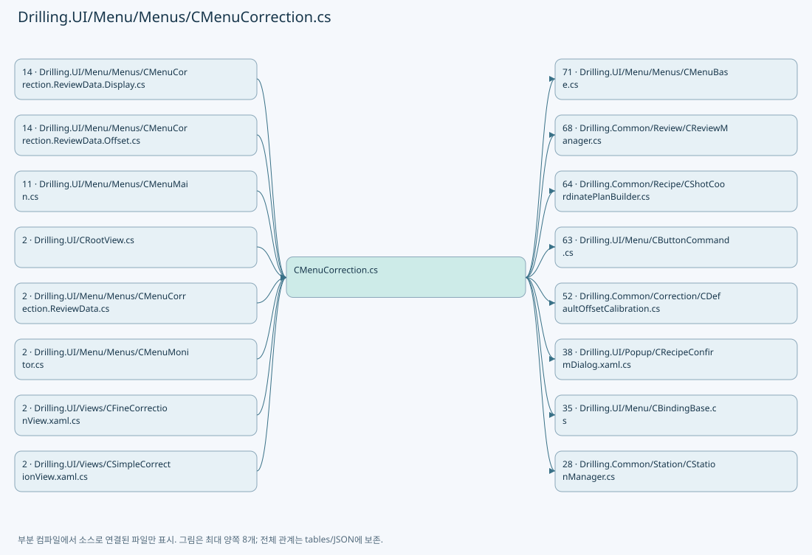

## 네임스페이스·타입·상속

| 타입 | 구분 | 원본 범위 | 선언/상속 |
| --- | --- | --- | --- |
| CMenuCorrection | ClassDeclaration | 21–4249 | CMenuCorrection: CMenuBase |
| CDefaultTest | RecordDeclaration | 3844–3844 | CDefaultTest |
| CDefaultSetupRun | ClassDeclaration | 3845–3863 | CDefaultSetupRun |
| CAlignBaseData | ClassDeclaration | 4251–4309 | CAlignBaseData |
| CAlignBaseEditPanel | ClassDeclaration | 4311–4339 | CAlignBaseEditPanel |
| CDefaultOffsetPanel | ClassDeclaration | 4343–4839 | CDefaultOffsetPanel: INotifyPropertyChanged |
| CDefaultOffsetHead | ClassDeclaration | 4841–4884 | CDefaultOffsetHead: INotifyPropertyChanged |
| CDefaultOffsetStep | RecordDeclaration | 4886–4894 | CDefaultOffsetStep: INotifyPropertyChanged |
| CAlignBaseEditKey | ClassDeclaration | 4896–4943 | CAlignBaseEditKey: INotifyPropertyChanged |
| CAlignDistortionPanel | ClassDeclaration | 4945–5385 | CAlignDistortionPanel: INotifyPropertyChanged |
| CAlignDistortionDkSelection | ClassDeclaration | 5387–5406 | CAlignDistortionDkSelection: INotifyPropertyChanged |
| CAlignBaseEditPair | RecordDeclaration | 5408–5414 | CAlignBaseEditPair |
| ST_ALIGN_DISTORTION_PAIR | RecordDeclaration | 5416–5424 | ST_ALIGN_DISTORTION_PAIR |
| ST_ALIGN_DISTORTION_KEY | RecordDeclaration | 5426–5456 | ST_ALIGN_DISTORTION_KEY |
| ST_WAPAGE_ALIGNBASE_ROW | RecordDeclaration | 5460–5469 | ST_WAPAGE_ALIGNBASE_ROW |
| CAlignWapagePanel | ClassDeclaration | 5471–5525 | CAlignWapagePanel: INotifyPropertyChanged |
| CAlignLastLoadService | ClassDeclaration | 5528–5621 | CAlignLastLoadService |
| CAlignOffsetViewerPanel | ClassDeclaration | 5623–5947 | CAlignOffsetViewerPanel: INotifyPropertyChanged |
| ST_ALIGN_OFFSET_VIEW_ROW | RecordDeclaration | 5949–5974 | ST_ALIGN_OFFSET_VIEW_ROW |
| EN_FINE_LINE_STATE | EnumDeclaration | 5975–5982 | EN_FINE_LINE_STATE |
| CFineCorrectionPanel | ClassDeclaration | 5985–6677 | CFineCorrectionPanel: INotifyPropertyChanged |
| ST_FINE_LINE_VISUAL | RecordDeclaration | 6679–6679 | ST_FINE_LINE_VISUAL |
| ST_FINE_CELL_VISUAL | RecordDeclaration | 6680–6683 | ST_FINE_CELL_VISUAL |
| ST_FINE_OFFSET_INPUT | RecordDeclaration | 6685–6685 | ST_FINE_OFFSET_INPUT |
| ST_FINE_SHOT_RESULT | RecordDeclaration | 6687–6687 | ST_FINE_SHOT_RESULT |
| CFineInspectionLine | ClassDeclaration | 6688–6843 | CFineInspectionLine: INotifyPropertyChanged |
| ST_FINE_SHOT_DETAIL | RecordDeclaration | 6845–6857 | ST_FINE_SHOT_DETAIL |
| ST_FINE_AXIS_STATISTICS | RecordDeclaration | 6859–6866 | ST_FINE_AXIS_STATISTICS |
| ST_CORRECTION_TAB | RecordDeclaration | 6868–6868 | ST_CORRECTION_TAB |
| ST_CORRECTION_SOURCE_ROW | RecordDeclaration | 6869–6878 | ST_CORRECTION_SOURCE_ROW |
| ST_CORRECTION_VALUE_ROW | RecordDeclaration | 6880–6897 | ST_CORRECTION_VALUE_ROW |
| ST_CORRECTION_HISTORY_ROW | RecordDeclaration | 6899–6953 | ST_CORRECTION_HISTORY_ROW |
| ST_CORRECTION_OFFSET_SHOT_MATRIX_ROW | RecordDeclaration | 6955–6955 | ST_CORRECTION_OFFSET_SHOT_MATRIX_ROW |
| ST_CORRECTION_OFFSET_SHOT_ITEM | RecordDeclaration | 6956–6965 | ST_CORRECTION_OFFSET_SHOT_ITEM |
| ST_CORRECTION_OUTPUT_VIEWER_HEAD_CARD | RecordDeclaration | 6966–6969 | ST_CORRECTION_OUTPUT_VIEWER_HEAD_CARD |
| ST_CORRECTION_OFFSET_VIEWER_PREVIEW | RecordDeclaration | 6970–6970 | ST_CORRECTION_OFFSET_VIEWER_PREVIEW |
| ST_CORRECTION_AXIS_SETTING_STATE | RecordStructDeclaration | 6971–6971 | ST_CORRECTION_AXIS_SETTING_STATE |
| ST_CORRECTION_AXIS_FLIP_ROW | RecordDeclaration | 6972–6977 | ST_CORRECTION_AXIS_FLIP_ROW |
| ST_CORRECTION_REVIEW_RESULT_ROW | RecordDeclaration | 6979–7009 | ST_CORRECTION_REVIEW_RESULT_ROW |
| ST_CORRECTION_REVIEW_OFFSET_ROW | RecordDeclaration | 7011–7054 | ST_CORRECTION_REVIEW_OFFSET_ROW |
| COutputOffsetViewerPanel | ClassDeclaration | 7057–7213 | COutputOffsetViewerPanel: INotifyPropertyChanged |
| CLazyOffsetShotItems | ClassDeclaration | 7167–7206 | CLazyOffsetShotItems: IReadOnlyList<ST_CORRECTION_OFFSET_SHOT_ITEM>, System.Collections.IList |
| ST_CORRECTION_OFFSET_KIND | RecordDeclaration | 7215–7215 | ST_CORRECTION_OFFSET_KIND |
| CRoughCorrectionPanel | ClassDeclaration | 7217–7500 | CRoughCorrectionPanel: INotifyPropertyChanged |
| CRoughCorrectionRow | ClassDeclaration | 7502–7550 | CRoughCorrectionRow: INotifyPropertyChanged |
| CSimpleCorrectionPanel | ClassDeclaration | 7553–8138 | CSimpleCorrectionPanel: INotifyPropertyChanged |
| ST_SIMPLE_CORRECTION_HEAD | RecordDeclaration | 8140–8144 | ST_SIMPLE_CORRECTION_HEAD |
| ST_SIMPLE_CORRECTION_SHOT | RecordDeclaration | 8146–8157 | ST_SIMPLE_CORRECTION_SHOT |
| ST_SIMPLE_CORRECTION_SHOT_ROW | RecordDeclaration | 8159–8159 | ST_SIMPLE_CORRECTION_SHOT_ROW |
| ST_SIMPLE_CORRECTION_FIRST_SHOT | RecordDeclaration | 8160–8165 | ST_SIMPLE_CORRECTION_FIRST_SHOT |
| ST_SIMPLE_CORRECTION_CALLOUT | RecordDeclaration | 8167–8185 | ST_SIMPLE_CORRECTION_CALLOUT |
| CSimpleCorrectionInput | ClassDeclaration | 8188–8250 | CSimpleCorrectionInput: INotifyPropertyChanged |
| ST_SIMPLE_OFFSET_CHANGE | RecordDeclaration | 8252–8256 | ST_SIMPLE_OFFSET_CHANGE |

## 멤버 빠른 목록

| 이름 | 종류 | 범위 | 서명 |
| --- | --- | --- | --- |
| CorrectionTabs | FieldDeclaration | L24–24 | string[] Drilling.UI.Menu.Menus.CMenuCorrection.CorrectionTabs |
| _reviewResultFile | FieldDeclaration | L25–25 | Drilling.Common.Review.CReviewResultFileBase Drilling.UI.Menu.Menus.CMenuCorrection._reviewResultFile |
| _reviewOffsetFile | FieldDeclaration | L26–26 | Drilling.Common.Review.CReviewOffsetFileBase Drilling.UI.Menu.Menus.CMenuCorrection._reviewOffsetFile |
| _reviewManager | FieldDeclaration | L27–27 | Drilling.Common.Review.CReviewManager Drilling.UI.Menu.Menus.CMenuCorrection._reviewManager |
| _recipeManager | FieldDeclaration | L28–28 | Drilling.Common.Managers.CRecipeManager Drilling.UI.Menu.Menus.CMenuCorrection._recipeManager |
| _settingManager | FieldDeclaration | L29–29 | Drilling.Common.Managers.CSettingManager Drilling.UI.Menu.Menus.CMenuCorrection._settingManager |
| _selectedRecipeIdProvider | FieldDeclaration | L30–30 | System.Func<string> Drilling.UI.Menu.Menus.CMenuCorrection._selectedRecipeIdProvider |
| _statusReporter | FieldDeclaration | L31–31 | System.Action<string> Drilling.UI.Menu.Menus.CMenuCorrection._statusReporter |
| _refreshCurrentScreen | FieldDeclaration | L32–32 | System.Func<System.Threading.Tasks.Task> Drilling.UI.Menu.Menus.CMenuCorrection._refreshCurrentScreen |
| _alignLastLoad | FieldDeclaration | L33–33 | Drilling.UI.Menu.Menus.CAlignLastLoadService Drilling.UI.Menu.Menus.CMenuCorrection._alignLastLoad |
| _wapage | FieldDeclaration | L34–34 | Drilling.Common.Correction.CAlignWapageService Drilling.UI.Menu.Menus.CMenuCorrection._wapage |
| _alignOffsetLogFile | FieldDeclaration | L35–35 | Drilling.Common.Correction.CAlignOffsetLogFileBase? Drilling.UI.Menu.Menus.CMenuCorrection._alignOffsetLogFile |
| _reviewDataHistory | FieldDeclaration | L36–36 | System.Collections.Generic.List<Drilling.UI.Menu.Menus.ST_CORRECTION_HISTORY_ROW> Drilling.UI.Menu.Menus.CMenuCorrection._reviewDataHistory |
| _loadedReviewResult | FieldDeclaration | L37–37 | Drilling.Common.Review.ST_REVIEW_RESULT_FILE_DATA? Drilling.UI.Menu.Menus.CMenuCorrection._loadedReviewResult |
| _hasPendingReviewOffsetApply | FieldDeclaration | L38–38 | bool Drilling.UI.Menu.Menus.CMenuCorrection._hasPendingReviewOffsetApply |
| _reviewLoadStatus | FieldDeclaration | L39–39 | string Drilling.UI.Menu.Menus.CMenuCorrection._reviewLoadStatus |
| _reviewLoadState | FieldDeclaration | L40–40 | string Drilling.UI.Menu.Menus.CMenuCorrection._reviewLoadState |
| _currentSettingState | FieldDeclaration | L41–41 | string Drilling.UI.Menu.Menus.CMenuCorrection._currentSettingState |
| _currentVisionSettingState | FieldDeclaration | L42–42 | string Drilling.UI.Menu.Menus.CMenuCorrection._currentVisionSettingState |
| _currentScannerSettingState | FieldDeclaration | L43–43 | string Drilling.UI.Menu.Menus.CMenuCorrection._currentScannerSettingState |
| _currentSettingDetail | FieldDeclaration | L44–44 | string Drilling.UI.Menu.Menus.CMenuCorrection._currentSettingDetail |
| _calculatedSettingDetail | FieldDeclaration | L45–45 | string Drilling.UI.Menu.Menus.CMenuCorrection._calculatedSettingDetail |
| _currentReviewOffsetRecipeName | FieldDeclaration | L46–46 | string Drilling.UI.Menu.Menus.CMenuCorrection._currentReviewOffsetRecipeName |
| _outputViewerIsCellDetailVisible | FieldDeclaration | L47–47 | bool Drilling.UI.Menu.Menus.CMenuCorrection._outputViewerIsCellDetailVisible |
| _outputViewerSelectedCellNo | FieldDeclaration | L48–48 | int Drilling.UI.Menu.Menus.CMenuCorrection._outputViewerSelectedCellNo |
| _outputViewerRefreshVersion | FieldDeclaration | L49–49 | int Drilling.UI.Menu.Menus.CMenuCorrection._outputViewerRefreshVersion |
| _outputViewerPreviewParameters | FieldDeclaration | L50–50 | System.Collections.Generic.IReadOnlyDictionary<string, string>? Drilling.UI.Menu.Menus.CMenuCorrection._outputViewerPreviewParameters |
| _outputViewerPreviewCellCount | FieldDeclaration | L51–51 | int Drilling.UI.Menu.Menus.CMenuCorrection._outputViewerPreviewCellCount |
| _outputViewerPreviewSelectedCellNo | FieldDeclaration | L52–52 | int Drilling.UI.Menu.Menus.CMenuCorrection._outputViewerPreviewSelectedCellNo |
| _outputViewerPreviewCache | FieldDeclaration | L53–53 | Drilling.UI.Menu.Menus.ST_CORRECTION_OFFSET_VIEWER_PREVIEW? Drilling.UI.Menu.Menus.CMenuCorrection._outputViewerPreviewCache |
| _outputViewerShotParameters | FieldDeclaration | L54–54 | System.Collections.Generic.IReadOnlyDictionary<string, string>? Drilling.UI.Menu.Menus.CMenuCorrection._outputViewerShotParameters |
| _outputViewerShotCellNo | FieldDeclaration | L55–55 | int Drilling.UI.Menu.Menus.CMenuCorrection._outputViewerShotCellNo |
| _outputViewerShotCache | FieldDeclaration | L56–56 | System.Collections.Generic.IReadOnlyList<Drilling.Common.Recipe.ST_HEAD_SHOT_POINT> Drilling.UI.Menu.Menus.CMenuCorrection._outputViewerShotCache |
| _outputViewerSelectedCellShots | FieldDeclaration | L57–57 | System.Collections.Generic.IReadOnlyList<Drilling.Common.Recipe.ST_HEAD_SHOT_POINT> Drilling.UI.Menu.Menus.CMenuCorrection._outputViewerSelectedCellShots |
| _outputViewerSelectedShotStates | FieldDeclaration | L58–58 | System.Collections.Generic.IReadOnlyDictionary<string, Drilling.Common.Recipe.ST_RECIPE_SHOT_MASKING_RESULT> Drilling.UI.Menu.Menus.CMenuCorrection._outputViewerSelectedShotStates |
| _outputViewerSelectedShotKey | FieldDeclaration | L59–59 | string Drilling.UI.Menu.Menus.CMenuCorrection._outputViewerSelectedShotKey |
| _selectedTab | FieldDeclaration | L60–60 | string Drilling.UI.Menu.Menus.CMenuCorrection._selectedTab |
| _selectedReviewTabIndex | FieldDeclaration | L61–61 | int Drilling.UI.Menu.Menus.CMenuCorrection._selectedReviewTabIndex |
| _simpleOffsetRecipeId | FieldDeclaration | L62–62 | string Drilling.UI.Menu.Menus.CMenuCorrection._simpleOffsetRecipeId |
| _simpleOffsetLoad | FieldDeclaration | L63–63 | System.Threading.Tasks.Task<Drilling.Common.Review.ST_REVIEW_OFFSET_FILE_DATA>? Drilling.UI.Menu.Menus.CMenuCorrection._simpleOffsetLoad |
| _isReviewOperationRunning | FieldDeclaration | L64–64 | bool Drilling.UI.Menu.Menus.CMenuCorrection._isReviewOperationRunning |
| Tabs | PropertyDeclaration | L65–65 | System.Collections.Generic.IReadOnlyList<Drilling.UI.Menu.Menus.ST_CORRECTION_TAB> Drilling.UI.Menu.Menus.CMenuCorrection.Tabs |
| get_Tabs | GetAccessorDeclaration | L65–65 | System.Collections.Generic.IReadOnlyList<Drilling.UI.Menu.Menus.ST_CORRECTION_TAB> Drilling.UI.Menu.Menus.CMenuCorrection.Tabs.get |
| set_Tabs | SetAccessorDeclaration | L65–65 | void Drilling.UI.Menu.Menus.CMenuCorrection.Tabs.set |
| SummaryItems | PropertyDeclaration | L66–66 | System.Collections.Generic.IReadOnlyList<Drilling.UI.Menu.Menus.ST_DISPLAY_ITEM> Drilling.UI.Menu.Menus.CMenuCorrection.SummaryItems |
| get_SummaryItems | GetAccessorDeclaration | L66–66 | System.Collections.Generic.IReadOnlyList<Drilling.UI.Menu.Menus.ST_DISPLAY_ITEM> Drilling.UI.Menu.Menus.CMenuCorrection.SummaryItems.get |
| set_SummaryItems | SetAccessorDeclaration | L66–66 | void Drilling.UI.Menu.Menus.CMenuCorrection.SummaryItems.set |
| SourceRows | PropertyDeclaration | L67–67 | System.Collections.Generic.IReadOnlyList<Drilling.UI.Menu.Menus.ST_CORRECTION_SOURCE_ROW> Drilling.UI.Menu.Menus.CMenuCorrection.SourceRows |
| get_SourceRows | GetAccessorDeclaration | L67–67 | System.Collections.Generic.IReadOnlyList<Drilling.UI.Menu.Menus.ST_CORRECTION_SOURCE_ROW> Drilling.UI.Menu.Menus.CMenuCorrection.SourceRows.get |
| set_SourceRows | SetAccessorDeclaration | L67–67 | void Drilling.UI.Menu.Menus.CMenuCorrection.SourceRows.set |
| CandidateRows | PropertyDeclaration | L68–68 | System.Collections.Generic.IReadOnlyList<Drilling.UI.Menu.Menus.ST_CORRECTION_VALUE_ROW> Drilling.UI.Menu.Menus.CMenuCorrection.CandidateRows |
| get_CandidateRows | GetAccessorDeclaration | L68–68 | System.Collections.Generic.IReadOnlyList<Drilling.UI.Menu.Menus.ST_CORRECTION_VALUE_ROW> Drilling.UI.Menu.Menus.CMenuCorrection.CandidateRows.get |
| set_CandidateRows | SetAccessorDeclaration | L68–68 | void Drilling.UI.Menu.Menus.CMenuCorrection.CandidateRows.set |
| ApplyRows | PropertyDeclaration | L69–69 | System.Collections.Generic.IReadOnlyList<Drilling.UI.Menu.Menus.ST_CORRECTION_VALUE_ROW> Drilling.UI.Menu.Menus.CMenuCorrection.ApplyRows |
| get_ApplyRows | GetAccessorDeclaration | L69–69 | System.Collections.Generic.IReadOnlyList<Drilling.UI.Menu.Menus.ST_CORRECTION_VALUE_ROW> Drilling.UI.Menu.Menus.CMenuCorrection.ApplyRows.get |
| set_ApplyRows | SetAccessorDeclaration | L69–69 | void Drilling.UI.Menu.Menus.CMenuCorrection.ApplyRows.set |
| HistoryRows | PropertyDeclaration | L70–70 | System.Collections.Generic.IReadOnlyList<Drilling.UI.Menu.Menus.ST_CORRECTION_HISTORY_ROW> Drilling.UI.Menu.Menus.CMenuCorrection.HistoryRows |
| get_HistoryRows | GetAccessorDeclaration | L70–70 | System.Collections.Generic.IReadOnlyList<Drilling.UI.Menu.Menus.ST_CORRECTION_HISTORY_ROW> Drilling.UI.Menu.Menus.CMenuCorrection.HistoryRows.get |
| set_HistoryRows | SetAccessorDeclaration | L70–70 | void Drilling.UI.Menu.Menus.CMenuCorrection.HistoryRows.set |
| DetailItems | PropertyDeclaration | L71–71 | System.Collections.Generic.IReadOnlyList<Drilling.UI.Menu.Menus.ST_DISPLAY_ITEM> Drilling.UI.Menu.Menus.CMenuCorrection.DetailItems |
| get_DetailItems | GetAccessorDeclaration | L71–71 | System.Collections.Generic.IReadOnlyList<Drilling.UI.Menu.Menus.ST_DISPLAY_ITEM> Drilling.UI.Menu.Menus.CMenuCorrection.DetailItems.get |
| set_DetailItems | SetAccessorDeclaration | L71–71 | void Drilling.UI.Menu.Menus.CMenuCorrection.DetailItems.set |
| ReviewResultRows | PropertyDeclaration | L72–72 | System.Collections.Generic.IReadOnlyList<Drilling.UI.Menu.Menus.ST_CORRECTION_REVIEW_RESULT_ROW> Drilling.UI.Menu.Menus.CMenuCorrection.ReviewResultRows |
| get_ReviewResultRows | GetAccessorDeclaration | L72–72 | System.Collections.Generic.IReadOnlyList<Drilling.UI.Menu.Menus.ST_CORRECTION_REVIEW_RESULT_ROW> Drilling.UI.Menu.Menus.CMenuCorrection.ReviewResultRows.get |
| set_ReviewResultRows | SetAccessorDeclaration | L72–72 | void Drilling.UI.Menu.Menus.CMenuCorrection.ReviewResultRows.set |
| CalculatedOffsetRows | PropertyDeclaration | L73–73 | System.Collections.Generic.IReadOnlyList<Drilling.UI.Menu.Menus.ST_CORRECTION_REVIEW_OFFSET_ROW> Drilling.UI.Menu.Menus.CMenuCorrection.CalculatedOffsetRows |
| get_CalculatedOffsetRows | GetAccessorDeclaration | L73–73 | System.Collections.Generic.IReadOnlyList<Drilling.UI.Menu.Menus.ST_CORRECTION_REVIEW_OFFSET_ROW> Drilling.UI.Menu.Menus.CMenuCorrection.CalculatedOffsetRows.get |
| set_CalculatedOffsetRows | SetAccessorDeclaration | L73–73 | void Drilling.UI.Menu.Menus.CMenuCorrection.CalculatedOffsetRows.set |
| CurrentOffsetRows | PropertyDeclaration | L74–74 | System.Collections.Generic.IReadOnlyList<Drilling.UI.Menu.Menus.ST_CORRECTION_REVIEW_OFFSET_ROW> Drilling.UI.Menu.Menus.CMenuCorrection.CurrentOffsetRows |
| get_CurrentOffsetRows | GetAccessorDeclaration | L74–74 | System.Collections.Generic.IReadOnlyList<Drilling.UI.Menu.Menus.ST_CORRECTION_REVIEW_OFFSET_ROW> Drilling.UI.Menu.Menus.CMenuCorrection.CurrentOffsetRows.get |
| set_CurrentOffsetRows | SetAccessorDeclaration | L74–74 | void Drilling.UI.Menu.Menus.CMenuCorrection.CurrentOffsetRows.set |
| ApplyPreviewRows | PropertyDeclaration | L75–75 | System.Collections.Generic.IReadOnlyList<Drilling.UI.Menu.Menus.ST_CORRECTION_REVIEW_OFFSET_ROW> Drilling.UI.Menu.Menus.CMenuCorrection.ApplyPreviewRows |
| get_ApplyPreviewRows | GetAccessorDeclaration | L75–75 | System.Collections.Generic.IReadOnlyList<Drilling.UI.Menu.Menus.ST_CORRECTION_REVIEW_OFFSET_ROW> Drilling.UI.Menu.Menus.CMenuCorrection.ApplyPreviewRows.get |
| set_ApplyPreviewRows | SetAccessorDeclaration | L75–75 | void Drilling.UI.Menu.Menus.CMenuCorrection.ApplyPreviewRows.set |
| OutputViewerCellPreviewLabels | PropertyDeclaration | L76–76 | System.Collections.Generic.IReadOnlyList<Drilling.UI.Menu.Menus.ST_CELL_PREVIEW_LABEL> Drilling.UI.Menu.Menus.CMenuCorrection.OutputViewerCellPreviewLabels |
| get_OutputViewerCellPreviewLabels | GetAccessorDeclaration | L76–76 | System.Collections.Generic.IReadOnlyList<Drilling.UI.Menu.Menus.ST_CELL_PREVIEW_LABEL> Drilling.UI.Menu.Menus.CMenuCorrection.OutputViewerCellPreviewLabels.get |
| set_OutputViewerCellPreviewLabels | SetAccessorDeclaration | L76–76 | void Drilling.UI.Menu.Menus.CMenuCorrection.OutputViewerCellPreviewLabels.set |
| OutputViewerHeadCards | PropertyDeclaration | L77–77 | System.Collections.Generic.IReadOnlyList<Drilling.UI.Menu.Menus.ST_CORRECTION_OUTPUT_VIEWER_HEAD_CARD> Drilling.UI.Menu.Menus.CMenuCorrection.OutputViewerHeadCards |
| get_OutputViewerHeadCards | GetAccessorDeclaration | L77–77 | System.Collections.Generic.IReadOnlyList<Drilling.UI.Menu.Menus.ST_CORRECTION_OUTPUT_VIEWER_HEAD_CARD> Drilling.UI.Menu.Menus.CMenuCorrection.OutputViewerHeadCards.get |
| set_OutputViewerHeadCards | SetAccessorDeclaration | L77–77 | void Drilling.UI.Menu.Menus.CMenuCorrection.OutputViewerHeadCards.set |
| OutputOffsets | PropertyDeclaration | L78–78 | Drilling.UI.Menu.Menus.COutputOffsetViewerPanel Drilling.UI.Menu.Menus.CMenuCorrection.OutputOffsets |
| get_OutputOffsets | GetAccessorDeclaration | L78–78 | Drilling.UI.Menu.Menus.COutputOffsetViewerPanel Drilling.UI.Menu.Menus.CMenuCorrection.OutputOffsets.get |
| DefaultOffset | PropertyDeclaration | L79–79 | Drilling.UI.Menu.Menus.CDefaultOffsetPanel Drilling.UI.Menu.Menus.CMenuCorrection.DefaultOffset |
| get_DefaultOffset | GetAccessorDeclaration | L79–79 | Drilling.UI.Menu.Menus.CDefaultOffsetPanel Drilling.UI.Menu.Menus.CMenuCorrection.DefaultOffset.get |
| ReviewData | PropertyDeclaration | L80–80 | Drilling.UI.Menu.Menus.CMenuCorrection.CReviewDataPanel Drilling.UI.Menu.Menus.CMenuCorrection.ReviewData |
| get_ReviewData | GetAccessorDeclaration | L80–80 | Drilling.UI.Menu.Menus.CMenuCorrection.CReviewDataPanel Drilling.UI.Menu.Menus.CMenuCorrection.ReviewData.get |
| Review | PropertyDeclaration | L81–81 | Drilling.UI.Menu.Menus.CMenuReview? Drilling.UI.Menu.Menus.CMenuCorrection.Review |
| get_Review | GetAccessorDeclaration | L81–81 | Drilling.UI.Menu.Menus.CMenuReview? Drilling.UI.Menu.Menus.CMenuCorrection.Review.get |
| set_Review | SetAccessorDeclaration | L81–81 | void Drilling.UI.Menu.Menus.CMenuCorrection.Review.set |
| OutputViewerSummary | PropertyDeclaration | L82–82 | string Drilling.UI.Menu.Menus.CMenuCorrection.OutputViewerSummary |
| get_OutputViewerSummary | GetAccessorDeclaration | L82–82 | string Drilling.UI.Menu.Menus.CMenuCorrection.OutputViewerSummary.get |
| set_OutputViewerSummary | SetAccessorDeclaration | L82–82 | void Drilling.UI.Menu.Menus.CMenuCorrection.OutputViewerSummary.set |
| OutputViewerCellShotMapImage | PropertyDeclaration | L83–83 | ImageSource? Drilling.UI.Menu.Menus.CMenuCorrection.OutputViewerCellShotMapImage |
| get_OutputViewerCellShotMapImage | GetAccessorDeclaration | L83–83 | ImageSource? Drilling.UI.Menu.Menus.CMenuCorrection.OutputViewerCellShotMapImage.get |
| set_OutputViewerCellShotMapImage | SetAccessorDeclaration | L83–83 | void Drilling.UI.Menu.Menus.CMenuCorrection.OutputViewerCellShotMapImage.set |
| OutputViewerCellShotMapImageChanged | EventFieldDeclaration | L84–84 | System.EventHandler? Drilling.UI.Menu.Menus.CMenuCorrection.OutputViewerCellShotMapImageChanged |
| OutputViewerSelectedShotNameChanged | EventFieldDeclaration | L85–85 | System.EventHandler? Drilling.UI.Menu.Menus.CMenuCorrection.OutputViewerSelectedShotNameChanged |
| OutputViewerSelectedShotDetailChanged | EventFieldDeclaration | L86–86 | System.EventHandler? Drilling.UI.Menu.Menus.CMenuCorrection.OutputViewerSelectedShotDetailChanged |
| CurrentVisionFlipRow | PropertyDeclaration | L87–87 | Drilling.UI.Menu.Menus.ST_CORRECTION_AXIS_FLIP_ROW Drilling.UI.Menu.Menus.CMenuCorrection.CurrentVisionFlipRow |
| get_CurrentVisionFlipRow | GetAccessorDeclaration | L87–87 | Drilling.UI.Menu.Menus.ST_CORRECTION_AXIS_FLIP_ROW Drilling.UI.Menu.Menus.CMenuCorrection.CurrentVisionFlipRow.get |
| set_CurrentVisionFlipRow | SetAccessorDeclaration | L87–87 | void Drilling.UI.Menu.Menus.CMenuCorrection.CurrentVisionFlipRow.set |
| CurrentScannerFlipRows | PropertyDeclaration | L88–88 | System.Collections.Generic.IReadOnlyList<Drilling.UI.Menu.Menus.ST_CORRECTION_AXIS_FLIP_ROW> Drilling.UI.Menu.Menus.CMenuCorrection.CurrentScannerFlipRows |
| get_CurrentScannerFlipRows | GetAccessorDeclaration | L88–88 | System.Collections.Generic.IReadOnlyList<Drilling.UI.Menu.Menus.ST_CORRECTION_AXIS_FLIP_ROW> Drilling.UI.Menu.Menus.CMenuCorrection.CurrentScannerFlipRows.get |
| set_CurrentScannerFlipRows | SetAccessorDeclaration | L88–88 | void Drilling.UI.Menu.Menus.CMenuCorrection.CurrentScannerFlipRows.set |
| _fineCancellation | FieldDeclaration | L90–90 | System.Threading.CancellationTokenSource? Drilling.UI.Menu.Menus.CMenuCorrection._fineCancellation |
| _lastReviewOffsetWarning | FieldDeclaration | L91–91 | string Drilling.UI.Menu.Menus.CMenuCorrection._lastReviewOffsetWarning |
| ReviewOffsetWarning | PropertyDeclaration | L92–92 | System.Action<string, string> Drilling.UI.Menu.Menus.CMenuCorrection.ReviewOffsetWarning |
| get_ReviewOffsetWarning | GetAccessorDeclaration | L92–92 | System.Action<string, string> Drilling.UI.Menu.Menus.CMenuCorrection.ReviewOffsetWarning.get |
| set_ReviewOffsetWarning | SetAccessorDeclaration | L92–92 | void Drilling.UI.Menu.Menus.CMenuCorrection.ReviewOffsetWarning.set |
| DuplicateReviewOffsetConfirmation | PropertyDeclaration | L93–94 | System.Func<string, string, bool> Drilling.UI.Menu.Menus.CMenuCorrection.DuplicateReviewOffsetConfirmation |
| get_DuplicateReviewOffsetConfirmation | GetAccessorDeclaration | L93–93 | System.Func<string, string, bool> Drilling.UI.Menu.Menus.CMenuCorrection.DuplicateReviewOffsetConfirmation.get |
| set_DuplicateReviewOffsetConfirmation | SetAccessorDeclaration | L93–93 | void Drilling.UI.Menu.Menus.CMenuCorrection.DuplicateReviewOffsetConfirmation.set |
| _roughCancellation | FieldDeclaration | L96–96 | System.Threading.CancellationTokenSource? Drilling.UI.Menu.Menus.CMenuCorrection._roughCancellation |
| BlocksMenuNavigation | PropertyDeclaration | L97–100 | bool Drilling.UI.Menu.Menus.CMenuCorrection.BlocksMenuNavigation |
| _defaultManager | FieldDeclaration | L101–101 | Drilling.Common.Managers.CManager? Drilling.UI.Menu.Menus.CMenuCorrection._defaultManager |
| _defaultScriptFile | FieldDeclaration | L102–102 | Drilling.Common.Station.CAutomationScriptFileBase? Drilling.UI.Menu.Menus.CMenuCorrection._defaultScriptFile |
| _defaultRun | FieldDeclaration | L103–103 | Drilling.UI.Menu.Menus.CMenuCorrection.CDefaultSetupRun? Drilling.UI.Menu.Menus.CMenuCorrection._defaultRun |
| _defaultCancellation | FieldDeclaration | L104–104 | System.Threading.CancellationTokenSource? Drilling.UI.Menu.Menus.CMenuCorrection._defaultCancellation |
| _defaultOwnSave | FieldDeclaration | L105–105 | bool Drilling.UI.Menu.Menus.CMenuCorrection._defaultOwnSave |
| _defaultStopped | FieldDeclaration | L106–106 | System.Threading.Tasks.TaskCompletionSource? Drilling.UI.Menu.Menus.CMenuCorrection._defaultStopped |
| DefaultBlocksAuto | PropertyDeclaration | L107–107 | bool Drilling.UI.Menu.Menus.CMenuCorrection.DefaultBlocksAuto |
| DefaultConfirmation | PropertyDeclaration | L108–108 | System.Func<string, string, bool> Drilling.UI.Menu.Menus.CMenuCorrection.DefaultConfirmation |
| get_DefaultConfirmation | GetAccessorDeclaration | L108–108 | System.Func<string, string, bool> Drilling.UI.Menu.Menus.CMenuCorrection.DefaultConfirmation.get |
| set_DefaultConfirmation | SetAccessorDeclaration | L108–108 | void Drilling.UI.Menu.Menus.CMenuCorrection.DefaultConfirmation.set |
| DefaultRestartChoice | PropertyDeclaration | L109–109 | System.Func<string, Drilling.UI.Popup.EN_DEFAULT_RESTART_CHOICE> Drilling.UI.Menu.Menus.CMenuCorrection.DefaultRestartChoice |
| get_DefaultRestartChoice | GetAccessorDeclaration | L109–109 | System.Func<string, Drilling.UI.Popup.EN_DEFAULT_RESTART_CHOICE> Drilling.UI.Menu.Menus.CMenuCorrection.DefaultRestartChoice.get |
| set_DefaultRestartChoice | SetAccessorDeclaration | L109–109 | void Drilling.UI.Menu.Menus.CMenuCorrection.DefaultRestartChoice.set |
| DefaultWarning | PropertyDeclaration | L110–110 | System.Action<string, string> Drilling.UI.Menu.Menus.CMenuCorrection.DefaultWarning |
| get_DefaultWarning | GetAccessorDeclaration | L110–110 | System.Action<string, string> Drilling.UI.Menu.Menus.CMenuCorrection.DefaultWarning.get |
| set_DefaultWarning | SetAccessorDeclaration | L110–110 | void Drilling.UI.Menu.Menus.CMenuCorrection.DefaultWarning.set |
| .ctor | ConstructorDeclaration | L113–178 | Drilling.UI.Menu.Menus.CMenuCorrection.CMenuCorrection(Drilling.Common.Review.CReviewResultFileBase, Drilling.Common.Review.CReviewOffsetFileBase, Drilling.Common.Review.CReviewManager, Drilling.Common.Managers.CRecipeManager, Drilling.Common.Managers.CSettingManager, System.Func<string>, System.Action<string>, System.Func<System.Threading.Tasks.Task>, Drilling.Common.Interface.CInterfaceManager?, Drilling.Common.Correction.CAlignOffsetLogFileBase?, Drilling.Common.Managers.CManager?, Drilling.Common.Station.CAutomationScriptFileBase?) |
| SelectOutputViewerCellCallback | LocalFunctionStatement | L165–168 | void SelectOutputViewerCellCallback(object?) |
| BackToOutputViewerGlassCallback | LocalFunctionStatement | L172–175 | void BackToOutputViewerGlassCallback(object?) |
| TryConfirmInitialReviewStart | MethodDeclaration | L180–212 | bool Drilling.UI.Menu.Menus.CMenuCorrection.TryConfirmInitialReviewStart(string, string, string, System.Func<string, string, bool>?, out double, out double) |
| Menu | PropertyDeclaration | L216–222 | Drilling.UI.Menu.Menus.EN_MENU Drilling.UI.Menu.Menus.CMenuCorrection.Menu |
| get_Menu | GetAccessorDeclaration | L218–221 | Drilling.UI.Menu.Menus.EN_MENU Drilling.UI.Menu.Menus.CMenuCorrection.Menu.get |
| Title | PropertyDeclaration | L224–230 | string Drilling.UI.Menu.Menus.CMenuCorrection.Title |
| get_Title | GetAccessorDeclaration | L226–229 | string Drilling.UI.Menu.Menus.CMenuCorrection.Title.get |
| Subtitle | PropertyDeclaration | L232–238 | string Drilling.UI.Menu.Menus.CMenuCorrection.Subtitle |
| get_Subtitle | GetAccessorDeclaration | L234–237 | string Drilling.UI.Menu.Menus.CMenuCorrection.Subtitle.get |
| SelectedTab | PropertyDeclaration | L240–246 | string Drilling.UI.Menu.Menus.CMenuCorrection.SelectedTab |
| get_SelectedTab | GetAccessorDeclaration | L242–245 | string Drilling.UI.Menu.Menus.CMenuCorrection.SelectedTab.get |
| SelectedReviewTabIndex | PropertyDeclaration | L248–262 | int Drilling.UI.Menu.Menus.CMenuCorrection.SelectedReviewTabIndex |
| get_SelectedReviewTabIndex | GetAccessorDeclaration | L250–250 | int Drilling.UI.Menu.Menus.CMenuCorrection.SelectedReviewTabIndex.get |
| set_SelectedReviewTabIndex | SetAccessorDeclaration | L251–261 | void Drilling.UI.Menu.Menus.CMenuCorrection.SelectedReviewTabIndex.set |
| IsOtherCorrectionTab | PropertyDeclaration | L264–270 | bool Drilling.UI.Menu.Menus.CMenuCorrection.IsOtherCorrectionTab |
| get_IsOtherCorrectionTab | GetAccessorDeclaration | L266–269 | bool Drilling.UI.Menu.Menus.CMenuCorrection.IsOtherCorrectionTab.get |
| IsDefaultTab | PropertyDeclaration | L272–272 | bool Drilling.UI.Menu.Menus.CMenuCorrection.IsDefaultTab |
| IsAlignDistortionTab | PropertyDeclaration | L273–273 | bool Drilling.UI.Menu.Menus.CMenuCorrection.IsAlignDistortionTab |
| IsReviewCorrectionTab | PropertyDeclaration | L274–274 | bool Drilling.UI.Menu.Menus.CMenuCorrection.IsReviewCorrectionTab |
| Simple | PropertyDeclaration | L275–275 | Drilling.UI.Menu.Menus.CSimpleCorrectionPanel Drilling.UI.Menu.Menus.CMenuCorrection.Simple |
| get_Simple | GetAccessorDeclaration | L275–275 | Drilling.UI.Menu.Menus.CSimpleCorrectionPanel Drilling.UI.Menu.Menus.CMenuCorrection.Simple.get |
| Rough | PropertyDeclaration | L276–276 | Drilling.UI.Menu.Menus.CSimpleCorrectionPanel Drilling.UI.Menu.Menus.CMenuCorrection.Rough |
| get_Rough | GetAccessorDeclaration | L276–276 | Drilling.UI.Menu.Menus.CSimpleCorrectionPanel Drilling.UI.Menu.Menus.CMenuCorrection.Rough.get |
| Fine | PropertyDeclaration | L277–277 | Drilling.UI.Menu.Menus.CFineCorrectionPanel Drilling.UI.Menu.Menus.CMenuCorrection.Fine |
| get_Fine | GetAccessorDeclaration | L277–277 | Drilling.UI.Menu.Menus.CFineCorrectionPanel Drilling.UI.Menu.Menus.CMenuCorrection.Fine.get |
| IsCorrectionCommandsVisible | PropertyDeclaration | L278–278 | bool Drilling.UI.Menu.Menus.CMenuCorrection.IsCorrectionCommandsVisible |
| AlignDistortion | PropertyDeclaration | L279–279 | Drilling.UI.Menu.Menus.CAlignDistortionPanel Drilling.UI.Menu.Menus.CMenuCorrection.AlignDistortion |
| get_AlignDistortion | GetAccessorDeclaration | L279–279 | Drilling.UI.Menu.Menus.CAlignDistortionPanel Drilling.UI.Menu.Menus.CMenuCorrection.AlignDistortion.get |
| IsOutputHistoryTab | PropertyDeclaration | L281–287 | bool Drilling.UI.Menu.Menus.CMenuCorrection.IsOutputHistoryTab |
| get_IsOutputHistoryTab | GetAccessorDeclaration | L283–286 | bool Drilling.UI.Menu.Menus.CMenuCorrection.IsOutputHistoryTab.get |
| IsCorrectionHistoryVisible | PropertyDeclaration | L289–295 | bool Drilling.UI.Menu.Menus.CMenuCorrection.IsCorrectionHistoryVisible |
| get_IsCorrectionHistoryVisible | GetAccessorDeclaration | L291–294 | bool Drilling.UI.Menu.Menus.CMenuCorrection.IsCorrectionHistoryVisible.get |
| OutputViewerGlassPreviewImage | PropertyDeclaration | L297–297 | ImageSource? Drilling.UI.Menu.Menus.CMenuCorrection.OutputViewerGlassPreviewImage |
| get_OutputViewerGlassPreviewImage | GetAccessorDeclaration | L297–297 | ImageSource? Drilling.UI.Menu.Menus.CMenuCorrection.OutputViewerGlassPreviewImage.get |
| set_OutputViewerGlassPreviewImage | SetAccessorDeclaration | L297–297 | void Drilling.UI.Menu.Menus.CMenuCorrection.OutputViewerGlassPreviewImage.set |
| OutputViewerSelectedCellName | PropertyDeclaration | L298–298 | string Drilling.UI.Menu.Menus.CMenuCorrection.OutputViewerSelectedCellName |
| OutputViewerSelectedShotName | PropertyDeclaration | L299–299 | string Drilling.UI.Menu.Menus.CMenuCorrection.OutputViewerSelectedShotName |
| OutputViewerSelectedShotDetail | PropertyDeclaration | L300–300 | string Drilling.UI.Menu.Menus.CMenuCorrection.OutputViewerSelectedShotDetail |
| OutputViewerCellShotMapSurfaceWidth | PropertyDeclaration | L301–301 | double Drilling.UI.Menu.Menus.CMenuCorrection.OutputViewerCellShotMapSurfaceWidth |
| OutputViewerCellShotMapSurfaceHeight | PropertyDeclaration | L302–302 | double Drilling.UI.Menu.Menus.CMenuCorrection.OutputViewerCellShotMapSurfaceHeight |
| OutputViewerIsGlassPreviewVisible | PropertyDeclaration | L303–303 | bool Drilling.UI.Menu.Menus.CMenuCorrection.OutputViewerIsGlassPreviewVisible |
| OutputViewerIsCellDetailVisible | PropertyDeclaration | L304–304 | bool Drilling.UI.Menu.Menus.CMenuCorrection.OutputViewerIsCellDetailVisible |
| OutputViewerHasNoCellSelection | PropertyDeclaration | L305–305 | bool Drilling.UI.Menu.Menus.CMenuCorrection.OutputViewerHasNoCellSelection |
| LoadedReviewFileName | PropertyDeclaration | L307–313 | string Drilling.UI.Menu.Menus.CMenuCorrection.LoadedReviewFileName |
| get_LoadedReviewFileName | GetAccessorDeclaration | L309–312 | string Drilling.UI.Menu.Menus.CMenuCorrection.LoadedReviewFileName.get |
| LoadedReviewSettingSummary | PropertyDeclaration | L315–322 | string Drilling.UI.Menu.Menus.CMenuCorrection.LoadedReviewSettingSummary |
| get_LoadedReviewSettingSummary | GetAccessorDeclaration | L317–321 | string Drilling.UI.Menu.Menus.CMenuCorrection.LoadedReviewSettingSummary.get |
| LoadedReviewRule | PropertyDeclaration | L324–324 | string Drilling.UI.Menu.Menus.CMenuCorrection.LoadedReviewRule |
| LoadedReviewSettingDetail | PropertyDeclaration | L325–325 | string Drilling.UI.Menu.Menus.CMenuCorrection.LoadedReviewSettingDetail |
| ReviewLoadStatus | PropertyDeclaration | L327–333 | string Drilling.UI.Menu.Menus.CMenuCorrection.ReviewLoadStatus |
| get_ReviewLoadStatus | GetAccessorDeclaration | L329–332 | string Drilling.UI.Menu.Menus.CMenuCorrection.ReviewLoadStatus.get |
| ReviewLoadStatusBrush | PropertyDeclaration | L335–341 | Brush Drilling.UI.Menu.Menus.CMenuCorrection.ReviewLoadStatusBrush |
| get_ReviewLoadStatusBrush | GetAccessorDeclaration | L337–340 | Brush Drilling.UI.Menu.Menus.CMenuCorrection.ReviewLoadStatusBrush.get |
| CurrentSettingState | PropertyDeclaration | L343–349 | string Drilling.UI.Menu.Menus.CMenuCorrection.CurrentSettingState |
| get_CurrentSettingState | GetAccessorDeclaration | L345–348 | string Drilling.UI.Menu.Menus.CMenuCorrection.CurrentSettingState.get |
| CurrentSettingDetail | PropertyDeclaration | L351–357 | string Drilling.UI.Menu.Menus.CMenuCorrection.CurrentSettingDetail |
| get_CurrentSettingDetail | GetAccessorDeclaration | L353–356 | string Drilling.UI.Menu.Menus.CMenuCorrection.CurrentSettingDetail.get |
| CurrentVisionSettingState | PropertyDeclaration | L359–365 | string Drilling.UI.Menu.Menus.CMenuCorrection.CurrentVisionSettingState |
| get_CurrentVisionSettingState | GetAccessorDeclaration | L361–364 | string Drilling.UI.Menu.Menus.CMenuCorrection.CurrentVisionSettingState.get |
| CurrentScannerSettingState | PropertyDeclaration | L367–373 | string Drilling.UI.Menu.Menus.CMenuCorrection.CurrentScannerSettingState |
| get_CurrentScannerSettingState | GetAccessorDeclaration | L369–372 | string Drilling.UI.Menu.Menus.CMenuCorrection.CurrentScannerSettingState.get |
| CurrentReviewOffsetRecipeName | PropertyDeclaration | L375–381 | string Drilling.UI.Menu.Menus.CMenuCorrection.CurrentReviewOffsetRecipeName |
| get_CurrentReviewOffsetRecipeName | GetAccessorDeclaration | L377–380 | string Drilling.UI.Menu.Menus.CMenuCorrection.CurrentReviewOffsetRecipeName.get |
| SelectTabCommand | PropertyDeclaration | L383–383 | Drilling.UI.Menu.CButtonCommand Drilling.UI.Menu.Menus.CMenuCorrection.SelectTabCommand |
| get_SelectTabCommand | GetAccessorDeclaration | L383–383 | Drilling.UI.Menu.CButtonCommand Drilling.UI.Menu.Menus.CMenuCorrection.SelectTabCommand.get |
| ExecuteCommand | PropertyDeclaration | L384–384 | Drilling.UI.Menu.CButtonCommand Drilling.UI.Menu.Menus.CMenuCorrection.ExecuteCommand |
| get_ExecuteCommand | GetAccessorDeclaration | L384–384 | Drilling.UI.Menu.CButtonCommand Drilling.UI.Menu.Menus.CMenuCorrection.ExecuteCommand.get |
| SelectOutputViewerCellCommand | PropertyDeclaration | L385–385 | Drilling.UI.Menu.CButtonCommand Drilling.UI.Menu.Menus.CMenuCorrection.SelectOutputViewerCellCommand |
| get_SelectOutputViewerCellCommand | GetAccessorDeclaration | L385–385 | Drilling.UI.Menu.CButtonCommand Drilling.UI.Menu.Menus.CMenuCorrection.SelectOutputViewerCellCommand.get |
| SelectOutputViewerShotCommand | PropertyDeclaration | L386–386 | Drilling.UI.Menu.CButtonCommand Drilling.UI.Menu.Menus.CMenuCorrection.SelectOutputViewerShotCommand |
| get_SelectOutputViewerShotCommand | GetAccessorDeclaration | L386–386 | Drilling.UI.Menu.CButtonCommand Drilling.UI.Menu.Menus.CMenuCorrection.SelectOutputViewerShotCommand.get |
| BackToOutputViewerGlassCommand | PropertyDeclaration | L387–387 | Drilling.UI.Menu.CButtonCommand Drilling.UI.Menu.Menus.CMenuCorrection.BackToOutputViewerGlassCommand |
| get_BackToOutputViewerGlassCommand | GetAccessorDeclaration | L387–387 | Drilling.UI.Menu.CButtonCommand Drilling.UI.Menu.Menus.CMenuCorrection.BackToOutputViewerGlassCommand.get |
| ConfigureReview | MethodDeclaration | L389–393 | void Drilling.UI.Menu.Menus.CMenuCorrection.ConfigureReview(Drilling.UI.Menu.Menus.CMenuReview) |
| OpenSavedReviewResult | MethodDeclaration | L395–402 | System.Threading.Tasks.Task Drilling.UI.Menu.Menus.CMenuCorrection.OpenSavedReviewResult(string) |
| Build | MethodDeclaration | L404–510 | System.Threading.Tasks.Task<Drilling.UI.Menu.Menus.CScreenViewModel> Drilling.UI.Menu.Menus.CMenuCorrection.Build(System.Threading.CancellationToken) |
| SelectTab | MethodDeclaration | L512–540 | void Drilling.UI.Menu.Menus.CMenuCorrection.SelectTab(object?) |
| MatchesItem | LocalFunctionStatement | L520–523 | bool MatchesItem(string) |
| SelectOutputViewerCell | MethodDeclaration | L542–554 | System.Threading.Tasks.Task Drilling.UI.Menu.Menus.CMenuCorrection.SelectOutputViewerCell(object?) |
| SelectOutputViewerShot | MethodDeclaration | L556–565 | void Drilling.UI.Menu.Menus.CMenuCorrection.SelectOutputViewerShot(object?) |
| SelectOutputViewerShotByKey | MethodDeclaration | L567–570 | void Drilling.UI.Menu.Menus.CMenuCorrection.SelectOutputViewerShotByKey(string) |
| SelectOutputViewerShotAt | MethodDeclaration | L572–593 | void Drilling.UI.Menu.Menus.CMenuCorrection.SelectOutputViewerShotAt(double, double) |
| ApplyOutputViewerShotSelection | MethodDeclaration | L595–609 | void Drilling.UI.Menu.Menus.CMenuCorrection.ApplyOutputViewerShotSelection(string) |
| BackToOutputViewerGlass | MethodDeclaration | L611–618 | System.Threading.Tasks.Task Drilling.UI.Menu.Menus.CMenuCorrection.BackToOutputViewerGlass(object?) |
| RefreshOutputViewerData | MethodDeclaration | L620–755 | System.Threading.Tasks.Task Drilling.UI.Menu.Menus.CMenuCorrection.RefreshOutputViewerData(System.Threading.CancellationToken) |
| LoadSelectedOutputViewerRecipe | MethodDeclaration | L757–772 | System.Threading.Tasks.Task<Drilling.Common.Managers.ST_RECIPE_DEFINITION?> Drilling.UI.Menu.Menus.CMenuCorrection.LoadSelectedOutputViewerRecipe(System.Threading.CancellationToken, bool) |
| MatchById | LocalFunctionStatement | L761–764 | bool MatchById(Drilling.Common.Managers.ST_RECIPE_DEFINITION) |
| MatchByName | LocalFunctionStatement | L766–769 | bool MatchByName(Drilling.Common.Managers.ST_RECIPE_DEFINITION) |
| BuildOutputViewerParameterMap | MethodDeclaration | L774–791 | System.Collections.Generic.Dictionary<string, string> Drilling.UI.Menu.Menus.CMenuCorrection.BuildOutputViewerParameterMap(Drilling.Common.Managers.ST_RECIPE_DEFINITION, System.Collections.Generic.IReadOnlyList<Drilling.Common.Managers.ST_SYSTEM_PARAMETER>) |
| SetOutputViewerParameter | MethodDeclaration | L793–799 | void Drilling.UI.Menu.Menus.CMenuCorrection.SetOutputViewerParameter(System.Collections.Generic.IDictionary<string, string>, string, string) |
| CopyOutputViewerParameters | MethodDeclaration | L801–804 | System.Collections.Generic.IReadOnlyDictionary<string, string> Drilling.UI.Menu.Menus.CMenuCorrection.CopyOutputViewerParameters(System.Collections.Generic.IReadOnlyDictionary<string, string>) |
| OutputViewerParametersMatch | MethodDeclaration | L806–822 | bool Drilling.UI.Menu.Menus.CMenuCorrection.OutputViewerParametersMatch(System.Collections.Generic.IReadOnlyDictionary<string, string>?, System.Collections.Generic.IReadOnlyDictionary<string, string>) |
| ClearOutputViewerCellSelectionData | MethodDeclaration | L824–831 | void Drilling.UI.Menu.Menus.CMenuCorrection.ClearOutputViewerCellSelectionData() |
| GetOutputViewerSelectedShot | MethodDeclaration | L833–841 | Drilling.Common.Recipe.ST_HEAD_SHOT_POINT? Drilling.UI.Menu.Menus.CMenuCorrection.GetOutputViewerSelectedShot() |
| GetOutputViewerShotMapSize | MethodDeclaration | L843–851 | Size Drilling.UI.Menu.Menus.CMenuCorrection.GetOutputViewerShotMapSize() |
| GetOutputViewerShotMapRect | MethodDeclaration | L853–857 | Rect Drilling.UI.Menu.Menus.CMenuCorrection.GetOutputViewerShotMapRect(int, int) |
| CreateOutputViewerHeadCards | MethodDeclaration | L859–878 | System.Collections.Generic.IReadOnlyList<Drilling.UI.Menu.Menus.ST_CORRECTION_OUTPUT_VIEWER_HEAD_CARD> Drilling.UI.Menu.Menus.CMenuCorrection.CreateOutputViewerHeadCards(System.Collections.Generic.IReadOnlyList<Drilling.Common.Recipe.ST_HEAD_SHOT_POINT>) |
| BuildOutputViewerCellShotMap | MethodDeclaration | L880–990 | ImageSource? Drilling.UI.Menu.Menus.CMenuCorrection.BuildOutputViewerCellShotMap(System.Collections.Generic.IReadOnlyList<Drilling.Common.Recipe.ST_HEAD_SHOT_POINT>, System.Collections.Generic.IReadOnlyDictionary<string, Drilling.Common.Recipe.ST_RECIPE_SHOT_MASKING_RESULT>, string) |
| AddOutputViewerShotCircle | MethodDeclaration | L992–1001 | void Drilling.UI.Menu.Menus.CMenuCorrection.AddOutputViewerShotCircle(StreamGeometryContext, double, double, double) |
| AddOutputViewerMaskCross | MethodDeclaration | L1003–1009 | void Drilling.UI.Menu.Menus.CMenuCorrection.AddOutputViewerMaskCross(StreamGeometryContext, double, double, double) |
| AddOutputViewerChessDiamond | MethodDeclaration | L1011–1017 | void Drilling.UI.Menu.Menus.CMenuCorrection.AddOutputViewerChessDiamond(StreamGeometryContext, double, double, double) |
| ApplyReviewOffsetsToOutputViewerParameters | MethodDeclaration | L1019–1022 | void Drilling.UI.Menu.Menus.CMenuCorrection.ApplyReviewOffsetsToOutputViewerParameters(System.Collections.Generic.IDictionary<string, string>, Drilling.Common.Review.ST_REVIEW_OFFSET_FILE_DATA) |
| BuildOutputViewerGlassPreview | MethodDeclaration | L1024–1154 | Drilling.UI.Menu.Menus.ST_CORRECTION_OFFSET_VIEWER_PREVIEW Drilling.UI.Menu.Menus.CMenuCorrection.BuildOutputViewerGlassPreview(System.Collections.Generic.IReadOnlyDictionary<string, string>, int, int) |
| ReadDistortionValue | LocalFunctionStatement | L1044–1047 | double? ReadDistortionValue(string) |
| BuildOutputViewerCellBoundaryGeometry | MethodDeclaration | L1156–1191 | StreamGeometry? Drilling.UI.Menu.Menus.CMenuCorrection.BuildOutputViewerCellBoundaryGeometry(double, double, double, double, int, int, double, double, double) |
| DrawOutputViewerPreviewAxisIndicator | MethodDeclaration | L1193–1214 | void Drilling.UI.Menu.Menus.CMenuCorrection.DrawOutputViewerPreviewAxisIndicator(DrawingContext, Rect) |
| DrawOutputViewerPreviewAxisText | MethodDeclaration | L1216–1220 | void Drilling.UI.Menu.Menus.CMenuCorrection.DrawOutputViewerPreviewAxisText(DrawingContext, string, Point, Brush) |
| BuildOutputViewerCoordinateParameterMap | MethodDeclaration | L1222–1232 | System.Collections.Generic.IReadOnlyDictionary<string, string> Drilling.UI.Menu.Menus.CMenuCorrection.BuildOutputViewerCoordinateParameterMap(System.Collections.Generic.IReadOnlyDictionary<string, string>) |
| ReadOutputViewerInt | MethodDeclaration | L1234–1255 | int Drilling.UI.Menu.Menus.CMenuCorrection.ReadOutputViewerInt(System.Collections.Generic.IReadOnlyDictionary<string, string>, int, params string[]) |
| ReadOutputViewerDouble | MethodDeclaration | L1257–1273 | double Drilling.UI.Menu.Menus.CMenuCorrection.ReadOutputViewerDouble(System.Collections.Generic.IReadOnlyDictionary<string, string>, double, params string[]) |
| ReadOutputViewerNullableDouble | MethodDeclaration | L1275–1278 | double? Drilling.UI.Menu.Menus.CMenuCorrection.ReadOutputViewerNullableDouble(System.Collections.Generic.IReadOnlyDictionary<string, string>, string) |
| FormatOutputViewerPreviewDouble | MethodDeclaration | L1280–1283 | string Drilling.UI.Menu.Menus.CMenuCorrection.FormatOutputViewerPreviewDouble(double) |
| FormatOffsetPair | MethodDeclaration | L1285–1288 | string Drilling.UI.Menu.Menus.CMenuCorrection.FormatOffsetPair(double, double) |
| FormatOffsetValue | MethodDeclaration | L1290–1293 | string Drilling.UI.Menu.Menus.CMenuCorrection.FormatOffsetValue(double) |
| Execute | MethodDeclaration | L1295–1330 | void Drilling.UI.Menu.Menus.CMenuCorrection.Execute(object?) |
| ApplyTabData | MethodDeclaration | L1332–1357 | void Drilling.UI.Menu.Menus.CMenuCorrection.ApplyTabData(string) |
| BuildCORRECTION_TAB | LocalFunctionStatement | L1334–1337 | Drilling.UI.Menu.Menus.ST_CORRECTION_TAB BuildCORRECTION_TAB(string) |
| LoadReviewResult | MethodDeclaration | L1359–1376 | System.Threading.Tasks.Task Drilling.UI.Menu.Menus.CMenuCorrection.LoadReviewResult() |
| LoadReviewResultFile | MethodDeclaration | L1378–1448 | System.Threading.Tasks.Task<bool> Drilling.UI.Menu.Menus.CMenuCorrection.LoadReviewResultFile(string, bool, bool) |
| CalculateReviewOffsets | MethodDeclaration | L1450–1534 | System.Threading.Tasks.Task Drilling.UI.Menu.Menus.CMenuCorrection.CalculateReviewOffsets(bool) |
| ApplyReviewOffsets | MethodDeclaration | L1536–1665 | System.Threading.Tasks.Task Drilling.UI.Menu.Menus.CMenuCorrection.ApplyReviewOffsets() |
| SelectShotKey | LocalFunctionStatement | L1594–1597 | string SelectShotKey(Drilling.UI.Menu.Menus.ST_CORRECTION_REVIEW_OFFSET_ROW) |
| MatchesItem | LocalFunctionStatement | L1600–1603 | bool MatchesItem(Drilling.UI.Menu.Menus.ST_CORRECTION_REVIEW_OFFSET_ROW) |
| SelectShotKey2 | LocalFunctionStatement | L1611–1614 | string SelectShotKey2(Drilling.UI.Menu.Menus.ST_CORRECTION_REVIEW_OFFSET_ROW) |
| SelectKey | LocalFunctionStatement | L1616–1619 | string SelectKey(System.Linq.IGrouping<string, Drilling.UI.Menu.Menus.ST_CORRECTION_REVIEW_OFFSET_ROW>) |
| SelectValue | LocalFunctionStatement | L1621–1624 | Drilling.UI.Menu.Menus.ST_CORRECTION_REVIEW_OFFSET_ROW SelectValue(System.Linq.IGrouping<string, Drilling.UI.Menu.Menus.ST_CORRECTION_REVIEW_OFFSET_ROW>) |
| SelectItem | LocalFunctionStatement | L1627–1639 | Drilling.UI.Menu.Menus.ST_CORRECTION_REVIEW_OFFSET_ROW SelectItem(Drilling.UI.Menu.Menus.ST_CORRECTION_REVIEW_OFFSET_ROW) |
| MatchesItem2 | LocalFunctionStatement | L1642–1645 | bool MatchesItem2(Drilling.UI.Menu.Menus.ST_CORRECTION_REVIEW_OFFSET_ROW) |
| MatchesState | LocalFunctionStatement | L1654–1657 | bool MatchesState(Drilling.UI.Menu.Menus.ST_CORRECTION_REVIEW_OFFSET_ROW) |
| MatchesState2 | LocalFunctionStatement | L1659–1662 | bool MatchesState2(Drilling.UI.Menu.Menus.ST_CORRECTION_REVIEW_OFFSET_ROW) |
| SaveAppliedReviewOffsets | MethodDeclaration | L1667–1768 | System.Threading.Tasks.Task Drilling.UI.Menu.Menus.CMenuCorrection.SaveAppliedReviewOffsets() |
| MatchesState | LocalFunctionStatement | L1687–1690 | bool MatchesState(Drilling.UI.Menu.Menus.ST_CORRECTION_REVIEW_OFFSET_ROW) |
| SelectValue | LocalFunctionStatement | L1692–1698 | Drilling.UI.Menu.Menus.ST_CORRECTION_REVIEW_OFFSET_ROW SelectValue(Drilling.UI.Menu.Menus.ST_CORRECTION_REVIEW_OFFSET_ROW) |
| SelectCORRECTION_REVIEW_OFFSET_ROW | LocalFunctionStatement | L1700–1706 | Drilling.UI.Menu.Menus.ST_CORRECTION_REVIEW_OFFSET_ROW SelectCORRECTION_REVIEW_OFFSET_ROW(Drilling.UI.Menu.Menus.ST_CORRECTION_REVIEW_OFFSET_ROW) |
| HasOffsetChanged | MethodDeclaration | L1770–1774 | bool Drilling.UI.Menu.Menus.CMenuCorrection.HasOffsetChanged(Drilling.UI.Menu.Menus.ST_CORRECTION_REVIEW_OFFSET_ROW, Drilling.UI.Menu.Menus.ST_CORRECTION_REVIEW_OFFSET_ROW) |
| ReportReviewDataCommand | MethodDeclaration | L1776–1785 | System.Threading.Tasks.Task Drilling.UI.Menu.Menus.CMenuCorrection.ReportReviewDataCommand(string, string, string, string?) |
| NotifyReviewDataPropertiesChanged | MethodDeclaration | L1787–1812 | void Drilling.UI.Menu.Menus.CMenuCorrection.NotifyReviewDataPropertiesChanged() |
| LoadCurrentReviewOffsets | MethodDeclaration | L1814–1831 | System.Threading.Tasks.Task<System.Collections.Generic.IReadOnlyList<Drilling.UI.Menu.Menus.ST_CORRECTION_REVIEW_OFFSET_ROW>> Drilling.UI.Menu.Menus.CMenuCorrection.LoadCurrentReviewOffsets(Drilling.Common.Review.ST_REVIEW_RESULT_FILE_DATA) |
| LoadReviewResultRecipe | MethodDeclaration | L1833–1848 | System.Threading.Tasks.Task<Drilling.Common.Managers.ST_RECIPE_DEFINITION> Drilling.UI.Menu.Menus.CMenuCorrection.LoadReviewResultRecipe(Drilling.Common.Review.ST_REVIEW_RESULT_FILE_DATA) |
| MatchesItem | LocalFunctionStatement | L1836–1839 | bool MatchesItem(Drilling.Common.Managers.ST_RECIPE_DEFINITION) |
| CreateCorrectionRows | MethodDeclaration | L1850–1914 | System.Collections.Generic.IReadOnlyList<Drilling.Common.Review.ST_REVIEW_PLAN_POINT> Drilling.UI.Menu.Menus.CMenuCorrection.CreateCorrectionRows(Drilling.Common.Review.ST_REVIEW_RESULT_FILE_DATA, Drilling.Common.Managers.ST_RECIPE_DEFINITION) |
| UseDisplayShotKeys | MethodDeclaration | L1916–1925 | System.Collections.Generic.IReadOnlyList<Drilling.Common.Review.ST_REVIEW_PLAN_POINT> Drilling.UI.Menu.Menus.CMenuCorrection.UseDisplayShotKeys(System.Collections.Generic.IReadOnlyList<Drilling.Common.Review.ST_REVIEW_PLAN_POINT>) |
| ParseCorrectionRule | MethodDeclaration | L1927–1950 | Drilling.Common.Review.EN_REVIEW_CORRECTION_RULE? Drilling.UI.Menu.Menus.CMenuCorrection.ParseCorrectionRule(string) |
| ParseRoughReference | MethodDeclaration | L1952–1965 | Drilling.Common.Review.EN_REVIEW_REFERENCE_LINE Drilling.UI.Menu.Menus.CMenuCorrection.ParseRoughReference(string) |
| CreateCurrentReviewOffsets | MethodDeclaration | L1967–1980 | System.Collections.Generic.IReadOnlyList<Drilling.UI.Menu.Menus.ST_CORRECTION_REVIEW_OFFSET_ROW> Drilling.UI.Menu.Menus.CMenuCorrection.CreateCurrentReviewOffsets(Drilling.Common.Review.ST_REVIEW_OFFSET_FILE_DATA, System.Collections.Generic.IReadOnlyList<Drilling.Common.Review.ST_REVIEW_PLAN_POINT>, System.Collections.Generic.IReadOnlyDictionary<string, string>) |
| GetCorrectionHeadNos | MethodDeclaration | L1982–1988 | System.Collections.Generic.IEnumerable<int> Drilling.UI.Menu.Menus.CMenuCorrection.GetCorrectionHeadNos(System.Collections.Generic.IReadOnlyList<Drilling.Common.Review.ST_REVIEW_PLAN_POINT>) |
| LoadCurrentSettingState | MethodDeclaration | L1990–1997 | System.Threading.Tasks.Task<Drilling.UI.Menu.Menus.ST_CORRECTION_AXIS_SETTING_STATE> Drilling.UI.Menu.Menus.CMenuCorrection.LoadCurrentSettingState(System.Collections.Generic.IEnumerable<int>) |
| ApplyCurrentSettingState | MethodDeclaration | L1999–2007 | void Drilling.UI.Menu.Menus.CMenuCorrection.ApplyCurrentSettingState(Drilling.UI.Menu.Menus.ST_CORRECTION_AXIS_SETTING_STATE) |
| CreateVisionFlipRow | MethodDeclaration | L2009–2012 | Drilling.UI.Menu.Menus.ST_CORRECTION_AXIS_FLIP_ROW Drilling.UI.Menu.Menus.CMenuCorrection.CreateVisionFlipRow(Drilling.Common.Review.EN_VISION_FLIP_TYPE) |
| FormatReviewSettingDetail | MethodDeclaration | L2014–2050 | string Drilling.UI.Menu.Menus.CMenuCorrection.FormatReviewSettingDetail(Drilling.Common.Review.ST_REVIEW_RESULT_FILE_DATA?) |
| CreateScannerFlipRows | MethodDeclaration | L2052–2066 | System.Collections.Generic.IReadOnlyList<Drilling.UI.Menu.Menus.ST_CORRECTION_AXIS_FLIP_ROW> Drilling.UI.Menu.Menus.CMenuCorrection.CreateScannerFlipRows(System.Collections.Generic.IReadOnlyDictionary<int, Drilling.Common.Recipe.ST_SCANNER_AXIS_TRANSFORM>) |
| GetHeadNo | LocalFunctionStatement | L2054–2057 | int GetHeadNo(System.Collections.Generic.KeyValuePair<int, Drilling.Common.Recipe.ST_SCANNER_AXIS_TRANSFORM>) |
| GetReviewResultHeadNos | MethodDeclaration | L2068–2074 | System.Collections.Generic.IEnumerable<int> Drilling.UI.Menu.Menus.CMenuCorrection.GetReviewResultHeadNos(Drilling.Common.Review.ST_REVIEW_RESULT_FILE_DATA) |
| FormatAxisSettingSummary | MethodDeclaration | L2076–2079 | string Drilling.UI.Menu.Menus.CMenuCorrection.FormatAxisSettingSummary(string, string) |
| FormatScannerSettingSummary | MethodDeclaration | L2081–2113 | string Drilling.UI.Menu.Menus.CMenuCorrection.FormatScannerSettingSummary(System.Collections.Generic.IReadOnlyDictionary<int, Drilling.Common.Recipe.ST_SCANNER_AXIS_TRANSFORM>) |
| GetHeadNo | LocalFunctionStatement | L2083–2086 | int GetHeadNo(System.Collections.Generic.KeyValuePair<int, Drilling.Common.Recipe.ST_SCANNER_AXIS_TRANSFORM>) |
| FormatHeadRange | MethodDeclaration | L2115–2141 | string Drilling.UI.Menu.Menus.CMenuCorrection.FormatHeadRange(System.Collections.Generic.IReadOnlyList<int>) |
| FormatHeadRangePart | MethodDeclaration | L2143–2146 | string Drilling.UI.Menu.Menus.CMenuCorrection.FormatHeadRangePart(int, int) |
| FormatVisionFlipSummary | MethodDeclaration | L2148–2167 | string Drilling.UI.Menu.Menus.CMenuCorrection.FormatVisionFlipSummary(Drilling.Common.Review.EN_VISION_FLIP_TYPE) |
| FormatScannerFlipSummary | MethodDeclaration | L2169–2188 | string Drilling.UI.Menu.Menus.CMenuCorrection.FormatScannerFlipSummary(Drilling.Common.Recipe.ST_SCANNER_AXIS_TRANSFORM) |
| FormatAxisSettingDetail | MethodDeclaration | L2190–2213 | string Drilling.UI.Menu.Menus.CMenuCorrection.FormatAxisSettingDetail(Drilling.Common.Review.EN_VISION_FLIP_TYPE, System.Collections.Generic.IReadOnlyDictionary<int, Drilling.Common.Recipe.ST_SCANNER_AXIS_TRANSFORM>) |
| GetHeadNo | LocalFunctionStatement | L2192–2195 | int GetHeadNo(System.Collections.Generic.KeyValuePair<int, Drilling.Common.Recipe.ST_SCANNER_AXIS_TRANSFORM>) |
| LoadCurrentVisionFlipType | MethodDeclaration | L2215–2221 | System.Threading.Tasks.Task<Drilling.Common.Review.EN_VISION_FLIP_TYPE> Drilling.UI.Menu.Menus.CMenuCorrection.LoadCurrentVisionFlipType() |
| LoadCurrentScannerAxisTransforms | MethodDeclaration | L2223–2252 | System.Collections.Generic.IReadOnlyDictionary<int, Drilling.Common.Recipe.ST_SCANNER_AXIS_TRANSFORM> Drilling.UI.Menu.Menus.CMenuCorrection.LoadCurrentScannerAxisTransforms(System.Collections.Generic.IEnumerable<int>) |
| GetHeadNo | LocalFunctionStatement | L2225–2228 | int GetHeadNo(int) |
| IsInvalidHeadNo | LocalFunctionStatement | L2230–2233 | bool IsInvalidHeadNo(int) |
| HasSelectedRecipeMismatch | MethodDeclaration | L2254–2263 | bool Drilling.UI.Menu.Menus.CMenuCorrection.HasSelectedRecipeMismatch(Drilling.Common.Review.ST_REVIEW_RESULT_FILE_DATA) |
| CreateRecipeMismatchException | MethodDeclaration | L2265–2268 | System.IO.InvalidDataException Drilling.UI.Menu.Menus.CMenuCorrection.CreateRecipeMismatchException(Drilling.Common.Review.ST_REVIEW_RESULT_FILE_DATA) |
| CreateReviewData | MethodDeclaration | L2270–2285 | (System.Collections.Generic.IReadOnlyList<Drilling.UI.Menu.Menus.ST_DISPLAY_ITEM> Summary, System.Collections.Generic.IReadOnlyList<Drilling.UI.Menu.Menus.ST_CORRECTION_SOURCE_ROW> Source, System.Collections.Generic.IReadOnlyList<Drilling.UI.Menu.Menus.ST_CORRECTION_VALUE_ROW> Candidate, System.Collections.Generic.IReadOnlyList<Drilling.UI.Menu.Menus.ST_CORRECTION_VALUE_ROW> Apply, System.Collections.Generic.IReadOnlyList<Drilling.UI.Menu.Menus.ST_DISPLAY_ITEM> Detail, System.Collections.Generic.IReadOnlyList<Drilling.UI.Menu.Menus.ST_CORRECTION_HISTORY_ROW> History) Drilling.UI.Menu.Menus.CMenuCorrection.CreateReviewData() |
| MatchesJudge | LocalFunctionStatement | L2273–2276 | bool MatchesJudge(Drilling.Common.Review.ST_REVIEW_RESULT_FILE_ROW) |
| NormalizeRecipeId | MethodDeclaration | L2287–2290 | string Drilling.UI.Menu.Menus.CMenuCorrection.NormalizeRecipeId(string) |
| NormalizeReviewShotKey | MethodDeclaration | L2292–2296 | string Drilling.UI.Menu.Menus.CMenuCorrection.NormalizeReviewShotKey(string, int) |
| SaveReviewOffsetFromResult | MethodDeclaration | L2298–2345 | System.Threading.Tasks.Task<Drilling.Common.Review.ST_REVIEW_OFFSET_FILE_DATA?> Drilling.UI.Menu.Menus.CMenuCorrection.SaveReviewOffsetFromResult(string, System.Collections.Generic.IReadOnlyList<Drilling.Common.Review.ST_REVIEW_OFFSET_ROW>, string) |
| ConfirmDuplicateReviewOffset | MethodDeclaration | L2347–2360 | bool Drilling.UI.Menu.Menus.CMenuCorrection.ConfirmDuplicateReviewOffset(Drilling.Common.Review.ST_REVIEW_OFFSET_SOURCE_APPLICATION) |
| FormatReviewOffsetSource | MethodDeclaration | L2362–2366 | string Drilling.UI.Menu.Menus.CMenuCorrection.FormatReviewOffsetSource(string, Drilling.Common.Review.ST_REVIEW_OFFSET_FILE_DATA) |
| CreateReviewOffsetLookup | MethodDeclaration | L2368–2383 | System.Collections.Generic.IReadOnlyDictionary<string, Drilling.Common.Review.ST_REVIEW_OFFSET_ROW> Drilling.UI.Menu.Menus.CMenuCorrection.CreateReviewOffsetLookup(System.Collections.Generic.IReadOnlyList<Drilling.Common.Review.ST_REVIEW_OFFSET_ROW>) |
| MergeReviewOffsetRows | MethodDeclaration | L2385–2419 | System.Collections.Generic.IReadOnlyList<Drilling.Common.Review.ST_REVIEW_OFFSET_ROW> Drilling.UI.Menu.Menus.CMenuCorrection.MergeReviewOffsetRows(System.Collections.Generic.IReadOnlyList<Drilling.Common.Review.ST_REVIEW_OFFSET_ROW>, System.Collections.Generic.IReadOnlyList<Drilling.UI.Menu.Menus.ST_CORRECTION_REVIEW_OFFSET_ROW>, System.Collections.Generic.IReadOnlyDictionary<string, string>) |
| TryParseReviewOffsetShotKey | MethodDeclaration | L2421–2444 | bool Drilling.UI.Menu.Menus.CMenuCorrection.TryParseReviewOffsetShotKey(string, out int, out string) |
| NormalizeReviewOffsetShotId | MethodDeclaration | L2446–2449 | string Drilling.UI.Menu.Menus.CMenuCorrection.NormalizeReviewOffsetShotId(string) |
| FormatReviewShotName | MethodDeclaration | L2451–2454 | string Drilling.UI.Menu.Menus.CMenuCorrection.FormatReviewShotName(Drilling.Common.Review.ST_REVIEW_PLAN_POINT) |
| CreateAlignCompData | MethodDeclaration | L2456–2473 | (System.Collections.Generic.IReadOnlyList<Drilling.UI.Menu.Menus.ST_DISPLAY_ITEM> Summary, System.Collections.Generic.IReadOnlyList<Drilling.UI.Menu.Menus.ST_CORRECTION_SOURCE_ROW> Source, System.Collections.Generic.IReadOnlyList<Drilling.UI.Menu.Menus.ST_CORRECTION_VALUE_ROW> Candidate, System.Collections.Generic.IReadOnlyList<Drilling.UI.Menu.Menus.ST_CORRECTION_VALUE_ROW> Apply, System.Collections.Generic.IReadOnlyList<Drilling.UI.Menu.Menus.ST_DISPLAY_ITEM> Detail, System.Collections.Generic.IReadOnlyList<Drilling.UI.Menu.Menus.ST_CORRECTION_HISTORY_ROW> History) Drilling.UI.Menu.Menus.CMenuCorrection.CreateAlignCompData() |
| CreateOffsetCompData | MethodDeclaration | L2475–2491 | (System.Collections.Generic.IReadOnlyList<Drilling.UI.Menu.Menus.ST_DISPLAY_ITEM> Summary, System.Collections.Generic.IReadOnlyList<Drilling.UI.Menu.Menus.ST_CORRECTION_SOURCE_ROW> Source, System.Collections.Generic.IReadOnlyList<Drilling.UI.Menu.Menus.ST_CORRECTION_VALUE_ROW> Candidate, System.Collections.Generic.IReadOnlyList<Drilling.UI.Menu.Menus.ST_CORRECTION_VALUE_ROW> Apply, System.Collections.Generic.IReadOnlyList<Drilling.UI.Menu.Menus.ST_DISPLAY_ITEM> Detail, System.Collections.Generic.IReadOnlyList<Drilling.UI.Menu.Menus.ST_CORRECTION_HISTORY_ROW> History) Drilling.UI.Menu.Menus.CMenuCorrection.CreateOffsetCompData() |
| CreateApcIcrData | MethodDeclaration | L2493–2504 | (System.Collections.Generic.IReadOnlyList<Drilling.UI.Menu.Menus.ST_DISPLAY_ITEM> Summary, System.Collections.Generic.IReadOnlyList<Drilling.UI.Menu.Menus.ST_CORRECTION_SOURCE_ROW> Source, System.Collections.Generic.IReadOnlyList<Drilling.UI.Menu.Menus.ST_CORRECTION_VALUE_ROW> Candidate, System.Collections.Generic.IReadOnlyList<Drilling.UI.Menu.Menus.ST_CORRECTION_VALUE_ROW> Apply, System.Collections.Generic.IReadOnlyList<Drilling.UI.Menu.Menus.ST_DISPLAY_ITEM> Detail, System.Collections.Generic.IReadOnlyList<Drilling.UI.Menu.Menus.ST_CORRECTION_HISTORY_ROW> History) Drilling.UI.Menu.Menus.CMenuCorrection.CreateApcIcrData() |
| CreateZeroDefenseData | MethodDeclaration | L2506–2513 | (System.Collections.Generic.IReadOnlyList<Drilling.UI.Menu.Menus.ST_DISPLAY_ITEM> Summary, System.Collections.Generic.IReadOnlyList<Drilling.UI.Menu.Menus.ST_CORRECTION_SOURCE_ROW> Source, System.Collections.Generic.IReadOnlyList<Drilling.UI.Menu.Menus.ST_CORRECTION_VALUE_ROW> Candidate, System.Collections.Generic.IReadOnlyList<Drilling.UI.Menu.Menus.ST_CORRECTION_VALUE_ROW> Apply, System.Collections.Generic.IReadOnlyList<Drilling.UI.Menu.Menus.ST_DISPLAY_ITEM> Detail, System.Collections.Generic.IReadOnlyList<Drilling.UI.Menu.Menus.ST_CORRECTION_HISTORY_ROW> History) Drilling.UI.Menu.Menus.CMenuCorrection.CreateZeroDefenseData() |
| CreateOutputHistoryData | MethodDeclaration | L2515–2535 | (System.Collections.Generic.IReadOnlyList<Drilling.UI.Menu.Menus.ST_DISPLAY_ITEM> Summary, System.Collections.Generic.IReadOnlyList<Drilling.UI.Menu.Menus.ST_CORRECTION_SOURCE_ROW> Source, System.Collections.Generic.IReadOnlyList<Drilling.UI.Menu.Menus.ST_CORRECTION_VALUE_ROW> Candidate, System.Collections.Generic.IReadOnlyList<Drilling.UI.Menu.Menus.ST_CORRECTION_VALUE_ROW> Apply, System.Collections.Generic.IReadOnlyList<Drilling.UI.Menu.Menus.ST_DISPLAY_ITEM> Detail, System.Collections.Generic.IReadOnlyList<Drilling.UI.Menu.Menus.ST_CORRECTION_HISTORY_ROW> History) Drilling.UI.Menu.Menus.CMenuCorrection.CreateOutputHistoryData() |
| CreateCommonHistory | MethodDeclaration | L2537–2545 | System.Collections.Generic.IReadOnlyList<Drilling.UI.Menu.Menus.ST_CORRECTION_HISTORY_ROW> Drilling.UI.Menu.Menus.CMenuCorrection.CreateCommonHistory() |
| GetSubtitle | MethodDeclaration | L2547–2559 | string Drilling.UI.Menu.Menus.CMenuCorrection.GetSubtitle(string) |
| GetSourceName | MethodDeclaration | L2561–2572 | string Drilling.UI.Menu.Menus.CMenuCorrection.GetSourceName(string) |
| GetStateName | MethodDeclaration | L2574–2577 | string Drilling.UI.Menu.Menus.CMenuCorrection.GetStateName(string) |
| StopForHeavyAlarm | MethodDeclaration | L2581–2591 | System.Threading.Tasks.Task Drilling.UI.Menu.Menus.CMenuCorrection.StopForHeavyAlarm() |
| ExecuteAlignBaseAction | MethodDeclaration | L2595–2685 | System.Threading.Tasks.Task Drilling.UI.Menu.Menus.CMenuCorrection.ExecuteAlignBaseAction(string) |
| ExecuteWapageAction | MethodDeclaration | L2687–2724 | System.Threading.Tasks.Task Drilling.UI.Menu.Menus.CMenuCorrection.ExecuteWapageAction(string) |
| LoadAlignLastData | MethodDeclaration | L2726–2759 | System.Threading.Tasks.Task Drilling.UI.Menu.Menus.CMenuCorrection.LoadAlignLastData(System.Func<string, string, bool>?, System.Action<string, string>?) |
| SaveAlignBaseValues | MethodDeclaration | L2761–2772 | System.Threading.Tasks.Task Drilling.UI.Menu.Menus.CMenuCorrection.SaveAlignBaseValues(string, System.Collections.Generic.IReadOnlyDictionary<string, string>) |
| ExecuteAlignOffsetAction | MethodDeclaration | L2776–2879 | System.Threading.Tasks.Task Drilling.UI.Menu.Menus.CMenuCorrection.ExecuteAlignOffsetAction(string, System.Func<string, string, bool>?, System.Action<string, string>?, System.Action<Drilling.UI.Menu.Menus.CAlignOffsetViewerPanel>?, System.Func<Drilling.Common.Correction.ST_ALIGN_OFFSET_TOLERANCE_CHECK, bool>?) |
| UpdateAlignPreview | MethodDeclaration | L2881–2882 | void Drilling.UI.Menu.Menus.CMenuCorrection.UpdateAlignPreview(Drilling.Common.Managers.ST_RECIPE_DEFINITION?) |
| RefreshAlignOffsetTolerance | MethodDeclaration | L2884–2898 | double? Drilling.UI.Menu.Menus.CMenuCorrection.RefreshAlignOffsetTolerance() |
| EnsureAlignOffsetRecipeUnchanged | MethodDeclaration | L2900–2908 | System.Threading.Tasks.Task Drilling.UI.Menu.Menus.CMenuCorrection.EnsureAlignOffsetRecipeUnchanged(Drilling.Common.Managers.ST_RECIPE_DEFINITION) |
| ExecuteFineAction | MethodDeclaration | L2912–3032 | System.Threading.Tasks.Task Drilling.UI.Menu.Menus.CMenuCorrection.ExecuteFineAction(string, System.Func<string, string, bool>?, System.Action<string, string>?, System.Func<System.Collections.Generic.IReadOnlyList<Drilling.Common.Review.ST_REVIEW_PLAN_POINT>, System.Threading.CancellationToken, System.Threading.Tasks.Task<System.Collections.Generic.IReadOnlyList<Drilling.Common.Interface.Vision.ST_VISION_MARK_FIND>>>?) |
| Publish | LocalFunctionStatement | L2996–3002 | void Publish(Drilling.Common.Review.ST_FINE_REVIEW_SNAPSHOT) |
| ExecuteFineOffsetAction | MethodDeclaration | L3036–3150 | System.Threading.Tasks.Task Drilling.UI.Menu.Menus.CMenuCorrection.ExecuteFineOffsetAction(string, System.Func<string, string, bool>?, System.Action<string, string>?, System.Action<string, string>?, System.Action<Drilling.UI.Menu.Menus.CAlignOffsetViewerPanel>?) |
| EnsureSource | LocalFunctionStatement | L3144–3149 | void EnsureSource(Drilling.Common.Managers.ST_RECIPE_DEFINITION, System.Collections.Generic.IReadOnlyList<Drilling.Common.Managers.ST_SYSTEM_PARAMETER>) |
| ReportInvalidReviewOffset | MethodDeclaration | L3154–3162 | void Drilling.UI.Menu.Menus.CMenuCorrection.ReportInvalidReviewOffset(System.Exception) |
| ExecuteDefaultAction | MethodDeclaration | L3167–3347 | System.Threading.Tasks.Task Drilling.UI.Menu.Menus.CMenuCorrection.ExecuteDefaultAction(string) |
| CreateDefaultOptions | MethodDeclaration | L3349–3349 | Drilling.Common.Correction.ST_DEFAULT_OFFSET_OPTIONS Drilling.UI.Menu.Menus.CMenuCorrection.CreateDefaultOptions(System.Collections.Generic.IReadOnlyDictionary<string, string>, double?) |
| RunDefaultPairs | MethodDeclaration | L3351–3449 | System.Threading.Tasks.Task Drilling.UI.Menu.Menus.CMenuCorrection.RunDefaultPairs(Drilling.UI.Menu.Menus.CMenuCorrection.CDefaultSetupRun, System.Threading.CancellationToken) |
| ApplyDefaultValues | MethodDeclaration | L3451–3477 | System.Threading.Tasks.Task Drilling.UI.Menu.Menus.CMenuCorrection.ApplyDefaultValues(Drilling.UI.Menu.Menus.CMenuCorrection.CDefaultSetupRun, System.Collections.Generic.IReadOnlyDictionary<string, string>, string, System.Threading.CancellationToken) |
| ValidateDefaultOptions | MethodDeclaration | L3478–3481 | void Drilling.UI.Menu.Menus.CMenuCorrection.ValidateDefaultOptions(Drilling.Common.Correction.ST_DEFAULT_OFFSET_OPTIONS) |
| CanRunDefaultTask | MethodDeclaration | L3483–3484 | bool Drilling.UI.Menu.Menus.CMenuCorrection.CanRunDefaultTask(string?, bool) |
| PreflightDefault | MethodDeclaration | L3488–3534 | System.Threading.Tasks.Task Drilling.UI.Menu.Menus.CMenuCorrection.PreflightDefault(Drilling.UI.Menu.Menus.CMenuCorrection.CDefaultSetupRun, System.Collections.Generic.IReadOnlyList<int>, System.Collections.Generic.IReadOnlyList<int>, bool, System.Threading.CancellationToken) |
| N | LocalFunctionStatement | L3505–3505 | double N(string) |
| WaitDefaultReadiness | MethodDeclaration | L3536–3583 | System.Threading.Tasks.Task Drilling.UI.Menu.Menus.CMenuCorrection.WaitDefaultReadiness(Drilling.UI.Menu.Menus.CMenuCorrection.CDefaultSetupRun, System.Collections.Generic.IReadOnlyList<int>, System.Collections.Generic.IReadOnlyList<int>, System.Threading.CancellationToken) |
| DefaultReadinessDetails | MethodDeclaration | L3585–3589 | string Drilling.UI.Menu.Menus.CMenuCorrection.DefaultReadinessDetails(System.Collections.Generic.IEnumerable<string>) |
| DefaultReferenceCell | MethodDeclaration | L3591–3596 | int Drilling.UI.Menu.Menus.CMenuCorrection.DefaultReferenceCell(Drilling.UI.Menu.Menus.CMenuCorrection.CDefaultSetupRun) |
| GuardDefaultOperation | MethodDeclaration | L3597–3602 | void Drilling.UI.Menu.Menus.CMenuCorrection.GuardDefaultOperation() |
| EnsureDefaultSource | MethodDeclaration | L3603–3618 | System.Threading.Tasks.Task Drilling.UI.Menu.Menus.CMenuCorrection.EnsureDefaultSource(Drilling.UI.Menu.Menus.CMenuCorrection.CDefaultSetupRun, System.Threading.CancellationToken) |
| DefaultRoute | MethodDeclaration | L3619–3628 | (int Controller, int Task, string X, string Y) Drilling.UI.Menu.Menus.CMenuCorrection.DefaultRoute(Drilling.UI.Menu.Menus.CMenuCorrection.CDefaultSetupRun, int) |
| Read | LocalFunctionStatement | L3621–3621 | double Read(string) |
| DefaultStageDevice | PropertyDeclaration | L3629–3629 | int Drilling.UI.Menu.Menus.CMenuCorrection.DefaultStageDevice |
| FireDefaultCenter | MethodDeclaration | L3630–3729 | System.Threading.Tasks.Task Drilling.UI.Menu.Menus.CMenuCorrection.FireDefaultCenter(Drilling.UI.Menu.Menus.CMenuCorrection.CDefaultSetupRun, int, System.Threading.CancellationToken) |
| N | LocalFunctionStatement | L3641–3641 | double N(string) |
| AppendDefaultCenterPattern | MethodDeclaration | L3730–3757 | void Drilling.UI.Menu.Menus.CMenuCorrection.AppendDefaultCenterPattern(Drilling.Common.Station.CAutomation1ScriptBase, System.Collections.Generic.IReadOnlyDictionary<string, string>, int, Drilling.Common.Correction.ST_DEFAULT_OFFSET_OPTIONS, string, string) |
| N | LocalFunctionStatement | L3733–3733 | double N(string) |
| Delay | LocalFunctionStatement | L3734–3734 | void Delay(double) |
| MeasureDefaultCenter | MethodDeclaration | L3758–3815 | System.Threading.Tasks.Task<Drilling.Common.Correction.ST_DEFAULT_OFFSET_HEAD_RESULT> Drilling.UI.Menu.Menus.CMenuCorrection.MeasureDefaultCenter(Drilling.UI.Menu.Menus.CMenuCorrection.CDefaultSetupRun, int, System.Threading.CancellationToken) |
| RestoreDefault | MethodDeclaration | L3816–3820 | System.Threading.Tasks.Task Drilling.UI.Menu.Menus.CMenuCorrection.RestoreDefault(Drilling.UI.Menu.Menus.CMenuCorrection.CDefaultSetupRun) |
| RestoreDefaultValues | MethodDeclaration | L3821–3840 | System.Threading.Tasks.Task Drilling.UI.Menu.Menus.CMenuCorrection.RestoreDefaultValues(Drilling.UI.Menu.Menus.CMenuCorrection.CDefaultSetupRun, System.Collections.Generic.IReadOnlyDictionary<string, string>, string, System.Threading.CancellationToken) |
| SaveDefaultLog | MethodDeclaration | L3841–3842 | System.Threading.Tasks.Task<string> Drilling.UI.Menu.Menus.CMenuCorrection.SaveDefaultLog(Drilling.UI.Menu.Menus.CMenuCorrection.CDefaultSetupRun, string, System.Collections.Generic.IReadOnlyDictionary<string, string>?, System.Threading.CancellationToken, System.Collections.Generic.IReadOnlyDictionary<int, Drilling.Common.Correction.ST_DEFAULT_OFFSET_HEAD_RESULT>?, System.Collections.Generic.IReadOnlyDictionary<string, string>?) |
| DefaultSourceMode | MethodDeclaration | L3843–3843 | string Drilling.UI.Menu.Menus.CMenuCorrection.DefaultSourceMode(Drilling.UI.Menu.Menus.CMenuCorrection.CDefaultSetupRun) |
| Id | PropertyDeclaration | L3847–3847 | System.Guid Drilling.UI.Menu.Menus.CMenuCorrection.CDefaultSetupRun.Id |
| get_Id | GetAccessorDeclaration | L3847–3847 | System.Guid Drilling.UI.Menu.Menus.CMenuCorrection.CDefaultSetupRun.Id.get |
| Recipe | FieldDeclaration | L3848–3848 | Drilling.Common.Managers.ST_RECIPE_DEFINITION Drilling.UI.Menu.Menus.CMenuCorrection.CDefaultSetupRun.Recipe |
| Settings | FieldDeclaration | L3849–3849 | Drilling.Common.Managers.ST_SYSTEM_PARAMETER[] Drilling.UI.Menu.Menus.CMenuCorrection.CDefaultSetupRun.Settings |
| Values | FieldDeclaration | L3850–3850 | System.Collections.Generic.IReadOnlyDictionary<string, string> Drilling.UI.Menu.Menus.CMenuCorrection.CDefaultSetupRun.Values |
| Original | PropertyDeclaration | L3851–3851 | System.Collections.Generic.IReadOnlyDictionary<string, string> Drilling.UI.Menu.Menus.CMenuCorrection.CDefaultSetupRun.Original |
| get_Original | GetAccessorDeclaration | L3851–3851 | System.Collections.Generic.IReadOnlyDictionary<string, string> Drilling.UI.Menu.Menus.CMenuCorrection.CDefaultSetupRun.Original.get |
| Options | PropertyDeclaration | L3852–3852 | Drilling.Common.Correction.ST_DEFAULT_OFFSET_OPTIONS Drilling.UI.Menu.Menus.CMenuCorrection.CDefaultSetupRun.Options |
| get_Options | GetAccessorDeclaration | L3852–3852 | Drilling.Common.Correction.ST_DEFAULT_OFFSET_OPTIONS Drilling.UI.Menu.Menus.CMenuCorrection.CDefaultSetupRun.Options.get |
| Model | PropertyDeclaration | L3853–3853 | int Drilling.UI.Menu.Menus.CMenuCorrection.CDefaultSetupRun.Model |
| get_Model | GetAccessorDeclaration | L3853–3853 | int Drilling.UI.Menu.Menus.CMenuCorrection.CDefaultSetupRun.Model.get |
| Pitch | PropertyDeclaration | L3854–3854 | double Drilling.UI.Menu.Menus.CMenuCorrection.CDefaultSetupRun.Pitch |
| get_Pitch | GetAccessorDeclaration | L3854–3854 | double Drilling.UI.Menu.Menus.CMenuCorrection.CDefaultSetupRun.Pitch.get |
| Tests | PropertyDeclaration | L3855–3855 | System.Collections.Generic.Dictionary<int, Drilling.UI.Menu.Menus.CMenuCorrection.CDefaultTest> Drilling.UI.Menu.Menus.CMenuCorrection.CDefaultSetupRun.Tests |
| get_Tests | GetAccessorDeclaration | L3855–3855 | System.Collections.Generic.Dictionary<int, Drilling.UI.Menu.Menus.CMenuCorrection.CDefaultTest> Drilling.UI.Menu.Menus.CMenuCorrection.CDefaultSetupRun.Tests.get |
| Results | PropertyDeclaration | L3856–3856 | System.Collections.Generic.Dictionary<int, Drilling.Common.Correction.ST_DEFAULT_OFFSET_HEAD_RESULT> Drilling.UI.Menu.Menus.CMenuCorrection.CDefaultSetupRun.Results |
| get_Results | GetAccessorDeclaration | L3856–3856 | System.Collections.Generic.Dictionary<int, Drilling.Common.Correction.ST_DEFAULT_OFFSET_HEAD_RESULT> Drilling.UI.Menu.Menus.CMenuCorrection.CDefaultSetupRun.Results.get |
| VerifiedResults | PropertyDeclaration | L3857–3857 | System.Collections.Generic.Dictionary<int, Drilling.Common.Correction.ST_DEFAULT_OFFSET_HEAD_RESULT> Drilling.UI.Menu.Menus.CMenuCorrection.CDefaultSetupRun.VerifiedResults |
| get_VerifiedResults | GetAccessorDeclaration | L3857–3857 | System.Collections.Generic.Dictionary<int, Drilling.Common.Correction.ST_DEFAULT_OFFSET_HEAD_RESULT> Drilling.UI.Menu.Menus.CMenuCorrection.CDefaultSetupRun.VerifiedResults.get |
| AppliedDefaults | PropertyDeclaration | L3859–3859 | System.Collections.Generic.Dictionary<string, string> Drilling.UI.Menu.Menus.CMenuCorrection.CDefaultSetupRun.AppliedDefaults |
| get_AppliedDefaults | GetAccessorDeclaration | L3859–3859 | System.Collections.Generic.Dictionary<string, string> Drilling.UI.Menu.Menus.CMenuCorrection.CDefaultSetupRun.AppliedDefaults.get |
| Candidate | FieldDeclaration | L3860–3860 | System.Collections.Generic.IReadOnlyDictionary<string, string>? Drilling.UI.Menu.Menus.CMenuCorrection.CDefaultSetupRun.Candidate |
| Applied | FieldDeclaration | L3861–3861 | bool Drilling.UI.Menu.Menus.CMenuCorrection.CDefaultSetupRun.Applied |
| Verified | FieldDeclaration | L3861–3861 | bool Drilling.UI.Menu.Menus.CMenuCorrection.CDefaultSetupRun.Verified |
| AllInterrupted | FieldDeclaration | L3862–3862 | bool Drilling.UI.Menu.Menus.CMenuCorrection.CDefaultSetupRun.AllInterrupted |
| InitializeRough | MethodDeclaration | L3865–3879 | void Drilling.UI.Menu.Menus.CMenuCorrection.InitializeRough(Drilling.Common.Interface.CInterfaceManager?) |
| ExecuteRoughAction | MethodDeclaration | L3881–4050 | System.Threading.Tasks.Task Drilling.UI.Menu.Menus.CMenuCorrection.ExecuteRoughAction(string, System.Func<string, string, bool>?, System.Action<string, string>?, System.Action<string, string>?, System.Action<Drilling.UI.Menu.Menus.CAlignOffsetViewerPanel>?, System.Func<Drilling.Common.Review.ST_REVIEW_PLAN_POINT, System.Threading.CancellationToken, System.Threading.Tasks.Task<Drilling.Common.Review.ST_ROUGH_REVIEW_MEASUREMENT>>?) |
| Publish | LocalFunctionStatement | L3963–3969 | void Publish(Drilling.Common.Review.ST_ROUGH_REVIEW_SNAPSHOT) |
| ExecuteReviewOffsetRollback | MethodDeclaration | L4054–4138 | System.Threading.Tasks.Task Drilling.UI.Menu.Menus.CMenuCorrection.ExecuteReviewOffsetRollback(System.Func<string, string, bool>?, System.Action<string, string>?, System.Action<string, string>?) |
| ExecuteSimpleOffsetAction | MethodDeclaration | L4140–4234 | System.Threading.Tasks.Task Drilling.UI.Menu.Menus.CMenuCorrection.ExecuteSimpleOffsetAction(string, System.Func<string, string, bool>?, System.Action<string, string>?, System.Action<string, string>?, System.Action<Drilling.UI.Menu.Menus.CAlignOffsetViewerPanel>?) |
| LoadSimpleOffsetSettings | MethodDeclaration | L4236–4236 | Drilling.Common.Managers.ST_SYSTEM_PARAMETER[] Drilling.UI.Menu.Menus.CMenuCorrection.LoadSimpleOffsetSettings() |
| EnsureSimpleOffsetSource | MethodDeclaration | L4237–4247 | void Drilling.UI.Menu.Menus.CMenuCorrection.EnsureSimpleOffsetSource(Drilling.UI.Menu.Menus.ST_SIMPLE_OFFSET_CHANGE, Drilling.Common.Managers.ST_RECIPE_DEFINITION, System.Collections.Generic.IReadOnlyList<Drilling.Common.Managers.ST_SYSTEM_PARAMETER>) |
| KeyNames | PropertyDeclaration | L4253–4253 | System.Collections.Generic.IReadOnlyList<string> Drilling.UI.Menu.Menus.CAlignBaseData.KeyNames |
| get_KeyNames | GetAccessorDeclaration | L4253–4253 | System.Collections.Generic.IReadOnlyList<string> Drilling.UI.Menu.Menus.CAlignBaseData.KeyNames.get |
| ParameterKeys | PropertyDeclaration | L4254–4254 | System.Collections.Generic.IReadOnlyList<string> Drilling.UI.Menu.Menus.CAlignBaseData.ParameterKeys |
| get_ParameterKeys | GetAccessorDeclaration | L4254–4254 | System.Collections.Generic.IReadOnlyList<string> Drilling.UI.Menu.Menus.CAlignBaseData.ParameterKeys.get |
| ZeroValues | MethodDeclaration | L4256–4256 | System.Collections.Generic.IReadOnlyDictionary<string, string> Drilling.UI.Menu.Menus.CAlignBaseData.ZeroValues() |
| ReadLastLoads | MethodDeclaration | L4257–4275 | System.Collections.Generic.IReadOnlyDictionary<string, string> Drilling.UI.Menu.Menus.CAlignBaseData.ReadLastLoads(Drilling.UI.Menu.Menus.CAlignDistortionPanel) |
| Apply | MethodDeclaration | L4277–4306 | Drilling.Common.Managers.ST_RECIPE_DEFINITION Drilling.UI.Menu.Menus.CAlignBaseData.Apply(Drilling.Common.Managers.ST_RECIPE_DEFINITION, System.Collections.Generic.IReadOnlyDictionary<string, string>) |
| IsFinite | MethodDeclaration | L4308–4308 | bool Drilling.UI.Menu.Menus.CAlignBaseData.IsFinite(string) |
| _recipe | FieldDeclaration | L4313–4313 | Drilling.Common.Managers.ST_RECIPE_DEFINITION Drilling.UI.Menu.Menus.CAlignBaseEditPanel._recipe |
| .ctor | ConstructorDeclaration | L4314–4323 | Drilling.UI.Menu.Menus.CAlignBaseEditPanel.CAlignBaseEditPanel(Drilling.Common.Managers.ST_RECIPE_DEFINITION, Drilling.UI.Menu.Menus.CAlignDistortionPanel) |
| RecipeName | PropertyDeclaration | L4325–4325 | string Drilling.UI.Menu.Menus.CAlignBaseEditPanel.RecipeName |
| get_RecipeName | GetAccessorDeclaration | L4325–4325 | string Drilling.UI.Menu.Menus.CAlignBaseEditPanel.RecipeName.get |
| PreviewImage | PropertyDeclaration | L4326–4326 | ImageSource? Drilling.UI.Menu.Menus.CAlignBaseEditPanel.PreviewImage |
| get_PreviewImage | GetAccessorDeclaration | L4326–4326 | ImageSource? Drilling.UI.Menu.Menus.CAlignBaseEditPanel.PreviewImage.get |
| PreviewHeight | PropertyDeclaration | L4327–4327 | double Drilling.UI.Menu.Menus.CAlignBaseEditPanel.PreviewHeight |
| get_PreviewHeight | GetAccessorDeclaration | L4327–4327 | double Drilling.UI.Menu.Menus.CAlignBaseEditPanel.PreviewHeight.get |
| Keys | PropertyDeclaration | L4328–4328 | System.Collections.Generic.IReadOnlyList<Drilling.UI.Menu.Menus.CAlignBaseEditKey> Drilling.UI.Menu.Menus.CAlignBaseEditPanel.Keys |
| get_Keys | GetAccessorDeclaration | L4328–4328 | System.Collections.Generic.IReadOnlyList<Drilling.UI.Menu.Menus.CAlignBaseEditKey> Drilling.UI.Menu.Menus.CAlignBaseEditPanel.Keys.get |
| AlignKeys | PropertyDeclaration | L4329–4329 | System.Collections.Generic.IReadOnlyList<Drilling.UI.Menu.Menus.CAlignBaseEditKey> Drilling.UI.Menu.Menus.CAlignBaseEditPanel.AlignKeys |
| DistortionPairs | PropertyDeclaration | L4330–4331 | System.Collections.Generic.IReadOnlyList<Drilling.UI.Menu.Menus.CAlignBaseEditPair> Drilling.UI.Menu.Menus.CAlignBaseEditPanel.DistortionPairs |
| BuildValues | MethodDeclaration | L4333–4338 | System.Collections.Generic.IReadOnlyDictionary<string, string> Drilling.UI.Menu.Menus.CAlignBaseEditPanel.BuildValues() |
| _parameters | FieldDeclaration | L4345–4345 | System.Collections.Generic.IReadOnlyDictionary<string, string> Drilling.UI.Menu.Menus.CDefaultOffsetPanel._parameters |
| _selectedHead | FieldDeclaration | L4346–4346 | Drilling.UI.Menu.Menus.CDefaultOffsetHead Drilling.UI.Menu.Menus.CDefaultOffsetPanel._selectedHead |
| _selectedModelNumber | FieldDeclaration | L4347–4347 | int Drilling.UI.Menu.Menus.CDefaultOffsetPanel._selectedModelNumber |
| _signature | FieldDeclaration | L4348–4348 | string Drilling.UI.Menu.Menus.CDefaultOffsetPanel._signature |
| _fired | FieldDeclaration | L4349–4349 | System.Collections.Generic.Dictionary<int, double> Drilling.UI.Menu.Menus.CDefaultOffsetPanel._fired |
| _recipeId | FieldDeclaration | L4350–4350 | string Drilling.UI.Menu.Menus.CDefaultOffsetPanel._recipeId |
| _marks | FieldDeclaration | L4351–4351 | System.Collections.Generic.Dictionary<int, System.Collections.Generic.IReadOnlyList<Drilling.Common.Correction.ST_DEFAULT_OFFSET_MARK>> Drilling.UI.Menu.Menus.CDefaultOffsetPanel._marks |
| _results | FieldDeclaration | L4352–4352 | System.Collections.Generic.Dictionary<int, Drilling.Common.Correction.ST_DEFAULT_OFFSET_HEAD_RESULT> Drilling.UI.Menu.Menus.CDefaultOffsetPanel._results |
| ExecuteAction | PropertyDeclaration | L4353–4353 | System.Func<string, System.Threading.Tasks.Task>? Drilling.UI.Menu.Menus.CDefaultOffsetPanel.ExecuteAction |
| get_ExecuteAction | GetAccessorDeclaration | L4353–4353 | System.Func<string, System.Threading.Tasks.Task>? Drilling.UI.Menu.Menus.CDefaultOffsetPanel.ExecuteAction.get |
| set_ExecuteAction | SetAccessorDeclaration | L4353–4353 | void Drilling.UI.Menu.Menus.CDefaultOffsetPanel.ExecuteAction.set |
| SourceInvalidated | EventFieldDeclaration | L4354–4354 | System.Action? Drilling.UI.Menu.Menus.CDefaultOffsetPanel.SourceInvalidated |
| Options | PropertyDeclaration | L4355–4355 | Drilling.Common.Correction.ST_DEFAULT_OFFSET_OPTIONS? Drilling.UI.Menu.Menus.CDefaultOffsetPanel.Options |
| get_Options | GetAccessorDeclaration | L4355–4355 | Drilling.Common.Correction.ST_DEFAULT_OFFSET_OPTIONS? Drilling.UI.Menu.Menus.CDefaultOffsetPanel.Options.get |
| set_Options | SetAccessorDeclaration | L4355–4355 | void Drilling.UI.Menu.Menus.CDefaultOffsetPanel.Options.set |
| IsBusy | PropertyDeclaration | L4356–4356 | bool Drilling.UI.Menu.Menus.CDefaultOffsetPanel.IsBusy |
| get_IsBusy | GetAccessorDeclaration | L4356–4356 | bool Drilling.UI.Menu.Menus.CDefaultOffsetPanel.IsBusy.get |
| set_IsBusy | SetAccessorDeclaration | L4356–4356 | void Drilling.UI.Menu.Menus.CDefaultOffsetPanel.IsBusy.set |
| HasSetup | PropertyDeclaration | L4357–4357 | bool Drilling.UI.Menu.Menus.CDefaultOffsetPanel.HasSetup |
| get_HasSetup | GetAccessorDeclaration | L4357–4357 | bool Drilling.UI.Menu.Menus.CDefaultOffsetPanel.HasSetup.get |
| set_HasSetup | SetAccessorDeclaration | L4357–4357 | void Drilling.UI.Menu.Menus.CDefaultOffsetPanel.HasSetup.set |
| HasCandidate | PropertyDeclaration | L4358–4358 | bool Drilling.UI.Menu.Menus.CDefaultOffsetPanel.HasCandidate |
| get_HasCandidate | GetAccessorDeclaration | L4358–4358 | bool Drilling.UI.Menu.Menus.CDefaultOffsetPanel.HasCandidate.get |
| set_HasCandidate | SetAccessorDeclaration | L4358–4358 | void Drilling.UI.Menu.Menus.CDefaultOffsetPanel.HasCandidate.set |
| IsApplied | PropertyDeclaration | L4359–4359 | bool Drilling.UI.Menu.Menus.CDefaultOffsetPanel.IsApplied |
| get_IsApplied | GetAccessorDeclaration | L4359–4359 | bool Drilling.UI.Menu.Menus.CDefaultOffsetPanel.IsApplied.get |
| set_IsApplied | SetAccessorDeclaration | L4359–4359 | void Drilling.UI.Menu.Menus.CDefaultOffsetPanel.IsApplied.set |
| AppliedHeadCount | PropertyDeclaration | L4360–4360 | int Drilling.UI.Menu.Menus.CDefaultOffsetPanel.AppliedHeadCount |
| get_AppliedHeadCount | GetAccessorDeclaration | L4360–4360 | int Drilling.UI.Menu.Menus.CDefaultOffsetPanel.AppliedHeadCount.get |
| set_AppliedHeadCount | SetAccessorDeclaration | L4360–4360 | void Drilling.UI.Menu.Menus.CDefaultOffsetPanel.AppliedHeadCount.set |
| VerifiedHeadCount | PropertyDeclaration | L4361–4361 | int Drilling.UI.Menu.Menus.CDefaultOffsetPanel.VerifiedHeadCount |
| get_VerifiedHeadCount | GetAccessorDeclaration | L4361–4361 | int Drilling.UI.Menu.Menus.CDefaultOffsetPanel.VerifiedHeadCount.get |
| set_VerifiedHeadCount | SetAccessorDeclaration | L4361–4361 | void Drilling.UI.Menu.Menus.CDefaultOffsetPanel.VerifiedHeadCount.set |
| ActiveHeadCount | PropertyDeclaration | L4362–4362 | int Drilling.UI.Menu.Menus.CDefaultOffsetPanel.ActiveHeadCount |
| CanSelect | PropertyDeclaration | L4363–4363 | bool Drilling.UI.Menu.Menus.CDefaultOffsetPanel.CanSelect |
| ExecutionModes | PropertyDeclaration | L4364–4364 | System.Collections.Generic.IReadOnlyList<string> Drilling.UI.Menu.Menus.CDefaultOffsetPanel.ExecutionModes |
| get_ExecutionModes | GetAccessorDeclaration | L4364–4364 | System.Collections.Generic.IReadOnlyList<string> Drilling.UI.Menu.Menus.CDefaultOffsetPanel.ExecutionModes.get |
| _executionMode | FieldDeclaration | L4365–4365 | string Drilling.UI.Menu.Menus.CDefaultOffsetPanel._executionMode |
| ExecutionMode | PropertyDeclaration | L4366–4376 | string Drilling.UI.Menu.Menus.CDefaultOffsetPanel.ExecutionMode |
| get_ExecutionMode | GetAccessorDeclaration | L4368–4368 | string Drilling.UI.Menu.Menus.CDefaultOffsetPanel.ExecutionMode.get |
| set_ExecutionMode | SetAccessorDeclaration | L4369–4375 | void Drilling.UI.Menu.Menus.CDefaultOffsetPanel.ExecutionMode.set |
| IsPairMode | PropertyDeclaration | L4377–4377 | bool Drilling.UI.Menu.Menus.CDefaultOffsetPanel.IsPairMode |
| ActionCommand | PropertyDeclaration | L4378–4378 | Drilling.UI.Menu.CButtonCommand Drilling.UI.Menu.Menus.CDefaultOffsetPanel.ActionCommand |
| get_ActionCommand | GetAccessorDeclaration | L4378–4378 | Drilling.UI.Menu.CButtonCommand Drilling.UI.Menu.Menus.CDefaultOffsetPanel.ActionCommand.get |
| .ctor | ConstructorDeclaration | L4379–4391 | Drilling.UI.Menu.Menus.CDefaultOffsetPanel.CDefaultOffsetPanel() |
| PropertyChanged | EventFieldDeclaration | L4393–4393 | System.ComponentModel.PropertyChangedEventHandler? Drilling.UI.Menu.Menus.CDefaultOffsetPanel.PropertyChanged |
| SelectHeadCommand | PropertyDeclaration | L4394–4394 | Drilling.UI.Menu.CButtonCommand Drilling.UI.Menu.Menus.CDefaultOffsetPanel.SelectHeadCommand |
| get_SelectHeadCommand | GetAccessorDeclaration | L4394–4394 | Drilling.UI.Menu.CButtonCommand Drilling.UI.Menu.Menus.CDefaultOffsetPanel.SelectHeadCommand.get |
| Heads | PropertyDeclaration | L4395–4395 | System.Collections.Generic.IReadOnlyList<Drilling.UI.Menu.Menus.CDefaultOffsetHead> Drilling.UI.Menu.Menus.CDefaultOffsetPanel.Heads |
| get_Heads | GetAccessorDeclaration | L4395–4395 | System.Collections.Generic.IReadOnlyList<Drilling.UI.Menu.Menus.CDefaultOffsetHead> Drilling.UI.Menu.Menus.CDefaultOffsetPanel.Heads.get |
| set_Heads | SetAccessorDeclaration | L4395–4395 | void Drilling.UI.Menu.Menus.CDefaultOffsetPanel.Heads.set |
| ModelNumbers | PropertyDeclaration | L4396–4396 | System.Collections.Generic.IReadOnlyList<int> Drilling.UI.Menu.Menus.CDefaultOffsetPanel.ModelNumbers |
| get_ModelNumbers | GetAccessorDeclaration | L4396–4396 | System.Collections.Generic.IReadOnlyList<int> Drilling.UI.Menu.Menus.CDefaultOffsetPanel.ModelNumbers.get |
| set_ModelNumbers | SetAccessorDeclaration | L4396–4396 | void Drilling.UI.Menu.Menus.CDefaultOffsetPanel.ModelNumbers.set |
| Camera | PropertyDeclaration | L4397–4397 | Drilling.UI.Menu.Menus.CReviewCameraPreview Drilling.UI.Menu.Menus.CDefaultOffsetPanel.Camera |
| get_Camera | GetAccessorDeclaration | L4397–4397 | Drilling.UI.Menu.Menus.CReviewCameraPreview Drilling.UI.Menu.Menus.CDefaultOffsetPanel.Camera.get |
| ReadFeedback | PropertyDeclaration | L4398–4398 | System.Func<(string StageY, string ReviewX, string Mode)>? Drilling.UI.Menu.Menus.CDefaultOffsetPanel.ReadFeedback |
| get_ReadFeedback | GetAccessorDeclaration | L4398–4398 | System.Func<(string StageY, string ReviewX, string Mode)>? Drilling.UI.Menu.Menus.CDefaultOffsetPanel.ReadFeedback.get |
| set_ReadFeedback | SetAccessorDeclaration | L4398–4398 | void Drilling.UI.Menu.Menus.CDefaultOffsetPanel.ReadFeedback.set |
| RecipeName | PropertyDeclaration | L4399–4399 | string Drilling.UI.Menu.Menus.CDefaultOffsetPanel.RecipeName |
| get_RecipeName | GetAccessorDeclaration | L4399–4399 | string Drilling.UI.Menu.Menus.CDefaultOffsetPanel.RecipeName.get |
| set_RecipeName | SetAccessorDeclaration | L4399–4399 | void Drilling.UI.Menu.Menus.CDefaultOffsetPanel.RecipeName.set |
| StageY | PropertyDeclaration | L4400–4400 | string Drilling.UI.Menu.Menus.CDefaultOffsetPanel.StageY |
| get_StageY | GetAccessorDeclaration | L4400–4400 | string Drilling.UI.Menu.Menus.CDefaultOffsetPanel.StageY.get |
| set_StageY | SetAccessorDeclaration | L4400–4400 | void Drilling.UI.Menu.Menus.CDefaultOffsetPanel.StageY.set |
| ReviewX | PropertyDeclaration | L4401–4401 | string Drilling.UI.Menu.Menus.CDefaultOffsetPanel.ReviewX |
| get_ReviewX | GetAccessorDeclaration | L4401–4401 | string Drilling.UI.Menu.Menus.CDefaultOffsetPanel.ReviewX.get |
| set_ReviewX | SetAccessorDeclaration | L4401–4401 | void Drilling.UI.Menu.Menus.CDefaultOffsetPanel.ReviewX.set |
| Mode | PropertyDeclaration | L4402–4402 | string Drilling.UI.Menu.Menus.CDefaultOffsetPanel.Mode |
| get_Mode | GetAccessorDeclaration | L4402–4402 | string Drilling.UI.Menu.Menus.CDefaultOffsetPanel.Mode.get |
| set_Mode | SetAccessorDeclaration | L4402–4402 | void Drilling.UI.Menu.Menus.CDefaultOffsetPanel.Mode.set |
| ModeBrush | PropertyDeclaration | L4403–4403 | Brush Drilling.UI.Menu.Menus.CDefaultOffsetPanel.ModeBrush |
| BoardReference | PropertyDeclaration | L4404–4406 | string Drilling.UI.Menu.Menus.CDefaultOffsetPanel.BoardReference |
| State | PropertyDeclaration | L4407–4407 | string Drilling.UI.Menu.Menus.CDefaultOffsetPanel.State |
| MeasuredCenter | PropertyDeclaration | L4408–4408 | string Drilling.UI.Menu.Menus.CDefaultOffsetPanel.MeasuredCenter |
| CenterError | PropertyDeclaration | L4409–4409 | string Drilling.UI.Menu.Menus.CDefaultOffsetPanel.CenterError |
| HeadMeasurementSummary | PropertyDeclaration | L4410–4410 | string Drilling.UI.Menu.Menus.CDefaultOffsetPanel.HeadMeasurementSummary |
| SelectedHeadTitle | PropertyDeclaration | L4411–4411 | string Drilling.UI.Menu.Menus.CDefaultOffsetPanel.SelectedHeadTitle |
| SelectedDefault | PropertyDeclaration | L4412–4412 | string Drilling.UI.Menu.Menus.CDefaultOffsetPanel.SelectedDefault |
| BeamSummary | PropertyDeclaration | L4413–4413 | string Drilling.UI.Menu.Menus.CDefaultOffsetPanel.BeamSummary |
| get_BeamSummary | GetAccessorDeclaration | L4413–4413 | string Drilling.UI.Menu.Menus.CDefaultOffsetPanel.BeamSummary.get |
| set_BeamSummary | SetAccessorDeclaration | L4413–4413 | void Drilling.UI.Menu.Menus.CDefaultOffsetPanel.BeamSummary.set |
| GeometryText | PropertyDeclaration | L4414–4414 | string Drilling.UI.Menu.Menus.CDefaultOffsetPanel.GeometryText |
| get_GeometryText | GetAccessorDeclaration | L4414–4414 | string Drilling.UI.Menu.Menus.CDefaultOffsetPanel.GeometryText.get |
| set_GeometryText | SetAccessorDeclaration | L4414–4414 | void Drilling.UI.Menu.Menus.CDefaultOffsetPanel.GeometryText.set |
| PatternCaption | PropertyDeclaration | L4415–4417 | string Drilling.UI.Menu.Menus.CDefaultOffsetPanel.PatternCaption |
| StatusText | PropertyDeclaration | L4418–4418 | string Drilling.UI.Menu.Menus.CDefaultOffsetPanel.StatusText |
| get_StatusText | GetAccessorDeclaration | L4418–4418 | string Drilling.UI.Menu.Menus.CDefaultOffsetPanel.StatusText.get |
| set_StatusText | SetAccessorDeclaration | L4418–4418 | void Drilling.UI.Menu.Menus.CDefaultOffsetPanel.StatusText.set |
| GlassImage | PropertyDeclaration | L4419–4419 | ImageSource? Drilling.UI.Menu.Menus.CDefaultOffsetPanel.GlassImage |
| get_GlassImage | GetAccessorDeclaration | L4419–4419 | ImageSource? Drilling.UI.Menu.Menus.CDefaultOffsetPanel.GlassImage.get |
| set_GlassImage | SetAccessorDeclaration | L4419–4419 | void Drilling.UI.Menu.Menus.CDefaultOffsetPanel.GlassImage.set |
| BeamImage | PropertyDeclaration | L4420–4420 | ImageSource? Drilling.UI.Menu.Menus.CDefaultOffsetPanel.BeamImage |
| get_BeamImage | GetAccessorDeclaration | L4420–4420 | ImageSource? Drilling.UI.Menu.Menus.CDefaultOffsetPanel.BeamImage.get |
| set_BeamImage | SetAccessorDeclaration | L4420–4420 | void Drilling.UI.Menu.Menus.CDefaultOffsetPanel.BeamImage.set |
| MachiningPoints | PropertyDeclaration | L4421–4421 | System.Collections.Generic.IReadOnlyList<Drilling.Common.Correction.ST_DEFAULT_PREVIEW_POINT> Drilling.UI.Menu.Menus.CDefaultOffsetPanel.MachiningPoints |
| get_MachiningPoints | GetAccessorDeclaration | L4421–4421 | System.Collections.Generic.IReadOnlyList<Drilling.Common.Correction.ST_DEFAULT_PREVIEW_POINT> Drilling.UI.Menu.Menus.CDefaultOffsetPanel.MachiningPoints.get |
| set_MachiningPoints | SetAccessorDeclaration | L4421–4421 | void Drilling.UI.Menu.Menus.CDefaultOffsetPanel.MachiningPoints.set |
| _machiningPositionError | FieldDeclaration | L4422–4422 | string? Drilling.UI.Menu.Menus.CDefaultOffsetPanel._machiningPositionError |
| SelectedMachiningPoint | PropertyDeclaration | L4423–4423 | Drilling.Common.Correction.ST_DEFAULT_PREVIEW_POINT? Drilling.UI.Menu.Menus.CDefaultOffsetPanel.SelectedMachiningPoint |
| MachiningPositionText | PropertyDeclaration | L4424–4424 | string Drilling.UI.Menu.Menus.CDefaultOffsetPanel.MachiningPositionText |
| MachiningPositionBrush | PropertyDeclaration | L4425–4425 | Brush Drilling.UI.Menu.Menus.CDefaultOffsetPanel.MachiningPositionBrush |
| MachiningPositionDetail | PropertyDeclaration | L4426–4428 | string Drilling.UI.Menu.Menus.CDefaultOffsetPanel.MachiningPositionDetail |
| Steps | PropertyDeclaration | L4429–4431 | System.Collections.Generic.IReadOnlyList<Drilling.UI.Menu.Menus.CDefaultOffsetStep> Drilling.UI.Menu.Menus.CDefaultOffsetPanel.Steps |
| get_Steps | GetAccessorDeclaration | L4429–4429 | System.Collections.Generic.IReadOnlyList<Drilling.UI.Menu.Menus.CDefaultOffsetStep> Drilling.UI.Menu.Menus.CDefaultOffsetPanel.Steps.get |
| SelectedHead | PropertyDeclaration | L4433–4446 | Drilling.UI.Menu.Menus.CDefaultOffsetHead Drilling.UI.Menu.Menus.CDefaultOffsetPanel.SelectedHead |
| get_SelectedHead | GetAccessorDeclaration | L4435–4435 | Drilling.UI.Menu.Menus.CDefaultOffsetHead Drilling.UI.Menu.Menus.CDefaultOffsetPanel.SelectedHead.get |
| set_SelectedHead | SetAccessorDeclaration | L4436–4445 | void Drilling.UI.Menu.Menus.CDefaultOffsetPanel.SelectedHead.set |
| SelectedModelNumber | PropertyDeclaration | L4447–4459 | int Drilling.UI.Menu.Menus.CDefaultOffsetPanel.SelectedModelNumber |
| get_SelectedModelNumber | GetAccessorDeclaration | L4449–4449 | int Drilling.UI.Menu.Menus.CDefaultOffsetPanel.SelectedModelNumber.get |
| set_SelectedModelNumber | SetAccessorDeclaration | L4450–4458 | void Drilling.UI.Menu.Menus.CDefaultOffsetPanel.SelectedModelNumber.set |
| Update | MethodDeclaration | L4461–4491 | void Drilling.UI.Menu.Menus.CDefaultOffsetPanel.Update(Drilling.Common.Managers.ST_RECIPE_DEFINITION?, System.Collections.Generic.IReadOnlyList<Drilling.Common.Managers.ST_SYSTEM_PARAMETER>) |
| Clear | MethodDeclaration | L4493–4508 | void Drilling.UI.Menu.Menus.CDefaultOffsetPanel.Clear(string) |
| CanExecute | MethodDeclaration | L4510–4521 | bool Drilling.UI.Menu.Menus.CDefaultOffsetPanel.CanExecute(string) |
| Invalidate | MethodDeclaration | L4522–4529 | void Drilling.UI.Menu.Menus.CDefaultOffsetPanel.Invalidate() |
| ApplyConditions | MethodDeclaration | L4530–4542 | void Drilling.UI.Menu.Menus.CDefaultOffsetPanel.ApplyConditions(Drilling.Common.Correction.ST_DEFAULT_OFFSET_OPTIONS, int?) |
| SetBusy | MethodDeclaration | L4543–4548 | void Drilling.UI.Menu.Menus.CDefaultOffsetPanel.SetBusy(bool) |
| SetMessage | MethodDeclaration | L4549–4554 | void Drilling.UI.Menu.Menus.CDefaultOffsetPanel.SetMessage(string, int, bool) |
| SetRunState | MethodDeclaration | L4555–4560 | void Drilling.UI.Menu.Menus.CDefaultOffsetPanel.SetRunState(bool, bool, int?) |
| SetVerificationCount | MethodDeclaration | L4561–4565 | void Drilling.UI.Menu.Menus.CDefaultOffsetPanel.SetVerificationCount(int) |
| MarkFired | MethodDeclaration | L4566–4566 | void Drilling.UI.Menu.Menus.CDefaultOffsetPanel.MarkFired(int, double) |
| SelectHeadForRun | MethodDeclaration | L4567–4571 | void Drilling.UI.Menu.Menus.CDefaultOffsetPanel.SelectHeadForRun(int) |
| ShowMarks | MethodDeclaration | L4572–4573 | void Drilling.UI.Menu.Menus.CDefaultOffsetPanel.ShowMarks(int, System.Collections.Generic.IReadOnlyList<Drilling.Common.Correction.ST_DEFAULT_OFFSET_MARK>) |
| ShowResults | MethodDeclaration | L4574–4582 | void Drilling.UI.Menu.Menus.CDefaultOffsetPanel.ShowResults(System.Collections.Generic.IReadOnlyDictionary<int, Drilling.Common.Correction.ST_DEFAULT_OFFSET_HEAD_RESULT>, System.Collections.Generic.IReadOnlyDictionary<string, string>?, string, System.Collections.Generic.IReadOnlySet<int>?) |
| NotifyRun | MethodDeclaration | L4583–4584 | void Drilling.UI.Menu.Menus.CDefaultOffsetPanel.NotifyRun() |
| RefreshFeedback | MethodDeclaration | L4586–4594 | void Drilling.UI.Menu.Menus.CDefaultOffsetPanel.RefreshFeedback() |
| RefreshPreview | MethodDeclaration | L4596–4822 | void Drilling.UI.Menu.Menus.CDefaultOffsetPanel.RefreshPreview() |
| Read | MethodDeclaration | L4823–4824 | double? Drilling.UI.Menu.Menus.CDefaultOffsetPanel.Read(string) |
| ReadText | MethodDeclaration | L4825–4825 | string Drilling.UI.Menu.Menus.CDefaultOffsetPanel.ReadText(string) |
| Freeze | MethodDeclaration | L4826–4826 | ImageSource Drilling.UI.Menu.Menus.CDefaultOffsetPanel.Freeze(DrawingGroup) |
| DrawCross | MethodDeclaration | L4827–4831 | void Drilling.UI.Menu.Menus.CDefaultOffsetPanel.DrawCross(DrawingContext, Point, double, Pen) |
| Label | MethodDeclaration | L4832–4837 | void Drilling.UI.Menu.Menus.CDefaultOffsetPanel.Label(DrawingContext, string, double, double, double) |
| Changed | MethodDeclaration | L4838–4838 | void Drilling.UI.Menu.Menus.CDefaultOffsetPanel.Changed(params string[]) |
| _isSelected | FieldDeclaration | L4843–4843 | bool Drilling.UI.Menu.Menus.CDefaultOffsetHead._isSelected |
| _result | FieldDeclaration | L4844–4844 | Drilling.Common.Correction.ST_DEFAULT_OFFSET_HEAD_RESULT? Drilling.UI.Menu.Menus.CDefaultOffsetHead._result |
| _candidate | FieldDeclaration | L4845–4845 | System.Collections.Generic.IReadOnlyDictionary<string, string>? Drilling.UI.Menu.Menus.CDefaultOffsetHead._candidate |
| _state | FieldDeclaration | L4846–4846 | string? Drilling.UI.Menu.Menus.CDefaultOffsetHead._state |
| PropertyChanged | EventFieldDeclaration | L4847–4847 | System.ComponentModel.PropertyChangedEventHandler? Drilling.UI.Menu.Menus.CDefaultOffsetHead.PropertyChanged |
| HeadNo | PropertyDeclaration | L4848–4848 | int Drilling.UI.Menu.Menus.CDefaultOffsetHead.HeadNo |
| get_HeadNo | GetAccessorDeclaration | L4848–4848 | int Drilling.UI.Menu.Menus.CDefaultOffsetHead.HeadNo.get |
| IsUsed | PropertyDeclaration | L4849–4849 | bool Drilling.UI.Menu.Menus.CDefaultOffsetHead.IsUsed |
| DoeExists | PropertyDeclaration | L4850–4850 | bool Drilling.UI.Menu.Menus.CDefaultOffsetHead.DoeExists |
| DoeState | PropertyDeclaration | L4851–4851 | string Drilling.UI.Menu.Menus.CDefaultOffsetHead.DoeState |
| Name | PropertyDeclaration | L4852–4852 | string Drilling.UI.Menu.Menus.CDefaultOffsetHead.Name |
| CurrentX | PropertyDeclaration | L4853–4853 | string Drilling.UI.Menu.Menus.CDefaultOffsetHead.CurrentX |
| get_CurrentX | GetAccessorDeclaration | L4853–4853 | string Drilling.UI.Menu.Menus.CDefaultOffsetHead.CurrentX.get |
| CurrentY | PropertyDeclaration | L4854–4854 | string Drilling.UI.Menu.Menus.CDefaultOffsetHead.CurrentY |
| get_CurrentY | GetAccessorDeclaration | L4854–4854 | string Drilling.UI.Menu.Menus.CDefaultOffsetHead.CurrentY.get |
| Current | PropertyDeclaration | L4855–4855 | string Drilling.UI.Menu.Menus.CDefaultOffsetHead.Current |
| CompactCurrent | PropertyDeclaration | L4856–4856 | string Drilling.UI.Menu.Menus.CDefaultOffsetHead.CompactCurrent |
| EmptyXY | PropertyDeclaration | L4857–4857 | string Drilling.UI.Menu.Menus.CDefaultOffsetHead.EmptyXY |
| Measured | PropertyDeclaration | L4858–4858 | string Drilling.UI.Menu.Menus.CDefaultOffsetHead.Measured |
| Target | PropertyDeclaration | L4859–4859 | string Drilling.UI.Menu.Menus.CDefaultOffsetHead.Target |
| Recommended | PropertyDeclaration | L4860–4860 | string Drilling.UI.Menu.Menus.CDefaultOffsetHead.Recommended |
| Delta | PropertyDeclaration | L4861–4861 | string Drilling.UI.Menu.Menus.CDefaultOffsetHead.Delta |
| CompactMeasured | PropertyDeclaration | L4862–4862 | string Drilling.UI.Menu.Menus.CDefaultOffsetHead.CompactMeasured |
| CompactTarget | PropertyDeclaration | L4863–4863 | string Drilling.UI.Menu.Menus.CDefaultOffsetHead.CompactTarget |
| CompactRecommended | PropertyDeclaration | L4864–4864 | string Drilling.UI.Menu.Menus.CDefaultOffsetHead.CompactRecommended |
| CompactDelta | PropertyDeclaration | L4865–4865 | string Drilling.UI.Menu.Menus.CDefaultOffsetHead.CompactDelta |
| State | PropertyDeclaration | L4866–4866 | string Drilling.UI.Menu.Menus.CDefaultOffsetHead.State |
| Detail | PropertyDeclaration | L4867–4867 | string Drilling.UI.Menu.Menus.CDefaultOffsetHead.Detail |
| Background | PropertyDeclaration | L4868–4868 | Brush Drilling.UI.Menu.Menus.CDefaultOffsetHead.Background |
| Foreground | PropertyDeclaration | L4869–4869 | Brush Drilling.UI.Menu.Menus.CDefaultOffsetHead.Foreground |
| StateBrush | PropertyDeclaration | L4870–4870 | Brush Drilling.UI.Menu.Menus.CDefaultOffsetHead.StateBrush |
| SetResult | MethodDeclaration | L4871–4875 | void Drilling.UI.Menu.Menus.CDefaultOffsetHead.SetResult(Drilling.Common.Correction.ST_DEFAULT_OFFSET_HEAD_RESULT?, System.Collections.Generic.IReadOnlyDictionary<string, string>?, string?) |
| SetSelected | MethodDeclaration | L4876–4883 | void Drilling.UI.Menu.Menus.CDefaultOffsetHead.SetSelected(bool) |
| PropertyChanged | EventFieldDeclaration | L4888–4888 | System.ComponentModel.PropertyChangedEventHandler? Drilling.UI.Menu.Menus.CDefaultOffsetStep.PropertyChanged |
| Order | PropertyDeclaration | L4889–4889 | string Drilling.UI.Menu.Menus.CDefaultOffsetStep.Order |
| State | PropertyDeclaration | L4890–4890 | string Drilling.UI.Menu.Menus.CDefaultOffsetStep.State |
| get_State | GetAccessorDeclaration | L4890–4890 | string Drilling.UI.Menu.Menus.CDefaultOffsetStep.State.get |
| set_State | SetAccessorDeclaration | L4890–4890 | void Drilling.UI.Menu.Menus.CDefaultOffsetStep.State.set |
| Background | PropertyDeclaration | L4891–4891 | Brush Drilling.UI.Menu.Menus.CDefaultOffsetStep.Background |
| Foreground | PropertyDeclaration | L4892–4892 | Brush Drilling.UI.Menu.Menus.CDefaultOffsetStep.Foreground |
| Set | MethodDeclaration | L4893–4893 | void Drilling.UI.Menu.Menus.CDefaultOffsetStep.Set(string) |
| _baseX | FieldDeclaration | L4898–4898 | string Drilling.UI.Menu.Menus.CAlignBaseEditKey._baseX |
| _baseY | FieldDeclaration | L4899–4899 | string Drilling.UI.Menu.Menus.CAlignBaseEditKey._baseY |
| .ctor | ConstructorDeclaration | L4900–4910 | Drilling.UI.Menu.Menus.CAlignBaseEditKey.CAlignBaseEditKey(Drilling.UI.Menu.Menus.ST_ALIGN_DISTORTION_KEY, Drilling.Common.Managers.ST_RECIPE_PARAMETER, Drilling.Common.Managers.ST_RECIPE_PARAMETER) |
| PropertyChanged | EventFieldDeclaration | L4912–4912 | System.ComponentModel.PropertyChangedEventHandler? Drilling.UI.Menu.Menus.CAlignBaseEditKey.PropertyChanged |
| Name | PropertyDeclaration | L4913–4913 | string Drilling.UI.Menu.Menus.CAlignBaseEditKey.Name |
| get_Name | GetAccessorDeclaration | L4913–4913 | string Drilling.UI.Menu.Menus.CAlignBaseEditKey.Name.get |
| KeyBrush | PropertyDeclaration | L4914–4914 | Brush Drilling.UI.Menu.Menus.CAlignBaseEditKey.KeyBrush |
| get_KeyBrush | GetAccessorDeclaration | L4914–4914 | Brush Drilling.UI.Menu.Menus.CAlignBaseEditKey.KeyBrush.get |
| EditorLeft | PropertyDeclaration | L4915–4915 | double Drilling.UI.Menu.Menus.CAlignBaseEditKey.EditorLeft |
| get_EditorLeft | GetAccessorDeclaration | L4915–4915 | double Drilling.UI.Menu.Menus.CAlignBaseEditKey.EditorLeft.get |
| EditorTop | PropertyDeclaration | L4916–4916 | double Drilling.UI.Menu.Menus.CAlignBaseEditKey.EditorTop |
| get_EditorTop | GetAccessorDeclaration | L4916–4916 | double Drilling.UI.Menu.Menus.CAlignBaseEditKey.EditorTop.get |
| ParameterX | PropertyDeclaration | L4917–4917 | Drilling.Common.Managers.ST_RECIPE_PARAMETER Drilling.UI.Menu.Menus.CAlignBaseEditKey.ParameterX |
| get_ParameterX | GetAccessorDeclaration | L4917–4917 | Drilling.Common.Managers.ST_RECIPE_PARAMETER Drilling.UI.Menu.Menus.CAlignBaseEditKey.ParameterX.get |
| ParameterY | PropertyDeclaration | L4918–4918 | Drilling.Common.Managers.ST_RECIPE_PARAMETER Drilling.UI.Menu.Menus.CAlignBaseEditKey.ParameterY |
| get_ParameterY | GetAccessorDeclaration | L4918–4918 | Drilling.Common.Managers.ST_RECIPE_PARAMETER Drilling.UI.Menu.Menus.CAlignBaseEditKey.ParameterY.get |
| BaseX | PropertyDeclaration | L4920–4930 | string Drilling.UI.Menu.Menus.CAlignBaseEditKey.BaseX |
| get_BaseX | GetAccessorDeclaration | L4922–4922 | string Drilling.UI.Menu.Menus.CAlignBaseEditKey.BaseX.get |
| set_BaseX | SetAccessorDeclaration | L4923–4929 | void Drilling.UI.Menu.Menus.CAlignBaseEditKey.BaseX.set |
| BaseY | PropertyDeclaration | L4932–4942 | string Drilling.UI.Menu.Menus.CAlignBaseEditKey.BaseY |
| get_BaseY | GetAccessorDeclaration | L4934–4934 | string Drilling.UI.Menu.Menus.CAlignBaseEditKey.BaseY.get |
| set_BaseY | SetAccessorDeclaration | L4935–4941 | void Drilling.UI.Menu.Menus.CAlignBaseEditKey.BaseY.set |
| AlgorithmPreviewHint | PropertyDeclaration | L4948–4948 | string Drilling.UI.Menu.Menus.CAlignDistortionPanel.AlgorithmPreviewHint |
| get_AlgorithmPreviewHint | GetAccessorDeclaration | L4948–4948 | string Drilling.UI.Menu.Menus.CAlignDistortionPanel.AlgorithmPreviewHint.get |
| set_AlgorithmPreviewHint | SetAccessorDeclaration | L4948–4948 | void Drilling.UI.Menu.Menus.CAlignDistortionPanel.AlgorithmPreviewHint.set |
| OffsetTolerance | PropertyDeclaration | L4949–4949 | double? Drilling.UI.Menu.Menus.CAlignDistortionPanel.OffsetTolerance |
| get_OffsetTolerance | GetAccessorDeclaration | L4949–4949 | double? Drilling.UI.Menu.Menus.CAlignDistortionPanel.OffsetTolerance.get |
| set_OffsetTolerance | SetAccessorDeclaration | L4949–4949 | void Drilling.UI.Menu.Menus.CAlignDistortionPanel.OffsetTolerance.set |
| CanvasWidth | FieldDeclaration | L4951–4951 | double Drilling.UI.Menu.Menus.CAlignDistortionPanel.CanvasWidth |
| CanvasHeight | FieldDeclaration | L4952–4952 | double Drilling.UI.Menu.Menus.CAlignDistortionPanel.CanvasHeight |
| SelectedDkBrush | FieldDeclaration | L4953–4953 | SolidColorBrush Drilling.UI.Menu.Menus.CAlignDistortionPanel.SelectedDkBrush |
| UnselectedDkBrush | FieldDeclaration | L4954–4954 | SolidColorBrush Drilling.UI.Menu.Menus.CAlignDistortionPanel.UnselectedDkBrush |
| _signature | FieldDeclaration | L4955–4955 | string Drilling.UI.Menu.Menus.CAlignDistortionPanel._signature |
| _stageYPositions | FieldDeclaration | L4956–4956 | System.Collections.Generic.IReadOnlyList<double> Drilling.UI.Menu.Menus.CAlignDistortionPanel._stageYPositions |
| _glassFrame | FieldDeclaration | L4957–4957 | Rect Drilling.UI.Menu.Menus.CAlignDistortionPanel._glassFrame |
| _lastLoadedPositions | FieldDeclaration | L4958–4958 | System.Collections.Generic.IReadOnlyDictionary<string, (double X, double Y)> Drilling.UI.Menu.Menus.CAlignDistortionPanel._lastLoadedPositions |
| _baseActionRunning | FieldDeclaration | L4959–4959 | bool Drilling.UI.Menu.Menus.CAlignDistortionPanel._baseActionRunning |
| _executeBaseAction | FieldDeclaration | L4960–4960 | System.Func<string, System.Threading.Tasks.Task>? Drilling.UI.Menu.Menus.CAlignDistortionPanel._executeBaseAction |
| DkSelections | PropertyDeclaration | L4961–4961 | System.Collections.Generic.IReadOnlyList<Drilling.UI.Menu.Menus.CAlignDistortionDkSelection> Drilling.UI.Menu.Menus.CAlignDistortionPanel.DkSelections |
| get_DkSelections | GetAccessorDeclaration | L4961–4961 | System.Collections.Generic.IReadOnlyList<Drilling.UI.Menu.Menus.CAlignDistortionDkSelection> Drilling.UI.Menu.Menus.CAlignDistortionPanel.DkSelections.get |
| set_DkSelections | SetAccessorDeclaration | L4961–4961 | void Drilling.UI.Menu.Menus.CAlignDistortionPanel.DkSelections.set |
| Wapage | PropertyDeclaration | L4962–4962 | Drilling.UI.Menu.Menus.CAlignWapagePanel Drilling.UI.Menu.Menus.CAlignDistortionPanel.Wapage |
| get_Wapage | GetAccessorDeclaration | L4962–4962 | Drilling.UI.Menu.Menus.CAlignWapagePanel Drilling.UI.Menu.Menus.CAlignDistortionPanel.Wapage.get |
| PropertyChanged | EventFieldDeclaration | L4964–4964 | System.ComponentModel.PropertyChangedEventHandler? Drilling.UI.Menu.Menus.CAlignDistortionPanel.PropertyChanged |
| Keys | PropertyDeclaration | L4965–4965 | System.Collections.Generic.IReadOnlyList<Drilling.UI.Menu.Menus.ST_ALIGN_DISTORTION_KEY> Drilling.UI.Menu.Menus.CAlignDistortionPanel.Keys |
| get_Keys | GetAccessorDeclaration | L4965–4965 | System.Collections.Generic.IReadOnlyList<Drilling.UI.Menu.Menus.ST_ALIGN_DISTORTION_KEY> Drilling.UI.Menu.Menus.CAlignDistortionPanel.Keys.get |
| set_Keys | SetAccessorDeclaration | L4965–4965 | void Drilling.UI.Menu.Menus.CAlignDistortionPanel.Keys.set |
| AlignKeys | PropertyDeclaration | L4966–4966 | System.Collections.Generic.IReadOnlyList<Drilling.UI.Menu.Menus.ST_ALIGN_DISTORTION_KEY> Drilling.UI.Menu.Menus.CAlignDistortionPanel.AlignKeys |
| DistortionPairs | PropertyDeclaration | L4967–4968 | System.Collections.Generic.IReadOnlyList<Drilling.UI.Menu.Menus.ST_ALIGN_DISTORTION_PAIR> Drilling.UI.Menu.Menus.CAlignDistortionPanel.DistortionPairs |
| Summary | PropertyDeclaration | L4969–4969 | string Drilling.UI.Menu.Menus.CAlignDistortionPanel.Summary |
| get_Summary | GetAccessorDeclaration | L4969–4969 | string Drilling.UI.Menu.Menus.CAlignDistortionPanel.Summary.get |
| set_Summary | SetAccessorDeclaration | L4969–4969 | void Drilling.UI.Menu.Menus.CAlignDistortionPanel.Summary.set |
| RecipeName | PropertyDeclaration | L4970–4970 | string Drilling.UI.Menu.Menus.CAlignDistortionPanel.RecipeName |
| get_RecipeName | GetAccessorDeclaration | L4970–4970 | string Drilling.UI.Menu.Menus.CAlignDistortionPanel.RecipeName.get |
| set_RecipeName | SetAccessorDeclaration | L4970–4970 | void Drilling.UI.Menu.Menus.CAlignDistortionPanel.RecipeName.set |
| RecipeId | PropertyDeclaration | L4971–4971 | string Drilling.UI.Menu.Menus.CAlignDistortionPanel.RecipeId |
| get_RecipeId | GetAccessorDeclaration | L4971–4971 | string Drilling.UI.Menu.Menus.CAlignDistortionPanel.RecipeId.get |
| set_RecipeId | SetAccessorDeclaration | L4971–4971 | void Drilling.UI.Menu.Menus.CAlignDistortionPanel.RecipeId.set |
| PreviewHeight | PropertyDeclaration | L4972–4972 | double Drilling.UI.Menu.Menus.CAlignDistortionPanel.PreviewHeight |
| get_PreviewHeight | GetAccessorDeclaration | L4972–4972 | double Drilling.UI.Menu.Menus.CAlignDistortionPanel.PreviewHeight.get |
| set_PreviewHeight | SetAccessorDeclaration | L4972–4972 | void Drilling.UI.Menu.Menus.CAlignDistortionPanel.PreviewHeight.set |
| .ctor | ConstructorDeclaration | L4976–4983 | Drilling.UI.Menu.Menus.CAlignDistortionPanel.CAlignDistortionPanel(System.Func<string, System.Threading.Tasks.Task>?) |
| RunBaseAction | MethodDeclaration | L4987–5002 | void Drilling.UI.Menu.Menus.CAlignDistortionPanel.RunBaseAction(object?) |
| BaseActionCommand | PropertyDeclaration | L5004–5004 | Drilling.UI.Menu.CButtonCommand Drilling.UI.Menu.Menus.CAlignDistortionPanel.BaseActionCommand |
| get_BaseActionCommand | GetAccessorDeclaration | L5004–5004 | Drilling.UI.Menu.CButtonCommand Drilling.UI.Menu.Menus.CAlignDistortionPanel.BaseActionCommand.get |
| LoadCommand | PropertyDeclaration | L5005–5005 | Drilling.UI.Menu.CButtonCommand Drilling.UI.Menu.Menus.CAlignDistortionPanel.LoadCommand |
| get_LoadCommand | GetAccessorDeclaration | L5005–5005 | Drilling.UI.Menu.CButtonCommand Drilling.UI.Menu.Menus.CAlignDistortionPanel.LoadCommand.get |
| PreviewImage | PropertyDeclaration | L5006–5006 | ImageSource? Drilling.UI.Menu.Menus.CAlignDistortionPanel.PreviewImage |
| get_PreviewImage | GetAccessorDeclaration | L5006–5006 | ImageSource? Drilling.UI.Menu.Menus.CAlignDistortionPanel.PreviewImage.get |
| set_PreviewImage | SetAccessorDeclaration | L5006–5006 | void Drilling.UI.Menu.Menus.CAlignDistortionPanel.PreviewImage.set |
| LastLoadedAt | PropertyDeclaration | L5007–5007 | System.DateTimeOffset? Drilling.UI.Menu.Menus.CAlignDistortionPanel.LastLoadedAt |
| get_LastLoadedAt | GetAccessorDeclaration | L5007–5007 | System.DateTimeOffset? Drilling.UI.Menu.Menus.CAlignDistortionPanel.LastLoadedAt.get |
| set_LastLoadedAt | SetAccessorDeclaration | L5007–5007 | void Drilling.UI.Menu.Menus.CAlignDistortionPanel.LastLoadedAt.set |
| LastLoadTime | PropertyDeclaration | L5008–5008 | string Drilling.UI.Menu.Menus.CAlignDistortionPanel.LastLoadTime |
| LastLoadIsSimulation | PropertyDeclaration | L5009–5009 | bool Drilling.UI.Menu.Menus.CAlignDistortionPanel.LastLoadIsSimulation |
| get_LastLoadIsSimulation | GetAccessorDeclaration | L5009–5009 | bool Drilling.UI.Menu.Menus.CAlignDistortionPanel.LastLoadIsSimulation.get |
| set_LastLoadIsSimulation | SetAccessorDeclaration | L5009–5009 | void Drilling.UI.Menu.Menus.CAlignDistortionPanel.LastLoadIsSimulation.set |
| LoadKeyNames | PropertyDeclaration | L5010–5010 | System.Collections.Generic.IReadOnlyList<string> Drilling.UI.Menu.Menus.CAlignDistortionPanel.LoadKeyNames |
| LoadParameterKeys | PropertyDeclaration | L5011–5011 | System.Collections.Generic.IReadOnlyList<string> Drilling.UI.Menu.Menus.CAlignDistortionPanel.LoadParameterKeys |
| LoadSelectionSignature | PropertyDeclaration | L5012–5012 | string Drilling.UI.Menu.Menus.CAlignDistortionPanel.LoadSelectionSignature |
| ApplyLastLoad | MethodDeclaration | L5015–5033 | void Drilling.UI.Menu.Menus.CAlignDistortionPanel.ApplyLastLoad(string, System.Collections.Generic.IReadOnlyDictionary<string, double>, System.DateTimeOffset, System.Collections.Generic.IReadOnlyCollection<string>?, bool) |
| Update | MethodDeclaration | L5035–5133 | void Drilling.UI.Menu.Menus.CAlignDistortionPanel.Update(Drilling.Common.Managers.ST_RECIPE_DEFINITION?, System.Collections.Generic.IReadOnlyList<double>?) |
| Read | LocalFunctionStatement | L5067–5067 | double? Read(string) |
| UpdateDkSelections | MethodDeclaration | L5135–5142 | void Drilling.UI.Menu.Menus.CAlignDistortionPanel.UpdateDkSelections() |
| IsDkSelected | MethodDeclaration | L5144–5144 | bool Drilling.UI.Menu.Menus.CAlignDistortionPanel.IsDkSelected(string) |
| GetDkBrush | MethodDeclaration | L5145–5145 | Brush Drilling.UI.Menu.Menus.CAlignDistortionPanel.GetDkBrush(string) |
| RefreshDkSelection | MethodDeclaration | L5146–5157 | void Drilling.UI.Menu.Menus.CAlignDistortionPanel.RefreshDkSelection() |
| RefreshPreviewImage | MethodDeclaration | L5159–5220 | void Drilling.UI.Menu.Menus.CAlignDistortionPanel.RefreshPreviewImage() |
| AkDistanceX | PropertyDeclaration | L5222–5222 | double? Drilling.UI.Menu.Menus.CAlignDistortionPanel.AkDistanceX |
| KeyDistancesY | PropertyDeclaration | L5223–5224 | System.Collections.Generic.IReadOnlyList<double> Drilling.UI.Menu.Menus.CAlignDistortionPanel.KeyDistancesY |
| DrawKeyDistances | MethodDeclaration | L5225–5255 | void Drilling.UI.Menu.Menus.CAlignDistortionPanel.DrawKeyDistances(DrawingContext) |
| Label | LocalFunctionStatement | L5233–5239 | void Label(string, double, double, bool) |
| Clear | MethodDeclaration | L5257–5275 | void Drilling.UI.Menu.Menus.CAlignDistortionPanel.Clear(string, Drilling.Common.Managers.ST_RECIPE_DEFINITION?) |
| MakeBrush | MethodDeclaration | L5277–5282 | SolidColorBrush Drilling.UI.Menu.Menus.CAlignDistortionPanel.MakeBrush(byte, byte, byte, byte) |
| PreviewRegionCount | PropertyDeclaration | L5286–5286 | int Drilling.UI.Menu.Menus.CAlignDistortionPanel.PreviewRegionCount |
| get_PreviewRegionCount | GetAccessorDeclaration | L5286–5286 | int Drilling.UI.Menu.Menus.CAlignDistortionPanel.PreviewRegionCount.get |
| set_PreviewRegionCount | SetAccessorDeclaration | L5286–5286 | void Drilling.UI.Menu.Menus.CAlignDistortionPanel.PreviewRegionCount.set |
| SettingToleranceText | PropertyDeclaration | L5287–5287 | string Drilling.UI.Menu.Menus.CAlignDistortionPanel.SettingToleranceText |
| UpdateOffsetTolerance | MethodDeclaration | L5289–5295 | void Drilling.UI.Menu.Menus.CAlignDistortionPanel.UpdateOffsetTolerance(double?) |
| InterpolationKeys | MethodDeclaration | L5297–5297 | Drilling.Common.Correction.ST_ALIGN_INTERPOLATION_KEY[] Drilling.UI.Menu.Menus.CAlignDistortionPanel.InterpolationKeys() |
| CreateInterpolationModel | MethodDeclaration | L5298–5306 | Drilling.Common.Correction.CAlignInterpolation Drilling.UI.Menu.Menus.CAlignDistortionPanel.CreateInterpolationModel() |
| OffsetInputSignature | PropertyDeclaration | L5308–5308 | string Drilling.UI.Menu.Menus.CAlignDistortionPanel.OffsetInputSignature |
| CreateLoadedInterpolationModel | MethodDeclaration | L5310–5325 | Drilling.Common.Correction.CAlignInterpolation Drilling.UI.Menu.Menus.CAlignDistortionPanel.CreateLoadedInterpolationModel() |
| DrawAlgorithmPreview | MethodDeclaration | L5327–5359 | void Drilling.UI.Menu.Menus.CAlignDistortionPanel.DrawAlgorithmPreview(DrawingContext) |
| Position | LocalFunctionStatement | L5341–5345 | Point Position(Drilling.Common.Correction.ST_ALIGN_INTERPOLATION_KEY) |
| Polygon | MethodDeclaration | L5361–5372 | StreamGeometry Drilling.UI.Menu.Menus.CAlignDistortionPanel.Polygon(System.Collections.Generic.IReadOnlyList<Point>) |
| DrawRegionLabel | MethodDeclaration | L5374–5383 | void Drilling.UI.Menu.Menus.CAlignDistortionPanel.DrawRegionLabel(DrawingContext, string, Point, Brush) |
| _isSelected | FieldDeclaration | L5389–5389 | bool Drilling.UI.Menu.Menus.CAlignDistortionDkSelection._isSelected |
| KeyNames | PropertyDeclaration | L5390–5390 | System.Collections.Generic.IReadOnlyList<string> Drilling.UI.Menu.Menus.CAlignDistortionDkSelection.KeyNames |
| get_KeyNames | GetAccessorDeclaration | L5390–5390 | System.Collections.Generic.IReadOnlyList<string> Drilling.UI.Menu.Menus.CAlignDistortionDkSelection.KeyNames.get |
| Name | PropertyDeclaration | L5391–5391 | string Drilling.UI.Menu.Menus.CAlignDistortionDkSelection.Name |
| PropertyChanged | EventFieldDeclaration | L5393–5393 | System.ComponentModel.PropertyChangedEventHandler? Drilling.UI.Menu.Menus.CAlignDistortionDkSelection.PropertyChanged |
| IsSelected | PropertyDeclaration | L5394–5405 | bool Drilling.UI.Menu.Menus.CAlignDistortionDkSelection.IsSelected |
| get_IsSelected | GetAccessorDeclaration | L5396–5396 | bool Drilling.UI.Menu.Menus.CAlignDistortionDkSelection.IsSelected.get |
| set_IsSelected | SetAccessorDeclaration | L5397–5404 | void Drilling.UI.Menu.Menus.CAlignDistortionDkSelection.IsSelected.set |
| Name | PropertyDeclaration | L5410–5410 | string Drilling.UI.Menu.Menus.CAlignBaseEditPair.Name |
| EditorLeft | PropertyDeclaration | L5411–5411 | double Drilling.UI.Menu.Menus.CAlignBaseEditPair.EditorLeft |
| EditorTop | PropertyDeclaration | L5412–5412 | double Drilling.UI.Menu.Menus.CAlignBaseEditPair.EditorTop |
| KeyBrush | PropertyDeclaration | L5413–5413 | Brush Drilling.UI.Menu.Menus.CAlignBaseEditPair.KeyBrush |
| EditorHeight | FieldDeclaration | L5418–5418 | double Drilling.UI.Menu.Menus.ST_ALIGN_DISTORTION_PAIR.EditorHeight |
| Name | PropertyDeclaration | L5419–5419 | string Drilling.UI.Menu.Menus.ST_ALIGN_DISTORTION_PAIR.Name |
| StageYText | PropertyDeclaration | L5420–5420 | string Drilling.UI.Menu.Menus.ST_ALIGN_DISTORTION_PAIR.StageYText |
| EditorLeft | PropertyDeclaration | L5421–5421 | double Drilling.UI.Menu.Menus.ST_ALIGN_DISTORTION_PAIR.EditorLeft |
| EditorTop | PropertyDeclaration | L5422–5422 | double Drilling.UI.Menu.Menus.ST_ALIGN_DISTORTION_PAIR.EditorTop |
| KeyBrush | PropertyDeclaration | L5423–5423 | Brush Drilling.UI.Menu.Menus.ST_ALIGN_DISTORTION_PAIR.KeyBrush |
| EditorWidth | FieldDeclaration | L5428–5428 | double Drilling.UI.Menu.Menus.ST_ALIGN_DISTORTION_KEY.EditorWidth |
| EditorHeight | FieldDeclaration | L5429–5429 | double Drilling.UI.Menu.Menus.ST_ALIGN_DISTORTION_KEY.EditorHeight |
| EditorLeft | PropertyDeclaration | L5430–5430 | double Drilling.UI.Menu.Menus.ST_ALIGN_DISTORTION_KEY.EditorLeft |
| get_EditorLeft | GetAccessorDeclaration | L5430–5430 | double Drilling.UI.Menu.Menus.ST_ALIGN_DISTORTION_KEY.EditorLeft.get |
| set_EditorLeft | SetAccessorDeclaration | L5430–5430 | void Drilling.UI.Menu.Menus.ST_ALIGN_DISTORTION_KEY.EditorLeft.set |
| EditorTop | PropertyDeclaration | L5431–5431 | double Drilling.UI.Menu.Menus.ST_ALIGN_DISTORTION_KEY.EditorTop |
| get_EditorTop | GetAccessorDeclaration | L5431–5431 | double Drilling.UI.Menu.Menus.ST_ALIGN_DISTORTION_KEY.EditorTop.get |
| set_EditorTop | SetAccessorDeclaration | L5431–5431 | void Drilling.UI.Menu.Menus.ST_ALIGN_DISTORTION_KEY.EditorTop.set |
| MarkerX | PropertyDeclaration | L5432–5432 | double Drilling.UI.Menu.Menus.ST_ALIGN_DISTORTION_KEY.MarkerX |
| get_MarkerX | GetAccessorDeclaration | L5432–5432 | double Drilling.UI.Menu.Menus.ST_ALIGN_DISTORTION_KEY.MarkerX.get |
| set_MarkerX | SetAccessorDeclaration | L5432–5432 | void Drilling.UI.Menu.Menus.ST_ALIGN_DISTORTION_KEY.MarkerX.set |
| MarkerY | PropertyDeclaration | L5433–5433 | double Drilling.UI.Menu.Menus.ST_ALIGN_DISTORTION_KEY.MarkerY |
| get_MarkerY | GetAccessorDeclaration | L5433–5433 | double Drilling.UI.Menu.Menus.ST_ALIGN_DISTORTION_KEY.MarkerY.get |
| set_MarkerY | SetAccessorDeclaration | L5433–5433 | void Drilling.UI.Menu.Menus.ST_ALIGN_DISTORTION_KEY.MarkerY.set |
| IsInsideGlass | PropertyDeclaration | L5434–5434 | bool Drilling.UI.Menu.Menus.ST_ALIGN_DISTORTION_KEY.IsInsideGlass |
| get_IsInsideGlass | GetAccessorDeclaration | L5434–5434 | bool Drilling.UI.Menu.Menus.ST_ALIGN_DISTORTION_KEY.IsInsideGlass.get |
| set_IsInsideGlass | SetAccessorDeclaration | L5434–5434 | void Drilling.UI.Menu.Menus.ST_ALIGN_DISTORTION_KEY.IsInsideGlass.set |
| BaseX | PropertyDeclaration | L5435–5435 | string Drilling.UI.Menu.Menus.ST_ALIGN_DISTORTION_KEY.BaseX |
| get_BaseX | GetAccessorDeclaration | L5435–5435 | string Drilling.UI.Menu.Menus.ST_ALIGN_DISTORTION_KEY.BaseX.get |
| set_BaseX | SetAccessorDeclaration | L5435–5435 | void Drilling.UI.Menu.Menus.ST_ALIGN_DISTORTION_KEY.BaseX.set |
| BaseY | PropertyDeclaration | L5436–5436 | string Drilling.UI.Menu.Menus.ST_ALIGN_DISTORTION_KEY.BaseY |
| get_BaseY | GetAccessorDeclaration | L5436–5436 | string Drilling.UI.Menu.Menus.ST_ALIGN_DISTORTION_KEY.BaseY.get |
| set_BaseY | SetAccessorDeclaration | L5436–5436 | void Drilling.UI.Menu.Menus.ST_ALIGN_DISTORTION_KEY.BaseY.set |
| LastLoadX | PropertyDeclaration | L5437–5437 | string Drilling.UI.Menu.Menus.ST_ALIGN_DISTORTION_KEY.LastLoadX |
| get_LastLoadX | GetAccessorDeclaration | L5437–5437 | string Drilling.UI.Menu.Menus.ST_ALIGN_DISTORTION_KEY.LastLoadX.get |
| set_LastLoadX | SetAccessorDeclaration | L5437–5437 | void Drilling.UI.Menu.Menus.ST_ALIGN_DISTORTION_KEY.LastLoadX.set |
| LastLoadY | PropertyDeclaration | L5438–5438 | string Drilling.UI.Menu.Menus.ST_ALIGN_DISTORTION_KEY.LastLoadY |
| get_LastLoadY | GetAccessorDeclaration | L5438–5438 | string Drilling.UI.Menu.Menus.ST_ALIGN_DISTORTION_KEY.LastLoadY.get |
| set_LastLoadY | SetAccessorDeclaration | L5438–5438 | void Drilling.UI.Menu.Menus.ST_ALIGN_DISTORTION_KEY.LastLoadY.set |
| BaseRawX | PropertyDeclaration | L5439–5439 | double? Drilling.UI.Menu.Menus.ST_ALIGN_DISTORTION_KEY.BaseRawX |
| get_BaseRawX | GetAccessorDeclaration | L5439–5439 | double? Drilling.UI.Menu.Menus.ST_ALIGN_DISTORTION_KEY.BaseRawX.get |
| set_BaseRawX | SetAccessorDeclaration | L5439–5439 | void Drilling.UI.Menu.Menus.ST_ALIGN_DISTORTION_KEY.BaseRawX.set |
| BaseRawY | PropertyDeclaration | L5440–5440 | double? Drilling.UI.Menu.Menus.ST_ALIGN_DISTORTION_KEY.BaseRawY |
| get_BaseRawY | GetAccessorDeclaration | L5440–5440 | double? Drilling.UI.Menu.Menus.ST_ALIGN_DISTORTION_KEY.BaseRawY.get |
| set_BaseRawY | SetAccessorDeclaration | L5440–5440 | void Drilling.UI.Menu.Menus.ST_ALIGN_DISTORTION_KEY.BaseRawY.set |
| BaseSourceX | PropertyDeclaration | L5441–5441 | string Drilling.UI.Menu.Menus.ST_ALIGN_DISTORTION_KEY.BaseSourceX |
| get_BaseSourceX | GetAccessorDeclaration | L5441–5441 | string Drilling.UI.Menu.Menus.ST_ALIGN_DISTORTION_KEY.BaseSourceX.get |
| set_BaseSourceX | SetAccessorDeclaration | L5441–5441 | void Drilling.UI.Menu.Menus.ST_ALIGN_DISTORTION_KEY.BaseSourceX.set |
| BaseSourceY | PropertyDeclaration | L5442–5442 | string Drilling.UI.Menu.Menus.ST_ALIGN_DISTORTION_KEY.BaseSourceY |
| get_BaseSourceY | GetAccessorDeclaration | L5442–5442 | string Drilling.UI.Menu.Menus.ST_ALIGN_DISTORTION_KEY.BaseSourceY.get |
| set_BaseSourceY | SetAccessorDeclaration | L5442–5442 | void Drilling.UI.Menu.Menus.ST_ALIGN_DISTORTION_KEY.BaseSourceY.set |
| LastLoadRawX | PropertyDeclaration | L5443–5443 | double? Drilling.UI.Menu.Menus.ST_ALIGN_DISTORTION_KEY.LastLoadRawX |
| get_LastLoadRawX | GetAccessorDeclaration | L5443–5443 | double? Drilling.UI.Menu.Menus.ST_ALIGN_DISTORTION_KEY.LastLoadRawX.get |
| set_LastLoadRawX | SetAccessorDeclaration | L5443–5443 | void Drilling.UI.Menu.Menus.ST_ALIGN_DISTORTION_KEY.LastLoadRawX.set |
| LastLoadRawY | PropertyDeclaration | L5444–5444 | double? Drilling.UI.Menu.Menus.ST_ALIGN_DISTORTION_KEY.LastLoadRawY |
| get_LastLoadRawY | GetAccessorDeclaration | L5444–5444 | double? Drilling.UI.Menu.Menus.ST_ALIGN_DISTORTION_KEY.LastLoadRawY.get |
| set_LastLoadRawY | SetAccessorDeclaration | L5444–5444 | void Drilling.UI.Menu.Menus.ST_ALIGN_DISTORTION_KEY.LastLoadRawY.set |
| BaseMinusLoadX | PropertyDeclaration | L5445–5445 | string Drilling.UI.Menu.Menus.ST_ALIGN_DISTORTION_KEY.BaseMinusLoadX |
| BaseMinusLoadY | PropertyDeclaration | L5446–5446 | string Drilling.UI.Menu.Menus.ST_ALIGN_DISTORTION_KEY.BaseMinusLoadY |
| PositionText | PropertyDeclaration | L5447–5447 | string Drilling.UI.Menu.Menus.ST_ALIGN_DISTORTION_KEY.PositionText |
| Subtract | MethodDeclaration | L5449–5455 | string Drilling.UI.Menu.Menus.ST_ALIGN_DISTORTION_KEY.Subtract(double?, double?) |
| Name | PropertyDeclaration | L5462–5462 | string Drilling.UI.Menu.Menus.ST_WAPAGE_ALIGNBASE_ROW.Name |
| Detail | PropertyDeclaration | L5463–5463 | string Drilling.UI.Menu.Menus.ST_WAPAGE_ALIGNBASE_ROW.Detail |
| VisionText | PropertyDeclaration | L5464–5464 | string Drilling.UI.Menu.Menus.ST_WAPAGE_ALIGNBASE_ROW.VisionText |
| BaseText | PropertyDeclaration | L5465–5465 | string Drilling.UI.Menu.Menus.ST_WAPAGE_ALIGNBASE_ROW.BaseText |
| RangeText | PropertyDeclaration | L5466–5466 | string Drilling.UI.Menu.Menus.ST_WAPAGE_ALIGNBASE_ROW.RangeText |
| CalculatedText | PropertyDeclaration | L5467–5467 | string Drilling.UI.Menu.Menus.ST_WAPAGE_ALIGNBASE_ROW.CalculatedText |
| Format | MethodDeclaration | L5468–5468 | string Drilling.UI.Menu.Menus.ST_WAPAGE_ALIGNBASE_ROW.Format(double?) |
| PropertyChanged | EventFieldDeclaration | L5473–5473 | System.ComponentModel.PropertyChangedEventHandler? Drilling.UI.Menu.Menus.CAlignWapagePanel.PropertyChanged |
| Rows | PropertyDeclaration | L5474–5474 | System.Collections.Generic.IReadOnlyList<Drilling.UI.Menu.Menus.ST_WAPAGE_ALIGNBASE_ROW> Drilling.UI.Menu.Menus.CAlignWapagePanel.Rows |
| get_Rows | GetAccessorDeclaration | L5474–5474 | System.Collections.Generic.IReadOnlyList<Drilling.UI.Menu.Menus.ST_WAPAGE_ALIGNBASE_ROW> Drilling.UI.Menu.Menus.CAlignWapagePanel.Rows.get |
| set_Rows | SetAccessorDeclaration | L5474–5474 | void Drilling.UI.Menu.Menus.CAlignWapagePanel.Rows.set |
| LoadedVisionValues | PropertyDeclaration | L5475–5475 | System.Collections.Generic.IReadOnlyDictionary<string, double>? Drilling.UI.Menu.Menus.CAlignWapagePanel.LoadedVisionValues |
| get_LoadedVisionValues | GetAccessorDeclaration | L5475–5475 | System.Collections.Generic.IReadOnlyDictionary<string, double>? Drilling.UI.Menu.Menus.CAlignWapagePanel.LoadedVisionValues.get |
| set_LoadedVisionValues | SetAccessorDeclaration | L5475–5475 | void Drilling.UI.Menu.Menus.CAlignWapagePanel.LoadedVisionValues.set |
| LastLoadedAt | PropertyDeclaration | L5476–5476 | System.DateTimeOffset? Drilling.UI.Menu.Menus.CAlignWapagePanel.LastLoadedAt |
| get_LastLoadedAt | GetAccessorDeclaration | L5476–5476 | System.DateTimeOffset? Drilling.UI.Menu.Menus.CAlignWapagePanel.LastLoadedAt.get |
| set_LastLoadedAt | SetAccessorDeclaration | L5476–5476 | void Drilling.UI.Menu.Menus.CAlignWapagePanel.LastLoadedAt.set |
| LastLoadTime | PropertyDeclaration | L5477–5477 | string Drilling.UI.Menu.Menus.CAlignWapagePanel.LastLoadTime |
| CalculatedPixels | PropertyDeclaration | L5478–5478 | double? Drilling.UI.Menu.Menus.CAlignWapagePanel.CalculatedPixels |
| get_CalculatedPixels | GetAccessorDeclaration | L5478–5478 | double? Drilling.UI.Menu.Menus.CAlignWapagePanel.CalculatedPixels.get |
| set_CalculatedPixels | SetAccessorDeclaration | L5478–5478 | void Drilling.UI.Menu.Menus.CAlignWapagePanel.CalculatedPixels.set |
| CalculationText | PropertyDeclaration | L5479–5479 | string Drilling.UI.Menu.Menus.CAlignWapagePanel.CalculationText |
| get_CalculationText | GetAccessorDeclaration | L5479–5479 | string Drilling.UI.Menu.Menus.CAlignWapagePanel.CalculationText.get |
| set_CalculationText | SetAccessorDeclaration | L5479–5479 | void Drilling.UI.Menu.Menus.CAlignWapagePanel.CalculationText.set |
| Status | PropertyDeclaration | L5480–5480 | string Drilling.UI.Menu.Menus.CAlignWapagePanel.Status |
| get_Status | GetAccessorDeclaration | L5480–5480 | string Drilling.UI.Menu.Menus.CAlignWapagePanel.Status.get |
| set_Status | SetAccessorDeclaration | L5480–5480 | void Drilling.UI.Menu.Menus.CAlignWapagePanel.Status.set |
| UpdateSettings | MethodDeclaration | L5482–5500 | void Drilling.UI.Menu.Menus.CAlignWapagePanel.UpdateSettings(System.Collections.Generic.IReadOnlyList<Drilling.Common.Managers.ST_SYSTEM_PARAMETER>) |
| Read | LocalFunctionStatement | L5484–5488 | double? Read(string) |
| ApplyLoad | MethodDeclaration | L5502–5512 | void Drilling.UI.Menu.Menus.CAlignWapagePanel.ApplyLoad(System.Collections.Generic.IReadOnlyDictionary<string, double>, System.DateTimeOffset) |
| ApplyBase | MethodDeclaration | L5513–5517 | void Drilling.UI.Menu.Menus.CAlignWapagePanel.ApplyBase(System.Collections.Generic.IReadOnlyDictionary<string, double>) |
| ApplyRange | MethodDeclaration | L5518–5522 | void Drilling.UI.Menu.Menus.CAlignWapagePanel.ApplyRange(System.Collections.Generic.IReadOnlyDictionary<string, double>) |
| SetStatus | MethodDeclaration | L5523–5523 | void Drilling.UI.Menu.Menus.CAlignWapagePanel.SetStatus(string) |
| Changed | MethodDeclaration | L5524–5524 | void Drilling.UI.Menu.Menus.CAlignWapagePanel.Changed() |
| _connections | FieldDeclaration | L5530–5530 | System.Func<System.Collections.Generic.IReadOnlyList<Drilling.Common.Interface.ST_INTERFACE_COMM_STATUS>> Drilling.UI.Menu.Menus.CAlignLastLoadService._connections |
| _map | FieldDeclaration | L5531–5531 | System.Func<System.Collections.Generic.IReadOnlyList<Drilling.Common.Interface.ST_MELSEC_MAP_DATA>> Drilling.UI.Menu.Menus.CAlignLastLoadService._map |
| _read | FieldDeclaration | L5532–5532 | System.Func<string, System.Threading.CancellationToken, double> Drilling.UI.Menu.Menus.CAlignLastLoadService._read |
| .ctor | ConstructorDeclaration | L5533–5535 | Drilling.UI.Menu.Menus.CAlignLastLoadService.CAlignLastLoadService(Drilling.Common.Interface.CInterfaceManager?) |
| .ctor | ConstructorDeclaration | L5537–5542 | Drilling.UI.Menu.Menus.CAlignLastLoadService.CAlignLastLoadService(System.Func<System.Collections.Generic.IReadOnlyList<Drilling.Common.Interface.ST_INTERFACE_COMM_STATUS>>, System.Func<System.Collections.Generic.IReadOnlyList<Drilling.Common.Interface.ST_MELSEC_MAP_DATA>>, System.Func<string, System.Threading.CancellationToken, double>) |
| GetMode | MethodDeclaration | L5544–5554 | Drilling.Common.Interface.EN_COMM_STATE Drilling.UI.Menu.Menus.CAlignLastLoadService.GetMode(System.Collections.Generic.IReadOnlyCollection<string>?) |
| CreateSimulationValues | MethodDeclaration | L5556–5572 | System.Collections.Generic.IReadOnlyDictionary<string, double> Drilling.UI.Menu.Menus.CAlignLastLoadService.CreateSimulationValues(Drilling.Common.Managers.ST_RECIPE_DEFINITION, System.Func<double>?, System.Collections.Generic.IReadOnlyCollection<string>?) |
| ReadOnlineAsync | MethodDeclaration | L5574–5611 | System.Threading.Tasks.Task<System.Collections.Generic.IReadOnlyDictionary<string, double>> Drilling.UI.Menu.Menus.CAlignLastLoadService.ReadOnlineAsync(System.Threading.CancellationToken, System.Collections.Generic.IReadOnlyCollection<string>?) |
| MapId | MethodDeclaration | L5613–5613 | string Drilling.UI.Menu.Menus.CAlignLastLoadService.MapId(string) |
| Targets | MethodDeclaration | L5614–5620 | string[] Drilling.UI.Menu.Menus.CAlignLastLoadService.Targets(System.Collections.Generic.IReadOnlyCollection<string>?) |
| _shotsByCell | FieldDeclaration | L5625–5625 | System.Collections.Generic.IReadOnlyDictionary<int, Drilling.Common.Recipe.ST_DESIGN_SHOT_POINT[]> Drilling.UI.Menu.Menus.CAlignOffsetViewerPanel._shotsByCell |
| _headShots | FieldDeclaration | L5626–5626 | System.Collections.Generic.IReadOnlyDictionary<string, Drilling.Common.Recipe.ST_HEAD_SHOT_POINT> Drilling.UI.Menu.Menus.CAlignOffsetViewerPanel._headShots |
| _parameters | FieldDeclaration | L5627–5627 | System.Collections.Generic.IReadOnlyDictionary<string, string> Drilling.UI.Menu.Menus.CAlignOffsetViewerPanel._parameters |
| _maskingPlan | FieldDeclaration | L5628–5628 | Drilling.Common.Recipe.CRecipeShotMaskingPlan Drilling.UI.Menu.Menus.CAlignOffsetViewerPanel._maskingPlan |
| _buildPreview | FieldDeclaration | L5629–5629 | System.Func<int, Drilling.UI.Menu.Menus.ST_CORRECTION_OFFSET_VIEWER_PREVIEW> Drilling.UI.Menu.Menus.CAlignOffsetViewerPanel._buildPreview |
| _reviewOffsets | FieldDeclaration | L5630–5630 | bool Drilling.UI.Menu.Menus.CAlignOffsetViewerPanel._reviewOffsets |
| _selectedCellShots | FieldDeclaration | L5631–5631 | Drilling.Common.Recipe.ST_DESIGN_SHOT_POINT[] Drilling.UI.Menu.Menus.CAlignOffsetViewerPanel._selectedCellShots |
| _selectedShotStates | FieldDeclaration | L5632–5633 | System.Collections.Generic.IReadOnlyDictionary<string, Drilling.Common.Recipe.ST_RECIPE_SHOT_MASKING_RESULT> Drilling.UI.Menu.Menus.CAlignOffsetViewerPanel._selectedShotStates |
| _selectedShotKey | FieldDeclaration | L5634–5634 | string Drilling.UI.Menu.Menus.CAlignOffsetViewerPanel._selectedShotKey |
| .ctor | ConstructorDeclaration | L5636–5658 | Drilling.UI.Menu.Menus.CAlignOffsetViewerPanel.CAlignOffsetViewerPanel(Drilling.Common.Managers.ST_RECIPE_DEFINITION, System.Collections.Generic.IReadOnlyDictionary<string, string>, System.Func<int, Drilling.UI.Menu.Menus.ST_CORRECTION_OFFSET_VIEWER_PREVIEW>, bool) |
| PropertyChanged | EventFieldDeclaration | L5660–5660 | System.ComponentModel.PropertyChangedEventHandler? Drilling.UI.Menu.Menus.CAlignOffsetViewerPanel.PropertyChanged |
| SelectCellCommand | PropertyDeclaration | L5661–5661 | Drilling.UI.Menu.CButtonCommand Drilling.UI.Menu.Menus.CAlignOffsetViewerPanel.SelectCellCommand |
| get_SelectCellCommand | GetAccessorDeclaration | L5661–5661 | Drilling.UI.Menu.CButtonCommand Drilling.UI.Menu.Menus.CAlignOffsetViewerPanel.SelectCellCommand.get |
| RecipeName | PropertyDeclaration | L5662–5662 | string Drilling.UI.Menu.Menus.CAlignOffsetViewerPanel.RecipeName |
| get_RecipeName | GetAccessorDeclaration | L5662–5662 | string Drilling.UI.Menu.Menus.CAlignOffsetViewerPanel.RecipeName.get |
| ViewerTitle | PropertyDeclaration | L5663–5663 | string Drilling.UI.Menu.Menus.CAlignOffsetViewerPanel.ViewerTitle |
| OffsetDescription | PropertyDeclaration | L5664–5666 | string Drilling.UI.Menu.Menus.CAlignOffsetViewerPanel.OffsetDescription |
| TotalShotCount | PropertyDeclaration | L5667–5667 | int Drilling.UI.Menu.Menus.CAlignOffsetViewerPanel.TotalShotCount |
| get_TotalShotCount | GetAccessorDeclaration | L5667–5667 | int Drilling.UI.Menu.Menus.CAlignOffsetViewerPanel.TotalShotCount.get |
| PreviewImage | PropertyDeclaration | L5668–5668 | ImageSource? Drilling.UI.Menu.Menus.CAlignOffsetViewerPanel.PreviewImage |
| get_PreviewImage | GetAccessorDeclaration | L5668–5668 | ImageSource? Drilling.UI.Menu.Menus.CAlignOffsetViewerPanel.PreviewImage.get |
| set_PreviewImage | SetAccessorDeclaration | L5668–5668 | void Drilling.UI.Menu.Menus.CAlignOffsetViewerPanel.PreviewImage.set |
| ShotMapImage | PropertyDeclaration | L5669–5669 | ImageSource? Drilling.UI.Menu.Menus.CAlignOffsetViewerPanel.ShotMapImage |
| get_ShotMapImage | GetAccessorDeclaration | L5669–5669 | ImageSource? Drilling.UI.Menu.Menus.CAlignOffsetViewerPanel.ShotMapImage.get |
| set_ShotMapImage | SetAccessorDeclaration | L5669–5669 | void Drilling.UI.Menu.Menus.CAlignOffsetViewerPanel.ShotMapImage.set |
| CellLabels | PropertyDeclaration | L5670–5670 | System.Collections.Generic.IReadOnlyList<Drilling.UI.Menu.Menus.ST_CELL_PREVIEW_LABEL> Drilling.UI.Menu.Menus.CAlignOffsetViewerPanel.CellLabels |
| get_CellLabels | GetAccessorDeclaration | L5670–5670 | System.Collections.Generic.IReadOnlyList<Drilling.UI.Menu.Menus.ST_CELL_PREVIEW_LABEL> Drilling.UI.Menu.Menus.CAlignOffsetViewerPanel.CellLabels.get |
| set_CellLabels | SetAccessorDeclaration | L5670–5670 | void Drilling.UI.Menu.Menus.CAlignOffsetViewerPanel.CellLabels.set |
| HeadCards | PropertyDeclaration | L5671–5671 | System.Collections.Generic.IReadOnlyList<Drilling.UI.Menu.Menus.ST_CORRECTION_OUTPUT_VIEWER_HEAD_CARD> Drilling.UI.Menu.Menus.CAlignOffsetViewerPanel.HeadCards |
| get_HeadCards | GetAccessorDeclaration | L5671–5671 | System.Collections.Generic.IReadOnlyList<Drilling.UI.Menu.Menus.ST_CORRECTION_OUTPUT_VIEWER_HEAD_CARD> Drilling.UI.Menu.Menus.CAlignOffsetViewerPanel.HeadCards.get |
| set_HeadCards | SetAccessorDeclaration | L5671–5671 | void Drilling.UI.Menu.Menus.CAlignOffsetViewerPanel.HeadCards.set |
| Rows | PropertyDeclaration | L5672–5672 | System.Collections.Generic.IReadOnlyList<Drilling.UI.Menu.Menus.ST_ALIGN_OFFSET_VIEW_ROW> Drilling.UI.Menu.Menus.CAlignOffsetViewerPanel.Rows |
| get_Rows | GetAccessorDeclaration | L5672–5672 | System.Collections.Generic.IReadOnlyList<Drilling.UI.Menu.Menus.ST_ALIGN_OFFSET_VIEW_ROW> Drilling.UI.Menu.Menus.CAlignOffsetViewerPanel.Rows.get |
| set_Rows | SetAccessorDeclaration | L5672–5672 | void Drilling.UI.Menu.Menus.CAlignOffsetViewerPanel.Rows.set |
| SelectedRow | PropertyDeclaration | L5673–5673 | Drilling.UI.Menu.Menus.ST_ALIGN_OFFSET_VIEW_ROW? Drilling.UI.Menu.Menus.CAlignOffsetViewerPanel.SelectedRow |
| get_SelectedRow | GetAccessorDeclaration | L5673–5673 | Drilling.UI.Menu.Menus.ST_ALIGN_OFFSET_VIEW_ROW? Drilling.UI.Menu.Menus.CAlignOffsetViewerPanel.SelectedRow.get |
| set_SelectedRow | SetAccessorDeclaration | L5673–5673 | void Drilling.UI.Menu.Menus.CAlignOffsetViewerPanel.SelectedRow.set |
| HasSelectedCell | PropertyDeclaration | L5674–5674 | bool Drilling.UI.Menu.Menus.CAlignOffsetViewerPanel.HasSelectedCell |
| HasNoSelectedCell | PropertyDeclaration | L5675–5675 | bool Drilling.UI.Menu.Menus.CAlignOffsetViewerPanel.HasNoSelectedCell |
| Summary | PropertyDeclaration | L5676–5676 | string Drilling.UI.Menu.Menus.CAlignOffsetViewerPanel.Summary |
| get_Summary | GetAccessorDeclaration | L5676–5676 | string Drilling.UI.Menu.Menus.CAlignOffsetViewerPanel.Summary.get |
| set_Summary | SetAccessorDeclaration | L5676–5676 | void Drilling.UI.Menu.Menus.CAlignOffsetViewerPanel.Summary.set |
| SelectedCellTitle | PropertyDeclaration | L5677–5677 | string Drilling.UI.Menu.Menus.CAlignOffsetViewerPanel.SelectedCellTitle |
| get_SelectedCellTitle | GetAccessorDeclaration | L5677–5677 | string Drilling.UI.Menu.Menus.CAlignOffsetViewerPanel.SelectedCellTitle.get |
| set_SelectedCellTitle | SetAccessorDeclaration | L5677–5677 | void Drilling.UI.Menu.Menus.CAlignOffsetViewerPanel.SelectedCellTitle.set |
| SelectedShotName | PropertyDeclaration | L5678–5678 | string Drilling.UI.Menu.Menus.CAlignOffsetViewerPanel.SelectedShotName |
| SelectedShotDetail | PropertyDeclaration | L5679–5679 | string Drilling.UI.Menu.Menus.CAlignOffsetViewerPanel.SelectedShotDetail |
| ShotMapSurfaceWidth | PropertyDeclaration | L5680–5680 | double Drilling.UI.Menu.Menus.CAlignOffsetViewerPanel.ShotMapSurfaceWidth |
| ShotMapSurfaceHeight | PropertyDeclaration | L5681–5681 | double Drilling.UI.Menu.Menus.CAlignOffsetViewerPanel.ShotMapSurfaceHeight |
| SelectCell | MethodDeclaration | L5683–5708 | void Drilling.UI.Menu.Menus.CAlignOffsetViewerPanel.SelectCell(object?) |
| SelectShotByKey | MethodDeclaration | L5710–5724 | void Drilling.UI.Menu.Menus.CAlignOffsetViewerPanel.SelectShotByKey(string) |
| SelectShotAt | MethodDeclaration | L5726–5740 | void Drilling.UI.Menu.Menus.CAlignOffsetViewerPanel.SelectShotAt(double, double) |
| CreateRow | MethodDeclaration | L5742–5775 | Drilling.UI.Menu.Menus.ST_ALIGN_OFFSET_VIEW_ROW Drilling.UI.Menu.Menus.CAlignOffsetViewerPanel.CreateRow(Drilling.Common.Recipe.ST_DESIGN_SHOT_POINT) |
| ApplyPreview | MethodDeclaration | L5777–5783 | void Drilling.UI.Menu.Menus.CAlignOffsetViewerPanel.ApplyPreview(int) |
| GetShotMapSize | MethodDeclaration | L5785–5790 | Size Drilling.UI.Menu.Menus.CAlignOffsetViewerPanel.GetShotMapSize() |
| GetShotMapRect | MethodDeclaration | L5792–5796 | Rect Drilling.UI.Menu.Menus.CAlignOffsetViewerPanel.GetShotMapRect(int, int) |
| CreateHeadCards | MethodDeclaration | L5798–5817 | System.Collections.Generic.IReadOnlyList<Drilling.UI.Menu.Menus.ST_CORRECTION_OUTPUT_VIEWER_HEAD_CARD> Drilling.UI.Menu.Menus.CAlignOffsetViewerPanel.CreateHeadCards(System.Collections.Generic.IReadOnlyList<Drilling.Common.Recipe.ST_HEAD_SHOT_POINT>) |
| BuildShotMap | MethodDeclaration | L5819–5919 | ImageSource? Drilling.UI.Menu.Menus.CAlignOffsetViewerPanel.BuildShotMap(System.Collections.Generic.IReadOnlyList<Drilling.Common.Recipe.ST_DESIGN_SHOT_POINT>, System.Collections.Generic.IReadOnlyDictionary<string, Drilling.Common.Recipe.ST_RECIPE_SHOT_MASKING_RESULT>, string) |
| AddShotCircle | MethodDeclaration | L5921–5930 | void Drilling.UI.Menu.Menus.CAlignOffsetViewerPanel.AddShotCircle(StreamGeometryContext, double, double, double) |
| AddMaskCross | MethodDeclaration | L5932–5938 | void Drilling.UI.Menu.Menus.CAlignOffsetViewerPanel.AddMaskCross(StreamGeometryContext, double, double, double) |
| AddChessDiamond | MethodDeclaration | L5940–5946 | void Drilling.UI.Menu.Menus.CAlignOffsetViewerPanel.AddChessDiamond(StreamGeometryContext, double, double, double) |
| ShotKey | PropertyDeclaration | L5958–5958 | string Drilling.UI.Menu.Menus.ST_ALIGN_OFFSET_VIEW_ROW.ShotKey |
| get_ShotKey | GetAccessorDeclaration | L5958–5958 | string Drilling.UI.Menu.Menus.ST_ALIGN_OFFSET_VIEW_ROW.ShotKey.get |
| set_ShotKey | InitAccessorDeclaration | L5958–5958 | void Drilling.UI.Menu.Menus.ST_ALIGN_OFFSET_VIEW_ROW.ShotKey.init |
| GroupColumn | PropertyDeclaration | L5959–5959 | int Drilling.UI.Menu.Menus.ST_ALIGN_OFFSET_VIEW_ROW.GroupColumn |
| get_GroupColumn | GetAccessorDeclaration | L5959–5959 | int Drilling.UI.Menu.Menus.ST_ALIGN_OFFSET_VIEW_ROW.GroupColumn.get |
| set_GroupColumn | InitAccessorDeclaration | L5959–5959 | void Drilling.UI.Menu.Menus.ST_ALIGN_OFFSET_VIEW_ROW.GroupColumn.init |
| GroupRow | PropertyDeclaration | L5960–5960 | int Drilling.UI.Menu.Menus.ST_ALIGN_OFFSET_VIEW_ROW.GroupRow |
| get_GroupRow | GetAccessorDeclaration | L5960–5960 | int Drilling.UI.Menu.Menus.ST_ALIGN_OFFSET_VIEW_ROW.GroupRow.get |
| set_GroupRow | InitAccessorDeclaration | L5960–5960 | void Drilling.UI.Menu.Menus.ST_ALIGN_OFFSET_VIEW_ROW.GroupRow.init |
| GroupCountX | PropertyDeclaration | L5961–5961 | int Drilling.UI.Menu.Menus.ST_ALIGN_OFFSET_VIEW_ROW.GroupCountX |
| get_GroupCountX | GetAccessorDeclaration | L5961–5961 | int Drilling.UI.Menu.Menus.ST_ALIGN_OFFSET_VIEW_ROW.GroupCountX.get |
| set_GroupCountX | InitAccessorDeclaration | L5961–5961 | void Drilling.UI.Menu.Menus.ST_ALIGN_OFFSET_VIEW_ROW.GroupCountX.init |
| GroupCountY | PropertyDeclaration | L5962–5962 | int Drilling.UI.Menu.Menus.ST_ALIGN_OFFSET_VIEW_ROW.GroupCountY |
| get_GroupCountY | GetAccessorDeclaration | L5962–5962 | int Drilling.UI.Menu.Menus.ST_ALIGN_OFFSET_VIEW_ROW.GroupCountY.get |
| set_GroupCountY | InitAccessorDeclaration | L5962–5962 | void Drilling.UI.Menu.Menus.ST_ALIGN_OFFSET_VIEW_ROW.GroupCountY.init |
| IsMasked | PropertyDeclaration | L5963–5963 | bool Drilling.UI.Menu.Menus.ST_ALIGN_OFFSET_VIEW_ROW.IsMasked |
| get_IsMasked | GetAccessorDeclaration | L5963–5963 | bool Drilling.UI.Menu.Menus.ST_ALIGN_OFFSET_VIEW_ROW.IsMasked.get |
| set_IsMasked | InitAccessorDeclaration | L5963–5963 | void Drilling.UI.Menu.Menus.ST_ALIGN_OFFSET_VIEW_ROW.IsMasked.init |
| IsChessSkipped | PropertyDeclaration | L5964–5964 | bool Drilling.UI.Menu.Menus.ST_ALIGN_OFFSET_VIEW_ROW.IsChessSkipped |
| get_IsChessSkipped | GetAccessorDeclaration | L5964–5964 | bool Drilling.UI.Menu.Menus.ST_ALIGN_OFFSET_VIEW_ROW.IsChessSkipped.get |
| set_IsChessSkipped | InitAccessorDeclaration | L5964–5964 | void Drilling.UI.Menu.Menus.ST_ALIGN_OFFSET_VIEW_ROW.IsChessSkipped.init |
| StoredTitle | PropertyDeclaration | L5965–5965 | string Drilling.UI.Menu.Menus.ST_ALIGN_OFFSET_VIEW_ROW.StoredTitle |
| get_StoredTitle | GetAccessorDeclaration | L5965–5965 | string Drilling.UI.Menu.Menus.ST_ALIGN_OFFSET_VIEW_ROW.StoredTitle.get |
| set_StoredTitle | InitAccessorDeclaration | L5965–5965 | void Drilling.UI.Menu.Menus.ST_ALIGN_OFFSET_VIEW_ROW.StoredTitle.init |
| DesignOffsetX | PropertyDeclaration | L5966–5966 | string Drilling.UI.Menu.Menus.ST_ALIGN_OFFSET_VIEW_ROW.DesignOffsetX |
| DesignOffsetY | PropertyDeclaration | L5967–5967 | string Drilling.UI.Menu.Menus.ST_ALIGN_OFFSET_VIEW_ROW.DesignOffsetY |
| ScannerOffsetGx | PropertyDeclaration | L5968–5968 | string Drilling.UI.Menu.Menus.ST_ALIGN_OFFSET_VIEW_ROW.ScannerOffsetGx |
| ScannerOffsetGy | PropertyDeclaration | L5969–5969 | string Drilling.UI.Menu.Menus.ST_ALIGN_OFFSET_VIEW_ROW.ScannerOffsetGy |
| CoordinateDetail | PropertyDeclaration | L5970–5970 | string Drilling.UI.Menu.Menus.ST_ALIGN_OFFSET_VIEW_ROW.CoordinateDetail |
| Format | MethodDeclaration | L5972–5972 | string Drilling.UI.Menu.Menus.ST_ALIGN_OFFSET_VIEW_ROW.Format(double) |
| Format | MethodDeclaration | L5973–5973 | string Drilling.UI.Menu.Menus.ST_ALIGN_OFFSET_VIEW_ROW.Format(double?) |
| Wait | EnumMemberDeclaration | L5977–5977 | Drilling.UI.Menu.Menus.EN_FINE_LINE_STATE.Wait |
| Running | EnumMemberDeclaration | L5978–5978 | Drilling.UI.Menu.Menus.EN_FINE_LINE_STATE.Running |
| Complete | EnumMemberDeclaration | L5979–5979 | Drilling.UI.Menu.Menus.EN_FINE_LINE_STATE.Complete |
| Ng | EnumMemberDeclaration | L5980–5980 | Drilling.UI.Menu.Menus.EN_FINE_LINE_STATE.Ng |
| Error | EnumMemberDeclaration | L5981–5981 | Drilling.UI.Menu.Menus.EN_FINE_LINE_STATE.Error |
| DefaultBeamNo | FieldDeclaration | L5988–5988 | int Drilling.UI.Menu.Menus.CFineCorrectionPanel.DefaultBeamNo |
| _requestAction | FieldDeclaration | L5989–5989 | System.Action<string>? Drilling.UI.Menu.Menus.CFineCorrectionPanel._requestAction |
| _chooseRetry | FieldDeclaration | L5990–5990 | System.Func<string, Drilling.UI.Popup.EN_REVIEW_RESUME_CHOICE>? Drilling.UI.Menu.Menus.CFineCorrectionPanel._chooseRetry |
| _parameters | FieldDeclaration | L5991–5991 | System.Collections.Generic.IReadOnlyDictionary<string, string> Drilling.UI.Menu.Menus.CFineCorrectionPanel._parameters |
| _source | FieldDeclaration | L5992–5992 | Drilling.Common.Review.ST_REVIEW_PLAN? Drilling.UI.Menu.Menus.CFineCorrectionPanel._source |
| _sourceFrame | FieldDeclaration | L5993–5993 | Drilling.UI.Menu.Menus.ST_GLASS_PREVIEW_FRAME Drilling.UI.Menu.Menus.CFineCorrectionPanel._sourceFrame |
| _sourceCells | FieldDeclaration | L5994–5994 | System.Collections.Generic.IReadOnlyList<Drilling.UI.Menu.Menus.ST_CELL_PREVIEW_LABEL> Drilling.UI.Menu.Menus.CFineCorrectionPanel._sourceCells |
| _selectedBeam | FieldDeclaration | L5995–5995 | int Drilling.UI.Menu.Menus.CFineCorrectionPanel._selectedBeam |
| _shiftOffsetX | FieldDeclaration | L5996–5996 | double Drilling.UI.Menu.Menus.CFineCorrectionPanel._shiftOffsetX |
| _shiftOffsetY | FieldDeclaration | L5997–5997 | double Drilling.UI.Menu.Menus.CFineCorrectionPanel._shiftOffsetY |
| _recipe | FieldDeclaration | L5998–5998 | Drilling.Common.Managers.ST_RECIPE_DEFINITION? Drilling.UI.Menu.Menus.CFineCorrectionPanel._recipe |
| _sourceVersion | FieldDeclaration | L5999–5999 | int Drilling.UI.Menu.Menus.CFineCorrectionPanel._sourceVersion |
| _operationRunning | FieldDeclaration | L6000–6000 | bool Drilling.UI.Menu.Menus.CFineCorrectionPanel._operationRunning |
| _lastSnapshots | FieldDeclaration | L6001–6001 | System.Collections.Generic.Dictionary<string, Drilling.Common.Review.ST_FINE_REVIEW_LINE> Drilling.UI.Menu.Menus.CFineCorrectionPanel._lastSnapshots |
| _width | FieldDeclaration | L6002–6002 | double Drilling.UI.Menu.Menus.CFineCorrectionPanel._width |
| _height | FieldDeclaration | L6002–6002 | double Drilling.UI.Menu.Menus.CFineCorrectionPanel._height |
| PropertyChanged | EventFieldDeclaration | L6003–6003 | System.ComponentModel.PropertyChangedEventHandler? Drilling.UI.Menu.Menus.CFineCorrectionPanel.PropertyChanged |
| SourceInvalidated | EventFieldDeclaration | L6004–6004 | System.Action? Drilling.UI.Menu.Menus.CFineCorrectionPanel.SourceInvalidated |
| Camera | PropertyDeclaration | L6005–6005 | Drilling.UI.Menu.Menus.CReviewCameraPreview Drilling.UI.Menu.Menus.CFineCorrectionPanel.Camera |
| get_Camera | GetAccessorDeclaration | L6005–6005 | Drilling.UI.Menu.Menus.CReviewCameraPreview Drilling.UI.Menu.Menus.CFineCorrectionPanel.Camera.get |
| RecipeId | PropertyDeclaration | L6006–6006 | string Drilling.UI.Menu.Menus.CFineCorrectionPanel.RecipeId |
| get_RecipeId | GetAccessorDeclaration | L6006–6006 | string Drilling.UI.Menu.Menus.CFineCorrectionPanel.RecipeId.get |
| set_RecipeId | SetAccessorDeclaration | L6006–6006 | void Drilling.UI.Menu.Menus.CFineCorrectionPanel.RecipeId.set |
| RecipeName | PropertyDeclaration | L6007–6007 | string Drilling.UI.Menu.Menus.CFineCorrectionPanel.RecipeName |
| get_RecipeName | GetAccessorDeclaration | L6007–6007 | string Drilling.UI.Menu.Menus.CFineCorrectionPanel.RecipeName.get |
| set_RecipeName | SetAccessorDeclaration | L6007–6007 | void Drilling.UI.Menu.Menus.CFineCorrectionPanel.RecipeName.set |
| StageY | PropertyDeclaration | L6008–6008 | string Drilling.UI.Menu.Menus.CFineCorrectionPanel.StageY |
| get_StageY | GetAccessorDeclaration | L6008–6008 | string Drilling.UI.Menu.Menus.CFineCorrectionPanel.StageY.get |
| set_StageY | SetAccessorDeclaration | L6008–6008 | void Drilling.UI.Menu.Menus.CFineCorrectionPanel.StageY.set |
| ReviewX | PropertyDeclaration | L6009–6009 | string Drilling.UI.Menu.Menus.CFineCorrectionPanel.ReviewX |
| get_ReviewX | GetAccessorDeclaration | L6009–6009 | string Drilling.UI.Menu.Menus.CFineCorrectionPanel.ReviewX.get |
| set_ReviewX | SetAccessorDeclaration | L6009–6009 | void Drilling.UI.Menu.Menus.CFineCorrectionPanel.ReviewX.set |
| Mode | PropertyDeclaration | L6010–6010 | string Drilling.UI.Menu.Menus.CFineCorrectionPanel.Mode |
| get_Mode | GetAccessorDeclaration | L6010–6010 | string Drilling.UI.Menu.Menus.CFineCorrectionPanel.Mode.get |
| set_Mode | SetAccessorDeclaration | L6010–6010 | void Drilling.UI.Menu.Menus.CFineCorrectionPanel.Mode.set |
| LineCount | PropertyDeclaration | L6011–6011 | int Drilling.UI.Menu.Menus.CFineCorrectionPanel.LineCount |
| get_LineCount | GetAccessorDeclaration | L6011–6011 | int Drilling.UI.Menu.Menus.CFineCorrectionPanel.LineCount.get |
| set_LineCount | SetAccessorDeclaration | L6011–6011 | void Drilling.UI.Menu.Menus.CFineCorrectionPanel.LineCount.set |
| InspectionMethod | PropertyDeclaration | L6012–6012 | string Drilling.UI.Menu.Menus.CFineCorrectionPanel.InspectionMethod |
| get_InspectionMethod | GetAccessorDeclaration | L6012–6012 | string Drilling.UI.Menu.Menus.CFineCorrectionPanel.InspectionMethod.get |
| set_InspectionMethod | SetAccessorDeclaration | L6012–6012 | void Drilling.UI.Menu.Menus.CFineCorrectionPanel.InspectionMethod.set |
| BeamNumbers | PropertyDeclaration | L6013–6013 | System.Collections.Generic.IReadOnlyList<int> Drilling.UI.Menu.Menus.CFineCorrectionPanel.BeamNumbers |
| get_BeamNumbers | GetAccessorDeclaration | L6013–6013 | System.Collections.Generic.IReadOnlyList<int> Drilling.UI.Menu.Menus.CFineCorrectionPanel.BeamNumbers.get |
| set_BeamNumbers | SetAccessorDeclaration | L6013–6013 | void Drilling.UI.Menu.Menus.CFineCorrectionPanel.BeamNumbers.set |
| LastResultPath | PropertyDeclaration | L6014–6014 | string Drilling.UI.Menu.Menus.CFineCorrectionPanel.LastResultPath |
| get_LastResultPath | GetAccessorDeclaration | L6014–6014 | string Drilling.UI.Menu.Menus.CFineCorrectionPanel.LastResultPath.get |
| set_LastResultPath | SetAccessorDeclaration | L6014–6014 | void Drilling.UI.Menu.Menus.CFineCorrectionPanel.LastResultPath.set |
| Status | PropertyDeclaration | L6015–6015 | string Drilling.UI.Menu.Menus.CFineCorrectionPanel.Status |
| get_Status | GetAccessorDeclaration | L6015–6015 | string Drilling.UI.Menu.Menus.CFineCorrectionPanel.Status.get |
| set_Status | SetAccessorDeclaration | L6015–6015 | void Drilling.UI.Menu.Menus.CFineCorrectionPanel.Status.set |
| PreviewTransform | PropertyDeclaration | L6016–6016 | Transform Drilling.UI.Menu.Menus.CFineCorrectionPanel.PreviewTransform |
| get_PreviewTransform | GetAccessorDeclaration | L6016–6016 | Transform Drilling.UI.Menu.Menus.CFineCorrectionPanel.PreviewTransform.get |
| set_PreviewTransform | SetAccessorDeclaration | L6016–6016 | void Drilling.UI.Menu.Menus.CFineCorrectionPanel.PreviewTransform.set |
| PreviewWidth | PropertyDeclaration | L6017–6017 | double Drilling.UI.Menu.Menus.CFineCorrectionPanel.PreviewWidth |
| get_PreviewWidth | GetAccessorDeclaration | L6017–6017 | double Drilling.UI.Menu.Menus.CFineCorrectionPanel.PreviewWidth.get |
| set_PreviewWidth | SetAccessorDeclaration | L6017–6017 | void Drilling.UI.Menu.Menus.CFineCorrectionPanel.PreviewWidth.set |
| PreviewHeight | PropertyDeclaration | L6018–6018 | double Drilling.UI.Menu.Menus.CFineCorrectionPanel.PreviewHeight |
| get_PreviewHeight | GetAccessorDeclaration | L6018–6018 | double Drilling.UI.Menu.Menus.CFineCorrectionPanel.PreviewHeight.get |
| set_PreviewHeight | SetAccessorDeclaration | L6018–6018 | void Drilling.UI.Menu.Menus.CFineCorrectionPanel.PreviewHeight.set |
| Cells | PropertyDeclaration | L6019–6019 | System.Collections.Generic.IReadOnlyList<Drilling.UI.Menu.Menus.ST_FINE_CELL_VISUAL> Drilling.UI.Menu.Menus.CFineCorrectionPanel.Cells |
| get_Cells | GetAccessorDeclaration | L6019–6019 | System.Collections.Generic.IReadOnlyList<Drilling.UI.Menu.Menus.ST_FINE_CELL_VISUAL> Drilling.UI.Menu.Menus.CFineCorrectionPanel.Cells.get |
| set_Cells | SetAccessorDeclaration | L6019–6019 | void Drilling.UI.Menu.Menus.CFineCorrectionPanel.Cells.set |
| Lines | PropertyDeclaration | L6020–6020 | System.Collections.Generic.IReadOnlyList<Drilling.UI.Menu.Menus.CFineInspectionLine> Drilling.UI.Menu.Menus.CFineCorrectionPanel.Lines |
| get_Lines | GetAccessorDeclaration | L6020–6020 | System.Collections.Generic.IReadOnlyList<Drilling.UI.Menu.Menus.CFineInspectionLine> Drilling.UI.Menu.Menus.CFineCorrectionPanel.Lines.get |
| set_Lines | SetAccessorDeclaration | L6020–6020 | void Drilling.UI.Menu.Menus.CFineCorrectionPanel.Lines.set |
| LineVisuals | PropertyDeclaration | L6021–6021 | System.Collections.Generic.IReadOnlyList<Drilling.UI.Menu.Menus.ST_FINE_LINE_VISUAL> Drilling.UI.Menu.Menus.CFineCorrectionPanel.LineVisuals |
| get_LineVisuals | GetAccessorDeclaration | L6021–6021 | System.Collections.Generic.IReadOnlyList<Drilling.UI.Menu.Menus.ST_FINE_LINE_VISUAL> Drilling.UI.Menu.Menus.CFineCorrectionPanel.LineVisuals.get |
| set_LineVisuals | SetAccessorDeclaration | L6021–6021 | void Drilling.UI.Menu.Menus.CFineCorrectionPanel.LineVisuals.set |
| Connections | PropertyDeclaration | L6022–6022 | System.Collections.Generic.IReadOnlyList<PointCollection> Drilling.UI.Menu.Menus.CFineCorrectionPanel.Connections |
| get_Connections | GetAccessorDeclaration | L6022–6022 | System.Collections.Generic.IReadOnlyList<PointCollection> Drilling.UI.Menu.Menus.CFineCorrectionPanel.Connections.get |
| set_Connections | SetAccessorDeclaration | L6022–6022 | void Drilling.UI.Menu.Menus.CFineCorrectionPanel.Connections.set |
| _monitorFocus | FieldDeclaration | L6024–6024 | Drilling.Common.Review.ST_REVIEW_PLAN_POINT? Drilling.UI.Menu.Menus.CFineCorrectionPanel._monitorFocus |
| _monitorNgPoints | FieldDeclaration | L6025–6025 | System.Collections.Generic.IReadOnlyList<Drilling.Common.Review.ST_REVIEW_PLAN_POINT> Drilling.UI.Menu.Menus.CFineCorrectionPanel._monitorNgPoints |
| _offsetApplied | FieldDeclaration | L6026–6026 | bool Drilling.UI.Menu.Menus.CFineCorrectionPanel._offsetApplied |
| _allOffsetResultsOk | FieldDeclaration | L6027–6027 | bool Drilling.UI.Menu.Menus.CFineCorrectionPanel._allOffsetResultsOk |
| .ctor | ConstructorDeclaration | L6030–6052 | Drilling.UI.Menu.Menus.CFineCorrectionPanel.CFineCorrectionPanel(System.Action<string>?, System.Func<string, Drilling.UI.Popup.EN_REVIEW_RESUME_CHOICE>?) |
| SelectLineCountCommand | PropertyDeclaration | L6056–6056 | Drilling.UI.Menu.CButtonCommand Drilling.UI.Menu.Menus.CFineCorrectionPanel.SelectLineCountCommand |
| get_SelectLineCountCommand | GetAccessorDeclaration | L6056–6056 | Drilling.UI.Menu.CButtonCommand Drilling.UI.Menu.Menus.CFineCorrectionPanel.SelectLineCountCommand.get |
| SelectMethodCommand | PropertyDeclaration | L6057–6057 | Drilling.UI.Menu.CButtonCommand Drilling.UI.Menu.Menus.CFineCorrectionPanel.SelectMethodCommand |
| get_SelectMethodCommand | GetAccessorDeclaration | L6057–6057 | Drilling.UI.Menu.CButtonCommand Drilling.UI.Menu.Menus.CFineCorrectionPanel.SelectMethodCommand.get |
| ActionCommand | PropertyDeclaration | L6058–6058 | Drilling.UI.Menu.CButtonCommand Drilling.UI.Menu.Menus.CFineCorrectionPanel.ActionCommand |
| get_ActionCommand | GetAccessorDeclaration | L6058–6058 | Drilling.UI.Menu.CButtonCommand Drilling.UI.Menu.Menus.CFineCorrectionPanel.ActionCommand.get |
| OpenLineDetailsCommand | PropertyDeclaration | L6059–6059 | Drilling.UI.Menu.CButtonCommand Drilling.UI.Menu.Menus.CFineCorrectionPanel.OpenLineDetailsCommand |
| get_OpenLineDetailsCommand | GetAccessorDeclaration | L6059–6059 | Drilling.UI.Menu.CButtonCommand Drilling.UI.Menu.Menus.CFineCorrectionPanel.OpenLineDetailsCommand.get |
| ShowLineDetails | PropertyDeclaration | L6060–6060 | System.Action<Drilling.UI.Menu.Menus.CFineInspectionLine>? Drilling.UI.Menu.Menus.CFineCorrectionPanel.ShowLineDetails |
| get_ShowLineDetails | GetAccessorDeclaration | L6060–6060 | System.Action<Drilling.UI.Menu.Menus.CFineInspectionLine>? Drilling.UI.Menu.Menus.CFineCorrectionPanel.ShowLineDetails.get |
| set_ShowLineDetails | SetAccessorDeclaration | L6060–6060 | void Drilling.UI.Menu.Menus.CFineCorrectionPanel.ShowLineDetails.set |
| ReadFeedback | PropertyDeclaration | L6061–6061 | System.Func<(string StageY, string ReviewX, string Mode)>? Drilling.UI.Menu.Menus.CFineCorrectionPanel.ReadFeedback |
| get_ReadFeedback | GetAccessorDeclaration | L6061–6061 | System.Func<(string StageY, string ReviewX, string Mode)>? Drilling.UI.Menu.Menus.CFineCorrectionPanel.ReadFeedback.get |
| set_ReadFeedback | SetAccessorDeclaration | L6061–6061 | void Drilling.UI.Menu.Menus.CFineCorrectionPanel.ReadFeedback.set |
| IsOneLine | PropertyDeclaration | L6062–6062 | bool Drilling.UI.Menu.Menus.CFineCorrectionPanel.IsOneLine |
| IsThreeLine | PropertyDeclaration | L6063–6063 | bool Drilling.UI.Menu.Menus.CFineCorrectionPanel.IsThreeLine |
| IsFiveLine | PropertyDeclaration | L6064–6064 | bool Drilling.UI.Menu.Menus.CFineCorrectionPanel.IsFiveLine |
| IsSevenLine | PropertyDeclaration | L6065–6065 | bool Drilling.UI.Menu.Menus.CFineCorrectionPanel.IsSevenLine |
| IsFlying | PropertyDeclaration | L6066–6066 | bool Drilling.UI.Menu.Menus.CFineCorrectionPanel.IsFlying |
| IsPtoP | PropertyDeclaration | L6067–6067 | bool Drilling.UI.Menu.Menus.CFineCorrectionPanel.IsPtoP |
| SelectedBeam | PropertyDeclaration | L6069–6079 | int Drilling.UI.Menu.Menus.CFineCorrectionPanel.SelectedBeam |
| get_SelectedBeam | GetAccessorDeclaration | L6071–6071 | int Drilling.UI.Menu.Menus.CFineCorrectionPanel.SelectedBeam.get |
| set_SelectedBeam | SetAccessorDeclaration | L6072–6078 | void Drilling.UI.Menu.Menus.CFineCorrectionPanel.SelectedBeam.set |
| IsRunning | PropertyDeclaration | L6081–6081 | bool Drilling.UI.Menu.Menus.CFineCorrectionPanel.IsRunning |
| get_IsRunning | GetAccessorDeclaration | L6081–6081 | bool Drilling.UI.Menu.Menus.CFineCorrectionPanel.IsRunning.get |
| set_IsRunning | SetAccessorDeclaration | L6081–6081 | void Drilling.UI.Menu.Menus.CFineCorrectionPanel.IsRunning.set |
| CanConfigure | PropertyDeclaration | L6082–6082 | bool Drilling.UI.Menu.Menus.CFineCorrectionPanel.CanConfigure |
| SourceVersion | PropertyDeclaration | L6083–6083 | int Drilling.UI.Menu.Menus.CFineCorrectionPanel.SourceVersion |
| MonitorRunId | PropertyDeclaration | L6084–6084 | System.Guid Drilling.UI.Menu.Menus.CFineCorrectionPanel.MonitorRunId |
| get_MonitorRunId | GetAccessorDeclaration | L6084–6084 | System.Guid Drilling.UI.Menu.Menus.CFineCorrectionPanel.MonitorRunId.get |
| set_MonitorRunId | SetAccessorDeclaration | L6084–6084 | void Drilling.UI.Menu.Menus.CFineCorrectionPanel.MonitorRunId.set |
| RetryStartLineNo | PropertyDeclaration | L6085–6085 | int? Drilling.UI.Menu.Menus.CFineCorrectionPanel.RetryStartLineNo |
| get_RetryStartLineNo | GetAccessorDeclaration | L6085–6085 | int? Drilling.UI.Menu.Menus.CFineCorrectionPanel.RetryStartLineNo.get |
| set_RetryStartLineNo | SetAccessorDeclaration | L6085–6085 | void Drilling.UI.Menu.Menus.CFineCorrectionPanel.RetryStartLineNo.set |
| PreviewImage | PropertyDeclaration | L6086–6086 | ImageSource? Drilling.UI.Menu.Menus.CFineCorrectionPanel.PreviewImage |
| get_PreviewImage | GetAccessorDeclaration | L6086–6086 | ImageSource? Drilling.UI.Menu.Menus.CFineCorrectionPanel.PreviewImage.get |
| set_PreviewImage | SetAccessorDeclaration | L6086–6086 | void Drilling.UI.Menu.Menus.CFineCorrectionPanel.PreviewImage.set |
| GlassBounds | PropertyDeclaration | L6087–6087 | Rect Drilling.UI.Menu.Menus.CFineCorrectionPanel.GlassBounds |
| get_GlassBounds | GetAccessorDeclaration | L6087–6087 | Rect Drilling.UI.Menu.Menus.CFineCorrectionPanel.GlassBounds.get |
| set_GlassBounds | SetAccessorDeclaration | L6087–6087 | void Drilling.UI.Menu.Menus.CFineCorrectionPanel.GlassBounds.set |
| Summary | PropertyDeclaration | L6088–6088 | string Drilling.UI.Menu.Menus.CFineCorrectionPanel.Summary |
| ModelOrder | PropertyDeclaration | L6089–6089 | string Drilling.UI.Menu.Menus.CFineCorrectionPanel.ModelOrder |
| Update | MethodDeclaration | L6091–6165 | void Drilling.UI.Menu.Menus.CFineCorrectionPanel.Update(Drilling.Common.Managers.ST_RECIPE_DEFINITION?, System.Collections.Generic.IReadOnlyList<Drilling.Common.Managers.ST_SYSTEM_PARAMETER>) |
| Clear | MethodDeclaration | L6167–6198 | void Drilling.UI.Menu.Menus.CFineCorrectionPanel.Clear(string) |
| BuildLines | MethodDeclaration | L6200–6260 | void Drilling.UI.Menu.Menus.CFineCorrectionPanel.BuildLines() |
| Position | LocalFunctionStatement | L6222–6222 | Drilling.Common.Review.ST_REVIEW_BEAM_POSITION Position(Drilling.Common.Review.ST_REVIEW_PLAN_POINT) |
| SelectLineCount | MethodDeclaration | L6262–6268 | void Drilling.UI.Menu.Menus.CFineCorrectionPanel.SelectLineCount(object?) |
| SelectMethod | MethodDeclaration | L6270–6277 | void Drilling.UI.Menu.Menus.CFineCorrectionPanel.SelectMethod(object?) |
| ExecuteAction | MethodDeclaration | L6279–6297 | void Drilling.UI.Menu.Menus.CFineCorrectionPanel.ExecuteAction(object?) |
| ApplyLineStates | MethodDeclaration | L6300–6309 | void Drilling.UI.Menu.Menus.CFineCorrectionPanel.ApplyLineStates(System.Collections.Generic.IReadOnlyDictionary<string, Drilling.UI.Menu.Menus.EN_FINE_LINE_STATE>, bool) |
| CreateRequest | MethodDeclaration | L6311–6340 | Drilling.Common.Review.ST_FINE_REVIEW_REQUEST Drilling.UI.Menu.Menus.CFineCorrectionPanel.CreateRequest(int, bool) |
| SetShiftOffset | MethodDeclaration | L6342–6364 | void Drilling.UI.Menu.Menus.CFineCorrectionPanel.SetShiftOffset(double, double) |
| SetOperationRunning | MethodDeclaration | L6366–6370 | void Drilling.UI.Menu.Menus.CFineCorrectionPanel.SetOperationRunning(bool) |
| Prepare | MethodDeclaration | L6372–6377 | void Drilling.UI.Menu.Menus.CFineCorrectionPanel.Prepare() |
| Begin | MethodDeclaration | L6379–6388 | void Drilling.UI.Menu.Menus.CFineCorrectionPanel.Begin() |
| End | MethodDeclaration | L6390–6394 | void Drilling.UI.Menu.Menus.CFineCorrectionPanel.End() |
| SetError | MethodDeclaration | L6396–6400 | void Drilling.UI.Menu.Menus.CFineCorrectionPanel.SetError(string) |
| ApplyProgress | MethodDeclaration | L6402–6424 | void Drilling.UI.Menu.Menus.CFineCorrectionPanel.ApplyProgress(Drilling.Common.Review.ST_FINE_REVIEW_SNAPSHOT, int) |
| ReadTolerance | MethodDeclaration | L6426–6426 | double Drilling.UI.Menu.Menus.CFineCorrectionPanel.ReadTolerance(System.Collections.Generic.IReadOnlyDictionary<string, string>, string) |
| ApplyLineResults | MethodDeclaration | L6429–6435 | void Drilling.UI.Menu.Menus.CFineCorrectionPanel.ApplyLineResults(string, System.Collections.Generic.IReadOnlyList<Drilling.UI.Menu.Menus.ST_FINE_SHOT_RESULT>) |
| RefreshFeedback | MethodDeclaration | L6437–6449 | void Drilling.UI.Menu.Menus.CFineCorrectionPanel.RefreshFeedback() |
| ResizePreview | MethodDeclaration | L6451–6459 | void Drilling.UI.Menu.Menus.CFineCorrectionPanel.ResizePreview(double, double) |
| Layout | MethodDeclaration | L6461–6545 | void Drilling.UI.Menu.Menus.CFineCorrectionPanel.Layout() |
| Columns | LocalFunctionStatement | L6471–6471 | int Columns(bool) |
| Project | LocalFunctionStatement | L6484–6484 | Point Project(double, double) |
| Points | MethodDeclaration | L6547–6552 | PointCollection Drilling.UI.Menu.Menus.CFineCorrectionPanel.Points(params Point[]) |
| Read | MethodDeclaration | L6554–6554 | double Drilling.UI.Menu.Menus.CFineCorrectionPanel.Read(string, double) |
| Notify | MethodDeclaration | L6555–6561 | void Drilling.UI.Menu.Menus.CFineCorrectionPanel.Notify() |
| MonitorNgImage | PropertyDeclaration | L6565–6565 | ImageSource? Drilling.UI.Menu.Menus.CFineCorrectionPanel.MonitorNgImage |
| get_MonitorNgImage | GetAccessorDeclaration | L6565–6565 | ImageSource? Drilling.UI.Menu.Menus.CFineCorrectionPanel.MonitorNgImage.get |
| set_MonitorNgImage | SetAccessorDeclaration | L6565–6565 | void Drilling.UI.Menu.Menus.CFineCorrectionPanel.MonitorNgImage.set |
| MonitorFocusVisibility | PropertyDeclaration | L6566–6566 | Visibility Drilling.UI.Menu.Menus.CFineCorrectionPanel.MonitorFocusVisibility |
| MonitorFocusX | PropertyDeclaration | L6567–6567 | double Drilling.UI.Menu.Menus.CFineCorrectionPanel.MonitorFocusX |
| MonitorFocusY | PropertyDeclaration | L6568–6568 | double Drilling.UI.Menu.Menus.CFineCorrectionPanel.MonitorFocusY |
| SetMonitorFocus | MethodDeclaration | L6570–6574 | void Drilling.UI.Menu.Menus.CFineCorrectionPanel.SetMonitorFocus(Drilling.Common.Review.ST_REVIEW_PLAN_POINT?) |
| SetMonitorNgPoints | MethodDeclaration | L6576–6583 | void Drilling.UI.Menu.Menus.CFineCorrectionPanel.SetMonitorNgPoints(System.Collections.Generic.IReadOnlyList<Drilling.Common.Review.ST_REVIEW_PLAN_POINT>) |
| RefreshMonitorMarkers | MethodDeclaration | L6585–6606 | void Drilling.UI.Menu.Menus.CFineCorrectionPanel.RefreshMonitorMarkers() |
| AttachMonitor | MethodDeclaration | L6609–6635 | void Drilling.UI.Menu.Menus.CFineCorrectionPanel.AttachMonitor(Drilling.Common.Review.ST_FINE_REVIEW_REQUEST) |
| ProjectMonitorPoint | MethodDeclaration | L6637–6641 | Point Drilling.UI.Menu.Menus.CFineCorrectionPanel.ProjectMonitorPoint(Drilling.Common.Review.ST_REVIEW_PLAN_POINT) |
| CanApplyOffset | PropertyDeclaration | L6645–6645 | bool Drilling.UI.Menu.Menus.CFineCorrectionPanel.CanApplyOffset |
| OffsetStatus | PropertyDeclaration | L6646–6646 | string Drilling.UI.Menu.Menus.CFineCorrectionPanel.OffsetStatus |
| GetOffsetTargets | MethodDeclaration | L6648–6648 | System.Collections.Generic.IReadOnlyList<Drilling.Common.Review.ST_REVIEW_PLAN_POINT> Drilling.UI.Menu.Menus.CFineCorrectionPanel.GetOffsetTargets() |
| CreateOffsetInput | MethodDeclaration | L6649–6658 | Drilling.UI.Menu.Menus.ST_FINE_OFFSET_INPUT Drilling.UI.Menu.Menus.CFineCorrectionPanel.CreateOffsetInput() |
| RefreshOffsetEligibility | MethodDeclaration | L6660–6660 | void Drilling.UI.Menu.Menus.CFineCorrectionPanel.RefreshOffsetEligibility() |
| AcceptOffsetSave | MethodDeclaration | L6661–6666 | void Drilling.UI.Menu.Menus.CFineCorrectionPanel.AcceptOffsetSave(bool, string) |
| AcceptOffsetRollback | MethodDeclaration | L6668–6675 | void Drilling.UI.Menu.Menus.CFineCorrectionPanel.AcceptOffsetRollback(string) |
| Tooltip | PropertyDeclaration | L6682–6682 | string Drilling.UI.Menu.Menus.ST_FINE_CELL_VISUAL.Tooltip |
| .ctor | ConstructorDeclaration | L6690–6712 | Drilling.UI.Menu.Menus.CFineInspectionLine.CFineInspectionLine(string, int, int, int, double, bool, System.Collections.Generic.IReadOnlyList<Drilling.Common.Review.ST_REVIEW_PLAN_POINT>, Drilling.Common.Review.ST_REVIEW_BEAM_POSITION?, Drilling.Common.Review.ST_REVIEW_BEAM_POSITION?) |
| PropertyChanged | EventFieldDeclaration | L6714–6714 | System.ComponentModel.PropertyChangedEventHandler? Drilling.UI.Menu.Menus.CFineInspectionLine.PropertyChanged |
| Key | PropertyDeclaration | L6715–6715 | string Drilling.UI.Menu.Menus.CFineInspectionLine.Key |
| get_Key | GetAccessorDeclaration | L6715–6715 | string Drilling.UI.Menu.Menus.CFineInspectionLine.Key.get |
| OrderNo | PropertyDeclaration | L6716–6716 | int Drilling.UI.Menu.Menus.CFineInspectionLine.OrderNo |
| get_OrderNo | GetAccessorDeclaration | L6716–6716 | int Drilling.UI.Menu.Menus.CFineInspectionLine.OrderNo.get |
| ModelNo | PropertyDeclaration | L6717–6717 | int Drilling.UI.Menu.Menus.CFineInspectionLine.ModelNo |
| get_ModelNo | GetAccessorDeclaration | L6717–6717 | int Drilling.UI.Menu.Menus.CFineInspectionLine.ModelNo.get |
| ModelCellCount | PropertyDeclaration | L6718–6718 | int Drilling.UI.Menu.Menus.CFineInspectionLine.ModelCellCount |
| get_ModelCellCount | GetAccessorDeclaration | L6718–6718 | int Drilling.UI.Menu.Menus.CFineInspectionLine.ModelCellCount.get |
| DesignY | PropertyDeclaration | L6719–6719 | double Drilling.UI.Menu.Menus.CFineInspectionLine.DesignY |
| get_DesignY | GetAccessorDeclaration | L6719–6719 | double Drilling.UI.Menu.Menus.CFineInspectionLine.DesignY.get |
| LeftToRight | PropertyDeclaration | L6720–6720 | bool Drilling.UI.Menu.Menus.CFineInspectionLine.LeftToRight |
| get_LeftToRight | GetAccessorDeclaration | L6720–6720 | bool Drilling.UI.Menu.Menus.CFineInspectionLine.LeftToRight.get |
| set_LeftToRight | SetAccessorDeclaration | L6720–6720 | void Drilling.UI.Menu.Menus.CFineInspectionLine.LeftToRight.set |
| Points | PropertyDeclaration | L6721–6721 | System.Collections.Generic.IReadOnlyList<Drilling.Common.Review.ST_REVIEW_PLAN_POINT> Drilling.UI.Menu.Menus.CFineInspectionLine.Points |
| get_Points | GetAccessorDeclaration | L6721–6721 | System.Collections.Generic.IReadOnlyList<Drilling.Common.Review.ST_REVIEW_PLAN_POINT> Drilling.UI.Menu.Menus.CFineInspectionLine.Points.get |
| set_Points | SetAccessorDeclaration | L6721–6721 | void Drilling.UI.Menu.Menus.CFineInspectionLine.Points.set |
| State | PropertyDeclaration | L6722–6722 | Drilling.UI.Menu.Menus.EN_FINE_LINE_STATE Drilling.UI.Menu.Menus.CFineInspectionLine.State |
| get_State | GetAccessorDeclaration | L6722–6722 | Drilling.UI.Menu.Menus.EN_FINE_LINE_STATE Drilling.UI.Menu.Menus.CFineInspectionLine.State.get |
| set_State | SetAccessorDeclaration | L6722–6722 | void Drilling.UI.Menu.Menus.CFineInspectionLine.State.set |
| StateText | PropertyDeclaration | L6723–6730 | string Drilling.UI.Menu.Menus.CFineInspectionLine.StateText |
| StateBrush | PropertyDeclaration | L6731–6736 | Brush Drilling.UI.Menu.Menus.CFineInspectionLine.StateBrush |
| Title | PropertyDeclaration | L6737–6737 | string Drilling.UI.Menu.Menus.CFineInspectionLine.Title |
| Detail | PropertyDeclaration | L6738–6738 | string Drilling.UI.Menu.Menus.CFineInspectionLine.Detail |
| StartPosition | PropertyDeclaration | L6739–6739 | Drilling.Common.Review.ST_REVIEW_BEAM_POSITION? Drilling.UI.Menu.Menus.CFineInspectionLine.StartPosition |
| get_StartPosition | GetAccessorDeclaration | L6739–6739 | Drilling.Common.Review.ST_REVIEW_BEAM_POSITION? Drilling.UI.Menu.Menus.CFineInspectionLine.StartPosition.get |
| set_StartPosition | SetAccessorDeclaration | L6739–6739 | void Drilling.UI.Menu.Menus.CFineInspectionLine.StartPosition.set |
| EndPosition | PropertyDeclaration | L6740–6740 | Drilling.Common.Review.ST_REVIEW_BEAM_POSITION? Drilling.UI.Menu.Menus.CFineInspectionLine.EndPosition |
| get_EndPosition | GetAccessorDeclaration | L6740–6740 | Drilling.Common.Review.ST_REVIEW_BEAM_POSITION? Drilling.UI.Menu.Menus.CFineInspectionLine.EndPosition.get |
| set_EndPosition | SetAccessorDeclaration | L6740–6740 | void Drilling.UI.Menu.Menus.CFineInspectionLine.EndPosition.set |
| StartStageY | PropertyDeclaration | L6741–6741 | string Drilling.UI.Menu.Menus.CFineInspectionLine.StartStageY |
| EndStageY | PropertyDeclaration | L6742–6742 | string Drilling.UI.Menu.Menus.CFineInspectionLine.EndStageY |
| StartReviewX | PropertyDeclaration | L6743–6743 | string Drilling.UI.Menu.Menus.CFineInspectionLine.StartReviewX |
| EndReviewX | PropertyDeclaration | L6744–6744 | string Drilling.UI.Menu.Menus.CFineInspectionLine.EndReviewX |
| ShotResults | PropertyDeclaration | L6745–6745 | System.Collections.Generic.IReadOnlyList<Drilling.UI.Menu.Menus.ST_FINE_SHOT_DETAIL> Drilling.UI.Menu.Menus.CFineInspectionLine.ShotResults |
| get_ShotResults | GetAccessorDeclaration | L6745–6745 | System.Collections.Generic.IReadOnlyList<Drilling.UI.Menu.Menus.ST_FINE_SHOT_DETAIL> Drilling.UI.Menu.Menus.CFineInspectionLine.ShotResults.get |
| set_ShotResults | SetAccessorDeclaration | L6745–6745 | void Drilling.UI.Menu.Menus.CFineInspectionLine.ShotResults.set |
| Statistics | PropertyDeclaration | L6746–6746 | System.Collections.Generic.IReadOnlyList<Drilling.UI.Menu.Menus.ST_FINE_AXIS_STATISTICS> Drilling.UI.Menu.Menus.CFineInspectionLine.Statistics |
| get_Statistics | GetAccessorDeclaration | L6746–6746 | System.Collections.Generic.IReadOnlyList<Drilling.UI.Menu.Menus.ST_FINE_AXIS_STATISTICS> Drilling.UI.Menu.Menus.CFineInspectionLine.Statistics.get |
| set_Statistics | SetAccessorDeclaration | L6746–6746 | void Drilling.UI.Menu.Menus.CFineInspectionLine.Statistics.set |
| MeasuredCount | PropertyDeclaration | L6747–6747 | int Drilling.UI.Menu.Menus.CFineInspectionLine.MeasuredCount |
| get_MeasuredCount | GetAccessorDeclaration | L6747–6747 | int Drilling.UI.Menu.Menus.CFineInspectionLine.MeasuredCount.get |
| set_MeasuredCount | SetAccessorDeclaration | L6747–6747 | void Drilling.UI.Menu.Menus.CFineInspectionLine.MeasuredCount.set |
| NgCount | PropertyDeclaration | L6748–6748 | int Drilling.UI.Menu.Menus.CFineInspectionLine.NgCount |
| get_NgCount | GetAccessorDeclaration | L6748–6748 | int Drilling.UI.Menu.Menus.CFineInspectionLine.NgCount.get |
| set_NgCount | SetAccessorDeclaration | L6748–6748 | void Drilling.UI.Menu.Menus.CFineInspectionLine.NgCount.set |
| UnmeasuredCount | PropertyDeclaration | L6749–6749 | int Drilling.UI.Menu.Menus.CFineInspectionLine.UnmeasuredCount |
| ResultSummary | PropertyDeclaration | L6750–6750 | string Drilling.UI.Menu.Menus.CFineInspectionLine.ResultSummary |
| NgBrush | PropertyDeclaration | L6751–6751 | Brush Drilling.UI.Menu.Menus.CFineInspectionLine.NgBrush |
| Update | MethodDeclaration | L6753–6759 | void Drilling.UI.Menu.Menus.CFineInspectionLine.Update(Drilling.UI.Menu.Menus.EN_FINE_LINE_STATE) |
| UpdateRoute | MethodDeclaration | L6761–6771 | void Drilling.UI.Menu.Menus.CFineInspectionLine.UpdateRoute(System.Collections.Generic.IReadOnlyList<Drilling.Common.Review.ST_REVIEW_PLAN_POINT>) |
| ApplyProgress | MethodDeclaration | L6773–6796 | bool Drilling.UI.Menu.Menus.CFineInspectionLine.ApplyProgress(Drilling.Common.Review.ST_FINE_REVIEW_LINE, Drilling.Common.Review.EN_VISION_FLIP_TYPE) |
| ApplyResults | MethodDeclaration | L6798–6840 | void Drilling.UI.Menu.Menus.CFineInspectionLine.ApplyResults(System.Collections.Generic.IReadOnlyList<Drilling.UI.Menu.Menus.ST_FINE_SHOT_RESULT>, Drilling.Common.Review.EN_VISION_FLIP_TYPE) |
| Format | MethodDeclaration | L6842–6842 | string Drilling.UI.Menu.Menus.CFineInspectionLine.Format(double?) |
| ReceivedXText | PropertyDeclaration | L6847–6847 | string Drilling.UI.Menu.Menus.ST_FINE_SHOT_DETAIL.ReceivedXText |
| ReceivedYText | PropertyDeclaration | L6848–6848 | string Drilling.UI.Menu.Menus.ST_FINE_SHOT_DETAIL.ReceivedYText |
| ConvertedXText | PropertyDeclaration | L6849–6849 | string Drilling.UI.Menu.Menus.ST_FINE_SHOT_DETAIL.ConvertedXText |
| ConvertedYText | PropertyDeclaration | L6850–6850 | string Drilling.UI.Menu.Menus.ST_FINE_SHOT_DETAIL.ConvertedYText |
| JudgeBrush | PropertyDeclaration | L6851–6856 | Brush Drilling.UI.Menu.Menus.ST_FINE_SHOT_DETAIL.JudgeBrush |
| Create | MethodDeclaration | L6861–6865 | Drilling.UI.Menu.Menus.ST_FINE_AXIS_STATISTICS Drilling.UI.Menu.Menus.ST_FINE_AXIS_STATISTICS.Create(string, System.Collections.Generic.IEnumerable<double?>) |
| StateBrush | PropertyDeclaration | L6871–6877 | Brush Drilling.UI.Menu.Menus.ST_CORRECTION_SOURCE_ROW.StateBrush |
| get_StateBrush | GetAccessorDeclaration | L6873–6876 | Brush Drilling.UI.Menu.Menus.ST_CORRECTION_SOURCE_ROW.StateBrush.get |
| ValueBrush | PropertyDeclaration | L6882–6888 | Brush Drilling.UI.Menu.Menus.ST_CORRECTION_VALUE_ROW.ValueBrush |
| get_ValueBrush | GetAccessorDeclaration | L6884–6887 | Brush Drilling.UI.Menu.Menus.ST_CORRECTION_VALUE_ROW.ValueBrush.get |
| StateBrush | PropertyDeclaration | L6890–6896 | Brush Drilling.UI.Menu.Menus.ST_CORRECTION_VALUE_ROW.StateBrush |
| get_StateBrush | GetAccessorDeclaration | L6892–6895 | Brush Drilling.UI.Menu.Menus.ST_CORRECTION_VALUE_ROW.StateBrush.get |
| DisplayTime | PropertyDeclaration | L6901–6907 | string Drilling.UI.Menu.Menus.ST_CORRECTION_HISTORY_ROW.DisplayTime |
| get_DisplayTime | GetAccessorDeclaration | L6903–6906 | string Drilling.UI.Menu.Menus.ST_CORRECTION_HISTORY_ROW.DisplayTime.get |
| ApplyResult | PropertyDeclaration | L6909–6915 | string Drilling.UI.Menu.Menus.ST_CORRECTION_HISTORY_ROW.ApplyResult |
| get_ApplyResult | GetAccessorDeclaration | L6911–6914 | string Drilling.UI.Menu.Menus.ST_CORRECTION_HISTORY_ROW.ApplyResult.get |
| ResultBrush | PropertyDeclaration | L6917–6923 | Brush Drilling.UI.Menu.Menus.ST_CORRECTION_HISTORY_ROW.ResultBrush |
| get_ResultBrush | GetAccessorDeclaration | L6919–6922 | Brush Drilling.UI.Menu.Menus.ST_CORRECTION_HISTORY_ROW.ResultBrush.get |
| ApplyResultBrush | PropertyDeclaration | L6925–6931 | Brush Drilling.UI.Menu.Menus.ST_CORRECTION_HISTORY_ROW.ApplyResultBrush |
| get_ApplyResultBrush | GetAccessorDeclaration | L6927–6930 | Brush Drilling.UI.Menu.Menus.ST_CORRECTION_HISTORY_ROW.ApplyResultBrush.get |
| FormatDisplayTime | MethodDeclaration | L6933–6947 | string Drilling.UI.Menu.Menus.ST_CORRECTION_HISTORY_ROW.FormatDisplayTime(string) |
| IsApplyOk | MethodDeclaration | L6949–6952 | bool Drilling.UI.Menu.Menus.ST_CORRECTION_HISTORY_ROW.IsApplyOk(string) |
| Name | PropertyDeclaration | L6968–6968 | string Drilling.UI.Menu.Menus.ST_CORRECTION_OUTPUT_VIEWER_HEAD_CARD.Name |
| XState | PropertyDeclaration | L6974–6974 | string Drilling.UI.Menu.Menus.ST_CORRECTION_AXIS_FLIP_ROW.XState |
| YState | PropertyDeclaration | L6975–6975 | string Drilling.UI.Menu.Menus.ST_CORRECTION_AXIS_FLIP_ROW.YState |
| XyState | PropertyDeclaration | L6976–6976 | string Drilling.UI.Menu.Menus.ST_CORRECTION_AXIS_FLIP_ROW.XyState |
| ErrorX | PropertyDeclaration | L6981–6987 | string Drilling.UI.Menu.Menus.ST_CORRECTION_REVIEW_RESULT_ROW.ErrorX |
| get_ErrorX | GetAccessorDeclaration | L6983–6986 | string Drilling.UI.Menu.Menus.ST_CORRECTION_REVIEW_RESULT_ROW.ErrorX.get |
| ErrorY | PropertyDeclaration | L6989–6995 | string Drilling.UI.Menu.Menus.ST_CORRECTION_REVIEW_RESULT_ROW.ErrorY |
| get_ErrorY | GetAccessorDeclaration | L6991–6994 | string Drilling.UI.Menu.Menus.ST_CORRECTION_REVIEW_RESULT_ROW.ErrorY.get |
| JudgeBrush | PropertyDeclaration | L6997–7003 | Brush Drilling.UI.Menu.Menus.ST_CORRECTION_REVIEW_RESULT_ROW.JudgeBrush |
| get_JudgeBrush | GetAccessorDeclaration | L6999–7002 | Brush Drilling.UI.Menu.Menus.ST_CORRECTION_REVIEW_RESULT_ROW.JudgeBrush.get |
| FormatDisplayValue | MethodDeclaration | L7005–7008 | string Drilling.UI.Menu.Menus.ST_CORRECTION_REVIEW_RESULT_ROW.FormatDisplayValue(double) |
| OffsetX | PropertyDeclaration | L7013–7019 | string Drilling.UI.Menu.Menus.ST_CORRECTION_REVIEW_OFFSET_ROW.OffsetX |
| get_OffsetX | GetAccessorDeclaration | L7015–7018 | string Drilling.UI.Menu.Menus.ST_CORRECTION_REVIEW_OFFSET_ROW.OffsetX.get |
| OffsetY | PropertyDeclaration | L7021–7027 | string Drilling.UI.Menu.Menus.ST_CORRECTION_REVIEW_OFFSET_ROW.OffsetY |
| get_OffsetY | GetAccessorDeclaration | L7023–7026 | string Drilling.UI.Menu.Menus.ST_CORRECTION_REVIEW_OFFSET_ROW.OffsetY.get |
| StateBrush | PropertyDeclaration | L7029–7035 | Brush Drilling.UI.Menu.Menus.ST_CORRECTION_REVIEW_OFFSET_ROW.StateBrush |
| get_StateBrush | GetAccessorDeclaration | L7031–7034 | Brush Drilling.UI.Menu.Menus.ST_CORRECTION_REVIEW_OFFSET_ROW.StateBrush.get |
| OffsetValueBrush | PropertyDeclaration | L7037–7048 | Brush Drilling.UI.Menu.Menus.ST_CORRECTION_REVIEW_OFFSET_ROW.OffsetValueBrush |
| get_OffsetValueBrush | GetAccessorDeclaration | L7039–7047 | Brush Drilling.UI.Menu.Menus.ST_CORRECTION_REVIEW_OFFSET_ROW.OffsetValueBrush.get |
| FormatDisplayValue | MethodDeclaration | L7050–7053 | string Drilling.UI.Menu.Menus.ST_CORRECTION_REVIEW_OFFSET_ROW.FormatDisplayValue(double) |
| Options | FieldDeclaration | L7059–7059 | (string Key, string Name)[] Drilling.UI.Menu.Menus.COutputOffsetViewerPanel.Options |
| _parameters | FieldDeclaration | L7060–7060 | System.Collections.Generic.IReadOnlyDictionary<string, string> Drilling.UI.Menu.Menus.COutputOffsetViewerPanel._parameters |
| _shots | FieldDeclaration | L7061–7061 | System.Collections.Generic.IReadOnlyList<Drilling.Common.Recipe.ST_HEAD_SHOT_POINT> Drilling.UI.Menu.Menus.COutputOffsetViewerPanel._shots |
| _selectedShotKey | FieldDeclaration | L7062–7062 | string Drilling.UI.Menu.Menus.COutputOffsetViewerPanel._selectedShotKey |
| .ctor | ConstructorDeclaration | L7063–7063 | Drilling.UI.Menu.Menus.COutputOffsetViewerPanel.COutputOffsetViewerPanel() |
| PropertyChanged | EventFieldDeclaration | L7064–7064 | System.ComponentModel.PropertyChangedEventHandler? Drilling.UI.Menu.Menus.COutputOffsetViewerPanel.PropertyChanged |
| SelectKindCommand | PropertyDeclaration | L7065–7065 | Drilling.UI.Menu.CButtonCommand Drilling.UI.Menu.Menus.COutputOffsetViewerPanel.SelectKindCommand |
| get_SelectKindCommand | GetAccessorDeclaration | L7065–7065 | Drilling.UI.Menu.CButtonCommand Drilling.UI.Menu.Menus.COutputOffsetViewerPanel.SelectKindCommand.get |
| SelectedKind | PropertyDeclaration | L7066–7066 | string Drilling.UI.Menu.Menus.COutputOffsetViewerPanel.SelectedKind |
| get_SelectedKind | GetAccessorDeclaration | L7066–7066 | string Drilling.UI.Menu.Menus.COutputOffsetViewerPanel.SelectedKind.get |
| set_SelectedKind | SetAccessorDeclaration | L7066–7066 | void Drilling.UI.Menu.Menus.COutputOffsetViewerPanel.SelectedKind.set |
| Kinds | PropertyDeclaration | L7067–7067 | System.Collections.Generic.IReadOnlyList<Drilling.UI.Menu.Menus.ST_CORRECTION_OFFSET_KIND> Drilling.UI.Menu.Menus.COutputOffsetViewerPanel.Kinds |
| Description | PropertyDeclaration | L7068–7068 | string Drilling.UI.Menu.Menus.COutputOffsetViewerPanel.Description |
| ShotRows | PropertyDeclaration | L7069–7069 | System.Collections.Generic.IReadOnlyList<Drilling.UI.Menu.Menus.ST_CORRECTION_OFFSET_SHOT_MATRIX_ROW> Drilling.UI.Menu.Menus.COutputOffsetViewerPanel.ShotRows |
| get_ShotRows | GetAccessorDeclaration | L7069–7069 | System.Collections.Generic.IReadOnlyList<Drilling.UI.Menu.Menus.ST_CORRECTION_OFFSET_SHOT_MATRIX_ROW> Drilling.UI.Menu.Menus.COutputOffsetViewerPanel.ShotRows.get |
| set_ShotRows | SetAccessorDeclaration | L7069–7069 | void Drilling.UI.Menu.Menus.COutputOffsetViewerPanel.ShotRows.set |
| ShotItems | PropertyDeclaration | L7070–7070 | System.Collections.Generic.IReadOnlyList<Drilling.UI.Menu.Menus.ST_CORRECTION_OFFSET_SHOT_ITEM> Drilling.UI.Menu.Menus.COutputOffsetViewerPanel.ShotItems |
| get_ShotItems | GetAccessorDeclaration | L7070–7070 | System.Collections.Generic.IReadOnlyList<Drilling.UI.Menu.Menus.ST_CORRECTION_OFFSET_SHOT_ITEM> Drilling.UI.Menu.Menus.COutputOffsetViewerPanel.ShotItems.get |
| set_ShotItems | SetAccessorDeclaration | L7070–7070 | void Drilling.UI.Menu.Menus.COutputOffsetViewerPanel.ShotItems.set |
| SelectedShotItem | PropertyDeclaration | L7071–7071 | Drilling.UI.Menu.Menus.ST_CORRECTION_OFFSET_SHOT_ITEM? Drilling.UI.Menu.Menus.COutputOffsetViewerPanel.SelectedShotItem |
| get_SelectedShotItem | GetAccessorDeclaration | L7071–7071 | Drilling.UI.Menu.Menus.ST_CORRECTION_OFFSET_SHOT_ITEM? Drilling.UI.Menu.Menus.COutputOffsetViewerPanel.SelectedShotItem.get |
| set_SelectedShotItem | SetAccessorDeclaration | L7071–7071 | void Drilling.UI.Menu.Menus.COutputOffsetViewerPanel.SelectedShotItem.set |
| Update | MethodDeclaration | L7073–7079 | void Drilling.UI.Menu.Menus.COutputOffsetViewerPanel.Update(System.Collections.Generic.IReadOnlyDictionary<string, string>, System.Collections.Generic.IReadOnlyList<Drilling.Common.Recipe.ST_HEAD_SHOT_POINT>, string) |
| Clear | MethodDeclaration | L7081–7086 | void Drilling.UI.Menu.Menus.COutputOffsetViewerPanel.Clear() |
| SelectShot | MethodDeclaration | L7088–7097 | void Drilling.UI.Menu.Menus.COutputOffsetViewerPanel.SelectShot(string) |
| SelectKind | MethodDeclaration | L7099–7106 | void Drilling.UI.Menu.Menus.COutputOffsetViewerPanel.SelectKind(object?) |
| RefreshRows | MethodDeclaration | L7108–7117 | void Drilling.UI.Menu.Menus.COutputOffsetViewerPanel.RefreshRows() |
| CreateCard | MethodDeclaration | L7119–7165 | Drilling.UI.Menu.Menus.ST_CORRECTION_OFFSET_SHOT_ITEM Drilling.UI.Menu.Menus.COutputOffsetViewerPanel.CreateCard(Drilling.Common.Recipe.ST_HEAD_SHOT_POINT, string) |
| _cache | FieldDeclaration | L7169–7169 | Drilling.UI.Menu.Menus.ST_CORRECTION_OFFSET_SHOT_ITEM?[] Drilling.UI.Menu.Menus.COutputOffsetViewerPanel.CLazyOffsetShotItems._cache |
| Count | PropertyDeclaration | L7170–7170 | int Drilling.UI.Menu.Menus.COutputOffsetViewerPanel.CLazyOffsetShotItems.Count |
| this[] | IndexerDeclaration | L7171–7171 | Drilling.UI.Menu.Menus.ST_CORRECTION_OFFSET_SHOT_ITEM Drilling.UI.Menu.Menus.COutputOffsetViewerPanel.CLazyOffsetShotItems.this[int] |
| System.Collections.IList.this[] | IndexerDeclaration | L7172–7176 | object? Drilling.UI.Menu.Menus.COutputOffsetViewerPanel.CLazyOffsetShotItems.System.Collections.IList.this[int] |
| System.Collections.IList.get_Item | GetAccessorDeclaration | L7174–7174 | object? Drilling.UI.Menu.Menus.COutputOffsetViewerPanel.CLazyOffsetShotItems.System.Collections.IList.this[int].get |
| System.Collections.IList.set_Item | SetAccessorDeclaration | L7175–7175 | void Drilling.UI.Menu.Menus.COutputOffsetViewerPanel.CLazyOffsetShotItems.System.Collections.IList.this[int].set |
| System.Collections.IList.IsFixedSize | PropertyDeclaration | L7178–7178 | bool Drilling.UI.Menu.Menus.COutputOffsetViewerPanel.CLazyOffsetShotItems.System.Collections.IList.IsFixedSize |
| System.Collections.IList.IsReadOnly | PropertyDeclaration | L7179–7179 | bool Drilling.UI.Menu.Menus.COutputOffsetViewerPanel.CLazyOffsetShotItems.System.Collections.IList.IsReadOnly |
| System.Collections.ICollection.IsSynchronized | PropertyDeclaration | L7180–7180 | bool Drilling.UI.Menu.Menus.COutputOffsetViewerPanel.CLazyOffsetShotItems.System.Collections.ICollection.IsSynchronized |
| System.Collections.ICollection.SyncRoot | PropertyDeclaration | L7181–7181 | object Drilling.UI.Menu.Menus.COutputOffsetViewerPanel.CLazyOffsetShotItems.System.Collections.ICollection.SyncRoot |
| GetEnumerator | MethodDeclaration | L7183–7189 | System.Collections.Generic.IEnumerator<Drilling.UI.Menu.Menus.ST_CORRECTION_OFFSET_SHOT_ITEM> Drilling.UI.Menu.Menus.COutputOffsetViewerPanel.CLazyOffsetShotItems.GetEnumerator() |
| System.Collections.IEnumerable.GetEnumerator | MethodDeclaration | L7191–7191 | System.Collections.IEnumerator Drilling.UI.Menu.Menus.COutputOffsetViewerPanel.CLazyOffsetShotItems.System.Collections.IEnumerable.GetEnumerator() |
| System.Collections.IList.Add | MethodDeclaration | L7192–7192 | int Drilling.UI.Menu.Menus.COutputOffsetViewerPanel.CLazyOffsetShotItems.System.Collections.IList.Add(object?) |
| System.Collections.IList.Clear | MethodDeclaration | L7193–7193 | void Drilling.UI.Menu.Menus.COutputOffsetViewerPanel.CLazyOffsetShotItems.System.Collections.IList.Clear() |
| System.Collections.IList.Contains | MethodDeclaration | L7194–7194 | bool Drilling.UI.Menu.Menus.COutputOffsetViewerPanel.CLazyOffsetShotItems.System.Collections.IList.Contains(object?) |
| System.Collections.IList.IndexOf | MethodDeclaration | L7195–7195 | int Drilling.UI.Menu.Menus.COutputOffsetViewerPanel.CLazyOffsetShotItems.System.Collections.IList.IndexOf(object?) |
| System.Collections.IList.Insert | MethodDeclaration | L7196–7196 | void Drilling.UI.Menu.Menus.COutputOffsetViewerPanel.CLazyOffsetShotItems.System.Collections.IList.Insert(int, object?) |
| System.Collections.IList.Remove | MethodDeclaration | L7197–7197 | void Drilling.UI.Menu.Menus.COutputOffsetViewerPanel.CLazyOffsetShotItems.System.Collections.IList.Remove(object?) |
| System.Collections.IList.RemoveAt | MethodDeclaration | L7198–7198 | void Drilling.UI.Menu.Menus.COutputOffsetViewerPanel.CLazyOffsetShotItems.System.Collections.IList.RemoveAt(int) |
| System.Collections.ICollection.CopyTo | MethodDeclaration | L7199–7205 | void Drilling.UI.Menu.Menus.COutputOffsetViewerPanel.CLazyOffsetShotItems.System.Collections.ICollection.CopyTo(System.Array, int) |
| Number | MethodDeclaration | L7208–7212 | string Drilling.UI.Menu.Menus.COutputOffsetViewerPanel.Number(double) |
| _recipe | FieldDeclaration | L7219–7219 | Drilling.Common.Managers.ST_RECIPE_DEFINITION? Drilling.UI.Menu.Menus.CRoughCorrectionPanel._recipe |
| _parameters | FieldDeclaration | L7220–7220 | System.Collections.Generic.IReadOnlyDictionary<string, string> Drilling.UI.Menu.Menus.CRoughCorrectionPanel._parameters |
| _targetSignature | FieldDeclaration | L7221–7221 | string Drilling.UI.Menu.Menus.CRoughCorrectionPanel._targetSignature |
| _sourceVersion | FieldDeclaration | L7222–7222 | int Drilling.UI.Menu.Menus.CRoughCorrectionPanel._sourceVersion |
| DefaultBeamNo | FieldDeclaration | L7223–7223 | int Drilling.UI.Menu.Menus.CRoughCorrectionPanel.DefaultBeamNo |
| _selectedBeam | FieldDeclaration | L7224–7224 | int Drilling.UI.Menu.Menus.CRoughCorrectionPanel._selectedBeam |
| _shiftOffsetX | FieldDeclaration | L7225–7225 | double Drilling.UI.Menu.Menus.CRoughCorrectionPanel._shiftOffsetX |
| _shiftOffsetY | FieldDeclaration | L7226–7226 | double Drilling.UI.Menu.Menus.CRoughCorrectionPanel._shiftOffsetY |
| _references | FieldDeclaration | L7227–7227 | Drilling.UI.Menu.Menus.ST_SIMPLE_CORRECTION_FIRST_SHOT[] Drilling.UI.Menu.Menus.CRoughCorrectionPanel._references |
| _assigned | FieldDeclaration | L7228–7228 | Drilling.UI.Menu.Menus.ST_SIMPLE_CORRECTION_SHOT[] Drilling.UI.Menu.Menus.CRoughCorrectionPanel._assigned |
| PropertyChanged | EventFieldDeclaration | L7229–7229 | System.ComponentModel.PropertyChangedEventHandler? Drilling.UI.Menu.Menus.CRoughCorrectionPanel.PropertyChanged |
| SourceInvalidated | EventFieldDeclaration | L7230–7230 | System.Action? Drilling.UI.Menu.Menus.CRoughCorrectionPanel.SourceInvalidated |
| ReadFeedback | PropertyDeclaration | L7231–7231 | System.Func<(string StageY, string ReviewX, string Mode)>? Drilling.UI.Menu.Menus.CRoughCorrectionPanel.ReadFeedback |
| get_ReadFeedback | GetAccessorDeclaration | L7231–7231 | System.Func<(string StageY, string ReviewX, string Mode)>? Drilling.UI.Menu.Menus.CRoughCorrectionPanel.ReadFeedback.get |
| set_ReadFeedback | SetAccessorDeclaration | L7231–7231 | void Drilling.UI.Menu.Menus.CRoughCorrectionPanel.ReadFeedback.set |
| Rows | PropertyDeclaration | L7232–7232 | System.Collections.Generic.IReadOnlyList<Drilling.UI.Menu.Menus.CRoughCorrectionRow> Drilling.UI.Menu.Menus.CRoughCorrectionPanel.Rows |
| get_Rows | GetAccessorDeclaration | L7232–7232 | System.Collections.Generic.IReadOnlyList<Drilling.UI.Menu.Menus.CRoughCorrectionRow> Drilling.UI.Menu.Menus.CRoughCorrectionPanel.Rows.get |
| set_Rows | SetAccessorDeclaration | L7232–7232 | void Drilling.UI.Menu.Menus.CRoughCorrectionPanel.Rows.set |
| BeamNumbers | PropertyDeclaration | L7233–7233 | System.Collections.Generic.IReadOnlyList<int> Drilling.UI.Menu.Menus.CRoughCorrectionPanel.BeamNumbers |
| get_BeamNumbers | GetAccessorDeclaration | L7233–7233 | System.Collections.Generic.IReadOnlyList<int> Drilling.UI.Menu.Menus.CRoughCorrectionPanel.BeamNumbers.get |
| set_BeamNumbers | SetAccessorDeclaration | L7233–7233 | void Drilling.UI.Menu.Menus.CRoughCorrectionPanel.BeamNumbers.set |
| IsRunning | PropertyDeclaration | L7234–7234 | bool Drilling.UI.Menu.Menus.CRoughCorrectionPanel.IsRunning |
| get_IsRunning | GetAccessorDeclaration | L7234–7234 | bool Drilling.UI.Menu.Menus.CRoughCorrectionPanel.IsRunning.get |
| set_IsRunning | SetAccessorDeclaration | L7234–7234 | void Drilling.UI.Menu.Menus.CRoughCorrectionPanel.IsRunning.set |
| SourceVersion | PropertyDeclaration | L7235–7235 | int Drilling.UI.Menu.Menus.CRoughCorrectionPanel.SourceVersion |
| StageY | PropertyDeclaration | L7236–7236 | string Drilling.UI.Menu.Menus.CRoughCorrectionPanel.StageY |
| get_StageY | GetAccessorDeclaration | L7236–7236 | string Drilling.UI.Menu.Menus.CRoughCorrectionPanel.StageY.get |
| set_StageY | SetAccessorDeclaration | L7236–7236 | void Drilling.UI.Menu.Menus.CRoughCorrectionPanel.StageY.set |
| ReviewX | PropertyDeclaration | L7237–7237 | string Drilling.UI.Menu.Menus.CRoughCorrectionPanel.ReviewX |
| get_ReviewX | GetAccessorDeclaration | L7237–7237 | string Drilling.UI.Menu.Menus.CRoughCorrectionPanel.ReviewX.get |
| set_ReviewX | SetAccessorDeclaration | L7237–7237 | void Drilling.UI.Menu.Menus.CRoughCorrectionPanel.ReviewX.set |
| Mode | PropertyDeclaration | L7238–7238 | string Drilling.UI.Menu.Menus.CRoughCorrectionPanel.Mode |
| get_Mode | GetAccessorDeclaration | L7238–7238 | string Drilling.UI.Menu.Menus.CRoughCorrectionPanel.Mode.get |
| set_Mode | SetAccessorDeclaration | L7238–7238 | void Drilling.UI.Menu.Menus.CRoughCorrectionPanel.Mode.set |
| Status | PropertyDeclaration | L7239–7239 | string Drilling.UI.Menu.Menus.CRoughCorrectionPanel.Status |
| get_Status | GetAccessorDeclaration | L7239–7239 | string Drilling.UI.Menu.Menus.CRoughCorrectionPanel.Status.get |
| set_Status | SetAccessorDeclaration | L7239–7239 | void Drilling.UI.Menu.Menus.CRoughCorrectionPanel.Status.set |
| LastResultPath | PropertyDeclaration | L7240–7240 | string Drilling.UI.Menu.Menus.CRoughCorrectionPanel.LastResultPath |
| get_LastResultPath | GetAccessorDeclaration | L7240–7240 | string Drilling.UI.Menu.Menus.CRoughCorrectionPanel.LastResultPath.get |
| set_LastResultPath | SetAccessorDeclaration | L7240–7240 | void Drilling.UI.Menu.Menus.CRoughCorrectionPanel.LastResultPath.set |
| SelectedBeam | PropertyDeclaration | L7242–7253 | int Drilling.UI.Menu.Menus.CRoughCorrectionPanel.SelectedBeam |
| get_SelectedBeam | GetAccessorDeclaration | L7244–7244 | int Drilling.UI.Menu.Menus.CRoughCorrectionPanel.SelectedBeam.get |
| set_SelectedBeam | SetAccessorDeclaration | L7245–7252 | void Drilling.UI.Menu.Menus.CRoughCorrectionPanel.SelectedBeam.set |
| CanConfigure | PropertyDeclaration | L7255–7255 | bool Drilling.UI.Menu.Menus.CRoughCorrectionPanel.CanConfigure |
| Summary | PropertyDeclaration | L7256–7256 | string Drilling.UI.Menu.Menus.CRoughCorrectionPanel.Summary |
| CanExecute | MethodDeclaration | L7258–7268 | bool Drilling.UI.Menu.Menus.CRoughCorrectionPanel.CanExecute(string) |
| UpdateSource | MethodDeclaration | L7269–7291 | void Drilling.UI.Menu.Menus.CRoughCorrectionPanel.UpdateSource(Drilling.Common.Managers.ST_RECIPE_DEFINITION, System.Collections.Generic.IReadOnlyDictionary<string, string>) |
| Clear | MethodDeclaration | L7293–7306 | void Drilling.UI.Menu.Menus.CRoughCorrectionPanel.Clear() |
| SyncTargets | MethodDeclaration | L7308–7350 | void Drilling.UI.Menu.Menus.CRoughCorrectionPanel.SyncTargets(System.Collections.Generic.IReadOnlyList<Drilling.UI.Menu.Menus.ST_SIMPLE_CORRECTION_FIRST_SHOT>, System.Collections.Generic.IReadOnlyList<Drilling.UI.Menu.Menus.ST_SIMPLE_CORRECTION_SHOT>, System.Collections.Generic.IReadOnlyDictionary<string, string>) |
| CreatePlan | MethodDeclaration | L7352–7373 | Drilling.Common.Review.ST_REVIEW_PLAN Drilling.UI.Menu.Menus.CRoughCorrectionPanel.CreatePlan() |
| SetShiftOffset | MethodDeclaration | L7375–7386 | void Drilling.UI.Menu.Menus.CRoughCorrectionPanel.SetShiftOffset(double, double) |
| Begin | MethodDeclaration | L7388–7400 | void Drilling.UI.Menu.Menus.CRoughCorrectionPanel.Begin(bool) |
| ApplyProgress | MethodDeclaration | L7402–7415 | void Drilling.UI.Menu.Menus.CRoughCorrectionPanel.ApplyProgress(Drilling.Common.Review.ST_ROUGH_REVIEW_SNAPSHOT, int) |
| End | MethodDeclaration | L7417–7422 | void Drilling.UI.Menu.Menus.CRoughCorrectionPanel.End() |
| RefreshCommands | MethodDeclaration | L7424–7428 | void Drilling.UI.Menu.Menus.CRoughCorrectionPanel.RefreshCommands() |
| FindRow | MethodDeclaration | L7430–7430 | Drilling.UI.Menu.Menus.CRoughCorrectionRow? Drilling.UI.Menu.Menus.CRoughCorrectionPanel.FindRow(string) |
| RefreshFeedback | MethodDeclaration | L7431–7443 | void Drilling.UI.Menu.Menus.CRoughCorrectionPanel.RefreshFeedback() |
| CreateOffsetRequest | MethodDeclaration | L7445–7454 | Drilling.UI.Menu.Menus.ST_SIMPLE_OFFSET_CHANGE Drilling.UI.Menu.Menus.CRoughCorrectionPanel.CreateOffsetRequest(bool) |
| IncrementForCell | MethodDeclaration | L7456–7456 | (double X, double Y) Drilling.UI.Menu.Menus.CRoughCorrectionPanel.IncrementForCell(int) |
| IncrementForShot | MethodDeclaration | L7457–7461 | (double X, double Y) Drilling.UI.Menu.Menus.CRoughCorrectionPanel.IncrementForShot(int, int) |
| MarkApplied | MethodDeclaration | L7463–7478 | void Drilling.UI.Menu.Menus.CRoughCorrectionPanel.MarkApplied(bool) |
| ReadDesignOffset | MethodDeclaration | L7480–7485 | (double X, double Y) Drilling.UI.Menu.Menus.CRoughCorrectionPanel.ReadDesignOffset(int, int, string) |
| Read | LocalFunctionStatement | L7483–7483 | double Read(string) |
| DeltaToDesign | MethodDeclaration | L7487–7494 | (double X, double Y) Drilling.UI.Menu.Menus.CRoughCorrectionPanel.DeltaToDesign(Drilling.Common.Review.ST_REVIEW_PLAN_POINT) |
| ReadTolerance | MethodDeclaration | L7496–7496 | double Drilling.UI.Menu.Menus.CRoughCorrectionPanel.ReadTolerance(string) |
| SourceMap | MethodDeclaration | L7497–7497 | System.Collections.Generic.Dictionary<string, string> Drilling.UI.Menu.Menus.CRoughCorrectionPanel.SourceMap(System.Collections.Generic.IReadOnlyDictionary<string, string>) |
| Round | MethodDeclaration | L7498–7498 | double Drilling.UI.Menu.Menus.CRoughCorrectionPanel.Round(double) |
| Notify | MethodDeclaration | L7499–7499 | void Drilling.UI.Menu.Menus.CRoughCorrectionPanel.Notify() |
| PropertyChanged | EventFieldDeclaration | L7504–7504 | System.ComponentModel.PropertyChangedEventHandler? Drilling.UI.Menu.Menus.CRoughCorrectionRow.PropertyChanged |
| Point | PropertyDeclaration | L7505–7505 | Drilling.Common.Review.ST_REVIEW_PLAN_POINT Drilling.UI.Menu.Menus.CRoughCorrectionRow.Point |
| get_Point | GetAccessorDeclaration | L7505–7505 | Drilling.Common.Review.ST_REVIEW_PLAN_POINT Drilling.UI.Menu.Menus.CRoughCorrectionRow.Point.get |
| set_Point | SetAccessorDeclaration | L7505–7505 | void Drilling.UI.Menu.Menus.CRoughCorrectionRow.Point.set |
| ShotName | PropertyDeclaration | L7506–7506 | string Drilling.UI.Menu.Menus.CRoughCorrectionRow.ShotName |
| get_ShotName | GetAccessorDeclaration | L7506–7506 | string Drilling.UI.Menu.Menus.CRoughCorrectionRow.ShotName.get |
| Title | PropertyDeclaration | L7507–7507 | string Drilling.UI.Menu.Menus.CRoughCorrectionRow.Title |
| ReviewX | PropertyDeclaration | L7508–7508 | string Drilling.UI.Menu.Menus.CRoughCorrectionRow.ReviewX |
| StageY | PropertyDeclaration | L7509–7509 | string Drilling.UI.Menu.Menus.CRoughCorrectionRow.StageY |
| CurrentX | PropertyDeclaration | L7510–7510 | string Drilling.UI.Menu.Menus.CRoughCorrectionRow.CurrentX |
| get_CurrentX | GetAccessorDeclaration | L7510–7510 | string Drilling.UI.Menu.Menus.CRoughCorrectionRow.CurrentX.get |
| set_CurrentX | SetAccessorDeclaration | L7510–7510 | void Drilling.UI.Menu.Menus.CRoughCorrectionRow.CurrentX.set |
| CurrentY | PropertyDeclaration | L7511–7511 | string Drilling.UI.Menu.Menus.CRoughCorrectionRow.CurrentY |
| get_CurrentY | GetAccessorDeclaration | L7511–7511 | string Drilling.UI.Menu.Menus.CRoughCorrectionRow.CurrentY.get |
| set_CurrentY | SetAccessorDeclaration | L7511–7511 | void Drilling.UI.Menu.Menus.CRoughCorrectionRow.CurrentY.set |
| Applied | PropertyDeclaration | L7512–7512 | bool Drilling.UI.Menu.Menus.CRoughCorrectionRow.Applied |
| get_Applied | GetAccessorDeclaration | L7512–7512 | bool Drilling.UI.Menu.Menus.CRoughCorrectionRow.Applied.get |
| set_Applied | SetAccessorDeclaration | L7512–7512 | void Drilling.UI.Menu.Menus.CRoughCorrectionRow.Applied.set |
| DesignDelta | PropertyDeclaration | L7513–7513 | (double X, double Y) Drilling.UI.Menu.Menus.CRoughCorrectionRow.DesignDelta |
| DeltaX | PropertyDeclaration | L7514–7514 | string Drilling.UI.Menu.Menus.CRoughCorrectionRow.DeltaX |
| DeltaY | PropertyDeclaration | L7515–7515 | string Drilling.UI.Menu.Menus.CRoughCorrectionRow.DeltaY |
| ConvertedX | PropertyDeclaration | L7516–7516 | string Drilling.UI.Menu.Menus.CRoughCorrectionRow.ConvertedX |
| ConvertedY | PropertyDeclaration | L7517–7517 | string Drilling.UI.Menu.Menus.CRoughCorrectionRow.ConvertedY |
| State | PropertyDeclaration | L7518–7524 | string Drilling.UI.Menu.Menus.CRoughCorrectionRow.State |
| StateBrush | PropertyDeclaration | L7525–7530 | Brush Drilling.UI.Menu.Menus.CRoughCorrectionRow.StateBrush |
| Update | MethodDeclaration | L7532–7536 | void Drilling.UI.Menu.Menus.CRoughCorrectionRow.Update(Drilling.Common.Review.ST_REVIEW_PLAN_POINT) |
| SetCurrent | MethodDeclaration | L7538–7547 | void Drilling.UI.Menu.Menus.CRoughCorrectionRow.SetCurrent((double X, double Y)) |
| Notify | MethodDeclaration | L7549–7549 | void Drilling.UI.Menu.Menus.CRoughCorrectionRow.Notify() |
| _parameters | FieldDeclaration | L7555–7555 | System.Collections.Generic.IReadOnlyDictionary<string, string> Drilling.UI.Menu.Menus.CSimpleCorrectionPanel._parameters |
| _cells | FieldDeclaration | L7556–7556 | System.Collections.Generic.IReadOnlyDictionary<int, Drilling.UI.Menu.Menus.ST_SIMPLE_CORRECTION_SHOT[]> Drilling.UI.Menu.Menus.CSimpleCorrectionPanel._cells |
| _enabledHeads | FieldDeclaration | L7557–7557 | System.Collections.Generic.IReadOnlySet<int> Drilling.UI.Menu.Menus.CSimpleCorrectionPanel._enabledHeads |
| _assignment | FieldDeclaration | L7558–7558 | System.Collections.Generic.IReadOnlyDictionary<string, string> Drilling.UI.Menu.Menus.CSimpleCorrectionPanel._assignment |
| _headLayout | FieldDeclaration | L7559–7559 | Drilling.UI.Menu.Menus.ST_PREVIEW_HEAD_LAYOUT Drilling.UI.Menu.Menus.CSimpleCorrectionPanel._headLayout |
| _selectedHead | FieldDeclaration | L7560–7560 | int Drilling.UI.Menu.Menus.CSimpleCorrectionPanel._selectedHead |
| _selectedHeads | FieldDeclaration | L7561–7561 | System.Collections.Generic.HashSet<int> Drilling.UI.Menu.Menus.CSimpleCorrectionPanel._selectedHeads |
| _representatives | FieldDeclaration | L7562–7562 | System.Collections.Generic.Dictionary<(string Scope, int Head, int Cell), string> Drilling.UI.Menu.Menus.CSimpleCorrectionPanel._representatives |
| _selectedCell | FieldDeclaration | L7563–7563 | int Drilling.UI.Menu.Menus.CSimpleCorrectionPanel._selectedCell |
| _selectedScope | FieldDeclaration | L7564–7564 | string Drilling.UI.Menu.Menus.CSimpleCorrectionPanel._selectedScope |
| _selectedCorrectionShotKey | FieldDeclaration | L7565–7565 | string Drilling.UI.Menu.Menus.CSimpleCorrectionPanel._selectedCorrectionShotKey |
| _referenceShotKeys | FieldDeclaration | L7566–7566 | System.Collections.Generic.IReadOnlySet<string> Drilling.UI.Menu.Menus.CSimpleCorrectionPanel._referenceShotKeys |
| _inputDrafts | FieldDeclaration | L7567–7567 | System.Collections.Generic.Dictionary<string, Drilling.UI.Menu.Menus.CSimpleCorrectionInput> Drilling.UI.Menu.Menus.CSimpleCorrectionPanel._inputDrafts |
| _viewportWidth | FieldDeclaration | L7568–7568 | double Drilling.UI.Menu.Menus.CSimpleCorrectionPanel._viewportWidth |
| _viewportHeight | FieldDeclaration | L7569–7569 | double Drilling.UI.Menu.Menus.CSimpleCorrectionPanel._viewportHeight |
| _executeOffsetAction | FieldDeclaration | L7570–7570 | System.Func<string, System.Threading.Tasks.Task>? Drilling.UI.Menu.Menus.CSimpleCorrectionPanel._executeOffsetAction |
| IsOffsetOperationRunning | PropertyDeclaration | L7571–7571 | bool Drilling.UI.Menu.Menus.CSimpleCorrectionPanel.IsOffsetOperationRunning |
| get_IsOffsetOperationRunning | GetAccessorDeclaration | L7571–7571 | bool Drilling.UI.Menu.Menus.CSimpleCorrectionPanel.IsOffsetOperationRunning.get |
| set_IsOffsetOperationRunning | SetAccessorDeclaration | L7571–7571 | void Drilling.UI.Menu.Menus.CSimpleCorrectionPanel.IsOffsetOperationRunning.set |
| PropertyChanged | EventFieldDeclaration | L7573–7573 | System.ComponentModel.PropertyChangedEventHandler? Drilling.UI.Menu.Menus.CSimpleCorrectionPanel.PropertyChanged |
| .ctor | ConstructorDeclaration | L7574–7586 | Drilling.UI.Menu.Menus.CSimpleCorrectionPanel.CSimpleCorrectionPanel(System.Func<string, System.Threading.Tasks.Task>?, bool) |
| SelectCellCommand | PropertyDeclaration | L7588–7588 | Drilling.UI.Menu.CButtonCommand Drilling.UI.Menu.Menus.CSimpleCorrectionPanel.SelectCellCommand |
| get_SelectCellCommand | GetAccessorDeclaration | L7588–7588 | Drilling.UI.Menu.CButtonCommand Drilling.UI.Menu.Menus.CSimpleCorrectionPanel.SelectCellCommand.get |
| SelectHeadCommand | PropertyDeclaration | L7589–7589 | Drilling.UI.Menu.CButtonCommand Drilling.UI.Menu.Menus.CSimpleCorrectionPanel.SelectHeadCommand |
| get_SelectHeadCommand | GetAccessorDeclaration | L7589–7589 | Drilling.UI.Menu.CButtonCommand Drilling.UI.Menu.Menus.CSimpleCorrectionPanel.SelectHeadCommand.get |
| SelectedHeadNo | PropertyDeclaration | L7590–7590 | int Drilling.UI.Menu.Menus.CSimpleCorrectionPanel.SelectedHeadNo |
| SelectedHeadNos | PropertyDeclaration | L7591–7591 | System.Collections.Generic.IReadOnlyList<int> Drilling.UI.Menu.Menus.CSimpleCorrectionPanel.SelectedHeadNos |
| SelectedHeadsText | PropertyDeclaration | L7592–7592 | string Drilling.UI.Menu.Menus.CSimpleCorrectionPanel.SelectedHeadsText |
| SelectScopeCommand | PropertyDeclaration | L7593–7593 | Drilling.UI.Menu.CButtonCommand Drilling.UI.Menu.Menus.CSimpleCorrectionPanel.SelectScopeCommand |
| get_SelectScopeCommand | GetAccessorDeclaration | L7593–7593 | Drilling.UI.Menu.CButtonCommand Drilling.UI.Menu.Menus.CSimpleCorrectionPanel.SelectScopeCommand.get |
| SelectCorrectionShotCommand | PropertyDeclaration | L7594–7594 | Drilling.UI.Menu.CButtonCommand Drilling.UI.Menu.Menus.CSimpleCorrectionPanel.SelectCorrectionShotCommand |
| get_SelectCorrectionShotCommand | GetAccessorDeclaration | L7594–7594 | Drilling.UI.Menu.CButtonCommand Drilling.UI.Menu.Menus.CSimpleCorrectionPanel.SelectCorrectionShotCommand.get |
| OffsetActionCommand | PropertyDeclaration | L7595–7595 | Drilling.UI.Menu.CButtonCommand Drilling.UI.Menu.Menus.CSimpleCorrectionPanel.OffsetActionCommand |
| get_OffsetActionCommand | GetAccessorDeclaration | L7595–7595 | Drilling.UI.Menu.CButtonCommand Drilling.UI.Menu.Menus.CSimpleCorrectionPanel.OffsetActionCommand.get |
| Inspection | PropertyDeclaration | L7596–7596 | Drilling.UI.Menu.Menus.CRoughCorrectionPanel? Drilling.UI.Menu.Menus.CSimpleCorrectionPanel.Inspection |
| get_Inspection | GetAccessorDeclaration | L7596–7596 | Drilling.UI.Menu.Menus.CRoughCorrectionPanel? Drilling.UI.Menu.Menus.CSimpleCorrectionPanel.Inspection.get |
| Camera | PropertyDeclaration | L7597–7597 | Drilling.UI.Menu.Menus.CReviewCameraPreview Drilling.UI.Menu.Menus.CSimpleCorrectionPanel.Camera |
| get_Camera | GetAccessorDeclaration | L7597–7597 | Drilling.UI.Menu.Menus.CReviewCameraPreview Drilling.UI.Menu.Menus.CSimpleCorrectionPanel.Camera.get |
| RefreshFeedback | MethodDeclaration | L7599–7599 | void Drilling.UI.Menu.Menus.CSimpleCorrectionPanel.RefreshFeedback() |
| IsRough | PropertyDeclaration | L7600–7600 | bool Drilling.UI.Menu.Menus.CSimpleCorrectionPanel.IsRough |
| IsSimple | PropertyDeclaration | L7601–7601 | bool Drilling.UI.Menu.Menus.CSimpleCorrectionPanel.IsSimple |
| HeadSelectionTitle | PropertyDeclaration | L7602–7602 | string Drilling.UI.Menu.Menus.CSimpleCorrectionPanel.HeadSelectionTitle |
| IsHeadScope | PropertyDeclaration | L7603–7603 | bool Drilling.UI.Menu.Menus.CSimpleCorrectionPanel.IsHeadScope |
| IsHeadCellScope | PropertyDeclaration | L7604–7604 | bool Drilling.UI.Menu.Menus.CSimpleCorrectionPanel.IsHeadCellScope |
| FirstShotRows | PropertyDeclaration | L7605–7605 | System.Collections.Generic.IReadOnlyList<Drilling.UI.Menu.Menus.ST_SIMPLE_CORRECTION_FIRST_SHOT> Drilling.UI.Menu.Menus.CSimpleCorrectionPanel.FirstShotRows |
| get_FirstShotRows | GetAccessorDeclaration | L7605–7605 | System.Collections.Generic.IReadOnlyList<Drilling.UI.Menu.Menus.ST_SIMPLE_CORRECTION_FIRST_SHOT> Drilling.UI.Menu.Menus.CSimpleCorrectionPanel.FirstShotRows.get |
| set_FirstShotRows | SetAccessorDeclaration | L7605–7605 | void Drilling.UI.Menu.Menus.CSimpleCorrectionPanel.FirstShotRows.set |
| FirstShotCallouts | PropertyDeclaration | L7606–7606 | System.Collections.Generic.IReadOnlyList<Drilling.UI.Menu.Menus.ST_SIMPLE_CORRECTION_CALLOUT> Drilling.UI.Menu.Menus.CSimpleCorrectionPanel.FirstShotCallouts |
| get_FirstShotCallouts | GetAccessorDeclaration | L7606–7606 | System.Collections.Generic.IReadOnlyList<Drilling.UI.Menu.Menus.ST_SIMPLE_CORRECTION_CALLOUT> Drilling.UI.Menu.Menus.CSimpleCorrectionPanel.FirstShotCallouts.get |
| set_FirstShotCallouts | SetAccessorDeclaration | L7606–7606 | void Drilling.UI.Menu.Menus.CSimpleCorrectionPanel.FirstShotCallouts.set |
| CorrectionRows | PropertyDeclaration | L7607–7607 | System.Collections.Generic.IReadOnlyList<Drilling.UI.Menu.Menus.CSimpleCorrectionInput> Drilling.UI.Menu.Menus.CSimpleCorrectionPanel.CorrectionRows |
| get_CorrectionRows | GetAccessorDeclaration | L7607–7607 | System.Collections.Generic.IReadOnlyList<Drilling.UI.Menu.Menus.CSimpleCorrectionInput> Drilling.UI.Menu.Menus.CSimpleCorrectionPanel.CorrectionRows.get |
| set_CorrectionRows | SetAccessorDeclaration | L7607–7607 | void Drilling.UI.Menu.Menus.CSimpleCorrectionPanel.CorrectionRows.set |
| CorrectionEmptyVisibility | PropertyDeclaration | L7608–7608 | Visibility Drilling.UI.Menu.Menus.CSimpleCorrectionPanel.CorrectionEmptyVisibility |
| CorrectionEmptyText | PropertyDeclaration | L7609–7609 | string Drilling.UI.Menu.Menus.CSimpleCorrectionPanel.CorrectionEmptyText |
| BackToGlassCommand | PropertyDeclaration | L7610–7610 | Drilling.UI.Menu.CButtonCommand Drilling.UI.Menu.Menus.CSimpleCorrectionPanel.BackToGlassCommand |
| get_BackToGlassCommand | GetAccessorDeclaration | L7610–7610 | Drilling.UI.Menu.CButtonCommand Drilling.UI.Menu.Menus.CSimpleCorrectionPanel.BackToGlassCommand.get |
| RecipeName | PropertyDeclaration | L7611–7611 | string Drilling.UI.Menu.Menus.CSimpleCorrectionPanel.RecipeName |
| get_RecipeName | GetAccessorDeclaration | L7611–7611 | string Drilling.UI.Menu.Menus.CSimpleCorrectionPanel.RecipeName.get |
| set_RecipeName | SetAccessorDeclaration | L7611–7611 | void Drilling.UI.Menu.Menus.CSimpleCorrectionPanel.RecipeName.set |
| RecipeId | PropertyDeclaration | L7612–7612 | string Drilling.UI.Menu.Menus.CSimpleCorrectionPanel.RecipeId |
| get_RecipeId | GetAccessorDeclaration | L7612–7612 | string Drilling.UI.Menu.Menus.CSimpleCorrectionPanel.RecipeId.get |
| set_RecipeId | SetAccessorDeclaration | L7612–7612 | void Drilling.UI.Menu.Menus.CSimpleCorrectionPanel.RecipeId.set |
| ErrorText | PropertyDeclaration | L7613–7613 | string Drilling.UI.Menu.Menus.CSimpleCorrectionPanel.ErrorText |
| get_ErrorText | GetAccessorDeclaration | L7613–7613 | string Drilling.UI.Menu.Menus.CSimpleCorrectionPanel.ErrorText.get |
| set_ErrorText | SetAccessorDeclaration | L7613–7613 | void Drilling.UI.Menu.Menus.CSimpleCorrectionPanel.ErrorText.set |
| PreviewImage | PropertyDeclaration | L7614–7614 | ImageSource? Drilling.UI.Menu.Menus.CSimpleCorrectionPanel.PreviewImage |
| get_PreviewImage | GetAccessorDeclaration | L7614–7614 | ImageSource? Drilling.UI.Menu.Menus.CSimpleCorrectionPanel.PreviewImage.get |
| set_PreviewImage | SetAccessorDeclaration | L7614–7614 | void Drilling.UI.Menu.Menus.CSimpleCorrectionPanel.PreviewImage.set |
| GlassFrame | PropertyDeclaration | L7615–7615 | Drilling.UI.Menu.Menus.ST_GLASS_PREVIEW_FRAME Drilling.UI.Menu.Menus.CSimpleCorrectionPanel.GlassFrame |
| get_GlassFrame | GetAccessorDeclaration | L7615–7615 | Drilling.UI.Menu.Menus.ST_GLASS_PREVIEW_FRAME Drilling.UI.Menu.Menus.CSimpleCorrectionPanel.GlassFrame.get |
| set_GlassFrame | SetAccessorDeclaration | L7615–7615 | void Drilling.UI.Menu.Menus.CSimpleCorrectionPanel.GlassFrame.set |
| PreviewContentWidth | PropertyDeclaration | L7616–7616 | double Drilling.UI.Menu.Menus.CSimpleCorrectionPanel.PreviewContentWidth |
| get_PreviewContentWidth | GetAccessorDeclaration | L7616–7616 | double Drilling.UI.Menu.Menus.CSimpleCorrectionPanel.PreviewContentWidth.get |
| set_PreviewContentWidth | SetAccessorDeclaration | L7616–7616 | void Drilling.UI.Menu.Menus.CSimpleCorrectionPanel.PreviewContentWidth.set |
| PreviewContentHeight | PropertyDeclaration | L7617–7617 | double Drilling.UI.Menu.Menus.CSimpleCorrectionPanel.PreviewContentHeight |
| get_PreviewContentHeight | GetAccessorDeclaration | L7617–7617 | double Drilling.UI.Menu.Menus.CSimpleCorrectionPanel.PreviewContentHeight.get |
| set_PreviewContentHeight | SetAccessorDeclaration | L7617–7617 | void Drilling.UI.Menu.Menus.CSimpleCorrectionPanel.PreviewContentHeight.set |
| PreviewTransform | PropertyDeclaration | L7618–7618 | Transform Drilling.UI.Menu.Menus.CSimpleCorrectionPanel.PreviewTransform |
| get_PreviewTransform | GetAccessorDeclaration | L7618–7618 | Transform Drilling.UI.Menu.Menus.CSimpleCorrectionPanel.PreviewTransform.get |
| set_PreviewTransform | SetAccessorDeclaration | L7618–7618 | void Drilling.UI.Menu.Menus.CSimpleCorrectionPanel.PreviewTransform.set |
| ResizePreview | MethodDeclaration | L7620–7628 | void Drilling.UI.Menu.Menus.CSimpleCorrectionPanel.ResizePreview(double, double) |
| CellLabels | PropertyDeclaration | L7630–7630 | System.Collections.Generic.IReadOnlyList<Drilling.UI.Menu.Menus.ST_CELL_PREVIEW_LABEL> Drilling.UI.Menu.Menus.CSimpleCorrectionPanel.CellLabels |
| get_CellLabels | GetAccessorDeclaration | L7630–7630 | System.Collections.Generic.IReadOnlyList<Drilling.UI.Menu.Menus.ST_CELL_PREVIEW_LABEL> Drilling.UI.Menu.Menus.CSimpleCorrectionPanel.CellLabels.get |
| set_CellLabels | SetAccessorDeclaration | L7630–7630 | void Drilling.UI.Menu.Menus.CSimpleCorrectionPanel.CellLabels.set |
| HeadSelections | PropertyDeclaration | L7631–7631 | System.Collections.Generic.IReadOnlyList<Drilling.UI.Menu.Menus.ST_SIMPLE_CORRECTION_HEAD> Drilling.UI.Menu.Menus.CSimpleCorrectionPanel.HeadSelections |
| get_HeadSelections | GetAccessorDeclaration | L7631–7631 | System.Collections.Generic.IReadOnlyList<Drilling.UI.Menu.Menus.ST_SIMPLE_CORRECTION_HEAD> Drilling.UI.Menu.Menus.CSimpleCorrectionPanel.HeadSelections.get |
| set_HeadSelections | SetAccessorDeclaration | L7631–7631 | void Drilling.UI.Menu.Menus.CSimpleCorrectionPanel.HeadSelections.set |
| ShotRows | PropertyDeclaration | L7632–7632 | System.Collections.Generic.IReadOnlyList<Drilling.UI.Menu.Menus.ST_SIMPLE_CORRECTION_SHOT_ROW> Drilling.UI.Menu.Menus.CSimpleCorrectionPanel.ShotRows |
| get_ShotRows | GetAccessorDeclaration | L7632–7632 | System.Collections.Generic.IReadOnlyList<Drilling.UI.Menu.Menus.ST_SIMPLE_CORRECTION_SHOT_ROW> Drilling.UI.Menu.Menus.CSimpleCorrectionPanel.ShotRows.get |
| set_ShotRows | SetAccessorDeclaration | L7632–7632 | void Drilling.UI.Menu.Menus.CSimpleCorrectionPanel.ShotRows.set |
| GlassVisibility | PropertyDeclaration | L7633–7633 | Visibility Drilling.UI.Menu.Menus.CSimpleCorrectionPanel.GlassVisibility |
| CellVisibility | PropertyDeclaration | L7634–7634 | Visibility Drilling.UI.Menu.Menus.CSimpleCorrectionPanel.CellVisibility |
| PreviewTitle | PropertyDeclaration | L7635–7635 | string Drilling.UI.Menu.Menus.CSimpleCorrectionPanel.PreviewTitle |
| SelectHeadHintVisibility | PropertyDeclaration | L7636–7636 | Visibility Drilling.UI.Menu.Menus.CSimpleCorrectionPanel.SelectHeadHintVisibility |
| Summary | PropertyDeclaration | L7637–7637 | string Drilling.UI.Menu.Menus.CSimpleCorrectionPanel.Summary |
| get_Summary | GetAccessorDeclaration | L7637–7637 | string Drilling.UI.Menu.Menus.CSimpleCorrectionPanel.Summary.get |
| set_Summary | SetAccessorDeclaration | L7637–7637 | void Drilling.UI.Menu.Menus.CSimpleCorrectionPanel.Summary.set |
| CellSummary | PropertyDeclaration | L7638–7638 | string Drilling.UI.Menu.Menus.CSimpleCorrectionPanel.CellSummary |
| get_CellSummary | GetAccessorDeclaration | L7638–7638 | string Drilling.UI.Menu.Menus.CSimpleCorrectionPanel.CellSummary.get |
| set_CellSummary | SetAccessorDeclaration | L7638–7638 | void Drilling.UI.Menu.Menus.CSimpleCorrectionPanel.CellSummary.set |
| Update | MethodDeclaration | L7640–7730 | void Drilling.UI.Menu.Menus.CSimpleCorrectionPanel.Update(Drilling.Common.Managers.ST_RECIPE_DEFINITION?, System.Collections.Generic.IReadOnlyList<Drilling.Common.Managers.ST_SYSTEM_PARAMETER>, Drilling.Common.Review.ST_REVIEW_OFFSET_FILE_DATA?) |
| Clear | MethodDeclaration | L7732–7757 | void Drilling.UI.Menu.Menus.CSimpleCorrectionPanel.Clear(string) |
| SelectHead | MethodDeclaration | L7759–7777 | void Drilling.UI.Menu.Menus.CSimpleCorrectionPanel.SelectHead(object?) |
| SelectScope | MethodDeclaration | L7779–7788 | void Drilling.UI.Menu.Menus.CSimpleCorrectionPanel.SelectScope(object?) |
| SelectCorrectionShot | MethodDeclaration | L7790–7803 | void Drilling.UI.Menu.Menus.CSimpleCorrectionPanel.SelectCorrectionShot(object?) |
| RunOffsetAction | MethodDeclaration | L7805–7810 | void Drilling.UI.Menu.Menus.CSimpleCorrectionPanel.RunOffsetAction(object?) |
| CanExecuteOffsetAction | MethodDeclaration | L7812–7837 | bool Drilling.UI.Menu.Menus.CSimpleCorrectionPanel.CanExecuteOffsetAction(object?) |
| SetOffsetOperationRunning | MethodDeclaration | L7839–7848 | void Drilling.UI.Menu.Menus.CSimpleCorrectionPanel.SetOffsetOperationRunning(bool) |
| CreateOffsetChange | MethodDeclaration | L7850–7867 | Drilling.UI.Menu.Menus.ST_SIMPLE_OFFSET_CHANGE Drilling.UI.Menu.Menus.CSimpleCorrectionPanel.CreateOffsetChange(bool) |
| AcceptSavedOffsets | MethodDeclaration | L7869–7883 | void Drilling.UI.Menu.Menus.CSimpleCorrectionPanel.AcceptSavedOffsets(Drilling.Common.Review.ST_REVIEW_OFFSET_FILE_DATA, System.Collections.Generic.IReadOnlyList<Drilling.Common.Review.ST_REVIEW_OFFSET_ROW>, Drilling.Common.Managers.ST_RECIPE_DEFINITION, System.Collections.Generic.IReadOnlyList<Drilling.Common.Managers.ST_SYSTEM_PARAMETER>) |
| RefreshReferenceShots | MethodDeclaration | L7885–7917 | void Drilling.UI.Menu.Menus.CSimpleCorrectionPanel.RefreshReferenceShots() |
| First | LocalFunctionStatement | L7901–7910 | Drilling.UI.Menu.Menus.ST_SIMPLE_CORRECTION_FIRST_SHOT First(int, int, System.Collections.Generic.IEnumerable<Drilling.UI.Menu.Menus.ST_SIMPLE_CORRECTION_SHOT>) |
| RefreshCorrectionRows | MethodDeclaration | L7919–7952 | void Drilling.UI.Menu.Menus.CSimpleCorrectionPanel.RefreshCorrectionRows() |
| Current | LocalFunctionStatement | L7939–7945 | double Current(string) |
| OnSimpleCorrectionInputChanged | MethodDeclaration | L7954–7957 | void Drilling.UI.Menu.Menus.CSimpleCorrectionPanel.OnSimpleCorrectionInputChanged(object?, System.ComponentModel.PropertyChangedEventArgs) |
| ClearInputDrafts | MethodDeclaration | L7959–7967 | void Drilling.UI.Menu.Menus.CSimpleCorrectionPanel.ClearInputDrafts() |
| RefreshCallouts | MethodDeclaration | L7969–8047 | void Drilling.UI.Menu.Menus.CSimpleCorrectionPanel.RefreshCallouts() |
| Columns | LocalFunctionStatement | L7982–7982 | int Columns(int) |
| Rows | LocalFunctionStatement | L7985–7985 | int Rows(int, int) |
| Gutter | LocalFunctionStatement | L7986–7986 | double Gutter(int) |
| AddSide | LocalFunctionStatement | L8006–8046 | void AddSide(Drilling.UI.Menu.Menus.ST_SIMPLE_CORRECTION_FIRST_SHOT[], bool, int) |
| RefreshHeadPreview | MethodDeclaration | L8049–8061 | void Drilling.UI.Menu.Menus.CSimpleCorrectionPanel.RefreshHeadPreview() |
| SelectCell | MethodDeclaration | L8063–8070 | void Drilling.UI.Menu.Menus.CSimpleCorrectionPanel.SelectCell(object?) |
| ShowGlass | MethodDeclaration | L8072–8077 | void Drilling.UI.Menu.Menus.CSimpleCorrectionPanel.ShowGlass() |
| UpdateCell | MethodDeclaration | L8079–8086 | void Drilling.UI.Menu.Menus.CSimpleCorrectionPanel.UpdateCell() |
| UpdateHeads | MethodDeclaration | L8088–8092 | void Drilling.UI.Menu.Menus.CSimpleCorrectionPanel.UpdateHeads() |
| CreateUnassignedPoint | MethodDeclaration | L8095–8126 | Drilling.Common.Recipe.ST_HEAD_SHOT_POINT Drilling.UI.Menu.Menus.CSimpleCorrectionPanel.CreateUnassignedPoint(Drilling.Common.Recipe.ST_DESIGN_SHOT_POINT) |
| Notify | MethodDeclaration | L8127–8131 | void Drilling.UI.Menu.Menus.CSimpleCorrectionPanel.Notify() |
| RefreshInspectionDisplay | MethodDeclaration | L8133–8137 | void Drilling.UI.Menu.Menus.CSimpleCorrectionPanel.RefreshInspectionDisplay() |
| Name | PropertyDeclaration | L8142–8142 | string Drilling.UI.Menu.Menus.ST_SIMPLE_CORRECTION_HEAD.Name |
| Detail | PropertyDeclaration | L8143–8143 | string Drilling.UI.Menu.Menus.ST_SIMPLE_CORRECTION_HEAD.Detail |
| Head | PropertyDeclaration | L8148–8148 | string Drilling.UI.Menu.Menus.ST_SIMPLE_CORRECTION_SHOT.Head |
| CellNo | PropertyDeclaration | L8149–8149 | int Drilling.UI.Menu.Menus.ST_SIMPLE_CORRECTION_SHOT.CellNo |
| get_CellNo | GetAccessorDeclaration | L8149–8149 | int Drilling.UI.Menu.Menus.ST_SIMPLE_CORRECTION_SHOT.CellNo.get |
| set_CellNo | InitAccessorDeclaration | L8149–8149 | void Drilling.UI.Menu.Menus.ST_SIMPLE_CORRECTION_SHOT.CellNo.init |
| SequenceNo | PropertyDeclaration | L8150–8150 | int Drilling.UI.Menu.Menus.ST_SIMPLE_CORRECTION_SHOT.SequenceNo |
| get_SequenceNo | GetAccessorDeclaration | L8150–8150 | int Drilling.UI.Menu.Menus.ST_SIMPLE_CORRECTION_SHOT.SequenceNo.get |
| set_SequenceNo | InitAccessorDeclaration | L8150–8150 | void Drilling.UI.Menu.Menus.ST_SIMPLE_CORRECTION_SHOT.SequenceNo.init |
| IsReference | PropertyDeclaration | L8151–8151 | bool Drilling.UI.Menu.Menus.ST_SIMPLE_CORRECTION_SHOT.IsReference |
| get_IsReference | GetAccessorDeclaration | L8151–8151 | bool Drilling.UI.Menu.Menus.ST_SIMPLE_CORRECTION_SHOT.IsReference.get |
| set_IsReference | InitAccessorDeclaration | L8151–8151 | void Drilling.UI.Menu.Menus.ST_SIMPLE_CORRECTION_SHOT.IsReference.init |
| DesignX | PropertyDeclaration | L8152–8152 | double Drilling.UI.Menu.Menus.ST_SIMPLE_CORRECTION_SHOT.DesignX |
| get_DesignX | GetAccessorDeclaration | L8152–8152 | double Drilling.UI.Menu.Menus.ST_SIMPLE_CORRECTION_SHOT.DesignX.get |
| set_DesignX | InitAccessorDeclaration | L8152–8152 | void Drilling.UI.Menu.Menus.ST_SIMPLE_CORRECTION_SHOT.DesignX.init |
| DesignY | PropertyDeclaration | L8153–8153 | double Drilling.UI.Menu.Menus.ST_SIMPLE_CORRECTION_SHOT.DesignY |
| get_DesignY | GetAccessorDeclaration | L8153–8153 | double Drilling.UI.Menu.Menus.ST_SIMPLE_CORRECTION_SHOT.DesignY.get |
| set_DesignY | InitAccessorDeclaration | L8153–8153 | void Drilling.UI.Menu.Menus.ST_SIMPLE_CORRECTION_SHOT.DesignY.init |
| CellShotNo | PropertyDeclaration | L8154–8154 | int Drilling.UI.Menu.Menus.ST_SIMPLE_CORRECTION_SHOT.CellShotNo |
| get_CellShotNo | GetAccessorDeclaration | L8154–8154 | int Drilling.UI.Menu.Menus.ST_SIMPLE_CORRECTION_SHOT.CellShotNo.get |
| set_CellShotNo | InitAccessorDeclaration | L8154–8154 | void Drilling.UI.Menu.Menus.ST_SIMPLE_CORRECTION_SHOT.CellShotNo.init |
| GroupCountX | PropertyDeclaration | L8155–8155 | int Drilling.UI.Menu.Menus.ST_SIMPLE_CORRECTION_SHOT.GroupCountX |
| get_GroupCountX | GetAccessorDeclaration | L8155–8155 | int Drilling.UI.Menu.Menus.ST_SIMPLE_CORRECTION_SHOT.GroupCountX.get |
| set_GroupCountX | InitAccessorDeclaration | L8155–8155 | void Drilling.UI.Menu.Menus.ST_SIMPLE_CORRECTION_SHOT.GroupCountX.init |
| GroupCountY | PropertyDeclaration | L8156–8156 | int Drilling.UI.Menu.Menus.ST_SIMPLE_CORRECTION_SHOT.GroupCountY |
| get_GroupCountY | GetAccessorDeclaration | L8156–8156 | int Drilling.UI.Menu.Menus.ST_SIMPLE_CORRECTION_SHOT.GroupCountY.get |
| set_GroupCountY | InitAccessorDeclaration | L8156–8156 | void Drilling.UI.Menu.Menus.ST_SIMPLE_CORRECTION_SHOT.GroupCountY.init |
| HeadNo | PropertyDeclaration | L8162–8162 | int Drilling.UI.Menu.Menus.ST_SIMPLE_CORRECTION_FIRST_SHOT.HeadNo |
| get_HeadNo | GetAccessorDeclaration | L8162–8162 | int Drilling.UI.Menu.Menus.ST_SIMPLE_CORRECTION_FIRST_SHOT.HeadNo.get |
| set_HeadNo | InitAccessorDeclaration | L8162–8162 | void Drilling.UI.Menu.Menus.ST_SIMPLE_CORRECTION_FIRST_SHOT.HeadNo.init |
| Cell | PropertyDeclaration | L8163–8163 | string Drilling.UI.Menu.Menus.ST_SIMPLE_CORRECTION_FIRST_SHOT.Cell |
| Shot | PropertyDeclaration | L8164–8164 | string Drilling.UI.Menu.Menus.ST_SIMPLE_CORRECTION_FIRST_SHOT.Shot |
| IsSelected | PropertyDeclaration | L8179–8179 | bool Drilling.UI.Menu.Menus.ST_SIMPLE_CORRECTION_CALLOUT.IsSelected |
| get_IsSelected | GetAccessorDeclaration | L8179–8179 | bool Drilling.UI.Menu.Menus.ST_SIMPLE_CORRECTION_CALLOUT.IsSelected.get |
| set_IsSelected | InitAccessorDeclaration | L8179–8179 | void Drilling.UI.Menu.Menus.ST_SIMPLE_CORRECTION_CALLOUT.IsSelected.init |
| InspectionState | PropertyDeclaration | L8180–8180 | string Drilling.UI.Menu.Menus.ST_SIMPLE_CORRECTION_CALLOUT.InspectionState |
| get_InspectionState | GetAccessorDeclaration | L8180–8180 | string Drilling.UI.Menu.Menus.ST_SIMPLE_CORRECTION_CALLOUT.InspectionState.get |
| set_InspectionState | InitAccessorDeclaration | L8180–8180 | void Drilling.UI.Menu.Menus.ST_SIMPLE_CORRECTION_CALLOUT.InspectionState.init |
| InspectionBrush | PropertyDeclaration | L8181–8181 | Brush? Drilling.UI.Menu.Menus.ST_SIMPLE_CORRECTION_CALLOUT.InspectionBrush |
| get_InspectionBrush | GetAccessorDeclaration | L8181–8181 | Brush? Drilling.UI.Menu.Menus.ST_SIMPLE_CORRECTION_CALLOUT.InspectionBrush.get |
| set_InspectionBrush | InitAccessorDeclaration | L8181–8181 | void Drilling.UI.Menu.Menus.ST_SIMPLE_CORRECTION_CALLOUT.InspectionBrush.init |
| HasInspectionState | PropertyDeclaration | L8182–8182 | bool Drilling.UI.Menu.Menus.ST_SIMPLE_CORRECTION_CALLOUT.HasInspectionState |
| Detail | PropertyDeclaration | L8183–8183 | string Drilling.UI.Menu.Menus.ST_SIMPLE_CORRECTION_CALLOUT.Detail |
| Label | PropertyDeclaration | L8184–8184 | string Drilling.UI.Menu.Menus.ST_SIMPLE_CORRECTION_CALLOUT.Label |
| _inputX | FieldDeclaration | L8190–8190 | string Drilling.UI.Menu.Menus.CSimpleCorrectionInput._inputX |
| _inputY | FieldDeclaration | L8190–8190 | string Drilling.UI.Menu.Menus.CSimpleCorrectionInput._inputY |
| _editedX | FieldDeclaration | L8191–8191 | bool Drilling.UI.Menu.Menus.CSimpleCorrectionInput._editedX |
| _editedY | FieldDeclaration | L8191–8191 | bool Drilling.UI.Menu.Menus.CSimpleCorrectionInput._editedY |
| PropertyChanged | EventFieldDeclaration | L8192–8192 | System.ComponentModel.PropertyChangedEventHandler? Drilling.UI.Menu.Menus.CSimpleCorrectionInput.PropertyChanged |
| HeadNo | PropertyDeclaration | L8193–8193 | int Drilling.UI.Menu.Menus.CSimpleCorrectionInput.HeadNo |
| get_HeadNo | GetAccessorDeclaration | L8193–8193 | int Drilling.UI.Menu.Menus.CSimpleCorrectionInput.HeadNo.get |
| CellNo | PropertyDeclaration | L8194–8194 | int Drilling.UI.Menu.Menus.CSimpleCorrectionInput.CellNo |
| get_CellNo | GetAccessorDeclaration | L8194–8194 | int Drilling.UI.Menu.Menus.CSimpleCorrectionInput.CellNo.get |
| ShotKey | PropertyDeclaration | L8195–8195 | string Drilling.UI.Menu.Menus.CSimpleCorrectionInput.ShotKey |
| get_ShotKey | GetAccessorDeclaration | L8195–8195 | string Drilling.UI.Menu.Menus.CSimpleCorrectionInput.ShotKey.get |
| ShotName | PropertyDeclaration | L8196–8196 | string Drilling.UI.Menu.Menus.CSimpleCorrectionInput.ShotName |
| get_ShotName | GetAccessorDeclaration | L8196–8196 | string Drilling.UI.Menu.Menus.CSimpleCorrectionInput.ShotName.get |
| Title | PropertyDeclaration | L8197–8197 | string Drilling.UI.Menu.Menus.CSimpleCorrectionInput.Title |
| get_Title | GetAccessorDeclaration | L8197–8197 | string Drilling.UI.Menu.Menus.CSimpleCorrectionInput.Title.get |
| CurrentX | PropertyDeclaration | L8198–8198 | string Drilling.UI.Menu.Menus.CSimpleCorrectionInput.CurrentX |
| get_CurrentX | GetAccessorDeclaration | L8198–8198 | string Drilling.UI.Menu.Menus.CSimpleCorrectionInput.CurrentX.get |
| set_CurrentX | SetAccessorDeclaration | L8198–8198 | void Drilling.UI.Menu.Menus.CSimpleCorrectionInput.CurrentX.set |
| CurrentY | PropertyDeclaration | L8199–8199 | string Drilling.UI.Menu.Menus.CSimpleCorrectionInput.CurrentY |
| get_CurrentY | GetAccessorDeclaration | L8199–8199 | string Drilling.UI.Menu.Menus.CSimpleCorrectionInput.CurrentY.get |
| set_CurrentY | SetAccessorDeclaration | L8199–8199 | void Drilling.UI.Menu.Menus.CSimpleCorrectionInput.CurrentY.set |
| HasPendingChanges | PropertyDeclaration | L8200–8202 | bool Drilling.UI.Menu.Menus.CSimpleCorrectionInput.HasPendingChanges |
| InputX | PropertyDeclaration | L8204–8213 | string Drilling.UI.Menu.Menus.CSimpleCorrectionInput.InputX |
| get_InputX | GetAccessorDeclaration | L8206–8206 | string Drilling.UI.Menu.Menus.CSimpleCorrectionInput.InputX.get |
| set_InputX | SetAccessorDeclaration | L8207–8212 | void Drilling.UI.Menu.Menus.CSimpleCorrectionInput.InputX.set |
| InputY | PropertyDeclaration | L8215–8224 | string Drilling.UI.Menu.Menus.CSimpleCorrectionInput.InputY |
| get_InputY | GetAccessorDeclaration | L8217–8217 | string Drilling.UI.Menu.Menus.CSimpleCorrectionInput.InputY.get |
| set_InputY | SetAccessorDeclaration | L8218–8223 | void Drilling.UI.Menu.Menus.CSimpleCorrectionInput.InputY.set |
| UpdateCurrent | MethodDeclaration | L8226–8239 | void Drilling.UI.Menu.Menus.CSimpleCorrectionInput.UpdateCurrent(double, double) |
| Normalize | MethodDeclaration | L8241–8246 | string Drilling.UI.Menu.Menus.CSimpleCorrectionInput.Normalize(string) |
| Format | MethodDeclaration | L8248–8248 | string Drilling.UI.Menu.Menus.CSimpleCorrectionInput.Format(double) |
| Notify | MethodDeclaration | L8249–8249 | void Drilling.UI.Menu.Menus.CSimpleCorrectionInput.Notify() |
| TargetHeads | PropertyDeclaration | L8254–8254 | System.Collections.Generic.IReadOnlyDictionary<(int Cell, string Shot), int> Drilling.UI.Menu.Menus.ST_SIMPLE_OFFSET_CHANGE.TargetHeads |
| get_TargetHeads | GetAccessorDeclaration | L8254–8254 | System.Collections.Generic.IReadOnlyDictionary<(int Cell, string Shot), int> Drilling.UI.Menu.Menus.ST_SIMPLE_OFFSET_CHANGE.TargetHeads.get |
| set_TargetHeads | InitAccessorDeclaration | L8254–8254 | void Drilling.UI.Menu.Menus.ST_SIMPLE_OFFSET_CHANGE.TargetHeads.init |
| Scope | PropertyDeclaration | L8255–8255 | string Drilling.UI.Menu.Menus.ST_SIMPLE_OFFSET_CHANGE.Scope |

## 멤버별 상세 계약·호출·처리 해설

### FieldDeclaration `CorrectionTabs` · L24–24

[Drilling.UI/Menu/Menus/CMenuCorrection.cs:24–24](https://github.com/kjuws10-rgb/A3Drilling/blob/96e22cd027c84bf302b23f2949b98985d7f301bb/Drilling.UI/Menu/Menus/CMenuCorrection.cs#L24-L24)

| 항목 | 실제 추출 값 |
| --- | --- |
| 서명 | string[] Drilling.UI.Menu.Menus.CMenuCorrection.CorrectionTabs |
| 접근/수식자 | Private / private, static, readonly |
| 반환/값 타입 | string[] |
| 소속 타입 | NamedType:Drilling.UI.Menu.Menus.CMenuCorrection |

현재 부분 분석에서 직접 연결된 호출자는 없습니다. XAML/이벤트/인터페이스·델리게이트·외부 진입을 추가 확인해야 하며, 미사용으로 판정한 것이 아닙니다.

본문의 실제 연산·분기·예외·반환 순서(원문 위치 순):

| 원본 행 | 종류 | 주석 해설 |
| --- | --- | --- |
| 24 | variable-initializer | 변수의 초기값을 지정합니다: CorrectionTabs = ["DEFAULT", "ALIGN/DISTORTION", "REVIEW", "APC / ICR", "VIEWER"] |

변경 전 점검: 입력/반환 타입, 위 호출자, 예외/취소 경로, 공유 상태와 저장·전송 소비자를 함께 확인합니다. 값의 단위나 물리 방향을 이름만으로 확정하지 않습니다.

### FieldDeclaration `_reviewResultFile` · L25–25

[Drilling.UI/Menu/Menus/CMenuCorrection.cs:25–25](https://github.com/kjuws10-rgb/A3Drilling/blob/96e22cd027c84bf302b23f2949b98985d7f301bb/Drilling.UI/Menu/Menus/CMenuCorrection.cs#L25-L25)

| 항목 | 실제 추출 값 |
| --- | --- |
| 서명 | Drilling.Common.Review.CReviewResultFileBase Drilling.UI.Menu.Menus.CMenuCorrection._reviewResultFile |
| 접근/수식자 | Private / private, readonly |
| 반환/값 타입 | Drilling.Common.Review.CReviewResultFileBase |
| 소속 타입 | NamedType:Drilling.UI.Menu.Menus.CMenuCorrection |

현재 부분 분석에서 직접 연결된 호출자는 없습니다. XAML/이벤트/인터페이스·델리게이트·외부 진입을 추가 확인해야 하며, 미사용으로 판정한 것이 아닙니다.

변경 전 점검: 입력/반환 타입, 위 호출자, 예외/취소 경로, 공유 상태와 저장·전송 소비자를 함께 확인합니다. 값의 단위나 물리 방향을 이름만으로 확정하지 않습니다.

### FieldDeclaration `_reviewOffsetFile` · L26–26

[Drilling.UI/Menu/Menus/CMenuCorrection.cs:26–26](https://github.com/kjuws10-rgb/A3Drilling/blob/96e22cd027c84bf302b23f2949b98985d7f301bb/Drilling.UI/Menu/Menus/CMenuCorrection.cs#L26-L26)

| 항목 | 실제 추출 값 |
| --- | --- |
| 서명 | Drilling.Common.Review.CReviewOffsetFileBase Drilling.UI.Menu.Menus.CMenuCorrection._reviewOffsetFile |
| 접근/수식자 | Private / private, readonly |
| 반환/값 타입 | Drilling.Common.Review.CReviewOffsetFileBase |
| 소속 타입 | NamedType:Drilling.UI.Menu.Menus.CMenuCorrection |

현재 부분 분석에서 직접 연결된 호출자는 없습니다. XAML/이벤트/인터페이스·델리게이트·외부 진입을 추가 확인해야 하며, 미사용으로 판정한 것이 아닙니다.

변경 전 점검: 입력/반환 타입, 위 호출자, 예외/취소 경로, 공유 상태와 저장·전송 소비자를 함께 확인합니다. 값의 단위나 물리 방향을 이름만으로 확정하지 않습니다.

### FieldDeclaration `_reviewManager` · L27–27

[Drilling.UI/Menu/Menus/CMenuCorrection.cs:27–27](https://github.com/kjuws10-rgb/A3Drilling/blob/96e22cd027c84bf302b23f2949b98985d7f301bb/Drilling.UI/Menu/Menus/CMenuCorrection.cs#L27-L27)

| 항목 | 실제 추출 값 |
| --- | --- |
| 서명 | Drilling.Common.Review.CReviewManager Drilling.UI.Menu.Menus.CMenuCorrection._reviewManager |
| 접근/수식자 | Private / private, readonly |
| 반환/값 타입 | Drilling.Common.Review.CReviewManager |
| 소속 타입 | NamedType:Drilling.UI.Menu.Menus.CMenuCorrection |

현재 부분 분석에서 직접 연결된 호출자는 없습니다. XAML/이벤트/인터페이스·델리게이트·외부 진입을 추가 확인해야 하며, 미사용으로 판정한 것이 아닙니다.

변경 전 점검: 입력/반환 타입, 위 호출자, 예외/취소 경로, 공유 상태와 저장·전송 소비자를 함께 확인합니다. 값의 단위나 물리 방향을 이름만으로 확정하지 않습니다.

### FieldDeclaration `_recipeManager` · L28–28

[Drilling.UI/Menu/Menus/CMenuCorrection.cs:28–28](https://github.com/kjuws10-rgb/A3Drilling/blob/96e22cd027c84bf302b23f2949b98985d7f301bb/Drilling.UI/Menu/Menus/CMenuCorrection.cs#L28-L28)

| 항목 | 실제 추출 값 |
| --- | --- |
| 서명 | Drilling.Common.Managers.CRecipeManager Drilling.UI.Menu.Menus.CMenuCorrection._recipeManager |
| 접근/수식자 | Private / private, readonly |
| 반환/값 타입 | Drilling.Common.Managers.CRecipeManager |
| 소속 타입 | NamedType:Drilling.UI.Menu.Menus.CMenuCorrection |

현재 부분 분석에서 직접 연결된 호출자는 없습니다. XAML/이벤트/인터페이스·델리게이트·외부 진입을 추가 확인해야 하며, 미사용으로 판정한 것이 아닙니다.

변경 전 점검: 입력/반환 타입, 위 호출자, 예외/취소 경로, 공유 상태와 저장·전송 소비자를 함께 확인합니다. 값의 단위나 물리 방향을 이름만으로 확정하지 않습니다.

### FieldDeclaration `_settingManager` · L29–29

[Drilling.UI/Menu/Menus/CMenuCorrection.cs:29–29](https://github.com/kjuws10-rgb/A3Drilling/blob/96e22cd027c84bf302b23f2949b98985d7f301bb/Drilling.UI/Menu/Menus/CMenuCorrection.cs#L29-L29)

| 항목 | 실제 추출 값 |
| --- | --- |
| 서명 | Drilling.Common.Managers.CSettingManager Drilling.UI.Menu.Menus.CMenuCorrection._settingManager |
| 접근/수식자 | Private / private, readonly |
| 반환/값 타입 | Drilling.Common.Managers.CSettingManager |
| 소속 타입 | NamedType:Drilling.UI.Menu.Menus.CMenuCorrection |

현재 부분 분석에서 직접 연결된 호출자는 없습니다. XAML/이벤트/인터페이스·델리게이트·외부 진입을 추가 확인해야 하며, 미사용으로 판정한 것이 아닙니다.

변경 전 점검: 입력/반환 타입, 위 호출자, 예외/취소 경로, 공유 상태와 저장·전송 소비자를 함께 확인합니다. 값의 단위나 물리 방향을 이름만으로 확정하지 않습니다.

### FieldDeclaration `_selectedRecipeIdProvider` · L30–30

[Drilling.UI/Menu/Menus/CMenuCorrection.cs:30–30](https://github.com/kjuws10-rgb/A3Drilling/blob/96e22cd027c84bf302b23f2949b98985d7f301bb/Drilling.UI/Menu/Menus/CMenuCorrection.cs#L30-L30)

| 항목 | 실제 추출 값 |
| --- | --- |
| 서명 | System.Func<string> Drilling.UI.Menu.Menus.CMenuCorrection._selectedRecipeIdProvider |
| 접근/수식자 | Private / private, readonly |
| 반환/값 타입 | System.Func<string> |
| 소속 타입 | NamedType:Drilling.UI.Menu.Menus.CMenuCorrection |

현재 부분 분석에서 직접 연결된 호출자는 없습니다. XAML/이벤트/인터페이스·델리게이트·외부 진입을 추가 확인해야 하며, 미사용으로 판정한 것이 아닙니다.

변경 전 점검: 입력/반환 타입, 위 호출자, 예외/취소 경로, 공유 상태와 저장·전송 소비자를 함께 확인합니다. 값의 단위나 물리 방향을 이름만으로 확정하지 않습니다.

### FieldDeclaration `_statusReporter` · L31–31

[Drilling.UI/Menu/Menus/CMenuCorrection.cs:31–31](https://github.com/kjuws10-rgb/A3Drilling/blob/96e22cd027c84bf302b23f2949b98985d7f301bb/Drilling.UI/Menu/Menus/CMenuCorrection.cs#L31-L31)

| 항목 | 실제 추출 값 |
| --- | --- |
| 서명 | System.Action<string> Drilling.UI.Menu.Menus.CMenuCorrection._statusReporter |
| 접근/수식자 | Private / private, readonly |
| 반환/값 타입 | System.Action<string> |
| 소속 타입 | NamedType:Drilling.UI.Menu.Menus.CMenuCorrection |

현재 부분 분석에서 직접 연결된 호출자는 없습니다. XAML/이벤트/인터페이스·델리게이트·외부 진입을 추가 확인해야 하며, 미사용으로 판정한 것이 아닙니다.

변경 전 점검: 입력/반환 타입, 위 호출자, 예외/취소 경로, 공유 상태와 저장·전송 소비자를 함께 확인합니다. 값의 단위나 물리 방향을 이름만으로 확정하지 않습니다.

### FieldDeclaration `_refreshCurrentScreen` · L32–32

[Drilling.UI/Menu/Menus/CMenuCorrection.cs:32–32](https://github.com/kjuws10-rgb/A3Drilling/blob/96e22cd027c84bf302b23f2949b98985d7f301bb/Drilling.UI/Menu/Menus/CMenuCorrection.cs#L32-L32)

| 항목 | 실제 추출 값 |
| --- | --- |
| 서명 | System.Func<System.Threading.Tasks.Task> Drilling.UI.Menu.Menus.CMenuCorrection._refreshCurrentScreen |
| 접근/수식자 | Private / private, readonly |
| 반환/값 타입 | System.Func<System.Threading.Tasks.Task> |
| 소속 타입 | NamedType:Drilling.UI.Menu.Menus.CMenuCorrection |

현재 부분 분석에서 직접 연결된 호출자는 없습니다. XAML/이벤트/인터페이스·델리게이트·외부 진입을 추가 확인해야 하며, 미사용으로 판정한 것이 아닙니다.

변경 전 점검: 입력/반환 타입, 위 호출자, 예외/취소 경로, 공유 상태와 저장·전송 소비자를 함께 확인합니다. 값의 단위나 물리 방향을 이름만으로 확정하지 않습니다.

### FieldDeclaration `_alignLastLoad` · L33–33

[Drilling.UI/Menu/Menus/CMenuCorrection.cs:33–33](https://github.com/kjuws10-rgb/A3Drilling/blob/96e22cd027c84bf302b23f2949b98985d7f301bb/Drilling.UI/Menu/Menus/CMenuCorrection.cs#L33-L33)

| 항목 | 실제 추출 값 |
| --- | --- |
| 서명 | Drilling.UI.Menu.Menus.CAlignLastLoadService Drilling.UI.Menu.Menus.CMenuCorrection._alignLastLoad |
| 접근/수식자 | Private / private, readonly |
| 반환/값 타입 | Drilling.UI.Menu.Menus.CAlignLastLoadService |
| 소속 타입 | NamedType:Drilling.UI.Menu.Menus.CMenuCorrection |

현재 부분 분석에서 직접 연결된 호출자는 없습니다. XAML/이벤트/인터페이스·델리게이트·외부 진입을 추가 확인해야 하며, 미사용으로 판정한 것이 아닙니다.

변경 전 점검: 입력/반환 타입, 위 호출자, 예외/취소 경로, 공유 상태와 저장·전송 소비자를 함께 확인합니다. 값의 단위나 물리 방향을 이름만으로 확정하지 않습니다.

### FieldDeclaration `_wapage` · L34–34

[Drilling.UI/Menu/Menus/CMenuCorrection.cs:34–34](https://github.com/kjuws10-rgb/A3Drilling/blob/96e22cd027c84bf302b23f2949b98985d7f301bb/Drilling.UI/Menu/Menus/CMenuCorrection.cs#L34-L34)

| 항목 | 실제 추출 값 |
| --- | --- |
| 서명 | Drilling.Common.Correction.CAlignWapageService Drilling.UI.Menu.Menus.CMenuCorrection._wapage |
| 접근/수식자 | Private / private, readonly |
| 반환/값 타입 | Drilling.Common.Correction.CAlignWapageService |
| 소속 타입 | NamedType:Drilling.UI.Menu.Menus.CMenuCorrection |

현재 부분 분석에서 직접 연결된 호출자는 없습니다. XAML/이벤트/인터페이스·델리게이트·외부 진입을 추가 확인해야 하며, 미사용으로 판정한 것이 아닙니다.

변경 전 점검: 입력/반환 타입, 위 호출자, 예외/취소 경로, 공유 상태와 저장·전송 소비자를 함께 확인합니다. 값의 단위나 물리 방향을 이름만으로 확정하지 않습니다.

### FieldDeclaration `_alignOffsetLogFile` · L35–35

[Drilling.UI/Menu/Menus/CMenuCorrection.cs:35–35](https://github.com/kjuws10-rgb/A3Drilling/blob/96e22cd027c84bf302b23f2949b98985d7f301bb/Drilling.UI/Menu/Menus/CMenuCorrection.cs#L35-L35)

| 항목 | 실제 추출 값 |
| --- | --- |
| 서명 | Drilling.Common.Correction.CAlignOffsetLogFileBase? Drilling.UI.Menu.Menus.CMenuCorrection._alignOffsetLogFile |
| 접근/수식자 | Private / private, readonly |
| 반환/값 타입 | Drilling.Common.Correction.CAlignOffsetLogFileBase? |
| 소속 타입 | NamedType:Drilling.UI.Menu.Menus.CMenuCorrection |

현재 부분 분석에서 직접 연결된 호출자는 없습니다. XAML/이벤트/인터페이스·델리게이트·외부 진입을 추가 확인해야 하며, 미사용으로 판정한 것이 아닙니다.

변경 전 점검: 입력/반환 타입, 위 호출자, 예외/취소 경로, 공유 상태와 저장·전송 소비자를 함께 확인합니다. 값의 단위나 물리 방향을 이름만으로 확정하지 않습니다.

### FieldDeclaration `_reviewDataHistory` · L36–36

[Drilling.UI/Menu/Menus/CMenuCorrection.cs:36–36](https://github.com/kjuws10-rgb/A3Drilling/blob/96e22cd027c84bf302b23f2949b98985d7f301bb/Drilling.UI/Menu/Menus/CMenuCorrection.cs#L36-L36)

| 항목 | 실제 추출 값 |
| --- | --- |
| 서명 | System.Collections.Generic.List<Drilling.UI.Menu.Menus.ST_CORRECTION_HISTORY_ROW> Drilling.UI.Menu.Menus.CMenuCorrection._reviewDataHistory |
| 접근/수식자 | Private / private, readonly |
| 반환/값 타입 | System.Collections.Generic.List<Drilling.UI.Menu.Menus.ST_CORRECTION_HISTORY_ROW> |
| 소속 타입 | NamedType:Drilling.UI.Menu.Menus.CMenuCorrection |

현재 부분 분석에서 직접 연결된 호출자는 없습니다. XAML/이벤트/인터페이스·델리게이트·외부 진입을 추가 확인해야 하며, 미사용으로 판정한 것이 아닙니다.

본문의 실제 연산·분기·예외·반환 순서(원문 위치 순):

| 원본 행 | 종류 | 주석 해설 |
| --- | --- | --- |
| 36 | variable-initializer | 변수의 초기값을 지정합니다: _reviewDataHistory = [] |

변경 전 점검: 입력/반환 타입, 위 호출자, 예외/취소 경로, 공유 상태와 저장·전송 소비자를 함께 확인합니다. 값의 단위나 물리 방향을 이름만으로 확정하지 않습니다.

### FieldDeclaration `_loadedReviewResult` · L37–37

[Drilling.UI/Menu/Menus/CMenuCorrection.cs:37–37](https://github.com/kjuws10-rgb/A3Drilling/blob/96e22cd027c84bf302b23f2949b98985d7f301bb/Drilling.UI/Menu/Menus/CMenuCorrection.cs#L37-L37)

| 항목 | 실제 추출 값 |
| --- | --- |
| 서명 | Drilling.Common.Review.ST_REVIEW_RESULT_FILE_DATA? Drilling.UI.Menu.Menus.CMenuCorrection._loadedReviewResult |
| 접근/수식자 | Private / private |
| 반환/값 타입 | Drilling.Common.Review.ST_REVIEW_RESULT_FILE_DATA? |
| 소속 타입 | NamedType:Drilling.UI.Menu.Menus.CMenuCorrection |

현재 부분 분석에서 직접 연결된 호출자는 없습니다. XAML/이벤트/인터페이스·델리게이트·외부 진입을 추가 확인해야 하며, 미사용으로 판정한 것이 아닙니다.

변경 전 점검: 입력/반환 타입, 위 호출자, 예외/취소 경로, 공유 상태와 저장·전송 소비자를 함께 확인합니다. 값의 단위나 물리 방향을 이름만으로 확정하지 않습니다.

### FieldDeclaration `_hasPendingReviewOffsetApply` · L38–38

[Drilling.UI/Menu/Menus/CMenuCorrection.cs:38–38](https://github.com/kjuws10-rgb/A3Drilling/blob/96e22cd027c84bf302b23f2949b98985d7f301bb/Drilling.UI/Menu/Menus/CMenuCorrection.cs#L38-L38)

| 항목 | 실제 추출 값 |
| --- | --- |
| 서명 | bool Drilling.UI.Menu.Menus.CMenuCorrection._hasPendingReviewOffsetApply |
| 접근/수식자 | Private / private |
| 반환/값 타입 | bool |
| 소속 타입 | NamedType:Drilling.UI.Menu.Menus.CMenuCorrection |

현재 부분 분석에서 직접 연결된 호출자는 없습니다. XAML/이벤트/인터페이스·델리게이트·외부 진입을 추가 확인해야 하며, 미사용으로 판정한 것이 아닙니다.

변경 전 점검: 입력/반환 타입, 위 호출자, 예외/취소 경로, 공유 상태와 저장·전송 소비자를 함께 확인합니다. 값의 단위나 물리 방향을 이름만으로 확정하지 않습니다.

### FieldDeclaration `_reviewLoadStatus` · L39–39

[Drilling.UI/Menu/Menus/CMenuCorrection.cs:39–39](https://github.com/kjuws10-rgb/A3Drilling/blob/96e22cd027c84bf302b23f2949b98985d7f301bb/Drilling.UI/Menu/Menus/CMenuCorrection.cs#L39-L39)

| 항목 | 실제 추출 값 |
| --- | --- |
| 서명 | string Drilling.UI.Menu.Menus.CMenuCorrection._reviewLoadStatus |
| 접근/수식자 | Private / private |
| 반환/값 타입 | string |
| 소속 타입 | NamedType:Drilling.UI.Menu.Menus.CMenuCorrection |

현재 부분 분석에서 직접 연결된 호출자는 없습니다. XAML/이벤트/인터페이스·델리게이트·외부 진입을 추가 확인해야 하며, 미사용으로 판정한 것이 아닙니다.

본문의 실제 연산·분기·예외·반환 순서(원문 위치 순):

| 원본 행 | 종류 | 주석 해설 |
| --- | --- | --- |
| 39 | variable-initializer | 변수의 초기값을 지정합니다: _reviewLoadStatus = "Select a Review Result CSV." |

변경 전 점검: 입력/반환 타입, 위 호출자, 예외/취소 경로, 공유 상태와 저장·전송 소비자를 함께 확인합니다. 값의 단위나 물리 방향을 이름만으로 확정하지 않습니다.

### FieldDeclaration `_reviewLoadState` · L40–40

[Drilling.UI/Menu/Menus/CMenuCorrection.cs:40–40](https://github.com/kjuws10-rgb/A3Drilling/blob/96e22cd027c84bf302b23f2949b98985d7f301bb/Drilling.UI/Menu/Menus/CMenuCorrection.cs#L40-L40)

| 항목 | 실제 추출 값 |
| --- | --- |
| 서명 | string Drilling.UI.Menu.Menus.CMenuCorrection._reviewLoadState |
| 접근/수식자 | Private / private |
| 반환/값 타입 | string |
| 소속 타입 | NamedType:Drilling.UI.Menu.Menus.CMenuCorrection |

현재 부분 분석에서 직접 연결된 호출자는 없습니다. XAML/이벤트/인터페이스·델리게이트·외부 진입을 추가 확인해야 하며, 미사용으로 판정한 것이 아닙니다.

본문의 실제 연산·분기·예외·반환 순서(원문 위치 순):

| 원본 행 | 종류 | 주석 해설 |
| --- | --- | --- |
| 40 | variable-initializer | 변수의 초기값을 지정합니다: _reviewLoadState = "WAIT" |

변경 전 점검: 입력/반환 타입, 위 호출자, 예외/취소 경로, 공유 상태와 저장·전송 소비자를 함께 확인합니다. 값의 단위나 물리 방향을 이름만으로 확정하지 않습니다.

### FieldDeclaration `_currentSettingState` · L41–41

[Drilling.UI/Menu/Menus/CMenuCorrection.cs:41–41](https://github.com/kjuws10-rgb/A3Drilling/blob/96e22cd027c84bf302b23f2949b98985d7f301bb/Drilling.UI/Menu/Menus/CMenuCorrection.cs#L41-L41)

| 항목 | 실제 추출 값 |
| --- | --- |
| 서명 | string Drilling.UI.Menu.Menus.CMenuCorrection._currentSettingState |
| 접근/수식자 | Private / private |
| 반환/값 타입 | string |
| 소속 타입 | NamedType:Drilling.UI.Menu.Menus.CMenuCorrection |

현재 부분 분석에서 직접 연결된 호출자는 없습니다. XAML/이벤트/인터페이스·델리게이트·외부 진입을 추가 확인해야 하며, 미사용으로 판정한 것이 아닙니다.

본문의 실제 연산·분기·예외·반환 순서(원문 위치 순):

| 원본 행 | 종류 | 주석 해설 |
| --- | --- | --- |
| 41 | variable-initializer | 변수의 초기값을 지정합니다: _currentSettingState = "Vision: - &#124; Scanner: -" |

변경 전 점검: 입력/반환 타입, 위 호출자, 예외/취소 경로, 공유 상태와 저장·전송 소비자를 함께 확인합니다. 값의 단위나 물리 방향을 이름만으로 확정하지 않습니다.

### FieldDeclaration `_currentVisionSettingState` · L42–42

[Drilling.UI/Menu/Menus/CMenuCorrection.cs:42–42](https://github.com/kjuws10-rgb/A3Drilling/blob/96e22cd027c84bf302b23f2949b98985d7f301bb/Drilling.UI/Menu/Menus/CMenuCorrection.cs#L42-L42)

| 항목 | 실제 추출 값 |
| --- | --- |
| 서명 | string Drilling.UI.Menu.Menus.CMenuCorrection._currentVisionSettingState |
| 접근/수식자 | Private / private |
| 반환/값 타입 | string |
| 소속 타입 | NamedType:Drilling.UI.Menu.Menus.CMenuCorrection |

현재 부분 분석에서 직접 연결된 호출자는 없습니다. XAML/이벤트/인터페이스·델리게이트·외부 진입을 추가 확인해야 하며, 미사용으로 판정한 것이 아닙니다.

본문의 실제 연산·분기·예외·반환 순서(원문 위치 순):

| 원본 행 | 종류 | 주석 해설 |
| --- | --- | --- |
| 42 | variable-initializer | 변수의 초기값을 지정합니다: _currentVisionSettingState = "-" |

변경 전 점검: 입력/반환 타입, 위 호출자, 예외/취소 경로, 공유 상태와 저장·전송 소비자를 함께 확인합니다. 값의 단위나 물리 방향을 이름만으로 확정하지 않습니다.

### FieldDeclaration `_currentScannerSettingState` · L43–43

[Drilling.UI/Menu/Menus/CMenuCorrection.cs:43–43](https://github.com/kjuws10-rgb/A3Drilling/blob/96e22cd027c84bf302b23f2949b98985d7f301bb/Drilling.UI/Menu/Menus/CMenuCorrection.cs#L43-L43)

| 항목 | 실제 추출 값 |
| --- | --- |
| 서명 | string Drilling.UI.Menu.Menus.CMenuCorrection._currentScannerSettingState |
| 접근/수식자 | Private / private |
| 반환/값 타입 | string |
| 소속 타입 | NamedType:Drilling.UI.Menu.Menus.CMenuCorrection |

현재 부분 분석에서 직접 연결된 호출자는 없습니다. XAML/이벤트/인터페이스·델리게이트·외부 진입을 추가 확인해야 하며, 미사용으로 판정한 것이 아닙니다.

본문의 실제 연산·분기·예외·반환 순서(원문 위치 순):

| 원본 행 | 종류 | 주석 해설 |
| --- | --- | --- |
| 43 | variable-initializer | 변수의 초기값을 지정합니다: _currentScannerSettingState = "-" |

변경 전 점검: 입력/반환 타입, 위 호출자, 예외/취소 경로, 공유 상태와 저장·전송 소비자를 함께 확인합니다. 값의 단위나 물리 방향을 이름만으로 확정하지 않습니다.

### FieldDeclaration `_currentSettingDetail` · L44–44

[Drilling.UI/Menu/Menus/CMenuCorrection.cs:44–44](https://github.com/kjuws10-rgb/A3Drilling/blob/96e22cd027c84bf302b23f2949b98985d7f301bb/Drilling.UI/Menu/Menus/CMenuCorrection.cs#L44-L44)

| 항목 | 실제 추출 값 |
| --- | --- |
| 서명 | string Drilling.UI.Menu.Menus.CMenuCorrection._currentSettingDetail |
| 접근/수식자 | Private / private |
| 반환/값 타입 | string |
| 소속 타입 | NamedType:Drilling.UI.Menu.Menus.CMenuCorrection |

현재 부분 분석에서 직접 연결된 호출자는 없습니다. XAML/이벤트/인터페이스·델리게이트·외부 진입을 추가 확인해야 하며, 미사용으로 판정한 것이 아닙니다.

본문의 실제 연산·분기·예외·반환 순서(원문 위치 순):

| 원본 행 | 종류 | 주석 해설 |
| --- | --- | --- |
| 44 | variable-initializer | 변수의 초기값을 지정합니다: _currentSettingDetail = "Vision Flip: -\nScanner Flip: -" |

변경 전 점검: 입력/반환 타입, 위 호출자, 예외/취소 경로, 공유 상태와 저장·전송 소비자를 함께 확인합니다. 값의 단위나 물리 방향을 이름만으로 확정하지 않습니다.

### FieldDeclaration `_calculatedSettingDetail` · L45–45

[Drilling.UI/Menu/Menus/CMenuCorrection.cs:45–45](https://github.com/kjuws10-rgb/A3Drilling/blob/96e22cd027c84bf302b23f2949b98985d7f301bb/Drilling.UI/Menu/Menus/CMenuCorrection.cs#L45-L45)

| 항목 | 실제 추출 값 |
| --- | --- |
| 서명 | string Drilling.UI.Menu.Menus.CMenuCorrection._calculatedSettingDetail |
| 접근/수식자 | Private / private |
| 반환/값 타입 | string |
| 소속 타입 | NamedType:Drilling.UI.Menu.Menus.CMenuCorrection |

현재 부분 분석에서 직접 연결된 호출자는 없습니다. XAML/이벤트/인터페이스·델리게이트·외부 진입을 추가 확인해야 하며, 미사용으로 판정한 것이 아닙니다.

본문의 실제 연산·분기·예외·반환 순서(원문 위치 순):

| 원본 행 | 종류 | 주석 해설 |
| --- | --- | --- |
| 45 | variable-initializer | 변수의 초기값을 지정합니다: _calculatedSettingDetail = "" |

변경 전 점검: 입력/반환 타입, 위 호출자, 예외/취소 경로, 공유 상태와 저장·전송 소비자를 함께 확인합니다. 값의 단위나 물리 방향을 이름만으로 확정하지 않습니다.

### FieldDeclaration `_currentReviewOffsetRecipeName` · L46–46

[Drilling.UI/Menu/Menus/CMenuCorrection.cs:46–46](https://github.com/kjuws10-rgb/A3Drilling/blob/96e22cd027c84bf302b23f2949b98985d7f301bb/Drilling.UI/Menu/Menus/CMenuCorrection.cs#L46-L46)

| 항목 | 실제 추출 값 |
| --- | --- |
| 서명 | string Drilling.UI.Menu.Menus.CMenuCorrection._currentReviewOffsetRecipeName |
| 접근/수식자 | Private / private |
| 반환/값 타입 | string |
| 소속 타입 | NamedType:Drilling.UI.Menu.Menus.CMenuCorrection |

현재 부분 분석에서 직접 연결된 호출자는 없습니다. XAML/이벤트/인터페이스·델리게이트·외부 진입을 추가 확인해야 하며, 미사용으로 판정한 것이 아닙니다.

본문의 실제 연산·분기·예외·반환 순서(원문 위치 순):

| 원본 행 | 종류 | 주석 해설 |
| --- | --- | --- |
| 46 | variable-initializer | 변수의 초기값을 지정합니다: _currentReviewOffsetRecipeName = "Recipe: -" |

변경 전 점검: 입력/반환 타입, 위 호출자, 예외/취소 경로, 공유 상태와 저장·전송 소비자를 함께 확인합니다. 값의 단위나 물리 방향을 이름만으로 확정하지 않습니다.

### FieldDeclaration `_outputViewerIsCellDetailVisible` · L47–47

[Drilling.UI/Menu/Menus/CMenuCorrection.cs:47–47](https://github.com/kjuws10-rgb/A3Drilling/blob/96e22cd027c84bf302b23f2949b98985d7f301bb/Drilling.UI/Menu/Menus/CMenuCorrection.cs#L47-L47)

| 항목 | 실제 추출 값 |
| --- | --- |
| 서명 | bool Drilling.UI.Menu.Menus.CMenuCorrection._outputViewerIsCellDetailVisible |
| 접근/수식자 | Private / private |
| 반환/값 타입 | bool |
| 소속 타입 | NamedType:Drilling.UI.Menu.Menus.CMenuCorrection |

현재 부분 분석에서 직접 연결된 호출자는 없습니다. XAML/이벤트/인터페이스·델리게이트·외부 진입을 추가 확인해야 하며, 미사용으로 판정한 것이 아닙니다.

변경 전 점검: 입력/반환 타입, 위 호출자, 예외/취소 경로, 공유 상태와 저장·전송 소비자를 함께 확인합니다. 값의 단위나 물리 방향을 이름만으로 확정하지 않습니다.

### FieldDeclaration `_outputViewerSelectedCellNo` · L48–48

[Drilling.UI/Menu/Menus/CMenuCorrection.cs:48–48](https://github.com/kjuws10-rgb/A3Drilling/blob/96e22cd027c84bf302b23f2949b98985d7f301bb/Drilling.UI/Menu/Menus/CMenuCorrection.cs#L48-L48)

| 항목 | 실제 추출 값 |
| --- | --- |
| 서명 | int Drilling.UI.Menu.Menus.CMenuCorrection._outputViewerSelectedCellNo |
| 접근/수식자 | Private / private |
| 반환/값 타입 | int |
| 소속 타입 | NamedType:Drilling.UI.Menu.Menus.CMenuCorrection |

현재 부분 분석에서 직접 연결된 호출자는 없습니다. XAML/이벤트/인터페이스·델리게이트·외부 진입을 추가 확인해야 하며, 미사용으로 판정한 것이 아닙니다.

변경 전 점검: 입력/반환 타입, 위 호출자, 예외/취소 경로, 공유 상태와 저장·전송 소비자를 함께 확인합니다. 값의 단위나 물리 방향을 이름만으로 확정하지 않습니다.

### FieldDeclaration `_outputViewerRefreshVersion` · L49–49

[Drilling.UI/Menu/Menus/CMenuCorrection.cs:49–49](https://github.com/kjuws10-rgb/A3Drilling/blob/96e22cd027c84bf302b23f2949b98985d7f301bb/Drilling.UI/Menu/Menus/CMenuCorrection.cs#L49-L49)

| 항목 | 실제 추출 값 |
| --- | --- |
| 서명 | int Drilling.UI.Menu.Menus.CMenuCorrection._outputViewerRefreshVersion |
| 접근/수식자 | Private / private |
| 반환/값 타입 | int |
| 소속 타입 | NamedType:Drilling.UI.Menu.Menus.CMenuCorrection |

현재 부분 분석에서 직접 연결된 호출자는 없습니다. XAML/이벤트/인터페이스·델리게이트·외부 진입을 추가 확인해야 하며, 미사용으로 판정한 것이 아닙니다.

변경 전 점검: 입력/반환 타입, 위 호출자, 예외/취소 경로, 공유 상태와 저장·전송 소비자를 함께 확인합니다. 값의 단위나 물리 방향을 이름만으로 확정하지 않습니다.

### FieldDeclaration `_outputViewerPreviewParameters` · L50–50

[Drilling.UI/Menu/Menus/CMenuCorrection.cs:50–50](https://github.com/kjuws10-rgb/A3Drilling/blob/96e22cd027c84bf302b23f2949b98985d7f301bb/Drilling.UI/Menu/Menus/CMenuCorrection.cs#L50-L50)

| 항목 | 실제 추출 값 |
| --- | --- |
| 서명 | System.Collections.Generic.IReadOnlyDictionary<string, string>? Drilling.UI.Menu.Menus.CMenuCorrection._outputViewerPreviewParameters |
| 접근/수식자 | Private / private |
| 반환/값 타입 | System.Collections.Generic.IReadOnlyDictionary<string, string>? |
| 소속 타입 | NamedType:Drilling.UI.Menu.Menus.CMenuCorrection |

현재 부분 분석에서 직접 연결된 호출자는 없습니다. XAML/이벤트/인터페이스·델리게이트·외부 진입을 추가 확인해야 하며, 미사용으로 판정한 것이 아닙니다.

변경 전 점검: 입력/반환 타입, 위 호출자, 예외/취소 경로, 공유 상태와 저장·전송 소비자를 함께 확인합니다. 값의 단위나 물리 방향을 이름만으로 확정하지 않습니다.

### FieldDeclaration `_outputViewerPreviewCellCount` · L51–51

[Drilling.UI/Menu/Menus/CMenuCorrection.cs:51–51](https://github.com/kjuws10-rgb/A3Drilling/blob/96e22cd027c84bf302b23f2949b98985d7f301bb/Drilling.UI/Menu/Menus/CMenuCorrection.cs#L51-L51)

| 항목 | 실제 추출 값 |
| --- | --- |
| 서명 | int Drilling.UI.Menu.Menus.CMenuCorrection._outputViewerPreviewCellCount |
| 접근/수식자 | Private / private |
| 반환/값 타입 | int |
| 소속 타입 | NamedType:Drilling.UI.Menu.Menus.CMenuCorrection |

현재 부분 분석에서 직접 연결된 호출자는 없습니다. XAML/이벤트/인터페이스·델리게이트·외부 진입을 추가 확인해야 하며, 미사용으로 판정한 것이 아닙니다.

변경 전 점검: 입력/반환 타입, 위 호출자, 예외/취소 경로, 공유 상태와 저장·전송 소비자를 함께 확인합니다. 값의 단위나 물리 방향을 이름만으로 확정하지 않습니다.

### FieldDeclaration `_outputViewerPreviewSelectedCellNo` · L52–52

[Drilling.UI/Menu/Menus/CMenuCorrection.cs:52–52](https://github.com/kjuws10-rgb/A3Drilling/blob/96e22cd027c84bf302b23f2949b98985d7f301bb/Drilling.UI/Menu/Menus/CMenuCorrection.cs#L52-L52)

| 항목 | 실제 추출 값 |
| --- | --- |
| 서명 | int Drilling.UI.Menu.Menus.CMenuCorrection._outputViewerPreviewSelectedCellNo |
| 접근/수식자 | Private / private |
| 반환/값 타입 | int |
| 소속 타입 | NamedType:Drilling.UI.Menu.Menus.CMenuCorrection |

현재 부분 분석에서 직접 연결된 호출자는 없습니다. XAML/이벤트/인터페이스·델리게이트·외부 진입을 추가 확인해야 하며, 미사용으로 판정한 것이 아닙니다.

변경 전 점검: 입력/반환 타입, 위 호출자, 예외/취소 경로, 공유 상태와 저장·전송 소비자를 함께 확인합니다. 값의 단위나 물리 방향을 이름만으로 확정하지 않습니다.

### FieldDeclaration `_outputViewerPreviewCache` · L53–53

[Drilling.UI/Menu/Menus/CMenuCorrection.cs:53–53](https://github.com/kjuws10-rgb/A3Drilling/blob/96e22cd027c84bf302b23f2949b98985d7f301bb/Drilling.UI/Menu/Menus/CMenuCorrection.cs#L53-L53)

| 항목 | 실제 추출 값 |
| --- | --- |
| 서명 | Drilling.UI.Menu.Menus.ST_CORRECTION_OFFSET_VIEWER_PREVIEW? Drilling.UI.Menu.Menus.CMenuCorrection._outputViewerPreviewCache |
| 접근/수식자 | Private / private |
| 반환/값 타입 | Drilling.UI.Menu.Menus.ST_CORRECTION_OFFSET_VIEWER_PREVIEW? |
| 소속 타입 | NamedType:Drilling.UI.Menu.Menus.CMenuCorrection |

현재 부분 분석에서 직접 연결된 호출자는 없습니다. XAML/이벤트/인터페이스·델리게이트·외부 진입을 추가 확인해야 하며, 미사용으로 판정한 것이 아닙니다.

변경 전 점검: 입력/반환 타입, 위 호출자, 예외/취소 경로, 공유 상태와 저장·전송 소비자를 함께 확인합니다. 값의 단위나 물리 방향을 이름만으로 확정하지 않습니다.

### FieldDeclaration `_outputViewerShotParameters` · L54–54

[Drilling.UI/Menu/Menus/CMenuCorrection.cs:54–54](https://github.com/kjuws10-rgb/A3Drilling/blob/96e22cd027c84bf302b23f2949b98985d7f301bb/Drilling.UI/Menu/Menus/CMenuCorrection.cs#L54-L54)

| 항목 | 실제 추출 값 |
| --- | --- |
| 서명 | System.Collections.Generic.IReadOnlyDictionary<string, string>? Drilling.UI.Menu.Menus.CMenuCorrection._outputViewerShotParameters |
| 접근/수식자 | Private / private |
| 반환/값 타입 | System.Collections.Generic.IReadOnlyDictionary<string, string>? |
| 소속 타입 | NamedType:Drilling.UI.Menu.Menus.CMenuCorrection |

현재 부분 분석에서 직접 연결된 호출자는 없습니다. XAML/이벤트/인터페이스·델리게이트·외부 진입을 추가 확인해야 하며, 미사용으로 판정한 것이 아닙니다.

변경 전 점검: 입력/반환 타입, 위 호출자, 예외/취소 경로, 공유 상태와 저장·전송 소비자를 함께 확인합니다. 값의 단위나 물리 방향을 이름만으로 확정하지 않습니다.

### FieldDeclaration `_outputViewerShotCellNo` · L55–55

[Drilling.UI/Menu/Menus/CMenuCorrection.cs:55–55](https://github.com/kjuws10-rgb/A3Drilling/blob/96e22cd027c84bf302b23f2949b98985d7f301bb/Drilling.UI/Menu/Menus/CMenuCorrection.cs#L55-L55)

| 항목 | 실제 추출 값 |
| --- | --- |
| 서명 | int Drilling.UI.Menu.Menus.CMenuCorrection._outputViewerShotCellNo |
| 접근/수식자 | Private / private |
| 반환/값 타입 | int |
| 소속 타입 | NamedType:Drilling.UI.Menu.Menus.CMenuCorrection |

현재 부분 분석에서 직접 연결된 호출자는 없습니다. XAML/이벤트/인터페이스·델리게이트·외부 진입을 추가 확인해야 하며, 미사용으로 판정한 것이 아닙니다.

변경 전 점검: 입력/반환 타입, 위 호출자, 예외/취소 경로, 공유 상태와 저장·전송 소비자를 함께 확인합니다. 값의 단위나 물리 방향을 이름만으로 확정하지 않습니다.

### FieldDeclaration `_outputViewerShotCache` · L56–56

[Drilling.UI/Menu/Menus/CMenuCorrection.cs:56–56](https://github.com/kjuws10-rgb/A3Drilling/blob/96e22cd027c84bf302b23f2949b98985d7f301bb/Drilling.UI/Menu/Menus/CMenuCorrection.cs#L56-L56)

| 항목 | 실제 추출 값 |
| --- | --- |
| 서명 | System.Collections.Generic.IReadOnlyList<Drilling.Common.Recipe.ST_HEAD_SHOT_POINT> Drilling.UI.Menu.Menus.CMenuCorrection._outputViewerShotCache |
| 접근/수식자 | Private / private |
| 반환/값 타입 | System.Collections.Generic.IReadOnlyList<Drilling.Common.Recipe.ST_HEAD_SHOT_POINT> |
| 소속 타입 | NamedType:Drilling.UI.Menu.Menus.CMenuCorrection |

현재 부분 분석에서 직접 연결된 호출자는 없습니다. XAML/이벤트/인터페이스·델리게이트·외부 진입을 추가 확인해야 하며, 미사용으로 판정한 것이 아닙니다.

본문의 실제 연산·분기·예외·반환 순서(원문 위치 순):

| 원본 행 | 종류 | 주석 해설 |
| --- | --- | --- |
| 56 | variable-initializer | 변수의 초기값을 지정합니다: _outputViewerShotCache = [] |

변경 전 점검: 입력/반환 타입, 위 호출자, 예외/취소 경로, 공유 상태와 저장·전송 소비자를 함께 확인합니다. 값의 단위나 물리 방향을 이름만으로 확정하지 않습니다.

### FieldDeclaration `_outputViewerSelectedCellShots` · L57–57

[Drilling.UI/Menu/Menus/CMenuCorrection.cs:57–57](https://github.com/kjuws10-rgb/A3Drilling/blob/96e22cd027c84bf302b23f2949b98985d7f301bb/Drilling.UI/Menu/Menus/CMenuCorrection.cs#L57-L57)

| 항목 | 실제 추출 값 |
| --- | --- |
| 서명 | System.Collections.Generic.IReadOnlyList<Drilling.Common.Recipe.ST_HEAD_SHOT_POINT> Drilling.UI.Menu.Menus.CMenuCorrection._outputViewerSelectedCellShots |
| 접근/수식자 | Private / private |
| 반환/값 타입 | System.Collections.Generic.IReadOnlyList<Drilling.Common.Recipe.ST_HEAD_SHOT_POINT> |
| 소속 타입 | NamedType:Drilling.UI.Menu.Menus.CMenuCorrection |

현재 부분 분석에서 직접 연결된 호출자는 없습니다. XAML/이벤트/인터페이스·델리게이트·외부 진입을 추가 확인해야 하며, 미사용으로 판정한 것이 아닙니다.

본문의 실제 연산·분기·예외·반환 순서(원문 위치 순):

| 원본 행 | 종류 | 주석 해설 |
| --- | --- | --- |
| 57 | variable-initializer | 변수의 초기값을 지정합니다: _outputViewerSelectedCellShots = [] |

변경 전 점검: 입력/반환 타입, 위 호출자, 예외/취소 경로, 공유 상태와 저장·전송 소비자를 함께 확인합니다. 값의 단위나 물리 방향을 이름만으로 확정하지 않습니다.

### FieldDeclaration `_outputViewerSelectedShotStates` · L58–58

[Drilling.UI/Menu/Menus/CMenuCorrection.cs:58–58](https://github.com/kjuws10-rgb/A3Drilling/blob/96e22cd027c84bf302b23f2949b98985d7f301bb/Drilling.UI/Menu/Menus/CMenuCorrection.cs#L58-L58)

| 항목 | 실제 추출 값 |
| --- | --- |
| 서명 | System.Collections.Generic.IReadOnlyDictionary<string, Drilling.Common.Recipe.ST_RECIPE_SHOT_MASKING_RESULT> Drilling.UI.Menu.Menus.CMenuCorrection._outputViewerSelectedShotStates |
| 접근/수식자 | Private / private |
| 반환/값 타입 | System.Collections.Generic.IReadOnlyDictionary<string, Drilling.Common.Recipe.ST_RECIPE_SHOT_MASKING_RESULT> |
| 소속 타입 | NamedType:Drilling.UI.Menu.Menus.CMenuCorrection |

현재 부분 분석에서 직접 연결된 호출자는 없습니다. XAML/이벤트/인터페이스·델리게이트·외부 진입을 추가 확인해야 하며, 미사용으로 판정한 것이 아닙니다.

호출하는 대상과 해석 범위:

| 원본 행 | 표현식 | 분석 상태 | 대상/소스 위치 |
| --- | --- | --- | --- |
| 58 | new Dictionary<string, ST_RECIPE_SHOT_MASKING_RESULT> | resolved | System.Collections.Generic.Dictionary<string, Drilling.Common.Recipe.ST_RECIPE_SHOT_MASKING_RESULT>.Dictionary(System.Collections.Generic.IEqualityComparer<string>?) |

본문의 실제 연산·분기·예외·반환 순서(원문 위치 순):

| 원본 행 | 종류 | 주석 해설 |
| --- | --- | --- |
| 58 | call | 함수·델리게이트 또는 객체 생성자를 호출합니다: new Dictionary<string, ST_RECIPE_SHOT_MASKING_RESULT>(StringComparer.OrdinalIgnoreCase) |
| 58 | variable-initializer | 변수의 초기값을 지정합니다: _outputViewerSelectedShotStates = new Dictionary<string, ST_RECIPE_SHOT_MASKING_RESULT>(StringComparer.OrdinalIgnoreCase) |

변경 전 점검: 입력/반환 타입, 위 호출자, 예외/취소 경로, 공유 상태와 저장·전송 소비자를 함께 확인합니다. 값의 단위나 물리 방향을 이름만으로 확정하지 않습니다.

### FieldDeclaration `_outputViewerSelectedShotKey` · L59–59

[Drilling.UI/Menu/Menus/CMenuCorrection.cs:59–59](https://github.com/kjuws10-rgb/A3Drilling/blob/96e22cd027c84bf302b23f2949b98985d7f301bb/Drilling.UI/Menu/Menus/CMenuCorrection.cs#L59-L59)

| 항목 | 실제 추출 값 |
| --- | --- |
| 서명 | string Drilling.UI.Menu.Menus.CMenuCorrection._outputViewerSelectedShotKey |
| 접근/수식자 | Private / private |
| 반환/값 타입 | string |
| 소속 타입 | NamedType:Drilling.UI.Menu.Menus.CMenuCorrection |

현재 부분 분석에서 직접 연결된 호출자는 없습니다. XAML/이벤트/인터페이스·델리게이트·외부 진입을 추가 확인해야 하며, 미사용으로 판정한 것이 아닙니다.

본문의 실제 연산·분기·예외·반환 순서(원문 위치 순):

| 원본 행 | 종류 | 주석 해설 |
| --- | --- | --- |
| 59 | variable-initializer | 변수의 초기값을 지정합니다: _outputViewerSelectedShotKey = "" |

변경 전 점검: 입력/반환 타입, 위 호출자, 예외/취소 경로, 공유 상태와 저장·전송 소비자를 함께 확인합니다. 값의 단위나 물리 방향을 이름만으로 확정하지 않습니다.

### FieldDeclaration `_selectedTab` · L60–60

[Drilling.UI/Menu/Menus/CMenuCorrection.cs:60–60](https://github.com/kjuws10-rgb/A3Drilling/blob/96e22cd027c84bf302b23f2949b98985d7f301bb/Drilling.UI/Menu/Menus/CMenuCorrection.cs#L60-L60)

| 항목 | 실제 추출 값 |
| --- | --- |
| 서명 | string Drilling.UI.Menu.Menus.CMenuCorrection._selectedTab |
| 접근/수식자 | Private / private |
| 반환/값 타입 | string |
| 소속 타입 | NamedType:Drilling.UI.Menu.Menus.CMenuCorrection |

현재 부분 분석에서 직접 연결된 호출자는 없습니다. XAML/이벤트/인터페이스·델리게이트·외부 진입을 추가 확인해야 하며, 미사용으로 판정한 것이 아닙니다.

본문의 실제 연산·분기·예외·반환 순서(원문 위치 순):

| 원본 행 | 종류 | 주석 해설 |
| --- | --- | --- |
| 60 | variable-initializer | 변수의 초기값을 지정합니다: _selectedTab = "ALIGN/DISTORTION" |

변경 전 점검: 입력/반환 타입, 위 호출자, 예외/취소 경로, 공유 상태와 저장·전송 소비자를 함께 확인합니다. 값의 단위나 물리 방향을 이름만으로 확정하지 않습니다.

### FieldDeclaration `_selectedReviewTabIndex` · L61–61

[Drilling.UI/Menu/Menus/CMenuCorrection.cs:61–61](https://github.com/kjuws10-rgb/A3Drilling/blob/96e22cd027c84bf302b23f2949b98985d7f301bb/Drilling.UI/Menu/Menus/CMenuCorrection.cs#L61-L61)

| 항목 | 실제 추출 값 |
| --- | --- |
| 서명 | int Drilling.UI.Menu.Menus.CMenuCorrection._selectedReviewTabIndex |
| 접근/수식자 | Private / private |
| 반환/값 타입 | int |
| 소속 타입 | NamedType:Drilling.UI.Menu.Menus.CMenuCorrection |

현재 부분 분석에서 직접 연결된 호출자는 없습니다. XAML/이벤트/인터페이스·델리게이트·외부 진입을 추가 확인해야 하며, 미사용으로 판정한 것이 아닙니다.

변경 전 점검: 입력/반환 타입, 위 호출자, 예외/취소 경로, 공유 상태와 저장·전송 소비자를 함께 확인합니다. 값의 단위나 물리 방향을 이름만으로 확정하지 않습니다.

### FieldDeclaration `_simpleOffsetRecipeId` · L62–62

[Drilling.UI/Menu/Menus/CMenuCorrection.cs:62–62](https://github.com/kjuws10-rgb/A3Drilling/blob/96e22cd027c84bf302b23f2949b98985d7f301bb/Drilling.UI/Menu/Menus/CMenuCorrection.cs#L62-L62)

| 항목 | 실제 추출 값 |
| --- | --- |
| 서명 | string Drilling.UI.Menu.Menus.CMenuCorrection._simpleOffsetRecipeId |
| 접근/수식자 | Private / private |
| 반환/값 타입 | string |
| 소속 타입 | NamedType:Drilling.UI.Menu.Menus.CMenuCorrection |

현재 부분 분석에서 직접 연결된 호출자는 없습니다. XAML/이벤트/인터페이스·델리게이트·외부 진입을 추가 확인해야 하며, 미사용으로 판정한 것이 아닙니다.

본문의 실제 연산·분기·예외·반환 순서(원문 위치 순):

| 원본 행 | 종류 | 주석 해설 |
| --- | --- | --- |
| 62 | variable-initializer | 변수의 초기값을 지정합니다: _simpleOffsetRecipeId = "" |

변경 전 점검: 입력/반환 타입, 위 호출자, 예외/취소 경로, 공유 상태와 저장·전송 소비자를 함께 확인합니다. 값의 단위나 물리 방향을 이름만으로 확정하지 않습니다.

### FieldDeclaration `_simpleOffsetLoad` · L63–63

[Drilling.UI/Menu/Menus/CMenuCorrection.cs:63–63](https://github.com/kjuws10-rgb/A3Drilling/blob/96e22cd027c84bf302b23f2949b98985d7f301bb/Drilling.UI/Menu/Menus/CMenuCorrection.cs#L63-L63)

| 항목 | 실제 추출 값 |
| --- | --- |
| 서명 | System.Threading.Tasks.Task<Drilling.Common.Review.ST_REVIEW_OFFSET_FILE_DATA>? Drilling.UI.Menu.Menus.CMenuCorrection._simpleOffsetLoad |
| 접근/수식자 | Private / private |
| 반환/값 타입 | System.Threading.Tasks.Task<Drilling.Common.Review.ST_REVIEW_OFFSET_FILE_DATA>? |
| 소속 타입 | NamedType:Drilling.UI.Menu.Menus.CMenuCorrection |

현재 부분 분석에서 직접 연결된 호출자는 없습니다. XAML/이벤트/인터페이스·델리게이트·외부 진입을 추가 확인해야 하며, 미사용으로 판정한 것이 아닙니다.

변경 전 점검: 입력/반환 타입, 위 호출자, 예외/취소 경로, 공유 상태와 저장·전송 소비자를 함께 확인합니다. 값의 단위나 물리 방향을 이름만으로 확정하지 않습니다.

### FieldDeclaration `_isReviewOperationRunning` · L64–64

[Drilling.UI/Menu/Menus/CMenuCorrection.cs:64–64](https://github.com/kjuws10-rgb/A3Drilling/blob/96e22cd027c84bf302b23f2949b98985d7f301bb/Drilling.UI/Menu/Menus/CMenuCorrection.cs#L64-L64)

| 항목 | 실제 추출 값 |
| --- | --- |
| 서명 | bool Drilling.UI.Menu.Menus.CMenuCorrection._isReviewOperationRunning |
| 접근/수식자 | Private / private |
| 반환/값 타입 | bool |
| 소속 타입 | NamedType:Drilling.UI.Menu.Menus.CMenuCorrection |

현재 부분 분석에서 직접 연결된 호출자는 없습니다. XAML/이벤트/인터페이스·델리게이트·외부 진입을 추가 확인해야 하며, 미사용으로 판정한 것이 아닙니다.

변경 전 점검: 입력/반환 타입, 위 호출자, 예외/취소 경로, 공유 상태와 저장·전송 소비자를 함께 확인합니다. 값의 단위나 물리 방향을 이름만으로 확정하지 않습니다.

### PropertyDeclaration `Tabs` · L65–65

[Drilling.UI/Menu/Menus/CMenuCorrection.cs:65–65](https://github.com/kjuws10-rgb/A3Drilling/blob/96e22cd027c84bf302b23f2949b98985d7f301bb/Drilling.UI/Menu/Menus/CMenuCorrection.cs#L65-L65)

| 항목 | 실제 추출 값 |
| --- | --- |
| 서명 | System.Collections.Generic.IReadOnlyList<Drilling.UI.Menu.Menus.ST_CORRECTION_TAB> Drilling.UI.Menu.Menus.CMenuCorrection.Tabs |
| 접근/수식자 | Public / public |
| 반환/값 타입 | System.Collections.Generic.IReadOnlyList<Drilling.UI.Menu.Menus.ST_CORRECTION_TAB> |
| 소속 타입 | NamedType:Drilling.UI.Menu.Menus.CMenuCorrection |

현재 부분 분석에서 직접 연결된 호출자는 없습니다. XAML/이벤트/인터페이스·델리게이트·외부 진입을 추가 확인해야 하며, 미사용으로 판정한 것이 아닙니다.

변경 전 점검: 입력/반환 타입, 위 호출자, 예외/취소 경로, 공유 상태와 저장·전송 소비자를 함께 확인합니다. 값의 단위나 물리 방향을 이름만으로 확정하지 않습니다.

### GetAccessorDeclaration `get_Tabs` · L65–65

[Drilling.UI/Menu/Menus/CMenuCorrection.cs:65–65](https://github.com/kjuws10-rgb/A3Drilling/blob/96e22cd027c84bf302b23f2949b98985d7f301bb/Drilling.UI/Menu/Menus/CMenuCorrection.cs#L65-L65)

| 항목 | 실제 추출 값 |
| --- | --- |
| 서명 | System.Collections.Generic.IReadOnlyList<Drilling.UI.Menu.Menus.ST_CORRECTION_TAB> Drilling.UI.Menu.Menus.CMenuCorrection.Tabs.get |
| 접근/수식자 | Public / get |
| 반환/값 타입 | System.Collections.Generic.IReadOnlyList<Drilling.UI.Menu.Menus.ST_CORRECTION_TAB> |
| 소속 타입 | NamedType:Drilling.UI.Menu.Menus.CMenuCorrection |

현재 부분 분석에서 직접 연결된 호출자는 없습니다. XAML/이벤트/인터페이스·델리게이트·외부 진입을 추가 확인해야 하며, 미사용으로 판정한 것이 아닙니다.

변경 전 점검: 입력/반환 타입, 위 호출자, 예외/취소 경로, 공유 상태와 저장·전송 소비자를 함께 확인합니다. 값의 단위나 물리 방향을 이름만으로 확정하지 않습니다.

### SetAccessorDeclaration `set_Tabs` · L65–65

[Drilling.UI/Menu/Menus/CMenuCorrection.cs:65–65](https://github.com/kjuws10-rgb/A3Drilling/blob/96e22cd027c84bf302b23f2949b98985d7f301bb/Drilling.UI/Menu/Menus/CMenuCorrection.cs#L65-L65)

| 항목 | 실제 추출 값 |
| --- | --- |
| 서명 | void Drilling.UI.Menu.Menus.CMenuCorrection.Tabs.set |
| 접근/수식자 | Private / private, set |
| 반환/값 타입 | void |
| 소속 타입 | NamedType:Drilling.UI.Menu.Menus.CMenuCorrection |

입력 계약:

| 이름 | 타입 | 전달 | 선택/기본값 |
| --- | --- | --- | --- |
| value | System.Collections.Generic.IReadOnlyList<Drilling.UI.Menu.Menus.ST_CORRECTION_TAB> | None | False /  |

현재 부분 분석에서 직접 연결된 호출자는 없습니다. XAML/이벤트/인터페이스·델리게이트·외부 진입을 추가 확인해야 하며, 미사용으로 판정한 것이 아닙니다.

변경 전 점검: 입력/반환 타입, 위 호출자, 예외/취소 경로, 공유 상태와 저장·전송 소비자를 함께 확인합니다. 값의 단위나 물리 방향을 이름만으로 확정하지 않습니다.

### PropertyDeclaration `SummaryItems` · L66–66

[Drilling.UI/Menu/Menus/CMenuCorrection.cs:66–66](https://github.com/kjuws10-rgb/A3Drilling/blob/96e22cd027c84bf302b23f2949b98985d7f301bb/Drilling.UI/Menu/Menus/CMenuCorrection.cs#L66-L66)

| 항목 | 실제 추출 값 |
| --- | --- |
| 서명 | System.Collections.Generic.IReadOnlyList<Drilling.UI.Menu.Menus.ST_DISPLAY_ITEM> Drilling.UI.Menu.Menus.CMenuCorrection.SummaryItems |
| 접근/수식자 | Public / public |
| 반환/값 타입 | System.Collections.Generic.IReadOnlyList<Drilling.UI.Menu.Menus.ST_DISPLAY_ITEM> |
| 소속 타입 | NamedType:Drilling.UI.Menu.Menus.CMenuCorrection |

현재 부분 분석에서 직접 연결된 호출자는 없습니다. XAML/이벤트/인터페이스·델리게이트·외부 진입을 추가 확인해야 하며, 미사용으로 판정한 것이 아닙니다.

변경 전 점검: 입력/반환 타입, 위 호출자, 예외/취소 경로, 공유 상태와 저장·전송 소비자를 함께 확인합니다. 값의 단위나 물리 방향을 이름만으로 확정하지 않습니다.

### GetAccessorDeclaration `get_SummaryItems` · L66–66

[Drilling.UI/Menu/Menus/CMenuCorrection.cs:66–66](https://github.com/kjuws10-rgb/A3Drilling/blob/96e22cd027c84bf302b23f2949b98985d7f301bb/Drilling.UI/Menu/Menus/CMenuCorrection.cs#L66-L66)

| 항목 | 실제 추출 값 |
| --- | --- |
| 서명 | System.Collections.Generic.IReadOnlyList<Drilling.UI.Menu.Menus.ST_DISPLAY_ITEM> Drilling.UI.Menu.Menus.CMenuCorrection.SummaryItems.get |
| 접근/수식자 | Public / get |
| 반환/값 타입 | System.Collections.Generic.IReadOnlyList<Drilling.UI.Menu.Menus.ST_DISPLAY_ITEM> |
| 소속 타입 | NamedType:Drilling.UI.Menu.Menus.CMenuCorrection |

현재 부분 분석에서 직접 연결된 호출자는 없습니다. XAML/이벤트/인터페이스·델리게이트·외부 진입을 추가 확인해야 하며, 미사용으로 판정한 것이 아닙니다.

변경 전 점검: 입력/반환 타입, 위 호출자, 예외/취소 경로, 공유 상태와 저장·전송 소비자를 함께 확인합니다. 값의 단위나 물리 방향을 이름만으로 확정하지 않습니다.

### SetAccessorDeclaration `set_SummaryItems` · L66–66

[Drilling.UI/Menu/Menus/CMenuCorrection.cs:66–66](https://github.com/kjuws10-rgb/A3Drilling/blob/96e22cd027c84bf302b23f2949b98985d7f301bb/Drilling.UI/Menu/Menus/CMenuCorrection.cs#L66-L66)

| 항목 | 실제 추출 값 |
| --- | --- |
| 서명 | void Drilling.UI.Menu.Menus.CMenuCorrection.SummaryItems.set |
| 접근/수식자 | Private / private, set |
| 반환/값 타입 | void |
| 소속 타입 | NamedType:Drilling.UI.Menu.Menus.CMenuCorrection |

입력 계약:

| 이름 | 타입 | 전달 | 선택/기본값 |
| --- | --- | --- | --- |
| value | System.Collections.Generic.IReadOnlyList<Drilling.UI.Menu.Menus.ST_DISPLAY_ITEM> | None | False /  |

현재 부분 분석에서 직접 연결된 호출자는 없습니다. XAML/이벤트/인터페이스·델리게이트·외부 진입을 추가 확인해야 하며, 미사용으로 판정한 것이 아닙니다.

변경 전 점검: 입력/반환 타입, 위 호출자, 예외/취소 경로, 공유 상태와 저장·전송 소비자를 함께 확인합니다. 값의 단위나 물리 방향을 이름만으로 확정하지 않습니다.

### PropertyDeclaration `SourceRows` · L67–67

[Drilling.UI/Menu/Menus/CMenuCorrection.cs:67–67](https://github.com/kjuws10-rgb/A3Drilling/blob/96e22cd027c84bf302b23f2949b98985d7f301bb/Drilling.UI/Menu/Menus/CMenuCorrection.cs#L67-L67)

| 항목 | 실제 추출 값 |
| --- | --- |
| 서명 | System.Collections.Generic.IReadOnlyList<Drilling.UI.Menu.Menus.ST_CORRECTION_SOURCE_ROW> Drilling.UI.Menu.Menus.CMenuCorrection.SourceRows |
| 접근/수식자 | Public / public |
| 반환/값 타입 | System.Collections.Generic.IReadOnlyList<Drilling.UI.Menu.Menus.ST_CORRECTION_SOURCE_ROW> |
| 소속 타입 | NamedType:Drilling.UI.Menu.Menus.CMenuCorrection |

현재 부분 분석에서 직접 연결된 호출자는 없습니다. XAML/이벤트/인터페이스·델리게이트·외부 진입을 추가 확인해야 하며, 미사용으로 판정한 것이 아닙니다.

변경 전 점검: 입력/반환 타입, 위 호출자, 예외/취소 경로, 공유 상태와 저장·전송 소비자를 함께 확인합니다. 값의 단위나 물리 방향을 이름만으로 확정하지 않습니다.

### GetAccessorDeclaration `get_SourceRows` · L67–67

[Drilling.UI/Menu/Menus/CMenuCorrection.cs:67–67](https://github.com/kjuws10-rgb/A3Drilling/blob/96e22cd027c84bf302b23f2949b98985d7f301bb/Drilling.UI/Menu/Menus/CMenuCorrection.cs#L67-L67)

| 항목 | 실제 추출 값 |
| --- | --- |
| 서명 | System.Collections.Generic.IReadOnlyList<Drilling.UI.Menu.Menus.ST_CORRECTION_SOURCE_ROW> Drilling.UI.Menu.Menus.CMenuCorrection.SourceRows.get |
| 접근/수식자 | Public / get |
| 반환/값 타입 | System.Collections.Generic.IReadOnlyList<Drilling.UI.Menu.Menus.ST_CORRECTION_SOURCE_ROW> |
| 소속 타입 | NamedType:Drilling.UI.Menu.Menus.CMenuCorrection |

현재 부분 분석에서 직접 연결된 호출자는 없습니다. XAML/이벤트/인터페이스·델리게이트·외부 진입을 추가 확인해야 하며, 미사용으로 판정한 것이 아닙니다.

변경 전 점검: 입력/반환 타입, 위 호출자, 예외/취소 경로, 공유 상태와 저장·전송 소비자를 함께 확인합니다. 값의 단위나 물리 방향을 이름만으로 확정하지 않습니다.

### SetAccessorDeclaration `set_SourceRows` · L67–67

[Drilling.UI/Menu/Menus/CMenuCorrection.cs:67–67](https://github.com/kjuws10-rgb/A3Drilling/blob/96e22cd027c84bf302b23f2949b98985d7f301bb/Drilling.UI/Menu/Menus/CMenuCorrection.cs#L67-L67)

| 항목 | 실제 추출 값 |
| --- | --- |
| 서명 | void Drilling.UI.Menu.Menus.CMenuCorrection.SourceRows.set |
| 접근/수식자 | Private / private, set |
| 반환/값 타입 | void |
| 소속 타입 | NamedType:Drilling.UI.Menu.Menus.CMenuCorrection |

입력 계약:

| 이름 | 타입 | 전달 | 선택/기본값 |
| --- | --- | --- | --- |
| value | System.Collections.Generic.IReadOnlyList<Drilling.UI.Menu.Menus.ST_CORRECTION_SOURCE_ROW> | None | False /  |

현재 부분 분석에서 직접 연결된 호출자는 없습니다. XAML/이벤트/인터페이스·델리게이트·외부 진입을 추가 확인해야 하며, 미사용으로 판정한 것이 아닙니다.

변경 전 점검: 입력/반환 타입, 위 호출자, 예외/취소 경로, 공유 상태와 저장·전송 소비자를 함께 확인합니다. 값의 단위나 물리 방향을 이름만으로 확정하지 않습니다.

### PropertyDeclaration `CandidateRows` · L68–68

[Drilling.UI/Menu/Menus/CMenuCorrection.cs:68–68](https://github.com/kjuws10-rgb/A3Drilling/blob/96e22cd027c84bf302b23f2949b98985d7f301bb/Drilling.UI/Menu/Menus/CMenuCorrection.cs#L68-L68)

| 항목 | 실제 추출 값 |
| --- | --- |
| 서명 | System.Collections.Generic.IReadOnlyList<Drilling.UI.Menu.Menus.ST_CORRECTION_VALUE_ROW> Drilling.UI.Menu.Menus.CMenuCorrection.CandidateRows |
| 접근/수식자 | Public / public |
| 반환/값 타입 | System.Collections.Generic.IReadOnlyList<Drilling.UI.Menu.Menus.ST_CORRECTION_VALUE_ROW> |
| 소속 타입 | NamedType:Drilling.UI.Menu.Menus.CMenuCorrection |

현재 부분 분석에서 직접 연결된 호출자는 없습니다. XAML/이벤트/인터페이스·델리게이트·외부 진입을 추가 확인해야 하며, 미사용으로 판정한 것이 아닙니다.

변경 전 점검: 입력/반환 타입, 위 호출자, 예외/취소 경로, 공유 상태와 저장·전송 소비자를 함께 확인합니다. 값의 단위나 물리 방향을 이름만으로 확정하지 않습니다.

### GetAccessorDeclaration `get_CandidateRows` · L68–68

[Drilling.UI/Menu/Menus/CMenuCorrection.cs:68–68](https://github.com/kjuws10-rgb/A3Drilling/blob/96e22cd027c84bf302b23f2949b98985d7f301bb/Drilling.UI/Menu/Menus/CMenuCorrection.cs#L68-L68)

| 항목 | 실제 추출 값 |
| --- | --- |
| 서명 | System.Collections.Generic.IReadOnlyList<Drilling.UI.Menu.Menus.ST_CORRECTION_VALUE_ROW> Drilling.UI.Menu.Menus.CMenuCorrection.CandidateRows.get |
| 접근/수식자 | Public / get |
| 반환/값 타입 | System.Collections.Generic.IReadOnlyList<Drilling.UI.Menu.Menus.ST_CORRECTION_VALUE_ROW> |
| 소속 타입 | NamedType:Drilling.UI.Menu.Menus.CMenuCorrection |

현재 부분 분석에서 직접 연결된 호출자는 없습니다. XAML/이벤트/인터페이스·델리게이트·외부 진입을 추가 확인해야 하며, 미사용으로 판정한 것이 아닙니다.

변경 전 점검: 입력/반환 타입, 위 호출자, 예외/취소 경로, 공유 상태와 저장·전송 소비자를 함께 확인합니다. 값의 단위나 물리 방향을 이름만으로 확정하지 않습니다.

### SetAccessorDeclaration `set_CandidateRows` · L68–68

[Drilling.UI/Menu/Menus/CMenuCorrection.cs:68–68](https://github.com/kjuws10-rgb/A3Drilling/blob/96e22cd027c84bf302b23f2949b98985d7f301bb/Drilling.UI/Menu/Menus/CMenuCorrection.cs#L68-L68)

| 항목 | 실제 추출 값 |
| --- | --- |
| 서명 | void Drilling.UI.Menu.Menus.CMenuCorrection.CandidateRows.set |
| 접근/수식자 | Private / private, set |
| 반환/값 타입 | void |
| 소속 타입 | NamedType:Drilling.UI.Menu.Menus.CMenuCorrection |

입력 계약:

| 이름 | 타입 | 전달 | 선택/기본값 |
| --- | --- | --- | --- |
| value | System.Collections.Generic.IReadOnlyList<Drilling.UI.Menu.Menus.ST_CORRECTION_VALUE_ROW> | None | False /  |

현재 부분 분석에서 직접 연결된 호출자는 없습니다. XAML/이벤트/인터페이스·델리게이트·외부 진입을 추가 확인해야 하며, 미사용으로 판정한 것이 아닙니다.

변경 전 점검: 입력/반환 타입, 위 호출자, 예외/취소 경로, 공유 상태와 저장·전송 소비자를 함께 확인합니다. 값의 단위나 물리 방향을 이름만으로 확정하지 않습니다.

### PropertyDeclaration `ApplyRows` · L69–69

[Drilling.UI/Menu/Menus/CMenuCorrection.cs:69–69](https://github.com/kjuws10-rgb/A3Drilling/blob/96e22cd027c84bf302b23f2949b98985d7f301bb/Drilling.UI/Menu/Menus/CMenuCorrection.cs#L69-L69)

| 항목 | 실제 추출 값 |
| --- | --- |
| 서명 | System.Collections.Generic.IReadOnlyList<Drilling.UI.Menu.Menus.ST_CORRECTION_VALUE_ROW> Drilling.UI.Menu.Menus.CMenuCorrection.ApplyRows |
| 접근/수식자 | Public / public |
| 반환/값 타입 | System.Collections.Generic.IReadOnlyList<Drilling.UI.Menu.Menus.ST_CORRECTION_VALUE_ROW> |
| 소속 타입 | NamedType:Drilling.UI.Menu.Menus.CMenuCorrection |

현재 부분 분석에서 직접 연결된 호출자는 없습니다. XAML/이벤트/인터페이스·델리게이트·외부 진입을 추가 확인해야 하며, 미사용으로 판정한 것이 아닙니다.

변경 전 점검: 입력/반환 타입, 위 호출자, 예외/취소 경로, 공유 상태와 저장·전송 소비자를 함께 확인합니다. 값의 단위나 물리 방향을 이름만으로 확정하지 않습니다.

### GetAccessorDeclaration `get_ApplyRows` · L69–69

[Drilling.UI/Menu/Menus/CMenuCorrection.cs:69–69](https://github.com/kjuws10-rgb/A3Drilling/blob/96e22cd027c84bf302b23f2949b98985d7f301bb/Drilling.UI/Menu/Menus/CMenuCorrection.cs#L69-L69)

| 항목 | 실제 추출 값 |
| --- | --- |
| 서명 | System.Collections.Generic.IReadOnlyList<Drilling.UI.Menu.Menus.ST_CORRECTION_VALUE_ROW> Drilling.UI.Menu.Menus.CMenuCorrection.ApplyRows.get |
| 접근/수식자 | Public / get |
| 반환/값 타입 | System.Collections.Generic.IReadOnlyList<Drilling.UI.Menu.Menus.ST_CORRECTION_VALUE_ROW> |
| 소속 타입 | NamedType:Drilling.UI.Menu.Menus.CMenuCorrection |

현재 부분 분석에서 직접 연결된 호출자는 없습니다. XAML/이벤트/인터페이스·델리게이트·외부 진입을 추가 확인해야 하며, 미사용으로 판정한 것이 아닙니다.

변경 전 점검: 입력/반환 타입, 위 호출자, 예외/취소 경로, 공유 상태와 저장·전송 소비자를 함께 확인합니다. 값의 단위나 물리 방향을 이름만으로 확정하지 않습니다.

### SetAccessorDeclaration `set_ApplyRows` · L69–69

[Drilling.UI/Menu/Menus/CMenuCorrection.cs:69–69](https://github.com/kjuws10-rgb/A3Drilling/blob/96e22cd027c84bf302b23f2949b98985d7f301bb/Drilling.UI/Menu/Menus/CMenuCorrection.cs#L69-L69)

| 항목 | 실제 추출 값 |
| --- | --- |
| 서명 | void Drilling.UI.Menu.Menus.CMenuCorrection.ApplyRows.set |
| 접근/수식자 | Private / private, set |
| 반환/값 타입 | void |
| 소속 타입 | NamedType:Drilling.UI.Menu.Menus.CMenuCorrection |

입력 계약:

| 이름 | 타입 | 전달 | 선택/기본값 |
| --- | --- | --- | --- |
| value | System.Collections.Generic.IReadOnlyList<Drilling.UI.Menu.Menus.ST_CORRECTION_VALUE_ROW> | None | False /  |

현재 부분 분석에서 직접 연결된 호출자는 없습니다. XAML/이벤트/인터페이스·델리게이트·외부 진입을 추가 확인해야 하며, 미사용으로 판정한 것이 아닙니다.

변경 전 점검: 입력/반환 타입, 위 호출자, 예외/취소 경로, 공유 상태와 저장·전송 소비자를 함께 확인합니다. 값의 단위나 물리 방향을 이름만으로 확정하지 않습니다.

### PropertyDeclaration `HistoryRows` · L70–70

[Drilling.UI/Menu/Menus/CMenuCorrection.cs:70–70](https://github.com/kjuws10-rgb/A3Drilling/blob/96e22cd027c84bf302b23f2949b98985d7f301bb/Drilling.UI/Menu/Menus/CMenuCorrection.cs#L70-L70)

| 항목 | 실제 추출 값 |
| --- | --- |
| 서명 | System.Collections.Generic.IReadOnlyList<Drilling.UI.Menu.Menus.ST_CORRECTION_HISTORY_ROW> Drilling.UI.Menu.Menus.CMenuCorrection.HistoryRows |
| 접근/수식자 | Public / public |
| 반환/값 타입 | System.Collections.Generic.IReadOnlyList<Drilling.UI.Menu.Menus.ST_CORRECTION_HISTORY_ROW> |
| 소속 타입 | NamedType:Drilling.UI.Menu.Menus.CMenuCorrection |

현재 부분 분석에서 직접 연결된 호출자는 없습니다. XAML/이벤트/인터페이스·델리게이트·외부 진입을 추가 확인해야 하며, 미사용으로 판정한 것이 아닙니다.

변경 전 점검: 입력/반환 타입, 위 호출자, 예외/취소 경로, 공유 상태와 저장·전송 소비자를 함께 확인합니다. 값의 단위나 물리 방향을 이름만으로 확정하지 않습니다.

### GetAccessorDeclaration `get_HistoryRows` · L70–70

[Drilling.UI/Menu/Menus/CMenuCorrection.cs:70–70](https://github.com/kjuws10-rgb/A3Drilling/blob/96e22cd027c84bf302b23f2949b98985d7f301bb/Drilling.UI/Menu/Menus/CMenuCorrection.cs#L70-L70)

| 항목 | 실제 추출 값 |
| --- | --- |
| 서명 | System.Collections.Generic.IReadOnlyList<Drilling.UI.Menu.Menus.ST_CORRECTION_HISTORY_ROW> Drilling.UI.Menu.Menus.CMenuCorrection.HistoryRows.get |
| 접근/수식자 | Public / get |
| 반환/값 타입 | System.Collections.Generic.IReadOnlyList<Drilling.UI.Menu.Menus.ST_CORRECTION_HISTORY_ROW> |
| 소속 타입 | NamedType:Drilling.UI.Menu.Menus.CMenuCorrection |

현재 부분 분석에서 직접 연결된 호출자는 없습니다. XAML/이벤트/인터페이스·델리게이트·외부 진입을 추가 확인해야 하며, 미사용으로 판정한 것이 아닙니다.

변경 전 점검: 입력/반환 타입, 위 호출자, 예외/취소 경로, 공유 상태와 저장·전송 소비자를 함께 확인합니다. 값의 단위나 물리 방향을 이름만으로 확정하지 않습니다.

### SetAccessorDeclaration `set_HistoryRows` · L70–70

[Drilling.UI/Menu/Menus/CMenuCorrection.cs:70–70](https://github.com/kjuws10-rgb/A3Drilling/blob/96e22cd027c84bf302b23f2949b98985d7f301bb/Drilling.UI/Menu/Menus/CMenuCorrection.cs#L70-L70)

| 항목 | 실제 추출 값 |
| --- | --- |
| 서명 | void Drilling.UI.Menu.Menus.CMenuCorrection.HistoryRows.set |
| 접근/수식자 | Private / private, set |
| 반환/값 타입 | void |
| 소속 타입 | NamedType:Drilling.UI.Menu.Menus.CMenuCorrection |

입력 계약:

| 이름 | 타입 | 전달 | 선택/기본값 |
| --- | --- | --- | --- |
| value | System.Collections.Generic.IReadOnlyList<Drilling.UI.Menu.Menus.ST_CORRECTION_HISTORY_ROW> | None | False /  |

현재 부분 분석에서 직접 연결된 호출자는 없습니다. XAML/이벤트/인터페이스·델리게이트·외부 진입을 추가 확인해야 하며, 미사용으로 판정한 것이 아닙니다.

변경 전 점검: 입력/반환 타입, 위 호출자, 예외/취소 경로, 공유 상태와 저장·전송 소비자를 함께 확인합니다. 값의 단위나 물리 방향을 이름만으로 확정하지 않습니다.

### PropertyDeclaration `DetailItems` · L71–71

[Drilling.UI/Menu/Menus/CMenuCorrection.cs:71–71](https://github.com/kjuws10-rgb/A3Drilling/blob/96e22cd027c84bf302b23f2949b98985d7f301bb/Drilling.UI/Menu/Menus/CMenuCorrection.cs#L71-L71)

| 항목 | 실제 추출 값 |
| --- | --- |
| 서명 | System.Collections.Generic.IReadOnlyList<Drilling.UI.Menu.Menus.ST_DISPLAY_ITEM> Drilling.UI.Menu.Menus.CMenuCorrection.DetailItems |
| 접근/수식자 | Public / public |
| 반환/값 타입 | System.Collections.Generic.IReadOnlyList<Drilling.UI.Menu.Menus.ST_DISPLAY_ITEM> |
| 소속 타입 | NamedType:Drilling.UI.Menu.Menus.CMenuCorrection |

현재 부분 분석에서 직접 연결된 호출자는 없습니다. XAML/이벤트/인터페이스·델리게이트·외부 진입을 추가 확인해야 하며, 미사용으로 판정한 것이 아닙니다.

변경 전 점검: 입력/반환 타입, 위 호출자, 예외/취소 경로, 공유 상태와 저장·전송 소비자를 함께 확인합니다. 값의 단위나 물리 방향을 이름만으로 확정하지 않습니다.

### GetAccessorDeclaration `get_DetailItems` · L71–71

[Drilling.UI/Menu/Menus/CMenuCorrection.cs:71–71](https://github.com/kjuws10-rgb/A3Drilling/blob/96e22cd027c84bf302b23f2949b98985d7f301bb/Drilling.UI/Menu/Menus/CMenuCorrection.cs#L71-L71)

| 항목 | 실제 추출 값 |
| --- | --- |
| 서명 | System.Collections.Generic.IReadOnlyList<Drilling.UI.Menu.Menus.ST_DISPLAY_ITEM> Drilling.UI.Menu.Menus.CMenuCorrection.DetailItems.get |
| 접근/수식자 | Public / get |
| 반환/값 타입 | System.Collections.Generic.IReadOnlyList<Drilling.UI.Menu.Menus.ST_DISPLAY_ITEM> |
| 소속 타입 | NamedType:Drilling.UI.Menu.Menus.CMenuCorrection |

현재 부분 분석에서 직접 연결된 호출자는 없습니다. XAML/이벤트/인터페이스·델리게이트·외부 진입을 추가 확인해야 하며, 미사용으로 판정한 것이 아닙니다.

변경 전 점검: 입력/반환 타입, 위 호출자, 예외/취소 경로, 공유 상태와 저장·전송 소비자를 함께 확인합니다. 값의 단위나 물리 방향을 이름만으로 확정하지 않습니다.

### SetAccessorDeclaration `set_DetailItems` · L71–71

[Drilling.UI/Menu/Menus/CMenuCorrection.cs:71–71](https://github.com/kjuws10-rgb/A3Drilling/blob/96e22cd027c84bf302b23f2949b98985d7f301bb/Drilling.UI/Menu/Menus/CMenuCorrection.cs#L71-L71)

| 항목 | 실제 추출 값 |
| --- | --- |
| 서명 | void Drilling.UI.Menu.Menus.CMenuCorrection.DetailItems.set |
| 접근/수식자 | Private / private, set |
| 반환/값 타입 | void |
| 소속 타입 | NamedType:Drilling.UI.Menu.Menus.CMenuCorrection |

입력 계약:

| 이름 | 타입 | 전달 | 선택/기본값 |
| --- | --- | --- | --- |
| value | System.Collections.Generic.IReadOnlyList<Drilling.UI.Menu.Menus.ST_DISPLAY_ITEM> | None | False /  |

현재 부분 분석에서 직접 연결된 호출자는 없습니다. XAML/이벤트/인터페이스·델리게이트·외부 진입을 추가 확인해야 하며, 미사용으로 판정한 것이 아닙니다.

변경 전 점검: 입력/반환 타입, 위 호출자, 예외/취소 경로, 공유 상태와 저장·전송 소비자를 함께 확인합니다. 값의 단위나 물리 방향을 이름만으로 확정하지 않습니다.

### PropertyDeclaration `ReviewResultRows` · L72–72

[Drilling.UI/Menu/Menus/CMenuCorrection.cs:72–72](https://github.com/kjuws10-rgb/A3Drilling/blob/96e22cd027c84bf302b23f2949b98985d7f301bb/Drilling.UI/Menu/Menus/CMenuCorrection.cs#L72-L72)

| 항목 | 실제 추출 값 |
| --- | --- |
| 서명 | System.Collections.Generic.IReadOnlyList<Drilling.UI.Menu.Menus.ST_CORRECTION_REVIEW_RESULT_ROW> Drilling.UI.Menu.Menus.CMenuCorrection.ReviewResultRows |
| 접근/수식자 | Public / public |
| 반환/값 타입 | System.Collections.Generic.IReadOnlyList<Drilling.UI.Menu.Menus.ST_CORRECTION_REVIEW_RESULT_ROW> |
| 소속 타입 | NamedType:Drilling.UI.Menu.Menus.CMenuCorrection |

현재 부분 분석에서 직접 연결된 호출자는 없습니다. XAML/이벤트/인터페이스·델리게이트·외부 진입을 추가 확인해야 하며, 미사용으로 판정한 것이 아닙니다.

변경 전 점검: 입력/반환 타입, 위 호출자, 예외/취소 경로, 공유 상태와 저장·전송 소비자를 함께 확인합니다. 값의 단위나 물리 방향을 이름만으로 확정하지 않습니다.

### GetAccessorDeclaration `get_ReviewResultRows` · L72–72

[Drilling.UI/Menu/Menus/CMenuCorrection.cs:72–72](https://github.com/kjuws10-rgb/A3Drilling/blob/96e22cd027c84bf302b23f2949b98985d7f301bb/Drilling.UI/Menu/Menus/CMenuCorrection.cs#L72-L72)

| 항목 | 실제 추출 값 |
| --- | --- |
| 서명 | System.Collections.Generic.IReadOnlyList<Drilling.UI.Menu.Menus.ST_CORRECTION_REVIEW_RESULT_ROW> Drilling.UI.Menu.Menus.CMenuCorrection.ReviewResultRows.get |
| 접근/수식자 | Public / get |
| 반환/값 타입 | System.Collections.Generic.IReadOnlyList<Drilling.UI.Menu.Menus.ST_CORRECTION_REVIEW_RESULT_ROW> |
| 소속 타입 | NamedType:Drilling.UI.Menu.Menus.CMenuCorrection |

현재 부분 분석에서 직접 연결된 호출자는 없습니다. XAML/이벤트/인터페이스·델리게이트·외부 진입을 추가 확인해야 하며, 미사용으로 판정한 것이 아닙니다.

변경 전 점검: 입력/반환 타입, 위 호출자, 예외/취소 경로, 공유 상태와 저장·전송 소비자를 함께 확인합니다. 값의 단위나 물리 방향을 이름만으로 확정하지 않습니다.

### SetAccessorDeclaration `set_ReviewResultRows` · L72–72

[Drilling.UI/Menu/Menus/CMenuCorrection.cs:72–72](https://github.com/kjuws10-rgb/A3Drilling/blob/96e22cd027c84bf302b23f2949b98985d7f301bb/Drilling.UI/Menu/Menus/CMenuCorrection.cs#L72-L72)

| 항목 | 실제 추출 값 |
| --- | --- |
| 서명 | void Drilling.UI.Menu.Menus.CMenuCorrection.ReviewResultRows.set |
| 접근/수식자 | Private / private, set |
| 반환/값 타입 | void |
| 소속 타입 | NamedType:Drilling.UI.Menu.Menus.CMenuCorrection |

입력 계약:

| 이름 | 타입 | 전달 | 선택/기본값 |
| --- | --- | --- | --- |
| value | System.Collections.Generic.IReadOnlyList<Drilling.UI.Menu.Menus.ST_CORRECTION_REVIEW_RESULT_ROW> | None | False /  |

현재 부분 분석에서 직접 연결된 호출자는 없습니다. XAML/이벤트/인터페이스·델리게이트·외부 진입을 추가 확인해야 하며, 미사용으로 판정한 것이 아닙니다.

변경 전 점검: 입력/반환 타입, 위 호출자, 예외/취소 경로, 공유 상태와 저장·전송 소비자를 함께 확인합니다. 값의 단위나 물리 방향을 이름만으로 확정하지 않습니다.

### PropertyDeclaration `CalculatedOffsetRows` · L73–73

[Drilling.UI/Menu/Menus/CMenuCorrection.cs:73–73](https://github.com/kjuws10-rgb/A3Drilling/blob/96e22cd027c84bf302b23f2949b98985d7f301bb/Drilling.UI/Menu/Menus/CMenuCorrection.cs#L73-L73)

| 항목 | 실제 추출 값 |
| --- | --- |
| 서명 | System.Collections.Generic.IReadOnlyList<Drilling.UI.Menu.Menus.ST_CORRECTION_REVIEW_OFFSET_ROW> Drilling.UI.Menu.Menus.CMenuCorrection.CalculatedOffsetRows |
| 접근/수식자 | Public / public |
| 반환/값 타입 | System.Collections.Generic.IReadOnlyList<Drilling.UI.Menu.Menus.ST_CORRECTION_REVIEW_OFFSET_ROW> |
| 소속 타입 | NamedType:Drilling.UI.Menu.Menus.CMenuCorrection |

현재 부분 분석에서 직접 연결된 호출자는 없습니다. XAML/이벤트/인터페이스·델리게이트·외부 진입을 추가 확인해야 하며, 미사용으로 판정한 것이 아닙니다.

변경 전 점검: 입력/반환 타입, 위 호출자, 예외/취소 경로, 공유 상태와 저장·전송 소비자를 함께 확인합니다. 값의 단위나 물리 방향을 이름만으로 확정하지 않습니다.

### GetAccessorDeclaration `get_CalculatedOffsetRows` · L73–73

[Drilling.UI/Menu/Menus/CMenuCorrection.cs:73–73](https://github.com/kjuws10-rgb/A3Drilling/blob/96e22cd027c84bf302b23f2949b98985d7f301bb/Drilling.UI/Menu/Menus/CMenuCorrection.cs#L73-L73)

| 항목 | 실제 추출 값 |
| --- | --- |
| 서명 | System.Collections.Generic.IReadOnlyList<Drilling.UI.Menu.Menus.ST_CORRECTION_REVIEW_OFFSET_ROW> Drilling.UI.Menu.Menus.CMenuCorrection.CalculatedOffsetRows.get |
| 접근/수식자 | Public / get |
| 반환/값 타입 | System.Collections.Generic.IReadOnlyList<Drilling.UI.Menu.Menus.ST_CORRECTION_REVIEW_OFFSET_ROW> |
| 소속 타입 | NamedType:Drilling.UI.Menu.Menus.CMenuCorrection |

현재 부분 분석에서 직접 연결된 호출자는 없습니다. XAML/이벤트/인터페이스·델리게이트·외부 진입을 추가 확인해야 하며, 미사용으로 판정한 것이 아닙니다.

변경 전 점검: 입력/반환 타입, 위 호출자, 예외/취소 경로, 공유 상태와 저장·전송 소비자를 함께 확인합니다. 값의 단위나 물리 방향을 이름만으로 확정하지 않습니다.

### SetAccessorDeclaration `set_CalculatedOffsetRows` · L73–73

[Drilling.UI/Menu/Menus/CMenuCorrection.cs:73–73](https://github.com/kjuws10-rgb/A3Drilling/blob/96e22cd027c84bf302b23f2949b98985d7f301bb/Drilling.UI/Menu/Menus/CMenuCorrection.cs#L73-L73)

| 항목 | 실제 추출 값 |
| --- | --- |
| 서명 | void Drilling.UI.Menu.Menus.CMenuCorrection.CalculatedOffsetRows.set |
| 접근/수식자 | Private / private, set |
| 반환/값 타입 | void |
| 소속 타입 | NamedType:Drilling.UI.Menu.Menus.CMenuCorrection |

입력 계약:

| 이름 | 타입 | 전달 | 선택/기본값 |
| --- | --- | --- | --- |
| value | System.Collections.Generic.IReadOnlyList<Drilling.UI.Menu.Menus.ST_CORRECTION_REVIEW_OFFSET_ROW> | None | False /  |

현재 부분 분석에서 직접 연결된 호출자는 없습니다. XAML/이벤트/인터페이스·델리게이트·외부 진입을 추가 확인해야 하며, 미사용으로 판정한 것이 아닙니다.

변경 전 점검: 입력/반환 타입, 위 호출자, 예외/취소 경로, 공유 상태와 저장·전송 소비자를 함께 확인합니다. 값의 단위나 물리 방향을 이름만으로 확정하지 않습니다.

### PropertyDeclaration `CurrentOffsetRows` · L74–74

[Drilling.UI/Menu/Menus/CMenuCorrection.cs:74–74](https://github.com/kjuws10-rgb/A3Drilling/blob/96e22cd027c84bf302b23f2949b98985d7f301bb/Drilling.UI/Menu/Menus/CMenuCorrection.cs#L74-L74)

| 항목 | 실제 추출 값 |
| --- | --- |
| 서명 | System.Collections.Generic.IReadOnlyList<Drilling.UI.Menu.Menus.ST_CORRECTION_REVIEW_OFFSET_ROW> Drilling.UI.Menu.Menus.CMenuCorrection.CurrentOffsetRows |
| 접근/수식자 | Public / public |
| 반환/값 타입 | System.Collections.Generic.IReadOnlyList<Drilling.UI.Menu.Menus.ST_CORRECTION_REVIEW_OFFSET_ROW> |
| 소속 타입 | NamedType:Drilling.UI.Menu.Menus.CMenuCorrection |

현재 부분 분석에서 직접 연결된 호출자는 없습니다. XAML/이벤트/인터페이스·델리게이트·외부 진입을 추가 확인해야 하며, 미사용으로 판정한 것이 아닙니다.

변경 전 점검: 입력/반환 타입, 위 호출자, 예외/취소 경로, 공유 상태와 저장·전송 소비자를 함께 확인합니다. 값의 단위나 물리 방향을 이름만으로 확정하지 않습니다.

### GetAccessorDeclaration `get_CurrentOffsetRows` · L74–74

[Drilling.UI/Menu/Menus/CMenuCorrection.cs:74–74](https://github.com/kjuws10-rgb/A3Drilling/blob/96e22cd027c84bf302b23f2949b98985d7f301bb/Drilling.UI/Menu/Menus/CMenuCorrection.cs#L74-L74)

| 항목 | 실제 추출 값 |
| --- | --- |
| 서명 | System.Collections.Generic.IReadOnlyList<Drilling.UI.Menu.Menus.ST_CORRECTION_REVIEW_OFFSET_ROW> Drilling.UI.Menu.Menus.CMenuCorrection.CurrentOffsetRows.get |
| 접근/수식자 | Public / get |
| 반환/값 타입 | System.Collections.Generic.IReadOnlyList<Drilling.UI.Menu.Menus.ST_CORRECTION_REVIEW_OFFSET_ROW> |
| 소속 타입 | NamedType:Drilling.UI.Menu.Menus.CMenuCorrection |

현재 부분 분석에서 직접 연결된 호출자는 없습니다. XAML/이벤트/인터페이스·델리게이트·외부 진입을 추가 확인해야 하며, 미사용으로 판정한 것이 아닙니다.

변경 전 점검: 입력/반환 타입, 위 호출자, 예외/취소 경로, 공유 상태와 저장·전송 소비자를 함께 확인합니다. 값의 단위나 물리 방향을 이름만으로 확정하지 않습니다.

### SetAccessorDeclaration `set_CurrentOffsetRows` · L74–74

[Drilling.UI/Menu/Menus/CMenuCorrection.cs:74–74](https://github.com/kjuws10-rgb/A3Drilling/blob/96e22cd027c84bf302b23f2949b98985d7f301bb/Drilling.UI/Menu/Menus/CMenuCorrection.cs#L74-L74)

| 항목 | 실제 추출 값 |
| --- | --- |
| 서명 | void Drilling.UI.Menu.Menus.CMenuCorrection.CurrentOffsetRows.set |
| 접근/수식자 | Private / private, set |
| 반환/값 타입 | void |
| 소속 타입 | NamedType:Drilling.UI.Menu.Menus.CMenuCorrection |

입력 계약:

| 이름 | 타입 | 전달 | 선택/기본값 |
| --- | --- | --- | --- |
| value | System.Collections.Generic.IReadOnlyList<Drilling.UI.Menu.Menus.ST_CORRECTION_REVIEW_OFFSET_ROW> | None | False /  |

현재 부분 분석에서 직접 연결된 호출자는 없습니다. XAML/이벤트/인터페이스·델리게이트·외부 진입을 추가 확인해야 하며, 미사용으로 판정한 것이 아닙니다.

변경 전 점검: 입력/반환 타입, 위 호출자, 예외/취소 경로, 공유 상태와 저장·전송 소비자를 함께 확인합니다. 값의 단위나 물리 방향을 이름만으로 확정하지 않습니다.

### PropertyDeclaration `ApplyPreviewRows` · L75–75

[Drilling.UI/Menu/Menus/CMenuCorrection.cs:75–75](https://github.com/kjuws10-rgb/A3Drilling/blob/96e22cd027c84bf302b23f2949b98985d7f301bb/Drilling.UI/Menu/Menus/CMenuCorrection.cs#L75-L75)

| 항목 | 실제 추출 값 |
| --- | --- |
| 서명 | System.Collections.Generic.IReadOnlyList<Drilling.UI.Menu.Menus.ST_CORRECTION_REVIEW_OFFSET_ROW> Drilling.UI.Menu.Menus.CMenuCorrection.ApplyPreviewRows |
| 접근/수식자 | Public / public |
| 반환/값 타입 | System.Collections.Generic.IReadOnlyList<Drilling.UI.Menu.Menus.ST_CORRECTION_REVIEW_OFFSET_ROW> |
| 소속 타입 | NamedType:Drilling.UI.Menu.Menus.CMenuCorrection |

현재 부분 분석에서 직접 연결된 호출자는 없습니다. XAML/이벤트/인터페이스·델리게이트·외부 진입을 추가 확인해야 하며, 미사용으로 판정한 것이 아닙니다.

변경 전 점검: 입력/반환 타입, 위 호출자, 예외/취소 경로, 공유 상태와 저장·전송 소비자를 함께 확인합니다. 값의 단위나 물리 방향을 이름만으로 확정하지 않습니다.

### GetAccessorDeclaration `get_ApplyPreviewRows` · L75–75

[Drilling.UI/Menu/Menus/CMenuCorrection.cs:75–75](https://github.com/kjuws10-rgb/A3Drilling/blob/96e22cd027c84bf302b23f2949b98985d7f301bb/Drilling.UI/Menu/Menus/CMenuCorrection.cs#L75-L75)

| 항목 | 실제 추출 값 |
| --- | --- |
| 서명 | System.Collections.Generic.IReadOnlyList<Drilling.UI.Menu.Menus.ST_CORRECTION_REVIEW_OFFSET_ROW> Drilling.UI.Menu.Menus.CMenuCorrection.ApplyPreviewRows.get |
| 접근/수식자 | Public / get |
| 반환/값 타입 | System.Collections.Generic.IReadOnlyList<Drilling.UI.Menu.Menus.ST_CORRECTION_REVIEW_OFFSET_ROW> |
| 소속 타입 | NamedType:Drilling.UI.Menu.Menus.CMenuCorrection |

현재 부분 분석에서 직접 연결된 호출자는 없습니다. XAML/이벤트/인터페이스·델리게이트·외부 진입을 추가 확인해야 하며, 미사용으로 판정한 것이 아닙니다.

변경 전 점검: 입력/반환 타입, 위 호출자, 예외/취소 경로, 공유 상태와 저장·전송 소비자를 함께 확인합니다. 값의 단위나 물리 방향을 이름만으로 확정하지 않습니다.

### SetAccessorDeclaration `set_ApplyPreviewRows` · L75–75

[Drilling.UI/Menu/Menus/CMenuCorrection.cs:75–75](https://github.com/kjuws10-rgb/A3Drilling/blob/96e22cd027c84bf302b23f2949b98985d7f301bb/Drilling.UI/Menu/Menus/CMenuCorrection.cs#L75-L75)

| 항목 | 실제 추출 값 |
| --- | --- |
| 서명 | void Drilling.UI.Menu.Menus.CMenuCorrection.ApplyPreviewRows.set |
| 접근/수식자 | Private / private, set |
| 반환/값 타입 | void |
| 소속 타입 | NamedType:Drilling.UI.Menu.Menus.CMenuCorrection |

입력 계약:

| 이름 | 타입 | 전달 | 선택/기본값 |
| --- | --- | --- | --- |
| value | System.Collections.Generic.IReadOnlyList<Drilling.UI.Menu.Menus.ST_CORRECTION_REVIEW_OFFSET_ROW> | None | False /  |

현재 부분 분석에서 직접 연결된 호출자는 없습니다. XAML/이벤트/인터페이스·델리게이트·외부 진입을 추가 확인해야 하며, 미사용으로 판정한 것이 아닙니다.

변경 전 점검: 입력/반환 타입, 위 호출자, 예외/취소 경로, 공유 상태와 저장·전송 소비자를 함께 확인합니다. 값의 단위나 물리 방향을 이름만으로 확정하지 않습니다.

### PropertyDeclaration `OutputViewerCellPreviewLabels` · L76–76

[Drilling.UI/Menu/Menus/CMenuCorrection.cs:76–76](https://github.com/kjuws10-rgb/A3Drilling/blob/96e22cd027c84bf302b23f2949b98985d7f301bb/Drilling.UI/Menu/Menus/CMenuCorrection.cs#L76-L76)

| 항목 | 실제 추출 값 |
| --- | --- |
| 서명 | System.Collections.Generic.IReadOnlyList<Drilling.UI.Menu.Menus.ST_CELL_PREVIEW_LABEL> Drilling.UI.Menu.Menus.CMenuCorrection.OutputViewerCellPreviewLabels |
| 접근/수식자 | Public / public |
| 반환/값 타입 | System.Collections.Generic.IReadOnlyList<Drilling.UI.Menu.Menus.ST_CELL_PREVIEW_LABEL> |
| 소속 타입 | NamedType:Drilling.UI.Menu.Menus.CMenuCorrection |

현재 부분 분석에서 직접 연결된 호출자는 없습니다. XAML/이벤트/인터페이스·델리게이트·외부 진입을 추가 확인해야 하며, 미사용으로 판정한 것이 아닙니다.

변경 전 점검: 입력/반환 타입, 위 호출자, 예외/취소 경로, 공유 상태와 저장·전송 소비자를 함께 확인합니다. 값의 단위나 물리 방향을 이름만으로 확정하지 않습니다.

### GetAccessorDeclaration `get_OutputViewerCellPreviewLabels` · L76–76

[Drilling.UI/Menu/Menus/CMenuCorrection.cs:76–76](https://github.com/kjuws10-rgb/A3Drilling/blob/96e22cd027c84bf302b23f2949b98985d7f301bb/Drilling.UI/Menu/Menus/CMenuCorrection.cs#L76-L76)

| 항목 | 실제 추출 값 |
| --- | --- |
| 서명 | System.Collections.Generic.IReadOnlyList<Drilling.UI.Menu.Menus.ST_CELL_PREVIEW_LABEL> Drilling.UI.Menu.Menus.CMenuCorrection.OutputViewerCellPreviewLabels.get |
| 접근/수식자 | Public / get |
| 반환/값 타입 | System.Collections.Generic.IReadOnlyList<Drilling.UI.Menu.Menus.ST_CELL_PREVIEW_LABEL> |
| 소속 타입 | NamedType:Drilling.UI.Menu.Menus.CMenuCorrection |

현재 부분 분석에서 직접 연결된 호출자는 없습니다. XAML/이벤트/인터페이스·델리게이트·외부 진입을 추가 확인해야 하며, 미사용으로 판정한 것이 아닙니다.

변경 전 점검: 입력/반환 타입, 위 호출자, 예외/취소 경로, 공유 상태와 저장·전송 소비자를 함께 확인합니다. 값의 단위나 물리 방향을 이름만으로 확정하지 않습니다.

### SetAccessorDeclaration `set_OutputViewerCellPreviewLabels` · L76–76

[Drilling.UI/Menu/Menus/CMenuCorrection.cs:76–76](https://github.com/kjuws10-rgb/A3Drilling/blob/96e22cd027c84bf302b23f2949b98985d7f301bb/Drilling.UI/Menu/Menus/CMenuCorrection.cs#L76-L76)

| 항목 | 실제 추출 값 |
| --- | --- |
| 서명 | void Drilling.UI.Menu.Menus.CMenuCorrection.OutputViewerCellPreviewLabels.set |
| 접근/수식자 | Private / private, set |
| 반환/값 타입 | void |
| 소속 타입 | NamedType:Drilling.UI.Menu.Menus.CMenuCorrection |

입력 계약:

| 이름 | 타입 | 전달 | 선택/기본값 |
| --- | --- | --- | --- |
| value | System.Collections.Generic.IReadOnlyList<Drilling.UI.Menu.Menus.ST_CELL_PREVIEW_LABEL> | None | False /  |

현재 부분 분석에서 직접 연결된 호출자는 없습니다. XAML/이벤트/인터페이스·델리게이트·외부 진입을 추가 확인해야 하며, 미사용으로 판정한 것이 아닙니다.

변경 전 점검: 입력/반환 타입, 위 호출자, 예외/취소 경로, 공유 상태와 저장·전송 소비자를 함께 확인합니다. 값의 단위나 물리 방향을 이름만으로 확정하지 않습니다.

### PropertyDeclaration `OutputViewerHeadCards` · L77–77

[Drilling.UI/Menu/Menus/CMenuCorrection.cs:77–77](https://github.com/kjuws10-rgb/A3Drilling/blob/96e22cd027c84bf302b23f2949b98985d7f301bb/Drilling.UI/Menu/Menus/CMenuCorrection.cs#L77-L77)

| 항목 | 실제 추출 값 |
| --- | --- |
| 서명 | System.Collections.Generic.IReadOnlyList<Drilling.UI.Menu.Menus.ST_CORRECTION_OUTPUT_VIEWER_HEAD_CARD> Drilling.UI.Menu.Menus.CMenuCorrection.OutputViewerHeadCards |
| 접근/수식자 | Public / public |
| 반환/값 타입 | System.Collections.Generic.IReadOnlyList<Drilling.UI.Menu.Menus.ST_CORRECTION_OUTPUT_VIEWER_HEAD_CARD> |
| 소속 타입 | NamedType:Drilling.UI.Menu.Menus.CMenuCorrection |

현재 부분 분석에서 직접 연결된 호출자는 없습니다. XAML/이벤트/인터페이스·델리게이트·외부 진입을 추가 확인해야 하며, 미사용으로 판정한 것이 아닙니다.

호출하는 대상과 해석 범위:

| 원본 행 | 표현식 | 분석 상태 | 대상/소스 위치 |
| --- | --- | --- | --- |
| 77 | CreateOutputViewerHeadCards | resolved | System.Collections.Generic.IReadOnlyList<Drilling.UI.Menu.Menus.ST_CORRECTION_OUTPUT_VIEWER_HEAD_CARD> Drilling.UI.Menu.Menus.CMenuCorrection.CreateOutputViewerHeadCards(System.Collections.Generic.IReadOnlyList<Drilling.Common.Recipe.ST_HEAD_SHOT_POINT>) · Drilling.UI/Menu/Menus/CMenuCorrection.cs:859 |

본문의 실제 연산·분기·예외·반환 순서(원문 위치 순):

| 원본 행 | 종류 | 주석 해설 |
| --- | --- | --- |
| 77 | call | 함수·델리게이트 또는 객체 생성자를 호출합니다: CreateOutputViewerHeadCards([]) |

변경 전 점검: 입력/반환 타입, 위 호출자, 예외/취소 경로, 공유 상태와 저장·전송 소비자를 함께 확인합니다. 값의 단위나 물리 방향을 이름만으로 확정하지 않습니다.

### GetAccessorDeclaration `get_OutputViewerHeadCards` · L77–77

[Drilling.UI/Menu/Menus/CMenuCorrection.cs:77–77](https://github.com/kjuws10-rgb/A3Drilling/blob/96e22cd027c84bf302b23f2949b98985d7f301bb/Drilling.UI/Menu/Menus/CMenuCorrection.cs#L77-L77)

| 항목 | 실제 추출 값 |
| --- | --- |
| 서명 | System.Collections.Generic.IReadOnlyList<Drilling.UI.Menu.Menus.ST_CORRECTION_OUTPUT_VIEWER_HEAD_CARD> Drilling.UI.Menu.Menus.CMenuCorrection.OutputViewerHeadCards.get |
| 접근/수식자 | Public / get |
| 반환/값 타입 | System.Collections.Generic.IReadOnlyList<Drilling.UI.Menu.Menus.ST_CORRECTION_OUTPUT_VIEWER_HEAD_CARD> |
| 소속 타입 | NamedType:Drilling.UI.Menu.Menus.CMenuCorrection |

현재 부분 분석에서 직접 연결된 호출자는 없습니다. XAML/이벤트/인터페이스·델리게이트·외부 진입을 추가 확인해야 하며, 미사용으로 판정한 것이 아닙니다.

변경 전 점검: 입력/반환 타입, 위 호출자, 예외/취소 경로, 공유 상태와 저장·전송 소비자를 함께 확인합니다. 값의 단위나 물리 방향을 이름만으로 확정하지 않습니다.

### SetAccessorDeclaration `set_OutputViewerHeadCards` · L77–77

[Drilling.UI/Menu/Menus/CMenuCorrection.cs:77–77](https://github.com/kjuws10-rgb/A3Drilling/blob/96e22cd027c84bf302b23f2949b98985d7f301bb/Drilling.UI/Menu/Menus/CMenuCorrection.cs#L77-L77)

| 항목 | 실제 추출 값 |
| --- | --- |
| 서명 | void Drilling.UI.Menu.Menus.CMenuCorrection.OutputViewerHeadCards.set |
| 접근/수식자 | Private / private, set |
| 반환/값 타입 | void |
| 소속 타입 | NamedType:Drilling.UI.Menu.Menus.CMenuCorrection |

입력 계약:

| 이름 | 타입 | 전달 | 선택/기본값 |
| --- | --- | --- | --- |
| value | System.Collections.Generic.IReadOnlyList<Drilling.UI.Menu.Menus.ST_CORRECTION_OUTPUT_VIEWER_HEAD_CARD> | None | False /  |

현재 부분 분석에서 직접 연결된 호출자는 없습니다. XAML/이벤트/인터페이스·델리게이트·외부 진입을 추가 확인해야 하며, 미사용으로 판정한 것이 아닙니다.

변경 전 점검: 입력/반환 타입, 위 호출자, 예외/취소 경로, 공유 상태와 저장·전송 소비자를 함께 확인합니다. 값의 단위나 물리 방향을 이름만으로 확정하지 않습니다.

### PropertyDeclaration `OutputOffsets` · L78–78

[Drilling.UI/Menu/Menus/CMenuCorrection.cs:78–78](https://github.com/kjuws10-rgb/A3Drilling/blob/96e22cd027c84bf302b23f2949b98985d7f301bb/Drilling.UI/Menu/Menus/CMenuCorrection.cs#L78-L78)

| 항목 | 실제 추출 값 |
| --- | --- |
| 서명 | Drilling.UI.Menu.Menus.COutputOffsetViewerPanel Drilling.UI.Menu.Menus.CMenuCorrection.OutputOffsets |
| 접근/수식자 | Public / public |
| 반환/값 타입 | Drilling.UI.Menu.Menus.COutputOffsetViewerPanel |
| 소속 타입 | NamedType:Drilling.UI.Menu.Menus.CMenuCorrection |

현재 부분 분석에서 직접 연결된 호출자는 없습니다. XAML/이벤트/인터페이스·델리게이트·외부 진입을 추가 확인해야 하며, 미사용으로 판정한 것이 아닙니다.

호출하는 대상과 해석 범위:

| 원본 행 | 표현식 | 분석 상태 | 대상/소스 위치 |
| --- | --- | --- | --- |
| 78 | new | resolved | Drilling.UI.Menu.Menus.COutputOffsetViewerPanel.COutputOffsetViewerPanel() · Drilling.UI/Menu/Menus/CMenuCorrection.cs:7063 |

본문의 실제 연산·분기·예외·반환 순서(원문 위치 순):

| 원본 행 | 종류 | 주석 해설 |
| --- | --- | --- |
| 78 | call | 함수·델리게이트 또는 객체 생성자를 호출합니다: new() |

변경 전 점검: 입력/반환 타입, 위 호출자, 예외/취소 경로, 공유 상태와 저장·전송 소비자를 함께 확인합니다. 값의 단위나 물리 방향을 이름만으로 확정하지 않습니다.

### GetAccessorDeclaration `get_OutputOffsets` · L78–78

[Drilling.UI/Menu/Menus/CMenuCorrection.cs:78–78](https://github.com/kjuws10-rgb/A3Drilling/blob/96e22cd027c84bf302b23f2949b98985d7f301bb/Drilling.UI/Menu/Menus/CMenuCorrection.cs#L78-L78)

| 항목 | 실제 추출 값 |
| --- | --- |
| 서명 | Drilling.UI.Menu.Menus.COutputOffsetViewerPanel Drilling.UI.Menu.Menus.CMenuCorrection.OutputOffsets.get |
| 접근/수식자 | Public / get |
| 반환/값 타입 | Drilling.UI.Menu.Menus.COutputOffsetViewerPanel |
| 소속 타입 | NamedType:Drilling.UI.Menu.Menus.CMenuCorrection |

현재 부분 분석에서 직접 연결된 호출자는 없습니다. XAML/이벤트/인터페이스·델리게이트·외부 진입을 추가 확인해야 하며, 미사용으로 판정한 것이 아닙니다.

변경 전 점검: 입력/반환 타입, 위 호출자, 예외/취소 경로, 공유 상태와 저장·전송 소비자를 함께 확인합니다. 값의 단위나 물리 방향을 이름만으로 확정하지 않습니다.

### PropertyDeclaration `DefaultOffset` · L79–79

[Drilling.UI/Menu/Menus/CMenuCorrection.cs:79–79](https://github.com/kjuws10-rgb/A3Drilling/blob/96e22cd027c84bf302b23f2949b98985d7f301bb/Drilling.UI/Menu/Menus/CMenuCorrection.cs#L79-L79)

| 항목 | 실제 추출 값 |
| --- | --- |
| 서명 | Drilling.UI.Menu.Menus.CDefaultOffsetPanel Drilling.UI.Menu.Menus.CMenuCorrection.DefaultOffset |
| 접근/수식자 | Public / public |
| 반환/값 타입 | Drilling.UI.Menu.Menus.CDefaultOffsetPanel |
| 소속 타입 | NamedType:Drilling.UI.Menu.Menus.CMenuCorrection |

현재 부분 분석에서 직접 연결된 호출자는 없습니다. XAML/이벤트/인터페이스·델리게이트·외부 진입을 추가 확인해야 하며, 미사용으로 판정한 것이 아닙니다.

호출하는 대상과 해석 범위:

| 원본 행 | 표현식 | 분석 상태 | 대상/소스 위치 |
| --- | --- | --- | --- |
| 79 | new | resolved | Drilling.UI.Menu.Menus.CDefaultOffsetPanel.CDefaultOffsetPanel() · Drilling.UI/Menu/Menus/CMenuCorrection.cs:4379 |

본문의 실제 연산·분기·예외·반환 순서(원문 위치 순):

| 원본 행 | 종류 | 주석 해설 |
| --- | --- | --- |
| 79 | call | 함수·델리게이트 또는 객체 생성자를 호출합니다: new() |

변경 전 점검: 입력/반환 타입, 위 호출자, 예외/취소 경로, 공유 상태와 저장·전송 소비자를 함께 확인합니다. 값의 단위나 물리 방향을 이름만으로 확정하지 않습니다.

### GetAccessorDeclaration `get_DefaultOffset` · L79–79

[Drilling.UI/Menu/Menus/CMenuCorrection.cs:79–79](https://github.com/kjuws10-rgb/A3Drilling/blob/96e22cd027c84bf302b23f2949b98985d7f301bb/Drilling.UI/Menu/Menus/CMenuCorrection.cs#L79-L79)

| 항목 | 실제 추출 값 |
| --- | --- |
| 서명 | Drilling.UI.Menu.Menus.CDefaultOffsetPanel Drilling.UI.Menu.Menus.CMenuCorrection.DefaultOffset.get |
| 접근/수식자 | Public / get |
| 반환/값 타입 | Drilling.UI.Menu.Menus.CDefaultOffsetPanel |
| 소속 타입 | NamedType:Drilling.UI.Menu.Menus.CMenuCorrection |

현재 부분 분석에서 직접 연결된 호출자는 없습니다. XAML/이벤트/인터페이스·델리게이트·외부 진입을 추가 확인해야 하며, 미사용으로 판정한 것이 아닙니다.

변경 전 점검: 입력/반환 타입, 위 호출자, 예외/취소 경로, 공유 상태와 저장·전송 소비자를 함께 확인합니다. 값의 단위나 물리 방향을 이름만으로 확정하지 않습니다.

### PropertyDeclaration `ReviewData` · L80–80

[Drilling.UI/Menu/Menus/CMenuCorrection.cs:80–80](https://github.com/kjuws10-rgb/A3Drilling/blob/96e22cd027c84bf302b23f2949b98985d7f301bb/Drilling.UI/Menu/Menus/CMenuCorrection.cs#L80-L80)

| 항목 | 실제 추출 값 |
| --- | --- |
| 서명 | Drilling.UI.Menu.Menus.CMenuCorrection.CReviewDataPanel Drilling.UI.Menu.Menus.CMenuCorrection.ReviewData |
| 접근/수식자 | Public / public |
| 반환/값 타입 | Drilling.UI.Menu.Menus.CMenuCorrection.CReviewDataPanel |
| 소속 타입 | NamedType:Drilling.UI.Menu.Menus.CMenuCorrection |

현재 부분 분석에서 직접 연결된 호출자는 없습니다. XAML/이벤트/인터페이스·델리게이트·외부 진입을 추가 확인해야 하며, 미사용으로 판정한 것이 아닙니다.

변경 전 점검: 입력/반환 타입, 위 호출자, 예외/취소 경로, 공유 상태와 저장·전송 소비자를 함께 확인합니다. 값의 단위나 물리 방향을 이름만으로 확정하지 않습니다.

### GetAccessorDeclaration `get_ReviewData` · L80–80

[Drilling.UI/Menu/Menus/CMenuCorrection.cs:80–80](https://github.com/kjuws10-rgb/A3Drilling/blob/96e22cd027c84bf302b23f2949b98985d7f301bb/Drilling.UI/Menu/Menus/CMenuCorrection.cs#L80-L80)

| 항목 | 실제 추출 값 |
| --- | --- |
| 서명 | Drilling.UI.Menu.Menus.CMenuCorrection.CReviewDataPanel Drilling.UI.Menu.Menus.CMenuCorrection.ReviewData.get |
| 접근/수식자 | Public / get |
| 반환/값 타입 | Drilling.UI.Menu.Menus.CMenuCorrection.CReviewDataPanel |
| 소속 타입 | NamedType:Drilling.UI.Menu.Menus.CMenuCorrection |

현재 부분 분석에서 직접 연결된 호출자는 없습니다. XAML/이벤트/인터페이스·델리게이트·외부 진입을 추가 확인해야 하며, 미사용으로 판정한 것이 아닙니다.

변경 전 점검: 입력/반환 타입, 위 호출자, 예외/취소 경로, 공유 상태와 저장·전송 소비자를 함께 확인합니다. 값의 단위나 물리 방향을 이름만으로 확정하지 않습니다.

### PropertyDeclaration `Review` · L81–81

[Drilling.UI/Menu/Menus/CMenuCorrection.cs:81–81](https://github.com/kjuws10-rgb/A3Drilling/blob/96e22cd027c84bf302b23f2949b98985d7f301bb/Drilling.UI/Menu/Menus/CMenuCorrection.cs#L81-L81)

| 항목 | 실제 추출 값 |
| --- | --- |
| 서명 | Drilling.UI.Menu.Menus.CMenuReview? Drilling.UI.Menu.Menus.CMenuCorrection.Review |
| 접근/수식자 | Public / public |
| 반환/값 타입 | Drilling.UI.Menu.Menus.CMenuReview? |
| 소속 타입 | NamedType:Drilling.UI.Menu.Menus.CMenuCorrection |

현재 부분 분석에서 직접 연결된 호출자는 없습니다. XAML/이벤트/인터페이스·델리게이트·외부 진입을 추가 확인해야 하며, 미사용으로 판정한 것이 아닙니다.

변경 전 점검: 입력/반환 타입, 위 호출자, 예외/취소 경로, 공유 상태와 저장·전송 소비자를 함께 확인합니다. 값의 단위나 물리 방향을 이름만으로 확정하지 않습니다.

### GetAccessorDeclaration `get_Review` · L81–81

[Drilling.UI/Menu/Menus/CMenuCorrection.cs:81–81](https://github.com/kjuws10-rgb/A3Drilling/blob/96e22cd027c84bf302b23f2949b98985d7f301bb/Drilling.UI/Menu/Menus/CMenuCorrection.cs#L81-L81)

| 항목 | 실제 추출 값 |
| --- | --- |
| 서명 | Drilling.UI.Menu.Menus.CMenuReview? Drilling.UI.Menu.Menus.CMenuCorrection.Review.get |
| 접근/수식자 | Public / get |
| 반환/값 타입 | Drilling.UI.Menu.Menus.CMenuReview? |
| 소속 타입 | NamedType:Drilling.UI.Menu.Menus.CMenuCorrection |

현재 부분 분석에서 직접 연결된 호출자는 없습니다. XAML/이벤트/인터페이스·델리게이트·외부 진입을 추가 확인해야 하며, 미사용으로 판정한 것이 아닙니다.

변경 전 점검: 입력/반환 타입, 위 호출자, 예외/취소 경로, 공유 상태와 저장·전송 소비자를 함께 확인합니다. 값의 단위나 물리 방향을 이름만으로 확정하지 않습니다.

### SetAccessorDeclaration `set_Review` · L81–81

[Drilling.UI/Menu/Menus/CMenuCorrection.cs:81–81](https://github.com/kjuws10-rgb/A3Drilling/blob/96e22cd027c84bf302b23f2949b98985d7f301bb/Drilling.UI/Menu/Menus/CMenuCorrection.cs#L81-L81)

| 항목 | 실제 추출 값 |
| --- | --- |
| 서명 | void Drilling.UI.Menu.Menus.CMenuCorrection.Review.set |
| 접근/수식자 | Private / private, set |
| 반환/값 타입 | void |
| 소속 타입 | NamedType:Drilling.UI.Menu.Menus.CMenuCorrection |

입력 계약:

| 이름 | 타입 | 전달 | 선택/기본값 |
| --- | --- | --- | --- |
| value | Drilling.UI.Menu.Menus.CMenuReview? | None | False /  |

현재 부분 분석에서 직접 연결된 호출자는 없습니다. XAML/이벤트/인터페이스·델리게이트·외부 진입을 추가 확인해야 하며, 미사용으로 판정한 것이 아닙니다.

변경 전 점검: 입력/반환 타입, 위 호출자, 예외/취소 경로, 공유 상태와 저장·전송 소비자를 함께 확인합니다. 값의 단위나 물리 방향을 이름만으로 확정하지 않습니다.

### PropertyDeclaration `OutputViewerSummary` · L82–82

[Drilling.UI/Menu/Menus/CMenuCorrection.cs:82–82](https://github.com/kjuws10-rgb/A3Drilling/blob/96e22cd027c84bf302b23f2949b98985d7f301bb/Drilling.UI/Menu/Menus/CMenuCorrection.cs#L82-L82)

| 항목 | 실제 추출 값 |
| --- | --- |
| 서명 | string Drilling.UI.Menu.Menus.CMenuCorrection.OutputViewerSummary |
| 접근/수식자 | Public / public |
| 반환/값 타입 | string |
| 소속 타입 | NamedType:Drilling.UI.Menu.Menus.CMenuCorrection |

현재 부분 분석에서 직접 연결된 호출자는 없습니다. XAML/이벤트/인터페이스·델리게이트·외부 진입을 추가 확인해야 하며, 미사용으로 판정한 것이 아닙니다.

변경 전 점검: 입력/반환 타입, 위 호출자, 예외/취소 경로, 공유 상태와 저장·전송 소비자를 함께 확인합니다. 값의 단위나 물리 방향을 이름만으로 확정하지 않습니다.

### GetAccessorDeclaration `get_OutputViewerSummary` · L82–82

[Drilling.UI/Menu/Menus/CMenuCorrection.cs:82–82](https://github.com/kjuws10-rgb/A3Drilling/blob/96e22cd027c84bf302b23f2949b98985d7f301bb/Drilling.UI/Menu/Menus/CMenuCorrection.cs#L82-L82)

| 항목 | 실제 추출 값 |
| --- | --- |
| 서명 | string Drilling.UI.Menu.Menus.CMenuCorrection.OutputViewerSummary.get |
| 접근/수식자 | Public / get |
| 반환/값 타입 | string |
| 소속 타입 | NamedType:Drilling.UI.Menu.Menus.CMenuCorrection |

현재 부분 분석에서 직접 연결된 호출자는 없습니다. XAML/이벤트/인터페이스·델리게이트·외부 진입을 추가 확인해야 하며, 미사용으로 판정한 것이 아닙니다.

변경 전 점검: 입력/반환 타입, 위 호출자, 예외/취소 경로, 공유 상태와 저장·전송 소비자를 함께 확인합니다. 값의 단위나 물리 방향을 이름만으로 확정하지 않습니다.

### SetAccessorDeclaration `set_OutputViewerSummary` · L82–82

[Drilling.UI/Menu/Menus/CMenuCorrection.cs:82–82](https://github.com/kjuws10-rgb/A3Drilling/blob/96e22cd027c84bf302b23f2949b98985d7f301bb/Drilling.UI/Menu/Menus/CMenuCorrection.cs#L82-L82)

| 항목 | 실제 추출 값 |
| --- | --- |
| 서명 | void Drilling.UI.Menu.Menus.CMenuCorrection.OutputViewerSummary.set |
| 접근/수식자 | Private / private, set |
| 반환/값 타입 | void |
| 소속 타입 | NamedType:Drilling.UI.Menu.Menus.CMenuCorrection |

입력 계약:

| 이름 | 타입 | 전달 | 선택/기본값 |
| --- | --- | --- | --- |
| value | string | None | False /  |

현재 부분 분석에서 직접 연결된 호출자는 없습니다. XAML/이벤트/인터페이스·델리게이트·외부 진입을 추가 확인해야 하며, 미사용으로 판정한 것이 아닙니다.

변경 전 점검: 입력/반환 타입, 위 호출자, 예외/취소 경로, 공유 상태와 저장·전송 소비자를 함께 확인합니다. 값의 단위나 물리 방향을 이름만으로 확정하지 않습니다.

### PropertyDeclaration `OutputViewerCellShotMapImage` · L83–83

[Drilling.UI/Menu/Menus/CMenuCorrection.cs:83–83](https://github.com/kjuws10-rgb/A3Drilling/blob/96e22cd027c84bf302b23f2949b98985d7f301bb/Drilling.UI/Menu/Menus/CMenuCorrection.cs#L83-L83)

| 항목 | 실제 추출 값 |
| --- | --- |
| 서명 | ImageSource? Drilling.UI.Menu.Menus.CMenuCorrection.OutputViewerCellShotMapImage |
| 접근/수식자 | Public / public |
| 반환/값 타입 | ImageSource? |
| 소속 타입 | NamedType:Drilling.UI.Menu.Menus.CMenuCorrection |

현재 부분 분석에서 직접 연결된 호출자는 없습니다. XAML/이벤트/인터페이스·델리게이트·외부 진입을 추가 확인해야 하며, 미사용으로 판정한 것이 아닙니다.

변경 전 점검: 입력/반환 타입, 위 호출자, 예외/취소 경로, 공유 상태와 저장·전송 소비자를 함께 확인합니다. 값의 단위나 물리 방향을 이름만으로 확정하지 않습니다.

### GetAccessorDeclaration `get_OutputViewerCellShotMapImage` · L83–83

[Drilling.UI/Menu/Menus/CMenuCorrection.cs:83–83](https://github.com/kjuws10-rgb/A3Drilling/blob/96e22cd027c84bf302b23f2949b98985d7f301bb/Drilling.UI/Menu/Menus/CMenuCorrection.cs#L83-L83)

| 항목 | 실제 추출 값 |
| --- | --- |
| 서명 | ImageSource? Drilling.UI.Menu.Menus.CMenuCorrection.OutputViewerCellShotMapImage.get |
| 접근/수식자 | Public / get |
| 반환/값 타입 | ImageSource? |
| 소속 타입 | NamedType:Drilling.UI.Menu.Menus.CMenuCorrection |

현재 부분 분석에서 직접 연결된 호출자는 없습니다. XAML/이벤트/인터페이스·델리게이트·외부 진입을 추가 확인해야 하며, 미사용으로 판정한 것이 아닙니다.

변경 전 점검: 입력/반환 타입, 위 호출자, 예외/취소 경로, 공유 상태와 저장·전송 소비자를 함께 확인합니다. 값의 단위나 물리 방향을 이름만으로 확정하지 않습니다.

### SetAccessorDeclaration `set_OutputViewerCellShotMapImage` · L83–83

[Drilling.UI/Menu/Menus/CMenuCorrection.cs:83–83](https://github.com/kjuws10-rgb/A3Drilling/blob/96e22cd027c84bf302b23f2949b98985d7f301bb/Drilling.UI/Menu/Menus/CMenuCorrection.cs#L83-L83)

| 항목 | 실제 추출 값 |
| --- | --- |
| 서명 | void Drilling.UI.Menu.Menus.CMenuCorrection.OutputViewerCellShotMapImage.set |
| 접근/수식자 | Private / private, set |
| 반환/값 타입 | void |
| 소속 타입 | NamedType:Drilling.UI.Menu.Menus.CMenuCorrection |

입력 계약:

| 이름 | 타입 | 전달 | 선택/기본값 |
| --- | --- | --- | --- |
| value | ImageSource? | None | False /  |

현재 부분 분석에서 직접 연결된 호출자는 없습니다. XAML/이벤트/인터페이스·델리게이트·외부 진입을 추가 확인해야 하며, 미사용으로 판정한 것이 아닙니다.

변경 전 점검: 입력/반환 타입, 위 호출자, 예외/취소 경로, 공유 상태와 저장·전송 소비자를 함께 확인합니다. 값의 단위나 물리 방향을 이름만으로 확정하지 않습니다.

### EventFieldDeclaration `OutputViewerCellShotMapImageChanged` · L84–84

[Drilling.UI/Menu/Menus/CMenuCorrection.cs:84–84](https://github.com/kjuws10-rgb/A3Drilling/blob/96e22cd027c84bf302b23f2949b98985d7f301bb/Drilling.UI/Menu/Menus/CMenuCorrection.cs#L84-L84)

| 항목 | 실제 추출 값 |
| --- | --- |
| 서명 | System.EventHandler? Drilling.UI.Menu.Menus.CMenuCorrection.OutputViewerCellShotMapImageChanged |
| 접근/수식자 | Public / public, event |
| 반환/값 타입 | System.EventHandler? |
| 소속 타입 | NamedType:Drilling.UI.Menu.Menus.CMenuCorrection |

현재 부분 분석에서 직접 연결된 호출자는 없습니다. XAML/이벤트/인터페이스·델리게이트·외부 진입을 추가 확인해야 하며, 미사용으로 판정한 것이 아닙니다.

변경 전 점검: 입력/반환 타입, 위 호출자, 예외/취소 경로, 공유 상태와 저장·전송 소비자를 함께 확인합니다. 값의 단위나 물리 방향을 이름만으로 확정하지 않습니다.

### EventFieldDeclaration `OutputViewerSelectedShotNameChanged` · L85–85

[Drilling.UI/Menu/Menus/CMenuCorrection.cs:85–85](https://github.com/kjuws10-rgb/A3Drilling/blob/96e22cd027c84bf302b23f2949b98985d7f301bb/Drilling.UI/Menu/Menus/CMenuCorrection.cs#L85-L85)

| 항목 | 실제 추출 값 |
| --- | --- |
| 서명 | System.EventHandler? Drilling.UI.Menu.Menus.CMenuCorrection.OutputViewerSelectedShotNameChanged |
| 접근/수식자 | Public / public, event |
| 반환/값 타입 | System.EventHandler? |
| 소속 타입 | NamedType:Drilling.UI.Menu.Menus.CMenuCorrection |

현재 부분 분석에서 직접 연결된 호출자는 없습니다. XAML/이벤트/인터페이스·델리게이트·외부 진입을 추가 확인해야 하며, 미사용으로 판정한 것이 아닙니다.

변경 전 점검: 입력/반환 타입, 위 호출자, 예외/취소 경로, 공유 상태와 저장·전송 소비자를 함께 확인합니다. 값의 단위나 물리 방향을 이름만으로 확정하지 않습니다.

### EventFieldDeclaration `OutputViewerSelectedShotDetailChanged` · L86–86

[Drilling.UI/Menu/Menus/CMenuCorrection.cs:86–86](https://github.com/kjuws10-rgb/A3Drilling/blob/96e22cd027c84bf302b23f2949b98985d7f301bb/Drilling.UI/Menu/Menus/CMenuCorrection.cs#L86-L86)

| 항목 | 실제 추출 값 |
| --- | --- |
| 서명 | System.EventHandler? Drilling.UI.Menu.Menus.CMenuCorrection.OutputViewerSelectedShotDetailChanged |
| 접근/수식자 | Public / public, event |
| 반환/값 타입 | System.EventHandler? |
| 소속 타입 | NamedType:Drilling.UI.Menu.Menus.CMenuCorrection |

현재 부분 분석에서 직접 연결된 호출자는 없습니다. XAML/이벤트/인터페이스·델리게이트·외부 진입을 추가 확인해야 하며, 미사용으로 판정한 것이 아닙니다.

변경 전 점검: 입력/반환 타입, 위 호출자, 예외/취소 경로, 공유 상태와 저장·전송 소비자를 함께 확인합니다. 값의 단위나 물리 방향을 이름만으로 확정하지 않습니다.

### PropertyDeclaration `CurrentVisionFlipRow` · L87–87

[Drilling.UI/Menu/Menus/CMenuCorrection.cs:87–87](https://github.com/kjuws10-rgb/A3Drilling/blob/96e22cd027c84bf302b23f2949b98985d7f301bb/Drilling.UI/Menu/Menus/CMenuCorrection.cs#L87-L87)

| 항목 | 실제 추출 값 |
| --- | --- |
| 서명 | Drilling.UI.Menu.Menus.ST_CORRECTION_AXIS_FLIP_ROW Drilling.UI.Menu.Menus.CMenuCorrection.CurrentVisionFlipRow |
| 접근/수식자 | Public / public |
| 반환/값 타입 | Drilling.UI.Menu.Menus.ST_CORRECTION_AXIS_FLIP_ROW |
| 소속 타입 | NamedType:Drilling.UI.Menu.Menus.CMenuCorrection |

현재 부분 분석에서 직접 연결된 호출자는 없습니다. XAML/이벤트/인터페이스·델리게이트·외부 진입을 추가 확인해야 하며, 미사용으로 판정한 것이 아닙니다.

호출하는 대상과 해석 범위:

| 원본 행 | 표현식 | 분석 상태 | 대상/소스 위치 |
| --- | --- | --- | --- |
| 87 | new | resolved | Drilling.UI.Menu.Menus.ST_CORRECTION_AXIS_FLIP_ROW.ST_CORRECTION_AXIS_FLIP_ROW(string, bool, bool, bool) · Drilling.UI/Menu/Menus/CMenuCorrection.cs:6972 |

본문의 실제 연산·분기·예외·반환 순서(원문 위치 순):

| 원본 행 | 종류 | 주석 해설 |
| --- | --- | --- |
| 87 | call | 함수·델리게이트 또는 객체 생성자를 호출합니다: new("VISION", false, false, false) |

변경 전 점검: 입력/반환 타입, 위 호출자, 예외/취소 경로, 공유 상태와 저장·전송 소비자를 함께 확인합니다. 값의 단위나 물리 방향을 이름만으로 확정하지 않습니다.

### GetAccessorDeclaration `get_CurrentVisionFlipRow` · L87–87

[Drilling.UI/Menu/Menus/CMenuCorrection.cs:87–87](https://github.com/kjuws10-rgb/A3Drilling/blob/96e22cd027c84bf302b23f2949b98985d7f301bb/Drilling.UI/Menu/Menus/CMenuCorrection.cs#L87-L87)

| 항목 | 실제 추출 값 |
| --- | --- |
| 서명 | Drilling.UI.Menu.Menus.ST_CORRECTION_AXIS_FLIP_ROW Drilling.UI.Menu.Menus.CMenuCorrection.CurrentVisionFlipRow.get |
| 접근/수식자 | Public / get |
| 반환/값 타입 | Drilling.UI.Menu.Menus.ST_CORRECTION_AXIS_FLIP_ROW |
| 소속 타입 | NamedType:Drilling.UI.Menu.Menus.CMenuCorrection |

현재 부분 분석에서 직접 연결된 호출자는 없습니다. XAML/이벤트/인터페이스·델리게이트·외부 진입을 추가 확인해야 하며, 미사용으로 판정한 것이 아닙니다.

변경 전 점검: 입력/반환 타입, 위 호출자, 예외/취소 경로, 공유 상태와 저장·전송 소비자를 함께 확인합니다. 값의 단위나 물리 방향을 이름만으로 확정하지 않습니다.

### SetAccessorDeclaration `set_CurrentVisionFlipRow` · L87–87

[Drilling.UI/Menu/Menus/CMenuCorrection.cs:87–87](https://github.com/kjuws10-rgb/A3Drilling/blob/96e22cd027c84bf302b23f2949b98985d7f301bb/Drilling.UI/Menu/Menus/CMenuCorrection.cs#L87-L87)

| 항목 | 실제 추출 값 |
| --- | --- |
| 서명 | void Drilling.UI.Menu.Menus.CMenuCorrection.CurrentVisionFlipRow.set |
| 접근/수식자 | Private / private, set |
| 반환/값 타입 | void |
| 소속 타입 | NamedType:Drilling.UI.Menu.Menus.CMenuCorrection |

입력 계약:

| 이름 | 타입 | 전달 | 선택/기본값 |
| --- | --- | --- | --- |
| value | Drilling.UI.Menu.Menus.ST_CORRECTION_AXIS_FLIP_ROW | None | False /  |

현재 부분 분석에서 직접 연결된 호출자는 없습니다. XAML/이벤트/인터페이스·델리게이트·외부 진입을 추가 확인해야 하며, 미사용으로 판정한 것이 아닙니다.

변경 전 점검: 입력/반환 타입, 위 호출자, 예외/취소 경로, 공유 상태와 저장·전송 소비자를 함께 확인합니다. 값의 단위나 물리 방향을 이름만으로 확정하지 않습니다.

### PropertyDeclaration `CurrentScannerFlipRows` · L88–88

[Drilling.UI/Menu/Menus/CMenuCorrection.cs:88–88](https://github.com/kjuws10-rgb/A3Drilling/blob/96e22cd027c84bf302b23f2949b98985d7f301bb/Drilling.UI/Menu/Menus/CMenuCorrection.cs#L88-L88)

| 항목 | 실제 추출 값 |
| --- | --- |
| 서명 | System.Collections.Generic.IReadOnlyList<Drilling.UI.Menu.Menus.ST_CORRECTION_AXIS_FLIP_ROW> Drilling.UI.Menu.Menus.CMenuCorrection.CurrentScannerFlipRows |
| 접근/수식자 | Public / public |
| 반환/값 타입 | System.Collections.Generic.IReadOnlyList<Drilling.UI.Menu.Menus.ST_CORRECTION_AXIS_FLIP_ROW> |
| 소속 타입 | NamedType:Drilling.UI.Menu.Menus.CMenuCorrection |

현재 부분 분석에서 직접 연결된 호출자는 없습니다. XAML/이벤트/인터페이스·델리게이트·외부 진입을 추가 확인해야 하며, 미사용으로 판정한 것이 아닙니다.

변경 전 점검: 입력/반환 타입, 위 호출자, 예외/취소 경로, 공유 상태와 저장·전송 소비자를 함께 확인합니다. 값의 단위나 물리 방향을 이름만으로 확정하지 않습니다.

### GetAccessorDeclaration `get_CurrentScannerFlipRows` · L88–88

[Drilling.UI/Menu/Menus/CMenuCorrection.cs:88–88](https://github.com/kjuws10-rgb/A3Drilling/blob/96e22cd027c84bf302b23f2949b98985d7f301bb/Drilling.UI/Menu/Menus/CMenuCorrection.cs#L88-L88)

| 항목 | 실제 추출 값 |
| --- | --- |
| 서명 | System.Collections.Generic.IReadOnlyList<Drilling.UI.Menu.Menus.ST_CORRECTION_AXIS_FLIP_ROW> Drilling.UI.Menu.Menus.CMenuCorrection.CurrentScannerFlipRows.get |
| 접근/수식자 | Public / get |
| 반환/값 타입 | System.Collections.Generic.IReadOnlyList<Drilling.UI.Menu.Menus.ST_CORRECTION_AXIS_FLIP_ROW> |
| 소속 타입 | NamedType:Drilling.UI.Menu.Menus.CMenuCorrection |

현재 부분 분석에서 직접 연결된 호출자는 없습니다. XAML/이벤트/인터페이스·델리게이트·외부 진입을 추가 확인해야 하며, 미사용으로 판정한 것이 아닙니다.

변경 전 점검: 입력/반환 타입, 위 호출자, 예외/취소 경로, 공유 상태와 저장·전송 소비자를 함께 확인합니다. 값의 단위나 물리 방향을 이름만으로 확정하지 않습니다.

### SetAccessorDeclaration `set_CurrentScannerFlipRows` · L88–88

[Drilling.UI/Menu/Menus/CMenuCorrection.cs:88–88](https://github.com/kjuws10-rgb/A3Drilling/blob/96e22cd027c84bf302b23f2949b98985d7f301bb/Drilling.UI/Menu/Menus/CMenuCorrection.cs#L88-L88)

| 항목 | 실제 추출 값 |
| --- | --- |
| 서명 | void Drilling.UI.Menu.Menus.CMenuCorrection.CurrentScannerFlipRows.set |
| 접근/수식자 | Private / private, set |
| 반환/값 타입 | void |
| 소속 타입 | NamedType:Drilling.UI.Menu.Menus.CMenuCorrection |

입력 계약:

| 이름 | 타입 | 전달 | 선택/기본값 |
| --- | --- | --- | --- |
| value | System.Collections.Generic.IReadOnlyList<Drilling.UI.Menu.Menus.ST_CORRECTION_AXIS_FLIP_ROW> | None | False /  |

현재 부분 분석에서 직접 연결된 호출자는 없습니다. XAML/이벤트/인터페이스·델리게이트·외부 진입을 추가 확인해야 하며, 미사용으로 판정한 것이 아닙니다.

변경 전 점검: 입력/반환 타입, 위 호출자, 예외/취소 경로, 공유 상태와 저장·전송 소비자를 함께 확인합니다. 값의 단위나 물리 방향을 이름만으로 확정하지 않습니다.

### FieldDeclaration `_fineCancellation` · L90–90

[Drilling.UI/Menu/Menus/CMenuCorrection.cs:90–90](https://github.com/kjuws10-rgb/A3Drilling/blob/96e22cd027c84bf302b23f2949b98985d7f301bb/Drilling.UI/Menu/Menus/CMenuCorrection.cs#L90-L90)

| 항목 | 실제 추출 값 |
| --- | --- |
| 서명 | System.Threading.CancellationTokenSource? Drilling.UI.Menu.Menus.CMenuCorrection._fineCancellation |
| 접근/수식자 | Private / private |
| 반환/값 타입 | System.Threading.CancellationTokenSource? |
| 소속 타입 | NamedType:Drilling.UI.Menu.Menus.CMenuCorrection |

현재 부분 분석에서 직접 연결된 호출자는 없습니다. XAML/이벤트/인터페이스·델리게이트·외부 진입을 추가 확인해야 하며, 미사용으로 판정한 것이 아닙니다.

변경 전 점검: 입력/반환 타입, 위 호출자, 예외/취소 경로, 공유 상태와 저장·전송 소비자를 함께 확인합니다. 값의 단위나 물리 방향을 이름만으로 확정하지 않습니다.

### FieldDeclaration `_lastReviewOffsetWarning` · L91–91

[Drilling.UI/Menu/Menus/CMenuCorrection.cs:91–91](https://github.com/kjuws10-rgb/A3Drilling/blob/96e22cd027c84bf302b23f2949b98985d7f301bb/Drilling.UI/Menu/Menus/CMenuCorrection.cs#L91-L91)

| 항목 | 실제 추출 값 |
| --- | --- |
| 서명 | string Drilling.UI.Menu.Menus.CMenuCorrection._lastReviewOffsetWarning |
| 접근/수식자 | Private / private |
| 반환/값 타입 | string |
| 소속 타입 | NamedType:Drilling.UI.Menu.Menus.CMenuCorrection |

현재 부분 분석에서 직접 연결된 호출자는 없습니다. XAML/이벤트/인터페이스·델리게이트·외부 진입을 추가 확인해야 하며, 미사용으로 판정한 것이 아닙니다.

본문의 실제 연산·분기·예외·반환 순서(원문 위치 순):

| 원본 행 | 종류 | 주석 해설 |
| --- | --- | --- |
| 91 | variable-initializer | 변수의 초기값을 지정합니다: _lastReviewOffsetWarning = "" |

변경 전 점검: 입력/반환 타입, 위 호출자, 예외/취소 경로, 공유 상태와 저장·전송 소비자를 함께 확인합니다. 값의 단위나 물리 방향을 이름만으로 확정하지 않습니다.

### PropertyDeclaration `ReviewOffsetWarning` · L92–92

[Drilling.UI/Menu/Menus/CMenuCorrection.cs:92–92](https://github.com/kjuws10-rgb/A3Drilling/blob/96e22cd027c84bf302b23f2949b98985d7f301bb/Drilling.UI/Menu/Menus/CMenuCorrection.cs#L92-L92)

| 항목 | 실제 추출 값 |
| --- | --- |
| 서명 | System.Action<string, string> Drilling.UI.Menu.Menus.CMenuCorrection.ReviewOffsetWarning |
| 접근/수식자 | Public / public |
| 반환/값 타입 | System.Action<string, string> |
| 소속 타입 | NamedType:Drilling.UI.Menu.Menus.CMenuCorrection |

현재 부분 분석에서 직접 연결된 호출자는 없습니다. XAML/이벤트/인터페이스·델리게이트·외부 진입을 추가 확인해야 하며, 미사용으로 판정한 것이 아닙니다.

호출하는 대상과 해석 범위:

| 원본 행 | 표현식 | 분석 상태 | 대상/소스 위치 |
| --- | --- | --- | --- |
| 92 | CRecipeConfirmDialog.ShowWarning | resolved | void Drilling.UI.Popup.CRecipeConfirmDialog.ShowWarning(string, string, Window?) · Drilling.UI/Popup/CRecipeConfirmDialog.xaml.cs:86 |

본문의 실제 연산·분기·예외·반환 순서(원문 위치 순):

| 원본 행 | 종류 | 주석 해설 |
| --- | --- | --- |
| 92 | call | 함수·델리게이트 또는 객체 생성자를 호출합니다: CRecipeConfirmDialog.ShowWarning(title, message) |

변경 전 점검: 입력/반환 타입, 위 호출자, 예외/취소 경로, 공유 상태와 저장·전송 소비자를 함께 확인합니다. 값의 단위나 물리 방향을 이름만으로 확정하지 않습니다.

### GetAccessorDeclaration `get_ReviewOffsetWarning` · L92–92

[Drilling.UI/Menu/Menus/CMenuCorrection.cs:92–92](https://github.com/kjuws10-rgb/A3Drilling/blob/96e22cd027c84bf302b23f2949b98985d7f301bb/Drilling.UI/Menu/Menus/CMenuCorrection.cs#L92-L92)

| 항목 | 실제 추출 값 |
| --- | --- |
| 서명 | System.Action<string, string> Drilling.UI.Menu.Menus.CMenuCorrection.ReviewOffsetWarning.get |
| 접근/수식자 | Public / get |
| 반환/값 타입 | System.Action<string, string> |
| 소속 타입 | NamedType:Drilling.UI.Menu.Menus.CMenuCorrection |

현재 부분 분석에서 직접 연결된 호출자는 없습니다. XAML/이벤트/인터페이스·델리게이트·외부 진입을 추가 확인해야 하며, 미사용으로 판정한 것이 아닙니다.

변경 전 점검: 입력/반환 타입, 위 호출자, 예외/취소 경로, 공유 상태와 저장·전송 소비자를 함께 확인합니다. 값의 단위나 물리 방향을 이름만으로 확정하지 않습니다.

### SetAccessorDeclaration `set_ReviewOffsetWarning` · L92–92

[Drilling.UI/Menu/Menus/CMenuCorrection.cs:92–92](https://github.com/kjuws10-rgb/A3Drilling/blob/96e22cd027c84bf302b23f2949b98985d7f301bb/Drilling.UI/Menu/Menus/CMenuCorrection.cs#L92-L92)

| 항목 | 실제 추출 값 |
| --- | --- |
| 서명 | void Drilling.UI.Menu.Menus.CMenuCorrection.ReviewOffsetWarning.set |
| 접근/수식자 | Public / set |
| 반환/값 타입 | void |
| 소속 타입 | NamedType:Drilling.UI.Menu.Menus.CMenuCorrection |

입력 계약:

| 이름 | 타입 | 전달 | 선택/기본값 |
| --- | --- | --- | --- |
| value | System.Action<string, string> | None | False /  |

현재 부분 분석에서 직접 연결된 호출자는 없습니다. XAML/이벤트/인터페이스·델리게이트·외부 진입을 추가 확인해야 하며, 미사용으로 판정한 것이 아닙니다.

변경 전 점검: 입력/반환 타입, 위 호출자, 예외/취소 경로, 공유 상태와 저장·전송 소비자를 함께 확인합니다. 값의 단위나 물리 방향을 이름만으로 확정하지 않습니다.

### PropertyDeclaration `DuplicateReviewOffsetConfirmation` · L93–94

[Drilling.UI/Menu/Menus/CMenuCorrection.cs:93–94](https://github.com/kjuws10-rgb/A3Drilling/blob/96e22cd027c84bf302b23f2949b98985d7f301bb/Drilling.UI/Menu/Menus/CMenuCorrection.cs#L93-L94)

| 항목 | 실제 추출 값 |
| --- | --- |
| 서명 | System.Func<string, string, bool> Drilling.UI.Menu.Menus.CMenuCorrection.DuplicateReviewOffsetConfirmation |
| 접근/수식자 | Public / public |
| 반환/값 타입 | System.Func<string, string, bool> |
| 소속 타입 | NamedType:Drilling.UI.Menu.Menus.CMenuCorrection |

현재 부분 분석에서 직접 연결된 호출자는 없습니다. XAML/이벤트/인터페이스·델리게이트·외부 진입을 추가 확인해야 하며, 미사용으로 판정한 것이 아닙니다.

변경 전 점검: 입력/반환 타입, 위 호출자, 예외/취소 경로, 공유 상태와 저장·전송 소비자를 함께 확인합니다. 값의 단위나 물리 방향을 이름만으로 확정하지 않습니다.

### GetAccessorDeclaration `get_DuplicateReviewOffsetConfirmation` · L93–93

[Drilling.UI/Menu/Menus/CMenuCorrection.cs:93–93](https://github.com/kjuws10-rgb/A3Drilling/blob/96e22cd027c84bf302b23f2949b98985d7f301bb/Drilling.UI/Menu/Menus/CMenuCorrection.cs#L93-L93)

| 항목 | 실제 추출 값 |
| --- | --- |
| 서명 | System.Func<string, string, bool> Drilling.UI.Menu.Menus.CMenuCorrection.DuplicateReviewOffsetConfirmation.get |
| 접근/수식자 | Public / get |
| 반환/값 타입 | System.Func<string, string, bool> |
| 소속 타입 | NamedType:Drilling.UI.Menu.Menus.CMenuCorrection |

현재 부분 분석에서 직접 연결된 호출자는 없습니다. XAML/이벤트/인터페이스·델리게이트·외부 진입을 추가 확인해야 하며, 미사용으로 판정한 것이 아닙니다.

변경 전 점검: 입력/반환 타입, 위 호출자, 예외/취소 경로, 공유 상태와 저장·전송 소비자를 함께 확인합니다. 값의 단위나 물리 방향을 이름만으로 확정하지 않습니다.

### SetAccessorDeclaration `set_DuplicateReviewOffsetConfirmation` · L93–93

[Drilling.UI/Menu/Menus/CMenuCorrection.cs:93–93](https://github.com/kjuws10-rgb/A3Drilling/blob/96e22cd027c84bf302b23f2949b98985d7f301bb/Drilling.UI/Menu/Menus/CMenuCorrection.cs#L93-L93)

| 항목 | 실제 추출 값 |
| --- | --- |
| 서명 | void Drilling.UI.Menu.Menus.CMenuCorrection.DuplicateReviewOffsetConfirmation.set |
| 접근/수식자 | Public / set |
| 반환/값 타입 | void |
| 소속 타입 | NamedType:Drilling.UI.Menu.Menus.CMenuCorrection |

입력 계약:

| 이름 | 타입 | 전달 | 선택/기본값 |
| --- | --- | --- | --- |
| value | System.Func<string, string, bool> | None | False /  |

현재 부분 분석에서 직접 연결된 호출자는 없습니다. XAML/이벤트/인터페이스·델리게이트·외부 진입을 추가 확인해야 하며, 미사용으로 판정한 것이 아닙니다.

변경 전 점검: 입력/반환 타입, 위 호출자, 예외/취소 경로, 공유 상태와 저장·전송 소비자를 함께 확인합니다. 값의 단위나 물리 방향을 이름만으로 확정하지 않습니다.

### FieldDeclaration `_roughCancellation` · L96–96

[Drilling.UI/Menu/Menus/CMenuCorrection.cs:96–96](https://github.com/kjuws10-rgb/A3Drilling/blob/96e22cd027c84bf302b23f2949b98985d7f301bb/Drilling.UI/Menu/Menus/CMenuCorrection.cs#L96-L96)

| 항목 | 실제 추출 값 |
| --- | --- |
| 서명 | System.Threading.CancellationTokenSource? Drilling.UI.Menu.Menus.CMenuCorrection._roughCancellation |
| 접근/수식자 | Private / private |
| 반환/값 타입 | System.Threading.CancellationTokenSource? |
| 소속 타입 | NamedType:Drilling.UI.Menu.Menus.CMenuCorrection |

현재 부분 분석에서 직접 연결된 호출자는 없습니다. XAML/이벤트/인터페이스·델리게이트·외부 진입을 추가 확인해야 하며, 미사용으로 판정한 것이 아닙니다.

변경 전 점검: 입력/반환 타입, 위 호출자, 예외/취소 경로, 공유 상태와 저장·전송 소비자를 함께 확인합니다. 값의 단위나 물리 방향을 이름만으로 확정하지 않습니다.

### PropertyDeclaration `BlocksMenuNavigation` · L97–100

[Drilling.UI/Menu/Menus/CMenuCorrection.cs:97–100](https://github.com/kjuws10-rgb/A3Drilling/blob/96e22cd027c84bf302b23f2949b98985d7f301bb/Drilling.UI/Menu/Menus/CMenuCorrection.cs#L97-L100)

| 항목 | 실제 추출 값 |
| --- | --- |
| 서명 | bool Drilling.UI.Menu.Menus.CMenuCorrection.BlocksMenuNavigation |
| 접근/수식자 | Internal / internal |
| 반환/값 타입 | bool |
| 소속 타입 | NamedType:Drilling.UI.Menu.Menus.CMenuCorrection |

현재 부분 분석에서 직접 연결된 호출자는 없습니다. XAML/이벤트/인터페이스·델리게이트·외부 진입을 추가 확인해야 하며, 미사용으로 판정한 것이 아닙니다.

변경 전 점검: 입력/반환 타입, 위 호출자, 예외/취소 경로, 공유 상태와 저장·전송 소비자를 함께 확인합니다. 값의 단위나 물리 방향을 이름만으로 확정하지 않습니다.

### FieldDeclaration `_defaultManager` · L101–101

[Drilling.UI/Menu/Menus/CMenuCorrection.cs:101–101](https://github.com/kjuws10-rgb/A3Drilling/blob/96e22cd027c84bf302b23f2949b98985d7f301bb/Drilling.UI/Menu/Menus/CMenuCorrection.cs#L101-L101)

| 항목 | 실제 추출 값 |
| --- | --- |
| 서명 | Drilling.Common.Managers.CManager? Drilling.UI.Menu.Menus.CMenuCorrection._defaultManager |
| 접근/수식자 | Private / private, readonly |
| 반환/값 타입 | Drilling.Common.Managers.CManager? |
| 소속 타입 | NamedType:Drilling.UI.Menu.Menus.CMenuCorrection |

현재 부분 분석에서 직접 연결된 호출자는 없습니다. XAML/이벤트/인터페이스·델리게이트·외부 진입을 추가 확인해야 하며, 미사용으로 판정한 것이 아닙니다.

변경 전 점검: 입력/반환 타입, 위 호출자, 예외/취소 경로, 공유 상태와 저장·전송 소비자를 함께 확인합니다. 값의 단위나 물리 방향을 이름만으로 확정하지 않습니다.

### FieldDeclaration `_defaultScriptFile` · L102–102

[Drilling.UI/Menu/Menus/CMenuCorrection.cs:102–102](https://github.com/kjuws10-rgb/A3Drilling/blob/96e22cd027c84bf302b23f2949b98985d7f301bb/Drilling.UI/Menu/Menus/CMenuCorrection.cs#L102-L102)

| 항목 | 실제 추출 값 |
| --- | --- |
| 서명 | Drilling.Common.Station.CAutomationScriptFileBase? Drilling.UI.Menu.Menus.CMenuCorrection._defaultScriptFile |
| 접근/수식자 | Private / private, readonly |
| 반환/값 타입 | Drilling.Common.Station.CAutomationScriptFileBase? |
| 소속 타입 | NamedType:Drilling.UI.Menu.Menus.CMenuCorrection |

현재 부분 분석에서 직접 연결된 호출자는 없습니다. XAML/이벤트/인터페이스·델리게이트·외부 진입을 추가 확인해야 하며, 미사용으로 판정한 것이 아닙니다.

변경 전 점검: 입력/반환 타입, 위 호출자, 예외/취소 경로, 공유 상태와 저장·전송 소비자를 함께 확인합니다. 값의 단위나 물리 방향을 이름만으로 확정하지 않습니다.

### FieldDeclaration `_defaultRun` · L103–103

[Drilling.UI/Menu/Menus/CMenuCorrection.cs:103–103](https://github.com/kjuws10-rgb/A3Drilling/blob/96e22cd027c84bf302b23f2949b98985d7f301bb/Drilling.UI/Menu/Menus/CMenuCorrection.cs#L103-L103)

| 항목 | 실제 추출 값 |
| --- | --- |
| 서명 | Drilling.UI.Menu.Menus.CMenuCorrection.CDefaultSetupRun? Drilling.UI.Menu.Menus.CMenuCorrection._defaultRun |
| 접근/수식자 | Private / private |
| 반환/값 타입 | Drilling.UI.Menu.Menus.CMenuCorrection.CDefaultSetupRun? |
| 소속 타입 | NamedType:Drilling.UI.Menu.Menus.CMenuCorrection |

현재 부분 분석에서 직접 연결된 호출자는 없습니다. XAML/이벤트/인터페이스·델리게이트·외부 진입을 추가 확인해야 하며, 미사용으로 판정한 것이 아닙니다.

변경 전 점검: 입력/반환 타입, 위 호출자, 예외/취소 경로, 공유 상태와 저장·전송 소비자를 함께 확인합니다. 값의 단위나 물리 방향을 이름만으로 확정하지 않습니다.

### FieldDeclaration `_defaultCancellation` · L104–104

[Drilling.UI/Menu/Menus/CMenuCorrection.cs:104–104](https://github.com/kjuws10-rgb/A3Drilling/blob/96e22cd027c84bf302b23f2949b98985d7f301bb/Drilling.UI/Menu/Menus/CMenuCorrection.cs#L104-L104)

| 항목 | 실제 추출 값 |
| --- | --- |
| 서명 | System.Threading.CancellationTokenSource? Drilling.UI.Menu.Menus.CMenuCorrection._defaultCancellation |
| 접근/수식자 | Private / private |
| 반환/값 타입 | System.Threading.CancellationTokenSource? |
| 소속 타입 | NamedType:Drilling.UI.Menu.Menus.CMenuCorrection |

현재 부분 분석에서 직접 연결된 호출자는 없습니다. XAML/이벤트/인터페이스·델리게이트·외부 진입을 추가 확인해야 하며, 미사용으로 판정한 것이 아닙니다.

변경 전 점검: 입력/반환 타입, 위 호출자, 예외/취소 경로, 공유 상태와 저장·전송 소비자를 함께 확인합니다. 값의 단위나 물리 방향을 이름만으로 확정하지 않습니다.

### FieldDeclaration `_defaultOwnSave` · L105–105

[Drilling.UI/Menu/Menus/CMenuCorrection.cs:105–105](https://github.com/kjuws10-rgb/A3Drilling/blob/96e22cd027c84bf302b23f2949b98985d7f301bb/Drilling.UI/Menu/Menus/CMenuCorrection.cs#L105-L105)

| 항목 | 실제 추출 값 |
| --- | --- |
| 서명 | bool Drilling.UI.Menu.Menus.CMenuCorrection._defaultOwnSave |
| 접근/수식자 | Private / private |
| 반환/값 타입 | bool |
| 소속 타입 | NamedType:Drilling.UI.Menu.Menus.CMenuCorrection |

현재 부분 분석에서 직접 연결된 호출자는 없습니다. XAML/이벤트/인터페이스·델리게이트·외부 진입을 추가 확인해야 하며, 미사용으로 판정한 것이 아닙니다.

변경 전 점검: 입력/반환 타입, 위 호출자, 예외/취소 경로, 공유 상태와 저장·전송 소비자를 함께 확인합니다. 값의 단위나 물리 방향을 이름만으로 확정하지 않습니다.

### FieldDeclaration `_defaultStopped` · L106–106

[Drilling.UI/Menu/Menus/CMenuCorrection.cs:106–106](https://github.com/kjuws10-rgb/A3Drilling/blob/96e22cd027c84bf302b23f2949b98985d7f301bb/Drilling.UI/Menu/Menus/CMenuCorrection.cs#L106-L106)

| 항목 | 실제 추출 값 |
| --- | --- |
| 서명 | System.Threading.Tasks.TaskCompletionSource? Drilling.UI.Menu.Menus.CMenuCorrection._defaultStopped |
| 접근/수식자 | Private / private |
| 반환/값 타입 | System.Threading.Tasks.TaskCompletionSource? |
| 소속 타입 | NamedType:Drilling.UI.Menu.Menus.CMenuCorrection |

현재 부분 분석에서 직접 연결된 호출자는 없습니다. XAML/이벤트/인터페이스·델리게이트·외부 진입을 추가 확인해야 하며, 미사용으로 판정한 것이 아닙니다.

변경 전 점검: 입력/반환 타입, 위 호출자, 예외/취소 경로, 공유 상태와 저장·전송 소비자를 함께 확인합니다. 값의 단위나 물리 방향을 이름만으로 확정하지 않습니다.

### PropertyDeclaration `DefaultBlocksAuto` · L107–107

[Drilling.UI/Menu/Menus/CMenuCorrection.cs:107–107](https://github.com/kjuws10-rgb/A3Drilling/blob/96e22cd027c84bf302b23f2949b98985d7f301bb/Drilling.UI/Menu/Menus/CMenuCorrection.cs#L107-L107)

| 항목 | 실제 추출 값 |
| --- | --- |
| 서명 | bool Drilling.UI.Menu.Menus.CMenuCorrection.DefaultBlocksAuto |
| 접근/수식자 | Public / public |
| 반환/값 타입 | bool |
| 소속 타입 | NamedType:Drilling.UI.Menu.Menus.CMenuCorrection |

현재 부분 분석에서 직접 연결된 호출자는 없습니다. XAML/이벤트/인터페이스·델리게이트·외부 진입을 추가 확인해야 하며, 미사용으로 판정한 것이 아닙니다.

변경 전 점검: 입력/반환 타입, 위 호출자, 예외/취소 경로, 공유 상태와 저장·전송 소비자를 함께 확인합니다. 값의 단위나 물리 방향을 이름만으로 확정하지 않습니다.

### PropertyDeclaration `DefaultConfirmation` · L108–108

[Drilling.UI/Menu/Menus/CMenuCorrection.cs:108–108](https://github.com/kjuws10-rgb/A3Drilling/blob/96e22cd027c84bf302b23f2949b98985d7f301bb/Drilling.UI/Menu/Menus/CMenuCorrection.cs#L108-L108)

| 항목 | 실제 추출 값 |
| --- | --- |
| 서명 | System.Func<string, string, bool> Drilling.UI.Menu.Menus.CMenuCorrection.DefaultConfirmation |
| 접근/수식자 | Public / public |
| 반환/값 타입 | System.Func<string, string, bool> |
| 소속 타입 | NamedType:Drilling.UI.Menu.Menus.CMenuCorrection |

현재 부분 분석에서 직접 연결된 호출자는 없습니다. XAML/이벤트/인터페이스·델리게이트·외부 진입을 추가 확인해야 하며, 미사용으로 판정한 것이 아닙니다.

호출하는 대상과 해석 범위:

| 원본 행 | 표현식 | 분석 상태 | 대상/소스 위치 |
| --- | --- | --- | --- |
| 108 | CRecipeConfirmDialog.ShowConfirmation | resolved | bool Drilling.UI.Popup.CRecipeConfirmDialog.ShowConfirmation(string, string, string, bool) · Drilling.UI/Popup/CRecipeConfirmDialog.xaml.cs:11 |

본문의 실제 연산·분기·예외·반환 순서(원문 위치 순):

| 원본 행 | 종류 | 주석 해설 |
| --- | --- | --- |
| 108 | call | 함수·델리게이트 또는 객체 생성자를 호출합니다: CRecipeConfirmDialog.ShowConfirmation(title, message) |

변경 전 점검: 입력/반환 타입, 위 호출자, 예외/취소 경로, 공유 상태와 저장·전송 소비자를 함께 확인합니다. 값의 단위나 물리 방향을 이름만으로 확정하지 않습니다.

### GetAccessorDeclaration `get_DefaultConfirmation` · L108–108

[Drilling.UI/Menu/Menus/CMenuCorrection.cs:108–108](https://github.com/kjuws10-rgb/A3Drilling/blob/96e22cd027c84bf302b23f2949b98985d7f301bb/Drilling.UI/Menu/Menus/CMenuCorrection.cs#L108-L108)

| 항목 | 실제 추출 값 |
| --- | --- |
| 서명 | System.Func<string, string, bool> Drilling.UI.Menu.Menus.CMenuCorrection.DefaultConfirmation.get |
| 접근/수식자 | Public / get |
| 반환/값 타입 | System.Func<string, string, bool> |
| 소속 타입 | NamedType:Drilling.UI.Menu.Menus.CMenuCorrection |

현재 부분 분석에서 직접 연결된 호출자는 없습니다. XAML/이벤트/인터페이스·델리게이트·외부 진입을 추가 확인해야 하며, 미사용으로 판정한 것이 아닙니다.

변경 전 점검: 입력/반환 타입, 위 호출자, 예외/취소 경로, 공유 상태와 저장·전송 소비자를 함께 확인합니다. 값의 단위나 물리 방향을 이름만으로 확정하지 않습니다.

### SetAccessorDeclaration `set_DefaultConfirmation` · L108–108

[Drilling.UI/Menu/Menus/CMenuCorrection.cs:108–108](https://github.com/kjuws10-rgb/A3Drilling/blob/96e22cd027c84bf302b23f2949b98985d7f301bb/Drilling.UI/Menu/Menus/CMenuCorrection.cs#L108-L108)

| 항목 | 실제 추출 값 |
| --- | --- |
| 서명 | void Drilling.UI.Menu.Menus.CMenuCorrection.DefaultConfirmation.set |
| 접근/수식자 | Public / set |
| 반환/값 타입 | void |
| 소속 타입 | NamedType:Drilling.UI.Menu.Menus.CMenuCorrection |

입력 계약:

| 이름 | 타입 | 전달 | 선택/기본값 |
| --- | --- | --- | --- |
| value | System.Func<string, string, bool> | None | False /  |

현재 부분 분석에서 직접 연결된 호출자는 없습니다. XAML/이벤트/인터페이스·델리게이트·외부 진입을 추가 확인해야 하며, 미사용으로 판정한 것이 아닙니다.

변경 전 점검: 입력/반환 타입, 위 호출자, 예외/취소 경로, 공유 상태와 저장·전송 소비자를 함께 확인합니다. 값의 단위나 물리 방향을 이름만으로 확정하지 않습니다.

### PropertyDeclaration `DefaultRestartChoice` · L109–109

[Drilling.UI/Menu/Menus/CMenuCorrection.cs:109–109](https://github.com/kjuws10-rgb/A3Drilling/blob/96e22cd027c84bf302b23f2949b98985d7f301bb/Drilling.UI/Menu/Menus/CMenuCorrection.cs#L109-L109)

| 항목 | 실제 추출 값 |
| --- | --- |
| 서명 | System.Func<string, Drilling.UI.Popup.EN_DEFAULT_RESTART_CHOICE> Drilling.UI.Menu.Menus.CMenuCorrection.DefaultRestartChoice |
| 접근/수식자 | Public / public |
| 반환/값 타입 | System.Func<string, Drilling.UI.Popup.EN_DEFAULT_RESTART_CHOICE> |
| 소속 타입 | NamedType:Drilling.UI.Menu.Menus.CMenuCorrection |

현재 부분 분석에서 직접 연결된 호출자는 없습니다. XAML/이벤트/인터페이스·델리게이트·외부 진입을 추가 확인해야 하며, 미사용으로 판정한 것이 아닙니다.

변경 전 점검: 입력/반환 타입, 위 호출자, 예외/취소 경로, 공유 상태와 저장·전송 소비자를 함께 확인합니다. 값의 단위나 물리 방향을 이름만으로 확정하지 않습니다.

### GetAccessorDeclaration `get_DefaultRestartChoice` · L109–109

[Drilling.UI/Menu/Menus/CMenuCorrection.cs:109–109](https://github.com/kjuws10-rgb/A3Drilling/blob/96e22cd027c84bf302b23f2949b98985d7f301bb/Drilling.UI/Menu/Menus/CMenuCorrection.cs#L109-L109)

| 항목 | 실제 추출 값 |
| --- | --- |
| 서명 | System.Func<string, Drilling.UI.Popup.EN_DEFAULT_RESTART_CHOICE> Drilling.UI.Menu.Menus.CMenuCorrection.DefaultRestartChoice.get |
| 접근/수식자 | Public / get |
| 반환/값 타입 | System.Func<string, Drilling.UI.Popup.EN_DEFAULT_RESTART_CHOICE> |
| 소속 타입 | NamedType:Drilling.UI.Menu.Menus.CMenuCorrection |

현재 부분 분석에서 직접 연결된 호출자는 없습니다. XAML/이벤트/인터페이스·델리게이트·외부 진입을 추가 확인해야 하며, 미사용으로 판정한 것이 아닙니다.

변경 전 점검: 입력/반환 타입, 위 호출자, 예외/취소 경로, 공유 상태와 저장·전송 소비자를 함께 확인합니다. 값의 단위나 물리 방향을 이름만으로 확정하지 않습니다.

### SetAccessorDeclaration `set_DefaultRestartChoice` · L109–109

[Drilling.UI/Menu/Menus/CMenuCorrection.cs:109–109](https://github.com/kjuws10-rgb/A3Drilling/blob/96e22cd027c84bf302b23f2949b98985d7f301bb/Drilling.UI/Menu/Menus/CMenuCorrection.cs#L109-L109)

| 항목 | 실제 추출 값 |
| --- | --- |
| 서명 | void Drilling.UI.Menu.Menus.CMenuCorrection.DefaultRestartChoice.set |
| 접근/수식자 | Public / set |
| 반환/값 타입 | void |
| 소속 타입 | NamedType:Drilling.UI.Menu.Menus.CMenuCorrection |

입력 계약:

| 이름 | 타입 | 전달 | 선택/기본값 |
| --- | --- | --- | --- |
| value | System.Func<string, Drilling.UI.Popup.EN_DEFAULT_RESTART_CHOICE> | None | False /  |

현재 부분 분석에서 직접 연결된 호출자는 없습니다. XAML/이벤트/인터페이스·델리게이트·외부 진입을 추가 확인해야 하며, 미사용으로 판정한 것이 아닙니다.

변경 전 점검: 입력/반환 타입, 위 호출자, 예외/취소 경로, 공유 상태와 저장·전송 소비자를 함께 확인합니다. 값의 단위나 물리 방향을 이름만으로 확정하지 않습니다.

### PropertyDeclaration `DefaultWarning` · L110–110

[Drilling.UI/Menu/Menus/CMenuCorrection.cs:110–110](https://github.com/kjuws10-rgb/A3Drilling/blob/96e22cd027c84bf302b23f2949b98985d7f301bb/Drilling.UI/Menu/Menus/CMenuCorrection.cs#L110-L110)

| 항목 | 실제 추출 값 |
| --- | --- |
| 서명 | System.Action<string, string> Drilling.UI.Menu.Menus.CMenuCorrection.DefaultWarning |
| 접근/수식자 | Public / public |
| 반환/값 타입 | System.Action<string, string> |
| 소속 타입 | NamedType:Drilling.UI.Menu.Menus.CMenuCorrection |

현재 부분 분석에서 직접 연결된 호출자는 없습니다. XAML/이벤트/인터페이스·델리게이트·외부 진입을 추가 확인해야 하며, 미사용으로 판정한 것이 아닙니다.

호출하는 대상과 해석 범위:

| 원본 행 | 표현식 | 분석 상태 | 대상/소스 위치 |
| --- | --- | --- | --- |
| 110 | CRecipeConfirmDialog.ShowWarning | resolved | void Drilling.UI.Popup.CRecipeConfirmDialog.ShowWarning(string, string, Window?) · Drilling.UI/Popup/CRecipeConfirmDialog.xaml.cs:86 |

본문의 실제 연산·분기·예외·반환 순서(원문 위치 순):

| 원본 행 | 종류 | 주석 해설 |
| --- | --- | --- |
| 110 | call | 함수·델리게이트 또는 객체 생성자를 호출합니다: CRecipeConfirmDialog.ShowWarning(title, message) |

변경 전 점검: 입력/반환 타입, 위 호출자, 예외/취소 경로, 공유 상태와 저장·전송 소비자를 함께 확인합니다. 값의 단위나 물리 방향을 이름만으로 확정하지 않습니다.

### GetAccessorDeclaration `get_DefaultWarning` · L110–110

[Drilling.UI/Menu/Menus/CMenuCorrection.cs:110–110](https://github.com/kjuws10-rgb/A3Drilling/blob/96e22cd027c84bf302b23f2949b98985d7f301bb/Drilling.UI/Menu/Menus/CMenuCorrection.cs#L110-L110)

| 항목 | 실제 추출 값 |
| --- | --- |
| 서명 | System.Action<string, string> Drilling.UI.Menu.Menus.CMenuCorrection.DefaultWarning.get |
| 접근/수식자 | Public / get |
| 반환/값 타입 | System.Action<string, string> |
| 소속 타입 | NamedType:Drilling.UI.Menu.Menus.CMenuCorrection |

현재 부분 분석에서 직접 연결된 호출자는 없습니다. XAML/이벤트/인터페이스·델리게이트·외부 진입을 추가 확인해야 하며, 미사용으로 판정한 것이 아닙니다.

변경 전 점검: 입력/반환 타입, 위 호출자, 예외/취소 경로, 공유 상태와 저장·전송 소비자를 함께 확인합니다. 값의 단위나 물리 방향을 이름만으로 확정하지 않습니다.

### SetAccessorDeclaration `set_DefaultWarning` · L110–110

[Drilling.UI/Menu/Menus/CMenuCorrection.cs:110–110](https://github.com/kjuws10-rgb/A3Drilling/blob/96e22cd027c84bf302b23f2949b98985d7f301bb/Drilling.UI/Menu/Menus/CMenuCorrection.cs#L110-L110)

| 항목 | 실제 추출 값 |
| --- | --- |
| 서명 | void Drilling.UI.Menu.Menus.CMenuCorrection.DefaultWarning.set |
| 접근/수식자 | Public / set |
| 반환/값 타입 | void |
| 소속 타입 | NamedType:Drilling.UI.Menu.Menus.CMenuCorrection |

입력 계약:

| 이름 | 타입 | 전달 | 선택/기본값 |
| --- | --- | --- | --- |
| value | System.Action<string, string> | None | False /  |

현재 부분 분석에서 직접 연결된 호출자는 없습니다. XAML/이벤트/인터페이스·델리게이트·외부 진입을 추가 확인해야 하며, 미사용으로 판정한 것이 아닙니다.

변경 전 점검: 입력/반환 타입, 위 호출자, 예외/취소 경로, 공유 상태와 저장·전송 소비자를 함께 확인합니다. 값의 단위나 물리 방향을 이름만으로 확정하지 않습니다.

### ConstructorDeclaration `.ctor` · L113–178

[Drilling.UI/Menu/Menus/CMenuCorrection.cs:113–178](https://github.com/kjuws10-rgb/A3Drilling/blob/96e22cd027c84bf302b23f2949b98985d7f301bb/Drilling.UI/Menu/Menus/CMenuCorrection.cs#L113-L178)

| 항목 | 실제 추출 값 |
| --- | --- |
| 서명 | Drilling.UI.Menu.Menus.CMenuCorrection.CMenuCorrection(Drilling.Common.Review.CReviewResultFileBase, Drilling.Common.Review.CReviewOffsetFileBase, Drilling.Common.Review.CReviewManager, Drilling.Common.Managers.CRecipeManager, Drilling.Common.Managers.CSettingManager, System.Func<string>, System.Action<string>, System.Func<System.Threading.Tasks.Task>, Drilling.Common.Interface.CInterfaceManager?, Drilling.Common.Correction.CAlignOffsetLogFileBase?, Drilling.Common.Managers.CManager?, Drilling.Common.Station.CAutomationScriptFileBase?) |
| 접근/수식자 | Public / public |
| 반환/값 타입 | void |
| 소속 타입 | NamedType:Drilling.UI.Menu.Menus.CMenuCorrection |

입력 계약:

| 이름 | 타입 | 전달 | 선택/기본값 |
| --- | --- | --- | --- |
| reviewResultFile | Drilling.Common.Review.CReviewResultFileBase | None | False /  |
| reviewOffsetFile | Drilling.Common.Review.CReviewOffsetFileBase | None | False /  |
| reviewManager | Drilling.Common.Review.CReviewManager | None | False /  |
| recipeManager | Drilling.Common.Managers.CRecipeManager | None | False /  |
| settingManager | Drilling.Common.Managers.CSettingManager | None | False /  |
| selectedRecipeIdProvider | System.Func<string> | None | False /  |
| statusReporter | System.Action<string> | None | False /  |
| refreshCurrentScreen | System.Func<System.Threading.Tasks.Task> | None | False /  |
| interfaceManager | Drilling.Common.Interface.CInterfaceManager? | None | True / null |
| alignOffsetLogFile | Drilling.Common.Correction.CAlignOffsetLogFileBase? | None | True / null |
| defaultManager | Drilling.Common.Managers.CManager? | None | True / null |
| defaultScriptFile | Drilling.Common.Station.CAutomationScriptFileBase? | None | True / null |

정적 호출자로 확인된 위치:

| 호출 파일/행 | 호출 표현식 | 런타임 분기 가능 |
| --- | --- | --- |
| [Drilling.UI/CRootView.cs:2148–2161](https://github.com/kjuws10-rgb/A3Drilling/blob/96e22cd027c84bf302b23f2949b98985d7f301bb/Drilling.UI/CRootView.cs#L2148-L2161) | new CMenuCorrection | False |

호출하는 대상과 해석 범위:

| 원본 행 | 표현식 | 분석 상태 | 대상/소스 위치 |
| --- | --- | --- | --- |
| 136 | new CAlignLastLoadService | resolved | Drilling.UI.Menu.Menus.CAlignLastLoadService.CAlignLastLoadService(Drilling.Common.Interface.CInterfaceManager?) · Drilling.UI/Menu/Menus/CMenuCorrection.cs:5533 |
| 137 | new CAlignWapageService | resolved | Drilling.Common.Correction.CAlignWapageService.CAlignWapageService(Drilling.Common.Interface.CInterfaceManager?) · Drilling.Common/Correction/CAlignInterpolation.cs:380 |
| 141 | new CReviewDataPanel | resolved | Drilling.UI.Menu.Menus.CMenuCorrection.CReviewDataPanel.CReviewDataPanel(Drilling.Common.Review.CReviewResultFileBase, Drilling.Common.Review.CReviewOffsetFileBase, Drilling.Common.Review.CReviewManager, Drilling.Common.Managers.CRecipeManager, Drilling.Common.Managers.CSettingManager, System.Func<string>, System.Action<string>, System.Func<System.Threading.Tasks.Task>, System.Func<string, System.Collections.Generic.IReadOnlyList<Drilling.Common.Review.ST_REVIEW_OFFSET_ROW>, string, System.Threading.Tasks.Task<Drilling.Common.Review.ST_REVIEW_OFFSET_FILE_DATA?>>) · Drilling.UI/Menu/Menus/CMenuCorrection.ReviewData.cs:30 |
| 149 | ExecuteReviewOffsetRollback | resolved | System.Threading.Tasks.Task Drilling.UI.Menu.Menus.CMenuCorrection.ExecuteReviewOffsetRollback(System.Func<string, string, bool>?, System.Action<string, string>?, System.Action<string, string>?) · Drilling.UI/Menu/Menus/CMenuCorrection.cs:4054 |
| 153 | .Cancel | resolved | void System.Threading.CancellationTokenSource.Cancel() |
| 154 | new CAlignDistortionPanel | resolved | Drilling.UI.Menu.Menus.CAlignDistortionPanel.CAlignDistortionPanel(System.Func<string, System.Threading.Tasks.Task>?) · Drilling.UI/Menu/Menus/CMenuCorrection.cs:4976 |
| 155 | new CSimpleCorrectionPanel | resolved | Drilling.UI.Menu.Menus.CSimpleCorrectionPanel.CSimpleCorrectionPanel(System.Func<string, System.Threading.Tasks.Task>?, bool) · Drilling.UI/Menu/Menus/CMenuCorrection.cs:7574 |
| 155 | ExecuteSimpleOffsetAction | resolved | System.Threading.Tasks.Task Drilling.UI.Menu.Menus.CMenuCorrection.ExecuteSimpleOffsetAction(string, System.Func<string, string, bool>?, System.Action<string, string>?, System.Action<string, string>?, System.Action<Drilling.UI.Menu.Menus.CAlignOffsetViewerPanel>?) · Drilling.UI/Menu/Menus/CMenuCorrection.cs:4140 |
| 156 | new CSimpleCorrectionPanel | resolved | Drilling.UI.Menu.Menus.CSimpleCorrectionPanel.CSimpleCorrectionPanel(System.Func<string, System.Threading.Tasks.Task>?, bool) · Drilling.UI/Menu/Menus/CMenuCorrection.cs:7574 |
| 156 | ExecuteRoughAction | resolved | System.Threading.Tasks.Task Drilling.UI.Menu.Menus.CMenuCorrection.ExecuteRoughAction(string, System.Func<string, string, bool>?, System.Action<string, string>?, System.Action<string, string>?, System.Action<Drilling.UI.Menu.Menus.CAlignOffsetViewerPanel>?, System.Func<Drilling.Common.Review.ST_REVIEW_PLAN_POINT, System.Threading.CancellationToken, System.Threading.Tasks.Task<Drilling.Common.Review.ST_ROUGH_REVIEW_MEASUREMENT>>?) · Drilling.UI/Menu/Menus/CMenuCorrection.cs:3881 |
| 157 | new CFineCorrectionPanel | resolved | Drilling.UI.Menu.Menus.CFineCorrectionPanel.CFineCorrectionPanel(System.Action<string>?, System.Func<string, Drilling.UI.Popup.EN_REVIEW_RESUME_CHOICE>?) · Drilling.UI/Menu/Menus/CMenuCorrection.cs:6030 |
| 157 | ExecuteFineAction | resolved | System.Threading.Tasks.Task Drilling.UI.Menu.Menus.CMenuCorrection.ExecuteFineAction(string, System.Func<string, string, bool>?, System.Action<string, string>?, System.Func<System.Collections.Generic.IReadOnlyList<Drilling.Common.Review.ST_REVIEW_PLAN_POINT>, System.Threading.CancellationToken, System.Threading.Tasks.Task<System.Collections.Generic.IReadOnlyList<Drilling.Common.Interface.Vision.ST_VISION_MARK_FIND>>>?) · Drilling.UI/Menu/Menus/CMenuCorrection.cs:2912 |
| 161 | .Cancel | resolved | void System.Threading.CancellationTokenSource.Cancel() |
| 162 | InitializeRough | resolved | void Drilling.UI.Menu.Menus.CMenuCorrection.InitializeRough(Drilling.Common.Interface.CInterfaceManager?) · Drilling.UI/Menu/Menus/CMenuCorrection.cs:3865 |
| 163 | new CButtonCommand | resolved | Drilling.UI.Menu.CButtonCommand.CButtonCommand(System.Action<object?>, System.Predicate<object?>?) · Drilling.UI/Menu/CButtonCommand.cs:9 |
| 164 | new CButtonCommand | resolved | Drilling.UI.Menu.CButtonCommand.CButtonCommand(System.Action<object?>, System.Predicate<object?>?) · Drilling.UI/Menu/CButtonCommand.cs:9 |
| 170 | new CButtonCommand | resolved | Drilling.UI.Menu.CButtonCommand.CButtonCommand(System.Action<object?>, System.Predicate<object?>?) · Drilling.UI/Menu/CButtonCommand.cs:9 |
| 171 | new CButtonCommand | resolved | Drilling.UI.Menu.CButtonCommand.CButtonCommand(System.Action<object?>, System.Predicate<object?>?) · Drilling.UI/Menu/CButtonCommand.cs:9 |
| 177 | new CButtonCommand | resolved | Drilling.UI.Menu.CButtonCommand.CButtonCommand(System.Action<object?>, System.Predicate<object?>?) · Drilling.UI/Menu/CButtonCommand.cs:9 |

본문의 실제 연산·분기·예외·반환 순서(원문 위치 순):

| 원본 행 | 종류 | 주석 해설 |
| --- | --- | --- |
| 128 | assignment | 값을 대상에 대입합니다: _reviewResultFile = reviewResultFile |
| 129 | assignment | 값을 대상에 대입합니다: _reviewOffsetFile = reviewOffsetFile |
| 130 | assignment | 값을 대상에 대입합니다: _reviewManager = reviewManager |
| 131 | assignment | 값을 대상에 대입합니다: _recipeManager = recipeManager |
| 132 | assignment | 값을 대상에 대입합니다: _settingManager = settingManager |
| 133 | assignment | 값을 대상에 대입합니다: _selectedRecipeIdProvider = selectedRecipeIdProvider |
| 134 | assignment | 값을 대상에 대입합니다: _statusReporter = statusReporter |
| 135 | assignment | 값을 대상에 대입합니다: _refreshCurrentScreen = refreshCurrentScreen |
| 136 | assignment | 값을 대상에 대입합니다: _alignLastLoad = new CAlignLastLoadService(interfaceManager) |
| 136 | call | 함수·델리게이트 또는 객체 생성자를 호출합니다: new CAlignLastLoadService(interfaceManager) |
| 137 | assignment | 값을 대상에 대입합니다: _wapage = new CAlignWapageService(interfaceManager) |
| 137 | call | 함수·델리게이트 또는 객체 생성자를 호출합니다: new CAlignWapageService(interfaceManager) |
| 138 | assignment | 값을 대상에 대입합니다: _alignOffsetLogFile = alignOffsetLogFile |
| 139 | assignment | 값을 대상에 대입합니다: _defaultManager = defaultManager |
| 140 | assignment | 값을 대상에 대입합니다: _defaultScriptFile = defaultScriptFile |
| 141 | assignment | 값을 대상에 대입합니다: ReviewData = new CReviewDataPanel( _reviewResultFile, _reviewOffsetFile, _reviewManager, _recipeManager, _settingManager, _selectedRecipeIdProvider, _statusReporter, () => ExecuteReviewOffsetRollback(), SaveReviewOffsetFromResult) |
| 141 | call | 함수·델리게이트 또는 객체 생성자를 호출합니다: new CReviewDataPanel( _reviewResultFile, _reviewOffsetFile, _reviewManager, _recipeManager, _settingManager, _selectedRecipeIdProvider, _statusReporter, () => ExecuteReviewOffsetRollback(), SaveReviewOffsetFromResult) |
| 149 | call | 함수·델리게이트 또는 객체 생성자를 호출합니다: ExecuteReviewOffsetRollback() |
| 151 | if | 조건에 따라 분기합니다: if (defaultManager is not null && defaultScriptFile is not null) |
| 152 | assignment | 값을 대상에 대입합니다: DefaultOffset.ExecuteAction = ExecuteDefaultAction |
| 153 | assignment | 값을 대상에 대입합니다: _defaultRun = null |
| 153 | call | 함수·델리게이트 또는 객체 생성자를 호출합니다: .Cancel() |
| 153 | compound-assignment-or-event-subscription | 복합 대입 또는 이벤트 구독/해지 표현입니다: DefaultOffset.SourceInvalidated += () => { if (_defaultOwnSave) return; _defaultCancellation?.Cancel(); if (_defaultCancellation is null) _defaultRun = null; } |
| 153 | if | 조건에 따라 분기합니다: if (_defaultOwnSave) |
| 153 | if | 조건에 따라 분기합니다: if (_defaultCancellation is null) |
| 153 | return | 호출자에게 값 또는 제어를 반환합니다: return; |
| 154 | assignment | 값을 대상에 대입합니다: AlignDistortion = new CAlignDistortionPanel(ExecuteAlignBaseAction) |
| 154 | call | 함수·델리게이트 또는 객체 생성자를 호출합니다: new CAlignDistortionPanel(ExecuteAlignBaseAction) |
| 155 | assignment | 값을 대상에 대입합니다: Simple = new CSimpleCorrectionPanel(action => ExecuteSimpleOffsetAction(action)) |
| 155 | call | 함수·델리게이트 또는 객체 생성자를 호출합니다: new CSimpleCorrectionPanel(action => ExecuteSimpleOffsetAction(action)) |
| 155 | call | 함수·델리게이트 또는 객체 생성자를 호출합니다: ExecuteSimpleOffsetAction(action) |
| 156 | assignment | 값을 대상에 대입합니다: Rough = new CSimpleCorrectionPanel(action => ExecuteRoughAction(action), isRough: true) |
| 156 | call | 함수·델리게이트 또는 객체 생성자를 호출합니다: new CSimpleCorrectionPanel(action => ExecuteRoughAction(action), isRough: true) |
| 156 | call | 함수·델리게이트 또는 객체 생성자를 호출합니다: ExecuteRoughAction(action) |
| 157 | assignment | 값을 대상에 대입합니다: _ = ExecuteFineAction(action) |
| 157 | call | 함수·델리게이트 또는 객체 생성자를 호출합니다: ExecuteFineAction(action) |
| 157 | assignment | 값을 대상에 대입합니다: Fine = new CFineCorrectionPanel(action => _ = ExecuteFineAction(action), CRecipeConfirmDialog.ShowFineRetryChoice) { ShowLineDetails = CFineLineDetailsDialog.Show } |
| 157 | call | 함수·델리게이트 또는 객체 생성자를 호출합니다: new CFineCorrectionPanel(action => _ = ExecuteFineAction(action), CRecipeConfirmDialog.ShowFineRetryChoice) { ShowLineDetails = CFineLineDetailsDialog.Show } |
| 159 | assignment | 값을 대상에 대입합니다: ShowLineDetails = CFineLineDetailsDialog.Show |
| 161 | call | 함수·델리게이트 또는 객체 생성자를 호출합니다: .Cancel() |
| 161 | compound-assignment-or-event-subscription | 복합 대입 또는 이벤트 구독/해지 표현입니다: Fine.SourceInvalidated += () => _fineCancellation?.Cancel() |
| 162 | call | 함수·델리게이트 또는 객체 생성자를 호출합니다: InitializeRough(interfaceManager) |
| 163 | assignment | 값을 대상에 대입합니다: SelectTabCommand = new CButtonCommand(SelectTab) |
| 163 | call | 함수·델리게이트 또는 객체 생성자를 호출합니다: new CButtonCommand(SelectTab) |
| 164 | assignment | 값을 대상에 대입합니다: ExecuteCommand = new CButtonCommand(Execute, _ => !_isReviewOperationRunning) |
| 164 | call | 함수·델리게이트 또는 객체 생성자를 호출합니다: new CButtonCommand(Execute, _ => !_isReviewOperationRunning) |
| 170 | assignment | 값을 대상에 대입합니다: SelectOutputViewerCellCommand = new CButtonCommand(SelectOutputViewerCellCallback) |
| 170 | call | 함수·델리게이트 또는 객체 생성자를 호출합니다: new CButtonCommand(SelectOutputViewerCellCallback) |
| 171 | assignment | 값을 대상에 대입합니다: SelectOutputViewerShotCommand = new CButtonCommand(SelectOutputViewerShot) |
| 171 | call | 함수·델리게이트 또는 객체 생성자를 호출합니다: new CButtonCommand(SelectOutputViewerShot) |
| 177 | assignment | 값을 대상에 대입합니다: BackToOutputViewerGlassCommand = new CButtonCommand(BackToOutputViewerGlassCallback) |
| 177 | call | 함수·델리게이트 또는 객체 생성자를 호출합니다: new CButtonCommand(BackToOutputViewerGlassCallback) |

제어 구문의 포함 구조(실제 실행 순서/CFG가 아닌 구문 탐색 그림):

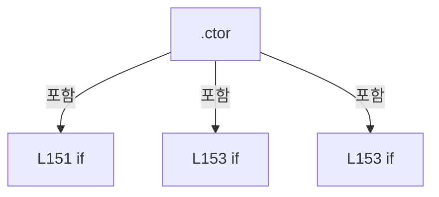

변경 전 점검: 입력/반환 타입, 위 호출자, 예외/취소 경로, 공유 상태와 저장·전송 소비자를 함께 확인합니다. 값의 단위나 물리 방향을 이름만으로 확정하지 않습니다.

### LocalFunctionStatement `SelectOutputViewerCellCallback` · L165–168

[Drilling.UI/Menu/Menus/CMenuCorrection.cs:165–168](https://github.com/kjuws10-rgb/A3Drilling/blob/96e22cd027c84bf302b23f2949b98985d7f301bb/Drilling.UI/Menu/Menus/CMenuCorrection.cs#L165-L168)

| 항목 | 실제 추출 값 |
| --- | --- |
| 서명 | void SelectOutputViewerCellCallback(object?) |
| 접근/수식자 | Private / async |
| 반환/값 타입 | void |
| 소속 타입 | NamedType:Drilling.UI.Menu.Menus.CMenuCorrection |

입력 계약:

| 이름 | 타입 | 전달 | 선택/기본값 |
| --- | --- | --- | --- |
| parameter | object? | None | False /  |

현재 부분 분석에서 직접 연결된 호출자는 없습니다. XAML/이벤트/인터페이스·델리게이트·외부 진입을 추가 확인해야 하며, 미사용으로 판정한 것이 아닙니다.

호출하는 대상과 해석 범위:

| 원본 행 | 표현식 | 분석 상태 | 대상/소스 위치 |
| --- | --- | --- | --- |
| 167 | SelectOutputViewerCell | resolved | System.Threading.Tasks.Task Drilling.UI.Menu.Menus.CMenuCorrection.SelectOutputViewerCell(object?) · Drilling.UI/Menu/Menus/CMenuCorrection.cs:542 |

본문의 실제 연산·분기·예외·반환 순서(원문 위치 순):

| 원본 행 | 종류 | 주석 해설 |
| --- | --- | --- |
| 167 | await | 비동기 완료를 기다립니다: await SelectOutputViewerCell(parameter) |
| 167 | call | 함수·델리게이트 또는 객체 생성자를 호출합니다: SelectOutputViewerCell(parameter) |

변경 전 점검: 입력/반환 타입, 위 호출자, 예외/취소 경로, 공유 상태와 저장·전송 소비자를 함께 확인합니다. 값의 단위나 물리 방향을 이름만으로 확정하지 않습니다.

### LocalFunctionStatement `BackToOutputViewerGlassCallback` · L172–175

[Drilling.UI/Menu/Menus/CMenuCorrection.cs:172–175](https://github.com/kjuws10-rgb/A3Drilling/blob/96e22cd027c84bf302b23f2949b98985d7f301bb/Drilling.UI/Menu/Menus/CMenuCorrection.cs#L172-L175)

| 항목 | 실제 추출 값 |
| --- | --- |
| 서명 | void BackToOutputViewerGlassCallback(object?) |
| 접근/수식자 | Private / async |
| 반환/값 타입 | void |
| 소속 타입 | NamedType:Drilling.UI.Menu.Menus.CMenuCorrection |

입력 계약:

| 이름 | 타입 | 전달 | 선택/기본값 |
| --- | --- | --- | --- |
| parameter | object? | None | False /  |

현재 부분 분석에서 직접 연결된 호출자는 없습니다. XAML/이벤트/인터페이스·델리게이트·외부 진입을 추가 확인해야 하며, 미사용으로 판정한 것이 아닙니다.

호출하는 대상과 해석 범위:

| 원본 행 | 표현식 | 분석 상태 | 대상/소스 위치 |
| --- | --- | --- | --- |
| 174 | BackToOutputViewerGlass | resolved | System.Threading.Tasks.Task Drilling.UI.Menu.Menus.CMenuCorrection.BackToOutputViewerGlass(object?) · Drilling.UI/Menu/Menus/CMenuCorrection.cs:611 |

본문의 실제 연산·분기·예외·반환 순서(원문 위치 순):

| 원본 행 | 종류 | 주석 해설 |
| --- | --- | --- |
| 174 | await | 비동기 완료를 기다립니다: await BackToOutputViewerGlass(parameter) |
| 174 | call | 함수·델리게이트 또는 객체 생성자를 호출합니다: BackToOutputViewerGlass(parameter) |

변경 전 점검: 입력/반환 타입, 위 호출자, 예외/취소 경로, 공유 상태와 저장·전송 소비자를 함께 확인합니다. 값의 단위나 물리 방향을 이름만으로 확정하지 않습니다.

### MethodDeclaration `TryConfirmInitialReviewStart` · L180–212

[Drilling.UI/Menu/Menus/CMenuCorrection.cs:180–212](https://github.com/kjuws10-rgb/A3Drilling/blob/96e22cd027c84bf302b23f2949b98985d7f301bb/Drilling.UI/Menu/Menus/CMenuCorrection.cs#L180-L212)

| 항목 | 실제 추출 값 |
| --- | --- |
| 서명 | bool Drilling.UI.Menu.Menus.CMenuCorrection.TryConfirmInitialReviewStart(string, string, string, System.Func<string, string, bool>?, out double, out double) |
| 접근/수식자 | Private / private |
| 반환/값 타입 | bool |
| 소속 타입 | NamedType:Drilling.UI.Menu.Menus.CMenuCorrection |

입력 계약:

| 이름 | 타입 | 전달 | 선택/기본값 |
| --- | --- | --- | --- |
| title | string | None | False /  |
| context | string | None | False /  |
| fallbackMessage | string | None | False /  |
| injectedConfirmation | System.Func<string, string, bool>? | None | False /  |
| shiftOffsetX | double | Out | False /  |
| shiftOffsetY | double | Out | False /  |

정적 호출자로 확인된 위치:

| 호출 파일/행 | 호출 표현식 | 런타임 분기 가능 |
| --- | --- | --- |
| [Drilling.UI/Menu/Menus/CMenuCorrection.cs:2963–2969](https://github.com/kjuws10-rgb/A3Drilling/blob/96e22cd027c84bf302b23f2949b98985d7f301bb/Drilling.UI/Menu/Menus/CMenuCorrection.cs#L2963-L2969) | TryConfirmInitialReviewStart | False |
| [Drilling.UI/Menu/Menus/CMenuCorrection.cs:3944–3950](https://github.com/kjuws10-rgb/A3Drilling/blob/96e22cd027c84bf302b23f2949b98985d7f301bb/Drilling.UI/Menu/Menus/CMenuCorrection.cs#L3944-L3950) | TryConfirmInitialReviewStart | False |

호출하는 대상과 해석 범위:

| 원본 행 | 표현식 | 분석 상태 | 대상/소스 위치 |
| --- | --- | --- | --- |
| 191 | injectedConfirmation | resolved · 동적 구현 선택 가능 | bool System.Func<string, string, bool>.Invoke(string, string) |
| 193 | .Station | resolved | Drilling.Common.Station.CStationManager Drilling.Common.Managers.CManager.Station() · Drilling.Common/Managers/CManager.cs:330 |
| 196 | CRecipeConfirmDialog.ShowConfirmation | resolved | bool Drilling.UI.Popup.CRecipeConfirmDialog.ShowConfirmation(string, string, string, bool) · Drilling.UI/Popup/CRecipeConfirmDialog.xaml.cs:11 |
| 202 | CReviewShiftOffsetDialog.Show | resolved | Drilling.UI.Popup.EN_REVIEW_SHIFT_OFFSET_CHOICE Drilling.UI.Popup.CReviewShiftOffsetDialog.Show(Drilling.Common.Station.ST_MANUAL_MOF_COMPLETION, string) · Drilling.UI/Popup/CReviewShiftOffsetDialog.xaml.cs:27 |

본문의 실제 연산·분기·예외·반환 순서(원문 위치 순):

| 원본 행 | 종류 | 주석 해설 |
| --- | --- | --- |
| 188 | assignment | 값을 대상에 대입합니다: shiftOffsetX = 0.0 |
| 189 | assignment | 값을 대상에 대입합니다: shiftOffsetY = 0.0 |
| 190 | if | 조건에 따라 분기합니다: if (injectedConfirmation is not null) |
| 191 | call | 함수·델리게이트 또는 객체 생성자를 호출합니다: injectedConfirmation(title, fallbackMessage) |
| 191 | return | 호출자에게 값 또는 제어를 반환합니다: return injectedConfirmation(title, fallbackMessage); |
| 193 | call | 함수·델리게이트 또는 객체 생성자를 호출합니다: .Station() |
| 193 | local-declaration | 지역 변수를 선언합니다: var completion = _defaultManager?.Station().LastCompletedManualMof; |
| 193 | variable-initializer | 변수의 초기값을 지정합니다: completion = _defaultManager?.Station().LastCompletedManualMof |
| 194 | if | 조건에 따라 분기합니다: if (completion is null) |
| 196 | call | 함수·델리게이트 또는 객체 생성자를 호출합니다: CRecipeConfirmDialog.ShowConfirmation( title, fallbackMessage + "\n\n성공 완료한 Manual MOF 이력이 없습니다.\nShift Offset 0.000 / 0.000 mm로 검사를 시작합니다.", "시작") |
| 196 | return | 호출자에게 값 또는 제어를 반환합니다: return CRecipeConfirmDialog.ShowConfirmation( title, fallbackMessage + "\n\n성공 완료한 Manual MOF 이력이 없습니다.\nShift Offset 0.000 / 0.000 mm로 검사를 시작합니다.", "시작"); |
| 202 | call | 함수·델리게이트 또는 객체 생성자를 호출합니다: CReviewShiftOffsetDialog.Show(completion, context) |
| 202 | local-declaration | 지역 변수를 선언합니다: var choice = CReviewShiftOffsetDialog.Show(completion, context); |
| 202 | variable-initializer | 변수의 초기값을 지정합니다: choice = CReviewShiftOffsetDialog.Show(completion, context) |
| 203 | if | 조건에 따라 분기합니다: if (choice == EN_REVIEW_SHIFT_OFFSET_CHOICE.Cancel) |
| 204 | return | 호출자에게 값 또는 제어를 반환합니다: return false; |
| 205 | if | 조건에 따라 분기합니다: if (choice == EN_REVIEW_SHIFT_OFFSET_CHOICE.Apply) |
| 207 | assignment | 값을 대상에 대입합니다: shiftOffsetX = completion.ShiftOffsetX |
| 208 | assignment | 값을 대상에 대입합니다: shiftOffsetY = completion.ShiftOffsetY |
| 211 | return | 호출자에게 값 또는 제어를 반환합니다: return true; |

제어 구문의 포함 구조(실제 실행 순서/CFG가 아닌 구문 탐색 그림):

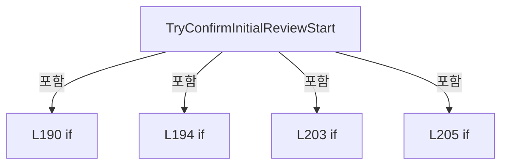

변경 전 점검: 입력/반환 타입, 위 호출자, 예외/취소 경로, 공유 상태와 저장·전송 소비자를 함께 확인합니다. 값의 단위나 물리 방향을 이름만으로 확정하지 않습니다.

### PropertyDeclaration `Menu` · L216–222

[Drilling.UI/Menu/Menus/CMenuCorrection.cs:216–222](https://github.com/kjuws10-rgb/A3Drilling/blob/96e22cd027c84bf302b23f2949b98985d7f301bb/Drilling.UI/Menu/Menus/CMenuCorrection.cs#L216-L222)

| 항목 | 실제 추출 값 |
| --- | --- |
| 서명 | Drilling.UI.Menu.Menus.EN_MENU Drilling.UI.Menu.Menus.CMenuCorrection.Menu |
| 접근/수식자 | Public / public, override |
| 반환/값 타입 | Drilling.UI.Menu.Menus.EN_MENU |
| 소속 타입 | NamedType:Drilling.UI.Menu.Menus.CMenuCorrection |

현재 부분 분석에서 직접 연결된 호출자는 없습니다. XAML/이벤트/인터페이스·델리게이트·외부 진입을 추가 확인해야 하며, 미사용으로 판정한 것이 아닙니다.

변경 전 점검: 입력/반환 타입, 위 호출자, 예외/취소 경로, 공유 상태와 저장·전송 소비자를 함께 확인합니다. 값의 단위나 물리 방향을 이름만으로 확정하지 않습니다.

### GetAccessorDeclaration `get_Menu` · L218–221

[Drilling.UI/Menu/Menus/CMenuCorrection.cs:218–221](https://github.com/kjuws10-rgb/A3Drilling/blob/96e22cd027c84bf302b23f2949b98985d7f301bb/Drilling.UI/Menu/Menus/CMenuCorrection.cs#L218-L221)

| 항목 | 실제 추출 값 |
| --- | --- |
| 서명 | Drilling.UI.Menu.Menus.EN_MENU Drilling.UI.Menu.Menus.CMenuCorrection.Menu.get |
| 접근/수식자 | Public / get |
| 반환/값 타입 | Drilling.UI.Menu.Menus.EN_MENU |
| 소속 타입 | NamedType:Drilling.UI.Menu.Menus.CMenuCorrection |

현재 부분 분석에서 직접 연결된 호출자는 없습니다. XAML/이벤트/인터페이스·델리게이트·외부 진입을 추가 확인해야 하며, 미사용으로 판정한 것이 아닙니다.

본문의 실제 연산·분기·예외·반환 순서(원문 위치 순):

| 원본 행 | 종류 | 주석 해설 |
| --- | --- | --- |
| 220 | return | 호출자에게 값 또는 제어를 반환합니다: return EN_MENU.Correction; |

변경 전 점검: 입력/반환 타입, 위 호출자, 예외/취소 경로, 공유 상태와 저장·전송 소비자를 함께 확인합니다. 값의 단위나 물리 방향을 이름만으로 확정하지 않습니다.

### PropertyDeclaration `Title` · L224–230

[Drilling.UI/Menu/Menus/CMenuCorrection.cs:224–230](https://github.com/kjuws10-rgb/A3Drilling/blob/96e22cd027c84bf302b23f2949b98985d7f301bb/Drilling.UI/Menu/Menus/CMenuCorrection.cs#L224-L230)

| 항목 | 실제 추출 값 |
| --- | --- |
| 서명 | string Drilling.UI.Menu.Menus.CMenuCorrection.Title |
| 접근/수식자 | Public / public |
| 반환/값 타입 | string |
| 소속 타입 | NamedType:Drilling.UI.Menu.Menus.CMenuCorrection |

현재 부분 분석에서 직접 연결된 호출자는 없습니다. XAML/이벤트/인터페이스·델리게이트·외부 진입을 추가 확인해야 하며, 미사용으로 판정한 것이 아닙니다.

변경 전 점검: 입력/반환 타입, 위 호출자, 예외/취소 경로, 공유 상태와 저장·전송 소비자를 함께 확인합니다. 값의 단위나 물리 방향을 이름만으로 확정하지 않습니다.

### GetAccessorDeclaration `get_Title` · L226–229

[Drilling.UI/Menu/Menus/CMenuCorrection.cs:226–229](https://github.com/kjuws10-rgb/A3Drilling/blob/96e22cd027c84bf302b23f2949b98985d7f301bb/Drilling.UI/Menu/Menus/CMenuCorrection.cs#L226-L229)

| 항목 | 실제 추출 값 |
| --- | --- |
| 서명 | string Drilling.UI.Menu.Menus.CMenuCorrection.Title.get |
| 접근/수식자 | Public / get |
| 반환/값 타입 | string |
| 소속 타입 | NamedType:Drilling.UI.Menu.Menus.CMenuCorrection |

현재 부분 분석에서 직접 연결된 호출자는 없습니다. XAML/이벤트/인터페이스·델리게이트·외부 진입을 추가 확인해야 하며, 미사용으로 판정한 것이 아닙니다.

본문의 실제 연산·분기·예외·반환 순서(원문 위치 순):

| 원본 행 | 종류 | 주석 해설 |
| --- | --- | --- |
| 228 | return | 호출자에게 값 또는 제어를 반환합니다: return $"CORRECTION / {_selectedTab}"; |

변경 전 점검: 입력/반환 타입, 위 호출자, 예외/취소 경로, 공유 상태와 저장·전송 소비자를 함께 확인합니다. 값의 단위나 물리 방향을 이름만으로 확정하지 않습니다.

### PropertyDeclaration `Subtitle` · L232–238

[Drilling.UI/Menu/Menus/CMenuCorrection.cs:232–238](https://github.com/kjuws10-rgb/A3Drilling/blob/96e22cd027c84bf302b23f2949b98985d7f301bb/Drilling.UI/Menu/Menus/CMenuCorrection.cs#L232-L238)

| 항목 | 실제 추출 값 |
| --- | --- |
| 서명 | string Drilling.UI.Menu.Menus.CMenuCorrection.Subtitle |
| 접근/수식자 | Public / public |
| 반환/값 타입 | string |
| 소속 타입 | NamedType:Drilling.UI.Menu.Menus.CMenuCorrection |

현재 부분 분석에서 직접 연결된 호출자는 없습니다. XAML/이벤트/인터페이스·델리게이트·외부 진입을 추가 확인해야 하며, 미사용으로 판정한 것이 아닙니다.

변경 전 점검: 입력/반환 타입, 위 호출자, 예외/취소 경로, 공유 상태와 저장·전송 소비자를 함께 확인합니다. 값의 단위나 물리 방향을 이름만으로 확정하지 않습니다.

### GetAccessorDeclaration `get_Subtitle` · L234–237

[Drilling.UI/Menu/Menus/CMenuCorrection.cs:234–237](https://github.com/kjuws10-rgb/A3Drilling/blob/96e22cd027c84bf302b23f2949b98985d7f301bb/Drilling.UI/Menu/Menus/CMenuCorrection.cs#L234-L237)

| 항목 | 실제 추출 값 |
| --- | --- |
| 서명 | string Drilling.UI.Menu.Menus.CMenuCorrection.Subtitle.get |
| 접근/수식자 | Public / get |
| 반환/값 타입 | string |
| 소속 타입 | NamedType:Drilling.UI.Menu.Menus.CMenuCorrection |

현재 부분 분석에서 직접 연결된 호출자는 없습니다. XAML/이벤트/인터페이스·델리게이트·외부 진입을 추가 확인해야 하며, 미사용으로 판정한 것이 아닙니다.

호출하는 대상과 해석 범위:

| 원본 행 | 표현식 | 분석 상태 | 대상/소스 위치 |
| --- | --- | --- | --- |
| 236 | GetSubtitle | resolved | string Drilling.UI.Menu.Menus.CMenuCorrection.GetSubtitle(string) · Drilling.UI/Menu/Menus/CMenuCorrection.cs:2547 |

본문의 실제 연산·분기·예외·반환 순서(원문 위치 순):

| 원본 행 | 종류 | 주석 해설 |
| --- | --- | --- |
| 236 | call | 함수·델리게이트 또는 객체 생성자를 호출합니다: GetSubtitle(_selectedTab) |
| 236 | return | 호출자에게 값 또는 제어를 반환합니다: return GetSubtitle(_selectedTab); |

변경 전 점검: 입력/반환 타입, 위 호출자, 예외/취소 경로, 공유 상태와 저장·전송 소비자를 함께 확인합니다. 값의 단위나 물리 방향을 이름만으로 확정하지 않습니다.

### PropertyDeclaration `SelectedTab` · L240–246

[Drilling.UI/Menu/Menus/CMenuCorrection.cs:240–246](https://github.com/kjuws10-rgb/A3Drilling/blob/96e22cd027c84bf302b23f2949b98985d7f301bb/Drilling.UI/Menu/Menus/CMenuCorrection.cs#L240-L246)

| 항목 | 실제 추출 값 |
| --- | --- |
| 서명 | string Drilling.UI.Menu.Menus.CMenuCorrection.SelectedTab |
| 접근/수식자 | Public / public |
| 반환/값 타입 | string |
| 소속 타입 | NamedType:Drilling.UI.Menu.Menus.CMenuCorrection |

현재 부분 분석에서 직접 연결된 호출자는 없습니다. XAML/이벤트/인터페이스·델리게이트·외부 진입을 추가 확인해야 하며, 미사용으로 판정한 것이 아닙니다.

변경 전 점검: 입력/반환 타입, 위 호출자, 예외/취소 경로, 공유 상태와 저장·전송 소비자를 함께 확인합니다. 값의 단위나 물리 방향을 이름만으로 확정하지 않습니다.

### GetAccessorDeclaration `get_SelectedTab` · L242–245

[Drilling.UI/Menu/Menus/CMenuCorrection.cs:242–245](https://github.com/kjuws10-rgb/A3Drilling/blob/96e22cd027c84bf302b23f2949b98985d7f301bb/Drilling.UI/Menu/Menus/CMenuCorrection.cs#L242-L245)

| 항목 | 실제 추출 값 |
| --- | --- |
| 서명 | string Drilling.UI.Menu.Menus.CMenuCorrection.SelectedTab.get |
| 접근/수식자 | Public / get |
| 반환/값 타입 | string |
| 소속 타입 | NamedType:Drilling.UI.Menu.Menus.CMenuCorrection |

현재 부분 분석에서 직접 연결된 호출자는 없습니다. XAML/이벤트/인터페이스·델리게이트·외부 진입을 추가 확인해야 하며, 미사용으로 판정한 것이 아닙니다.

본문의 실제 연산·분기·예외·반환 순서(원문 위치 순):

| 원본 행 | 종류 | 주석 해설 |
| --- | --- | --- |
| 244 | return | 호출자에게 값 또는 제어를 반환합니다: return _selectedTab; |

변경 전 점검: 입력/반환 타입, 위 호출자, 예외/취소 경로, 공유 상태와 저장·전송 소비자를 함께 확인합니다. 값의 단위나 물리 방향을 이름만으로 확정하지 않습니다.

### PropertyDeclaration `SelectedReviewTabIndex` · L248–262

[Drilling.UI/Menu/Menus/CMenuCorrection.cs:248–262](https://github.com/kjuws10-rgb/A3Drilling/blob/96e22cd027c84bf302b23f2949b98985d7f301bb/Drilling.UI/Menu/Menus/CMenuCorrection.cs#L248-L262)

| 항목 | 실제 추출 값 |
| --- | --- |
| 서명 | int Drilling.UI.Menu.Menus.CMenuCorrection.SelectedReviewTabIndex |
| 접근/수식자 | Public / public |
| 반환/값 타입 | int |
| 소속 타입 | NamedType:Drilling.UI.Menu.Menus.CMenuCorrection |

현재 부분 분석에서 직접 연결된 호출자는 없습니다. XAML/이벤트/인터페이스·델리게이트·외부 진입을 추가 확인해야 하며, 미사용으로 판정한 것이 아닙니다.

변경 전 점검: 입력/반환 타입, 위 호출자, 예외/취소 경로, 공유 상태와 저장·전송 소비자를 함께 확인합니다. 값의 단위나 물리 방향을 이름만으로 확정하지 않습니다.

### GetAccessorDeclaration `get_SelectedReviewTabIndex` · L250–250

[Drilling.UI/Menu/Menus/CMenuCorrection.cs:250–250](https://github.com/kjuws10-rgb/A3Drilling/blob/96e22cd027c84bf302b23f2949b98985d7f301bb/Drilling.UI/Menu/Menus/CMenuCorrection.cs#L250-L250)

| 항목 | 실제 추출 값 |
| --- | --- |
| 서명 | int Drilling.UI.Menu.Menus.CMenuCorrection.SelectedReviewTabIndex.get |
| 접근/수식자 | Public / get |
| 반환/값 타입 | int |
| 소속 타입 | NamedType:Drilling.UI.Menu.Menus.CMenuCorrection |

현재 부분 분석에서 직접 연결된 호출자는 없습니다. XAML/이벤트/인터페이스·델리게이트·외부 진입을 추가 확인해야 하며, 미사용으로 판정한 것이 아닙니다.

변경 전 점검: 입력/반환 타입, 위 호출자, 예외/취소 경로, 공유 상태와 저장·전송 소비자를 함께 확인합니다. 값의 단위나 물리 방향을 이름만으로 확정하지 않습니다.

### SetAccessorDeclaration `set_SelectedReviewTabIndex` · L251–261

[Drilling.UI/Menu/Menus/CMenuCorrection.cs:251–261](https://github.com/kjuws10-rgb/A3Drilling/blob/96e22cd027c84bf302b23f2949b98985d7f301bb/Drilling.UI/Menu/Menus/CMenuCorrection.cs#L251-L261)

| 항목 | 실제 추출 값 |
| --- | --- |
| 서명 | void Drilling.UI.Menu.Menus.CMenuCorrection.SelectedReviewTabIndex.set |
| 접근/수식자 | Public / set |
| 반환/값 타입 | void |
| 소속 타입 | NamedType:Drilling.UI.Menu.Menus.CMenuCorrection |

입력 계약:

| 이름 | 타입 | 전달 | 선택/기본값 |
| --- | --- | --- | --- |
| value | int | None | False /  |

현재 부분 분석에서 직접 연결된 호출자는 없습니다. XAML/이벤트/인터페이스·델리게이트·외부 진입을 추가 확인해야 하며, 미사용으로 판정한 것이 아닙니다.

호출하는 대상과 해석 범위:

| 원본 행 | 표현식 | 분석 상태 | 대상/소스 위치 |
| --- | --- | --- | --- |
| 253 | Math.Clamp | resolved | int System.Math.Clamp(int, int, int) |
| 258 | OnPropertyChanged | resolved | void Drilling.UI.Menu.CBindingBase.OnPropertyChanged(string?) · Drilling.UI/Menu/CBindingBase.cs:784 |
| 258 | nameof | unresolved | None |
| 260 | _refreshCurrentScreen | resolved · 동적 구현 선택 가능 | System.Threading.Tasks.Task System.Func<System.Threading.Tasks.Task>.Invoke() |

본문의 실제 연산·분기·예외·반환 순서(원문 위치 순):

| 원본 행 | 종류 | 주석 해설 |
| --- | --- | --- |
| 253 | call | 함수·델리게이트 또는 객체 생성자를 호출합니다: Math.Clamp(value, 0, 4) |
| 253 | local-declaration | 지역 변수를 선언합니다: var normalized = Math.Clamp(value, 0, 4); |
| 253 | variable-initializer | 변수의 초기값을 지정합니다: normalized = Math.Clamp(value, 0, 4) |
| 254 | if | 조건에 따라 분기합니다: if (_selectedReviewTabIndex == normalized) |
| 255 | return | 호출자에게 값 또는 제어를 반환합니다: return; |
| 257 | assignment | 값을 대상에 대입합니다: _selectedReviewTabIndex = normalized |
| 258 | call | 함수·델리게이트 또는 객체 생성자를 호출합니다: OnPropertyChanged(nameof(SelectedReviewTabIndex)) |
| 258 | call | 함수·델리게이트 또는 객체 생성자를 호출합니다: nameof(SelectedReviewTabIndex) |
| 259 | if | 조건에 따라 분기합니다: if (IsReviewCorrectionTab) |
| 260 | assignment | 값을 대상에 대입합니다: _ = _refreshCurrentScreen() |
| 260 | call | 함수·델리게이트 또는 객체 생성자를 호출합니다: _refreshCurrentScreen() |

제어 구문의 포함 구조(실제 실행 순서/CFG가 아닌 구문 탐색 그림):

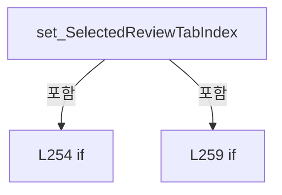

변경 전 점검: 입력/반환 타입, 위 호출자, 예외/취소 경로, 공유 상태와 저장·전송 소비자를 함께 확인합니다. 값의 단위나 물리 방향을 이름만으로 확정하지 않습니다.

### PropertyDeclaration `IsOtherCorrectionTab` · L264–270

[Drilling.UI/Menu/Menus/CMenuCorrection.cs:264–270](https://github.com/kjuws10-rgb/A3Drilling/blob/96e22cd027c84bf302b23f2949b98985d7f301bb/Drilling.UI/Menu/Menus/CMenuCorrection.cs#L264-L270)

| 항목 | 실제 추출 값 |
| --- | --- |
| 서명 | bool Drilling.UI.Menu.Menus.CMenuCorrection.IsOtherCorrectionTab |
| 접근/수식자 | Public / public |
| 반환/값 타입 | bool |
| 소속 타입 | NamedType:Drilling.UI.Menu.Menus.CMenuCorrection |

현재 부분 분석에서 직접 연결된 호출자는 없습니다. XAML/이벤트/인터페이스·델리게이트·외부 진입을 추가 확인해야 하며, 미사용으로 판정한 것이 아닙니다.

변경 전 점검: 입력/반환 타입, 위 호출자, 예외/취소 경로, 공유 상태와 저장·전송 소비자를 함께 확인합니다. 값의 단위나 물리 방향을 이름만으로 확정하지 않습니다.

### GetAccessorDeclaration `get_IsOtherCorrectionTab` · L266–269

[Drilling.UI/Menu/Menus/CMenuCorrection.cs:266–269](https://github.com/kjuws10-rgb/A3Drilling/blob/96e22cd027c84bf302b23f2949b98985d7f301bb/Drilling.UI/Menu/Menus/CMenuCorrection.cs#L266-L269)

| 항목 | 실제 추출 값 |
| --- | --- |
| 서명 | bool Drilling.UI.Menu.Menus.CMenuCorrection.IsOtherCorrectionTab.get |
| 접근/수식자 | Public / get |
| 반환/값 타입 | bool |
| 소속 타입 | NamedType:Drilling.UI.Menu.Menus.CMenuCorrection |

현재 부분 분석에서 직접 연결된 호출자는 없습니다. XAML/이벤트/인터페이스·델리게이트·외부 진입을 추가 확인해야 하며, 미사용으로 판정한 것이 아닙니다.

본문의 실제 연산·분기·예외·반환 순서(원문 위치 순):

| 원본 행 | 종류 | 주석 해설 |
| --- | --- | --- |
| 268 | return | 호출자에게 값 또는 제어를 반환합니다: return !IsDefaultTab && !IsOutputHistoryTab && !IsAlignDistortionTab && !IsReviewCorrectionTab; |

변경 전 점검: 입력/반환 타입, 위 호출자, 예외/취소 경로, 공유 상태와 저장·전송 소비자를 함께 확인합니다. 값의 단위나 물리 방향을 이름만으로 확정하지 않습니다.

### PropertyDeclaration `IsDefaultTab` · L272–272

[Drilling.UI/Menu/Menus/CMenuCorrection.cs:272–272](https://github.com/kjuws10-rgb/A3Drilling/blob/96e22cd027c84bf302b23f2949b98985d7f301bb/Drilling.UI/Menu/Menus/CMenuCorrection.cs#L272-L272)

| 항목 | 실제 추출 값 |
| --- | --- |
| 서명 | bool Drilling.UI.Menu.Menus.CMenuCorrection.IsDefaultTab |
| 접근/수식자 | Public / public |
| 반환/값 타입 | bool |
| 소속 타입 | NamedType:Drilling.UI.Menu.Menus.CMenuCorrection |

현재 부분 분석에서 직접 연결된 호출자는 없습니다. XAML/이벤트/인터페이스·델리게이트·외부 진입을 추가 확인해야 하며, 미사용으로 판정한 것이 아닙니다.

변경 전 점검: 입력/반환 타입, 위 호출자, 예외/취소 경로, 공유 상태와 저장·전송 소비자를 함께 확인합니다. 값의 단위나 물리 방향을 이름만으로 확정하지 않습니다.

### PropertyDeclaration `IsAlignDistortionTab` · L273–273

[Drilling.UI/Menu/Menus/CMenuCorrection.cs:273–273](https://github.com/kjuws10-rgb/A3Drilling/blob/96e22cd027c84bf302b23f2949b98985d7f301bb/Drilling.UI/Menu/Menus/CMenuCorrection.cs#L273-L273)

| 항목 | 실제 추출 값 |
| --- | --- |
| 서명 | bool Drilling.UI.Menu.Menus.CMenuCorrection.IsAlignDistortionTab |
| 접근/수식자 | Public / public |
| 반환/값 타입 | bool |
| 소속 타입 | NamedType:Drilling.UI.Menu.Menus.CMenuCorrection |

현재 부분 분석에서 직접 연결된 호출자는 없습니다. XAML/이벤트/인터페이스·델리게이트·외부 진입을 추가 확인해야 하며, 미사용으로 판정한 것이 아닙니다.

변경 전 점검: 입력/반환 타입, 위 호출자, 예외/취소 경로, 공유 상태와 저장·전송 소비자를 함께 확인합니다. 값의 단위나 물리 방향을 이름만으로 확정하지 않습니다.

### PropertyDeclaration `IsReviewCorrectionTab` · L274–274

[Drilling.UI/Menu/Menus/CMenuCorrection.cs:274–274](https://github.com/kjuws10-rgb/A3Drilling/blob/96e22cd027c84bf302b23f2949b98985d7f301bb/Drilling.UI/Menu/Menus/CMenuCorrection.cs#L274-L274)

| 항목 | 실제 추출 값 |
| --- | --- |
| 서명 | bool Drilling.UI.Menu.Menus.CMenuCorrection.IsReviewCorrectionTab |
| 접근/수식자 | Public / public |
| 반환/값 타입 | bool |
| 소속 타입 | NamedType:Drilling.UI.Menu.Menus.CMenuCorrection |

현재 부분 분석에서 직접 연결된 호출자는 없습니다. XAML/이벤트/인터페이스·델리게이트·외부 진입을 추가 확인해야 하며, 미사용으로 판정한 것이 아닙니다.

변경 전 점검: 입력/반환 타입, 위 호출자, 예외/취소 경로, 공유 상태와 저장·전송 소비자를 함께 확인합니다. 값의 단위나 물리 방향을 이름만으로 확정하지 않습니다.

### PropertyDeclaration `Simple` · L275–275

[Drilling.UI/Menu/Menus/CMenuCorrection.cs:275–275](https://github.com/kjuws10-rgb/A3Drilling/blob/96e22cd027c84bf302b23f2949b98985d7f301bb/Drilling.UI/Menu/Menus/CMenuCorrection.cs#L275-L275)

| 항목 | 실제 추출 값 |
| --- | --- |
| 서명 | Drilling.UI.Menu.Menus.CSimpleCorrectionPanel Drilling.UI.Menu.Menus.CMenuCorrection.Simple |
| 접근/수식자 | Public / public |
| 반환/값 타입 | Drilling.UI.Menu.Menus.CSimpleCorrectionPanel |
| 소속 타입 | NamedType:Drilling.UI.Menu.Menus.CMenuCorrection |

현재 부분 분석에서 직접 연결된 호출자는 없습니다. XAML/이벤트/인터페이스·델리게이트·외부 진입을 추가 확인해야 하며, 미사용으로 판정한 것이 아닙니다.

변경 전 점검: 입력/반환 타입, 위 호출자, 예외/취소 경로, 공유 상태와 저장·전송 소비자를 함께 확인합니다. 값의 단위나 물리 방향을 이름만으로 확정하지 않습니다.

### GetAccessorDeclaration `get_Simple` · L275–275

[Drilling.UI/Menu/Menus/CMenuCorrection.cs:275–275](https://github.com/kjuws10-rgb/A3Drilling/blob/96e22cd027c84bf302b23f2949b98985d7f301bb/Drilling.UI/Menu/Menus/CMenuCorrection.cs#L275-L275)

| 항목 | 실제 추출 값 |
| --- | --- |
| 서명 | Drilling.UI.Menu.Menus.CSimpleCorrectionPanel Drilling.UI.Menu.Menus.CMenuCorrection.Simple.get |
| 접근/수식자 | Public / get |
| 반환/값 타입 | Drilling.UI.Menu.Menus.CSimpleCorrectionPanel |
| 소속 타입 | NamedType:Drilling.UI.Menu.Menus.CMenuCorrection |

현재 부분 분석에서 직접 연결된 호출자는 없습니다. XAML/이벤트/인터페이스·델리게이트·외부 진입을 추가 확인해야 하며, 미사용으로 판정한 것이 아닙니다.

변경 전 점검: 입력/반환 타입, 위 호출자, 예외/취소 경로, 공유 상태와 저장·전송 소비자를 함께 확인합니다. 값의 단위나 물리 방향을 이름만으로 확정하지 않습니다.

### PropertyDeclaration `Rough` · L276–276

[Drilling.UI/Menu/Menus/CMenuCorrection.cs:276–276](https://github.com/kjuws10-rgb/A3Drilling/blob/96e22cd027c84bf302b23f2949b98985d7f301bb/Drilling.UI/Menu/Menus/CMenuCorrection.cs#L276-L276)

| 항목 | 실제 추출 값 |
| --- | --- |
| 서명 | Drilling.UI.Menu.Menus.CSimpleCorrectionPanel Drilling.UI.Menu.Menus.CMenuCorrection.Rough |
| 접근/수식자 | Public / public |
| 반환/값 타입 | Drilling.UI.Menu.Menus.CSimpleCorrectionPanel |
| 소속 타입 | NamedType:Drilling.UI.Menu.Menus.CMenuCorrection |

현재 부분 분석에서 직접 연결된 호출자는 없습니다. XAML/이벤트/인터페이스·델리게이트·외부 진입을 추가 확인해야 하며, 미사용으로 판정한 것이 아닙니다.

변경 전 점검: 입력/반환 타입, 위 호출자, 예외/취소 경로, 공유 상태와 저장·전송 소비자를 함께 확인합니다. 값의 단위나 물리 방향을 이름만으로 확정하지 않습니다.

### GetAccessorDeclaration `get_Rough` · L276–276

[Drilling.UI/Menu/Menus/CMenuCorrection.cs:276–276](https://github.com/kjuws10-rgb/A3Drilling/blob/96e22cd027c84bf302b23f2949b98985d7f301bb/Drilling.UI/Menu/Menus/CMenuCorrection.cs#L276-L276)

| 항목 | 실제 추출 값 |
| --- | --- |
| 서명 | Drilling.UI.Menu.Menus.CSimpleCorrectionPanel Drilling.UI.Menu.Menus.CMenuCorrection.Rough.get |
| 접근/수식자 | Public / get |
| 반환/값 타입 | Drilling.UI.Menu.Menus.CSimpleCorrectionPanel |
| 소속 타입 | NamedType:Drilling.UI.Menu.Menus.CMenuCorrection |

현재 부분 분석에서 직접 연결된 호출자는 없습니다. XAML/이벤트/인터페이스·델리게이트·외부 진입을 추가 확인해야 하며, 미사용으로 판정한 것이 아닙니다.

변경 전 점검: 입력/반환 타입, 위 호출자, 예외/취소 경로, 공유 상태와 저장·전송 소비자를 함께 확인합니다. 값의 단위나 물리 방향을 이름만으로 확정하지 않습니다.

### PropertyDeclaration `Fine` · L277–277

[Drilling.UI/Menu/Menus/CMenuCorrection.cs:277–277](https://github.com/kjuws10-rgb/A3Drilling/blob/96e22cd027c84bf302b23f2949b98985d7f301bb/Drilling.UI/Menu/Menus/CMenuCorrection.cs#L277-L277)

| 항목 | 실제 추출 값 |
| --- | --- |
| 서명 | Drilling.UI.Menu.Menus.CFineCorrectionPanel Drilling.UI.Menu.Menus.CMenuCorrection.Fine |
| 접근/수식자 | Public / public |
| 반환/값 타입 | Drilling.UI.Menu.Menus.CFineCorrectionPanel |
| 소속 타입 | NamedType:Drilling.UI.Menu.Menus.CMenuCorrection |

현재 부분 분석에서 직접 연결된 호출자는 없습니다. XAML/이벤트/인터페이스·델리게이트·외부 진입을 추가 확인해야 하며, 미사용으로 판정한 것이 아닙니다.

변경 전 점검: 입력/반환 타입, 위 호출자, 예외/취소 경로, 공유 상태와 저장·전송 소비자를 함께 확인합니다. 값의 단위나 물리 방향을 이름만으로 확정하지 않습니다.

### GetAccessorDeclaration `get_Fine` · L277–277

[Drilling.UI/Menu/Menus/CMenuCorrection.cs:277–277](https://github.com/kjuws10-rgb/A3Drilling/blob/96e22cd027c84bf302b23f2949b98985d7f301bb/Drilling.UI/Menu/Menus/CMenuCorrection.cs#L277-L277)

| 항목 | 실제 추출 값 |
| --- | --- |
| 서명 | Drilling.UI.Menu.Menus.CFineCorrectionPanel Drilling.UI.Menu.Menus.CMenuCorrection.Fine.get |
| 접근/수식자 | Public / get |
| 반환/값 타입 | Drilling.UI.Menu.Menus.CFineCorrectionPanel |
| 소속 타입 | NamedType:Drilling.UI.Menu.Menus.CMenuCorrection |

현재 부분 분석에서 직접 연결된 호출자는 없습니다. XAML/이벤트/인터페이스·델리게이트·외부 진입을 추가 확인해야 하며, 미사용으로 판정한 것이 아닙니다.

변경 전 점검: 입력/반환 타입, 위 호출자, 예외/취소 경로, 공유 상태와 저장·전송 소비자를 함께 확인합니다. 값의 단위나 물리 방향을 이름만으로 확정하지 않습니다.

### PropertyDeclaration `IsCorrectionCommandsVisible` · L278–278

[Drilling.UI/Menu/Menus/CMenuCorrection.cs:278–278](https://github.com/kjuws10-rgb/A3Drilling/blob/96e22cd027c84bf302b23f2949b98985d7f301bb/Drilling.UI/Menu/Menus/CMenuCorrection.cs#L278-L278)

| 항목 | 실제 추출 값 |
| --- | --- |
| 서명 | bool Drilling.UI.Menu.Menus.CMenuCorrection.IsCorrectionCommandsVisible |
| 접근/수식자 | Public / public |
| 반환/값 타입 | bool |
| 소속 타입 | NamedType:Drilling.UI.Menu.Menus.CMenuCorrection |

현재 부분 분석에서 직접 연결된 호출자는 없습니다. XAML/이벤트/인터페이스·델리게이트·외부 진입을 추가 확인해야 하며, 미사용으로 판정한 것이 아닙니다.

변경 전 점검: 입력/반환 타입, 위 호출자, 예외/취소 경로, 공유 상태와 저장·전송 소비자를 함께 확인합니다. 값의 단위나 물리 방향을 이름만으로 확정하지 않습니다.

### PropertyDeclaration `AlignDistortion` · L279–279

[Drilling.UI/Menu/Menus/CMenuCorrection.cs:279–279](https://github.com/kjuws10-rgb/A3Drilling/blob/96e22cd027c84bf302b23f2949b98985d7f301bb/Drilling.UI/Menu/Menus/CMenuCorrection.cs#L279-L279)

| 항목 | 실제 추출 값 |
| --- | --- |
| 서명 | Drilling.UI.Menu.Menus.CAlignDistortionPanel Drilling.UI.Menu.Menus.CMenuCorrection.AlignDistortion |
| 접근/수식자 | Public / public |
| 반환/값 타입 | Drilling.UI.Menu.Menus.CAlignDistortionPanel |
| 소속 타입 | NamedType:Drilling.UI.Menu.Menus.CMenuCorrection |

현재 부분 분석에서 직접 연결된 호출자는 없습니다. XAML/이벤트/인터페이스·델리게이트·외부 진입을 추가 확인해야 하며, 미사용으로 판정한 것이 아닙니다.

변경 전 점검: 입력/반환 타입, 위 호출자, 예외/취소 경로, 공유 상태와 저장·전송 소비자를 함께 확인합니다. 값의 단위나 물리 방향을 이름만으로 확정하지 않습니다.

### GetAccessorDeclaration `get_AlignDistortion` · L279–279

[Drilling.UI/Menu/Menus/CMenuCorrection.cs:279–279](https://github.com/kjuws10-rgb/A3Drilling/blob/96e22cd027c84bf302b23f2949b98985d7f301bb/Drilling.UI/Menu/Menus/CMenuCorrection.cs#L279-L279)

| 항목 | 실제 추출 값 |
| --- | --- |
| 서명 | Drilling.UI.Menu.Menus.CAlignDistortionPanel Drilling.UI.Menu.Menus.CMenuCorrection.AlignDistortion.get |
| 접근/수식자 | Public / get |
| 반환/값 타입 | Drilling.UI.Menu.Menus.CAlignDistortionPanel |
| 소속 타입 | NamedType:Drilling.UI.Menu.Menus.CMenuCorrection |

현재 부분 분석에서 직접 연결된 호출자는 없습니다. XAML/이벤트/인터페이스·델리게이트·외부 진입을 추가 확인해야 하며, 미사용으로 판정한 것이 아닙니다.

변경 전 점검: 입력/반환 타입, 위 호출자, 예외/취소 경로, 공유 상태와 저장·전송 소비자를 함께 확인합니다. 값의 단위나 물리 방향을 이름만으로 확정하지 않습니다.

### PropertyDeclaration `IsOutputHistoryTab` · L281–287

[Drilling.UI/Menu/Menus/CMenuCorrection.cs:281–287](https://github.com/kjuws10-rgb/A3Drilling/blob/96e22cd027c84bf302b23f2949b98985d7f301bb/Drilling.UI/Menu/Menus/CMenuCorrection.cs#L281-L287)

| 항목 | 실제 추출 값 |
| --- | --- |
| 서명 | bool Drilling.UI.Menu.Menus.CMenuCorrection.IsOutputHistoryTab |
| 접근/수식자 | Public / public |
| 반환/값 타입 | bool |
| 소속 타입 | NamedType:Drilling.UI.Menu.Menus.CMenuCorrection |

현재 부분 분석에서 직접 연결된 호출자는 없습니다. XAML/이벤트/인터페이스·델리게이트·외부 진입을 추가 확인해야 하며, 미사용으로 판정한 것이 아닙니다.

변경 전 점검: 입력/반환 타입, 위 호출자, 예외/취소 경로, 공유 상태와 저장·전송 소비자를 함께 확인합니다. 값의 단위나 물리 방향을 이름만으로 확정하지 않습니다.

### GetAccessorDeclaration `get_IsOutputHistoryTab` · L283–286

[Drilling.UI/Menu/Menus/CMenuCorrection.cs:283–286](https://github.com/kjuws10-rgb/A3Drilling/blob/96e22cd027c84bf302b23f2949b98985d7f301bb/Drilling.UI/Menu/Menus/CMenuCorrection.cs#L283-L286)

| 항목 | 실제 추출 값 |
| --- | --- |
| 서명 | bool Drilling.UI.Menu.Menus.CMenuCorrection.IsOutputHistoryTab.get |
| 접근/수식자 | Public / get |
| 반환/값 타입 | bool |
| 소속 타입 | NamedType:Drilling.UI.Menu.Menus.CMenuCorrection |

현재 부분 분석에서 직접 연결된 호출자는 없습니다. XAML/이벤트/인터페이스·델리게이트·외부 진입을 추가 확인해야 하며, 미사용으로 판정한 것이 아닙니다.

호출하는 대상과 해석 범위:

| 원본 행 | 표현식 | 분석 상태 | 대상/소스 위치 |
| --- | --- | --- | --- |
| 285 | _selectedTab.Equals | resolved | bool string.Equals(string?, System.StringComparison) |

본문의 실제 연산·분기·예외·반환 순서(원문 위치 순):

| 원본 행 | 종류 | 주석 해설 |
| --- | --- | --- |
| 285 | call | 함수·델리게이트 또는 객체 생성자를 호출합니다: _selectedTab.Equals("VIEWER", StringComparison.OrdinalIgnoreCase) |
| 285 | return | 호출자에게 값 또는 제어를 반환합니다: return _selectedTab.Equals("VIEWER", StringComparison.OrdinalIgnoreCase); |

변경 전 점검: 입력/반환 타입, 위 호출자, 예외/취소 경로, 공유 상태와 저장·전송 소비자를 함께 확인합니다. 값의 단위나 물리 방향을 이름만으로 확정하지 않습니다.

### PropertyDeclaration `IsCorrectionHistoryVisible` · L289–295

[Drilling.UI/Menu/Menus/CMenuCorrection.cs:289–295](https://github.com/kjuws10-rgb/A3Drilling/blob/96e22cd027c84bf302b23f2949b98985d7f301bb/Drilling.UI/Menu/Menus/CMenuCorrection.cs#L289-L295)

| 항목 | 실제 추출 값 |
| --- | --- |
| 서명 | bool Drilling.UI.Menu.Menus.CMenuCorrection.IsCorrectionHistoryVisible |
| 접근/수식자 | Public / public |
| 반환/값 타입 | bool |
| 소속 타입 | NamedType:Drilling.UI.Menu.Menus.CMenuCorrection |

현재 부분 분석에서 직접 연결된 호출자는 없습니다. XAML/이벤트/인터페이스·델리게이트·외부 진입을 추가 확인해야 하며, 미사용으로 판정한 것이 아닙니다.

변경 전 점검: 입력/반환 타입, 위 호출자, 예외/취소 경로, 공유 상태와 저장·전송 소비자를 함께 확인합니다. 값의 단위나 물리 방향을 이름만으로 확정하지 않습니다.

### GetAccessorDeclaration `get_IsCorrectionHistoryVisible` · L291–294

[Drilling.UI/Menu/Menus/CMenuCorrection.cs:291–294](https://github.com/kjuws10-rgb/A3Drilling/blob/96e22cd027c84bf302b23f2949b98985d7f301bb/Drilling.UI/Menu/Menus/CMenuCorrection.cs#L291-L294)

| 항목 | 실제 추출 값 |
| --- | --- |
| 서명 | bool Drilling.UI.Menu.Menus.CMenuCorrection.IsCorrectionHistoryVisible.get |
| 접근/수식자 | Public / get |
| 반환/값 타입 | bool |
| 소속 타입 | NamedType:Drilling.UI.Menu.Menus.CMenuCorrection |

현재 부분 분석에서 직접 연결된 호출자는 없습니다. XAML/이벤트/인터페이스·델리게이트·외부 진입을 추가 확인해야 하며, 미사용으로 판정한 것이 아닙니다.

본문의 실제 연산·분기·예외·반환 순서(원문 위치 순):

| 원본 행 | 종류 | 주석 해설 |
| --- | --- | --- |
| 293 | return | 호출자에게 값 또는 제어를 반환합니다: return !IsDefaultTab && !IsOutputHistoryTab; |

변경 전 점검: 입력/반환 타입, 위 호출자, 예외/취소 경로, 공유 상태와 저장·전송 소비자를 함께 확인합니다. 값의 단위나 물리 방향을 이름만으로 확정하지 않습니다.

### PropertyDeclaration `OutputViewerGlassPreviewImage` · L297–297

[Drilling.UI/Menu/Menus/CMenuCorrection.cs:297–297](https://github.com/kjuws10-rgb/A3Drilling/blob/96e22cd027c84bf302b23f2949b98985d7f301bb/Drilling.UI/Menu/Menus/CMenuCorrection.cs#L297-L297)

| 항목 | 실제 추출 값 |
| --- | --- |
| 서명 | ImageSource? Drilling.UI.Menu.Menus.CMenuCorrection.OutputViewerGlassPreviewImage |
| 접근/수식자 | Public / public |
| 반환/값 타입 | ImageSource? |
| 소속 타입 | NamedType:Drilling.UI.Menu.Menus.CMenuCorrection |

현재 부분 분석에서 직접 연결된 호출자는 없습니다. XAML/이벤트/인터페이스·델리게이트·외부 진입을 추가 확인해야 하며, 미사용으로 판정한 것이 아닙니다.

변경 전 점검: 입력/반환 타입, 위 호출자, 예외/취소 경로, 공유 상태와 저장·전송 소비자를 함께 확인합니다. 값의 단위나 물리 방향을 이름만으로 확정하지 않습니다.

### GetAccessorDeclaration `get_OutputViewerGlassPreviewImage` · L297–297

[Drilling.UI/Menu/Menus/CMenuCorrection.cs:297–297](https://github.com/kjuws10-rgb/A3Drilling/blob/96e22cd027c84bf302b23f2949b98985d7f301bb/Drilling.UI/Menu/Menus/CMenuCorrection.cs#L297-L297)

| 항목 | 실제 추출 값 |
| --- | --- |
| 서명 | ImageSource? Drilling.UI.Menu.Menus.CMenuCorrection.OutputViewerGlassPreviewImage.get |
| 접근/수식자 | Public / get |
| 반환/값 타입 | ImageSource? |
| 소속 타입 | NamedType:Drilling.UI.Menu.Menus.CMenuCorrection |

현재 부분 분석에서 직접 연결된 호출자는 없습니다. XAML/이벤트/인터페이스·델리게이트·외부 진입을 추가 확인해야 하며, 미사용으로 판정한 것이 아닙니다.

변경 전 점검: 입력/반환 타입, 위 호출자, 예외/취소 경로, 공유 상태와 저장·전송 소비자를 함께 확인합니다. 값의 단위나 물리 방향을 이름만으로 확정하지 않습니다.

### SetAccessorDeclaration `set_OutputViewerGlassPreviewImage` · L297–297

[Drilling.UI/Menu/Menus/CMenuCorrection.cs:297–297](https://github.com/kjuws10-rgb/A3Drilling/blob/96e22cd027c84bf302b23f2949b98985d7f301bb/Drilling.UI/Menu/Menus/CMenuCorrection.cs#L297-L297)

| 항목 | 실제 추출 값 |
| --- | --- |
| 서명 | void Drilling.UI.Menu.Menus.CMenuCorrection.OutputViewerGlassPreviewImage.set |
| 접근/수식자 | Private / private, set |
| 반환/값 타입 | void |
| 소속 타입 | NamedType:Drilling.UI.Menu.Menus.CMenuCorrection |

입력 계약:

| 이름 | 타입 | 전달 | 선택/기본값 |
| --- | --- | --- | --- |
| value | ImageSource? | None | False /  |

현재 부분 분석에서 직접 연결된 호출자는 없습니다. XAML/이벤트/인터페이스·델리게이트·외부 진입을 추가 확인해야 하며, 미사용으로 판정한 것이 아닙니다.

변경 전 점검: 입력/반환 타입, 위 호출자, 예외/취소 경로, 공유 상태와 저장·전송 소비자를 함께 확인합니다. 값의 단위나 물리 방향을 이름만으로 확정하지 않습니다.

### PropertyDeclaration `OutputViewerSelectedCellName` · L298–298

[Drilling.UI/Menu/Menus/CMenuCorrection.cs:298–298](https://github.com/kjuws10-rgb/A3Drilling/blob/96e22cd027c84bf302b23f2949b98985d7f301bb/Drilling.UI/Menu/Menus/CMenuCorrection.cs#L298-L298)

| 항목 | 실제 추출 값 |
| --- | --- |
| 서명 | string Drilling.UI.Menu.Menus.CMenuCorrection.OutputViewerSelectedCellName |
| 접근/수식자 | Public / public |
| 반환/값 타입 | string |
| 소속 타입 | NamedType:Drilling.UI.Menu.Menus.CMenuCorrection |

현재 부분 분석에서 직접 연결된 호출자는 없습니다. XAML/이벤트/인터페이스·델리게이트·외부 진입을 추가 확인해야 하며, 미사용으로 판정한 것이 아닙니다.

본문의 실제 연산·분기·예외·반환 순서(원문 위치 순):

| 원본 행 | 종류 | 주석 해설 |
| --- | --- | --- |
| 298 | conditional-expression | 조건에 따라 결과식을 선택합니다: _outputViewerIsCellDetailVisible && _outputViewerSelectedCellNo > 0 ? $"CELL{_outputViewerSelectedCellNo:00}" : "NO CELL SELECTED" |

변경 전 점검: 입력/반환 타입, 위 호출자, 예외/취소 경로, 공유 상태와 저장·전송 소비자를 함께 확인합니다. 값의 단위나 물리 방향을 이름만으로 확정하지 않습니다.

### PropertyDeclaration `OutputViewerSelectedShotName` · L299–299

[Drilling.UI/Menu/Menus/CMenuCorrection.cs:299–299](https://github.com/kjuws10-rgb/A3Drilling/blob/96e22cd027c84bf302b23f2949b98985d7f301bb/Drilling.UI/Menu/Menus/CMenuCorrection.cs#L299-L299)

| 항목 | 실제 추출 값 |
| --- | --- |
| 서명 | string Drilling.UI.Menu.Menus.CMenuCorrection.OutputViewerSelectedShotName |
| 접근/수식자 | Public / public |
| 반환/값 타입 | string |
| 소속 타입 | NamedType:Drilling.UI.Menu.Menus.CMenuCorrection |

현재 부분 분석에서 직접 연결된 호출자는 없습니다. XAML/이벤트/인터페이스·델리게이트·외부 진입을 추가 확인해야 하며, 미사용으로 판정한 것이 아닙니다.

호출하는 대상과 해석 범위:

| 원본 행 | 표현식 | 분석 상태 | 대상/소스 위치 |
| --- | --- | --- | --- |
| 299 | GetOutputViewerSelectedShot | resolved | Drilling.Common.Recipe.ST_HEAD_SHOT_POINT? Drilling.UI.Menu.Menus.CMenuCorrection.GetOutputViewerSelectedShot() · Drilling.UI/Menu/Menus/CMenuCorrection.cs:833 |
| 299 | CReviewShotNameFormatter.ToMatrixName | resolved | string Drilling.Common.Review.CReviewShotNameFormatter.ToMatrixName(int, int) · Drilling.Common/Review/CReviewManager.cs:4120 |

본문의 실제 연산·분기·예외·반환 순서(원문 위치 순):

| 원본 행 | 종류 | 주석 해설 |
| --- | --- | --- |
| 299 | call | 함수·델리게이트 또는 객체 생성자를 호출합니다: GetOutputViewerSelectedShot() |
| 299 | call | 함수·델리게이트 또는 객체 생성자를 호출합니다: CReviewShotNameFormatter.ToMatrixName(shot.CellShotNo, shot.GroupCountX) |
| 299 | conditional-expression | 조건에 따라 결과식을 선택합니다: GetOutputViewerSelectedShot() is { } shot ? $"{CReviewShotNameFormatter.ToMatrixName(shot.CellShotNo, shot.GroupCountX)} · H{shot.HeadNo:00}" : "NO SHOT SELECTED" |

변경 전 점검: 입력/반환 타입, 위 호출자, 예외/취소 경로, 공유 상태와 저장·전송 소비자를 함께 확인합니다. 값의 단위나 물리 방향을 이름만으로 확정하지 않습니다.

### PropertyDeclaration `OutputViewerSelectedShotDetail` · L300–300

[Drilling.UI/Menu/Menus/CMenuCorrection.cs:300–300](https://github.com/kjuws10-rgb/A3Drilling/blob/96e22cd027c84bf302b23f2949b98985d7f301bb/Drilling.UI/Menu/Menus/CMenuCorrection.cs#L300-L300)

| 항목 | 실제 추출 값 |
| --- | --- |
| 서명 | string Drilling.UI.Menu.Menus.CMenuCorrection.OutputViewerSelectedShotDetail |
| 접근/수식자 | Public / public |
| 반환/값 타입 | string |
| 소속 타입 | NamedType:Drilling.UI.Menu.Menus.CMenuCorrection |

현재 부분 분석에서 직접 연결된 호출자는 없습니다. XAML/이벤트/인터페이스·델리게이트·외부 진입을 추가 확인해야 하며, 미사용으로 판정한 것이 아닙니다.

호출하는 대상과 해석 범위:

| 원본 행 | 표현식 | 분석 상태 | 대상/소스 위치 |
| --- | --- | --- | --- |
| 300 | GetOutputViewerSelectedShot | resolved | Drilling.Common.Recipe.ST_HEAD_SHOT_POINT? Drilling.UI.Menu.Menus.CMenuCorrection.GetOutputViewerSelectedShot() · Drilling.UI/Menu/Menus/CMenuCorrection.cs:833 |

본문의 실제 연산·분기·예외·반환 순서(원문 위치 순):

| 원본 행 | 종류 | 주석 해설 |
| --- | --- | --- |
| 300 | call | 함수·델리게이트 또는 객체 생성자를 호출합니다: GetOutputViewerSelectedShot() |
| 300 | conditional-expression | 조건에 따라 결과식을 선택합니다: GetOutputViewerSelectedShot() is { } shot ? $"CELL{shot.CellNo:00} · ROW {shot.GroupRow + 1:N0} · COL {shot.GroupColumn + 1:N0}" : "-" |

변경 전 점검: 입력/반환 타입, 위 호출자, 예외/취소 경로, 공유 상태와 저장·전송 소비자를 함께 확인합니다. 값의 단위나 물리 방향을 이름만으로 확정하지 않습니다.

### PropertyDeclaration `OutputViewerCellShotMapSurfaceWidth` · L301–301

[Drilling.UI/Menu/Menus/CMenuCorrection.cs:301–301](https://github.com/kjuws10-rgb/A3Drilling/blob/96e22cd027c84bf302b23f2949b98985d7f301bb/Drilling.UI/Menu/Menus/CMenuCorrection.cs#L301-L301)

| 항목 | 실제 추출 값 |
| --- | --- |
| 서명 | double Drilling.UI.Menu.Menus.CMenuCorrection.OutputViewerCellShotMapSurfaceWidth |
| 접근/수식자 | Public / public |
| 반환/값 타입 | double |
| 소속 타입 | NamedType:Drilling.UI.Menu.Menus.CMenuCorrection |

현재 부분 분석에서 직접 연결된 호출자는 없습니다. XAML/이벤트/인터페이스·델리게이트·외부 진입을 추가 확인해야 하며, 미사용으로 판정한 것이 아닙니다.

호출하는 대상과 해석 범위:

| 원본 행 | 표현식 | 분석 상태 | 대상/소스 위치 |
| --- | --- | --- | --- |
| 301 | GetOutputViewerShotMapSize | resolved | Size Drilling.UI.Menu.Menus.CMenuCorrection.GetOutputViewerShotMapSize() · Drilling.UI/Menu/Menus/CMenuCorrection.cs:843 |

본문의 실제 연산·분기·예외·반환 순서(원문 위치 순):

| 원본 행 | 종류 | 주석 해설 |
| --- | --- | --- |
| 301 | call | 함수·델리게이트 또는 객체 생성자를 호출합니다: GetOutputViewerShotMapSize() |

변경 전 점검: 입력/반환 타입, 위 호출자, 예외/취소 경로, 공유 상태와 저장·전송 소비자를 함께 확인합니다. 값의 단위나 물리 방향을 이름만으로 확정하지 않습니다.

### PropertyDeclaration `OutputViewerCellShotMapSurfaceHeight` · L302–302

[Drilling.UI/Menu/Menus/CMenuCorrection.cs:302–302](https://github.com/kjuws10-rgb/A3Drilling/blob/96e22cd027c84bf302b23f2949b98985d7f301bb/Drilling.UI/Menu/Menus/CMenuCorrection.cs#L302-L302)

| 항목 | 실제 추출 값 |
| --- | --- |
| 서명 | double Drilling.UI.Menu.Menus.CMenuCorrection.OutputViewerCellShotMapSurfaceHeight |
| 접근/수식자 | Public / public |
| 반환/값 타입 | double |
| 소속 타입 | NamedType:Drilling.UI.Menu.Menus.CMenuCorrection |

현재 부분 분석에서 직접 연결된 호출자는 없습니다. XAML/이벤트/인터페이스·델리게이트·외부 진입을 추가 확인해야 하며, 미사용으로 판정한 것이 아닙니다.

호출하는 대상과 해석 범위:

| 원본 행 | 표현식 | 분석 상태 | 대상/소스 위치 |
| --- | --- | --- | --- |
| 302 | GetOutputViewerShotMapSize | resolved | Size Drilling.UI.Menu.Menus.CMenuCorrection.GetOutputViewerShotMapSize() · Drilling.UI/Menu/Menus/CMenuCorrection.cs:843 |

본문의 실제 연산·분기·예외·반환 순서(원문 위치 순):

| 원본 행 | 종류 | 주석 해설 |
| --- | --- | --- |
| 302 | call | 함수·델리게이트 또는 객체 생성자를 호출합니다: GetOutputViewerShotMapSize() |

변경 전 점검: 입력/반환 타입, 위 호출자, 예외/취소 경로, 공유 상태와 저장·전송 소비자를 함께 확인합니다. 값의 단위나 물리 방향을 이름만으로 확정하지 않습니다.

### PropertyDeclaration `OutputViewerIsGlassPreviewVisible` · L303–303

[Drilling.UI/Menu/Menus/CMenuCorrection.cs:303–303](https://github.com/kjuws10-rgb/A3Drilling/blob/96e22cd027c84bf302b23f2949b98985d7f301bb/Drilling.UI/Menu/Menus/CMenuCorrection.cs#L303-L303)

| 항목 | 실제 추출 값 |
| --- | --- |
| 서명 | bool Drilling.UI.Menu.Menus.CMenuCorrection.OutputViewerIsGlassPreviewVisible |
| 접근/수식자 | Public / public |
| 반환/값 타입 | bool |
| 소속 타입 | NamedType:Drilling.UI.Menu.Menus.CMenuCorrection |

현재 부분 분석에서 직접 연결된 호출자는 없습니다. XAML/이벤트/인터페이스·델리게이트·외부 진입을 추가 확인해야 하며, 미사용으로 판정한 것이 아닙니다.

변경 전 점검: 입력/반환 타입, 위 호출자, 예외/취소 경로, 공유 상태와 저장·전송 소비자를 함께 확인합니다. 값의 단위나 물리 방향을 이름만으로 확정하지 않습니다.

### PropertyDeclaration `OutputViewerIsCellDetailVisible` · L304–304

[Drilling.UI/Menu/Menus/CMenuCorrection.cs:304–304](https://github.com/kjuws10-rgb/A3Drilling/blob/96e22cd027c84bf302b23f2949b98985d7f301bb/Drilling.UI/Menu/Menus/CMenuCorrection.cs#L304-L304)

| 항목 | 실제 추출 값 |
| --- | --- |
| 서명 | bool Drilling.UI.Menu.Menus.CMenuCorrection.OutputViewerIsCellDetailVisible |
| 접근/수식자 | Public / public |
| 반환/값 타입 | bool |
| 소속 타입 | NamedType:Drilling.UI.Menu.Menus.CMenuCorrection |

현재 부분 분석에서 직접 연결된 호출자는 없습니다. XAML/이벤트/인터페이스·델리게이트·외부 진입을 추가 확인해야 하며, 미사용으로 판정한 것이 아닙니다.

변경 전 점검: 입력/반환 타입, 위 호출자, 예외/취소 경로, 공유 상태와 저장·전송 소비자를 함께 확인합니다. 값의 단위나 물리 방향을 이름만으로 확정하지 않습니다.

### PropertyDeclaration `OutputViewerHasNoCellSelection` · L305–305

[Drilling.UI/Menu/Menus/CMenuCorrection.cs:305–305](https://github.com/kjuws10-rgb/A3Drilling/blob/96e22cd027c84bf302b23f2949b98985d7f301bb/Drilling.UI/Menu/Menus/CMenuCorrection.cs#L305-L305)

| 항목 | 실제 추출 값 |
| --- | --- |
| 서명 | bool Drilling.UI.Menu.Menus.CMenuCorrection.OutputViewerHasNoCellSelection |
| 접근/수식자 | Public / public |
| 반환/값 타입 | bool |
| 소속 타입 | NamedType:Drilling.UI.Menu.Menus.CMenuCorrection |

현재 부분 분석에서 직접 연결된 호출자는 없습니다. XAML/이벤트/인터페이스·델리게이트·외부 진입을 추가 확인해야 하며, 미사용으로 판정한 것이 아닙니다.

변경 전 점검: 입력/반환 타입, 위 호출자, 예외/취소 경로, 공유 상태와 저장·전송 소비자를 함께 확인합니다. 값의 단위나 물리 방향을 이름만으로 확정하지 않습니다.

### PropertyDeclaration `LoadedReviewFileName` · L307–313

[Drilling.UI/Menu/Menus/CMenuCorrection.cs:307–313](https://github.com/kjuws10-rgb/A3Drilling/blob/96e22cd027c84bf302b23f2949b98985d7f301bb/Drilling.UI/Menu/Menus/CMenuCorrection.cs#L307-L313)

| 항목 | 실제 추출 값 |
| --- | --- |
| 서명 | string Drilling.UI.Menu.Menus.CMenuCorrection.LoadedReviewFileName |
| 접근/수식자 | Public / public |
| 반환/값 타입 | string |
| 소속 타입 | NamedType:Drilling.UI.Menu.Menus.CMenuCorrection |

현재 부분 분석에서 직접 연결된 호출자는 없습니다. XAML/이벤트/인터페이스·델리게이트·외부 진입을 추가 확인해야 하며, 미사용으로 판정한 것이 아닙니다.

변경 전 점검: 입력/반환 타입, 위 호출자, 예외/취소 경로, 공유 상태와 저장·전송 소비자를 함께 확인합니다. 값의 단위나 물리 방향을 이름만으로 확정하지 않습니다.

### GetAccessorDeclaration `get_LoadedReviewFileName` · L309–312

[Drilling.UI/Menu/Menus/CMenuCorrection.cs:309–312](https://github.com/kjuws10-rgb/A3Drilling/blob/96e22cd027c84bf302b23f2949b98985d7f301bb/Drilling.UI/Menu/Menus/CMenuCorrection.cs#L309-L312)

| 항목 | 실제 추출 값 |
| --- | --- |
| 서명 | string Drilling.UI.Menu.Menus.CMenuCorrection.LoadedReviewFileName.get |
| 접근/수식자 | Public / get |
| 반환/값 타입 | string |
| 소속 타입 | NamedType:Drilling.UI.Menu.Menus.CMenuCorrection |

현재 부분 분석에서 직접 연결된 호출자는 없습니다. XAML/이벤트/인터페이스·델리게이트·외부 진입을 추가 확인해야 하며, 미사용으로 판정한 것이 아닙니다.

본문의 실제 연산·분기·예외·반환 순서(원문 위치 순):

| 원본 행 | 종류 | 주석 해설 |
| --- | --- | --- |
| 311 | return | 호출자에게 값 또는 제어를 반환합니다: return _loadedReviewResult?.FileName ?? "Not loaded"; |

변경 전 점검: 입력/반환 타입, 위 호출자, 예외/취소 경로, 공유 상태와 저장·전송 소비자를 함께 확인합니다. 값의 단위나 물리 방향을 이름만으로 확정하지 않습니다.

### PropertyDeclaration `LoadedReviewSettingSummary` · L315–322

[Drilling.UI/Menu/Menus/CMenuCorrection.cs:315–322](https://github.com/kjuws10-rgb/A3Drilling/blob/96e22cd027c84bf302b23f2949b98985d7f301bb/Drilling.UI/Menu/Menus/CMenuCorrection.cs#L315-L322)

| 항목 | 실제 추출 값 |
| --- | --- |
| 서명 | string Drilling.UI.Menu.Menus.CMenuCorrection.LoadedReviewSettingSummary |
| 접근/수식자 | Public / public |
| 반환/값 타입 | string |
| 소속 타입 | NamedType:Drilling.UI.Menu.Menus.CMenuCorrection |

현재 부분 분석에서 직접 연결된 호출자는 없습니다. XAML/이벤트/인터페이스·델리게이트·외부 진입을 추가 확인해야 하며, 미사용으로 판정한 것이 아닙니다.

변경 전 점검: 입력/반환 타입, 위 호출자, 예외/취소 경로, 공유 상태와 저장·전송 소비자를 함께 확인합니다. 값의 단위나 물리 방향을 이름만으로 확정하지 않습니다.

### GetAccessorDeclaration `get_LoadedReviewSettingSummary` · L317–321

[Drilling.UI/Menu/Menus/CMenuCorrection.cs:317–321](https://github.com/kjuws10-rgb/A3Drilling/blob/96e22cd027c84bf302b23f2949b98985d7f301bb/Drilling.UI/Menu/Menus/CMenuCorrection.cs#L317-L321)

| 항목 | 실제 추출 값 |
| --- | --- |
| 서명 | string Drilling.UI.Menu.Menus.CMenuCorrection.LoadedReviewSettingSummary.get |
| 접근/수식자 | Public / get |
| 반환/값 타입 | string |
| 소속 타입 | NamedType:Drilling.UI.Menu.Menus.CMenuCorrection |

현재 부분 분석에서 직접 연결된 호출자는 없습니다. XAML/이벤트/인터페이스·델리게이트·외부 진입을 추가 확인해야 하며, 미사용으로 판정한 것이 아닙니다.

호출하는 대상과 해석 범위:

| 원본 행 | 표현식 | 분석 상태 | 대상/소스 위치 |
| --- | --- | --- | --- |
| 319 | FormatReviewSettingDetail | resolved | string Drilling.UI.Menu.Menus.CMenuCorrection.FormatReviewSettingDetail(Drilling.Common.Review.ST_REVIEW_RESULT_FILE_DATA?) · Drilling.UI/Menu/Menus/CMenuCorrection.cs:2014 |
| 320 | string.IsNullOrWhiteSpace | resolved | bool string.IsNullOrWhiteSpace(string?) |

본문의 실제 연산·분기·예외·반환 순서(원문 위치 순):

| 원본 행 | 종류 | 주석 해설 |
| --- | --- | --- |
| 319 | call | 함수·델리게이트 또는 객체 생성자를 호출합니다: FormatReviewSettingDetail(_loadedReviewResult) |
| 319 | local-declaration | 지역 변수를 선언합니다: var detail = FormatReviewSettingDetail(_loadedReviewResult); |
| 319 | variable-initializer | 변수의 초기값을 지정합니다: detail = FormatReviewSettingDetail(_loadedReviewResult) |
| 320 | call | 함수·델리게이트 또는 객체 생성자를 호출합니다: string.IsNullOrWhiteSpace(detail) |
| 320 | conditional-expression | 조건에 따라 결과식을 선택합니다: string.IsNullOrWhiteSpace(detail) ? LoadedReviewRule : $"{LoadedReviewRule} · {detail}" |
| 320 | return | 호출자에게 값 또는 제어를 반환합니다: return string.IsNullOrWhiteSpace(detail) ? LoadedReviewRule : $"{LoadedReviewRule} · {detail}"; |

변경 전 점검: 입력/반환 타입, 위 호출자, 예외/취소 경로, 공유 상태와 저장·전송 소비자를 함께 확인합니다. 값의 단위나 물리 방향을 이름만으로 확정하지 않습니다.

### PropertyDeclaration `LoadedReviewRule` · L324–324

[Drilling.UI/Menu/Menus/CMenuCorrection.cs:324–324](https://github.com/kjuws10-rgb/A3Drilling/blob/96e22cd027c84bf302b23f2949b98985d7f301bb/Drilling.UI/Menu/Menus/CMenuCorrection.cs#L324-L324)

| 항목 | 실제 추출 값 |
| --- | --- |
| 서명 | string Drilling.UI.Menu.Menus.CMenuCorrection.LoadedReviewRule |
| 접근/수식자 | Public / public |
| 반환/값 타입 | string |
| 소속 타입 | NamedType:Drilling.UI.Menu.Menus.CMenuCorrection |

현재 부분 분석에서 직접 연결된 호출자는 없습니다. XAML/이벤트/인터페이스·델리게이트·외부 진입을 추가 확인해야 하며, 미사용으로 판정한 것이 아닙니다.

호출하는 대상과 해석 범위:

| 원본 행 | 표현식 | 분석 상태 | 대상/소스 위치 |
| --- | --- | --- | --- |
| 324 | string.IsNullOrWhiteSpace | resolved | bool string.IsNullOrWhiteSpace(string?) |
| 324 | _loadedReviewResult.Rule.ToUpperInvariant | resolved | string string.ToUpperInvariant() |

본문의 실제 연산·분기·예외·반환 순서(원문 위치 순):

| 원본 행 | 종류 | 주석 해설 |
| --- | --- | --- |
| 324 | call | 함수·델리게이트 또는 객체 생성자를 호출합니다: string.IsNullOrWhiteSpace(_loadedReviewResult?.Rule) |
| 324 | call | 함수·델리게이트 또는 객체 생성자를 호출합니다: _loadedReviewResult.Rule.ToUpperInvariant() |
| 324 | conditional-expression | 조건에 따라 결과식을 선택합니다: string.IsNullOrWhiteSpace(_loadedReviewResult?.Rule) ? "-" : _loadedReviewResult.Rule.ToUpperInvariant() |

변경 전 점검: 입력/반환 타입, 위 호출자, 예외/취소 경로, 공유 상태와 저장·전송 소비자를 함께 확인합니다. 값의 단위나 물리 방향을 이름만으로 확정하지 않습니다.

### PropertyDeclaration `LoadedReviewSettingDetail` · L325–325

[Drilling.UI/Menu/Menus/CMenuCorrection.cs:325–325](https://github.com/kjuws10-rgb/A3Drilling/blob/96e22cd027c84bf302b23f2949b98985d7f301bb/Drilling.UI/Menu/Menus/CMenuCorrection.cs#L325-L325)

| 항목 | 실제 추출 값 |
| --- | --- |
| 서명 | string Drilling.UI.Menu.Menus.CMenuCorrection.LoadedReviewSettingDetail |
| 접근/수식자 | Public / public |
| 반환/값 타입 | string |
| 소속 타입 | NamedType:Drilling.UI.Menu.Menus.CMenuCorrection |

현재 부분 분석에서 직접 연결된 호출자는 없습니다. XAML/이벤트/인터페이스·델리게이트·외부 진입을 추가 확인해야 하며, 미사용으로 판정한 것이 아닙니다.

호출하는 대상과 해석 범위:

| 원본 행 | 표현식 | 분석 상태 | 대상/소스 위치 |
| --- | --- | --- | --- |
| 325 | FormatReviewSettingDetail | resolved | string Drilling.UI.Menu.Menus.CMenuCorrection.FormatReviewSettingDetail(Drilling.Common.Review.ST_REVIEW_RESULT_FILE_DATA?) · Drilling.UI/Menu/Menus/CMenuCorrection.cs:2014 |

본문의 실제 연산·분기·예외·반환 순서(원문 위치 순):

| 원본 행 | 종류 | 주석 해설 |
| --- | --- | --- |
| 325 | call | 함수·델리게이트 또는 객체 생성자를 호출합니다: FormatReviewSettingDetail(_loadedReviewResult) |

변경 전 점검: 입력/반환 타입, 위 호출자, 예외/취소 경로, 공유 상태와 저장·전송 소비자를 함께 확인합니다. 값의 단위나 물리 방향을 이름만으로 확정하지 않습니다.

### PropertyDeclaration `ReviewLoadStatus` · L327–333

[Drilling.UI/Menu/Menus/CMenuCorrection.cs:327–333](https://github.com/kjuws10-rgb/A3Drilling/blob/96e22cd027c84bf302b23f2949b98985d7f301bb/Drilling.UI/Menu/Menus/CMenuCorrection.cs#L327-L333)

| 항목 | 실제 추출 값 |
| --- | --- |
| 서명 | string Drilling.UI.Menu.Menus.CMenuCorrection.ReviewLoadStatus |
| 접근/수식자 | Public / public |
| 반환/값 타입 | string |
| 소속 타입 | NamedType:Drilling.UI.Menu.Menus.CMenuCorrection |

현재 부분 분석에서 직접 연결된 호출자는 없습니다. XAML/이벤트/인터페이스·델리게이트·외부 진입을 추가 확인해야 하며, 미사용으로 판정한 것이 아닙니다.

변경 전 점검: 입력/반환 타입, 위 호출자, 예외/취소 경로, 공유 상태와 저장·전송 소비자를 함께 확인합니다. 값의 단위나 물리 방향을 이름만으로 확정하지 않습니다.

### GetAccessorDeclaration `get_ReviewLoadStatus` · L329–332

[Drilling.UI/Menu/Menus/CMenuCorrection.cs:329–332](https://github.com/kjuws10-rgb/A3Drilling/blob/96e22cd027c84bf302b23f2949b98985d7f301bb/Drilling.UI/Menu/Menus/CMenuCorrection.cs#L329-L332)

| 항목 | 실제 추출 값 |
| --- | --- |
| 서명 | string Drilling.UI.Menu.Menus.CMenuCorrection.ReviewLoadStatus.get |
| 접근/수식자 | Public / get |
| 반환/값 타입 | string |
| 소속 타입 | NamedType:Drilling.UI.Menu.Menus.CMenuCorrection |

현재 부분 분석에서 직접 연결된 호출자는 없습니다. XAML/이벤트/인터페이스·델리게이트·외부 진입을 추가 확인해야 하며, 미사용으로 판정한 것이 아닙니다.

본문의 실제 연산·분기·예외·반환 순서(원문 위치 순):

| 원본 행 | 종류 | 주석 해설 |
| --- | --- | --- |
| 331 | return | 호출자에게 값 또는 제어를 반환합니다: return _reviewLoadStatus; |

변경 전 점검: 입력/반환 타입, 위 호출자, 예외/취소 경로, 공유 상태와 저장·전송 소비자를 함께 확인합니다. 값의 단위나 물리 방향을 이름만으로 확정하지 않습니다.

### PropertyDeclaration `ReviewLoadStatusBrush` · L335–341

[Drilling.UI/Menu/Menus/CMenuCorrection.cs:335–341](https://github.com/kjuws10-rgb/A3Drilling/blob/96e22cd027c84bf302b23f2949b98985d7f301bb/Drilling.UI/Menu/Menus/CMenuCorrection.cs#L335-L341)

| 항목 | 실제 추출 값 |
| --- | --- |
| 서명 | Brush Drilling.UI.Menu.Menus.CMenuCorrection.ReviewLoadStatusBrush |
| 접근/수식자 | Public / public |
| 반환/값 타입 | Brush |
| 소속 타입 | NamedType:Drilling.UI.Menu.Menus.CMenuCorrection |

현재 부분 분석에서 직접 연결된 호출자는 없습니다. XAML/이벤트/인터페이스·델리게이트·외부 진입을 추가 확인해야 하며, 미사용으로 판정한 것이 아닙니다.

변경 전 점검: 입력/반환 타입, 위 호출자, 예외/취소 경로, 공유 상태와 저장·전송 소비자를 함께 확인합니다. 값의 단위나 물리 방향을 이름만으로 확정하지 않습니다.

### GetAccessorDeclaration `get_ReviewLoadStatusBrush` · L337–340

[Drilling.UI/Menu/Menus/CMenuCorrection.cs:337–340](https://github.com/kjuws10-rgb/A3Drilling/blob/96e22cd027c84bf302b23f2949b98985d7f301bb/Drilling.UI/Menu/Menus/CMenuCorrection.cs#L337-L340)

| 항목 | 실제 추출 값 |
| --- | --- |
| 서명 | Brush Drilling.UI.Menu.Menus.CMenuCorrection.ReviewLoadStatusBrush.get |
| 접근/수식자 | Public / get |
| 반환/값 타입 | Brush |
| 소속 타입 | NamedType:Drilling.UI.Menu.Menus.CMenuCorrection |

현재 부분 분석에서 직접 연결된 호출자는 없습니다. XAML/이벤트/인터페이스·델리게이트·외부 진입을 추가 확인해야 하며, 미사용으로 판정한 것이 아닙니다.

호출하는 대상과 해석 범위:

| 원본 행 | 표현식 | 분석 상태 | 대상/소스 위치 |
| --- | --- | --- | --- |
| 339 | CStatusBrush.ForDisplayState | resolved | Brush Drilling.UI.Menu.Menus.CStatusBrush.ForDisplayState(string) · Drilling.UI/Menu/Menus/CMenuBase.cs:294 |

본문의 실제 연산·분기·예외·반환 순서(원문 위치 순):

| 원본 행 | 종류 | 주석 해설 |
| --- | --- | --- |
| 339 | call | 함수·델리게이트 또는 객체 생성자를 호출합니다: CStatusBrush.ForDisplayState(_reviewLoadState) |
| 339 | return | 호출자에게 값 또는 제어를 반환합니다: return CStatusBrush.ForDisplayState(_reviewLoadState); |

변경 전 점검: 입력/반환 타입, 위 호출자, 예외/취소 경로, 공유 상태와 저장·전송 소비자를 함께 확인합니다. 값의 단위나 물리 방향을 이름만으로 확정하지 않습니다.

### PropertyDeclaration `CurrentSettingState` · L343–349

[Drilling.UI/Menu/Menus/CMenuCorrection.cs:343–349](https://github.com/kjuws10-rgb/A3Drilling/blob/96e22cd027c84bf302b23f2949b98985d7f301bb/Drilling.UI/Menu/Menus/CMenuCorrection.cs#L343-L349)

| 항목 | 실제 추출 값 |
| --- | --- |
| 서명 | string Drilling.UI.Menu.Menus.CMenuCorrection.CurrentSettingState |
| 접근/수식자 | Public / public |
| 반환/값 타입 | string |
| 소속 타입 | NamedType:Drilling.UI.Menu.Menus.CMenuCorrection |

현재 부분 분석에서 직접 연결된 호출자는 없습니다. XAML/이벤트/인터페이스·델리게이트·외부 진입을 추가 확인해야 하며, 미사용으로 판정한 것이 아닙니다.

변경 전 점검: 입력/반환 타입, 위 호출자, 예외/취소 경로, 공유 상태와 저장·전송 소비자를 함께 확인합니다. 값의 단위나 물리 방향을 이름만으로 확정하지 않습니다.

### GetAccessorDeclaration `get_CurrentSettingState` · L345–348

[Drilling.UI/Menu/Menus/CMenuCorrection.cs:345–348](https://github.com/kjuws10-rgb/A3Drilling/blob/96e22cd027c84bf302b23f2949b98985d7f301bb/Drilling.UI/Menu/Menus/CMenuCorrection.cs#L345-L348)

| 항목 | 실제 추출 값 |
| --- | --- |
| 서명 | string Drilling.UI.Menu.Menus.CMenuCorrection.CurrentSettingState.get |
| 접근/수식자 | Public / get |
| 반환/값 타입 | string |
| 소속 타입 | NamedType:Drilling.UI.Menu.Menus.CMenuCorrection |

현재 부분 분석에서 직접 연결된 호출자는 없습니다. XAML/이벤트/인터페이스·델리게이트·외부 진입을 추가 확인해야 하며, 미사용으로 판정한 것이 아닙니다.

본문의 실제 연산·분기·예외·반환 순서(원문 위치 순):

| 원본 행 | 종류 | 주석 해설 |
| --- | --- | --- |
| 347 | return | 호출자에게 값 또는 제어를 반환합니다: return _currentSettingState; |

변경 전 점검: 입력/반환 타입, 위 호출자, 예외/취소 경로, 공유 상태와 저장·전송 소비자를 함께 확인합니다. 값의 단위나 물리 방향을 이름만으로 확정하지 않습니다.

### PropertyDeclaration `CurrentSettingDetail` · L351–357

[Drilling.UI/Menu/Menus/CMenuCorrection.cs:351–357](https://github.com/kjuws10-rgb/A3Drilling/blob/96e22cd027c84bf302b23f2949b98985d7f301bb/Drilling.UI/Menu/Menus/CMenuCorrection.cs#L351-L357)

| 항목 | 실제 추출 값 |
| --- | --- |
| 서명 | string Drilling.UI.Menu.Menus.CMenuCorrection.CurrentSettingDetail |
| 접근/수식자 | Public / public |
| 반환/값 타입 | string |
| 소속 타입 | NamedType:Drilling.UI.Menu.Menus.CMenuCorrection |

현재 부분 분석에서 직접 연결된 호출자는 없습니다. XAML/이벤트/인터페이스·델리게이트·외부 진입을 추가 확인해야 하며, 미사용으로 판정한 것이 아닙니다.

변경 전 점검: 입력/반환 타입, 위 호출자, 예외/취소 경로, 공유 상태와 저장·전송 소비자를 함께 확인합니다. 값의 단위나 물리 방향을 이름만으로 확정하지 않습니다.

### GetAccessorDeclaration `get_CurrentSettingDetail` · L353–356

[Drilling.UI/Menu/Menus/CMenuCorrection.cs:353–356](https://github.com/kjuws10-rgb/A3Drilling/blob/96e22cd027c84bf302b23f2949b98985d7f301bb/Drilling.UI/Menu/Menus/CMenuCorrection.cs#L353-L356)

| 항목 | 실제 추출 값 |
| --- | --- |
| 서명 | string Drilling.UI.Menu.Menus.CMenuCorrection.CurrentSettingDetail.get |
| 접근/수식자 | Public / get |
| 반환/값 타입 | string |
| 소속 타입 | NamedType:Drilling.UI.Menu.Menus.CMenuCorrection |

현재 부분 분석에서 직접 연결된 호출자는 없습니다. XAML/이벤트/인터페이스·델리게이트·외부 진입을 추가 확인해야 하며, 미사용으로 판정한 것이 아닙니다.

본문의 실제 연산·분기·예외·반환 순서(원문 위치 순):

| 원본 행 | 종류 | 주석 해설 |
| --- | --- | --- |
| 355 | return | 호출자에게 값 또는 제어를 반환합니다: return _currentSettingDetail; |

변경 전 점검: 입력/반환 타입, 위 호출자, 예외/취소 경로, 공유 상태와 저장·전송 소비자를 함께 확인합니다. 값의 단위나 물리 방향을 이름만으로 확정하지 않습니다.

### PropertyDeclaration `CurrentVisionSettingState` · L359–365

[Drilling.UI/Menu/Menus/CMenuCorrection.cs:359–365](https://github.com/kjuws10-rgb/A3Drilling/blob/96e22cd027c84bf302b23f2949b98985d7f301bb/Drilling.UI/Menu/Menus/CMenuCorrection.cs#L359-L365)

| 항목 | 실제 추출 값 |
| --- | --- |
| 서명 | string Drilling.UI.Menu.Menus.CMenuCorrection.CurrentVisionSettingState |
| 접근/수식자 | Public / public |
| 반환/값 타입 | string |
| 소속 타입 | NamedType:Drilling.UI.Menu.Menus.CMenuCorrection |

현재 부분 분석에서 직접 연결된 호출자는 없습니다. XAML/이벤트/인터페이스·델리게이트·외부 진입을 추가 확인해야 하며, 미사용으로 판정한 것이 아닙니다.

변경 전 점검: 입력/반환 타입, 위 호출자, 예외/취소 경로, 공유 상태와 저장·전송 소비자를 함께 확인합니다. 값의 단위나 물리 방향을 이름만으로 확정하지 않습니다.

### GetAccessorDeclaration `get_CurrentVisionSettingState` · L361–364

[Drilling.UI/Menu/Menus/CMenuCorrection.cs:361–364](https://github.com/kjuws10-rgb/A3Drilling/blob/96e22cd027c84bf302b23f2949b98985d7f301bb/Drilling.UI/Menu/Menus/CMenuCorrection.cs#L361-L364)

| 항목 | 실제 추출 값 |
| --- | --- |
| 서명 | string Drilling.UI.Menu.Menus.CMenuCorrection.CurrentVisionSettingState.get |
| 접근/수식자 | Public / get |
| 반환/값 타입 | string |
| 소속 타입 | NamedType:Drilling.UI.Menu.Menus.CMenuCorrection |

현재 부분 분석에서 직접 연결된 호출자는 없습니다. XAML/이벤트/인터페이스·델리게이트·외부 진입을 추가 확인해야 하며, 미사용으로 판정한 것이 아닙니다.

본문의 실제 연산·분기·예외·반환 순서(원문 위치 순):

| 원본 행 | 종류 | 주석 해설 |
| --- | --- | --- |
| 363 | return | 호출자에게 값 또는 제어를 반환합니다: return _currentVisionSettingState; |

변경 전 점검: 입력/반환 타입, 위 호출자, 예외/취소 경로, 공유 상태와 저장·전송 소비자를 함께 확인합니다. 값의 단위나 물리 방향을 이름만으로 확정하지 않습니다.

### PropertyDeclaration `CurrentScannerSettingState` · L367–373

[Drilling.UI/Menu/Menus/CMenuCorrection.cs:367–373](https://github.com/kjuws10-rgb/A3Drilling/blob/96e22cd027c84bf302b23f2949b98985d7f301bb/Drilling.UI/Menu/Menus/CMenuCorrection.cs#L367-L373)

| 항목 | 실제 추출 값 |
| --- | --- |
| 서명 | string Drilling.UI.Menu.Menus.CMenuCorrection.CurrentScannerSettingState |
| 접근/수식자 | Public / public |
| 반환/값 타입 | string |
| 소속 타입 | NamedType:Drilling.UI.Menu.Menus.CMenuCorrection |

현재 부분 분석에서 직접 연결된 호출자는 없습니다. XAML/이벤트/인터페이스·델리게이트·외부 진입을 추가 확인해야 하며, 미사용으로 판정한 것이 아닙니다.

변경 전 점검: 입력/반환 타입, 위 호출자, 예외/취소 경로, 공유 상태와 저장·전송 소비자를 함께 확인합니다. 값의 단위나 물리 방향을 이름만으로 확정하지 않습니다.

### GetAccessorDeclaration `get_CurrentScannerSettingState` · L369–372

[Drilling.UI/Menu/Menus/CMenuCorrection.cs:369–372](https://github.com/kjuws10-rgb/A3Drilling/blob/96e22cd027c84bf302b23f2949b98985d7f301bb/Drilling.UI/Menu/Menus/CMenuCorrection.cs#L369-L372)

| 항목 | 실제 추출 값 |
| --- | --- |
| 서명 | string Drilling.UI.Menu.Menus.CMenuCorrection.CurrentScannerSettingState.get |
| 접근/수식자 | Public / get |
| 반환/값 타입 | string |
| 소속 타입 | NamedType:Drilling.UI.Menu.Menus.CMenuCorrection |

현재 부분 분석에서 직접 연결된 호출자는 없습니다. XAML/이벤트/인터페이스·델리게이트·외부 진입을 추가 확인해야 하며, 미사용으로 판정한 것이 아닙니다.

본문의 실제 연산·분기·예외·반환 순서(원문 위치 순):

| 원본 행 | 종류 | 주석 해설 |
| --- | --- | --- |
| 371 | return | 호출자에게 값 또는 제어를 반환합니다: return _currentScannerSettingState; |

변경 전 점검: 입력/반환 타입, 위 호출자, 예외/취소 경로, 공유 상태와 저장·전송 소비자를 함께 확인합니다. 값의 단위나 물리 방향을 이름만으로 확정하지 않습니다.

### PropertyDeclaration `CurrentReviewOffsetRecipeName` · L375–381

[Drilling.UI/Menu/Menus/CMenuCorrection.cs:375–381](https://github.com/kjuws10-rgb/A3Drilling/blob/96e22cd027c84bf302b23f2949b98985d7f301bb/Drilling.UI/Menu/Menus/CMenuCorrection.cs#L375-L381)

| 항목 | 실제 추출 값 |
| --- | --- |
| 서명 | string Drilling.UI.Menu.Menus.CMenuCorrection.CurrentReviewOffsetRecipeName |
| 접근/수식자 | Public / public |
| 반환/값 타입 | string |
| 소속 타입 | NamedType:Drilling.UI.Menu.Menus.CMenuCorrection |

현재 부분 분석에서 직접 연결된 호출자는 없습니다. XAML/이벤트/인터페이스·델리게이트·외부 진입을 추가 확인해야 하며, 미사용으로 판정한 것이 아닙니다.

변경 전 점검: 입력/반환 타입, 위 호출자, 예외/취소 경로, 공유 상태와 저장·전송 소비자를 함께 확인합니다. 값의 단위나 물리 방향을 이름만으로 확정하지 않습니다.

### GetAccessorDeclaration `get_CurrentReviewOffsetRecipeName` · L377–380

[Drilling.UI/Menu/Menus/CMenuCorrection.cs:377–380](https://github.com/kjuws10-rgb/A3Drilling/blob/96e22cd027c84bf302b23f2949b98985d7f301bb/Drilling.UI/Menu/Menus/CMenuCorrection.cs#L377-L380)

| 항목 | 실제 추출 값 |
| --- | --- |
| 서명 | string Drilling.UI.Menu.Menus.CMenuCorrection.CurrentReviewOffsetRecipeName.get |
| 접근/수식자 | Public / get |
| 반환/값 타입 | string |
| 소속 타입 | NamedType:Drilling.UI.Menu.Menus.CMenuCorrection |

현재 부분 분석에서 직접 연결된 호출자는 없습니다. XAML/이벤트/인터페이스·델리게이트·외부 진입을 추가 확인해야 하며, 미사용으로 판정한 것이 아닙니다.

본문의 실제 연산·분기·예외·반환 순서(원문 위치 순):

| 원본 행 | 종류 | 주석 해설 |
| --- | --- | --- |
| 379 | return | 호출자에게 값 또는 제어를 반환합니다: return _currentReviewOffsetRecipeName; |

변경 전 점검: 입력/반환 타입, 위 호출자, 예외/취소 경로, 공유 상태와 저장·전송 소비자를 함께 확인합니다. 값의 단위나 물리 방향을 이름만으로 확정하지 않습니다.

### PropertyDeclaration `SelectTabCommand` · L383–383

[Drilling.UI/Menu/Menus/CMenuCorrection.cs:383–383](https://github.com/kjuws10-rgb/A3Drilling/blob/96e22cd027c84bf302b23f2949b98985d7f301bb/Drilling.UI/Menu/Menus/CMenuCorrection.cs#L383-L383)

| 항목 | 실제 추출 값 |
| --- | --- |
| 서명 | Drilling.UI.Menu.CButtonCommand Drilling.UI.Menu.Menus.CMenuCorrection.SelectTabCommand |
| 접근/수식자 | Public / public |
| 반환/값 타입 | Drilling.UI.Menu.CButtonCommand |
| 소속 타입 | NamedType:Drilling.UI.Menu.Menus.CMenuCorrection |

현재 부분 분석에서 직접 연결된 호출자는 없습니다. XAML/이벤트/인터페이스·델리게이트·외부 진입을 추가 확인해야 하며, 미사용으로 판정한 것이 아닙니다.

변경 전 점검: 입력/반환 타입, 위 호출자, 예외/취소 경로, 공유 상태와 저장·전송 소비자를 함께 확인합니다. 값의 단위나 물리 방향을 이름만으로 확정하지 않습니다.

### GetAccessorDeclaration `get_SelectTabCommand` · L383–383

[Drilling.UI/Menu/Menus/CMenuCorrection.cs:383–383](https://github.com/kjuws10-rgb/A3Drilling/blob/96e22cd027c84bf302b23f2949b98985d7f301bb/Drilling.UI/Menu/Menus/CMenuCorrection.cs#L383-L383)

| 항목 | 실제 추출 값 |
| --- | --- |
| 서명 | Drilling.UI.Menu.CButtonCommand Drilling.UI.Menu.Menus.CMenuCorrection.SelectTabCommand.get |
| 접근/수식자 | Public / get |
| 반환/값 타입 | Drilling.UI.Menu.CButtonCommand |
| 소속 타입 | NamedType:Drilling.UI.Menu.Menus.CMenuCorrection |

현재 부분 분석에서 직접 연결된 호출자는 없습니다. XAML/이벤트/인터페이스·델리게이트·외부 진입을 추가 확인해야 하며, 미사용으로 판정한 것이 아닙니다.

변경 전 점검: 입력/반환 타입, 위 호출자, 예외/취소 경로, 공유 상태와 저장·전송 소비자를 함께 확인합니다. 값의 단위나 물리 방향을 이름만으로 확정하지 않습니다.

### PropertyDeclaration `ExecuteCommand` · L384–384

[Drilling.UI/Menu/Menus/CMenuCorrection.cs:384–384](https://github.com/kjuws10-rgb/A3Drilling/blob/96e22cd027c84bf302b23f2949b98985d7f301bb/Drilling.UI/Menu/Menus/CMenuCorrection.cs#L384-L384)

| 항목 | 실제 추출 값 |
| --- | --- |
| 서명 | Drilling.UI.Menu.CButtonCommand Drilling.UI.Menu.Menus.CMenuCorrection.ExecuteCommand |
| 접근/수식자 | Public / public |
| 반환/값 타입 | Drilling.UI.Menu.CButtonCommand |
| 소속 타입 | NamedType:Drilling.UI.Menu.Menus.CMenuCorrection |

현재 부분 분석에서 직접 연결된 호출자는 없습니다. XAML/이벤트/인터페이스·델리게이트·외부 진입을 추가 확인해야 하며, 미사용으로 판정한 것이 아닙니다.

변경 전 점검: 입력/반환 타입, 위 호출자, 예외/취소 경로, 공유 상태와 저장·전송 소비자를 함께 확인합니다. 값의 단위나 물리 방향을 이름만으로 확정하지 않습니다.

### GetAccessorDeclaration `get_ExecuteCommand` · L384–384

[Drilling.UI/Menu/Menus/CMenuCorrection.cs:384–384](https://github.com/kjuws10-rgb/A3Drilling/blob/96e22cd027c84bf302b23f2949b98985d7f301bb/Drilling.UI/Menu/Menus/CMenuCorrection.cs#L384-L384)

| 항목 | 실제 추출 값 |
| --- | --- |
| 서명 | Drilling.UI.Menu.CButtonCommand Drilling.UI.Menu.Menus.CMenuCorrection.ExecuteCommand.get |
| 접근/수식자 | Public / get |
| 반환/값 타입 | Drilling.UI.Menu.CButtonCommand |
| 소속 타입 | NamedType:Drilling.UI.Menu.Menus.CMenuCorrection |

현재 부분 분석에서 직접 연결된 호출자는 없습니다. XAML/이벤트/인터페이스·델리게이트·외부 진입을 추가 확인해야 하며, 미사용으로 판정한 것이 아닙니다.

변경 전 점검: 입력/반환 타입, 위 호출자, 예외/취소 경로, 공유 상태와 저장·전송 소비자를 함께 확인합니다. 값의 단위나 물리 방향을 이름만으로 확정하지 않습니다.

### PropertyDeclaration `SelectOutputViewerCellCommand` · L385–385

[Drilling.UI/Menu/Menus/CMenuCorrection.cs:385–385](https://github.com/kjuws10-rgb/A3Drilling/blob/96e22cd027c84bf302b23f2949b98985d7f301bb/Drilling.UI/Menu/Menus/CMenuCorrection.cs#L385-L385)

| 항목 | 실제 추출 값 |
| --- | --- |
| 서명 | Drilling.UI.Menu.CButtonCommand Drilling.UI.Menu.Menus.CMenuCorrection.SelectOutputViewerCellCommand |
| 접근/수식자 | Public / public |
| 반환/값 타입 | Drilling.UI.Menu.CButtonCommand |
| 소속 타입 | NamedType:Drilling.UI.Menu.Menus.CMenuCorrection |

현재 부분 분석에서 직접 연결된 호출자는 없습니다. XAML/이벤트/인터페이스·델리게이트·외부 진입을 추가 확인해야 하며, 미사용으로 판정한 것이 아닙니다.

변경 전 점검: 입력/반환 타입, 위 호출자, 예외/취소 경로, 공유 상태와 저장·전송 소비자를 함께 확인합니다. 값의 단위나 물리 방향을 이름만으로 확정하지 않습니다.

### GetAccessorDeclaration `get_SelectOutputViewerCellCommand` · L385–385

[Drilling.UI/Menu/Menus/CMenuCorrection.cs:385–385](https://github.com/kjuws10-rgb/A3Drilling/blob/96e22cd027c84bf302b23f2949b98985d7f301bb/Drilling.UI/Menu/Menus/CMenuCorrection.cs#L385-L385)

| 항목 | 실제 추출 값 |
| --- | --- |
| 서명 | Drilling.UI.Menu.CButtonCommand Drilling.UI.Menu.Menus.CMenuCorrection.SelectOutputViewerCellCommand.get |
| 접근/수식자 | Public / get |
| 반환/값 타입 | Drilling.UI.Menu.CButtonCommand |
| 소속 타입 | NamedType:Drilling.UI.Menu.Menus.CMenuCorrection |

현재 부분 분석에서 직접 연결된 호출자는 없습니다. XAML/이벤트/인터페이스·델리게이트·외부 진입을 추가 확인해야 하며, 미사용으로 판정한 것이 아닙니다.

변경 전 점검: 입력/반환 타입, 위 호출자, 예외/취소 경로, 공유 상태와 저장·전송 소비자를 함께 확인합니다. 값의 단위나 물리 방향을 이름만으로 확정하지 않습니다.

### PropertyDeclaration `SelectOutputViewerShotCommand` · L386–386

[Drilling.UI/Menu/Menus/CMenuCorrection.cs:386–386](https://github.com/kjuws10-rgb/A3Drilling/blob/96e22cd027c84bf302b23f2949b98985d7f301bb/Drilling.UI/Menu/Menus/CMenuCorrection.cs#L386-L386)

| 항목 | 실제 추출 값 |
| --- | --- |
| 서명 | Drilling.UI.Menu.CButtonCommand Drilling.UI.Menu.Menus.CMenuCorrection.SelectOutputViewerShotCommand |
| 접근/수식자 | Public / public |
| 반환/값 타입 | Drilling.UI.Menu.CButtonCommand |
| 소속 타입 | NamedType:Drilling.UI.Menu.Menus.CMenuCorrection |

현재 부분 분석에서 직접 연결된 호출자는 없습니다. XAML/이벤트/인터페이스·델리게이트·외부 진입을 추가 확인해야 하며, 미사용으로 판정한 것이 아닙니다.

변경 전 점검: 입력/반환 타입, 위 호출자, 예외/취소 경로, 공유 상태와 저장·전송 소비자를 함께 확인합니다. 값의 단위나 물리 방향을 이름만으로 확정하지 않습니다.

### GetAccessorDeclaration `get_SelectOutputViewerShotCommand` · L386–386

[Drilling.UI/Menu/Menus/CMenuCorrection.cs:386–386](https://github.com/kjuws10-rgb/A3Drilling/blob/96e22cd027c84bf302b23f2949b98985d7f301bb/Drilling.UI/Menu/Menus/CMenuCorrection.cs#L386-L386)

| 항목 | 실제 추출 값 |
| --- | --- |
| 서명 | Drilling.UI.Menu.CButtonCommand Drilling.UI.Menu.Menus.CMenuCorrection.SelectOutputViewerShotCommand.get |
| 접근/수식자 | Public / get |
| 반환/값 타입 | Drilling.UI.Menu.CButtonCommand |
| 소속 타입 | NamedType:Drilling.UI.Menu.Menus.CMenuCorrection |

현재 부분 분석에서 직접 연결된 호출자는 없습니다. XAML/이벤트/인터페이스·델리게이트·외부 진입을 추가 확인해야 하며, 미사용으로 판정한 것이 아닙니다.

변경 전 점검: 입력/반환 타입, 위 호출자, 예외/취소 경로, 공유 상태와 저장·전송 소비자를 함께 확인합니다. 값의 단위나 물리 방향을 이름만으로 확정하지 않습니다.

### PropertyDeclaration `BackToOutputViewerGlassCommand` · L387–387

[Drilling.UI/Menu/Menus/CMenuCorrection.cs:387–387](https://github.com/kjuws10-rgb/A3Drilling/blob/96e22cd027c84bf302b23f2949b98985d7f301bb/Drilling.UI/Menu/Menus/CMenuCorrection.cs#L387-L387)

| 항목 | 실제 추출 값 |
| --- | --- |
| 서명 | Drilling.UI.Menu.CButtonCommand Drilling.UI.Menu.Menus.CMenuCorrection.BackToOutputViewerGlassCommand |
| 접근/수식자 | Public / public |
| 반환/값 타입 | Drilling.UI.Menu.CButtonCommand |
| 소속 타입 | NamedType:Drilling.UI.Menu.Menus.CMenuCorrection |

현재 부분 분석에서 직접 연결된 호출자는 없습니다. XAML/이벤트/인터페이스·델리게이트·외부 진입을 추가 확인해야 하며, 미사용으로 판정한 것이 아닙니다.

변경 전 점검: 입력/반환 타입, 위 호출자, 예외/취소 경로, 공유 상태와 저장·전송 소비자를 함께 확인합니다. 값의 단위나 물리 방향을 이름만으로 확정하지 않습니다.

### GetAccessorDeclaration `get_BackToOutputViewerGlassCommand` · L387–387

[Drilling.UI/Menu/Menus/CMenuCorrection.cs:387–387](https://github.com/kjuws10-rgb/A3Drilling/blob/96e22cd027c84bf302b23f2949b98985d7f301bb/Drilling.UI/Menu/Menus/CMenuCorrection.cs#L387-L387)

| 항목 | 실제 추출 값 |
| --- | --- |
| 서명 | Drilling.UI.Menu.CButtonCommand Drilling.UI.Menu.Menus.CMenuCorrection.BackToOutputViewerGlassCommand.get |
| 접근/수식자 | Public / get |
| 반환/값 타입 | Drilling.UI.Menu.CButtonCommand |
| 소속 타입 | NamedType:Drilling.UI.Menu.Menus.CMenuCorrection |

현재 부분 분석에서 직접 연결된 호출자는 없습니다. XAML/이벤트/인터페이스·델리게이트·외부 진입을 추가 확인해야 하며, 미사용으로 판정한 것이 아닙니다.

변경 전 점검: 입력/반환 타입, 위 호출자, 예외/취소 경로, 공유 상태와 저장·전송 소비자를 함께 확인합니다. 값의 단위나 물리 방향을 이름만으로 확정하지 않습니다.

### MethodDeclaration `ConfigureReview` · L389–393

[Drilling.UI/Menu/Menus/CMenuCorrection.cs:389–393](https://github.com/kjuws10-rgb/A3Drilling/blob/96e22cd027c84bf302b23f2949b98985d7f301bb/Drilling.UI/Menu/Menus/CMenuCorrection.cs#L389-L393)

| 항목 | 실제 추출 값 |
| --- | --- |
| 서명 | void Drilling.UI.Menu.Menus.CMenuCorrection.ConfigureReview(Drilling.UI.Menu.Menus.CMenuReview) |
| 접근/수식자 | Public / public |
| 반환/값 타입 | void |
| 소속 타입 | NamedType:Drilling.UI.Menu.Menus.CMenuCorrection |

입력 계약:

| 이름 | 타입 | 전달 | 선택/기본값 |
| --- | --- | --- | --- |
| review | Drilling.UI.Menu.Menus.CMenuReview | None | False /  |

정적 호출자로 확인된 위치:

| 호출 파일/행 | 호출 표현식 | 런타임 분기 가능 |
| --- | --- | --- |
| [Drilling.UI/CRootView.cs:2256–2256](https://github.com/kjuws10-rgb/A3Drilling/blob/96e22cd027c84bf302b23f2949b98985d7f301bb/Drilling.UI/CRootView.cs#L2256-L2256) | correctionMenu.ConfigureReview | False |

호출하는 대상과 해석 범위:

| 원본 행 | 표현식 | 분석 상태 | 대상/소스 위치 |
| --- | --- | --- | --- |
| 391 | new ArgumentNullException | resolved | System.ArgumentNullException.ArgumentNullException(string?) |
| 391 | nameof | unresolved | None |

본문의 실제 연산·분기·예외·반환 순서(원문 위치 순):

| 원본 행 | 종류 | 주석 해설 |
| --- | --- | --- |
| 391 | assignment | 값을 대상에 대입합니다: Review = review ?? throw new ArgumentNullException(nameof(review)) |
| 391 | call | 함수·델리게이트 또는 객체 생성자를 호출합니다: new ArgumentNullException(nameof(review)) |
| 391 | call | 함수·델리게이트 또는 객체 생성자를 호출합니다: nameof(review) |
| 391 | throw | 예외를 발생/전달합니다: throw new ArgumentNullException(nameof(review)) |
| 392 | assignment | 값을 대상에 대입합니다: Review.OpenSavedReviewResultAsync = OpenSavedReviewResult |

변경 전 점검: 입력/반환 타입, 위 호출자, 예외/취소 경로, 공유 상태와 저장·전송 소비자를 함께 확인합니다. 값의 단위나 물리 방향을 이름만으로 확정하지 않습니다.

### MethodDeclaration `OpenSavedReviewResult` · L395–402

[Drilling.UI/Menu/Menus/CMenuCorrection.cs:395–402](https://github.com/kjuws10-rgb/A3Drilling/blob/96e22cd027c84bf302b23f2949b98985d7f301bb/Drilling.UI/Menu/Menus/CMenuCorrection.cs#L395-L402)

| 항목 | 실제 추출 값 |
| --- | --- |
| 서명 | System.Threading.Tasks.Task Drilling.UI.Menu.Menus.CMenuCorrection.OpenSavedReviewResult(string) |
| 접근/수식자 | Private / private, async |
| 반환/값 타입 | System.Threading.Tasks.Task |
| 소속 타입 | NamedType:Drilling.UI.Menu.Menus.CMenuCorrection |

입력 계약:

| 이름 | 타입 | 전달 | 선택/기본값 |
| --- | --- | --- | --- |
| resultPath | string | None | False /  |

현재 부분 분석에서 직접 연결된 호출자는 없습니다. XAML/이벤트/인터페이스·델리게이트·외부 진입을 추가 확인해야 하며, 미사용으로 판정한 것이 아닙니다.

호출하는 대상과 해석 범위:

| 원본 행 | 표현식 | 분석 상태 | 대상/소스 위치 |
| --- | --- | --- | --- |
| 397 | string.IsNullOrWhiteSpace | resolved | bool string.IsNullOrWhiteSpace(string?) |
| 398 | new ArgumentException | resolved | System.ArgumentException.ArgumentException(string?, string?) |
| 398 | nameof | unresolved | None |
| 400 | ReviewData.OpenResult | resolved | System.Threading.Tasks.Task Drilling.UI.Menu.Menus.CMenuCorrection.CReviewDataPanel.OpenResult(string, System.Threading.CancellationToken) · Drilling.UI/Menu/Menus/CMenuCorrection.ReviewData.cs:121 |

본문의 실제 연산·분기·예외·반환 순서(원문 위치 순):

| 원본 행 | 종류 | 주석 해설 |
| --- | --- | --- |
| 397 | call | 함수·델리게이트 또는 객체 생성자를 호출합니다: string.IsNullOrWhiteSpace(resultPath) |
| 397 | if | 조건에 따라 분기합니다: if (string.IsNullOrWhiteSpace(resultPath)) |
| 398 | call | 함수·델리게이트 또는 객체 생성자를 호출합니다: new ArgumentException("저장된 검사 결과 경로가 없습니다.", nameof(resultPath)) |
| 398 | call | 함수·델리게이트 또는 객체 생성자를 호출합니다: nameof(resultPath) |
| 398 | throw | 예외를 발생/전달합니다: throw new ArgumentException("저장된 검사 결과 경로가 없습니다.", nameof(resultPath)); |
| 400 | await | 비동기 완료를 기다립니다: await ReviewData.OpenResult(resultPath) |
| 400 | call | 함수·델리게이트 또는 객체 생성자를 호출합니다: ReviewData.OpenResult(resultPath) |
| 401 | assignment | 값을 대상에 대입합니다: SelectedReviewTabIndex = 4 |

제어 구문의 포함 구조(실제 실행 순서/CFG가 아닌 구문 탐색 그림):

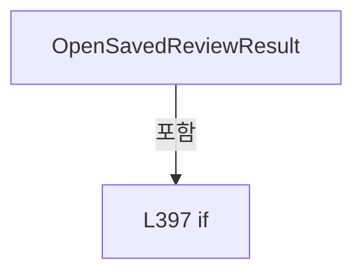

변경 전 점검: 입력/반환 타입, 위 호출자, 예외/취소 경로, 공유 상태와 저장·전송 소비자를 함께 확인합니다. 값의 단위나 물리 방향을 이름만으로 확정하지 않습니다.

### MethodDeclaration `Build` · L404–510

[Drilling.UI/Menu/Menus/CMenuCorrection.cs:404–510](https://github.com/kjuws10-rgb/A3Drilling/blob/96e22cd027c84bf302b23f2949b98985d7f301bb/Drilling.UI/Menu/Menus/CMenuCorrection.cs#L404-L510)

| 항목 | 실제 추출 값 |
| --- | --- |
| 서명 | System.Threading.Tasks.Task<Drilling.UI.Menu.Menus.CScreenViewModel> Drilling.UI.Menu.Menus.CMenuCorrection.Build(System.Threading.CancellationToken) |
| 접근/수식자 | Public / public, override, async |
| 반환/값 타입 | System.Threading.Tasks.Task<Drilling.UI.Menu.Menus.CScreenViewModel> |
| 소속 타입 | NamedType:Drilling.UI.Menu.Menus.CMenuCorrection |

입력 계약:

| 이름 | 타입 | 전달 | 선택/기본값 |
| --- | --- | --- | --- |
| cancellationToken | System.Threading.CancellationToken | None | True / null |

현재 부분 분석에서 직접 연결된 호출자는 없습니다. XAML/이벤트/인터페이스·델리게이트·외부 진입을 추가 확인해야 하며, 미사용으로 판정한 것이 아닙니다.

호출하는 대상과 해석 범위:

| 원본 행 | 표현식 | 분석 상태 | 대상/소스 위치 |
| --- | --- | --- | --- |
| 406 | cancellationToken.ThrowIfCancellationRequested | resolved | void System.Threading.CancellationToken.ThrowIfCancellationRequested() |
| 407 | ApplyTabData | resolved | void Drilling.UI.Menu.Menus.CMenuCorrection.ApplyTabData(string) · Drilling.UI/Menu/Menus/CMenuCorrection.cs:1332 |
| 412 | LoadSelectedOutputViewerRecipe | resolved | System.Threading.Tasks.Task<Drilling.Common.Managers.ST_RECIPE_DEFINITION?> Drilling.UI.Menu.Menus.CMenuCorrection.LoadSelectedOutputViewerRecipe(System.Threading.CancellationToken, bool) · Drilling.UI/Menu/Menus/CMenuCorrection.cs:757 |
| 413 | _settingManager.LoadSection(EN_SETTING_TAB.Option, cancellationToken) .Concat(_settingManager.LoadSection(EN_SETTING_TAB.Motor, cancellationToken)).ToArray | resolved | Drilling.Common.Managers.ST_SYSTEM_PARAMETER[] System.Collections.Generic.IEnumerable<Drilling.Common.Managers.ST_SYSTEM_PARAMETER>.ToArray<Drilling.Common.Managers.ST_SYSTEM_PARAMETER>() |
| 413 | _settingManager.LoadSection(EN_SETTING_TAB.Option, cancellationToken) .Concat | resolved | System.Collections.Generic.IEnumerable<Drilling.Common.Managers.ST_SYSTEM_PARAMETER> System.Collections.Generic.IEnumerable<Drilling.Common.Managers.ST_SYSTEM_PARAMETER>.Concat<Drilling.Common.Managers.ST_SYSTEM_PARAMETER>(System.Collections.Generic.IEnumerable<Drilling.Common.Managers.ST_SYSTEM_PARAMETER>) |
| 413 | _settingManager.LoadSection | resolved | System.Collections.Generic.IReadOnlyList<Drilling.Common.Managers.ST_SYSTEM_PARAMETER> Drilling.Common.Managers.CSettingManager.LoadSection(Drilling.Common.Managers.EN_SETTING_TAB, System.Threading.CancellationToken) · Drilling.Common/Managers/CSettingManager.cs:26 |
| 414 | _settingManager.LoadSection | resolved | System.Collections.Generic.IReadOnlyList<Drilling.Common.Managers.ST_SYSTEM_PARAMETER> Drilling.Common.Managers.CSettingManager.LoadSection(Drilling.Common.Managers.EN_SETTING_TAB, System.Threading.CancellationToken) · Drilling.Common/Managers/CSettingManager.cs:26 |
| 415 | DefaultOffset.Update | resolved | void Drilling.UI.Menu.Menus.CDefaultOffsetPanel.Update(Drilling.Common.Managers.ST_RECIPE_DEFINITION?, System.Collections.Generic.IReadOnlyList<Drilling.Common.Managers.ST_SYSTEM_PARAMETER>) · Drilling.UI/Menu/Menus/CMenuCorrection.cs:4461 |
| 418 | DefaultOffset.Clear | resolved | void Drilling.UI.Menu.Menus.CDefaultOffsetPanel.Clear(string) · Drilling.UI/Menu/Menus/CMenuCorrection.cs:4493 |
| 424 | UpdateAlignPreview | resolved | void Drilling.UI.Menu.Menus.CMenuCorrection.UpdateAlignPreview(Drilling.Common.Managers.ST_RECIPE_DEFINITION?) · Drilling.UI/Menu/Menus/CMenuCorrection.cs:2881 |
| 424 | LoadSelectedOutputViewerRecipe | resolved | System.Threading.Tasks.Task<Drilling.Common.Managers.ST_RECIPE_DEFINITION?> Drilling.UI.Menu.Menus.CMenuCorrection.LoadSelectedOutputViewerRecipe(System.Threading.CancellationToken, bool) · Drilling.UI/Menu/Menus/CMenuCorrection.cs:757 |
| 425 | RefreshAlignOffsetTolerance | resolved | double? Drilling.UI.Menu.Menus.CMenuCorrection.RefreshAlignOffsetTolerance() · Drilling.UI/Menu/Menus/CMenuCorrection.cs:2884 |
| 426 | AlignDistortion.Wapage.UpdateSettings | resolved | void Drilling.UI.Menu.Menus.CAlignWapagePanel.UpdateSettings(System.Collections.Generic.IReadOnlyList<Drilling.Common.Managers.ST_SYSTEM_PARAMETER>) · Drilling.UI/Menu/Menus/CMenuCorrection.cs:5482 |
| 426 | _settingManager.LoadSection | resolved | System.Collections.Generic.IReadOnlyList<Drilling.Common.Managers.ST_SYSTEM_PARAMETER> Drilling.Common.Managers.CSettingManager.LoadSection(Drilling.Common.Managers.EN_SETTING_TAB, System.Threading.CancellationToken) · Drilling.Common/Managers/CSettingManager.cs:26 |
| 434 | AlignDistortion.Clear | resolved | void Drilling.UI.Menu.Menus.CAlignDistortionPanel.Clear(string, Drilling.Common.Managers.ST_RECIPE_DEFINITION?) · Drilling.UI/Menu/Menus/CMenuCorrection.cs:5257 |
| 445 | Review.Build | resolved · 동적 구현 선택 가능 | System.Threading.Tasks.Task<Drilling.UI.Menu.Menus.CScreenViewModel> Drilling.UI.Menu.Menus.CMenuReview.Build(System.Threading.CancellationToken) · Drilling.UI/Menu/Menus/CMenuReview.cs:461 |
| 449 | LoadSelectedOutputViewerRecipe | resolved | System.Threading.Tasks.Task<Drilling.Common.Managers.ST_RECIPE_DEFINITION?> Drilling.UI.Menu.Menus.CMenuCorrection.LoadSelectedOutputViewerRecipe(System.Threading.CancellationToken, bool) · Drilling.UI/Menu/Menus/CMenuCorrection.cs:757 |
| 450 | _settingManager.LoadSection(EN_SETTING_TAB.Option, cancellationToken).Concat(_settingManager.LoadSection(EN_SETTING_TAB.Motor, cancellationToken)).ToArray | resolved | Drilling.Common.Managers.ST_SYSTEM_PARAMETER[] System.Collections.Generic.IEnumerable<Drilling.Common.Managers.ST_SYSTEM_PARAMETER>.ToArray<Drilling.Common.Managers.ST_SYSTEM_PARAMETER>() |
| 450 | _settingManager.LoadSection(EN_SETTING_TAB.Option, cancellationToken).Concat | resolved | System.Collections.Generic.IEnumerable<Drilling.Common.Managers.ST_SYSTEM_PARAMETER> System.Collections.Generic.IEnumerable<Drilling.Common.Managers.ST_SYSTEM_PARAMETER>.Concat<Drilling.Common.Managers.ST_SYSTEM_PARAMETER>(System.Collections.Generic.IEnumerable<Drilling.Common.Managers.ST_SYSTEM_PARAMETER>) |
| 450 | _settingManager.LoadSection | resolved | System.Collections.Generic.IReadOnlyList<Drilling.Common.Managers.ST_SYSTEM_PARAMETER> Drilling.Common.Managers.CSettingManager.LoadSection(Drilling.Common.Managers.EN_SETTING_TAB, System.Threading.CancellationToken) · Drilling.Common/Managers/CSettingManager.cs:26 |
| 450 | _settingManager.LoadSection | resolved | System.Collections.Generic.IReadOnlyList<Drilling.Common.Managers.ST_SYSTEM_PARAMETER> Drilling.Common.Managers.CSettingManager.LoadSection(Drilling.Common.Managers.EN_SETTING_TAB, System.Threading.CancellationToken) · Drilling.Common/Managers/CSettingManager.cs:26 |
| 453 | Fine.Update | resolved | void Drilling.UI.Menu.Menus.CFineCorrectionPanel.Update(Drilling.Common.Managers.ST_RECIPE_DEFINITION?, System.Collections.Generic.IReadOnlyList<Drilling.Common.Managers.ST_SYSTEM_PARAMETER>) · Drilling.UI/Menu/Menus/CMenuCorrection.cs:6091 |
| 460 | .GetBaseException | resolved · 동적 구현 선택 가능 | System.Exception System.AggregateException.GetBaseException() |
| 464 | Task.FromResult | resolved | System.Threading.Tasks.Task<Drilling.Common.Review.ST_REVIEW_OFFSET_FILE_DATA> System.Threading.Tasks.Task.FromResult<Drilling.Common.Review.ST_REVIEW_OFFSET_FILE_DATA>(Drilling.Common.Review.ST_REVIEW_OFFSET_FILE_DATA) |
| 464 | ST_REVIEW_OFFSET_FILE_DATA.Empty | resolved | Drilling.Common.Review.ST_REVIEW_OFFSET_FILE_DATA Drilling.Common.Review.ST_REVIEW_OFFSET_FILE_DATA.Empty(string) · Drilling.Common/Review/CReviewManager.cs:4344 |
| 464 | Task.Run | resolved | System.Threading.Tasks.Task<Drilling.Common.Review.ST_REVIEW_OFFSET_FILE_DATA> System.Threading.Tasks.Task.Run<Drilling.Common.Review.ST_REVIEW_OFFSET_FILE_DATA>(System.Func<System.Threading.Tasks.Task<Drilling.Common.Review.ST_REVIEW_OFFSET_FILE_DATA>?>, System.Threading.CancellationToken) |
| 464 | _reviewOffsetFile.LoadLatest | resolved | System.Threading.Tasks.Task<Drilling.Common.Review.ST_REVIEW_OFFSET_FILE_DATA> Drilling.Common.Review.CReviewOffsetFileBase.LoadLatest(string, System.Threading.CancellationToken) · Drilling.Common/Review/CReviewManager.cs:4376 |
| 467 | _simpleOffsetLoad.WaitAsync | resolved | System.Threading.Tasks.Task<Drilling.Common.Review.ST_REVIEW_OFFSET_FILE_DATA> System.Threading.Tasks.Task<Drilling.Common.Review.ST_REVIEW_OFFSET_FILE_DATA>.WaitAsync(System.Threading.CancellationToken) |
| 472 | Simple.Update | resolved | void Drilling.UI.Menu.Menus.CSimpleCorrectionPanel.Update(Drilling.Common.Managers.ST_RECIPE_DEFINITION?, System.Collections.Generic.IReadOnlyList<Drilling.Common.Managers.ST_SYSTEM_PARAMETER>, Drilling.Common.Review.ST_REVIEW_OFFSET_FILE_DATA?) · Drilling.UI/Menu/Menus/CMenuCorrection.cs:7640 |
| 474 | Rough.Update | resolved | void Drilling.UI.Menu.Menus.CSimpleCorrectionPanel.Update(Drilling.Common.Managers.ST_RECIPE_DEFINITION?, System.Collections.Generic.IReadOnlyList<Drilling.Common.Managers.ST_SYSTEM_PARAMETER>, Drilling.Common.Review.ST_REVIEW_OFFSET_FILE_DATA?) · Drilling.UI/Menu/Menus/CMenuCorrection.cs:7640 |
| 485 | ReportInvalidReviewOffset | resolved | void Drilling.UI.Menu.Menus.CMenuCorrection.ReportInvalidReviewOffset(System.Exception) · Drilling.UI/Menu/Menus/CMenuCorrection.cs:3154 |
| 487 | Simple.Clear | resolved | void Drilling.UI.Menu.Menus.CSimpleCorrectionPanel.Clear(string) · Drilling.UI/Menu/Menus/CMenuCorrection.cs:7732 |
| 489 | Rough.Clear | resolved | void Drilling.UI.Menu.Menus.CSimpleCorrectionPanel.Clear(string) · Drilling.UI/Menu/Menus/CMenuCorrection.cs:7732 |
| 491 | Fine.Clear | resolved | void Drilling.UI.Menu.Menus.CFineCorrectionPanel.Clear(string) · Drilling.UI/Menu/Menus/CMenuCorrection.cs:6167 |
| 497 | RefreshOutputViewerData | resolved | System.Threading.Tasks.Task Drilling.UI.Menu.Menus.CMenuCorrection.RefreshOutputViewerData(System.Threading.CancellationToken) · Drilling.UI/Menu/Menus/CMenuCorrection.cs:620 |
| 500 | new CScreenViewModel | resolved | Drilling.UI.Menu.Menus.CScreenViewModel.CScreenViewModel(Drilling.UI.Menu.Menus.EN_MENU, string, string, System.Collections.Generic.IReadOnlyList<Drilling.UI.Menu.Menus.ST_DISPLAY_ITEM>, System.Collections.Generic.IReadOnlyList<Drilling.UI.Menu.Menus.ST_SCREEN_SECTION>, bool, Drilling.UI.Menu.Menus.CMenuMain?, Drilling.UI.Menu.Menus.CMenuManual?, Drilling.UI.Menu.Menus.CMenuRecipe?, Drilling.UI.Menu.Menus.CMenuSetting?, Drilling.UI.Menu.Menus.CMenuAlarm?, Drilling.UI.Menu.Menus.CMenuMonitor?, Drilling.UI.Menu.Menus.CMenuReview?, Drilling.UI.Menu.Menus.CMenuCorrection?, Drilling.UI.Menu.Menus.CMenuPm?) · Drilling.UI/Menu/Menus/CMenuBase.cs:411 |
| 504 | new | resolved | Drilling.UI.Menu.Menus.ST_DISPLAY_ITEM.ST_DISPLAY_ITEM(string, string, string) · Drilling.UI/Menu/Menus/CMenuBase.cs:43 |
| 504 | new | resolved | Drilling.UI.Menu.Menus.ST_DISPLAY_ITEM.ST_DISPLAY_ITEM(string, string, string) · Drilling.UI/Menu/Menus/CMenuBase.cs:43 |
| 504 | GetSourceName | resolved | string Drilling.UI.Menu.Menus.CMenuCorrection.GetSourceName(string) · Drilling.UI/Menu/Menus/CMenuCorrection.cs:2561 |
| 504 | new | resolved | Drilling.UI.Menu.Menus.ST_DISPLAY_ITEM.ST_DISPLAY_ITEM(string, string, string) · Drilling.UI/Menu/Menus/CMenuBase.cs:43 |
| 504 | GetStateName | resolved | string Drilling.UI.Menu.Menus.CMenuCorrection.GetStateName(string) · Drilling.UI/Menu/Menus/CMenuCorrection.cs:2574 |
| 505 | new | resolved | Drilling.UI.Menu.Menus.ST_SCREEN_SECTION.ST_SCREEN_SECTION(string, System.Collections.Generic.IReadOnlyList<Drilling.UI.Menu.Menus.ST_DISPLAY_ITEM>) · Drilling.UI/Menu/Menus/CMenuBase.cs:410 |
| 505 | new | resolved | Drilling.UI.Menu.Menus.ST_SCREEN_SECTION.ST_SCREEN_SECTION(string, System.Collections.Generic.IReadOnlyList<Drilling.UI.Menu.Menus.ST_DISPLAY_ITEM>) · Drilling.UI/Menu/Menus/CMenuBase.cs:410 |
| 505 | new | resolved | Drilling.UI.Menu.Menus.ST_SCREEN_SECTION.ST_SCREEN_SECTION(string, System.Collections.Generic.IReadOnlyList<Drilling.UI.Menu.Menus.ST_DISPLAY_ITEM>) · Drilling.UI/Menu/Menus/CMenuBase.cs:410 |

본문의 실제 연산·분기·예외·반환 순서(원문 위치 순):

| 원본 행 | 종류 | 주석 해설 |
| --- | --- | --- |
| 406 | call | 함수·델리게이트 또는 객체 생성자를 호출합니다: cancellationToken.ThrowIfCancellationRequested() |
| 407 | call | 함수·델리게이트 또는 객체 생성자를 호출합니다: ApplyTabData(_selectedTab) |
| 408 | if | 조건에 따라 분기합니다: if (IsDefaultTab) |
| 410 | try | 예외 처리 범위입니다: try |
| 412 | await | 비동기 완료를 기다립니다: await LoadSelectedOutputViewerRecipe(cancellationToken, fallbackToFirst: false) |
| 412 | call | 함수·델리게이트 또는 객체 생성자를 호출합니다: LoadSelectedOutputViewerRecipe(cancellationToken, fallbackToFirst: false) |
| 412 | local-declaration | 지역 변수를 선언합니다: var recipe = await LoadSelectedOutputViewerRecipe(cancellationToken, fallbackToFirst: false); |
| 412 | variable-initializer | 변수의 초기값을 지정합니다: recipe = await LoadSelectedOutputViewerRecipe(cancellationToken, fallbackToFirst: false) |
| 413 | call | 함수·델리게이트 또는 객체 생성자를 호출합니다: _settingManager.LoadSection(EN_SETTING_TAB.Option, cancellationToken) |
| 413 | call | 함수·델리게이트 또는 객체 생성자를 호출합니다: _settingManager.LoadSection(EN_SETTING_TAB.Option, cancellationToken) .Concat(_settingManager.LoadSection(EN_SETTING_TAB.Motor, cancellationToken)).ToArray() |
| 413 | call | 함수·델리게이트 또는 객체 생성자를 호출합니다: _settingManager.LoadSection(EN_SETTING_TAB.Option, cancellationToken) .Concat(_settingManager.LoadSection(EN_SETTING_TAB.Motor, cancellationToken)) |
| 413 | local-declaration | 지역 변수를 선언합니다: var settings = _settingManager.LoadSection(EN_SETTING_TAB.Option, cancellationToken) .Concat(_settingManager.LoadSection(EN_SETTING_TAB.Motor, cancellationToken)).ToArray(); |
| 413 | variable-initializer | 변수의 초기값을 지정합니다: settings = _settingManager.LoadSection(EN_SETTING_TAB.Option, cancellationToken) .Concat(_settingManager.LoadSection(EN_SETTING_TAB.Motor, cancellationToken)).ToArray() |
| 414 | call | 함수·델리게이트 또는 객체 생성자를 호출합니다: _settingManager.LoadSection(EN_SETTING_TAB.Motor, cancellationToken) |
| 415 | call | 함수·델리게이트 또는 객체 생성자를 호출합니다: DefaultOffset.Update(recipe, settings) |
| 417 | catch | 지정 예외를 처리합니다: catch (OperationCanceledException) when (cancellationToken.IsCancellationRequested) |
| 417 | throw | 예외를 발생/전달합니다: throw; |
| 418 | call | 함수·델리게이트 또는 객체 생성자를 호출합니다: DefaultOffset.Clear(exception.Message) |
| 418 | catch | 지정 예외를 처리합니다: catch (Exception exception) |
| 420 | if | 조건에 따라 분기합니다: if (IsAlignDistortionTab) |
| 422 | try | 예외 처리 범위입니다: try |
| 424 | await | 비동기 완료를 기다립니다: await LoadSelectedOutputViewerRecipe(cancellationToken, fallbackToFirst: false) |
| 424 | call | 함수·델리게이트 또는 객체 생성자를 호출합니다: UpdateAlignPreview(await LoadSelectedOutputViewerRecipe(cancellationToken, fallbackToFirst: false)) |
| 424 | call | 함수·델리게이트 또는 객체 생성자를 호출합니다: LoadSelectedOutputViewerRecipe(cancellationToken, fallbackToFirst: false) |
| 425 | call | 함수·델리게이트 또는 객체 생성자를 호출합니다: RefreshAlignOffsetTolerance() |
| 426 | call | 함수·델리게이트 또는 객체 생성자를 호출합니다: AlignDistortion.Wapage.UpdateSettings(_settingManager.LoadSection(EN_SETTING_TAB.Option, cancellationToken)) |
| 426 | call | 함수·델리게이트 또는 객체 생성자를 호출합니다: _settingManager.LoadSection(EN_SETTING_TAB.Option, cancellationToken) |
| 428 | catch | 지정 예외를 처리합니다: catch (OperationCanceledException) when (cancellationToken.IsCancellationRequested) |
| 430 | throw | 예외를 발생/전달합니다: throw; |
| 432 | catch | 지정 예외를 처리합니다: catch (Exception exception) |
| 434 | call | 함수·델리게이트 또는 객체 생성자를 호출합니다: AlignDistortion.Clear($"Glass preview unavailable: {exception.Message}") |
| 438 | if | 조건에 따라 분기합니다: if (IsReviewCorrectionTab) |
| 440 | try | 예외 처리 범위입니다: try |
| 442 | if | 조건에 따라 분기합니다: if (_selectedReviewTabIndex == 0) |
| 444 | if | 조건에 따라 분기합니다: if (Review is not null) |
| 445 | await | 비동기 완료를 기다립니다: await Review.Build(cancellationToken) |
| 445 | call | 함수·델리게이트 또는 객체 생성자를 호출합니다: Review.Build(cancellationToken) |
| 447 | else | 앞 조건이 거짓인 경로입니다: else |
| 447 | if | 조건에 따라 분기합니다: if (_selectedReviewTabIndex is 1 or 2 or 3) |
| 449 | await | 비동기 완료를 기다립니다: await LoadSelectedOutputViewerRecipe(cancellationToken, fallbackToFirst: false) |
| 449 | call | 함수·델리게이트 또는 객체 생성자를 호출합니다: LoadSelectedOutputViewerRecipe(cancellationToken, fallbackToFirst: false) |
| 449 | local-declaration | 지역 변수를 선언합니다: var recipe = await LoadSelectedOutputViewerRecipe(cancellationToken, fallbackToFirst: false); |
| 449 | variable-initializer | 변수의 초기값을 지정합니다: recipe = await LoadSelectedOutputViewerRecipe(cancellationToken, fallbackToFirst: false) |
| 450 | call | 함수·델리게이트 또는 객체 생성자를 호출합니다: _settingManager.LoadSection(EN_SETTING_TAB.Option, cancellationToken).Concat(_settingManager.LoadSection(EN_SETTING_TAB.Motor, cancellationToken)).ToArray() |
| 450 | call | 함수·델리게이트 또는 객체 생성자를 호출합니다: _settingManager.LoadSection(EN_SETTING_TAB.Option, cancellationToken).Concat(_settingManager.LoadSection(EN_SETTING_TAB.Motor, cancellationToken)) |
| 450 | call | 함수·델리게이트 또는 객체 생성자를 호출합니다: _settingManager.LoadSection(EN_SETTING_TAB.Option, cancellationToken) |
| 450 | call | 함수·델리게이트 또는 객체 생성자를 호출합니다: _settingManager.LoadSection(EN_SETTING_TAB.Motor, cancellationToken) |
| 450 | local-declaration | 지역 변수를 선언합니다: var settings = _settingManager.LoadSection(EN_SETTING_TAB.Option, cancellationToken).Concat(_settingManager.LoadSection(EN_SETTING_TAB.Motor, cancellationToken)).ToArray(); |
| 450 | variable-initializer | 변수의 초기값을 지정합니다: settings = _settingManager.LoadSection(EN_SETTING_TAB.Option, cancellationToken).Concat(_settingManager.LoadSection(EN_SETTING_TAB.Motor, cancellationToken)).ToArray() |
| 451 | if | 조건에 따라 분기합니다: if (_selectedReviewTabIndex == 3) |
| 453 | call | 함수·델리게이트 또는 객체 생성자를 호출합니다: Fine.Update(recipe, settings) |
| 455 | else | 앞 조건이 거짓인 경로입니다: else |
| 457 | local-declaration | 지역 변수를 선언합니다: ST_REVIEW_OFFSET_FILE_DATA? current = null; |
| 457 | variable-initializer | 변수의 초기값을 지정합니다: current = null |
| 458 | if | 조건에 따라 분기합니다: if (recipe is not null) |
| 460 | call | 함수·델리게이트 또는 객체 생성자를 호출합니다: .GetBaseException() |
| 460 | if | 조건에 따라 분기합니다: if (_simpleOffsetLoad is null &#124;&#124; _simpleOffsetLoad.IsCanceled &#124;&#124; _simpleOffsetRecipeId != recipe.Id &#124;&#124; (_simpleOffsetLoad.IsFaulted && _simpleOffsetLoad.Exception?.GetBaseException()is not CReviewOffsetValidationException)) |
| 462 | assignment | 값을 대상에 대입합니다: _lastReviewOffsetWarning = "" |
| 463 | assignment | 값을 대상에 대입합니다: _simpleOffsetRecipeId = recipe.Id |
| 464 | assignment | 값을 대상에 대입합니다: _simpleOffsetLoad = _reviewOffsetFile is null ? Task.FromResult(ST_REVIEW_OFFSET_FILE_DATA.Empty(recipe.Id)) : Task.Run(() => _reviewOffsetFile.LoadLatest(recipe.Id, cancellationToken), cancellationToken) |
| 464 | call | 함수·델리게이트 또는 객체 생성자를 호출합니다: Task.FromResult(ST_REVIEW_OFFSET_FILE_DATA.Empty(recipe.Id)) |
| 464 | call | 함수·델리게이트 또는 객체 생성자를 호출합니다: ST_REVIEW_OFFSET_FILE_DATA.Empty(recipe.Id) |
| 464 | call | 함수·델리게이트 또는 객체 생성자를 호출합니다: Task.Run(() => _reviewOffsetFile.LoadLatest(recipe.Id, cancellationToken), cancellationToken) |
| 464 | call | 함수·델리게이트 또는 객체 생성자를 호출합니다: _reviewOffsetFile.LoadLatest(recipe.Id, cancellationToken) |
| 464 | conditional-expression | 조건에 따라 결과식을 선택합니다: _reviewOffsetFile is null ? Task.FromResult(ST_REVIEW_OFFSET_FILE_DATA.Empty(recipe.Id)) : Task.Run(() => _reviewOffsetFile.LoadLatest(recipe.Id, cancellationToken), cancellationToken) |
| 467 | assignment | 값을 대상에 대입합니다: current = await _simpleOffsetLoad.WaitAsync(cancellationToken) |
| 467 | await | 비동기 완료를 기다립니다: await _simpleOffsetLoad.WaitAsync(cancellationToken) |
| 467 | call | 함수·델리게이트 또는 객체 생성자를 호출합니다: _simpleOffsetLoad.WaitAsync(cancellationToken) |
| 468 | assignment | 값을 대상에 대입합니다: _lastReviewOffsetWarning = "" |
| 471 | if | 조건에 따라 분기합니다: if (_selectedReviewTabIndex == 1) |
| 472 | call | 함수·델리게이트 또는 객체 생성자를 호출합니다: Simple.Update(recipe, settings, current) |
| 473 | else | 앞 조건이 거짓인 경로입니다: else |
| 474 | call | 함수·델리게이트 또는 객체 생성자를 호출합니다: Rough.Update(recipe, settings, current) |
| 478 | catch | 지정 예외를 처리합니다: catch (OperationCanceledException) when (cancellationToken.IsCancellationRequested) |
| 480 | throw | 예외를 발생/전달합니다: throw; |
| 482 | catch | 지정 예외를 처리합니다: catch (Exception exception) |
| 484 | if | 조건에 따라 분기합니다: if (_selectedReviewTabIndex is 1 or 2) |
| 485 | call | 함수·델리게이트 또는 객체 생성자를 호출합니다: ReportInvalidReviewOffset(exception) |
| 486 | if | 조건에 따라 분기합니다: if (_selectedReviewTabIndex == 1) |
| 487 | call | 함수·델리게이트 또는 객체 생성자를 호출합니다: Simple.Clear($"Glass preview unavailable: {exception.Message}") |
| 488 | else | 앞 조건이 거짓인 경로입니다: else |
| 488 | if | 조건에 따라 분기합니다: if (_selectedReviewTabIndex == 2) |
| 489 | call | 함수·델리게이트 또는 객체 생성자를 호출합니다: Rough.Clear($"Glass preview unavailable: {exception.Message}") |
| 490 | else | 앞 조건이 거짓인 경로입니다: else |
| 490 | if | 조건에 따라 분기합니다: if (_selectedReviewTabIndex == 3) |
| 491 | call | 함수·델리게이트 또는 객체 생성자를 호출합니다: Fine.Clear($"Glass preview unavailable: {exception.Message}") |
| 495 | if | 조건에 따라 분기합니다: if (IsOutputHistoryTab) |
| 497 | await | 비동기 완료를 기다립니다: await RefreshOutputViewerData(cancellationToken) |
| 497 | call | 함수·델리게이트 또는 객체 생성자를 호출합니다: RefreshOutputViewerData(cancellationToken) |
| 500 | call | 함수·델리게이트 또는 객체 생성자를 호출합니다: new CScreenViewModel( EN_MENU.Correction, Title, Subtitle, [new("Selected", _selectedTab), new("Source", GetSourceName(_selectedTab)), new("State", GetStateName(_selectedTab))], [new("Correction Source", []), new("Correc… |
| 500 | local-declaration | 지역 변수를 선언합니다: var screen = new CScreenViewModel( EN_MENU.Correction, Title, Subtitle, [new("Selected", _selectedTab), new("Source", GetSourceName(_selectedTab)), new("State", GetStateName(_selectedTab))], [new("Correction Source", []), new("Cor |
| 500 | variable-initializer | 변수의 초기값을 지정합니다: screen = new CScreenViewModel( EN_MENU.Correction, Title, Subtitle, [new("Selected", _selectedTab), new("Source", GetSourceName(_selectedTab)), new("State", GetStateName(_selectedTab))], [new("Correction Source", []), new("Correct |
| 504 | call | 함수·델리게이트 또는 객체 생성자를 호출합니다: new("Selected", _selectedTab) |
| 504 | call | 함수·델리게이트 또는 객체 생성자를 호출합니다: new("Source", GetSourceName(_selectedTab)) |
| 504 | call | 함수·델리게이트 또는 객체 생성자를 호출합니다: GetSourceName(_selectedTab) |
| 504 | call | 함수·델리게이트 또는 객체 생성자를 호출합니다: new("State", GetStateName(_selectedTab)) |
| 504 | call | 함수·델리게이트 또는 객체 생성자를 호출합니다: GetStateName(_selectedTab) |
| 505 | call | 함수·델리게이트 또는 객체 생성자를 호출합니다: new("Correction Source", []) |
| 505 | call | 함수·델리게이트 또는 객체 생성자를 호출합니다: new("Correction Candidate", []) |
| 505 | call | 함수·델리게이트 또는 객체 생성자를 호출합니다: new("Apply Preview", []) |
| 509 | return | 호출자에게 값 또는 제어를 반환합니다: return screen; |

제어 구문의 포함 구조(실제 실행 순서/CFG가 아닌 구문 탐색 그림):

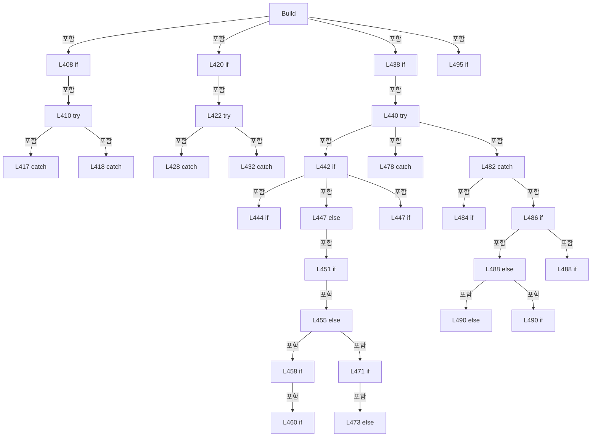

변경 전 점검: 입력/반환 타입, 위 호출자, 예외/취소 경로, 공유 상태와 저장·전송 소비자를 함께 확인합니다. 값의 단위나 물리 방향을 이름만으로 확정하지 않습니다.

### MethodDeclaration `SelectTab` · L512–540

[Drilling.UI/Menu/Menus/CMenuCorrection.cs:512–540](https://github.com/kjuws10-rgb/A3Drilling/blob/96e22cd027c84bf302b23f2949b98985d7f301bb/Drilling.UI/Menu/Menus/CMenuCorrection.cs#L512-L540)

| 항목 | 실제 추출 값 |
| --- | --- |
| 서명 | void Drilling.UI.Menu.Menus.CMenuCorrection.SelectTab(object?) |
| 접근/수식자 | Private / private |
| 반환/값 타입 | void |
| 소속 타입 | NamedType:Drilling.UI.Menu.Menus.CMenuCorrection |

입력 계약:

| 이름 | 타입 | 전달 | 선택/기본값 |
| --- | --- | --- | --- |
| parameter | object? | None | False /  |

현재 부분 분석에서 직접 연결된 호출자는 없습니다. XAML/이벤트/인터페이스·델리게이트·외부 진입을 추가 확인해야 하며, 미사용으로 판정한 것이 아닙니다.

호출하는 대상과 해석 범위:

| 원본 행 | 표현식 | 분석 상태 | 대상/소스 위치 |
| --- | --- | --- | --- |
| 514 | .ToString | resolved · 동적 구현 선택 가능 | string? object.ToString() |
| 514 | .Trim | resolved | string string.Trim() |
| 515 | string.IsNullOrWhiteSpace | resolved | bool string.IsNullOrWhiteSpace(string?) |
| 525 | CorrectionTabs.FirstOrDefault | resolved | string? System.Collections.Generic.IEnumerable<string>.FirstOrDefault<string>(System.Func<string, bool>) |
| 538 | _statusReporter | resolved · 동적 구현 선택 가능 | void System.Action<string>.Invoke(string) |
| 539 | _refreshCurrentScreen | resolved · 동적 구현 선택 가능 | System.Threading.Tasks.Task System.Func<System.Threading.Tasks.Task>.Invoke() |

본문의 실제 연산·분기·예외·반환 순서(원문 위치 순):

| 원본 행 | 종류 | 주석 해설 |
| --- | --- | --- |
| 514 | call | 함수·델리게이트 또는 객체 생성자를 호출합니다: .ToString() |
| 514 | call | 함수·델리게이트 또는 객체 생성자를 호출합니다: .Trim() |
| 514 | local-declaration | 지역 변수를 선언합니다: var tabName = parameter?.ToString()?.Trim(); |
| 514 | variable-initializer | 변수의 초기값을 지정합니다: tabName = parameter?.ToString()?.Trim() |
| 515 | call | 함수·델리게이트 또는 객체 생성자를 호출합니다: string.IsNullOrWhiteSpace(tabName) |
| 515 | if | 조건에 따라 분기합니다: if (string.IsNullOrWhiteSpace(tabName)) |
| 517 | return | 호출자에게 값 또는 제어를 반환합니다: return; |
| 525 | call | 함수·델리게이트 또는 객체 생성자를 호출합니다: CorrectionTabs.FirstOrDefault(MatchesItem) |
| 525 | local-declaration | 지역 변수를 선언합니다: var normalizedTab = CorrectionTabs.FirstOrDefault(MatchesItem); |
| 525 | variable-initializer | 변수의 초기값을 지정합니다: normalizedTab = CorrectionTabs.FirstOrDefault(MatchesItem) |
| 526 | if | 조건에 따라 분기합니다: if (normalizedTab is null) |
| 528 | return | 호출자에게 값 또는 제어를 반환합니다: return; |
| 531 | if | 조건에 따라 분기합니다: if (normalizedTab == "REVIEW" && (_selectedTab != "REVIEW" &#124;&#124; _simpleOffsetLoad?.IsFaulted == true)) |
| 533 | assignment | 값을 대상에 대입합니다: _simpleOffsetLoad = null |
| 534 | assignment | 값을 대상에 대입합니다: _lastReviewOffsetWarning = "" |
| 537 | assignment | 값을 대상에 대입합니다: _selectedTab = normalizedTab |
| 538 | call | 함수·델리게이트 또는 객체 생성자를 호출합니다: _statusReporter($"Correction tab selected: {_selectedTab}.") |
| 539 | assignment | 값을 대상에 대입합니다: _ = _refreshCurrentScreen() |
| 539 | call | 함수·델리게이트 또는 객체 생성자를 호출합니다: _refreshCurrentScreen() |

제어 구문의 포함 구조(실제 실행 순서/CFG가 아닌 구문 탐색 그림):


변경 전 점검: 입력/반환 타입, 위 호출자, 예외/취소 경로, 공유 상태와 저장·전송 소비자를 함께 확인합니다. 값의 단위나 물리 방향을 이름만으로 확정하지 않습니다.

### LocalFunctionStatement `MatchesItem` · L520–523

[Drilling.UI/Menu/Menus/CMenuCorrection.cs:520–523](https://github.com/kjuws10-rgb/A3Drilling/blob/96e22cd027c84bf302b23f2949b98985d7f301bb/Drilling.UI/Menu/Menus/CMenuCorrection.cs#L520-L523)

| 항목 | 실제 추출 값 |
| --- | --- |
| 서명 | bool MatchesItem(string) |
| 접근/수식자 | Private /  |
| 반환/값 타입 | bool |
| 소속 타입 | NamedType:Drilling.UI.Menu.Menus.CMenuCorrection |

입력 계약:

| 이름 | 타입 | 전달 | 선택/기본값 |
| --- | --- | --- | --- |
| tab | string | None | False /  |

현재 부분 분석에서 직접 연결된 호출자는 없습니다. XAML/이벤트/인터페이스·델리게이트·외부 진입을 추가 확인해야 하며, 미사용으로 판정한 것이 아닙니다.

호출하는 대상과 해석 범위:

| 원본 행 | 표현식 | 분석 상태 | 대상/소스 위치 |
| --- | --- | --- | --- |
| 522 | tab.Equals | resolved | bool string.Equals(string?, System.StringComparison) |

본문의 실제 연산·분기·예외·반환 순서(원문 위치 순):

| 원본 행 | 종류 | 주석 해설 |
| --- | --- | --- |
| 522 | call | 함수·델리게이트 또는 객체 생성자를 호출합니다: tab.Equals(tabName, StringComparison.OrdinalIgnoreCase) |
| 522 | return | 호출자에게 값 또는 제어를 반환합니다: return tab.Equals(tabName, StringComparison.OrdinalIgnoreCase); |

변경 전 점검: 입력/반환 타입, 위 호출자, 예외/취소 경로, 공유 상태와 저장·전송 소비자를 함께 확인합니다. 값의 단위나 물리 방향을 이름만으로 확정하지 않습니다.

### MethodDeclaration `SelectOutputViewerCell` · L542–554

[Drilling.UI/Menu/Menus/CMenuCorrection.cs:542–554](https://github.com/kjuws10-rgb/A3Drilling/blob/96e22cd027c84bf302b23f2949b98985d7f301bb/Drilling.UI/Menu/Menus/CMenuCorrection.cs#L542-L554)

| 항목 | 실제 추출 값 |
| --- | --- |
| 서명 | System.Threading.Tasks.Task Drilling.UI.Menu.Menus.CMenuCorrection.SelectOutputViewerCell(object?) |
| 접근/수식자 | Private / private, async |
| 반환/값 타입 | System.Threading.Tasks.Task |
| 소속 타입 | NamedType:Drilling.UI.Menu.Menus.CMenuCorrection |

입력 계약:

| 이름 | 타입 | 전달 | 선택/기본값 |
| --- | --- | --- | --- |
| parameter | object? | None | False /  |

정적 호출자로 확인된 위치:

| 호출 파일/행 | 호출 표현식 | 런타임 분기 가능 |
| --- | --- | --- |
| [Drilling.UI/Menu/Menus/CMenuCorrection.cs:167–167](https://github.com/kjuws10-rgb/A3Drilling/blob/96e22cd027c84bf302b23f2949b98985d7f301bb/Drilling.UI/Menu/Menus/CMenuCorrection.cs#L167-L167) | SelectOutputViewerCell | False |

호출하는 대상과 해석 범위:

| 원본 행 | 표현식 | 분석 상태 | 대상/소스 위치 |
| --- | --- | --- | --- |
| 544 | int.TryParse | resolved | bool int.TryParse(string?, System.Globalization.NumberStyles, System.IFormatProvider?, out int) |
| 544 | .ToString | resolved · 동적 구현 선택 가능 | string? object.ToString() |
| 549 | Math.Max | resolved | int System.Math.Max(int, int) |
| 552 | _statusReporter | resolved · 동적 구현 선택 가능 | void System.Action<string>.Invoke(string) |
| 553 | _refreshCurrentScreen | resolved · 동적 구현 선택 가능 | System.Threading.Tasks.Task System.Func<System.Threading.Tasks.Task>.Invoke() |

본문의 실제 연산·분기·예외·반환 순서(원문 위치 순):

| 원본 행 | 종류 | 주석 해설 |
| --- | --- | --- |
| 544 | call | 함수·델리게이트 또는 객체 생성자를 호출합니다: int.TryParse(parameter?.ToString(), NumberStyles.Integer, CultureInfo.InvariantCulture, out var cellNo) |
| 544 | call | 함수·델리게이트 또는 객체 생성자를 호출합니다: .ToString() |
| 544 | if | 조건에 따라 분기합니다: if (!int.TryParse(parameter?.ToString(), NumberStyles.Integer, CultureInfo.InvariantCulture, out var cellNo)) |
| 546 | return | 호출자에게 값 또는 제어를 반환합니다: return; |
| 549 | assignment | 값을 대상에 대입합니다: _outputViewerSelectedCellNo = Math.Max(1, cellNo) |
| 549 | call | 함수·델리게이트 또는 객체 생성자를 호출합니다: Math.Max(1, cellNo) |
| 550 | assignment | 값을 대상에 대입합니다: _outputViewerIsCellDetailVisible = true |
| 551 | assignment | 값을 대상에 대입합니다: _outputViewerSelectedShotKey = "" |
| 552 | call | 함수·델리게이트 또는 객체 생성자를 호출합니다: _statusReporter($"Offset Viewer cell selected: CELL{_outputViewerSelectedCellNo:00}.") |
| 553 | await | 비동기 완료를 기다립니다: await _refreshCurrentScreen() |
| 553 | call | 함수·델리게이트 또는 객체 생성자를 호출합니다: _refreshCurrentScreen() |

제어 구문의 포함 구조(실제 실행 순서/CFG가 아닌 구문 탐색 그림):


변경 전 점검: 입력/반환 타입, 위 호출자, 예외/취소 경로, 공유 상태와 저장·전송 소비자를 함께 확인합니다. 값의 단위나 물리 방향을 이름만으로 확정하지 않습니다.

### MethodDeclaration `SelectOutputViewerShot` · L556–565

[Drilling.UI/Menu/Menus/CMenuCorrection.cs:556–565](https://github.com/kjuws10-rgb/A3Drilling/blob/96e22cd027c84bf302b23f2949b98985d7f301bb/Drilling.UI/Menu/Menus/CMenuCorrection.cs#L556-L565)

| 항목 | 실제 추출 값 |
| --- | --- |
| 서명 | void Drilling.UI.Menu.Menus.CMenuCorrection.SelectOutputViewerShot(object?) |
| 접근/수식자 | Private / private |
| 반환/값 타입 | void |
| 소속 타입 | NamedType:Drilling.UI.Menu.Menus.CMenuCorrection |

입력 계약:

| 이름 | 타입 | 전달 | 선택/기본값 |
| --- | --- | --- | --- |
| parameter | object? | None | False /  |

정적 호출자로 확인된 위치:

| 호출 파일/행 | 호출 표현식 | 런타임 분기 가능 |
| --- | --- | --- |
| [Drilling.UI/Menu/Menus/CMenuCorrection.cs:569–569](https://github.com/kjuws10-rgb/A3Drilling/blob/96e22cd027c84bf302b23f2949b98985d7f301bb/Drilling.UI/Menu/Menus/CMenuCorrection.cs#L569-L569) | SelectOutputViewerShot | False |

호출하는 대상과 해석 범위:

| 원본 행 | 표현식 | 분석 상태 | 대상/소스 위치 |
| --- | --- | --- | --- |
| 558 | .ToString | resolved · 동적 구현 선택 가능 | string? object.ToString() |
| 558 | .Trim | resolved | string string.Trim() |
| 559 | string.IsNullOrWhiteSpace | resolved | bool string.IsNullOrWhiteSpace(string?) |
| 559 | _outputViewerSelectedCellShots.Any | resolved | bool System.Collections.Generic.IEnumerable<Drilling.Common.Recipe.ST_HEAD_SHOT_POINT>.Any<Drilling.Common.Recipe.ST_HEAD_SHOT_POINT>(System.Func<Drilling.Common.Recipe.ST_HEAD_SHOT_POINT, bool>) |
| 559 | shot.ShotKey.Equals | resolved | bool string.Equals(string?, System.StringComparison) |
| 564 | ApplyOutputViewerShotSelection | resolved | void Drilling.UI.Menu.Menus.CMenuCorrection.ApplyOutputViewerShotSelection(string) · Drilling.UI/Menu/Menus/CMenuCorrection.cs:595 |

본문의 실제 연산·분기·예외·반환 순서(원문 위치 순):

| 원본 행 | 종류 | 주석 해설 |
| --- | --- | --- |
| 558 | call | 함수·델리게이트 또는 객체 생성자를 호출합니다: .ToString() |
| 558 | call | 함수·델리게이트 또는 객체 생성자를 호출합니다: .Trim() |
| 558 | local-declaration | 지역 변수를 선언합니다: var shotKey = parameter?.ToString()?.Trim(); |
| 558 | variable-initializer | 변수의 초기값을 지정합니다: shotKey = parameter?.ToString()?.Trim() |
| 559 | call | 함수·델리게이트 또는 객체 생성자를 호출합니다: string.IsNullOrWhiteSpace(shotKey) |
| 559 | call | 함수·델리게이트 또는 객체 생성자를 호출합니다: _outputViewerSelectedCellShots.Any(shot => shot.ShotKey.Equals(shotKey, StringComparison.OrdinalIgnoreCase)) |
| 559 | call | 함수·델리게이트 또는 객체 생성자를 호출합니다: shot.ShotKey.Equals(shotKey, StringComparison.OrdinalIgnoreCase) |
| 559 | if | 조건에 따라 분기합니다: if (string.IsNullOrWhiteSpace(shotKey) &#124;&#124; !_outputViewerSelectedCellShots.Any(shot => shot.ShotKey.Equals(shotKey, StringComparison.OrdinalIgnoreCase))) |
| 561 | return | 호출자에게 값 또는 제어를 반환합니다: return; |
| 564 | call | 함수·델리게이트 또는 객체 생성자를 호출합니다: ApplyOutputViewerShotSelection(shotKey) |

제어 구문의 포함 구조(실제 실행 순서/CFG가 아닌 구문 탐색 그림):


변경 전 점검: 입력/반환 타입, 위 호출자, 예외/취소 경로, 공유 상태와 저장·전송 소비자를 함께 확인합니다. 값의 단위나 물리 방향을 이름만으로 확정하지 않습니다.

### MethodDeclaration `SelectOutputViewerShotByKey` · L567–570

[Drilling.UI/Menu/Menus/CMenuCorrection.cs:567–570](https://github.com/kjuws10-rgb/A3Drilling/blob/96e22cd027c84bf302b23f2949b98985d7f301bb/Drilling.UI/Menu/Menus/CMenuCorrection.cs#L567-L570)

| 항목 | 실제 추출 값 |
| --- | --- |
| 서명 | void Drilling.UI.Menu.Menus.CMenuCorrection.SelectOutputViewerShotByKey(string) |
| 접근/수식자 | Public / public |
| 반환/값 타입 | void |
| 소속 타입 | NamedType:Drilling.UI.Menu.Menus.CMenuCorrection |

입력 계약:

| 이름 | 타입 | 전달 | 선택/기본값 |
| --- | --- | --- | --- |
| shotKey | string | None | False /  |

정적 호출자로 확인된 위치:

| 호출 파일/행 | 호출 표현식 | 런타임 분기 가능 |
| --- | --- | --- |
| [Drilling.UI/Views/CCorrectionView.xaml.cs:69–69](https://github.com/kjuws10-rgb/A3Drilling/blob/96e22cd027c84bf302b23f2949b98985d7f301bb/Drilling.UI/Views/CCorrectionView.xaml.cs#L69-L69) | correction.SelectOutputViewerShotByKey | False |

호출하는 대상과 해석 범위:

| 원본 행 | 표현식 | 분석 상태 | 대상/소스 위치 |
| --- | --- | --- | --- |
| 569 | SelectOutputViewerShot | resolved | void Drilling.UI.Menu.Menus.CMenuCorrection.SelectOutputViewerShot(object?) · Drilling.UI/Menu/Menus/CMenuCorrection.cs:556 |

본문의 실제 연산·분기·예외·반환 순서(원문 위치 순):

| 원본 행 | 종류 | 주석 해설 |
| --- | --- | --- |
| 569 | call | 함수·델리게이트 또는 객체 생성자를 호출합니다: SelectOutputViewerShot(shotKey) |

변경 전 점검: 입력/반환 타입, 위 호출자, 예외/취소 경로, 공유 상태와 저장·전송 소비자를 함께 확인합니다. 값의 단위나 물리 방향을 이름만으로 확정하지 않습니다.

### MethodDeclaration `SelectOutputViewerShotAt` · L572–593

[Drilling.UI/Menu/Menus/CMenuCorrection.cs:572–593](https://github.com/kjuws10-rgb/A3Drilling/blob/96e22cd027c84bf302b23f2949b98985d7f301bb/Drilling.UI/Menu/Menus/CMenuCorrection.cs#L572-L593)

| 항목 | 실제 추출 값 |
| --- | --- |
| 서명 | void Drilling.UI.Menu.Menus.CMenuCorrection.SelectOutputViewerShotAt(double, double) |
| 접근/수식자 | Public / public |
| 반환/값 타입 | void |
| 소속 타입 | NamedType:Drilling.UI.Menu.Menus.CMenuCorrection |

입력 계약:

| 이름 | 타입 | 전달 | 선택/기본값 |
| --- | --- | --- | --- |
| designX | double | None | False /  |
| designY | double | None | False /  |

현재 부분 분석에서 직접 연결된 호출자는 없습니다. XAML/이벤트/인터페이스·델리게이트·외부 진입을 추가 확인해야 하며, 미사용으로 판정한 것이 아닙니다.

호출하는 대상과 해석 범위:

| 원본 행 | 표현식 | 분석 상태 | 대상/소스 위치 |
| --- | --- | --- | --- |
| 580 | GetOutputViewerShotMapRect | resolved | Rect Drilling.UI.Menu.Menus.CMenuCorrection.GetOutputViewerShotMapRect(int, int) · Drilling.UI/Menu/Menus/CMenuCorrection.cs:853 |
| 581 | mapRect.Contains | unresolved | None |
| 581 | new Point | unresolved | None |
| 586 | Math.Clamp | resolved | int System.Math.Clamp(int, int, int) |
| 587 | Math.Clamp | resolved | int System.Math.Clamp(int, int, int) |
| 588 | _outputViewerSelectedCellShots.FirstOrDefault | resolved | Drilling.Common.Recipe.ST_HEAD_SHOT_POINT? System.Collections.Generic.IEnumerable<Drilling.Common.Recipe.ST_HEAD_SHOT_POINT>.FirstOrDefault<Drilling.Common.Recipe.ST_HEAD_SHOT_POINT>(System.Func<Drilling.Common.Recipe.ST_HEAD_SHOT_POINT, bool>) |
| 591 | ApplyOutputViewerShotSelection | resolved | void Drilling.UI.Menu.Menus.CMenuCorrection.ApplyOutputViewerShotSelection(string) · Drilling.UI/Menu/Menus/CMenuCorrection.cs:595 |

본문의 실제 연산·분기·예외·반환 순서(원문 위치 순):

| 원본 행 | 종류 | 주석 해설 |
| --- | --- | --- |
| 574 | if | 조건에 따라 분기합니다: if (!_outputViewerIsCellDetailVisible &#124;&#124; _outputViewerSelectedCellShots.Count == 0) |
| 576 | return | 호출자에게 값 또는 제어를 반환합니다: return; |
| 579 | local-declaration | 지역 변수를 선언합니다: var firstShot = _outputViewerSelectedCellShots[0]; |
| 579 | variable-initializer | 변수의 초기값을 지정합니다: firstShot = _outputViewerSelectedCellShots[0] |
| 580 | call | 함수·델리게이트 또는 객체 생성자를 호출합니다: GetOutputViewerShotMapRect(firstShot.GroupCountX, firstShot.GroupCountY) |
| 580 | local-declaration | 지역 변수를 선언합니다: var mapRect = GetOutputViewerShotMapRect(firstShot.GroupCountX, firstShot.GroupCountY); |
| 580 | variable-initializer | 변수의 초기값을 지정합니다: mapRect = GetOutputViewerShotMapRect(firstShot.GroupCountX, firstShot.GroupCountY) |
| 581 | call | 함수·델리게이트 또는 객체 생성자를 호출합니다: mapRect.Contains(new Point(designX, designY)) |
| 581 | call | 함수·델리게이트 또는 객체 생성자를 호출합니다: new Point(designX, designY) |
| 581 | if | 조건에 따라 분기합니다: if (!mapRect.Contains(new Point(designX, designY))) |
| 583 | return | 호출자에게 값 또는 제어를 반환합니다: return; |
| 586 | call | 함수·델리게이트 또는 객체 생성자를 호출합니다: Math.Clamp((int)((designX - mapRect.Left) / mapRect.Width * firstShot.GroupCountX), 0, firstShot.GroupCountX - 1) |
| 586 | local-declaration | 지역 변수를 선언합니다: var column = Math.Clamp((int)((designX - mapRect.Left) / mapRect.Width * firstShot.GroupCountX), 0, firstShot.GroupCountX - 1); |
| 586 | variable-initializer | 변수의 초기값을 지정합니다: column = Math.Clamp((int)((designX - mapRect.Left) / mapRect.Width * firstShot.GroupCountX), 0, firstShot.GroupCountX - 1) |
| 587 | call | 함수·델리게이트 또는 객체 생성자를 호출합니다: Math.Clamp((int)((designY - mapRect.Top) / mapRect.Height * firstShot.GroupCountY), 0, firstShot.GroupCountY - 1) |
| 587 | local-declaration | 지역 변수를 선언합니다: var row = Math.Clamp((int)((designY - mapRect.Top) / mapRect.Height * firstShot.GroupCountY), 0, firstShot.GroupCountY - 1); |
| 587 | variable-initializer | 변수의 초기값을 지정합니다: row = Math.Clamp((int)((designY - mapRect.Top) / mapRect.Height * firstShot.GroupCountY), 0, firstShot.GroupCountY - 1) |
| 588 | call | 함수·델리게이트 또는 객체 생성자를 호출합니다: _outputViewerSelectedCellShots.FirstOrDefault(item => item.GroupColumn == column && item.GroupRow == row) |
| 588 | local-declaration | 지역 변수를 선언합니다: var shot = _outputViewerSelectedCellShots.FirstOrDefault(item => item.GroupColumn == column && item.GroupRow == row); |
| 588 | variable-initializer | 변수의 초기값을 지정합니다: shot = _outputViewerSelectedCellShots.FirstOrDefault(item => item.GroupColumn == column && item.GroupRow == row) |
| 589 | if | 조건에 따라 분기합니다: if (shot is not null) |
| 591 | call | 함수·델리게이트 또는 객체 생성자를 호출합니다: ApplyOutputViewerShotSelection(shot.ShotKey) |

제어 구문의 포함 구조(실제 실행 순서/CFG가 아닌 구문 탐색 그림):

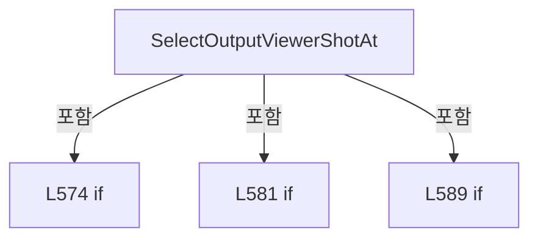

변경 전 점검: 입력/반환 타입, 위 호출자, 예외/취소 경로, 공유 상태와 저장·전송 소비자를 함께 확인합니다. 값의 단위나 물리 방향을 이름만으로 확정하지 않습니다.

### MethodDeclaration `ApplyOutputViewerShotSelection` · L595–609

[Drilling.UI/Menu/Menus/CMenuCorrection.cs:595–609](https://github.com/kjuws10-rgb/A3Drilling/blob/96e22cd027c84bf302b23f2949b98985d7f301bb/Drilling.UI/Menu/Menus/CMenuCorrection.cs#L595-L609)

| 항목 | 실제 추출 값 |
| --- | --- |
| 서명 | void Drilling.UI.Menu.Menus.CMenuCorrection.ApplyOutputViewerShotSelection(string) |
| 접근/수식자 | Private / private |
| 반환/값 타입 | void |
| 소속 타입 | NamedType:Drilling.UI.Menu.Menus.CMenuCorrection |

입력 계약:

| 이름 | 타입 | 전달 | 선택/기본값 |
| --- | --- | --- | --- |
| shotKey | string | None | False /  |

정적 호출자로 확인된 위치:

| 호출 파일/행 | 호출 표현식 | 런타임 분기 가능 |
| --- | --- | --- |
| [Drilling.UI/Menu/Menus/CMenuCorrection.cs:564–564](https://github.com/kjuws10-rgb/A3Drilling/blob/96e22cd027c84bf302b23f2949b98985d7f301bb/Drilling.UI/Menu/Menus/CMenuCorrection.cs#L564-L564) | ApplyOutputViewerShotSelection | False |
| [Drilling.UI/Menu/Menus/CMenuCorrection.cs:591–591](https://github.com/kjuws10-rgb/A3Drilling/blob/96e22cd027c84bf302b23f2949b98985d7f301bb/Drilling.UI/Menu/Menus/CMenuCorrection.cs#L591-L591) | ApplyOutputViewerShotSelection | False |

호출하는 대상과 해석 범위:

| 원본 행 | 표현식 | 분석 상태 | 대상/소스 위치 |
| --- | --- | --- | --- |
| 597 | _outputViewerSelectedShotKey.Equals | resolved | bool string.Equals(string?, System.StringComparison) |
| 603 | BuildOutputViewerCellShotMap | resolved | ImageSource? Drilling.UI.Menu.Menus.CMenuCorrection.BuildOutputViewerCellShotMap(System.Collections.Generic.IReadOnlyList<Drilling.Common.Recipe.ST_HEAD_SHOT_POINT>, System.Collections.Generic.IReadOnlyDictionary<string, Drilling.Common.Recipe.ST_RECIPE_SHOT_MASKING_RESULT>, string) · Drilling.UI/Menu/Menus/CMenuCorrection.cs:880 |
| 604 | OutputOffsets.SelectShot | resolved | void Drilling.UI.Menu.Menus.COutputOffsetViewerPanel.SelectShot(string) · Drilling.UI/Menu/Menus/CMenuCorrection.cs:7088 |
| 605 | .Invoke | resolved · 동적 구현 선택 가능 | void System.EventHandler.Invoke(object?, System.EventArgs) |
| 606 | .Invoke | resolved · 동적 구현 선택 가능 | void System.EventHandler.Invoke(object?, System.EventArgs) |
| 607 | .Invoke | resolved · 동적 구현 선택 가능 | void System.EventHandler.Invoke(object?, System.EventArgs) |
| 608 | _statusReporter | resolved · 동적 구현 선택 가능 | void System.Action<string>.Invoke(string) |

본문의 실제 연산·분기·예외·반환 순서(원문 위치 순):

| 원본 행 | 종류 | 주석 해설 |
| --- | --- | --- |
| 597 | call | 함수·델리게이트 또는 객체 생성자를 호출합니다: _outputViewerSelectedShotKey.Equals(shotKey, StringComparison.OrdinalIgnoreCase) |
| 597 | if | 조건에 따라 분기합니다: if (_outputViewerSelectedShotKey.Equals(shotKey, StringComparison.OrdinalIgnoreCase)) |
| 599 | return | 호출자에게 값 또는 제어를 반환합니다: return; |
| 602 | assignment | 값을 대상에 대입합니다: _outputViewerSelectedShotKey = shotKey |
| 603 | assignment | 값을 대상에 대입합니다: OutputViewerCellShotMapImage = BuildOutputViewerCellShotMap(_outputViewerSelectedCellShots, _outputViewerSelectedShotStates, _outputViewerSelectedShotKey) |
| 603 | call | 함수·델리게이트 또는 객체 생성자를 호출합니다: BuildOutputViewerCellShotMap(_outputViewerSelectedCellShots, _outputViewerSelectedShotStates, _outputViewerSelectedShotKey) |
| 604 | call | 함수·델리게이트 또는 객체 생성자를 호출합니다: OutputOffsets.SelectShot(_outputViewerSelectedShotKey) |
| 605 | call | 함수·델리게이트 또는 객체 생성자를 호출합니다: .Invoke(this, EventArgs.Empty) |
| 606 | call | 함수·델리게이트 또는 객체 생성자를 호출합니다: .Invoke(this, EventArgs.Empty) |
| 607 | call | 함수·델리게이트 또는 객체 생성자를 호출합니다: .Invoke(this, EventArgs.Empty) |
| 608 | call | 함수·델리게이트 또는 객체 생성자를 호출합니다: _statusReporter($"Offset Viewer shot selected: {OutputViewerSelectedShotName}.") |

제어 구문의 포함 구조(실제 실행 순서/CFG가 아닌 구문 탐색 그림):

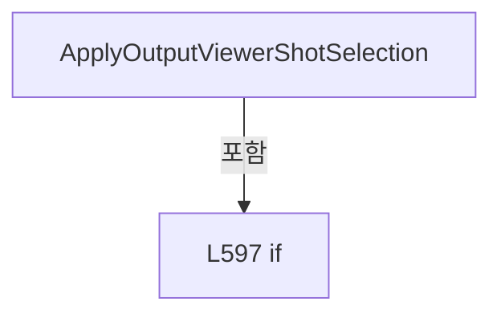

변경 전 점검: 입력/반환 타입, 위 호출자, 예외/취소 경로, 공유 상태와 저장·전송 소비자를 함께 확인합니다. 값의 단위나 물리 방향을 이름만으로 확정하지 않습니다.

### MethodDeclaration `BackToOutputViewerGlass` · L611–618

[Drilling.UI/Menu/Menus/CMenuCorrection.cs:611–618](https://github.com/kjuws10-rgb/A3Drilling/blob/96e22cd027c84bf302b23f2949b98985d7f301bb/Drilling.UI/Menu/Menus/CMenuCorrection.cs#L611-L618)

| 항목 | 실제 추출 값 |
| --- | --- |
| 서명 | System.Threading.Tasks.Task Drilling.UI.Menu.Menus.CMenuCorrection.BackToOutputViewerGlass(object?) |
| 접근/수식자 | Private / private, async |
| 반환/값 타입 | System.Threading.Tasks.Task |
| 소속 타입 | NamedType:Drilling.UI.Menu.Menus.CMenuCorrection |

입력 계약:

| 이름 | 타입 | 전달 | 선택/기본값 |
| --- | --- | --- | --- |
| parameter | object? | None | False /  |

정적 호출자로 확인된 위치:

| 호출 파일/행 | 호출 표현식 | 런타임 분기 가능 |
| --- | --- | --- |
| [Drilling.UI/Menu/Menus/CMenuCorrection.cs:174–174](https://github.com/kjuws10-rgb/A3Drilling/blob/96e22cd027c84bf302b23f2949b98985d7f301bb/Drilling.UI/Menu/Menus/CMenuCorrection.cs#L174-L174) | BackToOutputViewerGlass | False |

호출하는 대상과 해석 범위:

| 원본 행 | 표현식 | 분석 상태 | 대상/소스 위치 |
| --- | --- | --- | --- |
| 616 | _statusReporter | resolved · 동적 구현 선택 가능 | void System.Action<string>.Invoke(string) |
| 617 | _refreshCurrentScreen | resolved · 동적 구현 선택 가능 | System.Threading.Tasks.Task System.Func<System.Threading.Tasks.Task>.Invoke() |

본문의 실제 연산·분기·예외·반환 순서(원문 위치 순):

| 원본 행 | 종류 | 주석 해설 |
| --- | --- | --- |
| 613 | assignment | 값을 대상에 대입합니다: _outputViewerIsCellDetailVisible = false |
| 614 | assignment | 값을 대상에 대입합니다: _outputViewerSelectedCellNo = 0 |
| 615 | assignment | 값을 대상에 대입합니다: _outputViewerSelectedShotKey = "" |
| 616 | call | 함수·델리게이트 또는 객체 생성자를 호출합니다: _statusReporter("Offset Viewer glass preview opened.") |
| 617 | await | 비동기 완료를 기다립니다: await _refreshCurrentScreen() |
| 617 | call | 함수·델리게이트 또는 객체 생성자를 호출합니다: _refreshCurrentScreen() |

변경 전 점검: 입력/반환 타입, 위 호출자, 예외/취소 경로, 공유 상태와 저장·전송 소비자를 함께 확인합니다. 값의 단위나 물리 방향을 이름만으로 확정하지 않습니다.

### MethodDeclaration `RefreshOutputViewerData` · L620–755

[Drilling.UI/Menu/Menus/CMenuCorrection.cs:620–755](https://github.com/kjuws10-rgb/A3Drilling/blob/96e22cd027c84bf302b23f2949b98985d7f301bb/Drilling.UI/Menu/Menus/CMenuCorrection.cs#L620-L755)

| 항목 | 실제 추출 값 |
| --- | --- |
| 서명 | System.Threading.Tasks.Task Drilling.UI.Menu.Menus.CMenuCorrection.RefreshOutputViewerData(System.Threading.CancellationToken) |
| 접근/수식자 | Private / private, async |
| 반환/값 타입 | System.Threading.Tasks.Task |
| 소속 타입 | NamedType:Drilling.UI.Menu.Menus.CMenuCorrection |

입력 계약:

| 이름 | 타입 | 전달 | 선택/기본값 |
| --- | --- | --- | --- |
| cancellationToken | System.Threading.CancellationToken | None | False /  |

정적 호출자로 확인된 위치:

| 호출 파일/행 | 호출 표현식 | 런타임 분기 가능 |
| --- | --- | --- |
| [Drilling.UI/Menu/Menus/CMenuCorrection.cs:497–497](https://github.com/kjuws10-rgb/A3Drilling/blob/96e22cd027c84bf302b23f2949b98985d7f301bb/Drilling.UI/Menu/Menus/CMenuCorrection.cs#L497-L497) | RefreshOutputViewerData | False |

호출하는 대상과 해석 범위:

| 원본 행 | 표현식 | 분석 상태 | 대상/소스 위치 |
| --- | --- | --- | --- |
| 622 | System.Threading.Interlocked.Increment | resolved | int System.Threading.Interlocked.Increment(ref int) |
| 625 | LoadSelectedOutputViewerRecipe | resolved | System.Threading.Tasks.Task<Drilling.Common.Managers.ST_RECIPE_DEFINITION?> Drilling.UI.Menu.Menus.CMenuCorrection.LoadSelectedOutputViewerRecipe(System.Threading.CancellationToken, bool) · Drilling.UI/Menu/Menus/CMenuCorrection.cs:757 |
| 630 | ClearOutputViewerCellSelectionData | resolved | void Drilling.UI.Menu.Menus.CMenuCorrection.ClearOutputViewerCellSelectionData() · Drilling.UI/Menu/Menus/CMenuCorrection.cs:824 |
| 631 | OutputOffsets.Clear | resolved | void Drilling.UI.Menu.Menus.COutputOffsetViewerPanel.Clear() · Drilling.UI/Menu/Menus/CMenuCorrection.cs:7081 |
| 636 | new List<ST_SYSTEM_PARAMETER> | resolved | System.Collections.Generic.List<Drilling.Common.Managers.ST_SYSTEM_PARAMETER>.List() |
| 637 | settings.AddRange | resolved | void System.Collections.Generic.List<Drilling.Common.Managers.ST_SYSTEM_PARAMETER>.AddRange(System.Collections.Generic.IEnumerable<Drilling.Common.Managers.ST_SYSTEM_PARAMETER>) |
| 637 | _settingManager.LoadSection | resolved | System.Collections.Generic.IReadOnlyList<Drilling.Common.Managers.ST_SYSTEM_PARAMETER> Drilling.Common.Managers.CSettingManager.LoadSection(Drilling.Common.Managers.EN_SETTING_TAB, System.Threading.CancellationToken) · Drilling.Common/Managers/CSettingManager.cs:26 |
| 638 | settings.AddRange | resolved | void System.Collections.Generic.List<Drilling.Common.Managers.ST_SYSTEM_PARAMETER>.AddRange(System.Collections.Generic.IEnumerable<Drilling.Common.Managers.ST_SYSTEM_PARAMETER>) |
| 638 | _settingManager.LoadSection | resolved | System.Collections.Generic.IReadOnlyList<Drilling.Common.Managers.ST_SYSTEM_PARAMETER> Drilling.Common.Managers.CSettingManager.LoadSection(Drilling.Common.Managers.EN_SETTING_TAB, System.Threading.CancellationToken) · Drilling.Common/Managers/CSettingManager.cs:26 |
| 639 | BuildOutputViewerParameterMap | resolved | System.Collections.Generic.Dictionary<string, string> Drilling.UI.Menu.Menus.CMenuCorrection.BuildOutputViewerParameterMap(Drilling.Common.Managers.ST_RECIPE_DEFINITION, System.Collections.Generic.IReadOnlyList<Drilling.Common.Managers.ST_SYSTEM_PARAMETER>) · Drilling.UI/Menu/Menus/CMenuCorrection.cs:774 |
| 640 | _reviewOffsetFile.LoadLatest | resolved | System.Threading.Tasks.Task<Drilling.Common.Review.ST_REVIEW_OFFSET_FILE_DATA> Drilling.Common.Review.CReviewOffsetFileBase.LoadLatest(string, System.Threading.CancellationToken) · Drilling.Common/Review/CReviewManager.cs:4376 |
| 642 | ApplyReviewOffsetsToOutputViewerParameters | resolved | void Drilling.UI.Menu.Menus.CMenuCorrection.ApplyReviewOffsetsToOutputViewerParameters(System.Collections.Generic.IDictionary<string, string>, Drilling.Common.Review.ST_REVIEW_OFFSET_FILE_DATA) · Drilling.UI/Menu/Menus/CMenuCorrection.cs:1019 |
| 643 | Math.Max | resolved | int System.Math.Max(int, int) |
| 643 | ReadOutputViewerInt | resolved | int Drilling.UI.Menu.Menus.CMenuCorrection.ReadOutputViewerInt(System.Collections.Generic.IReadOnlyDictionary<string, string>, int, params string[]) · Drilling.UI/Menu/Menus/CMenuCorrection.cs:1234 |
| 646 | Math.Clamp | resolved | int System.Math.Clamp(int, int, int) |
| 646 | Math.Max | resolved | int System.Math.Max(int, int) |
| 655 | OutputViewerParametersMatch | resolved | bool Drilling.UI.Menu.Menus.CMenuCorrection.OutputViewerParametersMatch(System.Collections.Generic.IReadOnlyDictionary<string, string>?, System.Collections.Generic.IReadOnlyDictionary<string, string>) · Drilling.UI/Menu/Menus/CMenuCorrection.cs:806 |
| 657 | Task.Run | resolved | System.Threading.Tasks.Task<Drilling.UI.Menu.Menus.ST_CORRECTION_OFFSET_VIEWER_PREVIEW> System.Threading.Tasks.Task.Run<Drilling.UI.Menu.Menus.ST_CORRECTION_OFFSET_VIEWER_PREVIEW>(System.Func<Drilling.UI.Menu.Menus.ST_CORRECTION_OFFSET_VIEWER_PREVIEW>, System.Threading.CancellationToken) |
| 657 | BuildOutputViewerGlassPreview | resolved | Drilling.UI.Menu.Menus.ST_CORRECTION_OFFSET_VIEWER_PREVIEW Drilling.UI.Menu.Menus.CMenuCorrection.BuildOutputViewerGlassPreview(System.Collections.Generic.IReadOnlyDictionary<string, string>, int, int) · Drilling.UI/Menu/Menus/CMenuCorrection.cs:1024 |
| 658 | cancellationToken.ThrowIfCancellationRequested | resolved | void System.Threading.CancellationToken.ThrowIfCancellationRequested() |
| 659 | System.Threading.Volatile.Read | resolved | int System.Threading.Volatile.Read(ref readonly int) |
| 664 | CopyOutputViewerParameters | resolved | System.Collections.Generic.IReadOnlyDictionary<string, string> Drilling.UI.Menu.Menus.CMenuCorrection.CopyOutputViewerParameters(System.Collections.Generic.IReadOnlyDictionary<string, string>) · Drilling.UI/Menu/Menus/CMenuCorrection.cs:801 |
| 670 | System.Threading.Volatile.Read | resolved | int System.Threading.Volatile.Read(ref readonly int) |
| 680 | BuildOutputViewerCoordinateParameterMap | resolved | System.Collections.Generic.IReadOnlyDictionary<string, string> Drilling.UI.Menu.Menus.CMenuCorrection.BuildOutputViewerCoordinateParameterMap(System.Collections.Generic.IReadOnlyDictionary<string, string>) · Drilling.UI/Menu/Menus/CMenuCorrection.cs:1222 |
| 682 | OutputViewerParametersMatch | resolved | bool Drilling.UI.Menu.Menus.CMenuCorrection.OutputViewerParametersMatch(System.Collections.Generic.IReadOnlyDictionary<string, string>?, System.Collections.Generic.IReadOnlyDictionary<string, string>) · Drilling.UI/Menu/Menus/CMenuCorrection.cs:806 |
| 688 | Task.Run<IReadOnlyList<ST_HEAD_SHOT_POINT>> | resolved | System.Threading.Tasks.Task<System.Collections.Generic.IReadOnlyList<Drilling.Common.Recipe.ST_HEAD_SHOT_POINT>> System.Threading.Tasks.Task.Run<System.Collections.Generic.IReadOnlyList<Drilling.Common.Recipe.ST_HEAD_SHOT_POINT>>(System.Func<System.Collections.Generic.IReadOnlyList<Drilling.Common.Recipe.ST_HEAD_SHOT_POINT>>, System.Threading.CancellationToken) |
| 690 | CShotCoordinatePlanBuilder.Build | resolved | Drilling.Common.Recipe.ST_SHOT_COORDINATE_PLAN Drilling.Common.Recipe.CShotCoordinatePlanBuilder.Build(System.Collections.Generic.IReadOnlyDictionary<string, string>) · Drilling.Common/Recipe/CShotCoordinatePlanBuilder.cs:11 |
| 691 | plan.Shots.Where(shot => shot.CellNo == selectedCellNo).ToArray | resolved | Drilling.Common.Recipe.ST_HEAD_SHOT_POINT[] System.Collections.Generic.IEnumerable<Drilling.Common.Recipe.ST_HEAD_SHOT_POINT>.ToArray<Drilling.Common.Recipe.ST_HEAD_SHOT_POINT>() |
| 691 | plan.Shots.Where | resolved | System.Collections.Generic.IEnumerable<Drilling.Common.Recipe.ST_HEAD_SHOT_POINT> System.Collections.Generic.IEnumerable<Drilling.Common.Recipe.ST_HEAD_SHOT_POINT>.Where<Drilling.Common.Recipe.ST_HEAD_SHOT_POINT>(System.Func<Drilling.Common.Recipe.ST_HEAD_SHOT_POINT, bool>) |
| 693 | cancellationToken.ThrowIfCancellationRequested | resolved | void System.Threading.CancellationToken.ThrowIfCancellationRequested() |
| 694 | System.Threading.Volatile.Read | resolved | int System.Threading.Volatile.Read(ref readonly int) |
| 699 | CopyOutputViewerParameters | resolved | System.Collections.Generic.IReadOnlyDictionary<string, string> Drilling.UI.Menu.Menus.CMenuCorrection.CopyOutputViewerParameters(System.Collections.Generic.IReadOnlyDictionary<string, string>) · Drilling.UI/Menu/Menus/CMenuCorrection.cs:801 |
| 704 | _outputViewerSelectedShotKey.Equals | resolved | bool string.Equals(string?, System.StringComparison) |
| 704 | selectedShots.Any | resolved | bool System.Collections.Generic.IEnumerable<Drilling.Common.Recipe.ST_HEAD_SHOT_POINT>.Any<Drilling.Common.Recipe.ST_HEAD_SHOT_POINT>(System.Func<Drilling.Common.Recipe.ST_HEAD_SHOT_POINT, bool>) |
| 704 | shot.ShotKey.Equals | resolved | bool string.Equals(string?, System.StringComparison) |
| 710 | Task.Run | resolved | System.Threading.Tasks.Task<(System.Collections.Generic.IReadOnlyDictionary<string, Drilling.Common.Recipe.ST_RECIPE_SHOT_MASKING_RESULT> States, ImageSource? Image)> System.Threading.Tasks.Task.Run<(System.Collections.Generic.IReadOnlyDictionary<string, Drilling.Common.Recipe.ST_RECIPE_SHOT_MASKING_RESULT> States, ImageSource? Image)>(System.Func<(System.Collections.Generic.IReadOnlyDictionary<string, Drilling.Common.Recipe.ST_RECIPE_SHOT_MASKING_RESULT> States, ImageSource? Image)>, System.Threading.CancellationToken) |
| 712 | CRecipeShotMaskingPlan.Build | resolved | Drilling.Common.Recipe.CRecipeShotMaskingPlan Drilling.Common.Recipe.CRecipeShotMaskingPlan.Build(System.Collections.Generic.IReadOnlyDictionary<string, string>) · Drilling.Common/Recipe/CShotCoordinatePlanBuilder.cs:813 |
| 713 | selectedShots.ToDictionary | resolved | System.Collections.Generic.Dictionary<string, Drilling.Common.Recipe.ST_RECIPE_SHOT_MASKING_RESULT> System.Collections.Generic.IEnumerable<Drilling.Common.Recipe.ST_HEAD_SHOT_POINT>.ToDictionary<Drilling.Common.Recipe.ST_HEAD_SHOT_POINT, string, Drilling.Common.Recipe.ST_RECIPE_SHOT_MASKING_RESULT>(System.Func<Drilling.Common.Recipe.ST_HEAD_SHOT_POINT, string>, System.Func<Drilling.Common.Recipe.ST_HEAD_SHOT_POINT, Drilling.Common.Recipe.ST_RECIPE_SHOT_MASKING_RESULT>, System.Collections.Generic.IEqualityComparer<string>?) |
| 715 | maskingPlan.EvaluateShot | resolved | Drilling.Common.Recipe.ST_RECIPE_SHOT_MASKING_RESULT Drilling.Common.Recipe.CRecipeShotMaskingPlan.EvaluateShot(Drilling.Common.Recipe.ST_HEAD_SHOT_POINT) · Drilling.Common/Recipe/CShotCoordinatePlanBuilder.cs:853 |
| 717 | BuildOutputViewerCellShotMap | resolved | ImageSource? Drilling.UI.Menu.Menus.CMenuCorrection.BuildOutputViewerCellShotMap(System.Collections.Generic.IReadOnlyList<Drilling.Common.Recipe.ST_HEAD_SHOT_POINT>, System.Collections.Generic.IReadOnlyDictionary<string, Drilling.Common.Recipe.ST_RECIPE_SHOT_MASKING_RESULT>, string) · Drilling.UI/Menu/Menus/CMenuCorrection.cs:880 |
| 719 | cancellationToken.ThrowIfCancellationRequested | resolved | void System.Threading.CancellationToken.ThrowIfCancellationRequested() |
| 720 | System.Threading.Volatile.Read | resolved | int System.Threading.Volatile.Read(ref readonly int) |
| 728 | CreateOutputViewerHeadCards | resolved | System.Collections.Generic.IReadOnlyList<Drilling.UI.Menu.Menus.ST_CORRECTION_OUTPUT_VIEWER_HEAD_CARD> Drilling.UI.Menu.Menus.CMenuCorrection.CreateOutputViewerHeadCards(System.Collections.Generic.IReadOnlyList<Drilling.Common.Recipe.ST_HEAD_SHOT_POINT>) · Drilling.UI/Menu/Menus/CMenuCorrection.cs:859 |
| 729 | OutputOffsets.Update | resolved | void Drilling.UI.Menu.Menus.COutputOffsetViewerPanel.Update(System.Collections.Generic.IReadOnlyDictionary<string, string>, System.Collections.Generic.IReadOnlyList<Drilling.Common.Recipe.ST_HEAD_SHOT_POINT>, string) · Drilling.UI/Menu/Menus/CMenuCorrection.cs:7073 |
| 733 | ClearOutputViewerCellSelectionData | resolved | void Drilling.UI.Menu.Menus.CMenuCorrection.ClearOutputViewerCellSelectionData() · Drilling.UI/Menu/Menus/CMenuCorrection.cs:824 |
| 734 | OutputOffsets.Clear | resolved | void Drilling.UI.Menu.Menus.COutputOffsetViewerPanel.Clear() · Drilling.UI/Menu/Menus/CMenuCorrection.cs:7081 |
| 743 | System.Threading.Volatile.Read | resolved | int System.Threading.Volatile.Read(ref readonly int) |
| 748 | ReportInvalidReviewOffset | resolved | void Drilling.UI.Menu.Menus.CMenuCorrection.ReportInvalidReviewOffset(System.Exception) · Drilling.UI/Menu/Menus/CMenuCorrection.cs:3154 |
| 751 | ClearOutputViewerCellSelectionData | resolved | void Drilling.UI.Menu.Menus.CMenuCorrection.ClearOutputViewerCellSelectionData() · Drilling.UI/Menu/Menus/CMenuCorrection.cs:824 |
| 752 | OutputOffsets.Clear | resolved | void Drilling.UI.Menu.Menus.COutputOffsetViewerPanel.Clear() · Drilling.UI/Menu/Menus/CMenuCorrection.cs:7081 |

본문의 실제 연산·분기·예외·반환 순서(원문 위치 순):

| 원본 행 | 종류 | 주석 해설 |
| --- | --- | --- |
| 622 | call | 함수·델리게이트 또는 객체 생성자를 호출합니다: System.Threading.Interlocked.Increment(ref _outputViewerRefreshVersion) |
| 622 | local-declaration | 지역 변수를 선언합니다: var refreshVersion = System.Threading.Interlocked.Increment(ref _outputViewerRefreshVersion); |
| 622 | variable-initializer | 변수의 초기값을 지정합니다: refreshVersion = System.Threading.Interlocked.Increment(ref _outputViewerRefreshVersion) |
| 623 | try | 예외 처리 범위입니다: try |
| 625 | await | 비동기 완료를 기다립니다: await LoadSelectedOutputViewerRecipe(cancellationToken) |
| 625 | call | 함수·델리게이트 또는 객체 생성자를 호출합니다: LoadSelectedOutputViewerRecipe(cancellationToken) |
| 625 | local-declaration | 지역 변수를 선언합니다: var recipe = await LoadSelectedOutputViewerRecipe(cancellationToken); |
| 625 | variable-initializer | 변수의 초기값을 지정합니다: recipe = await LoadSelectedOutputViewerRecipe(cancellationToken) |
| 626 | if | 조건에 따라 분기합니다: if (recipe is null) |
| 628 | assignment | 값을 대상에 대입합니다: OutputViewerGlassPreviewImage = null |
| 629 | assignment | 값을 대상에 대입합니다: OutputViewerCellPreviewLabels = [] |
| 630 | call | 함수·델리게이트 또는 객체 생성자를 호출합니다: ClearOutputViewerCellSelectionData() |
| 631 | call | 함수·델리게이트 또는 객체 생성자를 호출합니다: OutputOffsets.Clear() |
| 632 | assignment | 값을 대상에 대입합니다: OutputViewerSummary = "Recipe not loaded" |
| 633 | return | 호출자에게 값 또는 제어를 반환합니다: return; |
| 636 | call | 함수·델리게이트 또는 객체 생성자를 호출합니다: new List<ST_SYSTEM_PARAMETER>() |
| 636 | local-declaration | 지역 변수를 선언합니다: var settings = new List<ST_SYSTEM_PARAMETER>(); |
| 636 | variable-initializer | 변수의 초기값을 지정합니다: settings = new List<ST_SYSTEM_PARAMETER>() |
| 637 | call | 함수·델리게이트 또는 객체 생성자를 호출합니다: settings.AddRange(_settingManager.LoadSection(EN_SETTING_TAB.Option, cancellationToken)) |
| 637 | call | 함수·델리게이트 또는 객체 생성자를 호출합니다: _settingManager.LoadSection(EN_SETTING_TAB.Option, cancellationToken) |
| 638 | call | 함수·델리게이트 또는 객체 생성자를 호출합니다: settings.AddRange(_settingManager.LoadSection(EN_SETTING_TAB.Motor, cancellationToken)) |
| 638 | call | 함수·델리게이트 또는 객체 생성자를 호출합니다: _settingManager.LoadSection(EN_SETTING_TAB.Motor, cancellationToken) |
| 639 | call | 함수·델리게이트 또는 객체 생성자를 호출합니다: BuildOutputViewerParameterMap(recipe, settings) |
| 639 | local-declaration | 지역 변수를 선언합니다: var parameters = BuildOutputViewerParameterMap(recipe, settings); |
| 639 | variable-initializer | 변수의 초기값을 지정합니다: parameters = BuildOutputViewerParameterMap(recipe, settings) |
| 640 | await | 비동기 완료를 기다립니다: await _reviewOffsetFile.LoadLatest(recipe.Id, cancellationToken) |
| 640 | call | 함수·델리게이트 또는 객체 생성자를 호출합니다: _reviewOffsetFile.LoadLatest(recipe.Id, cancellationToken) |
| 640 | local-declaration | 지역 변수를 선언합니다: var reviewOffsetFile = await _reviewOffsetFile.LoadLatest(recipe.Id, cancellationToken); |
| 640 | variable-initializer | 변수의 초기값을 지정합니다: reviewOffsetFile = await _reviewOffsetFile.LoadLatest(recipe.Id, cancellationToken) |
| 641 | assignment | 값을 대상에 대입합니다: _lastReviewOffsetWarning = "" |
| 642 | call | 함수·델리게이트 또는 객체 생성자를 호출합니다: ApplyReviewOffsetsToOutputViewerParameters(parameters, reviewOffsetFile) |
| 643 | call | 함수·델리게이트 또는 객체 생성자를 호출합니다: Math.Max(CCellPatternCalculator.MinCellCount, ReadOutputViewerInt(parameters, CCellPatternCalculator.MinCellCount, "MAX_CELL_NUMBER")) |
| 643 | call | 함수·델리게이트 또는 객체 생성자를 호출합니다: ReadOutputViewerInt(parameters, CCellPatternCalculator.MinCellCount, "MAX_CELL_NUMBER") |
| 643 | local-declaration | 지역 변수를 선언합니다: var cellCount = Math.Max(CCellPatternCalculator.MinCellCount, ReadOutputViewerInt(parameters, CCellPatternCalculator.MinCellCount, "MAX_CELL_NUMBER")); |
| 643 | variable-initializer | 변수의 초기값을 지정합니다: cellCount = Math.Max(CCellPatternCalculator.MinCellCount, ReadOutputViewerInt(parameters, CCellPatternCalculator.MinCellCount, "MAX_CELL_NUMBER")) |
| 644 | if | 조건에 따라 분기합니다: if (_outputViewerIsCellDetailVisible) |
| 646 | assignment | 값을 대상에 대입합니다: _outputViewerSelectedCellNo = Math.Clamp(Math.Max(1, _outputViewerSelectedCellNo), 1, cellCount) |
| 646 | call | 함수·델리게이트 또는 객체 생성자를 호출합니다: Math.Clamp(Math.Max(1, _outputViewerSelectedCellNo), 1, cellCount) |
| 646 | call | 함수·델리게이트 또는 객체 생성자를 호출합니다: Math.Max(1, _outputViewerSelectedCellNo) |
| 648 | else | 앞 조건이 거짓인 경로입니다: else |
| 650 | assignment | 값을 대상에 대입합니다: _outputViewerSelectedCellNo = 0 |
| 653 | conditional-expression | 조건에 따라 결과식을 선택합니다: _outputViewerIsCellDetailVisible ? _outputViewerSelectedCellNo : 0 |
| 653 | local-declaration | 지역 변수를 선언합니다: var selectedCellNo = _outputViewerIsCellDetailVisible ? _outputViewerSelectedCellNo : 0; |
| 653 | variable-initializer | 변수의 초기값을 지정합니다: selectedCellNo = _outputViewerIsCellDetailVisible ? _outputViewerSelectedCellNo : 0 |
| 654 | local-declaration | 지역 변수를 선언합니다: var preview = _outputViewerPreviewCache; |
| 654 | variable-initializer | 변수의 초기값을 지정합니다: preview = _outputViewerPreviewCache |
| 655 | call | 함수·델리게이트 또는 객체 생성자를 호출합니다: OutputViewerParametersMatch(_outputViewerPreviewParameters, parameters) |
| 655 | if | 조건에 따라 분기합니다: if (preview is null &#124;&#124; _outputViewerPreviewCellCount != cellCount &#124;&#124; _outputViewerPreviewSelectedCellNo != selectedCellNo &#124;&#124; !OutputViewerParametersMatch(_outputViewerPreviewParameters, parameters)) |
| 657 | assignment | 값을 대상에 대입합니다: preview = await Task.Run(() => BuildOutputViewerGlassPreview(parameters, cellCount, selectedCellNo), cancellationToken) |
| 657 | await | 비동기 완료를 기다립니다: await Task.Run(() => BuildOutputViewerGlassPreview(parameters, cellCount, selectedCellNo), cancellationToken) |
| 657 | call | 함수·델리게이트 또는 객체 생성자를 호출합니다: Task.Run(() => BuildOutputViewerGlassPreview(parameters, cellCount, selectedCellNo), cancellationToken) |
| 657 | call | 함수·델리게이트 또는 객체 생성자를 호출합니다: BuildOutputViewerGlassPreview(parameters, cellCount, selectedCellNo) |
| 658 | call | 함수·델리게이트 또는 객체 생성자를 호출합니다: cancellationToken.ThrowIfCancellationRequested() |
| 659 | call | 함수·델리게이트 또는 객체 생성자를 호출합니다: System.Threading.Volatile.Read(ref _outputViewerRefreshVersion) |
| 659 | if | 조건에 따라 분기합니다: if (refreshVersion != System.Threading.Volatile.Read(ref _outputViewerRefreshVersion)) |
| 661 | return | 호출자에게 값 또는 제어를 반환합니다: return; |
| 664 | assignment | 값을 대상에 대입합니다: _outputViewerPreviewParameters = CopyOutputViewerParameters(parameters) |
| 664 | call | 함수·델리게이트 또는 객체 생성자를 호출합니다: CopyOutputViewerParameters(parameters) |
| 665 | assignment | 값을 대상에 대입합니다: _outputViewerPreviewCellCount = cellCount |
| 666 | assignment | 값을 대상에 대입합니다: _outputViewerPreviewSelectedCellNo = selectedCellNo |
| 667 | assignment | 값을 대상에 대입합니다: _outputViewerPreviewCache = preview |
| 670 | call | 함수·델리게이트 또는 객체 생성자를 호출합니다: System.Threading.Volatile.Read(ref _outputViewerRefreshVersion) |
| 670 | if | 조건에 따라 분기합니다: if (refreshVersion != System.Threading.Volatile.Read(ref _outputViewerRefreshVersion)) |
| 672 | return | 호출자에게 값 또는 제어를 반환합니다: return; |
| 675 | assignment | 값을 대상에 대입합니다: OutputViewerGlassPreviewImage = preview.Image |
| 676 | assignment | 값을 대상에 대입합니다: OutputViewerCellPreviewLabels = preview.CellLabels |
| 677 | assignment | 값을 대상에 대입합니다: OutputViewerSummary = preview.Summary |
| 678 | if | 조건에 따라 분기합니다: if (_outputViewerIsCellDetailVisible) |
| 680 | call | 함수·델리게이트 또는 객체 생성자를 호출합니다: BuildOutputViewerCoordinateParameterMap(parameters) |
| 680 | local-declaration | 지역 변수를 선언합니다: var coordinateParameters = BuildOutputViewerCoordinateParameterMap(parameters); |
| 680 | variable-initializer | 변수의 초기값을 지정합니다: coordinateParameters = BuildOutputViewerCoordinateParameterMap(parameters) |
| 681 | local-declaration | 지역 변수를 선언합니다: IReadOnlyList<ST_HEAD_SHOT_POINT> selectedShots; |
| 682 | call | 함수·델리게이트 또는 객체 생성자를 호출합니다: OutputViewerParametersMatch(_outputViewerShotParameters, coordinateParameters) |
| 682 | if | 조건에 따라 분기합니다: if (_outputViewerShotCellNo == selectedCellNo && OutputViewerParametersMatch(_outputViewerShotParameters, coordinateParameters)) |
| 684 | assignment | 값을 대상에 대입합니다: selectedShots = _outputViewerShotCache |
| 686 | else | 앞 조건이 거짓인 경로입니다: else |
| 688 | assignment | 값을 대상에 대입합니다: selectedShots = await Task.Run<IReadOnlyList<ST_HEAD_SHOT_POINT>>(() => { var plan = CShotCoordinatePlanBuilder.Build(coordinateParameters); return plan.Shots.Where(shot => shot.CellNo == selectedCellNo).ToArray(); }, cancellation |
| 688 | await | 비동기 완료를 기다립니다: await Task.Run<IReadOnlyList<ST_HEAD_SHOT_POINT>>(() => { var plan = CShotCoordinatePlanBuilder.Build(coordinateParameters); return plan.Shots.Where(shot => shot.CellNo == selectedCellNo).ToArray(); }, cancellationToken) |
| 688 | call | 함수·델리게이트 또는 객체 생성자를 호출합니다: Task.Run<IReadOnlyList<ST_HEAD_SHOT_POINT>>(() => { var plan = CShotCoordinatePlanBuilder.Build(coordinateParameters); return plan.Shots.Where(shot => shot.CellNo == selectedCellNo).ToArray(); }, cancellationToken) |
| 690 | call | 함수·델리게이트 또는 객체 생성자를 호출합니다: CShotCoordinatePlanBuilder.Build(coordinateParameters) |
| 690 | local-declaration | 지역 변수를 선언합니다: var plan = CShotCoordinatePlanBuilder.Build(coordinateParameters); |
| 690 | variable-initializer | 변수의 초기값을 지정합니다: plan = CShotCoordinatePlanBuilder.Build(coordinateParameters) |
| 691 | call | 함수·델리게이트 또는 객체 생성자를 호출합니다: plan.Shots.Where(shot => shot.CellNo == selectedCellNo).ToArray() |
| 691 | call | 함수·델리게이트 또는 객체 생성자를 호출합니다: plan.Shots.Where(shot => shot.CellNo == selectedCellNo) |
| 691 | return | 호출자에게 값 또는 제어를 반환합니다: return plan.Shots.Where(shot => shot.CellNo == selectedCellNo).ToArray(); |
| 693 | call | 함수·델리게이트 또는 객체 생성자를 호출합니다: cancellationToken.ThrowIfCancellationRequested() |
| 694 | call | 함수·델리게이트 또는 객체 생성자를 호출합니다: System.Threading.Volatile.Read(ref _outputViewerRefreshVersion) |
| 694 | if | 조건에 따라 분기합니다: if (refreshVersion != System.Threading.Volatile.Read(ref _outputViewerRefreshVersion)) |
| 696 | return | 호출자에게 값 또는 제어를 반환합니다: return; |
| 699 | assignment | 값을 대상에 대입합니다: _outputViewerShotParameters = CopyOutputViewerParameters(coordinateParameters) |
| 699 | call | 함수·델리게이트 또는 객체 생성자를 호출합니다: CopyOutputViewerParameters(coordinateParameters) |
| 700 | assignment | 값을 대상에 대입합니다: _outputViewerShotCellNo = selectedCellNo |
| 701 | assignment | 값을 대상에 대입합니다: _outputViewerShotCache = selectedShots |
| 704 | call | 함수·델리게이트 또는 객체 생성자를 호출합니다: _outputViewerSelectedShotKey.Equals("", StringComparison.Ordinal) |
| 704 | call | 함수·델리게이트 또는 객체 생성자를 호출합니다: selectedShots.Any(shot => shot.ShotKey.Equals(_outputViewerSelectedShotKey, StringComparison.OrdinalIgnoreCase)) |
| 704 | call | 함수·델리게이트 또는 객체 생성자를 호출합니다: shot.ShotKey.Equals(_outputViewerSelectedShotKey, StringComparison.OrdinalIgnoreCase) |
| 704 | if | 조건에 따라 분기합니다: if (!_outputViewerSelectedShotKey.Equals("", StringComparison.Ordinal) && !selectedShots.Any(shot => shot.ShotKey.Equals(_outputViewerSelectedShotKey, StringComparison.OrdinalIgnoreCase))) |
| 706 | assignment | 값을 대상에 대입합니다: _outputViewerSelectedShotKey = "" |
| 709 | local-declaration | 지역 변수를 선언합니다: var selectedShotKey = _outputViewerSelectedShotKey; |
| 709 | variable-initializer | 변수의 초기값을 지정합니다: selectedShotKey = _outputViewerSelectedShotKey |
| 710 | await | 비동기 완료를 기다립니다: await Task.Run(() => { var maskingPlan = CRecipeShotMaskingPlan.Build(coordinateParameters); IReadOnlyDictionary<string, ST_RECIPE_SHOT_MASKING_RESULT> states = selectedShots.ToDictionary( shot => shot.ShotKey, shot => maskingPlan |
| 710 | call | 함수·델리게이트 또는 객체 생성자를 호출합니다: Task.Run(() => { var maskingPlan = CRecipeShotMaskingPlan.Build(coordinateParameters); IReadOnlyDictionary<string, ST_RECIPE_SHOT_MASKING_RESULT> states = selectedShots.ToDictionary( shot => shot.ShotKey, shot => masking… |
| 710 | local-declaration | 지역 변수를 선언합니다: var shotPreview = await Task.Run(() => { var maskingPlan = CRecipeShotMaskingPlan.Build(coordinateParameters); IReadOnlyDictionary<string, ST_RECIPE_SHOT_MASKING_RESULT> states = selectedShots.ToDictionary( shot => shot.ShotKey, s |
| 710 | variable-initializer | 변수의 초기값을 지정합니다: shotPreview = await Task.Run(() => { var maskingPlan = CRecipeShotMaskingPlan.Build(coordinateParameters); IReadOnlyDictionary<string, ST_RECIPE_SHOT_MASKING_RESULT> states = selectedShots.ToDictionary( shot => shot.ShotKey, shot  |
| 712 | call | 함수·델리게이트 또는 객체 생성자를 호출합니다: CRecipeShotMaskingPlan.Build(coordinateParameters) |
| 712 | local-declaration | 지역 변수를 선언합니다: var maskingPlan = CRecipeShotMaskingPlan.Build(coordinateParameters); |
| 712 | variable-initializer | 변수의 초기값을 지정합니다: maskingPlan = CRecipeShotMaskingPlan.Build(coordinateParameters) |
| 713 | call | 함수·델리게이트 또는 객체 생성자를 호출합니다: selectedShots.ToDictionary( shot => shot.ShotKey, shot => maskingPlan.EvaluateShot(shot), StringComparer.OrdinalIgnoreCase) |
| 713 | local-declaration | 지역 변수를 선언합니다: IReadOnlyDictionary<string, ST_RECIPE_SHOT_MASKING_RESULT> states = selectedShots.ToDictionary( shot => shot.ShotKey, shot => maskingPlan.EvaluateShot(shot), StringComparer.OrdinalIgnoreCase); |
| 713 | variable-initializer | 변수의 초기값을 지정합니다: states = selectedShots.ToDictionary( shot => shot.ShotKey, shot => maskingPlan.EvaluateShot(shot), StringComparer.OrdinalIgnoreCase) |
| 715 | call | 함수·델리게이트 또는 객체 생성자를 호출합니다: maskingPlan.EvaluateShot(shot) |
| 717 | call | 함수·델리게이트 또는 객체 생성자를 호출합니다: BuildOutputViewerCellShotMap(selectedShots, states, selectedShotKey) |
| 717 | return | 호출자에게 값 또는 제어를 반환합니다: return (States: states, Image: BuildOutputViewerCellShotMap(selectedShots, states, selectedShotKey)); |
| 719 | call | 함수·델리게이트 또는 객체 생성자를 호출합니다: cancellationToken.ThrowIfCancellationRequested() |
| 720 | call | 함수·델리게이트 또는 객체 생성자를 호출합니다: System.Threading.Volatile.Read(ref _outputViewerRefreshVersion) |
| 720 | if | 조건에 따라 분기합니다: if (refreshVersion != System.Threading.Volatile.Read(ref _outputViewerRefreshVersion)) |
| 722 | return | 호출자에게 값 또는 제어를 반환합니다: return; |
| 725 | assignment | 값을 대상에 대입합니다: _outputViewerSelectedCellShots = selectedShots |
| 726 | assignment | 값을 대상에 대입합니다: _outputViewerSelectedShotStates = shotPreview.States |
| 727 | assignment | 값을 대상에 대입합니다: OutputViewerCellShotMapImage = shotPreview.Image |
| 728 | assignment | 값을 대상에 대입합니다: OutputViewerHeadCards = CreateOutputViewerHeadCards(selectedShots) |
| 728 | call | 함수·델리게이트 또는 객체 생성자를 호출합니다: CreateOutputViewerHeadCards(selectedShots) |
| 729 | call | 함수·델리게이트 또는 객체 생성자를 호출합니다: OutputOffsets.Update(coordinateParameters, selectedShots, selectedShotKey) |
| 731 | else | 앞 조건이 거짓인 경로입니다: else |
| 733 | call | 함수·델리게이트 또는 객체 생성자를 호출합니다: ClearOutputViewerCellSelectionData() |
| 734 | call | 함수·델리게이트 또는 객체 생성자를 호출합니다: OutputOffsets.Clear() |
| 737 | catch | 지정 예외를 처리합니다: catch (OperationCanceledException) when (cancellationToken.IsCancellationRequested) |
| 739 | throw | 예외를 발생/전달합니다: throw; |
| 741 | catch | 지정 예외를 처리합니다: catch (Exception exception) |
| 743 | call | 함수·델리게이트 또는 객체 생성자를 호출합니다: System.Threading.Volatile.Read(ref _outputViewerRefreshVersion) |
| 743 | if | 조건에 따라 분기합니다: if (refreshVersion != System.Threading.Volatile.Read(ref _outputViewerRefreshVersion)) |
| 745 | return | 호출자에게 값 또는 제어를 반환합니다: return; |
| 748 | call | 함수·델리게이트 또는 객체 생성자를 호출합니다: ReportInvalidReviewOffset(exception) |
| 749 | assignment | 값을 대상에 대입합니다: OutputViewerGlassPreviewImage = null |
| 750 | assignment | 값을 대상에 대입합니다: OutputViewerCellPreviewLabels = [] |
| 751 | call | 함수·델리게이트 또는 객체 생성자를 호출합니다: ClearOutputViewerCellSelectionData() |
| 752 | call | 함수·델리게이트 또는 객체 생성자를 호출합니다: OutputOffsets.Clear() |
| 753 | assignment | 값을 대상에 대입합니다: OutputViewerSummary = $"Offset Viewer unavailable: {exception.Message}" |

제어 구문의 포함 구조(실제 실행 순서/CFG가 아닌 구문 탐색 그림):


변경 전 점검: 입력/반환 타입, 위 호출자, 예외/취소 경로, 공유 상태와 저장·전송 소비자를 함께 확인합니다. 값의 단위나 물리 방향을 이름만으로 확정하지 않습니다.

### MethodDeclaration `LoadSelectedOutputViewerRecipe` · L757–772

[Drilling.UI/Menu/Menus/CMenuCorrection.cs:757–772](https://github.com/kjuws10-rgb/A3Drilling/blob/96e22cd027c84bf302b23f2949b98985d7f301bb/Drilling.UI/Menu/Menus/CMenuCorrection.cs#L757-L772)

| 항목 | 실제 추출 값 |
| --- | --- |
| 서명 | System.Threading.Tasks.Task<Drilling.Common.Managers.ST_RECIPE_DEFINITION?> Drilling.UI.Menu.Menus.CMenuCorrection.LoadSelectedOutputViewerRecipe(System.Threading.CancellationToken, bool) |
| 접근/수식자 | Private / private, async |
| 반환/값 타입 | System.Threading.Tasks.Task<Drilling.Common.Managers.ST_RECIPE_DEFINITION?> |
| 소속 타입 | NamedType:Drilling.UI.Menu.Menus.CMenuCorrection |

입력 계약:

| 이름 | 타입 | 전달 | 선택/기본값 |
| --- | --- | --- | --- |
| cancellationToken | System.Threading.CancellationToken | None | False /  |
| fallbackToFirst | bool | None | True / true |

정적 호출자로 확인된 위치:

| 호출 파일/행 | 호출 표현식 | 런타임 분기 가능 |
| --- | --- | --- |
| [Drilling.UI/Menu/Menus/CMenuCorrection.cs:412–412](https://github.com/kjuws10-rgb/A3Drilling/blob/96e22cd027c84bf302b23f2949b98985d7f301bb/Drilling.UI/Menu/Menus/CMenuCorrection.cs#L412-L412) | LoadSelectedOutputViewerRecipe | False |
| [Drilling.UI/Menu/Menus/CMenuCorrection.cs:424–424](https://github.com/kjuws10-rgb/A3Drilling/blob/96e22cd027c84bf302b23f2949b98985d7f301bb/Drilling.UI/Menu/Menus/CMenuCorrection.cs#L424-L424) | LoadSelectedOutputViewerRecipe | False |
| [Drilling.UI/Menu/Menus/CMenuCorrection.cs:449–449](https://github.com/kjuws10-rgb/A3Drilling/blob/96e22cd027c84bf302b23f2949b98985d7f301bb/Drilling.UI/Menu/Menus/CMenuCorrection.cs#L449-L449) | LoadSelectedOutputViewerRecipe | False |
| [Drilling.UI/Menu/Menus/CMenuCorrection.cs:625–625](https://github.com/kjuws10-rgb/A3Drilling/blob/96e22cd027c84bf302b23f2949b98985d7f301bb/Drilling.UI/Menu/Menus/CMenuCorrection.cs#L625-L625) | LoadSelectedOutputViewerRecipe | False |
| [Drilling.UI/Menu/Menus/CMenuCorrection.cs:2635–2635](https://github.com/kjuws10-rgb/A3Drilling/blob/96e22cd027c84bf302b23f2949b98985d7f301bb/Drilling.UI/Menu/Menus/CMenuCorrection.cs#L2635-L2635) | LoadSelectedOutputViewerRecipe | False |
| [Drilling.UI/Menu/Menus/CMenuCorrection.cs:2730–2730](https://github.com/kjuws10-rgb/A3Drilling/blob/96e22cd027c84bf302b23f2949b98985d7f301bb/Drilling.UI/Menu/Menus/CMenuCorrection.cs#L2730-L2730) | LoadSelectedOutputViewerRecipe | False |
| [Drilling.UI/Menu/Menus/CMenuCorrection.cs:2751–2751](https://github.com/kjuws10-rgb/A3Drilling/blob/96e22cd027c84bf302b23f2949b98985d7f301bb/Drilling.UI/Menu/Menus/CMenuCorrection.cs#L2751-L2751) | LoadSelectedOutputViewerRecipe | False |
| [Drilling.UI/Menu/Menus/CMenuCorrection.cs:2763–2763](https://github.com/kjuws10-rgb/A3Drilling/blob/96e22cd027c84bf302b23f2949b98985d7f301bb/Drilling.UI/Menu/Menus/CMenuCorrection.cs#L2763-L2763) | LoadSelectedOutputViewerRecipe | False |
| [Drilling.UI/Menu/Menus/CMenuCorrection.cs:2790–2790](https://github.com/kjuws10-rgb/A3Drilling/blob/96e22cd027c84bf302b23f2949b98985d7f301bb/Drilling.UI/Menu/Menus/CMenuCorrection.cs#L2790-L2790) | LoadSelectedOutputViewerRecipe | False |
| [Drilling.UI/Menu/Menus/CMenuCorrection.cs:2871–2871](https://github.com/kjuws10-rgb/A3Drilling/blob/96e22cd027c84bf302b23f2949b98985d7f301bb/Drilling.UI/Menu/Menus/CMenuCorrection.cs#L2871-L2871) | LoadSelectedOutputViewerRecipe | False |
| [Drilling.UI/Menu/Menus/CMenuCorrection.cs:2902–2902](https://github.com/kjuws10-rgb/A3Drilling/blob/96e22cd027c84bf302b23f2949b98985d7f301bb/Drilling.UI/Menu/Menus/CMenuCorrection.cs#L2902-L2902) | LoadSelectedOutputViewerRecipe | False |
| [Drilling.UI/Menu/Menus/CMenuCorrection.cs:2984–2984](https://github.com/kjuws10-rgb/A3Drilling/blob/96e22cd027c84bf302b23f2949b98985d7f301bb/Drilling.UI/Menu/Menus/CMenuCorrection.cs#L2984-L2984) | LoadSelectedOutputViewerRecipe | False |
| [Drilling.UI/Menu/Menus/CMenuCorrection.cs:3066–3066](https://github.com/kjuws10-rgb/A3Drilling/blob/96e22cd027c84bf302b23f2949b98985d7f301bb/Drilling.UI/Menu/Menus/CMenuCorrection.cs#L3066-L3066) | LoadSelectedOutputViewerRecipe | False |
| [Drilling.UI/Menu/Menus/CMenuCorrection.cs:3078–3078](https://github.com/kjuws10-rgb/A3Drilling/blob/96e22cd027c84bf302b23f2949b98985d7f301bb/Drilling.UI/Menu/Menus/CMenuCorrection.cs#L3078-L3078) | LoadSelectedOutputViewerRecipe | False |
| [Drilling.UI/Menu/Menus/CMenuCorrection.cs:3178–3178](https://github.com/kjuws10-rgb/A3Drilling/blob/96e22cd027c84bf302b23f2949b98985d7f301bb/Drilling.UI/Menu/Menus/CMenuCorrection.cs#L3178-L3178) | LoadSelectedOutputViewerRecipe | False |
| [Drilling.UI/Menu/Menus/CMenuCorrection.cs:3607–3607](https://github.com/kjuws10-rgb/A3Drilling/blob/96e22cd027c84bf302b23f2949b98985d7f301bb/Drilling.UI/Menu/Menus/CMenuCorrection.cs#L3607-L3607) | LoadSelectedOutputViewerRecipe | False |
| [Drilling.UI/Menu/Menus/CMenuCorrection.cs:3927–3927](https://github.com/kjuws10-rgb/A3Drilling/blob/96e22cd027c84bf302b23f2949b98985d7f301bb/Drilling.UI/Menu/Menus/CMenuCorrection.cs#L3927-L3927) | LoadSelectedOutputViewerRecipe | False |
| [Drilling.UI/Menu/Menus/CMenuCorrection.cs:3958–3958](https://github.com/kjuws10-rgb/A3Drilling/blob/96e22cd027c84bf302b23f2949b98985d7f301bb/Drilling.UI/Menu/Menus/CMenuCorrection.cs#L3958-L3958) | LoadSelectedOutputViewerRecipe | False |
| [Drilling.UI/Menu/Menus/CMenuCorrection.cs:3985–3985](https://github.com/kjuws10-rgb/A3Drilling/blob/96e22cd027c84bf302b23f2949b98985d7f301bb/Drilling.UI/Menu/Menus/CMenuCorrection.cs#L3985-L3985) | LoadSelectedOutputViewerRecipe | False |
| [Drilling.UI/Menu/Menus/CMenuCorrection.cs:4079–4079](https://github.com/kjuws10-rgb/A3Drilling/blob/96e22cd027c84bf302b23f2949b98985d7f301bb/Drilling.UI/Menu/Menus/CMenuCorrection.cs#L4079-L4079) | LoadSelectedOutputViewerRecipe | False |
| [Drilling.UI/Menu/Menus/CMenuCorrection.cs:4095–4095](https://github.com/kjuws10-rgb/A3Drilling/blob/96e22cd027c84bf302b23f2949b98985d7f301bb/Drilling.UI/Menu/Menus/CMenuCorrection.cs#L4095-L4095) | LoadSelectedOutputViewerRecipe | False |
| [Drilling.UI/Menu/Menus/CMenuCorrection.cs:4172–4172](https://github.com/kjuws10-rgb/A3Drilling/blob/96e22cd027c84bf302b23f2949b98985d7f301bb/Drilling.UI/Menu/Menus/CMenuCorrection.cs#L4172-L4172) | LoadSelectedOutputViewerRecipe | False |
| [Drilling.UI/Menu/Menus/CMenuCorrection.cs:4195–4195](https://github.com/kjuws10-rgb/A3Drilling/blob/96e22cd027c84bf302b23f2949b98985d7f301bb/Drilling.UI/Menu/Menus/CMenuCorrection.cs#L4195-L4195) | LoadSelectedOutputViewerRecipe | False |

호출하는 대상과 해석 범위:

| 원본 행 | 표현식 | 분석 상태 | 대상/소스 위치 |
| --- | --- | --- | --- |
| 759 | _recipeManager.LoadRecipes | resolved | System.Threading.Tasks.Task<System.Collections.Generic.IReadOnlyList<Drilling.Common.Managers.ST_RECIPE_DEFINITION>> Drilling.Common.Managers.CRecipeManager.LoadRecipes(System.Threading.CancellationToken) · Drilling.Common/Managers/CRecipeManager.cs:40 |
| 760 | NormalizeRecipeId | resolved | string Drilling.UI.Menu.Menus.CMenuCorrection.NormalizeRecipeId(string) · Drilling.UI/Menu/Menus/CMenuCorrection.cs:2287 |
| 760 | _selectedRecipeIdProvider | resolved · 동적 구현 선택 가능 | string System.Func<string>.Invoke() |
| 771 | string.IsNullOrWhiteSpace | resolved | bool string.IsNullOrWhiteSpace(string?) |
| 771 | recipes.FirstOrDefault | resolved | Drilling.Common.Managers.ST_RECIPE_DEFINITION? System.Collections.Generic.IEnumerable<Drilling.Common.Managers.ST_RECIPE_DEFINITION>.FirstOrDefault<Drilling.Common.Managers.ST_RECIPE_DEFINITION>() |
| 771 | recipes.FirstOrDefault | resolved | Drilling.Common.Managers.ST_RECIPE_DEFINITION? System.Collections.Generic.IEnumerable<Drilling.Common.Managers.ST_RECIPE_DEFINITION>.FirstOrDefault<Drilling.Common.Managers.ST_RECIPE_DEFINITION>(System.Func<Drilling.Common.Managers.ST_RECIPE_DEFINITION, bool>) |
| 771 | recipes.FirstOrDefault | resolved | Drilling.Common.Managers.ST_RECIPE_DEFINITION? System.Collections.Generic.IEnumerable<Drilling.Common.Managers.ST_RECIPE_DEFINITION>.FirstOrDefault<Drilling.Common.Managers.ST_RECIPE_DEFINITION>(System.Func<Drilling.Common.Managers.ST_RECIPE_DEFINITION, bool>) |
| 771 | recipes.FirstOrDefault | resolved | Drilling.Common.Managers.ST_RECIPE_DEFINITION? System.Collections.Generic.IEnumerable<Drilling.Common.Managers.ST_RECIPE_DEFINITION>.FirstOrDefault<Drilling.Common.Managers.ST_RECIPE_DEFINITION>() |

본문의 실제 연산·분기·예외·반환 순서(원문 위치 순):

| 원본 행 | 종류 | 주석 해설 |
| --- | --- | --- |
| 759 | await | 비동기 완료를 기다립니다: await _recipeManager.LoadRecipes(cancellationToken) |
| 759 | call | 함수·델리게이트 또는 객체 생성자를 호출합니다: _recipeManager.LoadRecipes(cancellationToken) |
| 759 | local-declaration | 지역 변수를 선언합니다: var recipes = await _recipeManager.LoadRecipes(cancellationToken); |
| 759 | variable-initializer | 변수의 초기값을 지정합니다: recipes = await _recipeManager.LoadRecipes(cancellationToken) |
| 760 | call | 함수·델리게이트 또는 객체 생성자를 호출합니다: NormalizeRecipeId(_selectedRecipeIdProvider()) |
| 760 | call | 함수·델리게이트 또는 객체 생성자를 호출합니다: _selectedRecipeIdProvider() |
| 760 | local-declaration | 지역 변수를 선언합니다: var selectedRecipeId = NormalizeRecipeId(_selectedRecipeIdProvider()); |
| 760 | variable-initializer | 변수의 초기값을 지정합니다: selectedRecipeId = NormalizeRecipeId(_selectedRecipeIdProvider()) |
| 771 | call | 함수·델리게이트 또는 객체 생성자를 호출합니다: string.IsNullOrWhiteSpace(selectedRecipeId) |
| 771 | call | 함수·델리게이트 또는 객체 생성자를 호출합니다: recipes.FirstOrDefault() |
| 771 | call | 함수·델리게이트 또는 객체 생성자를 호출합니다: recipes.FirstOrDefault(MatchById) |
| 771 | call | 함수·델리게이트 또는 객체 생성자를 호출합니다: recipes.FirstOrDefault(MatchByName) |
| 771 | call | 함수·델리게이트 또는 객체 생성자를 호출합니다: recipes.FirstOrDefault() |
| 771 | conditional-expression | 조건에 따라 결과식을 선택합니다: string.IsNullOrWhiteSpace(selectedRecipeId) ? (fallbackToFirst ? recipes.FirstOrDefault() : null) : recipes.FirstOrDefault(MatchById) ?? recipes.FirstOrDefault(MatchByName) ?? (fallbackToFirst ? recipes.FirstOrDefault() : null) |
| 771 | conditional-expression | 조건에 따라 결과식을 선택합니다: fallbackToFirst ? recipes.FirstOrDefault() : null |
| 771 | conditional-expression | 조건에 따라 결과식을 선택합니다: fallbackToFirst ? recipes.FirstOrDefault() : null |
| 771 | return | 호출자에게 값 또는 제어를 반환합니다: return string.IsNullOrWhiteSpace(selectedRecipeId) ? (fallbackToFirst ? recipes.FirstOrDefault() : null) : recipes.FirstOrDefault(MatchById) ?? recipes.FirstOrDefault(MatchByName) ?? (fallbackToFirst ? recipes.FirstOrDefault() : n |

변경 전 점검: 입력/반환 타입, 위 호출자, 예외/취소 경로, 공유 상태와 저장·전송 소비자를 함께 확인합니다. 값의 단위나 물리 방향을 이름만으로 확정하지 않습니다.

### LocalFunctionStatement `MatchById` · L761–764

[Drilling.UI/Menu/Menus/CMenuCorrection.cs:761–764](https://github.com/kjuws10-rgb/A3Drilling/blob/96e22cd027c84bf302b23f2949b98985d7f301bb/Drilling.UI/Menu/Menus/CMenuCorrection.cs#L761-L764)

| 항목 | 실제 추출 값 |
| --- | --- |
| 서명 | bool MatchById(Drilling.Common.Managers.ST_RECIPE_DEFINITION) |
| 접근/수식자 | Private /  |
| 반환/값 타입 | bool |
| 소속 타입 | NamedType:Drilling.UI.Menu.Menus.CMenuCorrection |

입력 계약:

| 이름 | 타입 | 전달 | 선택/기본값 |
| --- | --- | --- | --- |
| recipe | Drilling.Common.Managers.ST_RECIPE_DEFINITION | None | False /  |

현재 부분 분석에서 직접 연결된 호출자는 없습니다. XAML/이벤트/인터페이스·델리게이트·외부 진입을 추가 확인해야 하며, 미사용으로 판정한 것이 아닙니다.

호출하는 대상과 해석 범위:

| 원본 행 | 표현식 | 분석 상태 | 대상/소스 위치 |
| --- | --- | --- | --- |
| 763 | recipe.Id.Equals | resolved | bool string.Equals(string?, System.StringComparison) |

본문의 실제 연산·분기·예외·반환 순서(원문 위치 순):

| 원본 행 | 종류 | 주석 해설 |
| --- | --- | --- |
| 763 | call | 함수·델리게이트 또는 객체 생성자를 호출합니다: recipe.Id.Equals(selectedRecipeId, StringComparison.OrdinalIgnoreCase) |
| 763 | return | 호출자에게 값 또는 제어를 반환합니다: return recipe.Id.Equals(selectedRecipeId, StringComparison.OrdinalIgnoreCase); |

변경 전 점검: 입력/반환 타입, 위 호출자, 예외/취소 경로, 공유 상태와 저장·전송 소비자를 함께 확인합니다. 값의 단위나 물리 방향을 이름만으로 확정하지 않습니다.

### LocalFunctionStatement `MatchByName` · L766–769

[Drilling.UI/Menu/Menus/CMenuCorrection.cs:766–769](https://github.com/kjuws10-rgb/A3Drilling/blob/96e22cd027c84bf302b23f2949b98985d7f301bb/Drilling.UI/Menu/Menus/CMenuCorrection.cs#L766-L769)

| 항목 | 실제 추출 값 |
| --- | --- |
| 서명 | bool MatchByName(Drilling.Common.Managers.ST_RECIPE_DEFINITION) |
| 접근/수식자 | Private /  |
| 반환/값 타입 | bool |
| 소속 타입 | NamedType:Drilling.UI.Menu.Menus.CMenuCorrection |

입력 계약:

| 이름 | 타입 | 전달 | 선택/기본값 |
| --- | --- | --- | --- |
| recipe | Drilling.Common.Managers.ST_RECIPE_DEFINITION | None | False /  |

현재 부분 분석에서 직접 연결된 호출자는 없습니다. XAML/이벤트/인터페이스·델리게이트·외부 진입을 추가 확인해야 하며, 미사용으로 판정한 것이 아닙니다.

호출하는 대상과 해석 범위:

| 원본 행 | 표현식 | 분석 상태 | 대상/소스 위치 |
| --- | --- | --- | --- |
| 768 | recipe.Name.Equals | resolved | bool string.Equals(string?, System.StringComparison) |

본문의 실제 연산·분기·예외·반환 순서(원문 위치 순):

| 원본 행 | 종류 | 주석 해설 |
| --- | --- | --- |
| 768 | call | 함수·델리게이트 또는 객체 생성자를 호출합니다: recipe.Name.Equals(selectedRecipeId, StringComparison.OrdinalIgnoreCase) |
| 768 | return | 호출자에게 값 또는 제어를 반환합니다: return recipe.Name.Equals(selectedRecipeId, StringComparison.OrdinalIgnoreCase); |

변경 전 점검: 입력/반환 타입, 위 호출자, 예외/취소 경로, 공유 상태와 저장·전송 소비자를 함께 확인합니다. 값의 단위나 물리 방향을 이름만으로 확정하지 않습니다.

### MethodDeclaration `BuildOutputViewerParameterMap` · L774–791

[Drilling.UI/Menu/Menus/CMenuCorrection.cs:774–791](https://github.com/kjuws10-rgb/A3Drilling/blob/96e22cd027c84bf302b23f2949b98985d7f301bb/Drilling.UI/Menu/Menus/CMenuCorrection.cs#L774-L791)

| 항목 | 실제 추출 값 |
| --- | --- |
| 서명 | System.Collections.Generic.Dictionary<string, string> Drilling.UI.Menu.Menus.CMenuCorrection.BuildOutputViewerParameterMap(Drilling.Common.Managers.ST_RECIPE_DEFINITION, System.Collections.Generic.IReadOnlyList<Drilling.Common.Managers.ST_SYSTEM_PARAMETER>) |
| 접근/수식자 | Private / private, static |
| 반환/값 타입 | System.Collections.Generic.Dictionary<string, string> |
| 소속 타입 | NamedType:Drilling.UI.Menu.Menus.CMenuCorrection |

입력 계약:

| 이름 | 타입 | 전달 | 선택/기본값 |
| --- | --- | --- | --- |
| recipe | Drilling.Common.Managers.ST_RECIPE_DEFINITION | None | False /  |
| settings | System.Collections.Generic.IReadOnlyList<Drilling.Common.Managers.ST_SYSTEM_PARAMETER> | None | False /  |

정적 호출자로 확인된 위치:

| 호출 파일/행 | 호출 표현식 | 런타임 분기 가능 |
| --- | --- | --- |
| [Drilling.UI/Menu/Menus/CMenuCorrection.ReviewData.Display.cs:202–202](https://github.com/kjuws10-rgb/A3Drilling/blob/96e22cd027c84bf302b23f2949b98985d7f301bb/Drilling.UI/Menu/Menus/CMenuCorrection.ReviewData.Display.cs#L202-L202) | BuildOutputViewerParameterMap | False |
| [Drilling.UI/Menu/Menus/CMenuCorrection.cs:639–639](https://github.com/kjuws10-rgb/A3Drilling/blob/96e22cd027c84bf302b23f2949b98985d7f301bb/Drilling.UI/Menu/Menus/CMenuCorrection.cs#L639-L639) | BuildOutputViewerParameterMap | False |
| [Drilling.UI/Menu/Menus/CMenuCorrection.cs:1501–1501](https://github.com/kjuws10-rgb/A3Drilling/blob/96e22cd027c84bf302b23f2949b98985d7f301bb/Drilling.UI/Menu/Menus/CMenuCorrection.cs#L1501-L1501) | BuildOutputViewerParameterMap | False |
| [Drilling.UI/Menu/Menus/CMenuCorrection.cs:1733–1733](https://github.com/kjuws10-rgb/A3Drilling/blob/96e22cd027c84bf302b23f2949b98985d7f301bb/Drilling.UI/Menu/Menus/CMenuCorrection.cs#L1733-L1733) | BuildOutputViewerParameterMap | False |
| [Drilling.UI/Menu/Menus/CMenuCorrection.cs:1820–1820](https://github.com/kjuws10-rgb/A3Drilling/blob/96e22cd027c84bf302b23f2949b98985d7f301bb/Drilling.UI/Menu/Menus/CMenuCorrection.cs#L1820-L1820) | BuildOutputViewerParameterMap | False |
| [Drilling.UI/Menu/Menus/CMenuCorrection.cs:2796–2796](https://github.com/kjuws10-rgb/A3Drilling/blob/96e22cd027c84bf302b23f2949b98985d7f301bb/Drilling.UI/Menu/Menus/CMenuCorrection.cs#L2796-L2796) | BuildOutputViewerParameterMap | False |
| [Drilling.UI/Menu/Menus/CMenuCorrection.cs:3081–3081](https://github.com/kjuws10-rgb/A3Drilling/blob/96e22cd027c84bf302b23f2949b98985d7f301bb/Drilling.UI/Menu/Menus/CMenuCorrection.cs#L3081-L3081) | BuildOutputViewerParameterMap | False |
| [Drilling.UI/Menu/Menus/CMenuCorrection.cs:3986–3986](https://github.com/kjuws10-rgb/A3Drilling/blob/96e22cd027c84bf302b23f2949b98985d7f301bb/Drilling.UI/Menu/Menus/CMenuCorrection.cs#L3986-L3986) | BuildOutputViewerParameterMap | False |
| [Drilling.UI/Menu/Menus/CMenuCorrection.cs:4177–4177](https://github.com/kjuws10-rgb/A3Drilling/blob/96e22cd027c84bf302b23f2949b98985d7f301bb/Drilling.UI/Menu/Menus/CMenuCorrection.cs#L4177-L4177) | BuildOutputViewerParameterMap | False |

호출하는 대상과 해석 범위:

| 원본 행 | 표현식 | 분석 상태 | 대상/소스 위치 |
| --- | --- | --- | --- |
| 776 | new Dictionary<string, string> | resolved | System.Collections.Generic.Dictionary<string, string>.Dictionary(System.Collections.Generic.IEqualityComparer<string>?) |
| 779 | SetOutputViewerParameter | resolved | void Drilling.UI.Menu.Menus.CMenuCorrection.SetOutputViewerParameter(System.Collections.Generic.IDictionary<string, string>, string, string) · Drilling.UI/Menu/Menus/CMenuCorrection.cs:793 |
| 780 | SetOutputViewerParameter | resolved | void Drilling.UI.Menu.Menus.CMenuCorrection.SetOutputViewerParameter(System.Collections.Generic.IDictionary<string, string>, string, string) · Drilling.UI/Menu/Menus/CMenuCorrection.cs:793 |
| 785 | SetOutputViewerParameter | resolved | void Drilling.UI.Menu.Menus.CMenuCorrection.SetOutputViewerParameter(System.Collections.Generic.IDictionary<string, string>, string, string) · Drilling.UI/Menu/Menus/CMenuCorrection.cs:793 |
| 786 | SetOutputViewerParameter | resolved | void Drilling.UI.Menu.Menus.CMenuCorrection.SetOutputViewerParameter(System.Collections.Generic.IDictionary<string, string>, string, string) · Drilling.UI/Menu/Menus/CMenuCorrection.cs:793 |
| 789 | parameters.TryAdd | resolved | bool System.Collections.Generic.Dictionary<string, string>.TryAdd(string, string) |

본문의 실제 연산·분기·예외·반환 순서(원문 위치 순):

| 원본 행 | 종류 | 주석 해설 |
| --- | --- | --- |
| 776 | call | 함수·델리게이트 또는 객체 생성자를 호출합니다: new Dictionary<string, string>(StringComparer.OrdinalIgnoreCase) |
| 776 | local-declaration | 지역 변수를 선언합니다: var parameters = new Dictionary<string, string>(StringComparer.OrdinalIgnoreCase); |
| 776 | variable-initializer | 변수의 초기값을 지정합니다: parameters = new Dictionary<string, string>(StringComparer.OrdinalIgnoreCase) |
| 777 | foreach | 컬렉션 요소를 순회합니다: foreach (var parameter in recipe.Parameters) |
| 779 | call | 함수·델리게이트 또는 객체 생성자를 호출합니다: SetOutputViewerParameter(parameters, parameter.Key, parameter.Value) |
| 780 | call | 함수·델리게이트 또는 객체 생성자를 호출합니다: SetOutputViewerParameter(parameters, parameter.Name, parameter.Value) |
| 783 | foreach | 컬렉션 요소를 순회합니다: foreach (var setting in settings) |
| 785 | call | 함수·델리게이트 또는 객체 생성자를 호출합니다: SetOutputViewerParameter(parameters, setting.Key, setting.Value) |
| 786 | call | 함수·델리게이트 또는 객체 생성자를 호출합니다: SetOutputViewerParameter(parameters, setting.Name, setting.Value) |
| 789 | call | 함수·델리게이트 또는 객체 생성자를 호출합니다: parameters.TryAdd("HEAD_COUNT", "8") |
| 790 | return | 호출자에게 값 또는 제어를 반환합니다: return parameters; |

제어 구문의 포함 구조(실제 실행 순서/CFG가 아닌 구문 탐색 그림):

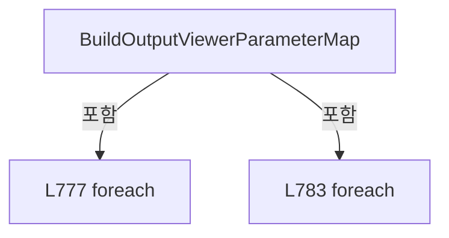

변경 전 점검: 입력/반환 타입, 위 호출자, 예외/취소 경로, 공유 상태와 저장·전송 소비자를 함께 확인합니다. 값의 단위나 물리 방향을 이름만으로 확정하지 않습니다.

### MethodDeclaration `SetOutputViewerParameter` · L793–799

[Drilling.UI/Menu/Menus/CMenuCorrection.cs:793–799](https://github.com/kjuws10-rgb/A3Drilling/blob/96e22cd027c84bf302b23f2949b98985d7f301bb/Drilling.UI/Menu/Menus/CMenuCorrection.cs#L793-L799)

| 항목 | 실제 추출 값 |
| --- | --- |
| 서명 | void Drilling.UI.Menu.Menus.CMenuCorrection.SetOutputViewerParameter(System.Collections.Generic.IDictionary<string, string>, string, string) |
| 접근/수식자 | Private / private, static |
| 반환/값 타입 | void |
| 소속 타입 | NamedType:Drilling.UI.Menu.Menus.CMenuCorrection |

입력 계약:

| 이름 | 타입 | 전달 | 선택/기본값 |
| --- | --- | --- | --- |
| parameters | System.Collections.Generic.IDictionary<string, string> | None | False /  |
| key | string | None | False /  |
| value | string | None | False /  |

정적 호출자로 확인된 위치:

| 호출 파일/행 | 호출 표현식 | 런타임 분기 가능 |
| --- | --- | --- |
| [Drilling.UI/Menu/Menus/CMenuCorrection.cs:779–779](https://github.com/kjuws10-rgb/A3Drilling/blob/96e22cd027c84bf302b23f2949b98985d7f301bb/Drilling.UI/Menu/Menus/CMenuCorrection.cs#L779-L779) | SetOutputViewerParameter | False |
| [Drilling.UI/Menu/Menus/CMenuCorrection.cs:780–780](https://github.com/kjuws10-rgb/A3Drilling/blob/96e22cd027c84bf302b23f2949b98985d7f301bb/Drilling.UI/Menu/Menus/CMenuCorrection.cs#L780-L780) | SetOutputViewerParameter | False |
| [Drilling.UI/Menu/Menus/CMenuCorrection.cs:785–785](https://github.com/kjuws10-rgb/A3Drilling/blob/96e22cd027c84bf302b23f2949b98985d7f301bb/Drilling.UI/Menu/Menus/CMenuCorrection.cs#L785-L785) | SetOutputViewerParameter | False |
| [Drilling.UI/Menu/Menus/CMenuCorrection.cs:786–786](https://github.com/kjuws10-rgb/A3Drilling/blob/96e22cd027c84bf302b23f2949b98985d7f301bb/Drilling.UI/Menu/Menus/CMenuCorrection.cs#L786-L786) | SetOutputViewerParameter | False |

호출하는 대상과 해석 범위:

| 원본 행 | 표현식 | 분석 상태 | 대상/소스 위치 |
| --- | --- | --- | --- |
| 795 | string.IsNullOrWhiteSpace | resolved | bool string.IsNullOrWhiteSpace(string?) |
| 797 | key.Trim | resolved | string string.Trim() |

본문의 실제 연산·분기·예외·반환 순서(원문 위치 순):

| 원본 행 | 종류 | 주석 해설 |
| --- | --- | --- |
| 795 | call | 함수·델리게이트 또는 객체 생성자를 호출합니다: string.IsNullOrWhiteSpace(key) |
| 795 | if | 조건에 따라 분기합니다: if (!string.IsNullOrWhiteSpace(key)) |
| 797 | assignment | 값을 대상에 대입합니다: parameters[key.Trim()] = value |
| 797 | call | 함수·델리게이트 또는 객체 생성자를 호출합니다: key.Trim() |

제어 구문의 포함 구조(실제 실행 순서/CFG가 아닌 구문 탐색 그림):

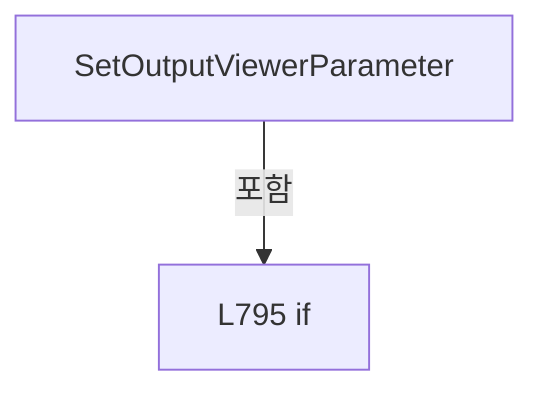

변경 전 점검: 입력/반환 타입, 위 호출자, 예외/취소 경로, 공유 상태와 저장·전송 소비자를 함께 확인합니다. 값의 단위나 물리 방향을 이름만으로 확정하지 않습니다.

### MethodDeclaration `CopyOutputViewerParameters` · L801–804

[Drilling.UI/Menu/Menus/CMenuCorrection.cs:801–804](https://github.com/kjuws10-rgb/A3Drilling/blob/96e22cd027c84bf302b23f2949b98985d7f301bb/Drilling.UI/Menu/Menus/CMenuCorrection.cs#L801-L804)

| 항목 | 실제 추출 값 |
| --- | --- |
| 서명 | System.Collections.Generic.IReadOnlyDictionary<string, string> Drilling.UI.Menu.Menus.CMenuCorrection.CopyOutputViewerParameters(System.Collections.Generic.IReadOnlyDictionary<string, string>) |
| 접근/수식자 | Private / private, static |
| 반환/값 타입 | System.Collections.Generic.IReadOnlyDictionary<string, string> |
| 소속 타입 | NamedType:Drilling.UI.Menu.Menus.CMenuCorrection |

입력 계약:

| 이름 | 타입 | 전달 | 선택/기본값 |
| --- | --- | --- | --- |
| parameters | System.Collections.Generic.IReadOnlyDictionary<string, string> | None | False /  |

정적 호출자로 확인된 위치:

| 호출 파일/행 | 호출 표현식 | 런타임 분기 가능 |
| --- | --- | --- |
| [Drilling.UI/Menu/Menus/CMenuCorrection.cs:664–664](https://github.com/kjuws10-rgb/A3Drilling/blob/96e22cd027c84bf302b23f2949b98985d7f301bb/Drilling.UI/Menu/Menus/CMenuCorrection.cs#L664-L664) | CopyOutputViewerParameters | False |
| [Drilling.UI/Menu/Menus/CMenuCorrection.cs:699–699](https://github.com/kjuws10-rgb/A3Drilling/blob/96e22cd027c84bf302b23f2949b98985d7f301bb/Drilling.UI/Menu/Menus/CMenuCorrection.cs#L699-L699) | CopyOutputViewerParameters | False |

호출하는 대상과 해석 범위:

| 원본 행 | 표현식 | 분석 상태 | 대상/소스 위치 |
| --- | --- | --- | --- |
| 803 | new Dictionary<string, string> | resolved | System.Collections.Generic.Dictionary<string, string>.Dictionary(System.Collections.Generic.IEnumerable<System.Collections.Generic.KeyValuePair<string, string>>, System.Collections.Generic.IEqualityComparer<string>?) |

본문의 실제 연산·분기·예외·반환 순서(원문 위치 순):

| 원본 행 | 종류 | 주석 해설 |
| --- | --- | --- |
| 803 | call | 함수·델리게이트 또는 객체 생성자를 호출합니다: new Dictionary<string, string>(parameters, StringComparer.OrdinalIgnoreCase) |
| 803 | return | 호출자에게 값 또는 제어를 반환합니다: return new Dictionary<string, string>(parameters, StringComparer.OrdinalIgnoreCase); |

변경 전 점검: 입력/반환 타입, 위 호출자, 예외/취소 경로, 공유 상태와 저장·전송 소비자를 함께 확인합니다. 값의 단위나 물리 방향을 이름만으로 확정하지 않습니다.

### MethodDeclaration `OutputViewerParametersMatch` · L806–822

[Drilling.UI/Menu/Menus/CMenuCorrection.cs:806–822](https://github.com/kjuws10-rgb/A3Drilling/blob/96e22cd027c84bf302b23f2949b98985d7f301bb/Drilling.UI/Menu/Menus/CMenuCorrection.cs#L806-L822)

| 항목 | 실제 추출 값 |
| --- | --- |
| 서명 | bool Drilling.UI.Menu.Menus.CMenuCorrection.OutputViewerParametersMatch(System.Collections.Generic.IReadOnlyDictionary<string, string>?, System.Collections.Generic.IReadOnlyDictionary<string, string>) |
| 접근/수식자 | Private / private, static |
| 반환/값 타입 | bool |
| 소속 타입 | NamedType:Drilling.UI.Menu.Menus.CMenuCorrection |

입력 계약:

| 이름 | 타입 | 전달 | 선택/기본값 |
| --- | --- | --- | --- |
| cached | System.Collections.Generic.IReadOnlyDictionary<string, string>? | None | False /  |
| current | System.Collections.Generic.IReadOnlyDictionary<string, string> | None | False /  |

정적 호출자로 확인된 위치:

| 호출 파일/행 | 호출 표현식 | 런타임 분기 가능 |
| --- | --- | --- |
| [Drilling.UI/Menu/Menus/CMenuCorrection.cs:655–655](https://github.com/kjuws10-rgb/A3Drilling/blob/96e22cd027c84bf302b23f2949b98985d7f301bb/Drilling.UI/Menu/Menus/CMenuCorrection.cs#L655-L655) | OutputViewerParametersMatch | False |
| [Drilling.UI/Menu/Menus/CMenuCorrection.cs:682–682](https://github.com/kjuws10-rgb/A3Drilling/blob/96e22cd027c84bf302b23f2949b98985d7f301bb/Drilling.UI/Menu/Menus/CMenuCorrection.cs#L682-L682) | OutputViewerParametersMatch | False |

호출하는 대상과 해석 범위:

| 원본 행 | 표현식 | 분석 상태 | 대상/소스 위치 |
| --- | --- | --- | --- |
| 815 | cached.TryGetValue | resolved · 동적 구현 선택 가능 | bool System.Collections.Generic.IReadOnlyDictionary<string, string>.TryGetValue(string, out string) |
| 815 | value.Equals | resolved | bool string.Equals(string?, System.StringComparison) |

본문의 실제 연산·분기·예외·반환 순서(원문 위치 순):

| 원본 행 | 종류 | 주석 해설 |
| --- | --- | --- |
| 808 | if | 조건에 따라 분기합니다: if (cached is null &#124;&#124; cached.Count != current.Count) |
| 810 | return | 호출자에게 값 또는 제어를 반환합니다: return false; |
| 813 | foreach | 컬렉션 요소를 순회합니다: foreach (var parameter in current) |
| 815 | call | 함수·델리게이트 또는 객체 생성자를 호출합니다: cached.TryGetValue(parameter.Key, out var value) |
| 815 | call | 함수·델리게이트 또는 객체 생성자를 호출합니다: value.Equals(parameter.Value, StringComparison.Ordinal) |
| 815 | if | 조건에 따라 분기합니다: if (!cached.TryGetValue(parameter.Key, out var value) &#124;&#124; !value.Equals(parameter.Value, StringComparison.Ordinal)) |
| 817 | return | 호출자에게 값 또는 제어를 반환합니다: return false; |
| 821 | return | 호출자에게 값 또는 제어를 반환합니다: return true; |

제어 구문의 포함 구조(실제 실행 순서/CFG가 아닌 구문 탐색 그림):


변경 전 점검: 입력/반환 타입, 위 호출자, 예외/취소 경로, 공유 상태와 저장·전송 소비자를 함께 확인합니다. 값의 단위나 물리 방향을 이름만으로 확정하지 않습니다.

### MethodDeclaration `ClearOutputViewerCellSelectionData` · L824–831

[Drilling.UI/Menu/Menus/CMenuCorrection.cs:824–831](https://github.com/kjuws10-rgb/A3Drilling/blob/96e22cd027c84bf302b23f2949b98985d7f301bb/Drilling.UI/Menu/Menus/CMenuCorrection.cs#L824-L831)

| 항목 | 실제 추출 값 |
| --- | --- |
| 서명 | void Drilling.UI.Menu.Menus.CMenuCorrection.ClearOutputViewerCellSelectionData() |
| 접근/수식자 | Private / private |
| 반환/값 타입 | void |
| 소속 타입 | NamedType:Drilling.UI.Menu.Menus.CMenuCorrection |

정적 호출자로 확인된 위치:

| 호출 파일/행 | 호출 표현식 | 런타임 분기 가능 |
| --- | --- | --- |
| [Drilling.UI/Menu/Menus/CMenuCorrection.cs:630–630](https://github.com/kjuws10-rgb/A3Drilling/blob/96e22cd027c84bf302b23f2949b98985d7f301bb/Drilling.UI/Menu/Menus/CMenuCorrection.cs#L630-L630) | ClearOutputViewerCellSelectionData | False |
| [Drilling.UI/Menu/Menus/CMenuCorrection.cs:733–733](https://github.com/kjuws10-rgb/A3Drilling/blob/96e22cd027c84bf302b23f2949b98985d7f301bb/Drilling.UI/Menu/Menus/CMenuCorrection.cs#L733-L733) | ClearOutputViewerCellSelectionData | False |
| [Drilling.UI/Menu/Menus/CMenuCorrection.cs:751–751](https://github.com/kjuws10-rgb/A3Drilling/blob/96e22cd027c84bf302b23f2949b98985d7f301bb/Drilling.UI/Menu/Menus/CMenuCorrection.cs#L751-L751) | ClearOutputViewerCellSelectionData | False |

호출하는 대상과 해석 범위:

| 원본 행 | 표현식 | 분석 상태 | 대상/소스 위치 |
| --- | --- | --- | --- |
| 827 | new Dictionary<string, ST_RECIPE_SHOT_MASKING_RESULT> | resolved | System.Collections.Generic.Dictionary<string, Drilling.Common.Recipe.ST_RECIPE_SHOT_MASKING_RESULT>.Dictionary(System.Collections.Generic.IEqualityComparer<string>?) |
| 830 | CreateOutputViewerHeadCards | resolved | System.Collections.Generic.IReadOnlyList<Drilling.UI.Menu.Menus.ST_CORRECTION_OUTPUT_VIEWER_HEAD_CARD> Drilling.UI.Menu.Menus.CMenuCorrection.CreateOutputViewerHeadCards(System.Collections.Generic.IReadOnlyList<Drilling.Common.Recipe.ST_HEAD_SHOT_POINT>) · Drilling.UI/Menu/Menus/CMenuCorrection.cs:859 |

본문의 실제 연산·분기·예외·반환 순서(원문 위치 순):

| 원본 행 | 종류 | 주석 해설 |
| --- | --- | --- |
| 826 | assignment | 값을 대상에 대입합니다: _outputViewerSelectedCellShots = [] |
| 827 | assignment | 값을 대상에 대입합니다: _outputViewerSelectedShotStates = new Dictionary<string, ST_RECIPE_SHOT_MASKING_RESULT>(StringComparer.OrdinalIgnoreCase) |
| 827 | call | 함수·델리게이트 또는 객체 생성자를 호출합니다: new Dictionary<string, ST_RECIPE_SHOT_MASKING_RESULT>(StringComparer.OrdinalIgnoreCase) |
| 828 | assignment | 값을 대상에 대입합니다: _outputViewerSelectedShotKey = "" |
| 829 | assignment | 값을 대상에 대입합니다: OutputViewerCellShotMapImage = null |
| 830 | assignment | 값을 대상에 대입합니다: OutputViewerHeadCards = CreateOutputViewerHeadCards([]) |
| 830 | call | 함수·델리게이트 또는 객체 생성자를 호출합니다: CreateOutputViewerHeadCards([]) |

변경 전 점검: 입력/반환 타입, 위 호출자, 예외/취소 경로, 공유 상태와 저장·전송 소비자를 함께 확인합니다. 값의 단위나 물리 방향을 이름만으로 확정하지 않습니다.

### MethodDeclaration `GetOutputViewerSelectedShot` · L833–841

[Drilling.UI/Menu/Menus/CMenuCorrection.cs:833–841](https://github.com/kjuws10-rgb/A3Drilling/blob/96e22cd027c84bf302b23f2949b98985d7f301bb/Drilling.UI/Menu/Menus/CMenuCorrection.cs#L833-L841)

| 항목 | 실제 추출 값 |
| --- | --- |
| 서명 | Drilling.Common.Recipe.ST_HEAD_SHOT_POINT? Drilling.UI.Menu.Menus.CMenuCorrection.GetOutputViewerSelectedShot() |
| 접근/수식자 | Private / private |
| 반환/값 타입 | Drilling.Common.Recipe.ST_HEAD_SHOT_POINT? |
| 소속 타입 | NamedType:Drilling.UI.Menu.Menus.CMenuCorrection |

정적 호출자로 확인된 위치:

| 호출 파일/행 | 호출 표현식 | 런타임 분기 가능 |
| --- | --- | --- |
| [Drilling.UI/Menu/Menus/CMenuCorrection.cs:299–299](https://github.com/kjuws10-rgb/A3Drilling/blob/96e22cd027c84bf302b23f2949b98985d7f301bb/Drilling.UI/Menu/Menus/CMenuCorrection.cs#L299-L299) | GetOutputViewerSelectedShot | False |
| [Drilling.UI/Menu/Menus/CMenuCorrection.cs:300–300](https://github.com/kjuws10-rgb/A3Drilling/blob/96e22cd027c84bf302b23f2949b98985d7f301bb/Drilling.UI/Menu/Menus/CMenuCorrection.cs#L300-L300) | GetOutputViewerSelectedShot | False |

호출하는 대상과 해석 범위:

| 원본 행 | 표현식 | 분석 상태 | 대상/소스 위치 |
| --- | --- | --- | --- |
| 835 | string.IsNullOrWhiteSpace | resolved | bool string.IsNullOrWhiteSpace(string?) |
| 840 | _outputViewerSelectedCellShots.FirstOrDefault | resolved | Drilling.Common.Recipe.ST_HEAD_SHOT_POINT? System.Collections.Generic.IEnumerable<Drilling.Common.Recipe.ST_HEAD_SHOT_POINT>.FirstOrDefault<Drilling.Common.Recipe.ST_HEAD_SHOT_POINT>(System.Func<Drilling.Common.Recipe.ST_HEAD_SHOT_POINT, bool>) |
| 840 | shot.ShotKey.Equals | resolved | bool string.Equals(string?, System.StringComparison) |

본문의 실제 연산·분기·예외·반환 순서(원문 위치 순):

| 원본 행 | 종류 | 주석 해설 |
| --- | --- | --- |
| 835 | call | 함수·델리게이트 또는 객체 생성자를 호출합니다: string.IsNullOrWhiteSpace(_outputViewerSelectedShotKey) |
| 835 | if | 조건에 따라 분기합니다: if (string.IsNullOrWhiteSpace(_outputViewerSelectedShotKey)) |
| 837 | return | 호출자에게 값 또는 제어를 반환합니다: return null; |
| 840 | call | 함수·델리게이트 또는 객체 생성자를 호출합니다: _outputViewerSelectedCellShots.FirstOrDefault(shot => shot.ShotKey.Equals(_outputViewerSelectedShotKey, StringComparison.OrdinalIgnoreCase)) |
| 840 | call | 함수·델리게이트 또는 객체 생성자를 호출합니다: shot.ShotKey.Equals(_outputViewerSelectedShotKey, StringComparison.OrdinalIgnoreCase) |
| 840 | return | 호출자에게 값 또는 제어를 반환합니다: return _outputViewerSelectedCellShots.FirstOrDefault(shot => shot.ShotKey.Equals(_outputViewerSelectedShotKey, StringComparison.OrdinalIgnoreCase)); |

제어 구문의 포함 구조(실제 실행 순서/CFG가 아닌 구문 탐색 그림):

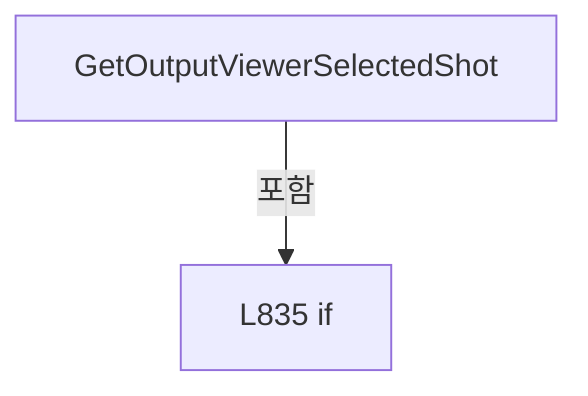

변경 전 점검: 입력/반환 타입, 위 호출자, 예외/취소 경로, 공유 상태와 저장·전송 소비자를 함께 확인합니다. 값의 단위나 물리 방향을 이름만으로 확정하지 않습니다.

### MethodDeclaration `GetOutputViewerShotMapSize` · L843–851

[Drilling.UI/Menu/Menus/CMenuCorrection.cs:843–851](https://github.com/kjuws10-rgb/A3Drilling/blob/96e22cd027c84bf302b23f2949b98985d7f301bb/Drilling.UI/Menu/Menus/CMenuCorrection.cs#L843-L851)

| 항목 | 실제 추출 값 |
| --- | --- |
| 서명 | Size Drilling.UI.Menu.Menus.CMenuCorrection.GetOutputViewerShotMapSize() |
| 접근/수식자 | Private / private |
| 반환/값 타입 | Size |
| 소속 타입 | NamedType:Drilling.UI.Menu.Menus.CMenuCorrection |

정적 호출자로 확인된 위치:

| 호출 파일/행 | 호출 표현식 | 런타임 분기 가능 |
| --- | --- | --- |
| [Drilling.UI/Menu/Menus/CMenuCorrection.cs:301–301](https://github.com/kjuws10-rgb/A3Drilling/blob/96e22cd027c84bf302b23f2949b98985d7f301bb/Drilling.UI/Menu/Menus/CMenuCorrection.cs#L301-L301) | GetOutputViewerShotMapSize | False |
| [Drilling.UI/Menu/Menus/CMenuCorrection.cs:302–302](https://github.com/kjuws10-rgb/A3Drilling/blob/96e22cd027c84bf302b23f2949b98985d7f301bb/Drilling.UI/Menu/Menus/CMenuCorrection.cs#L302-L302) | GetOutputViewerShotMapSize | False |

호출하는 대상과 해석 범위:

| 원본 행 | 표현식 | 분석 상태 | 대상/소스 위치 |
| --- | --- | --- | --- |
| 845 | _outputViewerSelectedCellShots.FirstOrDefault | resolved | Drilling.Common.Recipe.ST_HEAD_SHOT_POINT? System.Collections.Generic.IEnumerable<Drilling.Common.Recipe.ST_HEAD_SHOT_POINT>.FirstOrDefault<Drilling.Common.Recipe.ST_HEAD_SHOT_POINT>() |
| 847 | new Size | unresolved | None |
| 850 | new Size | unresolved | None |
| 850 | new Size | unresolved | None |

본문의 실제 연산·분기·예외·반환 순서(원문 위치 순):

| 원본 행 | 종류 | 주석 해설 |
| --- | --- | --- |
| 845 | call | 함수·델리게이트 또는 객체 생성자를 호출합니다: _outputViewerSelectedCellShots.FirstOrDefault() |
| 845 | if | 조건에 따라 분기합니다: if (_outputViewerSelectedCellShots.FirstOrDefault() is not { } firstShot) |
| 847 | call | 함수·델리게이트 또는 객체 생성자를 호출합니다: new Size(680.0, 420.0) |
| 847 | return | 호출자에게 값 또는 제어를 반환합니다: return new Size(680.0, 420.0); |
| 850 | call | 함수·델리게이트 또는 객체 생성자를 호출합니다: new Size(680.0, 420.0) |
| 850 | call | 함수·델리게이트 또는 객체 생성자를 호출합니다: new Size(420.0, 680.0) |
| 850 | conditional-expression | 조건에 따라 결과식을 선택합니다: firstShot.GroupCountX > firstShot.GroupCountY ? new Size(680.0, 420.0) : new Size(420.0, 680.0) |
| 850 | return | 호출자에게 값 또는 제어를 반환합니다: return firstShot.GroupCountX > firstShot.GroupCountY ? new Size(680.0, 420.0) : new Size(420.0, 680.0); |

제어 구문의 포함 구조(실제 실행 순서/CFG가 아닌 구문 탐색 그림):

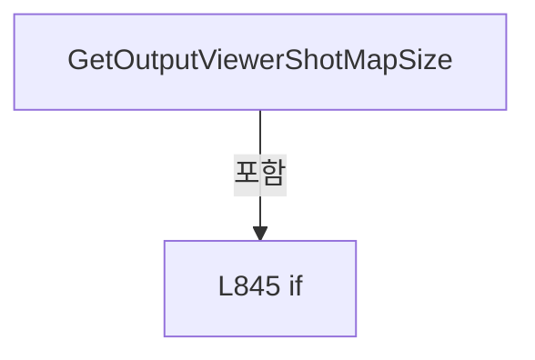

변경 전 점검: 입력/반환 타입, 위 호출자, 예외/취소 경로, 공유 상태와 저장·전송 소비자를 함께 확인합니다. 값의 단위나 물리 방향을 이름만으로 확정하지 않습니다.

### MethodDeclaration `GetOutputViewerShotMapRect` · L853–857

[Drilling.UI/Menu/Menus/CMenuCorrection.cs:853–857](https://github.com/kjuws10-rgb/A3Drilling/blob/96e22cd027c84bf302b23f2949b98985d7f301bb/Drilling.UI/Menu/Menus/CMenuCorrection.cs#L853-L857)

| 항목 | 실제 추출 값 |
| --- | --- |
| 서명 | Rect Drilling.UI.Menu.Menus.CMenuCorrection.GetOutputViewerShotMapRect(int, int) |
| 접근/수식자 | Private / private, static |
| 반환/값 타입 | Rect |
| 소속 타입 | NamedType:Drilling.UI.Menu.Menus.CMenuCorrection |

입력 계약:

| 이름 | 타입 | 전달 | 선택/기본값 |
| --- | --- | --- | --- |
| groupCountX | int | None | False /  |
| groupCountY | int | None | False /  |

정적 호출자로 확인된 위치:

| 호출 파일/행 | 호출 표현식 | 런타임 분기 가능 |
| --- | --- | --- |
| [Drilling.UI/Menu/Menus/CMenuCorrection.cs:580–580](https://github.com/kjuws10-rgb/A3Drilling/blob/96e22cd027c84bf302b23f2949b98985d7f301bb/Drilling.UI/Menu/Menus/CMenuCorrection.cs#L580-L580) | GetOutputViewerShotMapRect | False |
| [Drilling.UI/Menu/Menus/CMenuCorrection.cs:892–892](https://github.com/kjuws10-rgb/A3Drilling/blob/96e22cd027c84bf302b23f2949b98985d7f301bb/Drilling.UI/Menu/Menus/CMenuCorrection.cs#L892-L892) | GetOutputViewerShotMapRect | False |

호출하는 대상과 해석 범위:

| 원본 행 | 표현식 | 분석 상태 | 대상/소스 위치 |
| --- | --- | --- | --- |
| 855 | new Size | unresolved | None |
| 855 | new Size | unresolved | None |
| 856 | new Rect | unresolved | None |

본문의 실제 연산·분기·예외·반환 순서(원문 위치 순):

| 원본 행 | 종류 | 주석 해설 |
| --- | --- | --- |
| 855 | call | 함수·델리게이트 또는 객체 생성자를 호출합니다: new Size(680.0, 420.0) |
| 855 | call | 함수·델리게이트 또는 객체 생성자를 호출합니다: new Size(420.0, 680.0) |
| 855 | conditional-expression | 조건에 따라 결과식을 선택합니다: groupCountX > groupCountY ? new Size(680.0, 420.0) : new Size(420.0, 680.0) |
| 855 | local-declaration | 지역 변수를 선언합니다: var size = groupCountX > groupCountY ? new Size(680.0, 420.0) : new Size(420.0, 680.0); |
| 855 | variable-initializer | 변수의 초기값을 지정합니다: size = groupCountX > groupCountY ? new Size(680.0, 420.0) : new Size(420.0, 680.0) |
| 856 | call | 함수·델리게이트 또는 객체 생성자를 호출합니다: new Rect(28.0, 28.0, size.Width - 56.0, size.Height - 56.0) |
| 856 | return | 호출자에게 값 또는 제어를 반환합니다: return new Rect(28.0, 28.0, size.Width - 56.0, size.Height - 56.0); |

변경 전 점검: 입력/반환 타입, 위 호출자, 예외/취소 경로, 공유 상태와 저장·전송 소비자를 함께 확인합니다. 값의 단위나 물리 방향을 이름만으로 확정하지 않습니다.

### MethodDeclaration `CreateOutputViewerHeadCards` · L859–878

[Drilling.UI/Menu/Menus/CMenuCorrection.cs:859–878](https://github.com/kjuws10-rgb/A3Drilling/blob/96e22cd027c84bf302b23f2949b98985d7f301bb/Drilling.UI/Menu/Menus/CMenuCorrection.cs#L859-L878)

| 항목 | 실제 추출 값 |
| --- | --- |
| 서명 | System.Collections.Generic.IReadOnlyList<Drilling.UI.Menu.Menus.ST_CORRECTION_OUTPUT_VIEWER_HEAD_CARD> Drilling.UI.Menu.Menus.CMenuCorrection.CreateOutputViewerHeadCards(System.Collections.Generic.IReadOnlyList<Drilling.Common.Recipe.ST_HEAD_SHOT_POINT>) |
| 접근/수식자 | Private / private, static |
| 반환/값 타입 | System.Collections.Generic.IReadOnlyList<Drilling.UI.Menu.Menus.ST_CORRECTION_OUTPUT_VIEWER_HEAD_CARD> |
| 소속 타입 | NamedType:Drilling.UI.Menu.Menus.CMenuCorrection |

입력 계약:

| 이름 | 타입 | 전달 | 선택/기본값 |
| --- | --- | --- | --- |
| shots | System.Collections.Generic.IReadOnlyList<Drilling.Common.Recipe.ST_HEAD_SHOT_POINT> | None | False /  |

정적 호출자로 확인된 위치:

| 호출 파일/행 | 호출 표현식 | 런타임 분기 가능 |
| --- | --- | --- |
| [Drilling.UI/Menu/Menus/CMenuCorrection.cs:77–77](https://github.com/kjuws10-rgb/A3Drilling/blob/96e22cd027c84bf302b23f2949b98985d7f301bb/Drilling.UI/Menu/Menus/CMenuCorrection.cs#L77-L77) | CreateOutputViewerHeadCards | False |
| [Drilling.UI/Menu/Menus/CMenuCorrection.cs:728–728](https://github.com/kjuws10-rgb/A3Drilling/blob/96e22cd027c84bf302b23f2949b98985d7f301bb/Drilling.UI/Menu/Menus/CMenuCorrection.cs#L728-L728) | CreateOutputViewerHeadCards | False |
| [Drilling.UI/Menu/Menus/CMenuCorrection.cs:830–830](https://github.com/kjuws10-rgb/A3Drilling/blob/96e22cd027c84bf302b23f2949b98985d7f301bb/Drilling.UI/Menu/Menus/CMenuCorrection.cs#L830-L830) | CreateOutputViewerHeadCards | False |

호출하는 대상과 해석 범위:

| 원본 행 | 표현식 | 분석 상태 | 대상/소스 위치 |
| --- | --- | --- | --- |
| 861 | shots.Select(shot => shot.HeadNo).ToHashSet | resolved | System.Collections.Generic.HashSet<int> System.Collections.Generic.IEnumerable<int>.ToHashSet<int>() |
| 861 | shots.Select | resolved | System.Collections.Generic.IEnumerable<int> System.Collections.Generic.IEnumerable<Drilling.Common.Recipe.ST_HEAD_SHOT_POINT>.Select<Drilling.Common.Recipe.ST_HEAD_SHOT_POINT, int>(System.Func<Drilling.Common.Recipe.ST_HEAD_SHOT_POINT, int>) |
| 862 | new SolidColorBrush | unresolved | None |
| 862 | Color.FromRgb | unresolved | None |
| 863 | new SolidColorBrush | unresolved | None |
| 863 | Color.FromRgb | unresolved | None |
| 864 | new SolidColorBrush | unresolved | None |
| 864 | Color.FromRgb | unresolved | None |
| 865 | inactiveBackground.Freeze | unresolved | None |
| 866 | inactiveBorder.Freeze | unresolved | None |
| 867 | inactiveText.Freeze | unresolved | None |
| 868 | Enumerable.Range(1, 8).Select(headNo => { var isAssigned = assignedHeads.Contains(headNo); return new ST_CORRECTION_OUTPUT_VIEWER_HEAD_CARD( headNo, isAssigned, isAssigned ? CMenuMain.CreateHeadBrush(headNo) : inactiveBackground, isAssigned ? Brushes.White : inactiveBorder, isAssigned ? Brushes.White : inactiveText); }).ToArray | unresolved | None |
| 868 | Enumerable.Range(1, 8).Select | candidate | OverloadResolutionFailure |
| 868 | Enumerable.Range | resolved | System.Collections.Generic.IEnumerable<int> System.Linq.Enumerable.Range(int, int) |
| 870 | assignedHeads.Contains | resolved | bool System.Collections.Generic.HashSet<int>.Contains(int) |
| 871 | new ST_CORRECTION_OUTPUT_VIEWER_HEAD_CARD | candidate | OverloadResolutionFailure |
| 874 | CMenuMain.CreateHeadBrush | resolved | Brush Drilling.UI.Menu.Menus.CMenuMain.CreateHeadBrush(int, byte) · Drilling.UI/Menu/Menus/CMenuMain.cs:2246 |

본문의 실제 연산·분기·예외·반환 순서(원문 위치 순):

| 원본 행 | 종류 | 주석 해설 |
| --- | --- | --- |
| 861 | call | 함수·델리게이트 또는 객체 생성자를 호출합니다: shots.Select(shot => shot.HeadNo).ToHashSet() |
| 861 | call | 함수·델리게이트 또는 객체 생성자를 호출합니다: shots.Select(shot => shot.HeadNo) |
| 861 | local-declaration | 지역 변수를 선언합니다: var assignedHeads = shots.Select(shot => shot.HeadNo).ToHashSet(); |
| 861 | variable-initializer | 변수의 초기값을 지정합니다: assignedHeads = shots.Select(shot => shot.HeadNo).ToHashSet() |
| 862 | call | 함수·델리게이트 또는 객체 생성자를 호출합니다: new SolidColorBrush(Color.FromRgb(76, 91, 105)) |
| 862 | call | 함수·델리게이트 또는 객체 생성자를 호출합니다: Color.FromRgb(76, 91, 105) |
| 862 | local-declaration | 지역 변수를 선언합니다: var inactiveBackground = new SolidColorBrush(Color.FromRgb(76, 91, 105)); |
| 862 | variable-initializer | 변수의 초기값을 지정합니다: inactiveBackground = new SolidColorBrush(Color.FromRgb(76, 91, 105)) |
| 863 | call | 함수·델리게이트 또는 객체 생성자를 호출합니다: new SolidColorBrush(Color.FromRgb(139, 157, 174)) |
| 863 | call | 함수·델리게이트 또는 객체 생성자를 호출합니다: Color.FromRgb(139, 157, 174) |
| 863 | local-declaration | 지역 변수를 선언합니다: var inactiveBorder = new SolidColorBrush(Color.FromRgb(139, 157, 174)); |
| 863 | variable-initializer | 변수의 초기값을 지정합니다: inactiveBorder = new SolidColorBrush(Color.FromRgb(139, 157, 174)) |
| 864 | call | 함수·델리게이트 또는 객체 생성자를 호출합니다: new SolidColorBrush(Color.FromRgb(248, 250, 252)) |
| 864 | call | 함수·델리게이트 또는 객체 생성자를 호출합니다: Color.FromRgb(248, 250, 252) |
| 864 | local-declaration | 지역 변수를 선언합니다: var inactiveText = new SolidColorBrush(Color.FromRgb(248, 250, 252)); |
| 864 | variable-initializer | 변수의 초기값을 지정합니다: inactiveText = new SolidColorBrush(Color.FromRgb(248, 250, 252)) |
| 865 | call | 함수·델리게이트 또는 객체 생성자를 호출합니다: inactiveBackground.Freeze() |
| 866 | call | 함수·델리게이트 또는 객체 생성자를 호출합니다: inactiveBorder.Freeze() |
| 867 | call | 함수·델리게이트 또는 객체 생성자를 호출합니다: inactiveText.Freeze() |
| 868 | call | 함수·델리게이트 또는 객체 생성자를 호출합니다: Enumerable.Range(1, 8) |
| 868 | call | 함수·델리게이트 또는 객체 생성자를 호출합니다: Enumerable.Range(1, 8).Select(headNo => { var isAssigned = assignedHeads.Contains(headNo); return new ST_CORRECTION_OUTPUT_VIEWER_HEAD_CARD( headNo, isAssigned, isAssigned ? CMenuMain.CreateHeadBrush(headNo) : inactiveBa… |
| 868 | call | 함수·델리게이트 또는 객체 생성자를 호출합니다: Enumerable.Range(1, 8).Select(headNo => { var isAssigned = assignedHeads.Contains(headNo); return new ST_CORRECTION_OUTPUT_VIEWER_HEAD_CARD( headNo, isAssigned, isAssigned ? CMenuMain.CreateHeadBrush(headNo) : inactiveBa… |
| 868 | return | 호출자에게 값 또는 제어를 반환합니다: return Enumerable.Range(1, 8).Select(headNo => { var isAssigned = assignedHeads.Contains(headNo); return new ST_CORRECTION_OUTPUT_VIEWER_HEAD_CARD( headNo, isAssigned, isAssigned ? CMenuMain.CreateHeadBrush(headNo) : inactiveBackg |
| 870 | call | 함수·델리게이트 또는 객체 생성자를 호출합니다: assignedHeads.Contains(headNo) |
| 870 | local-declaration | 지역 변수를 선언합니다: var isAssigned = assignedHeads.Contains(headNo); |
| 870 | variable-initializer | 변수의 초기값을 지정합니다: isAssigned = assignedHeads.Contains(headNo) |
| 871 | call | 함수·델리게이트 또는 객체 생성자를 호출합니다: new ST_CORRECTION_OUTPUT_VIEWER_HEAD_CARD( headNo, isAssigned, isAssigned ? CMenuMain.CreateHeadBrush(headNo) : inactiveBackground, isAssigned ? Brushes.White : inactiveBorder, isAssigned ? Brushes.White : inactiveText) |
| 871 | return | 호출자에게 값 또는 제어를 반환합니다: return new ST_CORRECTION_OUTPUT_VIEWER_HEAD_CARD( headNo, isAssigned, isAssigned ? CMenuMain.CreateHeadBrush(headNo) : inactiveBackground, isAssigned ? Brushes.White : inactiveBorder, isAssigned ? Brushes.White : inactiveText); |
| 874 | call | 함수·델리게이트 또는 객체 생성자를 호출합니다: CMenuMain.CreateHeadBrush(headNo) |
| 874 | conditional-expression | 조건에 따라 결과식을 선택합니다: isAssigned ? CMenuMain.CreateHeadBrush(headNo) : inactiveBackground |
| 875 | conditional-expression | 조건에 따라 결과식을 선택합니다: isAssigned ? Brushes.White : inactiveBorder |
| 876 | conditional-expression | 조건에 따라 결과식을 선택합니다: isAssigned ? Brushes.White : inactiveText |

변경 전 점검: 입력/반환 타입, 위 호출자, 예외/취소 경로, 공유 상태와 저장·전송 소비자를 함께 확인합니다. 값의 단위나 물리 방향을 이름만으로 확정하지 않습니다.

### MethodDeclaration `BuildOutputViewerCellShotMap` · L880–990

[Drilling.UI/Menu/Menus/CMenuCorrection.cs:880–990](https://github.com/kjuws10-rgb/A3Drilling/blob/96e22cd027c84bf302b23f2949b98985d7f301bb/Drilling.UI/Menu/Menus/CMenuCorrection.cs#L880-L990)

| 항목 | 실제 추출 값 |
| --- | --- |
| 서명 | ImageSource? Drilling.UI.Menu.Menus.CMenuCorrection.BuildOutputViewerCellShotMap(System.Collections.Generic.IReadOnlyList<Drilling.Common.Recipe.ST_HEAD_SHOT_POINT>, System.Collections.Generic.IReadOnlyDictionary<string, Drilling.Common.Recipe.ST_RECIPE_SHOT_MASKING_RESULT>, string) |
| 접근/수식자 | Private / private, static |
| 반환/값 타입 | ImageSource? |
| 소속 타입 | NamedType:Drilling.UI.Menu.Menus.CMenuCorrection |

입력 계약:

| 이름 | 타입 | 전달 | 선택/기본값 |
| --- | --- | --- | --- |
| shots | System.Collections.Generic.IReadOnlyList<Drilling.Common.Recipe.ST_HEAD_SHOT_POINT> | None | False /  |
| shotStates | System.Collections.Generic.IReadOnlyDictionary<string, Drilling.Common.Recipe.ST_RECIPE_SHOT_MASKING_RESULT> | None | False /  |
| selectedShotKey | string | None | False /  |

정적 호출자로 확인된 위치:

| 호출 파일/행 | 호출 표현식 | 런타임 분기 가능 |
| --- | --- | --- |
| [Drilling.UI/Menu/Menus/CMenuCorrection.cs:603–603](https://github.com/kjuws10-rgb/A3Drilling/blob/96e22cd027c84bf302b23f2949b98985d7f301bb/Drilling.UI/Menu/Menus/CMenuCorrection.cs#L603-L603) | BuildOutputViewerCellShotMap | False |
| [Drilling.UI/Menu/Menus/CMenuCorrection.cs:717–717](https://github.com/kjuws10-rgb/A3Drilling/blob/96e22cd027c84bf302b23f2949b98985d7f301bb/Drilling.UI/Menu/Menus/CMenuCorrection.cs#L717-L717) | BuildOutputViewerCellShotMap | False |

호출하는 대상과 해석 범위:

| 원본 행 | 표현식 | 분석 상태 | 대상/소스 위치 |
| --- | --- | --- | --- |
| 891 | new Size | unresolved | None |
| 891 | new Size | unresolved | None |
| 892 | GetOutputViewerShotMapRect | resolved | Rect Drilling.UI.Menu.Menus.CMenuCorrection.GetOutputViewerShotMapRect(int, int) · Drilling.UI/Menu/Menus/CMenuCorrection.cs:853 |
| 895 | Math.Clamp | candidate | OverloadResolutionFailure |
| 895 | Math.Min | candidate | OverloadResolutionFailure |
| 896 | new DrawingGroup | unresolved | None |
| 897 | drawing.Open | unresolved | None |
| 899 | context.DrawRectangle | unresolved | None |
| 899 | new SolidColorBrush | unresolved | None |
| 899 | Color.FromArgb | unresolved | None |
| 899 | new Rect | unresolved | None |
| 900 | context.DrawRectangle | unresolved | None |
| 900 | new SolidColorBrush | unresolved | None |
| 900 | Color.FromRgb | unresolved | None |
| 902 | new Pen | unresolved | None |
| 902 | new SolidColorBrush | unresolved | None |
| 902 | Color.FromArgb | unresolved | None |
| 903 | gridPen.Freeze | unresolved | None |
| 904 | Math.Max | resolved | int System.Math.Max(int, int) |
| 905 | Math.Max | resolved | int System.Math.Max(int, int) |
| 909 | context.DrawLine | unresolved | None |
| 909 | new Point | unresolved | None |
| 909 | new Point | unresolved | None |
| 915 | context.DrawLine | unresolved | None |
| 915 | new Point | unresolved | None |
| 915 | new Point | unresolved | None |
| 919 | Math.Max | resolved | int System.Math.Max(int, int) |
| 919 | Math.Ceiling | resolved | double System.Math.Ceiling(double) |
| 920 | new StreamGeometry | unresolved | None |
| 921 | new StreamGeometry | unresolved | None |
| 922 | new StreamGeometry | unresolved | None |
| 923 | shotGeometry.Open | unresolved | None |
| 924 | maskingGeometry.Open | unresolved | None |
| 925 | chessGeometry.Open | unresolved | None |
| 932 | shotStates.TryGetValue | resolved · 동적 구현 선택 가능 | bool System.Collections.Generic.IReadOnlyDictionary<string, Drilling.Common.Recipe.ST_RECIPE_SHOT_MASKING_RESULT>.TryGetValue(string, out Drilling.Common.Recipe.ST_RECIPE_SHOT_MASKING_RESULT) |
| 935 | AddOutputViewerShotCircle | candidate | OverloadResolutionFailure |
| 940 | AddOutputViewerMaskCross | candidate | OverloadResolutionFailure |
| 940 | Math.Max | candidate | OverloadResolutionFailure |
| 945 | AddOutputViewerChessDiamond | candidate | OverloadResolutionFailure |
| 945 | Math.Max | candidate | OverloadResolutionFailure |
| 950 | shotGeometry.Freeze | unresolved | None |
| 951 | maskingGeometry.Freeze | unresolved | None |
| 952 | chessGeometry.Freeze | unresolved | None |
| 953 | new SolidColorBrush | unresolved | None |
| 953 | Color.FromRgb | unresolved | None |
| 954 | shotBrush.Freeze | unresolved | None |
| 955 | context.DrawGeometry | unresolved | None |
| 956 | new SolidColorBrush | unresolved | None |
| 956 | Color.FromRgb | unresolved | None |
| 957 | new SolidColorBrush | unresolved | None |
| 957 | Color.FromRgb | unresolved | None |
| 958 | maskingBrush.Freeze | unresolved | None |
| 959 | chessBrush.Freeze | unresolved | None |
| 960 | new Pen | unresolved | None |
| 961 | new Pen | unresolved | None |
| 962 | maskingPen.Freeze | unresolved | None |
| 963 | chessPen.Freeze | unresolved | None |
| 964 | context.DrawGeometry | unresolved | None |
| 965 | context.DrawGeometry | unresolved | None |
| 965 | new SolidColorBrush | unresolved | None |
| 965 | Color.FromArgb | unresolved | None |
| 967 | string.IsNullOrWhiteSpace | resolved | bool string.IsNullOrWhiteSpace(string?) |
| 967 | shots.FirstOrDefault | resolved | Drilling.Common.Recipe.ST_HEAD_SHOT_POINT? System.Collections.Generic.IEnumerable<Drilling.Common.Recipe.ST_HEAD_SHOT_POINT>.FirstOrDefault<Drilling.Common.Recipe.ST_HEAD_SHOT_POINT>(System.Func<Drilling.Common.Recipe.ST_HEAD_SHOT_POINT, bool>) |
| 967 | shot.ShotKey.Equals | resolved | bool string.Equals(string?, System.StringComparison) |
| 972 | new SolidColorBrush | unresolved | None |
| 972 | Color.FromRgb | unresolved | None |
| 973 | selectedBrush.Freeze | unresolved | None |
| 974 | new Pen | unresolved | None |
| 975 | selectedPen.Freeze | unresolved | None |
| 976 | context.DrawEllipse | unresolved | None |
| 976 | new SolidColorBrush | unresolved | None |
| 976 | Color.FromArgb | unresolved | None |
| 976 | new Point | unresolved | None |
| 977 | context.DrawLine | unresolved | None |
| 977 | new Point | unresolved | None |
| 977 | new Point | unresolved | None |
| 978 | context.DrawLine | unresolved | None |
| 978 | new Point | unresolved | None |
| 978 | new Point | unresolved | None |
| 981 | new Pen | unresolved | None |
| 981 | new SolidColorBrush | unresolved | None |
| 981 | Color.FromRgb | unresolved | None |
| 982 | framePen.Freeze | unresolved | None |
| 983 | context.DrawRectangle | unresolved | None |
| 986 | drawing.Freeze | unresolved | None |
| 987 | new DrawingImage | unresolved | None |
| 988 | image.Freeze | unresolved | None |

본문의 실제 연산·분기·예외·반환 순서(원문 위치 순):

| 원본 행 | 종류 | 주석 해설 |
| --- | --- | --- |
| 885 | if | 조건에 따라 분기합니다: if (shots.Count == 0 &#124;&#124; shots[0].GroupCountX <= 0 &#124;&#124; shots[0].GroupCountY <= 0) |
| 887 | return | 호출자에게 값 또는 제어를 반환합니다: return null; |
| 890 | local-declaration | 지역 변수를 선언합니다: var firstShot = shots[0]; |
| 890 | variable-initializer | 변수의 초기값을 지정합니다: firstShot = shots[0] |
| 891 | call | 함수·델리게이트 또는 객체 생성자를 호출합니다: new Size(680.0, 420.0) |
| 891 | call | 함수·델리게이트 또는 객체 생성자를 호출합니다: new Size(420.0, 680.0) |
| 891 | conditional-expression | 조건에 따라 결과식을 선택합니다: firstShot.GroupCountX > firstShot.GroupCountY ? new Size(680.0, 420.0) : new Size(420.0, 680.0) |
| 891 | local-declaration | 지역 변수를 선언합니다: var mapSize = firstShot.GroupCountX > firstShot.GroupCountY ? new Size(680.0, 420.0) : new Size(420.0, 680.0); |
| 891 | variable-initializer | 변수의 초기값을 지정합니다: mapSize = firstShot.GroupCountX > firstShot.GroupCountY ? new Size(680.0, 420.0) : new Size(420.0, 680.0) |
| 892 | call | 함수·델리게이트 또는 객체 생성자를 호출합니다: GetOutputViewerShotMapRect(firstShot.GroupCountX, firstShot.GroupCountY) |
| 892 | local-declaration | 지역 변수를 선언합니다: var mapRect = GetOutputViewerShotMapRect(firstShot.GroupCountX, firstShot.GroupCountY); |
| 892 | variable-initializer | 변수의 초기값을 지정합니다: mapRect = GetOutputViewerShotMapRect(firstShot.GroupCountX, firstShot.GroupCountY) |
| 893 | local-declaration | 지역 변수를 선언합니다: var cellWidth = mapRect.Width / firstShot.GroupCountX; |
| 893 | variable-initializer | 변수의 초기값을 지정합니다: cellWidth = mapRect.Width / firstShot.GroupCountX |
| 894 | local-declaration | 지역 변수를 선언합니다: var cellHeight = mapRect.Height / firstShot.GroupCountY; |
| 894 | variable-initializer | 변수의 초기값을 지정합니다: cellHeight = mapRect.Height / firstShot.GroupCountY |
| 895 | call | 함수·델리게이트 또는 객체 생성자를 호출합니다: Math.Clamp(Math.Min(cellWidth, cellHeight) * 0.30, 1.2, 3.8) |
| 895 | call | 함수·델리게이트 또는 객체 생성자를 호출합니다: Math.Min(cellWidth, cellHeight) |
| 895 | local-declaration | 지역 변수를 선언합니다: var pointRadius = Math.Clamp(Math.Min(cellWidth, cellHeight) * 0.30, 1.2, 3.8); |
| 895 | variable-initializer | 변수의 초기값을 지정합니다: pointRadius = Math.Clamp(Math.Min(cellWidth, cellHeight) * 0.30, 1.2, 3.8) |
| 896 | call | 함수·델리게이트 또는 객체 생성자를 호출합니다: new DrawingGroup() |
| 896 | local-declaration | 지역 변수를 선언합니다: var drawing = new DrawingGroup(); |
| 896 | variable-initializer | 변수의 초기값을 지정합니다: drawing = new DrawingGroup() |
| 897 | call | 함수·델리게이트 또는 객체 생성자를 호출합니다: drawing.Open() |
| 897 | variable-initializer | 변수의 초기값을 지정합니다: context = drawing.Open() |
| 897 | using | 자원 사용과 정리 범위를 지정합니다: using (var context = drawing.Open()) |
| 899 | call | 함수·델리게이트 또는 객체 생성자를 호출합니다: context.DrawRectangle(new SolidColorBrush(Color.FromArgb(1, 0, 0, 0)), null, new Rect(0.0, 0.0, mapSize.Width, mapSize.Height)) |
| 899 | call | 함수·델리게이트 또는 객체 생성자를 호출합니다: new SolidColorBrush(Color.FromArgb(1, 0, 0, 0)) |
| 899 | call | 함수·델리게이트 또는 객체 생성자를 호출합니다: Color.FromArgb(1, 0, 0, 0) |
| 899 | call | 함수·델리게이트 또는 객체 생성자를 호출합니다: new Rect(0.0, 0.0, mapSize.Width, mapSize.Height) |
| 900 | call | 함수·델리게이트 또는 객체 생성자를 호출합니다: context.DrawRectangle(new SolidColorBrush(Color.FromRgb(17, 24, 32)), null, mapRect) |
| 900 | call | 함수·델리게이트 또는 객체 생성자를 호출합니다: new SolidColorBrush(Color.FromRgb(17, 24, 32)) |
| 900 | call | 함수·델리게이트 또는 객체 생성자를 호출합니다: Color.FromRgb(17, 24, 32) |
| 902 | call | 함수·델리게이트 또는 객체 생성자를 호출합니다: new Pen(new SolidColorBrush(Color.FromArgb(72, 102, 136, 164)), 0.8) |
| 902 | call | 함수·델리게이트 또는 객체 생성자를 호출합니다: new SolidColorBrush(Color.FromArgb(72, 102, 136, 164)) |
| 902 | call | 함수·델리게이트 또는 객체 생성자를 호출합니다: Color.FromArgb(72, 102, 136, 164) |
| 902 | local-declaration | 지역 변수를 선언합니다: var gridPen = new Pen(new SolidColorBrush(Color.FromArgb(72, 102, 136, 164)), 0.8); |
| 902 | variable-initializer | 변수의 초기값을 지정합니다: gridPen = new Pen(new SolidColorBrush(Color.FromArgb(72, 102, 136, 164)), 0.8) |
| 903 | call | 함수·델리게이트 또는 객체 생성자를 호출합니다: gridPen.Freeze() |
| 904 | call | 함수·델리게이트 또는 객체 생성자를 호출합니다: Math.Max(1, firstShot.GroupCountX / 6) |
| 904 | local-declaration | 지역 변수를 선언합니다: var columnStep = Math.Max(1, firstShot.GroupCountX / 6); |
| 904 | variable-initializer | 변수의 초기값을 지정합니다: columnStep = Math.Max(1, firstShot.GroupCountX / 6) |
| 905 | call | 함수·델리게이트 또는 객체 생성자를 호출합니다: Math.Max(1, firstShot.GroupCountY / 8) |
| 905 | local-declaration | 지역 변수를 선언합니다: var rowStep = Math.Max(1, firstShot.GroupCountY / 8); |
| 905 | variable-initializer | 변수의 초기값을 지정합니다: rowStep = Math.Max(1, firstShot.GroupCountY / 8) |
| 906 | compound-assignment-or-event-subscription | 복합 대입 또는 이벤트 구독/해지 표현입니다: column += columnStep |
| 906 | variable-initializer | 변수의 초기값을 지정합니다: column = columnStep |
| 906 | for | 초기화·조건·증감이 있는 반복입니다: for (var column = columnStep; column < firstShot.GroupCountX; column += columnStep) |
| 908 | local-declaration | 지역 변수를 선언합니다: var x = mapRect.Left + (mapRect.Width * column / firstShot.GroupCountX); |
| 908 | variable-initializer | 변수의 초기값을 지정합니다: x = mapRect.Left + (mapRect.Width * column / firstShot.GroupCountX) |
| 909 | call | 함수·델리게이트 또는 객체 생성자를 호출합니다: context.DrawLine(gridPen, new Point(x, mapRect.Top), new Point(x, mapRect.Bottom)) |
| 909 | call | 함수·델리게이트 또는 객체 생성자를 호출합니다: new Point(x, mapRect.Top) |
| 909 | call | 함수·델리게이트 또는 객체 생성자를 호출합니다: new Point(x, mapRect.Bottom) |
| 912 | compound-assignment-or-event-subscription | 복합 대입 또는 이벤트 구독/해지 표현입니다: row += rowStep |
| 912 | variable-initializer | 변수의 초기값을 지정합니다: row = rowStep |
| 912 | for | 초기화·조건·증감이 있는 반복입니다: for (var row = rowStep; row < firstShot.GroupCountY; row += rowStep) |
| 914 | local-declaration | 지역 변수를 선언합니다: var y = mapRect.Top + (mapRect.Height * row / firstShot.GroupCountY); |
| 914 | variable-initializer | 변수의 초기값을 지정합니다: y = mapRect.Top + (mapRect.Height * row / firstShot.GroupCountY) |
| 915 | call | 함수·델리게이트 또는 객체 생성자를 호출합니다: context.DrawLine(gridPen, new Point(mapRect.Left, y), new Point(mapRect.Right, y)) |
| 915 | call | 함수·델리게이트 또는 객체 생성자를 호출합니다: new Point(mapRect.Left, y) |
| 915 | call | 함수·델리게이트 또는 객체 생성자를 호출합니다: new Point(mapRect.Right, y) |
| 918 | local-declaration | 지역 변수를 선언합니다: const int maximumPreviewPoints = 10_000; |
| 918 | variable-initializer | 변수의 초기값을 지정합니다: maximumPreviewPoints = 10_000 |
| 919 | call | 함수·델리게이트 또는 객체 생성자를 호출합니다: Math.Max(1, (int)Math.Ceiling(shots.Count / (double)maximumPreviewPoints)) |
| 919 | call | 함수·델리게이트 또는 객체 생성자를 호출합니다: Math.Ceiling(shots.Count / (double)maximumPreviewPoints) |
| 919 | local-declaration | 지역 변수를 선언합니다: var sampleStep = Math.Max(1, (int)Math.Ceiling(shots.Count / (double)maximumPreviewPoints)); |
| 919 | variable-initializer | 변수의 초기값을 지정합니다: sampleStep = Math.Max(1, (int)Math.Ceiling(shots.Count / (double)maximumPreviewPoints)) |
| 920 | call | 함수·델리게이트 또는 객체 생성자를 호출합니다: new StreamGeometry() |
| 920 | local-declaration | 지역 변수를 선언합니다: var shotGeometry = new StreamGeometry(); |
| 920 | variable-initializer | 변수의 초기값을 지정합니다: shotGeometry = new StreamGeometry() |
| 921 | call | 함수·델리게이트 또는 객체 생성자를 호출합니다: new StreamGeometry() |
| 921 | local-declaration | 지역 변수를 선언합니다: var maskingGeometry = new StreamGeometry(); |
| 921 | variable-initializer | 변수의 초기값을 지정합니다: maskingGeometry = new StreamGeometry() |
| 922 | call | 함수·델리게이트 또는 객체 생성자를 호출합니다: new StreamGeometry() |
| 922 | local-declaration | 지역 변수를 선언합니다: var chessGeometry = new StreamGeometry(); |
| 922 | variable-initializer | 변수의 초기값을 지정합니다: chessGeometry = new StreamGeometry() |
| 923 | call | 함수·델리게이트 또는 객체 생성자를 호출합니다: shotGeometry.Open() |
| 923 | variable-initializer | 변수의 초기값을 지정합니다: shotContext = shotGeometry.Open() |
| 923 | using | 자원 사용과 정리 범위를 지정합니다: using (var shotContext = shotGeometry.Open()) |
| 924 | call | 함수·델리게이트 또는 객체 생성자를 호출합니다: maskingGeometry.Open() |
| 924 | variable-initializer | 변수의 초기값을 지정합니다: maskingContext = maskingGeometry.Open() |
| 924 | using | 자원 사용과 정리 범위를 지정합니다: using (var maskingContext = maskingGeometry.Open()) |
| 925 | call | 함수·델리게이트 또는 객체 생성자를 호출합니다: chessGeometry.Open() |
| 925 | variable-initializer | 변수의 초기값을 지정합니다: chessContext = chessGeometry.Open() |
| 925 | using | 자원 사용과 정리 범위를 지정합니다: using (var chessContext = chessGeometry.Open()) |
| 927 | compound-assignment-or-event-subscription | 복합 대입 또는 이벤트 구독/해지 표현입니다: index += sampleStep |
| 927 | variable-initializer | 변수의 초기값을 지정합니다: index = 0 |
| 927 | for | 초기화·조건·증감이 있는 반복입니다: for (var index = 0; index < shots.Count; index += sampleStep) |
| 929 | local-declaration | 지역 변수를 선언합니다: var shot = shots[index]; |
| 929 | variable-initializer | 변수의 초기값을 지정합니다: shot = shots[index] |
| 930 | local-declaration | 지역 변수를 선언합니다: var x = mapRect.Left + ((shot.GroupColumn + 0.5) * cellWidth); |
| 930 | variable-initializer | 변수의 초기값을 지정합니다: x = mapRect.Left + ((shot.GroupColumn + 0.5) * cellWidth) |
| 931 | local-declaration | 지역 변수를 선언합니다: var y = mapRect.Top + ((shot.GroupRow + 0.5) * cellHeight); |
| 931 | variable-initializer | 변수의 초기값을 지정합니다: y = mapRect.Top + ((shot.GroupRow + 0.5) * cellHeight) |
| 932 | call | 함수·델리게이트 또는 객체 생성자를 호출합니다: shotStates.TryGetValue(shot.ShotKey, out var value) |
| 932 | conditional-expression | 조건에 따라 결과식을 선택합니다: shotStates.TryGetValue(shot.ShotKey, out var value) ? value : ST_RECIPE_SHOT_MASKING_RESULT.Empty |
| 932 | local-declaration | 지역 변수를 선언합니다: var state = shotStates.TryGetValue(shot.ShotKey, out var value) ? value : ST_RECIPE_SHOT_MASKING_RESULT.Empty; |
| 932 | variable-initializer | 변수의 초기값을 지정합니다: state = shotStates.TryGetValue(shot.ShotKey, out var value) ? value : ST_RECIPE_SHOT_MASKING_RESULT.Empty |
| 933 | if | 조건에 따라 분기합니다: if (!state.IsMasked && !state.IsChessSkipped) |
| 935 | call | 함수·델리게이트 또는 객체 생성자를 호출합니다: AddOutputViewerShotCircle(shotContext, x, y, pointRadius) |
| 938 | if | 조건에 따라 분기합니다: if (state.IsMasked) |
| 940 | call | 함수·델리게이트 또는 객체 생성자를 호출합니다: AddOutputViewerMaskCross(maskingContext, x, y, Math.Max(2.2, pointRadius * 1.8)) |
| 940 | call | 함수·델리게이트 또는 객체 생성자를 호출합니다: Math.Max(2.2, pointRadius * 1.8) |
| 943 | if | 조건에 따라 분기합니다: if (state.IsChessSkipped) |
| 945 | call | 함수·델리게이트 또는 객체 생성자를 호출합니다: AddOutputViewerChessDiamond(chessContext, x, y, Math.Max(2.2, pointRadius * 1.8)) |
| 945 | call | 함수·델리게이트 또는 객체 생성자를 호출합니다: Math.Max(2.2, pointRadius * 1.8) |
| 950 | call | 함수·델리게이트 또는 객체 생성자를 호출합니다: shotGeometry.Freeze() |
| 951 | call | 함수·델리게이트 또는 객체 생성자를 호출합니다: maskingGeometry.Freeze() |
| 952 | call | 함수·델리게이트 또는 객체 생성자를 호출합니다: chessGeometry.Freeze() |
| 953 | call | 함수·델리게이트 또는 객체 생성자를 호출합니다: new SolidColorBrush(Color.FromRgb(45, 212, 191)) |
| 953 | call | 함수·델리게이트 또는 객체 생성자를 호출합니다: Color.FromRgb(45, 212, 191) |
| 953 | local-declaration | 지역 변수를 선언합니다: var shotBrush = new SolidColorBrush(Color.FromRgb(45, 212, 191)); |
| 953 | variable-initializer | 변수의 초기값을 지정합니다: shotBrush = new SolidColorBrush(Color.FromRgb(45, 212, 191)) |
| 954 | call | 함수·델리게이트 또는 객체 생성자를 호출합니다: shotBrush.Freeze() |
| 955 | call | 함수·델리게이트 또는 객체 생성자를 호출합니다: context.DrawGeometry(shotBrush, null, shotGeometry) |
| 956 | call | 함수·델리게이트 또는 객체 생성자를 호출합니다: new SolidColorBrush(Color.FromRgb(248, 113, 113)) |
| 956 | call | 함수·델리게이트 또는 객체 생성자를 호출합니다: Color.FromRgb(248, 113, 113) |
| 956 | local-declaration | 지역 변수를 선언합니다: var maskingBrush = new SolidColorBrush(Color.FromRgb(248, 113, 113)); |
| 956 | variable-initializer | 변수의 초기값을 지정합니다: maskingBrush = new SolidColorBrush(Color.FromRgb(248, 113, 113)) |
| 957 | call | 함수·델리게이트 또는 객체 생성자를 호출합니다: new SolidColorBrush(Color.FromRgb(192, 132, 252)) |
| 957 | call | 함수·델리게이트 또는 객체 생성자를 호출합니다: Color.FromRgb(192, 132, 252) |
| 957 | local-declaration | 지역 변수를 선언합니다: var chessBrush = new SolidColorBrush(Color.FromRgb(192, 132, 252)); |
| 957 | variable-initializer | 변수의 초기값을 지정합니다: chessBrush = new SolidColorBrush(Color.FromRgb(192, 132, 252)) |
| 958 | call | 함수·델리게이트 또는 객체 생성자를 호출합니다: maskingBrush.Freeze() |
| 959 | call | 함수·델리게이트 또는 객체 생성자를 호출합니다: chessBrush.Freeze() |
| 960 | call | 함수·델리게이트 또는 객체 생성자를 호출합니다: new Pen(maskingBrush, 1.8) |
| 960 | local-declaration | 지역 변수를 선언합니다: var maskingPen = new Pen(maskingBrush, 1.8); |
| 960 | variable-initializer | 변수의 초기값을 지정합니다: maskingPen = new Pen(maskingBrush, 1.8) |
| 961 | call | 함수·델리게이트 또는 객체 생성자를 호출합니다: new Pen(chessBrush, 1.5) |
| 961 | local-declaration | 지역 변수를 선언합니다: var chessPen = new Pen(chessBrush, 1.5); |
| 961 | variable-initializer | 변수의 초기값을 지정합니다: chessPen = new Pen(chessBrush, 1.5) |
| 962 | call | 함수·델리게이트 또는 객체 생성자를 호출합니다: maskingPen.Freeze() |
| 963 | call | 함수·델리게이트 또는 객체 생성자를 호출합니다: chessPen.Freeze() |
| 964 | call | 함수·델리게이트 또는 객체 생성자를 호출합니다: context.DrawGeometry(null, maskingPen, maskingGeometry) |
| 965 | call | 함수·델리게이트 또는 객체 생성자를 호출합니다: context.DrawGeometry(new SolidColorBrush(Color.FromArgb(76, 192, 132, 252)), chessPen, chessGeometry) |
| 965 | call | 함수·델리게이트 또는 객체 생성자를 호출합니다: new SolidColorBrush(Color.FromArgb(76, 192, 132, 252)) |
| 965 | call | 함수·델리게이트 또는 객체 생성자를 호출합니다: Color.FromArgb(76, 192, 132, 252) |
| 967 | call | 함수·델리게이트 또는 객체 생성자를 호출합니다: string.IsNullOrWhiteSpace(selectedShotKey) |
| 967 | call | 함수·델리게이트 또는 객체 생성자를 호출합니다: shots.FirstOrDefault(shot => shot.ShotKey.Equals(selectedShotKey, StringComparison.OrdinalIgnoreCase)) |
| 967 | call | 함수·델리게이트 또는 객체 생성자를 호출합니다: shot.ShotKey.Equals(selectedShotKey, StringComparison.OrdinalIgnoreCase) |
| 967 | conditional-expression | 조건에 따라 결과식을 선택합니다: string.IsNullOrWhiteSpace(selectedShotKey) ? null : shots.FirstOrDefault(shot => shot.ShotKey.Equals(selectedShotKey, StringComparison.OrdinalIgnoreCase)) |
| 967 | local-declaration | 지역 변수를 선언합니다: var selectedShot = string.IsNullOrWhiteSpace(selectedShotKey) ? null : shots.FirstOrDefault(shot => shot.ShotKey.Equals(selectedShotKey, StringComparison.OrdinalIgnoreCase)); |
| 967 | variable-initializer | 변수의 초기값을 지정합니다: selectedShot = string.IsNullOrWhiteSpace(selectedShotKey) ? null : shots.FirstOrDefault(shot => shot.ShotKey.Equals(selectedShotKey, StringComparison.OrdinalIgnoreCase)) |
| 968 | if | 조건에 따라 분기합니다: if (selectedShot is not null) |
| 970 | local-declaration | 지역 변수를 선언합니다: var selectedX = mapRect.Left + ((selectedShot.GroupColumn + 0.5) * cellWidth); |
| 970 | variable-initializer | 변수의 초기값을 지정합니다: selectedX = mapRect.Left + ((selectedShot.GroupColumn + 0.5) * cellWidth) |
| 971 | local-declaration | 지역 변수를 선언합니다: var selectedY = mapRect.Top + ((selectedShot.GroupRow + 0.5) * cellHeight); |
| 971 | variable-initializer | 변수의 초기값을 지정합니다: selectedY = mapRect.Top + ((selectedShot.GroupRow + 0.5) * cellHeight) |
| 972 | call | 함수·델리게이트 또는 객체 생성자를 호출합니다: new SolidColorBrush(Color.FromRgb(251, 191, 36)) |
| 972 | call | 함수·델리게이트 또는 객체 생성자를 호출합니다: Color.FromRgb(251, 191, 36) |
| 972 | local-declaration | 지역 변수를 선언합니다: var selectedBrush = new SolidColorBrush(Color.FromRgb(251, 191, 36)); |
| 972 | variable-initializer | 변수의 초기값을 지정합니다: selectedBrush = new SolidColorBrush(Color.FromRgb(251, 191, 36)) |
| 973 | call | 함수·델리게이트 또는 객체 생성자를 호출합니다: selectedBrush.Freeze() |
| 974 | call | 함수·델리게이트 또는 객체 생성자를 호출합니다: new Pen(selectedBrush, 2.0) |
| 974 | local-declaration | 지역 변수를 선언합니다: var selectedPen = new Pen(selectedBrush, 2.0); |
| 974 | variable-initializer | 변수의 초기값을 지정합니다: selectedPen = new Pen(selectedBrush, 2.0) |
| 975 | call | 함수·델리게이트 또는 객체 생성자를 호출합니다: selectedPen.Freeze() |
| 976 | call | 함수·델리게이트 또는 객체 생성자를 호출합니다: context.DrawEllipse(new SolidColorBrush(Color.FromArgb(165, 17, 24, 32)), selectedPen, new Point(selectedX, selectedY), 8.0, 8.0) |
| 976 | call | 함수·델리게이트 또는 객체 생성자를 호출합니다: new SolidColorBrush(Color.FromArgb(165, 17, 24, 32)) |
| 976 | call | 함수·델리게이트 또는 객체 생성자를 호출합니다: Color.FromArgb(165, 17, 24, 32) |
| 976 | call | 함수·델리게이트 또는 객체 생성자를 호출합니다: new Point(selectedX, selectedY) |
| 977 | call | 함수·델리게이트 또는 객체 생성자를 호출합니다: context.DrawLine(selectedPen, new Point(selectedX - 12.0, selectedY), new Point(selectedX + 12.0, selectedY)) |
| 977 | call | 함수·델리게이트 또는 객체 생성자를 호출합니다: new Point(selectedX - 12.0, selectedY) |
| 977 | call | 함수·델리게이트 또는 객체 생성자를 호출합니다: new Point(selectedX + 12.0, selectedY) |
| 978 | call | 함수·델리게이트 또는 객체 생성자를 호출합니다: context.DrawLine(selectedPen, new Point(selectedX, selectedY - 12.0), new Point(selectedX, selectedY + 12.0)) |
| 978 | call | 함수·델리게이트 또는 객체 생성자를 호출합니다: new Point(selectedX, selectedY - 12.0) |
| 978 | call | 함수·델리게이트 또는 객체 생성자를 호출합니다: new Point(selectedX, selectedY + 12.0) |
| 981 | call | 함수·델리게이트 또는 객체 생성자를 호출합니다: new Pen(new SolidColorBrush(Color.FromRgb(102, 136, 164)), 1.4) |
| 981 | call | 함수·델리게이트 또는 객체 생성자를 호출합니다: new SolidColorBrush(Color.FromRgb(102, 136, 164)) |
| 981 | call | 함수·델리게이트 또는 객체 생성자를 호출합니다: Color.FromRgb(102, 136, 164) |
| 981 | local-declaration | 지역 변수를 선언합니다: var framePen = new Pen(new SolidColorBrush(Color.FromRgb(102, 136, 164)), 1.4); |
| 981 | variable-initializer | 변수의 초기값을 지정합니다: framePen = new Pen(new SolidColorBrush(Color.FromRgb(102, 136, 164)), 1.4) |
| 982 | call | 함수·델리게이트 또는 객체 생성자를 호출합니다: framePen.Freeze() |
| 983 | call | 함수·델리게이트 또는 객체 생성자를 호출합니다: context.DrawRectangle(null, framePen, mapRect) |
| 986 | call | 함수·델리게이트 또는 객체 생성자를 호출합니다: drawing.Freeze() |
| 987 | call | 함수·델리게이트 또는 객체 생성자를 호출합니다: new DrawingImage(drawing) |
| 987 | local-declaration | 지역 변수를 선언합니다: var image = new DrawingImage(drawing); |
| 987 | variable-initializer | 변수의 초기값을 지정합니다: image = new DrawingImage(drawing) |
| 988 | call | 함수·델리게이트 또는 객체 생성자를 호출합니다: image.Freeze() |
| 989 | return | 호출자에게 값 또는 제어를 반환합니다: return image; |

제어 구문의 포함 구조(실제 실행 순서/CFG가 아닌 구문 탐색 그림):

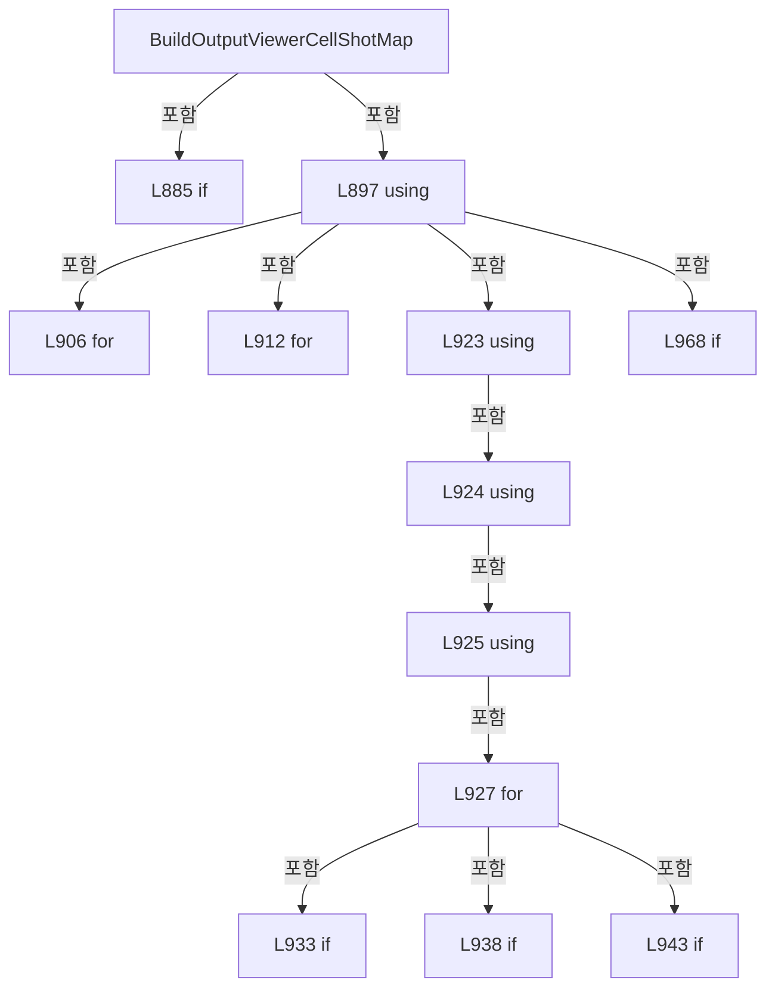

변경 전 점검: 입력/반환 타입, 위 호출자, 예외/취소 경로, 공유 상태와 저장·전송 소비자를 함께 확인합니다. 값의 단위나 물리 방향을 이름만으로 확정하지 않습니다.

### MethodDeclaration `AddOutputViewerShotCircle` · L992–1001

[Drilling.UI/Menu/Menus/CMenuCorrection.cs:992–1001](https://github.com/kjuws10-rgb/A3Drilling/blob/96e22cd027c84bf302b23f2949b98985d7f301bb/Drilling.UI/Menu/Menus/CMenuCorrection.cs#L992-L1001)

| 항목 | 실제 추출 값 |
| --- | --- |
| 서명 | void Drilling.UI.Menu.Menus.CMenuCorrection.AddOutputViewerShotCircle(StreamGeometryContext, double, double, double) |
| 접근/수식자 | Private / private, static |
| 반환/값 타입 | void |
| 소속 타입 | NamedType:Drilling.UI.Menu.Menus.CMenuCorrection |

입력 계약:

| 이름 | 타입 | 전달 | 선택/기본값 |
| --- | --- | --- | --- |
| context | StreamGeometryContext | None | False /  |
| centerX | double | None | False /  |
| centerY | double | None | False /  |
| radius | double | None | False /  |

현재 부분 분석에서 직접 연결된 호출자는 없습니다. XAML/이벤트/인터페이스·델리게이트·외부 진입을 추가 확인해야 하며, 미사용으로 판정한 것이 아닙니다.

호출하는 대상과 해석 범위:

| 원본 행 | 표현식 | 분석 상태 | 대상/소스 위치 |
| --- | --- | --- | --- |
| 996 | context.BeginFigure | unresolved | None |
| 996 | new Point | unresolved | None |
| 997 | context.BezierTo | unresolved | None |
| 997 | new Point | unresolved | None |
| 997 | new Point | unresolved | None |
| 997 | new Point | unresolved | None |
| 998 | context.BezierTo | unresolved | None |
| 998 | new Point | unresolved | None |
| 998 | new Point | unresolved | None |
| 998 | new Point | unresolved | None |
| 999 | context.BezierTo | unresolved | None |
| 999 | new Point | unresolved | None |
| 999 | new Point | unresolved | None |
| 999 | new Point | unresolved | None |
| 1000 | context.BezierTo | unresolved | None |
| 1000 | new Point | unresolved | None |
| 1000 | new Point | unresolved | None |
| 1000 | new Point | unresolved | None |

본문의 실제 연산·분기·예외·반환 순서(원문 위치 순):

| 원본 행 | 종류 | 주석 해설 |
| --- | --- | --- |
| 994 | local-declaration | 지역 변수를 선언합니다: const double bezierCircle = 0.5522847498307936; |
| 994 | variable-initializer | 변수의 초기값을 지정합니다: bezierCircle = 0.5522847498307936 |
| 995 | local-declaration | 지역 변수를 선언합니다: var control = radius * bezierCircle; |
| 995 | variable-initializer | 변수의 초기값을 지정합니다: control = radius * bezierCircle |
| 996 | call | 함수·델리게이트 또는 객체 생성자를 호출합니다: context.BeginFigure(new Point(centerX + radius, centerY), true, true) |
| 996 | call | 함수·델리게이트 또는 객체 생성자를 호출합니다: new Point(centerX + radius, centerY) |
| 997 | call | 함수·델리게이트 또는 객체 생성자를 호출합니다: context.BezierTo(new Point(centerX + radius, centerY + control), new Point(centerX + control, centerY + radius), new Point(centerX, centerY + radius), true, false) |
| 997 | call | 함수·델리게이트 또는 객체 생성자를 호출합니다: new Point(centerX + radius, centerY + control) |
| 997 | call | 함수·델리게이트 또는 객체 생성자를 호출합니다: new Point(centerX + control, centerY + radius) |
| 997 | call | 함수·델리게이트 또는 객체 생성자를 호출합니다: new Point(centerX, centerY + radius) |
| 998 | call | 함수·델리게이트 또는 객체 생성자를 호출합니다: context.BezierTo(new Point(centerX - control, centerY + radius), new Point(centerX - radius, centerY + control), new Point(centerX - radius, centerY), true, false) |
| 998 | call | 함수·델리게이트 또는 객체 생성자를 호출합니다: new Point(centerX - control, centerY + radius) |
| 998 | call | 함수·델리게이트 또는 객체 생성자를 호출합니다: new Point(centerX - radius, centerY + control) |
| 998 | call | 함수·델리게이트 또는 객체 생성자를 호출합니다: new Point(centerX - radius, centerY) |
| 999 | call | 함수·델리게이트 또는 객체 생성자를 호출합니다: context.BezierTo(new Point(centerX - radius, centerY - control), new Point(centerX - control, centerY - radius), new Point(centerX, centerY - radius), true, false) |
| 999 | call | 함수·델리게이트 또는 객체 생성자를 호출합니다: new Point(centerX - radius, centerY - control) |
| 999 | call | 함수·델리게이트 또는 객체 생성자를 호출합니다: new Point(centerX - control, centerY - radius) |
| 999 | call | 함수·델리게이트 또는 객체 생성자를 호출합니다: new Point(centerX, centerY - radius) |
| 1000 | call | 함수·델리게이트 또는 객체 생성자를 호출합니다: context.BezierTo(new Point(centerX + control, centerY - radius), new Point(centerX + radius, centerY - control), new Point(centerX + radius, centerY), true, false) |
| 1000 | call | 함수·델리게이트 또는 객체 생성자를 호출합니다: new Point(centerX + control, centerY - radius) |
| 1000 | call | 함수·델리게이트 또는 객체 생성자를 호출합니다: new Point(centerX + radius, centerY - control) |
| 1000 | call | 함수·델리게이트 또는 객체 생성자를 호출합니다: new Point(centerX + radius, centerY) |

변경 전 점검: 입력/반환 타입, 위 호출자, 예외/취소 경로, 공유 상태와 저장·전송 소비자를 함께 확인합니다. 값의 단위나 물리 방향을 이름만으로 확정하지 않습니다.

### MethodDeclaration `AddOutputViewerMaskCross` · L1003–1009

[Drilling.UI/Menu/Menus/CMenuCorrection.cs:1003–1009](https://github.com/kjuws10-rgb/A3Drilling/blob/96e22cd027c84bf302b23f2949b98985d7f301bb/Drilling.UI/Menu/Menus/CMenuCorrection.cs#L1003-L1009)

| 항목 | 실제 추출 값 |
| --- | --- |
| 서명 | void Drilling.UI.Menu.Menus.CMenuCorrection.AddOutputViewerMaskCross(StreamGeometryContext, double, double, double) |
| 접근/수식자 | Private / private, static |
| 반환/값 타입 | void |
| 소속 타입 | NamedType:Drilling.UI.Menu.Menus.CMenuCorrection |

입력 계약:

| 이름 | 타입 | 전달 | 선택/기본값 |
| --- | --- | --- | --- |
| context | StreamGeometryContext | None | False /  |
| centerX | double | None | False /  |
| centerY | double | None | False /  |
| radius | double | None | False /  |

현재 부분 분석에서 직접 연결된 호출자는 없습니다. XAML/이벤트/인터페이스·델리게이트·외부 진입을 추가 확인해야 하며, 미사용으로 판정한 것이 아닙니다.

호출하는 대상과 해석 범위:

| 원본 행 | 표현식 | 분석 상태 | 대상/소스 위치 |
| --- | --- | --- | --- |
| 1005 | context.BeginFigure | unresolved | None |
| 1005 | new Point | unresolved | None |
| 1006 | context.LineTo | unresolved | None |
| 1006 | new Point | unresolved | None |
| 1007 | context.BeginFigure | unresolved | None |
| 1007 | new Point | unresolved | None |
| 1008 | context.LineTo | unresolved | None |
| 1008 | new Point | unresolved | None |

본문의 실제 연산·분기·예외·반환 순서(원문 위치 순):

| 원본 행 | 종류 | 주석 해설 |
| --- | --- | --- |
| 1005 | call | 함수·델리게이트 또는 객체 생성자를 호출합니다: context.BeginFigure(new Point(centerX - radius, centerY - radius), false, false) |
| 1005 | call | 함수·델리게이트 또는 객체 생성자를 호출합니다: new Point(centerX - radius, centerY - radius) |
| 1006 | call | 함수·델리게이트 또는 객체 생성자를 호출합니다: context.LineTo(new Point(centerX + radius, centerY + radius), true, false) |
| 1006 | call | 함수·델리게이트 또는 객체 생성자를 호출합니다: new Point(centerX + radius, centerY + radius) |
| 1007 | call | 함수·델리게이트 또는 객체 생성자를 호출합니다: context.BeginFigure(new Point(centerX - radius, centerY + radius), false, false) |
| 1007 | call | 함수·델리게이트 또는 객체 생성자를 호출합니다: new Point(centerX - radius, centerY + radius) |
| 1008 | call | 함수·델리게이트 또는 객체 생성자를 호출합니다: context.LineTo(new Point(centerX + radius, centerY - radius), true, false) |
| 1008 | call | 함수·델리게이트 또는 객체 생성자를 호출합니다: new Point(centerX + radius, centerY - radius) |

변경 전 점검: 입력/반환 타입, 위 호출자, 예외/취소 경로, 공유 상태와 저장·전송 소비자를 함께 확인합니다. 값의 단위나 물리 방향을 이름만으로 확정하지 않습니다.

### MethodDeclaration `AddOutputViewerChessDiamond` · L1011–1017

[Drilling.UI/Menu/Menus/CMenuCorrection.cs:1011–1017](https://github.com/kjuws10-rgb/A3Drilling/blob/96e22cd027c84bf302b23f2949b98985d7f301bb/Drilling.UI/Menu/Menus/CMenuCorrection.cs#L1011-L1017)

| 항목 | 실제 추출 값 |
| --- | --- |
| 서명 | void Drilling.UI.Menu.Menus.CMenuCorrection.AddOutputViewerChessDiamond(StreamGeometryContext, double, double, double) |
| 접근/수식자 | Private / private, static |
| 반환/값 타입 | void |
| 소속 타입 | NamedType:Drilling.UI.Menu.Menus.CMenuCorrection |

입력 계약:

| 이름 | 타입 | 전달 | 선택/기본값 |
| --- | --- | --- | --- |
| context | StreamGeometryContext | None | False /  |
| centerX | double | None | False /  |
| centerY | double | None | False /  |
| radius | double | None | False /  |

현재 부분 분석에서 직접 연결된 호출자는 없습니다. XAML/이벤트/인터페이스·델리게이트·외부 진입을 추가 확인해야 하며, 미사용으로 판정한 것이 아닙니다.

호출하는 대상과 해석 범위:

| 원본 행 | 표현식 | 분석 상태 | 대상/소스 위치 |
| --- | --- | --- | --- |
| 1013 | context.BeginFigure | unresolved | None |
| 1013 | new Point | unresolved | None |
| 1014 | context.LineTo | unresolved | None |
| 1014 | new Point | unresolved | None |
| 1015 | context.LineTo | unresolved | None |
| 1015 | new Point | unresolved | None |
| 1016 | context.LineTo | unresolved | None |
| 1016 | new Point | unresolved | None |

본문의 실제 연산·분기·예외·반환 순서(원문 위치 순):

| 원본 행 | 종류 | 주석 해설 |
| --- | --- | --- |
| 1013 | call | 함수·델리게이트 또는 객체 생성자를 호출합니다: context.BeginFigure(new Point(centerX, centerY - radius), true, true) |
| 1013 | call | 함수·델리게이트 또는 객체 생성자를 호출합니다: new Point(centerX, centerY - radius) |
| 1014 | call | 함수·델리게이트 또는 객체 생성자를 호출합니다: context.LineTo(new Point(centerX + radius, centerY), true, false) |
| 1014 | call | 함수·델리게이트 또는 객체 생성자를 호출합니다: new Point(centerX + radius, centerY) |
| 1015 | call | 함수·델리게이트 또는 객체 생성자를 호출합니다: context.LineTo(new Point(centerX, centerY + radius), true, false) |
| 1015 | call | 함수·델리게이트 또는 객체 생성자를 호출합니다: new Point(centerX, centerY + radius) |
| 1016 | call | 함수·델리게이트 또는 객체 생성자를 호출합니다: context.LineTo(new Point(centerX - radius, centerY), true, false) |
| 1016 | call | 함수·델리게이트 또는 객체 생성자를 호출합니다: new Point(centerX - radius, centerY) |

변경 전 점검: 입력/반환 타입, 위 호출자, 예외/취소 경로, 공유 상태와 저장·전송 소비자를 함께 확인합니다. 값의 단위나 물리 방향을 이름만으로 확정하지 않습니다.

### MethodDeclaration `ApplyReviewOffsetsToOutputViewerParameters` · L1019–1022

[Drilling.UI/Menu/Menus/CMenuCorrection.cs:1019–1022](https://github.com/kjuws10-rgb/A3Drilling/blob/96e22cd027c84bf302b23f2949b98985d7f301bb/Drilling.UI/Menu/Menus/CMenuCorrection.cs#L1019-L1022)

| 항목 | 실제 추출 값 |
| --- | --- |
| 서명 | void Drilling.UI.Menu.Menus.CMenuCorrection.ApplyReviewOffsetsToOutputViewerParameters(System.Collections.Generic.IDictionary<string, string>, Drilling.Common.Review.ST_REVIEW_OFFSET_FILE_DATA) |
| 접근/수식자 | Internal / internal, static |
| 반환/값 타입 | void |
| 소속 타입 | NamedType:Drilling.UI.Menu.Menus.CMenuCorrection |

입력 계약:

| 이름 | 타입 | 전달 | 선택/기본값 |
| --- | --- | --- | --- |
| parameters | System.Collections.Generic.IDictionary<string, string> | None | False /  |
| reviewOffsetFile | Drilling.Common.Review.ST_REVIEW_OFFSET_FILE_DATA | None | False /  |

정적 호출자로 확인된 위치:

| 호출 파일/행 | 호출 표현식 | 런타임 분기 가능 |
| --- | --- | --- |
| [Drilling.UI/Menu/Menus/CMenuCorrection.cs:642–642](https://github.com/kjuws10-rgb/A3Drilling/blob/96e22cd027c84bf302b23f2949b98985d7f301bb/Drilling.UI/Menu/Menus/CMenuCorrection.cs#L642-L642) | ApplyReviewOffsetsToOutputViewerParameters | False |
| [Drilling.UI/Menu/Menus/CMenuCorrection.cs:7657–7657](https://github.com/kjuws10-rgb/A3Drilling/blob/96e22cd027c84bf302b23f2949b98985d7f301bb/Drilling.UI/Menu/Menus/CMenuCorrection.cs#L7657-L7657) | CMenuCorrection.ApplyReviewOffsetsToOutputViewerParameters | False |
| [Drilling.UI/Menu/Menus/CMenuMonitor.cs:3111–3111](https://github.com/kjuws10-rgb/A3Drilling/blob/96e22cd027c84bf302b23f2949b98985d7f301bb/Drilling.UI/Menu/Menus/CMenuMonitor.cs#L3111-L3111) | CMenuCorrection.ApplyReviewOffsetsToOutputViewerParameters | False |

호출하는 대상과 해석 범위:

| 원본 행 | 표현식 | 분석 상태 | 대상/소스 위치 |
| --- | --- | --- | --- |
| 1021 | CReviewOffsetData.ApplyToParameters | resolved | void Drilling.Common.Recipe.CReviewOffsetData.ApplyToParameters(System.Collections.Generic.IDictionary<string, string>, Drilling.Common.Review.ST_REVIEW_OFFSET_FILE_DATA) · Drilling.Common/Recipe/CShotCoordinatePlanBuilder.cs:1167 |

본문의 실제 연산·분기·예외·반환 순서(원문 위치 순):

| 원본 행 | 종류 | 주석 해설 |
| --- | --- | --- |
| 1021 | call | 함수·델리게이트 또는 객체 생성자를 호출합니다: CReviewOffsetData.ApplyToParameters(parameters, reviewOffsetFile) |

변경 전 점검: 입력/반환 타입, 위 호출자, 예외/취소 경로, 공유 상태와 저장·전송 소비자를 함께 확인합니다. 값의 단위나 물리 방향을 이름만으로 확정하지 않습니다.

### MethodDeclaration `BuildOutputViewerGlassPreview` · L1024–1154

[Drilling.UI/Menu/Menus/CMenuCorrection.cs:1024–1154](https://github.com/kjuws10-rgb/A3Drilling/blob/96e22cd027c84bf302b23f2949b98985d7f301bb/Drilling.UI/Menu/Menus/CMenuCorrection.cs#L1024-L1154)

| 항목 | 실제 추출 값 |
| --- | --- |
| 서명 | Drilling.UI.Menu.Menus.ST_CORRECTION_OFFSET_VIEWER_PREVIEW Drilling.UI.Menu.Menus.CMenuCorrection.BuildOutputViewerGlassPreview(System.Collections.Generic.IReadOnlyDictionary<string, string>, int, int) |
| 접근/수식자 | Internal / internal, static |
| 반환/값 타입 | Drilling.UI.Menu.Menus.ST_CORRECTION_OFFSET_VIEWER_PREVIEW |
| 소속 타입 | NamedType:Drilling.UI.Menu.Menus.CMenuCorrection |

입력 계약:

| 이름 | 타입 | 전달 | 선택/기본값 |
| --- | --- | --- | --- |
| parameters | System.Collections.Generic.IReadOnlyDictionary<string, string> | None | False /  |
| cellCount | int | None | False /  |
| selectedCellNo | int | None | False /  |

정적 호출자로 확인된 위치:

| 호출 파일/행 | 호출 표현식 | 런타임 분기 가능 |
| --- | --- | --- |
| [Drilling.UI/Menu/Menus/CMenuCorrection.ReviewData.Offset.cs:232–232](https://github.com/kjuws10-rgb/A3Drilling/blob/96e22cd027c84bf302b23f2949b98985d7f301bb/Drilling.UI/Menu/Menus/CMenuCorrection.ReviewData.Offset.cs#L232-L232) | BuildOutputViewerGlassPreview | False |
| [Drilling.UI/Menu/Menus/CMenuCorrection.cs:657–657](https://github.com/kjuws10-rgb/A3Drilling/blob/96e22cd027c84bf302b23f2949b98985d7f301bb/Drilling.UI/Menu/Menus/CMenuCorrection.cs#L657-L657) | BuildOutputViewerGlassPreview | False |
| [Drilling.UI/Menu/Menus/CMenuCorrection.cs:2798–2798](https://github.com/kjuws10-rgb/A3Drilling/blob/96e22cd027c84bf302b23f2949b98985d7f301bb/Drilling.UI/Menu/Menus/CMenuCorrection.cs#L2798-L2798) | BuildOutputViewerGlassPreview | False |
| [Drilling.UI/Menu/Menus/CMenuCorrection.cs:4180–4180](https://github.com/kjuws10-rgb/A3Drilling/blob/96e22cd027c84bf302b23f2949b98985d7f301bb/Drilling.UI/Menu/Menus/CMenuCorrection.cs#L4180-L4180) | BuildOutputViewerGlassPreview | False |
| [Drilling.UI/Menu/Menus/CMenuMonitor.cs:3274–3277](https://github.com/kjuws10-rgb/A3Drilling/blob/96e22cd027c84bf302b23f2949b98985d7f301bb/Drilling.UI/Menu/Menus/CMenuMonitor.cs#L3274-L3277) | CMenuCorrection.BuildOutputViewerGlassPreview | False |

호출하는 대상과 해석 범위:

| 원본 행 | 표현식 | 분석 상태 | 대상/소스 위치 |
| --- | --- | --- | --- |
| 1032 | ReadOutputViewerDouble | resolved | double Drilling.UI.Menu.Menus.CMenuCorrection.ReadOutputViewerDouble(System.Collections.Generic.IReadOnlyDictionary<string, string>, double, params string[]) · Drilling.UI/Menu/Menus/CMenuCorrection.cs:1257 |
| 1033 | ReadOutputViewerDouble | resolved | double Drilling.UI.Menu.Menus.CMenuCorrection.ReadOutputViewerDouble(System.Collections.Generic.IReadOnlyDictionary<string, string>, double, params string[]) · Drilling.UI/Menu/Menus/CMenuCorrection.cs:1257 |
| 1034 | ReadOutputViewerDouble | resolved | double Drilling.UI.Menu.Menus.CMenuCorrection.ReadOutputViewerDouble(System.Collections.Generic.IReadOnlyDictionary<string, string>, double, params string[]) · Drilling.UI/Menu/Menus/CMenuCorrection.cs:1257 |
| 1035 | ReadOutputViewerDouble | resolved | double Drilling.UI.Menu.Menus.CMenuCorrection.ReadOutputViewerDouble(System.Collections.Generic.IReadOnlyDictionary<string, string>, double, params string[]) · Drilling.UI/Menu/Menus/CMenuCorrection.cs:1257 |
| 1036 | ReadOutputViewerDouble | resolved | double Drilling.UI.Menu.Menus.CMenuCorrection.ReadOutputViewerDouble(System.Collections.Generic.IReadOnlyDictionary<string, string>, double, params string[]) · Drilling.UI/Menu/Menus/CMenuCorrection.cs:1257 |
| 1037 | ReadOutputViewerInt | resolved | int Drilling.UI.Menu.Menus.CMenuCorrection.ReadOutputViewerInt(System.Collections.Generic.IReadOnlyDictionary<string, string>, int, params string[]) · Drilling.UI/Menu/Menus/CMenuCorrection.cs:1234 |
| 1038 | CRecipeModelPixelCountReader.ReadModelTypeCount | resolved | int Drilling.Common.Recipe.CRecipeModelPixelCountReader.ReadModelTypeCount(System.Collections.Generic.IReadOnlyDictionary<string, string>) · Drilling.Common/Recipe/CCellPatternCalculator.cs:428 |
| 1041 | new ST_CORRECTION_OFFSET_VIEWER_PREVIEW | resolved | Drilling.UI.Menu.Menus.ST_CORRECTION_OFFSET_VIEWER_PREVIEW.ST_CORRECTION_OFFSET_VIEWER_PREVIEW(ImageSource?, System.Collections.Generic.IReadOnlyList<Drilling.UI.Menu.Menus.ST_CELL_PREVIEW_LABEL>, string) · Drilling.UI/Menu/Menus/CMenuCorrection.cs:6970 |
| 1049 | CCellPreviewDrawing.CreateDistortionKeyPreviews | resolved | System.Collections.Generic.IReadOnlyList<Drilling.UI.Menu.Menus.ST_DISTORTION_KEY_PREVIEW> Drilling.UI.Menu.Menus.CCellPreviewDrawing.CreateDistortionKeyPreviews(double, double, double, double, System.Func<string, double?>) · Drilling.UI/Menu/Menus/CCellPreviewDrawing.cs:61 |
| 1050 | Math.Min | resolved | double System.Math.Min(double, double) |
| 1055 | new ST_GLASS_PREVIEW_FRAME | resolved | Drilling.UI.Menu.Menus.ST_GLASS_PREVIEW_FRAME.ST_GLASS_PREVIEW_FRAME(double, double, double, double) · Drilling.UI/Menu/Menus/CMenuMain.cs:3474 |
| 1056 | new Rect | unresolved | None |
| 1057 | new DrawingGroup | unresolved | None |
| 1058 | new List<ST_CELL_PREVIEW_LABEL> | resolved | System.Collections.Generic.List<Drilling.UI.Menu.Menus.ST_CELL_PREVIEW_LABEL>.List() |
| 1059 | new List<(StreamGeometry Boundary, Pen Pen)> | resolved | System.Collections.Generic.List<(StreamGeometry Boundary, Pen Pen)>.List() |
| 1062 | drawing.Open | unresolved | None |
| 1064 | context.DrawRectangle | unresolved | None |
| 1064 | new SolidColorBrush | unresolved | None |
| 1064 | Color.FromArgb | unresolved | None |
| 1064 | new Rect | unresolved | None |
| 1065 | context.PushClip | unresolved | None |
| 1065 | new RectangleGeometry | unresolved | None |
| 1068 | ReadOutputViewerDouble | resolved | double Drilling.UI.Menu.Menus.CMenuCorrection.ReadOutputViewerDouble(System.Collections.Generic.IReadOnlyDictionary<string, string>, double, params string[]) · Drilling.UI/Menu/Menus/CMenuCorrection.cs:1257 |
| 1069 | ReadOutputViewerDouble | resolved | double Drilling.UI.Menu.Menus.CMenuCorrection.ReadOutputViewerDouble(System.Collections.Generic.IReadOnlyDictionary<string, string>, double, params string[]) · Drilling.UI/Menu/Menus/CMenuCorrection.cs:1257 |
| 1070 | ReadOutputViewerDouble | resolved | double Drilling.UI.Menu.Menus.CMenuCorrection.ReadOutputViewerDouble(System.Collections.Generic.IReadOnlyDictionary<string, string>, double, params string[]) · Drilling.UI/Menu/Menus/CMenuCorrection.cs:1257 |
| 1071 | CRecipeModelPixelCountReader.ReadCellModelType | resolved | int Drilling.Common.Recipe.CRecipeModelPixelCountReader.ReadCellModelType(System.Collections.Generic.IReadOnlyDictionary<string, string>, int, int) · Drilling.Common/Recipe/CCellPatternCalculator.cs:433 |
| 1072 | CRecipeModelPixelCountReader.ReadPatternForModel | resolved | Drilling.Common.Recipe.ST_RECIPE_MODEL_PATTERN Drilling.Common.Recipe.CRecipeModelPixelCountReader.ReadPatternForModel(System.Collections.Generic.IReadOnlyDictionary<string, string>, int) · Drilling.Common/Recipe/CCellPatternCalculator.cs:455 |
| 1073 | CCellPatternCalculator.Calculate | resolved | Drilling.Common.Recipe.ST_CELL_PATTERN_LAYOUT Drilling.Common.Recipe.CCellPatternCalculator.Calculate(Drilling.Common.Recipe.ST_CELL_PATTERN_DEFINITION, bool) · Drilling.Common/Recipe/CCellPatternCalculator.cs:66 |
| 1073 | new ST_CELL_PATTERN_DEFINITION | resolved | Drilling.Common.Recipe.ST_CELL_PATTERN_DEFINITION.ST_CELL_PATTERN_DEFINITION(int, double, double, double, double, int, int, int, int, double, double) · Drilling.Common/Recipe/CCellPatternCalculator.cs:277 |
| 1080 | BuildOutputViewerCellBoundaryGeometry | resolved | StreamGeometry? Drilling.UI.Menu.Menus.CMenuCorrection.BuildOutputViewerCellBoundaryGeometry(double, double, double, double, int, int, double, double, double) · Drilling.UI/Menu/Menus/CMenuCorrection.cs:1156 |
| 1088 | CMenuMain.CreateHeadBrush | resolved | Brush Drilling.UI.Menu.Menus.CMenuMain.CreateHeadBrush(int, byte) · Drilling.UI/Menu/Menus/CMenuMain.cs:2246 |
| 1090 | new SolidColorBrush | unresolved | None |
| 1090 | Color.FromRgb | unresolved | None |
| 1091 | CMenuMain.CreateHeadBrush | resolved | Brush Drilling.UI.Menu.Menus.CMenuMain.CreateHeadBrush(int, byte) · Drilling.UI/Menu/Menus/CMenuMain.cs:2246 |
| 1094 | boundaryBrush.Freeze | unresolved | None |
| 1097 | new Pen | unresolved | None |
| 1098 | boundaryPen.Freeze | unresolved | None |
| 1099 | context.DrawGeometry | unresolved | None |
| 1100 | drawnCellBoundaries.Add | candidate | OverloadResolutionFailure |
| 1101 | CCellPreviewDrawing.CreateCellLabel | candidate | OverloadResolutionFailure |
| 1104 | cellLabels.Add | resolved | void System.Collections.Generic.List<Drilling.UI.Menu.Menus.ST_CELL_PREVIEW_LABEL>.Add(Drilling.UI.Menu.Menus.ST_CELL_PREVIEW_LABEL) |
| 1110 | context.DrawGeometry | unresolved | None |
| 1113 | context.Pop | unresolved | None |
| 1114 | CCellPreviewDrawing.DrawAlignKeys | candidate | OverloadResolutionFailure |
| 1115 | CCellPreviewDrawing.DrawDistortionKeys | candidate | OverloadResolutionFailure |
| 1118 | drawing.Freeze | unresolved | None |
| 1120 | Math.Max | resolved | double System.Math.Max(double, double) |
| 1121 | new Rect | unresolved | None |
| 1122 | new Rect | unresolved | None |
| 1123 | cellLabels.Select(label => label with { CanvasCenterX = label.CanvasCenterX - frameLeft + paddingX, CanvasCenterY = label.CanvasCenterY - frameTop + paddingY, Width = Math.Max(18.0, label.CellNo.ToString(CultureInfo.InvariantCulture).Length * 6.2 + 8.0), DesignWidth = cellRect.Width, DesignHeight = cellRect.Height }).ToArray | resolved | Drilling.UI.Menu.Menus.ST_CELL_PREVIEW_LABEL[] System.Collections.Generic.IEnumerable<Drilling.UI.Menu.Menus.ST_CELL_PREVIEW_LABEL>.ToArray<Drilling.UI.Menu.Menus.ST_CELL_PREVIEW_LABEL>() |
| 1123 | cellLabels.Select | resolved | System.Collections.Generic.IEnumerable<Drilling.UI.Menu.Menus.ST_CELL_PREVIEW_LABEL> System.Collections.Generic.IEnumerable<Drilling.UI.Menu.Menus.ST_CELL_PREVIEW_LABEL>.Select<Drilling.UI.Menu.Menus.ST_CELL_PREVIEW_LABEL, Drilling.UI.Menu.Menus.ST_CELL_PREVIEW_LABEL>(System.Func<Drilling.UI.Menu.Menus.ST_CELL_PREVIEW_LABEL, Drilling.UI.Menu.Menus.ST_CELL_PREVIEW_LABEL>) |
| 1127 | Math.Max | resolved | double System.Math.Max(double, double) |
| 1127 | label.CellNo.ToString | resolved | string int.ToString(System.IFormatProvider?) |
| 1131 | new DrawingGroup | unresolved | None |
| 1132 | cellDrawing.Open | unresolved | None |
| 1134 | cellContext.DrawRectangle | unresolved | None |
| 1134 | new SolidColorBrush | unresolved | None |
| 1134 | Color.FromArgb | unresolved | None |
| 1135 | cellContext.DrawRectangle | unresolved | None |
| 1135 | new Pen | unresolved | None |
| 1135 | new SolidColorBrush | unresolved | None |
| 1135 | Color.FromRgb | unresolved | None |
| 1136 | cellContext.PushClip | unresolved | None |
| 1136 | new RectangleGeometry | unresolved | None |
| 1137 | cellContext.PushTransform | unresolved | None |
| 1137 | new TranslateTransform | unresolved | None |
| 1138 | cellContext.DrawDrawing | unresolved | None |
| 1139 | cellContext.Pop | unresolved | None |
| 1140 | cellContext.Pop | unresolved | None |
| 1141 | DrawOutputViewerPreviewAxisIndicator | candidate | OverloadResolutionFailure |
| 1144 | cellDrawing.Freeze | unresolved | None |
| 1145 | new DrawingImage | unresolved | None |
| 1146 | cellImage.Freeze | unresolved | None |
| 1147 | FormatOutputViewerPreviewDouble | resolved | string Drilling.UI.Menu.Menus.CMenuCorrection.FormatOutputViewerPreviewDouble(double) · Drilling.UI/Menu/Menus/CMenuCorrection.cs:1280 |
| 1147 | FormatOutputViewerPreviewDouble | resolved | string Drilling.UI.Menu.Menus.CMenuCorrection.FormatOutputViewerPreviewDouble(double) · Drilling.UI/Menu/Menus/CMenuCorrection.cs:1280 |
| 1153 | new ST_CORRECTION_OFFSET_VIEWER_PREVIEW | candidate | OverloadResolutionFailure |

본문의 실제 연산·분기·예외·반환 순서(원문 위치 순):

| 원본 행 | 종류 | 주석 해설 |
| --- | --- | --- |
| 1026 | local-declaration | 지역 변수를 선언합니다: const double canvasWidth = 860.0; |
| 1026 | variable-initializer | 변수의 초기값을 지정합니다: canvasWidth = 860.0 |
| 1027 | local-declaration | 지역 변수를 선언합니다: const double canvasHeight = 430.0; |
| 1027 | variable-initializer | 변수의 초기값을 지정합니다: canvasHeight = 430.0 |
| 1028 | local-declaration | 지역 변수를 선언합니다: const double maxLeft = 44.0; |
| 1028 | variable-initializer | 변수의 초기값을 지정합니다: maxLeft = 44.0 |
| 1029 | local-declaration | 지역 변수를 선언합니다: const double maxTop = 50.0; |
| 1029 | variable-initializer | 변수의 초기값을 지정합니다: maxTop = 50.0 |
| 1030 | local-declaration | 지역 변수를 선언합니다: const double maxWidth = 772.0; |
| 1030 | variable-initializer | 변수의 초기값을 지정합니다: maxWidth = 772.0 |
| 1031 | local-declaration | 지역 변수를 선언합니다: const double maxHeight = 340.0; |
| 1031 | variable-initializer | 변수의 초기값을 지정합니다: maxHeight = 340.0 |
| 1032 | call | 함수·델리게이트 또는 객체 생성자를 호출합니다: ReadOutputViewerDouble(parameters, 500.0, "GLASS_SIZE_X") |
| 1032 | local-declaration | 지역 변수를 선언합니다: var glassWidth = ReadOutputViewerDouble(parameters, 500.0, "GLASS_SIZE_X"); |
| 1032 | variable-initializer | 변수의 초기값을 지정합니다: glassWidth = ReadOutputViewerDouble(parameters, 500.0, "GLASS_SIZE_X") |
| 1033 | call | 함수·델리게이트 또는 객체 생성자를 호출합니다: ReadOutputViewerDouble(parameters, 300.0, "GLASS_SIZE_Y") |
| 1033 | local-declaration | 지역 변수를 선언합니다: var glassHeight = ReadOutputViewerDouble(parameters, 300.0, "GLASS_SIZE_Y"); |
| 1033 | variable-initializer | 변수의 초기값을 지정합니다: glassHeight = ReadOutputViewerDouble(parameters, 300.0, "GLASS_SIZE_Y") |
| 1034 | call | 함수·델리게이트 또는 객체 생성자를 호출합니다: ReadOutputViewerDouble(parameters, 55.0, "AK_MARGIN_X") |
| 1034 | local-declaration | 지역 변수를 선언합니다: var akMarginX = ReadOutputViewerDouble(parameters, 55.0, "AK_MARGIN_X"); |
| 1034 | variable-initializer | 변수의 초기값을 지정합니다: akMarginX = ReadOutputViewerDouble(parameters, 55.0, "AK_MARGIN_X") |
| 1035 | call | 함수·델리게이트 또는 객체 생성자를 호출합니다: ReadOutputViewerDouble(parameters, 45.0, "AK_MARGIN_Y") |
| 1035 | local-declaration | 지역 변수를 선언합니다: var akMarginY = ReadOutputViewerDouble(parameters, 45.0, "AK_MARGIN_Y"); |
| 1035 | variable-initializer | 변수의 초기값을 지정합니다: akMarginY = ReadOutputViewerDouble(parameters, 45.0, "AK_MARGIN_Y") |
| 1036 | call | 함수·델리게이트 또는 객체 생성자를 호출합니다: ReadOutputViewerDouble(parameters, 0.09, "PIXEL_SIZE") |
| 1036 | local-declaration | 지역 변수를 선언합니다: var pixelSize = ReadOutputViewerDouble(parameters, 0.09, "PIXEL_SIZE"); |
| 1036 | variable-initializer | 변수의 초기값을 지정합니다: pixelSize = ReadOutputViewerDouble(parameters, 0.09, "PIXEL_SIZE") |
| 1037 | call | 함수·델리게이트 또는 객체 생성자를 호출합니다: ReadOutputViewerInt(parameters, 1, "SPLITED_BEAM_COUNT") |
| 1037 | local-declaration | 지역 변수를 선언합니다: var splitBeamCount = ReadOutputViewerInt(parameters, 1, "SPLITED_BEAM_COUNT"); |
| 1037 | variable-initializer | 변수의 초기값을 지정합니다: splitBeamCount = ReadOutputViewerInt(parameters, 1, "SPLITED_BEAM_COUNT") |
| 1038 | call | 함수·델리게이트 또는 객체 생성자를 호출합니다: CRecipeModelPixelCountReader.ReadModelTypeCount(parameters) |
| 1038 | local-declaration | 지역 변수를 선언합니다: var modelTypeCount = CRecipeModelPixelCountReader.ReadModelTypeCount(parameters); |
| 1038 | variable-initializer | 변수의 초기값을 지정합니다: modelTypeCount = CRecipeModelPixelCountReader.ReadModelTypeCount(parameters) |
| 1039 | if | 조건에 따라 분기합니다: if (glassWidth <= 0.0 &#124;&#124; glassHeight <= 0.0) |
| 1041 | call | 함수·델리게이트 또는 객체 생성자를 호출합니다: new ST_CORRECTION_OFFSET_VIEWER_PREVIEW(null, [], "Glass size is not valid.") |
| 1041 | return | 호출자에게 값 또는 제어를 반환합니다: return new ST_CORRECTION_OFFSET_VIEWER_PREVIEW(null, [], "Glass size is not valid."); |
| 1049 | call | 함수·델리게이트 또는 객체 생성자를 호출합니다: CCellPreviewDrawing.CreateDistortionKeyPreviews(glassWidth, glassHeight, akMarginX, akMarginY, ReadDistortionValue) |
| 1049 | local-declaration | 지역 변수를 선언합니다: var distortionKeys = CCellPreviewDrawing.CreateDistortionKeyPreviews(glassWidth, glassHeight, akMarginX, akMarginY, ReadDistortionValue); |
| 1049 | variable-initializer | 변수의 초기값을 지정합니다: distortionKeys = CCellPreviewDrawing.CreateDistortionKeyPreviews(glassWidth, glassHeight, akMarginX, akMarginY, ReadDistortionValue) |
| 1050 | call | 함수·델리게이트 또는 객체 생성자를 호출합니다: Math.Min(maxWidth / glassWidth, maxHeight / glassHeight) |
| 1050 | local-declaration | 지역 변수를 선언합니다: var scale = Math.Min(maxWidth / glassWidth, maxHeight / glassHeight); |
| 1050 | variable-initializer | 변수의 초기값을 지정합니다: scale = Math.Min(maxWidth / glassWidth, maxHeight / glassHeight) |
| 1051 | local-declaration | 지역 변수를 선언합니다: var frameWidth = glassWidth * scale; |
| 1051 | variable-initializer | 변수의 초기값을 지정합니다: frameWidth = glassWidth * scale |
| 1052 | local-declaration | 지역 변수를 선언합니다: var frameHeight = glassHeight * scale; |
| 1052 | variable-initializer | 변수의 초기값을 지정합니다: frameHeight = glassHeight * scale |
| 1053 | local-declaration | 지역 변수를 선언합니다: var frameLeft = maxLeft + (maxWidth - frameWidth) / 2.0; |
| 1053 | variable-initializer | 변수의 초기값을 지정합니다: frameLeft = maxLeft + (maxWidth - frameWidth) / 2.0 |
| 1054 | local-declaration | 지역 변수를 선언합니다: var frameTop = maxTop + (maxHeight - frameHeight) / 2.0; |
| 1054 | variable-initializer | 변수의 초기값을 지정합니다: frameTop = maxTop + (maxHeight - frameHeight) / 2.0 |
| 1055 | call | 함수·델리게이트 또는 객체 생성자를 호출합니다: new ST_GLASS_PREVIEW_FRAME(frameLeft, frameTop, frameWidth, frameHeight) |
| 1055 | local-declaration | 지역 변수를 선언합니다: var frame = new ST_GLASS_PREVIEW_FRAME(frameLeft, frameTop, frameWidth, frameHeight); |
| 1055 | variable-initializer | 변수의 초기값을 지정합니다: frame = new ST_GLASS_PREVIEW_FRAME(frameLeft, frameTop, frameWidth, frameHeight) |
| 1056 | call | 함수·델리게이트 또는 객체 생성자를 호출합니다: new Rect(frameLeft, frameTop, frameWidth, frameHeight) |
| 1056 | local-declaration | 지역 변수를 선언합니다: var frameBounds = new Rect(frameLeft, frameTop, frameWidth, frameHeight); |
| 1056 | variable-initializer | 변수의 초기값을 지정합니다: frameBounds = new Rect(frameLeft, frameTop, frameWidth, frameHeight) |
| 1057 | call | 함수·델리게이트 또는 객체 생성자를 호출합니다: new DrawingGroup() |
| 1057 | local-declaration | 지역 변수를 선언합니다: var drawing = new DrawingGroup(); |
| 1057 | variable-initializer | 변수의 초기값을 지정합니다: drawing = new DrawingGroup() |
| 1058 | call | 함수·델리게이트 또는 객체 생성자를 호출합니다: new List<ST_CELL_PREVIEW_LABEL>() |
| 1058 | local-declaration | 지역 변수를 선언합니다: var cellLabels = new List<ST_CELL_PREVIEW_LABEL>(); |
| 1058 | variable-initializer | 변수의 초기값을 지정합니다: cellLabels = new List<ST_CELL_PREVIEW_LABEL>() |
| 1059 | call | 함수·델리게이트 또는 객체 생성자를 호출합니다: new List<(StreamGeometry Boundary, Pen Pen)>() |
| 1059 | local-declaration | 지역 변수를 선언합니다: var drawnCellBoundaries = new List<(StreamGeometry Boundary, Pen Pen)>(); |
| 1059 | variable-initializer | 변수의 초기값을 지정합니다: drawnCellBoundaries = new List<(StreamGeometry Boundary, Pen Pen)>() |
| 1060 | local-declaration | 지역 변수를 선언합니다: long totalShotGroupCount = 0; |
| 1060 | variable-initializer | 변수의 초기값을 지정합니다: totalShotGroupCount = 0 |
| 1061 | local-declaration | 지역 변수를 선언합니다: var invalidCellCount = 0; |
| 1061 | variable-initializer | 변수의 초기값을 지정합니다: invalidCellCount = 0 |
| 1062 | call | 함수·델리게이트 또는 객체 생성자를 호출합니다: drawing.Open() |
| 1062 | variable-initializer | 변수의 초기값을 지정합니다: context = drawing.Open() |
| 1062 | using | 자원 사용과 정리 범위를 지정합니다: using (var context = drawing.Open()) |
| 1064 | call | 함수·델리게이트 또는 객체 생성자를 호출합니다: context.DrawRectangle(new SolidColorBrush(Color.FromArgb(1, 0, 0, 0)), null, new Rect(0, 0, canvasWidth, canvasHeight)) |
| 1064 | call | 함수·델리게이트 또는 객체 생성자를 호출합니다: new SolidColorBrush(Color.FromArgb(1, 0, 0, 0)) |
| 1064 | call | 함수·델리게이트 또는 객체 생성자를 호출합니다: Color.FromArgb(1, 0, 0, 0) |
| 1064 | call | 함수·델리게이트 또는 객체 생성자를 호출합니다: new Rect(0, 0, canvasWidth, canvasHeight) |
| 1065 | call | 함수·델리게이트 또는 객체 생성자를 호출합니다: context.PushClip(new RectangleGeometry(frameBounds)) |
| 1065 | call | 함수·델리게이트 또는 객체 생성자를 호출합니다: new RectangleGeometry(frameBounds) |
| 1066 | variable-initializer | 변수의 초기값을 지정합니다: cellNo = 1 |
| 1066 | for | 초기화·조건·증감이 있는 반복입니다: for (var cellNo = 1; cellNo <= cellCount; cellNo++) |
| 1068 | call | 함수·델리게이트 또는 객체 생성자를 호출합니다: ReadOutputViewerDouble(parameters, 0.0, $"CELL{cellNo}_ALIGN_TO_1ST_PIXEL_X") |
| 1068 | local-declaration | 지역 변수를 선언합니다: var firstPixelX = ReadOutputViewerDouble(parameters, 0.0, $"CELL{cellNo}_ALIGN_TO_1ST_PIXEL_X"); |
| 1068 | variable-initializer | 변수의 초기값을 지정합니다: firstPixelX = ReadOutputViewerDouble(parameters, 0.0, $"CELL{cellNo}_ALIGN_TO_1ST_PIXEL_X") |
| 1069 | call | 함수·델리게이트 또는 객체 생성자를 호출합니다: ReadOutputViewerDouble(parameters, 0.0, $"CELL{cellNo}_ALIGN_TO_1ST_PIXEL_Y") |
| 1069 | local-declaration | 지역 변수를 선언합니다: var firstPixelY = ReadOutputViewerDouble(parameters, 0.0, $"CELL{cellNo}_ALIGN_TO_1ST_PIXEL_Y"); |
| 1069 | variable-initializer | 변수의 초기값을 지정합니다: firstPixelY = ReadOutputViewerDouble(parameters, 0.0, $"CELL{cellNo}_ALIGN_TO_1ST_PIXEL_Y") |
| 1070 | call | 함수·델리게이트 또는 객체 생성자를 호출합니다: ReadOutputViewerDouble(parameters, 0.0, $"CELL{cellNo}_ROTATION") |
| 1070 | local-declaration | 지역 변수를 선언합니다: var rotation = ReadOutputViewerDouble(parameters, 0.0, $"CELL{cellNo}_ROTATION"); |
| 1070 | variable-initializer | 변수의 초기값을 지정합니다: rotation = ReadOutputViewerDouble(parameters, 0.0, $"CELL{cellNo}_ROTATION") |
| 1071 | call | 함수·델리게이트 또는 객체 생성자를 호출합니다: CRecipeModelPixelCountReader.ReadCellModelType(parameters, cellNo, modelTypeCount) |
| 1071 | local-declaration | 지역 변수를 선언합니다: var modelType = CRecipeModelPixelCountReader.ReadCellModelType(parameters, cellNo, modelTypeCount); |
| 1071 | variable-initializer | 변수의 초기값을 지정합니다: modelType = CRecipeModelPixelCountReader.ReadCellModelType(parameters, cellNo, modelTypeCount) |
| 1072 | call | 함수·델리게이트 또는 객체 생성자를 호출합니다: CRecipeModelPixelCountReader.ReadPatternForModel(parameters, modelType) |
| 1072 | local-declaration | 지역 변수를 선언합니다: var modelPattern = CRecipeModelPixelCountReader.ReadPatternForModel(parameters, modelType); |
| 1072 | variable-initializer | 변수의 초기값을 지정합니다: modelPattern = CRecipeModelPixelCountReader.ReadPatternForModel(parameters, modelType) |
| 1073 | call | 함수·델리게이트 또는 객체 생성자를 호출합니다: CCellPatternCalculator.Calculate(new ST_CELL_PATTERN_DEFINITION(cellNo, firstPixelX, firstPixelY, rotation, pixelSize, modelPattern.PixelCountX, modelPattern.PixelCountY, modelPattern.ProcessPitch, splitBeamCount, akMarg… |
| 1073 | call | 함수·델리게이트 또는 객체 생성자를 호출합니다: new ST_CELL_PATTERN_DEFINITION(cellNo, firstPixelX, firstPixelY, rotation, pixelSize, modelPattern.PixelCountX, modelPattern.PixelCountY, modelPattern.ProcessPitch, splitBeamCount, akMarginX, akMarginY) |
| 1073 | local-declaration | 지역 변수를 선언합니다: var layout = CCellPatternCalculator.Calculate(new ST_CELL_PATTERN_DEFINITION(cellNo, firstPixelX, firstPixelY, rotation, pixelSize, modelPattern.PixelCountX, modelPattern.PixelCountY, modelPattern.ProcessPitch, splitBeamCount, akM |
| 1073 | variable-initializer | 변수의 초기값을 지정합니다: layout = CCellPatternCalculator.Calculate(new ST_CELL_PATTERN_DEFINITION(cellNo, firstPixelX, firstPixelY, rotation, pixelSize, modelPattern.PixelCountX, modelPattern.PixelCountY, modelPattern.ProcessPitch, splitBeamCount, akMargi |
| 1074 | if | 조건에 따라 분기합니다: if (!layout.IsValid) |
| 1079 | compound-assignment-or-event-subscription | 복합 대입 또는 이벤트 구독/해지 표현입니다: totalShotGroupCount += (long)layout.GroupCountX * layout.GroupCountY |
| 1080 | call | 함수·델리게이트 또는 객체 생성자를 호출합니다: BuildOutputViewerCellBoundaryGeometry(frameLeft, frameTop, scale, pixelSize, modelPattern.PixelCountX, modelPattern.PixelCountY, akMarginX + firstPixelX, akMarginY + firstPixelY, rotation) |
| 1080 | local-declaration | 지역 변수를 선언합니다: var boundary = BuildOutputViewerCellBoundaryGeometry(frameLeft, frameTop, scale, pixelSize, modelPattern.PixelCountX, modelPattern.PixelCountY, akMarginX + firstPixelX, akMarginY + firstPixelY, rotation); |
| 1080 | variable-initializer | 변수의 초기값을 지정합니다: boundary = BuildOutputViewerCellBoundaryGeometry(frameLeft, frameTop, scale, pixelSize, modelPattern.PixelCountX, modelPattern.PixelCountY, akMarginX + firstPixelX, akMarginY + firstPixelY, rotation) |
| 1081 | if | 조건에 따라 분기합니다: if (boundary is null) |
| 1083 | continue | 다음 반복으로 진행합니다: continue; |
| 1086 | local-declaration | 지역 변수를 선언합니다: var isSelectedCell = selectedCellNo > 0 && cellNo == selectedCellNo; |
| 1086 | variable-initializer | 변수의 초기값을 지정합니다: isSelectedCell = selectedCellNo > 0 && cellNo == selectedCellNo |
| 1087 | conditional-expression | 조건에 따라 결과식을 선택합니다: selectedCellNo <= 0 ? (byte)180 : isSelectedCell ? (byte)170 : (byte)80 |
| 1087 | conditional-expression | 조건에 따라 결과식을 선택합니다: isSelectedCell ? (byte)170 : (byte)80 |
| 1087 | local-declaration | 지역 변수를 선언합니다: var cellAlpha = selectedCellNo <= 0 ? (byte)180 : isSelectedCell ? (byte)170 : (byte)80; |
| 1087 | variable-initializer | 변수의 초기값을 지정합니다: cellAlpha = selectedCellNo <= 0 ? (byte)180 : isSelectedCell ? (byte)170 : (byte)80 |
| 1088 | call | 함수·델리게이트 또는 객체 생성자를 호출합니다: CMenuMain.CreateHeadBrush(((cellNo - 1) % 8) + 1, cellAlpha) |
| 1088 | local-declaration | 지역 변수를 선언합니다: var cellBrush = CMenuMain.CreateHeadBrush(((cellNo - 1) % 8) + 1, cellAlpha); |
| 1088 | variable-initializer | 변수의 초기값을 지정합니다: cellBrush = CMenuMain.CreateHeadBrush(((cellNo - 1) % 8) + 1, cellAlpha) |
| 1089 | conditional-expression | 조건에 따라 결과식을 선택합니다: isSelectedCell ? new SolidColorBrush(Color.FromRgb(246, 196, 83)) : CMenuMain.CreateHeadBrush(((cellNo - 1) % 8) + 1, 150) |
| 1089 | local-declaration | 지역 변수를 선언합니다: var boundaryBrush = isSelectedCell ? new SolidColorBrush(Color.FromRgb(246, 196, 83)) : CMenuMain.CreateHeadBrush(((cellNo - 1) % 8) + 1, 150); |
| 1089 | variable-initializer | 변수의 초기값을 지정합니다: boundaryBrush = isSelectedCell ? new SolidColorBrush(Color.FromRgb(246, 196, 83)) : CMenuMain.CreateHeadBrush(((cellNo - 1) % 8) + 1, 150) |
| 1090 | call | 함수·델리게이트 또는 객체 생성자를 호출합니다: new SolidColorBrush(Color.FromRgb(246, 196, 83)) |
| 1090 | call | 함수·델리게이트 또는 객체 생성자를 호출합니다: Color.FromRgb(246, 196, 83) |
| 1091 | call | 함수·델리게이트 또는 객체 생성자를 호출합니다: CMenuMain.CreateHeadBrush(((cellNo - 1) % 8) + 1, 150) |
| 1092 | if | 조건에 따라 분기합니다: if (boundaryBrush.CanFreeze) |
| 1094 | call | 함수·델리게이트 또는 객체 생성자를 호출합니다: boundaryBrush.Freeze() |
| 1097 | call | 함수·델리게이트 또는 객체 생성자를 호출합니다: new Pen(boundaryBrush, isSelectedCell ? 3.0 : 1.2) |
| 1097 | conditional-expression | 조건에 따라 결과식을 선택합니다: isSelectedCell ? 3.0 : 1.2 |
| 1097 | local-declaration | 지역 변수를 선언합니다: var boundaryPen = new Pen(boundaryBrush, isSelectedCell ? 3.0 : 1.2); |
| 1097 | variable-initializer | 변수의 초기값을 지정합니다: boundaryPen = new Pen(boundaryBrush, isSelectedCell ? 3.0 : 1.2) |
| 1098 | call | 함수·델리게이트 또는 객체 생성자를 호출합니다: boundaryPen.Freeze() |
| 1099 | call | 함수·델리게이트 또는 객체 생성자를 호출합니다: context.DrawGeometry(cellBrush, null, boundary) |
| 1100 | call | 함수·델리게이트 또는 객체 생성자를 호출합니다: drawnCellBoundaries.Add((boundary, boundaryPen)) |
| 1101 | call | 함수·델리게이트 또는 객체 생성자를 호출합니다: CCellPreviewDrawing.CreateCellLabel(cellNo, boundary.Bounds, canvasWidth, canvasHeight, isSelectedCell) |
| 1101 | local-declaration | 지역 변수를 선언합니다: var label = CCellPreviewDrawing.CreateCellLabel(cellNo, boundary.Bounds, canvasWidth, canvasHeight, isSelectedCell); |
| 1101 | variable-initializer | 변수의 초기값을 지정합니다: label = CCellPreviewDrawing.CreateCellLabel(cellNo, boundary.Bounds, canvasWidth, canvasHeight, isSelectedCell) |
| 1102 | if | 조건에 따라 분기합니다: if (label is not null) |
| 1104 | call | 함수·델리게이트 또는 객체 생성자를 호출합니다: cellLabels.Add(label) |
| 1108 | foreach | 컬렉션 요소를 순회합니다: foreach (var drawnCell in drawnCellBoundaries) |
| 1110 | call | 함수·델리게이트 또는 객체 생성자를 호출합니다: context.DrawGeometry(null, drawnCell.Pen, drawnCell.Boundary) |
| 1113 | call | 함수·델리게이트 또는 객체 생성자를 호출합니다: context.Pop() |
| 1114 | call | 함수·델리게이트 또는 객체 생성자를 호출합니다: CCellPreviewDrawing.DrawAlignKeys(context, frame, glassWidth, glassHeight, akMarginX, akMarginY) |
| 1115 | call | 함수·델리게이트 또는 객체 생성자를 호출합니다: CCellPreviewDrawing.DrawDistortionKeys(context, frame, glassWidth, glassHeight, distortionKeys) |
| 1118 | call | 함수·델리게이트 또는 객체 생성자를 호출합니다: drawing.Freeze() |
| 1119 | local-declaration | 지역 변수를 선언합니다: var paddingX = frameWidth * 0.03; |
| 1119 | variable-initializer | 변수의 초기값을 지정합니다: paddingX = frameWidth * 0.03 |
| 1120 | call | 함수·델리게이트 또는 객체 생성자를 호출합니다: Math.Max(22.0, frameHeight * 0.03) |
| 1120 | local-declaration | 지역 변수를 선언합니다: var paddingY = Math.Max(22.0, frameHeight * 0.03); |
| 1120 | variable-initializer | 변수의 초기값을 지정합니다: paddingY = Math.Max(22.0, frameHeight * 0.03) |
| 1121 | call | 함수·델리게이트 또는 객체 생성자를 호출합니다: new Rect(0, 0, frameWidth + (paddingX * 2.0), frameHeight + (paddingY * 2.0)) |
| 1121 | local-declaration | 지역 변수를 선언합니다: var cellRect = new Rect(0, 0, frameWidth + (paddingX * 2.0), frameHeight + (paddingY * 2.0)); |
| 1121 | variable-initializer | 변수의 초기값을 지정합니다: cellRect = new Rect(0, 0, frameWidth + (paddingX * 2.0), frameHeight + (paddingY * 2.0)) |
| 1122 | call | 함수·델리게이트 또는 객체 생성자를 호출합니다: new Rect(paddingX, paddingY, frameWidth, frameHeight) |
| 1122 | local-declaration | 지역 변수를 선언합니다: var glassRect = new Rect(paddingX, paddingY, frameWidth, frameHeight); |
| 1122 | variable-initializer | 변수의 초기값을 지정합니다: glassRect = new Rect(paddingX, paddingY, frameWidth, frameHeight) |
| 1123 | call | 함수·델리게이트 또는 객체 생성자를 호출합니다: cellLabels.Select(label => label with { CanvasCenterX = label.CanvasCenterX - frameLeft + paddingX, CanvasCenterY = label.CanvasCenterY - frameTop + paddingY, Width = Math.Max(18.0, label.CellNo.ToString(CultureInfo.Inva… |
| 1123 | call | 함수·델리게이트 또는 객체 생성자를 호출합니다: cellLabels.Select(label => label with { CanvasCenterX = label.CanvasCenterX - frameLeft + paddingX, CanvasCenterY = label.CanvasCenterY - frameTop + paddingY, Width = Math.Max(18.0, label.CellNo.ToString(CultureInfo.Inva… |
| 1123 | local-declaration | 지역 변수를 선언합니다: var translatedCellLabels = cellLabels.Select(label => label with { CanvasCenterX = label.CanvasCenterX - frameLeft + paddingX, CanvasCenterY = label.CanvasCenterY - frameTop + paddingY, Width = Math.Max(18.0, label.CellNo.ToString |
| 1123 | variable-initializer | 변수의 초기값을 지정합니다: translatedCellLabels = cellLabels.Select(label => label with { CanvasCenterX = label.CanvasCenterX - frameLeft + paddingX, CanvasCenterY = label.CanvasCenterY - frameTop + paddingY, Width = Math.Max(18.0, label.CellNo.ToString(Cul |
| 1125 | assignment | 값을 대상에 대입합니다: CanvasCenterX = label.CanvasCenterX - frameLeft + paddingX |
| 1126 | assignment | 값을 대상에 대입합니다: CanvasCenterY = label.CanvasCenterY - frameTop + paddingY |
| 1127 | assignment | 값을 대상에 대입합니다: Width = Math.Max(18.0, label.CellNo.ToString(CultureInfo.InvariantCulture).Length * 6.2 + 8.0) |
| 1127 | call | 함수·델리게이트 또는 객체 생성자를 호출합니다: Math.Max(18.0, label.CellNo.ToString(CultureInfo.InvariantCulture).Length * 6.2 + 8.0) |
| 1127 | call | 함수·델리게이트 또는 객체 생성자를 호출합니다: label.CellNo.ToString(CultureInfo.InvariantCulture) |
| 1128 | assignment | 값을 대상에 대입합니다: DesignWidth = cellRect.Width |
| 1129 | assignment | 값을 대상에 대입합니다: DesignHeight = cellRect.Height |
| 1131 | call | 함수·델리게이트 또는 객체 생성자를 호출합니다: new DrawingGroup() |
| 1131 | local-declaration | 지역 변수를 선언합니다: var cellDrawing = new DrawingGroup(); |
| 1131 | variable-initializer | 변수의 초기값을 지정합니다: cellDrawing = new DrawingGroup() |
| 1132 | call | 함수·델리게이트 또는 객체 생성자를 호출합니다: cellDrawing.Open() |
| 1132 | variable-initializer | 변수의 초기값을 지정합니다: cellContext = cellDrawing.Open() |
| 1132 | using | 자원 사용과 정리 범위를 지정합니다: using (var cellContext = cellDrawing.Open()) |
| 1134 | call | 함수·델리게이트 또는 객체 생성자를 호출합니다: cellContext.DrawRectangle(new SolidColorBrush(Color.FromArgb(1, 0, 0, 0)), null, cellRect) |
| 1134 | call | 함수·델리게이트 또는 객체 생성자를 호출합니다: new SolidColorBrush(Color.FromArgb(1, 0, 0, 0)) |
| 1134 | call | 함수·델리게이트 또는 객체 생성자를 호출합니다: Color.FromArgb(1, 0, 0, 0) |
| 1135 | call | 함수·델리게이트 또는 객체 생성자를 호출합니다: cellContext.DrawRectangle(null, new Pen(new SolidColorBrush(Color.FromRgb(102, 136, 164)), 1.8), glassRect) |
| 1135 | call | 함수·델리게이트 또는 객체 생성자를 호출합니다: new Pen(new SolidColorBrush(Color.FromRgb(102, 136, 164)), 1.8) |
| 1135 | call | 함수·델리게이트 또는 객체 생성자를 호출합니다: new SolidColorBrush(Color.FromRgb(102, 136, 164)) |
| 1135 | call | 함수·델리게이트 또는 객체 생성자를 호출합니다: Color.FromRgb(102, 136, 164) |
| 1136 | call | 함수·델리게이트 또는 객체 생성자를 호출합니다: cellContext.PushClip(new RectangleGeometry(cellRect)) |
| 1136 | call | 함수·델리게이트 또는 객체 생성자를 호출합니다: new RectangleGeometry(cellRect) |
| 1137 | call | 함수·델리게이트 또는 객체 생성자를 호출합니다: cellContext.PushTransform(new TranslateTransform(-(frameLeft - paddingX), -(frameTop - paddingY))) |
| 1137 | call | 함수·델리게이트 또는 객체 생성자를 호출합니다: new TranslateTransform(-(frameLeft - paddingX), -(frameTop - paddingY)) |
| 1138 | call | 함수·델리게이트 또는 객체 생성자를 호출합니다: cellContext.DrawDrawing(drawing) |
| 1139 | call | 함수·델리게이트 또는 객체 생성자를 호출합니다: cellContext.Pop() |
| 1140 | call | 함수·델리게이트 또는 객체 생성자를 호출합니다: cellContext.Pop() |
| 1141 | call | 함수·델리게이트 또는 객체 생성자를 호출합니다: DrawOutputViewerPreviewAxisIndicator(cellContext, glassRect) |
| 1144 | call | 함수·델리게이트 또는 객체 생성자를 호출합니다: cellDrawing.Freeze() |
| 1145 | call | 함수·델리게이트 또는 객체 생성자를 호출합니다: new DrawingImage(cellDrawing) |
| 1145 | local-declaration | 지역 변수를 선언합니다: var cellImage = new DrawingImage(cellDrawing); |
| 1145 | variable-initializer | 변수의 초기값을 지정합니다: cellImage = new DrawingImage(cellDrawing) |
| 1146 | call | 함수·델리게이트 또는 객체 생성자를 호출합니다: cellImage.Freeze() |
| 1147 | call | 함수·델리게이트 또는 객체 생성자를 호출합니다: FormatOutputViewerPreviewDouble(glassWidth) |
| 1147 | call | 함수·델리게이트 또는 객체 생성자를 호출합니다: FormatOutputViewerPreviewDouble(glassHeight) |
| 1147 | local-declaration | 지역 변수를 선언합니다: var summary = $"{cellCount:N0} Cells / {totalShotGroupCount:N0} Shot Centers / Glass {FormatOutputViewerPreviewDouble(glassWidth)} x {FormatOutputViewerPreviewDouble(glassHeight)} mm"; |
| 1147 | variable-initializer | 변수의 초기값을 지정합니다: summary = $"{cellCount:N0} Cells / {totalShotGroupCount:N0} Shot Centers / Glass {FormatOutputViewerPreviewDouble(glassWidth)} x {FormatOutputViewerPreviewDouble(glassHeight)} mm" |
| 1148 | if | 조건에 따라 분기합니다: if (invalidCellCount > 0) |
| 1150 | compound-assignment-or-event-subscription | 복합 대입 또는 이벤트 구독/해지 표현입니다: summary += $" / {invalidCellCount:N0} Invalid Cells" |
| 1153 | call | 함수·델리게이트 또는 객체 생성자를 호출합니다: new ST_CORRECTION_OFFSET_VIEWER_PREVIEW(cellImage, translatedCellLabels, summary) |
| 1153 | return | 호출자에게 값 또는 제어를 반환합니다: return new ST_CORRECTION_OFFSET_VIEWER_PREVIEW(cellImage, translatedCellLabels, summary); |

제어 구문의 포함 구조(실제 실행 순서/CFG가 아닌 구문 탐색 그림):

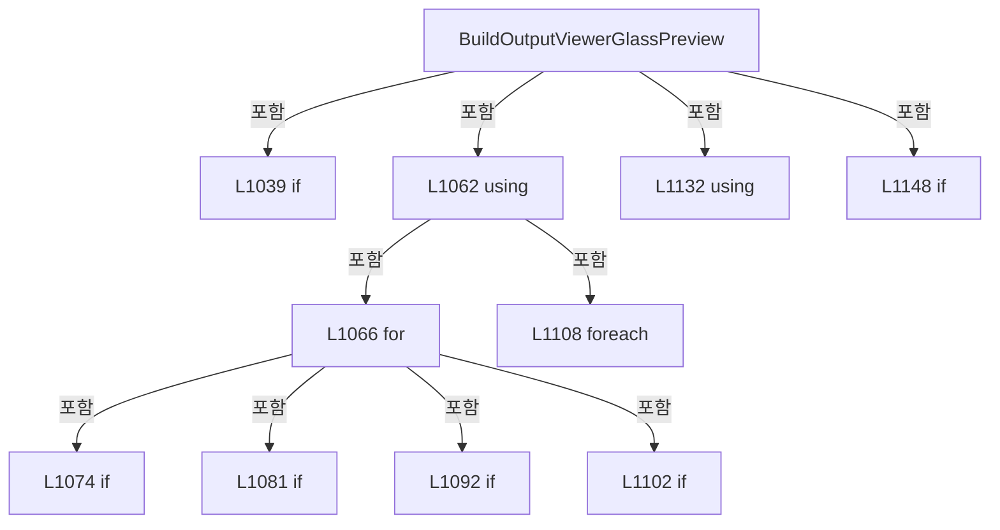

변경 전 점검: 입력/반환 타입, 위 호출자, 예외/취소 경로, 공유 상태와 저장·전송 소비자를 함께 확인합니다. 값의 단위나 물리 방향을 이름만으로 확정하지 않습니다.

### LocalFunctionStatement `ReadDistortionValue` · L1044–1047

[Drilling.UI/Menu/Menus/CMenuCorrection.cs:1044–1047](https://github.com/kjuws10-rgb/A3Drilling/blob/96e22cd027c84bf302b23f2949b98985d7f301bb/Drilling.UI/Menu/Menus/CMenuCorrection.cs#L1044-L1047)

| 항목 | 실제 추출 값 |
| --- | --- |
| 서명 | double? ReadDistortionValue(string) |
| 접근/수식자 | Private /  |
| 반환/값 타입 | double? |
| 소속 타입 | NamedType:Drilling.UI.Menu.Menus.CMenuCorrection |

입력 계약:

| 이름 | 타입 | 전달 | 선택/기본값 |
| --- | --- | --- | --- |
| key | string | None | False /  |

현재 부분 분석에서 직접 연결된 호출자는 없습니다. XAML/이벤트/인터페이스·델리게이트·외부 진입을 추가 확인해야 하며, 미사용으로 판정한 것이 아닙니다.

호출하는 대상과 해석 범위:

| 원본 행 | 표현식 | 분석 상태 | 대상/소스 위치 |
| --- | --- | --- | --- |
| 1046 | ReadOutputViewerNullableDouble | resolved | double? Drilling.UI.Menu.Menus.CMenuCorrection.ReadOutputViewerNullableDouble(System.Collections.Generic.IReadOnlyDictionary<string, string>, string) · Drilling.UI/Menu/Menus/CMenuCorrection.cs:1275 |

본문의 실제 연산·분기·예외·반환 순서(원문 위치 순):

| 원본 행 | 종류 | 주석 해설 |
| --- | --- | --- |
| 1046 | call | 함수·델리게이트 또는 객체 생성자를 호출합니다: ReadOutputViewerNullableDouble(parameters, key) |
| 1046 | return | 호출자에게 값 또는 제어를 반환합니다: return ReadOutputViewerNullableDouble(parameters, key); |

변경 전 점검: 입력/반환 타입, 위 호출자, 예외/취소 경로, 공유 상태와 저장·전송 소비자를 함께 확인합니다. 값의 단위나 물리 방향을 이름만으로 확정하지 않습니다.

### MethodDeclaration `BuildOutputViewerCellBoundaryGeometry` · L1156–1191

[Drilling.UI/Menu/Menus/CMenuCorrection.cs:1156–1191](https://github.com/kjuws10-rgb/A3Drilling/blob/96e22cd027c84bf302b23f2949b98985d7f301bb/Drilling.UI/Menu/Menus/CMenuCorrection.cs#L1156-L1191)

| 항목 | 실제 추출 값 |
| --- | --- |
| 서명 | StreamGeometry? Drilling.UI.Menu.Menus.CMenuCorrection.BuildOutputViewerCellBoundaryGeometry(double, double, double, double, int, int, double, double, double) |
| 접근/수식자 | Private / private, static |
| 반환/값 타입 | StreamGeometry? |
| 소속 타입 | NamedType:Drilling.UI.Menu.Menus.CMenuCorrection |

입력 계약:

| 이름 | 타입 | 전달 | 선택/기본값 |
| --- | --- | --- | --- |
| frameLeft | double | None | False /  |
| frameTop | double | None | False /  |
| scale | double | None | False /  |
| pixelSize | double | None | False /  |
| pixelCountX | int | None | False /  |
| pixelCountY | int | None | False /  |
| firstX | double | None | False /  |
| firstY | double | None | False /  |
| rotationDegrees | double | None | False /  |

정적 호출자로 확인된 위치:

| 호출 파일/행 | 호출 표현식 | 런타임 분기 가능 |
| --- | --- | --- |
| [Drilling.UI/Menu/Menus/CMenuCorrection.ReviewData.Display.cs:1063–1072](https://github.com/kjuws10-rgb/A3Drilling/blob/96e22cd027c84bf302b23f2949b98985d7f301bb/Drilling.UI/Menu/Menus/CMenuCorrection.ReviewData.Display.cs#L1063-L1072) | BuildOutputViewerCellBoundaryGeometry | False |
| [Drilling.UI/Menu/Menus/CMenuCorrection.cs:1080–1080](https://github.com/kjuws10-rgb/A3Drilling/blob/96e22cd027c84bf302b23f2949b98985d7f301bb/Drilling.UI/Menu/Menus/CMenuCorrection.cs#L1080-L1080) | BuildOutputViewerCellBoundaryGeometry | False |

호출하는 대상과 해석 범위:

| 원본 행 | 표현식 | 분석 상태 | 대상/소스 위치 |
| --- | --- | --- | --- |
| 1158 | double.IsFinite | resolved | bool double.IsFinite(double) |
| 1164 | Math.Cos | resolved | double System.Math.Cos(double) |
| 1165 | Math.Sin | resolved | double System.Math.Sin(double) |
| 1171 | new Point | unresolved | None |
| 1172 | new Point | unresolved | None |
| 1173 | new Point | unresolved | None |
| 1174 | new Point | unresolved | None |
| 1176 | localCorners.Select(local => { var x = firstX + (local.X * cos) - (local.Y * sin); var y = firstY + (local.X * sin) + (local.Y * cos); return new Point(frameLeft + (x * scale), frameTop + (y * scale)); }).ToArray | unresolved | None |
| 1176 | localCorners.Select | candidate | OverloadResolutionFailure |
| 1180 | new Point | unresolved | None |
| 1182 | new StreamGeometry | unresolved | None |
| 1183 | geometry.Open | unresolved | None |
| 1185 | geometryContext.BeginFigure | unresolved | None |
| 1186 | geometryContext.PolyLineTo | unresolved | None |
| 1186 | canvasCorners.Skip(1).ToArray | unresolved | None |
| 1186 | canvasCorners.Skip | unresolved | None |
| 1189 | geometry.Freeze | unresolved | None |

본문의 실제 연산·분기·예외·반환 순서(원문 위치 순):

| 원본 행 | 종류 | 주석 해설 |
| --- | --- | --- |
| 1158 | call | 함수·델리게이트 또는 객체 생성자를 호출합니다: double.IsFinite(pixelSize) |
| 1158 | if | 조건에 따라 분기합니다: if (pixelCountX <= 0 &#124;&#124; pixelCountY <= 0 &#124;&#124; !double.IsFinite(pixelSize) &#124;&#124; pixelSize <= 0.0) |
| 1160 | return | 호출자에게 값 또는 제어를 반환합니다: return null; |
| 1163 | local-declaration | 지역 변수를 선언합니다: var radians = rotationDegrees * Math.PI / 180.0; |
| 1163 | variable-initializer | 변수의 초기값을 지정합니다: radians = rotationDegrees * Math.PI / 180.0 |
| 1164 | call | 함수·델리게이트 또는 객체 생성자를 호출합니다: Math.Cos(radians) |
| 1164 | local-declaration | 지역 변수를 선언합니다: var cos = Math.Cos(radians); |
| 1164 | variable-initializer | 변수의 초기값을 지정합니다: cos = Math.Cos(radians) |
| 1165 | call | 함수·델리게이트 또는 객체 생성자를 호출합니다: Math.Sin(radians) |
| 1165 | local-declaration | 지역 변수를 선언합니다: var sin = Math.Sin(radians); |
| 1165 | variable-initializer | 변수의 초기값을 지정합니다: sin = Math.Sin(radians) |
| 1166 | local-declaration | 지역 변수를 선언합니다: var halfPixel = pixelSize / 2.0; |
| 1166 | variable-initializer | 변수의 초기값을 지정합니다: halfPixel = pixelSize / 2.0 |
| 1167 | local-declaration | 지역 변수를 선언합니다: var localMaxX = ((pixelCountX - 1) * pixelSize) + halfPixel; |
| 1167 | variable-initializer | 변수의 초기값을 지정합니다: localMaxX = ((pixelCountX - 1) * pixelSize) + halfPixel |
| 1168 | local-declaration | 지역 변수를 선언합니다: var localMaxY = ((pixelCountY - 1) * pixelSize) + halfPixel; |
| 1168 | variable-initializer | 변수의 초기값을 지정합니다: localMaxY = ((pixelCountY - 1) * pixelSize) + halfPixel |
| 1169 | local-declaration | 지역 변수를 선언합니다: var localCorners = new[] { new Point(-halfPixel, -halfPixel), new Point(localMaxX, -halfPixel), new Point(localMaxX, localMaxY), new Point(-halfPixel, localMaxY) }; |
| 1169 | variable-initializer | 변수의 초기값을 지정합니다: localCorners = new[] { new Point(-halfPixel, -halfPixel), new Point(localMaxX, -halfPixel), new Point(localMaxX, localMaxY), new Point(-halfPixel, localMaxY) } |
| 1171 | call | 함수·델리게이트 또는 객체 생성자를 호출합니다: new Point(-halfPixel, -halfPixel) |
| 1172 | call | 함수·델리게이트 또는 객체 생성자를 호출합니다: new Point(localMaxX, -halfPixel) |
| 1173 | call | 함수·델리게이트 또는 객체 생성자를 호출합니다: new Point(localMaxX, localMaxY) |
| 1174 | call | 함수·델리게이트 또는 객체 생성자를 호출합니다: new Point(-halfPixel, localMaxY) |
| 1176 | call | 함수·델리게이트 또는 객체 생성자를 호출합니다: localCorners.Select(local => { var x = firstX + (local.X * cos) - (local.Y * sin); var y = firstY + (local.X * sin) + (local.Y * cos); return new Point(frameLeft + (x * scale), frameTop + (y * scale)); }).ToArray() |
| 1176 | call | 함수·델리게이트 또는 객체 생성자를 호출합니다: localCorners.Select(local => { var x = firstX + (local.X * cos) - (local.Y * sin); var y = firstY + (local.X * sin) + (local.Y * cos); return new Point(frameLeft + (x * scale), frameTop + (y * scale)); }) |
| 1176 | local-declaration | 지역 변수를 선언합니다: var canvasCorners = localCorners.Select(local => { var x = firstX + (local.X * cos) - (local.Y * sin); var y = firstY + (local.X * sin) + (local.Y * cos); return new Point(frameLeft + (x * scale), frameTop + (y * scale)); }).ToArr |
| 1176 | variable-initializer | 변수의 초기값을 지정합니다: canvasCorners = localCorners.Select(local => { var x = firstX + (local.X * cos) - (local.Y * sin); var y = firstY + (local.X * sin) + (local.Y * cos); return new Point(frameLeft + (x * scale), frameTop + (y * scale)); }).ToArray() |
| 1178 | local-declaration | 지역 변수를 선언합니다: var x = firstX + (local.X * cos) - (local.Y * sin); |
| 1178 | variable-initializer | 변수의 초기값을 지정합니다: x = firstX + (local.X * cos) - (local.Y * sin) |
| 1179 | local-declaration | 지역 변수를 선언합니다: var y = firstY + (local.X * sin) + (local.Y * cos); |
| 1179 | variable-initializer | 변수의 초기값을 지정합니다: y = firstY + (local.X * sin) + (local.Y * cos) |
| 1180 | call | 함수·델리게이트 또는 객체 생성자를 호출합니다: new Point(frameLeft + (x * scale), frameTop + (y * scale)) |
| 1180 | return | 호출자에게 값 또는 제어를 반환합니다: return new Point(frameLeft + (x * scale), frameTop + (y * scale)); |
| 1182 | call | 함수·델리게이트 또는 객체 생성자를 호출합니다: new StreamGeometry() |
| 1182 | local-declaration | 지역 변수를 선언합니다: var geometry = new StreamGeometry(); |
| 1182 | variable-initializer | 변수의 초기값을 지정합니다: geometry = new StreamGeometry() |
| 1183 | call | 함수·델리게이트 또는 객체 생성자를 호출합니다: geometry.Open() |
| 1183 | variable-initializer | 변수의 초기값을 지정합니다: geometryContext = geometry.Open() |
| 1183 | using | 자원 사용과 정리 범위를 지정합니다: using (var geometryContext = geometry.Open()) |
| 1185 | call | 함수·델리게이트 또는 객체 생성자를 호출합니다: geometryContext.BeginFigure(canvasCorners[0], false, true) |
| 1186 | call | 함수·델리게이트 또는 객체 생성자를 호출합니다: geometryContext.PolyLineTo(canvasCorners.Skip(1).ToArray(), true, false) |
| 1186 | call | 함수·델리게이트 또는 객체 생성자를 호출합니다: canvasCorners.Skip(1).ToArray() |
| 1186 | call | 함수·델리게이트 또는 객체 생성자를 호출합니다: canvasCorners.Skip(1) |
| 1189 | call | 함수·델리게이트 또는 객체 생성자를 호출합니다: geometry.Freeze() |
| 1190 | return | 호출자에게 값 또는 제어를 반환합니다: return geometry; |

제어 구문의 포함 구조(실제 실행 순서/CFG가 아닌 구문 탐색 그림):

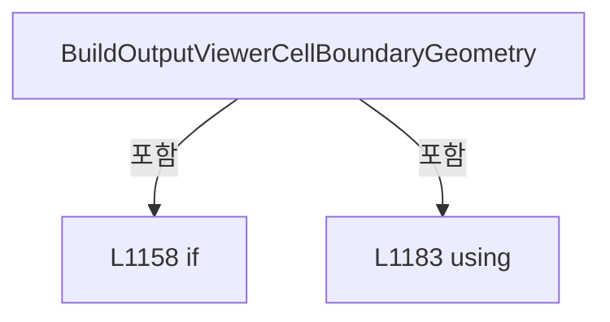

변경 전 점검: 입력/반환 타입, 위 호출자, 예외/취소 경로, 공유 상태와 저장·전송 소비자를 함께 확인합니다. 값의 단위나 물리 방향을 이름만으로 확정하지 않습니다.

### MethodDeclaration `DrawOutputViewerPreviewAxisIndicator` · L1193–1214

[Drilling.UI/Menu/Menus/CMenuCorrection.cs:1193–1214](https://github.com/kjuws10-rgb/A3Drilling/blob/96e22cd027c84bf302b23f2949b98985d7f301bb/Drilling.UI/Menu/Menus/CMenuCorrection.cs#L1193-L1214)

| 항목 | 실제 추출 값 |
| --- | --- |
| 서명 | void Drilling.UI.Menu.Menus.CMenuCorrection.DrawOutputViewerPreviewAxisIndicator(DrawingContext, Rect) |
| 접근/수식자 | Private / private, static |
| 반환/값 타입 | void |
| 소속 타입 | NamedType:Drilling.UI.Menu.Menus.CMenuCorrection |

입력 계약:

| 이름 | 타입 | 전달 | 선택/기본값 |
| --- | --- | --- | --- |
| context | DrawingContext | None | False /  |
| glassRect | Rect | None | False /  |

현재 부분 분석에서 직접 연결된 호출자는 없습니다. XAML/이벤트/인터페이스·델리게이트·외부 진입을 추가 확인해야 하며, 미사용으로 판정한 것이 아닙니다.

호출하는 대상과 해석 범위:

| 원본 행 | 표현식 | 분석 상태 | 대상/소스 위치 |
| --- | --- | --- | --- |
| 1195 | new SolidColorBrush | unresolved | None |
| 1195 | Color.FromRgb | unresolved | None |
| 1196 | axisBrush.Freeze | unresolved | None |
| 1197 | new Pen | unresolved | None |
| 1202 | axisPen.Freeze | unresolved | None |
| 1203 | new Point | unresolved | None |
| 1203 | Math.Max | candidate | OverloadResolutionFailure |
| 1203 | Math.Max | candidate | OverloadResolutionFailure |
| 1204 | new Point | unresolved | None |
| 1205 | new Point | unresolved | None |
| 1206 | context.DrawLine | unresolved | None |
| 1207 | context.DrawLine | unresolved | None |
| 1207 | new Point | unresolved | None |
| 1208 | context.DrawLine | unresolved | None |
| 1208 | new Point | unresolved | None |
| 1209 | context.DrawLine | unresolved | None |
| 1210 | context.DrawLine | unresolved | None |
| 1210 | new Point | unresolved | None |
| 1211 | context.DrawLine | unresolved | None |
| 1211 | new Point | unresolved | None |
| 1212 | DrawOutputViewerPreviewAxisText | candidate | OverloadResolutionFailure |
| 1212 | new Point | unresolved | None |
| 1212 | Math.Max | candidate | OverloadResolutionFailure |
| 1213 | DrawOutputViewerPreviewAxisText | candidate | OverloadResolutionFailure |
| 1213 | new Point | unresolved | None |

본문의 실제 연산·분기·예외·반환 순서(원문 위치 순):

| 원본 행 | 종류 | 주석 해설 |
| --- | --- | --- |
| 1195 | call | 함수·델리게이트 또는 객체 생성자를 호출합니다: new SolidColorBrush(Color.FromRgb(248, 250, 252)) |
| 1195 | call | 함수·델리게이트 또는 객체 생성자를 호출합니다: Color.FromRgb(248, 250, 252) |
| 1195 | local-declaration | 지역 변수를 선언합니다: var axisBrush = new SolidColorBrush(Color.FromRgb(248, 250, 252)); |
| 1195 | variable-initializer | 변수의 초기값을 지정합니다: axisBrush = new SolidColorBrush(Color.FromRgb(248, 250, 252)) |
| 1196 | call | 함수·델리게이트 또는 객체 생성자를 호출합니다: axisBrush.Freeze() |
| 1197 | call | 함수·델리게이트 또는 객체 생성자를 호출합니다: new Pen(axisBrush, 2.0) { StartLineCap = PenLineCap.Round, EndLineCap = PenLineCap.Round } |
| 1197 | local-declaration | 지역 변수를 선언합니다: var axisPen = new Pen(axisBrush, 2.0) { StartLineCap = PenLineCap.Round, EndLineCap = PenLineCap.Round }; |
| 1197 | variable-initializer | 변수의 초기값을 지정합니다: axisPen = new Pen(axisBrush, 2.0) { StartLineCap = PenLineCap.Round, EndLineCap = PenLineCap.Round } |
| 1199 | assignment | 값을 대상에 대입합니다: StartLineCap = PenLineCap.Round |
| 1200 | assignment | 값을 대상에 대입합니다: EndLineCap = PenLineCap.Round |
| 1202 | call | 함수·델리게이트 또는 객체 생성자를 호출합니다: axisPen.Freeze() |
| 1203 | call | 함수·델리게이트 또는 객체 생성자를 호출합니다: new Point(Math.Max(4.0, glassRect.Left - 8.0), Math.Max(4.0, glassRect.Top - 12.0)) |
| 1203 | call | 함수·델리게이트 또는 객체 생성자를 호출합니다: Math.Max(4.0, glassRect.Left - 8.0) |
| 1203 | call | 함수·델리게이트 또는 객체 생성자를 호출합니다: Math.Max(4.0, glassRect.Top - 12.0) |
| 1203 | local-declaration | 지역 변수를 선언합니다: var origin = new Point(Math.Max(4.0, glassRect.Left - 8.0), Math.Max(4.0, glassRect.Top - 12.0)); |
| 1203 | variable-initializer | 변수의 초기값을 지정합니다: origin = new Point(Math.Max(4.0, glassRect.Left - 8.0), Math.Max(4.0, glassRect.Top - 12.0)) |
| 1204 | call | 함수·델리게이트 또는 객체 생성자를 호출합니다: new Point(origin.X + 46.0, origin.Y) |
| 1204 | local-declaration | 지역 변수를 선언합니다: var xEnd = new Point(origin.X + 46.0, origin.Y); |
| 1204 | variable-initializer | 변수의 초기값을 지정합니다: xEnd = new Point(origin.X + 46.0, origin.Y) |
| 1205 | call | 함수·델리게이트 또는 객체 생성자를 호출합니다: new Point(origin.X, origin.Y + 42.0) |
| 1205 | local-declaration | 지역 변수를 선언합니다: var yEnd = new Point(origin.X, origin.Y + 42.0); |
| 1205 | variable-initializer | 변수의 초기값을 지정합니다: yEnd = new Point(origin.X, origin.Y + 42.0) |
| 1206 | call | 함수·델리게이트 또는 객체 생성자를 호출합니다: context.DrawLine(axisPen, origin, xEnd) |
| 1207 | call | 함수·델리게이트 또는 객체 생성자를 호출합니다: context.DrawLine(axisPen, new Point(xEnd.X - 8.0, xEnd.Y - 4.0), xEnd) |
| 1207 | call | 함수·델리게이트 또는 객체 생성자를 호출합니다: new Point(xEnd.X - 8.0, xEnd.Y - 4.0) |
| 1208 | call | 함수·델리게이트 또는 객체 생성자를 호출합니다: context.DrawLine(axisPen, new Point(xEnd.X - 8.0, xEnd.Y + 4.0), xEnd) |
| 1208 | call | 함수·델리게이트 또는 객체 생성자를 호출합니다: new Point(xEnd.X - 8.0, xEnd.Y + 4.0) |
| 1209 | call | 함수·델리게이트 또는 객체 생성자를 호출합니다: context.DrawLine(axisPen, origin, yEnd) |
| 1210 | call | 함수·델리게이트 또는 객체 생성자를 호출합니다: context.DrawLine(axisPen, new Point(yEnd.X - 4.0, yEnd.Y - 8.0), yEnd) |
| 1210 | call | 함수·델리게이트 또는 객체 생성자를 호출합니다: new Point(yEnd.X - 4.0, yEnd.Y - 8.0) |
| 1211 | call | 함수·델리게이트 또는 객체 생성자를 호출합니다: context.DrawLine(axisPen, new Point(yEnd.X + 4.0, yEnd.Y - 8.0), yEnd) |
| 1211 | call | 함수·델리게이트 또는 객체 생성자를 호출합니다: new Point(yEnd.X + 4.0, yEnd.Y - 8.0) |
| 1212 | call | 함수·델리게이트 또는 객체 생성자를 호출합니다: DrawOutputViewerPreviewAxisText(context, "X+", new Point(xEnd.X + 4.0, Math.Max(2.0, xEnd.Y - 10.0)), axisBrush) |
| 1212 | call | 함수·델리게이트 또는 객체 생성자를 호출합니다: new Point(xEnd.X + 4.0, Math.Max(2.0, xEnd.Y - 10.0)) |
| 1212 | call | 함수·델리게이트 또는 객체 생성자를 호출합니다: Math.Max(2.0, xEnd.Y - 10.0) |
| 1213 | call | 함수·델리게이트 또는 객체 생성자를 호출합니다: DrawOutputViewerPreviewAxisText(context, "Y+", new Point(yEnd.X + 4.0, yEnd.Y - 4.0), axisBrush) |
| 1213 | call | 함수·델리게이트 또는 객체 생성자를 호출합니다: new Point(yEnd.X + 4.0, yEnd.Y - 4.0) |

변경 전 점검: 입력/반환 타입, 위 호출자, 예외/취소 경로, 공유 상태와 저장·전송 소비자를 함께 확인합니다. 값의 단위나 물리 방향을 이름만으로 확정하지 않습니다.

### MethodDeclaration `DrawOutputViewerPreviewAxisText` · L1216–1220

[Drilling.UI/Menu/Menus/CMenuCorrection.cs:1216–1220](https://github.com/kjuws10-rgb/A3Drilling/blob/96e22cd027c84bf302b23f2949b98985d7f301bb/Drilling.UI/Menu/Menus/CMenuCorrection.cs#L1216-L1220)

| 항목 | 실제 추출 값 |
| --- | --- |
| 서명 | void Drilling.UI.Menu.Menus.CMenuCorrection.DrawOutputViewerPreviewAxisText(DrawingContext, string, Point, Brush) |
| 접근/수식자 | Private / private, static |
| 반환/값 타입 | void |
| 소속 타입 | NamedType:Drilling.UI.Menu.Menus.CMenuCorrection |

입력 계약:

| 이름 | 타입 | 전달 | 선택/기본값 |
| --- | --- | --- | --- |
| context | DrawingContext | None | False /  |
| text | string | None | False /  |
| point | Point | None | False /  |
| brush | Brush | None | False /  |

현재 부분 분석에서 직접 연결된 호출자는 없습니다. XAML/이벤트/인터페이스·델리게이트·외부 진입을 추가 확인해야 하며, 미사용으로 판정한 것이 아닙니다.

호출하는 대상과 해석 범위:

| 원본 행 | 표현식 | 분석 상태 | 대상/소스 위치 |
| --- | --- | --- | --- |
| 1218 | new FormattedText | unresolved | None |
| 1218 | new Typeface | unresolved | None |
| 1219 | context.DrawText | unresolved | None |

본문의 실제 연산·분기·예외·반환 순서(원문 위치 순):

| 원본 행 | 종류 | 주석 해설 |
| --- | --- | --- |
| 1218 | call | 함수·델리게이트 또는 객체 생성자를 호출합니다: new FormattedText(text, CultureInfo.InvariantCulture, FlowDirection.LeftToRight, new Typeface("Segoe UI Semibold"), 13.0, brush, 1.0) |
| 1218 | call | 함수·델리게이트 또는 객체 생성자를 호출합니다: new Typeface("Segoe UI Semibold") |
| 1218 | local-declaration | 지역 변수를 선언합니다: var label = new FormattedText(text, CultureInfo.InvariantCulture, FlowDirection.LeftToRight, new Typeface("Segoe UI Semibold"), 13.0, brush, 1.0); |
| 1218 | variable-initializer | 변수의 초기값을 지정합니다: label = new FormattedText(text, CultureInfo.InvariantCulture, FlowDirection.LeftToRight, new Typeface("Segoe UI Semibold"), 13.0, brush, 1.0) |
| 1219 | call | 함수·델리게이트 또는 객체 생성자를 호출합니다: context.DrawText(label, point) |

변경 전 점검: 입력/반환 타입, 위 호출자, 예외/취소 경로, 공유 상태와 저장·전송 소비자를 함께 확인합니다. 값의 단위나 물리 방향을 이름만으로 확정하지 않습니다.

### MethodDeclaration `BuildOutputViewerCoordinateParameterMap` · L1222–1232

[Drilling.UI/Menu/Menus/CMenuCorrection.cs:1222–1232](https://github.com/kjuws10-rgb/A3Drilling/blob/96e22cd027c84bf302b23f2949b98985d7f301bb/Drilling.UI/Menu/Menus/CMenuCorrection.cs#L1222-L1232)

| 항목 | 실제 추출 값 |
| --- | --- |
| 서명 | System.Collections.Generic.IReadOnlyDictionary<string, string> Drilling.UI.Menu.Menus.CMenuCorrection.BuildOutputViewerCoordinateParameterMap(System.Collections.Generic.IReadOnlyDictionary<string, string>) |
| 접근/수식자 | Private / private, static |
| 반환/값 타입 | System.Collections.Generic.IReadOnlyDictionary<string, string> |
| 소속 타입 | NamedType:Drilling.UI.Menu.Menus.CMenuCorrection |

입력 계약:

| 이름 | 타입 | 전달 | 선택/기본값 |
| --- | --- | --- | --- |
| parameters | System.Collections.Generic.IReadOnlyDictionary<string, string> | None | False /  |

정적 호출자로 확인된 위치:

| 호출 파일/행 | 호출 표현식 | 런타임 분기 가능 |
| --- | --- | --- |
| [Drilling.UI/Menu/Menus/CMenuCorrection.cs:680–680](https://github.com/kjuws10-rgb/A3Drilling/blob/96e22cd027c84bf302b23f2949b98985d7f301bb/Drilling.UI/Menu/Menus/CMenuCorrection.cs#L680-L680) | BuildOutputViewerCoordinateParameterMap | False |

호출하는 대상과 해석 범위:

| 원본 행 | 표현식 | 분석 상태 | 대상/소스 위치 |
| --- | --- | --- | --- |
| 1224 | new Dictionary<string, string> | resolved | System.Collections.Generic.Dictionary<string, string>.Dictionary(System.Collections.Generic.IEnumerable<System.Collections.Generic.KeyValuePair<string, string>>, System.Collections.Generic.IEqualityComparer<string>?) |
| 1225 | Math.Clamp | resolved | int System.Math.Clamp(int, int, int) |
| 1225 | ReadOutputViewerInt | resolved | int Drilling.UI.Menu.Menus.CMenuCorrection.ReadOutputViewerInt(System.Collections.Generic.IReadOnlyDictionary<string, string>, int, params string[]) · Drilling.UI/Menu/Menus/CMenuCorrection.cs:1234 |

본문의 실제 연산·분기·예외·반환 순서(원문 위치 순):

| 원본 행 | 종류 | 주석 해설 |
| --- | --- | --- |
| 1224 | call | 함수·델리게이트 또는 객체 생성자를 호출합니다: new Dictionary<string, string>(parameters, StringComparer.OrdinalIgnoreCase) |
| 1224 | local-declaration | 지역 변수를 선언합니다: var viewerParameters = new Dictionary<string, string>(parameters, StringComparer.OrdinalIgnoreCase); |
| 1224 | variable-initializer | 변수의 초기값을 지정합니다: viewerParameters = new Dictionary<string, string>(parameters, StringComparer.OrdinalIgnoreCase) |
| 1225 | call | 함수·델리게이트 또는 객체 생성자를 호출합니다: Math.Clamp(ReadOutputViewerInt(viewerParameters, 8, "HEAD_COUNT"), 1, 8) |
| 1225 | call | 함수·델리게이트 또는 객체 생성자를 호출합니다: ReadOutputViewerInt(viewerParameters, 8, "HEAD_COUNT") |
| 1225 | local-declaration | 지역 변수를 선언합니다: var headCount = Math.Clamp(ReadOutputViewerInt(viewerParameters, 8, "HEAD_COUNT"), 1, 8); |
| 1225 | variable-initializer | 변수의 초기값을 지정합니다: headCount = Math.Clamp(ReadOutputViewerInt(viewerParameters, 8, "HEAD_COUNT"), 1, 8) |
| 1226 | variable-initializer | 변수의 초기값을 지정합니다: headNo = 1 |
| 1226 | for | 초기화·조건·증감이 있는 반복입니다: for (var headNo = 1; headNo <= headCount; headNo++) |
| 1228 | assignment | 값을 대상에 대입합니다: viewerParameters[$"H{headNo:00}_USE"] = "ON" |
| 1231 | return | 호출자에게 값 또는 제어를 반환합니다: return viewerParameters; |

제어 구문의 포함 구조(실제 실행 순서/CFG가 아닌 구문 탐색 그림):

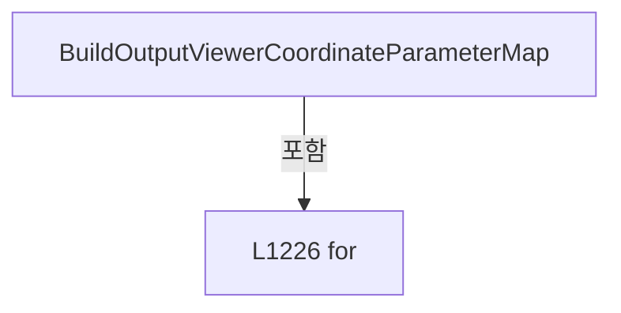

변경 전 점검: 입력/반환 타입, 위 호출자, 예외/취소 경로, 공유 상태와 저장·전송 소비자를 함께 확인합니다. 값의 단위나 물리 방향을 이름만으로 확정하지 않습니다.

### MethodDeclaration `ReadOutputViewerInt` · L1234–1255

[Drilling.UI/Menu/Menus/CMenuCorrection.cs:1234–1255](https://github.com/kjuws10-rgb/A3Drilling/blob/96e22cd027c84bf302b23f2949b98985d7f301bb/Drilling.UI/Menu/Menus/CMenuCorrection.cs#L1234-L1255)

| 항목 | 실제 추출 값 |
| --- | --- |
| 서명 | int Drilling.UI.Menu.Menus.CMenuCorrection.ReadOutputViewerInt(System.Collections.Generic.IReadOnlyDictionary<string, string>, int, params string[]) |
| 접근/수식자 | Private / private, static |
| 반환/값 타입 | int |
| 소속 타입 | NamedType:Drilling.UI.Menu.Menus.CMenuCorrection |

입력 계약:

| 이름 | 타입 | 전달 | 선택/기본값 |
| --- | --- | --- | --- |
| parameters | System.Collections.Generic.IReadOnlyDictionary<string, string> | None | False /  |
| defaultValue | int | None | False /  |
| keys | string[] | None | False /  |

정적 호출자로 확인된 위치:

| 호출 파일/행 | 호출 표현식 | 런타임 분기 가능 |
| --- | --- | --- |
| [Drilling.UI/Menu/Menus/CMenuCorrection.ReviewData.Display.cs:246–246](https://github.com/kjuws10-rgb/A3Drilling/blob/96e22cd027c84bf302b23f2949b98985d7f301bb/Drilling.UI/Menu/Menus/CMenuCorrection.ReviewData.Display.cs#L246-L246) | ReadOutputViewerInt | False |
| [Drilling.UI/Menu/Menus/CMenuCorrection.ReviewData.Display.cs:397–397](https://github.com/kjuws10-rgb/A3Drilling/blob/96e22cd027c84bf302b23f2949b98985d7f301bb/Drilling.UI/Menu/Menus/CMenuCorrection.ReviewData.Display.cs#L397-L397) | ReadOutputViewerInt | False |
| [Drilling.UI/Menu/Menus/CMenuCorrection.ReviewData.Offset.cs:223–223](https://github.com/kjuws10-rgb/A3Drilling/blob/96e22cd027c84bf302b23f2949b98985d7f301bb/Drilling.UI/Menu/Menus/CMenuCorrection.ReviewData.Offset.cs#L223-L223) | ReadOutputViewerInt | False |
| [Drilling.UI/Menu/Menus/CMenuCorrection.ReviewData.Offset.cs:368–368](https://github.com/kjuws10-rgb/A3Drilling/blob/96e22cd027c84bf302b23f2949b98985d7f301bb/Drilling.UI/Menu/Menus/CMenuCorrection.ReviewData.Offset.cs#L368-L368) | ReadOutputViewerInt | False |
| [Drilling.UI/Menu/Menus/CMenuCorrection.cs:643–643](https://github.com/kjuws10-rgb/A3Drilling/blob/96e22cd027c84bf302b23f2949b98985d7f301bb/Drilling.UI/Menu/Menus/CMenuCorrection.cs#L643-L643) | ReadOutputViewerInt | False |
| [Drilling.UI/Menu/Menus/CMenuCorrection.cs:1037–1037](https://github.com/kjuws10-rgb/A3Drilling/blob/96e22cd027c84bf302b23f2949b98985d7f301bb/Drilling.UI/Menu/Menus/CMenuCorrection.cs#L1037-L1037) | ReadOutputViewerInt | False |
| [Drilling.UI/Menu/Menus/CMenuCorrection.cs:1225–1225](https://github.com/kjuws10-rgb/A3Drilling/blob/96e22cd027c84bf302b23f2949b98985d7f301bb/Drilling.UI/Menu/Menus/CMenuCorrection.cs#L1225-L1225) | ReadOutputViewerInt | False |

호출하는 대상과 해석 범위:

| 원본 행 | 표현식 | 분석 상태 | 대상/소스 위치 |
| --- | --- | --- | --- |
| 1238 | parameters.TryGetValue | resolved · 동적 구현 선택 가능 | bool System.Collections.Generic.IReadOnlyDictionary<string, string>.TryGetValue(string, out string) |
| 1243 | int.TryParse | resolved | bool int.TryParse(string?, System.Globalization.NumberStyles, System.IFormatProvider?, out int) |
| 1248 | double.TryParse | resolved | bool double.TryParse(string?, System.Globalization.NumberStyles, System.IFormatProvider?, out double) |
| 1250 | Math.Round | resolved | double System.Math.Round(double) |

본문의 실제 연산·분기·예외·반환 순서(원문 위치 순):

| 원본 행 | 종류 | 주석 해설 |
| --- | --- | --- |
| 1236 | foreach | 컬렉션 요소를 순회합니다: foreach (var key in keys) |
| 1238 | call | 함수·델리게이트 또는 객체 생성자를 호출합니다: parameters.TryGetValue(key, out var value) |
| 1238 | if | 조건에 따라 분기합니다: if (!parameters.TryGetValue(key, out var value)) |
| 1240 | continue | 다음 반복으로 진행합니다: continue; |
| 1243 | call | 함수·델리게이트 또는 객체 생성자를 호출합니다: int.TryParse(value, NumberStyles.Integer, CultureInfo.InvariantCulture, out var intResult) |
| 1243 | if | 조건에 따라 분기합니다: if (int.TryParse(value, NumberStyles.Integer, CultureInfo.InvariantCulture, out var intResult)) |
| 1245 | return | 호출자에게 값 또는 제어를 반환합니다: return intResult; |
| 1248 | call | 함수·델리게이트 또는 객체 생성자를 호출합니다: double.TryParse(value, NumberStyles.Float, CultureInfo.InvariantCulture, out var doubleResult) |
| 1248 | if | 조건에 따라 분기합니다: if (double.TryParse(value, NumberStyles.Float, CultureInfo.InvariantCulture, out var doubleResult)) |
| 1250 | call | 함수·델리게이트 또는 객체 생성자를 호출합니다: Math.Round(doubleResult) |
| 1250 | return | 호출자에게 값 또는 제어를 반환합니다: return (int)Math.Round(doubleResult); |
| 1254 | return | 호출자에게 값 또는 제어를 반환합니다: return defaultValue; |

제어 구문의 포함 구조(실제 실행 순서/CFG가 아닌 구문 탐색 그림):

```mermaid
flowchart TD
 M["ReadOutputViewerInt"]
 N0["L1236 foreach"]
 M -->|포함| N0
 N1["L1238 if"]
 N0 -->|포함| N1
 N2["L1243 if"]
 N0 -->|포함| N2
 N3["L1248 if"]
 N0 -->|포함| N3
```

변경 전 점검: 입력/반환 타입, 위 호출자, 예외/취소 경로, 공유 상태와 저장·전송 소비자를 함께 확인합니다. 값의 단위나 물리 방향을 이름만으로 확정하지 않습니다.

### MethodDeclaration `ReadOutputViewerDouble` · L1257–1273

[Drilling.UI/Menu/Menus/CMenuCorrection.cs:1257–1273](https://github.com/kjuws10-rgb/A3Drilling/blob/96e22cd027c84bf302b23f2949b98985d7f301bb/Drilling.UI/Menu/Menus/CMenuCorrection.cs#L1257-L1273)

| 항목 | 실제 추출 값 |
| --- | --- |
| 서명 | double Drilling.UI.Menu.Menus.CMenuCorrection.ReadOutputViewerDouble(System.Collections.Generic.IReadOnlyDictionary<string, string>, double, params string[]) |
| 접근/수식자 | Private / private, static |
| 반환/값 타입 | double |
| 소속 타입 | NamedType:Drilling.UI.Menu.Menus.CMenuCorrection |

입력 계약:

| 이름 | 타입 | 전달 | 선택/기본값 |
| --- | --- | --- | --- |
| parameters | System.Collections.Generic.IReadOnlyDictionary<string, string> | None | False /  |
| defaultValue | double | None | False /  |
| keys | string[] | None | False /  |

정적 호출자로 확인된 위치:

| 호출 파일/행 | 호출 표현식 | 런타임 분기 가능 |
| --- | --- | --- |
| [Drilling.UI/Menu/Menus/CMenuCorrection.ReviewData.Display.cs:396–396](https://github.com/kjuws10-rgb/A3Drilling/blob/96e22cd027c84bf302b23f2949b98985d7f301bb/Drilling.UI/Menu/Menus/CMenuCorrection.ReviewData.Display.cs#L396-L396) | ReadOutputViewerDouble | False |
| [Drilling.UI/Menu/Menus/CMenuCorrection.ReviewData.Display.cs:398–398](https://github.com/kjuws10-rgb/A3Drilling/blob/96e22cd027c84bf302b23f2949b98985d7f301bb/Drilling.UI/Menu/Menus/CMenuCorrection.ReviewData.Display.cs#L398-L398) | ReadOutputViewerDouble | False |
| [Drilling.UI/Menu/Menus/CMenuCorrection.ReviewData.Display.cs:399–399](https://github.com/kjuws10-rgb/A3Drilling/blob/96e22cd027c84bf302b23f2949b98985d7f301bb/Drilling.UI/Menu/Menus/CMenuCorrection.ReviewData.Display.cs#L399-L399) | ReadOutputViewerDouble | False |
| [Drilling.UI/Menu/Menus/CMenuCorrection.ReviewData.Display.cs:406–406](https://github.com/kjuws10-rgb/A3Drilling/blob/96e22cd027c84bf302b23f2949b98985d7f301bb/Drilling.UI/Menu/Menus/CMenuCorrection.ReviewData.Display.cs#L406-L406) | ReadOutputViewerDouble | False |
| [Drilling.UI/Menu/Menus/CMenuCorrection.ReviewData.Display.cs:407–407](https://github.com/kjuws10-rgb/A3Drilling/blob/96e22cd027c84bf302b23f2949b98985d7f301bb/Drilling.UI/Menu/Menus/CMenuCorrection.ReviewData.Display.cs#L407-L407) | ReadOutputViewerDouble | False |
| [Drilling.UI/Menu/Menus/CMenuCorrection.ReviewData.Display.cs:408–408](https://github.com/kjuws10-rgb/A3Drilling/blob/96e22cd027c84bf302b23f2949b98985d7f301bb/Drilling.UI/Menu/Menus/CMenuCorrection.ReviewData.Display.cs#L408-L408) | ReadOutputViewerDouble | False |
| [Drilling.UI/Menu/Menus/CMenuCorrection.ReviewData.Display.cs:1025–1025](https://github.com/kjuws10-rgb/A3Drilling/blob/96e22cd027c84bf302b23f2949b98985d7f301bb/Drilling.UI/Menu/Menus/CMenuCorrection.ReviewData.Display.cs#L1025-L1025) | ReadOutputViewerDouble | False |
| [Drilling.UI/Menu/Menus/CMenuCorrection.ReviewData.Display.cs:1026–1026](https://github.com/kjuws10-rgb/A3Drilling/blob/96e22cd027c84bf302b23f2949b98985d7f301bb/Drilling.UI/Menu/Menus/CMenuCorrection.ReviewData.Display.cs#L1026-L1026) | ReadOutputViewerDouble | False |
| [Drilling.UI/Menu/Menus/CMenuCorrection.ReviewData.Display.cs:1048–1048](https://github.com/kjuws10-rgb/A3Drilling/blob/96e22cd027c84bf302b23f2949b98985d7f301bb/Drilling.UI/Menu/Menus/CMenuCorrection.ReviewData.Display.cs#L1048-L1048) | ReadOutputViewerDouble | False |
| [Drilling.UI/Menu/Menus/CMenuCorrection.ReviewData.Display.cs:1049–1049](https://github.com/kjuws10-rgb/A3Drilling/blob/96e22cd027c84bf302b23f2949b98985d7f301bb/Drilling.UI/Menu/Menus/CMenuCorrection.ReviewData.Display.cs#L1049-L1049) | ReadOutputViewerDouble | False |
| [Drilling.UI/Menu/Menus/CMenuCorrection.ReviewData.Display.cs:1050–1050](https://github.com/kjuws10-rgb/A3Drilling/blob/96e22cd027c84bf302b23f2949b98985d7f301bb/Drilling.UI/Menu/Menus/CMenuCorrection.ReviewData.Display.cs#L1050-L1050) | ReadOutputViewerDouble | False |
| [Drilling.UI/Menu/Menus/CMenuCorrection.ReviewData.Display.cs:1070–1070](https://github.com/kjuws10-rgb/A3Drilling/blob/96e22cd027c84bf302b23f2949b98985d7f301bb/Drilling.UI/Menu/Menus/CMenuCorrection.ReviewData.Display.cs#L1070-L1070) | ReadOutputViewerDouble | False |
| [Drilling.UI/Menu/Menus/CMenuCorrection.ReviewData.Display.cs:1071–1071](https://github.com/kjuws10-rgb/A3Drilling/blob/96e22cd027c84bf302b23f2949b98985d7f301bb/Drilling.UI/Menu/Menus/CMenuCorrection.ReviewData.Display.cs#L1071-L1071) | ReadOutputViewerDouble | False |
| [Drilling.UI/Menu/Menus/CMenuCorrection.ReviewData.Display.cs:1072–1072](https://github.com/kjuws10-rgb/A3Drilling/blob/96e22cd027c84bf302b23f2949b98985d7f301bb/Drilling.UI/Menu/Menus/CMenuCorrection.ReviewData.Display.cs#L1072-L1072) | ReadOutputViewerDouble | False |
| [Drilling.UI/Menu/Menus/CMenuCorrection.cs:1032–1032](https://github.com/kjuws10-rgb/A3Drilling/blob/96e22cd027c84bf302b23f2949b98985d7f301bb/Drilling.UI/Menu/Menus/CMenuCorrection.cs#L1032-L1032) | ReadOutputViewerDouble | False |
| [Drilling.UI/Menu/Menus/CMenuCorrection.cs:1033–1033](https://github.com/kjuws10-rgb/A3Drilling/blob/96e22cd027c84bf302b23f2949b98985d7f301bb/Drilling.UI/Menu/Menus/CMenuCorrection.cs#L1033-L1033) | ReadOutputViewerDouble | False |
| [Drilling.UI/Menu/Menus/CMenuCorrection.cs:1034–1034](https://github.com/kjuws10-rgb/A3Drilling/blob/96e22cd027c84bf302b23f2949b98985d7f301bb/Drilling.UI/Menu/Menus/CMenuCorrection.cs#L1034-L1034) | ReadOutputViewerDouble | False |
| [Drilling.UI/Menu/Menus/CMenuCorrection.cs:1035–1035](https://github.com/kjuws10-rgb/A3Drilling/blob/96e22cd027c84bf302b23f2949b98985d7f301bb/Drilling.UI/Menu/Menus/CMenuCorrection.cs#L1035-L1035) | ReadOutputViewerDouble | False |
| [Drilling.UI/Menu/Menus/CMenuCorrection.cs:1036–1036](https://github.com/kjuws10-rgb/A3Drilling/blob/96e22cd027c84bf302b23f2949b98985d7f301bb/Drilling.UI/Menu/Menus/CMenuCorrection.cs#L1036-L1036) | ReadOutputViewerDouble | False |
| [Drilling.UI/Menu/Menus/CMenuCorrection.cs:1068–1068](https://github.com/kjuws10-rgb/A3Drilling/blob/96e22cd027c84bf302b23f2949b98985d7f301bb/Drilling.UI/Menu/Menus/CMenuCorrection.cs#L1068-L1068) | ReadOutputViewerDouble | False |
| [Drilling.UI/Menu/Menus/CMenuCorrection.cs:1069–1069](https://github.com/kjuws10-rgb/A3Drilling/blob/96e22cd027c84bf302b23f2949b98985d7f301bb/Drilling.UI/Menu/Menus/CMenuCorrection.cs#L1069-L1069) | ReadOutputViewerDouble | False |
| [Drilling.UI/Menu/Menus/CMenuCorrection.cs:1070–1070](https://github.com/kjuws10-rgb/A3Drilling/blob/96e22cd027c84bf302b23f2949b98985d7f301bb/Drilling.UI/Menu/Menus/CMenuCorrection.cs#L1070-L1070) | ReadOutputViewerDouble | False |

호출하는 대상과 해석 범위:

| 원본 행 | 표현식 | 분석 상태 | 대상/소스 위치 |
| --- | --- | --- | --- |
| 1261 | parameters.TryGetValue | resolved · 동적 구현 선택 가능 | bool System.Collections.Generic.IReadOnlyDictionary<string, string>.TryGetValue(string, out string) |
| 1266 | double.TryParse | resolved | bool double.TryParse(string?, System.Globalization.NumberStyles, System.IFormatProvider?, out double) |
| 1266 | double.IsFinite | resolved | bool double.IsFinite(double) |

본문의 실제 연산·분기·예외·반환 순서(원문 위치 순):

| 원본 행 | 종류 | 주석 해설 |
| --- | --- | --- |
| 1259 | foreach | 컬렉션 요소를 순회합니다: foreach (var key in keys) |
| 1261 | call | 함수·델리게이트 또는 객체 생성자를 호출합니다: parameters.TryGetValue(key, out var value) |
| 1261 | if | 조건에 따라 분기합니다: if (!parameters.TryGetValue(key, out var value)) |
| 1263 | continue | 다음 반복으로 진행합니다: continue; |
| 1266 | call | 함수·델리게이트 또는 객체 생성자를 호출합니다: double.TryParse(value, NumberStyles.Float, CultureInfo.InvariantCulture, out var result) |
| 1266 | call | 함수·델리게이트 또는 객체 생성자를 호출합니다: double.IsFinite(result) |
| 1266 | if | 조건에 따라 분기합니다: if (double.TryParse(value, NumberStyles.Float, CultureInfo.InvariantCulture, out var result) && double.IsFinite(result)) |
| 1268 | return | 호출자에게 값 또는 제어를 반환합니다: return result; |
| 1272 | return | 호출자에게 값 또는 제어를 반환합니다: return defaultValue; |

제어 구문의 포함 구조(실제 실행 순서/CFG가 아닌 구문 탐색 그림):

```mermaid
flowchart TD
 M["ReadOutputViewerDouble"]
 N0["L1259 foreach"]
 M -->|포함| N0
 N1["L1261 if"]
 N0 -->|포함| N1
 N2["L1266 if"]
 N0 -->|포함| N2
```

변경 전 점검: 입력/반환 타입, 위 호출자, 예외/취소 경로, 공유 상태와 저장·전송 소비자를 함께 확인합니다. 값의 단위나 물리 방향을 이름만으로 확정하지 않습니다.

### MethodDeclaration `ReadOutputViewerNullableDouble` · L1275–1278

[Drilling.UI/Menu/Menus/CMenuCorrection.cs:1275–1278](https://github.com/kjuws10-rgb/A3Drilling/blob/96e22cd027c84bf302b23f2949b98985d7f301bb/Drilling.UI/Menu/Menus/CMenuCorrection.cs#L1275-L1278)

| 항목 | 실제 추출 값 |
| --- | --- |
| 서명 | double? Drilling.UI.Menu.Menus.CMenuCorrection.ReadOutputViewerNullableDouble(System.Collections.Generic.IReadOnlyDictionary<string, string>, string) |
| 접근/수식자 | Private / private, static |
| 반환/값 타입 | double? |
| 소속 타입 | NamedType:Drilling.UI.Menu.Menus.CMenuCorrection |

입력 계약:

| 이름 | 타입 | 전달 | 선택/기본값 |
| --- | --- | --- | --- |
| parameters | System.Collections.Generic.IReadOnlyDictionary<string, string> | None | False /  |
| key | string | None | False /  |

정적 호출자로 확인된 위치:

| 호출 파일/행 | 호출 표현식 | 런타임 분기 가능 |
| --- | --- | --- |
| [Drilling.UI/Menu/Menus/CMenuCorrection.cs:1046–1046](https://github.com/kjuws10-rgb/A3Drilling/blob/96e22cd027c84bf302b23f2949b98985d7f301bb/Drilling.UI/Menu/Menus/CMenuCorrection.cs#L1046-L1046) | ReadOutputViewerNullableDouble | False |

호출하는 대상과 해석 범위:

| 원본 행 | 표현식 | 분석 상태 | 대상/소스 위치 |
| --- | --- | --- | --- |
| 1277 | parameters.TryGetValue | resolved · 동적 구현 선택 가능 | bool System.Collections.Generic.IReadOnlyDictionary<string, string>.TryGetValue(string, out string) |
| 1277 | double.TryParse | resolved | bool double.TryParse(string?, System.Globalization.NumberStyles, System.IFormatProvider?, out double) |
| 1277 | double.IsFinite | resolved | bool double.IsFinite(double) |

본문의 실제 연산·분기·예외·반환 순서(원문 위치 순):

| 원본 행 | 종류 | 주석 해설 |
| --- | --- | --- |
| 1277 | call | 함수·델리게이트 또는 객체 생성자를 호출합니다: parameters.TryGetValue(key, out var value) |
| 1277 | call | 함수·델리게이트 또는 객체 생성자를 호출합니다: double.TryParse(value, NumberStyles.Float, CultureInfo.InvariantCulture, out var result) |
| 1277 | call | 함수·델리게이트 또는 객체 생성자를 호출합니다: double.IsFinite(result) |
| 1277 | conditional-expression | 조건에 따라 결과식을 선택합니다: parameters.TryGetValue(key, out var value) && double.TryParse(value, NumberStyles.Float, CultureInfo.InvariantCulture, out var result) && double.IsFinite(result) ? result : null |
| 1277 | return | 호출자에게 값 또는 제어를 반환합니다: return parameters.TryGetValue(key, out var value) && double.TryParse(value, NumberStyles.Float, CultureInfo.InvariantCulture, out var result) && double.IsFinite(result) ? result : null; |

변경 전 점검: 입력/반환 타입, 위 호출자, 예외/취소 경로, 공유 상태와 저장·전송 소비자를 함께 확인합니다. 값의 단위나 물리 방향을 이름만으로 확정하지 않습니다.

### MethodDeclaration `FormatOutputViewerPreviewDouble` · L1280–1283

[Drilling.UI/Menu/Menus/CMenuCorrection.cs:1280–1283](https://github.com/kjuws10-rgb/A3Drilling/blob/96e22cd027c84bf302b23f2949b98985d7f301bb/Drilling.UI/Menu/Menus/CMenuCorrection.cs#L1280-L1283)

| 항목 | 실제 추출 값 |
| --- | --- |
| 서명 | string Drilling.UI.Menu.Menus.CMenuCorrection.FormatOutputViewerPreviewDouble(double) |
| 접근/수식자 | Private / private, static |
| 반환/값 타입 | string |
| 소속 타입 | NamedType:Drilling.UI.Menu.Menus.CMenuCorrection |

입력 계약:

| 이름 | 타입 | 전달 | 선택/기본값 |
| --- | --- | --- | --- |
| value | double | None | False /  |

정적 호출자로 확인된 위치:

| 호출 파일/행 | 호출 표현식 | 런타임 분기 가능 |
| --- | --- | --- |
| [Drilling.UI/Menu/Menus/CMenuCorrection.cs:1147–1147](https://github.com/kjuws10-rgb/A3Drilling/blob/96e22cd027c84bf302b23f2949b98985d7f301bb/Drilling.UI/Menu/Menus/CMenuCorrection.cs#L1147-L1147) | FormatOutputViewerPreviewDouble | False |
| [Drilling.UI/Menu/Menus/CMenuCorrection.cs:1147–1147](https://github.com/kjuws10-rgb/A3Drilling/blob/96e22cd027c84bf302b23f2949b98985d7f301bb/Drilling.UI/Menu/Menus/CMenuCorrection.cs#L1147-L1147) | FormatOutputViewerPreviewDouble | False |

호출하는 대상과 해석 범위:

| 원본 행 | 표현식 | 분석 상태 | 대상/소스 위치 |
| --- | --- | --- | --- |
| 1282 | value.ToString | resolved | string double.ToString(string?, System.IFormatProvider?) |

본문의 실제 연산·분기·예외·반환 순서(원문 위치 순):

| 원본 행 | 종류 | 주석 해설 |
| --- | --- | --- |
| 1282 | call | 함수·델리게이트 또는 객체 생성자를 호출합니다: value.ToString("0.###", CultureInfo.InvariantCulture) |
| 1282 | return | 호출자에게 값 또는 제어를 반환합니다: return value.ToString("0.###", CultureInfo.InvariantCulture); |

변경 전 점검: 입력/반환 타입, 위 호출자, 예외/취소 경로, 공유 상태와 저장·전송 소비자를 함께 확인합니다. 값의 단위나 물리 방향을 이름만으로 확정하지 않습니다.

### MethodDeclaration `FormatOffsetPair` · L1285–1288

[Drilling.UI/Menu/Menus/CMenuCorrection.cs:1285–1288](https://github.com/kjuws10-rgb/A3Drilling/blob/96e22cd027c84bf302b23f2949b98985d7f301bb/Drilling.UI/Menu/Menus/CMenuCorrection.cs#L1285-L1288)

| 항목 | 실제 추출 값 |
| --- | --- |
| 서명 | string Drilling.UI.Menu.Menus.CMenuCorrection.FormatOffsetPair(double, double) |
| 접근/수식자 | Private / private, static |
| 반환/값 타입 | string |
| 소속 타입 | NamedType:Drilling.UI.Menu.Menus.CMenuCorrection |

입력 계약:

| 이름 | 타입 | 전달 | 선택/기본값 |
| --- | --- | --- | --- |
| x | double | None | False /  |
| y | double | None | False /  |

현재 부분 분석에서 직접 연결된 호출자는 없습니다. XAML/이벤트/인터페이스·델리게이트·외부 진입을 추가 확인해야 하며, 미사용으로 판정한 것이 아닙니다.

호출하는 대상과 해석 범위:

| 원본 행 | 표현식 | 분석 상태 | 대상/소스 위치 |
| --- | --- | --- | --- |
| 1287 | FormatOffsetValue | resolved | string Drilling.UI.Menu.Menus.CMenuCorrection.FormatOffsetValue(double) · Drilling.UI/Menu/Menus/CMenuCorrection.cs:1290 |
| 1287 | FormatOffsetValue | resolved | string Drilling.UI.Menu.Menus.CMenuCorrection.FormatOffsetValue(double) · Drilling.UI/Menu/Menus/CMenuCorrection.cs:1290 |

본문의 실제 연산·분기·예외·반환 순서(원문 위치 순):

| 원본 행 | 종류 | 주석 해설 |
| --- | --- | --- |
| 1287 | call | 함수·델리게이트 또는 객체 생성자를 호출합니다: FormatOffsetValue(x) |
| 1287 | call | 함수·델리게이트 또는 객체 생성자를 호출합니다: FormatOffsetValue(y) |
| 1287 | return | 호출자에게 값 또는 제어를 반환합니다: return $"{FormatOffsetValue(x)} / {FormatOffsetValue(y)}"; |

변경 전 점검: 입력/반환 타입, 위 호출자, 예외/취소 경로, 공유 상태와 저장·전송 소비자를 함께 확인합니다. 값의 단위나 물리 방향을 이름만으로 확정하지 않습니다.

### MethodDeclaration `FormatOffsetValue` · L1290–1293

[Drilling.UI/Menu/Menus/CMenuCorrection.cs:1290–1293](https://github.com/kjuws10-rgb/A3Drilling/blob/96e22cd027c84bf302b23f2949b98985d7f301bb/Drilling.UI/Menu/Menus/CMenuCorrection.cs#L1290-L1293)

| 항목 | 실제 추출 값 |
| --- | --- |
| 서명 | string Drilling.UI.Menu.Menus.CMenuCorrection.FormatOffsetValue(double) |
| 접근/수식자 | Private / private, static |
| 반환/값 타입 | string |
| 소속 타입 | NamedType:Drilling.UI.Menu.Menus.CMenuCorrection |

입력 계약:

| 이름 | 타입 | 전달 | 선택/기본값 |
| --- | --- | --- | --- |
| value | double | None | False /  |

정적 호출자로 확인된 위치:

| 호출 파일/행 | 호출 표현식 | 런타임 분기 가능 |
| --- | --- | --- |
| [Drilling.UI/Menu/Menus/CMenuCorrection.cs:1287–1287](https://github.com/kjuws10-rgb/A3Drilling/blob/96e22cd027c84bf302b23f2949b98985d7f301bb/Drilling.UI/Menu/Menus/CMenuCorrection.cs#L1287-L1287) | FormatOffsetValue | False |
| [Drilling.UI/Menu/Menus/CMenuCorrection.cs:1287–1287](https://github.com/kjuws10-rgb/A3Drilling/blob/96e22cd027c84bf302b23f2949b98985d7f301bb/Drilling.UI/Menu/Menus/CMenuCorrection.cs#L1287-L1287) | FormatOffsetValue | False |

호출하는 대상과 해석 범위:

| 원본 행 | 표현식 | 분석 상태 | 대상/소스 위치 |
| --- | --- | --- | --- |
| 1292 | value.ToString | resolved | string double.ToString(string?, System.IFormatProvider?) |

본문의 실제 연산·분기·예외·반환 순서(원문 위치 순):

| 원본 행 | 종류 | 주석 해설 |
| --- | --- | --- |
| 1292 | call | 함수·델리게이트 또는 객체 생성자를 호출합니다: value.ToString("+0.000;-0.000;0.000", CultureInfo.InvariantCulture) |
| 1292 | return | 호출자에게 값 또는 제어를 반환합니다: return value.ToString("+0.000;-0.000;0.000", CultureInfo.InvariantCulture); |

변경 전 점검: 입력/반환 타입, 위 호출자, 예외/취소 경로, 공유 상태와 저장·전송 소비자를 함께 확인합니다. 값의 단위나 물리 방향을 이름만으로 확정하지 않습니다.

### MethodDeclaration `Execute` · L1295–1330

[Drilling.UI/Menu/Menus/CMenuCorrection.cs:1295–1330](https://github.com/kjuws10-rgb/A3Drilling/blob/96e22cd027c84bf302b23f2949b98985d7f301bb/Drilling.UI/Menu/Menus/CMenuCorrection.cs#L1295-L1330)

| 항목 | 실제 추출 값 |
| --- | --- |
| 서명 | void Drilling.UI.Menu.Menus.CMenuCorrection.Execute(object?) |
| 접근/수식자 | Private / private |
| 반환/값 타입 | void |
| 소속 타입 | NamedType:Drilling.UI.Menu.Menus.CMenuCorrection |

입력 계약:

| 이름 | 타입 | 전달 | 선택/기본값 |
| --- | --- | --- | --- |
| parameter | object? | None | False /  |

현재 부분 분석에서 직접 연결된 호출자는 없습니다. XAML/이벤트/인터페이스·델리게이트·외부 진입을 추가 확인해야 하며, 미사용으로 판정한 것이 아닙니다.

호출하는 대상과 해석 범위:

| 원본 행 | 표현식 | 분석 상태 | 대상/소스 위치 |
| --- | --- | --- | --- |
| 1297 | .ToString | resolved · 동적 구현 선택 가능 | string? object.ToString() |
| 1297 | .Trim().ToUpperInvariant | resolved | string string.ToUpperInvariant() |
| 1297 | .Trim | resolved | string string.Trim() |
| 1298 | string.IsNullOrWhiteSpace | resolved | bool string.IsNullOrWhiteSpace(string?) |
| 1305 | CRecipeConfirmDialog.ShowConfirmation | resolved | bool Drilling.UI.Popup.CRecipeConfirmDialog.ShowConfirmation(string, string, string, bool) · Drilling.UI/Popup/CRecipeConfirmDialog.xaml.cs:11 |
| 1313 | CRecipeConfirmDialog.ShowConfirmation | resolved | bool Drilling.UI.Popup.CRecipeConfirmDialog.ShowConfirmation(string, string, string, bool) · Drilling.UI/Popup/CRecipeConfirmDialog.xaml.cs:11 |
| 1323 | CRecipeConfirmDialog.ShowConfirmation | resolved | bool Drilling.UI.Popup.CRecipeConfirmDialog.ShowConfirmation(string, string, string, bool) · Drilling.UI/Popup/CRecipeConfirmDialog.xaml.cs:11 |
| 1329 | _statusReporter | resolved · 동적 구현 선택 가능 | void System.Action<string>.Invoke(string) |

본문의 실제 연산·분기·예외·반환 순서(원문 위치 순):

| 원본 행 | 종류 | 주석 해설 |
| --- | --- | --- |
| 1297 | call | 함수·델리게이트 또는 객체 생성자를 호출합니다: .ToString() |
| 1297 | call | 함수·델리게이트 또는 객체 생성자를 호출합니다: .Trim().ToUpperInvariant() |
| 1297 | call | 함수·델리게이트 또는 객체 생성자를 호출합니다: .Trim() |
| 1297 | local-declaration | 지역 변수를 선언합니다: var command = parameter?.ToString()?.Trim().ToUpperInvariant(); |
| 1297 | variable-initializer | 변수의 초기값을 지정합니다: command = parameter?.ToString()?.Trim().ToUpperInvariant() |
| 1298 | call | 함수·델리게이트 또는 객체 생성자를 호출합니다: string.IsNullOrWhiteSpace(command) |
| 1298 | if | 조건에 따라 분기합니다: if (string.IsNullOrWhiteSpace(command)) |
| 1300 | return | 호출자에게 값 또는 제어를 반환합니다: return; |
| 1303 | if | 조건에 따라 분기합니다: if (command == "CALCULATE") |
| 1305 | call | 함수·델리게이트 또는 객체 생성자를 호출합니다: CRecipeConfirmDialog.ShowConfirmation("보정값 계산", "보정값을 계산하시겠습니까?") |
| 1305 | if | 조건에 따라 분기합니다: if (!CRecipeConfirmDialog.ShowConfirmation("보정값 계산", "보정값을 계산하시겠습니까?")) |
| 1307 | return | 호출자에게 값 또는 제어를 반환합니다: return; |
| 1311 | if | 조건에 따라 분기합니다: if (command == "APPLY") |
| 1313 | call | 함수·델리게이트 또는 객체 생성자를 호출합니다: CRecipeConfirmDialog.ShowConfirmation("보정값 적용", "계산된 보정값을 적용하시겠습니까?") |
| 1313 | if | 조건에 따라 분기합니다: if (!CRecipeConfirmDialog.ShowConfirmation("보정값 적용", "계산된 보정값을 적용하시겠습니까?")) |
| 1315 | return | 호출자에게 값 또는 제어를 반환합니다: return; |
| 1319 | if | 조건에 따라 분기합니다: if (command == "SAVE") |
| 1321 | local-declaration | 지역 변수를 선언합니다: var saveTitle = "보정값 저장"; |
| 1321 | variable-initializer | 변수의 초기값을 지정합니다: saveTitle = "보정값 저장" |
| 1322 | local-declaration | 지역 변수를 선언합니다: var saveMessage = "적용된 보정값을 저장하시겠습니까?"; |
| 1322 | variable-initializer | 변수의 초기값을 지정합니다: saveMessage = "적용된 보정값을 저장하시겠습니까?" |
| 1323 | call | 함수·델리게이트 또는 객체 생성자를 호출합니다: CRecipeConfirmDialog.ShowConfirmation(saveTitle, saveMessage) |
| 1323 | if | 조건에 따라 분기합니다: if (!CRecipeConfirmDialog.ShowConfirmation(saveTitle, saveMessage)) |
| 1325 | return | 호출자에게 값 또는 제어를 반환합니다: return; |
| 1329 | call | 함수·델리게이트 또는 객체 생성자를 호출합니다: _statusReporter($"Correction {command} requested. Tab={_selectedTab}.") |

제어 구문의 포함 구조(실제 실행 순서/CFG가 아닌 구문 탐색 그림):

```mermaid
flowchart TD
 M["Execute"]
 N0["L1298 if"]
 M -->|포함| N0
 N1["L1303 if"]
 M -->|포함| N1
 N2["L1305 if"]
 N1 -->|포함| N2
 N3["L1311 if"]
 M -->|포함| N3
 N4["L1313 if"]
 N3 -->|포함| N4
 N5["L1319 if"]
 M -->|포함| N5
 N6["L1323 if"]
 N5 -->|포함| N6
```

변경 전 점검: 입력/반환 타입, 위 호출자, 예외/취소 경로, 공유 상태와 저장·전송 소비자를 함께 확인합니다. 값의 단위나 물리 방향을 이름만으로 확정하지 않습니다.

### MethodDeclaration `ApplyTabData` · L1332–1357

[Drilling.UI/Menu/Menus/CMenuCorrection.cs:1332–1357](https://github.com/kjuws10-rgb/A3Drilling/blob/96e22cd027c84bf302b23f2949b98985d7f301bb/Drilling.UI/Menu/Menus/CMenuCorrection.cs#L1332-L1357)

| 항목 | 실제 추출 값 |
| --- | --- |
| 서명 | void Drilling.UI.Menu.Menus.CMenuCorrection.ApplyTabData(string) |
| 접근/수식자 | Private / private |
| 반환/값 타입 | void |
| 소속 타입 | NamedType:Drilling.UI.Menu.Menus.CMenuCorrection |

입력 계약:

| 이름 | 타입 | 전달 | 선택/기본값 |
| --- | --- | --- | --- |
| selectedTab | string | None | False /  |

정적 호출자로 확인된 위치:

| 호출 파일/행 | 호출 표현식 | 런타임 분기 가능 |
| --- | --- | --- |
| [Drilling.UI/Menu/Menus/CMenuCorrection.cs:407–407](https://github.com/kjuws10-rgb/A3Drilling/blob/96e22cd027c84bf302b23f2949b98985d7f301bb/Drilling.UI/Menu/Menus/CMenuCorrection.cs#L407-L407) | ApplyTabData | False |
| [Drilling.UI/Menu/Menus/CMenuCorrection.cs:1427–1427](https://github.com/kjuws10-rgb/A3Drilling/blob/96e22cd027c84bf302b23f2949b98985d7f301bb/Drilling.UI/Menu/Menus/CMenuCorrection.cs#L1427-L1427) | ApplyTabData | False |
| [Drilling.UI/Menu/Menus/CMenuCorrection.cs:1443–1443](https://github.com/kjuws10-rgb/A3Drilling/blob/96e22cd027c84bf302b23f2949b98985d7f301bb/Drilling.UI/Menu/Menus/CMenuCorrection.cs#L1443-L1443) | ApplyTabData | False |
| [Drilling.UI/Menu/Menus/CMenuCorrection.cs:1480–1480](https://github.com/kjuws10-rgb/A3Drilling/blob/96e22cd027c84bf302b23f2949b98985d7f301bb/Drilling.UI/Menu/Menus/CMenuCorrection.cs#L1480-L1480) | ApplyTabData | False |
| [Drilling.UI/Menu/Menus/CMenuCorrection.cs:1720–1720](https://github.com/kjuws10-rgb/A3Drilling/blob/96e22cd027c84bf302b23f2949b98985d7f301bb/Drilling.UI/Menu/Menus/CMenuCorrection.cs#L1720-L1720) | ApplyTabData | False |
| [Drilling.UI/Menu/Menus/CMenuCorrection.cs:1781–1781](https://github.com/kjuws10-rgb/A3Drilling/blob/96e22cd027c84bf302b23f2949b98985d7f301bb/Drilling.UI/Menu/Menus/CMenuCorrection.cs#L1781-L1781) | ApplyTabData | False |

호출하는 대상과 해석 범위:

| 원본 행 | 표현식 | 분석 상태 | 대상/소스 위치 |
| --- | --- | --- | --- |
| 1339 | CorrectionTabs.Select(BuildCORRECTION_TAB).ToArray | resolved | Drilling.UI.Menu.Menus.ST_CORRECTION_TAB[] System.Collections.Generic.IEnumerable<Drilling.UI.Menu.Menus.ST_CORRECTION_TAB>.ToArray<Drilling.UI.Menu.Menus.ST_CORRECTION_TAB>() |
| 1339 | CorrectionTabs.Select | resolved | System.Collections.Generic.IEnumerable<Drilling.UI.Menu.Menus.ST_CORRECTION_TAB> System.Collections.Generic.IEnumerable<string>.Select<string, Drilling.UI.Menu.Menus.ST_CORRECTION_TAB>(System.Func<string, Drilling.UI.Menu.Menus.ST_CORRECTION_TAB>) |
| 1343 | CreateApcIcrData | resolved | (System.Collections.Generic.IReadOnlyList<Drilling.UI.Menu.Menus.ST_DISPLAY_ITEM> Summary, System.Collections.Generic.IReadOnlyList<Drilling.UI.Menu.Menus.ST_CORRECTION_SOURCE_ROW> Source, System.Collections.Generic.IReadOnlyList<Drilling.UI.Menu.Menus.ST_CORRECTION_VALUE_ROW> Candidate, System.Collections.Generic.IReadOnlyList<Drilling.UI.Menu.Menus.ST_CORRECTION_VALUE_ROW> Apply, System.Collections.Generic.IReadOnlyList<Drilling.UI.Menu.Menus.ST_DISPLAY_ITEM> Detail, System.Collections.Generic.IReadOnlyList<Drilling.UI.Menu.Menus.ST_CORRECTION_HISTORY_ROW> History) Drilling.UI.Menu.Menus.CMenuCorrection.CreateApcIcrData() · Drilling.UI/Menu/Menus/CMenuCorrection.cs:2493 |
| 1344 | CreateOutputHistoryData | resolved | (System.Collections.Generic.IReadOnlyList<Drilling.UI.Menu.Menus.ST_DISPLAY_ITEM> Summary, System.Collections.Generic.IReadOnlyList<Drilling.UI.Menu.Menus.ST_CORRECTION_SOURCE_ROW> Source, System.Collections.Generic.IReadOnlyList<Drilling.UI.Menu.Menus.ST_CORRECTION_VALUE_ROW> Candidate, System.Collections.Generic.IReadOnlyList<Drilling.UI.Menu.Menus.ST_CORRECTION_VALUE_ROW> Apply, System.Collections.Generic.IReadOnlyList<Drilling.UI.Menu.Menus.ST_DISPLAY_ITEM> Detail, System.Collections.Generic.IReadOnlyList<Drilling.UI.Menu.Menus.ST_CORRECTION_HISTORY_ROW> History) Drilling.UI.Menu.Menus.CMenuCorrection.CreateOutputHistoryData() · Drilling.UI/Menu/Menus/CMenuCorrection.cs:2515 |
| 1346 | OnPropertyChanged | resolved | void Drilling.UI.Menu.CBindingBase.OnPropertyChanged(string?) · Drilling.UI/Menu/CBindingBase.cs:784 |
| 1346 | nameof | unresolved | None |
| 1347 | OnPropertyChanged | resolved | void Drilling.UI.Menu.CBindingBase.OnPropertyChanged(string?) · Drilling.UI/Menu/CBindingBase.cs:784 |
| 1347 | nameof | unresolved | None |
| 1348 | OnPropertyChanged | resolved | void Drilling.UI.Menu.CBindingBase.OnPropertyChanged(string?) · Drilling.UI/Menu/CBindingBase.cs:784 |
| 1348 | nameof | unresolved | None |
| 1349 | OnPropertyChanged | resolved | void Drilling.UI.Menu.CBindingBase.OnPropertyChanged(string?) · Drilling.UI/Menu/CBindingBase.cs:784 |
| 1349 | nameof | unresolved | None |
| 1350 | OnPropertyChanged | resolved | void Drilling.UI.Menu.CBindingBase.OnPropertyChanged(string?) · Drilling.UI/Menu/CBindingBase.cs:784 |
| 1350 | nameof | unresolved | None |
| 1351 | OnPropertyChanged | resolved | void Drilling.UI.Menu.CBindingBase.OnPropertyChanged(string?) · Drilling.UI/Menu/CBindingBase.cs:784 |
| 1351 | nameof | unresolved | None |
| 1352 | OnPropertyChanged | resolved | void Drilling.UI.Menu.CBindingBase.OnPropertyChanged(string?) · Drilling.UI/Menu/CBindingBase.cs:784 |
| 1352 | nameof | unresolved | None |
| 1353 | OnPropertyChanged | resolved | void Drilling.UI.Menu.CBindingBase.OnPropertyChanged(string?) · Drilling.UI/Menu/CBindingBase.cs:784 |
| 1353 | nameof | unresolved | None |
| 1354 | OnPropertyChanged | resolved | void Drilling.UI.Menu.CBindingBase.OnPropertyChanged(string?) · Drilling.UI/Menu/CBindingBase.cs:784 |
| 1354 | nameof | unresolved | None |
| 1355 | OnPropertyChanged | resolved | void Drilling.UI.Menu.CBindingBase.OnPropertyChanged(string?) · Drilling.UI/Menu/CBindingBase.cs:784 |
| 1355 | nameof | unresolved | None |
| 1356 | OnPropertyChanged | resolved | void Drilling.UI.Menu.CBindingBase.OnPropertyChanged(string?) · Drilling.UI/Menu/CBindingBase.cs:784 |
| 1356 | nameof | unresolved | None |

본문의 실제 연산·분기·예외·반환 순서(원문 위치 순):

| 원본 행 | 종류 | 주석 해설 |
| --- | --- | --- |
| 1339 | assignment | 값을 대상에 대입합니다: Tabs = CorrectionTabs.Select(BuildCORRECTION_TAB).ToArray() |
| 1339 | call | 함수·델리게이트 또는 객체 생성자를 호출합니다: CorrectionTabs.Select(BuildCORRECTION_TAB).ToArray() |
| 1339 | call | 함수·델리게이트 또는 객체 생성자를 호출합니다: CorrectionTabs.Select(BuildCORRECTION_TAB) |
| 1340 | assignment | 값을 대상에 대입합니다: (SummaryItems, SourceRows, CandidateRows, ApplyRows, DetailItems, HistoryRows) = selectedTab switch { "DEFAULT" or "ALIGN/DISTORTION" or "REVIEW" => ([], [], [], [], [], []), "APC / ICR" => CreateApcIcrData(), "VIEWER" => CreateOu |
| 1340 | switch-expression | 값별 결과식을 선택합니다: selectedTab switch { "DEFAULT" or "ALIGN/DISTORTION" or "REVIEW" => ([], [], [], [], [], []), "APC / ICR" => CreateApcIcrData(), "VIEWER" => CreateOutputHistoryData(), _ => ([], [], [], [], [], [])} |
| 1343 | call | 함수·델리게이트 또는 객체 생성자를 호출합니다: CreateApcIcrData() |
| 1344 | call | 함수·델리게이트 또는 객체 생성자를 호출합니다: CreateOutputHistoryData() |
| 1346 | call | 함수·델리게이트 또는 객체 생성자를 호출합니다: OnPropertyChanged(nameof(Tabs)) |
| 1346 | call | 함수·델리게이트 또는 객체 생성자를 호출합니다: nameof(Tabs) |
| 1347 | call | 함수·델리게이트 또는 객체 생성자를 호출합니다: OnPropertyChanged(nameof(IsDefaultTab)) |
| 1347 | call | 함수·델리게이트 또는 객체 생성자를 호출합니다: nameof(IsDefaultTab) |
| 1348 | call | 함수·델리게이트 또는 객체 생성자를 호출합니다: OnPropertyChanged(nameof(IsAlignDistortionTab)) |
| 1348 | call | 함수·델리게이트 또는 객체 생성자를 호출합니다: nameof(IsAlignDistortionTab) |
| 1349 | call | 함수·델리게이트 또는 객체 생성자를 호출합니다: OnPropertyChanged(nameof(IsReviewCorrectionTab)) |
| 1349 | call | 함수·델리게이트 또는 객체 생성자를 호출합니다: nameof(IsReviewCorrectionTab) |
| 1350 | call | 함수·델리게이트 또는 객체 생성자를 호출합니다: OnPropertyChanged(nameof(IsCorrectionCommandsVisible)) |
| 1350 | call | 함수·델리게이트 또는 객체 생성자를 호출합니다: nameof(IsCorrectionCommandsVisible) |
| 1351 | call | 함수·델리게이트 또는 객체 생성자를 호출합니다: OnPropertyChanged(nameof(IsOtherCorrectionTab)) |
| 1351 | call | 함수·델리게이트 또는 객체 생성자를 호출합니다: nameof(IsOtherCorrectionTab) |
| 1352 | call | 함수·델리게이트 또는 객체 생성자를 호출합니다: OnPropertyChanged(nameof(IsOutputHistoryTab)) |
| 1352 | call | 함수·델리게이트 또는 객체 생성자를 호출합니다: nameof(IsOutputHistoryTab) |
| 1353 | call | 함수·델리게이트 또는 객체 생성자를 호출합니다: OnPropertyChanged(nameof(IsCorrectionHistoryVisible)) |
| 1353 | call | 함수·델리게이트 또는 객체 생성자를 호출합니다: nameof(IsCorrectionHistoryVisible) |
| 1354 | call | 함수·델리게이트 또는 객체 생성자를 호출합니다: OnPropertyChanged(nameof(SelectedTab)) |
| 1354 | call | 함수·델리게이트 또는 객체 생성자를 호출합니다: nameof(SelectedTab) |
| 1355 | call | 함수·델리게이트 또는 객체 생성자를 호출합니다: OnPropertyChanged(nameof(Title)) |
| 1355 | call | 함수·델리게이트 또는 객체 생성자를 호출합니다: nameof(Title) |
| 1356 | call | 함수·델리게이트 또는 객체 생성자를 호출합니다: OnPropertyChanged(nameof(Subtitle)) |
| 1356 | call | 함수·델리게이트 또는 객체 생성자를 호출합니다: nameof(Subtitle) |

제어 구문의 포함 구조(실제 실행 순서/CFG가 아닌 구문 탐색 그림):

```mermaid
flowchart TD
 M["ApplyTabData"]
 N0["L1340 switch-expression"]
 M -->|포함| N0
```

변경 전 점검: 입력/반환 타입, 위 호출자, 예외/취소 경로, 공유 상태와 저장·전송 소비자를 함께 확인합니다. 값의 단위나 물리 방향을 이름만으로 확정하지 않습니다.

### LocalFunctionStatement `BuildCORRECTION_TAB` · L1334–1337

[Drilling.UI/Menu/Menus/CMenuCorrection.cs:1334–1337](https://github.com/kjuws10-rgb/A3Drilling/blob/96e22cd027c84bf302b23f2949b98985d7f301bb/Drilling.UI/Menu/Menus/CMenuCorrection.cs#L1334-L1337)

| 항목 | 실제 추출 값 |
| --- | --- |
| 서명 | Drilling.UI.Menu.Menus.ST_CORRECTION_TAB BuildCORRECTION_TAB(string) |
| 접근/수식자 | Private /  |
| 반환/값 타입 | Drilling.UI.Menu.Menus.ST_CORRECTION_TAB |
| 소속 타입 | NamedType:Drilling.UI.Menu.Menus.CMenuCorrection |

입력 계약:

| 이름 | 타입 | 전달 | 선택/기본값 |
| --- | --- | --- | --- |
| tab | string | None | False /  |

현재 부분 분석에서 직접 연결된 호출자는 없습니다. XAML/이벤트/인터페이스·델리게이트·외부 진입을 추가 확인해야 하며, 미사용으로 판정한 것이 아닙니다.

호출하는 대상과 해석 범위:

| 원본 행 | 표현식 | 분석 상태 | 대상/소스 위치 |
| --- | --- | --- | --- |
| 1336 | new ST_CORRECTION_TAB | resolved | Drilling.UI.Menu.Menus.ST_CORRECTION_TAB.ST_CORRECTION_TAB(string, bool) · Drilling.UI/Menu/Menus/CMenuCorrection.cs:6868 |
| 1336 | tab.Equals | resolved | bool string.Equals(string?, System.StringComparison) |

본문의 실제 연산·분기·예외·반환 순서(원문 위치 순):

| 원본 행 | 종류 | 주석 해설 |
| --- | --- | --- |
| 1336 | call | 함수·델리게이트 또는 객체 생성자를 호출합니다: new ST_CORRECTION_TAB(tab, tab.Equals(selectedTab, StringComparison.OrdinalIgnoreCase)) |
| 1336 | call | 함수·델리게이트 또는 객체 생성자를 호출합니다: tab.Equals(selectedTab, StringComparison.OrdinalIgnoreCase) |
| 1336 | return | 호출자에게 값 또는 제어를 반환합니다: return new ST_CORRECTION_TAB(tab, tab.Equals(selectedTab, StringComparison.OrdinalIgnoreCase)); |

변경 전 점검: 입력/반환 타입, 위 호출자, 예외/취소 경로, 공유 상태와 저장·전송 소비자를 함께 확인합니다. 값의 단위나 물리 방향을 이름만으로 확정하지 않습니다.

### MethodDeclaration `LoadReviewResult` · L1359–1376

[Drilling.UI/Menu/Menus/CMenuCorrection.cs:1359–1376](https://github.com/kjuws10-rgb/A3Drilling/blob/96e22cd027c84bf302b23f2949b98985d7f301bb/Drilling.UI/Menu/Menus/CMenuCorrection.cs#L1359-L1376)

| 항목 | 실제 추출 값 |
| --- | --- |
| 서명 | System.Threading.Tasks.Task Drilling.UI.Menu.Menus.CMenuCorrection.LoadReviewResult() |
| 접근/수식자 | Private / private, async |
| 반환/값 타입 | System.Threading.Tasks.Task |
| 소속 타입 | NamedType:Drilling.UI.Menu.Menus.CMenuCorrection |

현재 부분 분석에서 직접 연결된 호출자는 없습니다. XAML/이벤트/인터페이스·델리게이트·외부 진입을 추가 확인해야 하며, 미사용으로 판정한 것이 아닙니다.

호출하는 대상과 해석 범위:

| 원본 행 | 표현식 | 분석 상태 | 대상/소스 위치 |
| --- | --- | --- | --- |
| 1361 | new OpenFileDialog | unresolved | None |
| 1367 | Directory.Exists | resolved | bool System.IO.Directory.Exists(string?) |
| 1369 | dialog.ShowDialog | unresolved | None |
| 1371 | _statusReporter | resolved · 동적 구현 선택 가능 | void System.Action<string>.Invoke(string) |
| 1375 | LoadReviewResultFile | candidate | OverloadResolutionFailure |

본문의 실제 연산·분기·예외·반환 순서(원문 위치 순):

| 원본 행 | 종류 | 주석 해설 |
| --- | --- | --- |
| 1361 | call | 함수·델리게이트 또는 객체 생성자를 호출합니다: new OpenFileDialog { Title = "Load Review Result", Filter = "Review Result CSV (*.csv)&#124;*.csv&#124;All Files (*.*)&#124;*.*", CheckFileExists = true, Multiselect = false, InitialDirectory = Directory.Exists(_reviewResultFile.RootPa… |
| 1361 | local-declaration | 지역 변수를 선언합니다: var dialog = new OpenFileDialog { Title = "Load Review Result", Filter = "Review Result CSV (*.csv)&#124;*.csv&#124;All Files (*.*)&#124;*.*", CheckFileExists = true, Multiselect = false, InitialDirectory = Directory.Exists(_reviewResultFile.Roo |
| 1361 | variable-initializer | 변수의 초기값을 지정합니다: dialog = new OpenFileDialog { Title = "Load Review Result", Filter = "Review Result CSV (*.csv)&#124;*.csv&#124;All Files (*.*)&#124;*.*", CheckFileExists = true, Multiselect = false, InitialDirectory = Directory.Exists(_reviewResultFile.RootPat |
| 1363 | assignment | 값을 대상에 대입합니다: Title = "Load Review Result" |
| 1364 | assignment | 값을 대상에 대입합니다: Filter = "Review Result CSV (*.csv)&#124;*.csv&#124;All Files (*.*)&#124;*.*" |
| 1365 | assignment | 값을 대상에 대입합니다: CheckFileExists = true |
| 1366 | assignment | 값을 대상에 대입합니다: Multiselect = false |
| 1367 | assignment | 값을 대상에 대입합니다: InitialDirectory = Directory.Exists(_reviewResultFile.RootPath) ? _reviewResultFile.RootPath : AppContext.BaseDirectory |
| 1367 | call | 함수·델리게이트 또는 객체 생성자를 호출합니다: Directory.Exists(_reviewResultFile.RootPath) |
| 1367 | conditional-expression | 조건에 따라 결과식을 선택합니다: Directory.Exists(_reviewResultFile.RootPath) ? _reviewResultFile.RootPath : AppContext.BaseDirectory |
| 1369 | call | 함수·델리게이트 또는 객체 생성자를 호출합니다: dialog.ShowDialog() |
| 1369 | if | 조건에 따라 분기합니다: if (dialog.ShowDialog() != true) |
| 1371 | call | 함수·델리게이트 또는 객체 생성자를 호출합니다: _statusReporter("Review Result load canceled.") |
| 1372 | return | 호출자에게 값 또는 제어를 반환합니다: return; |
| 1375 | await | 비동기 완료를 기다립니다: await LoadReviewResultFile(dialog.FileName, showCompletionDialog: true, confirmRecipeMismatch: true) |
| 1375 | call | 함수·델리게이트 또는 객체 생성자를 호출합니다: LoadReviewResultFile(dialog.FileName, showCompletionDialog: true, confirmRecipeMismatch: true) |

제어 구문의 포함 구조(실제 실행 순서/CFG가 아닌 구문 탐색 그림):

```mermaid
flowchart TD
 M["LoadReviewResult"]
 N0["L1369 if"]
 M -->|포함| N0
```

변경 전 점검: 입력/반환 타입, 위 호출자, 예외/취소 경로, 공유 상태와 저장·전송 소비자를 함께 확인합니다. 값의 단위나 물리 방향을 이름만으로 확정하지 않습니다.

### MethodDeclaration `LoadReviewResultFile` · L1378–1448

[Drilling.UI/Menu/Menus/CMenuCorrection.cs:1378–1448](https://github.com/kjuws10-rgb/A3Drilling/blob/96e22cd027c84bf302b23f2949b98985d7f301bb/Drilling.UI/Menu/Menus/CMenuCorrection.cs#L1378-L1448)

| 항목 | 실제 추출 값 |
| --- | --- |
| 서명 | System.Threading.Tasks.Task<bool> Drilling.UI.Menu.Menus.CMenuCorrection.LoadReviewResultFile(string, bool, bool) |
| 접근/수식자 | Private / private, async |
| 반환/값 타입 | System.Threading.Tasks.Task<bool> |
| 소속 타입 | NamedType:Drilling.UI.Menu.Menus.CMenuCorrection |

입력 계약:

| 이름 | 타입 | 전달 | 선택/기본값 |
| --- | --- | --- | --- |
| filePath | string | None | False /  |
| showCompletionDialog | bool | None | True / false |
| confirmRecipeMismatch | bool | None | True / false |

현재 부분 분석에서 직접 연결된 호출자는 없습니다. XAML/이벤트/인터페이스·델리게이트·외부 진입을 추가 확인해야 하며, 미사용으로 판정한 것이 아닙니다.

호출하는 대상과 해석 범위:

| 원본 행 | 표현식 | 분석 상태 | 대상/소스 위치 |
| --- | --- | --- | --- |
| 1382 | _reviewResultFile.Load | resolved | System.Threading.Tasks.Task<Drilling.Common.Review.ST_REVIEW_RESULT_FILE_DATA> Drilling.Common.Review.CReviewResultFileBase.Load(string, System.Threading.CancellationToken) · Drilling.Common/Review/CReviewManager.cs:4332 |
| 1383 | HasSelectedRecipeMismatch | resolved | bool Drilling.UI.Menu.Menus.CMenuCorrection.HasSelectedRecipeMismatch(Drilling.Common.Review.ST_REVIEW_RESULT_FILE_DATA) · Drilling.UI/Menu/Menus/CMenuCorrection.cs:2254 |
| 1388 | CreateRecipeMismatchException | resolved | System.IO.InvalidDataException Drilling.UI.Menu.Menus.CMenuCorrection.CreateRecipeMismatchException(Drilling.Common.Review.ST_REVIEW_RESULT_FILE_DATA) · Drilling.UI/Menu/Menus/CMenuCorrection.cs:2265 |
| 1391 | NormalizeRecipeId | resolved | string Drilling.UI.Menu.Menus.CMenuCorrection.NormalizeRecipeId(string) · Drilling.UI/Menu/Menus/CMenuCorrection.cs:2287 |
| 1391 | _selectedRecipeIdProvider | resolved · 동적 구현 선택 가능 | string System.Func<string>.Invoke() |
| 1392 | CRecipeConfirmDialog.ShowConfirmation | resolved | bool Drilling.UI.Popup.CRecipeConfirmDialog.ShowConfirmation(string, string, string, bool) · Drilling.UI/Popup/CRecipeConfirmDialog.xaml.cs:11 |
| 1392 | NormalizeRecipeId | resolved | string Drilling.UI.Menu.Menus.CMenuCorrection.NormalizeRecipeId(string) · Drilling.UI/Menu/Menus/CMenuCorrection.cs:2287 |
| 1394 | _statusReporter | resolved · 동적 구현 선택 가능 | void System.Action<string>.Invoke(string) |
| 1400 | LoadCurrentSettingState | resolved | System.Threading.Tasks.Task<Drilling.UI.Menu.Menus.ST_CORRECTION_AXIS_SETTING_STATE> Drilling.UI.Menu.Menus.CMenuCorrection.LoadCurrentSettingState(System.Collections.Generic.IEnumerable<int>) · Drilling.UI/Menu/Menus/CMenuCorrection.cs:1990 |
| 1400 | GetReviewResultHeadNos | resolved | System.Collections.Generic.IEnumerable<int> Drilling.UI.Menu.Menus.CMenuCorrection.GetReviewResultHeadNos(Drilling.Common.Review.ST_REVIEW_RESULT_FILE_DATA) · Drilling.UI/Menu/Menus/CMenuCorrection.cs:2068 |
| 1408 | result.Rows.Select(row => new ST_CORRECTION_REVIEW_RESULT_ROW(row.ShotKey, $"H{row.HeadNo:00}", row.CellNo, row.ErrorX, row.ErrorY, row.Judge)).ToArray | resolved | Drilling.UI.Menu.Menus.ST_CORRECTION_REVIEW_RESULT_ROW[] System.Collections.Generic.IEnumerable<Drilling.UI.Menu.Menus.ST_CORRECTION_REVIEW_RESULT_ROW>.ToArray<Drilling.UI.Menu.Menus.ST_CORRECTION_REVIEW_RESULT_ROW>() |
| 1408 | result.Rows.Select | resolved | System.Collections.Generic.IEnumerable<Drilling.UI.Menu.Menus.ST_CORRECTION_REVIEW_RESULT_ROW> System.Collections.Generic.IEnumerable<Drilling.Common.Review.ST_REVIEW_RESULT_FILE_ROW>.Select<Drilling.Common.Review.ST_REVIEW_RESULT_FILE_ROW, Drilling.UI.Menu.Menus.ST_CORRECTION_REVIEW_RESULT_ROW>(System.Func<Drilling.Common.Review.ST_REVIEW_RESULT_FILE_ROW, Drilling.UI.Menu.Menus.ST_CORRECTION_REVIEW_RESULT_ROW>) |
| 1408 | new ST_CORRECTION_REVIEW_RESULT_ROW | resolved | Drilling.UI.Menu.Menus.ST_CORRECTION_REVIEW_RESULT_ROW.ST_CORRECTION_REVIEW_RESULT_ROW(string, string, int, double, double, string) · Drilling.UI/Menu/Menus/CMenuCorrection.cs:6979 |
| 1412 | LoadCurrentReviewOffsets | resolved | System.Threading.Tasks.Task<System.Collections.Generic.IReadOnlyList<Drilling.UI.Menu.Menus.ST_CORRECTION_REVIEW_OFFSET_ROW>> Drilling.UI.Menu.Menus.CMenuCorrection.LoadCurrentReviewOffsets(Drilling.Common.Review.ST_REVIEW_RESULT_FILE_DATA) · Drilling.UI/Menu/Menus/CMenuCorrection.cs:1814 |
| 1426 | _reviewDataHistory.Insert | resolved | void System.Collections.Generic.List<Drilling.UI.Menu.Menus.ST_CORRECTION_HISTORY_ROW>.Insert(int, Drilling.UI.Menu.Menus.ST_CORRECTION_HISTORY_ROW) |
| 1426 | new ST_CORRECTION_HISTORY_ROW | resolved | Drilling.UI.Menu.Menus.ST_CORRECTION_HISTORY_ROW.ST_CORRECTION_HISTORY_ROW(string, string, string, string, string, string, string) · Drilling.UI/Menu/Menus/CMenuCorrection.cs:6899 |
| 1426 | DateTime.Now.ToString | resolved | string System.DateTime.ToString(string?, System.IFormatProvider?) |
| 1427 | ApplyTabData | resolved | void Drilling.UI.Menu.Menus.CMenuCorrection.ApplyTabData(string) · Drilling.UI/Menu/Menus/CMenuCorrection.cs:1332 |
| 1428 | _statusReporter | resolved · 동적 구현 선택 가능 | void System.Action<string>.Invoke(string) |
| 1429 | _refreshCurrentScreen | resolved · 동적 구현 선택 가능 | System.Threading.Tasks.Task System.Func<System.Threading.Tasks.Task>.Invoke() |
| 1432 | CRecipeConfirmDialog.ShowCompletion | resolved | void Drilling.UI.Popup.CRecipeConfirmDialog.ShowCompletion(string, string, Window?) · Drilling.UI/Popup/CRecipeConfirmDialog.xaml.cs:81 |
| 1442 | _reviewDataHistory.Insert | resolved | void System.Collections.Generic.List<Drilling.UI.Menu.Menus.ST_CORRECTION_HISTORY_ROW>.Insert(int, Drilling.UI.Menu.Menus.ST_CORRECTION_HISTORY_ROW) |
| 1442 | new ST_CORRECTION_HISTORY_ROW | resolved | Drilling.UI.Menu.Menus.ST_CORRECTION_HISTORY_ROW.ST_CORRECTION_HISTORY_ROW(string, string, string, string, string, string, string) · Drilling.UI/Menu/Menus/CMenuCorrection.cs:6899 |
| 1442 | DateTime.Now.ToString | resolved | string System.DateTime.ToString(string?, System.IFormatProvider?) |
| 1442 | Path.GetFileName | resolved | string? System.IO.Path.GetFileName(string?) |
| 1443 | ApplyTabData | resolved | void Drilling.UI.Menu.Menus.CMenuCorrection.ApplyTabData(string) · Drilling.UI/Menu/Menus/CMenuCorrection.cs:1332 |
| 1444 | _statusReporter | resolved · 동적 구현 선택 가능 | void System.Action<string>.Invoke(string) |
| 1445 | _refreshCurrentScreen | resolved · 동적 구현 선택 가능 | System.Threading.Tasks.Task System.Func<System.Threading.Tasks.Task>.Invoke() |

본문의 실제 연산·분기·예외·반환 순서(원문 위치 순):

| 원본 행 | 종류 | 주석 해설 |
| --- | --- | --- |
| 1380 | try | 예외 처리 범위입니다: try |
| 1382 | await | 비동기 완료를 기다립니다: await _reviewResultFile.Load(filePath) |
| 1382 | call | 함수·델리게이트 또는 객체 생성자를 호출합니다: _reviewResultFile.Load(filePath) |
| 1382 | local-declaration | 지역 변수를 선언합니다: var result = await _reviewResultFile.Load(filePath); |
| 1382 | variable-initializer | 변수의 초기값을 지정합니다: result = await _reviewResultFile.Load(filePath) |
| 1383 | call | 함수·델리게이트 또는 객체 생성자를 호출합니다: HasSelectedRecipeMismatch(result) |
| 1383 | local-declaration | 지역 변수를 선언합니다: var recipeMismatch = HasSelectedRecipeMismatch(result); |
| 1383 | variable-initializer | 변수의 초기값을 지정합니다: recipeMismatch = HasSelectedRecipeMismatch(result) |
| 1384 | if | 조건에 따라 분기합니다: if (recipeMismatch) |
| 1386 | if | 조건에 따라 분기합니다: if (!confirmRecipeMismatch) |
| 1388 | call | 함수·델리게이트 또는 객체 생성자를 호출합니다: CreateRecipeMismatchException(result) |
| 1388 | throw | 예외를 발생/전달합니다: throw CreateRecipeMismatchException(result); |
| 1391 | call | 함수·델리게이트 또는 객체 생성자를 호출합니다: NormalizeRecipeId(_selectedRecipeIdProvider()) |
| 1391 | call | 함수·델리게이트 또는 객체 생성자를 호출합니다: _selectedRecipeIdProvider() |
| 1391 | local-declaration | 지역 변수를 선언합니다: var selectedRecipeId = NormalizeRecipeId(_selectedRecipeIdProvider()); |
| 1391 | variable-initializer | 변수의 초기값을 지정합니다: selectedRecipeId = NormalizeRecipeId(_selectedRecipeIdProvider()) |
| 1392 | call | 함수·델리게이트 또는 객체 생성자를 호출합니다: CRecipeConfirmDialog.ShowConfirmation("Recipe 불일치", $"현재 Recipe: {selectedRecipeId}\nReview Result Recipe: {NormalizeRecipeId(result.RecipeId)}\n\nRecipe가 서로 다릅니다. 조회하시겠습니까?", "조회") |
| 1392 | call | 함수·델리게이트 또는 객체 생성자를 호출합니다: NormalizeRecipeId(result.RecipeId) |
| 1392 | if | 조건에 따라 분기합니다: if (!CRecipeConfirmDialog.ShowConfirmation("Recipe 불일치", $"현재 Recipe: {selectedRecipeId}\nReview Result Recipe: {NormalizeRecipeId(result.RecipeId)}\n\nRecipe가 서로 다릅니다. 조회하시겠습니까?", "조회")) |
| 1394 | call | 함수·델리게이트 또는 객체 생성자를 호출합니다: _statusReporter("Review Result load canceled because the Recipe does not match.") |
| 1395 | return | 호출자에게 값 또는 제어를 반환합니다: return false; |
| 1399 | assignment | 값을 대상에 대입합니다: _loadedReviewResult = result |
| 1400 | await | 비동기 완료를 기다립니다: await LoadCurrentSettingState(GetReviewResultHeadNos(result)) |
| 1400 | call | 함수·델리게이트 또는 객체 생성자를 호출합니다: LoadCurrentSettingState(GetReviewResultHeadNos(result)) |
| 1400 | call | 함수·델리게이트 또는 객체 생성자를 호출합니다: GetReviewResultHeadNos(result) |
| 1400 | local-declaration | 지역 변수를 선언합니다: var settingState = await LoadCurrentSettingState(GetReviewResultHeadNos(result)); |
| 1400 | variable-initializer | 변수의 초기값을 지정합니다: settingState = await LoadCurrentSettingState(GetReviewResultHeadNos(result)) |
| 1401 | assignment | 값을 대상에 대입합니다: _currentSettingState = settingState.Summary |
| 1402 | assignment | 값을 대상에 대입합니다: _currentSettingDetail = settingState.Detail |
| 1403 | assignment | 값을 대상에 대입합니다: _currentVisionSettingState = settingState.Vision |
| 1404 | assignment | 값을 대상에 대입합니다: _currentScannerSettingState = settingState.Scanner |
| 1405 | assignment | 값을 대상에 대입합니다: CurrentVisionFlipRow = settingState.VisionRow |
| 1406 | assignment | 값을 대상에 대입합니다: CurrentScannerFlipRows = settingState.ScannerRows |
| 1407 | assignment | 값을 대상에 대입합니다: _currentReviewOffsetRecipeName = "Recipe: -" |
| 1408 | assignment | 값을 대상에 대입합니다: ReviewResultRows = result.Rows.Select(row => new ST_CORRECTION_REVIEW_RESULT_ROW(row.ShotKey, $"H{row.HeadNo:00}", row.CellNo, row.ErrorX, row.ErrorY, row.Judge)).ToArray() |
| 1408 | call | 함수·델리게이트 또는 객체 생성자를 호출합니다: result.Rows.Select(row => new ST_CORRECTION_REVIEW_RESULT_ROW(row.ShotKey, $"H{row.HeadNo:00}", row.CellNo, row.ErrorX, row.ErrorY, row.Judge)).ToArray() |
| 1408 | call | 함수·델리게이트 또는 객체 생성자를 호출합니다: result.Rows.Select(row => new ST_CORRECTION_REVIEW_RESULT_ROW(row.ShotKey, $"H{row.HeadNo:00}", row.CellNo, row.ErrorX, row.ErrorY, row.Judge)) |
| 1408 | call | 함수·델리게이트 또는 객체 생성자를 호출합니다: new ST_CORRECTION_REVIEW_RESULT_ROW(row.ShotKey, $"H{row.HeadNo:00}", row.CellNo, row.ErrorX, row.ErrorY, row.Judge) |
| 1409 | local-declaration | 지역 변수를 선언합니다: string? offsetLoadWarning = null; |
| 1409 | variable-initializer | 변수의 초기값을 지정합니다: offsetLoadWarning = null |
| 1410 | try | 예외 처리 범위입니다: try |
| 1412 | assignment | 값을 대상에 대입합니다: CurrentOffsetRows = await LoadCurrentReviewOffsets(result) |
| 1412 | await | 비동기 완료를 기다립니다: await LoadCurrentReviewOffsets(result) |
| 1412 | call | 함수·델리게이트 또는 객체 생성자를 호출합니다: LoadCurrentReviewOffsets(result) |
| 1414 | catch | 지정 예외를 처리합니다: catch (Exception exception) |
| 1416 | assignment | 값을 대상에 대입합니다: CurrentOffsetRows = [] |
| 1417 | assignment | 값을 대상에 대입합니다: offsetLoadWarning = exception.Message |
| 1420 | assignment | 값을 대상에 대입합니다: CalculatedOffsetRows = [] |
| 1421 | assignment | 값을 대상에 대입합니다: ApplyPreviewRows = [] |
| 1422 | assignment | 값을 대상에 대입합니다: _calculatedSettingDetail = "" |
| 1423 | assignment | 값을 대상에 대입합니다: _hasPendingReviewOffsetApply = false |
| 1424 | assignment | 값을 대상에 대입합니다: _reviewLoadStatus = recipeMismatch ? $"{result.Rows.Count} rows loaded. Recipe mismatch: view only." : offsetLoadWarning is null ? $"{result.Rows.Count} rows loaded." : $"{result.Rows.Count} rows loaded. Current Review Offset unav |
| 1424 | conditional-expression | 조건에 따라 결과식을 선택합니다: recipeMismatch ? $"{result.Rows.Count} rows loaded. Recipe mismatch: view only." : offsetLoadWarning is null ? $"{result.Rows.Count} rows loaded." : $"{result.Rows.Count} rows loaded. Current Review Offset unavailable: {offsetLoad |
| 1424 | conditional-expression | 조건에 따라 결과식을 선택합니다: offsetLoadWarning is null ? $"{result.Rows.Count} rows loaded." : $"{result.Rows.Count} rows loaded. Current Review Offset unavailable: {offsetLoadWarning}" |
| 1425 | assignment | 값을 대상에 대입합니다: _reviewLoadState = recipeMismatch &#124;&#124; offsetLoadWarning is not null ? "WARN" : "OK" |
| 1425 | conditional-expression | 조건에 따라 결과식을 선택합니다: recipeMismatch &#124;&#124; offsetLoadWarning is not null ? "WARN" : "OK" |
| 1426 | call | 함수·델리게이트 또는 객체 생성자를 호출합니다: _reviewDataHistory.Insert(0, new ST_CORRECTION_HISTORY_ROW(DateTime.Now.ToString("HH:mm:ss", CultureInfo.InvariantCulture), Environment.UserName, "REVIEW DATA", result.FileName, "-", $"{result.Rows.Count} Rows", "Loaded"… |
| 1426 | call | 함수·델리게이트 또는 객체 생성자를 호출합니다: new ST_CORRECTION_HISTORY_ROW(DateTime.Now.ToString("HH:mm:ss", CultureInfo.InvariantCulture), Environment.UserName, "REVIEW DATA", result.FileName, "-", $"{result.Rows.Count} Rows", "Loaded") |
| 1426 | call | 함수·델리게이트 또는 객체 생성자를 호출합니다: DateTime.Now.ToString("HH:mm:ss", CultureInfo.InvariantCulture) |
| 1427 | call | 함수·델리게이트 또는 객체 생성자를 호출합니다: ApplyTabData(_selectedTab) |
| 1428 | call | 함수·델리게이트 또는 객체 생성자를 호출합니다: _statusReporter($"Review Result loaded: {result.FileName} / {result.Rows.Count} rows.") |
| 1429 | await | 비동기 완료를 기다립니다: await _refreshCurrentScreen() |
| 1429 | call | 함수·델리게이트 또는 객체 생성자를 호출합니다: _refreshCurrentScreen() |
| 1430 | if | 조건에 따라 분기합니다: if (showCompletionDialog) |
| 1432 | call | 함수·델리게이트 또는 객체 생성자를 호출합니다: CRecipeConfirmDialog.ShowCompletion("검사 결과 불러오기 완료", $"{result.FileName} 파일을 불러왔습니다.") |
| 1435 | return | 호출자에게 값 또는 제어를 반환합니다: return true; |
| 1437 | catch | 지정 예외를 처리합니다: catch (Exception exception) |
| 1439 | local-declaration | 지역 변수를 선언합니다: var message = $"Review Result load failed: {exception.Message}"; |
| 1439 | variable-initializer | 변수의 초기값을 지정합니다: message = $"Review Result load failed: {exception.Message}" |
| 1440 | assignment | 값을 대상에 대입합니다: _reviewLoadStatus = message |
| 1441 | assignment | 값을 대상에 대입합니다: _reviewLoadState = "NG" |
| 1442 | call | 함수·델리게이트 또는 객체 생성자를 호출합니다: _reviewDataHistory.Insert(0, new ST_CORRECTION_HISTORY_ROW(DateTime.Now.ToString("HH:mm:ss", CultureInfo.InvariantCulture), Environment.UserName, "REVIEW DATA", Path.GetFileName(filePath), "-", "Not Loaded", "NG")) |
| 1442 | call | 함수·델리게이트 또는 객체 생성자를 호출합니다: new ST_CORRECTION_HISTORY_ROW(DateTime.Now.ToString("HH:mm:ss", CultureInfo.InvariantCulture), Environment.UserName, "REVIEW DATA", Path.GetFileName(filePath), "-", "Not Loaded", "NG") |
| 1442 | call | 함수·델리게이트 또는 객체 생성자를 호출합니다: DateTime.Now.ToString("HH:mm:ss", CultureInfo.InvariantCulture) |
| 1442 | call | 함수·델리게이트 또는 객체 생성자를 호출합니다: Path.GetFileName(filePath) |
| 1443 | call | 함수·델리게이트 또는 객체 생성자를 호출합니다: ApplyTabData(_selectedTab) |
| 1444 | call | 함수·델리게이트 또는 객체 생성자를 호출합니다: _statusReporter(message) |
| 1445 | await | 비동기 완료를 기다립니다: await _refreshCurrentScreen() |
| 1445 | call | 함수·델리게이트 또는 객체 생성자를 호출합니다: _refreshCurrentScreen() |
| 1446 | return | 호출자에게 값 또는 제어를 반환합니다: return false; |

제어 구문의 포함 구조(실제 실행 순서/CFG가 아닌 구문 탐색 그림):

```mermaid
flowchart TD
 M["LoadReviewResultFile"]
 N0["L1380 try"]
 M -->|포함| N0
 N1["L1384 if"]
 N0 -->|포함| N1
 N2["L1386 if"]
 N1 -->|포함| N2
 N3["L1392 if"]
 N1 -->|포함| N3
 N4["L1410 try"]
 N0 -->|포함| N4
 N5["L1414 catch"]
 N4 -->|포함| N5
 N6["L1430 if"]
 N0 -->|포함| N6
 N7["L1437 catch"]
 N0 -->|포함| N7
```

변경 전 점검: 입력/반환 타입, 위 호출자, 예외/취소 경로, 공유 상태와 저장·전송 소비자를 함께 확인합니다. 값의 단위나 물리 방향을 이름만으로 확정하지 않습니다.

### MethodDeclaration `CalculateReviewOffsets` · L1450–1534

[Drilling.UI/Menu/Menus/CMenuCorrection.cs:1450–1534](https://github.com/kjuws10-rgb/A3Drilling/blob/96e22cd027c84bf302b23f2949b98985d7f301bb/Drilling.UI/Menu/Menus/CMenuCorrection.cs#L1450-L1534)

| 항목 | 실제 추출 값 |
| --- | --- |
| 서명 | System.Threading.Tasks.Task Drilling.UI.Menu.Menus.CMenuCorrection.CalculateReviewOffsets(bool) |
| 접근/수식자 | Private / private, async |
| 반환/값 타입 | System.Threading.Tasks.Task |
| 소속 타입 | NamedType:Drilling.UI.Menu.Menus.CMenuCorrection |

입력 계약:

| 이름 | 타입 | 전달 | 선택/기본값 |
| --- | --- | --- | --- |
| replacePendingApply | bool | None | True / false |

정적 호출자로 확인된 위치:

| 호출 파일/행 | 호출 표현식 | 런타임 분기 가능 |
| --- | --- | --- |
| [Drilling.UI/Menu/Menus/CMenuCorrection.cs:1577–1577](https://github.com/kjuws10-rgb/A3Drilling/blob/96e22cd027c84bf302b23f2949b98985d7f301bb/Drilling.UI/Menu/Menus/CMenuCorrection.cs#L1577-L1577) | CalculateReviewOffsets | False |

호출하는 대상과 해석 범위:

| 원본 행 | 표현식 | 분석 상태 | 대상/소스 위치 |
| --- | --- | --- | --- |
| 1454 | ReportReviewDataCommand | resolved | System.Threading.Tasks.Task Drilling.UI.Menu.Menus.CMenuCorrection.ReportReviewDataCommand(string, string, string, string?) · Drilling.UI/Menu/Menus/CMenuCorrection.cs:1776 |
| 1458 | HasSelectedRecipeMismatch | resolved | bool Drilling.UI.Menu.Menus.CMenuCorrection.HasSelectedRecipeMismatch(Drilling.Common.Review.ST_REVIEW_RESULT_FILE_DATA) · Drilling.UI/Menu/Menus/CMenuCorrection.cs:2254 |
| 1460 | ReportReviewDataCommand | resolved | System.Threading.Tasks.Task Drilling.UI.Menu.Menus.CMenuCorrection.ReportReviewDataCommand(string, string, string, string?) · Drilling.UI/Menu/Menus/CMenuCorrection.cs:1776 |
| 1468 | ReportReviewDataCommand | resolved | System.Threading.Tasks.Task Drilling.UI.Menu.Menus.CMenuCorrection.ReportReviewDataCommand(string, string, string, string?) · Drilling.UI/Menu/Menus/CMenuCorrection.cs:1776 |
| 1477 | ExecuteCommand.NotifyCanExecuteChanged | resolved | void Drilling.UI.Menu.CButtonCommand.NotifyCanExecuteChanged() · Drilling.UI/Menu/CButtonCommand.cs:24 |
| 1480 | ApplyTabData | resolved | void Drilling.UI.Menu.Menus.CMenuCorrection.ApplyTabData(string) · Drilling.UI/Menu/Menus/CMenuCorrection.cs:1332 |
| 1481 | NotifyReviewDataPropertiesChanged | resolved | void Drilling.UI.Menu.Menus.CMenuCorrection.NotifyReviewDataPropertiesChanged() · Drilling.UI/Menu/Menus/CMenuCorrection.cs:1787 |
| 1482 | _statusReporter | resolved · 동적 구현 선택 가능 | void System.Action<string>.Invoke(string) |
| 1486 | LoadReviewResultRecipe | resolved | System.Threading.Tasks.Task<Drilling.Common.Managers.ST_RECIPE_DEFINITION> Drilling.UI.Menu.Menus.CMenuCorrection.LoadReviewResultRecipe(Drilling.Common.Review.ST_REVIEW_RESULT_FILE_DATA) · Drilling.UI/Menu/Menus/CMenuCorrection.cs:1833 |
| 1490 | Task.Run | resolved | System.Threading.Tasks.Task<System.Collections.Generic.IReadOnlyList<Drilling.Common.Review.ST_REVIEW_PLAN_POINT>> System.Threading.Tasks.Task.Run<System.Collections.Generic.IReadOnlyList<Drilling.Common.Review.ST_REVIEW_PLAN_POINT>>(System.Func<System.Collections.Generic.IReadOnlyList<Drilling.Common.Review.ST_REVIEW_PLAN_POINT>>) |
| 1490 | CreateCorrectionRows | resolved | System.Collections.Generic.IReadOnlyList<Drilling.Common.Review.ST_REVIEW_PLAN_POINT> Drilling.UI.Menu.Menus.CMenuCorrection.CreateCorrectionRows(Drilling.Common.Review.ST_REVIEW_RESULT_FILE_DATA, Drilling.Common.Managers.ST_RECIPE_DEFINITION) · Drilling.UI/Menu/Menus/CMenuCorrection.cs:1850 |
| 1491 | LoadCurrentVisionFlipType | resolved | System.Threading.Tasks.Task<Drilling.Common.Review.EN_VISION_FLIP_TYPE> Drilling.UI.Menu.Menus.CMenuCorrection.LoadCurrentVisionFlipType() · Drilling.UI/Menu/Menus/CMenuCorrection.cs:2215 |
| 1492 | LoadCurrentScannerAxisTransforms | resolved | System.Collections.Generic.IReadOnlyDictionary<int, Drilling.Common.Recipe.ST_SCANNER_AXIS_TRANSFORM> Drilling.UI.Menu.Menus.CMenuCorrection.LoadCurrentScannerAxisTransforms(System.Collections.Generic.IEnumerable<int>) · Drilling.UI/Menu/Menus/CMenuCorrection.cs:2223 |
| 1492 | GetCorrectionHeadNos | resolved | System.Collections.Generic.IEnumerable<int> Drilling.UI.Menu.Menus.CMenuCorrection.GetCorrectionHeadNos(System.Collections.Generic.IReadOnlyList<Drilling.Common.Review.ST_REVIEW_PLAN_POINT>) · Drilling.UI/Menu/Menus/CMenuCorrection.cs:1982 |
| 1493 | FormatVisionFlipSummary | resolved | string Drilling.UI.Menu.Menus.CMenuCorrection.FormatVisionFlipSummary(Drilling.Common.Review.EN_VISION_FLIP_TYPE) · Drilling.UI/Menu/Menus/CMenuCorrection.cs:2148 |
| 1494 | FormatScannerSettingSummary | resolved | string Drilling.UI.Menu.Menus.CMenuCorrection.FormatScannerSettingSummary(System.Collections.Generic.IReadOnlyDictionary<int, Drilling.Common.Recipe.ST_SCANNER_AXIS_TRANSFORM>) · Drilling.UI/Menu/Menus/CMenuCorrection.cs:2081 |
| 1495 | FormatAxisSettingSummary | resolved | string Drilling.UI.Menu.Menus.CMenuCorrection.FormatAxisSettingSummary(string, string) · Drilling.UI/Menu/Menus/CMenuCorrection.cs:2076 |
| 1496 | FormatAxisSettingDetail | resolved | string Drilling.UI.Menu.Menus.CMenuCorrection.FormatAxisSettingDetail(Drilling.Common.Review.EN_VISION_FLIP_TYPE, System.Collections.Generic.IReadOnlyDictionary<int, Drilling.Common.Recipe.ST_SCANNER_AXIS_TRANSFORM>) · Drilling.UI/Menu/Menus/CMenuCorrection.cs:2190 |
| 1497 | CreateVisionFlipRow | resolved | Drilling.UI.Menu.Menus.ST_CORRECTION_AXIS_FLIP_ROW Drilling.UI.Menu.Menus.CMenuCorrection.CreateVisionFlipRow(Drilling.Common.Review.EN_VISION_FLIP_TYPE) · Drilling.UI/Menu/Menus/CMenuCorrection.cs:2009 |
| 1498 | CreateScannerFlipRows | resolved | System.Collections.Generic.IReadOnlyList<Drilling.UI.Menu.Menus.ST_CORRECTION_AXIS_FLIP_ROW> Drilling.UI.Menu.Menus.CMenuCorrection.CreateScannerFlipRows(System.Collections.Generic.IReadOnlyDictionary<int, Drilling.Common.Recipe.ST_SCANNER_AXIS_TRANSFORM>) · Drilling.UI/Menu/Menus/CMenuCorrection.cs:2052 |
| 1499 | _reviewOffsetFile.LoadLatest | resolved | System.Threading.Tasks.Task<Drilling.Common.Review.ST_REVIEW_OFFSET_FILE_DATA> Drilling.Common.Review.CReviewOffsetFileBase.LoadLatest(string, System.Threading.CancellationToken) · Drilling.Common/Review/CReviewManager.cs:4376 |
| 1500 | FormatReviewOffsetSource | resolved | string Drilling.UI.Menu.Menus.CMenuCorrection.FormatReviewOffsetSource(string, Drilling.Common.Review.ST_REVIEW_OFFSET_FILE_DATA) · Drilling.UI/Menu/Menus/CMenuCorrection.cs:2362 |
| 1501 | BuildOutputViewerParameterMap | resolved | System.Collections.Generic.Dictionary<string, string> Drilling.UI.Menu.Menus.CMenuCorrection.BuildOutputViewerParameterMap(Drilling.Common.Managers.ST_RECIPE_DEFINITION, System.Collections.Generic.IReadOnlyList<Drilling.Common.Managers.ST_SYSTEM_PARAMETER>) · Drilling.UI/Menu/Menus/CMenuCorrection.cs:774 |
| 1501 | LoadSimpleOffsetSettings | resolved | Drilling.Common.Managers.ST_SYSTEM_PARAMETER[] Drilling.UI.Menu.Menus.CMenuCorrection.LoadSimpleOffsetSettings() · Drilling.UI/Menu/Menus/CMenuCorrection.cs:4236 |
| 1502 | Task.Run | resolved | System.Threading.Tasks.Task<(System.Collections.Generic.IReadOnlyList<Drilling.UI.Menu.Menus.ST_CORRECTION_REVIEW_OFFSET_ROW> CurrentRows, System.Collections.Generic.List<Drilling.UI.Menu.Menus.ST_CORRECTION_REVIEW_OFFSET_ROW> CalculatedRows)> System.Threading.Tasks.Task.Run<(System.Collections.Generic.IReadOnlyList<Drilling.UI.Menu.Menus.ST_CORRECTION_REVIEW_OFFSET_ROW> CurrentRows, System.Collections.Generic.List<Drilling.UI.Menu.Menus.ST_CORRECTION_REVIEW_OFFSET_ROW> CalculatedRows)>(System.Func<(System.Collections.Generic.IReadOnlyList<Drilling.UI.Menu.Menus.ST_CORRECTION_REVIEW_OFFSET_ROW> CurrentRows, System.Collections.Generic.List<Drilling.UI.Menu.Menus.ST_CORRECTION_REVIEW_OFFSET_ROW> CalculatedRows)>) |
| 1504 | CreateCurrentReviewOffsets | resolved | System.Collections.Generic.IReadOnlyList<Drilling.UI.Menu.Menus.ST_CORRECTION_REVIEW_OFFSET_ROW> Drilling.UI.Menu.Menus.CMenuCorrection.CreateCurrentReviewOffsets(Drilling.Common.Review.ST_REVIEW_OFFSET_FILE_DATA, System.Collections.Generic.IReadOnlyList<Drilling.Common.Review.ST_REVIEW_PLAN_POINT>, System.Collections.Generic.IReadOnlyDictionary<string, string>) · Drilling.UI/Menu/Menus/CMenuCorrection.cs:1967 |
| 1505 | new List<ST_CORRECTION_REVIEW_OFFSET_ROW> | resolved | System.Collections.Generic.List<Drilling.UI.Menu.Menus.ST_CORRECTION_REVIEW_OFFSET_ROW>.List(int) |
| 1508 | NormalizeReviewShotKey | resolved | string Drilling.UI.Menu.Menus.CMenuCorrection.NormalizeReviewShotKey(string, int) · Drilling.UI/Menu/Menus/CMenuCorrection.cs:2292 |
| 1509 | CReviewManager.VisionErrorToScannerOffset | resolved | Drilling.Common.Review.ST_REVIEW_COORDINATE_OFFSET Drilling.Common.Review.CReviewManager.VisionErrorToScannerOffset(double, double, Drilling.Common.Review.EN_VISION_FLIP_TYPE, Drilling.Common.Recipe.ST_SCANNER_AXIS_TRANSFORM) · Drilling.Common/Review/CReviewManager.cs:3690 |
| 1510 | row.Judge.Equals | resolved | bool string.Equals(string?, System.StringComparison) |
| 1511 | calculatedRows.Add | resolved | void System.Collections.Generic.List<Drilling.UI.Menu.Menus.ST_CORRECTION_REVIEW_OFFSET_ROW>.Add(Drilling.UI.Menu.Menus.ST_CORRECTION_REVIEW_OFFSET_ROW) |
| 1511 | new ST_CORRECTION_REVIEW_OFFSET_ROW | resolved | Drilling.UI.Menu.Menus.ST_CORRECTION_REVIEW_OFFSET_ROW.ST_CORRECTION_REVIEW_OFFSET_ROW(string, string, double, double, string) · Drilling.UI/Menu/Menus/CMenuCorrection.cs:7011 |
| 1520 | ReportReviewDataCommand | resolved | System.Threading.Tasks.Task Drilling.UI.Menu.Menus.CMenuCorrection.ReportReviewDataCommand(string, string, string, string?) · Drilling.UI/Menu/Menus/CMenuCorrection.cs:1776 |
| 1527 | ReportReviewDataCommand | resolved | System.Threading.Tasks.Task Drilling.UI.Menu.Menus.CMenuCorrection.ReportReviewDataCommand(string, string, string, string?) · Drilling.UI/Menu/Menus/CMenuCorrection.cs:1776 |
| 1532 | ExecuteCommand.NotifyCanExecuteChanged | resolved | void Drilling.UI.Menu.CButtonCommand.NotifyCanExecuteChanged() · Drilling.UI/Menu/CButtonCommand.cs:24 |

본문의 실제 연산·분기·예외·반환 순서(원문 위치 순):

| 원본 행 | 종류 | 주석 해설 |
| --- | --- | --- |
| 1452 | if | 조건에 따라 분기합니다: if (_loadedReviewResult is null) |
| 1454 | await | 비동기 완료를 기다립니다: await ReportReviewDataCommand("Calculate", "Load a Review Result CSV before calculating.", "WARN") |
| 1454 | call | 함수·델리게이트 또는 객체 생성자를 호출합니다: ReportReviewDataCommand("Calculate", "Load a Review Result CSV before calculating.", "WARN") |
| 1455 | return | 호출자에게 값 또는 제어를 반환합니다: return; |
| 1458 | call | 함수·델리게이트 또는 객체 생성자를 호출합니다: HasSelectedRecipeMismatch(_loadedReviewResult) |
| 1458 | if | 조건에 따라 분기합니다: if (HasSelectedRecipeMismatch(_loadedReviewResult)) |
| 1460 | await | 비동기 완료를 기다립니다: await ReportReviewDataCommand("Calculate", "Review Result Recipe와 현재 Recipe가 다릅니다. 조회만 가능하며 계산하려면 같은 Recipe를 선택해 주세요.", "WARN") |
| 1460 | call | 함수·델리게이트 또는 객체 생성자를 호출합니다: ReportReviewDataCommand("Calculate", "Review Result Recipe와 현재 Recipe가 다릅니다. 조회만 가능하며 계산하려면 같은 Recipe를 선택해 주세요.", "WARN") |
| 1461 | return | 호출자에게 값 또는 제어를 반환합니다: return; |
| 1464 | if | 조건에 따라 분기합니다: if (_hasPendingReviewOffsetApply) |
| 1466 | if | 조건에 따라 분기합니다: if (!replacePendingApply) |
| 1468 | await | 비동기 완료를 기다립니다: await ReportReviewDataCommand("Calculate", "Review Offsets are pending save. Save or load the Review Result again before recalculating.", "WARN") |
| 1468 | call | 함수·델리게이트 또는 객체 생성자를 호출합니다: ReportReviewDataCommand("Calculate", "Review Offsets are pending save. Save or load the Review Result again before recalculating.", "WARN") |
| 1469 | return | 호출자에게 값 또는 제어를 반환합니다: return; |
| 1472 | assignment | 값을 대상에 대입합니다: _hasPendingReviewOffsetApply = false |
| 1473 | assignment | 값을 대상에 대입합니다: ApplyPreviewRows = [] |
| 1476 | assignment | 값을 대상에 대입합니다: _isReviewOperationRunning = true |
| 1477 | call | 함수·델리게이트 또는 객체 생성자를 호출합니다: ExecuteCommand.NotifyCanExecuteChanged() |
| 1478 | assignment | 값을 대상에 대입합니다: _reviewLoadStatus = "Calculating Review Offsets..." |
| 1479 | assignment | 값을 대상에 대입합니다: _reviewLoadState = "WAIT" |
| 1480 | call | 함수·델리게이트 또는 객체 생성자를 호출합니다: ApplyTabData(_selectedTab) |
| 1481 | call | 함수·델리게이트 또는 객체 생성자를 호출합니다: NotifyReviewDataPropertiesChanged() |
| 1482 | call | 함수·델리게이트 또는 객체 생성자를 호출합니다: _statusReporter(_reviewLoadStatus) |
| 1483 | try | 예외 처리 범위입니다: try |
| 1485 | local-declaration | 지역 변수를 선언합니다: var result = _loadedReviewResult; |
| 1485 | variable-initializer | 변수의 초기값을 지정합니다: result = _loadedReviewResult |
| 1486 | await | 비동기 완료를 기다립니다: await LoadReviewResultRecipe(_loadedReviewResult) |
| 1486 | call | 함수·델리게이트 또는 객체 생성자를 호출합니다: LoadReviewResultRecipe(_loadedReviewResult) |
| 1486 | local-declaration | 지역 변수를 선언합니다: var recipe = await LoadReviewResultRecipe(_loadedReviewResult); |
| 1486 | variable-initializer | 변수의 초기값을 지정합니다: recipe = await LoadReviewResultRecipe(_loadedReviewResult) |
| 1490 | await | 비동기 완료를 기다립니다: await Task.Run(() => CreateCorrectionRows(result, recipe)) |
| 1490 | call | 함수·델리게이트 또는 객체 생성자를 호출합니다: Task.Run(() => CreateCorrectionRows(result, recipe)) |
| 1490 | call | 함수·델리게이트 또는 객체 생성자를 호출합니다: CreateCorrectionRows(result, recipe) |
| 1490 | local-declaration | 지역 변수를 선언합니다: var correctionRows = await Task.Run(() => CreateCorrectionRows(result, recipe)); |
| 1490 | variable-initializer | 변수의 초기값을 지정합니다: correctionRows = await Task.Run(() => CreateCorrectionRows(result, recipe)) |
| 1491 | await | 비동기 완료를 기다립니다: await LoadCurrentVisionFlipType() |
| 1491 | call | 함수·델리게이트 또는 객체 생성자를 호출합니다: LoadCurrentVisionFlipType() |
| 1491 | local-declaration | 지역 변수를 선언합니다: var flipType = await LoadCurrentVisionFlipType(); |
| 1491 | variable-initializer | 변수의 초기값을 지정합니다: flipType = await LoadCurrentVisionFlipType() |
| 1492 | call | 함수·델리게이트 또는 객체 생성자를 호출합니다: LoadCurrentScannerAxisTransforms(GetCorrectionHeadNos(correctionRows)) |
| 1492 | call | 함수·델리게이트 또는 객체 생성자를 호출합니다: GetCorrectionHeadNos(correctionRows) |
| 1492 | local-declaration | 지역 변수를 선언합니다: var scannerAxisTransforms = LoadCurrentScannerAxisTransforms(GetCorrectionHeadNos(correctionRows)); |
| 1492 | variable-initializer | 변수의 초기값을 지정합니다: scannerAxisTransforms = LoadCurrentScannerAxisTransforms(GetCorrectionHeadNos(correctionRows)) |
| 1493 | assignment | 값을 대상에 대입합니다: _currentVisionSettingState = FormatVisionFlipSummary(flipType) |
| 1493 | call | 함수·델리게이트 또는 객체 생성자를 호출합니다: FormatVisionFlipSummary(flipType) |
| 1494 | assignment | 값을 대상에 대입합니다: _currentScannerSettingState = FormatScannerSettingSummary(scannerAxisTransforms) |
| 1494 | call | 함수·델리게이트 또는 객체 생성자를 호출합니다: FormatScannerSettingSummary(scannerAxisTransforms) |
| 1495 | assignment | 값을 대상에 대입합니다: _currentSettingState = FormatAxisSettingSummary(_currentVisionSettingState, _currentScannerSettingState) |
| 1495 | call | 함수·델리게이트 또는 객체 생성자를 호출합니다: FormatAxisSettingSummary(_currentVisionSettingState, _currentScannerSettingState) |
| 1496 | assignment | 값을 대상에 대입합니다: _currentSettingDetail = FormatAxisSettingDetail(flipType, scannerAxisTransforms) |
| 1496 | call | 함수·델리게이트 또는 객체 생성자를 호출합니다: FormatAxisSettingDetail(flipType, scannerAxisTransforms) |
| 1497 | assignment | 값을 대상에 대입합니다: CurrentVisionFlipRow = CreateVisionFlipRow(flipType) |
| 1497 | call | 함수·델리게이트 또는 객체 생성자를 호출합니다: CreateVisionFlipRow(flipType) |
| 1498 | assignment | 값을 대상에 대입합니다: CurrentScannerFlipRows = CreateScannerFlipRows(scannerAxisTransforms) |
| 1498 | call | 함수·델리게이트 또는 객체 생성자를 호출합니다: CreateScannerFlipRows(scannerAxisTransforms) |
| 1499 | await | 비동기 완료를 기다립니다: await _reviewOffsetFile.LoadLatest(recipe.Id) |
| 1499 | call | 함수·델리게이트 또는 객체 생성자를 호출합니다: _reviewOffsetFile.LoadLatest(recipe.Id) |
| 1499 | local-declaration | 지역 변수를 선언합니다: var currentReviewOffsetFile = await _reviewOffsetFile.LoadLatest(recipe.Id); |
| 1499 | variable-initializer | 변수의 초기값을 지정합니다: currentReviewOffsetFile = await _reviewOffsetFile.LoadLatest(recipe.Id) |
| 1500 | assignment | 값을 대상에 대입합니다: _currentReviewOffsetRecipeName = FormatReviewOffsetSource(recipe.Id, currentReviewOffsetFile) |
| 1500 | call | 함수·델리게이트 또는 객체 생성자를 호출합니다: FormatReviewOffsetSource(recipe.Id, currentReviewOffsetFile) |
| 1501 | call | 함수·델리게이트 또는 객체 생성자를 호출합니다: BuildOutputViewerParameterMap(recipe, LoadSimpleOffsetSettings()) |
| 1501 | call | 함수·델리게이트 또는 객체 생성자를 호출합니다: LoadSimpleOffsetSettings() |
| 1501 | local-declaration | 지역 변수를 선언합니다: var offsetParameters = BuildOutputViewerParameterMap(recipe, LoadSimpleOffsetSettings()); |
| 1501 | variable-initializer | 변수의 초기값을 지정합니다: offsetParameters = BuildOutputViewerParameterMap(recipe, LoadSimpleOffsetSettings()) |
| 1502 | await | 비동기 완료를 기다립니다: await Task.Run(() => { var currentRows = CreateCurrentReviewOffsets(currentReviewOffsetFile, correctionRows, offsetParameters); var calculatedRows = new List<ST_CORRECTION_REVIEW_OFFSET_ROW>(correctionRows.Count); foreach (var row |
| 1502 | call | 함수·델리게이트 또는 객체 생성자를 호출합니다: Task.Run(() => { var currentRows = CreateCurrentReviewOffsets(currentReviewOffsetFile, correctionRows, offsetParameters); var calculatedRows = new List<ST_CORRECTION_REVIEW_OFFSET_ROW>(correctionRows.Count); foreach (var… |
| 1502 | local-declaration | 지역 변수를 선언합니다: var calculation = await Task.Run(() => { var currentRows = CreateCurrentReviewOffsets(currentReviewOffsetFile, correctionRows, offsetParameters); var calculatedRows = new List<ST_CORRECTION_REVIEW_OFFSET_ROW>(correctionRows.Count) |
| 1502 | variable-initializer | 변수의 초기값을 지정합니다: calculation = await Task.Run(() => { var currentRows = CreateCurrentReviewOffsets(currentReviewOffsetFile, correctionRows, offsetParameters); var calculatedRows = new List<ST_CORRECTION_REVIEW_OFFSET_ROW>(correctionRows.Count); fo |
| 1504 | call | 함수·델리게이트 또는 객체 생성자를 호출합니다: CreateCurrentReviewOffsets(currentReviewOffsetFile, correctionRows, offsetParameters) |
| 1504 | local-declaration | 지역 변수를 선언합니다: var currentRows = CreateCurrentReviewOffsets(currentReviewOffsetFile, correctionRows, offsetParameters); |
| 1504 | variable-initializer | 변수의 초기값을 지정합니다: currentRows = CreateCurrentReviewOffsets(currentReviewOffsetFile, correctionRows, offsetParameters) |
| 1505 | call | 함수·델리게이트 또는 객체 생성자를 호출합니다: new List<ST_CORRECTION_REVIEW_OFFSET_ROW>(correctionRows.Count) |
| 1505 | local-declaration | 지역 변수를 선언합니다: var calculatedRows = new List<ST_CORRECTION_REVIEW_OFFSET_ROW>(correctionRows.Count); |
| 1505 | variable-initializer | 변수의 초기값을 지정합니다: calculatedRows = new List<ST_CORRECTION_REVIEW_OFFSET_ROW>(correctionRows.Count) |
| 1506 | foreach | 컬렉션 요소를 순회합니다: foreach (var row in correctionRows) |
| 1508 | call | 함수·델리게이트 또는 객체 생성자를 호출합니다: NormalizeReviewShotKey(row.ShotKey, row.CellNo) |
| 1508 | local-declaration | 지역 변수를 선언합니다: var shotKey = NormalizeReviewShotKey(row.ShotKey, row.CellNo); |
| 1508 | variable-initializer | 변수의 초기값을 지정합니다: shotKey = NormalizeReviewShotKey(row.ShotKey, row.CellNo) |
| 1509 | call | 함수·델리게이트 또는 객체 생성자를 호출합니다: CReviewManager.VisionErrorToScannerOffset(row.ErrorX, row.ErrorY, flipType, scannerAxisTransforms[row.HeadNo]) |
| 1509 | local-declaration | 지역 변수를 선언합니다: var calculated = CReviewManager.VisionErrorToScannerOffset(row.ErrorX, row.ErrorY, flipType, scannerAxisTransforms[row.HeadNo]); |
| 1509 | variable-initializer | 변수의 초기값을 지정합니다: calculated = CReviewManager.VisionErrorToScannerOffset(row.ErrorX, row.ErrorY, flipType, scannerAxisTransforms[row.HeadNo]) |
| 1510 | call | 함수·델리게이트 또는 객체 생성자를 호출합니다: row.Judge.Equals("NG", StringComparison.OrdinalIgnoreCase) |
| 1510 | conditional-expression | 조건에 따라 결과식을 선택합니다: row.Judge.Equals("NG", StringComparison.OrdinalIgnoreCase) ? "NG" : "OK" |
| 1510 | local-declaration | 지역 변수를 선언합니다: var judge = row.Judge.Equals("NG", StringComparison.OrdinalIgnoreCase) ? "NG" : "OK"; |
| 1510 | variable-initializer | 변수의 초기값을 지정합니다: judge = row.Judge.Equals("NG", StringComparison.OrdinalIgnoreCase) ? "NG" : "OK" |
| 1511 | call | 함수·델리게이트 또는 객체 생성자를 호출합니다: calculatedRows.Add(new ST_CORRECTION_REVIEW_OFFSET_ROW(shotKey, $"H{row.HeadNo:00}", calculated.X, calculated.Y, judge)) |
| 1511 | call | 함수·델리게이트 또는 객체 생성자를 호출합니다: new ST_CORRECTION_REVIEW_OFFSET_ROW(shotKey, $"H{row.HeadNo:00}", calculated.X, calculated.Y, judge) |
| 1514 | return | 호출자에게 값 또는 제어를 반환합니다: return (CurrentRows: currentRows, CalculatedRows: calculatedRows); |
| 1516 | assignment | 값을 대상에 대입합니다: CurrentOffsetRows = calculation.CurrentRows |
| 1517 | assignment | 값을 대상에 대입합니다: CalculatedOffsetRows = calculation.CalculatedRows |
| 1518 | assignment | 값을 대상에 대입합니다: ApplyPreviewRows = [] |
| 1519 | assignment | 값을 대상에 대입합니다: _calculatedSettingDetail = _currentSettingDetail |
| 1520 | await | 비동기 완료를 기다립니다: await ReportReviewDataCommand("Calculate", $"{calculation.CalculatedRows.Count} Review Offsets calculated. Select Apply to create Apply Preview.", "OK", $"{_currentSettingState} / {calculation.CalculatedRows.Count} Rows") |
| 1520 | call | 함수·델리게이트 또는 객체 생성자를 호출합니다: ReportReviewDataCommand("Calculate", $"{calculation.CalculatedRows.Count} Review Offsets calculated. Select Apply to create Apply Preview.", "OK", $"{_currentSettingState} / {calculation.CalculatedRows.Count} Rows") |
| 1522 | catch | 지정 예외를 처리합니다: catch (Exception exception) |
| 1524 | assignment | 값을 대상에 대입합니다: CalculatedOffsetRows = [] |
| 1525 | assignment | 값을 대상에 대입합니다: ApplyPreviewRows = [] |
| 1526 | assignment | 값을 대상에 대입합니다: _calculatedSettingDetail = "" |
| 1527 | await | 비동기 완료를 기다립니다: await ReportReviewDataCommand("Calculate", $"Review Offset calculation failed: {exception.Message}", "NG") |
| 1527 | call | 함수·델리게이트 또는 객체 생성자를 호출합니다: ReportReviewDataCommand("Calculate", $"Review Offset calculation failed: {exception.Message}", "NG") |
| 1529 | finally | 종료 정리 구간입니다: finally |
| 1531 | assignment | 값을 대상에 대입합니다: _isReviewOperationRunning = false |
| 1532 | call | 함수·델리게이트 또는 객체 생성자를 호출합니다: ExecuteCommand.NotifyCanExecuteChanged() |

제어 구문의 포함 구조(실제 실행 순서/CFG가 아닌 구문 탐색 그림):

```mermaid
flowchart TD
 M["CalculateReviewOffsets"]
 N0["L1452 if"]
 M -->|포함| N0
 N1["L1458 if"]
 M -->|포함| N1
 N2["L1464 if"]
 M -->|포함| N2
 N3["L1466 if"]
 N2 -->|포함| N3
 N4["L1483 try"]
 M -->|포함| N4
 N5["L1506 foreach"]
 N4 -->|포함| N5
 N6["L1522 catch"]
 N4 -->|포함| N6
 N7["L1529 finally"]
 N4 -->|포함| N7
```

변경 전 점검: 입력/반환 타입, 위 호출자, 예외/취소 경로, 공유 상태와 저장·전송 소비자를 함께 확인합니다. 값의 단위나 물리 방향을 이름만으로 확정하지 않습니다.

### MethodDeclaration `ApplyReviewOffsets` · L1536–1665

[Drilling.UI/Menu/Menus/CMenuCorrection.cs:1536–1665](https://github.com/kjuws10-rgb/A3Drilling/blob/96e22cd027c84bf302b23f2949b98985d7f301bb/Drilling.UI/Menu/Menus/CMenuCorrection.cs#L1536-L1665)

| 항목 | 실제 추출 값 |
| --- | --- |
| 서명 | System.Threading.Tasks.Task Drilling.UI.Menu.Menus.CMenuCorrection.ApplyReviewOffsets() |
| 접근/수식자 | Private / private, async |
| 반환/값 타입 | System.Threading.Tasks.Task |
| 소속 타입 | NamedType:Drilling.UI.Menu.Menus.CMenuCorrection |

현재 부분 분석에서 직접 연결된 호출자는 없습니다. XAML/이벤트/인터페이스·델리게이트·외부 진입을 추가 확인해야 하며, 미사용으로 판정한 것이 아닙니다.

호출하는 대상과 해석 범위:

| 원본 행 | 표현식 | 분석 상태 | 대상/소스 위치 |
| --- | --- | --- | --- |
| 1540 | ReportReviewDataCommand | resolved | System.Threading.Tasks.Task Drilling.UI.Menu.Menus.CMenuCorrection.ReportReviewDataCommand(string, string, string, string?) · Drilling.UI/Menu/Menus/CMenuCorrection.cs:1776 |
| 1546 | ReportReviewDataCommand | resolved | System.Threading.Tasks.Task Drilling.UI.Menu.Menus.CMenuCorrection.ReportReviewDataCommand(string, string, string, string?) · Drilling.UI/Menu/Menus/CMenuCorrection.cs:1776 |
| 1550 | HasSelectedRecipeMismatch | resolved | bool Drilling.UI.Menu.Menus.CMenuCorrection.HasSelectedRecipeMismatch(Drilling.Common.Review.ST_REVIEW_RESULT_FILE_DATA) · Drilling.UI/Menu/Menus/CMenuCorrection.cs:2254 |
| 1552 | ReportReviewDataCommand | resolved | System.Threading.Tasks.Task Drilling.UI.Menu.Menus.CMenuCorrection.ReportReviewDataCommand(string, string, string, string?) · Drilling.UI/Menu/Menus/CMenuCorrection.cs:1776 |
| 1559 | LoadCurrentSettingState | resolved | System.Threading.Tasks.Task<Drilling.UI.Menu.Menus.ST_CORRECTION_AXIS_SETTING_STATE> Drilling.UI.Menu.Menus.CMenuCorrection.LoadCurrentSettingState(System.Collections.Generic.IEnumerable<int>) · Drilling.UI/Menu/Menus/CMenuCorrection.cs:1990 |
| 1559 | GetReviewResultHeadNos | resolved | System.Collections.Generic.IEnumerable<int> Drilling.UI.Menu.Menus.CMenuCorrection.GetReviewResultHeadNos(Drilling.Common.Review.ST_REVIEW_RESULT_FILE_DATA) · Drilling.UI/Menu/Menus/CMenuCorrection.cs:2068 |
| 1563 | ReportReviewDataCommand | resolved | System.Threading.Tasks.Task Drilling.UI.Menu.Menus.CMenuCorrection.ReportReviewDataCommand(string, string, string, string?) · Drilling.UI/Menu/Menus/CMenuCorrection.cs:1776 |
| 1567 | _calculatedSettingDetail.Equals | resolved | bool string.Equals(string?, System.StringComparison) |
| 1570 | ApplyCurrentSettingState | resolved | void Drilling.UI.Menu.Menus.CMenuCorrection.ApplyCurrentSettingState(Drilling.UI.Menu.Menus.ST_CORRECTION_AXIS_SETTING_STATE) · Drilling.UI/Menu/Menus/CMenuCorrection.cs:1999 |
| 1571 | CRecipeConfirmDialog.ShowConfirmation | resolved | bool Drilling.UI.Popup.CRecipeConfirmDialog.ShowConfirmation(string, string, string, bool) · Drilling.UI/Popup/CRecipeConfirmDialog.xaml.cs:11 |
| 1573 | ReportReviewDataCommand | resolved | System.Threading.Tasks.Task Drilling.UI.Menu.Menus.CMenuCorrection.ReportReviewDataCommand(string, string, string, string?) · Drilling.UI/Menu/Menus/CMenuCorrection.cs:1776 |
| 1577 | CalculateReviewOffsets | resolved | System.Threading.Tasks.Task Drilling.UI.Menu.Menus.CMenuCorrection.CalculateReviewOffsets(bool) · Drilling.UI/Menu/Menus/CMenuCorrection.cs:1450 |
| 1578 | _calculatedSettingDetail.Equals | resolved | bool string.Equals(string?, System.StringComparison) |
| 1583 | CRecipeConfirmDialog.ShowConfirmation | resolved | bool Drilling.UI.Popup.CRecipeConfirmDialog.ShowConfirmation(string, string, string, bool) · Drilling.UI/Popup/CRecipeConfirmDialog.xaml.cs:11 |
| 1590 | ReportReviewDataCommand | resolved | System.Threading.Tasks.Task Drilling.UI.Menu.Menus.CMenuCorrection.ReportReviewDataCommand(string, string, string, string?) · Drilling.UI/Menu/Menus/CMenuCorrection.cs:1776 |
| 1599 | CurrentOffsetRows.Select(SelectShotKey).ToHashSet | resolved | System.Collections.Generic.HashSet<string> System.Collections.Generic.IEnumerable<string>.ToHashSet<string>(System.Collections.Generic.IEqualityComparer<string>?) |
| 1599 | CurrentOffsetRows.Select | resolved | System.Collections.Generic.IEnumerable<string> System.Collections.Generic.IEnumerable<Drilling.UI.Menu.Menus.ST_CORRECTION_REVIEW_OFFSET_ROW>.Select<Drilling.UI.Menu.Menus.ST_CORRECTION_REVIEW_OFFSET_ROW, string>(System.Func<Drilling.UI.Menu.Menus.ST_CORRECTION_REVIEW_OFFSET_ROW, string>) |
| 1605 | CalculatedOffsetRows.Any | resolved | bool System.Collections.Generic.IEnumerable<Drilling.UI.Menu.Menus.ST_CORRECTION_REVIEW_OFFSET_ROW>.Any<Drilling.UI.Menu.Menus.ST_CORRECTION_REVIEW_OFFSET_ROW>(System.Func<Drilling.UI.Menu.Menus.ST_CORRECTION_REVIEW_OFFSET_ROW, bool>) |
| 1607 | ReportReviewDataCommand | resolved | System.Threading.Tasks.Task Drilling.UI.Menu.Menus.CMenuCorrection.ReportReviewDataCommand(string, string, string, string?) · Drilling.UI/Menu/Menus/CMenuCorrection.cs:1776 |
| 1626 | CurrentOffsetRows.GroupBy(SelectShotKey2, StringComparer.OrdinalIgnoreCase).ToDictionary | resolved | System.Collections.Generic.Dictionary<string, Drilling.UI.Menu.Menus.ST_CORRECTION_REVIEW_OFFSET_ROW> System.Collections.Generic.IEnumerable<System.Linq.IGrouping<string, Drilling.UI.Menu.Menus.ST_CORRECTION_REVIEW_OFFSET_ROW>>.ToDictionary<System.Linq.IGrouping<string, Drilling.UI.Menu.Menus.ST_CORRECTION_REVIEW_OFFSET_ROW>, string, Drilling.UI.Menu.Menus.ST_CORRECTION_REVIEW_OFFSET_ROW>(System.Func<System.Linq.IGrouping<string, Drilling.UI.Menu.Menus.ST_CORRECTION_REVIEW_OFFSET_ROW>, string>, System.Func<System.Linq.IGrouping<string, Drilling.UI.Menu.Menus.ST_CORRECTION_REVIEW_OFFSET_ROW>, Drilling.UI.Menu.Menus.ST_CORRECTION_REVIEW_OFFSET_ROW>, System.Collections.Generic.IEqualityComparer<string>?) |
| 1626 | CurrentOffsetRows.GroupBy | resolved | System.Collections.Generic.IEnumerable<System.Linq.IGrouping<string, Drilling.UI.Menu.Menus.ST_CORRECTION_REVIEW_OFFSET_ROW>> System.Collections.Generic.IEnumerable<Drilling.UI.Menu.Menus.ST_CORRECTION_REVIEW_OFFSET_ROW>.GroupBy<Drilling.UI.Menu.Menus.ST_CORRECTION_REVIEW_OFFSET_ROW, string>(System.Func<Drilling.UI.Menu.Menus.ST_CORRECTION_REVIEW_OFFSET_ROW, string>, System.Collections.Generic.IEqualityComparer<string>?) |
| 1641 | CalculatedOffsetRows.Select(SelectItem).ToArray | resolved | Drilling.UI.Menu.Menus.ST_CORRECTION_REVIEW_OFFSET_ROW[] System.Collections.Generic.IEnumerable<Drilling.UI.Menu.Menus.ST_CORRECTION_REVIEW_OFFSET_ROW>.ToArray<Drilling.UI.Menu.Menus.ST_CORRECTION_REVIEW_OFFSET_ROW>() |
| 1641 | CalculatedOffsetRows.Select | resolved | System.Collections.Generic.IEnumerable<Drilling.UI.Menu.Menus.ST_CORRECTION_REVIEW_OFFSET_ROW> System.Collections.Generic.IEnumerable<Drilling.UI.Menu.Menus.ST_CORRECTION_REVIEW_OFFSET_ROW>.Select<Drilling.UI.Menu.Menus.ST_CORRECTION_REVIEW_OFFSET_ROW, Drilling.UI.Menu.Menus.ST_CORRECTION_REVIEW_OFFSET_ROW>(System.Func<Drilling.UI.Menu.Menus.ST_CORRECTION_REVIEW_OFFSET_ROW, Drilling.UI.Menu.Menus.ST_CORRECTION_REVIEW_OFFSET_ROW>) |
| 1647 | ApplyPreviewRows.Any | resolved | bool System.Collections.Generic.IEnumerable<Drilling.UI.Menu.Menus.ST_CORRECTION_REVIEW_OFFSET_ROW>.Any<Drilling.UI.Menu.Menus.ST_CORRECTION_REVIEW_OFFSET_ROW>(System.Func<Drilling.UI.Menu.Menus.ST_CORRECTION_REVIEW_OFFSET_ROW, bool>) |
| 1650 | ReportReviewDataCommand | resolved | System.Threading.Tasks.Task Drilling.UI.Menu.Menus.CMenuCorrection.ReportReviewDataCommand(string, string, string, string?) · Drilling.UI/Menu/Menus/CMenuCorrection.cs:1776 |
| 1664 | ReportReviewDataCommand | resolved | System.Threading.Tasks.Task Drilling.UI.Menu.Menus.CMenuCorrection.ReportReviewDataCommand(string, string, string, string?) · Drilling.UI/Menu/Menus/CMenuCorrection.cs:1776 |
| 1664 | ApplyPreviewRows.Count | resolved | int System.Collections.Generic.IEnumerable<Drilling.UI.Menu.Menus.ST_CORRECTION_REVIEW_OFFSET_ROW>.Count<Drilling.UI.Menu.Menus.ST_CORRECTION_REVIEW_OFFSET_ROW>(System.Func<Drilling.UI.Menu.Menus.ST_CORRECTION_REVIEW_OFFSET_ROW, bool>) |
| 1664 | ApplyPreviewRows.Count | resolved | int System.Collections.Generic.IEnumerable<Drilling.UI.Menu.Menus.ST_CORRECTION_REVIEW_OFFSET_ROW>.Count<Drilling.UI.Menu.Menus.ST_CORRECTION_REVIEW_OFFSET_ROW>(System.Func<Drilling.UI.Menu.Menus.ST_CORRECTION_REVIEW_OFFSET_ROW, bool>) |

본문의 실제 연산·분기·예외·반환 순서(원문 위치 순):

| 원본 행 | 종류 | 주석 해설 |
| --- | --- | --- |
| 1538 | if | 조건에 따라 분기합니다: if (_loadedReviewResult is null) |
| 1540 | await | 비동기 완료를 기다립니다: await ReportReviewDataCommand("Apply", "Load and calculate a Review Result before applying.", "WARN") |
| 1540 | call | 함수·델리게이트 또는 객체 생성자를 호출합니다: ReportReviewDataCommand("Apply", "Load and calculate a Review Result before applying.", "WARN") |
| 1541 | return | 호출자에게 값 또는 제어를 반환합니다: return; |
| 1544 | if | 조건에 따라 분기합니다: if (CalculatedOffsetRows.Count == 0) |
| 1546 | await | 비동기 완료를 기다립니다: await ReportReviewDataCommand("Apply", "Calculate the Review Offsets before applying.", "WARN") |
| 1546 | call | 함수·델리게이트 또는 객체 생성자를 호출합니다: ReportReviewDataCommand("Apply", "Calculate the Review Offsets before applying.", "WARN") |
| 1547 | return | 호출자에게 값 또는 제어를 반환합니다: return; |
| 1550 | call | 함수·델리게이트 또는 객체 생성자를 호출합니다: HasSelectedRecipeMismatch(_loadedReviewResult) |
| 1550 | if | 조건에 따라 분기합니다: if (HasSelectedRecipeMismatch(_loadedReviewResult)) |
| 1552 | await | 비동기 완료를 기다립니다: await ReportReviewDataCommand("Apply", "Review Result Recipe와 현재 Recipe가 다릅니다. 보정값을 적용할 수 없습니다.", "WARN") |
| 1552 | call | 함수·델리게이트 또는 객체 생성자를 호출합니다: ReportReviewDataCommand("Apply", "Review Result Recipe와 현재 Recipe가 다릅니다. 보정값을 적용할 수 없습니다.", "WARN") |
| 1553 | return | 호출자에게 값 또는 제어를 반환합니다: return; |
| 1556 | local-declaration | 지역 변수를 선언합니다: ST_CORRECTION_AXIS_SETTING_STATE currentSettingState; |
| 1557 | try | 예외 처리 범위입니다: try |
| 1559 | assignment | 값을 대상에 대입합니다: currentSettingState = await LoadCurrentSettingState(GetReviewResultHeadNos(_loadedReviewResult)) |
| 1559 | await | 비동기 완료를 기다립니다: await LoadCurrentSettingState(GetReviewResultHeadNos(_loadedReviewResult)) |
| 1559 | call | 함수·델리게이트 또는 객체 생성자를 호출합니다: LoadCurrentSettingState(GetReviewResultHeadNos(_loadedReviewResult)) |
| 1559 | call | 함수·델리게이트 또는 객체 생성자를 호출합니다: GetReviewResultHeadNos(_loadedReviewResult) |
| 1561 | catch | 지정 예외를 처리합니다: catch (Exception exception) |
| 1563 | await | 비동기 완료를 기다립니다: await ReportReviewDataCommand("Apply", $"현재 Flip 설정을 확인하지 못했습니다: {exception.Message}", "NG") |
| 1563 | call | 함수·델리게이트 또는 객체 생성자를 호출합니다: ReportReviewDataCommand("Apply", $"현재 Flip 설정을 확인하지 못했습니다: {exception.Message}", "NG") |
| 1564 | return | 호출자에게 값 또는 제어를 반환합니다: return; |
| 1567 | call | 함수·델리게이트 또는 객체 생성자를 호출합니다: _calculatedSettingDetail.Equals(currentSettingState.Detail, StringComparison.Ordinal) |
| 1567 | local-declaration | 지역 변수를 선언합니다: var flipSettingsChanged = !_calculatedSettingDetail.Equals(currentSettingState.Detail, StringComparison.Ordinal); |
| 1567 | variable-initializer | 변수의 초기값을 지정합니다: flipSettingsChanged = !_calculatedSettingDetail.Equals(currentSettingState.Detail, StringComparison.Ordinal) |
| 1568 | if | 조건에 따라 분기합니다: if (flipSettingsChanged) |
| 1570 | call | 함수·델리게이트 또는 객체 생성자를 호출합니다: ApplyCurrentSettingState(currentSettingState) |
| 1571 | call | 함수·델리게이트 또는 객체 생성자를 호출합니다: CRecipeConfirmDialog.ShowConfirmation("Flip 설정 변경 확인", "Calculate 이후 Vision 또는 Scanner Flip 설정이 변경되었습니다.\n변경된 Flip 설정으로 다시 계산한 뒤 적용하시겠습니까?", "재계산 후 적용") |
| 1571 | if | 조건에 따라 분기합니다: if (!CRecipeConfirmDialog.ShowConfirmation("Flip 설정 변경 확인", "Calculate 이후 Vision 또는 Scanner Flip 설정이 변경되었습니다.\n변경된 Flip 설정으로 다시 계산한 뒤 적용하시겠습니까?", "재계산 후 적용")) |
| 1573 | await | 비동기 완료를 기다립니다: await ReportReviewDataCommand("Apply", "Flip 설정 변경으로 적용을 취소했습니다. 기존 계산값은 적용되지 않았습니다.", "WARN") |
| 1573 | call | 함수·델리게이트 또는 객체 생성자를 호출합니다: ReportReviewDataCommand("Apply", "Flip 설정 변경으로 적용을 취소했습니다. 기존 계산값은 적용되지 않았습니다.", "WARN") |
| 1574 | return | 호출자에게 값 또는 제어를 반환합니다: return; |
| 1577 | await | 비동기 완료를 기다립니다: await CalculateReviewOffsets(replacePendingApply: true) |
| 1577 | call | 함수·델리게이트 또는 객체 생성자를 호출합니다: CalculateReviewOffsets(replacePendingApply: true) |
| 1578 | call | 함수·델리게이트 또는 객체 생성자를 호출합니다: _calculatedSettingDetail.Equals(currentSettingState.Detail, StringComparison.Ordinal) |
| 1578 | if | 조건에 따라 분기합니다: if (CalculatedOffsetRows.Count == 0 &#124;&#124; !_calculatedSettingDetail.Equals(currentSettingState.Detail, StringComparison.Ordinal)) |
| 1580 | return | 호출자에게 값 또는 제어를 반환합니다: return; |
| 1583 | call | 함수·델리게이트 또는 객체 생성자를 호출합니다: CRecipeConfirmDialog.ShowConfirmation("보정값 적용", "계산된 보정값을 적용하시겠습니까?") |
| 1583 | else | 앞 조건이 거짓인 경로입니다: else |
| 1583 | if | 조건에 따라 분기합니다: if (!CRecipeConfirmDialog.ShowConfirmation("보정값 적용", "계산된 보정값을 적용하시겠습니까?")) |
| 1585 | return | 호출자에게 값 또는 제어를 반환합니다: return; |
| 1588 | if | 조건에 따라 분기합니다: if (CalculatedOffsetRows.Count != CurrentOffsetRows.Count) |
| 1590 | await | 비동기 완료를 기다립니다: await ReportReviewDataCommand("Apply", $"Current Review Offset is incomplete: {CurrentOffsetRows.Count}/{CalculatedOffsetRows.Count} rows.", "NG") |
| 1590 | call | 함수·델리게이트 또는 객체 생성자를 호출합니다: ReportReviewDataCommand("Apply", $"Current Review Offset is incomplete: {CurrentOffsetRows.Count}/{CalculatedOffsetRows.Count} rows.", "NG") |
| 1591 | return | 호출자에게 값 또는 제어를 반환합니다: return; |
| 1599 | call | 함수·델리게이트 또는 객체 생성자를 호출합니다: CurrentOffsetRows.Select(SelectShotKey).ToHashSet(StringComparer.OrdinalIgnoreCase) |
| 1599 | call | 함수·델리게이트 또는 객체 생성자를 호출합니다: CurrentOffsetRows.Select(SelectShotKey) |
| 1599 | local-declaration | 지역 변수를 선언합니다: var currentKeys = CurrentOffsetRows.Select(SelectShotKey).ToHashSet(StringComparer.OrdinalIgnoreCase); |
| 1599 | variable-initializer | 변수의 초기값을 지정합니다: currentKeys = CurrentOffsetRows.Select(SelectShotKey).ToHashSet(StringComparer.OrdinalIgnoreCase) |
| 1605 | call | 함수·델리게이트 또는 객체 생성자를 호출합니다: CalculatedOffsetRows.Any(MatchesItem) |
| 1605 | if | 조건에 따라 분기합니다: if (CalculatedOffsetRows.Any(MatchesItem)) |
| 1607 | await | 비동기 완료를 기다립니다: await ReportReviewDataCommand("Apply", "Calculated Review Offset contains a Shot that is not present in the current Review Offsets.", "NG") |
| 1607 | call | 함수·델리게이트 또는 객체 생성자를 호출합니다: ReportReviewDataCommand("Apply", "Calculated Review Offset contains a Shot that is not present in the current Review Offsets.", "NG") |
| 1608 | return | 호출자에게 값 또는 제어를 반환합니다: return; |
| 1626 | call | 함수·델리게이트 또는 객체 생성자를 호출합니다: CurrentOffsetRows.GroupBy(SelectShotKey2, StringComparer.OrdinalIgnoreCase).ToDictionary(SelectKey, SelectValue, StringComparer.OrdinalIgnoreCase) |
| 1626 | call | 함수·델리게이트 또는 객체 생성자를 호출합니다: CurrentOffsetRows.GroupBy(SelectShotKey2, StringComparer.OrdinalIgnoreCase) |
| 1626 | local-declaration | 지역 변수를 선언합니다: var currentOffsets = CurrentOffsetRows.GroupBy(SelectShotKey2, StringComparer.OrdinalIgnoreCase).ToDictionary(SelectKey, SelectValue, StringComparer.OrdinalIgnoreCase); |
| 1626 | variable-initializer | 변수의 초기값을 지정합니다: currentOffsets = CurrentOffsetRows.GroupBy(SelectShotKey2, StringComparer.OrdinalIgnoreCase).ToDictionary(SelectKey, SelectValue, StringComparer.OrdinalIgnoreCase) |
| 1641 | assignment | 값을 대상에 대입합니다: ApplyPreviewRows = CalculatedOffsetRows.Select(SelectItem).ToArray() |
| 1641 | call | 함수·델리게이트 또는 객체 생성자를 호출합니다: CalculatedOffsetRows.Select(SelectItem).ToArray() |
| 1641 | call | 함수·델리게이트 또는 객체 생성자를 호출합니다: CalculatedOffsetRows.Select(SelectItem) |
| 1647 | assignment | 값을 대상에 대입합니다: _hasPendingReviewOffsetApply = ApplyPreviewRows.Any(MatchesItem2) |
| 1647 | call | 함수·델리게이트 또는 객체 생성자를 호출합니다: ApplyPreviewRows.Any(MatchesItem2) |
| 1648 | if | 조건에 따라 분기합니다: if (!_hasPendingReviewOffsetApply) |
| 1650 | await | 비동기 완료를 기다립니다: await ReportReviewDataCommand("Apply", "There are no Review Offset changes to apply.", "OK", "0 Rows / No Change") |
| 1650 | call | 함수·델리게이트 또는 객체 생성자를 호출합니다: ReportReviewDataCommand("Apply", "There are no Review Offset changes to apply.", "OK", "0 Rows / No Change") |
| 1651 | return | 호출자에게 값 또는 제어를 반환합니다: return; |
| 1664 | await | 비동기 완료를 기다립니다: await ReportReviewDataCommand("Apply", $"{ApplyPreviewRows.Count(MatchesState)} calculated values are shown in Apply Preview. Save is required.", "WARN", $"{ApplyPreviewRows.Count(MatchesState2)} Rows / Pending Save") |
| 1664 | call | 함수·델리게이트 또는 객체 생성자를 호출합니다: ReportReviewDataCommand("Apply", $"{ApplyPreviewRows.Count(MatchesState)} calculated values are shown in Apply Preview. Save is required.", "WARN", $"{ApplyPreviewRows.Count(MatchesState2)} Rows / Pending Save") |
| 1664 | call | 함수·델리게이트 또는 객체 생성자를 호출합니다: ApplyPreviewRows.Count(MatchesState) |
| 1664 | call | 함수·델리게이트 또는 객체 생성자를 호출합니다: ApplyPreviewRows.Count(MatchesState2) |

제어 구문의 포함 구조(실제 실행 순서/CFG가 아닌 구문 탐색 그림):

```mermaid
flowchart TD
 M["ApplyReviewOffsets"]
 N0["L1538 if"]
 M -->|포함| N0
 N1["L1544 if"]
 M -->|포함| N1
 N2["L1550 if"]
 M -->|포함| N2
 N3["L1557 try"]
 M -->|포함| N3
 N4["L1561 catch"]
 N3 -->|포함| N4
 N5["L1568 if"]
 M -->|포함| N5
 N6["L1571 if"]
 N5 -->|포함| N6
 N7["L1578 if"]
 N5 -->|포함| N7
 N8["L1583 else"]
 N5 -->|포함| N8
 N9["L1583 if"]
 N5 -->|포함| N9
 N10["L1588 if"]
 M -->|포함| N10
 N11["L1605 if"]
 M -->|포함| N11
 N12["L1648 if"]
 M -->|포함| N12
```

변경 전 점검: 입력/반환 타입, 위 호출자, 예외/취소 경로, 공유 상태와 저장·전송 소비자를 함께 확인합니다. 값의 단위나 물리 방향을 이름만으로 확정하지 않습니다.

### LocalFunctionStatement `SelectShotKey` · L1594–1597

[Drilling.UI/Menu/Menus/CMenuCorrection.cs:1594–1597](https://github.com/kjuws10-rgb/A3Drilling/blob/96e22cd027c84bf302b23f2949b98985d7f301bb/Drilling.UI/Menu/Menus/CMenuCorrection.cs#L1594-L1597)

| 항목 | 실제 추출 값 |
| --- | --- |
| 서명 | string SelectShotKey(Drilling.UI.Menu.Menus.ST_CORRECTION_REVIEW_OFFSET_ROW) |
| 접근/수식자 | Private /  |
| 반환/값 타입 | string |
| 소속 타입 | NamedType:Drilling.UI.Menu.Menus.CMenuCorrection |

입력 계약:

| 이름 | 타입 | 전달 | 선택/기본값 |
| --- | --- | --- | --- |
| row | Drilling.UI.Menu.Menus.ST_CORRECTION_REVIEW_OFFSET_ROW | None | False /  |

현재 부분 분석에서 직접 연결된 호출자는 없습니다. XAML/이벤트/인터페이스·델리게이트·외부 진입을 추가 확인해야 하며, 미사용으로 판정한 것이 아닙니다.

본문의 실제 연산·분기·예외·반환 순서(원문 위치 순):

| 원본 행 | 종류 | 주석 해설 |
| --- | --- | --- |
| 1596 | return | 호출자에게 값 또는 제어를 반환합니다: return row.ShotKey; |

변경 전 점검: 입력/반환 타입, 위 호출자, 예외/취소 경로, 공유 상태와 저장·전송 소비자를 함께 확인합니다. 값의 단위나 물리 방향을 이름만으로 확정하지 않습니다.

### LocalFunctionStatement `MatchesItem` · L1600–1603

[Drilling.UI/Menu/Menus/CMenuCorrection.cs:1600–1603](https://github.com/kjuws10-rgb/A3Drilling/blob/96e22cd027c84bf302b23f2949b98985d7f301bb/Drilling.UI/Menu/Menus/CMenuCorrection.cs#L1600-L1603)

| 항목 | 실제 추출 값 |
| --- | --- |
| 서명 | bool MatchesItem(Drilling.UI.Menu.Menus.ST_CORRECTION_REVIEW_OFFSET_ROW) |
| 접근/수식자 | Private /  |
| 반환/값 타입 | bool |
| 소속 타입 | NamedType:Drilling.UI.Menu.Menus.CMenuCorrection |

입력 계약:

| 이름 | 타입 | 전달 | 선택/기본값 |
| --- | --- | --- | --- |
| row | Drilling.UI.Menu.Menus.ST_CORRECTION_REVIEW_OFFSET_ROW | None | False /  |

현재 부분 분석에서 직접 연결된 호출자는 없습니다. XAML/이벤트/인터페이스·델리게이트·외부 진입을 추가 확인해야 하며, 미사용으로 판정한 것이 아닙니다.

호출하는 대상과 해석 범위:

| 원본 행 | 표현식 | 분석 상태 | 대상/소스 위치 |
| --- | --- | --- | --- |
| 1602 | currentKeys.Contains | resolved | bool System.Collections.Generic.HashSet<string>.Contains(string) |

본문의 실제 연산·분기·예외·반환 순서(원문 위치 순):

| 원본 행 | 종류 | 주석 해설 |
| --- | --- | --- |
| 1602 | call | 함수·델리게이트 또는 객체 생성자를 호출합니다: currentKeys.Contains(row.ShotKey) |
| 1602 | return | 호출자에게 값 또는 제어를 반환합니다: return !currentKeys.Contains(row.ShotKey); |

변경 전 점검: 입력/반환 타입, 위 호출자, 예외/취소 경로, 공유 상태와 저장·전송 소비자를 함께 확인합니다. 값의 단위나 물리 방향을 이름만으로 확정하지 않습니다.

### LocalFunctionStatement `SelectShotKey2` · L1611–1614

[Drilling.UI/Menu/Menus/CMenuCorrection.cs:1611–1614](https://github.com/kjuws10-rgb/A3Drilling/blob/96e22cd027c84bf302b23f2949b98985d7f301bb/Drilling.UI/Menu/Menus/CMenuCorrection.cs#L1611-L1614)

| 항목 | 실제 추출 값 |
| --- | --- |
| 서명 | string SelectShotKey2(Drilling.UI.Menu.Menus.ST_CORRECTION_REVIEW_OFFSET_ROW) |
| 접근/수식자 | Private /  |
| 반환/값 타입 | string |
| 소속 타입 | NamedType:Drilling.UI.Menu.Menus.CMenuCorrection |

입력 계약:

| 이름 | 타입 | 전달 | 선택/기본값 |
| --- | --- | --- | --- |
| row | Drilling.UI.Menu.Menus.ST_CORRECTION_REVIEW_OFFSET_ROW | None | False /  |

현재 부분 분석에서 직접 연결된 호출자는 없습니다. XAML/이벤트/인터페이스·델리게이트·외부 진입을 추가 확인해야 하며, 미사용으로 판정한 것이 아닙니다.

본문의 실제 연산·분기·예외·반환 순서(원문 위치 순):

| 원본 행 | 종류 | 주석 해설 |
| --- | --- | --- |
| 1613 | return | 호출자에게 값 또는 제어를 반환합니다: return row.ShotKey; |

변경 전 점검: 입력/반환 타입, 위 호출자, 예외/취소 경로, 공유 상태와 저장·전송 소비자를 함께 확인합니다. 값의 단위나 물리 방향을 이름만으로 확정하지 않습니다.

### LocalFunctionStatement `SelectKey` · L1616–1619

[Drilling.UI/Menu/Menus/CMenuCorrection.cs:1616–1619](https://github.com/kjuws10-rgb/A3Drilling/blob/96e22cd027c84bf302b23f2949b98985d7f301bb/Drilling.UI/Menu/Menus/CMenuCorrection.cs#L1616-L1619)

| 항목 | 실제 추출 값 |
| --- | --- |
| 서명 | string SelectKey(System.Linq.IGrouping<string, Drilling.UI.Menu.Menus.ST_CORRECTION_REVIEW_OFFSET_ROW>) |
| 접근/수식자 | Private /  |
| 반환/값 타입 | string |
| 소속 타입 | NamedType:Drilling.UI.Menu.Menus.CMenuCorrection |

입력 계약:

| 이름 | 타입 | 전달 | 선택/기본값 |
| --- | --- | --- | --- |
| group | System.Linq.IGrouping<string, Drilling.UI.Menu.Menus.ST_CORRECTION_REVIEW_OFFSET_ROW> | None | False /  |

현재 부분 분석에서 직접 연결된 호출자는 없습니다. XAML/이벤트/인터페이스·델리게이트·외부 진입을 추가 확인해야 하며, 미사용으로 판정한 것이 아닙니다.

본문의 실제 연산·분기·예외·반환 순서(원문 위치 순):

| 원본 행 | 종류 | 주석 해설 |
| --- | --- | --- |
| 1618 | return | 호출자에게 값 또는 제어를 반환합니다: return group.Key; |

변경 전 점검: 입력/반환 타입, 위 호출자, 예외/취소 경로, 공유 상태와 저장·전송 소비자를 함께 확인합니다. 값의 단위나 물리 방향을 이름만으로 확정하지 않습니다.

### LocalFunctionStatement `SelectValue` · L1621–1624

[Drilling.UI/Menu/Menus/CMenuCorrection.cs:1621–1624](https://github.com/kjuws10-rgb/A3Drilling/blob/96e22cd027c84bf302b23f2949b98985d7f301bb/Drilling.UI/Menu/Menus/CMenuCorrection.cs#L1621-L1624)

| 항목 | 실제 추출 값 |
| --- | --- |
| 서명 | Drilling.UI.Menu.Menus.ST_CORRECTION_REVIEW_OFFSET_ROW SelectValue(System.Linq.IGrouping<string, Drilling.UI.Menu.Menus.ST_CORRECTION_REVIEW_OFFSET_ROW>) |
| 접근/수식자 | Private /  |
| 반환/값 타입 | Drilling.UI.Menu.Menus.ST_CORRECTION_REVIEW_OFFSET_ROW |
| 소속 타입 | NamedType:Drilling.UI.Menu.Menus.CMenuCorrection |

입력 계약:

| 이름 | 타입 | 전달 | 선택/기본값 |
| --- | --- | --- | --- |
| group | System.Linq.IGrouping<string, Drilling.UI.Menu.Menus.ST_CORRECTION_REVIEW_OFFSET_ROW> | None | False /  |

현재 부분 분석에서 직접 연결된 호출자는 없습니다. XAML/이벤트/인터페이스·델리게이트·외부 진입을 추가 확인해야 하며, 미사용으로 판정한 것이 아닙니다.

호출하는 대상과 해석 범위:

| 원본 행 | 표현식 | 분석 상태 | 대상/소스 위치 |
| --- | --- | --- | --- |
| 1623 | group.Last | resolved | Drilling.UI.Menu.Menus.ST_CORRECTION_REVIEW_OFFSET_ROW System.Collections.Generic.IEnumerable<Drilling.UI.Menu.Menus.ST_CORRECTION_REVIEW_OFFSET_ROW>.Last<Drilling.UI.Menu.Menus.ST_CORRECTION_REVIEW_OFFSET_ROW>() |

본문의 실제 연산·분기·예외·반환 순서(원문 위치 순):

| 원본 행 | 종류 | 주석 해설 |
| --- | --- | --- |
| 1623 | call | 함수·델리게이트 또는 객체 생성자를 호출합니다: group.Last() |
| 1623 | return | 호출자에게 값 또는 제어를 반환합니다: return group.Last(); |

변경 전 점검: 입력/반환 타입, 위 호출자, 예외/취소 경로, 공유 상태와 저장·전송 소비자를 함께 확인합니다. 값의 단위나 물리 방향을 이름만으로 확정하지 않습니다.

### LocalFunctionStatement `SelectItem` · L1627–1639

[Drilling.UI/Menu/Menus/CMenuCorrection.cs:1627–1639](https://github.com/kjuws10-rgb/A3Drilling/blob/96e22cd027c84bf302b23f2949b98985d7f301bb/Drilling.UI/Menu/Menus/CMenuCorrection.cs#L1627-L1639)

| 항목 | 실제 추출 값 |
| --- | --- |
| 서명 | Drilling.UI.Menu.Menus.ST_CORRECTION_REVIEW_OFFSET_ROW SelectItem(Drilling.UI.Menu.Menus.ST_CORRECTION_REVIEW_OFFSET_ROW) |
| 접근/수식자 | Private /  |
| 반환/값 타입 | Drilling.UI.Menu.Menus.ST_CORRECTION_REVIEW_OFFSET_ROW |
| 소속 타입 | NamedType:Drilling.UI.Menu.Menus.CMenuCorrection |

입력 계약:

| 이름 | 타입 | 전달 | 선택/기본값 |
| --- | --- | --- | --- |
| row | Drilling.UI.Menu.Menus.ST_CORRECTION_REVIEW_OFFSET_ROW | None | False /  |

현재 부분 분석에서 직접 연결된 호출자는 없습니다. XAML/이벤트/인터페이스·델리게이트·외부 진입을 추가 확인해야 하며, 미사용으로 판정한 것이 아닙니다.

호출하는 대상과 해석 범위:

| 원본 행 | 표현식 | 분석 상태 | 대상/소스 위치 |
| --- | --- | --- | --- |
| 1637 | HasOffsetChanged | resolved | bool Drilling.UI.Menu.Menus.CMenuCorrection.HasOffsetChanged(Drilling.UI.Menu.Menus.ST_CORRECTION_REVIEW_OFFSET_ROW, Drilling.UI.Menu.Menus.ST_CORRECTION_REVIEW_OFFSET_ROW) · Drilling.UI/Menu/Menus/CMenuCorrection.cs:1770 |

본문의 실제 연산·분기·예외·반환 순서(원문 위치 순):

| 원본 행 | 종류 | 주석 해설 |
| --- | --- | --- |
| 1629 | local-declaration | 지역 변수를 선언합니다: var current = currentOffsets[row.ShotKey]; |
| 1629 | variable-initializer | 변수의 초기값을 지정합니다: current = currentOffsets[row.ShotKey] |
| 1630 | local-declaration | 지역 변수를 선언합니다: var preview = row with { OffsetXValue = current.OffsetXValue + row.OffsetXValue, OffsetYValue = current.OffsetYValue + row.OffsetYValue }; |
| 1630 | variable-initializer | 변수의 초기값을 지정합니다: preview = row with { OffsetXValue = current.OffsetXValue + row.OffsetXValue, OffsetYValue = current.OffsetYValue + row.OffsetYValue } |
| 1632 | assignment | 값을 대상에 대입합니다: OffsetXValue = current.OffsetXValue + row.OffsetXValue |
| 1633 | assignment | 값을 대상에 대입합니다: OffsetYValue = current.OffsetYValue + row.OffsetYValue |
| 1635 | return | 호출자에게 값 또는 제어를 반환합니다: return preview with { State = HasOffsetChanged(current, preview) ? "PENDING" : "CURRENT" }; |
| 1637 | assignment | 값을 대상에 대입합니다: State = HasOffsetChanged(current, preview) ? "PENDING" : "CURRENT" |
| 1637 | call | 함수·델리게이트 또는 객체 생성자를 호출합니다: HasOffsetChanged(current, preview) |
| 1637 | conditional-expression | 조건에 따라 결과식을 선택합니다: HasOffsetChanged(current, preview) ? "PENDING" : "CURRENT" |

변경 전 점검: 입력/반환 타입, 위 호출자, 예외/취소 경로, 공유 상태와 저장·전송 소비자를 함께 확인합니다. 값의 단위나 물리 방향을 이름만으로 확정하지 않습니다.

### LocalFunctionStatement `MatchesItem2` · L1642–1645

[Drilling.UI/Menu/Menus/CMenuCorrection.cs:1642–1645](https://github.com/kjuws10-rgb/A3Drilling/blob/96e22cd027c84bf302b23f2949b98985d7f301bb/Drilling.UI/Menu/Menus/CMenuCorrection.cs#L1642-L1645)

| 항목 | 실제 추출 값 |
| --- | --- |
| 서명 | bool MatchesItem2(Drilling.UI.Menu.Menus.ST_CORRECTION_REVIEW_OFFSET_ROW) |
| 접근/수식자 | Private /  |
| 반환/값 타입 | bool |
| 소속 타입 | NamedType:Drilling.UI.Menu.Menus.CMenuCorrection |

입력 계약:

| 이름 | 타입 | 전달 | 선택/기본값 |
| --- | --- | --- | --- |
| row | Drilling.UI.Menu.Menus.ST_CORRECTION_REVIEW_OFFSET_ROW | None | False /  |

현재 부분 분석에서 직접 연결된 호출자는 없습니다. XAML/이벤트/인터페이스·델리게이트·외부 진입을 추가 확인해야 하며, 미사용으로 판정한 것이 아닙니다.

호출하는 대상과 해석 범위:

| 원본 행 | 표현식 | 분석 상태 | 대상/소스 위치 |
| --- | --- | --- | --- |
| 1644 | row.State.Equals | resolved | bool string.Equals(string?, System.StringComparison) |

본문의 실제 연산·분기·예외·반환 순서(원문 위치 순):

| 원본 행 | 종류 | 주석 해설 |
| --- | --- | --- |
| 1644 | call | 함수·델리게이트 또는 객체 생성자를 호출합니다: row.State.Equals("PENDING", StringComparison.OrdinalIgnoreCase) |
| 1644 | return | 호출자에게 값 또는 제어를 반환합니다: return row.State.Equals("PENDING", StringComparison.OrdinalIgnoreCase); |

변경 전 점검: 입력/반환 타입, 위 호출자, 예외/취소 경로, 공유 상태와 저장·전송 소비자를 함께 확인합니다. 값의 단위나 물리 방향을 이름만으로 확정하지 않습니다.

### LocalFunctionStatement `MatchesState` · L1654–1657

[Drilling.UI/Menu/Menus/CMenuCorrection.cs:1654–1657](https://github.com/kjuws10-rgb/A3Drilling/blob/96e22cd027c84bf302b23f2949b98985d7f301bb/Drilling.UI/Menu/Menus/CMenuCorrection.cs#L1654-L1657)

| 항목 | 실제 추출 값 |
| --- | --- |
| 서명 | bool MatchesState(Drilling.UI.Menu.Menus.ST_CORRECTION_REVIEW_OFFSET_ROW) |
| 접근/수식자 | Private /  |
| 반환/값 타입 | bool |
| 소속 타입 | NamedType:Drilling.UI.Menu.Menus.CMenuCorrection |

입력 계약:

| 이름 | 타입 | 전달 | 선택/기본값 |
| --- | --- | --- | --- |
| row | Drilling.UI.Menu.Menus.ST_CORRECTION_REVIEW_OFFSET_ROW | None | False /  |

현재 부분 분석에서 직접 연결된 호출자는 없습니다. XAML/이벤트/인터페이스·델리게이트·외부 진입을 추가 확인해야 하며, 미사용으로 판정한 것이 아닙니다.

호출하는 대상과 해석 범위:

| 원본 행 | 표현식 | 분석 상태 | 대상/소스 위치 |
| --- | --- | --- | --- |
| 1656 | row.State.Equals | resolved | bool string.Equals(string?, System.StringComparison) |

본문의 실제 연산·분기·예외·반환 순서(원문 위치 순):

| 원본 행 | 종류 | 주석 해설 |
| --- | --- | --- |
| 1656 | call | 함수·델리게이트 또는 객체 생성자를 호출합니다: row.State.Equals("PENDING", StringComparison.OrdinalIgnoreCase) |
| 1656 | return | 호출자에게 값 또는 제어를 반환합니다: return row.State.Equals("PENDING", StringComparison.OrdinalIgnoreCase); |

변경 전 점검: 입력/반환 타입, 위 호출자, 예외/취소 경로, 공유 상태와 저장·전송 소비자를 함께 확인합니다. 값의 단위나 물리 방향을 이름만으로 확정하지 않습니다.

### LocalFunctionStatement `MatchesState2` · L1659–1662

[Drilling.UI/Menu/Menus/CMenuCorrection.cs:1659–1662](https://github.com/kjuws10-rgb/A3Drilling/blob/96e22cd027c84bf302b23f2949b98985d7f301bb/Drilling.UI/Menu/Menus/CMenuCorrection.cs#L1659-L1662)

| 항목 | 실제 추출 값 |
| --- | --- |
| 서명 | bool MatchesState2(Drilling.UI.Menu.Menus.ST_CORRECTION_REVIEW_OFFSET_ROW) |
| 접근/수식자 | Private /  |
| 반환/값 타입 | bool |
| 소속 타입 | NamedType:Drilling.UI.Menu.Menus.CMenuCorrection |

입력 계약:

| 이름 | 타입 | 전달 | 선택/기본값 |
| --- | --- | --- | --- |
| row | Drilling.UI.Menu.Menus.ST_CORRECTION_REVIEW_OFFSET_ROW | None | False /  |

현재 부분 분석에서 직접 연결된 호출자는 없습니다. XAML/이벤트/인터페이스·델리게이트·외부 진입을 추가 확인해야 하며, 미사용으로 판정한 것이 아닙니다.

호출하는 대상과 해석 범위:

| 원본 행 | 표현식 | 분석 상태 | 대상/소스 위치 |
| --- | --- | --- | --- |
| 1661 | row.State.Equals | resolved | bool string.Equals(string?, System.StringComparison) |

본문의 실제 연산·분기·예외·반환 순서(원문 위치 순):

| 원본 행 | 종류 | 주석 해설 |
| --- | --- | --- |
| 1661 | call | 함수·델리게이트 또는 객체 생성자를 호출합니다: row.State.Equals("PENDING", StringComparison.OrdinalIgnoreCase) |
| 1661 | return | 호출자에게 값 또는 제어를 반환합니다: return row.State.Equals("PENDING", StringComparison.OrdinalIgnoreCase); |

변경 전 점검: 입력/반환 타입, 위 호출자, 예외/취소 경로, 공유 상태와 저장·전송 소비자를 함께 확인합니다. 값의 단위나 물리 방향을 이름만으로 확정하지 않습니다.

### MethodDeclaration `SaveAppliedReviewOffsets` · L1667–1768

[Drilling.UI/Menu/Menus/CMenuCorrection.cs:1667–1768](https://github.com/kjuws10-rgb/A3Drilling/blob/96e22cd027c84bf302b23f2949b98985d7f301bb/Drilling.UI/Menu/Menus/CMenuCorrection.cs#L1667-L1768)

| 항목 | 실제 추출 값 |
| --- | --- |
| 서명 | System.Threading.Tasks.Task Drilling.UI.Menu.Menus.CMenuCorrection.SaveAppliedReviewOffsets() |
| 접근/수식자 | Private / private, async |
| 반환/값 타입 | System.Threading.Tasks.Task |
| 소속 타입 | NamedType:Drilling.UI.Menu.Menus.CMenuCorrection |

현재 부분 분석에서 직접 연결된 호출자는 없습니다. XAML/이벤트/인터페이스·델리게이트·외부 진입을 추가 확인해야 하며, 미사용으로 판정한 것이 아닙니다.

호출하는 대상과 해석 범위:

| 원본 행 | 표현식 | 분석 상태 | 대상/소스 위치 |
| --- | --- | --- | --- |
| 1671 | ReportReviewDataCommand | resolved | System.Threading.Tasks.Task Drilling.UI.Menu.Menus.CMenuCorrection.ReportReviewDataCommand(string, string, string, string?) · Drilling.UI/Menu/Menus/CMenuCorrection.cs:1776 |
| 1675 | HasSelectedRecipeMismatch | resolved | bool Drilling.UI.Menu.Menus.CMenuCorrection.HasSelectedRecipeMismatch(Drilling.Common.Review.ST_REVIEW_RESULT_FILE_DATA) · Drilling.UI/Menu/Menus/CMenuCorrection.cs:2254 |
| 1677 | ReportReviewDataCommand | resolved | System.Threading.Tasks.Task Drilling.UI.Menu.Menus.CMenuCorrection.ReportReviewDataCommand(string, string, string, string?) · Drilling.UI/Menu/Menus/CMenuCorrection.cs:1776 |
| 1683 | ReportReviewDataCommand | resolved | System.Threading.Tasks.Task Drilling.UI.Menu.Menus.CMenuCorrection.ReportReviewDataCommand(string, string, string, string?) · Drilling.UI/Menu/Menus/CMenuCorrection.cs:1776 |
| 1708 | ApplyPreviewRows.Where(MatchesState).ToArray | resolved | Drilling.UI.Menu.Menus.ST_CORRECTION_REVIEW_OFFSET_ROW[] System.Collections.Generic.IEnumerable<Drilling.UI.Menu.Menus.ST_CORRECTION_REVIEW_OFFSET_ROW>.ToArray<Drilling.UI.Menu.Menus.ST_CORRECTION_REVIEW_OFFSET_ROW>() |
| 1708 | ApplyPreviewRows.Where | resolved | System.Collections.Generic.IEnumerable<Drilling.UI.Menu.Menus.ST_CORRECTION_REVIEW_OFFSET_ROW> System.Collections.Generic.IEnumerable<Drilling.UI.Menu.Menus.ST_CORRECTION_REVIEW_OFFSET_ROW>.Where<Drilling.UI.Menu.Menus.ST_CORRECTION_REVIEW_OFFSET_ROW>(System.Func<Drilling.UI.Menu.Menus.ST_CORRECTION_REVIEW_OFFSET_ROW, bool>) |
| 1712 | ReportReviewDataCommand | resolved | System.Threading.Tasks.Task Drilling.UI.Menu.Menus.CMenuCorrection.ReportReviewDataCommand(string, string, string, string?) · Drilling.UI/Menu/Menus/CMenuCorrection.cs:1776 |
| 1717 | ExecuteCommand.NotifyCanExecuteChanged | resolved | void Drilling.UI.Menu.CButtonCommand.NotifyCanExecuteChanged() · Drilling.UI/Menu/CButtonCommand.cs:24 |
| 1720 | ApplyTabData | resolved | void Drilling.UI.Menu.Menus.CMenuCorrection.ApplyTabData(string) · Drilling.UI/Menu/Menus/CMenuCorrection.cs:1332 |
| 1721 | NotifyReviewDataPropertiesChanged | resolved | void Drilling.UI.Menu.Menus.CMenuCorrection.NotifyReviewDataPropertiesChanged() · Drilling.UI/Menu/Menus/CMenuCorrection.cs:1787 |
| 1722 | _statusReporter | resolved · 동적 구현 선택 가능 | void System.Action<string>.Invoke(string) |
| 1725 | NormalizeRecipeId | resolved | string Drilling.UI.Menu.Menus.CMenuCorrection.NormalizeRecipeId(string) · Drilling.UI/Menu/Menus/CMenuCorrection.cs:2287 |
| 1725 | _selectedRecipeIdProvider | resolved · 동적 구현 선택 가능 | string System.Func<string>.Invoke() |
| 1726 | string.IsNullOrWhiteSpace | resolved | bool string.IsNullOrWhiteSpace(string?) |
| 1728 | NormalizeRecipeId | resolved | string Drilling.UI.Menu.Menus.CMenuCorrection.NormalizeRecipeId(string) · Drilling.UI/Menu/Menus/CMenuCorrection.cs:2287 |
| 1731 | _reviewOffsetFile.LoadLatest | resolved | System.Threading.Tasks.Task<Drilling.Common.Review.ST_REVIEW_OFFSET_FILE_DATA> Drilling.Common.Review.CReviewOffsetFileBase.LoadLatest(string, System.Threading.CancellationToken) · Drilling.Common/Review/CReviewManager.cs:4376 |
| 1732 | LoadReviewResultRecipe | resolved | System.Threading.Tasks.Task<Drilling.Common.Managers.ST_RECIPE_DEFINITION> Drilling.UI.Menu.Menus.CMenuCorrection.LoadReviewResultRecipe(Drilling.Common.Review.ST_REVIEW_RESULT_FILE_DATA) · Drilling.UI/Menu/Menus/CMenuCorrection.cs:1833 |
| 1733 | BuildOutputViewerParameterMap | resolved | System.Collections.Generic.Dictionary<string, string> Drilling.UI.Menu.Menus.CMenuCorrection.BuildOutputViewerParameterMap(Drilling.Common.Managers.ST_RECIPE_DEFINITION, System.Collections.Generic.IReadOnlyList<Drilling.Common.Managers.ST_SYSTEM_PARAMETER>) · Drilling.UI/Menu/Menus/CMenuCorrection.cs:774 |
| 1733 | LoadSimpleOffsetSettings | resolved | Drilling.Common.Managers.ST_SYSTEM_PARAMETER[] Drilling.UI.Menu.Menus.CMenuCorrection.LoadSimpleOffsetSettings() · Drilling.UI/Menu/Menus/CMenuCorrection.cs:4236 |
| 1734 | Task.Run | resolved | System.Threading.Tasks.Task<System.Collections.Generic.IReadOnlyList<Drilling.Common.Review.ST_REVIEW_OFFSET_ROW>> System.Threading.Tasks.Task.Run<System.Collections.Generic.IReadOnlyList<Drilling.Common.Review.ST_REVIEW_OFFSET_ROW>>(System.Func<System.Collections.Generic.IReadOnlyList<Drilling.Common.Review.ST_REVIEW_OFFSET_ROW>>) |
| 1734 | MergeReviewOffsetRows | resolved | System.Collections.Generic.IReadOnlyList<Drilling.Common.Review.ST_REVIEW_OFFSET_ROW> Drilling.UI.Menu.Menus.CMenuCorrection.MergeReviewOffsetRows(System.Collections.Generic.IReadOnlyList<Drilling.Common.Review.ST_REVIEW_OFFSET_ROW>, System.Collections.Generic.IReadOnlyList<Drilling.UI.Menu.Menus.ST_CORRECTION_REVIEW_OFFSET_ROW>, System.Collections.Generic.IReadOnlyDictionary<string, string>) · Drilling.UI/Menu/Menus/CMenuCorrection.cs:2385 |
| 1738 | SaveReviewOffsetFromResult | resolved | System.Threading.Tasks.Task<Drilling.Common.Review.ST_REVIEW_OFFSET_FILE_DATA?> Drilling.UI.Menu.Menus.CMenuCorrection.SaveReviewOffsetFromResult(string, System.Collections.Generic.IReadOnlyList<Drilling.Common.Review.ST_REVIEW_OFFSET_ROW>, string) · Drilling.UI/Menu/Menus/CMenuCorrection.cs:2298 |
| 1744 | ReportReviewDataCommand | resolved | System.Threading.Tasks.Task Drilling.UI.Menu.Menus.CMenuCorrection.ReportReviewDataCommand(string, string, string, string?) · Drilling.UI/Menu/Menus/CMenuCorrection.cs:1776 |
| 1752 | ApplyPreviewRows.Select(SelectValue).ToArray | resolved | Drilling.UI.Menu.Menus.ST_CORRECTION_REVIEW_OFFSET_ROW[] System.Collections.Generic.IEnumerable<Drilling.UI.Menu.Menus.ST_CORRECTION_REVIEW_OFFSET_ROW>.ToArray<Drilling.UI.Menu.Menus.ST_CORRECTION_REVIEW_OFFSET_ROW>() |
| 1752 | ApplyPreviewRows.Select | resolved | System.Collections.Generic.IEnumerable<Drilling.UI.Menu.Menus.ST_CORRECTION_REVIEW_OFFSET_ROW> System.Collections.Generic.IEnumerable<Drilling.UI.Menu.Menus.ST_CORRECTION_REVIEW_OFFSET_ROW>.Select<Drilling.UI.Menu.Menus.ST_CORRECTION_REVIEW_OFFSET_ROW, Drilling.UI.Menu.Menus.ST_CORRECTION_REVIEW_OFFSET_ROW>(System.Func<Drilling.UI.Menu.Menus.ST_CORRECTION_REVIEW_OFFSET_ROW, Drilling.UI.Menu.Menus.ST_CORRECTION_REVIEW_OFFSET_ROW>) |
| 1753 | ApplyPreviewRows.Select(SelectCORRECTION_REVIEW_OFFSET_ROW).ToArray | resolved | Drilling.UI.Menu.Menus.ST_CORRECTION_REVIEW_OFFSET_ROW[] System.Collections.Generic.IEnumerable<Drilling.UI.Menu.Menus.ST_CORRECTION_REVIEW_OFFSET_ROW>.ToArray<Drilling.UI.Menu.Menus.ST_CORRECTION_REVIEW_OFFSET_ROW>() |
| 1753 | ApplyPreviewRows.Select | resolved | System.Collections.Generic.IEnumerable<Drilling.UI.Menu.Menus.ST_CORRECTION_REVIEW_OFFSET_ROW> System.Collections.Generic.IEnumerable<Drilling.UI.Menu.Menus.ST_CORRECTION_REVIEW_OFFSET_ROW>.Select<Drilling.UI.Menu.Menus.ST_CORRECTION_REVIEW_OFFSET_ROW, Drilling.UI.Menu.Menus.ST_CORRECTION_REVIEW_OFFSET_ROW>(System.Func<Drilling.UI.Menu.Menus.ST_CORRECTION_REVIEW_OFFSET_ROW, Drilling.UI.Menu.Menus.ST_CORRECTION_REVIEW_OFFSET_ROW>) |
| 1755 | FormatReviewOffsetSource | resolved | string Drilling.UI.Menu.Menus.CMenuCorrection.FormatReviewOffsetSource(string, Drilling.Common.Review.ST_REVIEW_OFFSET_FILE_DATA) · Drilling.UI/Menu/Menus/CMenuCorrection.cs:2362 |
| 1756 | ReportReviewDataCommand | resolved | System.Threading.Tasks.Task Drilling.UI.Menu.Menus.CMenuCorrection.ReportReviewDataCommand(string, string, string, string?) · Drilling.UI/Menu/Menus/CMenuCorrection.cs:1776 |
| 1757 | CRecipeConfirmDialog.ShowCompletion | resolved | void Drilling.UI.Popup.CRecipeConfirmDialog.ShowCompletion(string, string, Window?) · Drilling.UI/Popup/CRecipeConfirmDialog.xaml.cs:81 |
| 1761 | ReportReviewDataCommand | resolved | System.Threading.Tasks.Task Drilling.UI.Menu.Menus.CMenuCorrection.ReportReviewDataCommand(string, string, string, string?) · Drilling.UI/Menu/Menus/CMenuCorrection.cs:1776 |
| 1766 | ExecuteCommand.NotifyCanExecuteChanged | resolved | void Drilling.UI.Menu.CButtonCommand.NotifyCanExecuteChanged() · Drilling.UI/Menu/CButtonCommand.cs:24 |

본문의 실제 연산·분기·예외·반환 순서(원문 위치 순):

| 원본 행 | 종류 | 주석 해설 |
| --- | --- | --- |
| 1669 | if | 조건에 따라 분기합니다: if (_loadedReviewResult is null) |
| 1671 | await | 비동기 완료를 기다립니다: await ReportReviewDataCommand("Save", "Apply the calculated Review Offsets before saving.", "WARN") |
| 1671 | call | 함수·델리게이트 또는 객체 생성자를 호출합니다: ReportReviewDataCommand("Save", "Apply the calculated Review Offsets before saving.", "WARN") |
| 1672 | return | 호출자에게 값 또는 제어를 반환합니다: return; |
| 1675 | call | 함수·델리게이트 또는 객체 생성자를 호출합니다: HasSelectedRecipeMismatch(_loadedReviewResult) |
| 1675 | if | 조건에 따라 분기합니다: if (HasSelectedRecipeMismatch(_loadedReviewResult)) |
| 1677 | await | 비동기 완료를 기다립니다: await ReportReviewDataCommand("Save", "Review Result Recipe와 현재 Recipe가 다릅니다. 보정값을 저장할 수 없습니다.", "WARN") |
| 1677 | call | 함수·델리게이트 또는 객체 생성자를 호출합니다: ReportReviewDataCommand("Save", "Review Result Recipe와 현재 Recipe가 다릅니다. 보정값을 저장할 수 없습니다.", "WARN") |
| 1678 | return | 호출자에게 값 또는 제어를 반환합니다: return; |
| 1681 | if | 조건에 따라 분기합니다: if (!_hasPendingReviewOffsetApply) |
| 1683 | await | 비동기 완료를 기다립니다: await ReportReviewDataCommand("Save", "Apply the calculated Review Offsets before saving.", "WARN") |
| 1683 | call | 함수·델리게이트 또는 객체 생성자를 호출합니다: ReportReviewDataCommand("Save", "Apply the calculated Review Offsets before saving.", "WARN") |
| 1684 | return | 호출자에게 값 또는 제어를 반환합니다: return; |
| 1708 | call | 함수·델리게이트 또는 객체 생성자를 호출합니다: ApplyPreviewRows.Where(MatchesState).ToArray() |
| 1708 | call | 함수·델리게이트 또는 객체 생성자를 호출합니다: ApplyPreviewRows.Where(MatchesState) |
| 1708 | local-declaration | 지역 변수를 선언합니다: var pendingRows = ApplyPreviewRows.Where(MatchesState).ToArray(); |
| 1708 | variable-initializer | 변수의 초기값을 지정합니다: pendingRows = ApplyPreviewRows.Where(MatchesState).ToArray() |
| 1709 | if | 조건에 따라 분기합니다: if (pendingRows.Length == 0) |
| 1711 | assignment | 값을 대상에 대입합니다: _hasPendingReviewOffsetApply = false |
| 1712 | await | 비동기 완료를 기다립니다: await ReportReviewDataCommand("Save", "There are no pending Review Offsets to save.", "OK", "0 Rows / No Change") |
| 1712 | call | 함수·델리게이트 또는 객체 생성자를 호출합니다: ReportReviewDataCommand("Save", "There are no pending Review Offsets to save.", "OK", "0 Rows / No Change") |
| 1713 | return | 호출자에게 값 또는 제어를 반환합니다: return; |
| 1716 | assignment | 값을 대상에 대입합니다: _isReviewOperationRunning = true |
| 1717 | call | 함수·델리게이트 또는 객체 생성자를 호출합니다: ExecuteCommand.NotifyCanExecuteChanged() |
| 1718 | assignment | 값을 대상에 대입합니다: _reviewLoadStatus = "Saving Review Offsets..." |
| 1719 | assignment | 값을 대상에 대입합니다: _reviewLoadState = "WAIT" |
| 1720 | call | 함수·델리게이트 또는 객체 생성자를 호출합니다: ApplyTabData(_selectedTab) |
| 1721 | call | 함수·델리게이트 또는 객체 생성자를 호출합니다: NotifyReviewDataPropertiesChanged() |
| 1722 | call | 함수·델리게이트 또는 객체 생성자를 호출합니다: _statusReporter(_reviewLoadStatus) |
| 1723 | try | 예외 처리 범위입니다: try |
| 1725 | call | 함수·델리게이트 또는 객체 생성자를 호출합니다: NormalizeRecipeId(_selectedRecipeIdProvider()) |
| 1725 | call | 함수·델리게이트 또는 객체 생성자를 호출합니다: _selectedRecipeIdProvider() |
| 1725 | local-declaration | 지역 변수를 선언합니다: var selectedRecipeId = NormalizeRecipeId(_selectedRecipeIdProvider()); |
| 1725 | variable-initializer | 변수의 초기값을 지정합니다: selectedRecipeId = NormalizeRecipeId(_selectedRecipeIdProvider()) |
| 1726 | call | 함수·델리게이트 또는 객체 생성자를 호출합니다: string.IsNullOrWhiteSpace(selectedRecipeId) |
| 1726 | if | 조건에 따라 분기합니다: if (string.IsNullOrWhiteSpace(selectedRecipeId)) |
| 1728 | assignment | 값을 대상에 대입합니다: selectedRecipeId = NormalizeRecipeId(_loadedReviewResult.RecipeId) |
| 1728 | call | 함수·델리게이트 또는 객체 생성자를 호출합니다: NormalizeRecipeId(_loadedReviewResult.RecipeId) |
| 1731 | await | 비동기 완료를 기다립니다: await _reviewOffsetFile.LoadLatest(selectedRecipeId) |
| 1731 | call | 함수·델리게이트 또는 객체 생성자를 호출합니다: _reviewOffsetFile.LoadLatest(selectedRecipeId) |
| 1731 | local-declaration | 지역 변수를 선언합니다: var latestOffsets = await _reviewOffsetFile.LoadLatest(selectedRecipeId); |
| 1731 | variable-initializer | 변수의 초기값을 지정합니다: latestOffsets = await _reviewOffsetFile.LoadLatest(selectedRecipeId) |
| 1732 | await | 비동기 완료를 기다립니다: await LoadReviewResultRecipe(_loadedReviewResult) |
| 1732 | call | 함수·델리게이트 또는 객체 생성자를 호출합니다: LoadReviewResultRecipe(_loadedReviewResult) |
| 1732 | local-declaration | 지역 변수를 선언합니다: var offsetRecipe = await LoadReviewResultRecipe(_loadedReviewResult); |
| 1732 | variable-initializer | 변수의 초기값을 지정합니다: offsetRecipe = await LoadReviewResultRecipe(_loadedReviewResult) |
| 1733 | call | 함수·델리게이트 또는 객체 생성자를 호출합니다: BuildOutputViewerParameterMap(offsetRecipe, LoadSimpleOffsetSettings()) |
| 1733 | call | 함수·델리게이트 또는 객체 생성자를 호출합니다: LoadSimpleOffsetSettings() |
| 1733 | local-declaration | 지역 변수를 선언합니다: var offsetParameters = BuildOutputViewerParameterMap(offsetRecipe, LoadSimpleOffsetSettings()); |
| 1733 | variable-initializer | 변수의 초기값을 지정합니다: offsetParameters = BuildOutputViewerParameterMap(offsetRecipe, LoadSimpleOffsetSettings()) |
| 1734 | await | 비동기 완료를 기다립니다: await Task.Run(() => MergeReviewOffsetRows( latestOffsets.Rows, ApplyPreviewRows, offsetParameters)) |
| 1734 | call | 함수·델리게이트 또는 객체 생성자를 호출합니다: Task.Run(() => MergeReviewOffsetRows( latestOffsets.Rows, ApplyPreviewRows, offsetParameters)) |
| 1734 | call | 함수·델리게이트 또는 객체 생성자를 호출합니다: MergeReviewOffsetRows( latestOffsets.Rows, ApplyPreviewRows, offsetParameters) |
| 1734 | local-declaration | 지역 변수를 선언합니다: var mergedRows = await Task.Run(() => MergeReviewOffsetRows( latestOffsets.Rows, ApplyPreviewRows, offsetParameters)); |
| 1734 | variable-initializer | 변수의 초기값을 지정합니다: mergedRows = await Task.Run(() => MergeReviewOffsetRows( latestOffsets.Rows, ApplyPreviewRows, offsetParameters)) |
| 1738 | await | 비동기 완료를 기다립니다: await SaveReviewOffsetFromResult( selectedRecipeId, mergedRows, _loadedReviewResult.FilePath) |
| 1738 | call | 함수·델리게이트 또는 객체 생성자를 호출합니다: SaveReviewOffsetFromResult( selectedRecipeId, mergedRows, _loadedReviewResult.FilePath) |
| 1738 | local-declaration | 지역 변수를 선언합니다: var savedOffsetFile = await SaveReviewOffsetFromResult( selectedRecipeId, mergedRows, _loadedReviewResult.FilePath); |
| 1738 | variable-initializer | 변수의 초기값을 지정합니다: savedOffsetFile = await SaveReviewOffsetFromResult( selectedRecipeId, mergedRows, _loadedReviewResult.FilePath) |
| 1742 | if | 조건에 따라 분기합니다: if (savedOffsetFile is null) |
| 1744 | await | 비동기 완료를 기다립니다: await ReportReviewDataCommand( "Save", "동일한 검사 결과의 Review Offset 중복 적용을 취소했습니다.", "WARN", $"{pendingRows.Length:N0} Rows / Pending Save") |
| 1744 | call | 함수·델리게이트 또는 객체 생성자를 호출합니다: ReportReviewDataCommand( "Save", "동일한 검사 결과의 Review Offset 중복 적용을 취소했습니다.", "WARN", $"{pendingRows.Length:N0} Rows / Pending Save") |
| 1749 | return | 호출자에게 값 또는 제어를 반환합니다: return; |
| 1752 | assignment | 값을 대상에 대입합니다: ApplyPreviewRows = ApplyPreviewRows.Select(SelectValue).ToArray() |
| 1752 | call | 함수·델리게이트 또는 객체 생성자를 호출합니다: ApplyPreviewRows.Select(SelectValue).ToArray() |
| 1752 | call | 함수·델리게이트 또는 객체 생성자를 호출합니다: ApplyPreviewRows.Select(SelectValue) |
| 1753 | assignment | 값을 대상에 대입합니다: CurrentOffsetRows = ApplyPreviewRows.Select(SelectCORRECTION_REVIEW_OFFSET_ROW).ToArray() |
| 1753 | call | 함수·델리게이트 또는 객체 생성자를 호출합니다: ApplyPreviewRows.Select(SelectCORRECTION_REVIEW_OFFSET_ROW).ToArray() |
| 1753 | call | 함수·델리게이트 또는 객체 생성자를 호출합니다: ApplyPreviewRows.Select(SelectCORRECTION_REVIEW_OFFSET_ROW) |
| 1754 | assignment | 값을 대상에 대입합니다: _hasPendingReviewOffsetApply = false |
| 1755 | assignment | 값을 대상에 대입합니다: _currentReviewOffsetRecipeName = FormatReviewOffsetSource(selectedRecipeId, savedOffsetFile) |
| 1755 | call | 함수·델리게이트 또는 객체 생성자를 호출합니다: FormatReviewOffsetSource(selectedRecipeId, savedOffsetFile) |
| 1756 | await | 비동기 완료를 기다립니다: await ReportReviewDataCommand("Save", $"{pendingRows.Length} Review Offsets saved to {savedOffsetFile.FileName}.", "OK", $"{savedOffsetFile.FileName} / {savedOffsetFile.Rows.Count} Rows") |
| 1756 | call | 함수·델리게이트 또는 객체 생성자를 호출합니다: ReportReviewDataCommand("Save", $"{pendingRows.Length} Review Offsets saved to {savedOffsetFile.FileName}.", "OK", $"{savedOffsetFile.FileName} / {savedOffsetFile.Rows.Count} Rows") |
| 1757 | call | 함수·델리게이트 또는 객체 생성자를 호출합니다: CRecipeConfirmDialog.ShowCompletion("Review Offset 저장 완료", $"{savedOffsetFile.FileName} 파일에 Review Offset을 저장하였습니다.") |
| 1759 | catch | 지정 예외를 처리합니다: catch (Exception exception) |
| 1761 | await | 비동기 완료를 기다립니다: await ReportReviewDataCommand("Save", $"Review Offset save failed: {exception.Message}", "NG") |
| 1761 | call | 함수·델리게이트 또는 객체 생성자를 호출합니다: ReportReviewDataCommand("Save", $"Review Offset save failed: {exception.Message}", "NG") |
| 1763 | finally | 종료 정리 구간입니다: finally |
| 1765 | assignment | 값을 대상에 대입합니다: _isReviewOperationRunning = false |
| 1766 | call | 함수·델리게이트 또는 객체 생성자를 호출합니다: ExecuteCommand.NotifyCanExecuteChanged() |

제어 구문의 포함 구조(실제 실행 순서/CFG가 아닌 구문 탐색 그림):

```mermaid
flowchart TD
 M["SaveAppliedReviewOffsets"]
 N0["L1669 if"]
 M -->|포함| N0
 N1["L1675 if"]
 M -->|포함| N1
 N2["L1681 if"]
 M -->|포함| N2
 N3["L1709 if"]
 M -->|포함| N3
 N4["L1723 try"]
 M -->|포함| N4
 N5["L1726 if"]
 N4 -->|포함| N5
 N6["L1742 if"]
 N4 -->|포함| N6
 N7["L1759 catch"]
 N4 -->|포함| N7
 N8["L1763 finally"]
 N4 -->|포함| N8
```

변경 전 점검: 입력/반환 타입, 위 호출자, 예외/취소 경로, 공유 상태와 저장·전송 소비자를 함께 확인합니다. 값의 단위나 물리 방향을 이름만으로 확정하지 않습니다.

### LocalFunctionStatement `MatchesState` · L1687–1690

[Drilling.UI/Menu/Menus/CMenuCorrection.cs:1687–1690](https://github.com/kjuws10-rgb/A3Drilling/blob/96e22cd027c84bf302b23f2949b98985d7f301bb/Drilling.UI/Menu/Menus/CMenuCorrection.cs#L1687-L1690)

| 항목 | 실제 추출 값 |
| --- | --- |
| 서명 | bool MatchesState(Drilling.UI.Menu.Menus.ST_CORRECTION_REVIEW_OFFSET_ROW) |
| 접근/수식자 | Private /  |
| 반환/값 타입 | bool |
| 소속 타입 | NamedType:Drilling.UI.Menu.Menus.CMenuCorrection |

입력 계약:

| 이름 | 타입 | 전달 | 선택/기본값 |
| --- | --- | --- | --- |
| row | Drilling.UI.Menu.Menus.ST_CORRECTION_REVIEW_OFFSET_ROW | None | False /  |

현재 부분 분석에서 직접 연결된 호출자는 없습니다. XAML/이벤트/인터페이스·델리게이트·외부 진입을 추가 확인해야 하며, 미사용으로 판정한 것이 아닙니다.

호출하는 대상과 해석 범위:

| 원본 행 | 표현식 | 분석 상태 | 대상/소스 위치 |
| --- | --- | --- | --- |
| 1689 | row.State.Equals | resolved | bool string.Equals(string?, System.StringComparison) |

본문의 실제 연산·분기·예외·반환 순서(원문 위치 순):

| 원본 행 | 종류 | 주석 해설 |
| --- | --- | --- |
| 1689 | call | 함수·델리게이트 또는 객체 생성자를 호출합니다: row.State.Equals("PENDING", StringComparison.OrdinalIgnoreCase) |
| 1689 | return | 호출자에게 값 또는 제어를 반환합니다: return row.State.Equals("PENDING", StringComparison.OrdinalIgnoreCase); |

변경 전 점검: 입력/반환 타입, 위 호출자, 예외/취소 경로, 공유 상태와 저장·전송 소비자를 함께 확인합니다. 값의 단위나 물리 방향을 이름만으로 확정하지 않습니다.

### LocalFunctionStatement `SelectValue` · L1692–1698

[Drilling.UI/Menu/Menus/CMenuCorrection.cs:1692–1698](https://github.com/kjuws10-rgb/A3Drilling/blob/96e22cd027c84bf302b23f2949b98985d7f301bb/Drilling.UI/Menu/Menus/CMenuCorrection.cs#L1692-L1698)

| 항목 | 실제 추출 값 |
| --- | --- |
| 서명 | Drilling.UI.Menu.Menus.ST_CORRECTION_REVIEW_OFFSET_ROW SelectValue(Drilling.UI.Menu.Menus.ST_CORRECTION_REVIEW_OFFSET_ROW) |
| 접근/수식자 | Private /  |
| 반환/값 타입 | Drilling.UI.Menu.Menus.ST_CORRECTION_REVIEW_OFFSET_ROW |
| 소속 타입 | NamedType:Drilling.UI.Menu.Menus.CMenuCorrection |

입력 계약:

| 이름 | 타입 | 전달 | 선택/기본값 |
| --- | --- | --- | --- |
| row | Drilling.UI.Menu.Menus.ST_CORRECTION_REVIEW_OFFSET_ROW | None | False /  |

현재 부분 분석에서 직접 연결된 호출자는 없습니다. XAML/이벤트/인터페이스·델리게이트·외부 진입을 추가 확인해야 하며, 미사용으로 판정한 것이 아닙니다.

호출하는 대상과 해석 범위:

| 원본 행 | 표현식 | 분석 상태 | 대상/소스 위치 |
| --- | --- | --- | --- |
| 1696 | row.State.Equals | resolved | bool string.Equals(string?, System.StringComparison) |

본문의 실제 연산·분기·예외·반환 순서(원문 위치 순):

| 원본 행 | 종류 | 주석 해설 |
| --- | --- | --- |
| 1694 | return | 호출자에게 값 또는 제어를 반환합니다: return row with { State = row.State.Equals("PENDING", StringComparison.OrdinalIgnoreCase) ? "SAVED" : row.State }; |
| 1696 | assignment | 값을 대상에 대입합니다: State = row.State.Equals("PENDING", StringComparison.OrdinalIgnoreCase) ? "SAVED" : row.State |
| 1696 | call | 함수·델리게이트 또는 객체 생성자를 호출합니다: row.State.Equals("PENDING", StringComparison.OrdinalIgnoreCase) |
| 1696 | conditional-expression | 조건에 따라 결과식을 선택합니다: row.State.Equals("PENDING", StringComparison.OrdinalIgnoreCase) ? "SAVED" : row.State |

변경 전 점검: 입력/반환 타입, 위 호출자, 예외/취소 경로, 공유 상태와 저장·전송 소비자를 함께 확인합니다. 값의 단위나 물리 방향을 이름만으로 확정하지 않습니다.

### LocalFunctionStatement `SelectCORRECTION_REVIEW_OFFSET_ROW` · L1700–1706

[Drilling.UI/Menu/Menus/CMenuCorrection.cs:1700–1706](https://github.com/kjuws10-rgb/A3Drilling/blob/96e22cd027c84bf302b23f2949b98985d7f301bb/Drilling.UI/Menu/Menus/CMenuCorrection.cs#L1700-L1706)

| 항목 | 실제 추출 값 |
| --- | --- |
| 서명 | Drilling.UI.Menu.Menus.ST_CORRECTION_REVIEW_OFFSET_ROW SelectCORRECTION_REVIEW_OFFSET_ROW(Drilling.UI.Menu.Menus.ST_CORRECTION_REVIEW_OFFSET_ROW) |
| 접근/수식자 | Private /  |
| 반환/값 타입 | Drilling.UI.Menu.Menus.ST_CORRECTION_REVIEW_OFFSET_ROW |
| 소속 타입 | NamedType:Drilling.UI.Menu.Menus.CMenuCorrection |

입력 계약:

| 이름 | 타입 | 전달 | 선택/기본값 |
| --- | --- | --- | --- |
| row | Drilling.UI.Menu.Menus.ST_CORRECTION_REVIEW_OFFSET_ROW | None | False /  |

현재 부분 분석에서 직접 연결된 호출자는 없습니다. XAML/이벤트/인터페이스·델리게이트·외부 진입을 추가 확인해야 하며, 미사용으로 판정한 것이 아닙니다.

본문의 실제 연산·분기·예외·반환 순서(원문 위치 순):

| 원본 행 | 종류 | 주석 해설 |
| --- | --- | --- |
| 1702 | return | 호출자에게 값 또는 제어를 반환합니다: return row with { State = "CURRENT" }; |
| 1704 | assignment | 값을 대상에 대입합니다: State = "CURRENT" |

변경 전 점검: 입력/반환 타입, 위 호출자, 예외/취소 경로, 공유 상태와 저장·전송 소비자를 함께 확인합니다. 값의 단위나 물리 방향을 이름만으로 확정하지 않습니다.

### MethodDeclaration `HasOffsetChanged` · L1770–1774

[Drilling.UI/Menu/Menus/CMenuCorrection.cs:1770–1774](https://github.com/kjuws10-rgb/A3Drilling/blob/96e22cd027c84bf302b23f2949b98985d7f301bb/Drilling.UI/Menu/Menus/CMenuCorrection.cs#L1770-L1774)

| 항목 | 실제 추출 값 |
| --- | --- |
| 서명 | bool Drilling.UI.Menu.Menus.CMenuCorrection.HasOffsetChanged(Drilling.UI.Menu.Menus.ST_CORRECTION_REVIEW_OFFSET_ROW, Drilling.UI.Menu.Menus.ST_CORRECTION_REVIEW_OFFSET_ROW) |
| 접근/수식자 | Private / private, static |
| 반환/값 타입 | bool |
| 소속 타입 | NamedType:Drilling.UI.Menu.Menus.CMenuCorrection |

입력 계약:

| 이름 | 타입 | 전달 | 선택/기본값 |
| --- | --- | --- | --- |
| before | Drilling.UI.Menu.Menus.ST_CORRECTION_REVIEW_OFFSET_ROW | None | False /  |
| after | Drilling.UI.Menu.Menus.ST_CORRECTION_REVIEW_OFFSET_ROW | None | False /  |

정적 호출자로 확인된 위치:

| 호출 파일/행 | 호출 표현식 | 런타임 분기 가능 |
| --- | --- | --- |
| [Drilling.UI/Menu/Menus/CMenuCorrection.cs:1637–1637](https://github.com/kjuws10-rgb/A3Drilling/blob/96e22cd027c84bf302b23f2949b98985d7f301bb/Drilling.UI/Menu/Menus/CMenuCorrection.cs#L1637-L1637) | HasOffsetChanged | False |

호출하는 대상과 해석 범위:

| 원본 행 | 표현식 | 분석 상태 | 대상/소스 위치 |
| --- | --- | --- | --- |
| 1773 | Math.Abs | resolved | double System.Math.Abs(double) |
| 1773 | Math.Abs | resolved | double System.Math.Abs(double) |

본문의 실제 연산·분기·예외·반환 순서(원문 위치 순):

| 원본 행 | 종류 | 주석 해설 |
| --- | --- | --- |
| 1772 | local-declaration | 지역 변수를 선언합니다: const double comparisonTolerance = 0.0000005; |
| 1772 | variable-initializer | 변수의 초기값을 지정합니다: comparisonTolerance = 0.0000005 |
| 1773 | call | 함수·델리게이트 또는 객체 생성자를 호출합니다: Math.Abs(before.OffsetXValue - after.OffsetXValue) |
| 1773 | call | 함수·델리게이트 또는 객체 생성자를 호출합니다: Math.Abs(before.OffsetYValue - after.OffsetYValue) |
| 1773 | return | 호출자에게 값 또는 제어를 반환합니다: return Math.Abs(before.OffsetXValue - after.OffsetXValue) >= comparisonTolerance &#124;&#124; Math.Abs(before.OffsetYValue - after.OffsetYValue) >= comparisonTolerance; |

변경 전 점검: 입력/반환 타입, 위 호출자, 예외/취소 경로, 공유 상태와 저장·전송 소비자를 함께 확인합니다. 값의 단위나 물리 방향을 이름만으로 확정하지 않습니다.

### MethodDeclaration `ReportReviewDataCommand` · L1776–1785

[Drilling.UI/Menu/Menus/CMenuCorrection.cs:1776–1785](https://github.com/kjuws10-rgb/A3Drilling/blob/96e22cd027c84bf302b23f2949b98985d7f301bb/Drilling.UI/Menu/Menus/CMenuCorrection.cs#L1776-L1785)

| 항목 | 실제 추출 값 |
| --- | --- |
| 서명 | System.Threading.Tasks.Task Drilling.UI.Menu.Menus.CMenuCorrection.ReportReviewDataCommand(string, string, string, string?) |
| 접근/수식자 | Private / private |
| 반환/값 타입 | System.Threading.Tasks.Task |
| 소속 타입 | NamedType:Drilling.UI.Menu.Menus.CMenuCorrection |

입력 계약:

| 이름 | 타입 | 전달 | 선택/기본값 |
| --- | --- | --- | --- |
| item | string | None | False /  |
| message | string | None | False /  |
| result | string | None | False /  |
| historyAfter | string? | None | True / null |

정적 호출자로 확인된 위치:

| 호출 파일/행 | 호출 표현식 | 런타임 분기 가능 |
| --- | --- | --- |
| [Drilling.UI/Menu/Menus/CMenuCorrection.cs:1454–1454](https://github.com/kjuws10-rgb/A3Drilling/blob/96e22cd027c84bf302b23f2949b98985d7f301bb/Drilling.UI/Menu/Menus/CMenuCorrection.cs#L1454-L1454) | ReportReviewDataCommand | False |
| [Drilling.UI/Menu/Menus/CMenuCorrection.cs:1460–1460](https://github.com/kjuws10-rgb/A3Drilling/blob/96e22cd027c84bf302b23f2949b98985d7f301bb/Drilling.UI/Menu/Menus/CMenuCorrection.cs#L1460-L1460) | ReportReviewDataCommand | False |
| [Drilling.UI/Menu/Menus/CMenuCorrection.cs:1468–1468](https://github.com/kjuws10-rgb/A3Drilling/blob/96e22cd027c84bf302b23f2949b98985d7f301bb/Drilling.UI/Menu/Menus/CMenuCorrection.cs#L1468-L1468) | ReportReviewDataCommand | False |
| [Drilling.UI/Menu/Menus/CMenuCorrection.cs:1520–1520](https://github.com/kjuws10-rgb/A3Drilling/blob/96e22cd027c84bf302b23f2949b98985d7f301bb/Drilling.UI/Menu/Menus/CMenuCorrection.cs#L1520-L1520) | ReportReviewDataCommand | False |
| [Drilling.UI/Menu/Menus/CMenuCorrection.cs:1527–1527](https://github.com/kjuws10-rgb/A3Drilling/blob/96e22cd027c84bf302b23f2949b98985d7f301bb/Drilling.UI/Menu/Menus/CMenuCorrection.cs#L1527-L1527) | ReportReviewDataCommand | False |
| [Drilling.UI/Menu/Menus/CMenuCorrection.cs:1540–1540](https://github.com/kjuws10-rgb/A3Drilling/blob/96e22cd027c84bf302b23f2949b98985d7f301bb/Drilling.UI/Menu/Menus/CMenuCorrection.cs#L1540-L1540) | ReportReviewDataCommand | False |
| [Drilling.UI/Menu/Menus/CMenuCorrection.cs:1546–1546](https://github.com/kjuws10-rgb/A3Drilling/blob/96e22cd027c84bf302b23f2949b98985d7f301bb/Drilling.UI/Menu/Menus/CMenuCorrection.cs#L1546-L1546) | ReportReviewDataCommand | False |
| [Drilling.UI/Menu/Menus/CMenuCorrection.cs:1552–1552](https://github.com/kjuws10-rgb/A3Drilling/blob/96e22cd027c84bf302b23f2949b98985d7f301bb/Drilling.UI/Menu/Menus/CMenuCorrection.cs#L1552-L1552) | ReportReviewDataCommand | False |
| [Drilling.UI/Menu/Menus/CMenuCorrection.cs:1563–1563](https://github.com/kjuws10-rgb/A3Drilling/blob/96e22cd027c84bf302b23f2949b98985d7f301bb/Drilling.UI/Menu/Menus/CMenuCorrection.cs#L1563-L1563) | ReportReviewDataCommand | False |
| [Drilling.UI/Menu/Menus/CMenuCorrection.cs:1573–1573](https://github.com/kjuws10-rgb/A3Drilling/blob/96e22cd027c84bf302b23f2949b98985d7f301bb/Drilling.UI/Menu/Menus/CMenuCorrection.cs#L1573-L1573) | ReportReviewDataCommand | False |
| [Drilling.UI/Menu/Menus/CMenuCorrection.cs:1590–1590](https://github.com/kjuws10-rgb/A3Drilling/blob/96e22cd027c84bf302b23f2949b98985d7f301bb/Drilling.UI/Menu/Menus/CMenuCorrection.cs#L1590-L1590) | ReportReviewDataCommand | False |
| [Drilling.UI/Menu/Menus/CMenuCorrection.cs:1607–1607](https://github.com/kjuws10-rgb/A3Drilling/blob/96e22cd027c84bf302b23f2949b98985d7f301bb/Drilling.UI/Menu/Menus/CMenuCorrection.cs#L1607-L1607) | ReportReviewDataCommand | False |
| [Drilling.UI/Menu/Menus/CMenuCorrection.cs:1650–1650](https://github.com/kjuws10-rgb/A3Drilling/blob/96e22cd027c84bf302b23f2949b98985d7f301bb/Drilling.UI/Menu/Menus/CMenuCorrection.cs#L1650-L1650) | ReportReviewDataCommand | False |
| [Drilling.UI/Menu/Menus/CMenuCorrection.cs:1664–1664](https://github.com/kjuws10-rgb/A3Drilling/blob/96e22cd027c84bf302b23f2949b98985d7f301bb/Drilling.UI/Menu/Menus/CMenuCorrection.cs#L1664-L1664) | ReportReviewDataCommand | False |
| [Drilling.UI/Menu/Menus/CMenuCorrection.cs:1671–1671](https://github.com/kjuws10-rgb/A3Drilling/blob/96e22cd027c84bf302b23f2949b98985d7f301bb/Drilling.UI/Menu/Menus/CMenuCorrection.cs#L1671-L1671) | ReportReviewDataCommand | False |
| [Drilling.UI/Menu/Menus/CMenuCorrection.cs:1677–1677](https://github.com/kjuws10-rgb/A3Drilling/blob/96e22cd027c84bf302b23f2949b98985d7f301bb/Drilling.UI/Menu/Menus/CMenuCorrection.cs#L1677-L1677) | ReportReviewDataCommand | False |
| [Drilling.UI/Menu/Menus/CMenuCorrection.cs:1683–1683](https://github.com/kjuws10-rgb/A3Drilling/blob/96e22cd027c84bf302b23f2949b98985d7f301bb/Drilling.UI/Menu/Menus/CMenuCorrection.cs#L1683-L1683) | ReportReviewDataCommand | False |
| [Drilling.UI/Menu/Menus/CMenuCorrection.cs:1712–1712](https://github.com/kjuws10-rgb/A3Drilling/blob/96e22cd027c84bf302b23f2949b98985d7f301bb/Drilling.UI/Menu/Menus/CMenuCorrection.cs#L1712-L1712) | ReportReviewDataCommand | False |
| [Drilling.UI/Menu/Menus/CMenuCorrection.cs:1744–1748](https://github.com/kjuws10-rgb/A3Drilling/blob/96e22cd027c84bf302b23f2949b98985d7f301bb/Drilling.UI/Menu/Menus/CMenuCorrection.cs#L1744-L1748) | ReportReviewDataCommand | False |
| [Drilling.UI/Menu/Menus/CMenuCorrection.cs:1756–1756](https://github.com/kjuws10-rgb/A3Drilling/blob/96e22cd027c84bf302b23f2949b98985d7f301bb/Drilling.UI/Menu/Menus/CMenuCorrection.cs#L1756-L1756) | ReportReviewDataCommand | False |
| [Drilling.UI/Menu/Menus/CMenuCorrection.cs:1761–1761](https://github.com/kjuws10-rgb/A3Drilling/blob/96e22cd027c84bf302b23f2949b98985d7f301bb/Drilling.UI/Menu/Menus/CMenuCorrection.cs#L1761-L1761) | ReportReviewDataCommand | False |

호출하는 대상과 해석 범위:

| 원본 행 | 표현식 | 분석 상태 | 대상/소스 위치 |
| --- | --- | --- | --- |
| 1780 | _reviewDataHistory.Insert | resolved | void System.Collections.Generic.List<Drilling.UI.Menu.Menus.ST_CORRECTION_HISTORY_ROW>.Insert(int, Drilling.UI.Menu.Menus.ST_CORRECTION_HISTORY_ROW) |
| 1780 | new ST_CORRECTION_HISTORY_ROW | resolved | Drilling.UI.Menu.Menus.ST_CORRECTION_HISTORY_ROW.ST_CORRECTION_HISTORY_ROW(string, string, string, string, string, string, string) · Drilling.UI/Menu/Menus/CMenuCorrection.cs:6899 |
| 1780 | DateTime.Now.ToString | resolved | string System.DateTime.ToString(string?, System.IFormatProvider?) |
| 1781 | ApplyTabData | resolved | void Drilling.UI.Menu.Menus.CMenuCorrection.ApplyTabData(string) · Drilling.UI/Menu/Menus/CMenuCorrection.cs:1332 |
| 1782 | _statusReporter | resolved · 동적 구현 선택 가능 | void System.Action<string>.Invoke(string) |
| 1783 | NotifyReviewDataPropertiesChanged | resolved | void Drilling.UI.Menu.Menus.CMenuCorrection.NotifyReviewDataPropertiesChanged() · Drilling.UI/Menu/Menus/CMenuCorrection.cs:1787 |

본문의 실제 연산·분기·예외·반환 순서(원문 위치 순):

| 원본 행 | 종류 | 주석 해설 |
| --- | --- | --- |
| 1778 | assignment | 값을 대상에 대입합니다: _reviewLoadStatus = message |
| 1779 | assignment | 값을 대상에 대입합니다: _reviewLoadState = result |
| 1780 | call | 함수·델리게이트 또는 객체 생성자를 호출합니다: _reviewDataHistory.Insert(0, new ST_CORRECTION_HISTORY_ROW(DateTime.Now.ToString("HH:mm:ss", CultureInfo.InvariantCulture), Environment.UserName, "REVIEW DATA", item, LoadedReviewFileName, historyAfter ?? message, result… |
| 1780 | call | 함수·델리게이트 또는 객체 생성자를 호출합니다: new ST_CORRECTION_HISTORY_ROW(DateTime.Now.ToString("HH:mm:ss", CultureInfo.InvariantCulture), Environment.UserName, "REVIEW DATA", item, LoadedReviewFileName, historyAfter ?? message, result) |
| 1780 | call | 함수·델리게이트 또는 객체 생성자를 호출합니다: DateTime.Now.ToString("HH:mm:ss", CultureInfo.InvariantCulture) |
| 1781 | call | 함수·델리게이트 또는 객체 생성자를 호출합니다: ApplyTabData(_selectedTab) |
| 1782 | call | 함수·델리게이트 또는 객체 생성자를 호출합니다: _statusReporter(message) |
| 1783 | call | 함수·델리게이트 또는 객체 생성자를 호출합니다: NotifyReviewDataPropertiesChanged() |
| 1784 | return | 호출자에게 값 또는 제어를 반환합니다: return Task.CompletedTask; |

변경 전 점검: 입력/반환 타입, 위 호출자, 예외/취소 경로, 공유 상태와 저장·전송 소비자를 함께 확인합니다. 값의 단위나 물리 방향을 이름만으로 확정하지 않습니다.

### MethodDeclaration `NotifyReviewDataPropertiesChanged` · L1787–1812

[Drilling.UI/Menu/Menus/CMenuCorrection.cs:1787–1812](https://github.com/kjuws10-rgb/A3Drilling/blob/96e22cd027c84bf302b23f2949b98985d7f301bb/Drilling.UI/Menu/Menus/CMenuCorrection.cs#L1787-L1812)

| 항목 | 실제 추출 값 |
| --- | --- |
| 서명 | void Drilling.UI.Menu.Menus.CMenuCorrection.NotifyReviewDataPropertiesChanged() |
| 접근/수식자 | Private / private |
| 반환/값 타입 | void |
| 소속 타입 | NamedType:Drilling.UI.Menu.Menus.CMenuCorrection |

정적 호출자로 확인된 위치:

| 호출 파일/행 | 호출 표현식 | 런타임 분기 가능 |
| --- | --- | --- |
| [Drilling.UI/Menu/Menus/CMenuCorrection.cs:1481–1481](https://github.com/kjuws10-rgb/A3Drilling/blob/96e22cd027c84bf302b23f2949b98985d7f301bb/Drilling.UI/Menu/Menus/CMenuCorrection.cs#L1481-L1481) | NotifyReviewDataPropertiesChanged | False |
| [Drilling.UI/Menu/Menus/CMenuCorrection.cs:1721–1721](https://github.com/kjuws10-rgb/A3Drilling/blob/96e22cd027c84bf302b23f2949b98985d7f301bb/Drilling.UI/Menu/Menus/CMenuCorrection.cs#L1721-L1721) | NotifyReviewDataPropertiesChanged | False |
| [Drilling.UI/Menu/Menus/CMenuCorrection.cs:1783–1783](https://github.com/kjuws10-rgb/A3Drilling/blob/96e22cd027c84bf302b23f2949b98985d7f301bb/Drilling.UI/Menu/Menus/CMenuCorrection.cs#L1783-L1783) | NotifyReviewDataPropertiesChanged | False |

호출하는 대상과 해석 범위:

| 원본 행 | 표현식 | 분석 상태 | 대상/소스 위치 |
| --- | --- | --- | --- |
| 1789 | OnPropertyChanged | resolved | void Drilling.UI.Menu.CBindingBase.OnPropertyChanged(string?) · Drilling.UI/Menu/CBindingBase.cs:784 |
| 1789 | nameof | unresolved | None |
| 1790 | OnPropertyChanged | resolved | void Drilling.UI.Menu.CBindingBase.OnPropertyChanged(string?) · Drilling.UI/Menu/CBindingBase.cs:784 |
| 1790 | nameof | unresolved | None |
| 1791 | OnPropertyChanged | resolved | void Drilling.UI.Menu.CBindingBase.OnPropertyChanged(string?) · Drilling.UI/Menu/CBindingBase.cs:784 |
| 1791 | nameof | unresolved | None |
| 1792 | OnPropertyChanged | resolved | void Drilling.UI.Menu.CBindingBase.OnPropertyChanged(string?) · Drilling.UI/Menu/CBindingBase.cs:784 |
| 1792 | nameof | unresolved | None |
| 1793 | OnPropertyChanged | resolved | void Drilling.UI.Menu.CBindingBase.OnPropertyChanged(string?) · Drilling.UI/Menu/CBindingBase.cs:784 |
| 1793 | nameof | unresolved | None |
| 1794 | OnPropertyChanged | resolved | void Drilling.UI.Menu.CBindingBase.OnPropertyChanged(string?) · Drilling.UI/Menu/CBindingBase.cs:784 |
| 1794 | nameof | unresolved | None |
| 1795 | OnPropertyChanged | resolved | void Drilling.UI.Menu.CBindingBase.OnPropertyChanged(string?) · Drilling.UI/Menu/CBindingBase.cs:784 |
| 1795 | nameof | unresolved | None |
| 1796 | OnPropertyChanged | resolved | void Drilling.UI.Menu.CBindingBase.OnPropertyChanged(string?) · Drilling.UI/Menu/CBindingBase.cs:784 |
| 1796 | nameof | unresolved | None |
| 1797 | OnPropertyChanged | resolved | void Drilling.UI.Menu.CBindingBase.OnPropertyChanged(string?) · Drilling.UI/Menu/CBindingBase.cs:784 |
| 1797 | nameof | unresolved | None |
| 1798 | OnPropertyChanged | resolved | void Drilling.UI.Menu.CBindingBase.OnPropertyChanged(string?) · Drilling.UI/Menu/CBindingBase.cs:784 |
| 1798 | nameof | unresolved | None |
| 1799 | OnPropertyChanged | resolved | void Drilling.UI.Menu.CBindingBase.OnPropertyChanged(string?) · Drilling.UI/Menu/CBindingBase.cs:784 |
| 1799 | nameof | unresolved | None |
| 1800 | OnPropertyChanged | resolved | void Drilling.UI.Menu.CBindingBase.OnPropertyChanged(string?) · Drilling.UI/Menu/CBindingBase.cs:784 |
| 1800 | nameof | unresolved | None |
| 1801 | OnPropertyChanged | resolved | void Drilling.UI.Menu.CBindingBase.OnPropertyChanged(string?) · Drilling.UI/Menu/CBindingBase.cs:784 |
| 1801 | nameof | unresolved | None |
| 1802 | OnPropertyChanged | resolved | void Drilling.UI.Menu.CBindingBase.OnPropertyChanged(string?) · Drilling.UI/Menu/CBindingBase.cs:784 |
| 1802 | nameof | unresolved | None |
| 1803 | OnPropertyChanged | resolved | void Drilling.UI.Menu.CBindingBase.OnPropertyChanged(string?) · Drilling.UI/Menu/CBindingBase.cs:784 |
| 1803 | nameof | unresolved | None |
| 1804 | OnPropertyChanged | resolved | void Drilling.UI.Menu.CBindingBase.OnPropertyChanged(string?) · Drilling.UI/Menu/CBindingBase.cs:784 |
| 1804 | nameof | unresolved | None |
| 1805 | OnPropertyChanged | resolved | void Drilling.UI.Menu.CBindingBase.OnPropertyChanged(string?) · Drilling.UI/Menu/CBindingBase.cs:784 |
| 1805 | nameof | unresolved | None |
| 1806 | OnPropertyChanged | resolved | void Drilling.UI.Menu.CBindingBase.OnPropertyChanged(string?) · Drilling.UI/Menu/CBindingBase.cs:784 |
| 1806 | nameof | unresolved | None |
| 1807 | OnPropertyChanged | resolved | void Drilling.UI.Menu.CBindingBase.OnPropertyChanged(string?) · Drilling.UI/Menu/CBindingBase.cs:784 |
| 1807 | nameof | unresolved | None |
| 1808 | OnPropertyChanged | resolved | void Drilling.UI.Menu.CBindingBase.OnPropertyChanged(string?) · Drilling.UI/Menu/CBindingBase.cs:784 |
| 1808 | nameof | unresolved | None |
| 1809 | OnPropertyChanged | resolved | void Drilling.UI.Menu.CBindingBase.OnPropertyChanged(string?) · Drilling.UI/Menu/CBindingBase.cs:784 |
| 1809 | nameof | unresolved | None |
| 1810 | OnPropertyChanged | resolved | void Drilling.UI.Menu.CBindingBase.OnPropertyChanged(string?) · Drilling.UI/Menu/CBindingBase.cs:784 |
| 1810 | nameof | unresolved | None |
| 1811 | OnPropertyChanged | resolved | void Drilling.UI.Menu.CBindingBase.OnPropertyChanged(string?) · Drilling.UI/Menu/CBindingBase.cs:784 |
| 1811 | nameof | unresolved | None |

본문의 실제 연산·분기·예외·반환 순서(원문 위치 순):

| 원본 행 | 종류 | 주석 해설 |
| --- | --- | --- |
| 1789 | call | 함수·델리게이트 또는 객체 생성자를 호출합니다: OnPropertyChanged(nameof(SummaryItems)) |
| 1789 | call | 함수·델리게이트 또는 객체 생성자를 호출합니다: nameof(SummaryItems) |
| 1790 | call | 함수·델리게이트 또는 객체 생성자를 호출합니다: OnPropertyChanged(nameof(SourceRows)) |
| 1790 | call | 함수·델리게이트 또는 객체 생성자를 호출합니다: nameof(SourceRows) |
| 1791 | call | 함수·델리게이트 또는 객체 생성자를 호출합니다: OnPropertyChanged(nameof(CandidateRows)) |
| 1791 | call | 함수·델리게이트 또는 객체 생성자를 호출합니다: nameof(CandidateRows) |
| 1792 | call | 함수·델리게이트 또는 객체 생성자를 호출합니다: OnPropertyChanged(nameof(ApplyRows)) |
| 1792 | call | 함수·델리게이트 또는 객체 생성자를 호출합니다: nameof(ApplyRows) |
| 1793 | call | 함수·델리게이트 또는 객체 생성자를 호출합니다: OnPropertyChanged(nameof(DetailItems)) |
| 1793 | call | 함수·델리게이트 또는 객체 생성자를 호출합니다: nameof(DetailItems) |
| 1794 | call | 함수·델리게이트 또는 객체 생성자를 호출합니다: OnPropertyChanged(nameof(HistoryRows)) |
| 1794 | call | 함수·델리게이트 또는 객체 생성자를 호출합니다: nameof(HistoryRows) |
| 1795 | call | 함수·델리게이트 또는 객체 생성자를 호출합니다: OnPropertyChanged(nameof(ReviewResultRows)) |
| 1795 | call | 함수·델리게이트 또는 객체 생성자를 호출합니다: nameof(ReviewResultRows) |
| 1796 | call | 함수·델리게이트 또는 객체 생성자를 호출합니다: OnPropertyChanged(nameof(CalculatedOffsetRows)) |
| 1796 | call | 함수·델리게이트 또는 객체 생성자를 호출합니다: nameof(CalculatedOffsetRows) |
| 1797 | call | 함수·델리게이트 또는 객체 생성자를 호출합니다: OnPropertyChanged(nameof(CurrentOffsetRows)) |
| 1797 | call | 함수·델리게이트 또는 객체 생성자를 호출합니다: nameof(CurrentOffsetRows) |
| 1798 | call | 함수·델리게이트 또는 객체 생성자를 호출합니다: OnPropertyChanged(nameof(ApplyPreviewRows)) |
| 1798 | call | 함수·델리게이트 또는 객체 생성자를 호출합니다: nameof(ApplyPreviewRows) |
| 1799 | call | 함수·델리게이트 또는 객체 생성자를 호출합니다: OnPropertyChanged(nameof(CurrentVisionFlipRow)) |
| 1799 | call | 함수·델리게이트 또는 객체 생성자를 호출합니다: nameof(CurrentVisionFlipRow) |
| 1800 | call | 함수·델리게이트 또는 객체 생성자를 호출합니다: OnPropertyChanged(nameof(CurrentScannerFlipRows)) |
| 1800 | call | 함수·델리게이트 또는 객체 생성자를 호출합니다: nameof(CurrentScannerFlipRows) |
| 1801 | call | 함수·델리게이트 또는 객체 생성자를 호출합니다: OnPropertyChanged(nameof(LoadedReviewFileName)) |
| 1801 | call | 함수·델리게이트 또는 객체 생성자를 호출합니다: nameof(LoadedReviewFileName) |
| 1802 | call | 함수·델리게이트 또는 객체 생성자를 호출합니다: OnPropertyChanged(nameof(LoadedReviewSettingSummary)) |
| 1802 | call | 함수·델리게이트 또는 객체 생성자를 호출합니다: nameof(LoadedReviewSettingSummary) |
| 1803 | call | 함수·델리게이트 또는 객체 생성자를 호출합니다: OnPropertyChanged(nameof(LoadedReviewRule)) |
| 1803 | call | 함수·델리게이트 또는 객체 생성자를 호출합니다: nameof(LoadedReviewRule) |
| 1804 | call | 함수·델리게이트 또는 객체 생성자를 호출합니다: OnPropertyChanged(nameof(LoadedReviewSettingDetail)) |
| 1804 | call | 함수·델리게이트 또는 객체 생성자를 호출합니다: nameof(LoadedReviewSettingDetail) |
| 1805 | call | 함수·델리게이트 또는 객체 생성자를 호출합니다: OnPropertyChanged(nameof(ReviewLoadStatus)) |
| 1805 | call | 함수·델리게이트 또는 객체 생성자를 호출합니다: nameof(ReviewLoadStatus) |
| 1806 | call | 함수·델리게이트 또는 객체 생성자를 호출합니다: OnPropertyChanged(nameof(ReviewLoadStatusBrush)) |
| 1806 | call | 함수·델리게이트 또는 객체 생성자를 호출합니다: nameof(ReviewLoadStatusBrush) |
| 1807 | call | 함수·델리게이트 또는 객체 생성자를 호출합니다: OnPropertyChanged(nameof(CurrentSettingState)) |
| 1807 | call | 함수·델리게이트 또는 객체 생성자를 호출합니다: nameof(CurrentSettingState) |
| 1808 | call | 함수·델리게이트 또는 객체 생성자를 호출합니다: OnPropertyChanged(nameof(CurrentSettingDetail)) |
| 1808 | call | 함수·델리게이트 또는 객체 생성자를 호출합니다: nameof(CurrentSettingDetail) |
| 1809 | call | 함수·델리게이트 또는 객체 생성자를 호출합니다: OnPropertyChanged(nameof(CurrentVisionSettingState)) |
| 1809 | call | 함수·델리게이트 또는 객체 생성자를 호출합니다: nameof(CurrentVisionSettingState) |
| 1810 | call | 함수·델리게이트 또는 객체 생성자를 호출합니다: OnPropertyChanged(nameof(CurrentScannerSettingState)) |
| 1810 | call | 함수·델리게이트 또는 객체 생성자를 호출합니다: nameof(CurrentScannerSettingState) |
| 1811 | call | 함수·델리게이트 또는 객체 생성자를 호출합니다: OnPropertyChanged(nameof(CurrentReviewOffsetRecipeName)) |
| 1811 | call | 함수·델리게이트 또는 객체 생성자를 호출합니다: nameof(CurrentReviewOffsetRecipeName) |

변경 전 점검: 입력/반환 타입, 위 호출자, 예외/취소 경로, 공유 상태와 저장·전송 소비자를 함께 확인합니다. 값의 단위나 물리 방향을 이름만으로 확정하지 않습니다.

### MethodDeclaration `LoadCurrentReviewOffsets` · L1814–1831

[Drilling.UI/Menu/Menus/CMenuCorrection.cs:1814–1831](https://github.com/kjuws10-rgb/A3Drilling/blob/96e22cd027c84bf302b23f2949b98985d7f301bb/Drilling.UI/Menu/Menus/CMenuCorrection.cs#L1814-L1831)

| 항목 | 실제 추출 값 |
| --- | --- |
| 서명 | System.Threading.Tasks.Task<System.Collections.Generic.IReadOnlyList<Drilling.UI.Menu.Menus.ST_CORRECTION_REVIEW_OFFSET_ROW>> Drilling.UI.Menu.Menus.CMenuCorrection.LoadCurrentReviewOffsets(Drilling.Common.Review.ST_REVIEW_RESULT_FILE_DATA) |
| 접근/수식자 | Private / private, async |
| 반환/값 타입 | System.Threading.Tasks.Task<System.Collections.Generic.IReadOnlyList<Drilling.UI.Menu.Menus.ST_CORRECTION_REVIEW_OFFSET_ROW>> |
| 소속 타입 | NamedType:Drilling.UI.Menu.Menus.CMenuCorrection |

입력 계약:

| 이름 | 타입 | 전달 | 선택/기본값 |
| --- | --- | --- | --- |
| result | Drilling.Common.Review.ST_REVIEW_RESULT_FILE_DATA | None | False /  |

정적 호출자로 확인된 위치:

| 호출 파일/행 | 호출 표현식 | 런타임 분기 가능 |
| --- | --- | --- |
| [Drilling.UI/Menu/Menus/CMenuCorrection.cs:1412–1412](https://github.com/kjuws10-rgb/A3Drilling/blob/96e22cd027c84bf302b23f2949b98985d7f301bb/Drilling.UI/Menu/Menus/CMenuCorrection.cs#L1412-L1412) | LoadCurrentReviewOffsets | False |

호출하는 대상과 해석 범위:

| 원본 행 | 표현식 | 분석 상태 | 대상/소스 위치 |
| --- | --- | --- | --- |
| 1816 | LoadReviewResultRecipe | resolved | System.Threading.Tasks.Task<Drilling.Common.Managers.ST_RECIPE_DEFINITION> Drilling.UI.Menu.Menus.CMenuCorrection.LoadReviewResultRecipe(Drilling.Common.Review.ST_REVIEW_RESULT_FILE_DATA) · Drilling.UI/Menu/Menus/CMenuCorrection.cs:1833 |
| 1817 | _reviewOffsetFile.LoadLatest | resolved | System.Threading.Tasks.Task<Drilling.Common.Review.ST_REVIEW_OFFSET_FILE_DATA> Drilling.Common.Review.CReviewOffsetFileBase.LoadLatest(string, System.Threading.CancellationToken) · Drilling.Common/Review/CReviewManager.cs:4376 |
| 1818 | FormatReviewOffsetSource | resolved | string Drilling.UI.Menu.Menus.CMenuCorrection.FormatReviewOffsetSource(string, Drilling.Common.Review.ST_REVIEW_OFFSET_FILE_DATA) · Drilling.UI/Menu/Menus/CMenuCorrection.cs:2362 |
| 1819 | CreateReviewOffsetLookup | resolved | System.Collections.Generic.IReadOnlyDictionary<string, Drilling.Common.Review.ST_REVIEW_OFFSET_ROW> Drilling.UI.Menu.Menus.CMenuCorrection.CreateReviewOffsetLookup(System.Collections.Generic.IReadOnlyList<Drilling.Common.Review.ST_REVIEW_OFFSET_ROW>) · Drilling.UI/Menu/Menus/CMenuCorrection.cs:2368 |
| 1820 | BuildOutputViewerParameterMap | resolved | System.Collections.Generic.Dictionary<string, string> Drilling.UI.Menu.Menus.CMenuCorrection.BuildOutputViewerParameterMap(Drilling.Common.Managers.ST_RECIPE_DEFINITION, System.Collections.Generic.IReadOnlyList<Drilling.Common.Managers.ST_SYSTEM_PARAMETER>) · Drilling.UI/Menu/Menus/CMenuCorrection.cs:774 |
| 1820 | LoadSimpleOffsetSettings | resolved | Drilling.Common.Managers.ST_SYSTEM_PARAMETER[] Drilling.UI.Menu.Menus.CMenuCorrection.LoadSimpleOffsetSettings() · Drilling.UI/Menu/Menus/CMenuCorrection.cs:4236 |
| 1821 | new List<ST_CORRECTION_REVIEW_OFFSET_ROW> | resolved | System.Collections.Generic.List<Drilling.UI.Menu.Menus.ST_CORRECTION_REVIEW_OFFSET_ROW>.List(int) |
| 1824 | NormalizeReviewShotKey | resolved | string Drilling.UI.Menu.Menus.CMenuCorrection.NormalizeReviewShotKey(string, int) · Drilling.UI/Menu/Menus/CMenuCorrection.cs:2292 |
| 1825 | offsetValues.GetValueOrDefault | resolved | Drilling.Common.Review.ST_REVIEW_OFFSET_ROW? System.Collections.Generic.IReadOnlyDictionary<string, Drilling.Common.Review.ST_REVIEW_OFFSET_ROW>.GetValueOrDefault<string, Drilling.Common.Review.ST_REVIEW_OFFSET_ROW>(string) |
| 1826 | CReviewOffsetData.ToScanner | resolved | (double X, double Y) Drilling.Common.Recipe.CReviewOffsetData.ToScanner(System.Collections.Generic.IReadOnlyDictionary<string, string>, int, double, double, bool) · Drilling.Common/Recipe/CShotCoordinatePlanBuilder.cs:1192 |
| 1827 | rows.Add | resolved | void System.Collections.Generic.List<Drilling.UI.Menu.Menus.ST_CORRECTION_REVIEW_OFFSET_ROW>.Add(Drilling.UI.Menu.Menus.ST_CORRECTION_REVIEW_OFFSET_ROW) |
| 1827 | new ST_CORRECTION_REVIEW_OFFSET_ROW | resolved | Drilling.UI.Menu.Menus.ST_CORRECTION_REVIEW_OFFSET_ROW.ST_CORRECTION_REVIEW_OFFSET_ROW(string, string, double, double, string) · Drilling.UI/Menu/Menus/CMenuCorrection.cs:7011 |

본문의 실제 연산·분기·예외·반환 순서(원문 위치 순):

| 원본 행 | 종류 | 주석 해설 |
| --- | --- | --- |
| 1816 | await | 비동기 완료를 기다립니다: await LoadReviewResultRecipe(result) |
| 1816 | call | 함수·델리게이트 또는 객체 생성자를 호출합니다: LoadReviewResultRecipe(result) |
| 1816 | local-declaration | 지역 변수를 선언합니다: var recipe = await LoadReviewResultRecipe(result); |
| 1816 | variable-initializer | 변수의 초기값을 지정합니다: recipe = await LoadReviewResultRecipe(result) |
| 1817 | await | 비동기 완료를 기다립니다: await _reviewOffsetFile.LoadLatest(recipe.Id) |
| 1817 | call | 함수·델리게이트 또는 객체 생성자를 호출합니다: _reviewOffsetFile.LoadLatest(recipe.Id) |
| 1817 | local-declaration | 지역 변수를 선언합니다: var reviewOffsetFile = await _reviewOffsetFile.LoadLatest(recipe.Id); |
| 1817 | variable-initializer | 변수의 초기값을 지정합니다: reviewOffsetFile = await _reviewOffsetFile.LoadLatest(recipe.Id) |
| 1818 | assignment | 값을 대상에 대입합니다: _currentReviewOffsetRecipeName = FormatReviewOffsetSource(recipe.Id, reviewOffsetFile) |
| 1818 | call | 함수·델리게이트 또는 객체 생성자를 호출합니다: FormatReviewOffsetSource(recipe.Id, reviewOffsetFile) |
| 1819 | call | 함수·델리게이트 또는 객체 생성자를 호출합니다: CreateReviewOffsetLookup(reviewOffsetFile.Rows) |
| 1819 | local-declaration | 지역 변수를 선언합니다: var offsetValues = CreateReviewOffsetLookup(reviewOffsetFile.Rows); |
| 1819 | variable-initializer | 변수의 초기값을 지정합니다: offsetValues = CreateReviewOffsetLookup(reviewOffsetFile.Rows) |
| 1820 | call | 함수·델리게이트 또는 객체 생성자를 호출합니다: BuildOutputViewerParameterMap(recipe, LoadSimpleOffsetSettings()) |
| 1820 | call | 함수·델리게이트 또는 객체 생성자를 호출합니다: LoadSimpleOffsetSettings() |
| 1820 | local-declaration | 지역 변수를 선언합니다: var parameters = BuildOutputViewerParameterMap(recipe, LoadSimpleOffsetSettings()); |
| 1820 | variable-initializer | 변수의 초기값을 지정합니다: parameters = BuildOutputViewerParameterMap(recipe, LoadSimpleOffsetSettings()) |
| 1821 | call | 함수·델리게이트 또는 객체 생성자를 호출합니다: new List<ST_CORRECTION_REVIEW_OFFSET_ROW>(result.Rows.Count) |
| 1821 | local-declaration | 지역 변수를 선언합니다: var rows = new List<ST_CORRECTION_REVIEW_OFFSET_ROW>(result.Rows.Count); |
| 1821 | variable-initializer | 변수의 초기값을 지정합니다: rows = new List<ST_CORRECTION_REVIEW_OFFSET_ROW>(result.Rows.Count) |
| 1822 | foreach | 컬렉션 요소를 순회합니다: foreach (var row in result.Rows) |
| 1824 | call | 함수·델리게이트 또는 객체 생성자를 호출합니다: NormalizeReviewShotKey(row.ShotKey, row.CellNo) |
| 1824 | local-declaration | 지역 변수를 선언합니다: var shotKey = NormalizeReviewShotKey(row.ShotKey, row.CellNo); |
| 1824 | variable-initializer | 변수의 초기값을 지정합니다: shotKey = NormalizeReviewShotKey(row.ShotKey, row.CellNo) |
| 1825 | call | 함수·델리게이트 또는 객체 생성자를 호출합니다: offsetValues.GetValueOrDefault(shotKey) |
| 1825 | local-declaration | 지역 변수를 선언합니다: var saved = offsetValues.GetValueOrDefault(shotKey); |
| 1825 | variable-initializer | 변수의 초기값을 지정합니다: saved = offsetValues.GetValueOrDefault(shotKey) |
| 1826 | call | 함수·델리게이트 또는 객체 생성자를 호출합니다: CReviewOffsetData.ToScanner(parameters, row.HeadNo, saved.ReviewOffsetX, saved.ReviewOffsetY, saved.IsDesignCoordinate) |
| 1826 | conditional-expression | 조건에 따라 결과식을 선택합니다: saved is null ? (0.0, 0.0) : CReviewOffsetData.ToScanner(parameters, row.HeadNo, saved.ReviewOffsetX, saved.ReviewOffsetY, saved.IsDesignCoordinate) |
| 1826 | local-declaration | 지역 변수를 선언합니다: var offset = saved is null ? (0.0, 0.0) : CReviewOffsetData.ToScanner(parameters, row.HeadNo, saved.ReviewOffsetX, saved.ReviewOffsetY, saved.IsDesignCoordinate); |
| 1826 | variable-initializer | 변수의 초기값을 지정합니다: offset = saved is null ? (0.0, 0.0) : CReviewOffsetData.ToScanner(parameters, row.HeadNo, saved.ReviewOffsetX, saved.ReviewOffsetY, saved.IsDesignCoordinate) |
| 1827 | call | 함수·델리게이트 또는 객체 생성자를 호출합니다: rows.Add(new ST_CORRECTION_REVIEW_OFFSET_ROW(shotKey, $"H{row.HeadNo:00}", offset.Item1, offset.Item2, "CURRENT")) |
| 1827 | call | 함수·델리게이트 또는 객체 생성자를 호출합니다: new ST_CORRECTION_REVIEW_OFFSET_ROW(shotKey, $"H{row.HeadNo:00}", offset.Item1, offset.Item2, "CURRENT") |
| 1830 | return | 호출자에게 값 또는 제어를 반환합니다: return rows; |

제어 구문의 포함 구조(실제 실행 순서/CFG가 아닌 구문 탐색 그림):

```mermaid
flowchart TD
 M["LoadCurrentReviewOffsets"]
 N0["L1822 foreach"]
 M -->|포함| N0
```

변경 전 점검: 입력/반환 타입, 위 호출자, 예외/취소 경로, 공유 상태와 저장·전송 소비자를 함께 확인합니다. 값의 단위나 물리 방향을 이름만으로 확정하지 않습니다.

### MethodDeclaration `LoadReviewResultRecipe` · L1833–1848

[Drilling.UI/Menu/Menus/CMenuCorrection.cs:1833–1848](https://github.com/kjuws10-rgb/A3Drilling/blob/96e22cd027c84bf302b23f2949b98985d7f301bb/Drilling.UI/Menu/Menus/CMenuCorrection.cs#L1833-L1848)

| 항목 | 실제 추출 값 |
| --- | --- |
| 서명 | System.Threading.Tasks.Task<Drilling.Common.Managers.ST_RECIPE_DEFINITION> Drilling.UI.Menu.Menus.CMenuCorrection.LoadReviewResultRecipe(Drilling.Common.Review.ST_REVIEW_RESULT_FILE_DATA) |
| 접근/수식자 | Private / private, async |
| 반환/값 타입 | System.Threading.Tasks.Task<Drilling.Common.Managers.ST_RECIPE_DEFINITION> |
| 소속 타입 | NamedType:Drilling.UI.Menu.Menus.CMenuCorrection |

입력 계약:

| 이름 | 타입 | 전달 | 선택/기본값 |
| --- | --- | --- | --- |
| result | Drilling.Common.Review.ST_REVIEW_RESULT_FILE_DATA | None | False /  |

정적 호출자로 확인된 위치:

| 호출 파일/행 | 호출 표현식 | 런타임 분기 가능 |
| --- | --- | --- |
| [Drilling.UI/Menu/Menus/CMenuCorrection.cs:1486–1486](https://github.com/kjuws10-rgb/A3Drilling/blob/96e22cd027c84bf302b23f2949b98985d7f301bb/Drilling.UI/Menu/Menus/CMenuCorrection.cs#L1486-L1486) | LoadReviewResultRecipe | False |
| [Drilling.UI/Menu/Menus/CMenuCorrection.cs:1732–1732](https://github.com/kjuws10-rgb/A3Drilling/blob/96e22cd027c84bf302b23f2949b98985d7f301bb/Drilling.UI/Menu/Menus/CMenuCorrection.cs#L1732-L1732) | LoadReviewResultRecipe | False |
| [Drilling.UI/Menu/Menus/CMenuCorrection.cs:1816–1816](https://github.com/kjuws10-rgb/A3Drilling/blob/96e22cd027c84bf302b23f2949b98985d7f301bb/Drilling.UI/Menu/Menus/CMenuCorrection.cs#L1816-L1816) | LoadReviewResultRecipe | False |

호출하는 대상과 해석 범위:

| 원본 행 | 표현식 | 분석 상태 | 대상/소스 위치 |
| --- | --- | --- | --- |
| 1835 | NormalizeRecipeId | resolved | string Drilling.UI.Menu.Menus.CMenuCorrection.NormalizeRecipeId(string) · Drilling.UI/Menu/Menus/CMenuCorrection.cs:2287 |
| 1841 | (await _recipeManager.LoadRecipes()).FirstOrDefault | resolved | Drilling.Common.Managers.ST_RECIPE_DEFINITION? System.Collections.Generic.IEnumerable<Drilling.Common.Managers.ST_RECIPE_DEFINITION>.FirstOrDefault<Drilling.Common.Managers.ST_RECIPE_DEFINITION>(System.Func<Drilling.Common.Managers.ST_RECIPE_DEFINITION, bool>) |
| 1841 | _recipeManager.LoadRecipes | resolved | System.Threading.Tasks.Task<System.Collections.Generic.IReadOnlyList<Drilling.Common.Managers.ST_RECIPE_DEFINITION>> Drilling.Common.Managers.CRecipeManager.LoadRecipes(System.Threading.CancellationToken) · Drilling.Common/Managers/CRecipeManager.cs:40 |
| 1844 | new InvalidOperationException | resolved | System.InvalidOperationException.InvalidOperationException(string?) |

본문의 실제 연산·분기·예외·반환 순서(원문 위치 순):

| 원본 행 | 종류 | 주석 해설 |
| --- | --- | --- |
| 1835 | call | 함수·델리게이트 또는 객체 생성자를 호출합니다: NormalizeRecipeId(result.RecipeId) |
| 1835 | local-declaration | 지역 변수를 선언합니다: var reviewRecipeId = NormalizeRecipeId(result.RecipeId); |
| 1835 | variable-initializer | 변수의 초기값을 지정합니다: reviewRecipeId = NormalizeRecipeId(result.RecipeId) |
| 1841 | await | 비동기 완료를 기다립니다: await _recipeManager.LoadRecipes() |
| 1841 | call | 함수·델리게이트 또는 객체 생성자를 호출합니다: (await _recipeManager.LoadRecipes()).FirstOrDefault(MatchesItem) |
| 1841 | call | 함수·델리게이트 또는 객체 생성자를 호출합니다: _recipeManager.LoadRecipes() |
| 1841 | local-declaration | 지역 변수를 선언합니다: var recipe = (await _recipeManager.LoadRecipes()).FirstOrDefault(MatchesItem); |
| 1841 | variable-initializer | 변수의 초기값을 지정합니다: recipe = (await _recipeManager.LoadRecipes()).FirstOrDefault(MatchesItem) |
| 1842 | if | 조건에 따라 분기합니다: if (recipe is null) |
| 1844 | call | 함수·델리게이트 또는 객체 생성자를 호출합니다: new InvalidOperationException($"Review Result recipe could not be loaded: {reviewRecipeId}.") |
| 1844 | throw | 예외를 발생/전달합니다: throw new InvalidOperationException($"Review Result recipe could not be loaded: {reviewRecipeId}."); |
| 1847 | return | 호출자에게 값 또는 제어를 반환합니다: return recipe; |

제어 구문의 포함 구조(실제 실행 순서/CFG가 아닌 구문 탐색 그림):

```mermaid
flowchart TD
 M["LoadReviewResultRecipe"]
 N0["L1842 if"]
 M -->|포함| N0
```

변경 전 점검: 입력/반환 타입, 위 호출자, 예외/취소 경로, 공유 상태와 저장·전송 소비자를 함께 확인합니다. 값의 단위나 물리 방향을 이름만으로 확정하지 않습니다.

### LocalFunctionStatement `MatchesItem` · L1836–1839

[Drilling.UI/Menu/Menus/CMenuCorrection.cs:1836–1839](https://github.com/kjuws10-rgb/A3Drilling/blob/96e22cd027c84bf302b23f2949b98985d7f301bb/Drilling.UI/Menu/Menus/CMenuCorrection.cs#L1836-L1839)

| 항목 | 실제 추출 값 |
| --- | --- |
| 서명 | bool MatchesItem(Drilling.Common.Managers.ST_RECIPE_DEFINITION) |
| 접근/수식자 | Private /  |
| 반환/값 타입 | bool |
| 소속 타입 | NamedType:Drilling.UI.Menu.Menus.CMenuCorrection |

입력 계약:

| 이름 | 타입 | 전달 | 선택/기본값 |
| --- | --- | --- | --- |
| item | Drilling.Common.Managers.ST_RECIPE_DEFINITION | None | False /  |

현재 부분 분석에서 직접 연결된 호출자는 없습니다. XAML/이벤트/인터페이스·델리게이트·외부 진입을 추가 확인해야 하며, 미사용으로 판정한 것이 아닙니다.

호출하는 대상과 해석 범위:

| 원본 행 | 표현식 | 분석 상태 | 대상/소스 위치 |
| --- | --- | --- | --- |
| 1838 | NormalizeRecipeId(item.Id).Equals | resolved | bool string.Equals(string?, System.StringComparison) |
| 1838 | NormalizeRecipeId | resolved | string Drilling.UI.Menu.Menus.CMenuCorrection.NormalizeRecipeId(string) · Drilling.UI/Menu/Menus/CMenuCorrection.cs:2287 |

본문의 실제 연산·분기·예외·반환 순서(원문 위치 순):

| 원본 행 | 종류 | 주석 해설 |
| --- | --- | --- |
| 1838 | call | 함수·델리게이트 또는 객체 생성자를 호출합니다: NormalizeRecipeId(item.Id).Equals(reviewRecipeId, StringComparison.OrdinalIgnoreCase) |
| 1838 | call | 함수·델리게이트 또는 객체 생성자를 호출합니다: NormalizeRecipeId(item.Id) |
| 1838 | return | 호출자에게 값 또는 제어를 반환합니다: return NormalizeRecipeId(item.Id).Equals(reviewRecipeId, StringComparison.OrdinalIgnoreCase); |

변경 전 점검: 입력/반환 타입, 위 호출자, 예외/취소 경로, 공유 상태와 저장·전송 소비자를 함께 확인합니다. 값의 단위나 물리 방향을 이름만으로 확정하지 않습니다.

### MethodDeclaration `CreateCorrectionRows` · L1850–1914

[Drilling.UI/Menu/Menus/CMenuCorrection.cs:1850–1914](https://github.com/kjuws10-rgb/A3Drilling/blob/96e22cd027c84bf302b23f2949b98985d7f301bb/Drilling.UI/Menu/Menus/CMenuCorrection.cs#L1850-L1914)

| 항목 | 실제 추출 값 |
| --- | --- |
| 서명 | System.Collections.Generic.IReadOnlyList<Drilling.Common.Review.ST_REVIEW_PLAN_POINT> Drilling.UI.Menu.Menus.CMenuCorrection.CreateCorrectionRows(Drilling.Common.Review.ST_REVIEW_RESULT_FILE_DATA, Drilling.Common.Managers.ST_RECIPE_DEFINITION) |
| 접근/수식자 | Private / private |
| 반환/값 타입 | System.Collections.Generic.IReadOnlyList<Drilling.Common.Review.ST_REVIEW_PLAN_POINT> |
| 소속 타입 | NamedType:Drilling.UI.Menu.Menus.CMenuCorrection |

입력 계약:

| 이름 | 타입 | 전달 | 선택/기본값 |
| --- | --- | --- | --- |
| result | Drilling.Common.Review.ST_REVIEW_RESULT_FILE_DATA | None | False /  |
| recipe | Drilling.Common.Managers.ST_RECIPE_DEFINITION | None | False /  |

정적 호출자로 확인된 위치:

| 호출 파일/행 | 호출 표현식 | 런타임 분기 가능 |
| --- | --- | --- |
| [Drilling.UI/Menu/Menus/CMenuCorrection.cs:1490–1490](https://github.com/kjuws10-rgb/A3Drilling/blob/96e22cd027c84bf302b23f2949b98985d7f301bb/Drilling.UI/Menu/Menus/CMenuCorrection.cs#L1490-L1490) | CreateCorrectionRows | False |

호출하는 대상과 해석 범위:

| 원본 행 | 표현식 | 분석 상태 | 대상/소스 위치 |
| --- | --- | --- | --- |
| 1852 | Math.Max | resolved | int System.Math.Max(int, int) |
| 1853 | new HashSet<string> | resolved | System.Collections.Generic.HashSet<string>.HashSet(System.Collections.Generic.IEqualityComparer<string>?) |
| 1856 | requestedShotKeys.Add | resolved | bool System.Collections.Generic.HashSet<string>.Add(string) |
| 1856 | NormalizeReviewShotKey | resolved | string Drilling.UI.Menu.Menus.CMenuCorrection.NormalizeReviewShotKey(string, int) · Drilling.UI/Menu/Menus/CMenuCorrection.cs:2292 |
| 1859 | _reviewManager.CreateAllPlan | resolved | Drilling.Common.Review.ST_REVIEW_PLAN Drilling.Common.Review.CReviewManager.CreateAllPlan(Drilling.Common.Managers.ST_RECIPE_DEFINITION, int) · Drilling.Common/Review/CReviewManager.cs:195 |
| 1860 | new Dictionary<string, ST_REVIEW_PLAN_POINT> | resolved | System.Collections.Generic.Dictionary<string, Drilling.Common.Review.ST_REVIEW_PLAN_POINT>.Dictionary(System.Collections.Generic.IEqualityComparer<string>?) |
| 1863 | NormalizeReviewShotKey | resolved | string Drilling.UI.Menu.Menus.CMenuCorrection.NormalizeReviewShotKey(string, int) · Drilling.UI/Menu/Menus/CMenuCorrection.cs:2292 |
| 1864 | NormalizeReviewShotKey | resolved | string Drilling.UI.Menu.Menus.CMenuCorrection.NormalizeReviewShotKey(string, int) · Drilling.UI/Menu/Menus/CMenuCorrection.cs:2292 |
| 1864 | FormatReviewShotName | resolved | string Drilling.UI.Menu.Menus.CMenuCorrection.FormatReviewShotName(Drilling.Common.Review.ST_REVIEW_PLAN_POINT) · Drilling.UI/Menu/Menus/CMenuCorrection.cs:2451 |
| 1865 | requestedShotKeys.Contains | resolved | bool System.Collections.Generic.HashSet<string>.Contains(string) |
| 1870 | requestedShotKeys.Contains | resolved | bool System.Collections.Generic.HashSet<string>.Contains(string) |
| 1881 | new List<ST_REVIEW_PLAN_POINT> | resolved | System.Collections.Generic.List<Drilling.Common.Review.ST_REVIEW_PLAN_POINT>.List(int) |
| 1884 | NormalizeReviewShotKey | resolved | string Drilling.UI.Menu.Menus.CMenuCorrection.NormalizeReviewShotKey(string, int) · Drilling.UI/Menu/Menus/CMenuCorrection.cs:2292 |
| 1885 | sourceByShotKey.TryGetValue | resolved | bool System.Collections.Generic.Dictionary<string, Drilling.Common.Review.ST_REVIEW_PLAN_POINT>.TryGetValue(string, out Drilling.Common.Review.ST_REVIEW_PLAN_POINT) |
| 1887 | new InvalidDataException | resolved | System.IO.InvalidDataException.InvalidDataException(string?) |
| 1892 | new InvalidDataException | resolved | System.IO.InvalidDataException.InvalidDataException(string?) |
| 1895 | row.Judge.Equals | resolved | bool string.Equals(string?, System.StringComparison) |
| 1896 | measuredRows.Add | resolved | void System.Collections.Generic.List<Drilling.Common.Review.ST_REVIEW_PLAN_POINT>.Add(Drilling.Common.Review.ST_REVIEW_PLAN_POINT) |
| 1899 | ParseCorrectionRule | resolved | Drilling.Common.Review.EN_REVIEW_CORRECTION_RULE? Drilling.UI.Menu.Menus.CMenuCorrection.ParseCorrectionRule(string) · Drilling.UI/Menu/Menus/CMenuCorrection.cs:1927 |
| 1902 | UseDisplayShotKeys | resolved | System.Collections.Generic.IReadOnlyList<Drilling.Common.Review.ST_REVIEW_PLAN_POINT> Drilling.UI.Menu.Menus.CMenuCorrection.UseDisplayShotKeys(System.Collections.Generic.IReadOnlyList<Drilling.Common.Review.ST_REVIEW_PLAN_POINT>) · Drilling.UI/Menu/Menus/CMenuCorrection.cs:1916 |
| 1905 | result.RuleScope.Equals | resolved | bool string.Equals(string?, System.StringComparison) |
| 1906 | ParseRoughReference | resolved | Drilling.Common.Review.EN_REVIEW_REFERENCE_LINE Drilling.UI.Menu.Menus.CMenuCorrection.ParseRoughReference(string) · Drilling.UI/Menu/Menus/CMenuCorrection.cs:1952 |
| 1907 | new ST_REVIEW_CORRECTION_PLAN | resolved | Drilling.Common.Review.ST_REVIEW_CORRECTION_PLAN.ST_REVIEW_CORRECTION_PLAN(Drilling.Common.Review.EN_REVIEW_CORRECTION_RULE, Drilling.Common.Review.EN_REVIEW_CORRECTION_SCOPE, System.Collections.Generic.IReadOnlyList<Drilling.Common.Review.ST_REVIEW_PLAN_POINT>, Drilling.Common.Review.EN_REVIEW_REFERENCE_LINE, int) · Drilling.Common/Review/CReviewManager.cs:4225 |
| 1913 | UseDisplayShotKeys | resolved | System.Collections.Generic.IReadOnlyList<Drilling.Common.Review.ST_REVIEW_PLAN_POINT> Drilling.UI.Menu.Menus.CMenuCorrection.UseDisplayShotKeys(System.Collections.Generic.IReadOnlyList<Drilling.Common.Review.ST_REVIEW_PLAN_POINT>) · Drilling.UI/Menu/Menus/CMenuCorrection.cs:1916 |
| 1913 | CReviewManager.ProjectCorrectionRows | resolved | System.Collections.Generic.IReadOnlyList<Drilling.Common.Review.ST_REVIEW_PLAN_POINT> Drilling.Common.Review.CReviewManager.ProjectCorrectionRows(Drilling.Common.Review.ST_REVIEW_PLAN, System.Collections.Generic.IReadOnlyList<Drilling.Common.Review.ST_REVIEW_PLAN_POINT>) · Drilling.Common/Review/CReviewManager.cs:787 |

본문의 실제 연산·분기·예외·반환 순서(원문 위치 순):

| 원본 행 | 종류 | 주석 해설 |
| --- | --- | --- |
| 1852 | call | 함수·델리게이트 또는 객체 생성자를 호출합니다: Math.Max(1, result.BeamNo) |
| 1852 | local-declaration | 지역 변수를 선언합니다: var beamNo = Math.Max(1, result.BeamNo); |
| 1852 | variable-initializer | 변수의 초기값을 지정합니다: beamNo = Math.Max(1, result.BeamNo) |
| 1853 | call | 함수·델리게이트 또는 객체 생성자를 호출합니다: new HashSet<string>(StringComparer.OrdinalIgnoreCase) |
| 1853 | local-declaration | 지역 변수를 선언합니다: var requestedShotKeys = new HashSet<string>(StringComparer.OrdinalIgnoreCase); |
| 1853 | variable-initializer | 변수의 초기값을 지정합니다: requestedShotKeys = new HashSet<string>(StringComparer.OrdinalIgnoreCase) |
| 1854 | foreach | 컬렉션 요소를 순회합니다: foreach (var row in result.Rows) |
| 1856 | call | 함수·델리게이트 또는 객체 생성자를 호출합니다: requestedShotKeys.Add(NormalizeReviewShotKey(row.ShotKey, row.CellNo)) |
| 1856 | call | 함수·델리게이트 또는 객체 생성자를 호출합니다: NormalizeReviewShotKey(row.ShotKey, row.CellNo) |
| 1859 | call | 함수·델리게이트 또는 객체 생성자를 호출합니다: _reviewManager.CreateAllPlan(recipe, beamNo) |
| 1859 | local-declaration | 지역 변수를 선언합니다: var allPlan = _reviewManager.CreateAllPlan(recipe, beamNo); |
| 1859 | variable-initializer | 변수의 초기값을 지정합니다: allPlan = _reviewManager.CreateAllPlan(recipe, beamNo) |
| 1860 | call | 함수·델리게이트 또는 객체 생성자를 호출합니다: new Dictionary<string, ST_REVIEW_PLAN_POINT>(StringComparer.OrdinalIgnoreCase) |
| 1860 | local-declaration | 지역 변수를 선언합니다: var sourceByShotKey = new Dictionary<string, ST_REVIEW_PLAN_POINT>(StringComparer.OrdinalIgnoreCase); |
| 1860 | variable-initializer | 변수의 초기값을 지정합니다: sourceByShotKey = new Dictionary<string, ST_REVIEW_PLAN_POINT>(StringComparer.OrdinalIgnoreCase) |
| 1861 | foreach | 컬렉션 요소를 순회합니다: foreach (var point in allPlan.Points) |
| 1863 | call | 함수·델리게이트 또는 객체 생성자를 호출합니다: NormalizeReviewShotKey(point.ShotKey, point.CellNo) |
| 1863 | local-declaration | 지역 변수를 선언합니다: var numericShotKey = NormalizeReviewShotKey(point.ShotKey, point.CellNo); |
| 1863 | variable-initializer | 변수의 초기값을 지정합니다: numericShotKey = NormalizeReviewShotKey(point.ShotKey, point.CellNo) |
| 1864 | call | 함수·델리게이트 또는 객체 생성자를 호출합니다: NormalizeReviewShotKey($"CELL{point.CellNo}_{FormatReviewShotName(point)}", point.CellNo) |
| 1864 | call | 함수·델리게이트 또는 객체 생성자를 호출합니다: FormatReviewShotName(point) |
| 1864 | local-declaration | 지역 변수를 선언합니다: var displayShotKey = NormalizeReviewShotKey($"CELL{point.CellNo}_{FormatReviewShotName(point)}", point.CellNo); |
| 1864 | variable-initializer | 변수의 초기값을 지정합니다: displayShotKey = NormalizeReviewShotKey($"CELL{point.CellNo}_{FormatReviewShotName(point)}", point.CellNo) |
| 1865 | call | 함수·델리게이트 또는 객체 생성자를 호출합니다: requestedShotKeys.Contains(numericShotKey) |
| 1865 | if | 조건에 따라 분기합니다: if (requestedShotKeys.Contains(numericShotKey)) |
| 1867 | assignment | 값을 대상에 대입합니다: sourceByShotKey[numericShotKey] = point |
| 1870 | call | 함수·델리게이트 또는 객체 생성자를 호출합니다: requestedShotKeys.Contains(displayShotKey) |
| 1870 | if | 조건에 따라 분기합니다: if (requestedShotKeys.Contains(displayShotKey)) |
| 1872 | assignment | 값을 대상에 대입합니다: sourceByShotKey[displayShotKey] = point |
| 1875 | if | 조건에 따라 분기합니다: if (sourceByShotKey.Count == requestedShotKeys.Count) |
| 1877 | break | 해당 반복/분기 구간을 종료합니다: break; |
| 1881 | call | 함수·델리게이트 또는 객체 생성자를 호출합니다: new List<ST_REVIEW_PLAN_POINT>(result.Rows.Count) |
| 1881 | local-declaration | 지역 변수를 선언합니다: var measuredRows = new List<ST_REVIEW_PLAN_POINT>(result.Rows.Count); |
| 1881 | variable-initializer | 변수의 초기값을 지정합니다: measuredRows = new List<ST_REVIEW_PLAN_POINT>(result.Rows.Count) |
| 1882 | foreach | 컬렉션 요소를 순회합니다: foreach (var row in result.Rows) |
| 1884 | call | 함수·델리게이트 또는 객체 생성자를 호출합니다: NormalizeReviewShotKey(row.ShotKey, row.CellNo) |
| 1884 | local-declaration | 지역 변수를 선언합니다: var shotKey = NormalizeReviewShotKey(row.ShotKey, row.CellNo); |
| 1884 | variable-initializer | 변수의 초기값을 지정합니다: shotKey = NormalizeReviewShotKey(row.ShotKey, row.CellNo) |
| 1885 | call | 함수·델리게이트 또는 객체 생성자를 호출합니다: sourceByShotKey.TryGetValue(shotKey, out var sourcePoint) |
| 1885 | if | 조건에 따라 분기합니다: if (!sourceByShotKey.TryGetValue(shotKey, out var sourcePoint)) |
| 1887 | call | 함수·델리게이트 또는 객체 생성자를 호출합니다: new InvalidDataException($"Review Result Shot is not present in the selected Recipe: {shotKey}.") |
| 1887 | throw | 예외를 발생/전달합니다: throw new InvalidDataException($"Review Result Shot is not present in the selected Recipe: {shotKey}."); |
| 1890 | if | 조건에 따라 분기합니다: if (sourcePoint.HeadNo != row.HeadNo) |
| 1892 | call | 함수·델리게이트 또는 객체 생성자를 호출합니다: new InvalidDataException($"Review Result Head does not match the selected Recipe: {shotKey} / File=H{row.HeadNo:00}, Recipe=H{sourcePoint.HeadNo:00}.") |
| 1892 | throw | 예외를 발생/전달합니다: throw new InvalidDataException($"Review Result Head does not match the selected Recipe: {shotKey} / File=H{row.HeadNo:00}, Recipe=H{sourcePoint.HeadNo:00}."); |
| 1895 | call | 함수·델리게이트 또는 객체 생성자를 호출합니다: row.Judge.Equals("NG", StringComparison.OrdinalIgnoreCase) |
| 1895 | local-declaration | 지역 변수를 선언합니다: var isNg = row.Judge.Equals("NG", StringComparison.OrdinalIgnoreCase); |
| 1895 | variable-initializer | 변수의 초기값을 지정합니다: isNg = row.Judge.Equals("NG", StringComparison.OrdinalIgnoreCase) |
| 1896 | assignment | 값을 대상에 대입합니다: Use = true |
| 1896 | assignment | 값을 대상에 대입합니다: BeamNo = beamNo |
| 1896 | assignment | 값을 대상에 대입합니다: ErrorX = row.ErrorX |
| 1896 | assignment | 값을 대상에 대입합니다: ErrorY = row.ErrorY |
| 1896 | assignment | 값을 대상에 대입합니다: State = isNg ? EN_REVIEW_POINT_STATE.Ng : EN_REVIEW_POINT_STATE.Ok |
| 1896 | assignment | 값을 대상에 대입합니다: Judge = isNg ? "NG" : "OK" |
| 1896 | call | 함수·델리게이트 또는 객체 생성자를 호출합니다: measuredRows.Add(sourcePoint with { Use = true, BeamNo = beamNo, ErrorX = row.ErrorX, ErrorY = row.ErrorY, State = isNg ? EN_REVIEW_POINT_STATE.Ng : EN_REVIEW_POINT_STATE.Ok, Judge = isNg ? "NG" : "OK" }) |
| 1896 | conditional-expression | 조건에 따라 결과식을 선택합니다: isNg ? EN_REVIEW_POINT_STATE.Ng : EN_REVIEW_POINT_STATE.Ok |
| 1896 | conditional-expression | 조건에 따라 결과식을 선택합니다: isNg ? "NG" : "OK" |
| 1899 | call | 함수·델리게이트 또는 객체 생성자를 호출합니다: ParseCorrectionRule(result.Rule) |
| 1899 | local-declaration | 지역 변수를 선언합니다: var rule = ParseCorrectionRule(result.Rule); |
| 1899 | variable-initializer | 변수의 초기값을 지정합니다: rule = ParseCorrectionRule(result.Rule) |
| 1900 | if | 조건에 따라 분기합니다: if (rule is null) |
| 1902 | call | 함수·델리게이트 또는 객체 생성자를 호출합니다: UseDisplayShotKeys(measuredRows) |
| 1902 | return | 호출자에게 값 또는 제어를 반환합니다: return UseDisplayShotKeys(measuredRows); |
| 1905 | call | 함수·델리게이트 또는 객체 생성자를 호출합니다: result.RuleScope.Equals("HEAD_CELL", StringComparison.OrdinalIgnoreCase) |
| 1905 | conditional-expression | 조건에 따라 결과식을 선택합니다: result.RuleScope.Equals("HEAD_CELL", StringComparison.OrdinalIgnoreCase) ? EN_REVIEW_CORRECTION_SCOPE.HeadCell : EN_REVIEW_CORRECTION_SCOPE.Head |
| 1905 | local-declaration | 지역 변수를 선언합니다: var scope = result.RuleScope.Equals("HEAD_CELL", StringComparison.OrdinalIgnoreCase) ? EN_REVIEW_CORRECTION_SCOPE.HeadCell : EN_REVIEW_CORRECTION_SCOPE.Head; |
| 1905 | variable-initializer | 변수의 초기값을 지정합니다: scope = result.RuleScope.Equals("HEAD_CELL", StringComparison.OrdinalIgnoreCase) ? EN_REVIEW_CORRECTION_SCOPE.HeadCell : EN_REVIEW_CORRECTION_SCOPE.Head |
| 1906 | call | 함수·델리게이트 또는 객체 생성자를 호출합니다: ParseRoughReference(result.RoughReference) |
| 1906 | local-declaration | 지역 변수를 선언합니다: var roughReference = ParseRoughReference(result.RoughReference); |
| 1906 | variable-initializer | 변수의 초기값을 지정합니다: roughReference = ParseRoughReference(result.RoughReference) |
| 1907 | call | 함수·델리게이트 또는 객체 생성자를 호출합니다: new ST_REVIEW_CORRECTION_PLAN(rule.Value, scope, allPlan.Points, roughReference, result.FineLineCount) |
| 1907 | local-declaration | 지역 변수를 선언합니다: var reviewCorrectionPlan = new ST_REVIEW_CORRECTION_PLAN(rule.Value, scope, allPlan.Points, roughReference, result.FineLineCount); |
| 1907 | variable-initializer | 변수의 초기값을 지정합니다: reviewCorrectionPlan = new ST_REVIEW_CORRECTION_PLAN(rule.Value, scope, allPlan.Points, roughReference, result.FineLineCount) |
| 1908 | local-declaration | 지역 변수를 선언합니다: var correctionPlan = allPlan with { Points = measuredRows, CorrectionPlan = reviewCorrectionPlan }; |
| 1908 | variable-initializer | 변수의 초기값을 지정합니다: correctionPlan = allPlan with { Points = measuredRows, CorrectionPlan = reviewCorrectionPlan } |
| 1910 | assignment | 값을 대상에 대입합니다: Points = measuredRows |
| 1911 | assignment | 값을 대상에 대입합니다: CorrectionPlan = reviewCorrectionPlan |
| 1913 | call | 함수·델리게이트 또는 객체 생성자를 호출합니다: UseDisplayShotKeys(CReviewManager.ProjectCorrectionRows(correctionPlan, measuredRows)) |
| 1913 | call | 함수·델리게이트 또는 객체 생성자를 호출합니다: CReviewManager.ProjectCorrectionRows(correctionPlan, measuredRows) |
| 1913 | return | 호출자에게 값 또는 제어를 반환합니다: return UseDisplayShotKeys(CReviewManager.ProjectCorrectionRows(correctionPlan, measuredRows)); |

제어 구문의 포함 구조(실제 실행 순서/CFG가 아닌 구문 탐색 그림):

```mermaid
flowchart TD
 M["CreateCorrectionRows"]
 N0["L1854 foreach"]
 M -->|포함| N0
 N1["L1861 foreach"]
 M -->|포함| N1
 N2["L1865 if"]
 N1 -->|포함| N2
 N3["L1870 if"]
 N1 -->|포함| N3
 N4["L1875 if"]
 N1 -->|포함| N4
 N5["L1882 foreach"]
 M -->|포함| N5
 N6["L1885 if"]
 N5 -->|포함| N6
 N7["L1890 if"]
 N5 -->|포함| N7
 N8["L1900 if"]
 M -->|포함| N8
```

변경 전 점검: 입력/반환 타입, 위 호출자, 예외/취소 경로, 공유 상태와 저장·전송 소비자를 함께 확인합니다. 값의 단위나 물리 방향을 이름만으로 확정하지 않습니다.

### MethodDeclaration `UseDisplayShotKeys` · L1916–1925

[Drilling.UI/Menu/Menus/CMenuCorrection.cs:1916–1925](https://github.com/kjuws10-rgb/A3Drilling/blob/96e22cd027c84bf302b23f2949b98985d7f301bb/Drilling.UI/Menu/Menus/CMenuCorrection.cs#L1916-L1925)

| 항목 | 실제 추출 값 |
| --- | --- |
| 서명 | System.Collections.Generic.IReadOnlyList<Drilling.Common.Review.ST_REVIEW_PLAN_POINT> Drilling.UI.Menu.Menus.CMenuCorrection.UseDisplayShotKeys(System.Collections.Generic.IReadOnlyList<Drilling.Common.Review.ST_REVIEW_PLAN_POINT>) |
| 접근/수식자 | Private / private, static |
| 반환/값 타입 | System.Collections.Generic.IReadOnlyList<Drilling.Common.Review.ST_REVIEW_PLAN_POINT> |
| 소속 타입 | NamedType:Drilling.UI.Menu.Menus.CMenuCorrection |

입력 계약:

| 이름 | 타입 | 전달 | 선택/기본값 |
| --- | --- | --- | --- |
| rows | System.Collections.Generic.IReadOnlyList<Drilling.Common.Review.ST_REVIEW_PLAN_POINT> | None | False /  |

정적 호출자로 확인된 위치:

| 호출 파일/행 | 호출 표현식 | 런타임 분기 가능 |
| --- | --- | --- |
| [Drilling.UI/Menu/Menus/CMenuCorrection.cs:1902–1902](https://github.com/kjuws10-rgb/A3Drilling/blob/96e22cd027c84bf302b23f2949b98985d7f301bb/Drilling.UI/Menu/Menus/CMenuCorrection.cs#L1902-L1902) | UseDisplayShotKeys | False |
| [Drilling.UI/Menu/Menus/CMenuCorrection.cs:1913–1913](https://github.com/kjuws10-rgb/A3Drilling/blob/96e22cd027c84bf302b23f2949b98985d7f301bb/Drilling.UI/Menu/Menus/CMenuCorrection.cs#L1913-L1913) | UseDisplayShotKeys | False |

호출하는 대상과 해석 범위:

| 원본 행 | 표현식 | 분석 상태 | 대상/소스 위치 |
| --- | --- | --- | --- |
| 1918 | new List<ST_REVIEW_PLAN_POINT> | resolved | System.Collections.Generic.List<Drilling.Common.Review.ST_REVIEW_PLAN_POINT>.List(int) |
| 1921 | displayRows.Add | resolved | void System.Collections.Generic.List<Drilling.Common.Review.ST_REVIEW_PLAN_POINT>.Add(Drilling.Common.Review.ST_REVIEW_PLAN_POINT) |
| 1921 | FormatReviewShotName | resolved | string Drilling.UI.Menu.Menus.CMenuCorrection.FormatReviewShotName(Drilling.Common.Review.ST_REVIEW_PLAN_POINT) · Drilling.UI/Menu/Menus/CMenuCorrection.cs:2451 |

본문의 실제 연산·분기·예외·반환 순서(원문 위치 순):

| 원본 행 | 종류 | 주석 해설 |
| --- | --- | --- |
| 1918 | call | 함수·델리게이트 또는 객체 생성자를 호출합니다: new List<ST_REVIEW_PLAN_POINT>(rows.Count) |
| 1918 | local-declaration | 지역 변수를 선언합니다: var displayRows = new List<ST_REVIEW_PLAN_POINT>(rows.Count); |
| 1918 | variable-initializer | 변수의 초기값을 지정합니다: displayRows = new List<ST_REVIEW_PLAN_POINT>(rows.Count) |
| 1919 | foreach | 컬렉션 요소를 순회합니다: foreach (var row in rows) |
| 1921 | assignment | 값을 대상에 대입합니다: ShotKey = $"CELL{row.CellNo}_{FormatReviewShotName(row)}" |
| 1921 | call | 함수·델리게이트 또는 객체 생성자를 호출합니다: displayRows.Add(row with { ShotKey = $"CELL{row.CellNo}_{FormatReviewShotName(row)}" }) |
| 1921 | call | 함수·델리게이트 또는 객체 생성자를 호출합니다: FormatReviewShotName(row) |
| 1924 | return | 호출자에게 값 또는 제어를 반환합니다: return displayRows; |

제어 구문의 포함 구조(실제 실행 순서/CFG가 아닌 구문 탐색 그림):

```mermaid
flowchart TD
 M["UseDisplayShotKeys"]
 N0["L1919 foreach"]
 M -->|포함| N0
```

변경 전 점검: 입력/반환 타입, 위 호출자, 예외/취소 경로, 공유 상태와 저장·전송 소비자를 함께 확인합니다. 값의 단위나 물리 방향을 이름만으로 확정하지 않습니다.

### MethodDeclaration `ParseCorrectionRule` · L1927–1950

[Drilling.UI/Menu/Menus/CMenuCorrection.cs:1927–1950](https://github.com/kjuws10-rgb/A3Drilling/blob/96e22cd027c84bf302b23f2949b98985d7f301bb/Drilling.UI/Menu/Menus/CMenuCorrection.cs#L1927-L1950)

| 항목 | 실제 추출 값 |
| --- | --- |
| 서명 | Drilling.Common.Review.EN_REVIEW_CORRECTION_RULE? Drilling.UI.Menu.Menus.CMenuCorrection.ParseCorrectionRule(string) |
| 접근/수식자 | Private / private, static |
| 반환/값 타입 | Drilling.Common.Review.EN_REVIEW_CORRECTION_RULE? |
| 소속 타입 | NamedType:Drilling.UI.Menu.Menus.CMenuCorrection |

입력 계약:

| 이름 | 타입 | 전달 | 선택/기본값 |
| --- | --- | --- | --- |
| rule | string | None | False /  |

정적 호출자로 확인된 위치:

| 호출 파일/행 | 호출 표현식 | 런타임 분기 가능 |
| --- | --- | --- |
| [Drilling.UI/Menu/Menus/CMenuCorrection.cs:1899–1899](https://github.com/kjuws10-rgb/A3Drilling/blob/96e22cd027c84bf302b23f2949b98985d7f301bb/Drilling.UI/Menu/Menus/CMenuCorrection.cs#L1899-L1899) | ParseCorrectionRule | False |

호출하는 대상과 해석 범위:

| 원본 행 | 표현식 | 분석 상태 | 대상/소스 위치 |
| --- | --- | --- | --- |
| 1929 | rule.Equals | resolved | bool string.Equals(string?, System.StringComparison) |
| 1934 | rule.Equals | resolved | bool string.Equals(string?, System.StringComparison) |
| 1939 | rule.Equals | resolved | bool string.Equals(string?, System.StringComparison) |
| 1944 | rule.Equals | resolved | bool string.Equals(string?, System.StringComparison) |

본문의 실제 연산·분기·예외·반환 순서(원문 위치 순):

| 원본 행 | 종류 | 주석 해설 |
| --- | --- | --- |
| 1929 | call | 함수·델리게이트 또는 객체 생성자를 호출합니다: rule.Equals("SIMPLE", StringComparison.OrdinalIgnoreCase) |
| 1929 | if | 조건에 따라 분기합니다: if (rule.Equals("SIMPLE", StringComparison.OrdinalIgnoreCase)) |
| 1931 | return | 호출자에게 값 또는 제어를 반환합니다: return EN_REVIEW_CORRECTION_RULE.Simple; |
| 1934 | call | 함수·델리게이트 또는 객체 생성자를 호출합니다: rule.Equals("ROUGH", StringComparison.OrdinalIgnoreCase) |
| 1934 | if | 조건에 따라 분기합니다: if (rule.Equals("ROUGH", StringComparison.OrdinalIgnoreCase)) |
| 1936 | return | 호출자에게 값 또는 제어를 반환합니다: return EN_REVIEW_CORRECTION_RULE.Rough; |
| 1939 | call | 함수·델리게이트 또는 객체 생성자를 호출합니다: rule.Equals("FINE", StringComparison.OrdinalIgnoreCase) |
| 1939 | if | 조건에 따라 분기합니다: if (rule.Equals("FINE", StringComparison.OrdinalIgnoreCase)) |
| 1941 | return | 호출자에게 값 또는 제어를 반환합니다: return EN_REVIEW_CORRECTION_RULE.Fine; |
| 1944 | call | 함수·델리게이트 또는 객체 생성자를 호출합니다: rule.Equals("EDGE", StringComparison.OrdinalIgnoreCase) |
| 1944 | if | 조건에 따라 분기합니다: if (rule.Equals("EDGE", StringComparison.OrdinalIgnoreCase)) |
| 1946 | return | 호출자에게 값 또는 제어를 반환합니다: return EN_REVIEW_CORRECTION_RULE.Edge; |
| 1949 | return | 호출자에게 값 또는 제어를 반환합니다: return null; |

제어 구문의 포함 구조(실제 실행 순서/CFG가 아닌 구문 탐색 그림):

```mermaid
flowchart TD
 M["ParseCorrectionRule"]
 N0["L1929 if"]
 M -->|포함| N0
 N1["L1934 if"]
 M -->|포함| N1
 N2["L1939 if"]
 M -->|포함| N2
 N3["L1944 if"]
 M -->|포함| N3
```

변경 전 점검: 입력/반환 타입, 위 호출자, 예외/취소 경로, 공유 상태와 저장·전송 소비자를 함께 확인합니다. 값의 단위나 물리 방향을 이름만으로 확정하지 않습니다.

### MethodDeclaration `ParseRoughReference` · L1952–1965

[Drilling.UI/Menu/Menus/CMenuCorrection.cs:1952–1965](https://github.com/kjuws10-rgb/A3Drilling/blob/96e22cd027c84bf302b23f2949b98985d7f301bb/Drilling.UI/Menu/Menus/CMenuCorrection.cs#L1952-L1965)

| 항목 | 실제 추출 값 |
| --- | --- |
| 서명 | Drilling.Common.Review.EN_REVIEW_REFERENCE_LINE Drilling.UI.Menu.Menus.CMenuCorrection.ParseRoughReference(string) |
| 접근/수식자 | Private / private, static |
| 반환/값 타입 | Drilling.Common.Review.EN_REVIEW_REFERENCE_LINE |
| 소속 타입 | NamedType:Drilling.UI.Menu.Menus.CMenuCorrection |

입력 계약:

| 이름 | 타입 | 전달 | 선택/기본값 |
| --- | --- | --- | --- |
| reference | string | None | False /  |

정적 호출자로 확인된 위치:

| 호출 파일/행 | 호출 표현식 | 런타임 분기 가능 |
| --- | --- | --- |
| [Drilling.UI/Menu/Menus/CMenuCorrection.cs:1906–1906](https://github.com/kjuws10-rgb/A3Drilling/blob/96e22cd027c84bf302b23f2949b98985d7f301bb/Drilling.UI/Menu/Menus/CMenuCorrection.cs#L1906-L1906) | ParseRoughReference | False |

호출하는 대상과 해석 범위:

| 원본 행 | 표현식 | 분석 상태 | 대상/소스 위치 |
| --- | --- | --- | --- |
| 1954 | reference.Equals | resolved | bool string.Equals(string?, System.StringComparison) |
| 1959 | reference.Equals | resolved | bool string.Equals(string?, System.StringComparison) |

본문의 실제 연산·분기·예외·반환 순서(원문 위치 순):

| 원본 행 | 종류 | 주석 해설 |
| --- | --- | --- |
| 1954 | call | 함수·델리게이트 또는 객체 생성자를 호출합니다: reference.Equals("CENTER", StringComparison.OrdinalIgnoreCase) |
| 1954 | if | 조건에 따라 분기합니다: if (reference.Equals("CENTER", StringComparison.OrdinalIgnoreCase)) |
| 1956 | return | 호출자에게 값 또는 제어를 반환합니다: return EN_REVIEW_REFERENCE_LINE.Center; |
| 1959 | call | 함수·델리게이트 또는 객체 생성자를 호출합니다: reference.Equals("LAST", StringComparison.OrdinalIgnoreCase) |
| 1959 | if | 조건에 따라 분기합니다: if (reference.Equals("LAST", StringComparison.OrdinalIgnoreCase)) |
| 1961 | return | 호출자에게 값 또는 제어를 반환합니다: return EN_REVIEW_REFERENCE_LINE.Last; |
| 1964 | return | 호출자에게 값 또는 제어를 반환합니다: return EN_REVIEW_REFERENCE_LINE.First; |

제어 구문의 포함 구조(실제 실행 순서/CFG가 아닌 구문 탐색 그림):

```mermaid
flowchart TD
 M["ParseRoughReference"]
 N0["L1954 if"]
 M -->|포함| N0
 N1["L1959 if"]
 M -->|포함| N1
```

변경 전 점검: 입력/반환 타입, 위 호출자, 예외/취소 경로, 공유 상태와 저장·전송 소비자를 함께 확인합니다. 값의 단위나 물리 방향을 이름만으로 확정하지 않습니다.

### MethodDeclaration `CreateCurrentReviewOffsets` · L1967–1980

[Drilling.UI/Menu/Menus/CMenuCorrection.cs:1967–1980](https://github.com/kjuws10-rgb/A3Drilling/blob/96e22cd027c84bf302b23f2949b98985d7f301bb/Drilling.UI/Menu/Menus/CMenuCorrection.cs#L1967-L1980)

| 항목 | 실제 추출 값 |
| --- | --- |
| 서명 | System.Collections.Generic.IReadOnlyList<Drilling.UI.Menu.Menus.ST_CORRECTION_REVIEW_OFFSET_ROW> Drilling.UI.Menu.Menus.CMenuCorrection.CreateCurrentReviewOffsets(Drilling.Common.Review.ST_REVIEW_OFFSET_FILE_DATA, System.Collections.Generic.IReadOnlyList<Drilling.Common.Review.ST_REVIEW_PLAN_POINT>, System.Collections.Generic.IReadOnlyDictionary<string, string>) |
| 접근/수식자 | Private / private, static |
| 반환/값 타입 | System.Collections.Generic.IReadOnlyList<Drilling.UI.Menu.Menus.ST_CORRECTION_REVIEW_OFFSET_ROW> |
| 소속 타입 | NamedType:Drilling.UI.Menu.Menus.CMenuCorrection |

입력 계약:

| 이름 | 타입 | 전달 | 선택/기본값 |
| --- | --- | --- | --- |
| reviewOffsetFile | Drilling.Common.Review.ST_REVIEW_OFFSET_FILE_DATA | None | False /  |
| correctionRows | System.Collections.Generic.IReadOnlyList<Drilling.Common.Review.ST_REVIEW_PLAN_POINT> | None | False /  |
| parameters | System.Collections.Generic.IReadOnlyDictionary<string, string> | None | False /  |

정적 호출자로 확인된 위치:

| 호출 파일/행 | 호출 표현식 | 런타임 분기 가능 |
| --- | --- | --- |
| [Drilling.UI/Menu/Menus/CMenuCorrection.cs:1504–1504](https://github.com/kjuws10-rgb/A3Drilling/blob/96e22cd027c84bf302b23f2949b98985d7f301bb/Drilling.UI/Menu/Menus/CMenuCorrection.cs#L1504-L1504) | CreateCurrentReviewOffsets | False |

호출하는 대상과 해석 범위:

| 원본 행 | 표현식 | 분석 상태 | 대상/소스 위치 |
| --- | --- | --- | --- |
| 1969 | CreateReviewOffsetLookup | resolved | System.Collections.Generic.IReadOnlyDictionary<string, Drilling.Common.Review.ST_REVIEW_OFFSET_ROW> Drilling.UI.Menu.Menus.CMenuCorrection.CreateReviewOffsetLookup(System.Collections.Generic.IReadOnlyList<Drilling.Common.Review.ST_REVIEW_OFFSET_ROW>) · Drilling.UI/Menu/Menus/CMenuCorrection.cs:2368 |
| 1970 | new List<ST_CORRECTION_REVIEW_OFFSET_ROW> | resolved | System.Collections.Generic.List<Drilling.UI.Menu.Menus.ST_CORRECTION_REVIEW_OFFSET_ROW>.List(int) |
| 1973 | NormalizeReviewShotKey | resolved | string Drilling.UI.Menu.Menus.CMenuCorrection.NormalizeReviewShotKey(string, int) · Drilling.UI/Menu/Menus/CMenuCorrection.cs:2292 |
| 1974 | offsetValues.GetValueOrDefault | resolved | Drilling.Common.Review.ST_REVIEW_OFFSET_ROW? System.Collections.Generic.IReadOnlyDictionary<string, Drilling.Common.Review.ST_REVIEW_OFFSET_ROW>.GetValueOrDefault<string, Drilling.Common.Review.ST_REVIEW_OFFSET_ROW>(string) |
| 1975 | CReviewOffsetData.ToScanner | resolved | (double X, double Y) Drilling.Common.Recipe.CReviewOffsetData.ToScanner(System.Collections.Generic.IReadOnlyDictionary<string, string>, int, double, double, bool) · Drilling.Common/Recipe/CShotCoordinatePlanBuilder.cs:1192 |
| 1976 | rows.Add | resolved | void System.Collections.Generic.List<Drilling.UI.Menu.Menus.ST_CORRECTION_REVIEW_OFFSET_ROW>.Add(Drilling.UI.Menu.Menus.ST_CORRECTION_REVIEW_OFFSET_ROW) |
| 1976 | new ST_CORRECTION_REVIEW_OFFSET_ROW | resolved | Drilling.UI.Menu.Menus.ST_CORRECTION_REVIEW_OFFSET_ROW.ST_CORRECTION_REVIEW_OFFSET_ROW(string, string, double, double, string) · Drilling.UI/Menu/Menus/CMenuCorrection.cs:7011 |

본문의 실제 연산·분기·예외·반환 순서(원문 위치 순):

| 원본 행 | 종류 | 주석 해설 |
| --- | --- | --- |
| 1969 | call | 함수·델리게이트 또는 객체 생성자를 호출합니다: CreateReviewOffsetLookup(reviewOffsetFile.Rows) |
| 1969 | local-declaration | 지역 변수를 선언합니다: var offsetValues = CreateReviewOffsetLookup(reviewOffsetFile.Rows); |
| 1969 | variable-initializer | 변수의 초기값을 지정합니다: offsetValues = CreateReviewOffsetLookup(reviewOffsetFile.Rows) |
| 1970 | call | 함수·델리게이트 또는 객체 생성자를 호출합니다: new List<ST_CORRECTION_REVIEW_OFFSET_ROW>(correctionRows.Count) |
| 1970 | local-declaration | 지역 변수를 선언합니다: var rows = new List<ST_CORRECTION_REVIEW_OFFSET_ROW>(correctionRows.Count); |
| 1970 | variable-initializer | 변수의 초기값을 지정합니다: rows = new List<ST_CORRECTION_REVIEW_OFFSET_ROW>(correctionRows.Count) |
| 1971 | foreach | 컬렉션 요소를 순회합니다: foreach (var point in correctionRows) |
| 1973 | call | 함수·델리게이트 또는 객체 생성자를 호출합니다: NormalizeReviewShotKey(point.ShotKey, point.CellNo) |
| 1973 | local-declaration | 지역 변수를 선언합니다: var shotKey = NormalizeReviewShotKey(point.ShotKey, point.CellNo); |
| 1973 | variable-initializer | 변수의 초기값을 지정합니다: shotKey = NormalizeReviewShotKey(point.ShotKey, point.CellNo) |
| 1974 | call | 함수·델리게이트 또는 객체 생성자를 호출합니다: offsetValues.GetValueOrDefault(shotKey) |
| 1974 | local-declaration | 지역 변수를 선언합니다: var saved = offsetValues.GetValueOrDefault(shotKey); |
| 1974 | variable-initializer | 변수의 초기값을 지정합니다: saved = offsetValues.GetValueOrDefault(shotKey) |
| 1975 | call | 함수·델리게이트 또는 객체 생성자를 호출합니다: CReviewOffsetData.ToScanner(parameters, point.HeadNo, saved.ReviewOffsetX, saved.ReviewOffsetY, saved.IsDesignCoordinate) |
| 1975 | conditional-expression | 조건에 따라 결과식을 선택합니다: saved is null ? (0.0, 0.0) : CReviewOffsetData.ToScanner(parameters, point.HeadNo, saved.ReviewOffsetX, saved.ReviewOffsetY, saved.IsDesignCoordinate) |
| 1975 | local-declaration | 지역 변수를 선언합니다: var offset = saved is null ? (0.0, 0.0) : CReviewOffsetData.ToScanner(parameters, point.HeadNo, saved.ReviewOffsetX, saved.ReviewOffsetY, saved.IsDesignCoordinate); |
| 1975 | variable-initializer | 변수의 초기값을 지정합니다: offset = saved is null ? (0.0, 0.0) : CReviewOffsetData.ToScanner(parameters, point.HeadNo, saved.ReviewOffsetX, saved.ReviewOffsetY, saved.IsDesignCoordinate) |
| 1976 | call | 함수·델리게이트 또는 객체 생성자를 호출합니다: rows.Add(new ST_CORRECTION_REVIEW_OFFSET_ROW(shotKey, $"H{point.HeadNo:00}", offset.Item1, offset.Item2, "CURRENT")) |
| 1976 | call | 함수·델리게이트 또는 객체 생성자를 호출합니다: new ST_CORRECTION_REVIEW_OFFSET_ROW(shotKey, $"H{point.HeadNo:00}", offset.Item1, offset.Item2, "CURRENT") |
| 1979 | return | 호출자에게 값 또는 제어를 반환합니다: return rows; |

제어 구문의 포함 구조(실제 실행 순서/CFG가 아닌 구문 탐색 그림):

```mermaid
flowchart TD
 M["CreateCurrentReviewOffsets"]
 N0["L1971 foreach"]
 M -->|포함| N0
```

변경 전 점검: 입력/반환 타입, 위 호출자, 예외/취소 경로, 공유 상태와 저장·전송 소비자를 함께 확인합니다. 값의 단위나 물리 방향을 이름만으로 확정하지 않습니다.

### MethodDeclaration `GetCorrectionHeadNos` · L1982–1988

[Drilling.UI/Menu/Menus/CMenuCorrection.cs:1982–1988](https://github.com/kjuws10-rgb/A3Drilling/blob/96e22cd027c84bf302b23f2949b98985d7f301bb/Drilling.UI/Menu/Menus/CMenuCorrection.cs#L1982-L1988)

| 항목 | 실제 추출 값 |
| --- | --- |
| 서명 | System.Collections.Generic.IEnumerable<int> Drilling.UI.Menu.Menus.CMenuCorrection.GetCorrectionHeadNos(System.Collections.Generic.IReadOnlyList<Drilling.Common.Review.ST_REVIEW_PLAN_POINT>) |
| 접근/수식자 | Private / private, static |
| 반환/값 타입 | System.Collections.Generic.IEnumerable<int> |
| 소속 타입 | NamedType:Drilling.UI.Menu.Menus.CMenuCorrection |

입력 계약:

| 이름 | 타입 | 전달 | 선택/기본값 |
| --- | --- | --- | --- |
| correctionRows | System.Collections.Generic.IReadOnlyList<Drilling.Common.Review.ST_REVIEW_PLAN_POINT> | None | False /  |

정적 호출자로 확인된 위치:

| 호출 파일/행 | 호출 표현식 | 런타임 분기 가능 |
| --- | --- | --- |
| [Drilling.UI/Menu/Menus/CMenuCorrection.cs:1492–1492](https://github.com/kjuws10-rgb/A3Drilling/blob/96e22cd027c84bf302b23f2949b98985d7f301bb/Drilling.UI/Menu/Menus/CMenuCorrection.cs#L1492-L1492) | GetCorrectionHeadNos | False |

본문의 실제 연산·분기·예외·반환 순서(원문 위치 순):

| 원본 행 | 종류 | 주석 해설 |
| --- | --- | --- |
| 1984 | foreach | 컬렉션 요소를 순회합니다: foreach (var row in correctionRows) |
| 1986 | yield | 열거값/종료를 전달합니다: yield return row.HeadNo; |

제어 구문의 포함 구조(실제 실행 순서/CFG가 아닌 구문 탐색 그림):

```mermaid
flowchart TD
 M["GetCorrectionHeadNos"]
 N0["L1984 foreach"]
 M -->|포함| N0
```

변경 전 점검: 입력/반환 타입, 위 호출자, 예외/취소 경로, 공유 상태와 저장·전송 소비자를 함께 확인합니다. 값의 단위나 물리 방향을 이름만으로 확정하지 않습니다.

### MethodDeclaration `LoadCurrentSettingState` · L1990–1997

[Drilling.UI/Menu/Menus/CMenuCorrection.cs:1990–1997](https://github.com/kjuws10-rgb/A3Drilling/blob/96e22cd027c84bf302b23f2949b98985d7f301bb/Drilling.UI/Menu/Menus/CMenuCorrection.cs#L1990-L1997)

| 항목 | 실제 추출 값 |
| --- | --- |
| 서명 | System.Threading.Tasks.Task<Drilling.UI.Menu.Menus.ST_CORRECTION_AXIS_SETTING_STATE> Drilling.UI.Menu.Menus.CMenuCorrection.LoadCurrentSettingState(System.Collections.Generic.IEnumerable<int>) |
| 접근/수식자 | Private / private, async |
| 반환/값 타입 | System.Threading.Tasks.Task<Drilling.UI.Menu.Menus.ST_CORRECTION_AXIS_SETTING_STATE> |
| 소속 타입 | NamedType:Drilling.UI.Menu.Menus.CMenuCorrection |

입력 계약:

| 이름 | 타입 | 전달 | 선택/기본값 |
| --- | --- | --- | --- |
| headNos | System.Collections.Generic.IEnumerable<int> | None | False /  |

정적 호출자로 확인된 위치:

| 호출 파일/행 | 호출 표현식 | 런타임 분기 가능 |
| --- | --- | --- |
| [Drilling.UI/Menu/Menus/CMenuCorrection.cs:1400–1400](https://github.com/kjuws10-rgb/A3Drilling/blob/96e22cd027c84bf302b23f2949b98985d7f301bb/Drilling.UI/Menu/Menus/CMenuCorrection.cs#L1400-L1400) | LoadCurrentSettingState | False |
| [Drilling.UI/Menu/Menus/CMenuCorrection.cs:1559–1559](https://github.com/kjuws10-rgb/A3Drilling/blob/96e22cd027c84bf302b23f2949b98985d7f301bb/Drilling.UI/Menu/Menus/CMenuCorrection.cs#L1559-L1559) | LoadCurrentSettingState | False |

호출하는 대상과 해석 범위:

| 원본 행 | 표현식 | 분석 상태 | 대상/소스 위치 |
| --- | --- | --- | --- |
| 1992 | LoadCurrentVisionFlipType | resolved | System.Threading.Tasks.Task<Drilling.Common.Review.EN_VISION_FLIP_TYPE> Drilling.UI.Menu.Menus.CMenuCorrection.LoadCurrentVisionFlipType() · Drilling.UI/Menu/Menus/CMenuCorrection.cs:2215 |
| 1993 | LoadCurrentScannerAxisTransforms | resolved | System.Collections.Generic.IReadOnlyDictionary<int, Drilling.Common.Recipe.ST_SCANNER_AXIS_TRANSFORM> Drilling.UI.Menu.Menus.CMenuCorrection.LoadCurrentScannerAxisTransforms(System.Collections.Generic.IEnumerable<int>) · Drilling.UI/Menu/Menus/CMenuCorrection.cs:2223 |
| 1994 | FormatVisionFlipSummary | resolved | string Drilling.UI.Menu.Menus.CMenuCorrection.FormatVisionFlipSummary(Drilling.Common.Review.EN_VISION_FLIP_TYPE) · Drilling.UI/Menu/Menus/CMenuCorrection.cs:2148 |
| 1995 | FormatScannerSettingSummary | resolved | string Drilling.UI.Menu.Menus.CMenuCorrection.FormatScannerSettingSummary(System.Collections.Generic.IReadOnlyDictionary<int, Drilling.Common.Recipe.ST_SCANNER_AXIS_TRANSFORM>) · Drilling.UI/Menu/Menus/CMenuCorrection.cs:2081 |
| 1996 | new ST_CORRECTION_AXIS_SETTING_STATE | resolved | Drilling.UI.Menu.Menus.ST_CORRECTION_AXIS_SETTING_STATE.ST_CORRECTION_AXIS_SETTING_STATE(string, string, string, string, Drilling.UI.Menu.Menus.ST_CORRECTION_AXIS_FLIP_ROW, System.Collections.Generic.IReadOnlyList<Drilling.UI.Menu.Menus.ST_CORRECTION_AXIS_FLIP_ROW>) · Drilling.UI/Menu/Menus/CMenuCorrection.cs:6971 |
| 1996 | FormatAxisSettingSummary | resolved | string Drilling.UI.Menu.Menus.CMenuCorrection.FormatAxisSettingSummary(string, string) · Drilling.UI/Menu/Menus/CMenuCorrection.cs:2076 |
| 1996 | FormatAxisSettingDetail | resolved | string Drilling.UI.Menu.Menus.CMenuCorrection.FormatAxisSettingDetail(Drilling.Common.Review.EN_VISION_FLIP_TYPE, System.Collections.Generic.IReadOnlyDictionary<int, Drilling.Common.Recipe.ST_SCANNER_AXIS_TRANSFORM>) · Drilling.UI/Menu/Menus/CMenuCorrection.cs:2190 |
| 1996 | CreateVisionFlipRow | resolved | Drilling.UI.Menu.Menus.ST_CORRECTION_AXIS_FLIP_ROW Drilling.UI.Menu.Menus.CMenuCorrection.CreateVisionFlipRow(Drilling.Common.Review.EN_VISION_FLIP_TYPE) · Drilling.UI/Menu/Menus/CMenuCorrection.cs:2009 |
| 1996 | CreateScannerFlipRows | resolved | System.Collections.Generic.IReadOnlyList<Drilling.UI.Menu.Menus.ST_CORRECTION_AXIS_FLIP_ROW> Drilling.UI.Menu.Menus.CMenuCorrection.CreateScannerFlipRows(System.Collections.Generic.IReadOnlyDictionary<int, Drilling.Common.Recipe.ST_SCANNER_AXIS_TRANSFORM>) · Drilling.UI/Menu/Menus/CMenuCorrection.cs:2052 |

본문의 실제 연산·분기·예외·반환 순서(원문 위치 순):

| 원본 행 | 종류 | 주석 해설 |
| --- | --- | --- |
| 1992 | await | 비동기 완료를 기다립니다: await LoadCurrentVisionFlipType() |
| 1992 | call | 함수·델리게이트 또는 객체 생성자를 호출합니다: LoadCurrentVisionFlipType() |
| 1992 | local-declaration | 지역 변수를 선언합니다: var flipType = await LoadCurrentVisionFlipType(); |
| 1992 | variable-initializer | 변수의 초기값을 지정합니다: flipType = await LoadCurrentVisionFlipType() |
| 1993 | call | 함수·델리게이트 또는 객체 생성자를 호출합니다: LoadCurrentScannerAxisTransforms(headNos) |
| 1993 | local-declaration | 지역 변수를 선언합니다: var scannerAxisTransforms = LoadCurrentScannerAxisTransforms(headNos); |
| 1993 | variable-initializer | 변수의 초기값을 지정합니다: scannerAxisTransforms = LoadCurrentScannerAxisTransforms(headNos) |
| 1994 | call | 함수·델리게이트 또는 객체 생성자를 호출합니다: FormatVisionFlipSummary(flipType) |
| 1994 | local-declaration | 지역 변수를 선언합니다: var vision = FormatVisionFlipSummary(flipType); |
| 1994 | variable-initializer | 변수의 초기값을 지정합니다: vision = FormatVisionFlipSummary(flipType) |
| 1995 | call | 함수·델리게이트 또는 객체 생성자를 호출합니다: FormatScannerSettingSummary(scannerAxisTransforms) |
| 1995 | local-declaration | 지역 변수를 선언합니다: var scanner = FormatScannerSettingSummary(scannerAxisTransforms); |
| 1995 | variable-initializer | 변수의 초기값을 지정합니다: scanner = FormatScannerSettingSummary(scannerAxisTransforms) |
| 1996 | call | 함수·델리게이트 또는 객체 생성자를 호출합니다: new ST_CORRECTION_AXIS_SETTING_STATE(FormatAxisSettingSummary(vision, scanner), FormatAxisSettingDetail(flipType, scannerAxisTransforms), vision, scanner, CreateVisionFlipRow(flipType), CreateScannerFlipRows(scannerAxisT… |
| 1996 | call | 함수·델리게이트 또는 객체 생성자를 호출합니다: FormatAxisSettingSummary(vision, scanner) |
| 1996 | call | 함수·델리게이트 또는 객체 생성자를 호출합니다: FormatAxisSettingDetail(flipType, scannerAxisTransforms) |
| 1996 | call | 함수·델리게이트 또는 객체 생성자를 호출합니다: CreateVisionFlipRow(flipType) |
| 1996 | call | 함수·델리게이트 또는 객체 생성자를 호출합니다: CreateScannerFlipRows(scannerAxisTransforms) |
| 1996 | return | 호출자에게 값 또는 제어를 반환합니다: return new ST_CORRECTION_AXIS_SETTING_STATE(FormatAxisSettingSummary(vision, scanner), FormatAxisSettingDetail(flipType, scannerAxisTransforms), vision, scanner, CreateVisionFlipRow(flipType), CreateScannerFlipRows(scannerAxisTran |

변경 전 점검: 입력/반환 타입, 위 호출자, 예외/취소 경로, 공유 상태와 저장·전송 소비자를 함께 확인합니다. 값의 단위나 물리 방향을 이름만으로 확정하지 않습니다.

### MethodDeclaration `ApplyCurrentSettingState` · L1999–2007

[Drilling.UI/Menu/Menus/CMenuCorrection.cs:1999–2007](https://github.com/kjuws10-rgb/A3Drilling/blob/96e22cd027c84bf302b23f2949b98985d7f301bb/Drilling.UI/Menu/Menus/CMenuCorrection.cs#L1999-L2007)

| 항목 | 실제 추출 값 |
| --- | --- |
| 서명 | void Drilling.UI.Menu.Menus.CMenuCorrection.ApplyCurrentSettingState(Drilling.UI.Menu.Menus.ST_CORRECTION_AXIS_SETTING_STATE) |
| 접근/수식자 | Private / private |
| 반환/값 타입 | void |
| 소속 타입 | NamedType:Drilling.UI.Menu.Menus.CMenuCorrection |

입력 계약:

| 이름 | 타입 | 전달 | 선택/기본값 |
| --- | --- | --- | --- |
| settingState | Drilling.UI.Menu.Menus.ST_CORRECTION_AXIS_SETTING_STATE | None | False /  |

정적 호출자로 확인된 위치:

| 호출 파일/행 | 호출 표현식 | 런타임 분기 가능 |
| --- | --- | --- |
| [Drilling.UI/Menu/Menus/CMenuCorrection.cs:1570–1570](https://github.com/kjuws10-rgb/A3Drilling/blob/96e22cd027c84bf302b23f2949b98985d7f301bb/Drilling.UI/Menu/Menus/CMenuCorrection.cs#L1570-L1570) | ApplyCurrentSettingState | False |

본문의 실제 연산·분기·예외·반환 순서(원문 위치 순):

| 원본 행 | 종류 | 주석 해설 |
| --- | --- | --- |
| 2001 | assignment | 값을 대상에 대입합니다: _currentSettingState = settingState.Summary |
| 2002 | assignment | 값을 대상에 대입합니다: _currentSettingDetail = settingState.Detail |
| 2003 | assignment | 값을 대상에 대입합니다: _currentVisionSettingState = settingState.Vision |
| 2004 | assignment | 값을 대상에 대입합니다: _currentScannerSettingState = settingState.Scanner |
| 2005 | assignment | 값을 대상에 대입합니다: CurrentVisionFlipRow = settingState.VisionRow |
| 2006 | assignment | 값을 대상에 대입합니다: CurrentScannerFlipRows = settingState.ScannerRows |

변경 전 점검: 입력/반환 타입, 위 호출자, 예외/취소 경로, 공유 상태와 저장·전송 소비자를 함께 확인합니다. 값의 단위나 물리 방향을 이름만으로 확정하지 않습니다.

### MethodDeclaration `CreateVisionFlipRow` · L2009–2012

[Drilling.UI/Menu/Menus/CMenuCorrection.cs:2009–2012](https://github.com/kjuws10-rgb/A3Drilling/blob/96e22cd027c84bf302b23f2949b98985d7f301bb/Drilling.UI/Menu/Menus/CMenuCorrection.cs#L2009-L2012)

| 항목 | 실제 추출 값 |
| --- | --- |
| 서명 | Drilling.UI.Menu.Menus.ST_CORRECTION_AXIS_FLIP_ROW Drilling.UI.Menu.Menus.CMenuCorrection.CreateVisionFlipRow(Drilling.Common.Review.EN_VISION_FLIP_TYPE) |
| 접근/수식자 | Private / private, static |
| 반환/값 타입 | Drilling.UI.Menu.Menus.ST_CORRECTION_AXIS_FLIP_ROW |
| 소속 타입 | NamedType:Drilling.UI.Menu.Menus.CMenuCorrection |

입력 계약:

| 이름 | 타입 | 전달 | 선택/기본값 |
| --- | --- | --- | --- |
| flipType | Drilling.Common.Review.EN_VISION_FLIP_TYPE | None | False /  |

정적 호출자로 확인된 위치:

| 호출 파일/행 | 호출 표현식 | 런타임 분기 가능 |
| --- | --- | --- |
| [Drilling.UI/Menu/Menus/CMenuCorrection.cs:1497–1497](https://github.com/kjuws10-rgb/A3Drilling/blob/96e22cd027c84bf302b23f2949b98985d7f301bb/Drilling.UI/Menu/Menus/CMenuCorrection.cs#L1497-L1497) | CreateVisionFlipRow | False |
| [Drilling.UI/Menu/Menus/CMenuCorrection.cs:1996–1996](https://github.com/kjuws10-rgb/A3Drilling/blob/96e22cd027c84bf302b23f2949b98985d7f301bb/Drilling.UI/Menu/Menus/CMenuCorrection.cs#L1996-L1996) | CreateVisionFlipRow | False |

호출하는 대상과 해석 범위:

| 원본 행 | 표현식 | 분석 상태 | 대상/소스 위치 |
| --- | --- | --- | --- |
| 2011 | new ST_CORRECTION_AXIS_FLIP_ROW | resolved | Drilling.UI.Menu.Menus.ST_CORRECTION_AXIS_FLIP_ROW.ST_CORRECTION_AXIS_FLIP_ROW(string, bool, bool, bool) · Drilling.UI/Menu/Menus/CMenuCorrection.cs:6972 |
| 2011 | flipType.HasFlag | resolved | bool System.Enum.HasFlag(System.Enum) |
| 2011 | flipType.HasFlag | resolved | bool System.Enum.HasFlag(System.Enum) |
| 2011 | flipType.HasFlag | resolved | bool System.Enum.HasFlag(System.Enum) |

본문의 실제 연산·분기·예외·반환 순서(원문 위치 순):

| 원본 행 | 종류 | 주석 해설 |
| --- | --- | --- |
| 2011 | call | 함수·델리게이트 또는 객체 생성자를 호출합니다: new ST_CORRECTION_AXIS_FLIP_ROW("VISION", flipType.HasFlag(EN_VISION_FLIP_TYPE.XFlip), flipType.HasFlag(EN_VISION_FLIP_TYPE.YFlip), flipType.HasFlag(EN_VISION_FLIP_TYPE.XyFlip)) |
| 2011 | call | 함수·델리게이트 또는 객체 생성자를 호출합니다: flipType.HasFlag(EN_VISION_FLIP_TYPE.XFlip) |
| 2011 | call | 함수·델리게이트 또는 객체 생성자를 호출합니다: flipType.HasFlag(EN_VISION_FLIP_TYPE.YFlip) |
| 2011 | call | 함수·델리게이트 또는 객체 생성자를 호출합니다: flipType.HasFlag(EN_VISION_FLIP_TYPE.XyFlip) |
| 2011 | return | 호출자에게 값 또는 제어를 반환합니다: return new ST_CORRECTION_AXIS_FLIP_ROW("VISION", flipType.HasFlag(EN_VISION_FLIP_TYPE.XFlip), flipType.HasFlag(EN_VISION_FLIP_TYPE.YFlip), flipType.HasFlag(EN_VISION_FLIP_TYPE.XyFlip)); |

변경 전 점검: 입력/반환 타입, 위 호출자, 예외/취소 경로, 공유 상태와 저장·전송 소비자를 함께 확인합니다. 값의 단위나 물리 방향을 이름만으로 확정하지 않습니다.

### MethodDeclaration `FormatReviewSettingDetail` · L2014–2050

[Drilling.UI/Menu/Menus/CMenuCorrection.cs:2014–2050](https://github.com/kjuws10-rgb/A3Drilling/blob/96e22cd027c84bf302b23f2949b98985d7f301bb/Drilling.UI/Menu/Menus/CMenuCorrection.cs#L2014-L2050)

| 항목 | 실제 추출 값 |
| --- | --- |
| 서명 | string Drilling.UI.Menu.Menus.CMenuCorrection.FormatReviewSettingDetail(Drilling.Common.Review.ST_REVIEW_RESULT_FILE_DATA?) |
| 접근/수식자 | Private / private, static |
| 반환/값 타입 | string |
| 소속 타입 | NamedType:Drilling.UI.Menu.Menus.CMenuCorrection |

입력 계약:

| 이름 | 타입 | 전달 | 선택/기본값 |
| --- | --- | --- | --- |
| result | Drilling.Common.Review.ST_REVIEW_RESULT_FILE_DATA? | None | False /  |

정적 호출자로 확인된 위치:

| 호출 파일/행 | 호출 표현식 | 런타임 분기 가능 |
| --- | --- | --- |
| [Drilling.UI/Menu/Menus/CMenuCorrection.cs:319–319](https://github.com/kjuws10-rgb/A3Drilling/blob/96e22cd027c84bf302b23f2949b98985d7f301bb/Drilling.UI/Menu/Menus/CMenuCorrection.cs#L319-L319) | FormatReviewSettingDetail | False |
| [Drilling.UI/Menu/Menus/CMenuCorrection.cs:325–325](https://github.com/kjuws10-rgb/A3Drilling/blob/96e22cd027c84bf302b23f2949b98985d7f301bb/Drilling.UI/Menu/Menus/CMenuCorrection.cs#L325-L325) | FormatReviewSettingDetail | False |

호출하는 대상과 해석 범위:

| 원본 행 | 표현식 | 분석 상태 | 대상/소스 위치 |
| --- | --- | --- | --- |
| 2021 | string.IsNullOrWhiteSpace | resolved | bool string.IsNullOrWhiteSpace(string?) |
| 2021 | result.Rule.ToUpperInvariant | resolved | string string.ToUpperInvariant() |
| 2022 | new List<string> | resolved | System.Collections.Generic.List<string>.List() |
| 2023 | string.IsNullOrWhiteSpace | resolved | bool string.IsNullOrWhiteSpace(string?) |
| 2025 | parts.Add | resolved | void System.Collections.Generic.List<string>.Add(string) |
| 2025 | result.RuleScope.Replace | resolved | string string.Replace(string, string?, System.StringComparison) |
| 2031 | string.IsNullOrWhiteSpace | resolved | bool string.IsNullOrWhiteSpace(string?) |
| 2032 | parts.Add | resolved | void System.Collections.Generic.List<string>.Add(string) |
| 2034 | string.IsNullOrWhiteSpace | resolved | bool string.IsNullOrWhiteSpace(string?) |
| 2036 | parts.Add | resolved | void System.Collections.Generic.List<string>.Add(string) |
| 2036 | result.RoughReference.ToUpperInvariant | resolved | string string.ToUpperInvariant() |
| 2040 | parts.Add | resolved | void System.Collections.Generic.List<string>.Add(string) |
| 2043 | parts.Add | resolved | void System.Collections.Generic.List<string>.Add(string) |
| 2043 | Math.Max | resolved | int System.Math.Max(int, int) |
| 2044 | string.IsNullOrWhiteSpace | resolved | bool string.IsNullOrWhiteSpace(string?) |
| 2046 | parts.Add | resolved | void System.Collections.Generic.List<string>.Add(string) |
| 2046 | result.InspectionMethod.ToUpperInvariant | resolved | string string.ToUpperInvariant() |
| 2049 | string.Join | resolved | string string.Join(string?, System.Collections.Generic.IEnumerable<string?>) |

본문의 실제 연산·분기·예외·반환 순서(원문 위치 순):

| 원본 행 | 종류 | 주석 해설 |
| --- | --- | --- |
| 2016 | if | 조건에 따라 분기합니다: if (result is null) |
| 2018 | return | 호출자에게 값 또는 제어를 반환합니다: return ""; |
| 2021 | call | 함수·델리게이트 또는 객체 생성자를 호출합니다: string.IsNullOrWhiteSpace(result.Rule) |
| 2021 | call | 함수·델리게이트 또는 객체 생성자를 호출합니다: result.Rule.ToUpperInvariant() |
| 2021 | conditional-expression | 조건에 따라 결과식을 선택합니다: string.IsNullOrWhiteSpace(result.Rule) ? "ALL" : result.Rule.ToUpperInvariant() |
| 2021 | local-declaration | 지역 변수를 선언합니다: var rule = string.IsNullOrWhiteSpace(result.Rule) ? "ALL" : result.Rule.ToUpperInvariant(); |
| 2021 | variable-initializer | 변수의 초기값을 지정합니다: rule = string.IsNullOrWhiteSpace(result.Rule) ? "ALL" : result.Rule.ToUpperInvariant() |
| 2022 | call | 함수·델리게이트 또는 객체 생성자를 호출합니다: new List<string>() |
| 2022 | local-declaration | 지역 변수를 선언합니다: var parts = new List<string>(); |
| 2022 | variable-initializer | 변수의 초기값을 지정합니다: parts = new List<string>() |
| 2023 | call | 함수·델리게이트 또는 객체 생성자를 호출합니다: string.IsNullOrWhiteSpace(result.RuleScope) |
| 2023 | if | 조건에 따라 분기합니다: if (!string.IsNullOrWhiteSpace(result.RuleScope)) |
| 2025 | call | 함수·델리게이트 또는 객체 생성자를 호출합니다: parts.Add(result.RuleScope.Replace("_", " + ", StringComparison.Ordinal)) |
| 2025 | call | 함수·델리게이트 또는 객체 생성자를 호출합니다: result.RuleScope.Replace("_", " + ", StringComparison.Ordinal) |
| 2028 | if | 조건에 따라 분기합니다: if (rule == "SIMPLE") |
| 2030 | conditional-expression | 조건에 따라 결과식을 선택합니다: result.ReferenceCellNo is null ? "Cell-" : $"Cell{result.ReferenceCellNo.Value}" |
| 2030 | local-declaration | 지역 변수를 선언합니다: var cell = result.ReferenceCellNo is null ? "Cell-" : $"Cell{result.ReferenceCellNo.Value}"; |
| 2030 | variable-initializer | 변수의 초기값을 지정합니다: cell = result.ReferenceCellNo is null ? "Cell-" : $"Cell{result.ReferenceCellNo.Value}" |
| 2031 | call | 함수·델리게이트 또는 객체 생성자를 호출합니다: string.IsNullOrWhiteSpace(result.ReferenceShot) |
| 2031 | conditional-expression | 조건에 따라 결과식을 선택합니다: string.IsNullOrWhiteSpace(result.ReferenceShot) ? "-" : result.ReferenceShot |
| 2031 | local-declaration | 지역 변수를 선언합니다: var shot = string.IsNullOrWhiteSpace(result.ReferenceShot) ? "-" : result.ReferenceShot; |
| 2031 | variable-initializer | 변수의 초기값을 지정합니다: shot = string.IsNullOrWhiteSpace(result.ReferenceShot) ? "-" : result.ReferenceShot |
| 2032 | call | 함수·델리게이트 또는 객체 생성자를 호출합니다: parts.Add($"{cell} / {shot}") |
| 2034 | call | 함수·델리게이트 또는 객체 생성자를 호출합니다: string.IsNullOrWhiteSpace(result.RoughReference) |
| 2034 | else | 앞 조건이 거짓인 경로입니다: else |
| 2034 | if | 조건에 따라 분기합니다: if (rule == "ROUGH" && !string.IsNullOrWhiteSpace(result.RoughReference)) |
| 2036 | call | 함수·델리게이트 또는 객체 생성자를 호출합니다: parts.Add(result.RoughReference.ToUpperInvariant()) |
| 2036 | call | 함수·델리게이트 또는 객체 생성자를 호출합니다: result.RoughReference.ToUpperInvariant() |
| 2038 | else | 앞 조건이 거짓인 경로입니다: else |
| 2038 | if | 조건에 따라 분기합니다: if (rule == "FINE" && result.FineLineCount > 0) |
| 2040 | call | 함수·델리게이트 또는 객체 생성자를 호출합니다: parts.Add(result.FineLineCount == 1 ? "1 Line" : $"{result.FineLineCount} Lines") |
| 2040 | conditional-expression | 조건에 따라 결과식을 선택합니다: result.FineLineCount == 1 ? "1 Line" : $"{result.FineLineCount} Lines" |
| 2043 | call | 함수·델리게이트 또는 객체 생성자를 호출합니다: parts.Add($"Beam{Math.Max(1, result.BeamNo)}") |
| 2043 | call | 함수·델리게이트 또는 객체 생성자를 호출합니다: Math.Max(1, result.BeamNo) |
| 2044 | call | 함수·델리게이트 또는 객체 생성자를 호출합니다: string.IsNullOrWhiteSpace(result.InspectionMethod) |
| 2044 | if | 조건에 따라 분기합니다: if (!string.IsNullOrWhiteSpace(result.InspectionMethod)) |
| 2046 | call | 함수·델리게이트 또는 객체 생성자를 호출합니다: parts.Add(result.InspectionMethod.ToUpperInvariant()) |
| 2046 | call | 함수·델리게이트 또는 객체 생성자를 호출합니다: result.InspectionMethod.ToUpperInvariant() |
| 2049 | call | 함수·델리게이트 또는 객체 생성자를 호출합니다: string.Join(" · ", parts) |
| 2049 | return | 호출자에게 값 또는 제어를 반환합니다: return string.Join(" · ", parts); |

제어 구문의 포함 구조(실제 실행 순서/CFG가 아닌 구문 탐색 그림):

```mermaid
flowchart TD
 M["FormatReviewSettingDetail"]
 N0["L2016 if"]
 M -->|포함| N0
 N1["L2023 if"]
 M -->|포함| N1
 N2["L2028 if"]
 M -->|포함| N2
 N3["L2034 else"]
 N2 -->|포함| N3
 N4["L2034 if"]
 N2 -->|포함| N4
 N5["L2038 else"]
 N3 -->|포함| N5
 N6["L2038 if"]
 N3 -->|포함| N6
 N7["L2044 if"]
 M -->|포함| N7
```

변경 전 점검: 입력/반환 타입, 위 호출자, 예외/취소 경로, 공유 상태와 저장·전송 소비자를 함께 확인합니다. 값의 단위나 물리 방향을 이름만으로 확정하지 않습니다.

### MethodDeclaration `CreateScannerFlipRows` · L2052–2066

[Drilling.UI/Menu/Menus/CMenuCorrection.cs:2052–2066](https://github.com/kjuws10-rgb/A3Drilling/blob/96e22cd027c84bf302b23f2949b98985d7f301bb/Drilling.UI/Menu/Menus/CMenuCorrection.cs#L2052-L2066)

| 항목 | 실제 추출 값 |
| --- | --- |
| 서명 | System.Collections.Generic.IReadOnlyList<Drilling.UI.Menu.Menus.ST_CORRECTION_AXIS_FLIP_ROW> Drilling.UI.Menu.Menus.CMenuCorrection.CreateScannerFlipRows(System.Collections.Generic.IReadOnlyDictionary<int, Drilling.Common.Recipe.ST_SCANNER_AXIS_TRANSFORM>) |
| 접근/수식자 | Private / private, static |
| 반환/값 타입 | System.Collections.Generic.IReadOnlyList<Drilling.UI.Menu.Menus.ST_CORRECTION_AXIS_FLIP_ROW> |
| 소속 타입 | NamedType:Drilling.UI.Menu.Menus.CMenuCorrection |

입력 계약:

| 이름 | 타입 | 전달 | 선택/기본값 |
| --- | --- | --- | --- |
| scannerAxisTransforms | System.Collections.Generic.IReadOnlyDictionary<int, Drilling.Common.Recipe.ST_SCANNER_AXIS_TRANSFORM> | None | False /  |

정적 호출자로 확인된 위치:

| 호출 파일/행 | 호출 표현식 | 런타임 분기 가능 |
| --- | --- | --- |
| [Drilling.UI/Menu/Menus/CMenuCorrection.cs:1498–1498](https://github.com/kjuws10-rgb/A3Drilling/blob/96e22cd027c84bf302b23f2949b98985d7f301bb/Drilling.UI/Menu/Menus/CMenuCorrection.cs#L1498-L1498) | CreateScannerFlipRows | False |
| [Drilling.UI/Menu/Menus/CMenuCorrection.cs:1996–1996](https://github.com/kjuws10-rgb/A3Drilling/blob/96e22cd027c84bf302b23f2949b98985d7f301bb/Drilling.UI/Menu/Menus/CMenuCorrection.cs#L1996-L1996) | CreateScannerFlipRows | False |

호출하는 대상과 해석 범위:

| 원본 행 | 표현식 | 분석 상태 | 대상/소스 위치 |
| --- | --- | --- | --- |
| 2059 | new List<ST_CORRECTION_AXIS_FLIP_ROW> | resolved | System.Collections.Generic.List<Drilling.UI.Menu.Menus.ST_CORRECTION_AXIS_FLIP_ROW>.List(int) |
| 2060 | scannerAxisTransforms.OrderBy | resolved | System.Linq.IOrderedEnumerable<System.Collections.Generic.KeyValuePair<int, Drilling.Common.Recipe.ST_SCANNER_AXIS_TRANSFORM>> System.Collections.Generic.IEnumerable<System.Collections.Generic.KeyValuePair<int, Drilling.Common.Recipe.ST_SCANNER_AXIS_TRANSFORM>>.OrderBy<System.Collections.Generic.KeyValuePair<int, Drilling.Common.Recipe.ST_SCANNER_AXIS_TRANSFORM>, int>(System.Func<System.Collections.Generic.KeyValuePair<int, Drilling.Common.Recipe.ST_SCANNER_AXIS_TRANSFORM>, int>) |
| 2062 | rows.Add | resolved | void System.Collections.Generic.List<Drilling.UI.Menu.Menus.ST_CORRECTION_AXIS_FLIP_ROW>.Add(Drilling.UI.Menu.Menus.ST_CORRECTION_AXIS_FLIP_ROW) |
| 2062 | new ST_CORRECTION_AXIS_FLIP_ROW | resolved | Drilling.UI.Menu.Menus.ST_CORRECTION_AXIS_FLIP_ROW.ST_CORRECTION_AXIS_FLIP_ROW(string, bool, bool, bool) · Drilling.UI/Menu/Menus/CMenuCorrection.cs:6972 |

본문의 실제 연산·분기·예외·반환 순서(원문 위치 순):

| 원본 행 | 종류 | 주석 해설 |
| --- | --- | --- |
| 2059 | call | 함수·델리게이트 또는 객체 생성자를 호출합니다: new List<ST_CORRECTION_AXIS_FLIP_ROW>(scannerAxisTransforms.Count) |
| 2059 | local-declaration | 지역 변수를 선언합니다: var rows = new List<ST_CORRECTION_AXIS_FLIP_ROW>(scannerAxisTransforms.Count); |
| 2059 | variable-initializer | 변수의 초기값을 지정합니다: rows = new List<ST_CORRECTION_AXIS_FLIP_ROW>(scannerAxisTransforms.Count) |
| 2060 | call | 함수·델리게이트 또는 객체 생성자를 호출합니다: scannerAxisTransforms.OrderBy(GetHeadNo) |
| 2060 | foreach | 컬렉션 요소를 순회합니다: foreach (var item in scannerAxisTransforms.OrderBy(GetHeadNo)) |
| 2062 | call | 함수·델리게이트 또는 객체 생성자를 호출합니다: rows.Add(new ST_CORRECTION_AXIS_FLIP_ROW($"H{item.Key:00}", item.Value.XFlip, item.Value.YFlip, item.Value.XyFlip)) |
| 2062 | call | 함수·델리게이트 또는 객체 생성자를 호출합니다: new ST_CORRECTION_AXIS_FLIP_ROW($"H{item.Key:00}", item.Value.XFlip, item.Value.YFlip, item.Value.XyFlip) |
| 2065 | return | 호출자에게 값 또는 제어를 반환합니다: return rows; |

제어 구문의 포함 구조(실제 실행 순서/CFG가 아닌 구문 탐색 그림):

```mermaid
flowchart TD
 M["CreateScannerFlipRows"]
 N0["L2060 foreach"]
 M -->|포함| N0
```

변경 전 점검: 입력/반환 타입, 위 호출자, 예외/취소 경로, 공유 상태와 저장·전송 소비자를 함께 확인합니다. 값의 단위나 물리 방향을 이름만으로 확정하지 않습니다.

### LocalFunctionStatement `GetHeadNo` · L2054–2057

[Drilling.UI/Menu/Menus/CMenuCorrection.cs:2054–2057](https://github.com/kjuws10-rgb/A3Drilling/blob/96e22cd027c84bf302b23f2949b98985d7f301bb/Drilling.UI/Menu/Menus/CMenuCorrection.cs#L2054-L2057)

| 항목 | 실제 추출 값 |
| --- | --- |
| 서명 | int GetHeadNo(System.Collections.Generic.KeyValuePair<int, Drilling.Common.Recipe.ST_SCANNER_AXIS_TRANSFORM>) |
| 접근/수식자 | Private / static |
| 반환/값 타입 | int |
| 소속 타입 | NamedType:Drilling.UI.Menu.Menus.CMenuCorrection |

입력 계약:

| 이름 | 타입 | 전달 | 선택/기본값 |
| --- | --- | --- | --- |
| item | System.Collections.Generic.KeyValuePair<int, Drilling.Common.Recipe.ST_SCANNER_AXIS_TRANSFORM> | None | False /  |

현재 부분 분석에서 직접 연결된 호출자는 없습니다. XAML/이벤트/인터페이스·델리게이트·외부 진입을 추가 확인해야 하며, 미사용으로 판정한 것이 아닙니다.

본문의 실제 연산·분기·예외·반환 순서(원문 위치 순):

| 원본 행 | 종류 | 주석 해설 |
| --- | --- | --- |
| 2056 | return | 호출자에게 값 또는 제어를 반환합니다: return item.Key; |

변경 전 점검: 입력/반환 타입, 위 호출자, 예외/취소 경로, 공유 상태와 저장·전송 소비자를 함께 확인합니다. 값의 단위나 물리 방향을 이름만으로 확정하지 않습니다.

### MethodDeclaration `GetReviewResultHeadNos` · L2068–2074

[Drilling.UI/Menu/Menus/CMenuCorrection.cs:2068–2074](https://github.com/kjuws10-rgb/A3Drilling/blob/96e22cd027c84bf302b23f2949b98985d7f301bb/Drilling.UI/Menu/Menus/CMenuCorrection.cs#L2068-L2074)

| 항목 | 실제 추출 값 |
| --- | --- |
| 서명 | System.Collections.Generic.IEnumerable<int> Drilling.UI.Menu.Menus.CMenuCorrection.GetReviewResultHeadNos(Drilling.Common.Review.ST_REVIEW_RESULT_FILE_DATA) |
| 접근/수식자 | Private / private, static |
| 반환/값 타입 | System.Collections.Generic.IEnumerable<int> |
| 소속 타입 | NamedType:Drilling.UI.Menu.Menus.CMenuCorrection |

입력 계약:

| 이름 | 타입 | 전달 | 선택/기본값 |
| --- | --- | --- | --- |
| result | Drilling.Common.Review.ST_REVIEW_RESULT_FILE_DATA | None | False /  |

정적 호출자로 확인된 위치:

| 호출 파일/행 | 호출 표현식 | 런타임 분기 가능 |
| --- | --- | --- |
| [Drilling.UI/Menu/Menus/CMenuCorrection.cs:1400–1400](https://github.com/kjuws10-rgb/A3Drilling/blob/96e22cd027c84bf302b23f2949b98985d7f301bb/Drilling.UI/Menu/Menus/CMenuCorrection.cs#L1400-L1400) | GetReviewResultHeadNos | False |
| [Drilling.UI/Menu/Menus/CMenuCorrection.cs:1559–1559](https://github.com/kjuws10-rgb/A3Drilling/blob/96e22cd027c84bf302b23f2949b98985d7f301bb/Drilling.UI/Menu/Menus/CMenuCorrection.cs#L1559-L1559) | GetReviewResultHeadNos | False |

본문의 실제 연산·분기·예외·반환 순서(원문 위치 순):

| 원본 행 | 종류 | 주석 해설 |
| --- | --- | --- |
| 2070 | foreach | 컬렉션 요소를 순회합니다: foreach (var row in result.Rows) |
| 2072 | yield | 열거값/종료를 전달합니다: yield return row.HeadNo; |

제어 구문의 포함 구조(실제 실행 순서/CFG가 아닌 구문 탐색 그림):

```mermaid
flowchart TD
 M["GetReviewResultHeadNos"]
 N0["L2070 foreach"]
 M -->|포함| N0
```

변경 전 점검: 입력/반환 타입, 위 호출자, 예외/취소 경로, 공유 상태와 저장·전송 소비자를 함께 확인합니다. 값의 단위나 물리 방향을 이름만으로 확정하지 않습니다.

### MethodDeclaration `FormatAxisSettingSummary` · L2076–2079

[Drilling.UI/Menu/Menus/CMenuCorrection.cs:2076–2079](https://github.com/kjuws10-rgb/A3Drilling/blob/96e22cd027c84bf302b23f2949b98985d7f301bb/Drilling.UI/Menu/Menus/CMenuCorrection.cs#L2076-L2079)

| 항목 | 실제 추출 값 |
| --- | --- |
| 서명 | string Drilling.UI.Menu.Menus.CMenuCorrection.FormatAxisSettingSummary(string, string) |
| 접근/수식자 | Private / private, static |
| 반환/값 타입 | string |
| 소속 타입 | NamedType:Drilling.UI.Menu.Menus.CMenuCorrection |

입력 계약:

| 이름 | 타입 | 전달 | 선택/기본값 |
| --- | --- | --- | --- |
| vision | string | None | False /  |
| scanner | string | None | False /  |

정적 호출자로 확인된 위치:

| 호출 파일/행 | 호출 표현식 | 런타임 분기 가능 |
| --- | --- | --- |
| [Drilling.UI/Menu/Menus/CMenuCorrection.cs:1495–1495](https://github.com/kjuws10-rgb/A3Drilling/blob/96e22cd027c84bf302b23f2949b98985d7f301bb/Drilling.UI/Menu/Menus/CMenuCorrection.cs#L1495-L1495) | FormatAxisSettingSummary | False |
| [Drilling.UI/Menu/Menus/CMenuCorrection.cs:1996–1996](https://github.com/kjuws10-rgb/A3Drilling/blob/96e22cd027c84bf302b23f2949b98985d7f301bb/Drilling.UI/Menu/Menus/CMenuCorrection.cs#L1996-L1996) | FormatAxisSettingSummary | False |

본문의 실제 연산·분기·예외·반환 순서(원문 위치 순):

| 원본 행 | 종류 | 주석 해설 |
| --- | --- | --- |
| 2078 | return | 호출자에게 값 또는 제어를 반환합니다: return $"Vision: {vision} &#124; Scanner: {scanner}"; |

변경 전 점검: 입력/반환 타입, 위 호출자, 예외/취소 경로, 공유 상태와 저장·전송 소비자를 함께 확인합니다. 값의 단위나 물리 방향을 이름만으로 확정하지 않습니다.

### MethodDeclaration `FormatScannerSettingSummary` · L2081–2113

[Drilling.UI/Menu/Menus/CMenuCorrection.cs:2081–2113](https://github.com/kjuws10-rgb/A3Drilling/blob/96e22cd027c84bf302b23f2949b98985d7f301bb/Drilling.UI/Menu/Menus/CMenuCorrection.cs#L2081-L2113)

| 항목 | 실제 추출 값 |
| --- | --- |
| 서명 | string Drilling.UI.Menu.Menus.CMenuCorrection.FormatScannerSettingSummary(System.Collections.Generic.IReadOnlyDictionary<int, Drilling.Common.Recipe.ST_SCANNER_AXIS_TRANSFORM>) |
| 접근/수식자 | Private / private, static |
| 반환/값 타입 | string |
| 소속 타입 | NamedType:Drilling.UI.Menu.Menus.CMenuCorrection |

입력 계약:

| 이름 | 타입 | 전달 | 선택/기본값 |
| --- | --- | --- | --- |
| scannerAxisTransforms | System.Collections.Generic.IReadOnlyDictionary<int, Drilling.Common.Recipe.ST_SCANNER_AXIS_TRANSFORM> | None | False /  |

정적 호출자로 확인된 위치:

| 호출 파일/행 | 호출 표현식 | 런타임 분기 가능 |
| --- | --- | --- |
| [Drilling.UI/Menu/Menus/CMenuCorrection.cs:1494–1494](https://github.com/kjuws10-rgb/A3Drilling/blob/96e22cd027c84bf302b23f2949b98985d7f301bb/Drilling.UI/Menu/Menus/CMenuCorrection.cs#L1494-L1494) | FormatScannerSettingSummary | False |
| [Drilling.UI/Menu/Menus/CMenuCorrection.cs:1995–1995](https://github.com/kjuws10-rgb/A3Drilling/blob/96e22cd027c84bf302b23f2949b98985d7f301bb/Drilling.UI/Menu/Menus/CMenuCorrection.cs#L1995-L1995) | FormatScannerSettingSummary | False |

호출하는 대상과 해석 범위:

| 원본 행 | 표현식 | 분석 상태 | 대상/소스 위치 |
| --- | --- | --- | --- |
| 2093 | scannerAxisTransforms.OrderBy(GetHeadNo).ToArray | resolved | System.Collections.Generic.KeyValuePair<int, Drilling.Common.Recipe.ST_SCANNER_AXIS_TRANSFORM>[] System.Collections.Generic.IEnumerable<System.Collections.Generic.KeyValuePair<int, Drilling.Common.Recipe.ST_SCANNER_AXIS_TRANSFORM>>.ToArray<System.Collections.Generic.KeyValuePair<int, Drilling.Common.Recipe.ST_SCANNER_AXIS_TRANSFORM>>() |
| 2093 | scannerAxisTransforms.OrderBy | resolved | System.Linq.IOrderedEnumerable<System.Collections.Generic.KeyValuePair<int, Drilling.Common.Recipe.ST_SCANNER_AXIS_TRANSFORM>> System.Collections.Generic.IEnumerable<System.Collections.Generic.KeyValuePair<int, Drilling.Common.Recipe.ST_SCANNER_AXIS_TRANSFORM>>.OrderBy<System.Collections.Generic.KeyValuePair<int, Drilling.Common.Recipe.ST_SCANNER_AXIS_TRANSFORM>, int>(System.Func<System.Collections.Generic.KeyValuePair<int, Drilling.Common.Recipe.ST_SCANNER_AXIS_TRANSFORM>, int>) |
| 2094 | new Dictionary<ST_SCANNER_AXIS_TRANSFORM, List<int>> | resolved | System.Collections.Generic.Dictionary<Drilling.Common.Recipe.ST_SCANNER_AXIS_TRANSFORM, System.Collections.Generic.List<int>>.Dictionary() |
| 2097 | groupedHeadNos.TryGetValue | resolved | bool System.Collections.Generic.Dictionary<Drilling.Common.Recipe.ST_SCANNER_AXIS_TRANSFORM, System.Collections.Generic.List<int>>.TryGetValue(Drilling.Common.Recipe.ST_SCANNER_AXIS_TRANSFORM, out System.Collections.Generic.List<int>) |
| 2100 | groupedHeadNos.Add | resolved | void System.Collections.Generic.Dictionary<Drilling.Common.Recipe.ST_SCANNER_AXIS_TRANSFORM, System.Collections.Generic.List<int>>.Add(Drilling.Common.Recipe.ST_SCANNER_AXIS_TRANSFORM, System.Collections.Generic.List<int>) |
| 2103 | headNos.Add | resolved | void System.Collections.Generic.List<int>.Add(int) |
| 2106 | new List<string> | resolved | System.Collections.Generic.List<string>.List() |
| 2109 | settingGroups.Add | resolved | void System.Collections.Generic.List<string>.Add(string) |
| 2109 | FormatHeadRange | resolved | string Drilling.UI.Menu.Menus.CMenuCorrection.FormatHeadRange(System.Collections.Generic.IReadOnlyList<int>) · Drilling.UI/Menu/Menus/CMenuCorrection.cs:2115 |
| 2109 | FormatScannerFlipSummary | resolved | string Drilling.UI.Menu.Menus.CMenuCorrection.FormatScannerFlipSummary(Drilling.Common.Recipe.ST_SCANNER_AXIS_TRANSFORM) · Drilling.UI/Menu/Menus/CMenuCorrection.cs:2169 |
| 2112 | string.Join | resolved | string string.Join(string?, System.Collections.Generic.IEnumerable<string?>) |

본문의 실제 연산·분기·예외·반환 순서(원문 위치 순):

| 원본 행 | 종류 | 주석 해설 |
| --- | --- | --- |
| 2088 | if | 조건에 따라 분기합니다: if (scannerAxisTransforms.Count == 0) |
| 2090 | return | 호출자에게 값 또는 제어를 반환합니다: return "-"; |
| 2093 | call | 함수·델리게이트 또는 객체 생성자를 호출합니다: scannerAxisTransforms.OrderBy(GetHeadNo).ToArray() |
| 2093 | call | 함수·델리게이트 또는 객체 생성자를 호출합니다: scannerAxisTransforms.OrderBy(GetHeadNo) |
| 2093 | local-declaration | 지역 변수를 선언합니다: var orderedTransforms = scannerAxisTransforms.OrderBy(GetHeadNo).ToArray(); |
| 2093 | variable-initializer | 변수의 초기값을 지정합니다: orderedTransforms = scannerAxisTransforms.OrderBy(GetHeadNo).ToArray() |
| 2094 | call | 함수·델리게이트 또는 객체 생성자를 호출합니다: new Dictionary<ST_SCANNER_AXIS_TRANSFORM, List<int>>() |
| 2094 | local-declaration | 지역 변수를 선언합니다: var groupedHeadNos = new Dictionary<ST_SCANNER_AXIS_TRANSFORM, List<int>>(); |
| 2094 | variable-initializer | 변수의 초기값을 지정합니다: groupedHeadNos = new Dictionary<ST_SCANNER_AXIS_TRANSFORM, List<int>>() |
| 2095 | foreach | 컬렉션 요소를 순회합니다: foreach (var item in orderedTransforms) |
| 2097 | call | 함수·델리게이트 또는 객체 생성자를 호출합니다: groupedHeadNos.TryGetValue(item.Value, out var headNos) |
| 2097 | if | 조건에 따라 분기합니다: if (!groupedHeadNos.TryGetValue(item.Value, out var headNos)) |
| 2099 | assignment | 값을 대상에 대입합니다: headNos = [] |
| 2100 | call | 함수·델리게이트 또는 객체 생성자를 호출합니다: groupedHeadNos.Add(item.Value, headNos) |
| 2103 | call | 함수·델리게이트 또는 객체 생성자를 호출합니다: headNos.Add(item.Key) |
| 2106 | call | 함수·델리게이트 또는 객체 생성자를 호출합니다: new List<string>() |
| 2106 | local-declaration | 지역 변수를 선언합니다: var settingGroups = new List<string>(); |
| 2106 | variable-initializer | 변수의 초기값을 지정합니다: settingGroups = new List<string>() |
| 2107 | foreach | 컬렉션 요소를 순회합니다: foreach (var group in groupedHeadNos) |
| 2109 | call | 함수·델리게이트 또는 객체 생성자를 호출합니다: settingGroups.Add($"{FormatHeadRange(group.Value)} · {FormatScannerFlipSummary(group.Key)}") |
| 2109 | call | 함수·델리게이트 또는 객체 생성자를 호출합니다: FormatHeadRange(group.Value) |
| 2109 | call | 함수·델리게이트 또는 객체 생성자를 호출합니다: FormatScannerFlipSummary(group.Key) |
| 2112 | call | 함수·델리게이트 또는 객체 생성자를 호출합니다: string.Join(" / ", settingGroups) |
| 2112 | return | 호출자에게 값 또는 제어를 반환합니다: return string.Join(" / ", settingGroups); |

제어 구문의 포함 구조(실제 실행 순서/CFG가 아닌 구문 탐색 그림):

```mermaid
flowchart TD
 M["FormatScannerSettingSummary"]
 N0["L2088 if"]
 M -->|포함| N0
 N1["L2095 foreach"]
 M -->|포함| N1
 N2["L2097 if"]
 N1 -->|포함| N2
 N3["L2107 foreach"]
 M -->|포함| N3
```

변경 전 점검: 입력/반환 타입, 위 호출자, 예외/취소 경로, 공유 상태와 저장·전송 소비자를 함께 확인합니다. 값의 단위나 물리 방향을 이름만으로 확정하지 않습니다.

### LocalFunctionStatement `GetHeadNo` · L2083–2086

[Drilling.UI/Menu/Menus/CMenuCorrection.cs:2083–2086](https://github.com/kjuws10-rgb/A3Drilling/blob/96e22cd027c84bf302b23f2949b98985d7f301bb/Drilling.UI/Menu/Menus/CMenuCorrection.cs#L2083-L2086)

| 항목 | 실제 추출 값 |
| --- | --- |
| 서명 | int GetHeadNo(System.Collections.Generic.KeyValuePair<int, Drilling.Common.Recipe.ST_SCANNER_AXIS_TRANSFORM>) |
| 접근/수식자 | Private / static |
| 반환/값 타입 | int |
| 소속 타입 | NamedType:Drilling.UI.Menu.Menus.CMenuCorrection |

입력 계약:

| 이름 | 타입 | 전달 | 선택/기본값 |
| --- | --- | --- | --- |
| item | System.Collections.Generic.KeyValuePair<int, Drilling.Common.Recipe.ST_SCANNER_AXIS_TRANSFORM> | None | False /  |

현재 부분 분석에서 직접 연결된 호출자는 없습니다. XAML/이벤트/인터페이스·델리게이트·외부 진입을 추가 확인해야 하며, 미사용으로 판정한 것이 아닙니다.

본문의 실제 연산·분기·예외·반환 순서(원문 위치 순):

| 원본 행 | 종류 | 주석 해설 |
| --- | --- | --- |
| 2085 | return | 호출자에게 값 또는 제어를 반환합니다: return item.Key; |

변경 전 점검: 입력/반환 타입, 위 호출자, 예외/취소 경로, 공유 상태와 저장·전송 소비자를 함께 확인합니다. 값의 단위나 물리 방향을 이름만으로 확정하지 않습니다.

### MethodDeclaration `FormatHeadRange` · L2115–2141

[Drilling.UI/Menu/Menus/CMenuCorrection.cs:2115–2141](https://github.com/kjuws10-rgb/A3Drilling/blob/96e22cd027c84bf302b23f2949b98985d7f301bb/Drilling.UI/Menu/Menus/CMenuCorrection.cs#L2115-L2141)

| 항목 | 실제 추출 값 |
| --- | --- |
| 서명 | string Drilling.UI.Menu.Menus.CMenuCorrection.FormatHeadRange(System.Collections.Generic.IReadOnlyList<int>) |
| 접근/수식자 | Private / private, static |
| 반환/값 타입 | string |
| 소속 타입 | NamedType:Drilling.UI.Menu.Menus.CMenuCorrection |

입력 계약:

| 이름 | 타입 | 전달 | 선택/기본값 |
| --- | --- | --- | --- |
| headNos | System.Collections.Generic.IReadOnlyList<int> | None | False /  |

정적 호출자로 확인된 위치:

| 호출 파일/행 | 호출 표현식 | 런타임 분기 가능 |
| --- | --- | --- |
| [Drilling.UI/Menu/Menus/CMenuCorrection.cs:2109–2109](https://github.com/kjuws10-rgb/A3Drilling/blob/96e22cd027c84bf302b23f2949b98985d7f301bb/Drilling.UI/Menu/Menus/CMenuCorrection.cs#L2109-L2109) | FormatHeadRange | False |

호출하는 대상과 해석 범위:

| 원본 행 | 표현식 | 분석 상태 | 대상/소스 위치 |
| --- | --- | --- | --- |
| 2122 | new List<string> | resolved | System.Collections.Generic.List<string>.List() |
| 2134 | ranges.Add | resolved | void System.Collections.Generic.List<string>.Add(string) |
| 2134 | FormatHeadRangePart | resolved | string Drilling.UI.Menu.Menus.CMenuCorrection.FormatHeadRangePart(int, int) · Drilling.UI/Menu/Menus/CMenuCorrection.cs:2143 |
| 2139 | ranges.Add | resolved | void System.Collections.Generic.List<string>.Add(string) |
| 2139 | FormatHeadRangePart | resolved | string Drilling.UI.Menu.Menus.CMenuCorrection.FormatHeadRangePart(int, int) · Drilling.UI/Menu/Menus/CMenuCorrection.cs:2143 |
| 2140 | string.Join | resolved | string string.Join(string?, System.Collections.Generic.IEnumerable<string?>) |

본문의 실제 연산·분기·예외·반환 순서(원문 위치 순):

| 원본 행 | 종류 | 주석 해설 |
| --- | --- | --- |
| 2117 | if | 조건에 따라 분기합니다: if (headNos.Count == 0) |
| 2119 | return | 호출자에게 값 또는 제어를 반환합니다: return "-"; |
| 2122 | call | 함수·델리게이트 또는 객체 생성자를 호출합니다: new List<string>() |
| 2122 | local-declaration | 지역 변수를 선언합니다: var ranges = new List<string>(); |
| 2122 | variable-initializer | 변수의 초기값을 지정합니다: ranges = new List<string>() |
| 2123 | local-declaration | 지역 변수를 선언합니다: var rangeStart = headNos[0]; |
| 2123 | variable-initializer | 변수의 초기값을 지정합니다: rangeStart = headNos[0] |
| 2124 | local-declaration | 지역 변수를 선언합니다: var rangeEnd = rangeStart; |
| 2124 | variable-initializer | 변수의 초기값을 지정합니다: rangeEnd = rangeStart |
| 2125 | variable-initializer | 변수의 초기값을 지정합니다: index = 1 |
| 2125 | for | 초기화·조건·증감이 있는 반복입니다: for (var index = 1; index < headNos.Count; index++) |
| 2127 | local-declaration | 지역 변수를 선언합니다: var headNo = headNos[index]; |
| 2127 | variable-initializer | 변수의 초기값을 지정합니다: headNo = headNos[index] |
| 2128 | if | 조건에 따라 분기합니다: if (headNo == rangeEnd + 1) |
| 2130 | assignment | 값을 대상에 대입합니다: rangeEnd = headNo |
| 2131 | continue | 다음 반복으로 진행합니다: continue; |
| 2134 | call | 함수·델리게이트 또는 객체 생성자를 호출합니다: ranges.Add(FormatHeadRangePart(rangeStart, rangeEnd)) |
| 2134 | call | 함수·델리게이트 또는 객체 생성자를 호출합니다: FormatHeadRangePart(rangeStart, rangeEnd) |
| 2135 | assignment | 값을 대상에 대입합니다: rangeStart = headNo |
| 2136 | assignment | 값을 대상에 대입합니다: rangeEnd = headNo |
| 2139 | call | 함수·델리게이트 또는 객체 생성자를 호출합니다: ranges.Add(FormatHeadRangePart(rangeStart, rangeEnd)) |
| 2139 | call | 함수·델리게이트 또는 객체 생성자를 호출합니다: FormatHeadRangePart(rangeStart, rangeEnd) |
| 2140 | call | 함수·델리게이트 또는 객체 생성자를 호출합니다: string.Join(", ", ranges) |
| 2140 | return | 호출자에게 값 또는 제어를 반환합니다: return string.Join(", ", ranges); |

제어 구문의 포함 구조(실제 실행 순서/CFG가 아닌 구문 탐색 그림):

```mermaid
flowchart TD
 M["FormatHeadRange"]
 N0["L2117 if"]
 M -->|포함| N0
 N1["L2125 for"]
 M -->|포함| N1
 N2["L2128 if"]
 N1 -->|포함| N2
```

변경 전 점검: 입력/반환 타입, 위 호출자, 예외/취소 경로, 공유 상태와 저장·전송 소비자를 함께 확인합니다. 값의 단위나 물리 방향을 이름만으로 확정하지 않습니다.

### MethodDeclaration `FormatHeadRangePart` · L2143–2146

[Drilling.UI/Menu/Menus/CMenuCorrection.cs:2143–2146](https://github.com/kjuws10-rgb/A3Drilling/blob/96e22cd027c84bf302b23f2949b98985d7f301bb/Drilling.UI/Menu/Menus/CMenuCorrection.cs#L2143-L2146)

| 항목 | 실제 추출 값 |
| --- | --- |
| 서명 | string Drilling.UI.Menu.Menus.CMenuCorrection.FormatHeadRangePart(int, int) |
| 접근/수식자 | Private / private, static |
| 반환/값 타입 | string |
| 소속 타입 | NamedType:Drilling.UI.Menu.Menus.CMenuCorrection |

입력 계약:

| 이름 | 타입 | 전달 | 선택/기본값 |
| --- | --- | --- | --- |
| rangeStart | int | None | False /  |
| rangeEnd | int | None | False /  |

정적 호출자로 확인된 위치:

| 호출 파일/행 | 호출 표현식 | 런타임 분기 가능 |
| --- | --- | --- |
| [Drilling.UI/Menu/Menus/CMenuCorrection.cs:2134–2134](https://github.com/kjuws10-rgb/A3Drilling/blob/96e22cd027c84bf302b23f2949b98985d7f301bb/Drilling.UI/Menu/Menus/CMenuCorrection.cs#L2134-L2134) | FormatHeadRangePart | False |
| [Drilling.UI/Menu/Menus/CMenuCorrection.cs:2139–2139](https://github.com/kjuws10-rgb/A3Drilling/blob/96e22cd027c84bf302b23f2949b98985d7f301bb/Drilling.UI/Menu/Menus/CMenuCorrection.cs#L2139-L2139) | FormatHeadRangePart | False |

본문의 실제 연산·분기·예외·반환 순서(원문 위치 순):

| 원본 행 | 종류 | 주석 해설 |
| --- | --- | --- |
| 2145 | conditional-expression | 조건에 따라 결과식을 선택합니다: rangeStart == rangeEnd ? $"H{rangeStart:00}" : $"H{rangeStart:00}-H{rangeEnd:00}" |
| 2145 | return | 호출자에게 값 또는 제어를 반환합니다: return rangeStart == rangeEnd ? $"H{rangeStart:00}" : $"H{rangeStart:00}-H{rangeEnd:00}"; |

변경 전 점검: 입력/반환 타입, 위 호출자, 예외/취소 경로, 공유 상태와 저장·전송 소비자를 함께 확인합니다. 값의 단위나 물리 방향을 이름만으로 확정하지 않습니다.

### MethodDeclaration `FormatVisionFlipSummary` · L2148–2167

[Drilling.UI/Menu/Menus/CMenuCorrection.cs:2148–2167](https://github.com/kjuws10-rgb/A3Drilling/blob/96e22cd027c84bf302b23f2949b98985d7f301bb/Drilling.UI/Menu/Menus/CMenuCorrection.cs#L2148-L2167)

| 항목 | 실제 추출 값 |
| --- | --- |
| 서명 | string Drilling.UI.Menu.Menus.CMenuCorrection.FormatVisionFlipSummary(Drilling.Common.Review.EN_VISION_FLIP_TYPE) |
| 접근/수식자 | Private / private, static |
| 반환/값 타입 | string |
| 소속 타입 | NamedType:Drilling.UI.Menu.Menus.CMenuCorrection |

입력 계약:

| 이름 | 타입 | 전달 | 선택/기본값 |
| --- | --- | --- | --- |
| flipType | Drilling.Common.Review.EN_VISION_FLIP_TYPE | None | False /  |

정적 호출자로 확인된 위치:

| 호출 파일/행 | 호출 표현식 | 런타임 분기 가능 |
| --- | --- | --- |
| [Drilling.UI/Menu/Menus/CMenuCorrection.cs:1493–1493](https://github.com/kjuws10-rgb/A3Drilling/blob/96e22cd027c84bf302b23f2949b98985d7f301bb/Drilling.UI/Menu/Menus/CMenuCorrection.cs#L1493-L1493) | FormatVisionFlipSummary | False |
| [Drilling.UI/Menu/Menus/CMenuCorrection.cs:1994–1994](https://github.com/kjuws10-rgb/A3Drilling/blob/96e22cd027c84bf302b23f2949b98985d7f301bb/Drilling.UI/Menu/Menus/CMenuCorrection.cs#L1994-L1994) | FormatVisionFlipSummary | False |

호출하는 대상과 해석 범위:

| 원본 행 | 표현식 | 분석 상태 | 대상/소스 위치 |
| --- | --- | --- | --- |
| 2150 | new List<string> | resolved | System.Collections.Generic.List<string>.List() |
| 2151 | flipType.HasFlag | resolved | bool System.Enum.HasFlag(System.Enum) |
| 2153 | items.Add | resolved | void System.Collections.Generic.List<string>.Add(string) |
| 2156 | flipType.HasFlag | resolved | bool System.Enum.HasFlag(System.Enum) |
| 2158 | items.Add | resolved | void System.Collections.Generic.List<string>.Add(string) |
| 2161 | flipType.HasFlag | resolved | bool System.Enum.HasFlag(System.Enum) |
| 2163 | items.Add | resolved | void System.Collections.Generic.List<string>.Add(string) |
| 2166 | string.Join | resolved | string string.Join(string?, System.Collections.Generic.IEnumerable<string?>) |

본문의 실제 연산·분기·예외·반환 순서(원문 위치 순):

| 원본 행 | 종류 | 주석 해설 |
| --- | --- | --- |
| 2150 | call | 함수·델리게이트 또는 객체 생성자를 호출합니다: new List<string>() |
| 2150 | local-declaration | 지역 변수를 선언합니다: var items = new List<string>(); |
| 2150 | variable-initializer | 변수의 초기값을 지정합니다: items = new List<string>() |
| 2151 | call | 함수·델리게이트 또는 객체 생성자를 호출합니다: flipType.HasFlag(EN_VISION_FLIP_TYPE.XFlip) |
| 2151 | if | 조건에 따라 분기합니다: if (flipType.HasFlag(EN_VISION_FLIP_TYPE.XFlip)) |
| 2153 | call | 함수·델리게이트 또는 객체 생성자를 호출합니다: items.Add("X") |
| 2156 | call | 함수·델리게이트 또는 객체 생성자를 호출합니다: flipType.HasFlag(EN_VISION_FLIP_TYPE.YFlip) |
| 2156 | if | 조건에 따라 분기합니다: if (flipType.HasFlag(EN_VISION_FLIP_TYPE.YFlip)) |
| 2158 | call | 함수·델리게이트 또는 객체 생성자를 호출합니다: items.Add("Y") |
| 2161 | call | 함수·델리게이트 또는 객체 생성자를 호출합니다: flipType.HasFlag(EN_VISION_FLIP_TYPE.XyFlip) |
| 2161 | if | 조건에 따라 분기합니다: if (flipType.HasFlag(EN_VISION_FLIP_TYPE.XyFlip)) |
| 2163 | call | 함수·델리게이트 또는 객체 생성자를 호출합니다: items.Add("XY") |
| 2166 | call | 함수·델리게이트 또는 객체 생성자를 호출합니다: string.Join("+", items) |
| 2166 | conditional-expression | 조건에 따라 결과식을 선택합니다: items.Count == 0 ? "OFF" : string.Join("+", items) |
| 2166 | return | 호출자에게 값 또는 제어를 반환합니다: return items.Count == 0 ? "OFF" : string.Join("+", items); |

제어 구문의 포함 구조(실제 실행 순서/CFG가 아닌 구문 탐색 그림):

```mermaid
flowchart TD
 M["FormatVisionFlipSummary"]
 N0["L2151 if"]
 M -->|포함| N0
 N1["L2156 if"]
 M -->|포함| N1
 N2["L2161 if"]
 M -->|포함| N2
```

변경 전 점검: 입력/반환 타입, 위 호출자, 예외/취소 경로, 공유 상태와 저장·전송 소비자를 함께 확인합니다. 값의 단위나 물리 방향을 이름만으로 확정하지 않습니다.

### MethodDeclaration `FormatScannerFlipSummary` · L2169–2188

[Drilling.UI/Menu/Menus/CMenuCorrection.cs:2169–2188](https://github.com/kjuws10-rgb/A3Drilling/blob/96e22cd027c84bf302b23f2949b98985d7f301bb/Drilling.UI/Menu/Menus/CMenuCorrection.cs#L2169-L2188)

| 항목 | 실제 추출 값 |
| --- | --- |
| 서명 | string Drilling.UI.Menu.Menus.CMenuCorrection.FormatScannerFlipSummary(Drilling.Common.Recipe.ST_SCANNER_AXIS_TRANSFORM) |
| 접근/수식자 | Private / private, static |
| 반환/값 타입 | string |
| 소속 타입 | NamedType:Drilling.UI.Menu.Menus.CMenuCorrection |

입력 계약:

| 이름 | 타입 | 전달 | 선택/기본값 |
| --- | --- | --- | --- |
| transform | Drilling.Common.Recipe.ST_SCANNER_AXIS_TRANSFORM | None | False /  |

정적 호출자로 확인된 위치:

| 호출 파일/행 | 호출 표현식 | 런타임 분기 가능 |
| --- | --- | --- |
| [Drilling.UI/Menu/Menus/CMenuCorrection.cs:2109–2109](https://github.com/kjuws10-rgb/A3Drilling/blob/96e22cd027c84bf302b23f2949b98985d7f301bb/Drilling.UI/Menu/Menus/CMenuCorrection.cs#L2109-L2109) | FormatScannerFlipSummary | False |

호출하는 대상과 해석 범위:

| 원본 행 | 표현식 | 분석 상태 | 대상/소스 위치 |
| --- | --- | --- | --- |
| 2171 | new List<string> | resolved | System.Collections.Generic.List<string>.List() |
| 2174 | items.Add | resolved | void System.Collections.Generic.List<string>.Add(string) |
| 2179 | items.Add | resolved | void System.Collections.Generic.List<string>.Add(string) |
| 2184 | items.Add | resolved | void System.Collections.Generic.List<string>.Add(string) |
| 2187 | string.Join | resolved | string string.Join(string?, System.Collections.Generic.IEnumerable<string?>) |

본문의 실제 연산·분기·예외·반환 순서(원문 위치 순):

| 원본 행 | 종류 | 주석 해설 |
| --- | --- | --- |
| 2171 | call | 함수·델리게이트 또는 객체 생성자를 호출합니다: new List<string>() |
| 2171 | local-declaration | 지역 변수를 선언합니다: var items = new List<string>(); |
| 2171 | variable-initializer | 변수의 초기값을 지정합니다: items = new List<string>() |
| 2172 | if | 조건에 따라 분기합니다: if (transform.XFlip) |
| 2174 | call | 함수·델리게이트 또는 객체 생성자를 호출합니다: items.Add("X") |
| 2177 | if | 조건에 따라 분기합니다: if (transform.YFlip) |
| 2179 | call | 함수·델리게이트 또는 객체 생성자를 호출합니다: items.Add("Y") |
| 2182 | if | 조건에 따라 분기합니다: if (transform.XyFlip) |
| 2184 | call | 함수·델리게이트 또는 객체 생성자를 호출합니다: items.Add("XY") |
| 2187 | call | 함수·델리게이트 또는 객체 생성자를 호출합니다: string.Join("+", items) |
| 2187 | conditional-expression | 조건에 따라 결과식을 선택합니다: items.Count == 0 ? "OFF" : string.Join("+", items) |
| 2187 | return | 호출자에게 값 또는 제어를 반환합니다: return items.Count == 0 ? "OFF" : string.Join("+", items); |

제어 구문의 포함 구조(실제 실행 순서/CFG가 아닌 구문 탐색 그림):

```mermaid
flowchart TD
 M["FormatScannerFlipSummary"]
 N0["L2172 if"]
 M -->|포함| N0
 N1["L2177 if"]
 M -->|포함| N1
 N2["L2182 if"]
 M -->|포함| N2
```

변경 전 점검: 입력/반환 타입, 위 호출자, 예외/취소 경로, 공유 상태와 저장·전송 소비자를 함께 확인합니다. 값의 단위나 물리 방향을 이름만으로 확정하지 않습니다.

### MethodDeclaration `FormatAxisSettingDetail` · L2190–2213

[Drilling.UI/Menu/Menus/CMenuCorrection.cs:2190–2213](https://github.com/kjuws10-rgb/A3Drilling/blob/96e22cd027c84bf302b23f2949b98985d7f301bb/Drilling.UI/Menu/Menus/CMenuCorrection.cs#L2190-L2213)

| 항목 | 실제 추출 값 |
| --- | --- |
| 서명 | string Drilling.UI.Menu.Menus.CMenuCorrection.FormatAxisSettingDetail(Drilling.Common.Review.EN_VISION_FLIP_TYPE, System.Collections.Generic.IReadOnlyDictionary<int, Drilling.Common.Recipe.ST_SCANNER_AXIS_TRANSFORM>) |
| 접근/수식자 | Private / private, static |
| 반환/값 타입 | string |
| 소속 타입 | NamedType:Drilling.UI.Menu.Menus.CMenuCorrection |

입력 계약:

| 이름 | 타입 | 전달 | 선택/기본값 |
| --- | --- | --- | --- |
| visionFlipType | Drilling.Common.Review.EN_VISION_FLIP_TYPE | None | False /  |
| scannerAxisTransforms | System.Collections.Generic.IReadOnlyDictionary<int, Drilling.Common.Recipe.ST_SCANNER_AXIS_TRANSFORM> | None | False /  |

정적 호출자로 확인된 위치:

| 호출 파일/행 | 호출 표현식 | 런타임 분기 가능 |
| --- | --- | --- |
| [Drilling.UI/Menu/Menus/CMenuCorrection.cs:1496–1496](https://github.com/kjuws10-rgb/A3Drilling/blob/96e22cd027c84bf302b23f2949b98985d7f301bb/Drilling.UI/Menu/Menus/CMenuCorrection.cs#L1496-L1496) | FormatAxisSettingDetail | False |
| [Drilling.UI/Menu/Menus/CMenuCorrection.cs:1996–1996](https://github.com/kjuws10-rgb/A3Drilling/blob/96e22cd027c84bf302b23f2949b98985d7f301bb/Drilling.UI/Menu/Menus/CMenuCorrection.cs#L1996-L1996) | FormatAxisSettingDetail | False |

호출하는 대상과 해석 범위:

| 원본 행 | 표현식 | 분석 상태 | 대상/소스 위치 |
| --- | --- | --- | --- |
| 2197 | new List<string> | resolved | System.Collections.Generic.List<string>.List() |
| 2199 | CReviewManager.FormatVisionFlipType | resolved | string Drilling.Common.Review.CReviewManager.FormatVisionFlipType(Drilling.Common.Review.EN_VISION_FLIP_TYPE) · Drilling.Common/Review/CReviewManager.cs:3730 |
| 2202 | scannerAxisTransforms.OrderBy | resolved | System.Linq.IOrderedEnumerable<System.Collections.Generic.KeyValuePair<int, Drilling.Common.Recipe.ST_SCANNER_AXIS_TRANSFORM>> System.Collections.Generic.IEnumerable<System.Collections.Generic.KeyValuePair<int, Drilling.Common.Recipe.ST_SCANNER_AXIS_TRANSFORM>>.OrderBy<System.Collections.Generic.KeyValuePair<int, Drilling.Common.Recipe.ST_SCANNER_AXIS_TRANSFORM>, int>(System.Func<System.Collections.Generic.KeyValuePair<int, Drilling.Common.Recipe.ST_SCANNER_AXIS_TRANSFORM>, int>) |
| 2204 | lines.Add | resolved | void System.Collections.Generic.List<string>.Add(string) |
| 2204 | CScannerAxisTransform.Format | resolved | string Drilling.Common.Recipe.CScannerAxisTransform.Format(Drilling.Common.Recipe.ST_SCANNER_AXIS_TRANSFORM) · Drilling.Common/Recipe/CShotCoordinatePlanBuilder.cs:1267 |
| 2209 | lines.Add | resolved | void System.Collections.Generic.List<string>.Add(string) |
| 2212 | string.Join | resolved | string string.Join(string?, System.Collections.Generic.IEnumerable<string?>) |

본문의 실제 연산·분기·예외·반환 순서(원문 위치 순):

| 원본 행 | 종류 | 주석 해설 |
| --- | --- | --- |
| 2197 | call | 함수·델리게이트 또는 객체 생성자를 호출합니다: new List<string> { $"Vision Flip: {CReviewManager.FormatVisionFlipType(visionFlipType)}", "Scanner Flip:" } |
| 2197 | local-declaration | 지역 변수를 선언합니다: var lines = new List<string> { $"Vision Flip: {CReviewManager.FormatVisionFlipType(visionFlipType)}", "Scanner Flip:" }; |
| 2197 | variable-initializer | 변수의 초기값을 지정합니다: lines = new List<string> { $"Vision Flip: {CReviewManager.FormatVisionFlipType(visionFlipType)}", "Scanner Flip:" } |
| 2199 | call | 함수·델리게이트 또는 객체 생성자를 호출합니다: CReviewManager.FormatVisionFlipType(visionFlipType) |
| 2202 | call | 함수·델리게이트 또는 객체 생성자를 호출합니다: scannerAxisTransforms.OrderBy(GetHeadNo) |
| 2202 | foreach | 컬렉션 요소를 순회합니다: foreach (var item in scannerAxisTransforms.OrderBy(GetHeadNo)) |
| 2204 | call | 함수·델리게이트 또는 객체 생성자를 호출합니다: lines.Add($"H{item.Key:00}: {CScannerAxisTransform.Format(item.Value)}") |
| 2204 | call | 함수·델리게이트 또는 객체 생성자를 호출합니다: CScannerAxisTransform.Format(item.Value) |
| 2207 | if | 조건에 따라 분기합니다: if (scannerAxisTransforms.Count == 0) |
| 2209 | call | 함수·델리게이트 또는 객체 생성자를 호출합니다: lines.Add("-") |
| 2212 | call | 함수·델리게이트 또는 객체 생성자를 호출합니다: string.Join(Environment.NewLine, lines) |
| 2212 | return | 호출자에게 값 또는 제어를 반환합니다: return string.Join(Environment.NewLine, lines); |

제어 구문의 포함 구조(실제 실행 순서/CFG가 아닌 구문 탐색 그림):

```mermaid
flowchart TD
 M["FormatAxisSettingDetail"]
 N0["L2202 foreach"]
 M -->|포함| N0
 N1["L2207 if"]
 M -->|포함| N1
```

변경 전 점검: 입력/반환 타입, 위 호출자, 예외/취소 경로, 공유 상태와 저장·전송 소비자를 함께 확인합니다. 값의 단위나 물리 방향을 이름만으로 확정하지 않습니다.

### LocalFunctionStatement `GetHeadNo` · L2192–2195

[Drilling.UI/Menu/Menus/CMenuCorrection.cs:2192–2195](https://github.com/kjuws10-rgb/A3Drilling/blob/96e22cd027c84bf302b23f2949b98985d7f301bb/Drilling.UI/Menu/Menus/CMenuCorrection.cs#L2192-L2195)

| 항목 | 실제 추출 값 |
| --- | --- |
| 서명 | int GetHeadNo(System.Collections.Generic.KeyValuePair<int, Drilling.Common.Recipe.ST_SCANNER_AXIS_TRANSFORM>) |
| 접근/수식자 | Private / static |
| 반환/값 타입 | int |
| 소속 타입 | NamedType:Drilling.UI.Menu.Menus.CMenuCorrection |

입력 계약:

| 이름 | 타입 | 전달 | 선택/기본값 |
| --- | --- | --- | --- |
| item | System.Collections.Generic.KeyValuePair<int, Drilling.Common.Recipe.ST_SCANNER_AXIS_TRANSFORM> | None | False /  |

현재 부분 분석에서 직접 연결된 호출자는 없습니다. XAML/이벤트/인터페이스·델리게이트·외부 진입을 추가 확인해야 하며, 미사용으로 판정한 것이 아닙니다.

본문의 실제 연산·분기·예외·반환 순서(원문 위치 순):

| 원본 행 | 종류 | 주석 해설 |
| --- | --- | --- |
| 2194 | return | 호출자에게 값 또는 제어를 반환합니다: return item.Key; |

변경 전 점검: 입력/반환 타입, 위 호출자, 예외/취소 경로, 공유 상태와 저장·전송 소비자를 함께 확인합니다. 값의 단위나 물리 방향을 이름만으로 확정하지 않습니다.

### MethodDeclaration `LoadCurrentVisionFlipType` · L2215–2221

[Drilling.UI/Menu/Menus/CMenuCorrection.cs:2215–2221](https://github.com/kjuws10-rgb/A3Drilling/blob/96e22cd027c84bf302b23f2949b98985d7f301bb/Drilling.UI/Menu/Menus/CMenuCorrection.cs#L2215-L2221)

| 항목 | 실제 추출 값 |
| --- | --- |
| 서명 | System.Threading.Tasks.Task<Drilling.Common.Review.EN_VISION_FLIP_TYPE> Drilling.UI.Menu.Menus.CMenuCorrection.LoadCurrentVisionFlipType() |
| 접근/수식자 | Private / private |
| 반환/값 타입 | System.Threading.Tasks.Task<Drilling.Common.Review.EN_VISION_FLIP_TYPE> |
| 소속 타입 | NamedType:Drilling.UI.Menu.Menus.CMenuCorrection |

정적 호출자로 확인된 위치:

| 호출 파일/행 | 호출 표현식 | 런타임 분기 가능 |
| --- | --- | --- |
| [Drilling.UI/Menu/Menus/CMenuCorrection.cs:1491–1491](https://github.com/kjuws10-rgb/A3Drilling/blob/96e22cd027c84bf302b23f2949b98985d7f301bb/Drilling.UI/Menu/Menus/CMenuCorrection.cs#L1491-L1491) | LoadCurrentVisionFlipType | False |
| [Drilling.UI/Menu/Menus/CMenuCorrection.cs:1992–1992](https://github.com/kjuws10-rgb/A3Drilling/blob/96e22cd027c84bf302b23f2949b98985d7f301bb/Drilling.UI/Menu/Menus/CMenuCorrection.cs#L1992-L1992) | LoadCurrentVisionFlipType | False |

호출하는 대상과 해석 범위:

| 원본 행 | 표현식 | 분석 상태 | 대상/소스 위치 |
| --- | --- | --- | --- |
| 2217 | _settingManager.GetValue | resolved | string Drilling.Common.Managers.CSettingManager.GetValue(Drilling.Common.Managers.EN_SETTING_TAB, string, string, System.Threading.CancellationToken) · Drilling.Common/Managers/CSettingManager.cs:59 |
| 2218 | _settingManager.GetValue | resolved | string Drilling.Common.Managers.CSettingManager.GetValue(Drilling.Common.Managers.EN_SETTING_TAB, string, string, System.Threading.CancellationToken) · Drilling.Common/Managers/CSettingManager.cs:59 |
| 2219 | _settingManager.GetValue | resolved | string Drilling.Common.Managers.CSettingManager.GetValue(Drilling.Common.Managers.EN_SETTING_TAB, string, string, System.Threading.CancellationToken) · Drilling.Common/Managers/CSettingManager.cs:59 |
| 2220 | Task.FromResult | resolved | System.Threading.Tasks.Task<Drilling.Common.Review.EN_VISION_FLIP_TYPE> System.Threading.Tasks.Task.FromResult<Drilling.Common.Review.EN_VISION_FLIP_TYPE>(Drilling.Common.Review.EN_VISION_FLIP_TYPE) |
| 2220 | CReviewManager.ParseVisionFlipType | resolved | Drilling.Common.Review.EN_VISION_FLIP_TYPE Drilling.Common.Review.CReviewManager.ParseVisionFlipType(string?, string?, string?) · Drilling.Common/Review/CReviewManager.cs:3725 |

본문의 실제 연산·분기·예외·반환 순서(원문 위치 순):

| 원본 행 | 종류 | 주석 해설 |
| --- | --- | --- |
| 2217 | call | 함수·델리게이트 또는 객체 생성자를 호출합니다: _settingManager.GetValue(EN_SETTING_TAB.Option, "VisionXFlip", "") |
| 2217 | local-declaration | 지역 변수를 선언합니다: var xFlipValue = _settingManager.GetValue(EN_SETTING_TAB.Option, "VisionXFlip", ""); |
| 2217 | variable-initializer | 변수의 초기값을 지정합니다: xFlipValue = _settingManager.GetValue(EN_SETTING_TAB.Option, "VisionXFlip", "") |
| 2218 | call | 함수·델리게이트 또는 객체 생성자를 호출합니다: _settingManager.GetValue(EN_SETTING_TAB.Option, "VisionYFlip", "") |
| 2218 | local-declaration | 지역 변수를 선언합니다: var yFlipValue = _settingManager.GetValue(EN_SETTING_TAB.Option, "VisionYFlip", ""); |
| 2218 | variable-initializer | 변수의 초기값을 지정합니다: yFlipValue = _settingManager.GetValue(EN_SETTING_TAB.Option, "VisionYFlip", "") |
| 2219 | call | 함수·델리게이트 또는 객체 생성자를 호출합니다: _settingManager.GetValue(EN_SETTING_TAB.Option, "VisionXyFlip", "") |
| 2219 | local-declaration | 지역 변수를 선언합니다: var xyFlipValue = _settingManager.GetValue(EN_SETTING_TAB.Option, "VisionXyFlip", ""); |
| 2219 | variable-initializer | 변수의 초기값을 지정합니다: xyFlipValue = _settingManager.GetValue(EN_SETTING_TAB.Option, "VisionXyFlip", "") |
| 2220 | call | 함수·델리게이트 또는 객체 생성자를 호출합니다: Task.FromResult(CReviewManager.ParseVisionFlipType(xFlipValue, yFlipValue, xyFlipValue)) |
| 2220 | call | 함수·델리게이트 또는 객체 생성자를 호출합니다: CReviewManager.ParseVisionFlipType(xFlipValue, yFlipValue, xyFlipValue) |
| 2220 | return | 호출자에게 값 또는 제어를 반환합니다: return Task.FromResult(CReviewManager.ParseVisionFlipType(xFlipValue, yFlipValue, xyFlipValue)); |

변경 전 점검: 입력/반환 타입, 위 호출자, 예외/취소 경로, 공유 상태와 저장·전송 소비자를 함께 확인합니다. 값의 단위나 물리 방향을 이름만으로 확정하지 않습니다.

### MethodDeclaration `LoadCurrentScannerAxisTransforms` · L2223–2252

[Drilling.UI/Menu/Menus/CMenuCorrection.cs:2223–2252](https://github.com/kjuws10-rgb/A3Drilling/blob/96e22cd027c84bf302b23f2949b98985d7f301bb/Drilling.UI/Menu/Menus/CMenuCorrection.cs#L2223-L2252)

| 항목 | 실제 추출 값 |
| --- | --- |
| 서명 | System.Collections.Generic.IReadOnlyDictionary<int, Drilling.Common.Recipe.ST_SCANNER_AXIS_TRANSFORM> Drilling.UI.Menu.Menus.CMenuCorrection.LoadCurrentScannerAxisTransforms(System.Collections.Generic.IEnumerable<int>) |
| 접근/수식자 | Private / private |
| 반환/값 타입 | System.Collections.Generic.IReadOnlyDictionary<int, Drilling.Common.Recipe.ST_SCANNER_AXIS_TRANSFORM> |
| 소속 타입 | NamedType:Drilling.UI.Menu.Menus.CMenuCorrection |

입력 계약:

| 이름 | 타입 | 전달 | 선택/기본값 |
| --- | --- | --- | --- |
| headNos | System.Collections.Generic.IEnumerable<int> | None | False /  |

정적 호출자로 확인된 위치:

| 호출 파일/행 | 호출 표현식 | 런타임 분기 가능 |
| --- | --- | --- |
| [Drilling.UI/Menu/Menus/CMenuCorrection.cs:1492–1492](https://github.com/kjuws10-rgb/A3Drilling/blob/96e22cd027c84bf302b23f2949b98985d7f301bb/Drilling.UI/Menu/Menus/CMenuCorrection.cs#L1492-L1492) | LoadCurrentScannerAxisTransforms | False |
| [Drilling.UI/Menu/Menus/CMenuCorrection.cs:1993–1993](https://github.com/kjuws10-rgb/A3Drilling/blob/96e22cd027c84bf302b23f2949b98985d7f301bb/Drilling.UI/Menu/Menus/CMenuCorrection.cs#L1993-L1993) | LoadCurrentScannerAxisTransforms | False |

호출하는 대상과 해석 범위:

| 원본 행 | 표현식 | 분석 상태 | 대상/소스 위치 |
| --- | --- | --- | --- |
| 2235 | headNos.Distinct().OrderBy(GetHeadNo).ToArray | resolved | int[] System.Collections.Generic.IEnumerable<int>.ToArray<int>() |
| 2235 | headNos.Distinct().OrderBy | resolved | System.Linq.IOrderedEnumerable<int> System.Collections.Generic.IEnumerable<int>.OrderBy<int, int>(System.Func<int, int>) |
| 2235 | headNos.Distinct | resolved | System.Collections.Generic.IEnumerable<int> System.Collections.Generic.IEnumerable<int>.Distinct<int>() |
| 2236 | distinctHeadNos.FirstOrDefault | resolved | int System.Collections.Generic.IEnumerable<int>.FirstOrDefault<int>(System.Func<int, bool>) |
| 2239 | new InvalidOperationException | resolved | System.InvalidOperationException.InvalidOperationException(string?) |
| 2242 | _settingManager.LoadSection | resolved | System.Collections.Generic.IReadOnlyList<Drilling.Common.Managers.ST_SYSTEM_PARAMETER> Drilling.Common.Managers.CSettingManager.LoadSection(Drilling.Common.Managers.EN_SETTING_TAB, System.Threading.CancellationToken) · Drilling.Common/Managers/CSettingManager.cs:26 |
| 2245 | new Dictionary<int, ST_SCANNER_AXIS_TRANSFORM> | resolved | System.Collections.Generic.Dictionary<int, Drilling.Common.Recipe.ST_SCANNER_AXIS_TRANSFORM>.Dictionary(int) |
| 2248 | CScannerAxisTransform.Read | resolved | Drilling.Common.Recipe.ST_SCANNER_AXIS_TRANSFORM Drilling.Common.Recipe.CScannerAxisTransform.Read(System.Collections.Generic.IReadOnlyList<Drilling.Common.Managers.ST_SYSTEM_PARAMETER>, int) · Drilling.Common/Recipe/CShotCoordinatePlanBuilder.cs:1246 |

본문의 실제 연산·분기·예외·반환 순서(원문 위치 순):

| 원본 행 | 종류 | 주석 해설 |
| --- | --- | --- |
| 2235 | call | 함수·델리게이트 또는 객체 생성자를 호출합니다: headNos.Distinct().OrderBy(GetHeadNo).ToArray() |
| 2235 | call | 함수·델리게이트 또는 객체 생성자를 호출합니다: headNos.Distinct().OrderBy(GetHeadNo) |
| 2235 | call | 함수·델리게이트 또는 객체 생성자를 호출합니다: headNos.Distinct() |
| 2235 | local-declaration | 지역 변수를 선언합니다: var distinctHeadNos = headNos.Distinct().OrderBy(GetHeadNo).ToArray(); |
| 2235 | variable-initializer | 변수의 초기값을 지정합니다: distinctHeadNos = headNos.Distinct().OrderBy(GetHeadNo).ToArray() |
| 2236 | call | 함수·델리게이트 또는 객체 생성자를 호출합니다: distinctHeadNos.FirstOrDefault(IsInvalidHeadNo) |
| 2236 | local-declaration | 지역 변수를 선언합니다: var invalidHeadNo = distinctHeadNos.FirstOrDefault(IsInvalidHeadNo); |
| 2236 | variable-initializer | 변수의 초기값을 지정합니다: invalidHeadNo = distinctHeadNos.FirstOrDefault(IsInvalidHeadNo) |
| 2237 | if | 조건에 따라 분기합니다: if (invalidHeadNo != 0) |
| 2239 | call | 함수·델리게이트 또는 객체 생성자를 호출합니다: new InvalidOperationException($"Review Result Head number must be between 1 and 8. Current value: {invalidHeadNo}.") |
| 2239 | throw | 예외를 발생/전달합니다: throw new InvalidOperationException($"Review Result Head number must be between 1 and 8. Current value: {invalidHeadNo}."); |
| 2242 | call | 함수·델리게이트 또는 객체 생성자를 호출합니다: _settingManager.LoadSection(EN_SETTING_TAB.Option) |
| 2242 | local-declaration | 지역 변수를 선언합니다: var optionSettings = _settingManager.LoadSection(EN_SETTING_TAB.Option); |
| 2242 | variable-initializer | 변수의 초기값을 지정합니다: optionSettings = _settingManager.LoadSection(EN_SETTING_TAB.Option) |
| 2243 | local-declaration | 지역 변수를 선언합니다: const int firstHeadNo = 1; |
| 2243 | variable-initializer | 변수의 초기값을 지정합니다: firstHeadNo = 1 |
| 2244 | local-declaration | 지역 변수를 선언합니다: const int lastHeadNo = 8; |
| 2244 | variable-initializer | 변수의 초기값을 지정합니다: lastHeadNo = 8 |
| 2245 | call | 함수·델리게이트 또는 객체 생성자를 호출합니다: new Dictionary<int, ST_SCANNER_AXIS_TRANSFORM>(lastHeadNo) |
| 2245 | local-declaration | 지역 변수를 선언합니다: var transforms = new Dictionary<int, ST_SCANNER_AXIS_TRANSFORM>(lastHeadNo); |
| 2245 | variable-initializer | 변수의 초기값을 지정합니다: transforms = new Dictionary<int, ST_SCANNER_AXIS_TRANSFORM>(lastHeadNo) |
| 2246 | variable-initializer | 변수의 초기값을 지정합니다: headNo = firstHeadNo |
| 2246 | for | 초기화·조건·증감이 있는 반복입니다: for (var headNo = firstHeadNo; headNo <= lastHeadNo; headNo++) |
| 2248 | assignment | 값을 대상에 대입합니다: transforms[headNo] = CScannerAxisTransform.Read(optionSettings, headNo) |
| 2248 | call | 함수·델리게이트 또는 객체 생성자를 호출합니다: CScannerAxisTransform.Read(optionSettings, headNo) |
| 2251 | return | 호출자에게 값 또는 제어를 반환합니다: return transforms; |

제어 구문의 포함 구조(실제 실행 순서/CFG가 아닌 구문 탐색 그림):

```mermaid
flowchart TD
 M["LoadCurrentScannerAxisTransforms"]
 N0["L2237 if"]
 M -->|포함| N0
 N1["L2246 for"]
 M -->|포함| N1
```

변경 전 점검: 입력/반환 타입, 위 호출자, 예외/취소 경로, 공유 상태와 저장·전송 소비자를 함께 확인합니다. 값의 단위나 물리 방향을 이름만으로 확정하지 않습니다.

### LocalFunctionStatement `GetHeadNo` · L2225–2228

[Drilling.UI/Menu/Menus/CMenuCorrection.cs:2225–2228](https://github.com/kjuws10-rgb/A3Drilling/blob/96e22cd027c84bf302b23f2949b98985d7f301bb/Drilling.UI/Menu/Menus/CMenuCorrection.cs#L2225-L2228)

| 항목 | 실제 추출 값 |
| --- | --- |
| 서명 | int GetHeadNo(int) |
| 접근/수식자 | Private / static |
| 반환/값 타입 | int |
| 소속 타입 | NamedType:Drilling.UI.Menu.Menus.CMenuCorrection |

입력 계약:

| 이름 | 타입 | 전달 | 선택/기본값 |
| --- | --- | --- | --- |
| headNo | int | None | False /  |

현재 부분 분석에서 직접 연결된 호출자는 없습니다. XAML/이벤트/인터페이스·델리게이트·외부 진입을 추가 확인해야 하며, 미사용으로 판정한 것이 아닙니다.

본문의 실제 연산·분기·예외·반환 순서(원문 위치 순):

| 원본 행 | 종류 | 주석 해설 |
| --- | --- | --- |
| 2227 | return | 호출자에게 값 또는 제어를 반환합니다: return headNo; |

변경 전 점검: 입력/반환 타입, 위 호출자, 예외/취소 경로, 공유 상태와 저장·전송 소비자를 함께 확인합니다. 값의 단위나 물리 방향을 이름만으로 확정하지 않습니다.

### LocalFunctionStatement `IsInvalidHeadNo` · L2230–2233

[Drilling.UI/Menu/Menus/CMenuCorrection.cs:2230–2233](https://github.com/kjuws10-rgb/A3Drilling/blob/96e22cd027c84bf302b23f2949b98985d7f301bb/Drilling.UI/Menu/Menus/CMenuCorrection.cs#L2230-L2233)

| 항목 | 실제 추출 값 |
| --- | --- |
| 서명 | bool IsInvalidHeadNo(int) |
| 접근/수식자 | Private / static |
| 반환/값 타입 | bool |
| 소속 타입 | NamedType:Drilling.UI.Menu.Menus.CMenuCorrection |

입력 계약:

| 이름 | 타입 | 전달 | 선택/기본값 |
| --- | --- | --- | --- |
| headNo | int | None | False /  |

현재 부분 분석에서 직접 연결된 호출자는 없습니다. XAML/이벤트/인터페이스·델리게이트·외부 진입을 추가 확인해야 하며, 미사용으로 판정한 것이 아닙니다.

본문의 실제 연산·분기·예외·반환 순서(원문 위치 순):

| 원본 행 | 종류 | 주석 해설 |
| --- | --- | --- |
| 2232 | return | 호출자에게 값 또는 제어를 반환합니다: return headNo is < 1 or > 8; |

변경 전 점검: 입력/반환 타입, 위 호출자, 예외/취소 경로, 공유 상태와 저장·전송 소비자를 함께 확인합니다. 값의 단위나 물리 방향을 이름만으로 확정하지 않습니다.

### MethodDeclaration `HasSelectedRecipeMismatch` · L2254–2263

[Drilling.UI/Menu/Menus/CMenuCorrection.cs:2254–2263](https://github.com/kjuws10-rgb/A3Drilling/blob/96e22cd027c84bf302b23f2949b98985d7f301bb/Drilling.UI/Menu/Menus/CMenuCorrection.cs#L2254-L2263)

| 항목 | 실제 추출 값 |
| --- | --- |
| 서명 | bool Drilling.UI.Menu.Menus.CMenuCorrection.HasSelectedRecipeMismatch(Drilling.Common.Review.ST_REVIEW_RESULT_FILE_DATA) |
| 접근/수식자 | Private / private |
| 반환/값 타입 | bool |
| 소속 타입 | NamedType:Drilling.UI.Menu.Menus.CMenuCorrection |

입력 계약:

| 이름 | 타입 | 전달 | 선택/기본값 |
| --- | --- | --- | --- |
| result | Drilling.Common.Review.ST_REVIEW_RESULT_FILE_DATA | None | False /  |

정적 호출자로 확인된 위치:

| 호출 파일/행 | 호출 표현식 | 런타임 분기 가능 |
| --- | --- | --- |
| [Drilling.UI/Menu/Menus/CMenuCorrection.cs:1383–1383](https://github.com/kjuws10-rgb/A3Drilling/blob/96e22cd027c84bf302b23f2949b98985d7f301bb/Drilling.UI/Menu/Menus/CMenuCorrection.cs#L1383-L1383) | HasSelectedRecipeMismatch | False |
| [Drilling.UI/Menu/Menus/CMenuCorrection.cs:1458–1458](https://github.com/kjuws10-rgb/A3Drilling/blob/96e22cd027c84bf302b23f2949b98985d7f301bb/Drilling.UI/Menu/Menus/CMenuCorrection.cs#L1458-L1458) | HasSelectedRecipeMismatch | False |
| [Drilling.UI/Menu/Menus/CMenuCorrection.cs:1550–1550](https://github.com/kjuws10-rgb/A3Drilling/blob/96e22cd027c84bf302b23f2949b98985d7f301bb/Drilling.UI/Menu/Menus/CMenuCorrection.cs#L1550-L1550) | HasSelectedRecipeMismatch | False |
| [Drilling.UI/Menu/Menus/CMenuCorrection.cs:1675–1675](https://github.com/kjuws10-rgb/A3Drilling/blob/96e22cd027c84bf302b23f2949b98985d7f301bb/Drilling.UI/Menu/Menus/CMenuCorrection.cs#L1675-L1675) | HasSelectedRecipeMismatch | False |

호출하는 대상과 해석 범위:

| 원본 행 | 표현식 | 분석 상태 | 대상/소스 위치 |
| --- | --- | --- | --- |
| 2256 | NormalizeRecipeId | resolved | string Drilling.UI.Menu.Menus.CMenuCorrection.NormalizeRecipeId(string) · Drilling.UI/Menu/Menus/CMenuCorrection.cs:2287 |
| 2256 | _selectedRecipeIdProvider | resolved · 동적 구현 선택 가능 | string System.Func<string>.Invoke() |
| 2257 | string.IsNullOrWhiteSpace | resolved | bool string.IsNullOrWhiteSpace(string?) |
| 2262 | selectedRecipeId.Equals | resolved | bool string.Equals(string?, System.StringComparison) |
| 2262 | NormalizeRecipeId | resolved | string Drilling.UI.Menu.Menus.CMenuCorrection.NormalizeRecipeId(string) · Drilling.UI/Menu/Menus/CMenuCorrection.cs:2287 |

본문의 실제 연산·분기·예외·반환 순서(원문 위치 순):

| 원본 행 | 종류 | 주석 해설 |
| --- | --- | --- |
| 2256 | call | 함수·델리게이트 또는 객체 생성자를 호출합니다: NormalizeRecipeId(_selectedRecipeIdProvider()) |
| 2256 | call | 함수·델리게이트 또는 객체 생성자를 호출합니다: _selectedRecipeIdProvider() |
| 2256 | local-declaration | 지역 변수를 선언합니다: var selectedRecipeId = NormalizeRecipeId(_selectedRecipeIdProvider()); |
| 2256 | variable-initializer | 변수의 초기값을 지정합니다: selectedRecipeId = NormalizeRecipeId(_selectedRecipeIdProvider()) |
| 2257 | call | 함수·델리게이트 또는 객체 생성자를 호출합니다: string.IsNullOrWhiteSpace(selectedRecipeId) |
| 2257 | if | 조건에 따라 분기합니다: if (string.IsNullOrWhiteSpace(selectedRecipeId)) |
| 2259 | return | 호출자에게 값 또는 제어를 반환합니다: return false; |
| 2262 | call | 함수·델리게이트 또는 객체 생성자를 호출합니다: selectedRecipeId.Equals(NormalizeRecipeId(result.RecipeId), StringComparison.OrdinalIgnoreCase) |
| 2262 | call | 함수·델리게이트 또는 객체 생성자를 호출합니다: NormalizeRecipeId(result.RecipeId) |
| 2262 | return | 호출자에게 값 또는 제어를 반환합니다: return !selectedRecipeId.Equals(NormalizeRecipeId(result.RecipeId), StringComparison.OrdinalIgnoreCase); |

제어 구문의 포함 구조(실제 실행 순서/CFG가 아닌 구문 탐색 그림):

```mermaid
flowchart TD
 M["HasSelectedRecipeMismatch"]
 N0["L2257 if"]
 M -->|포함| N0
```

변경 전 점검: 입력/반환 타입, 위 호출자, 예외/취소 경로, 공유 상태와 저장·전송 소비자를 함께 확인합니다. 값의 단위나 물리 방향을 이름만으로 확정하지 않습니다.

### MethodDeclaration `CreateRecipeMismatchException` · L2265–2268

[Drilling.UI/Menu/Menus/CMenuCorrection.cs:2265–2268](https://github.com/kjuws10-rgb/A3Drilling/blob/96e22cd027c84bf302b23f2949b98985d7f301bb/Drilling.UI/Menu/Menus/CMenuCorrection.cs#L2265-L2268)

| 항목 | 실제 추출 값 |
| --- | --- |
| 서명 | System.IO.InvalidDataException Drilling.UI.Menu.Menus.CMenuCorrection.CreateRecipeMismatchException(Drilling.Common.Review.ST_REVIEW_RESULT_FILE_DATA) |
| 접근/수식자 | Private / private |
| 반환/값 타입 | System.IO.InvalidDataException |
| 소속 타입 | NamedType:Drilling.UI.Menu.Menus.CMenuCorrection |

입력 계약:

| 이름 | 타입 | 전달 | 선택/기본값 |
| --- | --- | --- | --- |
| result | Drilling.Common.Review.ST_REVIEW_RESULT_FILE_DATA | None | False /  |

정적 호출자로 확인된 위치:

| 호출 파일/행 | 호출 표현식 | 런타임 분기 가능 |
| --- | --- | --- |
| [Drilling.UI/Menu/Menus/CMenuCorrection.cs:1388–1388](https://github.com/kjuws10-rgb/A3Drilling/blob/96e22cd027c84bf302b23f2949b98985d7f301bb/Drilling.UI/Menu/Menus/CMenuCorrection.cs#L1388-L1388) | CreateRecipeMismatchException | False |

호출하는 대상과 해석 범위:

| 원본 행 | 표현식 | 분석 상태 | 대상/소스 위치 |
| --- | --- | --- | --- |
| 2267 | new InvalidDataException | resolved | System.IO.InvalidDataException.InvalidDataException(string?) |
| 2267 | NormalizeRecipeId | resolved | string Drilling.UI.Menu.Menus.CMenuCorrection.NormalizeRecipeId(string) · Drilling.UI/Menu/Menus/CMenuCorrection.cs:2287 |
| 2267 | _selectedRecipeIdProvider | resolved · 동적 구현 선택 가능 | string System.Func<string>.Invoke() |

본문의 실제 연산·분기·예외·반환 순서(원문 위치 순):

| 원본 행 | 종류 | 주석 해설 |
| --- | --- | --- |
| 2267 | call | 함수·델리게이트 또는 객체 생성자를 호출합니다: new InvalidDataException($"Review Result recipe mismatch. Selected={NormalizeRecipeId(_selectedRecipeIdProvider())}, File={result.RecipeId}.") |
| 2267 | call | 함수·델리게이트 또는 객체 생성자를 호출합니다: NormalizeRecipeId(_selectedRecipeIdProvider()) |
| 2267 | call | 함수·델리게이트 또는 객체 생성자를 호출합니다: _selectedRecipeIdProvider() |
| 2267 | return | 호출자에게 값 또는 제어를 반환합니다: return new InvalidDataException($"Review Result recipe mismatch. Selected={NormalizeRecipeId(_selectedRecipeIdProvider())}, File={result.RecipeId}."); |

변경 전 점검: 입력/반환 타입, 위 호출자, 예외/취소 경로, 공유 상태와 저장·전송 소비자를 함께 확인합니다. 값의 단위나 물리 방향을 이름만으로 확정하지 않습니다.

### MethodDeclaration `CreateReviewData` · L2270–2285

[Drilling.UI/Menu/Menus/CMenuCorrection.cs:2270–2285](https://github.com/kjuws10-rgb/A3Drilling/blob/96e22cd027c84bf302b23f2949b98985d7f301bb/Drilling.UI/Menu/Menus/CMenuCorrection.cs#L2270-L2285)

| 항목 | 실제 추출 값 |
| --- | --- |
| 서명 | (System.Collections.Generic.IReadOnlyList<Drilling.UI.Menu.Menus.ST_DISPLAY_ITEM> Summary, System.Collections.Generic.IReadOnlyList<Drilling.UI.Menu.Menus.ST_CORRECTION_SOURCE_ROW> Source, System.Collections.Generic.IReadOnlyList<Drilling.UI.Menu.Menus.ST_CORRECTION_VALUE_ROW> Candidate, System.Collections.Generic.IReadOnlyList<Drilling.UI.Menu.Menus.ST_CORRECTION_VALUE_ROW> Apply, System.Collections.Generic.IReadOnlyList<Drilling.UI.Menu.Menus.ST_DISPLAY_ITEM> Detail, System.Collections.Generic.IReadOnlyList<Drilling.UI.Menu.Menus.ST_CORRECTION_HISTORY_ROW> History) Drilling.UI.Menu.Menus.CMenuCorrection.CreateReviewData() |
| 접근/수식자 | Private / private |
| 반환/값 타입 | (System.Collections.Generic.IReadOnlyList<Drilling.UI.Menu.Menus.ST_DISPLAY_ITEM> Summary, System.Collections.Generic.IReadOnlyList<Drilling.UI.Menu.Menus.ST_CORRECTION_SOURCE_ROW> Source, System.Collections.Generic.IReadOnlyList<Drilling.UI.Menu.Menus.ST_CORRECTION_VALUE_ROW> Candidate, System.Collections.Generic.IReadOnlyList<Drilling.UI.Menu.Menus.ST_CORRECTION_VALUE_ROW> Apply, System.Collections.Generic.IReadOnlyList<Drilling.UI.Menu.Menus.ST_DISPLAY_ITEM> Detail, System.Collections.Generic.IReadOnlyList<Drilling.UI.Menu.Menus.ST_CORRECTION_HISTORY_ROW> History) |
| 소속 타입 | NamedType:Drilling.UI.Menu.Menus.CMenuCorrection |

현재 부분 분석에서 직접 연결된 호출자는 없습니다. XAML/이벤트/인터페이스·델리게이트·외부 진입을 추가 확인해야 하며, 미사용으로 판정한 것이 아닙니다.

호출하는 대상과 해석 범위:

| 원본 행 | 표현식 | 분석 상태 | 대상/소스 위치 |
| --- | --- | --- | --- |
| 2278 | .Rows.Count | resolved | int System.Collections.Generic.IEnumerable<Drilling.Common.Review.ST_REVIEW_RESULT_FILE_ROW>.Count<Drilling.Common.Review.ST_REVIEW_RESULT_FILE_ROW>(System.Func<Drilling.Common.Review.ST_REVIEW_RESULT_FILE_ROW, bool>) |
| 2280 | new | resolved | Drilling.UI.Menu.Menus.ST_DISPLAY_ITEM.ST_DISPLAY_ITEM(string, string, string) · Drilling.UI/Menu/Menus/CMenuBase.cs:43 |
| 2281 | new | resolved | Drilling.UI.Menu.Menus.ST_DISPLAY_ITEM.ST_DISPLAY_ITEM(string, string, string) · Drilling.UI/Menu/Menus/CMenuBase.cs:43 |
| 2281 | .Rows.Count.ToString | resolved | string int.ToString(System.IFormatProvider?) |
| 2282 | new | resolved | Drilling.UI.Menu.Menus.ST_DISPLAY_ITEM.ST_DISPLAY_ITEM(string, string, string) · Drilling.UI/Menu/Menus/CMenuBase.cs:43 |
| 2282 | ngCount.ToString | resolved | string int.ToString(System.IFormatProvider?) |
| 2283 | new | resolved | Drilling.UI.Menu.Menus.ST_DISPLAY_ITEM.ST_DISPLAY_ITEM(string, string, string) · Drilling.UI/Menu/Menus/CMenuBase.cs:43 |
| 2283 | NormalizeRecipeId | resolved | string Drilling.UI.Menu.Menus.CMenuCorrection.NormalizeRecipeId(string) · Drilling.UI/Menu/Menus/CMenuCorrection.cs:2287 |
| 2283 | _selectedRecipeIdProvider | resolved · 동적 구현 선택 가능 | string System.Func<string>.Invoke() |
| 2284 | _reviewDataHistory.ToArray | resolved | Drilling.UI.Menu.Menus.ST_CORRECTION_HISTORY_ROW[] System.Collections.Generic.List<Drilling.UI.Menu.Menus.ST_CORRECTION_HISTORY_ROW>.ToArray() |

본문의 실제 연산·분기·예외·반환 순서(원문 위치 순):

| 원본 행 | 종류 | 주석 해설 |
| --- | --- | --- |
| 2272 | local-declaration | 지역 변수를 선언합니다: var result = _loadedReviewResult; |
| 2272 | variable-initializer | 변수의 초기값을 지정합니다: result = _loadedReviewResult |
| 2278 | call | 함수·델리게이트 또는 객체 생성자를 호출합니다: .Rows.Count(MatchesJudge) |
| 2278 | local-declaration | 지역 변수를 선언합니다: var ngCount = result?.Rows.Count(MatchesJudge) ?? 0; |
| 2278 | variable-initializer | 변수의 초기값을 지정합니다: ngCount = result?.Rows.Count(MatchesJudge) ?? 0 |
| 2279 | return | 호출자에게 값 또는 제어를 반환합니다: return ([ new("Review Result", result?.FileName ?? "Not Loaded"), new("Shot Count", result?.Rows.Count.ToString(CultureInfo.InvariantCulture) ?? "0"), new("NG Count", ngCount.ToString(CultureInfo.InvariantCulture), ngCount > 0 ? " |
| 2280 | call | 함수·델리게이트 또는 객체 생성자를 호출합니다: new("Review Result", result?.FileName ?? "Not Loaded") |
| 2281 | call | 함수·델리게이트 또는 객체 생성자를 호출합니다: new("Shot Count", result?.Rows.Count.ToString(CultureInfo.InvariantCulture) ?? "0") |
| 2281 | call | 함수·델리게이트 또는 객체 생성자를 호출합니다: .Rows.Count.ToString(CultureInfo.InvariantCulture) |
| 2282 | call | 함수·델리게이트 또는 객체 생성자를 호출합니다: new("NG Count", ngCount.ToString(CultureInfo.InvariantCulture), ngCount > 0 ? "WARN" : "OK") |
| 2282 | call | 함수·델리게이트 또는 객체 생성자를 호출합니다: ngCount.ToString(CultureInfo.InvariantCulture) |
| 2282 | conditional-expression | 조건에 따라 결과식을 선택합니다: ngCount > 0 ? "WARN" : "OK" |
| 2283 | call | 함수·델리게이트 또는 객체 생성자를 호출합니다: new("Recipe", result?.RecipeId ?? NormalizeRecipeId(_selectedRecipeIdProvider())) |
| 2283 | call | 함수·델리게이트 또는 객체 생성자를 호출합니다: NormalizeRecipeId(_selectedRecipeIdProvider()) |
| 2283 | call | 함수·델리게이트 또는 객체 생성자를 호출합니다: _selectedRecipeIdProvider() |
| 2284 | call | 함수·델리게이트 또는 객체 생성자를 호출합니다: _reviewDataHistory.ToArray() |

변경 전 점검: 입력/반환 타입, 위 호출자, 예외/취소 경로, 공유 상태와 저장·전송 소비자를 함께 확인합니다. 값의 단위나 물리 방향을 이름만으로 확정하지 않습니다.

### LocalFunctionStatement `MatchesJudge` · L2273–2276

[Drilling.UI/Menu/Menus/CMenuCorrection.cs:2273–2276](https://github.com/kjuws10-rgb/A3Drilling/blob/96e22cd027c84bf302b23f2949b98985d7f301bb/Drilling.UI/Menu/Menus/CMenuCorrection.cs#L2273-L2276)

| 항목 | 실제 추출 값 |
| --- | --- |
| 서명 | bool MatchesJudge(Drilling.Common.Review.ST_REVIEW_RESULT_FILE_ROW) |
| 접근/수식자 | Private /  |
| 반환/값 타입 | bool |
| 소속 타입 | NamedType:Drilling.UI.Menu.Menus.CMenuCorrection |

입력 계약:

| 이름 | 타입 | 전달 | 선택/기본값 |
| --- | --- | --- | --- |
| row | Drilling.Common.Review.ST_REVIEW_RESULT_FILE_ROW | None | False /  |

현재 부분 분석에서 직접 연결된 호출자는 없습니다. XAML/이벤트/인터페이스·델리게이트·외부 진입을 추가 확인해야 하며, 미사용으로 판정한 것이 아닙니다.

호출하는 대상과 해석 범위:

| 원본 행 | 표현식 | 분석 상태 | 대상/소스 위치 |
| --- | --- | --- | --- |
| 2275 | row.Judge.Equals | resolved | bool string.Equals(string?, System.StringComparison) |

본문의 실제 연산·분기·예외·반환 순서(원문 위치 순):

| 원본 행 | 종류 | 주석 해설 |
| --- | --- | --- |
| 2275 | call | 함수·델리게이트 또는 객체 생성자를 호출합니다: row.Judge.Equals("NG", StringComparison.OrdinalIgnoreCase) |
| 2275 | return | 호출자에게 값 또는 제어를 반환합니다: return row.Judge.Equals("NG", StringComparison.OrdinalIgnoreCase); |

변경 전 점검: 입력/반환 타입, 위 호출자, 예외/취소 경로, 공유 상태와 저장·전송 소비자를 함께 확인합니다. 값의 단위나 물리 방향을 이름만으로 확정하지 않습니다.

### MethodDeclaration `NormalizeRecipeId` · L2287–2290

[Drilling.UI/Menu/Menus/CMenuCorrection.cs:2287–2290](https://github.com/kjuws10-rgb/A3Drilling/blob/96e22cd027c84bf302b23f2949b98985d7f301bb/Drilling.UI/Menu/Menus/CMenuCorrection.cs#L2287-L2290)

| 항목 | 실제 추출 값 |
| --- | --- |
| 서명 | string Drilling.UI.Menu.Menus.CMenuCorrection.NormalizeRecipeId(string) |
| 접근/수식자 | Private / private, static |
| 반환/값 타입 | string |
| 소속 타입 | NamedType:Drilling.UI.Menu.Menus.CMenuCorrection |

입력 계약:

| 이름 | 타입 | 전달 | 선택/기본값 |
| --- | --- | --- | --- |
| value | string | None | False /  |

정적 호출자로 확인된 위치:

| 호출 파일/행 | 호출 표현식 | 런타임 분기 가능 |
| --- | --- | --- |
| [Drilling.UI/Menu/Menus/CMenuCorrection.ReviewData.cs:210–210](https://github.com/kjuws10-rgb/A3Drilling/blob/96e22cd027c84bf302b23f2949b98985d7f301bb/Drilling.UI/Menu/Menus/CMenuCorrection.ReviewData.cs#L210-L210) | NormalizeRecipeId | False |
| [Drilling.UI/Menu/Menus/CMenuCorrection.ReviewData.cs:215–215](https://github.com/kjuws10-rgb/A3Drilling/blob/96e22cd027c84bf302b23f2949b98985d7f301bb/Drilling.UI/Menu/Menus/CMenuCorrection.ReviewData.cs#L215-L215) | NormalizeRecipeId | False |
| [Drilling.UI/Menu/Menus/CMenuCorrection.cs:760–760](https://github.com/kjuws10-rgb/A3Drilling/blob/96e22cd027c84bf302b23f2949b98985d7f301bb/Drilling.UI/Menu/Menus/CMenuCorrection.cs#L760-L760) | NormalizeRecipeId | False |
| [Drilling.UI/Menu/Menus/CMenuCorrection.cs:1391–1391](https://github.com/kjuws10-rgb/A3Drilling/blob/96e22cd027c84bf302b23f2949b98985d7f301bb/Drilling.UI/Menu/Menus/CMenuCorrection.cs#L1391-L1391) | NormalizeRecipeId | False |
| [Drilling.UI/Menu/Menus/CMenuCorrection.cs:1392–1392](https://github.com/kjuws10-rgb/A3Drilling/blob/96e22cd027c84bf302b23f2949b98985d7f301bb/Drilling.UI/Menu/Menus/CMenuCorrection.cs#L1392-L1392) | NormalizeRecipeId | False |
| [Drilling.UI/Menu/Menus/CMenuCorrection.cs:1725–1725](https://github.com/kjuws10-rgb/A3Drilling/blob/96e22cd027c84bf302b23f2949b98985d7f301bb/Drilling.UI/Menu/Menus/CMenuCorrection.cs#L1725-L1725) | NormalizeRecipeId | False |
| [Drilling.UI/Menu/Menus/CMenuCorrection.cs:1728–1728](https://github.com/kjuws10-rgb/A3Drilling/blob/96e22cd027c84bf302b23f2949b98985d7f301bb/Drilling.UI/Menu/Menus/CMenuCorrection.cs#L1728-L1728) | NormalizeRecipeId | False |
| [Drilling.UI/Menu/Menus/CMenuCorrection.cs:1835–1835](https://github.com/kjuws10-rgb/A3Drilling/blob/96e22cd027c84bf302b23f2949b98985d7f301bb/Drilling.UI/Menu/Menus/CMenuCorrection.cs#L1835-L1835) | NormalizeRecipeId | False |
| [Drilling.UI/Menu/Menus/CMenuCorrection.cs:1838–1838](https://github.com/kjuws10-rgb/A3Drilling/blob/96e22cd027c84bf302b23f2949b98985d7f301bb/Drilling.UI/Menu/Menus/CMenuCorrection.cs#L1838-L1838) | NormalizeRecipeId | False |
| [Drilling.UI/Menu/Menus/CMenuCorrection.cs:2256–2256](https://github.com/kjuws10-rgb/A3Drilling/blob/96e22cd027c84bf302b23f2949b98985d7f301bb/Drilling.UI/Menu/Menus/CMenuCorrection.cs#L2256-L2256) | NormalizeRecipeId | False |
| [Drilling.UI/Menu/Menus/CMenuCorrection.cs:2262–2262](https://github.com/kjuws10-rgb/A3Drilling/blob/96e22cd027c84bf302b23f2949b98985d7f301bb/Drilling.UI/Menu/Menus/CMenuCorrection.cs#L2262-L2262) | NormalizeRecipeId | False |
| [Drilling.UI/Menu/Menus/CMenuCorrection.cs:2267–2267](https://github.com/kjuws10-rgb/A3Drilling/blob/96e22cd027c84bf302b23f2949b98985d7f301bb/Drilling.UI/Menu/Menus/CMenuCorrection.cs#L2267-L2267) | NormalizeRecipeId | False |
| [Drilling.UI/Menu/Menus/CMenuCorrection.cs:2283–2283](https://github.com/kjuws10-rgb/A3Drilling/blob/96e22cd027c84bf302b23f2949b98985d7f301bb/Drilling.UI/Menu/Menus/CMenuCorrection.cs#L2283-L2283) | NormalizeRecipeId | False |
| [Drilling.UI/Menu/Menus/CMenuCorrection.cs:2364–2364](https://github.com/kjuws10-rgb/A3Drilling/blob/96e22cd027c84bf302b23f2949b98985d7f301bb/Drilling.UI/Menu/Menus/CMenuCorrection.cs#L2364-L2364) | NormalizeRecipeId | False |
| [Drilling.UI/Menu/Menus/CMenuCorrection.cs:2618–2618](https://github.com/kjuws10-rgb/A3Drilling/blob/96e22cd027c84bf302b23f2949b98985d7f301bb/Drilling.UI/Menu/Menus/CMenuCorrection.cs#L2618-L2618) | NormalizeRecipeId | False |
| [Drilling.UI/Menu/Menus/CMenuCorrection.cs:2622–2622](https://github.com/kjuws10-rgb/A3Drilling/blob/96e22cd027c84bf302b23f2949b98985d7f301bb/Drilling.UI/Menu/Menus/CMenuCorrection.cs#L2622-L2622) | NormalizeRecipeId | False |
| [Drilling.UI/Menu/Menus/CMenuCorrection.cs:4097–4097](https://github.com/kjuws10-rgb/A3Drilling/blob/96e22cd027c84bf302b23f2949b98985d7f301bb/Drilling.UI/Menu/Menus/CMenuCorrection.cs#L4097-L4097) | NormalizeRecipeId | False |
| [Drilling.UI/Menu/Menus/CMenuCorrection.cs:4097–4097](https://github.com/kjuws10-rgb/A3Drilling/blob/96e22cd027c84bf302b23f2949b98985d7f301bb/Drilling.UI/Menu/Menus/CMenuCorrection.cs#L4097-L4097) | NormalizeRecipeId | False |

호출하는 대상과 해석 범위:

| 원본 행 | 표현식 | 분석 상태 | 대상/소스 위치 |
| --- | --- | --- | --- |
| 2289 | Path.GetFileNameWithoutExtension | resolved | string? System.IO.Path.GetFileNameWithoutExtension(string?) |
| 2289 | .Trim | resolved | string string.Trim() |

본문의 실제 연산·분기·예외·반환 순서(원문 위치 순):

| 원본 행 | 종류 | 주석 해설 |
| --- | --- | --- |
| 2289 | call | 함수·델리게이트 또는 객체 생성자를 호출합니다: Path.GetFileNameWithoutExtension(value?.Trim() ?? "") |
| 2289 | call | 함수·델리게이트 또는 객체 생성자를 호출합니다: .Trim() |
| 2289 | return | 호출자에게 값 또는 제어를 반환합니다: return Path.GetFileNameWithoutExtension(value?.Trim() ?? ""); |

변경 전 점검: 입력/반환 타입, 위 호출자, 예외/취소 경로, 공유 상태와 저장·전송 소비자를 함께 확인합니다. 값의 단위나 물리 방향을 이름만으로 확정하지 않습니다.

### MethodDeclaration `NormalizeReviewShotKey` · L2292–2296

[Drilling.UI/Menu/Menus/CMenuCorrection.cs:2292–2296](https://github.com/kjuws10-rgb/A3Drilling/blob/96e22cd027c84bf302b23f2949b98985d7f301bb/Drilling.UI/Menu/Menus/CMenuCorrection.cs#L2292-L2296)

| 항목 | 실제 추출 값 |
| --- | --- |
| 서명 | string Drilling.UI.Menu.Menus.CMenuCorrection.NormalizeReviewShotKey(string, int) |
| 접근/수식자 | Private / private, static |
| 반환/값 타입 | string |
| 소속 타입 | NamedType:Drilling.UI.Menu.Menus.CMenuCorrection |

입력 계약:

| 이름 | 타입 | 전달 | 선택/기본값 |
| --- | --- | --- | --- |
| value | string | None | False /  |
| cellNo | int | None | False /  |

정적 호출자로 확인된 위치:

| 호출 파일/행 | 호출 표현식 | 런타임 분기 가능 |
| --- | --- | --- |
| [Drilling.UI/Menu/Menus/CMenuCorrection.ReviewData.Offset.cs:339–339](https://github.com/kjuws10-rgb/A3Drilling/blob/96e22cd027c84bf302b23f2949b98985d7f301bb/Drilling.UI/Menu/Menus/CMenuCorrection.ReviewData.Offset.cs#L339-L339) | NormalizeReviewShotKey | False |
| [Drilling.UI/Menu/Menus/CMenuCorrection.ReviewData.Offset.cs:355–355](https://github.com/kjuws10-rgb/A3Drilling/blob/96e22cd027c84bf302b23f2949b98985d7f301bb/Drilling.UI/Menu/Menus/CMenuCorrection.ReviewData.Offset.cs#L355-L355) | NormalizeReviewShotKey | False |
| [Drilling.UI/Menu/Menus/CMenuCorrection.ReviewData.Offset.cs:474–474](https://github.com/kjuws10-rgb/A3Drilling/blob/96e22cd027c84bf302b23f2949b98985d7f301bb/Drilling.UI/Menu/Menus/CMenuCorrection.ReviewData.Offset.cs#L474-L474) | NormalizeReviewShotKey | False |
| [Drilling.UI/Menu/Menus/CMenuCorrection.ReviewData.Offset.cs:476–476](https://github.com/kjuws10-rgb/A3Drilling/blob/96e22cd027c84bf302b23f2949b98985d7f301bb/Drilling.UI/Menu/Menus/CMenuCorrection.ReviewData.Offset.cs#L476-L476) | NormalizeReviewShotKey | False |
| [Drilling.UI/Menu/Menus/CMenuCorrection.ReviewData.Offset.cs:486–486](https://github.com/kjuws10-rgb/A3Drilling/blob/96e22cd027c84bf302b23f2949b98985d7f301bb/Drilling.UI/Menu/Menus/CMenuCorrection.ReviewData.Offset.cs#L486-L486) | NormalizeReviewShotKey | False |
| [Drilling.UI/Menu/Menus/CMenuCorrection.ReviewData.Offset.cs:488–488](https://github.com/kjuws10-rgb/A3Drilling/blob/96e22cd027c84bf302b23f2949b98985d7f301bb/Drilling.UI/Menu/Menus/CMenuCorrection.ReviewData.Offset.cs#L488-L488) | NormalizeReviewShotKey | False |
| [Drilling.UI/Menu/Menus/CMenuCorrection.cs:1508–1508](https://github.com/kjuws10-rgb/A3Drilling/blob/96e22cd027c84bf302b23f2949b98985d7f301bb/Drilling.UI/Menu/Menus/CMenuCorrection.cs#L1508-L1508) | NormalizeReviewShotKey | False |
| [Drilling.UI/Menu/Menus/CMenuCorrection.cs:1824–1824](https://github.com/kjuws10-rgb/A3Drilling/blob/96e22cd027c84bf302b23f2949b98985d7f301bb/Drilling.UI/Menu/Menus/CMenuCorrection.cs#L1824-L1824) | NormalizeReviewShotKey | False |
| [Drilling.UI/Menu/Menus/CMenuCorrection.cs:1856–1856](https://github.com/kjuws10-rgb/A3Drilling/blob/96e22cd027c84bf302b23f2949b98985d7f301bb/Drilling.UI/Menu/Menus/CMenuCorrection.cs#L1856-L1856) | NormalizeReviewShotKey | False |
| [Drilling.UI/Menu/Menus/CMenuCorrection.cs:1863–1863](https://github.com/kjuws10-rgb/A3Drilling/blob/96e22cd027c84bf302b23f2949b98985d7f301bb/Drilling.UI/Menu/Menus/CMenuCorrection.cs#L1863-L1863) | NormalizeReviewShotKey | False |
| [Drilling.UI/Menu/Menus/CMenuCorrection.cs:1864–1864](https://github.com/kjuws10-rgb/A3Drilling/blob/96e22cd027c84bf302b23f2949b98985d7f301bb/Drilling.UI/Menu/Menus/CMenuCorrection.cs#L1864-L1864) | NormalizeReviewShotKey | False |
| [Drilling.UI/Menu/Menus/CMenuCorrection.cs:1884–1884](https://github.com/kjuws10-rgb/A3Drilling/blob/96e22cd027c84bf302b23f2949b98985d7f301bb/Drilling.UI/Menu/Menus/CMenuCorrection.cs#L1884-L1884) | NormalizeReviewShotKey | False |
| [Drilling.UI/Menu/Menus/CMenuCorrection.cs:1973–1973](https://github.com/kjuws10-rgb/A3Drilling/blob/96e22cd027c84bf302b23f2949b98985d7f301bb/Drilling.UI/Menu/Menus/CMenuCorrection.cs#L1973-L1973) | NormalizeReviewShotKey | False |

호출하는 대상과 해석 범위:

| 원본 행 | 표현식 | 분석 상태 | 대상/소스 위치 |
| --- | --- | --- | --- |
| 2294 | (value ?? "").Trim().Replace("-", "_", StringComparison.Ordinal).Replace(".", "_", StringComparison.Ordinal).ToUpperInvariant | resolved | string string.ToUpperInvariant() |
| 2294 | (value ?? "").Trim().Replace("-", "_", StringComparison.Ordinal).Replace | resolved | string string.Replace(string, string?, System.StringComparison) |
| 2294 | (value ?? "").Trim().Replace | resolved | string string.Replace(string, string?, System.StringComparison) |
| 2294 | (value ?? "").Trim | resolved | string string.Trim() |
| 2295 | normalized.StartsWith | resolved | bool string.StartsWith(string, System.StringComparison) |

본문의 실제 연산·분기·예외·반환 순서(원문 위치 순):

| 원본 행 | 종류 | 주석 해설 |
| --- | --- | --- |
| 2294 | call | 함수·델리게이트 또는 객체 생성자를 호출합니다: (value ?? "").Trim().Replace("-", "_", StringComparison.Ordinal).Replace(".", "_", StringComparison.Ordinal).ToUpperInvariant() |
| 2294 | call | 함수·델리게이트 또는 객체 생성자를 호출합니다: (value ?? "").Trim().Replace("-", "_", StringComparison.Ordinal).Replace(".", "_", StringComparison.Ordinal) |
| 2294 | call | 함수·델리게이트 또는 객체 생성자를 호출합니다: (value ?? "").Trim().Replace("-", "_", StringComparison.Ordinal) |
| 2294 | call | 함수·델리게이트 또는 객체 생성자를 호출합니다: (value ?? "").Trim() |
| 2294 | local-declaration | 지역 변수를 선언합니다: var normalized = (value ?? "").Trim().Replace("-", "_", StringComparison.Ordinal).Replace(".", "_", StringComparison.Ordinal).ToUpperInvariant(); |
| 2294 | variable-initializer | 변수의 초기값을 지정합니다: normalized = (value ?? "").Trim().Replace("-", "_", StringComparison.Ordinal).Replace(".", "_", StringComparison.Ordinal).ToUpperInvariant() |
| 2295 | call | 함수·델리게이트 또는 객체 생성자를 호출합니다: normalized.StartsWith("CELL", StringComparison.Ordinal) |
| 2295 | conditional-expression | 조건에 따라 결과식을 선택합니다: normalized.StartsWith("CELL", StringComparison.Ordinal) ? normalized : $"CELL{cellNo}_{normalized}" |
| 2295 | return | 호출자에게 값 또는 제어를 반환합니다: return normalized.StartsWith("CELL", StringComparison.Ordinal) ? normalized : $"CELL{cellNo}_{normalized}"; |

변경 전 점검: 입력/반환 타입, 위 호출자, 예외/취소 경로, 공유 상태와 저장·전송 소비자를 함께 확인합니다. 값의 단위나 물리 방향을 이름만으로 확정하지 않습니다.

### MethodDeclaration `SaveReviewOffsetFromResult` · L2298–2345

[Drilling.UI/Menu/Menus/CMenuCorrection.cs:2298–2345](https://github.com/kjuws10-rgb/A3Drilling/blob/96e22cd027c84bf302b23f2949b98985d7f301bb/Drilling.UI/Menu/Menus/CMenuCorrection.cs#L2298-L2345)

| 항목 | 실제 추출 값 |
| --- | --- |
| 서명 | System.Threading.Tasks.Task<Drilling.Common.Review.ST_REVIEW_OFFSET_FILE_DATA?> Drilling.UI.Menu.Menus.CMenuCorrection.SaveReviewOffsetFromResult(string, System.Collections.Generic.IReadOnlyList<Drilling.Common.Review.ST_REVIEW_OFFSET_ROW>, string) |
| 접근/수식자 | Private / private, async |
| 반환/값 타입 | System.Threading.Tasks.Task<Drilling.Common.Review.ST_REVIEW_OFFSET_FILE_DATA?> |
| 소속 타입 | NamedType:Drilling.UI.Menu.Menus.CMenuCorrection |

입력 계약:

| 이름 | 타입 | 전달 | 선택/기본값 |
| --- | --- | --- | --- |
| recipeId | string | None | False /  |
| rows | System.Collections.Generic.IReadOnlyList<Drilling.Common.Review.ST_REVIEW_OFFSET_ROW> | None | False /  |
| sourceResultFile | string | None | False /  |

정적 호출자로 확인된 위치:

| 호출 파일/행 | 호출 표현식 | 런타임 분기 가능 |
| --- | --- | --- |
| [Drilling.UI/Menu/Menus/CMenuCorrection.cs:1738–1741](https://github.com/kjuws10-rgb/A3Drilling/blob/96e22cd027c84bf302b23f2949b98985d7f301bb/Drilling.UI/Menu/Menus/CMenuCorrection.cs#L1738-L1741) | SaveReviewOffsetFromResult | False |
| [Drilling.UI/Menu/Menus/CMenuCorrection.cs:3109–3109](https://github.com/kjuws10-rgb/A3Drilling/blob/96e22cd027c84bf302b23f2949b98985d7f301bb/Drilling.UI/Menu/Menus/CMenuCorrection.cs#L3109-L3109) | SaveReviewOffsetFromResult | False |
| [Drilling.UI/Menu/Menus/CMenuCorrection.cs:4014–4014](https://github.com/kjuws10-rgb/A3Drilling/blob/96e22cd027c84bf302b23f2949b98985d7f301bb/Drilling.UI/Menu/Menus/CMenuCorrection.cs#L4014-L4014) | SaveReviewOffsetFromResult | False |

호출하는 대상과 해석 범위:

| 원본 행 | 표현식 | 분석 상태 | 대상/소스 위치 |
| --- | --- | --- | --- |
| 2303 | string.IsNullOrWhiteSpace | resolved | bool string.IsNullOrWhiteSpace(string?) |
| 2305 | new InvalidOperationException | resolved | System.InvalidOperationException.InvalidOperationException(string?) |
| 2309 | Task.Run | resolved | System.Threading.Tasks.Task<Drilling.Common.Review.ST_REVIEW_OFFSET_SOURCE_APPLICATION?> System.Threading.Tasks.Task.Run<Drilling.Common.Review.ST_REVIEW_OFFSET_SOURCE_APPLICATION?>(System.Func<System.Threading.Tasks.Task<Drilling.Common.Review.ST_REVIEW_OFFSET_SOURCE_APPLICATION?>?>) |
| 2309 | _reviewOffsetFile.FindSourceApplication | resolved | System.Threading.Tasks.Task<Drilling.Common.Review.ST_REVIEW_OFFSET_SOURCE_APPLICATION?> Drilling.Common.Review.CReviewOffsetFileBase.FindSourceApplication(string, string, System.Threading.CancellationToken) · Drilling.Common/Review/CReviewManager.cs:4378 |
| 2315 | ConfirmDuplicateReviewOffset | resolved | bool Drilling.UI.Menu.Menus.CMenuCorrection.ConfirmDuplicateReviewOffset(Drilling.Common.Review.ST_REVIEW_OFFSET_SOURCE_APPLICATION) · Drilling.UI/Menu/Menus/CMenuCorrection.cs:2347 |
| 2325 | Task.Run | resolved | System.Threading.Tasks.Task<Drilling.Common.Review.ST_REVIEW_OFFSET_FILE_DATA> System.Threading.Tasks.Task.Run<Drilling.Common.Review.ST_REVIEW_OFFSET_FILE_DATA>(System.Func<System.Threading.Tasks.Task<Drilling.Common.Review.ST_REVIEW_OFFSET_FILE_DATA>?>) |
| 2325 | _reviewOffsetFile.SaveNewFromSource | resolved | System.Threading.Tasks.Task<Drilling.Common.Review.ST_REVIEW_OFFSET_FILE_DATA> Drilling.Common.Review.CReviewOffsetFileBase.SaveNewFromSource(string, System.Collections.Generic.IReadOnlyList<Drilling.Common.Review.ST_REVIEW_OFFSET_ROW>, string, bool, System.Threading.CancellationToken) · Drilling.Common/Review/CReviewManager.cs:4382 |
| 2334 | ConfirmDuplicateReviewOffset | resolved | bool Drilling.UI.Menu.Menus.CMenuCorrection.ConfirmDuplicateReviewOffset(Drilling.Common.Review.ST_REVIEW_OFFSET_SOURCE_APPLICATION) · Drilling.UI/Menu/Menus/CMenuCorrection.cs:2347 |
| 2339 | Task.Run | resolved | System.Threading.Tasks.Task<Drilling.Common.Review.ST_REVIEW_OFFSET_FILE_DATA> System.Threading.Tasks.Task.Run<Drilling.Common.Review.ST_REVIEW_OFFSET_FILE_DATA>(System.Func<System.Threading.Tasks.Task<Drilling.Common.Review.ST_REVIEW_OFFSET_FILE_DATA>?>) |
| 2339 | _reviewOffsetFile.SaveNewFromSource | resolved | System.Threading.Tasks.Task<Drilling.Common.Review.ST_REVIEW_OFFSET_FILE_DATA> Drilling.Common.Review.CReviewOffsetFileBase.SaveNewFromSource(string, System.Collections.Generic.IReadOnlyList<Drilling.Common.Review.ST_REVIEW_OFFSET_ROW>, string, bool, System.Threading.CancellationToken) · Drilling.Common/Review/CReviewManager.cs:4382 |

본문의 실제 연산·분기·예외·반환 순서(원문 위치 순):

| 원본 행 | 종류 | 주석 해설 |
| --- | --- | --- |
| 2303 | call | 함수·델리게이트 또는 객체 생성자를 호출합니다: string.IsNullOrWhiteSpace(sourceResultFile) |
| 2303 | if | 조건에 따라 분기합니다: if (string.IsNullOrWhiteSpace(sourceResultFile)) |
| 2305 | call | 함수·델리게이트 또는 객체 생성자를 호출합니다: new InvalidOperationException( "검사 결과 파일이 저장되지 않아 Review Offset 적용 이력을 기록할 수 없습니다.") |
| 2305 | throw | 예외를 발생/전달합니다: throw new InvalidOperationException( "검사 결과 파일이 저장되지 않아 Review Offset 적용 이력을 기록할 수 없습니다."); |
| 2309 | await | 비동기 완료를 기다립니다: await Task.Run(() => _reviewOffsetFile.FindSourceApplication( recipeId, sourceResultFile)) |
| 2309 | call | 함수·델리게이트 또는 객체 생성자를 호출합니다: Task.Run(() => _reviewOffsetFile.FindSourceApplication( recipeId, sourceResultFile)) |
| 2309 | call | 함수·델리게이트 또는 객체 생성자를 호출합니다: _reviewOffsetFile.FindSourceApplication( recipeId, sourceResultFile) |
| 2309 | local-declaration | 지역 변수를 선언합니다: var existing = await Task.Run(() => _reviewOffsetFile.FindSourceApplication( recipeId, sourceResultFile)); |
| 2309 | variable-initializer | 변수의 초기값을 지정합니다: existing = await Task.Run(() => _reviewOffsetFile.FindSourceApplication( recipeId, sourceResultFile)) |
| 2312 | local-declaration | 지역 변수를 선언합니다: var allowDuplicate = false; |
| 2312 | variable-initializer | 변수의 초기값을 지정합니다: allowDuplicate = false |
| 2313 | if | 조건에 따라 분기합니다: if (existing is not null) |
| 2315 | call | 함수·델리게이트 또는 객체 생성자를 호출합니다: ConfirmDuplicateReviewOffset(existing) |
| 2315 | if | 조건에 따라 분기합니다: if (!ConfirmDuplicateReviewOffset(existing)) |
| 2317 | return | 호출자에게 값 또는 제어를 반환합니다: return null; |
| 2320 | assignment | 값을 대상에 대입합니다: allowDuplicate = true |
| 2323 | try | 예외 처리 범위입니다: try |
| 2325 | await | 비동기 완료를 기다립니다: await Task.Run(() => _reviewOffsetFile.SaveNewFromSource( recipeId, rows, sourceResultFile, allowDuplicate)) |
| 2325 | call | 함수·델리게이트 또는 객체 생성자를 호출합니다: Task.Run(() => _reviewOffsetFile.SaveNewFromSource( recipeId, rows, sourceResultFile, allowDuplicate)) |
| 2325 | call | 함수·델리게이트 또는 객체 생성자를 호출합니다: _reviewOffsetFile.SaveNewFromSource( recipeId, rows, sourceResultFile, allowDuplicate) |
| 2325 | return | 호출자에게 값 또는 제어를 반환합니다: return await Task.Run(() => _reviewOffsetFile.SaveNewFromSource( recipeId, rows, sourceResultFile, allowDuplicate)); |
| 2331 | catch | 지정 예외를 처리합니다: catch (CReviewOffsetDuplicateSourceException duplicate) when (!allowDuplicate) |
| 2334 | call | 함수·델리게이트 또는 객체 생성자를 호출합니다: ConfirmDuplicateReviewOffset(duplicate.ExistingApplication) |
| 2334 | if | 조건에 따라 분기합니다: if (!ConfirmDuplicateReviewOffset(duplicate.ExistingApplication)) |
| 2336 | return | 호출자에게 값 또는 제어를 반환합니다: return null; |
| 2339 | await | 비동기 완료를 기다립니다: await Task.Run(() => _reviewOffsetFile.SaveNewFromSource( recipeId, rows, sourceResultFile, allowDuplicate: true)) |
| 2339 | call | 함수·델리게이트 또는 객체 생성자를 호출합니다: Task.Run(() => _reviewOffsetFile.SaveNewFromSource( recipeId, rows, sourceResultFile, allowDuplicate: true)) |
| 2339 | call | 함수·델리게이트 또는 객체 생성자를 호출합니다: _reviewOffsetFile.SaveNewFromSource( recipeId, rows, sourceResultFile, allowDuplicate: true) |
| 2339 | return | 호출자에게 값 또는 제어를 반환합니다: return await Task.Run(() => _reviewOffsetFile.SaveNewFromSource( recipeId, rows, sourceResultFile, allowDuplicate: true)); |

제어 구문의 포함 구조(실제 실행 순서/CFG가 아닌 구문 탐색 그림):

```mermaid
flowchart TD
 M["SaveReviewOffsetFromResult"]
 N0["L2303 if"]
 M -->|포함| N0
 N1["L2313 if"]
 M -->|포함| N1
 N2["L2315 if"]
 N1 -->|포함| N2
 N3["L2323 try"]
 M -->|포함| N3
 N4["L2331 catch"]
 N3 -->|포함| N4
 N5["L2334 if"]
 N4 -->|포함| N5
```

변경 전 점검: 입력/반환 타입, 위 호출자, 예외/취소 경로, 공유 상태와 저장·전송 소비자를 함께 확인합니다. 값의 단위나 물리 방향을 이름만으로 확정하지 않습니다.

### MethodDeclaration `ConfirmDuplicateReviewOffset` · L2347–2360

[Drilling.UI/Menu/Menus/CMenuCorrection.cs:2347–2360](https://github.com/kjuws10-rgb/A3Drilling/blob/96e22cd027c84bf302b23f2949b98985d7f301bb/Drilling.UI/Menu/Menus/CMenuCorrection.cs#L2347-L2360)

| 항목 | 실제 추출 값 |
| --- | --- |
| 서명 | bool Drilling.UI.Menu.Menus.CMenuCorrection.ConfirmDuplicateReviewOffset(Drilling.Common.Review.ST_REVIEW_OFFSET_SOURCE_APPLICATION) |
| 접근/수식자 | Private / private |
| 반환/값 타입 | bool |
| 소속 타입 | NamedType:Drilling.UI.Menu.Menus.CMenuCorrection |

입력 계약:

| 이름 | 타입 | 전달 | 선택/기본값 |
| --- | --- | --- | --- |
| existing | Drilling.Common.Review.ST_REVIEW_OFFSET_SOURCE_APPLICATION | None | False /  |

정적 호출자로 확인된 위치:

| 호출 파일/행 | 호출 표현식 | 런타임 분기 가능 |
| --- | --- | --- |
| [Drilling.UI/Menu/Menus/CMenuCorrection.cs:2315–2315](https://github.com/kjuws10-rgb/A3Drilling/blob/96e22cd027c84bf302b23f2949b98985d7f301bb/Drilling.UI/Menu/Menus/CMenuCorrection.cs#L2315-L2315) | ConfirmDuplicateReviewOffset | False |
| [Drilling.UI/Menu/Menus/CMenuCorrection.cs:2334–2334](https://github.com/kjuws10-rgb/A3Drilling/blob/96e22cd027c84bf302b23f2949b98985d7f301bb/Drilling.UI/Menu/Menus/CMenuCorrection.cs#L2334-L2334) | ConfirmDuplicateReviewOffset | False |

호출하는 대상과 해석 범위:

| 원본 행 | 표현식 | 분석 상태 | 대상/소스 위치 |
| --- | --- | --- | --- |
| 2350 | existing.AppliedAt.ToLocalTime | resolved | System.DateTimeOffset System.DateTimeOffset.ToLocalTime() |
| 2357 | DuplicateReviewOffsetConfirmation | resolved · 동적 구현 선택 가능 | bool System.Func<string, string, bool>.Invoke(string, string) |

본문의 실제 연산·분기·예외·반환 순서(원문 위치 순):

| 원본 행 | 종류 | 주석 해설 |
| --- | --- | --- |
| 2350 | call | 함수·델리게이트 또는 객체 생성자를 호출합니다: existing.AppliedAt.ToLocalTime() |
| 2350 | local-declaration | 지역 변수를 선언합니다: var appliedAt = existing.AppliedAt.ToLocalTime(); |
| 2350 | variable-initializer | 변수의 초기값을 지정합니다: appliedAt = existing.AppliedAt.ToLocalTime() |
| 2351 | local-declaration | 지역 변수를 선언합니다: var message = $"{appliedAt:yyyy년 MM월 dd일} 이력 파일 내에 동일한 파일로 " + "Review Offset을 적용한 이력이 있습니다.\n\n" + $"Source Result: {existing.SourceResultFile}\n" + $"기존 Offset: {existing.OffsetFile}\n" + $"적용 시각: {appliedAt:yyyy-MM-dd HH:mm:ss} |
| 2351 | variable-initializer | 변수의 초기값을 지정합니다: message = $"{appliedAt:yyyy년 MM월 dd일} 이력 파일 내에 동일한 파일로 " + "Review Offset을 적용한 이력이 있습니다.\n\n" + $"Source Result: {existing.SourceResultFile}\n" + $"기존 Offset: {existing.OffsetFile}\n" + $"적용 시각: {appliedAt:yyyy-MM-dd HH:mm:ss}\n\n |
| 2357 | call | 함수·델리게이트 또는 객체 생성자를 호출합니다: DuplicateReviewOffsetConfirmation( "Review Offset 중복 적용 확인", message) |
| 2357 | return | 호출자에게 값 또는 제어를 반환합니다: return DuplicateReviewOffsetConfirmation( "Review Offset 중복 적용 확인", message); |

변경 전 점검: 입력/반환 타입, 위 호출자, 예외/취소 경로, 공유 상태와 저장·전송 소비자를 함께 확인합니다. 값의 단위나 물리 방향을 이름만으로 확정하지 않습니다.

### MethodDeclaration `FormatReviewOffsetSource` · L2362–2366

[Drilling.UI/Menu/Menus/CMenuCorrection.cs:2362–2366](https://github.com/kjuws10-rgb/A3Drilling/blob/96e22cd027c84bf302b23f2949b98985d7f301bb/Drilling.UI/Menu/Menus/CMenuCorrection.cs#L2362-L2366)

| 항목 | 실제 추출 값 |
| --- | --- |
| 서명 | string Drilling.UI.Menu.Menus.CMenuCorrection.FormatReviewOffsetSource(string, Drilling.Common.Review.ST_REVIEW_OFFSET_FILE_DATA) |
| 접근/수식자 | Private / private, static |
| 반환/값 타입 | string |
| 소속 타입 | NamedType:Drilling.UI.Menu.Menus.CMenuCorrection |

입력 계약:

| 이름 | 타입 | 전달 | 선택/기본값 |
| --- | --- | --- | --- |
| recipeId | string | None | False /  |
| reviewOffsetFile | Drilling.Common.Review.ST_REVIEW_OFFSET_FILE_DATA | None | False /  |

정적 호출자로 확인된 위치:

| 호출 파일/행 | 호출 표현식 | 런타임 분기 가능 |
| --- | --- | --- |
| [Drilling.UI/Menu/Menus/CMenuCorrection.cs:1500–1500](https://github.com/kjuws10-rgb/A3Drilling/blob/96e22cd027c84bf302b23f2949b98985d7f301bb/Drilling.UI/Menu/Menus/CMenuCorrection.cs#L1500-L1500) | FormatReviewOffsetSource | False |
| [Drilling.UI/Menu/Menus/CMenuCorrection.cs:1755–1755](https://github.com/kjuws10-rgb/A3Drilling/blob/96e22cd027c84bf302b23f2949b98985d7f301bb/Drilling.UI/Menu/Menus/CMenuCorrection.cs#L1755-L1755) | FormatReviewOffsetSource | False |
| [Drilling.UI/Menu/Menus/CMenuCorrection.cs:1818–1818](https://github.com/kjuws10-rgb/A3Drilling/blob/96e22cd027c84bf302b23f2949b98985d7f301bb/Drilling.UI/Menu/Menus/CMenuCorrection.cs#L1818-L1818) | FormatReviewOffsetSource | False |

호출하는 대상과 해석 범위:

| 원본 행 | 표현식 | 분석 상태 | 대상/소스 위치 |
| --- | --- | --- | --- |
| 2364 | NormalizeRecipeId | resolved | string Drilling.UI.Menu.Menus.CMenuCorrection.NormalizeRecipeId(string) · Drilling.UI/Menu/Menus/CMenuCorrection.cs:2287 |
| 2365 | string.IsNullOrWhiteSpace | resolved | bool string.IsNullOrWhiteSpace(string?) |

본문의 실제 연산·분기·예외·반환 순서(원문 위치 순):

| 원본 행 | 종류 | 주석 해설 |
| --- | --- | --- |
| 2364 | call | 함수·델리게이트 또는 객체 생성자를 호출합니다: NormalizeRecipeId(recipeId) |
| 2364 | local-declaration | 지역 변수를 선언합니다: var normalizedRecipeId = NormalizeRecipeId(recipeId); |
| 2364 | variable-initializer | 변수의 초기값을 지정합니다: normalizedRecipeId = NormalizeRecipeId(recipeId) |
| 2365 | call | 함수·델리게이트 또는 객체 생성자를 호출합니다: string.IsNullOrWhiteSpace(reviewOffsetFile.FileName) |
| 2365 | conditional-expression | 조건에 따라 결과식을 선택합니다: string.IsNullOrWhiteSpace(reviewOffsetFile.FileName) ? $"{normalizedRecipeId}_reviewoffset / NONE" : $"{normalizedRecipeId}_reviewoffset / {reviewOffsetFile.FileName}" |
| 2365 | return | 호출자에게 값 또는 제어를 반환합니다: return string.IsNullOrWhiteSpace(reviewOffsetFile.FileName) ? $"{normalizedRecipeId}_reviewoffset / NONE" : $"{normalizedRecipeId}_reviewoffset / {reviewOffsetFile.FileName}"; |

변경 전 점검: 입력/반환 타입, 위 호출자, 예외/취소 경로, 공유 상태와 저장·전송 소비자를 함께 확인합니다. 값의 단위나 물리 방향을 이름만으로 확정하지 않습니다.

### MethodDeclaration `CreateReviewOffsetLookup` · L2368–2383

[Drilling.UI/Menu/Menus/CMenuCorrection.cs:2368–2383](https://github.com/kjuws10-rgb/A3Drilling/blob/96e22cd027c84bf302b23f2949b98985d7f301bb/Drilling.UI/Menu/Menus/CMenuCorrection.cs#L2368-L2383)

| 항목 | 실제 추출 값 |
| --- | --- |
| 서명 | System.Collections.Generic.IReadOnlyDictionary<string, Drilling.Common.Review.ST_REVIEW_OFFSET_ROW> Drilling.UI.Menu.Menus.CMenuCorrection.CreateReviewOffsetLookup(System.Collections.Generic.IReadOnlyList<Drilling.Common.Review.ST_REVIEW_OFFSET_ROW>) |
| 접근/수식자 | Private / private, static |
| 반환/값 타입 | System.Collections.Generic.IReadOnlyDictionary<string, Drilling.Common.Review.ST_REVIEW_OFFSET_ROW> |
| 소속 타입 | NamedType:Drilling.UI.Menu.Menus.CMenuCorrection |

입력 계약:

| 이름 | 타입 | 전달 | 선택/기본값 |
| --- | --- | --- | --- |
| rows | System.Collections.Generic.IReadOnlyList<Drilling.Common.Review.ST_REVIEW_OFFSET_ROW> | None | False /  |

정적 호출자로 확인된 위치:

| 호출 파일/행 | 호출 표현식 | 런타임 분기 가능 |
| --- | --- | --- |
| [Drilling.UI/Menu/Menus/CMenuCorrection.cs:1819–1819](https://github.com/kjuws10-rgb/A3Drilling/blob/96e22cd027c84bf302b23f2949b98985d7f301bb/Drilling.UI/Menu/Menus/CMenuCorrection.cs#L1819-L1819) | CreateReviewOffsetLookup | False |
| [Drilling.UI/Menu/Menus/CMenuCorrection.cs:1969–1969](https://github.com/kjuws10-rgb/A3Drilling/blob/96e22cd027c84bf302b23f2949b98985d7f301bb/Drilling.UI/Menu/Menus/CMenuCorrection.cs#L1969-L1969) | CreateReviewOffsetLookup | False |

호출하는 대상과 해석 범위:

| 원본 행 | 표현식 | 분석 상태 | 대상/소스 위치 |
| --- | --- | --- | --- |
| 2370 | new Dictionary<string, ST_REVIEW_OFFSET_ROW> | resolved | System.Collections.Generic.Dictionary<string, Drilling.Common.Review.ST_REVIEW_OFFSET_ROW>.Dictionary(System.Collections.Generic.IEqualityComparer<string>?) |
| 2373 | NormalizeReviewOffsetShotId | resolved | string Drilling.UI.Menu.Menus.CMenuCorrection.NormalizeReviewOffsetShotId(string) · Drilling.UI/Menu/Menus/CMenuCorrection.cs:2446 |
| 2374 | string.IsNullOrWhiteSpace | resolved | bool string.IsNullOrWhiteSpace(string?) |

본문의 실제 연산·분기·예외·반환 순서(원문 위치 순):

| 원본 행 | 종류 | 주석 해설 |
| --- | --- | --- |
| 2370 | call | 함수·델리게이트 또는 객체 생성자를 호출합니다: new Dictionary<string, ST_REVIEW_OFFSET_ROW>(StringComparer.OrdinalIgnoreCase) |
| 2370 | local-declaration | 지역 변수를 선언합니다: var values = new Dictionary<string, ST_REVIEW_OFFSET_ROW>(StringComparer.OrdinalIgnoreCase); |
| 2370 | variable-initializer | 변수의 초기값을 지정합니다: values = new Dictionary<string, ST_REVIEW_OFFSET_ROW>(StringComparer.OrdinalIgnoreCase) |
| 2371 | foreach | 컬렉션 요소를 순회합니다: foreach (var row in rows) |
| 2373 | call | 함수·델리게이트 또는 객체 생성자를 호출합니다: NormalizeReviewOffsetShotId(row.ShotId) |
| 2373 | local-declaration | 지역 변수를 선언합니다: var shotId = NormalizeReviewOffsetShotId(row.ShotId); |
| 2373 | variable-initializer | 변수의 초기값을 지정합니다: shotId = NormalizeReviewOffsetShotId(row.ShotId) |
| 2374 | call | 함수·델리게이트 또는 객체 생성자를 호출합니다: string.IsNullOrWhiteSpace(shotId) |
| 2374 | if | 조건에 따라 분기합니다: if (row.CellId <= 0 &#124;&#124; string.IsNullOrWhiteSpace(shotId)) |
| 2376 | continue | 다음 반복으로 진행합니다: continue; |
| 2379 | assignment | 값을 대상에 대입합니다: values[$"CELL{row.CellId}_{shotId}"] = row |
| 2382 | return | 호출자에게 값 또는 제어를 반환합니다: return values; |

제어 구문의 포함 구조(실제 실행 순서/CFG가 아닌 구문 탐색 그림):

```mermaid
flowchart TD
 M["CreateReviewOffsetLookup"]
 N0["L2371 foreach"]
 M -->|포함| N0
 N1["L2374 if"]
 N0 -->|포함| N1
```

변경 전 점검: 입력/반환 타입, 위 호출자, 예외/취소 경로, 공유 상태와 저장·전송 소비자를 함께 확인합니다. 값의 단위나 물리 방향을 이름만으로 확정하지 않습니다.

### MethodDeclaration `MergeReviewOffsetRows` · L2385–2419

[Drilling.UI/Menu/Menus/CMenuCorrection.cs:2385–2419](https://github.com/kjuws10-rgb/A3Drilling/blob/96e22cd027c84bf302b23f2949b98985d7f301bb/Drilling.UI/Menu/Menus/CMenuCorrection.cs#L2385-L2419)

| 항목 | 실제 추출 값 |
| --- | --- |
| 서명 | System.Collections.Generic.IReadOnlyList<Drilling.Common.Review.ST_REVIEW_OFFSET_ROW> Drilling.UI.Menu.Menus.CMenuCorrection.MergeReviewOffsetRows(System.Collections.Generic.IReadOnlyList<Drilling.Common.Review.ST_REVIEW_OFFSET_ROW>, System.Collections.Generic.IReadOnlyList<Drilling.UI.Menu.Menus.ST_CORRECTION_REVIEW_OFFSET_ROW>, System.Collections.Generic.IReadOnlyDictionary<string, string>) |
| 접근/수식자 | Private / private, static |
| 반환/값 타입 | System.Collections.Generic.IReadOnlyList<Drilling.Common.Review.ST_REVIEW_OFFSET_ROW> |
| 소속 타입 | NamedType:Drilling.UI.Menu.Menus.CMenuCorrection |

입력 계약:

| 이름 | 타입 | 전달 | 선택/기본값 |
| --- | --- | --- | --- |
| currentRows | System.Collections.Generic.IReadOnlyList<Drilling.Common.Review.ST_REVIEW_OFFSET_ROW> | None | False /  |
| appliedRows | System.Collections.Generic.IReadOnlyList<Drilling.UI.Menu.Menus.ST_CORRECTION_REVIEW_OFFSET_ROW> | None | False /  |
| parameters | System.Collections.Generic.IReadOnlyDictionary<string, string> | None | False /  |

정적 호출자로 확인된 위치:

| 호출 파일/행 | 호출 표현식 | 런타임 분기 가능 |
| --- | --- | --- |
| [Drilling.UI/Menu/Menus/CMenuCorrection.cs:1734–1737](https://github.com/kjuws10-rgb/A3Drilling/blob/96e22cd027c84bf302b23f2949b98985d7f301bb/Drilling.UI/Menu/Menus/CMenuCorrection.cs#L1734-L1737) | MergeReviewOffsetRows | False |

호출하는 대상과 해석 범위:

| 원본 행 | 표현식 | 분석 상태 | 대상/소스 위치 |
| --- | --- | --- | --- |
| 2387 | new Dictionary<string, ST_REVIEW_OFFSET_ROW> | resolved | System.Collections.Generic.Dictionary<string, Drilling.Common.Review.ST_REVIEW_OFFSET_ROW>.Dictionary(System.Collections.Generic.IEqualityComparer<string>?) |
| 2390 | NormalizeReviewOffsetShotId | resolved | string Drilling.UI.Menu.Menus.CMenuCorrection.NormalizeReviewOffsetShotId(string) · Drilling.UI/Menu/Menus/CMenuCorrection.cs:2446 |
| 2391 | string.IsNullOrWhiteSpace | resolved | bool string.IsNullOrWhiteSpace(string?) |
| 2404 | TryParseReviewOffsetShotKey | resolved | bool Drilling.UI.Menu.Menus.CMenuCorrection.TryParseReviewOffsetShotKey(string, out int, out string) · Drilling.UI/Menu/Menus/CMenuCorrection.cs:2421 |
| 2409 | int.TryParse | resolved | bool int.TryParse(string?, System.Globalization.NumberStyles, System.IFormatProvider?, out int) |
| 2409 | row.Head.Trim().TrimStart | resolved | string string.TrimStart(params System.ReadOnlySpan<char>) |
| 2409 | row.Head.Trim | resolved | string string.Trim() |
| 2410 | new InvalidOperationException | resolved | System.InvalidOperationException.InvalidOperationException(string?) |
| 2411 | CScannerAxisTransform.ScannerOffsetToDesign | resolved | (double X, double Y) Drilling.Common.Recipe.CScannerAxisTransform.ScannerOffsetToDesign(System.Collections.Generic.IReadOnlyDictionary<string, string>, int, double, double) · Drilling.Common/Recipe/CShotCoordinatePlanBuilder.cs:1272 |
| 2412 | new ST_REVIEW_OFFSET_ROW | resolved | Drilling.Common.Review.ST_REVIEW_OFFSET_ROW.ST_REVIEW_OFFSET_ROW(int, string, double, double) · Drilling.Common/Review/CReviewManager.cs:4336 |
| 2418 | rows.Values.OrderBy(row => row.CellId).ThenBy(row => row.ShotId, StringComparer.OrdinalIgnoreCase).ToArray | resolved | Drilling.Common.Review.ST_REVIEW_OFFSET_ROW[] System.Collections.Generic.IEnumerable<Drilling.Common.Review.ST_REVIEW_OFFSET_ROW>.ToArray<Drilling.Common.Review.ST_REVIEW_OFFSET_ROW>() |
| 2418 | rows.Values.OrderBy(row => row.CellId).ThenBy | resolved | System.Linq.IOrderedEnumerable<Drilling.Common.Review.ST_REVIEW_OFFSET_ROW> System.Linq.IOrderedEnumerable<Drilling.Common.Review.ST_REVIEW_OFFSET_ROW>.ThenBy<Drilling.Common.Review.ST_REVIEW_OFFSET_ROW, string>(System.Func<Drilling.Common.Review.ST_REVIEW_OFFSET_ROW, string>, System.Collections.Generic.IComparer<string>?) |
| 2418 | rows.Values.OrderBy | resolved | System.Linq.IOrderedEnumerable<Drilling.Common.Review.ST_REVIEW_OFFSET_ROW> System.Collections.Generic.IEnumerable<Drilling.Common.Review.ST_REVIEW_OFFSET_ROW>.OrderBy<Drilling.Common.Review.ST_REVIEW_OFFSET_ROW, int>(System.Func<Drilling.Common.Review.ST_REVIEW_OFFSET_ROW, int>) |

본문의 실제 연산·분기·예외·반환 순서(원문 위치 순):

| 원본 행 | 종류 | 주석 해설 |
| --- | --- | --- |
| 2387 | call | 함수·델리게이트 또는 객체 생성자를 호출합니다: new Dictionary<string, ST_REVIEW_OFFSET_ROW>(StringComparer.OrdinalIgnoreCase) |
| 2387 | local-declaration | 지역 변수를 선언합니다: var rows = new Dictionary<string, ST_REVIEW_OFFSET_ROW>(StringComparer.OrdinalIgnoreCase); |
| 2387 | variable-initializer | 변수의 초기값을 지정합니다: rows = new Dictionary<string, ST_REVIEW_OFFSET_ROW>(StringComparer.OrdinalIgnoreCase) |
| 2388 | foreach | 컬렉션 요소를 순회합니다: foreach (var row in currentRows) |
| 2390 | call | 함수·델리게이트 또는 객체 생성자를 호출합니다: NormalizeReviewOffsetShotId(row.ShotId) |
| 2390 | local-declaration | 지역 변수를 선언합니다: var shotId = NormalizeReviewOffsetShotId(row.ShotId); |
| 2390 | variable-initializer | 변수의 초기값을 지정합니다: shotId = NormalizeReviewOffsetShotId(row.ShotId) |
| 2391 | call | 함수·델리게이트 또는 객체 생성자를 호출합니다: string.IsNullOrWhiteSpace(shotId) |
| 2391 | if | 조건에 따라 분기합니다: if (row.CellId <= 0 &#124;&#124; string.IsNullOrWhiteSpace(shotId)) |
| 2393 | continue | 다음 반복으로 진행합니다: continue; |
| 2396 | assignment | 값을 대상에 대입합니다: rows[$"CELL{row.CellId}_{shotId}"] = row with { ShotId = shotId } |
| 2398 | assignment | 값을 대상에 대입합니다: ShotId = shotId |
| 2402 | foreach | 컬렉션 요소를 순회합니다: foreach (var row in appliedRows) |
| 2404 | call | 함수·델리게이트 또는 객체 생성자를 호출합니다: TryParseReviewOffsetShotKey(row.ShotKey, out var cellId, out var shotId) |
| 2404 | if | 조건에 따라 분기합니다: if (!TryParseReviewOffsetShotKey(row.ShotKey, out var cellId, out var shotId)) |
| 2406 | continue | 다음 반복으로 진행합니다: continue; |
| 2409 | call | 함수·델리게이트 또는 객체 생성자를 호출합니다: int.TryParse(row.Head.Trim().TrimStart('H', 'h'), NumberStyles.Integer, CultureInfo.InvariantCulture, out var headNo) |
| 2409 | call | 함수·델리게이트 또는 객체 생성자를 호출합니다: row.Head.Trim().TrimStart('H', 'h') |
| 2409 | call | 함수·델리게이트 또는 객체 생성자를 호출합니다: row.Head.Trim() |
| 2409 | if | 조건에 따라 분기합니다: if (!int.TryParse(row.Head.Trim().TrimStart('H', 'h'), NumberStyles.Integer, CultureInfo.InvariantCulture, out var headNo) &#124;&#124; headNo is < 1 or > 8) |
| 2410 | call | 함수·델리게이트 또는 객체 생성자를 호출합니다: new InvalidOperationException($"Review Offset Head를 확인할 수 없습니다: {row.Head} / {row.ShotKey}") |
| 2410 | throw | 예외를 발생/전달합니다: throw new InvalidOperationException($"Review Offset Head를 확인할 수 없습니다: {row.Head} / {row.ShotKey}"); |
| 2411 | call | 함수·델리게이트 또는 객체 생성자를 호출합니다: CScannerAxisTransform.ScannerOffsetToDesign(parameters, headNo, row.OffsetXValue, row.OffsetYValue) |
| 2411 | local-declaration | 지역 변수를 선언합니다: var design = CScannerAxisTransform.ScannerOffsetToDesign(parameters, headNo, row.OffsetXValue, row.OffsetYValue); |
| 2411 | variable-initializer | 변수의 초기값을 지정합니다: design = CScannerAxisTransform.ScannerOffsetToDesign(parameters, headNo, row.OffsetXValue, row.OffsetYValue) |
| 2412 | assignment | 값을 대상에 대입합니다: rows[$"CELL{cellId}_{shotId}"] = new ST_REVIEW_OFFSET_ROW(cellId, shotId, design.X, design.Y) { IsDesignCoordinate = true } |
| 2412 | call | 함수·델리게이트 또는 객체 생성자를 호출합니다: new ST_REVIEW_OFFSET_ROW(cellId, shotId, design.X, design.Y) { IsDesignCoordinate = true } |
| 2414 | assignment | 값을 대상에 대입합니다: IsDesignCoordinate = true |
| 2418 | call | 함수·델리게이트 또는 객체 생성자를 호출합니다: rows.Values.OrderBy(row => row.CellId).ThenBy(row => row.ShotId, StringComparer.OrdinalIgnoreCase).ToArray() |
| 2418 | call | 함수·델리게이트 또는 객체 생성자를 호출합니다: rows.Values.OrderBy(row => row.CellId).ThenBy(row => row.ShotId, StringComparer.OrdinalIgnoreCase) |
| 2418 | call | 함수·델리게이트 또는 객체 생성자를 호출합니다: rows.Values.OrderBy(row => row.CellId) |
| 2418 | return | 호출자에게 값 또는 제어를 반환합니다: return rows.Values.OrderBy(row => row.CellId).ThenBy(row => row.ShotId, StringComparer.OrdinalIgnoreCase).ToArray(); |

제어 구문의 포함 구조(실제 실행 순서/CFG가 아닌 구문 탐색 그림):

```mermaid
flowchart TD
 M["MergeReviewOffsetRows"]
 N0["L2388 foreach"]
 M -->|포함| N0
 N1["L2391 if"]
 N0 -->|포함| N1
 N2["L2402 foreach"]
 M -->|포함| N2
 N3["L2404 if"]
 N2 -->|포함| N3
 N4["L2409 if"]
 N2 -->|포함| N4
```

변경 전 점검: 입력/반환 타입, 위 호출자, 예외/취소 경로, 공유 상태와 저장·전송 소비자를 함께 확인합니다. 값의 단위나 물리 방향을 이름만으로 확정하지 않습니다.

### MethodDeclaration `TryParseReviewOffsetShotKey` · L2421–2444

[Drilling.UI/Menu/Menus/CMenuCorrection.cs:2421–2444](https://github.com/kjuws10-rgb/A3Drilling/blob/96e22cd027c84bf302b23f2949b98985d7f301bb/Drilling.UI/Menu/Menus/CMenuCorrection.cs#L2421-L2444)

| 항목 | 실제 추출 값 |
| --- | --- |
| 서명 | bool Drilling.UI.Menu.Menus.CMenuCorrection.TryParseReviewOffsetShotKey(string, out int, out string) |
| 접근/수식자 | Private / private, static |
| 반환/값 타입 | bool |
| 소속 타입 | NamedType:Drilling.UI.Menu.Menus.CMenuCorrection |

입력 계약:

| 이름 | 타입 | 전달 | 선택/기본값 |
| --- | --- | --- | --- |
| value | string | None | False /  |
| cellId | int | Out | False /  |
| shotId | string | Out | False /  |

정적 호출자로 확인된 위치:

| 호출 파일/행 | 호출 표현식 | 런타임 분기 가능 |
| --- | --- | --- |
| [Drilling.UI/Menu/Menus/CMenuCorrection.cs:2404–2404](https://github.com/kjuws10-rgb/A3Drilling/blob/96e22cd027c84bf302b23f2949b98985d7f301bb/Drilling.UI/Menu/Menus/CMenuCorrection.cs#L2404-L2404) | TryParseReviewOffsetShotKey | False |

호출하는 대상과 해석 범위:

| 원본 행 | 표현식 | 분석 상태 | 대상/소스 위치 |
| --- | --- | --- | --- |
| 2425 | (value ?? "").Trim().Replace("-", "_", StringComparison.Ordinal).Replace(".", "_", StringComparison.Ordinal).ToUpperInvariant | resolved | string string.ToUpperInvariant() |
| 2425 | (value ?? "").Trim().Replace("-", "_", StringComparison.Ordinal).Replace | resolved | string string.Replace(string, string?, System.StringComparison) |
| 2425 | (value ?? "").Trim().Replace | resolved | string string.Replace(string, string?, System.StringComparison) |
| 2425 | (value ?? "").Trim | resolved | string string.Trim() |
| 2426 | normalized.StartsWith | resolved | bool string.StartsWith(string, System.StringComparison) |
| 2431 | normalized.IndexOf | resolved | int string.IndexOf(char) |
| 2437 | int.TryParse | resolved | bool int.TryParse(string?, System.Globalization.NumberStyles, System.IFormatProvider?, out int) |
| 2442 | NormalizeReviewOffsetShotId | resolved | string Drilling.UI.Menu.Menus.CMenuCorrection.NormalizeReviewOffsetShotId(string) · Drilling.UI/Menu/Menus/CMenuCorrection.cs:2446 |
| 2443 | string.IsNullOrWhiteSpace | resolved | bool string.IsNullOrWhiteSpace(string?) |

본문의 실제 연산·분기·예외·반환 순서(원문 위치 순):

| 원본 행 | 종류 | 주석 해설 |
| --- | --- | --- |
| 2423 | assignment | 값을 대상에 대입합니다: cellId = 0 |
| 2424 | assignment | 값을 대상에 대입합니다: shotId = "" |
| 2425 | call | 함수·델리게이트 또는 객체 생성자를 호출합니다: (value ?? "").Trim().Replace("-", "_", StringComparison.Ordinal).Replace(".", "_", StringComparison.Ordinal).ToUpperInvariant() |
| 2425 | call | 함수·델리게이트 또는 객체 생성자를 호출합니다: (value ?? "").Trim().Replace("-", "_", StringComparison.Ordinal).Replace(".", "_", StringComparison.Ordinal) |
| 2425 | call | 함수·델리게이트 또는 객체 생성자를 호출합니다: (value ?? "").Trim().Replace("-", "_", StringComparison.Ordinal) |
| 2425 | call | 함수·델리게이트 또는 객체 생성자를 호출합니다: (value ?? "").Trim() |
| 2425 | local-declaration | 지역 변수를 선언합니다: var normalized = (value ?? "").Trim().Replace("-", "_", StringComparison.Ordinal).Replace(".", "_", StringComparison.Ordinal).ToUpperInvariant(); |
| 2425 | variable-initializer | 변수의 초기값을 지정합니다: normalized = (value ?? "").Trim().Replace("-", "_", StringComparison.Ordinal).Replace(".", "_", StringComparison.Ordinal).ToUpperInvariant() |
| 2426 | call | 함수·델리게이트 또는 객체 생성자를 호출합니다: normalized.StartsWith("CELL", StringComparison.Ordinal) |
| 2426 | if | 조건에 따라 분기합니다: if (!normalized.StartsWith("CELL", StringComparison.Ordinal)) |
| 2428 | return | 호출자에게 값 또는 제어를 반환합니다: return false; |
| 2431 | call | 함수·델리게이트 또는 객체 생성자를 호출합니다: normalized.IndexOf('_') |
| 2431 | local-declaration | 지역 변수를 선언합니다: var separatorIndex = normalized.IndexOf('_'); |
| 2431 | variable-initializer | 변수의 초기값을 지정합니다: separatorIndex = normalized.IndexOf('_') |
| 2432 | if | 조건에 따라 분기합니다: if (separatorIndex <= 4 &#124;&#124; separatorIndex >= normalized.Length - 1) |
| 2434 | return | 호출자에게 값 또는 제어를 반환합니다: return false; |
| 2437 | call | 함수·델리게이트 또는 객체 생성자를 호출합니다: int.TryParse(normalized[4..separatorIndex], NumberStyles.Integer, CultureInfo.InvariantCulture, out cellId) |
| 2437 | if | 조건에 따라 분기합니다: if (!int.TryParse(normalized[4..separatorIndex], NumberStyles.Integer, CultureInfo.InvariantCulture, out cellId)) |
| 2439 | return | 호출자에게 값 또는 제어를 반환합니다: return false; |
| 2442 | assignment | 값을 대상에 대입합니다: shotId = NormalizeReviewOffsetShotId(normalized[(separatorIndex + 1)..]) |
| 2442 | call | 함수·델리게이트 또는 객체 생성자를 호출합니다: NormalizeReviewOffsetShotId(normalized[(separatorIndex + 1)..]) |
| 2443 | call | 함수·델리게이트 또는 객체 생성자를 호출합니다: string.IsNullOrWhiteSpace(shotId) |
| 2443 | return | 호출자에게 값 또는 제어를 반환합니다: return cellId > 0 && !string.IsNullOrWhiteSpace(shotId); |

제어 구문의 포함 구조(실제 실행 순서/CFG가 아닌 구문 탐색 그림):

```mermaid
flowchart TD
 M["TryParseReviewOffsetShotKey"]
 N0["L2426 if"]
 M -->|포함| N0
 N1["L2432 if"]
 M -->|포함| N1
 N2["L2437 if"]
 M -->|포함| N2
```

변경 전 점검: 입력/반환 타입, 위 호출자, 예외/취소 경로, 공유 상태와 저장·전송 소비자를 함께 확인합니다. 값의 단위나 물리 방향을 이름만으로 확정하지 않습니다.

### MethodDeclaration `NormalizeReviewOffsetShotId` · L2446–2449

[Drilling.UI/Menu/Menus/CMenuCorrection.cs:2446–2449](https://github.com/kjuws10-rgb/A3Drilling/blob/96e22cd027c84bf302b23f2949b98985d7f301bb/Drilling.UI/Menu/Menus/CMenuCorrection.cs#L2446-L2449)

| 항목 | 실제 추출 값 |
| --- | --- |
| 서명 | string Drilling.UI.Menu.Menus.CMenuCorrection.NormalizeReviewOffsetShotId(string) |
| 접근/수식자 | Private / private, static |
| 반환/값 타입 | string |
| 소속 타입 | NamedType:Drilling.UI.Menu.Menus.CMenuCorrection |

입력 계약:

| 이름 | 타입 | 전달 | 선택/기본값 |
| --- | --- | --- | --- |
| value | string | None | False /  |

정적 호출자로 확인된 위치:

| 호출 파일/행 | 호출 표현식 | 런타임 분기 가능 |
| --- | --- | --- |
| [Drilling.UI/Menu/Menus/CMenuCorrection.ReviewData.Offset.cs:169–169](https://github.com/kjuws10-rgb/A3Drilling/blob/96e22cd027c84bf302b23f2949b98985d7f301bb/Drilling.UI/Menu/Menus/CMenuCorrection.ReviewData.Offset.cs#L169-L169) | NormalizeReviewOffsetShotId | False |
| [Drilling.UI/Menu/Menus/CMenuCorrection.ReviewData.Offset.cs:181–181](https://github.com/kjuws10-rgb/A3Drilling/blob/96e22cd027c84bf302b23f2949b98985d7f301bb/Drilling.UI/Menu/Menus/CMenuCorrection.ReviewData.Offset.cs#L181-L181) | NormalizeReviewOffsetShotId | False |
| [Drilling.UI/Menu/Menus/CMenuCorrection.ReviewData.Offset.cs:292–292](https://github.com/kjuws10-rgb/A3Drilling/blob/96e22cd027c84bf302b23f2949b98985d7f301bb/Drilling.UI/Menu/Menus/CMenuCorrection.ReviewData.Offset.cs#L292-L292) | NormalizeReviewOffsetShotId | False |
| [Drilling.UI/Menu/Menus/CMenuCorrection.ReviewData.Offset.cs:304–304](https://github.com/kjuws10-rgb/A3Drilling/blob/96e22cd027c84bf302b23f2949b98985d7f301bb/Drilling.UI/Menu/Menus/CMenuCorrection.ReviewData.Offset.cs#L304-L304) | NormalizeReviewOffsetShotId | False |
| [Drilling.UI/Menu/Menus/CMenuCorrection.cs:2373–2373](https://github.com/kjuws10-rgb/A3Drilling/blob/96e22cd027c84bf302b23f2949b98985d7f301bb/Drilling.UI/Menu/Menus/CMenuCorrection.cs#L2373-L2373) | NormalizeReviewOffsetShotId | False |
| [Drilling.UI/Menu/Menus/CMenuCorrection.cs:2390–2390](https://github.com/kjuws10-rgb/A3Drilling/blob/96e22cd027c84bf302b23f2949b98985d7f301bb/Drilling.UI/Menu/Menus/CMenuCorrection.cs#L2390-L2390) | NormalizeReviewOffsetShotId | False |
| [Drilling.UI/Menu/Menus/CMenuCorrection.cs:2442–2442](https://github.com/kjuws10-rgb/A3Drilling/blob/96e22cd027c84bf302b23f2949b98985d7f301bb/Drilling.UI/Menu/Menus/CMenuCorrection.cs#L2442-L2442) | NormalizeReviewOffsetShotId | False |
| [Drilling.UI/Menu/Menus/CMenuCorrection.cs:3088–3088](https://github.com/kjuws10-rgb/A3Drilling/blob/96e22cd027c84bf302b23f2949b98985d7f301bb/Drilling.UI/Menu/Menus/CMenuCorrection.cs#L3088-L3088) | NormalizeReviewOffsetShotId | False |
| [Drilling.UI/Menu/Menus/CMenuCorrection.cs:3093–3093](https://github.com/kjuws10-rgb/A3Drilling/blob/96e22cd027c84bf302b23f2949b98985d7f301bb/Drilling.UI/Menu/Menus/CMenuCorrection.cs#L3093-L3093) | NormalizeReviewOffsetShotId | False |
| [Drilling.UI/Menu/Menus/CMenuCorrection.cs:3993–3993](https://github.com/kjuws10-rgb/A3Drilling/blob/96e22cd027c84bf302b23f2949b98985d7f301bb/Drilling.UI/Menu/Menus/CMenuCorrection.cs#L3993-L3993) | NormalizeReviewOffsetShotId | False |
| [Drilling.UI/Menu/Menus/CMenuCorrection.cs:4205–4205](https://github.com/kjuws10-rgb/A3Drilling/blob/96e22cd027c84bf302b23f2949b98985d7f301bb/Drilling.UI/Menu/Menus/CMenuCorrection.cs#L4205-L4205) | NormalizeReviewOffsetShotId | False |

호출하는 대상과 해석 범위:

| 원본 행 | 표현식 | 분석 상태 | 대상/소스 위치 |
| --- | --- | --- | --- |
| 2448 | (value ?? "").Trim().Replace("-", "_", StringComparison.Ordinal).Replace(".", "_", StringComparison.Ordinal).ToUpperInvariant | resolved | string string.ToUpperInvariant() |
| 2448 | (value ?? "").Trim().Replace("-", "_", StringComparison.Ordinal).Replace | resolved | string string.Replace(string, string?, System.StringComparison) |
| 2448 | (value ?? "").Trim().Replace | resolved | string string.Replace(string, string?, System.StringComparison) |
| 2448 | (value ?? "").Trim | resolved | string string.Trim() |

본문의 실제 연산·분기·예외·반환 순서(원문 위치 순):

| 원본 행 | 종류 | 주석 해설 |
| --- | --- | --- |
| 2448 | call | 함수·델리게이트 또는 객체 생성자를 호출합니다: (value ?? "").Trim().Replace("-", "_", StringComparison.Ordinal).Replace(".", "_", StringComparison.Ordinal).ToUpperInvariant() |
| 2448 | call | 함수·델리게이트 또는 객체 생성자를 호출합니다: (value ?? "").Trim().Replace("-", "_", StringComparison.Ordinal).Replace(".", "_", StringComparison.Ordinal) |
| 2448 | call | 함수·델리게이트 또는 객체 생성자를 호출합니다: (value ?? "").Trim().Replace("-", "_", StringComparison.Ordinal) |
| 2448 | call | 함수·델리게이트 또는 객체 생성자를 호출합니다: (value ?? "").Trim() |
| 2448 | return | 호출자에게 값 또는 제어를 반환합니다: return (value ?? "").Trim().Replace("-", "_", StringComparison.Ordinal).Replace(".", "_", StringComparison.Ordinal).ToUpperInvariant(); |

변경 전 점검: 입력/반환 타입, 위 호출자, 예외/취소 경로, 공유 상태와 저장·전송 소비자를 함께 확인합니다. 값의 단위나 물리 방향을 이름만으로 확정하지 않습니다.

### MethodDeclaration `FormatReviewShotName` · L2451–2454

[Drilling.UI/Menu/Menus/CMenuCorrection.cs:2451–2454](https://github.com/kjuws10-rgb/A3Drilling/blob/96e22cd027c84bf302b23f2949b98985d7f301bb/Drilling.UI/Menu/Menus/CMenuCorrection.cs#L2451-L2454)

| 항목 | 실제 추출 값 |
| --- | --- |
| 서명 | string Drilling.UI.Menu.Menus.CMenuCorrection.FormatReviewShotName(Drilling.Common.Review.ST_REVIEW_PLAN_POINT) |
| 접근/수식자 | Private / private, static |
| 반환/값 타입 | string |
| 소속 타입 | NamedType:Drilling.UI.Menu.Menus.CMenuCorrection |

입력 계약:

| 이름 | 타입 | 전달 | 선택/기본값 |
| --- | --- | --- | --- |
| point | Drilling.Common.Review.ST_REVIEW_PLAN_POINT | None | False /  |

정적 호출자로 확인된 위치:

| 호출 파일/행 | 호출 표현식 | 런타임 분기 가능 |
| --- | --- | --- |
| [Drilling.UI/Menu/Menus/CMenuCorrection.cs:1864–1864](https://github.com/kjuws10-rgb/A3Drilling/blob/96e22cd027c84bf302b23f2949b98985d7f301bb/Drilling.UI/Menu/Menus/CMenuCorrection.cs#L1864-L1864) | FormatReviewShotName | False |
| [Drilling.UI/Menu/Menus/CMenuCorrection.cs:1921–1921](https://github.com/kjuws10-rgb/A3Drilling/blob/96e22cd027c84bf302b23f2949b98985d7f301bb/Drilling.UI/Menu/Menus/CMenuCorrection.cs#L1921-L1921) | FormatReviewShotName | False |

호출하는 대상과 해석 범위:

| 원본 행 | 표현식 | 분석 상태 | 대상/소스 위치 |
| --- | --- | --- | --- |
| 2453 | CReviewShotNameFormatter.ToMatrixName | resolved | string Drilling.Common.Review.CReviewShotNameFormatter.ToMatrixName(int, int) · Drilling.Common/Review/CReviewManager.cs:4120 |

본문의 실제 연산·분기·예외·반환 순서(원문 위치 순):

| 원본 행 | 종류 | 주석 해설 |
| --- | --- | --- |
| 2453 | call | 함수·델리게이트 또는 객체 생성자를 호출합니다: CReviewShotNameFormatter.ToMatrixName(point.ShotNo, point.PixelCountX) |
| 2453 | return | 호출자에게 값 또는 제어를 반환합니다: return CReviewShotNameFormatter.ToMatrixName(point.ShotNo, point.PixelCountX); |

변경 전 점검: 입력/반환 타입, 위 호출자, 예외/취소 경로, 공유 상태와 저장·전송 소비자를 함께 확인합니다. 값의 단위나 물리 방향을 이름만으로 확정하지 않습니다.

### MethodDeclaration `CreateAlignCompData` · L2456–2473

[Drilling.UI/Menu/Menus/CMenuCorrection.cs:2456–2473](https://github.com/kjuws10-rgb/A3Drilling/blob/96e22cd027c84bf302b23f2949b98985d7f301bb/Drilling.UI/Menu/Menus/CMenuCorrection.cs#L2456-L2473)

| 항목 | 실제 추출 값 |
| --- | --- |
| 서명 | (System.Collections.Generic.IReadOnlyList<Drilling.UI.Menu.Menus.ST_DISPLAY_ITEM> Summary, System.Collections.Generic.IReadOnlyList<Drilling.UI.Menu.Menus.ST_CORRECTION_SOURCE_ROW> Source, System.Collections.Generic.IReadOnlyList<Drilling.UI.Menu.Menus.ST_CORRECTION_VALUE_ROW> Candidate, System.Collections.Generic.IReadOnlyList<Drilling.UI.Menu.Menus.ST_CORRECTION_VALUE_ROW> Apply, System.Collections.Generic.IReadOnlyList<Drilling.UI.Menu.Menus.ST_DISPLAY_ITEM> Detail, System.Collections.Generic.IReadOnlyList<Drilling.UI.Menu.Menus.ST_CORRECTION_HISTORY_ROW> History) Drilling.UI.Menu.Menus.CMenuCorrection.CreateAlignCompData() |
| 접근/수식자 | Private / private, static |
| 반환/값 타입 | (System.Collections.Generic.IReadOnlyList<Drilling.UI.Menu.Menus.ST_DISPLAY_ITEM> Summary, System.Collections.Generic.IReadOnlyList<Drilling.UI.Menu.Menus.ST_CORRECTION_SOURCE_ROW> Source, System.Collections.Generic.IReadOnlyList<Drilling.UI.Menu.Menus.ST_CORRECTION_VALUE_ROW> Candidate, System.Collections.Generic.IReadOnlyList<Drilling.UI.Menu.Menus.ST_CORRECTION_VALUE_ROW> Apply, System.Collections.Generic.IReadOnlyList<Drilling.UI.Menu.Menus.ST_DISPLAY_ITEM> Detail, System.Collections.Generic.IReadOnlyList<Drilling.UI.Menu.Menus.ST_CORRECTION_HISTORY_ROW> History) |
| 소속 타입 | NamedType:Drilling.UI.Menu.Menus.CMenuCorrection |

현재 부분 분석에서 직접 연결된 호출자는 없습니다. XAML/이벤트/인터페이스·델리게이트·외부 진입을 추가 확인해야 하며, 미사용으로 판정한 것이 아닙니다.

호출하는 대상과 해석 범위:

| 원본 행 | 표현식 | 분석 상태 | 대상/소스 위치 |
| --- | --- | --- | --- |
| 2458 | new | resolved | Drilling.UI.Menu.Menus.ST_DISPLAY_ITEM.ST_DISPLAY_ITEM(string, string, string) · Drilling.UI/Menu/Menus/CMenuBase.cs:43 |
| 2458 | new | resolved | Drilling.UI.Menu.Menus.ST_DISPLAY_ITEM.ST_DISPLAY_ITEM(string, string, string) · Drilling.UI/Menu/Menus/CMenuBase.cs:43 |
| 2458 | new | resolved | Drilling.UI.Menu.Menus.ST_DISPLAY_ITEM.ST_DISPLAY_ITEM(string, string, string) · Drilling.UI/Menu/Menus/CMenuBase.cs:43 |
| 2458 | new | resolved | Drilling.UI.Menu.Menus.ST_DISPLAY_ITEM.ST_DISPLAY_ITEM(string, string, string) · Drilling.UI/Menu/Menus/CMenuBase.cs:43 |
| 2459 | new | resolved | Drilling.UI.Menu.Menus.ST_CORRECTION_SOURCE_ROW.ST_CORRECTION_SOURCE_ROW(string, string, string, string, string) · Drilling.UI/Menu/Menus/CMenuCorrection.cs:6869 |
| 2460 | new | resolved | Drilling.UI.Menu.Menus.ST_CORRECTION_SOURCE_ROW.ST_CORRECTION_SOURCE_ROW(string, string, string, string, string) · Drilling.UI/Menu/Menus/CMenuCorrection.cs:6869 |
| 2461 | new | resolved | Drilling.UI.Menu.Menus.ST_CORRECTION_SOURCE_ROW.ST_CORRECTION_SOURCE_ROW(string, string, string, string, string) · Drilling.UI/Menu/Menus/CMenuCorrection.cs:6869 |
| 2463 | new | resolved | Drilling.UI.Menu.Menus.ST_CORRECTION_VALUE_ROW.ST_CORRECTION_VALUE_ROW(string, string, string, string, string) · Drilling.UI/Menu/Menus/CMenuCorrection.cs:6880 |
| 2464 | new | resolved | Drilling.UI.Menu.Menus.ST_CORRECTION_VALUE_ROW.ST_CORRECTION_VALUE_ROW(string, string, string, string, string) · Drilling.UI/Menu/Menus/CMenuCorrection.cs:6880 |
| 2465 | new | resolved | Drilling.UI.Menu.Menus.ST_CORRECTION_VALUE_ROW.ST_CORRECTION_VALUE_ROW(string, string, string, string, string) · Drilling.UI/Menu/Menus/CMenuCorrection.cs:6880 |
| 2466 | new | resolved | Drilling.UI.Menu.Menus.ST_CORRECTION_VALUE_ROW.ST_CORRECTION_VALUE_ROW(string, string, string, string, string) · Drilling.UI/Menu/Menus/CMenuCorrection.cs:6880 |
| 2468 | new | resolved | Drilling.UI.Menu.Menus.ST_CORRECTION_VALUE_ROW.ST_CORRECTION_VALUE_ROW(string, string, string, string, string) · Drilling.UI/Menu/Menus/CMenuCorrection.cs:6880 |
| 2469 | new | resolved | Drilling.UI.Menu.Menus.ST_CORRECTION_VALUE_ROW.ST_CORRECTION_VALUE_ROW(string, string, string, string, string) · Drilling.UI/Menu/Menus/CMenuCorrection.cs:6880 |
| 2470 | new | resolved | Drilling.UI.Menu.Menus.ST_CORRECTION_VALUE_ROW.ST_CORRECTION_VALUE_ROW(string, string, string, string, string) · Drilling.UI/Menu/Menus/CMenuCorrection.cs:6880 |
| 2471 | new | resolved | Drilling.UI.Menu.Menus.ST_CORRECTION_VALUE_ROW.ST_CORRECTION_VALUE_ROW(string, string, string, string, string) · Drilling.UI/Menu/Menus/CMenuCorrection.cs:6880 |
| 2472 | new | resolved | Drilling.UI.Menu.Menus.ST_DISPLAY_ITEM.ST_DISPLAY_ITEM(string, string, string) · Drilling.UI/Menu/Menus/CMenuBase.cs:43 |
| 2472 | new | resolved | Drilling.UI.Menu.Menus.ST_DISPLAY_ITEM.ST_DISPLAY_ITEM(string, string, string) · Drilling.UI/Menu/Menus/CMenuBase.cs:43 |
| 2472 | new | resolved | Drilling.UI.Menu.Menus.ST_DISPLAY_ITEM.ST_DISPLAY_ITEM(string, string, string) · Drilling.UI/Menu/Menus/CMenuBase.cs:43 |
| 2472 | CreateCommonHistory | resolved | System.Collections.Generic.IReadOnlyList<Drilling.UI.Menu.Menus.ST_CORRECTION_HISTORY_ROW> Drilling.UI.Menu.Menus.CMenuCorrection.CreateCommonHistory() · Drilling.UI/Menu/Menus/CMenuCorrection.cs:2537 |

본문의 실제 연산·분기·예외·반환 순서(원문 위치 순):

| 원본 행 | 종류 | 주석 해설 |
| --- | --- | --- |
| 2458 | call | 함수·델리게이트 또는 객체 생성자를 호출합니다: new("Align Result", "Ready") |
| 2458 | call | 함수·델리게이트 또는 객체 생성자를 호출합니다: new("Distortion Key", "6") |
| 2458 | call | 함수·델리게이트 또는 객체 생성자를 호출합니다: new("Theta", "+0.002 deg") |
| 2458 | call | 함수·델리게이트 또는 객체 생성자를 호출합니다: new("Weight", "X 0.80 / Y 0.80") |
| 2458 | return | 호출자에게 값 또는 제어를 반환합니다: return ([new("Align Result", "Ready"), new("Distortion Key", "6"), new("Theta", "+0.002 deg"), new("Weight", "X 0.80 / Y 0.80")], [ new("Align", "Front Key", "X +0.012 / Y -0.006", "OK", "Vision PC"), new("Align", "Rear Key", "X + |
| 2459 | call | 함수·델리게이트 또는 객체 생성자를 호출합니다: new("Align", "Front Key", "X +0.012 / Y -0.006", "OK", "Vision PC") |
| 2460 | call | 함수·델리게이트 또는 객체 생성자를 호출합니다: new("Align", "Rear Key", "X +0.009 / Y -0.004", "OK", "Vision PC") |
| 2461 | call | 함수·델리게이트 또는 객체 생성자를 호출합니다: new("Distortion", "KEY 01-06", "6 point", "Ready", "Vision Result") |
| 2463 | call | 함수·델리게이트 또는 객체 생성자를 호출합니다: new("Align X", "Weighted", "+0.010", "mm", "Ready") |
| 2464 | call | 함수·델리게이트 또는 객체 생성자를 호출합니다: new("Align Y", "Weighted", "-0.005", "mm", "Ready") |
| 2465 | call | 함수·델리게이트 또는 객체 생성자를 호출합니다: new("Align Theta", "Rotation", "+0.002", "deg", "Ready") |
| 2466 | call | 함수·델리게이트 또는 객체 생성자를 호출합니다: new("Distortion", "Max DA", "42.0", "um", "OK") |
| 2468 | call | 함수·델리게이트 또는 객체 생성자를 호출합니다: new("X Start Weight", "Recipe", "0.80", "-", "Ready") |
| 2469 | call | 함수·델리게이트 또는 객체 생성자를 호출합니다: new("X End Weight", "Recipe", "0.80", "-", "Ready") |
| 2470 | call | 함수·델리게이트 또는 객체 생성자를 호출합니다: new("Y Start Weight", "Recipe", "0.80", "-", "Ready") |
| 2471 | call | 함수·델리게이트 또는 객체 생성자를 호출합니다: new("Y End Weight", "Recipe", "0.80", "-", "Ready") |
| 2472 | call | 함수·델리게이트 또는 객체 생성자를 호출합니다: new("Target", "Align result compensation") |
| 2472 | call | 함수·델리게이트 또는 객체 생성자를 호출합니다: new("Apply To", "Process coordinate transform") |
| 2472 | call | 함수·델리게이트 또는 객체 생성자를 호출합니다: new("Distortion Key", "6 key display / result storage") |
| 2472 | call | 함수·델리게이트 또는 객체 생성자를 호출합니다: CreateCommonHistory() |

변경 전 점검: 입력/반환 타입, 위 호출자, 예외/취소 경로, 공유 상태와 저장·전송 소비자를 함께 확인합니다. 값의 단위나 물리 방향을 이름만으로 확정하지 않습니다.

### MethodDeclaration `CreateOffsetCompData` · L2475–2491

[Drilling.UI/Menu/Menus/CMenuCorrection.cs:2475–2491](https://github.com/kjuws10-rgb/A3Drilling/blob/96e22cd027c84bf302b23f2949b98985d7f301bb/Drilling.UI/Menu/Menus/CMenuCorrection.cs#L2475-L2491)

| 항목 | 실제 추출 값 |
| --- | --- |
| 서명 | (System.Collections.Generic.IReadOnlyList<Drilling.UI.Menu.Menus.ST_DISPLAY_ITEM> Summary, System.Collections.Generic.IReadOnlyList<Drilling.UI.Menu.Menus.ST_CORRECTION_SOURCE_ROW> Source, System.Collections.Generic.IReadOnlyList<Drilling.UI.Menu.Menus.ST_CORRECTION_VALUE_ROW> Candidate, System.Collections.Generic.IReadOnlyList<Drilling.UI.Menu.Menus.ST_CORRECTION_VALUE_ROW> Apply, System.Collections.Generic.IReadOnlyList<Drilling.UI.Menu.Menus.ST_DISPLAY_ITEM> Detail, System.Collections.Generic.IReadOnlyList<Drilling.UI.Menu.Menus.ST_CORRECTION_HISTORY_ROW> History) Drilling.UI.Menu.Menus.CMenuCorrection.CreateOffsetCompData() |
| 접근/수식자 | Private / private, static |
| 반환/값 타입 | (System.Collections.Generic.IReadOnlyList<Drilling.UI.Menu.Menus.ST_DISPLAY_ITEM> Summary, System.Collections.Generic.IReadOnlyList<Drilling.UI.Menu.Menus.ST_CORRECTION_SOURCE_ROW> Source, System.Collections.Generic.IReadOnlyList<Drilling.UI.Menu.Menus.ST_CORRECTION_VALUE_ROW> Candidate, System.Collections.Generic.IReadOnlyList<Drilling.UI.Menu.Menus.ST_CORRECTION_VALUE_ROW> Apply, System.Collections.Generic.IReadOnlyList<Drilling.UI.Menu.Menus.ST_DISPLAY_ITEM> Detail, System.Collections.Generic.IReadOnlyList<Drilling.UI.Menu.Menus.ST_CORRECTION_HISTORY_ROW> History) |
| 소속 타입 | NamedType:Drilling.UI.Menu.Menus.CMenuCorrection |

현재 부분 분석에서 직접 연결된 호출자는 없습니다. XAML/이벤트/인터페이스·델리게이트·외부 진입을 추가 확인해야 하며, 미사용으로 판정한 것이 아닙니다.

호출하는 대상과 해석 범위:

| 원본 행 | 표현식 | 분석 상태 | 대상/소스 위치 |
| --- | --- | --- | --- |
| 2477 | new | resolved | Drilling.UI.Menu.Menus.ST_DISPLAY_ITEM.ST_DISPLAY_ITEM(string, string, string) · Drilling.UI/Menu/Menus/CMenuBase.cs:43 |
| 2477 | new | resolved | Drilling.UI.Menu.Menus.ST_DISPLAY_ITEM.ST_DISPLAY_ITEM(string, string, string) · Drilling.UI/Menu/Menus/CMenuBase.cs:43 |
| 2477 | new | resolved | Drilling.UI.Menu.Menus.ST_DISPLAY_ITEM.ST_DISPLAY_ITEM(string, string, string) · Drilling.UI/Menu/Menus/CMenuBase.cs:43 |
| 2477 | new | resolved | Drilling.UI.Menu.Menus.ST_DISPLAY_ITEM.ST_DISPLAY_ITEM(string, string, string) · Drilling.UI/Menu/Menus/CMenuBase.cs:43 |
| 2478 | new | resolved | Drilling.UI.Menu.Menus.ST_CORRECTION_SOURCE_ROW.ST_CORRECTION_SOURCE_ROW(string, string, string, string, string) · Drilling.UI/Menu/Menus/CMenuCorrection.cs:6869 |
| 2479 | new | resolved | Drilling.UI.Menu.Menus.ST_CORRECTION_SOURCE_ROW.ST_CORRECTION_SOURCE_ROW(string, string, string, string, string) · Drilling.UI/Menu/Menus/CMenuCorrection.cs:6869 |
| 2480 | new | resolved | Drilling.UI.Menu.Menus.ST_CORRECTION_SOURCE_ROW.ST_CORRECTION_SOURCE_ROW(string, string, string, string, string) · Drilling.UI/Menu/Menus/CMenuCorrection.cs:6869 |
| 2482 | new | resolved | Drilling.UI.Menu.Menus.ST_CORRECTION_VALUE_ROW.ST_CORRECTION_VALUE_ROW(string, string, string, string, string) · Drilling.UI/Menu/Menus/CMenuCorrection.cs:6880 |
| 2483 | new | resolved | Drilling.UI.Menu.Menus.ST_CORRECTION_VALUE_ROW.ST_CORRECTION_VALUE_ROW(string, string, string, string, string) · Drilling.UI/Menu/Menus/CMenuCorrection.cs:6880 |
| 2484 | new | resolved | Drilling.UI.Menu.Menus.ST_CORRECTION_VALUE_ROW.ST_CORRECTION_VALUE_ROW(string, string, string, string, string) · Drilling.UI/Menu/Menus/CMenuCorrection.cs:6880 |
| 2485 | new | resolved | Drilling.UI.Menu.Menus.ST_CORRECTION_VALUE_ROW.ST_CORRECTION_VALUE_ROW(string, string, string, string, string) · Drilling.UI/Menu/Menus/CMenuCorrection.cs:6880 |
| 2487 | new | resolved | Drilling.UI.Menu.Menus.ST_CORRECTION_VALUE_ROW.ST_CORRECTION_VALUE_ROW(string, string, string, string, string) · Drilling.UI/Menu/Menus/CMenuCorrection.cs:6880 |
| 2488 | new | resolved | Drilling.UI.Menu.Menus.ST_CORRECTION_VALUE_ROW.ST_CORRECTION_VALUE_ROW(string, string, string, string, string) · Drilling.UI/Menu/Menus/CMenuCorrection.cs:6880 |
| 2489 | new | resolved | Drilling.UI.Menu.Menus.ST_CORRECTION_VALUE_ROW.ST_CORRECTION_VALUE_ROW(string, string, string, string, string) · Drilling.UI/Menu/Menus/CMenuCorrection.cs:6880 |
| 2490 | new | resolved | Drilling.UI.Menu.Menus.ST_DISPLAY_ITEM.ST_DISPLAY_ITEM(string, string, string) · Drilling.UI/Menu/Menus/CMenuBase.cs:43 |
| 2490 | new | resolved | Drilling.UI.Menu.Menus.ST_DISPLAY_ITEM.ST_DISPLAY_ITEM(string, string, string) · Drilling.UI/Menu/Menus/CMenuBase.cs:43 |
| 2490 | new | resolved | Drilling.UI.Menu.Menus.ST_DISPLAY_ITEM.ST_DISPLAY_ITEM(string, string, string) · Drilling.UI/Menu/Menus/CMenuBase.cs:43 |
| 2490 | CreateCommonHistory | resolved | System.Collections.Generic.IReadOnlyList<Drilling.UI.Menu.Menus.ST_CORRECTION_HISTORY_ROW> Drilling.UI.Menu.Menus.CMenuCorrection.CreateCommonHistory() · Drilling.UI/Menu/Menus/CMenuCorrection.cs:2537 |

본문의 실제 연산·분기·예외·반환 순서(원문 위치 순):

| 원본 행 | 종류 | 주석 해설 |
| --- | --- | --- |
| 2477 | call | 함수·델리게이트 또는 객체 생성자를 호출합니다: new("Mode", "Recipe Offset") |
| 2477 | call | 함수·델리게이트 또는 객체 생성자를 호출합니다: new("Review Offset", "Ready") |
| 2477 | call | 함수·델리게이트 또는 객체 생성자를 호출합니다: new("Cell Shift", "50") |
| 2477 | call | 함수·델리게이트 또는 객체 생성자를 호출합니다: new("Default Offset", "Ready") |
| 2477 | return | 호출자에게 값 또는 제어를 반환합니다: return ([new("Mode", "Recipe Offset"), new("Review Offset", "Ready"), new("Cell Shift", "50"), new("Default Offset", "Ready")], [ new("Recipe", "Shot Offset", "Cell / Shot", "Loaded", "JHMI_RCP"), new("Recipe", "Cell Shift", "CELL |
| 2478 | call | 함수·델리게이트 또는 객체 생성자를 호출합니다: new("Recipe", "Shot Offset", "Cell / Shot", "Loaded", "JHMI_RCP") |
| 2479 | call | 함수·델리게이트 또는 객체 생성자를 호출합니다: new("Recipe", "Cell Shift", "CELL01-CELL50", "Loaded", "JHMI_RCP") |
| 2480 | call | 함수·델리게이트 또는 객체 생성자를 호출합니다: new("Setup", "Scanner Default Offset", "8 scanner", "Ready", "Default Offset") |
| 2482 | call | 함수·델리게이트 또는 객체 생성자를 호출합니다: new("CELL1_A1_RECIPE_OFFSET_X", "Shot", "+0.003", "mm", "Ready") |
| 2483 | call | 함수·델리게이트 또는 객체 생성자를 호출합니다: new("CELL7_A1_RECIPE_OFFSET_Y", "Shot", "+0.002", "mm", "Ready") |
| 2484 | call | 함수·델리게이트 또는 객체 생성자를 호출합니다: new("CELL12_ALIGN_X", "Cell", "-0.010", "mm", "Ready") |
| 2485 | call | 함수·델리게이트 또는 객체 생성자를 호출합니다: new("SCANNER_04_DEFAULT_X", "Default", "+0.006", "mm", "Ready") |
| 2487 | call | 함수·델리게이트 또는 객체 생성자를 호출합니다: new("Simple Offset", "Key-in", "Recipe value edit", "-", "Ready") |
| 2488 | call | 함수·델리게이트 또는 객체 생성자를 호출합니다: new("Rough Offset", "Cell 1 Point", "Cell batch apply", "-", "Pending") |
| 2489 | call | 함수·델리게이트 또는 객체 생성자를 호출합니다: new("Default Offset", "Scanner interval", "Head default apply", "-", "Ready") |
| 2490 | call | 함수·델리게이트 또는 객체 생성자를 호출합니다: new("Target", "Recipe offset parameter") |
| 2490 | call | 함수·델리게이트 또는 객체 생성자를 호출합니다: new("Simple Offset", "Direct key-in value") |
| 2490 | call | 함수·델리게이트 또는 객체 생성자를 호출합니다: new("Excluded", "Scanner Field Correction / Scan Comp") |
| 2490 | call | 함수·델리게이트 또는 객체 생성자를 호출합니다: CreateCommonHistory() |

변경 전 점검: 입력/반환 타입, 위 호출자, 예외/취소 경로, 공유 상태와 저장·전송 소비자를 함께 확인합니다. 값의 단위나 물리 방향을 이름만으로 확정하지 않습니다.

### MethodDeclaration `CreateApcIcrData` · L2493–2504

[Drilling.UI/Menu/Menus/CMenuCorrection.cs:2493–2504](https://github.com/kjuws10-rgb/A3Drilling/blob/96e22cd027c84bf302b23f2949b98985d7f301bb/Drilling.UI/Menu/Menus/CMenuCorrection.cs#L2493-L2504)

| 항목 | 실제 추출 값 |
| --- | --- |
| 서명 | (System.Collections.Generic.IReadOnlyList<Drilling.UI.Menu.Menus.ST_DISPLAY_ITEM> Summary, System.Collections.Generic.IReadOnlyList<Drilling.UI.Menu.Menus.ST_CORRECTION_SOURCE_ROW> Source, System.Collections.Generic.IReadOnlyList<Drilling.UI.Menu.Menus.ST_CORRECTION_VALUE_ROW> Candidate, System.Collections.Generic.IReadOnlyList<Drilling.UI.Menu.Menus.ST_CORRECTION_VALUE_ROW> Apply, System.Collections.Generic.IReadOnlyList<Drilling.UI.Menu.Menus.ST_DISPLAY_ITEM> Detail, System.Collections.Generic.IReadOnlyList<Drilling.UI.Menu.Menus.ST_CORRECTION_HISTORY_ROW> History) Drilling.UI.Menu.Menus.CMenuCorrection.CreateApcIcrData() |
| 접근/수식자 | Private / private, static |
| 반환/값 타입 | (System.Collections.Generic.IReadOnlyList<Drilling.UI.Menu.Menus.ST_DISPLAY_ITEM> Summary, System.Collections.Generic.IReadOnlyList<Drilling.UI.Menu.Menus.ST_CORRECTION_SOURCE_ROW> Source, System.Collections.Generic.IReadOnlyList<Drilling.UI.Menu.Menus.ST_CORRECTION_VALUE_ROW> Candidate, System.Collections.Generic.IReadOnlyList<Drilling.UI.Menu.Menus.ST_CORRECTION_VALUE_ROW> Apply, System.Collections.Generic.IReadOnlyList<Drilling.UI.Menu.Menus.ST_DISPLAY_ITEM> Detail, System.Collections.Generic.IReadOnlyList<Drilling.UI.Menu.Menus.ST_CORRECTION_HISTORY_ROW> History) |
| 소속 타입 | NamedType:Drilling.UI.Menu.Menus.CMenuCorrection |

정적 호출자로 확인된 위치:

| 호출 파일/행 | 호출 표현식 | 런타임 분기 가능 |
| --- | --- | --- |
| [Drilling.UI/Menu/Menus/CMenuCorrection.cs:1343–1343](https://github.com/kjuws10-rgb/A3Drilling/blob/96e22cd027c84bf302b23f2949b98985d7f301bb/Drilling.UI/Menu/Menus/CMenuCorrection.cs#L1343-L1343) | CreateApcIcrData | False |

호출하는 대상과 해석 범위:

| 원본 행 | 표현식 | 분석 상태 | 대상/소스 위치 |
| --- | --- | --- | --- |
| 2495 | new | resolved | Drilling.UI.Menu.Menus.ST_DISPLAY_ITEM.ST_DISPLAY_ITEM(string, string, string) · Drilling.UI/Menu/Menus/CMenuBase.cs:43 |
| 2495 | new | resolved | Drilling.UI.Menu.Menus.ST_DISPLAY_ITEM.ST_DISPLAY_ITEM(string, string, string) · Drilling.UI/Menu/Menus/CMenuBase.cs:43 |
| 2495 | new | resolved | Drilling.UI.Menu.Menus.ST_DISPLAY_ITEM.ST_DISPLAY_ITEM(string, string, string) · Drilling.UI/Menu/Menus/CMenuBase.cs:43 |
| 2495 | new | resolved | Drilling.UI.Menu.Menus.ST_DISPLAY_ITEM.ST_DISPLAY_ITEM(string, string, string) · Drilling.UI/Menu/Menus/CMenuBase.cs:43 |
| 2496 | new | resolved | Drilling.UI.Menu.Menus.ST_CORRECTION_SOURCE_ROW.ST_CORRECTION_SOURCE_ROW(string, string, string, string, string) · Drilling.UI/Menu/Menus/CMenuCorrection.cs:6869 |
| 2497 | new | resolved | Drilling.UI.Menu.Menus.ST_CORRECTION_SOURCE_ROW.ST_CORRECTION_SOURCE_ROW(string, string, string, string, string) · Drilling.UI/Menu/Menus/CMenuCorrection.cs:6869 |
| 2498 | new | resolved | Drilling.UI.Menu.Menus.ST_CORRECTION_SOURCE_ROW.ST_CORRECTION_SOURCE_ROW(string, string, string, string, string) · Drilling.UI/Menu/Menus/CMenuCorrection.cs:6869 |
| 2499 | new | resolved | Drilling.UI.Menu.Menus.ST_CORRECTION_VALUE_ROW.ST_CORRECTION_VALUE_ROW(string, string, string, string, string) · Drilling.UI/Menu/Menus/CMenuCorrection.cs:6880 |
| 2499 | new | resolved | Drilling.UI.Menu.Menus.ST_CORRECTION_VALUE_ROW.ST_CORRECTION_VALUE_ROW(string, string, string, string, string) · Drilling.UI/Menu/Menus/CMenuCorrection.cs:6880 |
| 2499 | new | resolved | Drilling.UI.Menu.Menus.ST_CORRECTION_VALUE_ROW.ST_CORRECTION_VALUE_ROW(string, string, string, string, string) · Drilling.UI/Menu/Menus/CMenuCorrection.cs:6880 |
| 2500 | new | resolved | Drilling.UI.Menu.Menus.ST_CORRECTION_VALUE_ROW.ST_CORRECTION_VALUE_ROW(string, string, string, string, string) · Drilling.UI/Menu/Menus/CMenuCorrection.cs:6880 |
| 2501 | new | resolved | Drilling.UI.Menu.Menus.ST_CORRECTION_VALUE_ROW.ST_CORRECTION_VALUE_ROW(string, string, string, string, string) · Drilling.UI/Menu/Menus/CMenuCorrection.cs:6880 |
| 2502 | new | resolved | Drilling.UI.Menu.Menus.ST_CORRECTION_VALUE_ROW.ST_CORRECTION_VALUE_ROW(string, string, string, string, string) · Drilling.UI/Menu/Menus/CMenuCorrection.cs:6880 |
| 2503 | new | resolved | Drilling.UI.Menu.Menus.ST_DISPLAY_ITEM.ST_DISPLAY_ITEM(string, string, string) · Drilling.UI/Menu/Menus/CMenuBase.cs:43 |
| 2503 | new | resolved | Drilling.UI.Menu.Menus.ST_DISPLAY_ITEM.ST_DISPLAY_ITEM(string, string, string) · Drilling.UI/Menu/Menus/CMenuBase.cs:43 |
| 2503 | new | resolved | Drilling.UI.Menu.Menus.ST_DISPLAY_ITEM.ST_DISPLAY_ITEM(string, string, string) · Drilling.UI/Menu/Menus/CMenuBase.cs:43 |
| 2503 | CreateCommonHistory | resolved | System.Collections.Generic.IReadOnlyList<Drilling.UI.Menu.Menus.ST_CORRECTION_HISTORY_ROW> Drilling.UI.Menu.Menus.CMenuCorrection.CreateCommonHistory() · Drilling.UI/Menu/Menus/CMenuCorrection.cs:2537 |

본문의 실제 연산·분기·예외·반환 순서(원문 위치 순):

| 원본 행 | 종류 | 주석 해설 |
| --- | --- | --- |
| 2495 | call | 함수·델리게이트 또는 객체 생성자를 호출합니다: new("APC", "OFF", "WAIT") |
| 2495 | call | 함수·델리게이트 또는 객체 생성자를 호출합니다: new("ICR", "OFF", "WAIT") |
| 2495 | call | 함수·델리게이트 또는 객체 생성자를 호출합니다: new("Precision", "+/-13 um") |
| 2495 | call | 함수·델리게이트 또는 객체 생성자를 호출합니다: new("Source", "CIM Share") |
| 2495 | return | 호출자에게 값 또는 제어를 반환합니다: return ([new("APC", "OFF", "WAIT"), new("ICR", "OFF", "WAIT"), new("Precision", "+/-13 um"), new("Source", "CIM Share")], [ new("APC", "APC File", "Not Loaded", "WAIT", "CIM PC Share"), new("ICR", "ICR File", "Not Loaded", "WAIT", |
| 2496 | call | 함수·델리게이트 또는 객체 생성자를 호출합니다: new("APC", "APC File", "Not Loaded", "WAIT", "CIM PC Share") |
| 2497 | call | 함수·델리게이트 또는 객체 생성자를 호출합니다: new("ICR", "ICR File", "Not Loaded", "WAIT", "CIM PC Share") |
| 2498 | call | 함수·델리게이트 또는 객체 생성자를 호출합니다: new("Setting", "OFFSET_PRECISION", "+/-13", "Ready", "EC_LD") |
| 2499 | call | 함수·델리게이트 또는 객체 생성자를 호출합니다: new("APC_USE", "External", "0", "-", "WAIT") |
| 2499 | call | 함수·델리게이트 또는 객체 생성자를 호출합니다: new("ICR_USE", "External", "0", "-", "WAIT") |
| 2499 | call | 함수·델리게이트 또는 객체 생성자를 호출합니다: new("OFFSET_PRECISION", "Limit", "13", "um", "Ready") |
| 2500 | call | 함수·델리게이트 또는 객체 생성자를 호출합니다: new("APC Apply", "Correction Table", "Standby", "-", "WAIT") |
| 2501 | call | 함수·델리게이트 또는 객체 생성자를 호출합니다: new("ICR Apply", "Correction Table", "Standby", "-", "WAIT") |
| 2502 | call | 함수·델리게이트 또는 객체 생성자를 호출합니다: new("Source Backup", "History", "Required", "-", "Ready") |
| 2503 | call | 함수·델리게이트 또는 객체 생성자를 호출합니다: new("Target", "External precision compensation") |
| 2503 | call | 함수·델리게이트 또는 객체 생성자를 호출합니다: new("Input", "CIM/shared folder file") |
| 2503 | call | 함수·델리게이트 또는 객체 생성자를 호출합니다: new("Apply To", "Correction table / process model") |
| 2503 | call | 함수·델리게이트 또는 객체 생성자를 호출합니다: CreateCommonHistory() |

변경 전 점검: 입력/반환 타입, 위 호출자, 예외/취소 경로, 공유 상태와 저장·전송 소비자를 함께 확인합니다. 값의 단위나 물리 방향을 이름만으로 확정하지 않습니다.

### MethodDeclaration `CreateZeroDefenseData` · L2506–2513

[Drilling.UI/Menu/Menus/CMenuCorrection.cs:2506–2513](https://github.com/kjuws10-rgb/A3Drilling/blob/96e22cd027c84bf302b23f2949b98985d7f301bb/Drilling.UI/Menu/Menus/CMenuCorrection.cs#L2506-L2513)

| 항목 | 실제 추출 값 |
| --- | --- |
| 서명 | (System.Collections.Generic.IReadOnlyList<Drilling.UI.Menu.Menus.ST_DISPLAY_ITEM> Summary, System.Collections.Generic.IReadOnlyList<Drilling.UI.Menu.Menus.ST_CORRECTION_SOURCE_ROW> Source, System.Collections.Generic.IReadOnlyList<Drilling.UI.Menu.Menus.ST_CORRECTION_VALUE_ROW> Candidate, System.Collections.Generic.IReadOnlyList<Drilling.UI.Menu.Menus.ST_CORRECTION_VALUE_ROW> Apply, System.Collections.Generic.IReadOnlyList<Drilling.UI.Menu.Menus.ST_DISPLAY_ITEM> Detail, System.Collections.Generic.IReadOnlyList<Drilling.UI.Menu.Menus.ST_CORRECTION_HISTORY_ROW> History) Drilling.UI.Menu.Menus.CMenuCorrection.CreateZeroDefenseData() |
| 접근/수식자 | Private / private, static |
| 반환/값 타입 | (System.Collections.Generic.IReadOnlyList<Drilling.UI.Menu.Menus.ST_DISPLAY_ITEM> Summary, System.Collections.Generic.IReadOnlyList<Drilling.UI.Menu.Menus.ST_CORRECTION_SOURCE_ROW> Source, System.Collections.Generic.IReadOnlyList<Drilling.UI.Menu.Menus.ST_CORRECTION_VALUE_ROW> Candidate, System.Collections.Generic.IReadOnlyList<Drilling.UI.Menu.Menus.ST_CORRECTION_VALUE_ROW> Apply, System.Collections.Generic.IReadOnlyList<Drilling.UI.Menu.Menus.ST_DISPLAY_ITEM> Detail, System.Collections.Generic.IReadOnlyList<Drilling.UI.Menu.Menus.ST_CORRECTION_HISTORY_ROW> History) |
| 소속 타입 | NamedType:Drilling.UI.Menu.Menus.CMenuCorrection |

현재 부분 분석에서 직접 연결된 호출자는 없습니다. XAML/이벤트/인터페이스·델리게이트·외부 진입을 추가 확인해야 하며, 미사용으로 판정한 것이 아닙니다.

호출하는 대상과 해석 범위:

| 원본 행 | 표현식 | 분석 상태 | 대상/소스 위치 |
| --- | --- | --- | --- |
| 2508 | new | resolved | Drilling.UI.Menu.Menus.ST_DISPLAY_ITEM.ST_DISPLAY_ITEM(string, string, string) · Drilling.UI/Menu/Menus/CMenuBase.cs:43 |
| 2508 | new | resolved | Drilling.UI.Menu.Menus.ST_DISPLAY_ITEM.ST_DISPLAY_ITEM(string, string, string) · Drilling.UI/Menu/Menus/CMenuBase.cs:43 |
| 2508 | new | resolved | Drilling.UI.Menu.Menus.ST_DISPLAY_ITEM.ST_DISPLAY_ITEM(string, string, string) · Drilling.UI/Menu/Menus/CMenuBase.cs:43 |
| 2508 | new | resolved | Drilling.UI.Menu.Menus.ST_DISPLAY_ITEM.ST_DISPLAY_ITEM(string, string, string) · Drilling.UI/Menu/Menus/CMenuBase.cs:43 |
| 2509 | new | resolved | Drilling.UI.Menu.Menus.ST_CORRECTION_SOURCE_ROW.ST_CORRECTION_SOURCE_ROW(string, string, string, string, string) · Drilling.UI/Menu/Menus/CMenuCorrection.cs:6869 |
| 2510 | new | resolved | Drilling.UI.Menu.Menus.ST_CORRECTION_SOURCE_ROW.ST_CORRECTION_SOURCE_ROW(string, string, string, string, string) · Drilling.UI/Menu/Menus/CMenuCorrection.cs:6869 |
| 2511 | new | resolved | Drilling.UI.Menu.Menus.ST_CORRECTION_SOURCE_ROW.ST_CORRECTION_SOURCE_ROW(string, string, string, string, string) · Drilling.UI/Menu/Menus/CMenuCorrection.cs:6869 |
| 2512 | new | resolved | Drilling.UI.Menu.Menus.ST_CORRECTION_VALUE_ROW.ST_CORRECTION_VALUE_ROW(string, string, string, string, string) · Drilling.UI/Menu/Menus/CMenuCorrection.cs:6880 |
| 2512 | new | resolved | Drilling.UI.Menu.Menus.ST_CORRECTION_VALUE_ROW.ST_CORRECTION_VALUE_ROW(string, string, string, string, string) · Drilling.UI/Menu/Menus/CMenuCorrection.cs:6880 |
| 2512 | new | resolved | Drilling.UI.Menu.Menus.ST_CORRECTION_VALUE_ROW.ST_CORRECTION_VALUE_ROW(string, string, string, string, string) · Drilling.UI/Menu/Menus/CMenuCorrection.cs:6880 |
| 2512 | new | resolved | Drilling.UI.Menu.Menus.ST_CORRECTION_VALUE_ROW.ST_CORRECTION_VALUE_ROW(string, string, string, string, string) · Drilling.UI/Menu/Menus/CMenuCorrection.cs:6880 |
| 2512 | new | resolved | Drilling.UI.Menu.Menus.ST_CORRECTION_VALUE_ROW.ST_CORRECTION_VALUE_ROW(string, string, string, string, string) · Drilling.UI/Menu/Menus/CMenuCorrection.cs:6880 |
| 2512 | new | resolved | Drilling.UI.Menu.Menus.ST_CORRECTION_VALUE_ROW.ST_CORRECTION_VALUE_ROW(string, string, string, string, string) · Drilling.UI/Menu/Menus/CMenuCorrection.cs:6880 |
| 2512 | new | resolved | Drilling.UI.Menu.Menus.ST_DISPLAY_ITEM.ST_DISPLAY_ITEM(string, string, string) · Drilling.UI/Menu/Menus/CMenuBase.cs:43 |
| 2512 | new | resolved | Drilling.UI.Menu.Menus.ST_DISPLAY_ITEM.ST_DISPLAY_ITEM(string, string, string) · Drilling.UI/Menu/Menus/CMenuBase.cs:43 |
| 2512 | new | resolved | Drilling.UI.Menu.Menus.ST_DISPLAY_ITEM.ST_DISPLAY_ITEM(string, string, string) · Drilling.UI/Menu/Menus/CMenuBase.cs:43 |
| 2512 | CreateCommonHistory | resolved | System.Collections.Generic.IReadOnlyList<Drilling.UI.Menu.Menus.ST_CORRECTION_HISTORY_ROW> Drilling.UI.Menu.Menus.CMenuCorrection.CreateCommonHistory() · Drilling.UI/Menu/Menus/CMenuCorrection.cs:2537 |

본문의 실제 연산·분기·예외·반환 순서(원문 위치 순):

| 원본 행 | 종류 | 주석 해설 |
| --- | --- | --- |
| 2508 | call | 함수·델리게이트 또는 객체 생성자를 호출합니다: new("0-Line Point", "5") |
| 2508 | call | 함수·델리게이트 또는 객체 생성자를 호출합니다: new("Mode", "Review") |
| 2508 | call | 함수·델리게이트 또는 객체 생성자를 호출합니다: new("Judge", "Ready") |
| 2508 | call | 함수·델리게이트 또는 객체 생성자를 호출합니다: new("Apply", "Standby") |
| 2508 | return | 호출자에게 값 또는 제어를 반환합니다: return ([new("0-Line Point", "5"), new("Mode", "Review"), new("Judge", "Ready"), new("Apply", "Standby")], [ new("Recipe", "ZERO_DEFENCE_REVIEW_POINT", "5", "Loaded", "JHMI_RCP"), new("Review", "0-Line Result", "5 point", "Ready", |
| 2509 | call | 함수·델리게이트 또는 객체 생성자를 호출합니다: new("Recipe", "ZERO_DEFENCE_REVIEW_POINT", "5", "Loaded", "JHMI_RCP") |
| 2510 | call | 함수·델리게이트 또는 객체 생성자를 호출합니다: new("Review", "0-Line Result", "5 point", "Ready", "Review Result") |
| 2511 | call | 함수·델리게이트 또는 객체 생성자를 호출합니다: new("Stage", "Line Move", "Stage PC", "Ready", "Melsec / Stage PC") |
| 2512 | call | 함수·델리게이트 또는 객체 생성자를 호출합니다: new("Line Error X", "Average", "+0.008", "mm", "OK") |
| 2512 | call | 함수·델리게이트 또는 객체 생성자를 호출합니다: new("Line Error Y", "Average", "-0.006", "mm", "OK") |
| 2512 | call | 함수·델리게이트 또는 객체 생성자를 호출합니다: new("Max Deviation", "0-Line", "0.018", "mm", "OK") |
| 2512 | call | 함수·델리게이트 또는 객체 생성자를 호출합니다: new("0-Line Offset X", "Recipe", "+0.008", "mm", "Ready") |
| 2512 | call | 함수·델리게이트 또는 객체 생성자를 호출합니다: new("0-Line Offset Y", "Recipe", "-0.006", "mm", "Ready") |
| 2512 | call | 함수·델리게이트 또는 객체 생성자를 호출합니다: new("Defense Result", "Interlock", "OK", "-", "Ready") |
| 2512 | call | 함수·델리게이트 또는 객체 생성자를 호출합니다: new("Target", "0-line defense review") |
| 2512 | call | 함수·델리게이트 또는 객체 생성자를 호출합니다: new("Review Point", "Recipe ZERO_DEFENCE_REVIEW_POINT") |
| 2512 | call | 함수·델리게이트 또는 객체 생성자를 호출합니다: new("Apply To", "Recipe offset / process model") |
| 2512 | call | 함수·델리게이트 또는 객체 생성자를 호출합니다: CreateCommonHistory() |

변경 전 점검: 입력/반환 타입, 위 호출자, 예외/취소 경로, 공유 상태와 저장·전송 소비자를 함께 확인합니다. 값의 단위나 물리 방향을 이름만으로 확정하지 않습니다.

### MethodDeclaration `CreateOutputHistoryData` · L2515–2535

[Drilling.UI/Menu/Menus/CMenuCorrection.cs:2515–2535](https://github.com/kjuws10-rgb/A3Drilling/blob/96e22cd027c84bf302b23f2949b98985d7f301bb/Drilling.UI/Menu/Menus/CMenuCorrection.cs#L2515-L2535)

| 항목 | 실제 추출 값 |
| --- | --- |
| 서명 | (System.Collections.Generic.IReadOnlyList<Drilling.UI.Menu.Menus.ST_DISPLAY_ITEM> Summary, System.Collections.Generic.IReadOnlyList<Drilling.UI.Menu.Menus.ST_CORRECTION_SOURCE_ROW> Source, System.Collections.Generic.IReadOnlyList<Drilling.UI.Menu.Menus.ST_CORRECTION_VALUE_ROW> Candidate, System.Collections.Generic.IReadOnlyList<Drilling.UI.Menu.Menus.ST_CORRECTION_VALUE_ROW> Apply, System.Collections.Generic.IReadOnlyList<Drilling.UI.Menu.Menus.ST_DISPLAY_ITEM> Detail, System.Collections.Generic.IReadOnlyList<Drilling.UI.Menu.Menus.ST_CORRECTION_HISTORY_ROW> History) Drilling.UI.Menu.Menus.CMenuCorrection.CreateOutputHistoryData() |
| 접근/수식자 | Private / private, static |
| 반환/값 타입 | (System.Collections.Generic.IReadOnlyList<Drilling.UI.Menu.Menus.ST_DISPLAY_ITEM> Summary, System.Collections.Generic.IReadOnlyList<Drilling.UI.Menu.Menus.ST_CORRECTION_SOURCE_ROW> Source, System.Collections.Generic.IReadOnlyList<Drilling.UI.Menu.Menus.ST_CORRECTION_VALUE_ROW> Candidate, System.Collections.Generic.IReadOnlyList<Drilling.UI.Menu.Menus.ST_CORRECTION_VALUE_ROW> Apply, System.Collections.Generic.IReadOnlyList<Drilling.UI.Menu.Menus.ST_DISPLAY_ITEM> Detail, System.Collections.Generic.IReadOnlyList<Drilling.UI.Menu.Menus.ST_CORRECTION_HISTORY_ROW> History) |
| 소속 타입 | NamedType:Drilling.UI.Menu.Menus.CMenuCorrection |

정적 호출자로 확인된 위치:

| 호출 파일/행 | 호출 표현식 | 런타임 분기 가능 |
| --- | --- | --- |
| [Drilling.UI/Menu/Menus/CMenuCorrection.cs:1344–1344](https://github.com/kjuws10-rgb/A3Drilling/blob/96e22cd027c84bf302b23f2949b98985d7f301bb/Drilling.UI/Menu/Menus/CMenuCorrection.cs#L1344-L1344) | CreateOutputHistoryData | False |

호출하는 대상과 해석 범위:

| 원본 행 | 표현식 | 분석 상태 | 대상/소스 위치 |
| --- | --- | --- | --- |
| 2517 | new | resolved | Drilling.UI.Menu.Menus.ST_DISPLAY_ITEM.ST_DISPLAY_ITEM(string, string, string) · Drilling.UI/Menu/Menus/CMenuBase.cs:43 |
| 2517 | new | resolved | Drilling.UI.Menu.Menus.ST_DISPLAY_ITEM.ST_DISPLAY_ITEM(string, string, string) · Drilling.UI/Menu/Menus/CMenuBase.cs:43 |
| 2517 | new | resolved | Drilling.UI.Menu.Menus.ST_DISPLAY_ITEM.ST_DISPLAY_ITEM(string, string, string) · Drilling.UI/Menu/Menus/CMenuBase.cs:43 |
| 2517 | new | resolved | Drilling.UI.Menu.Menus.ST_DISPLAY_ITEM.ST_DISPLAY_ITEM(string, string, string) · Drilling.UI/Menu/Menus/CMenuBase.cs:43 |
| 2518 | new | resolved | Drilling.UI.Menu.Menus.ST_CORRECTION_SOURCE_ROW.ST_CORRECTION_SOURCE_ROW(string, string, string, string, string) · Drilling.UI/Menu/Menus/CMenuCorrection.cs:6869 |
| 2519 | new | resolved | Drilling.UI.Menu.Menus.ST_CORRECTION_SOURCE_ROW.ST_CORRECTION_SOURCE_ROW(string, string, string, string, string) · Drilling.UI/Menu/Menus/CMenuCorrection.cs:6869 |
| 2520 | new | resolved | Drilling.UI.Menu.Menus.ST_CORRECTION_SOURCE_ROW.ST_CORRECTION_SOURCE_ROW(string, string, string, string, string) · Drilling.UI/Menu/Menus/CMenuCorrection.cs:6869 |
| 2522 | new | resolved | Drilling.UI.Menu.Menus.ST_CORRECTION_VALUE_ROW.ST_CORRECTION_VALUE_ROW(string, string, string, string, string) · Drilling.UI/Menu/Menus/CMenuCorrection.cs:6880 |
| 2523 | new | resolved | Drilling.UI.Menu.Menus.ST_CORRECTION_VALUE_ROW.ST_CORRECTION_VALUE_ROW(string, string, string, string, string) · Drilling.UI/Menu/Menus/CMenuCorrection.cs:6880 |
| 2524 | new | resolved | Drilling.UI.Menu.Menus.ST_CORRECTION_VALUE_ROW.ST_CORRECTION_VALUE_ROW(string, string, string, string, string) · Drilling.UI/Menu/Menus/CMenuCorrection.cs:6880 |
| 2526 | new | resolved | Drilling.UI.Menu.Menus.ST_CORRECTION_VALUE_ROW.ST_CORRECTION_VALUE_ROW(string, string, string, string, string) · Drilling.UI/Menu/Menus/CMenuCorrection.cs:6880 |
| 2527 | new | resolved | Drilling.UI.Menu.Menus.ST_CORRECTION_VALUE_ROW.ST_CORRECTION_VALUE_ROW(string, string, string, string, string) · Drilling.UI/Menu/Menus/CMenuCorrection.cs:6880 |
| 2528 | new | resolved | Drilling.UI.Menu.Menus.ST_CORRECTION_VALUE_ROW.ST_CORRECTION_VALUE_ROW(string, string, string, string, string) · Drilling.UI/Menu/Menus/CMenuCorrection.cs:6880 |
| 2529 | new | resolved | Drilling.UI.Menu.Menus.ST_DISPLAY_ITEM.ST_DISPLAY_ITEM(string, string, string) · Drilling.UI/Menu/Menus/CMenuBase.cs:43 |
| 2529 | new | resolved | Drilling.UI.Menu.Menus.ST_DISPLAY_ITEM.ST_DISPLAY_ITEM(string, string, string) · Drilling.UI/Menu/Menus/CMenuBase.cs:43 |
| 2529 | new | resolved | Drilling.UI.Menu.Menus.ST_DISPLAY_ITEM.ST_DISPLAY_ITEM(string, string, string) · Drilling.UI/Menu/Menus/CMenuBase.cs:43 |
| 2530 | new | resolved | Drilling.UI.Menu.Menus.ST_CORRECTION_HISTORY_ROW.ST_CORRECTION_HISTORY_ROW(string, string, string, string, string, string, string) · Drilling.UI/Menu/Menus/CMenuCorrection.cs:6899 |
| 2531 | new | resolved | Drilling.UI.Menu.Menus.ST_CORRECTION_HISTORY_ROW.ST_CORRECTION_HISTORY_ROW(string, string, string, string, string, string, string) · Drilling.UI/Menu/Menus/CMenuCorrection.cs:6899 |
| 2532 | new | resolved | Drilling.UI.Menu.Menus.ST_CORRECTION_HISTORY_ROW.ST_CORRECTION_HISTORY_ROW(string, string, string, string, string, string, string) · Drilling.UI/Menu/Menus/CMenuCorrection.cs:6899 |
| 2533 | new | resolved | Drilling.UI.Menu.Menus.ST_CORRECTION_HISTORY_ROW.ST_CORRECTION_HISTORY_ROW(string, string, string, string, string, string, string) · Drilling.UI/Menu/Menus/CMenuCorrection.cs:6899 |

본문의 실제 연산·분기·예외·반환 순서(원문 위치 순):

| 원본 행 | 종류 | 주석 해설 |
| --- | --- | --- |
| 2517 | call | 함수·델리게이트 또는 객체 생성자를 호출합니다: new("Output", "Correction Table") |
| 2517 | call | 함수·델리게이트 또는 객체 생성자를 호출합니다: new("Recipe", "DRILL_A01") |
| 2517 | call | 함수·델리게이트 또는 객체 생성자를 호출합니다: new("Last Apply", "10:24:36") |
| 2517 | call | 함수·델리게이트 또는 객체 생성자를 호출합니다: new("State", "Modified", "WARN") |
| 2517 | return | 호출자에게 값 또는 제어를 반환합니다: return ([new("Output", "Correction Table"), new("Recipe", "DRILL_A01"), new("Last Apply", "10:24:36"), new("State", "Modified", "WARN")], [ new("Output", "Recipe", "DRILL_A01.csv", "Modified", "Config\\RECIPE"), new("Output", "Cor |
| 2518 | call | 함수·델리게이트 또는 객체 생성자를 호출합니다: new("Output", "Recipe", "DRILL_A01.csv", "Modified", "Config\\RECIPE") |
| 2519 | call | 함수·델리게이트 또는 객체 생성자를 호출합니다: new("Output", "Correction Table", "Current", "Ready", "Config\\Correction") |
| 2520 | call | 함수·델리게이트 또는 객체 생성자를 호출합니다: new("Log", "Correction History", "Today", "Ready", "Data\\Log") |
| 2522 | call | 함수·델리게이트 또는 객체 생성자를 호출합니다: new("Review Offset", "Recipe", "+0.006 / -0.004", "mm", "Ready") |
| 2523 | call | 함수·델리게이트 또는 객체 생성자를 호출합니다: new("Align Offset", "Transform", "+0.010 / -0.005", "mm", "Ready") |
| 2524 | call | 함수·델리게이트 또는 객체 생성자를 호출합니다: new("Zero Defense", "Recipe", "+0.008 / -0.006", "mm", "Ready") |
| 2526 | call | 함수·델리게이트 또는 객체 생성자를 호출합니다: new("Recipe Save", "DRILL_A01.csv", "Required", "-", "Pending") |
| 2527 | call | 함수·델리게이트 또는 객체 생성자를 호출합니다: new("Script Build", "Process Model", "Correction applied", "-", "Ready") |
| 2528 | call | 함수·델리게이트 또는 객체 생성자를 호출합니다: new("History Write", "Correction Log", "Required", "-", "Ready") |
| 2529 | call | 함수·델리게이트 또는 객체 생성자를 호출합니다: new("Target", "Final correction output") |
| 2529 | call | 함수·델리게이트 또는 객체 생성자를 호출합니다: new("Apply Order", "Review / Align / Offset / APC-ICR / Zero") |
| 2529 | call | 함수·델리게이트 또는 객체 생성자를 호출합니다: new("History", "Before / After / User / Time") |
| 2530 | call | 함수·델리게이트 또는 객체 생성자를 호출합니다: new("10:24:36", "ENG1", "ZERO DEFENSE", "Line Offset", "0.000 / 0.000", "+0.008 / -0.006", "Pending") |
| 2531 | call | 함수·델리게이트 또는 객체 생성자를 호출합니다: new("10:18:11", "ENG1", "OFFSET COMP", "CELL1_A1_RECIPE_OFFSET_X", "0.000", "+0.003", "Saved") |
| 2532 | call | 함수·델리게이트 또는 객체 생성자를 호출합니다: new("10:12:40", "ENG1", "ALIGN/DISTORTION", "Theta", "0.000", "+0.002", "Saved") |
| 2533 | call | 함수·델리게이트 또는 객체 생성자를 호출합니다: new("10:04:29", "ENG1", "REVIEW DATA", "Review Result", "-", "Loaded", "OK") |

변경 전 점검: 입력/반환 타입, 위 호출자, 예외/취소 경로, 공유 상태와 저장·전송 소비자를 함께 확인합니다. 값의 단위나 물리 방향을 이름만으로 확정하지 않습니다.

### MethodDeclaration `CreateCommonHistory` · L2537–2545

[Drilling.UI/Menu/Menus/CMenuCorrection.cs:2537–2545](https://github.com/kjuws10-rgb/A3Drilling/blob/96e22cd027c84bf302b23f2949b98985d7f301bb/Drilling.UI/Menu/Menus/CMenuCorrection.cs#L2537-L2545)

| 항목 | 실제 추출 값 |
| --- | --- |
| 서명 | System.Collections.Generic.IReadOnlyList<Drilling.UI.Menu.Menus.ST_CORRECTION_HISTORY_ROW> Drilling.UI.Menu.Menus.CMenuCorrection.CreateCommonHistory() |
| 접근/수식자 | Private / private, static |
| 반환/값 타입 | System.Collections.Generic.IReadOnlyList<Drilling.UI.Menu.Menus.ST_CORRECTION_HISTORY_ROW> |
| 소속 타입 | NamedType:Drilling.UI.Menu.Menus.CMenuCorrection |

정적 호출자로 확인된 위치:

| 호출 파일/행 | 호출 표현식 | 런타임 분기 가능 |
| --- | --- | --- |
| [Drilling.UI/Menu/Menus/CMenuCorrection.cs:2472–2472](https://github.com/kjuws10-rgb/A3Drilling/blob/96e22cd027c84bf302b23f2949b98985d7f301bb/Drilling.UI/Menu/Menus/CMenuCorrection.cs#L2472-L2472) | CreateCommonHistory | False |
| [Drilling.UI/Menu/Menus/CMenuCorrection.cs:2490–2490](https://github.com/kjuws10-rgb/A3Drilling/blob/96e22cd027c84bf302b23f2949b98985d7f301bb/Drilling.UI/Menu/Menus/CMenuCorrection.cs#L2490-L2490) | CreateCommonHistory | False |
| [Drilling.UI/Menu/Menus/CMenuCorrection.cs:2503–2503](https://github.com/kjuws10-rgb/A3Drilling/blob/96e22cd027c84bf302b23f2949b98985d7f301bb/Drilling.UI/Menu/Menus/CMenuCorrection.cs#L2503-L2503) | CreateCommonHistory | False |
| [Drilling.UI/Menu/Menus/CMenuCorrection.cs:2512–2512](https://github.com/kjuws10-rgb/A3Drilling/blob/96e22cd027c84bf302b23f2949b98985d7f301bb/Drilling.UI/Menu/Menus/CMenuCorrection.cs#L2512-L2512) | CreateCommonHistory | False |

호출하는 대상과 해석 범위:

| 원본 행 | 표현식 | 분석 상태 | 대상/소스 위치 |
| --- | --- | --- | --- |
| 2540 | new | resolved | Drilling.UI.Menu.Menus.ST_CORRECTION_HISTORY_ROW.ST_CORRECTION_HISTORY_ROW(string, string, string, string, string, string, string) · Drilling.UI/Menu/Menus/CMenuCorrection.cs:6899 |
| 2541 | new | resolved | Drilling.UI.Menu.Menus.ST_CORRECTION_HISTORY_ROW.ST_CORRECTION_HISTORY_ROW(string, string, string, string, string, string, string) · Drilling.UI/Menu/Menus/CMenuCorrection.cs:6899 |
| 2542 | new | resolved | Drilling.UI.Menu.Menus.ST_CORRECTION_HISTORY_ROW.ST_CORRECTION_HISTORY_ROW(string, string, string, string, string, string, string) · Drilling.UI/Menu/Menus/CMenuCorrection.cs:6899 |
| 2543 | new | resolved | Drilling.UI.Menu.Menus.ST_CORRECTION_HISTORY_ROW.ST_CORRECTION_HISTORY_ROW(string, string, string, string, string, string, string) · Drilling.UI/Menu/Menus/CMenuCorrection.cs:6899 |

본문의 실제 연산·분기·예외·반환 순서(원문 위치 순):

| 원본 행 | 종류 | 주석 해설 |
| --- | --- | --- |
| 2539 | return | 호출자에게 값 또는 제어를 반환합니다: return[ new("10:24:36", "ENG1", "REVIEW DATA", "Review Result", "-", "Loaded", "OK"), new("10:18:11", "ENG1", "OFFSET COMP", "CELL1_A1_RECIPE_OFFSET_X", "0.000", "+0.003", "Saved"), new("10:12:40", "ENG1", "ALIGN/DISTORTION", "The |
| 2540 | call | 함수·델리게이트 또는 객체 생성자를 호출합니다: new("10:24:36", "ENG1", "REVIEW DATA", "Review Result", "-", "Loaded", "OK") |
| 2541 | call | 함수·델리게이트 또는 객체 생성자를 호출합니다: new("10:18:11", "ENG1", "OFFSET COMP", "CELL1_A1_RECIPE_OFFSET_X", "0.000", "+0.003", "Saved") |
| 2542 | call | 함수·델리게이트 또는 객체 생성자를 호출합니다: new("10:12:40", "ENG1", "ALIGN/DISTORTION", "Theta", "0.000", "+0.002", "Saved") |
| 2543 | call | 함수·델리게이트 또는 객체 생성자를 호출합니다: new("10:05:09", "ENG1", "APC / ICR", "APC File", "-", "Standby", "WAIT") |

변경 전 점검: 입력/반환 타입, 위 호출자, 예외/취소 경로, 공유 상태와 저장·전송 소비자를 함께 확인합니다. 값의 단위나 물리 방향을 이름만으로 확정하지 않습니다.

### MethodDeclaration `GetSubtitle` · L2547–2559

[Drilling.UI/Menu/Menus/CMenuCorrection.cs:2547–2559](https://github.com/kjuws10-rgb/A3Drilling/blob/96e22cd027c84bf302b23f2949b98985d7f301bb/Drilling.UI/Menu/Menus/CMenuCorrection.cs#L2547-L2559)

| 항목 | 실제 추출 값 |
| --- | --- |
| 서명 | string Drilling.UI.Menu.Menus.CMenuCorrection.GetSubtitle(string) |
| 접근/수식자 | Private / private, static |
| 반환/값 타입 | string |
| 소속 타입 | NamedType:Drilling.UI.Menu.Menus.CMenuCorrection |

입력 계약:

| 이름 | 타입 | 전달 | 선택/기본값 |
| --- | --- | --- | --- |
| selectedTab | string | None | False /  |

정적 호출자로 확인된 위치:

| 호출 파일/행 | 호출 표현식 | 런타임 분기 가능 |
| --- | --- | --- |
| [Drilling.UI/Menu/Menus/CMenuCorrection.cs:236–236](https://github.com/kjuws10-rgb/A3Drilling/blob/96e22cd027c84bf302b23f2949b98985d7f301bb/Drilling.UI/Menu/Menus/CMenuCorrection.cs#L236-L236) | GetSubtitle | False |

본문의 실제 연산·분기·예외·반환 순서(원문 위치 순):

| 원본 행 | 종류 | 주석 해설 |
| --- | --- | --- |
| 2549 | return | 호출자에게 값 또는 제어를 반환합니다: return selectedTab switch { "DEFAULT" => "", "REVIEW DATA" => "Review result load, measurement error review and compensation point selection", "ALIGN/DISTORTION" => "Align Key / Distortion Key base coordinates", "REVIEW" => "User- |
| 2549 | switch-expression | 값별 결과식을 선택합니다: selectedTab switch { "DEFAULT" => "", "REVIEW DATA" => "Review result load, measurement error review and compensation point selection", "ALIGN/DISTORTION" => "Align Key / Distortion Key base coordinates", "REVIEW" => "User-entered |

제어 구문의 포함 구조(실제 실행 순서/CFG가 아닌 구문 탐색 그림):

```mermaid
flowchart TD
 M["GetSubtitle"]
 N0["L2549 switch-expression"]
 M -->|포함| N0
```

변경 전 점검: 입력/반환 타입, 위 호출자, 예외/취소 경로, 공유 상태와 저장·전송 소비자를 함께 확인합니다. 값의 단위나 물리 방향을 이름만으로 확정하지 않습니다.

### MethodDeclaration `GetSourceName` · L2561–2572

[Drilling.UI/Menu/Menus/CMenuCorrection.cs:2561–2572](https://github.com/kjuws10-rgb/A3Drilling/blob/96e22cd027c84bf302b23f2949b98985d7f301bb/Drilling.UI/Menu/Menus/CMenuCorrection.cs#L2561-L2572)

| 항목 | 실제 추출 값 |
| --- | --- |
| 서명 | string Drilling.UI.Menu.Menus.CMenuCorrection.GetSourceName(string) |
| 접근/수식자 | Private / private, static |
| 반환/값 타입 | string |
| 소속 타입 | NamedType:Drilling.UI.Menu.Menus.CMenuCorrection |

입력 계약:

| 이름 | 타입 | 전달 | 선택/기본값 |
| --- | --- | --- | --- |
| selectedTab | string | None | False /  |

정적 호출자로 확인된 위치:

| 호출 파일/행 | 호출 표현식 | 런타임 분기 가능 |
| --- | --- | --- |
| [Drilling.UI/Menu/Menus/CMenuCorrection.cs:504–504](https://github.com/kjuws10-rgb/A3Drilling/blob/96e22cd027c84bf302b23f2949b98985d7f301bb/Drilling.UI/Menu/Menus/CMenuCorrection.cs#L504-L504) | GetSourceName | False |

본문의 실제 연산·분기·예외·반환 순서(원문 위치 순):

| 원본 행 | 종류 | 주석 해설 |
| --- | --- | --- |
| 2563 | return | 호출자에게 값 또는 제어를 반환합니다: return selectedTab switch { "DEFAULT" => "Recipe", "APC / ICR" => "External", "ALIGN/DISTORTION" => "Vision", "REVIEW" => "Recipe", "VIEWER" => "Mixed", _ => "Review" }; |
| 2563 | switch-expression | 값별 결과식을 선택합니다: selectedTab switch { "DEFAULT" => "Recipe", "APC / ICR" => "External", "ALIGN/DISTORTION" => "Vision", "REVIEW" => "Recipe", "VIEWER" => "Mixed", _ => "Review" } |

제어 구문의 포함 구조(실제 실행 순서/CFG가 아닌 구문 탐색 그림):

```mermaid
flowchart TD
 M["GetSourceName"]
 N0["L2563 switch-expression"]
 M -->|포함| N0
```

변경 전 점검: 입력/반환 타입, 위 호출자, 예외/취소 경로, 공유 상태와 저장·전송 소비자를 함께 확인합니다. 값의 단위나 물리 방향을 이름만으로 확정하지 않습니다.

### MethodDeclaration `GetStateName` · L2574–2577

[Drilling.UI/Menu/Menus/CMenuCorrection.cs:2574–2577](https://github.com/kjuws10-rgb/A3Drilling/blob/96e22cd027c84bf302b23f2949b98985d7f301bb/Drilling.UI/Menu/Menus/CMenuCorrection.cs#L2574-L2577)

| 항목 | 실제 추출 값 |
| --- | --- |
| 서명 | string Drilling.UI.Menu.Menus.CMenuCorrection.GetStateName(string) |
| 접근/수식자 | Private / private, static |
| 반환/값 타입 | string |
| 소속 타입 | NamedType:Drilling.UI.Menu.Menus.CMenuCorrection |

입력 계약:

| 이름 | 타입 | 전달 | 선택/기본값 |
| --- | --- | --- | --- |
| selectedTab | string | None | False /  |

정적 호출자로 확인된 위치:

| 호출 파일/행 | 호출 표현식 | 런타임 분기 가능 |
| --- | --- | --- |
| [Drilling.UI/Menu/Menus/CMenuCorrection.cs:504–504](https://github.com/kjuws10-rgb/A3Drilling/blob/96e22cd027c84bf302b23f2949b98985d7f301bb/Drilling.UI/Menu/Menus/CMenuCorrection.cs#L504-L504) | GetStateName | False |

본문의 실제 연산·분기·예외·반환 순서(원문 위치 순):

| 원본 행 | 종류 | 주석 해설 |
| --- | --- | --- |
| 2576 | conditional-expression | 조건에 따라 결과식을 선택합니다: selectedTab is "APC / ICR" ? "WAIT" : "Ready" |
| 2576 | return | 호출자에게 값 또는 제어를 반환합니다: return selectedTab is "APC / ICR" ? "WAIT" : "Ready"; |

변경 전 점검: 입력/반환 타입, 위 호출자, 예외/취소 경로, 공유 상태와 저장·전송 소비자를 함께 확인합니다. 값의 단위나 물리 방향을 이름만으로 확정하지 않습니다.

### MethodDeclaration `StopForHeavyAlarm` · L2581–2591

[Drilling.UI/Menu/Menus/CMenuCorrection.cs:2581–2591](https://github.com/kjuws10-rgb/A3Drilling/blob/96e22cd027c84bf302b23f2949b98985d7f301bb/Drilling.UI/Menu/Menus/CMenuCorrection.cs#L2581-L2591)

| 항목 | 실제 추출 값 |
| --- | --- |
| 서명 | System.Threading.Tasks.Task Drilling.UI.Menu.Menus.CMenuCorrection.StopForHeavyAlarm() |
| 접근/수식자 | Public / public, override, async |
| 반환/값 타입 | System.Threading.Tasks.Task |
| 소속 타입 | NamedType:Drilling.UI.Menu.Menus.CMenuCorrection |

현재 부분 분석에서 직접 연결된 호출자는 없습니다. XAML/이벤트/인터페이스·델리게이트·외부 진입을 추가 확인해야 하며, 미사용으로 판정한 것이 아닙니다.

호출하는 대상과 해석 범위:

| 원본 행 | 표현식 | 분석 상태 | 대상/소스 위치 |
| --- | --- | --- | --- |
| 2584 | Review.StopForHeavyAlarm | resolved · 동적 구현 선택 가능 | System.Threading.Tasks.Task Drilling.UI.Menu.Menus.CMenuReview.StopForHeavyAlarm() · Drilling.UI/Menu/Menus/CMenuReview.cs:2336 |
| 2585 | .Cancel | resolved | void System.Threading.CancellationTokenSource.Cancel() |
| 2586 | .Cancel | resolved | void System.Threading.CancellationTokenSource.Cancel() |
| 2587 | .Cancel | resolved | void System.Threading.CancellationTokenSource.Cancel() |
| 2589 | _reviewManager.Stop | resolved | void Drilling.Common.Review.CReviewManager.Stop() · Drilling.Common/Review/CReviewManager.cs:441 |
| 2590 | stopped.Task.WaitAsync | resolved | System.Threading.Tasks.Task System.Threading.Tasks.Task.WaitAsync(System.TimeSpan) |
| 2590 | TimeSpan.FromSeconds | resolved | System.TimeSpan System.TimeSpan.FromSeconds(long) |

본문의 실제 연산·분기·예외·반환 순서(원문 위치 순):

| 원본 행 | 종류 | 주석 해설 |
| --- | --- | --- |
| 2583 | if | 조건에 따라 분기합니다: if (Review is not null) |
| 2584 | await | 비동기 완료를 기다립니다: await Review.StopForHeavyAlarm() |
| 2584 | call | 함수·델리게이트 또는 객체 생성자를 호출합니다: Review.StopForHeavyAlarm() |
| 2585 | call | 함수·델리게이트 또는 객체 생성자를 호출합니다: .Cancel() |
| 2586 | call | 함수·델리게이트 또는 객체 생성자를 호출합니다: .Cancel() |
| 2587 | call | 함수·델리게이트 또는 객체 생성자를 호출합니다: .Cancel() |
| 2588 | if | 조건에 따라 분기합니다: if (_isReviewOperationRunning) |
| 2589 | call | 함수·델리게이트 또는 객체 생성자를 호출합니다: _reviewManager.Stop() |
| 2590 | await | 비동기 완료를 기다립니다: await stopped.Task.WaitAsync(TimeSpan.FromSeconds(15)) |
| 2590 | call | 함수·델리게이트 또는 객체 생성자를 호출합니다: stopped.Task.WaitAsync(TimeSpan.FromSeconds(15)) |
| 2590 | call | 함수·델리게이트 또는 객체 생성자를 호출합니다: TimeSpan.FromSeconds(15) |
| 2590 | if | 조건에 따라 분기합니다: if (_defaultStopped is { } stopped) |

제어 구문의 포함 구조(실제 실행 순서/CFG가 아닌 구문 탐색 그림):

```mermaid
flowchart TD
 M["StopForHeavyAlarm"]
 N0["L2583 if"]
 M -->|포함| N0
 N1["L2588 if"]
 M -->|포함| N1
 N2["L2590 if"]
 M -->|포함| N2
```

변경 전 점검: 입력/반환 타입, 위 호출자, 예외/취소 경로, 공유 상태와 저장·전송 소비자를 함께 확인합니다. 값의 단위나 물리 방향을 이름만으로 확정하지 않습니다.

### MethodDeclaration `ExecuteAlignBaseAction` · L2595–2685

[Drilling.UI/Menu/Menus/CMenuCorrection.cs:2595–2685](https://github.com/kjuws10-rgb/A3Drilling/blob/96e22cd027c84bf302b23f2949b98985d7f301bb/Drilling.UI/Menu/Menus/CMenuCorrection.cs#L2595-L2685)

| 항목 | 실제 추출 값 |
| --- | --- |
| 서명 | System.Threading.Tasks.Task Drilling.UI.Menu.Menus.CMenuCorrection.ExecuteAlignBaseAction(string) |
| 접근/수식자 | Private / private, async |
| 반환/값 타입 | System.Threading.Tasks.Task |
| 소속 타입 | NamedType:Drilling.UI.Menu.Menus.CMenuCorrection |

입력 계약:

| 이름 | 타입 | 전달 | 선택/기본값 |
| --- | --- | --- | --- |
| action | string | None | False /  |

현재 부분 분석에서 직접 연결된 호출자는 없습니다. XAML/이벤트/인터페이스·델리게이트·외부 진입을 추가 확인해야 하며, 미사용으로 판정한 것이 아닙니다.

호출하는 대상과 해석 범위:

| 원본 행 | 표현식 | 분석 상태 | 대상/소스 위치 |
| --- | --- | --- | --- |
| 2599 | action.StartsWith | resolved | bool string.StartsWith(string, System.StringComparison) |
| 2601 | ExecuteWapageAction | resolved | System.Threading.Tasks.Task Drilling.UI.Menu.Menus.CMenuCorrection.ExecuteWapageAction(string) · Drilling.UI/Menu/Menus/CMenuCorrection.cs:2687 |
| 2606 | ExecuteAlignOffsetAction | resolved | System.Threading.Tasks.Task Drilling.UI.Menu.Menus.CMenuCorrection.ExecuteAlignOffsetAction(string, System.Func<string, string, bool>?, System.Action<string, string>?, System.Action<Drilling.UI.Menu.Menus.CAlignOffsetViewerPanel>?, System.Func<Drilling.Common.Correction.ST_ALIGN_OFFSET_TOLERANCE_CHECK, bool>?) · Drilling.UI/Menu/Menus/CMenuCorrection.cs:2776 |
| 2612 | LoadAlignLastData | resolved | System.Threading.Tasks.Task Drilling.UI.Menu.Menus.CMenuCorrection.LoadAlignLastData(System.Func<string, string, bool>?, System.Action<string, string>?) · Drilling.UI/Menu/Menus/CMenuCorrection.cs:2726 |
| 2618 | NormalizeRecipeId | resolved | string Drilling.UI.Menu.Menus.CMenuCorrection.NormalizeRecipeId(string) · Drilling.UI/Menu/Menus/CMenuCorrection.cs:2287 |
| 2618 | _selectedRecipeIdProvider | resolved · 동적 구현 선택 가능 | string System.Func<string>.Invoke() |
| 2619 | string.IsNullOrWhiteSpace | resolved | bool string.IsNullOrWhiteSpace(string?) |
| 2620 | new InvalidOperationException | resolved | System.InvalidOperationException.InvalidOperationException(string?) |
| 2621 | _recipeManager.RefreshRecipe | resolved | System.Threading.Tasks.Task<Drilling.Common.Managers.ST_RECIPE_DEFINITION?> Drilling.Common.Managers.CRecipeManager.RefreshRecipe(string, System.Threading.CancellationToken) · Drilling.Common/Managers/CRecipeManager.cs:159 |
| 2622 | recipeId.Equals | resolved | bool string.Equals(string?, System.StringComparison) |
| 2622 | NormalizeRecipeId | resolved | string Drilling.UI.Menu.Menus.CMenuCorrection.NormalizeRecipeId(string) · Drilling.UI/Menu/Menus/CMenuCorrection.cs:2287 |
| 2622 | _selectedRecipeIdProvider | resolved · 동적 구현 선택 가능 | string System.Func<string>.Invoke() |
| 2626 | AlignDistortion.Clear | resolved | void Drilling.UI.Menu.Menus.CAlignDistortionPanel.Clear(string, Drilling.Common.Managers.ST_RECIPE_DEFINITION?) · Drilling.UI/Menu/Menus/CMenuCorrection.cs:5257 |
| 2627 | new InvalidOperationException | resolved | System.InvalidOperationException.InvalidOperationException(string?) |
| 2630 | UpdateAlignPreview | resolved | void Drilling.UI.Menu.Menus.CMenuCorrection.UpdateAlignPreview(Drilling.Common.Managers.ST_RECIPE_DEFINITION?) · Drilling.UI/Menu/Menus/CMenuCorrection.cs:2881 |
| 2631 | _statusReporter | resolved · 동적 구현 선택 가능 | void System.Action<string>.Invoke(string) |
| 2635 | LoadSelectedOutputViewerRecipe | resolved | System.Threading.Tasks.Task<Drilling.Common.Managers.ST_RECIPE_DEFINITION?> Drilling.UI.Menu.Menus.CMenuCorrection.LoadSelectedOutputViewerRecipe(System.Threading.CancellationToken, bool) · Drilling.UI/Menu/Menus/CMenuCorrection.cs:757 |
| 2635 | new InvalidOperationException | resolved | System.InvalidOperationException.InvalidOperationException(string?) |
| 2636 | UpdateAlignPreview | resolved | void Drilling.UI.Menu.Menus.CMenuCorrection.UpdateAlignPreview(Drilling.Common.Managers.ST_RECIPE_DEFINITION?) · Drilling.UI/Menu/Menus/CMenuCorrection.cs:2881 |
| 2640 | CRecipeConfirmDialog.ShowConfirmation | resolved | bool Drilling.UI.Popup.CRecipeConfirmDialog.ShowConfirmation(string, string, string, bool) · Drilling.UI/Popup/CRecipeConfirmDialog.xaml.cs:11 |
| 2642 | SaveAlignBaseValues | resolved | System.Threading.Tasks.Task Drilling.UI.Menu.Menus.CMenuCorrection.SaveAlignBaseValues(string, System.Collections.Generic.IReadOnlyDictionary<string, string>) · Drilling.UI/Menu/Menus/CMenuCorrection.cs:2761 |
| 2642 | CAlignBaseData.ZeroValues | resolved | System.Collections.Generic.IReadOnlyDictionary<string, string> Drilling.UI.Menu.Menus.CAlignBaseData.ZeroValues() · Drilling.UI/Menu/Menus/CMenuCorrection.cs:4256 |
| 2643 | CRecipeConfirmDialog.ShowCompletion | resolved | void Drilling.UI.Popup.CRecipeConfirmDialog.ShowCompletion(string, string, Window?) · Drilling.UI/Popup/CRecipeConfirmDialog.xaml.cs:81 |
| 2646 | new CAlignBaseEditPanel | resolved | Drilling.UI.Menu.Menus.CAlignBaseEditPanel.CAlignBaseEditPanel(Drilling.Common.Managers.ST_RECIPE_DEFINITION, Drilling.UI.Menu.Menus.CAlignDistortionPanel) · Drilling.UI/Menu/Menus/CMenuCorrection.cs:4314 |
| 2647 | new CAlignBaseEditDialog | resolved | Drilling.UI.Popup.CAlignBaseEditDialog.CAlignBaseEditDialog(Drilling.UI.Menu.Menus.CAlignBaseEditPanel, System.Func<System.Collections.Generic.IReadOnlyDictionary<string, string>, System.Threading.Tasks.Task>) · Drilling.UI/Popup/CAlignBaseEditDialog.xaml.cs:16 |
| 2647 | SaveAlignBaseValues | resolved | System.Threading.Tasks.Task Drilling.UI.Menu.Menus.CMenuCorrection.SaveAlignBaseValues(string, System.Collections.Generic.IReadOnlyDictionary<string, string>) · Drilling.UI/Menu/Menus/CMenuCorrection.cs:2761 |
| 2651 | dialog.ShowDialog | unresolved | None |
| 2652 | CRecipeConfirmDialog.ShowCompletion | resolved | void Drilling.UI.Popup.CRecipeConfirmDialog.ShowCompletion(string, string, Window?) · Drilling.UI/Popup/CRecipeConfirmDialog.xaml.cs:81 |
| 2655 | CAlignBaseData.ReadLastLoads | resolved | System.Collections.Generic.IReadOnlyDictionary<string, string> Drilling.UI.Menu.Menus.CAlignBaseData.ReadLastLoads(Drilling.UI.Menu.Menus.CAlignDistortionPanel) · Drilling.UI/Menu/Menus/CMenuCorrection.cs:4257 |
| 2656 | CAlignBaseData.Apply | resolved | Drilling.Common.Managers.ST_RECIPE_DEFINITION Drilling.UI.Menu.Menus.CAlignBaseData.Apply(Drilling.Common.Managers.ST_RECIPE_DEFINITION, System.Collections.Generic.IReadOnlyDictionary<string, string>) · Drilling.UI/Menu/Menus/CMenuCorrection.cs:4277 |
| 2657 | CRecipeConfirmDialog.ShowConfirmation | resolved | bool Drilling.UI.Popup.CRecipeConfirmDialog.ShowConfirmation(string, string, string, bool) · Drilling.UI/Popup/CRecipeConfirmDialog.xaml.cs:11 |
| 2664 | SaveAlignBaseValues | resolved | System.Threading.Tasks.Task Drilling.UI.Menu.Menus.CMenuCorrection.SaveAlignBaseValues(string, System.Collections.Generic.IReadOnlyDictionary<string, string>) · Drilling.UI/Menu/Menus/CMenuCorrection.cs:2761 |
| 2665 | CRecipeConfirmDialog.ShowCompletion | resolved | void Drilling.UI.Popup.CRecipeConfirmDialog.ShowCompletion(string, string, Window?) · Drilling.UI/Popup/CRecipeConfirmDialog.xaml.cs:81 |
| 2677 | action.StartsWith | resolved | bool string.StartsWith(string, System.StringComparison) |
| 2680 | action.StartsWith | resolved | bool string.StartsWith(string, System.StringComparison) |
| 2681 | AlignDistortion.Wapage.SetStatus | resolved | void Drilling.UI.Menu.Menus.CAlignWapagePanel.SetStatus(string) · Drilling.UI/Menu/Menus/CMenuCorrection.cs:5523 |
| 2682 | _statusReporter | resolved · 동적 구현 선택 가능 | void System.Action<string>.Invoke(string) |
| 2683 | CRecipeConfirmDialog.ShowWarning | resolved | void Drilling.UI.Popup.CRecipeConfirmDialog.ShowWarning(string, string, Window?) · Drilling.UI/Popup/CRecipeConfirmDialog.xaml.cs:86 |

본문의 실제 연산·분기·예외·반환 순서(원문 위치 순):

| 원본 행 | 종류 | 주석 해설 |
| --- | --- | --- |
| 2597 | try | 예외 처리 범위입니다: try |
| 2599 | call | 함수·델리게이트 또는 객체 생성자를 호출합니다: action.StartsWith("WAPAGE_", StringComparison.Ordinal) |
| 2599 | if | 조건에 따라 분기합니다: if (action.StartsWith("WAPAGE_", StringComparison.Ordinal)) |
| 2601 | await | 비동기 완료를 기다립니다: await ExecuteWapageAction(action) |
| 2601 | call | 함수·델리게이트 또는 객체 생성자를 호출합니다: ExecuteWapageAction(action) |
| 2602 | return | 호출자에게 값 또는 제어를 반환합니다: return; |
| 2604 | if | 조건에 따라 분기합니다: if (action is "OFFSET_APPLY" or "OFFSET_INIT" or "OFFSET_VIEW") |
| 2606 | await | 비동기 완료를 기다립니다: await ExecuteAlignOffsetAction(action) |
| 2606 | call | 함수·델리게이트 또는 객체 생성자를 호출합니다: ExecuteAlignOffsetAction(action) |
| 2607 | return | 호출자에게 값 또는 제어를 반환합니다: return; |
| 2610 | if | 조건에 따라 분기합니다: if (action == "LOAD") |
| 2612 | await | 비동기 완료를 기다립니다: await LoadAlignLastData() |
| 2612 | call | 함수·델리게이트 또는 객체 생성자를 호출합니다: LoadAlignLastData() |
| 2613 | return | 호출자에게 값 또는 제어를 반환합니다: return; |
| 2616 | if | 조건에 따라 분기합니다: if (action == "REFRESH") |
| 2618 | call | 함수·델리게이트 또는 객체 생성자를 호출합니다: NormalizeRecipeId(_selectedRecipeIdProvider()) |
| 2618 | call | 함수·델리게이트 또는 객체 생성자를 호출합니다: _selectedRecipeIdProvider() |
| 2618 | local-declaration | 지역 변수를 선언합니다: var recipeId = NormalizeRecipeId(_selectedRecipeIdProvider()); |
| 2618 | variable-initializer | 변수의 초기값을 지정합니다: recipeId = NormalizeRecipeId(_selectedRecipeIdProvider()) |
| 2619 | call | 함수·델리게이트 또는 객체 생성자를 호출합니다: string.IsNullOrWhiteSpace(recipeId) |
| 2619 | if | 조건에 따라 분기합니다: if (string.IsNullOrWhiteSpace(recipeId)) |
| 2620 | call | 함수·델리게이트 또는 객체 생성자를 호출합니다: new InvalidOperationException("현재 선택된 레시피가 없습니다.") |
| 2620 | throw | 예외를 발생/전달합니다: throw new InvalidOperationException("현재 선택된 레시피가 없습니다."); |
| 2621 | await | 비동기 완료를 기다립니다: await _recipeManager.RefreshRecipe(recipeId) |
| 2621 | call | 함수·델리게이트 또는 객체 생성자를 호출합니다: _recipeManager.RefreshRecipe(recipeId) |
| 2621 | local-declaration | 지역 변수를 선언합니다: var refreshed = await _recipeManager.RefreshRecipe(recipeId); |
| 2621 | variable-initializer | 변수의 초기값을 지정합니다: refreshed = await _recipeManager.RefreshRecipe(recipeId) |
| 2622 | call | 함수·델리게이트 또는 객체 생성자를 호출합니다: recipeId.Equals(NormalizeRecipeId(_selectedRecipeIdProvider()), StringComparison.OrdinalIgnoreCase) |
| 2622 | call | 함수·델리게이트 또는 객체 생성자를 호출합니다: NormalizeRecipeId(_selectedRecipeIdProvider()) |
| 2622 | call | 함수·델리게이트 또는 객체 생성자를 호출합니다: _selectedRecipeIdProvider() |
| 2622 | if | 조건에 따라 분기합니다: if (!recipeId.Equals(NormalizeRecipeId(_selectedRecipeIdProvider()), StringComparison.OrdinalIgnoreCase)) |
| 2623 | return | 호출자에게 값 또는 제어를 반환합니다: return; |
| 2624 | if | 조건에 따라 분기합니다: if (refreshed is null) |
| 2626 | call | 함수·델리게이트 또는 객체 생성자를 호출합니다: AlignDistortion.Clear("현재 레시피 파일을 찾을 수 없습니다.") |
| 2627 | call | 함수·델리게이트 또는 객체 생성자를 호출합니다: new InvalidOperationException("현재 레시피 파일을 찾을 수 없습니다.") |
| 2627 | throw | 예외를 발생/전달합니다: throw new InvalidOperationException("현재 레시피 파일을 찾을 수 없습니다."); |
| 2630 | call | 함수·델리게이트 또는 객체 생성자를 호출합니다: UpdateAlignPreview(refreshed) |
| 2631 | call | 함수·델리게이트 또는 객체 생성자를 호출합니다: _statusReporter($"{refreshed.Name} 레시피에서 Base 값을 다시 읽었습니다.") |
| 2632 | return | 호출자에게 값 또는 제어를 반환합니다: return; |
| 2635 | await | 비동기 완료를 기다립니다: await LoadSelectedOutputViewerRecipe(CancellationToken.None, fallbackToFirst: false) |
| 2635 | call | 함수·델리게이트 또는 객체 생성자를 호출합니다: LoadSelectedOutputViewerRecipe(CancellationToken.None, fallbackToFirst: false) |
| 2635 | call | 함수·델리게이트 또는 객체 생성자를 호출합니다: new InvalidOperationException("현재 선택된 레시피가 없습니다.") |
| 2635 | local-declaration | 지역 변수를 선언합니다: var recipe = await LoadSelectedOutputViewerRecipe(CancellationToken.None, fallbackToFirst: false) ?? throw new InvalidOperationException("현재 선택된 레시피가 없습니다."); |
| 2635 | throw | 예외를 발생/전달합니다: throw new InvalidOperationException("현재 선택된 레시피가 없습니다.") |
| 2635 | variable-initializer | 변수의 초기값을 지정합니다: recipe = await LoadSelectedOutputViewerRecipe(CancellationToken.None, fallbackToFirst: false) ?? throw new InvalidOperationException("현재 선택된 레시피가 없습니다.") |
| 2636 | call | 함수·델리게이트 또는 객체 생성자를 호출합니다: UpdateAlignPreview(recipe) |
| 2637 | switch | 값에 따라 분기합니다: switch (action) |
| 2639 | case | 분기값/패턴의 구간입니다: case "INIT": |
| 2640 | call | 함수·델리게이트 또는 객체 생성자를 호출합니다: CRecipeConfirmDialog.ShowConfirmation("Base 초기화", $"현재 레시피: {recipe.Name}\n\nAK1~AK4, DK1~DK6의 Base X/Y 20개 값을 모두 0.0으로 초기화하시겠습니까?\n레시피에 즉시 저장되며 되돌릴 수 없습니다.", "초기화", useDangerStyle: true) |
| 2640 | if | 조건에 따라 분기합니다: if (!CRecipeConfirmDialog.ShowConfirmation("Base 초기화", $"현재 레시피: {recipe.Name}\n\nAK1~AK4, DK1~DK6의 Base X/Y 20개 값을 모두 0.0으로 초기화하시겠습니까?\n레시피에 즉시 저장되며 되돌릴 수 없습니다.", "초기화", useDangerStyle: true)) |
| 2641 | return | 호출자에게 값 또는 제어를 반환합니다: return; |
| 2642 | await | 비동기 완료를 기다립니다: await SaveAlignBaseValues(recipe.Id, CAlignBaseData.ZeroValues()) |
| 2642 | call | 함수·델리게이트 또는 객체 생성자를 호출합니다: SaveAlignBaseValues(recipe.Id, CAlignBaseData.ZeroValues()) |
| 2642 | call | 함수·델리게이트 또는 객체 생성자를 호출합니다: CAlignBaseData.ZeroValues() |
| 2643 | call | 함수·델리게이트 또는 객체 생성자를 호출합니다: CRecipeConfirmDialog.ShowCompletion("Base 초기화 완료", "Base X/Y 20개 값을 0.0으로 초기화하고 레시피에 저장했습니다.") |
| 2644 | break | 해당 반복/분기 구간을 종료합니다: break; |
| 2645 | case | 분기값/패턴의 구간입니다: case "EDIT": |
| 2646 | call | 함수·델리게이트 또는 객체 생성자를 호출합니다: new CAlignBaseEditPanel(recipe, AlignDistortion) |
| 2646 | local-declaration | 지역 변수를 선언합니다: var editor = new CAlignBaseEditPanel(recipe, AlignDistortion); |
| 2646 | variable-initializer | 변수의 초기값을 지정합니다: editor = new CAlignBaseEditPanel(recipe, AlignDistortion) |
| 2647 | call | 함수·델리게이트 또는 객체 생성자를 호출합니다: SaveAlignBaseValues(recipe.Id, values) |
| 2647 | call | 함수·델리게이트 또는 객체 생성자를 호출합니다: new CAlignBaseEditDialog(editor, values => SaveAlignBaseValues(recipe.Id, values)) { Owner = Application.Current?.MainWindow } |
| 2647 | local-declaration | 지역 변수를 선언합니다: var dialog = new CAlignBaseEditDialog(editor, values => SaveAlignBaseValues(recipe.Id, values)) { Owner = Application.Current?.MainWindow }; |
| 2647 | variable-initializer | 변수의 초기값을 지정합니다: dialog = new CAlignBaseEditDialog(editor, values => SaveAlignBaseValues(recipe.Id, values)) { Owner = Application.Current?.MainWindow } |
| 2649 | assignment | 값을 대상에 대입합니다: Owner = Application.Current?.MainWindow |
| 2651 | call | 함수·델리게이트 또는 객체 생성자를 호출합니다: dialog.ShowDialog() |
| 2651 | if | 조건에 따라 분기합니다: if (dialog.ShowDialog() == true) |
| 2652 | call | 함수·델리게이트 또는 객체 생성자를 호출합니다: CRecipeConfirmDialog.ShowCompletion("Base 저장 완료", $"{recipe.Name} 레시피에 Base 값을 저장했습니다.") |
| 2653 | break | 해당 반복/분기 구간을 종료합니다: break; |
| 2654 | case | 분기값/패턴의 구간입니다: case "LOAD_TO_BASE": |
| 2655 | call | 함수·델리게이트 또는 객체 생성자를 호출합니다: CAlignBaseData.ReadLastLoads(AlignDistortion) |
| 2655 | local-declaration | 지역 변수를 선언합니다: var loaded = CAlignBaseData.ReadLastLoads(AlignDistortion); |
| 2655 | variable-initializer | 변수의 초기값을 지정합니다: loaded = CAlignBaseData.ReadLastLoads(AlignDistortion) |
| 2656 | call | 함수·델리게이트 또는 객체 생성자를 호출합니다: CAlignBaseData.Apply(recipe, loaded) |
| 2657 | call | 함수·델리게이트 또는 객체 생성자를 호출합니다: CRecipeConfirmDialog.ShowConfirmation( "Load to Base", $"현재 레시피: {recipe.Name}\n\nAK 및 선택한 DK {AlignDistortion.LoadKeyNames.Count}개 키의 Base X/Y를 화면의 LastLoad 값으로 덮어쓰시겠습니까?\n선택하지 않은 DK의 Base는 유지됩니다.\n레시피에 즉시 저장되며 되돌릴 수 없습… |
| 2657 | if | 조건에 따라 분기합니다: if (!CRecipeConfirmDialog.ShowConfirmation( "Load to Base", $"현재 레시피: {recipe.Name}\n\nAK 및 선택한 DK {AlignDistortion.LoadKeyNames.Count}개 키의 Base X/Y를 화면의 LastLoad 값으로 덮어쓰시겠습니까?\n선택하지 않은 DK의 Base는 유지됩니다.\n레시피에 즉시 저장되며 되돌릴 수 없…) |
| 2663 | return | 호출자에게 값 또는 제어를 반환합니다: return; |
| 2664 | await | 비동기 완료를 기다립니다: await SaveAlignBaseValues(recipe.Id, loaded) |
| 2664 | call | 함수·델리게이트 또는 객체 생성자를 호출합니다: SaveAlignBaseValues(recipe.Id, loaded) |
| 2665 | call | 함수·델리게이트 또는 객체 생성자를 호출합니다: CRecipeConfirmDialog.ShowCompletion("Load to Base 완료", "LastLoad X/Y 값을 Base에 반영하고 레시피에 저장했습니다.") |
| 2666 | break | 해당 반복/분기 구간을 종료합니다: break; |
| 2669 | catch | 지정 예외를 처리합니다: catch (Exception exception) |
| 2671 | local-declaration | 지역 변수를 선언합니다: var title = action switch { "LOAD" => "Load 확인", "OFFSET_APPLY" => "Offset Apply 확인", "OFFSET_INIT" => "Offset Init 확인", "OFFSET_VIEW" => "Current Offset View 확인", _ when action.StartsWith("WAPAGE_", StringComparison.Ordinal) => " |
| 2671 | switch-expression | 값별 결과식을 선택합니다: action switch { "LOAD" => "Load 확인", "OFFSET_APPLY" => "Offset Apply 확인", "OFFSET_INIT" => "Offset Init 확인", "OFFSET_VIEW" => "Current Offset View 확인", _ when action.StartsWith("WAPAGE_", StringComparison.Ordinal) => "Wapage 확인",  |
| 2671 | variable-initializer | 변수의 초기값을 지정합니다: title = action switch { "LOAD" => "Load 확인", "OFFSET_APPLY" => "Offset Apply 확인", "OFFSET_INIT" => "Offset Init 확인", "OFFSET_VIEW" => "Current Offset View 확인", _ when action.StartsWith("WAPAGE_", StringComparison.Ordinal) => "Wapa |
| 2677 | call | 함수·델리게이트 또는 객체 생성자를 호출합니다: action.StartsWith("WAPAGE_", StringComparison.Ordinal) |
| 2680 | call | 함수·델리게이트 또는 객체 생성자를 호출합니다: action.StartsWith("WAPAGE_", StringComparison.Ordinal) |
| 2680 | if | 조건에 따라 분기합니다: if (action.StartsWith("WAPAGE_", StringComparison.Ordinal)) |
| 2681 | call | 함수·델리게이트 또는 객체 생성자를 호출합니다: AlignDistortion.Wapage.SetStatus(exception.Message) |
| 2682 | call | 함수·델리게이트 또는 객체 생성자를 호출합니다: _statusReporter($"{title}: {exception.Message}") |
| 2683 | call | 함수·델리게이트 또는 객체 생성자를 호출합니다: CRecipeConfirmDialog.ShowWarning(title, exception.Message) |

제어 구문의 포함 구조(실제 실행 순서/CFG가 아닌 구문 탐색 그림):

```mermaid
flowchart TD
 M["ExecuteAlignBaseAction"]
 N0["L2597 try"]
 M -->|포함| N0
 N1["L2599 if"]
 N0 -->|포함| N1
 N2["L2604 if"]
 N0 -->|포함| N2
 N3["L2610 if"]
 N0 -->|포함| N3
 N4["L2616 if"]
 N0 -->|포함| N4
 N5["L2619 if"]
 N4 -->|포함| N5
 N6["L2622 if"]
 N4 -->|포함| N6
 N7["L2624 if"]
 N4 -->|포함| N7
 N8["L2637 switch"]
 N0 -->|포함| N8
 N9["L2640 if"]
 N8 -->|포함| N9
 N10["L2651 if"]
 N8 -->|포함| N10
 N11["L2657 if"]
 N8 -->|포함| N11
 N12["L2669 catch"]
 N0 -->|포함| N12
 N13["L2671 switch-expression"]
 N12 -->|포함| N13
 N14["L2680 if"]
 N12 -->|포함| N14
```

변경 전 점검: 입력/반환 타입, 위 호출자, 예외/취소 경로, 공유 상태와 저장·전송 소비자를 함께 확인합니다. 값의 단위나 물리 방향을 이름만으로 확정하지 않습니다.

### MethodDeclaration `ExecuteWapageAction` · L2687–2724

[Drilling.UI/Menu/Menus/CMenuCorrection.cs:2687–2724](https://github.com/kjuws10-rgb/A3Drilling/blob/96e22cd027c84bf302b23f2949b98985d7f301bb/Drilling.UI/Menu/Menus/CMenuCorrection.cs#L2687-L2724)

| 항목 | 실제 추출 값 |
| --- | --- |
| 서명 | System.Threading.Tasks.Task Drilling.UI.Menu.Menus.CMenuCorrection.ExecuteWapageAction(string) |
| 접근/수식자 | Private / private, async |
| 반환/값 타입 | System.Threading.Tasks.Task |
| 소속 타입 | NamedType:Drilling.UI.Menu.Menus.CMenuCorrection |

입력 계약:

| 이름 | 타입 | 전달 | 선택/기본값 |
| --- | --- | --- | --- |
| action | string | None | False /  |

정적 호출자로 확인된 위치:

| 호출 파일/행 | 호출 표현식 | 런타임 분기 가능 |
| --- | --- | --- |
| [Drilling.UI/Menu/Menus/CMenuCorrection.cs:2601–2601](https://github.com/kjuws10-rgb/A3Drilling/blob/96e22cd027c84bf302b23f2949b98985d7f301bb/Drilling.UI/Menu/Menus/CMenuCorrection.cs#L2601-L2601) | ExecuteWapageAction | False |

호출하는 대상과 해석 범위:

| 원본 행 | 표현식 | 분석 상태 | 대상/소스 위치 |
| --- | --- | --- | --- |
| 2690 | panel.UpdateSettings | resolved | void Drilling.UI.Menu.Menus.CAlignWapagePanel.UpdateSettings(System.Collections.Generic.IReadOnlyList<Drilling.Common.Managers.ST_SYSTEM_PARAMETER>) · Drilling.UI/Menu/Menus/CMenuCorrection.cs:5482 |
| 2690 | _settingManager.LoadSection | resolved | System.Collections.Generic.IReadOnlyList<Drilling.Common.Managers.ST_SYSTEM_PARAMETER> Drilling.Common.Managers.CSettingManager.LoadSection(Drilling.Common.Managers.EN_SETTING_TAB, System.Threading.CancellationToken) · Drilling.Common/Managers/CSettingManager.cs:26 |
| 2693 | panel.SetStatus | resolved | void Drilling.UI.Menu.Menus.CAlignWapagePanel.SetStatus(string) · Drilling.UI/Menu/Menus/CMenuCorrection.cs:5523 |
| 2694 | new CancellationTokenSource | resolved | System.Threading.CancellationTokenSource.CancellationTokenSource(System.TimeSpan) |
| 2694 | TimeSpan.FromSeconds | resolved | System.TimeSpan System.TimeSpan.FromSeconds(long) |
| 2695 | _wapage.Load | resolved | System.Threading.Tasks.Task<System.Collections.Generic.IReadOnlyDictionary<string, double>> Drilling.Common.Correction.CAlignWapageService.Load(System.Threading.CancellationToken) · Drilling.Common/Correction/CAlignInterpolation.cs:408 |
| 2696 | panel.ApplyLoad | resolved | void Drilling.UI.Menu.Menus.CAlignWapagePanel.ApplyLoad(System.Collections.Generic.IReadOnlyDictionary<string, double>, System.DateTimeOffset) · Drilling.UI/Menu/Menus/CMenuCorrection.cs:5502 |
| 2697 | _statusReporter | resolved · 동적 구현 선택 가능 | void System.Action<string>.Invoke(string) |
| 2698 | AlignDistortion.BaseActionCommand.NotifyCanExecuteChanged | resolved | void Drilling.UI.Menu.CButtonCommand.NotifyCanExecuteChanged() · Drilling.UI/Menu/CButtonCommand.cs:24 |
| 2705 | new InvalidOperationException | resolved | System.InvalidOperationException.InvalidOperationException(string?) |
| 2706 | CRecipeConfirmDialog.ShowConfirmation | resolved | bool Drilling.UI.Popup.CRecipeConfirmDialog.ShowConfirmation(string, string, string, bool) · Drilling.UI/Popup/CRecipeConfirmDialog.xaml.cs:11 |
| 2706 | string.Join | resolved | string string.Join(string?, System.Collections.Generic.IEnumerable<string?>) |
| 2706 | CAlignWapageService.Points.Select | resolved | System.Collections.Generic.IEnumerable<string> System.Collections.Generic.IEnumerable<Drilling.Common.Correction.ST_WAPAGE_ALIGNBASE_POINT>.Select<Drilling.Common.Correction.ST_WAPAGE_ALIGNBASE_POINT, string>(System.Func<Drilling.Common.Correction.ST_WAPAGE_ALIGNBASE_POINT, string>) |
| 2708 | panel.SetStatus | resolved | void Drilling.UI.Menu.Menus.CAlignWapagePanel.SetStatus(string) · Drilling.UI/Menu/Menus/CMenuCorrection.cs:5523 |
| 2709 | new CancellationTokenSource | resolved | System.Threading.CancellationTokenSource.CancellationTokenSource(System.TimeSpan) |
| 2709 | TimeSpan.FromSeconds | resolved | System.TimeSpan System.TimeSpan.FromSeconds(long) |
| 2710 | panel.ApplyBase | resolved | void Drilling.UI.Menu.Menus.CAlignWapagePanel.ApplyBase(System.Collections.Generic.IReadOnlyDictionary<string, double>) · Drilling.UI/Menu/Menus/CMenuCorrection.cs:5513 |
| 2710 | _wapage.SetBase | resolved | System.Threading.Tasks.Task<System.Collections.Generic.IReadOnlyDictionary<string, double>> Drilling.Common.Correction.CAlignWapageService.SetBase(System.Collections.Generic.IReadOnlyDictionary<string, double>, System.Threading.CancellationToken) · Drilling.Common/Correction/CAlignInterpolation.cs:433 |
| 2711 | _statusReporter | resolved · 동적 구현 선택 가능 | void System.Action<string>.Invoke(string) |
| 2716 | new InvalidOperationException | resolved | System.InvalidOperationException.InvalidOperationException(string?) |
| 2717 | CRecipeConfirmDialog.ShowConfirmation | resolved | bool Drilling.UI.Popup.CRecipeConfirmDialog.ShowConfirmation(string, string, string, bool) · Drilling.UI/Popup/CRecipeConfirmDialog.xaml.cs:11 |
| 2719 | panel.SetStatus | resolved | void Drilling.UI.Menu.Menus.CAlignWapagePanel.SetStatus(string) · Drilling.UI/Menu/Menus/CMenuCorrection.cs:5523 |
| 2720 | new CancellationTokenSource | resolved | System.Threading.CancellationTokenSource.CancellationTokenSource(System.TimeSpan) |
| 2720 | TimeSpan.FromSeconds | resolved | System.TimeSpan System.TimeSpan.FromSeconds(long) |
| 2721 | panel.ApplyRange | resolved | void Drilling.UI.Menu.Menus.CAlignWapagePanel.ApplyRange(System.Collections.Generic.IReadOnlyDictionary<string, double>) · Drilling.UI/Menu/Menus/CMenuCorrection.cs:5518 |
| 2721 | _wapage.SetRange | resolved | System.Threading.Tasks.Task<System.Collections.Generic.IReadOnlyDictionary<string, double>> Drilling.Common.Correction.CAlignWapageService.SetRange(double, System.Threading.CancellationToken) · Drilling.Common/Correction/CAlignInterpolation.cs:439 |
| 2722 | _statusReporter | resolved · 동적 구현 선택 가능 | void System.Action<string>.Invoke(string) |

본문의 실제 연산·분기·예외·반환 순서(원문 위치 순):

| 원본 행 | 종류 | 주석 해설 |
| --- | --- | --- |
| 2689 | local-declaration | 지역 변수를 선언합니다: var panel = AlignDistortion.Wapage; |
| 2689 | variable-initializer | 변수의 초기값을 지정합니다: panel = AlignDistortion.Wapage |
| 2690 | call | 함수·델리게이트 또는 객체 생성자를 호출합니다: panel.UpdateSettings(_settingManager.LoadSection(EN_SETTING_TAB.Option)) |
| 2690 | call | 함수·델리게이트 또는 객체 생성자를 호출합니다: _settingManager.LoadSection(EN_SETTING_TAB.Option) |
| 2691 | if | 조건에 따라 분기합니다: if (action == "WAPAGE_LOAD") |
| 2693 | call | 함수·델리게이트 또는 객체 생성자를 호출합니다: panel.SetStatus("MELSEC 값을 읽는 중...") |
| 2694 | call | 함수·델리게이트 또는 객체 생성자를 호출합니다: new CancellationTokenSource(TimeSpan.FromSeconds(10)) |
| 2694 | call | 함수·델리게이트 또는 객체 생성자를 호출합니다: TimeSpan.FromSeconds(10) |
| 2694 | using-declaration | 정리할 자원을 선언합니다: using var loadTimeout = new CancellationTokenSource(TimeSpan.FromSeconds(10)); |
| 2694 | variable-initializer | 변수의 초기값을 지정합니다: loadTimeout = new CancellationTokenSource(TimeSpan.FromSeconds(10)) |
| 2695 | await | 비동기 완료를 기다립니다: await _wapage.Load(loadTimeout.Token) |
| 2695 | call | 함수·델리게이트 또는 객체 생성자를 호출합니다: _wapage.Load(loadTimeout.Token) |
| 2695 | local-declaration | 지역 변수를 선언합니다: var values = await _wapage.Load(loadTimeout.Token); |
| 2695 | variable-initializer | 변수의 초기값을 지정합니다: values = await _wapage.Load(loadTimeout.Token) |
| 2696 | call | 함수·델리게이트 또는 객체 생성자를 호출합니다: panel.ApplyLoad(values, DateTimeOffset.Now) |
| 2697 | call | 함수·델리게이트 또는 객체 생성자를 호출합니다: _statusReporter("Wapage: Vision 원본 / AlignBase / Range 24개 값을 한 번 읽었습니다.") |
| 2698 | call | 함수·델리게이트 또는 객체 생성자를 호출합니다: AlignDistortion.BaseActionCommand.NotifyCanExecuteChanged() |
| 2699 | return | 호출자에게 값 또는 제어를 반환합니다: return; |
| 2701 | if | 조건에 따라 분기합니다: if (action == "WAPAGE_SET_BASE") |
| 2703 | local-declaration | 지역 변수를 선언합니다: var vision = panel.LoadedVisionValues; |
| 2703 | variable-initializer | 변수의 초기값을 지정합니다: vision = panel.LoadedVisionValues |
| 2704 | if | 조건에 따라 분기합니다: if (vision is null) |
| 2705 | call | 함수·델리게이트 또는 객체 생성자를 호출합니다: new InvalidOperationException("Vision 값을 먼저 Load해 주세요.") |
| 2705 | throw | 예외를 발생/전달합니다: throw new InvalidOperationException("Vision 값을 먼저 Load해 주세요."); |
| 2706 | call | 함수·델리게이트 또는 객체 생성자를 호출합니다: CRecipeConfirmDialog.ShowConfirmation("Vision → Wapage Set", $"마지막 Load: {panel.LastLoadTime}\n화면의 Vision X/Y 8개 값을 Wapage AlignBase에 그대로 기록하시겠습니까?\n\n" + string.Join("\n", CAlignWapageService.Points.Select(point => $"{p… |
| 2706 | call | 함수·델리게이트 또는 객체 생성자를 호출합니다: string.Join("\n", CAlignWapageService.Points.Select(point => $"{point.Label}: {vision[point.VisionId]:0.####} pixel → {point.BaseId}")) |
| 2706 | call | 함수·델리게이트 또는 객체 생성자를 호출합니다: CAlignWapageService.Points.Select(point => $"{point.Label}: {vision[point.VisionId]:0.####} pixel → {point.BaseId}") |
| 2706 | if | 조건에 따라 분기합니다: if (!CRecipeConfirmDialog.ShowConfirmation("Vision → Wapage Set", $"마지막 Load: {panel.LastLoadTime}\n화면의 Vision X/Y 8개 값을 Wapage AlignBase에 그대로 기록하시겠습니까?\n\n" + string.Join("\n", CAlignWapageService.Points.Select(point => $"{…) |
| 2707 | return | 호출자에게 값 또는 제어를 반환합니다: return; |
| 2708 | call | 함수·델리게이트 또는 객체 생성자를 호출합니다: panel.SetStatus("Vision → Wapage 값을 기록하고 확인하는 중...") |
| 2709 | call | 함수·델리게이트 또는 객체 생성자를 호출합니다: new CancellationTokenSource(TimeSpan.FromSeconds(10)) |
| 2709 | call | 함수·델리게이트 또는 객체 생성자를 호출합니다: TimeSpan.FromSeconds(10) |
| 2709 | using-declaration | 정리할 자원을 선언합니다: using var baseTimeout = new CancellationTokenSource(TimeSpan.FromSeconds(10)); |
| 2709 | variable-initializer | 변수의 초기값을 지정합니다: baseTimeout = new CancellationTokenSource(TimeSpan.FromSeconds(10)) |
| 2710 | await | 비동기 완료를 기다립니다: await _wapage.SetBase(vision, baseTimeout.Token) |
| 2710 | call | 함수·델리게이트 또는 객체 생성자를 호출합니다: panel.ApplyBase(await _wapage.SetBase(vision, baseTimeout.Token)) |
| 2710 | call | 함수·델리게이트 또는 객체 생성자를 호출합니다: _wapage.SetBase(vision, baseTimeout.Token) |
| 2711 | call | 함수·델리게이트 또는 객체 생성자를 호출합니다: _statusReporter("Wapage AlignBase 8개 값 기록 및 읽기 확인 완료.") |
| 2712 | return | 호출자에게 값 또는 제어를 반환합니다: return; |
| 2714 | if | 조건에 따라 분기합니다: if (action == "WAPAGE_SET_RANGE") |
| 2716 | call | 함수·델리게이트 또는 객체 생성자를 호출합니다: new InvalidOperationException("Align Camera Resolution과 Wapage AlignBase Tolerance 설정을 확인하세요.") |
| 2716 | local-declaration | 지역 변수를 선언합니다: var pixels = panel.CalculatedPixels ?? throw new InvalidOperationException("Align Camera Resolution과 Wapage AlignBase Tolerance 설정을 확인하세요."); |
| 2716 | throw | 예외를 발생/전달합니다: throw new InvalidOperationException("Align Camera Resolution과 Wapage AlignBase Tolerance 설정을 확인하세요.") |
| 2716 | variable-initializer | 변수의 초기값을 지정합니다: pixels = panel.CalculatedPixels ?? throw new InvalidOperationException("Align Camera Resolution과 Wapage AlignBase Tolerance 설정을 확인하세요.") |
| 2717 | call | 함수·델리게이트 또는 객체 생성자를 호출합니다: CRecipeConfirmDialog.ShowConfirmation("Wapage Range Set", $"{panel.CalculationText}\n\n계산된 {pixels:0.####} pixel을 Wapage AlignBase Range X1~X4 / Y1~Y4에 기록하시겠습니까?", "Set") |
| 2717 | if | 조건에 따라 분기합니다: if (!CRecipeConfirmDialog.ShowConfirmation("Wapage Range Set", $"{panel.CalculationText}\n\n계산된 {pixels:0.####} pixel을 Wapage AlignBase Range X1~X4 / Y1~Y4에 기록하시겠습니까?", "Set")) |
| 2718 | return | 호출자에게 값 또는 제어를 반환합니다: return; |
| 2719 | call | 함수·델리게이트 또는 객체 생성자를 호출합니다: panel.SetStatus("Wapage Range를 기록하고 확인하는 중...") |
| 2720 | call | 함수·델리게이트 또는 객체 생성자를 호출합니다: new CancellationTokenSource(TimeSpan.FromSeconds(10)) |
| 2720 | call | 함수·델리게이트 또는 객체 생성자를 호출합니다: TimeSpan.FromSeconds(10) |
| 2720 | using-declaration | 정리할 자원을 선언합니다: using var rangeTimeout = new CancellationTokenSource(TimeSpan.FromSeconds(10)); |
| 2720 | variable-initializer | 변수의 초기값을 지정합니다: rangeTimeout = new CancellationTokenSource(TimeSpan.FromSeconds(10)) |
| 2721 | await | 비동기 완료를 기다립니다: await _wapage.SetRange(pixels, rangeTimeout.Token) |
| 2721 | call | 함수·델리게이트 또는 객체 생성자를 호출합니다: panel.ApplyRange(await _wapage.SetRange(pixels, rangeTimeout.Token)) |
| 2721 | call | 함수·델리게이트 또는 객체 생성자를 호출합니다: _wapage.SetRange(pixels, rangeTimeout.Token) |
| 2722 | call | 함수·델리게이트 또는 객체 생성자를 호출합니다: _statusReporter("Wapage AlignBase Range 8개 값 기록 및 읽기 확인 완료.") |

제어 구문의 포함 구조(실제 실행 순서/CFG가 아닌 구문 탐색 그림):

```mermaid
flowchart TD
 M["ExecuteWapageAction"]
 N0["L2691 if"]
 M -->|포함| N0
 N1["L2701 if"]
 M -->|포함| N1
 N2["L2704 if"]
 N1 -->|포함| N2
 N3["L2706 if"]
 N1 -->|포함| N3
 N4["L2714 if"]
 M -->|포함| N4
 N5["L2717 if"]
 N4 -->|포함| N5
```

변경 전 점검: 입력/반환 타입, 위 호출자, 예외/취소 경로, 공유 상태와 저장·전송 소비자를 함께 확인합니다. 값의 단위나 물리 방향을 이름만으로 확정하지 않습니다.

### MethodDeclaration `LoadAlignLastData` · L2726–2759

[Drilling.UI/Menu/Menus/CMenuCorrection.cs:2726–2759](https://github.com/kjuws10-rgb/A3Drilling/blob/96e22cd027c84bf302b23f2949b98985d7f301bb/Drilling.UI/Menu/Menus/CMenuCorrection.cs#L2726-L2759)

| 항목 | 실제 추출 값 |
| --- | --- |
| 서명 | System.Threading.Tasks.Task Drilling.UI.Menu.Menus.CMenuCorrection.LoadAlignLastData(System.Func<string, string, bool>?, System.Action<string, string>?) |
| 접근/수식자 | Private / private, async |
| 반환/값 타입 | System.Threading.Tasks.Task |
| 소속 타입 | NamedType:Drilling.UI.Menu.Menus.CMenuCorrection |

입력 계약:

| 이름 | 타입 | 전달 | 선택/기본값 |
| --- | --- | --- | --- |
| confirm | System.Func<string, string, bool>? | None | True / null |
| warn | System.Action<string, string>? | None | True / null |

정적 호출자로 확인된 위치:

| 호출 파일/행 | 호출 표현식 | 런타임 분기 가능 |
| --- | --- | --- |
| [Drilling.UI/Menu/Menus/CMenuCorrection.cs:2612–2612](https://github.com/kjuws10-rgb/A3Drilling/blob/96e22cd027c84bf302b23f2949b98985d7f301bb/Drilling.UI/Menu/Menus/CMenuCorrection.cs#L2612-L2612) | LoadAlignLastData | False |

호출하는 대상과 해석 범위:

| 원본 행 | 표현식 | 분석 상태 | 대상/소스 위치 |
| --- | --- | --- | --- |
| 2728 | CRecipeConfirmDialog.ShowConfirmation | resolved | bool Drilling.UI.Popup.CRecipeConfirmDialog.ShowConfirmation(string, string, string, bool) · Drilling.UI/Popup/CRecipeConfirmDialog.xaml.cs:11 |
| 2729 | CRecipeConfirmDialog.ShowWarning | resolved | void Drilling.UI.Popup.CRecipeConfirmDialog.ShowWarning(string, string, Window?) · Drilling.UI/Popup/CRecipeConfirmDialog.xaml.cs:86 |
| 2730 | LoadSelectedOutputViewerRecipe | resolved | System.Threading.Tasks.Task<Drilling.Common.Managers.ST_RECIPE_DEFINITION?> Drilling.UI.Menu.Menus.CMenuCorrection.LoadSelectedOutputViewerRecipe(System.Threading.CancellationToken, bool) · Drilling.UI/Menu/Menus/CMenuCorrection.cs:757 |
| 2730 | new InvalidOperationException | resolved | System.InvalidOperationException.InvalidOperationException(string?) |
| 2731 | UpdateAlignPreview | resolved | void Drilling.UI.Menu.Menus.CMenuCorrection.UpdateAlignPreview(Drilling.Common.Managers.ST_RECIPE_DEFINITION?) · Drilling.UI/Menu/Menus/CMenuCorrection.cs:2881 |
| 2732 | AlignDistortion.LoadParameterKeys.ToArray | resolved | string[] System.Collections.Generic.IEnumerable<string>.ToArray<string>() |
| 2734 | _alignLastLoad.GetMode | resolved | Drilling.Common.Interface.EN_COMM_STATE Drilling.UI.Menu.Menus.CAlignLastLoadService.GetMode(System.Collections.Generic.IReadOnlyCollection<string>?) · Drilling.UI/Menu/Menus/CMenuCorrection.cs:5544 |
| 2737 | warn | resolved · 동적 구현 선택 가능 | void System.Action<string, string>.Invoke(string, string) |
| 2742 | string.Join | resolved | string string.Join(string?, System.Collections.Generic.IEnumerable<string?>) |
| 2742 | string.Join | resolved | string string.Join(string?, System.Collections.Generic.IEnumerable<string?>) |
| 2743 | confirm | resolved · 동적 구현 선택 가능 | bool System.Func<string, string, bool>.Invoke(string, string) |
| 2746 | new InvalidOperationException | resolved | System.InvalidOperationException.InvalidOperationException(string?) |
| 2747 | _alignLastLoad.GetMode | resolved | Drilling.Common.Interface.EN_COMM_STATE Drilling.UI.Menu.Menus.CAlignLastLoadService.GetMode(System.Collections.Generic.IReadOnlyCollection<string>?) · Drilling.UI/Menu/Menus/CMenuCorrection.cs:5544 |
| 2748 | new InvalidOperationException | resolved | System.InvalidOperationException.InvalidOperationException(string?) |
| 2749 | new CancellationTokenSource | resolved | System.Threading.CancellationTokenSource.CancellationTokenSource(System.TimeSpan) |
| 2749 | TimeSpan.FromSeconds | resolved | System.TimeSpan System.TimeSpan.FromSeconds(long) |
| 2750 | CAlignLastLoadService.CreateSimulationValues | resolved | System.Collections.Generic.IReadOnlyDictionary<string, double> Drilling.UI.Menu.Menus.CAlignLastLoadService.CreateSimulationValues(Drilling.Common.Managers.ST_RECIPE_DEFINITION, System.Func<double>?, System.Collections.Generic.IReadOnlyCollection<string>?) · Drilling.UI/Menu/Menus/CMenuCorrection.cs:5556 |
| 2750 | _alignLastLoad.ReadOnlineAsync | resolved | System.Threading.Tasks.Task<System.Collections.Generic.IReadOnlyDictionary<string, double>> Drilling.UI.Menu.Menus.CAlignLastLoadService.ReadOnlineAsync(System.Threading.CancellationToken, System.Collections.Generic.IReadOnlyCollection<string>?) · Drilling.UI/Menu/Menus/CMenuCorrection.cs:5574 |
| 2751 | LoadSelectedOutputViewerRecipe | resolved | System.Threading.Tasks.Task<Drilling.Common.Managers.ST_RECIPE_DEFINITION?> Drilling.UI.Menu.Menus.CMenuCorrection.LoadSelectedOutputViewerRecipe(System.Threading.CancellationToken, bool) · Drilling.UI/Menu/Menus/CMenuCorrection.cs:757 |
| 2752 | current.Id.Equals | resolved | bool string.Equals(string?, System.StringComparison) |
| 2753 | new InvalidOperationException | resolved | System.InvalidOperationException.InvalidOperationException(string?) |
| 2754 | UpdateAlignPreview | resolved | void Drilling.UI.Menu.Menus.CMenuCorrection.UpdateAlignPreview(Drilling.Common.Managers.ST_RECIPE_DEFINITION?) · Drilling.UI/Menu/Menus/CMenuCorrection.cs:2881 |
| 2756 | new InvalidOperationException | resolved | System.InvalidOperationException.InvalidOperationException(string?) |
| 2757 | AlignDistortion.ApplyLastLoad | resolved | void Drilling.UI.Menu.Menus.CAlignDistortionPanel.ApplyLastLoad(string, System.Collections.Generic.IReadOnlyDictionary<string, double>, System.DateTimeOffset, System.Collections.Generic.IReadOnlyCollection<string>?, bool) · Drilling.UI/Menu/Menus/CMenuCorrection.cs:5015 |
| 2758 | _statusReporter | resolved · 동적 구현 선택 가능 | void System.Action<string>.Invoke(string) |

본문의 실제 연산·분기·예외·반환 순서(원문 위치 순):

| 원본 행 | 종류 | 주석 해설 |
| --- | --- | --- |
| 2728 | assignment | 값을 대상에 대입합니다: confirm ??= (title, message) => CRecipeConfirmDialog.ShowConfirmation(title, message, "Load") |
| 2728 | call | 함수·델리게이트 또는 객체 생성자를 호출합니다: CRecipeConfirmDialog.ShowConfirmation(title, message, "Load") |
| 2729 | assignment | 값을 대상에 대입합니다: warn ??= (title, message) => CRecipeConfirmDialog.ShowWarning(title, message) |
| 2729 | call | 함수·델리게이트 또는 객체 생성자를 호출합니다: CRecipeConfirmDialog.ShowWarning(title, message) |
| 2730 | await | 비동기 완료를 기다립니다: await LoadSelectedOutputViewerRecipe(CancellationToken.None, fallbackToFirst: false) |
| 2730 | call | 함수·델리게이트 또는 객체 생성자를 호출합니다: LoadSelectedOutputViewerRecipe(CancellationToken.None, fallbackToFirst: false) |
| 2730 | call | 함수·델리게이트 또는 객체 생성자를 호출합니다: new InvalidOperationException("현재 선택된 레시피가 없습니다.") |
| 2730 | local-declaration | 지역 변수를 선언합니다: var recipe = await LoadSelectedOutputViewerRecipe(CancellationToken.None, fallbackToFirst: false) ?? throw new InvalidOperationException("현재 선택된 레시피가 없습니다."); |
| 2730 | throw | 예외를 발생/전달합니다: throw new InvalidOperationException("현재 선택된 레시피가 없습니다.") |
| 2730 | variable-initializer | 변수의 초기값을 지정합니다: recipe = await LoadSelectedOutputViewerRecipe(CancellationToken.None, fallbackToFirst: false) ?? throw new InvalidOperationException("현재 선택된 레시피가 없습니다.") |
| 2731 | call | 함수·델리게이트 또는 객체 생성자를 호출합니다: UpdateAlignPreview(recipe) |
| 2732 | call | 함수·델리게이트 또는 객체 생성자를 호출합니다: AlignDistortion.LoadParameterKeys.ToArray() |
| 2732 | local-declaration | 지역 변수를 선언합니다: var targets = AlignDistortion.LoadParameterKeys.ToArray(); |
| 2732 | variable-initializer | 변수의 초기값을 지정합니다: targets = AlignDistortion.LoadParameterKeys.ToArray() |
| 2733 | local-declaration | 지역 변수를 선언합니다: var selectionSignature = AlignDistortion.LoadSelectionSignature; |
| 2733 | variable-initializer | 변수의 초기값을 지정합니다: selectionSignature = AlignDistortion.LoadSelectionSignature |
| 2734 | call | 함수·델리게이트 또는 객체 생성자를 호출합니다: _alignLastLoad.GetMode(targets) |
| 2734 | local-declaration | 지역 변수를 선언합니다: var mode = _alignLastLoad.GetMode(targets); |
| 2734 | variable-initializer | 변수의 초기값을 지정합니다: mode = _alignLastLoad.GetMode(targets) |
| 2735 | if | 조건에 따라 분기합니다: if (mode == EN_COMM_STATE.Offline) |
| 2737 | call | 함수·델리게이트 또는 객체 생성자를 호출합니다: warn("MELSEC 연결 확인", "MELSEC이 연결되어 있지 않습니다.") |
| 2738 | return | 호출자에게 값 또는 제어를 반환합니다: return; |
| 2741 | local-declaration | 지역 변수를 선언합니다: var simulation = mode == EN_COMM_STATE.Simulation; |
| 2741 | variable-initializer | 변수의 초기값을 지정합니다: simulation = mode == EN_COMM_STATE.Simulation |
| 2742 | call | 함수·델리게이트 또는 객체 생성자를 호출합니다: string.Join(", ", AlignDistortion.LoadKeyNames) |
| 2742 | call | 함수·델리게이트 또는 객체 생성자를 호출합니다: string.Join(", ", AlignDistortion.LoadKeyNames) |
| 2742 | conditional-expression | 조건에 따라 결과식을 선택합니다: simulation ? $"시뮬레이션 랜덤값을 불러오시겠습니까?\n대상: {string.Join(", ", AlignDistortion.LoadKeyNames)} (X/Y {targets.Length}개 값)\n각 Base X/Y 값을 기준으로 -1 ~ +1 mm 범위의 랜덤값을 불러옵니다." : $"MELSEC Data를 Load하시겠습니까?\n대상: {string.Join(", ", AlignDistort |
| 2742 | local-declaration | 지역 변수를 선언합니다: var prompt = simulation ? $"시뮬레이션 랜덤값을 불러오시겠습니까?\n대상: {string.Join(", ", AlignDistortion.LoadKeyNames)} (X/Y {targets.Length}개 값)\n각 Base X/Y 값을 기준으로 -1 ~ +1 mm 범위의 랜덤값을 불러옵니다." : $"MELSEC Data를 Load하시겠습니까?\n대상: {string.Join(", ", |
| 2742 | variable-initializer | 변수의 초기값을 지정합니다: prompt = simulation ? $"시뮬레이션 랜덤값을 불러오시겠습니까?\n대상: {string.Join(", ", AlignDistortion.LoadKeyNames)} (X/Y {targets.Length}개 값)\n각 Base X/Y 값을 기준으로 -1 ~ +1 mm 범위의 랜덤값을 불러옵니다." : $"MELSEC Data를 Load하시겠습니까?\n대상: {string.Join(", ", Ali |
| 2743 | call | 함수·델리게이트 또는 객체 생성자를 호출합니다: confirm(simulation ? "Simulation Load" : "MELSEC Data Load", prompt) |
| 2743 | conditional-expression | 조건에 따라 결과식을 선택합니다: simulation ? "Simulation Load" : "MELSEC Data Load" |
| 2743 | if | 조건에 따라 분기합니다: if (!confirm(simulation ? "Simulation Load" : "MELSEC Data Load", prompt)) |
| 2744 | return | 호출자에게 값 또는 제어를 반환합니다: return; |
| 2745 | if | 조건에 따라 분기합니다: if (selectionSignature != AlignDistortion.LoadSelectionSignature) |
| 2746 | call | 함수·델리게이트 또는 객체 생성자를 호출합니다: new InvalidOperationException("선택한 DK 또는 키 위치가 변경되었습니다. Load를 다시 실행하세요.") |
| 2746 | throw | 예외를 발생/전달합니다: throw new InvalidOperationException("선택한 DK 또는 키 위치가 변경되었습니다. Load를 다시 실행하세요."); |
| 2747 | call | 함수·델리게이트 또는 객체 생성자를 호출합니다: _alignLastLoad.GetMode(targets) |
| 2747 | if | 조건에 따라 분기합니다: if (_alignLastLoad.GetMode(targets) != mode) |
| 2748 | call | 함수·델리게이트 또는 객체 생성자를 호출합니다: new InvalidOperationException("MELSEC 상태가 변경되었습니다. Load를 다시 실행하세요.") |
| 2748 | throw | 예외를 발생/전달합니다: throw new InvalidOperationException("MELSEC 상태가 변경되었습니다. Load를 다시 실행하세요."); |
| 2749 | call | 함수·델리게이트 또는 객체 생성자를 호출합니다: new CancellationTokenSource(TimeSpan.FromSeconds(10)) |
| 2749 | call | 함수·델리게이트 또는 객체 생성자를 호출합니다: TimeSpan.FromSeconds(10) |
| 2749 | using-declaration | 정리할 자원을 선언합니다: using var timeout = new CancellationTokenSource(TimeSpan.FromSeconds(10)); |
| 2749 | variable-initializer | 변수의 초기값을 지정합니다: timeout = new CancellationTokenSource(TimeSpan.FromSeconds(10)) |
| 2750 | await | 비동기 완료를 기다립니다: await _alignLastLoad.ReadOnlineAsync(timeout.Token, targets) |
| 2750 | call | 함수·델리게이트 또는 객체 생성자를 호출합니다: CAlignLastLoadService.CreateSimulationValues(recipe, parameterKeys: targets) |
| 2750 | call | 함수·델리게이트 또는 객체 생성자를 호출합니다: _alignLastLoad.ReadOnlineAsync(timeout.Token, targets) |
| 2750 | conditional-expression | 조건에 따라 결과식을 선택합니다: simulation ? CAlignLastLoadService.CreateSimulationValues(recipe, parameterKeys: targets) : await _alignLastLoad.ReadOnlineAsync(timeout.Token, targets) |
| 2750 | local-declaration | 지역 변수를 선언합니다: var values = simulation ? CAlignLastLoadService.CreateSimulationValues(recipe, parameterKeys: targets) : await _alignLastLoad.ReadOnlineAsync(timeout.Token, targets); |
| 2750 | variable-initializer | 변수의 초기값을 지정합니다: values = simulation ? CAlignLastLoadService.CreateSimulationValues(recipe, parameterKeys: targets) : await _alignLastLoad.ReadOnlineAsync(timeout.Token, targets) |
| 2751 | await | 비동기 완료를 기다립니다: await LoadSelectedOutputViewerRecipe(CancellationToken.None, fallbackToFirst: false) |
| 2751 | call | 함수·델리게이트 또는 객체 생성자를 호출합니다: LoadSelectedOutputViewerRecipe(CancellationToken.None, fallbackToFirst: false) |
| 2751 | local-declaration | 지역 변수를 선언합니다: var current = await LoadSelectedOutputViewerRecipe(CancellationToken.None, fallbackToFirst: false); |
| 2751 | variable-initializer | 변수의 초기값을 지정합니다: current = await LoadSelectedOutputViewerRecipe(CancellationToken.None, fallbackToFirst: false) |
| 2752 | call | 함수·델리게이트 또는 객체 생성자를 호출합니다: current.Id.Equals(recipe.Id, StringComparison.OrdinalIgnoreCase) |
| 2752 | if | 조건에 따라 분기합니다: if (current is null &#124;&#124; !current.Id.Equals(recipe.Id, StringComparison.OrdinalIgnoreCase)) |
| 2753 | call | 함수·델리게이트 또는 객체 생성자를 호출합니다: new InvalidOperationException("현재 레시피가 변경되었습니다. Load를 다시 실행하세요.") |
| 2753 | throw | 예외를 발생/전달합니다: throw new InvalidOperationException("현재 레시피가 변경되었습니다. Load를 다시 실행하세요."); |
| 2754 | call | 함수·델리게이트 또는 객체 생성자를 호출합니다: UpdateAlignPreview(current) |
| 2755 | if | 조건에 따라 분기합니다: if (selectionSignature != AlignDistortion.LoadSelectionSignature) |
| 2756 | call | 함수·델리게이트 또는 객체 생성자를 호출합니다: new InvalidOperationException("Load 중 선택한 DK 또는 키 위치가 변경되었습니다. 다시 Load해 주세요.") |
| 2756 | throw | 예외를 발생/전달합니다: throw new InvalidOperationException("Load 중 선택한 DK 또는 키 위치가 변경되었습니다. 다시 Load해 주세요."); |
| 2757 | call | 함수·델리게이트 또는 객체 생성자를 호출합니다: AlignDistortion.ApplyLastLoad(recipe.Id, values, DateTimeOffset.Now, targets, simulation) |
| 2758 | call | 함수·델리게이트 또는 객체 생성자를 호출합니다: _statusReporter($"{(simulation ? "Simulation" : "MELSEC")} LastLoad X/Y {targets.Length}개 값을 불러왔습니다.") |
| 2758 | conditional-expression | 조건에 따라 결과식을 선택합니다: simulation ? "Simulation" : "MELSEC" |

제어 구문의 포함 구조(실제 실행 순서/CFG가 아닌 구문 탐색 그림):

```mermaid
flowchart TD
 M["LoadAlignLastData"]
 N0["L2735 if"]
 M -->|포함| N0
 N1["L2743 if"]
 M -->|포함| N1
 N2["L2745 if"]
 M -->|포함| N2
 N3["L2747 if"]
 M -->|포함| N3
 N4["L2752 if"]
 M -->|포함| N4
 N5["L2755 if"]
 M -->|포함| N5
```

변경 전 점검: 입력/반환 타입, 위 호출자, 예외/취소 경로, 공유 상태와 저장·전송 소비자를 함께 확인합니다. 값의 단위나 물리 방향을 이름만으로 확정하지 않습니다.

### MethodDeclaration `SaveAlignBaseValues` · L2761–2772

[Drilling.UI/Menu/Menus/CMenuCorrection.cs:2761–2772](https://github.com/kjuws10-rgb/A3Drilling/blob/96e22cd027c84bf302b23f2949b98985d7f301bb/Drilling.UI/Menu/Menus/CMenuCorrection.cs#L2761-L2772)

| 항목 | 실제 추출 값 |
| --- | --- |
| 서명 | System.Threading.Tasks.Task Drilling.UI.Menu.Menus.CMenuCorrection.SaveAlignBaseValues(string, System.Collections.Generic.IReadOnlyDictionary<string, string>) |
| 접근/수식자 | Private / private, async |
| 반환/값 타입 | System.Threading.Tasks.Task |
| 소속 타입 | NamedType:Drilling.UI.Menu.Menus.CMenuCorrection |

입력 계약:

| 이름 | 타입 | 전달 | 선택/기본값 |
| --- | --- | --- | --- |
| recipeId | string | None | False /  |
| values | System.Collections.Generic.IReadOnlyDictionary<string, string> | None | False /  |

정적 호출자로 확인된 위치:

| 호출 파일/행 | 호출 표현식 | 런타임 분기 가능 |
| --- | --- | --- |
| [Drilling.UI/Menu/Menus/CMenuCorrection.cs:2642–2642](https://github.com/kjuws10-rgb/A3Drilling/blob/96e22cd027c84bf302b23f2949b98985d7f301bb/Drilling.UI/Menu/Menus/CMenuCorrection.cs#L2642-L2642) | SaveAlignBaseValues | False |
| [Drilling.UI/Menu/Menus/CMenuCorrection.cs:2647–2647](https://github.com/kjuws10-rgb/A3Drilling/blob/96e22cd027c84bf302b23f2949b98985d7f301bb/Drilling.UI/Menu/Menus/CMenuCorrection.cs#L2647-L2647) | SaveAlignBaseValues | False |
| [Drilling.UI/Menu/Menus/CMenuCorrection.cs:2664–2664](https://github.com/kjuws10-rgb/A3Drilling/blob/96e22cd027c84bf302b23f2949b98985d7f301bb/Drilling.UI/Menu/Menus/CMenuCorrection.cs#L2664-L2664) | SaveAlignBaseValues | False |

호출하는 대상과 해석 범위:

| 원본 행 | 표현식 | 분석 상태 | 대상/소스 위치 |
| --- | --- | --- | --- |
| 2763 | LoadSelectedOutputViewerRecipe | resolved | System.Threading.Tasks.Task<Drilling.Common.Managers.ST_RECIPE_DEFINITION?> Drilling.UI.Menu.Menus.CMenuCorrection.LoadSelectedOutputViewerRecipe(System.Threading.CancellationToken, bool) · Drilling.UI/Menu/Menus/CMenuCorrection.cs:757 |
| 2764 | current.Id.Equals | resolved | bool string.Equals(string?, System.StringComparison) |
| 2765 | new InvalidOperationException | resolved | System.InvalidOperationException.InvalidOperationException(string?) |
| 2767 | CAlignBaseData.Apply | resolved | Drilling.Common.Managers.ST_RECIPE_DEFINITION Drilling.UI.Menu.Menus.CAlignBaseData.Apply(Drilling.Common.Managers.ST_RECIPE_DEFINITION, System.Collections.Generic.IReadOnlyDictionary<string, string>) · Drilling.UI/Menu/Menus/CMenuCorrection.cs:4277 |
| 2768 | _recipeManager.SaveRecipe | resolved | System.Threading.Tasks.Task Drilling.Common.Managers.CRecipeManager.SaveRecipe(Drilling.Common.Managers.ST_RECIPE_DEFINITION, System.Threading.CancellationToken) · Drilling.Common/Managers/CRecipeManager.cs:73 |
| 2769 | (await _recipeManager.LoadRecipes()).Single | resolved | Drilling.Common.Managers.ST_RECIPE_DEFINITION System.Collections.Generic.IEnumerable<Drilling.Common.Managers.ST_RECIPE_DEFINITION>.Single<Drilling.Common.Managers.ST_RECIPE_DEFINITION>(System.Func<Drilling.Common.Managers.ST_RECIPE_DEFINITION, bool>) |
| 2769 | _recipeManager.LoadRecipes | resolved | System.Threading.Tasks.Task<System.Collections.Generic.IReadOnlyList<Drilling.Common.Managers.ST_RECIPE_DEFINITION>> Drilling.Common.Managers.CRecipeManager.LoadRecipes(System.Threading.CancellationToken) · Drilling.Common/Managers/CRecipeManager.cs:40 |
| 2769 | recipe.Id.Equals | resolved | bool string.Equals(string?, System.StringComparison) |
| 2770 | UpdateAlignPreview | resolved | void Drilling.UI.Menu.Menus.CMenuCorrection.UpdateAlignPreview(Drilling.Common.Managers.ST_RECIPE_DEFINITION?) · Drilling.UI/Menu/Menus/CMenuCorrection.cs:2881 |
| 2771 | _statusReporter | resolved · 동적 구현 선택 가능 | void System.Action<string>.Invoke(string) |

본문의 실제 연산·분기·예외·반환 순서(원문 위치 순):

| 원본 행 | 종류 | 주석 해설 |
| --- | --- | --- |
| 2763 | await | 비동기 완료를 기다립니다: await LoadSelectedOutputViewerRecipe(CancellationToken.None, fallbackToFirst: false) |
| 2763 | call | 함수·델리게이트 또는 객체 생성자를 호출합니다: LoadSelectedOutputViewerRecipe(CancellationToken.None, fallbackToFirst: false) |
| 2763 | local-declaration | 지역 변수를 선언합니다: var current = await LoadSelectedOutputViewerRecipe(CancellationToken.None, fallbackToFirst: false); |
| 2763 | variable-initializer | 변수의 초기값을 지정합니다: current = await LoadSelectedOutputViewerRecipe(CancellationToken.None, fallbackToFirst: false) |
| 2764 | call | 함수·델리게이트 또는 객체 생성자를 호출합니다: current.Id.Equals(recipeId, StringComparison.OrdinalIgnoreCase) |
| 2764 | if | 조건에 따라 분기합니다: if (current is null &#124;&#124; !current.Id.Equals(recipeId, StringComparison.OrdinalIgnoreCase)) |
| 2765 | call | 함수·델리게이트 또는 객체 생성자를 호출합니다: new InvalidOperationException("현재 레시피가 변경되었습니다. Base 작업을 다시 실행하세요.") |
| 2765 | throw | 예외를 발생/전달합니다: throw new InvalidOperationException("현재 레시피가 변경되었습니다. Base 작업을 다시 실행하세요."); |
| 2767 | call | 함수·델리게이트 또는 객체 생성자를 호출합니다: CAlignBaseData.Apply(current, values) |
| 2767 | local-declaration | 지역 변수를 선언합니다: var updated = CAlignBaseData.Apply(current, values); |
| 2767 | variable-initializer | 변수의 초기값을 지정합니다: updated = CAlignBaseData.Apply(current, values) |
| 2768 | await | 비동기 완료를 기다립니다: await _recipeManager.SaveRecipe(updated) |
| 2768 | call | 함수·델리게이트 또는 객체 생성자를 호출합니다: _recipeManager.SaveRecipe(updated) |
| 2769 | await | 비동기 완료를 기다립니다: await _recipeManager.LoadRecipes() |
| 2769 | call | 함수·델리게이트 또는 객체 생성자를 호출합니다: (await _recipeManager.LoadRecipes()).Single(recipe => recipe.Id.Equals(recipeId, StringComparison.OrdinalIgnoreCase)) |
| 2769 | call | 함수·델리게이트 또는 객체 생성자를 호출합니다: _recipeManager.LoadRecipes() |
| 2769 | call | 함수·델리게이트 또는 객체 생성자를 호출합니다: recipe.Id.Equals(recipeId, StringComparison.OrdinalIgnoreCase) |
| 2769 | local-declaration | 지역 변수를 선언합니다: var saved = (await _recipeManager.LoadRecipes()).Single(recipe => recipe.Id.Equals(recipeId, StringComparison.OrdinalIgnoreCase)); |
| 2769 | variable-initializer | 변수의 초기값을 지정합니다: saved = (await _recipeManager.LoadRecipes()).Single(recipe => recipe.Id.Equals(recipeId, StringComparison.OrdinalIgnoreCase)) |
| 2770 | call | 함수·델리게이트 또는 객체 생성자를 호출합니다: UpdateAlignPreview(saved) |
| 2771 | call | 함수·델리게이트 또는 객체 생성자를 호출합니다: _statusReporter($"{saved.Name} 레시피의 Base 값을 저장했습니다.") |

제어 구문의 포함 구조(실제 실행 순서/CFG가 아닌 구문 탐색 그림):

```mermaid
flowchart TD
 M["SaveAlignBaseValues"]
 N0["L2764 if"]
 M -->|포함| N0
```

변경 전 점검: 입력/반환 타입, 위 호출자, 예외/취소 경로, 공유 상태와 저장·전송 소비자를 함께 확인합니다. 값의 단위나 물리 방향을 이름만으로 확정하지 않습니다.

### MethodDeclaration `ExecuteAlignOffsetAction` · L2776–2879

[Drilling.UI/Menu/Menus/CMenuCorrection.cs:2776–2879](https://github.com/kjuws10-rgb/A3Drilling/blob/96e22cd027c84bf302b23f2949b98985d7f301bb/Drilling.UI/Menu/Menus/CMenuCorrection.cs#L2776-L2879)

| 항목 | 실제 추출 값 |
| --- | --- |
| 서명 | System.Threading.Tasks.Task Drilling.UI.Menu.Menus.CMenuCorrection.ExecuteAlignOffsetAction(string, System.Func<string, string, bool>?, System.Action<string, string>?, System.Action<Drilling.UI.Menu.Menus.CAlignOffsetViewerPanel>?, System.Func<Drilling.Common.Correction.ST_ALIGN_OFFSET_TOLERANCE_CHECK, bool>?) |
| 접근/수식자 | Private / private, async |
| 반환/값 타입 | System.Threading.Tasks.Task |
| 소속 타입 | NamedType:Drilling.UI.Menu.Menus.CMenuCorrection |

입력 계약:

| 이름 | 타입 | 전달 | 선택/기본값 |
| --- | --- | --- | --- |
| action | string | None | False /  |
| confirm | System.Func<string, string, bool>? | None | True / null |
| completed | System.Action<string, string>? | None | True / null |
| showViewer | System.Action<Drilling.UI.Menu.Menus.CAlignOffsetViewerPanel>? | None | True / null |
| resolveExceeded | System.Func<Drilling.Common.Correction.ST_ALIGN_OFFSET_TOLERANCE_CHECK, bool>? | None | True / null |

정적 호출자로 확인된 위치:

| 호출 파일/행 | 호출 표현식 | 런타임 분기 가능 |
| --- | --- | --- |
| [Drilling.UI/Menu/Menus/CMenuCorrection.cs:2606–2606](https://github.com/kjuws10-rgb/A3Drilling/blob/96e22cd027c84bf302b23f2949b98985d7f301bb/Drilling.UI/Menu/Menus/CMenuCorrection.cs#L2606-L2606) | ExecuteAlignOffsetAction | False |

호출하는 대상과 해석 범위:

| 원본 행 | 표현식 | 분석 상태 | 대상/소스 위치 |
| --- | --- | --- | --- |
| 2784 | CRecipeConfirmDialog.ShowConfirmation | resolved | bool Drilling.UI.Popup.CRecipeConfirmDialog.ShowConfirmation(string, string, string, bool) · Drilling.UI/Popup/CRecipeConfirmDialog.xaml.cs:11 |
| 2785 | CRecipeConfirmDialog.ShowCompletion | resolved | void Drilling.UI.Popup.CRecipeConfirmDialog.ShowCompletion(string, string, Window?) · Drilling.UI/Popup/CRecipeConfirmDialog.xaml.cs:81 |
| 2786 | new CAlignOffsetToleranceDialog(review) { Owner = Application.Current?.MainWindow }.ShowDialog | unresolved | None |
| 2786 | new CAlignOffsetToleranceDialog | resolved | Drilling.UI.Popup.CAlignOffsetToleranceDialog.CAlignOffsetToleranceDialog(Drilling.Common.Correction.ST_ALIGN_OFFSET_TOLERANCE_CHECK) · Drilling.UI/Popup/CAlignOffsetToleranceDialog.xaml.cs:9 |
| 2790 | LoadSelectedOutputViewerRecipe | resolved | System.Threading.Tasks.Task<Drilling.Common.Managers.ST_RECIPE_DEFINITION?> Drilling.UI.Menu.Menus.CMenuCorrection.LoadSelectedOutputViewerRecipe(System.Threading.CancellationToken, bool) · Drilling.UI/Menu/Menus/CMenuCorrection.cs:757 |
| 2790 | new InvalidOperationException | resolved | System.InvalidOperationException.InvalidOperationException(string?) |
| 2791 | UpdateAlignPreview | resolved | void Drilling.UI.Menu.Menus.CMenuCorrection.UpdateAlignPreview(Drilling.Common.Managers.ST_RECIPE_DEFINITION?) · Drilling.UI/Menu/Menus/CMenuCorrection.cs:2881 |
| 2792 | RefreshAlignOffsetTolerance | resolved | double? Drilling.UI.Menu.Menus.CMenuCorrection.RefreshAlignOffsetTolerance() · Drilling.UI/Menu/Menus/CMenuCorrection.cs:2884 |
| 2795 | _settingManager.LoadSection(EN_SETTING_TAB.Option).Concat(_settingManager.LoadSection(EN_SETTING_TAB.Motor)).ToArray | resolved | Drilling.Common.Managers.ST_SYSTEM_PARAMETER[] System.Collections.Generic.IEnumerable<Drilling.Common.Managers.ST_SYSTEM_PARAMETER>.ToArray<Drilling.Common.Managers.ST_SYSTEM_PARAMETER>() |
| 2795 | _settingManager.LoadSection(EN_SETTING_TAB.Option).Concat | resolved | System.Collections.Generic.IEnumerable<Drilling.Common.Managers.ST_SYSTEM_PARAMETER> System.Collections.Generic.IEnumerable<Drilling.Common.Managers.ST_SYSTEM_PARAMETER>.Concat<Drilling.Common.Managers.ST_SYSTEM_PARAMETER>(System.Collections.Generic.IEnumerable<Drilling.Common.Managers.ST_SYSTEM_PARAMETER>) |
| 2795 | _settingManager.LoadSection | resolved | System.Collections.Generic.IReadOnlyList<Drilling.Common.Managers.ST_SYSTEM_PARAMETER> Drilling.Common.Managers.CSettingManager.LoadSection(Drilling.Common.Managers.EN_SETTING_TAB, System.Threading.CancellationToken) · Drilling.Common/Managers/CSettingManager.cs:26 |
| 2795 | _settingManager.LoadSection | resolved | System.Collections.Generic.IReadOnlyList<Drilling.Common.Managers.ST_SYSTEM_PARAMETER> Drilling.Common.Managers.CSettingManager.LoadSection(Drilling.Common.Managers.EN_SETTING_TAB, System.Threading.CancellationToken) · Drilling.Common/Managers/CSettingManager.cs:26 |
| 2796 | BuildOutputViewerParameterMap | resolved | System.Collections.Generic.Dictionary<string, string> Drilling.UI.Menu.Menus.CMenuCorrection.BuildOutputViewerParameterMap(Drilling.Common.Managers.ST_RECIPE_DEFINITION, System.Collections.Generic.IReadOnlyList<Drilling.Common.Managers.ST_SYSTEM_PARAMETER>) · Drilling.UI/Menu/Menus/CMenuCorrection.cs:774 |
| 2797 | int.Parse | resolved | int int.Parse(string, System.IFormatProvider?) |
| 2798 | new CAlignOffsetViewerPanel | resolved | Drilling.UI.Menu.Menus.CAlignOffsetViewerPanel.CAlignOffsetViewerPanel(Drilling.Common.Managers.ST_RECIPE_DEFINITION, System.Collections.Generic.IReadOnlyDictionary<string, string>, System.Func<int, Drilling.UI.Menu.Menus.ST_CORRECTION_OFFSET_VIEWER_PREVIEW>, bool) · Drilling.UI/Menu/Menus/CMenuCorrection.cs:5636 |
| 2798 | BuildOutputViewerGlassPreview | resolved | Drilling.UI.Menu.Menus.ST_CORRECTION_OFFSET_VIEWER_PREVIEW Drilling.UI.Menu.Menus.CMenuCorrection.BuildOutputViewerGlassPreview(System.Collections.Generic.IReadOnlyDictionary<string, string>, int, int) · Drilling.UI/Menu/Menus/CMenuCorrection.cs:1024 |
| 2800 | showViewer | resolved · 동적 구현 선택 가능 | void System.Action<Drilling.UI.Menu.Menus.CAlignOffsetViewerPanel>.Invoke(Drilling.UI.Menu.Menus.CAlignOffsetViewerPanel) |
| 2802 | new CAlignOffsetViewerDialog(viewer) { Owner = Application.Current?.MainWindow }.ShowDialog | unresolved | None |
| 2802 | new CAlignOffsetViewerDialog | resolved | Drilling.UI.Popup.CAlignOffsetViewerDialog.CAlignOffsetViewerDialog(Drilling.UI.Menu.Menus.CAlignOffsetViewerPanel) · Drilling.UI/Popup/CAlignOffsetViewerDialog.xaml.cs:10 |
| 2810 | new InvalidOperationException | resolved | System.InvalidOperationException.InvalidOperationException(string?) |
| 2812 | AlignDistortion.CreateLoadedInterpolationModel | resolved | Drilling.Common.Correction.CAlignInterpolation Drilling.UI.Menu.Menus.CAlignDistortionPanel.CreateLoadedInterpolationModel() · Drilling.UI/Menu/Menus/CMenuCorrection.cs:5310 |
| 2813 | Task.Run | resolved | System.Threading.Tasks.Task<System.Collections.Generic.IReadOnlyList<Drilling.Common.Recipe.ST_ALIGN_SHOT_OFFSET>> System.Threading.Tasks.Task.Run<System.Collections.Generic.IReadOnlyList<Drilling.Common.Recipe.ST_ALIGN_SHOT_OFFSET>>(System.Func<System.Collections.Generic.IReadOnlyList<Drilling.Common.Recipe.ST_ALIGN_SHOT_OFFSET>>) |
| 2813 | CAlignShotOffsetData.Calculate | resolved | System.Collections.Generic.IReadOnlyList<Drilling.Common.Recipe.ST_ALIGN_SHOT_OFFSET> Drilling.Common.Recipe.CAlignShotOffsetData.Calculate(Drilling.Common.Managers.ST_RECIPE_DEFINITION, Drilling.Common.Correction.CAlignInterpolation) · Drilling.Common/Recipe/CShotCoordinatePlanBuilder.cs:678 |
| 2813 | CAlignShotOffsetData.ZeroValues | resolved | System.Collections.Generic.IReadOnlyList<Drilling.Common.Recipe.ST_ALIGN_SHOT_OFFSET> Drilling.Common.Recipe.CAlignShotOffsetData.ZeroValues(Drilling.Common.Managers.ST_RECIPE_DEFINITION) · Drilling.Common/Recipe/CShotCoordinatePlanBuilder.cs:700 |
| 2815 | EnsureAlignOffsetRecipeUnchanged | resolved | System.Threading.Tasks.Task Drilling.UI.Menu.Menus.CMenuCorrection.EnsureAlignOffsetRecipeUnchanged(Drilling.Common.Managers.ST_RECIPE_DEFINITION) · Drilling.UI/Menu/Menus/CMenuCorrection.cs:2900 |
| 2817 | new InvalidOperationException | resolved | System.InvalidOperationException.InvalidOperationException(string?) |
| 2820 | CAlignOffsetTolerance.Check | resolved | Drilling.Common.Correction.ST_ALIGN_OFFSET_TOLERANCE_CHECK Drilling.Common.Correction.CAlignOffsetTolerance.Check(double, System.Collections.Generic.IReadOnlyList<Drilling.Common.Recipe.ST_ALIGN_SHOT_OFFSET>) · Drilling.Common/Correction/CAlignInterpolation.cs:176 |
| 2823 | resolveExceeded | resolved · 동적 구현 선택 가능 | bool System.Func<Drilling.Common.Correction.ST_ALIGN_OFFSET_TOLERANCE_CHECK, bool>.Invoke(Drilling.Common.Correction.ST_ALIGN_OFFSET_TOLERANCE_CHECK) |
| 2825 | _statusReporter | resolved · 동적 구현 선택 가능 | void System.Action<string>.Invoke(string) |
| 2830 | calculatedOffsets.Where(shot => !CAlignOffsetTolerance.Exceeds(shot, check.Tolerance)).ToArray | resolved | Drilling.Common.Recipe.ST_ALIGN_SHOT_OFFSET[] System.Collections.Generic.IEnumerable<Drilling.Common.Recipe.ST_ALIGN_SHOT_OFFSET>.ToArray<Drilling.Common.Recipe.ST_ALIGN_SHOT_OFFSET>() |
| 2830 | calculatedOffsets.Where | resolved | System.Collections.Generic.IEnumerable<Drilling.Common.Recipe.ST_ALIGN_SHOT_OFFSET> System.Collections.Generic.IEnumerable<Drilling.Common.Recipe.ST_ALIGN_SHOT_OFFSET>.Where<Drilling.Common.Recipe.ST_ALIGN_SHOT_OFFSET>(System.Func<Drilling.Common.Recipe.ST_ALIGN_SHOT_OFFSET, bool>) |
| 2830 | CAlignOffsetTolerance.Exceeds | resolved | bool Drilling.Common.Correction.CAlignOffsetTolerance.Exceeds(Drilling.Common.Recipe.ST_ALIGN_SHOT_OFFSET, double) · Drilling.Common/Correction/CAlignInterpolation.cs:175 |
| 2832 | confirm | resolved · 동적 구현 선택 가능 | bool System.Func<string, string, bool>.Invoke(string, string) |
| 2834 | EnsureAlignOffsetRecipeUnchanged | resolved | System.Threading.Tasks.Task Drilling.UI.Menu.Menus.CMenuCorrection.EnsureAlignOffsetRecipeUnchanged(Drilling.Common.Managers.ST_RECIPE_DEFINITION) · Drilling.UI/Menu/Menus/CMenuCorrection.cs:2900 |
| 2836 | new InvalidOperationException | resolved | System.InvalidOperationException.InvalidOperationException(string?) |
| 2837 | RefreshAlignOffsetTolerance | resolved | double? Drilling.UI.Menu.Menus.CMenuCorrection.RefreshAlignOffsetTolerance() · Drilling.UI/Menu/Menus/CMenuCorrection.cs:2884 |
| 2838 | new InvalidOperationException | resolved | System.InvalidOperationException.InvalidOperationException(string?) |
| 2839 | new InvalidOperationException | resolved | System.InvalidOperationException.InvalidOperationException(string?) |
| 2841 | AlignDistortion.LoadKeyNames.ToHashSet | resolved | System.Collections.Generic.HashSet<string> System.Collections.Generic.IEnumerable<string>.ToHashSet<string>(System.Collections.Generic.IEqualityComparer<string>?) |
| 2842 | AlignDistortion.Keys.Select(key => { var correction = action == "OFFSET_INIT" ? new ST_ALIGN_CORRECTION(0, 0) : model!.Contains(key.GlassX, key.GlassY) ? model.Evaluate(key.GlassX, key.GlassY) : (ST_ALIGN_CORRECTION? )null; if (correction is { } result) correction = new ST_ALIGN_CORRECTION(CAlignShotOffsetData.RoundValue(result.X), CAlignShotOffset… | resolved | Drilling.Common.Correction.ST_ALIGN_OFFSET_KEY_LOG[] System.Collections.Generic.IEnumerable<Drilling.Common.Correction.ST_ALIGN_OFFSET_KEY_LOG>.ToArray<Drilling.Common.Correction.ST_ALIGN_OFFSET_KEY_LOG>() |
| 2842 | AlignDistortion.Keys.Select | resolved | System.Collections.Generic.IEnumerable<Drilling.Common.Correction.ST_ALIGN_OFFSET_KEY_LOG> System.Collections.Generic.IEnumerable<Drilling.UI.Menu.Menus.ST_ALIGN_DISTORTION_KEY>.Select<Drilling.UI.Menu.Menus.ST_ALIGN_DISTORTION_KEY, Drilling.Common.Correction.ST_ALIGN_OFFSET_KEY_LOG>(System.Func<Drilling.UI.Menu.Menus.ST_ALIGN_DISTORTION_KEY, Drilling.Common.Correction.ST_ALIGN_OFFSET_KEY_LOG>) |
| 2844 | new ST_ALIGN_CORRECTION | resolved | Drilling.Common.Correction.ST_ALIGN_CORRECTION.ST_ALIGN_CORRECTION(double, double) · Drilling.Common/Correction/CAlignInterpolation.cs:122 |
| 2844 | model!.Contains | resolved | bool Drilling.Common.Correction.CAlignInterpolation.Contains(double, double) · Drilling.Common/Correction/CAlignInterpolation.cs:55 |
| 2844 | model.Evaluate | resolved | Drilling.Common.Correction.ST_ALIGN_CORRECTION Drilling.Common.Correction.CAlignInterpolation.Evaluate(double, double) · Drilling.Common/Correction/CAlignInterpolation.cs:74 |
| 2846 | new ST_ALIGN_CORRECTION | resolved | Drilling.Common.Correction.ST_ALIGN_CORRECTION.ST_ALIGN_CORRECTION(double, double) · Drilling.Common/Correction/CAlignInterpolation.cs:122 |
| 2846 | CAlignShotOffsetData.RoundValue | resolved | double Drilling.Common.Recipe.CAlignShotOffsetData.RoundValue(double) · Drilling.Common/Recipe/CShotCoordinatePlanBuilder.cs:659 |
| 2846 | CAlignShotOffsetData.RoundValue | resolved | double Drilling.Common.Recipe.CAlignShotOffsetData.RoundValue(double) · Drilling.Common/Recipe/CShotCoordinatePlanBuilder.cs:659 |
| 2847 | new ST_ALIGN_OFFSET_KEY_LOG | resolved | Drilling.Common.Correction.ST_ALIGN_OFFSET_KEY_LOG.ST_ALIGN_OFFSET_KEY_LOG(string, bool, double, double, double?, double?, double?, double?, double?, double?) · Drilling.Common/Correction/CAlignInterpolation.cs:123 |
| 2847 | includedKeys.Contains | resolved | bool System.Collections.Generic.HashSet<string>.Contains(string) |
| 2850 | excluded.Select(shot => (shot.CellNo, shot.ShotName)).ToHashSet | resolved | System.Collections.Generic.HashSet<(int CellNo, string ShotName)> System.Collections.Generic.IEnumerable<(int CellNo, string ShotName)>.ToHashSet<(int CellNo, string ShotName)>() |
| 2850 | excluded.Select | resolved | System.Collections.Generic.IEnumerable<(int CellNo, string ShotName)> System.Collections.Generic.IEnumerable<Drilling.Common.Recipe.ST_ALIGN_SHOT_OFFSET>.Select<Drilling.Common.Recipe.ST_ALIGN_SHOT_OFFSET, (int CellNo, string ShotName)>(System.Func<Drilling.Common.Recipe.ST_ALIGN_SHOT_OFFSET, (int CellNo, string ShotName)>) |
| 2851 | recipe.Parameters.ToDictionary | resolved | System.Collections.Generic.Dictionary<string, string> System.Collections.Generic.IEnumerable<Drilling.Common.Managers.ST_RECIPE_PARAMETER>.ToDictionary<Drilling.Common.Managers.ST_RECIPE_PARAMETER, string, string>(System.Func<Drilling.Common.Managers.ST_RECIPE_PARAMETER, string>, System.Func<Drilling.Common.Managers.ST_RECIPE_PARAMETER, string>, System.Collections.Generic.IEqualityComparer<string>?) |
| 2852 | calculatedOffsets.Select(shot => !excludedKeys.Contains((shot.CellNo, shot.ShotName)) ? shot : shot with { X = CAlignShotOffsetData.ReadValue(previousValues, CAlignShotOffsetData.ParameterKey(shot.CellNo, shot.ShotName, "X")), Y = CAlignShotOffsetData.ReadValue(previousValues, CAlignShotOffsetData.ParameterKey(shot.CellNo, shot.ShotName, "Y")) }).T… | resolved | Drilling.Common.Recipe.ST_ALIGN_SHOT_OFFSET[] System.Collections.Generic.IEnumerable<Drilling.Common.Recipe.ST_ALIGN_SHOT_OFFSET>.ToArray<Drilling.Common.Recipe.ST_ALIGN_SHOT_OFFSET>() |
| 2852 | calculatedOffsets.Select | resolved | System.Collections.Generic.IEnumerable<Drilling.Common.Recipe.ST_ALIGN_SHOT_OFFSET> System.Collections.Generic.IEnumerable<Drilling.Common.Recipe.ST_ALIGN_SHOT_OFFSET>.Select<Drilling.Common.Recipe.ST_ALIGN_SHOT_OFFSET, Drilling.Common.Recipe.ST_ALIGN_SHOT_OFFSET>(System.Func<Drilling.Common.Recipe.ST_ALIGN_SHOT_OFFSET, Drilling.Common.Recipe.ST_ALIGN_SHOT_OFFSET>) |
| 2852 | excludedKeys.Contains | resolved | bool System.Collections.Generic.HashSet<(int CellNo, string ShotName)>.Contains((int CellNo, string ShotName)) |
| 2852 | CAlignShotOffsetData.ReadValue | resolved | double Drilling.Common.Recipe.CAlignShotOffsetData.ReadValue(System.Collections.Generic.IReadOnlyDictionary<string, string>, string) · Drilling.Common/Recipe/CShotCoordinatePlanBuilder.cs:669 |
| 2852 | CAlignShotOffsetData.ParameterKey | resolved | string Drilling.Common.Recipe.CAlignShotOffsetData.ParameterKey(int, string, string) · Drilling.Common/Recipe/CShotCoordinatePlanBuilder.cs:658 |
| 2852 | CAlignShotOffsetData.ReadValue | resolved | double Drilling.Common.Recipe.CAlignShotOffsetData.ReadValue(System.Collections.Generic.IReadOnlyDictionary<string, string>, string) · Drilling.Common/Recipe/CShotCoordinatePlanBuilder.cs:669 |
| 2852 | CAlignShotOffsetData.ParameterKey | resolved | string Drilling.Common.Recipe.CAlignShotOffsetData.ParameterKey(int, string, string) · Drilling.Common/Recipe/CShotCoordinatePlanBuilder.cs:658 |
| 2853 | new ST_ALIGN_OFFSET_LOG | resolved | Drilling.Common.Correction.ST_ALIGN_OFFSET_LOG.ST_ALIGN_OFFSET_LOG(string, string, bool, System.DateTimeOffset, System.DateTimeOffset?, bool, System.Collections.Generic.IReadOnlyList<Drilling.Common.Correction.ST_ALIGN_OFFSET_KEY_LOG>, System.Collections.Generic.IReadOnlyList<Drilling.Common.Recipe.ST_ALIGN_SHOT_OFFSET>) · Drilling.Common/Correction/CAlignInterpolation.cs:135 |
| 2859 | CAlignShotOffsetData.Apply | resolved | Drilling.Common.Managers.ST_RECIPE_DEFINITION Drilling.Common.Recipe.CAlignShotOffsetData.Apply(Drilling.Common.Managers.ST_RECIPE_DEFINITION, System.Collections.Generic.IReadOnlyList<Drilling.Common.Recipe.ST_ALIGN_SHOT_OFFSET>) · Drilling.Common/Recipe/CShotCoordinatePlanBuilder.cs:707 |
| 2860 | _recipeManager.SaveRecipe | resolved | System.Threading.Tasks.Task Drilling.Common.Managers.CRecipeManager.SaveRecipe(Drilling.Common.Managers.ST_RECIPE_DEFINITION, System.Threading.CancellationToken) · Drilling.Common/Managers/CRecipeManager.cs:73 |
| 2864 | logFile.Save | resolved | System.Threading.Tasks.Task<string> Drilling.Common.Correction.CAlignOffsetLogFileBase.Save(Drilling.Common.Correction.ST_ALIGN_OFFSET_LOG, System.Threading.CancellationToken) · Drilling.Common/Correction/CAlignInterpolation.cs:153 |
| 2871 | LoadSelectedOutputViewerRecipe | resolved | System.Threading.Tasks.Task<Drilling.Common.Managers.ST_RECIPE_DEFINITION?> Drilling.UI.Menu.Menus.CMenuCorrection.LoadSelectedOutputViewerRecipe(System.Threading.CancellationToken, bool) · Drilling.UI/Menu/Menus/CMenuCorrection.cs:757 |
| 2872 | UpdateAlignPreview | resolved | void Drilling.UI.Menu.Menus.CMenuCorrection.UpdateAlignPreview(Drilling.Common.Managers.ST_RECIPE_DEFINITION?) · Drilling.UI/Menu/Menus/CMenuCorrection.cs:2881 |
| 2873 | _refreshCurrentScreen | resolved · 동적 구현 선택 가능 | System.Threading.Tasks.Task System.Func<System.Threading.Tasks.Task>.Invoke() |
| 2875 | new InvalidOperationException | resolved | System.InvalidOperationException.InvalidOperationException(string?, System.Exception?) |
| 2877 | _statusReporter | resolved · 동적 구현 선택 가능 | void System.Action<string>.Invoke(string) |
| 2878 | completed | resolved · 동적 구현 선택 가능 | void System.Action<string, string>.Invoke(string, string) |

본문의 실제 연산·분기·예외·반환 순서(원문 위치 순):

| 원본 행 | 종류 | 주석 해설 |
| --- | --- | --- |
| 2784 | assignment | 값을 대상에 대입합니다: confirm ??= (title, message) => CRecipeConfirmDialog.ShowConfirmation(title, message, action == "OFFSET_INIT" ? "초기화" : "적용", useDangerStyle: action == "OFFSET_INIT") |
| 2784 | call | 함수·델리게이트 또는 객체 생성자를 호출합니다: CRecipeConfirmDialog.ShowConfirmation(title, message, action == "OFFSET_INIT" ? "초기화" : "적용", useDangerStyle: action == "OFFSET_INIT") |
| 2784 | conditional-expression | 조건에 따라 결과식을 선택합니다: action == "OFFSET_INIT" ? "초기화" : "적용" |
| 2785 | assignment | 값을 대상에 대입합니다: completed ??= (title, message) => CRecipeConfirmDialog.ShowCompletion(title, message) |
| 2785 | call | 함수·델리게이트 또는 객체 생성자를 호출합니다: CRecipeConfirmDialog.ShowCompletion(title, message) |
| 2786 | assignment | 값을 대상에 대입합니다: resolveExceeded ??= review => new CAlignOffsetToleranceDialog(review) { Owner = Application.Current?.MainWindow }.ShowDialog() == true |
| 2786 | call | 함수·델리게이트 또는 객체 생성자를 호출합니다: new CAlignOffsetToleranceDialog(review) { Owner = Application.Current?.MainWindow }.ShowDialog() |
| 2786 | call | 함수·델리게이트 또는 객체 생성자를 호출합니다: new CAlignOffsetToleranceDialog(review) { Owner = Application.Current?.MainWindow } |
| 2788 | assignment | 값을 대상에 대입합니다: Owner = Application.Current?.MainWindow |
| 2790 | await | 비동기 완료를 기다립니다: await LoadSelectedOutputViewerRecipe(CancellationToken.None, fallbackToFirst: false) |
| 2790 | call | 함수·델리게이트 또는 객체 생성자를 호출합니다: LoadSelectedOutputViewerRecipe(CancellationToken.None, fallbackToFirst: false) |
| 2790 | call | 함수·델리게이트 또는 객체 생성자를 호출합니다: new InvalidOperationException("현재 선택된 레시피가 없습니다.") |
| 2790 | local-declaration | 지역 변수를 선언합니다: var recipe = await LoadSelectedOutputViewerRecipe(CancellationToken.None, fallbackToFirst: false) ?? throw new InvalidOperationException("현재 선택된 레시피가 없습니다."); |
| 2790 | throw | 예외를 발생/전달합니다: throw new InvalidOperationException("현재 선택된 레시피가 없습니다.") |
| 2790 | variable-initializer | 변수의 초기값을 지정합니다: recipe = await LoadSelectedOutputViewerRecipe(CancellationToken.None, fallbackToFirst: false) ?? throw new InvalidOperationException("현재 선택된 레시피가 없습니다.") |
| 2791 | call | 함수·델리게이트 또는 객체 생성자를 호출합니다: UpdateAlignPreview(recipe) |
| 2792 | call | 함수·델리게이트 또는 객체 생성자를 호출합니다: RefreshAlignOffsetTolerance() |
| 2792 | local-declaration | 지역 변수를 선언합니다: var tolerance = RefreshAlignOffsetTolerance(); |
| 2792 | variable-initializer | 변수의 초기값을 지정합니다: tolerance = RefreshAlignOffsetTolerance() |
| 2793 | if | 조건에 따라 분기합니다: if (action == "OFFSET_VIEW") |
| 2795 | call | 함수·델리게이트 또는 객체 생성자를 호출합니다: _settingManager.LoadSection(EN_SETTING_TAB.Option).Concat(_settingManager.LoadSection(EN_SETTING_TAB.Motor)).ToArray() |
| 2795 | call | 함수·델리게이트 또는 객체 생성자를 호출합니다: _settingManager.LoadSection(EN_SETTING_TAB.Option).Concat(_settingManager.LoadSection(EN_SETTING_TAB.Motor)) |
| 2795 | call | 함수·델리게이트 또는 객체 생성자를 호출합니다: _settingManager.LoadSection(EN_SETTING_TAB.Option) |
| 2795 | call | 함수·델리게이트 또는 객체 생성자를 호출합니다: _settingManager.LoadSection(EN_SETTING_TAB.Motor) |
| 2795 | local-declaration | 지역 변수를 선언합니다: var settings = _settingManager.LoadSection(EN_SETTING_TAB.Option).Concat(_settingManager.LoadSection(EN_SETTING_TAB.Motor)).ToArray(); |
| 2795 | variable-initializer | 변수의 초기값을 지정합니다: settings = _settingManager.LoadSection(EN_SETTING_TAB.Option).Concat(_settingManager.LoadSection(EN_SETTING_TAB.Motor)).ToArray() |
| 2796 | call | 함수·델리게이트 또는 객체 생성자를 호출합니다: BuildOutputViewerParameterMap(recipe, settings) |
| 2796 | local-declaration | 지역 변수를 선언합니다: var parameters = BuildOutputViewerParameterMap(recipe, settings); |
| 2796 | variable-initializer | 변수의 초기값을 지정합니다: parameters = BuildOutputViewerParameterMap(recipe, settings) |
| 2797 | call | 함수·델리게이트 또는 객체 생성자를 호출합니다: int.Parse(parameters["MAX_CELL_NUMBER"], System.Globalization.CultureInfo.InvariantCulture) |
| 2797 | local-declaration | 지역 변수를 선언합니다: var cellCount = int.Parse(parameters["MAX_CELL_NUMBER"], System.Globalization.CultureInfo.InvariantCulture); |
| 2797 | variable-initializer | 변수의 초기값을 지정합니다: cellCount = int.Parse(parameters["MAX_CELL_NUMBER"], System.Globalization.CultureInfo.InvariantCulture) |
| 2798 | call | 함수·델리게이트 또는 객체 생성자를 호출합니다: new CAlignOffsetViewerPanel(recipe, parameters, cellNo => BuildOutputViewerGlassPreview(parameters, cellCount, cellNo)) |
| 2798 | call | 함수·델리게이트 또는 객체 생성자를 호출합니다: BuildOutputViewerGlassPreview(parameters, cellCount, cellNo) |
| 2798 | local-declaration | 지역 변수를 선언합니다: var viewer = new CAlignOffsetViewerPanel(recipe, parameters, cellNo => BuildOutputViewerGlassPreview(parameters, cellCount, cellNo)); |
| 2798 | variable-initializer | 변수의 초기값을 지정합니다: viewer = new CAlignOffsetViewerPanel(recipe, parameters, cellNo => BuildOutputViewerGlassPreview(parameters, cellCount, cellNo)) |
| 2799 | if | 조건에 따라 분기합니다: if (showViewer is not null) |
| 2800 | call | 함수·델리게이트 또는 객체 생성자를 호출합니다: showViewer(viewer) |
| 2801 | else | 앞 조건이 거짓인 경로입니다: else |
| 2802 | call | 함수·델리게이트 또는 객체 생성자를 호출합니다: new CAlignOffsetViewerDialog(viewer) { Owner = Application.Current?.MainWindow }.ShowDialog() |
| 2802 | call | 함수·델리게이트 또는 객체 생성자를 호출합니다: new CAlignOffsetViewerDialog(viewer) { Owner = Application.Current?.MainWindow } |
| 2804 | assignment | 값을 대상에 대입합니다: Owner = Application.Current?.MainWindow |
| 2806 | return | 호출자에게 값 또는 제어를 반환합니다: return; |
| 2809 | if | 조건에 따라 분기합니다: if (action == "OFFSET_APPLY" && tolerance is null) |
| 2810 | call | 함수·델리게이트 또는 객체 생성자를 호출합니다: new InvalidOperationException("Setting > COMMON > ALIGN의 Align Offset Tolerance를 확인해 주세요.") |
| 2810 | throw | 예외를 발생/전달합니다: throw new InvalidOperationException("Setting > COMMON > ALIGN의 Align Offset Tolerance를 확인해 주세요."); |
| 2811 | local-declaration | 지역 변수를 선언합니다: var inputSignature = AlignDistortion.OffsetInputSignature; |
| 2811 | variable-initializer | 변수의 초기값을 지정합니다: inputSignature = AlignDistortion.OffsetInputSignature |
| 2812 | call | 함수·델리게이트 또는 객체 생성자를 호출합니다: AlignDistortion.CreateLoadedInterpolationModel() |
| 2812 | conditional-expression | 조건에 따라 결과식을 선택합니다: action == "OFFSET_APPLY" ? AlignDistortion.CreateLoadedInterpolationModel() : null |
| 2812 | local-declaration | 지역 변수를 선언합니다: var model = action == "OFFSET_APPLY" ? AlignDistortion.CreateLoadedInterpolationModel() : null; |
| 2812 | variable-initializer | 변수의 초기값을 지정합니다: model = action == "OFFSET_APPLY" ? AlignDistortion.CreateLoadedInterpolationModel() : null |
| 2813 | await | 비동기 완료를 기다립니다: await Task.Run(() => action == "OFFSET_APPLY" ? CAlignShotOffsetData.Calculate(recipe, model!) : CAlignShotOffsetData.ZeroValues(recipe)) |
| 2813 | call | 함수·델리게이트 또는 객체 생성자를 호출합니다: Task.Run(() => action == "OFFSET_APPLY" ? CAlignShotOffsetData.Calculate(recipe, model!) : CAlignShotOffsetData.ZeroValues(recipe)) |
| 2813 | call | 함수·델리게이트 또는 객체 생성자를 호출합니다: CAlignShotOffsetData.Calculate(recipe, model!) |
| 2813 | call | 함수·델리게이트 또는 객체 생성자를 호출합니다: CAlignShotOffsetData.ZeroValues(recipe) |
| 2813 | conditional-expression | 조건에 따라 결과식을 선택합니다: action == "OFFSET_APPLY" ? CAlignShotOffsetData.Calculate(recipe, model!) : CAlignShotOffsetData.ZeroValues(recipe) |
| 2813 | local-declaration | 지역 변수를 선언합니다: var calculatedOffsets = await Task.Run(() => action == "OFFSET_APPLY" ? CAlignShotOffsetData.Calculate(recipe, model!) : CAlignShotOffsetData.ZeroValues(recipe)); |
| 2813 | variable-initializer | 변수의 초기값을 지정합니다: calculatedOffsets = await Task.Run(() => action == "OFFSET_APPLY" ? CAlignShotOffsetData.Calculate(recipe, model!) : CAlignShotOffsetData.ZeroValues(recipe)) |
| 2814 | local-declaration | 지역 변수를 선언합니다: var offsets = calculatedOffsets; |
| 2814 | variable-initializer | 변수의 초기값을 지정합니다: offsets = calculatedOffsets |
| 2815 | await | 비동기 완료를 기다립니다: await EnsureAlignOffsetRecipeUnchanged(recipe) |
| 2815 | call | 함수·델리게이트 또는 객체 생성자를 호출합니다: EnsureAlignOffsetRecipeUnchanged(recipe) |
| 2816 | if | 조건에 따라 분기합니다: if (action == "OFFSET_APPLY" && inputSignature != AlignDistortion.OffsetInputSignature) |
| 2817 | call | 함수·델리게이트 또는 객체 생성자를 호출합니다: new InvalidOperationException("계산 중 키 선택 또는 Load 값이 변경되었습니다. 다시 Apply해 주세요.") |
| 2817 | throw | 예외를 발생/전달합니다: throw new InvalidOperationException("계산 중 키 선택 또는 Load 값이 변경되었습니다. 다시 Apply해 주세요."); |
| 2818 | conditional-expression | 조건에 따라 결과식을 선택합니다: action == "OFFSET_APPLY" ? "Offset Apply" : "Offset Init" |
| 2818 | local-declaration | 지역 변수를 선언합니다: var title = action == "OFFSET_APPLY" ? "Offset Apply" : "Offset Init"; |
| 2818 | variable-initializer | 변수의 초기값을 지정합니다: title = action == "OFFSET_APPLY" ? "Offset Apply" : "Offset Init" |
| 2819 | conditional-expression | 조건에 따라 결과식을 선택합니다: action == "OFFSET_APPLY" ? $"Lagrange 알고리즘 방식으로 전체 {offsets.Count:N0}개 Shot에 Align Offset을 적용하시겠습니까?\n기존 Align Offset은 새 계산값으로 대체됩니다." : $"전체 {offsets.Count:N0}개 Shot의 저장된 Align Offset X/Y를 0.000으로 초기화하시겠습니까?\n이 작업은 되돌릴 수 없습니다." |
| 2819 | local-declaration | 지역 변수를 선언합니다: var message = action == "OFFSET_APPLY" ? $"Lagrange 알고리즘 방식으로 전체 {offsets.Count:N0}개 Shot에 Align Offset을 적용하시겠습니까?\n기존 Align Offset은 새 계산값으로 대체됩니다." : $"전체 {offsets.Count:N0}개 Shot의 저장된 Align Offset X/Y를 0.000으로 초기화하시겠습니까?\n이 작업은  |
| 2819 | variable-initializer | 변수의 초기값을 지정합니다: message = action == "OFFSET_APPLY" ? $"Lagrange 알고리즘 방식으로 전체 {offsets.Count:N0}개 Shot에 Align Offset을 적용하시겠습니까?\n기존 Align Offset은 새 계산값으로 대체됩니다." : $"전체 {offsets.Count:N0}개 Shot의 저장된 Align Offset X/Y를 0.000으로 초기화하시겠습니까?\n이 작업은 되돌릴  |
| 2820 | call | 함수·델리게이트 또는 객체 생성자를 호출합니다: CAlignOffsetTolerance.Check(tolerance!.Value, calculatedOffsets) |
| 2820 | conditional-expression | 조건에 따라 결과식을 선택합니다: action == "OFFSET_APPLY" ? CAlignOffsetTolerance.Check(tolerance!.Value, calculatedOffsets) : null |
| 2820 | local-declaration | 지역 변수를 선언합니다: var check = action == "OFFSET_APPLY" ? CAlignOffsetTolerance.Check(tolerance!.Value, calculatedOffsets) : null; |
| 2820 | variable-initializer | 변수의 초기값을 지정합니다: check = action == "OFFSET_APPLY" ? CAlignOffsetTolerance.Check(tolerance!.Value, calculatedOffsets) : null |
| 2821 | if | 조건에 따라 분기합니다: if (check is { ExceededShots.Count: > 0 }) |
| 2823 | call | 함수·델리게이트 또는 객체 생성자를 호출합니다: resolveExceeded(check) |
| 2823 | if | 조건에 따라 분기합니다: if (!resolveExceeded(check) &#124;&#124; !check.CanApplyRemaining) |
| 2825 | call | 함수·델리게이트 또는 객체 생성자를 호출합니다: _statusReporter("Align Offset 적용을 취소했습니다. 기존 레시피 값은 유지됩니다.") |
| 2826 | return | 호출자에게 값 또는 제어를 반환합니다: return; |
| 2830 | assignment | 값을 대상에 대입합니다: offsets = calculatedOffsets.Where(shot => !CAlignOffsetTolerance.Exceeds(shot, check.Tolerance)).ToArray() |
| 2830 | call | 함수·델리게이트 또는 객체 생성자를 호출합니다: calculatedOffsets.Where(shot => !CAlignOffsetTolerance.Exceeds(shot, check.Tolerance)).ToArray() |
| 2830 | call | 함수·델리게이트 또는 객체 생성자를 호출합니다: calculatedOffsets.Where(shot => !CAlignOffsetTolerance.Exceeds(shot, check.Tolerance)) |
| 2830 | call | 함수·델리게이트 또는 객체 생성자를 호출합니다: CAlignOffsetTolerance.Exceeds(shot, check.Tolerance) |
| 2832 | call | 함수·델리게이트 또는 객체 생성자를 호출합니다: confirm(title, message) |
| 2832 | else | 앞 조건이 거짓인 경로입니다: else |
| 2832 | if | 조건에 따라 분기합니다: if (!confirm(title, message)) |
| 2833 | return | 호출자에게 값 또는 제어를 반환합니다: return; |
| 2834 | await | 비동기 완료를 기다립니다: await EnsureAlignOffsetRecipeUnchanged(recipe) |
| 2834 | call | 함수·델리게이트 또는 객체 생성자를 호출합니다: EnsureAlignOffsetRecipeUnchanged(recipe) |
| 2835 | if | 조건에 따라 분기합니다: if (action == "OFFSET_APPLY" && inputSignature != AlignDistortion.OffsetInputSignature) |
| 2836 | call | 함수·델리게이트 또는 객체 생성자를 호출합니다: new InvalidOperationException("키 선택 또는 Load 값이 변경되었습니다. 다시 Apply해 주세요.") |
| 2836 | throw | 예외를 발생/전달합니다: throw new InvalidOperationException("키 선택 또는 Load 값이 변경되었습니다. 다시 Apply해 주세요."); |
| 2837 | call | 함수·델리게이트 또는 객체 생성자를 호출합니다: RefreshAlignOffsetTolerance() |
| 2837 | if | 조건에 따라 분기합니다: if (action == "OFFSET_APPLY" && RefreshAlignOffsetTolerance() != tolerance) |
| 2838 | call | 함수·델리게이트 또는 객체 생성자를 호출합니다: new InvalidOperationException("확인 중 Align Offset Tolerance가 변경되었습니다. 다시 Apply해 주세요.") |
| 2838 | throw | 예외를 발생/전달합니다: throw new InvalidOperationException("확인 중 Align Offset Tolerance가 변경되었습니다. 다시 Apply해 주세요."); |
| 2839 | call | 함수·델리게이트 또는 객체 생성자를 호출합니다: new InvalidOperationException("Align Offset 로그 저장 경로가 설정되지 않았습니다.") |
| 2839 | local-declaration | 지역 변수를 선언합니다: var logFile = _alignOffsetLogFile ?? throw new InvalidOperationException("Align Offset 로그 저장 경로가 설정되지 않았습니다."); |
| 2839 | throw | 예외를 발생/전달합니다: throw new InvalidOperationException("Align Offset 로그 저장 경로가 설정되지 않았습니다.") |
| 2839 | variable-initializer | 변수의 초기값을 지정합니다: logFile = _alignOffsetLogFile ?? throw new InvalidOperationException("Align Offset 로그 저장 경로가 설정되지 않았습니다.") |
| 2841 | call | 함수·델리게이트 또는 객체 생성자를 호출합니다: AlignDistortion.LoadKeyNames.ToHashSet(StringComparer.Ordinal) |
| 2841 | local-declaration | 지역 변수를 선언합니다: var includedKeys = AlignDistortion.LoadKeyNames.ToHashSet(StringComparer.Ordinal); |
| 2841 | variable-initializer | 변수의 초기값을 지정합니다: includedKeys = AlignDistortion.LoadKeyNames.ToHashSet(StringComparer.Ordinal) |
| 2842 | call | 함수·델리게이트 또는 객체 생성자를 호출합니다: AlignDistortion.Keys.Select(key => { var correction = action == "OFFSET_INIT" ? new ST_ALIGN_CORRECTION(0, 0) : model!.Contains(key.GlassX, key.GlassY) ? model.Evaluate(key.GlassX, key.GlassY) : (ST_ALIGN_CORRECTION? )nu… |
| 2842 | call | 함수·델리게이트 또는 객체 생성자를 호출합니다: AlignDistortion.Keys.Select(key => { var correction = action == "OFFSET_INIT" ? new ST_ALIGN_CORRECTION(0, 0) : model!.Contains(key.GlassX, key.GlassY) ? model.Evaluate(key.GlassX, key.GlassY) : (ST_ALIGN_CORRECTION? )nu… |
| 2842 | local-declaration | 지역 변수를 선언합니다: var keyLog = AlignDistortion.Keys.Select(key => { var correction = action == "OFFSET_INIT" ? new ST_ALIGN_CORRECTION(0, 0) : model!.Contains(key.GlassX, key.GlassY) ? model.Evaluate(key.GlassX, key.GlassY) : (ST_ALIGN_CORRECTION?  |
| 2842 | variable-initializer | 변수의 초기값을 지정합니다: keyLog = AlignDistortion.Keys.Select(key => { var correction = action == "OFFSET_INIT" ? new ST_ALIGN_CORRECTION(0, 0) : model!.Contains(key.GlassX, key.GlassY) ? model.Evaluate(key.GlassX, key.GlassY) : (ST_ALIGN_CORRECTION? )nul |
| 2844 | call | 함수·델리게이트 또는 객체 생성자를 호출합니다: new ST_ALIGN_CORRECTION(0, 0) |
| 2844 | call | 함수·델리게이트 또는 객체 생성자를 호출합니다: model!.Contains(key.GlassX, key.GlassY) |
| 2844 | call | 함수·델리게이트 또는 객체 생성자를 호출합니다: model.Evaluate(key.GlassX, key.GlassY) |
| 2844 | conditional-expression | 조건에 따라 결과식을 선택합니다: action == "OFFSET_INIT" ? new ST_ALIGN_CORRECTION(0, 0) : model!.Contains(key.GlassX, key.GlassY) ? model.Evaluate(key.GlassX, key.GlassY) : (ST_ALIGN_CORRECTION? )null |
| 2844 | conditional-expression | 조건에 따라 결과식을 선택합니다: model!.Contains(key.GlassX, key.GlassY) ? model.Evaluate(key.GlassX, key.GlassY) : (ST_ALIGN_CORRECTION? )null |
| 2844 | local-declaration | 지역 변수를 선언합니다: var correction = action == "OFFSET_INIT" ? new ST_ALIGN_CORRECTION(0, 0) : model!.Contains(key.GlassX, key.GlassY) ? model.Evaluate(key.GlassX, key.GlassY) : (ST_ALIGN_CORRECTION? )null; |
| 2844 | variable-initializer | 변수의 초기값을 지정합니다: correction = action == "OFFSET_INIT" ? new ST_ALIGN_CORRECTION(0, 0) : model!.Contains(key.GlassX, key.GlassY) ? model.Evaluate(key.GlassX, key.GlassY) : (ST_ALIGN_CORRECTION? )null |
| 2845 | if | 조건에 따라 분기합니다: if (correction is { } result) |
| 2846 | assignment | 값을 대상에 대입합니다: correction = new ST_ALIGN_CORRECTION(CAlignShotOffsetData.RoundValue(result.X), CAlignShotOffsetData.RoundValue(result.Y)) |
| 2846 | call | 함수·델리게이트 또는 객체 생성자를 호출합니다: new ST_ALIGN_CORRECTION(CAlignShotOffsetData.RoundValue(result.X), CAlignShotOffsetData.RoundValue(result.Y)) |
| 2846 | call | 함수·델리게이트 또는 객체 생성자를 호출합니다: CAlignShotOffsetData.RoundValue(result.X) |
| 2846 | call | 함수·델리게이트 또는 객체 생성자를 호출합니다: CAlignShotOffsetData.RoundValue(result.Y) |
| 2847 | call | 함수·델리게이트 또는 객체 생성자를 호출합니다: new ST_ALIGN_OFFSET_KEY_LOG(key.Name, includedKeys.Contains(key.Name), key.GlassX, key.GlassY, key.BaseRawX, key.BaseRawY, key.LastLoadRawX, key.LastLoadRawY, correction?.X, correction?.Y) |
| 2847 | call | 함수·델리게이트 또는 객체 생성자를 호출합니다: includedKeys.Contains(key.Name) |
| 2847 | return | 호출자에게 값 또는 제어를 반환합니다: return new ST_ALIGN_OFFSET_KEY_LOG(key.Name, includedKeys.Contains(key.Name), key.GlassX, key.GlassY, key.BaseRawX, key.BaseRawY, key.LastLoadRawX, key.LastLoadRawY, correction?.X, correction?.Y); |
| 2849 | local-declaration | 지역 변수를 선언합니다: var excluded = check?.ExceededShots ?? []; |
| 2849 | variable-initializer | 변수의 초기값을 지정합니다: excluded = check?.ExceededShots ?? [] |
| 2850 | call | 함수·델리게이트 또는 객체 생성자를 호출합니다: excluded.Select(shot => (shot.CellNo, shot.ShotName)).ToHashSet() |
| 2850 | call | 함수·델리게이트 또는 객체 생성자를 호출합니다: excluded.Select(shot => (shot.CellNo, shot.ShotName)) |
| 2850 | local-declaration | 지역 변수를 선언합니다: var excludedKeys = excluded.Select(shot => (shot.CellNo, shot.ShotName)).ToHashSet(); |
| 2850 | variable-initializer | 변수의 초기값을 지정합니다: excludedKeys = excluded.Select(shot => (shot.CellNo, shot.ShotName)).ToHashSet() |
| 2851 | call | 함수·델리게이트 또는 객체 생성자를 호출합니다: recipe.Parameters.ToDictionary(parameter => parameter.Key, parameter => parameter.Value, StringComparer.OrdinalIgnoreCase) |
| 2851 | local-declaration | 지역 변수를 선언합니다: var previousValues = recipe.Parameters.ToDictionary(parameter => parameter.Key, parameter => parameter.Value, StringComparer.OrdinalIgnoreCase); |
| 2851 | variable-initializer | 변수의 초기값을 지정합니다: previousValues = recipe.Parameters.ToDictionary(parameter => parameter.Key, parameter => parameter.Value, StringComparer.OrdinalIgnoreCase) |
| 2852 | assignment | 값을 대상에 대입합니다: X = CAlignShotOffsetData.ReadValue(previousValues, CAlignShotOffsetData.ParameterKey(shot.CellNo, shot.ShotName, "X")) |
| 2852 | assignment | 값을 대상에 대입합니다: Y = CAlignShotOffsetData.ReadValue(previousValues, CAlignShotOffsetData.ParameterKey(shot.CellNo, shot.ShotName, "Y")) |
| 2852 | call | 함수·델리게이트 또는 객체 생성자를 호출합니다: calculatedOffsets.Select(shot => !excludedKeys.Contains((shot.CellNo, shot.ShotName)) ? shot : shot with { X = CAlignShotOffsetData.ReadValue(previousValues, CAlignShotOffsetData.ParameterKey(shot.CellNo, shot.ShotName, … |
| 2852 | call | 함수·델리게이트 또는 객체 생성자를 호출합니다: calculatedOffsets.Select(shot => !excludedKeys.Contains((shot.CellNo, shot.ShotName)) ? shot : shot with { X = CAlignShotOffsetData.ReadValue(previousValues, CAlignShotOffsetData.ParameterKey(shot.CellNo, shot.ShotName, … |
| 2852 | call | 함수·델리게이트 또는 객체 생성자를 호출합니다: excludedKeys.Contains((shot.CellNo, shot.ShotName)) |
| 2852 | call | 함수·델리게이트 또는 객체 생성자를 호출합니다: CAlignShotOffsetData.ReadValue(previousValues, CAlignShotOffsetData.ParameterKey(shot.CellNo, shot.ShotName, "X")) |
| 2852 | call | 함수·델리게이트 또는 객체 생성자를 호출합니다: CAlignShotOffsetData.ParameterKey(shot.CellNo, shot.ShotName, "X") |
| 2852 | call | 함수·델리게이트 또는 객체 생성자를 호출합니다: CAlignShotOffsetData.ReadValue(previousValues, CAlignShotOffsetData.ParameterKey(shot.CellNo, shot.ShotName, "Y")) |
| 2852 | call | 함수·델리게이트 또는 객체 생성자를 호출합니다: CAlignShotOffsetData.ParameterKey(shot.CellNo, shot.ShotName, "Y") |
| 2852 | conditional-expression | 조건에 따라 결과식을 선택합니다: !excludedKeys.Contains((shot.CellNo, shot.ShotName)) ? shot : shot with { X = CAlignShotOffsetData.ReadValue(previousValues, CAlignShotOffsetData.ParameterKey(shot.CellNo, shot.ShotName, "X")), Y = CAlignShotOffsetData.ReadValue(p |
| 2852 | local-declaration | 지역 변수를 선언합니다: var savedOffsets = calculatedOffsets.Select(shot => !excludedKeys.Contains((shot.CellNo, shot.ShotName)) ? shot : shot with { X = CAlignShotOffsetData.ReadValue(previousValues, CAlignShotOffsetData.ParameterKey(shot.CellNo, shot.S |
| 2852 | variable-initializer | 변수의 초기값을 지정합니다: savedOffsets = calculatedOffsets.Select(shot => !excludedKeys.Contains((shot.CellNo, shot.ShotName)) ? shot : shot with { X = CAlignShotOffsetData.ReadValue(previousValues, CAlignShotOffsetData.ParameterKey(shot.CellNo, shot.ShotN |
| 2853 | call | 함수·델리게이트 또는 객체 생성자를 호출합니다: new ST_ALIGN_OFFSET_LOG(recipe.Id, recipe.Name, action == "OFFSET_INIT", default, AlignDistortion.LastLoadedAt, AlignDistortion.LastLoadIsSimulation, keyLog, savedOffsets) { Tolerance = action == "OFFSET_APPLY" ? toleran… |
| 2853 | local-declaration | 지역 변수를 선언합니다: var log = new ST_ALIGN_OFFSET_LOG(recipe.Id, recipe.Name, action == "OFFSET_INIT", default, AlignDistortion.LastLoadedAt, AlignDistortion.LastLoadIsSimulation, keyLog, savedOffsets) { Tolerance = action == "OFFSET_APPLY" ? toleran |
| 2853 | variable-initializer | 변수의 초기값을 지정합니다: log = new ST_ALIGN_OFFSET_LOG(recipe.Id, recipe.Name, action == "OFFSET_INIT", default, AlignDistortion.LastLoadedAt, AlignDistortion.LastLoadIsSimulation, keyLog, savedOffsets) { Tolerance = action == "OFFSET_APPLY" ? tolerance : |
| 2855 | assignment | 값을 대상에 대입합니다: Tolerance = action == "OFFSET_APPLY" ? tolerance : null |
| 2855 | conditional-expression | 조건에 따라 결과식을 선택합니다: action == "OFFSET_APPLY" ? tolerance : null |
| 2856 | assignment | 값을 대상에 대입합니다: CalculatedOffsets = calculatedOffsets |
| 2857 | assignment | 값을 대상에 대입합니다: ExcludedOffsets = excluded |
| 2859 | call | 함수·델리게이트 또는 객체 생성자를 호출합니다: CAlignShotOffsetData.Apply(recipe, offsets) |
| 2859 | local-declaration | 지역 변수를 선언합니다: var updated = CAlignShotOffsetData.Apply(recipe, offsets); |
| 2859 | variable-initializer | 변수의 초기값을 지정합니다: updated = CAlignShotOffsetData.Apply(recipe, offsets) |
| 2860 | await | 비동기 완료를 기다립니다: await _recipeManager.SaveRecipe(updated) |
| 2860 | call | 함수·델리게이트 또는 객체 생성자를 호출합니다: _recipeManager.SaveRecipe(updated) |
| 2861 | local-declaration | 지역 변수를 선언합니다: Exception? logError = null; |
| 2861 | variable-initializer | 변수의 초기값을 지정합니다: logError = null |
| 2862 | try | 예외 처리 범위입니다: try |
| 2864 | assignment | 값을 대상에 대입합니다: ChangedAt = DateTimeOffset.Now |
| 2864 | await | 비동기 완료를 기다립니다: await logFile.Save(log with { ChangedAt = DateTimeOffset.Now }) |
| 2864 | call | 함수·델리게이트 또는 객체 생성자를 호출합니다: logFile.Save(log with { ChangedAt = DateTimeOffset.Now }) |
| 2866 | catch | 지정 예외를 처리합니다: catch (Exception exception) |
| 2868 | assignment | 값을 대상에 대입합니다: logError = exception |
| 2871 | await | 비동기 완료를 기다립니다: await LoadSelectedOutputViewerRecipe(CancellationToken.None, fallbackToFirst: false) |
| 2871 | call | 함수·델리게이트 또는 객체 생성자를 호출합니다: LoadSelectedOutputViewerRecipe(CancellationToken.None, fallbackToFirst: false) |
| 2871 | local-declaration | 지역 변수를 선언합니다: var current = await LoadSelectedOutputViewerRecipe(CancellationToken.None, fallbackToFirst: false); |
| 2871 | variable-initializer | 변수의 초기값을 지정합니다: current = await LoadSelectedOutputViewerRecipe(CancellationToken.None, fallbackToFirst: false) |
| 2872 | call | 함수·델리게이트 또는 객체 생성자를 호출합니다: UpdateAlignPreview(current) |
| 2873 | await | 비동기 완료를 기다립니다: await _refreshCurrentScreen() |
| 2873 | call | 함수·델리게이트 또는 객체 생성자를 호출합니다: _refreshCurrentScreen() |
| 2874 | if | 조건에 따라 분기합니다: if (logError is not null) |
| 2875 | call | 함수·델리게이트 또는 객체 생성자를 호출합니다: new InvalidOperationException($"레시피의 Align Offset {(action == "OFFSET_APPLY" ? "저장" : "초기화")}은 완료됐지만 CSV 로그를 저장하지 못했습니다.\n{logError.Message}", logError) |
| 2875 | conditional-expression | 조건에 따라 결과식을 선택합니다: action == "OFFSET_APPLY" ? "저장" : "초기화" |
| 2875 | throw | 예외를 발생/전달합니다: throw new InvalidOperationException($"레시피의 Align Offset {(action == "OFFSET_APPLY" ? "저장" : "초기화")}은 완료됐지만 CSV 로그를 저장하지 못했습니다.\n{logError.Message}", logError); |
| 2876 | conditional-expression | 조건에 따라 결과식을 선택합니다: action == "OFFSET_INIT" ? $"{recipe.Name} 레시피의 전체 Shot Align Offset을 0.000으로 초기화했습니다." : $"{recipe.Name}: {offsets.Count:N0}개 Shot Align Offset을 저장했습니다." + (excluded.Count > 0 ? $"\nTolerance 초과 {excluded.Count:N0}개 Shot의 X/Y는 모두  |
| 2876 | conditional-expression | 조건에 따라 결과식을 선택합니다: excluded.Count > 0 ? $"\nTolerance 초과 {excluded.Count:N0}개 Shot의 X/Y는 모두 기존 저장값을 유지했습니다." : "" |
| 2876 | local-declaration | 지역 변수를 선언합니다: var resultMessage = action == "OFFSET_INIT" ? $"{recipe.Name} 레시피의 전체 Shot Align Offset을 0.000으로 초기화했습니다." : $"{recipe.Name}: {offsets.Count:N0}개 Shot Align Offset을 저장했습니다." + (excluded.Count > 0 ? $"\nTolerance 초과 {excluded.Count |
| 2876 | variable-initializer | 변수의 초기값을 지정합니다: resultMessage = action == "OFFSET_INIT" ? $"{recipe.Name} 레시피의 전체 Shot Align Offset을 0.000으로 초기화했습니다." : $"{recipe.Name}: {offsets.Count:N0}개 Shot Align Offset을 저장했습니다." + (excluded.Count > 0 ? $"\nTolerance 초과 {excluded.Count:N0} |
| 2877 | call | 함수·델리게이트 또는 객체 생성자를 호출합니다: _statusReporter(resultMessage) |
| 2878 | call | 함수·델리게이트 또는 객체 생성자를 호출합니다: completed($"{title} 완료", resultMessage) |

제어 구문의 포함 구조(실제 실행 순서/CFG가 아닌 구문 탐색 그림):

```mermaid
flowchart TD
 M["ExecuteAlignOffsetAction"]
 N0["L2793 if"]
 M -->|포함| N0
 N1["L2799 if"]
 N0 -->|포함| N1
 N2["L2801 else"]
 N1 -->|포함| N2
 N3["L2809 if"]
 M -->|포함| N3
 N4["L2816 if"]
 M -->|포함| N4
 N5["L2821 if"]
 M -->|포함| N5
 N6["L2823 if"]
 N5 -->|포함| N6
 N7["L2832 else"]
 N5 -->|포함| N7
 N8["L2832 if"]
 N5 -->|포함| N8
 N9["L2835 if"]
 M -->|포함| N9
 N10["L2837 if"]
 M -->|포함| N10
 N11["L2845 if"]
 M -->|포함| N11
 N12["L2862 try"]
 M -->|포함| N12
 N13["L2866 catch"]
 N12 -->|포함| N13
 N14["L2874 if"]
 M -->|포함| N14
```

변경 전 점검: 입력/반환 타입, 위 호출자, 예외/취소 경로, 공유 상태와 저장·전송 소비자를 함께 확인합니다. 값의 단위나 물리 방향을 이름만으로 확정하지 않습니다.

### MethodDeclaration `UpdateAlignPreview` · L2881–2882

[Drilling.UI/Menu/Menus/CMenuCorrection.cs:2881–2882](https://github.com/kjuws10-rgb/A3Drilling/blob/96e22cd027c84bf302b23f2949b98985d7f301bb/Drilling.UI/Menu/Menus/CMenuCorrection.cs#L2881-L2882)

| 항목 | 실제 추출 값 |
| --- | --- |
| 서명 | void Drilling.UI.Menu.Menus.CMenuCorrection.UpdateAlignPreview(Drilling.Common.Managers.ST_RECIPE_DEFINITION?) |
| 접근/수식자 | Private / private |
| 반환/값 타입 | void |
| 소속 타입 | NamedType:Drilling.UI.Menu.Menus.CMenuCorrection |

입력 계약:

| 이름 | 타입 | 전달 | 선택/기본값 |
| --- | --- | --- | --- |
| recipe | Drilling.Common.Managers.ST_RECIPE_DEFINITION? | None | False /  |

정적 호출자로 확인된 위치:

| 호출 파일/행 | 호출 표현식 | 런타임 분기 가능 |
| --- | --- | --- |
| [Drilling.UI/Menu/Menus/CMenuCorrection.cs:424–424](https://github.com/kjuws10-rgb/A3Drilling/blob/96e22cd027c84bf302b23f2949b98985d7f301bb/Drilling.UI/Menu/Menus/CMenuCorrection.cs#L424-L424) | UpdateAlignPreview | False |
| [Drilling.UI/Menu/Menus/CMenuCorrection.cs:2630–2630](https://github.com/kjuws10-rgb/A3Drilling/blob/96e22cd027c84bf302b23f2949b98985d7f301bb/Drilling.UI/Menu/Menus/CMenuCorrection.cs#L2630-L2630) | UpdateAlignPreview | False |
| [Drilling.UI/Menu/Menus/CMenuCorrection.cs:2636–2636](https://github.com/kjuws10-rgb/A3Drilling/blob/96e22cd027c84bf302b23f2949b98985d7f301bb/Drilling.UI/Menu/Menus/CMenuCorrection.cs#L2636-L2636) | UpdateAlignPreview | False |
| [Drilling.UI/Menu/Menus/CMenuCorrection.cs:2731–2731](https://github.com/kjuws10-rgb/A3Drilling/blob/96e22cd027c84bf302b23f2949b98985d7f301bb/Drilling.UI/Menu/Menus/CMenuCorrection.cs#L2731-L2731) | UpdateAlignPreview | False |
| [Drilling.UI/Menu/Menus/CMenuCorrection.cs:2754–2754](https://github.com/kjuws10-rgb/A3Drilling/blob/96e22cd027c84bf302b23f2949b98985d7f301bb/Drilling.UI/Menu/Menus/CMenuCorrection.cs#L2754-L2754) | UpdateAlignPreview | False |
| [Drilling.UI/Menu/Menus/CMenuCorrection.cs:2770–2770](https://github.com/kjuws10-rgb/A3Drilling/blob/96e22cd027c84bf302b23f2949b98985d7f301bb/Drilling.UI/Menu/Menus/CMenuCorrection.cs#L2770-L2770) | UpdateAlignPreview | False |
| [Drilling.UI/Menu/Menus/CMenuCorrection.cs:2791–2791](https://github.com/kjuws10-rgb/A3Drilling/blob/96e22cd027c84bf302b23f2949b98985d7f301bb/Drilling.UI/Menu/Menus/CMenuCorrection.cs#L2791-L2791) | UpdateAlignPreview | False |
| [Drilling.UI/Menu/Menus/CMenuCorrection.cs:2872–2872](https://github.com/kjuws10-rgb/A3Drilling/blob/96e22cd027c84bf302b23f2949b98985d7f301bb/Drilling.UI/Menu/Menus/CMenuCorrection.cs#L2872-L2872) | UpdateAlignPreview | False |

호출하는 대상과 해석 범위:

| 원본 행 | 표현식 | 분석 상태 | 대상/소스 위치 |
| --- | --- | --- | --- |
| 2881 | AlignDistortion.Update | resolved | void Drilling.UI.Menu.Menus.CAlignDistortionPanel.Update(Drilling.Common.Managers.ST_RECIPE_DEFINITION?, System.Collections.Generic.IReadOnlyList<double>?) · Drilling.UI/Menu/Menus/CMenuCorrection.cs:5035 |
| 2882 | CAlignKeyGeometry.ReadStagePositions | resolved | double[] Drilling.Common.Correction.CAlignKeyGeometry.ReadStagePositions(System.Collections.Generic.IReadOnlyList<Drilling.Common.Managers.ST_SYSTEM_PARAMETER>) · Drilling.Common/Correction/CAlignInterpolation.cs:184 |
| 2882 | _settingManager.LoadSection | resolved | System.Collections.Generic.IReadOnlyList<Drilling.Common.Managers.ST_SYSTEM_PARAMETER> Drilling.Common.Managers.CSettingManager.LoadSection(Drilling.Common.Managers.EN_SETTING_TAB, System.Threading.CancellationToken) · Drilling.Common/Managers/CSettingManager.cs:26 |

본문의 실제 연산·분기·예외·반환 순서(원문 위치 순):

| 원본 행 | 종류 | 주석 해설 |
| --- | --- | --- |
| 2881 | call | 함수·델리게이트 또는 객체 생성자를 호출합니다: AlignDistortion.Update(recipe, CAlignKeyGeometry.ReadStagePositions(_settingManager.LoadSection(EN_SETTING_TAB.Motor))) |
| 2882 | call | 함수·델리게이트 또는 객체 생성자를 호출합니다: CAlignKeyGeometry.ReadStagePositions(_settingManager.LoadSection(EN_SETTING_TAB.Motor)) |
| 2882 | call | 함수·델리게이트 또는 객체 생성자를 호출합니다: _settingManager.LoadSection(EN_SETTING_TAB.Motor) |

변경 전 점검: 입력/반환 타입, 위 호출자, 예외/취소 경로, 공유 상태와 저장·전송 소비자를 함께 확인합니다. 값의 단위나 물리 방향을 이름만으로 확정하지 않습니다.

### MethodDeclaration `RefreshAlignOffsetTolerance` · L2884–2898

[Drilling.UI/Menu/Menus/CMenuCorrection.cs:2884–2898](https://github.com/kjuws10-rgb/A3Drilling/blob/96e22cd027c84bf302b23f2949b98985d7f301bb/Drilling.UI/Menu/Menus/CMenuCorrection.cs#L2884-L2898)

| 항목 | 실제 추출 값 |
| --- | --- |
| 서명 | double? Drilling.UI.Menu.Menus.CMenuCorrection.RefreshAlignOffsetTolerance() |
| 접근/수식자 | Private / private |
| 반환/값 타입 | double? |
| 소속 타입 | NamedType:Drilling.UI.Menu.Menus.CMenuCorrection |

정적 호출자로 확인된 위치:

| 호출 파일/행 | 호출 표현식 | 런타임 분기 가능 |
| --- | --- | --- |
| [Drilling.UI/Menu/Menus/CMenuCorrection.cs:425–425](https://github.com/kjuws10-rgb/A3Drilling/blob/96e22cd027c84bf302b23f2949b98985d7f301bb/Drilling.UI/Menu/Menus/CMenuCorrection.cs#L425-L425) | RefreshAlignOffsetTolerance | False |
| [Drilling.UI/Menu/Menus/CMenuCorrection.cs:2792–2792](https://github.com/kjuws10-rgb/A3Drilling/blob/96e22cd027c84bf302b23f2949b98985d7f301bb/Drilling.UI/Menu/Menus/CMenuCorrection.cs#L2792-L2792) | RefreshAlignOffsetTolerance | False |
| [Drilling.UI/Menu/Menus/CMenuCorrection.cs:2837–2837](https://github.com/kjuws10-rgb/A3Drilling/blob/96e22cd027c84bf302b23f2949b98985d7f301bb/Drilling.UI/Menu/Menus/CMenuCorrection.cs#L2837-L2837) | RefreshAlignOffsetTolerance | False |

호출하는 대상과 해석 범위:

| 원본 행 | 표현식 | 분석 상태 | 대상/소스 위치 |
| --- | --- | --- | --- |
| 2889 | CAlignOffsetTolerance.Parse | resolved | double Drilling.Common.Correction.CAlignOffsetTolerance.Parse(string) · Drilling.Common/Correction/CAlignInterpolation.cs:167 |
| 2889 | _settingManager.GetValue | resolved | string Drilling.Common.Managers.CSettingManager.GetValue(Drilling.Common.Managers.EN_SETTING_TAB, string, string, System.Threading.CancellationToken) · Drilling.Common/Managers/CSettingManager.cs:59 |
| 2896 | AlignDistortion.UpdateOffsetTolerance | resolved | void Drilling.UI.Menu.Menus.CAlignDistortionPanel.UpdateOffsetTolerance(double?) · Drilling.UI/Menu/Menus/CMenuCorrection.cs:5289 |

본문의 실제 연산·분기·예외·반환 순서(원문 위치 순):

| 원본 행 | 종류 | 주석 해설 |
| --- | --- | --- |
| 2886 | local-declaration | 지역 변수를 선언합니다: double? tolerance; |
| 2887 | try | 예외 처리 범위입니다: try |
| 2889 | assignment | 값을 대상에 대입합니다: tolerance = CAlignOffsetTolerance.Parse(_settingManager.GetValue(EN_SETTING_TAB.Option, CAlignOffsetTolerance.SettingKey, "0.500")) |
| 2889 | call | 함수·델리게이트 또는 객체 생성자를 호출합니다: CAlignOffsetTolerance.Parse(_settingManager.GetValue(EN_SETTING_TAB.Option, CAlignOffsetTolerance.SettingKey, "0.500")) |
| 2889 | call | 함수·델리게이트 또는 객체 생성자를 호출합니다: _settingManager.GetValue(EN_SETTING_TAB.Option, CAlignOffsetTolerance.SettingKey, "0.500") |
| 2891 | catch | 지정 예외를 처리합니다: catch (InvalidOperationException) |
| 2893 | assignment | 값을 대상에 대입합니다: tolerance = null |
| 2896 | call | 함수·델리게이트 또는 객체 생성자를 호출합니다: AlignDistortion.UpdateOffsetTolerance(tolerance) |
| 2897 | return | 호출자에게 값 또는 제어를 반환합니다: return tolerance; |

제어 구문의 포함 구조(실제 실행 순서/CFG가 아닌 구문 탐색 그림):

```mermaid
flowchart TD
 M["RefreshAlignOffsetTolerance"]
 N0["L2887 try"]
 M -->|포함| N0
 N1["L2891 catch"]
 N0 -->|포함| N1
```

변경 전 점검: 입력/반환 타입, 위 호출자, 예외/취소 경로, 공유 상태와 저장·전송 소비자를 함께 확인합니다. 값의 단위나 물리 방향을 이름만으로 확정하지 않습니다.

### MethodDeclaration `EnsureAlignOffsetRecipeUnchanged` · L2900–2908

[Drilling.UI/Menu/Menus/CMenuCorrection.cs:2900–2908](https://github.com/kjuws10-rgb/A3Drilling/blob/96e22cd027c84bf302b23f2949b98985d7f301bb/Drilling.UI/Menu/Menus/CMenuCorrection.cs#L2900-L2908)

| 항목 | 실제 추출 값 |
| --- | --- |
| 서명 | System.Threading.Tasks.Task Drilling.UI.Menu.Menus.CMenuCorrection.EnsureAlignOffsetRecipeUnchanged(Drilling.Common.Managers.ST_RECIPE_DEFINITION) |
| 접근/수식자 | Private / private, async |
| 반환/값 타입 | System.Threading.Tasks.Task |
| 소속 타입 | NamedType:Drilling.UI.Menu.Menus.CMenuCorrection |

입력 계약:

| 이름 | 타입 | 전달 | 선택/기본값 |
| --- | --- | --- | --- |
| expected | Drilling.Common.Managers.ST_RECIPE_DEFINITION | None | False /  |

정적 호출자로 확인된 위치:

| 호출 파일/행 | 호출 표현식 | 런타임 분기 가능 |
| --- | --- | --- |
| [Drilling.UI/Menu/Menus/CMenuCorrection.cs:2815–2815](https://github.com/kjuws10-rgb/A3Drilling/blob/96e22cd027c84bf302b23f2949b98985d7f301bb/Drilling.UI/Menu/Menus/CMenuCorrection.cs#L2815-L2815) | EnsureAlignOffsetRecipeUnchanged | False |
| [Drilling.UI/Menu/Menus/CMenuCorrection.cs:2834–2834](https://github.com/kjuws10-rgb/A3Drilling/blob/96e22cd027c84bf302b23f2949b98985d7f301bb/Drilling.UI/Menu/Menus/CMenuCorrection.cs#L2834-L2834) | EnsureAlignOffsetRecipeUnchanged | False |

호출하는 대상과 해석 범위:

| 원본 행 | 표현식 | 분석 상태 | 대상/소스 위치 |
| --- | --- | --- | --- |
| 2902 | LoadSelectedOutputViewerRecipe | resolved | System.Threading.Tasks.Task<Drilling.Common.Managers.ST_RECIPE_DEFINITION?> Drilling.UI.Menu.Menus.CMenuCorrection.LoadSelectedOutputViewerRecipe(System.Threading.CancellationToken, bool) · Drilling.UI/Menu/Menus/CMenuCorrection.cs:757 |
| 2903 | current.Id.Equals | resolved | bool string.Equals(string?, System.StringComparison) |
| 2904 | new InvalidOperationException | resolved | System.InvalidOperationException.InvalidOperationException(string?) |
| 2905 | current.Parameters.ToDictionary | resolved | System.Collections.Generic.Dictionary<string, string> System.Collections.Generic.IEnumerable<Drilling.Common.Managers.ST_RECIPE_PARAMETER>.ToDictionary<Drilling.Common.Managers.ST_RECIPE_PARAMETER, string, string>(System.Func<Drilling.Common.Managers.ST_RECIPE_PARAMETER, string>, System.Func<Drilling.Common.Managers.ST_RECIPE_PARAMETER, string>, System.Collections.Generic.IEqualityComparer<string>?) |
| 2906 | expected.Parameters.Any | resolved | bool System.Collections.Generic.IEnumerable<Drilling.Common.Managers.ST_RECIPE_PARAMETER>.Any<Drilling.Common.Managers.ST_RECIPE_PARAMETER>(System.Func<Drilling.Common.Managers.ST_RECIPE_PARAMETER, bool>) |
| 2906 | values.TryGetValue | resolved | bool System.Collections.Generic.Dictionary<string, string>.TryGetValue(string, out string) |
| 2907 | new InvalidOperationException | resolved | System.InvalidOperationException.InvalidOperationException(string?) |

본문의 실제 연산·분기·예외·반환 순서(원문 위치 순):

| 원본 행 | 종류 | 주석 해설 |
| --- | --- | --- |
| 2902 | await | 비동기 완료를 기다립니다: await LoadSelectedOutputViewerRecipe(CancellationToken.None, fallbackToFirst: false) |
| 2902 | call | 함수·델리게이트 또는 객체 생성자를 호출합니다: LoadSelectedOutputViewerRecipe(CancellationToken.None, fallbackToFirst: false) |
| 2902 | local-declaration | 지역 변수를 선언합니다: var current = await LoadSelectedOutputViewerRecipe(CancellationToken.None, fallbackToFirst: false); |
| 2902 | variable-initializer | 변수의 초기값을 지정합니다: current = await LoadSelectedOutputViewerRecipe(CancellationToken.None, fallbackToFirst: false) |
| 2903 | call | 함수·델리게이트 또는 객체 생성자를 호출합니다: current.Id.Equals(expected.Id, StringComparison.OrdinalIgnoreCase) |
| 2903 | if | 조건에 따라 분기합니다: if (current is null &#124;&#124; !current.Id.Equals(expected.Id, StringComparison.OrdinalIgnoreCase) &#124;&#124; current.Parameters.Count != expected.Parameters.Count) |
| 2904 | call | 함수·델리게이트 또는 객체 생성자를 호출합니다: new InvalidOperationException("현재 레시피가 변경되었습니다. Offset 작업을 다시 실행해 주세요.") |
| 2904 | throw | 예외를 발생/전달합니다: throw new InvalidOperationException("현재 레시피가 변경되었습니다. Offset 작업을 다시 실행해 주세요."); |
| 2905 | call | 함수·델리게이트 또는 객체 생성자를 호출합니다: current.Parameters.ToDictionary(parameter => parameter.Key, parameter => parameter.Value, StringComparer.OrdinalIgnoreCase) |
| 2905 | local-declaration | 지역 변수를 선언합니다: var values = current.Parameters.ToDictionary(parameter => parameter.Key, parameter => parameter.Value, StringComparer.OrdinalIgnoreCase); |
| 2905 | variable-initializer | 변수의 초기값을 지정합니다: values = current.Parameters.ToDictionary(parameter => parameter.Key, parameter => parameter.Value, StringComparer.OrdinalIgnoreCase) |
| 2906 | call | 함수·델리게이트 또는 객체 생성자를 호출합니다: expected.Parameters.Any(parameter => !values.TryGetValue(parameter.Key, out var value) &#124;&#124; parameter.Value != value) |
| 2906 | call | 함수·델리게이트 또는 객체 생성자를 호출합니다: values.TryGetValue(parameter.Key, out var value) |
| 2906 | if | 조건에 따라 분기합니다: if (expected.Parameters.Any(parameter => !values.TryGetValue(parameter.Key, out var value) &#124;&#124; parameter.Value != value)) |
| 2907 | call | 함수·델리게이트 또는 객체 생성자를 호출합니다: new InvalidOperationException("현재 레시피 값이 변경되었습니다. Offset 작업을 다시 실행해 주세요.") |
| 2907 | throw | 예외를 발생/전달합니다: throw new InvalidOperationException("현재 레시피 값이 변경되었습니다. Offset 작업을 다시 실행해 주세요."); |

제어 구문의 포함 구조(실제 실행 순서/CFG가 아닌 구문 탐색 그림):

```mermaid
flowchart TD
 M["EnsureAlignOffsetRecipeUnchanged"]
 N0["L2903 if"]
 M -->|포함| N0
 N1["L2906 if"]
 M -->|포함| N1
```

변경 전 점검: 입력/반환 타입, 위 호출자, 예외/취소 경로, 공유 상태와 저장·전송 소비자를 함께 확인합니다. 값의 단위나 물리 방향을 이름만으로 확정하지 않습니다.

### MethodDeclaration `ExecuteFineAction` · L2912–3032

[Drilling.UI/Menu/Menus/CMenuCorrection.cs:2912–3032](https://github.com/kjuws10-rgb/A3Drilling/blob/96e22cd027c84bf302b23f2949b98985d7f301bb/Drilling.UI/Menu/Menus/CMenuCorrection.cs#L2912-L3032)

| 항목 | 실제 추출 값 |
| --- | --- |
| 서명 | System.Threading.Tasks.Task Drilling.UI.Menu.Menus.CMenuCorrection.ExecuteFineAction(string, System.Func<string, string, bool>?, System.Action<string, string>?, System.Func<System.Collections.Generic.IReadOnlyList<Drilling.Common.Review.ST_REVIEW_PLAN_POINT>, System.Threading.CancellationToken, System.Threading.Tasks.Task<System.Collections.Generic.IReadOnlyList<Drilling.Common.Interface.Vision.ST_VISION_MARK_FIND>>>?) |
| 접근/수식자 | Private / private, async |
| 반환/값 타입 | System.Threading.Tasks.Task |
| 소속 타입 | NamedType:Drilling.UI.Menu.Menus.CMenuCorrection |

입력 계약:

| 이름 | 타입 | 전달 | 선택/기본값 |
| --- | --- | --- | --- |
| action | string | None | False /  |
| confirm | System.Func<string, string, bool>? | None | True / null |
| warn | System.Action<string, string>? | None | True / null |
| simulationMeasurement | System.Func<System.Collections.Generic.IReadOnlyList<Drilling.Common.Review.ST_REVIEW_PLAN_POINT>, System.Threading.CancellationToken, System.Threading.Tasks.Task<System.Collections.Generic.IReadOnlyList<Drilling.Common.Interface.Vision.ST_VISION_MARK_FIND>>>? | None | True / null |

정적 호출자로 확인된 위치:

| 호출 파일/행 | 호출 표현식 | 런타임 분기 가능 |
| --- | --- | --- |
| [Drilling.UI/Menu/Menus/CMenuCorrection.cs:157–157](https://github.com/kjuws10-rgb/A3Drilling/blob/96e22cd027c84bf302b23f2949b98985d7f301bb/Drilling.UI/Menu/Menus/CMenuCorrection.cs#L157-L157) | ExecuteFineAction | False |

호출하는 대상과 해석 범위:

| 원본 행 | 표현식 | 분석 상태 | 대상/소스 위치 |
| --- | --- | --- | --- |
| 2921 | ExecuteReviewOffsetRollback | resolved | System.Threading.Tasks.Task Drilling.UI.Menu.Menus.CMenuCorrection.ExecuteReviewOffsetRollback(System.Func<string, string, bool>?, System.Action<string, string>?, System.Action<string, string>?) · Drilling.UI/Menu/Menus/CMenuCorrection.cs:4054 |
| 2927 | ExecuteFineOffsetAction | resolved | System.Threading.Tasks.Task Drilling.UI.Menu.Menus.CMenuCorrection.ExecuteFineOffsetAction(string, System.Func<string, string, bool>?, System.Action<string, string>?, System.Action<string, string>?, System.Action<Drilling.UI.Menu.Menus.CAlignOffsetViewerPanel>?) · Drilling.UI/Menu/Menus/CMenuCorrection.cs:3036 |
| 2933 | .Cancel | resolved | void System.Threading.CancellationTokenSource.Cancel() |
| 2937 | CheckOperationAlarm | resolved | bool Drilling.UI.Menu.Menus.CMenuBase.CheckOperationAlarm(string) · Drilling.UI/Menu/Menus/CMenuBase.cs:15 |
| 2942 | CRecipeConfirmDialog.ShowConfirmation | resolved | bool Drilling.UI.Popup.CRecipeConfirmDialog.ShowConfirmation(string, string, string, bool) · Drilling.UI/Popup/CRecipeConfirmDialog.xaml.cs:11 |
| 2943 | CRecipeConfirmDialog.ShowWarning | resolved | void Drilling.UI.Popup.CRecipeConfirmDialog.ShowWarning(string, string, Window?) · Drilling.UI/Popup/CRecipeConfirmDialog.xaml.cs:86 |
| 2945 | Simple.SetOffsetOperationRunning | resolved | void Drilling.UI.Menu.Menus.CSimpleCorrectionPanel.SetOffsetOperationRunning(bool) · Drilling.UI/Menu/Menus/CMenuCorrection.cs:7839 |
| 2946 | Rough.SetOffsetOperationRunning | resolved | void Drilling.UI.Menu.Menus.CSimpleCorrectionPanel.SetOffsetOperationRunning(bool) · Drilling.UI/Menu/Menus/CMenuCorrection.cs:7839 |
| 2947 | Fine.SetOperationRunning | resolved | void Drilling.UI.Menu.Menus.CFineCorrectionPanel.SetOperationRunning(bool) · Drilling.UI/Menu/Menus/CMenuCorrection.cs:6366 |
| 2948 | ExecuteCommand.NotifyCanExecuteChanged | resolved | void Drilling.UI.Menu.CButtonCommand.NotifyCanExecuteChanged() · Drilling.UI/Menu/CButtonCommand.cs:24 |
| 2955 | Fine.Lines.Where(line => line.OrderNo >= start).Sum | resolved | int System.Collections.Generic.IEnumerable<Drilling.UI.Menu.Menus.CFineInspectionLine>.Sum<Drilling.UI.Menu.Menus.CFineInspectionLine>(System.Func<Drilling.UI.Menu.Menus.CFineInspectionLine, int>) |
| 2955 | Fine.Lines.Where | resolved | System.Collections.Generic.IEnumerable<Drilling.UI.Menu.Menus.CFineInspectionLine> System.Collections.Generic.IEnumerable<Drilling.UI.Menu.Menus.CFineInspectionLine>.Where<Drilling.UI.Menu.Menus.CFineInspectionLine>(System.Func<Drilling.UI.Menu.Menus.CFineInspectionLine, bool>) |
| 2963 | TryConfirmInitialReviewStart | resolved | bool Drilling.UI.Menu.Menus.CMenuCorrection.TryConfirmInitialReviewStart(string, string, string, System.Func<string, string, bool>?, out double, out double) · Drilling.UI/Menu/Menus/CMenuCorrection.cs:180 |
| 2972 | confirm | resolved · 동적 구현 선택 가능 | bool System.Func<string, string, bool>.Invoke(string, string) |
| 2976 | CheckOperationAlarm | resolved | bool Drilling.UI.Menu.Menus.CMenuBase.CheckOperationAlarm(string) · Drilling.UI/Menu/Menus/CMenuBase.cs:15 |
| 2978 | new CancellationTokenSource | resolved | System.Threading.CancellationTokenSource.CancellationTokenSource() |
| 2980 | Fine.Prepare | resolved | void Drilling.UI.Menu.Menus.CFineCorrectionPanel.Prepare() · Drilling.UI/Menu/Menus/CMenuCorrection.cs:6372 |
| 2982 | System.Windows.Threading.Dispatcher.Yield | unresolved | None |
| 2983 | token.ThrowIfCancellationRequested | resolved | void System.Threading.CancellationToken.ThrowIfCancellationRequested() |
| 2984 | Fine.Update | resolved | void Drilling.UI.Menu.Menus.CFineCorrectionPanel.Update(Drilling.Common.Managers.ST_RECIPE_DEFINITION?, System.Collections.Generic.IReadOnlyList<Drilling.Common.Managers.ST_SYSTEM_PARAMETER>) · Drilling.UI/Menu/Menus/CMenuCorrection.cs:6091 |
| 2984 | LoadSelectedOutputViewerRecipe | resolved | System.Threading.Tasks.Task<Drilling.Common.Managers.ST_RECIPE_DEFINITION?> Drilling.UI.Menu.Menus.CMenuCorrection.LoadSelectedOutputViewerRecipe(System.Threading.CancellationToken, bool) · Drilling.UI/Menu/Menus/CMenuCorrection.cs:757 |
| 2984 | LoadSimpleOffsetSettings | resolved | Drilling.Common.Managers.ST_SYSTEM_PARAMETER[] Drilling.UI.Menu.Menus.CMenuCorrection.LoadSimpleOffsetSettings() · Drilling.UI/Menu/Menus/CMenuCorrection.cs:4236 |
| 2986 | new InvalidOperationException | resolved | System.InvalidOperationException.InvalidOperationException(string?) |
| 2987 | token.ThrowIfCancellationRequested | resolved | void System.Threading.CancellationToken.ThrowIfCancellationRequested() |
| 2989 | Fine.SetShiftOffset | resolved | void Drilling.UI.Menu.Menus.CFineCorrectionPanel.SetShiftOffset(double, double) · Drilling.UI/Menu/Menus/CMenuCorrection.cs:6342 |
| 2990 | Fine.CreateRequest | resolved | Drilling.Common.Review.ST_FINE_REVIEW_REQUEST Drilling.UI.Menu.Menus.CFineCorrectionPanel.CreateRequest(int, bool) · Drilling.UI/Menu/Menus/CMenuCorrection.cs:6311 |
| 2992 | new InvalidOperationException | resolved | System.InvalidOperationException.InvalidOperationException(string?) |
| 2993 | token.ThrowIfCancellationRequested | resolved | void System.Threading.CancellationToken.ThrowIfCancellationRequested() |
| 2994 | Fine.Begin | resolved | void Drilling.UI.Menu.Menus.CFineCorrectionPanel.Begin() · Drilling.UI/Menu/Menus/CMenuCorrection.cs:6379 |
| 3004 | _reviewManager.StartFineCorrection | resolved | System.Threading.Tasks.Task<Drilling.Common.Review.ST_FINE_REVIEW_SNAPSHOT> Drilling.Common.Review.CReviewManager.StartFineCorrection(Drilling.Common.Review.ST_FINE_REVIEW_REQUEST, System.Action<Drilling.Common.Review.ST_FINE_REVIEW_SNAPSHOT>, System.Threading.CancellationToken, System.Func<System.Collections.Generic.IReadOnlyList<Drilling.Common.Review.ST_REVIEW_PLAN_POINT>, System.Threading.CancellationToken, System.Threading.Tasks.Task<System.Collections.Generic.IReadOnlyList<Drilling.Common.Interface.Vision.ST_VISION_MARK_FIND>>>?) · Drilling.Common/Review/CReviewManager.cs:2694 |
| 3005 | _statusReporter | resolved · 동적 구현 선택 가능 | void System.Action<string>.Invoke(string) |
| 3007 | warn | resolved · 동적 구현 선택 가능 | void System.Action<string, string>.Invoke(string, string) |
| 3009 | warn | resolved · 동적 구현 선택 가능 | void System.Action<string, string>.Invoke(string, string) |
| 3013 | Fine.SetError | resolved | void Drilling.UI.Menu.Menus.CFineCorrectionPanel.SetError(string) · Drilling.UI/Menu/Menus/CMenuCorrection.cs:6396 |
| 3017 | Fine.SetError | resolved | void Drilling.UI.Menu.Menus.CFineCorrectionPanel.SetError(string) · Drilling.UI/Menu/Menus/CMenuCorrection.cs:6396 |
| 3018 | _statusReporter | resolved · 동적 구현 선택 가능 | void System.Action<string>.Invoke(string) |
| 3019 | warn | resolved · 동적 구현 선택 가능 | void System.Action<string, string>.Invoke(string, string) |
| 3023 | .Dispose | resolved | void System.Threading.CancellationTokenSource.Dispose() |
| 3025 | Fine.End | resolved | void Drilling.UI.Menu.Menus.CFineCorrectionPanel.End() · Drilling.UI/Menu/Menus/CMenuCorrection.cs:6390 |
| 3027 | Simple.SetOffsetOperationRunning | resolved | void Drilling.UI.Menu.Menus.CSimpleCorrectionPanel.SetOffsetOperationRunning(bool) · Drilling.UI/Menu/Menus/CMenuCorrection.cs:7839 |
| 3028 | Rough.SetOffsetOperationRunning | resolved | void Drilling.UI.Menu.Menus.CSimpleCorrectionPanel.SetOffsetOperationRunning(bool) · Drilling.UI/Menu/Menus/CMenuCorrection.cs:7839 |
| 3029 | Fine.SetOperationRunning | resolved | void Drilling.UI.Menu.Menus.CFineCorrectionPanel.SetOperationRunning(bool) · Drilling.UI/Menu/Menus/CMenuCorrection.cs:6366 |
| 3030 | ExecuteCommand.NotifyCanExecuteChanged | resolved | void Drilling.UI.Menu.CButtonCommand.NotifyCanExecuteChanged() · Drilling.UI/Menu/CButtonCommand.cs:24 |

본문의 실제 연산·분기·예외·반환 순서(원문 위치 순):

| 원본 행 | 종류 | 주석 해설 |
| --- | --- | --- |
| 2919 | if | 조건에 따라 분기합니다: if (action == "OFFSET_ROLLBACK") |
| 2921 | await | 비동기 완료를 기다립니다: await ExecuteReviewOffsetRollback(confirm, warn: warn) |
| 2921 | call | 함수·델리게이트 또는 객체 생성자를 호출합니다: ExecuteReviewOffsetRollback(confirm, warn: warn) |
| 2922 | return | 호출자에게 값 또는 제어를 반환합니다: return; |
| 2925 | if | 조건에 따라 분기합니다: if (action is "OFFSET_APPLY" or "OFFSET_INIT" or "OFFSET_VIEW") |
| 2927 | await | 비동기 완료를 기다립니다: await ExecuteFineOffsetAction(action, confirm, warn: warn) |
| 2927 | call | 함수·델리게이트 또는 객체 생성자를 호출합니다: ExecuteFineOffsetAction(action, confirm, warn: warn) |
| 2928 | return | 호출자에게 값 또는 제어를 반환합니다: return; |
| 2931 | if | 조건에 따라 분기합니다: if (action == "STOP") |
| 2933 | call | 함수·델리게이트 또는 객체 생성자를 호출합니다: .Cancel() |
| 2934 | return | 호출자에게 값 또는 제어를 반환합니다: return; |
| 2937 | call | 함수·델리게이트 또는 객체 생성자를 호출합니다: CheckOperationAlarm("FINE REVIEW") |
| 2937 | if | 조건에 따라 분기합니다: if (action is "START" or "RESTART" or "RESUME_NG" && !CheckOperationAlarm("FINE REVIEW")) |
| 2938 | return | 호출자에게 값 또는 제어를 반환합니다: return; |
| 2939 | if | 조건에 따라 분기합니다: if (_isReviewOperationRunning &#124;&#124; action is not ("START" or "RESTART" or "RESUME_NG") &#124;&#124; !Fine.CanConfigure &#124;&#124; Fine.Lines.Count == 0) |
| 2940 | return | 호출자에게 값 또는 제어를 반환합니다: return; |
| 2941 | local-declaration | 지역 변수를 선언합니다: var injectedConfirmation = confirm; |
| 2941 | variable-initializer | 변수의 초기값을 지정합니다: injectedConfirmation = confirm |
| 2942 | assignment | 값을 대상에 대입합니다: confirm ??= (title, message) => CRecipeConfirmDialog.ShowConfirmation(title, message) |
| 2942 | call | 함수·델리게이트 또는 객체 생성자를 호출합니다: CRecipeConfirmDialog.ShowConfirmation(title, message) |
| 2943 | assignment | 값을 대상에 대입합니다: warn ??= (title, message) => CRecipeConfirmDialog.ShowWarning(title, message) |
| 2943 | call | 함수·델리게이트 또는 객체 생성자를 호출합니다: CRecipeConfirmDialog.ShowWarning(title, message) |
| 2944 | assignment | 값을 대상에 대입합니다: _isReviewOperationRunning = true |
| 2945 | call | 함수·델리게이트 또는 객체 생성자를 호출합니다: Simple.SetOffsetOperationRunning(true) |
| 2946 | call | 함수·델리게이트 또는 객체 생성자를 호출합니다: Rough.SetOffsetOperationRunning(true) |
| 2947 | call | 함수·델리게이트 또는 객체 생성자를 호출합니다: Fine.SetOperationRunning(true) |
| 2948 | call | 함수·델리게이트 또는 객체 생성자를 호출합니다: ExecuteCommand.NotifyCanExecuteChanged() |
| 2949 | local-declaration | 지역 변수를 선언합니다: var version = Fine.SourceVersion; |
| 2949 | variable-initializer | 변수의 초기값을 지정합니다: version = Fine.SourceVersion |
| 2950 | try | 예외 처리 범위입니다: try |
| 2952 | local-declaration | 지역 변수를 선언합니다: var resume = action == "RESUME_NG"; |
| 2952 | variable-initializer | 변수의 초기값을 지정합니다: resume = action == "RESUME_NG" |
| 2953 | local-declaration | 지역 변수를 선언합니다: var initial = action == "START"; |
| 2953 | variable-initializer | 변수의 초기값을 지정합니다: initial = action == "START" |
| 2954 | conditional-expression | 조건에 따라 결과식을 선택합니다: resume ? Fine.RetryStartLineNo ?? 1 : 1 |
| 2954 | local-declaration | 지역 변수를 선언합니다: var start = resume ? Fine.RetryStartLineNo ?? 1 : 1; |
| 2954 | variable-initializer | 변수의 초기값을 지정합니다: start = resume ? Fine.RetryStartLineNo ?? 1 : 1 |
| 2955 | call | 함수·델리게이트 또는 객체 생성자를 호출합니다: Fine.Lines.Where(line => line.OrderNo >= start).Sum(line => line.Points.Count) |
| 2955 | call | 함수·델리게이트 또는 객체 생성자를 호출합니다: Fine.Lines.Where(line => line.OrderNo >= start) |
| 2955 | local-declaration | 지역 변수를 선언합니다: var count = Fine.Lines.Where(line => line.OrderNo >= start).Sum(line => line.Points.Count); |
| 2955 | variable-initializer | 변수의 초기값을 지정합니다: count = Fine.Lines.Where(line => line.OrderNo >= start).Sum(line => line.Points.Count) |
| 2956 | local-declaration | 지역 변수를 선언합니다: var message = $"{Fine.RecipeName} / {Fine.InspectionMethod} / Beam {Fine.SelectedBeam}\n" + $"Line #{start}부터 {count:N0}개 Shot을 검사하시겠습니까?\n" + "Stage는 공통 Process Move / IOF로 동작하며, MELSEC과 Vision은 각각 해당 장치의 연결·시뮬레이션 설정을 따릅니다."; |
| 2956 | variable-initializer | 변수의 초기값을 지정합니다: message = $"{Fine.RecipeName} / {Fine.InspectionMethod} / Beam {Fine.SelectedBeam}\n" + $"Line #{start}부터 {count:N0}개 Shot을 검사하시겠습니까?\n" + "Stage는 공통 Process Move / IOF로 동작하며, MELSEC과 Vision은 각각 해당 장치의 연결·시뮬레이션 설정을 따릅니다." |
| 2959 | local-declaration | 지역 변수를 선언합니다: var shiftOffsetX = 0.0; |
| 2959 | variable-initializer | 변수의 초기값을 지정합니다: shiftOffsetX = 0.0 |
| 2960 | local-declaration | 지역 변수를 선언합니다: var shiftOffsetY = 0.0; |
| 2960 | variable-initializer | 변수의 초기값을 지정합니다: shiftOffsetY = 0.0 |
| 2961 | if | 조건에 따라 분기합니다: if (initial) |
| 2963 | call | 함수·델리게이트 또는 객체 생성자를 호출합니다: TryConfirmInitialReviewStart( "FINE Review Start", $"FINE / {Fine.RecipeName} / {Fine.InspectionMethod} / Beam {Fine.SelectedBeam} / {count:N0} Shots", message, injectedConfirmation, out shiftOffsetX, out shiftOffsetY) |
| 2963 | if | 조건에 따라 분기합니다: if (!TryConfirmInitialReviewStart( "FINE Review Start", $"FINE / {Fine.RecipeName} / {Fine.InspectionMethod} / Beam {Fine.SelectedBeam} / {count:N0} Shots", message, injectedConfirmation, out shiftOffsetX, out shiftOffsetY)) |
| 2970 | return | 호출자에게 값 또는 제어를 반환합니다: return; |
| 2972 | call | 함수·델리게이트 또는 객체 생성자를 호출합니다: confirm("FINE Review Start", message) |
| 2972 | else | 앞 조건이 거짓인 경로입니다: else |
| 2972 | if | 조건에 따라 분기합니다: if (!confirm("FINE Review Start", message)) |
| 2974 | return | 호출자에게 값 또는 제어를 반환합니다: return; |
| 2976 | call | 함수·델리게이트 또는 객체 생성자를 호출합니다: CheckOperationAlarm("FINE REVIEW") |
| 2976 | if | 조건에 따라 분기합니다: if (!CheckOperationAlarm("FINE REVIEW")) |
| 2977 | return | 호출자에게 값 또는 제어를 반환합니다: return; |
| 2978 | assignment | 값을 대상에 대입합니다: _fineCancellation = new CancellationTokenSource() |
| 2978 | call | 함수·델리게이트 또는 객체 생성자를 호출합니다: new CancellationTokenSource() |
| 2979 | local-declaration | 지역 변수를 선언합니다: var token = _fineCancellation.Token; |
| 2979 | variable-initializer | 변수의 초기값을 지정합니다: token = _fineCancellation.Token |
| 2980 | call | 함수·델리게이트 또는 객체 생성자를 호출합니다: Fine.Prepare() |
| 2982 | await | 비동기 완료를 기다립니다: await System.Windows.Threading.Dispatcher.Yield(System.Windows.Threading.DispatcherPriority.Background) |
| 2982 | call | 함수·델리게이트 또는 객체 생성자를 호출합니다: System.Windows.Threading.Dispatcher.Yield(System.Windows.Threading.DispatcherPriority.Background) |
| 2983 | call | 함수·델리게이트 또는 객체 생성자를 호출합니다: token.ThrowIfCancellationRequested() |
| 2984 | await | 비동기 완료를 기다립니다: await LoadSelectedOutputViewerRecipe(token, fallbackToFirst: false) |
| 2984 | call | 함수·델리게이트 또는 객체 생성자를 호출합니다: Fine.Update(await LoadSelectedOutputViewerRecipe(token, fallbackToFirst: false), LoadSimpleOffsetSettings()) |
| 2984 | call | 함수·델리게이트 또는 객체 생성자를 호출합니다: LoadSelectedOutputViewerRecipe(token, fallbackToFirst: false) |
| 2984 | call | 함수·델리게이트 또는 객체 생성자를 호출합니다: LoadSimpleOffsetSettings() |
| 2985 | if | 조건에 따라 분기합니다: if (version != Fine.SourceVersion) |
| 2986 | call | 함수·델리게이트 또는 객체 생성자를 호출합니다: new InvalidOperationException("레시피 또는 Setting이 변경되었습니다. 검사 대상을 다시 확인해 주세요.") |
| 2986 | throw | 예외를 발생/전달합니다: throw new InvalidOperationException("레시피 또는 Setting이 변경되었습니다. 검사 대상을 다시 확인해 주세요."); |
| 2987 | call | 함수·델리게이트 또는 객체 생성자를 호출합니다: token.ThrowIfCancellationRequested() |
| 2988 | if | 조건에 따라 분기합니다: if (initial) |
| 2989 | call | 함수·델리게이트 또는 객체 생성자를 호출합니다: Fine.SetShiftOffset(shiftOffsetX, shiftOffsetY) |
| 2990 | call | 함수·델리게이트 또는 객체 생성자를 호출합니다: Fine.CreateRequest(start, resume) |
| 2990 | local-declaration | 지역 변수를 선언합니다: var request = Fine.CreateRequest(start, resume); |
| 2990 | variable-initializer | 변수의 초기값을 지정합니다: request = Fine.CreateRequest(start, resume) |
| 2991 | if | 조건에 따라 분기합니다: if (version != Fine.SourceVersion) |
| 2992 | call | 함수·델리게이트 또는 객체 생성자를 호출합니다: new InvalidOperationException("검사 대상이 변경되었습니다. 다시 확인해 주세요.") |
| 2992 | throw | 예외를 발생/전달합니다: throw new InvalidOperationException("검사 대상이 변경되었습니다. 다시 확인해 주세요."); |
| 2993 | call | 함수·델리게이트 또는 객체 생성자를 호출합니다: token.ThrowIfCancellationRequested() |
| 2994 | call | 함수·델리게이트 또는 객체 생성자를 호출합니다: Fine.Begin() |
| 2995 | local-declaration | 지역 변수를 선언합니다: var dispatcher = System.Windows.Application.Current?.Dispatcher; |
| 2995 | variable-initializer | 변수의 초기값을 지정합니다: dispatcher = System.Windows.Application.Current?.Dispatcher |
| 3004 | await | 비동기 완료를 기다립니다: await _reviewManager.StartFineCorrection(request, Publish, token, simulationMeasurement) |
| 3004 | call | 함수·델리게이트 또는 객체 생성자를 호출합니다: _reviewManager.StartFineCorrection(request, Publish, token, simulationMeasurement) |
| 3004 | local-declaration | 지역 변수를 선언합니다: var result = await _reviewManager.StartFineCorrection(request, Publish, token, simulationMeasurement); |
| 3004 | variable-initializer | 변수의 초기값을 지정합니다: result = await _reviewManager.StartFineCorrection(request, Publish, token, simulationMeasurement) |
| 3005 | call | 함수·델리게이트 또는 객체 생성자를 호출합니다: _statusReporter(result.Message) |
| 3006 | if | 조건에 따라 분기합니다: if (result.State == EN_REVIEW_SEQUENCE_STATE.Failed) |
| 3007 | call | 함수·델리게이트 또는 객체 생성자를 호출합니다: warn("FINE 검사 확인", result.Message) |
| 3008 | if | 조건에 따라 분기합니다: if (result.ResultSaveError.Length > 0) |
| 3009 | call | 함수·델리게이트 또는 객체 생성자를 호출합니다: warn("FINE 검사 결과 저장 실패", result.ResultSaveError) |
| 3011 | catch | 지정 예외를 처리합니다: catch (OperationCanceledException) |
| 3013 | call | 함수·델리게이트 또는 객체 생성자를 호출합니다: Fine.SetError("FINE 검사 중지") |
| 3015 | catch | 지정 예외를 처리합니다: catch (Exception error) |
| 3017 | call | 함수·델리게이트 또는 객체 생성자를 호출합니다: Fine.SetError(error.Message) |
| 3018 | call | 함수·델리게이트 또는 객체 생성자를 호출합니다: _statusReporter(error.Message) |
| 3019 | call | 함수·델리게이트 또는 객체 생성자를 호출합니다: warn("FINE 확인", error.Message) |
| 3021 | finally | 종료 정리 구간입니다: finally |
| 3023 | call | 함수·델리게이트 또는 객체 생성자를 호출합니다: .Dispose() |
| 3024 | assignment | 값을 대상에 대입합니다: _fineCancellation = null |
| 3025 | call | 함수·델리게이트 또는 객체 생성자를 호출합니다: Fine.End() |
| 3026 | assignment | 값을 대상에 대입합니다: _isReviewOperationRunning = false |
| 3027 | call | 함수·델리게이트 또는 객체 생성자를 호출합니다: Simple.SetOffsetOperationRunning(false) |
| 3028 | call | 함수·델리게이트 또는 객체 생성자를 호출합니다: Rough.SetOffsetOperationRunning(false) |
| 3029 | call | 함수·델리게이트 또는 객체 생성자를 호출합니다: Fine.SetOperationRunning(false) |
| 3030 | call | 함수·델리게이트 또는 객체 생성자를 호출합니다: ExecuteCommand.NotifyCanExecuteChanged() |

제어 구문의 포함 구조(실제 실행 순서/CFG가 아닌 구문 탐색 그림):

```mermaid
flowchart TD
 M["ExecuteFineAction"]
 N0["L2919 if"]
 M -->|포함| N0
 N1["L2925 if"]
 M -->|포함| N1
 N2["L2931 if"]
 M -->|포함| N2
 N3["L2937 if"]
 M -->|포함| N3
 N4["L2939 if"]
 M -->|포함| N4
 N5["L2950 try"]
 M -->|포함| N5
 N6["L2961 if"]
 N5 -->|포함| N6
 N7["L2963 if"]
 N6 -->|포함| N7
 N8["L2972 else"]
 N6 -->|포함| N8
 N9["L2972 if"]
 N6 -->|포함| N9
 N10["L2976 if"]
 N5 -->|포함| N10
 N11["L2985 if"]
 N5 -->|포함| N11
 N12["L2988 if"]
 N5 -->|포함| N12
 N13["L2991 if"]
 N5 -->|포함| N13
 N14["L3006 if"]
 N5 -->|포함| N14
 N15["L3008 if"]
 N5 -->|포함| N15
 N16["L3011 catch"]
 N5 -->|포함| N16
 N17["L3015 catch"]
 N5 -->|포함| N17
 N18["L3021 finally"]
 N5 -->|포함| N18
```

변경 전 점검: 입력/반환 타입, 위 호출자, 예외/취소 경로, 공유 상태와 저장·전송 소비자를 함께 확인합니다. 값의 단위나 물리 방향을 이름만으로 확정하지 않습니다.

### LocalFunctionStatement `Publish` · L2996–3002

[Drilling.UI/Menu/Menus/CMenuCorrection.cs:2996–3002](https://github.com/kjuws10-rgb/A3Drilling/blob/96e22cd027c84bf302b23f2949b98985d7f301bb/Drilling.UI/Menu/Menus/CMenuCorrection.cs#L2996-L3002)

| 항목 | 실제 추출 값 |
| --- | --- |
| 서명 | void Publish(Drilling.Common.Review.ST_FINE_REVIEW_SNAPSHOT) |
| 접근/수식자 | Private /  |
| 반환/값 타입 | void |
| 소속 타입 | NamedType:Drilling.UI.Menu.Menus.CMenuCorrection |

입력 계약:

| 이름 | 타입 | 전달 | 선택/기본값 |
| --- | --- | --- | --- |
| snapshot | Drilling.Common.Review.ST_FINE_REVIEW_SNAPSHOT | None | False /  |

현재 부분 분석에서 직접 연결된 호출자는 없습니다. XAML/이벤트/인터페이스·델리게이트·외부 진입을 추가 확인해야 하며, 미사용으로 판정한 것이 아닙니다.

호출하는 대상과 해석 범위:

| 원본 행 | 표현식 | 분석 상태 | 대상/소스 위치 |
| --- | --- | --- | --- |
| 2998 | dispatcher.CheckAccess | unresolved | None |
| 2999 | Fine.ApplyProgress | resolved | void Drilling.UI.Menu.Menus.CFineCorrectionPanel.ApplyProgress(Drilling.Common.Review.ST_FINE_REVIEW_SNAPSHOT, int) · Drilling.UI/Menu/Menus/CMenuCorrection.cs:6402 |
| 3001 | dispatcher.Invoke | unresolved | None |
| 3001 | Fine.ApplyProgress | resolved | void Drilling.UI.Menu.Menus.CFineCorrectionPanel.ApplyProgress(Drilling.Common.Review.ST_FINE_REVIEW_SNAPSHOT, int) · Drilling.UI/Menu/Menus/CMenuCorrection.cs:6402 |

본문의 실제 연산·분기·예외·반환 순서(원문 위치 순):

| 원본 행 | 종류 | 주석 해설 |
| --- | --- | --- |
| 2998 | call | 함수·델리게이트 또는 객체 생성자를 호출합니다: dispatcher.CheckAccess() |
| 2998 | if | 조건에 따라 분기합니다: if (dispatcher is null &#124;&#124; dispatcher.CheckAccess()) |
| 2999 | call | 함수·델리게이트 또는 객체 생성자를 호출합니다: Fine.ApplyProgress(snapshot, version) |
| 3000 | else | 앞 조건이 거짓인 경로입니다: else |
| 3001 | call | 함수·델리게이트 또는 객체 생성자를 호출합니다: dispatcher.Invoke(() => Fine.ApplyProgress(snapshot, version)) |
| 3001 | call | 함수·델리게이트 또는 객체 생성자를 호출합니다: Fine.ApplyProgress(snapshot, version) |

제어 구문의 포함 구조(실제 실행 순서/CFG가 아닌 구문 탐색 그림):

```mermaid
flowchart TD
 M["Publish"]
 N0["L2998 if"]
 M -->|포함| N0
 N1["L3000 else"]
 N0 -->|포함| N1
```

변경 전 점검: 입력/반환 타입, 위 호출자, 예외/취소 경로, 공유 상태와 저장·전송 소비자를 함께 확인합니다. 값의 단위나 물리 방향을 이름만으로 확정하지 않습니다.

### MethodDeclaration `ExecuteFineOffsetAction` · L3036–3150

[Drilling.UI/Menu/Menus/CMenuCorrection.cs:3036–3150](https://github.com/kjuws10-rgb/A3Drilling/blob/96e22cd027c84bf302b23f2949b98985d7f301bb/Drilling.UI/Menu/Menus/CMenuCorrection.cs#L3036-L3150)

| 항목 | 실제 추출 값 |
| --- | --- |
| 서명 | System.Threading.Tasks.Task Drilling.UI.Menu.Menus.CMenuCorrection.ExecuteFineOffsetAction(string, System.Func<string, string, bool>?, System.Action<string, string>?, System.Action<string, string>?, System.Action<Drilling.UI.Menu.Menus.CAlignOffsetViewerPanel>?) |
| 접근/수식자 | Private / private, async |
| 반환/값 타입 | System.Threading.Tasks.Task |
| 소속 타입 | NamedType:Drilling.UI.Menu.Menus.CMenuCorrection |

입력 계약:

| 이름 | 타입 | 전달 | 선택/기본값 |
| --- | --- | --- | --- |
| action | string | None | False /  |
| confirm | System.Func<string, string, bool>? | None | True / null |
| completed | System.Action<string, string>? | None | True / null |
| warn | System.Action<string, string>? | None | True / null |
| showViewer | System.Action<Drilling.UI.Menu.Menus.CAlignOffsetViewerPanel>? | None | True / null |

정적 호출자로 확인된 위치:

| 호출 파일/행 | 호출 표현식 | 런타임 분기 가능 |
| --- | --- | --- |
| [Drilling.UI/Menu/Menus/CMenuCorrection.cs:2927–2927](https://github.com/kjuws10-rgb/A3Drilling/blob/96e22cd027c84bf302b23f2949b98985d7f301bb/Drilling.UI/Menu/Menus/CMenuCorrection.cs#L2927-L2927) | ExecuteFineOffsetAction | False |

호출하는 대상과 해석 범위:

| 원본 행 | 표현식 | 분석 상태 | 대상/소스 위치 |
| --- | --- | --- | --- |
| 3048 | ExecuteSimpleOffsetAction | resolved | System.Threading.Tasks.Task Drilling.UI.Menu.Menus.CMenuCorrection.ExecuteSimpleOffsetAction(string, System.Func<string, string, bool>?, System.Action<string, string>?, System.Action<string, string>?, System.Action<Drilling.UI.Menu.Menus.CAlignOffsetViewerPanel>?) · Drilling.UI/Menu/Menus/CMenuCorrection.cs:4140 |
| 3054 | CRecipeConfirmDialog.ShowConfirmation | resolved | bool Drilling.UI.Popup.CRecipeConfirmDialog.ShowConfirmation(string, string, string, bool) · Drilling.UI/Popup/CRecipeConfirmDialog.xaml.cs:11 |
| 3055 | CRecipeConfirmDialog.ShowCompletion | resolved | void Drilling.UI.Popup.CRecipeConfirmDialog.ShowCompletion(string, string, Window?) · Drilling.UI/Popup/CRecipeConfirmDialog.xaml.cs:81 |
| 3056 | CRecipeConfirmDialog.ShowWarning | resolved | void Drilling.UI.Popup.CRecipeConfirmDialog.ShowWarning(string, string, Window?) · Drilling.UI/Popup/CRecipeConfirmDialog.xaml.cs:86 |
| 3060 | Simple.SetOffsetOperationRunning | resolved | void Drilling.UI.Menu.Menus.CSimpleCorrectionPanel.SetOffsetOperationRunning(bool) · Drilling.UI/Menu/Menus/CMenuCorrection.cs:7839 |
| 3061 | Rough.SetOffsetOperationRunning | resolved | void Drilling.UI.Menu.Menus.CSimpleCorrectionPanel.SetOffsetOperationRunning(bool) · Drilling.UI/Menu/Menus/CMenuCorrection.cs:7839 |
| 3062 | Fine.SetOperationRunning | resolved | void Drilling.UI.Menu.Menus.CFineCorrectionPanel.SetOperationRunning(bool) · Drilling.UI/Menu/Menus/CMenuCorrection.cs:6366 |
| 3063 | ExecuteCommand.NotifyCanExecuteChanged | resolved | void Drilling.UI.Menu.CButtonCommand.NotifyCanExecuteChanged() · Drilling.UI/Menu/CButtonCommand.cs:24 |
| 3066 | LoadSelectedOutputViewerRecipe | resolved | System.Threading.Tasks.Task<Drilling.Common.Managers.ST_RECIPE_DEFINITION?> Drilling.UI.Menu.Menus.CMenuCorrection.LoadSelectedOutputViewerRecipe(System.Threading.CancellationToken, bool) · Drilling.UI/Menu/Menus/CMenuCorrection.cs:757 |
| 3066 | new InvalidOperationException | resolved | System.InvalidOperationException.InvalidOperationException(string?) |
| 3067 | LoadSimpleOffsetSettings | resolved | Drilling.Common.Managers.ST_SYSTEM_PARAMETER[] Drilling.UI.Menu.Menus.CMenuCorrection.LoadSimpleOffsetSettings() · Drilling.UI/Menu/Menus/CMenuCorrection.cs:4236 |
| 3068 | EnsureSource | resolved | void EnsureSource(Drilling.Common.Managers.ST_RECIPE_DEFINITION, System.Collections.Generic.IReadOnlyList<Drilling.Common.Managers.ST_SYSTEM_PARAMETER>) · Drilling.UI/Menu/Menus/CMenuCorrection.cs:3144 |
| 3070 | Fine.CreateOffsetInput | resolved | Drilling.UI.Menu.Menus.ST_FINE_OFFSET_INPUT Drilling.UI.Menu.Menus.CFineCorrectionPanel.CreateOffsetInput() · Drilling.UI/Menu/Menus/CMenuCorrection.cs:6649 |
| 3071 | Fine.GetOffsetTargets | resolved | System.Collections.Generic.IReadOnlyList<Drilling.Common.Review.ST_REVIEW_PLAN_POINT> Drilling.UI.Menu.Menus.CFineCorrectionPanel.GetOffsetTargets() · Drilling.UI/Menu/Menus/CMenuCorrection.cs:6648 |
| 3072 | targets.Select(point => new ST_FINE_OFFSET_DELTA(point, 0, 0)).ToArray | resolved | Drilling.Common.Review.ST_FINE_OFFSET_DELTA[] System.Collections.Generic.IEnumerable<Drilling.Common.Review.ST_FINE_OFFSET_DELTA>.ToArray<Drilling.Common.Review.ST_FINE_OFFSET_DELTA>() |
| 3072 | targets.Select | resolved | System.Collections.Generic.IEnumerable<Drilling.Common.Review.ST_FINE_OFFSET_DELTA> System.Collections.Generic.IEnumerable<Drilling.Common.Review.ST_REVIEW_PLAN_POINT>.Select<Drilling.Common.Review.ST_REVIEW_PLAN_POINT, Drilling.Common.Review.ST_FINE_OFFSET_DELTA>(System.Func<Drilling.Common.Review.ST_REVIEW_PLAN_POINT, Drilling.Common.Review.ST_FINE_OFFSET_DELTA>) |
| 3072 | new ST_FINE_OFFSET_DELTA | resolved | Drilling.Common.Review.ST_FINE_OFFSET_DELTA.ST_FINE_OFFSET_DELTA(Drilling.Common.Review.ST_REVIEW_PLAN_POINT, double, double) · Drilling.Common/Review/CReviewManager.cs:3758 |
| 3072 | Task.Run | resolved | System.Threading.Tasks.Task<System.Collections.Generic.IReadOnlyList<Drilling.Common.Review.ST_FINE_OFFSET_DELTA>> System.Threading.Tasks.Task.Run<System.Collections.Generic.IReadOnlyList<Drilling.Common.Review.ST_FINE_OFFSET_DELTA>>(System.Func<System.Collections.Generic.IReadOnlyList<Drilling.Common.Review.ST_FINE_OFFSET_DELTA>>) |
| 3072 | CReviewManager.CalculateFineOffsets | resolved | System.Collections.Generic.IReadOnlyList<Drilling.Common.Review.ST_FINE_OFFSET_DELTA> Drilling.Common.Review.CReviewManager.CalculateFineOffsets(System.Collections.Generic.IReadOnlyList<Drilling.Common.Review.ST_REVIEW_PLAN_POINT>, System.Collections.Generic.IReadOnlyList<Drilling.Common.Review.ST_REVIEW_PLAN_POINT>, Drilling.Common.Review.EN_VISION_FLIP_TYPE) · Drilling.Common/Review/CReviewManager.cs:3598 |
| 3073 | deltas.Select(delta => delta.Shot.CellNo).Distinct().Count | resolved | int System.Collections.Generic.IEnumerable<int>.Count<int>() |
| 3073 | deltas.Select(delta => delta.Shot.CellNo).Distinct | resolved | System.Collections.Generic.IEnumerable<int> System.Collections.Generic.IEnumerable<int>.Distinct<int>() |
| 3073 | deltas.Select | resolved | System.Collections.Generic.IEnumerable<int> System.Collections.Generic.IEnumerable<Drilling.Common.Review.ST_FINE_OFFSET_DELTA>.Select<Drilling.Common.Review.ST_FINE_OFFSET_DELTA, int>(System.Func<Drilling.Common.Review.ST_FINE_OFFSET_DELTA, int>) |
| 3074 | Fine.GetOffsetTargets | resolved | System.Collections.Generic.IReadOnlyList<Drilling.Common.Review.ST_REVIEW_PLAN_POINT> Drilling.UI.Menu.Menus.CFineCorrectionPanel.GetOffsetTargets() · Drilling.UI/Menu/Menus/CMenuCorrection.cs:6648 |
| 3076 | confirm | resolved · 동적 구현 선택 가능 | bool System.Func<string, string, bool>.Invoke(string, string) |
| 3078 | LoadSelectedOutputViewerRecipe | resolved | System.Threading.Tasks.Task<Drilling.Common.Managers.ST_RECIPE_DEFINITION?> Drilling.UI.Menu.Menus.CMenuCorrection.LoadSelectedOutputViewerRecipe(System.Threading.CancellationToken, bool) · Drilling.UI/Menu/Menus/CMenuCorrection.cs:757 |
| 3078 | new InvalidOperationException | resolved | System.InvalidOperationException.InvalidOperationException(string?) |
| 3079 | LoadSimpleOffsetSettings | resolved | Drilling.Common.Managers.ST_SYSTEM_PARAMETER[] Drilling.UI.Menu.Menus.CMenuCorrection.LoadSimpleOffsetSettings() · Drilling.UI/Menu/Menus/CMenuCorrection.cs:4236 |
| 3080 | EnsureSource | resolved | void EnsureSource(Drilling.Common.Managers.ST_RECIPE_DEFINITION, System.Collections.Generic.IReadOnlyList<Drilling.Common.Managers.ST_SYSTEM_PARAMETER>) · Drilling.UI/Menu/Menus/CMenuCorrection.cs:3144 |
| 3081 | BuildOutputViewerParameterMap | resolved | System.Collections.Generic.Dictionary<string, string> Drilling.UI.Menu.Menus.CMenuCorrection.BuildOutputViewerParameterMap(Drilling.Common.Managers.ST_RECIPE_DEFINITION, System.Collections.Generic.IReadOnlyList<Drilling.Common.Managers.ST_SYSTEM_PARAMETER>) · Drilling.UI/Menu/Menus/CMenuCorrection.cs:774 |
| 3083 | Task.Run | resolved | System.Threading.Tasks.Task<Drilling.Common.Review.ST_REVIEW_OFFSET_ROW[]> System.Threading.Tasks.Task.Run<Drilling.Common.Review.ST_REVIEW_OFFSET_ROW[]>(System.Func<System.Threading.Tasks.Task<Drilling.Common.Review.ST_REVIEW_OFFSET_ROW[]>?>) |
| 3085 | _reviewOffsetFile.LoadLatest | resolved | System.Threading.Tasks.Task<Drilling.Common.Review.ST_REVIEW_OFFSET_FILE_DATA> Drilling.Common.Review.CReviewOffsetFileBase.LoadLatest(string, System.Threading.CancellationToken) · Drilling.Common/Review/CReviewManager.cs:4376 |
| 3086 | latest.RecipeId.Equals | resolved | bool string.Equals(string?, System.StringComparison) |
| 3087 | new InvalidOperationException | resolved | System.InvalidOperationException.InvalidOperationException(string?) |
| 3088 | latest.Rows.ToDictionary | resolved | System.Collections.Generic.Dictionary<(int CellId, string), Drilling.Common.Review.ST_REVIEW_OFFSET_ROW> System.Collections.Generic.IEnumerable<Drilling.Common.Review.ST_REVIEW_OFFSET_ROW>.ToDictionary<Drilling.Common.Review.ST_REVIEW_OFFSET_ROW, (int CellId, string)>(System.Func<Drilling.Common.Review.ST_REVIEW_OFFSET_ROW, (int CellId, string)>) |
| 3088 | NormalizeReviewOffsetShotId | resolved | string Drilling.UI.Menu.Menus.CMenuCorrection.NormalizeReviewOffsetShotId(string) · Drilling.UI/Menu/Menus/CMenuCorrection.cs:2446 |
| 3092 | CReviewShotNameFormatter.ToMatrixName | resolved | string Drilling.Common.Review.CReviewShotNameFormatter.ToMatrixName(int, int) · Drilling.Common/Review/CReviewManager.cs:4120 |
| 3093 | NormalizeReviewOffsetShotId | resolved | string Drilling.UI.Menu.Menus.CMenuCorrection.NormalizeReviewOffsetShotId(string) · Drilling.UI/Menu/Menus/CMenuCorrection.cs:2446 |
| 3094 | rows.GetValueOrDefault | resolved | Drilling.Common.Review.ST_REVIEW_OFFSET_ROW? System.Collections.Generic.IReadOnlyDictionary<(int, string), Drilling.Common.Review.ST_REVIEW_OFFSET_ROW>.GetValueOrDefault<(int, string), Drilling.Common.Review.ST_REVIEW_OFFSET_ROW>((int, string)) |
| 3095 | CReviewOffsetData.ToDesign | resolved | (double X, double Y) Drilling.Common.Recipe.CReviewOffsetData.ToDesign(System.Collections.Generic.IReadOnlyDictionary<string, string>, int, double, double, bool) · Drilling.Common/Recipe/CShotCoordinatePlanBuilder.cs:1193 |
| 3096 | new | resolved | Drilling.Common.Review.ST_REVIEW_OFFSET_ROW.ST_REVIEW_OFFSET_ROW(int, string, double, double) · Drilling.Common/Review/CReviewManager.cs:4336 |
| 3096 | CAlignShotOffsetData.RoundValue | resolved | double Drilling.Common.Recipe.CAlignShotOffsetData.RoundValue(double) · Drilling.Common/Recipe/CShotCoordinatePlanBuilder.cs:659 |
| 3096 | CAlignShotOffsetData.RoundValue | resolved | double Drilling.Common.Recipe.CAlignShotOffsetData.RoundValue(double) · Drilling.Common/Recipe/CShotCoordinatePlanBuilder.cs:659 |
| 3102 | rows.Values .OrderBy(row => row.CellId) .ThenBy(row => row.ShotId) .ToArray | resolved | Drilling.Common.Review.ST_REVIEW_OFFSET_ROW[] System.Collections.Generic.IEnumerable<Drilling.Common.Review.ST_REVIEW_OFFSET_ROW>.ToArray<Drilling.Common.Review.ST_REVIEW_OFFSET_ROW>() |
| 3102 | rows.Values .OrderBy(row => row.CellId) .ThenBy | resolved | System.Linq.IOrderedEnumerable<Drilling.Common.Review.ST_REVIEW_OFFSET_ROW> System.Linq.IOrderedEnumerable<Drilling.Common.Review.ST_REVIEW_OFFSET_ROW>.ThenBy<Drilling.Common.Review.ST_REVIEW_OFFSET_ROW, string>(System.Func<Drilling.Common.Review.ST_REVIEW_OFFSET_ROW, string>) |
| 3102 | rows.Values .OrderBy | resolved | System.Linq.IOrderedEnumerable<Drilling.Common.Review.ST_REVIEW_OFFSET_ROW> System.Collections.Generic.IEnumerable<Drilling.Common.Review.ST_REVIEW_OFFSET_ROW>.OrderBy<Drilling.Common.Review.ST_REVIEW_OFFSET_ROW, int>(System.Func<Drilling.Common.Review.ST_REVIEW_OFFSET_ROW, int>) |
| 3108 | Task.Run | resolved | System.Threading.Tasks.Task<Drilling.Common.Review.ST_REVIEW_OFFSET_FILE_DATA> System.Threading.Tasks.Task.Run<Drilling.Common.Review.ST_REVIEW_OFFSET_FILE_DATA>(System.Func<System.Threading.Tasks.Task<Drilling.Common.Review.ST_REVIEW_OFFSET_FILE_DATA>?>) |
| 3108 | _reviewOffsetFile.SaveNew | resolved | System.Threading.Tasks.Task<Drilling.Common.Review.ST_REVIEW_OFFSET_FILE_DATA> Drilling.Common.Review.CReviewOffsetFileBase.SaveNew(string, System.Collections.Generic.IReadOnlyList<Drilling.Common.Review.ST_REVIEW_OFFSET_ROW>, System.Threading.CancellationToken) · Drilling.Common/Review/CReviewManager.cs:4377 |
| 3109 | SaveReviewOffsetFromResult | resolved | System.Threading.Tasks.Task<Drilling.Common.Review.ST_REVIEW_OFFSET_FILE_DATA?> Drilling.UI.Menu.Menus.CMenuCorrection.SaveReviewOffsetFromResult(string, System.Collections.Generic.IReadOnlyList<Drilling.Common.Review.ST_REVIEW_OFFSET_ROW>, string) · Drilling.UI/Menu/Menus/CMenuCorrection.cs:2298 |
| 3112 | _statusReporter | resolved · 동적 구현 선택 가능 | void System.Action<string>.Invoke(string) |
| 3117 | Task.FromResult | resolved | System.Threading.Tasks.Task<Drilling.Common.Review.ST_REVIEW_OFFSET_FILE_DATA> System.Threading.Tasks.Task.FromResult<Drilling.Common.Review.ST_REVIEW_OFFSET_FILE_DATA>(Drilling.Common.Review.ST_REVIEW_OFFSET_FILE_DATA) |
| 3118 | Simple.Update | resolved | void Drilling.UI.Menu.Menus.CSimpleCorrectionPanel.Update(Drilling.Common.Managers.ST_RECIPE_DEFINITION?, System.Collections.Generic.IReadOnlyList<Drilling.Common.Managers.ST_SYSTEM_PARAMETER>, Drilling.Common.Review.ST_REVIEW_OFFSET_FILE_DATA?) · Drilling.UI/Menu/Menus/CMenuCorrection.cs:7640 |
| 3119 | Rough.Update | resolved | void Drilling.UI.Menu.Menus.CSimpleCorrectionPanel.Update(Drilling.Common.Managers.ST_RECIPE_DEFINITION?, System.Collections.Generic.IReadOnlyList<Drilling.Common.Managers.ST_SYSTEM_PARAMETER>, Drilling.Common.Review.ST_REVIEW_OFFSET_FILE_DATA?) · Drilling.UI/Menu/Menus/CMenuCorrection.cs:7640 |
| 3122 | Fine.AcceptOffsetSave | resolved | void Drilling.UI.Menu.Menus.CFineCorrectionPanel.AcceptOffsetSave(bool, string) · Drilling.UI/Menu/Menus/CMenuCorrection.cs:6661 |
| 3124 | .FineMonitor.MarkOffsetSaved | resolved | void Drilling.Common.Review.CFineReviewMonitorStore.MarkOffsetSaved(System.Guid, string) · Drilling.Common/Review/CAutoFineReviewCoordinator.cs:447 |
| 3127 | _statusReporter | resolved · 동적 구현 선택 가능 | void System.Action<string>.Invoke(string) |
| 3128 | completed | resolved · 동적 구현 선택 가능 | void System.Action<string, string>.Invoke(string, string) |
| 3132 | _statusReporter | resolved · 동적 구현 선택 가능 | void System.Action<string>.Invoke(string) |
| 3133 | warn | resolved · 동적 구현 선택 가능 | void System.Action<string, string>.Invoke(string, string) |
| 3138 | Simple.SetOffsetOperationRunning | resolved | void Drilling.UI.Menu.Menus.CSimpleCorrectionPanel.SetOffsetOperationRunning(bool) · Drilling.UI/Menu/Menus/CMenuCorrection.cs:7839 |
| 3139 | Rough.SetOffsetOperationRunning | resolved | void Drilling.UI.Menu.Menus.CSimpleCorrectionPanel.SetOffsetOperationRunning(bool) · Drilling.UI/Menu/Menus/CMenuCorrection.cs:7839 |
| 3140 | Fine.SetOperationRunning | resolved | void Drilling.UI.Menu.Menus.CFineCorrectionPanel.SetOperationRunning(bool) · Drilling.UI/Menu/Menus/CMenuCorrection.cs:6366 |
| 3141 | ExecuteCommand.NotifyCanExecuteChanged | resolved | void Drilling.UI.Menu.CButtonCommand.NotifyCanExecuteChanged() · Drilling.UI/Menu/CButtonCommand.cs:24 |

본문의 실제 연산·분기·예외·반환 순서(원문 위치 순):

| 원본 행 | 종류 | 주석 해설 |
| --- | --- | --- |
| 3044 | if | 조건에 따라 분기합니다: if (_isReviewOperationRunning &#124;&#124; !Fine.CanConfigure &#124;&#124; action is not ("OFFSET_APPLY" or "OFFSET_INIT" or "OFFSET_VIEW")) |
| 3045 | return | 호출자에게 값 또는 제어를 반환합니다: return; |
| 3046 | if | 조건에 따라 분기합니다: if (action == "OFFSET_VIEW") |
| 3048 | await | 비동기 완료를 기다립니다: await ExecuteSimpleOffsetAction(action, confirm, completed, warn, showViewer) |
| 3048 | call | 함수·델리게이트 또는 객체 생성자를 호출합니다: ExecuteSimpleOffsetAction(action, confirm, completed, warn, showViewer) |
| 3049 | return | 호출자에게 값 또는 제어를 반환합니다: return; |
| 3052 | local-declaration | 지역 변수를 선언합니다: var initialize = action == "OFFSET_INIT"; |
| 3052 | variable-initializer | 변수의 초기값을 지정합니다: initialize = action == "OFFSET_INIT" |
| 3053 | conditional-expression | 조건에 따라 결과식을 선택합니다: initialize ? "FINE Offset Init" : "FINE Offset Apply" |
| 3053 | local-declaration | 지역 변수를 선언합니다: var title = initialize ? "FINE Offset Init" : "FINE Offset Apply"; |
| 3053 | variable-initializer | 변수의 초기값을 지정합니다: title = initialize ? "FINE Offset Init" : "FINE Offset Apply" |
| 3054 | assignment | 값을 대상에 대입합니다: confirm ??= (caption, message) => CRecipeConfirmDialog.ShowConfirmation(caption, message, initialize ? "초기화" : "적용", useDangerStyle: initialize) |
| 3054 | call | 함수·델리게이트 또는 객체 생성자를 호출합니다: CRecipeConfirmDialog.ShowConfirmation(caption, message, initialize ? "초기화" : "적용", useDangerStyle: initialize) |
| 3054 | conditional-expression | 조건에 따라 결과식을 선택합니다: initialize ? "초기화" : "적용" |
| 3055 | assignment | 값을 대상에 대입합니다: completed ??= (caption, message) => CRecipeConfirmDialog.ShowCompletion(caption, message) |
| 3055 | call | 함수·델리게이트 또는 객체 생성자를 호출합니다: CRecipeConfirmDialog.ShowCompletion(caption, message) |
| 3056 | assignment | 값을 대상에 대입합니다: warn ??= (caption, message) => CRecipeConfirmDialog.ShowWarning(caption, message) |
| 3056 | call | 함수·델리게이트 또는 객체 생성자를 호출합니다: CRecipeConfirmDialog.ShowWarning(caption, message) |
| 3057 | local-declaration | 지역 변수를 선언합니다: var version = Fine.SourceVersion; |
| 3057 | variable-initializer | 변수의 초기값을 지정합니다: version = Fine.SourceVersion |
| 3058 | local-declaration | 지역 변수를 선언합니다: var recipeId = Fine.RecipeId; |
| 3058 | variable-initializer | 변수의 초기값을 지정합니다: recipeId = Fine.RecipeId |
| 3059 | assignment | 값을 대상에 대입합니다: _isReviewOperationRunning = true |
| 3060 | call | 함수·델리게이트 또는 객체 생성자를 호출합니다: Simple.SetOffsetOperationRunning(true) |
| 3061 | call | 함수·델리게이트 또는 객체 생성자를 호출합니다: Rough.SetOffsetOperationRunning(true) |
| 3062 | call | 함수·델리게이트 또는 객체 생성자를 호출합니다: Fine.SetOperationRunning(true) |
| 3063 | call | 함수·델리게이트 또는 객체 생성자를 호출합니다: ExecuteCommand.NotifyCanExecuteChanged() |
| 3064 | try | 예외 처리 범위입니다: try |
| 3066 | await | 비동기 완료를 기다립니다: await LoadSelectedOutputViewerRecipe(CancellationToken.None, fallbackToFirst: false) |
| 3066 | call | 함수·델리게이트 또는 객체 생성자를 호출합니다: LoadSelectedOutputViewerRecipe(CancellationToken.None, fallbackToFirst: false) |
| 3066 | call | 함수·델리게이트 또는 객체 생성자를 호출합니다: new InvalidOperationException("현재 레시피가 없습니다.") |
| 3066 | local-declaration | 지역 변수를 선언합니다: var recipe = await LoadSelectedOutputViewerRecipe(CancellationToken.None, fallbackToFirst: false) ?? throw new InvalidOperationException("현재 레시피가 없습니다."); |
| 3066 | throw | 예외를 발생/전달합니다: throw new InvalidOperationException("현재 레시피가 없습니다.") |
| 3066 | variable-initializer | 변수의 초기값을 지정합니다: recipe = await LoadSelectedOutputViewerRecipe(CancellationToken.None, fallbackToFirst: false) ?? throw new InvalidOperationException("현재 레시피가 없습니다.") |
| 3067 | call | 함수·델리게이트 또는 객체 생성자를 호출합니다: LoadSimpleOffsetSettings() |
| 3067 | local-declaration | 지역 변수를 선언합니다: var settings = LoadSimpleOffsetSettings(); |
| 3067 | variable-initializer | 변수의 초기값을 지정합니다: settings = LoadSimpleOffsetSettings() |
| 3068 | call | 함수·델리게이트 또는 객체 생성자를 호출합니다: EnsureSource(recipe, settings) |
| 3070 | call | 함수·델리게이트 또는 객체 생성자를 호출합니다: Fine.CreateOffsetInput() |
| 3070 | conditional-expression | 조건에 따라 결과식을 선택합니다: initialize ? null : Fine.CreateOffsetInput() |
| 3070 | local-declaration | 지역 변수를 선언합니다: var input = initialize ? null : Fine.CreateOffsetInput(); |
| 3070 | variable-initializer | 변수의 초기값을 지정합니다: input = initialize ? null : Fine.CreateOffsetInput() |
| 3071 | call | 함수·델리게이트 또는 객체 생성자를 호출합니다: Fine.GetOffsetTargets() |
| 3071 | local-declaration | 지역 변수를 선언합니다: var targets = Fine.GetOffsetTargets(); |
| 3071 | variable-initializer | 변수의 초기값을 지정합니다: targets = Fine.GetOffsetTargets() |
| 3072 | await | 비동기 완료를 기다립니다: await Task.Run(() => CReviewManager.CalculateFineOffsets(input!.Targets, input.Measurements, input.Flip)) |
| 3072 | call | 함수·델리게이트 또는 객체 생성자를 호출합니다: targets.Select(point => new ST_FINE_OFFSET_DELTA(point, 0, 0)).ToArray() |
| 3072 | call | 함수·델리게이트 또는 객체 생성자를 호출합니다: targets.Select(point => new ST_FINE_OFFSET_DELTA(point, 0, 0)) |
| 3072 | call | 함수·델리게이트 또는 객체 생성자를 호출합니다: new ST_FINE_OFFSET_DELTA(point, 0, 0) |
| 3072 | call | 함수·델리게이트 또는 객체 생성자를 호출합니다: Task.Run(() => CReviewManager.CalculateFineOffsets(input!.Targets, input.Measurements, input.Flip)) |
| 3072 | call | 함수·델리게이트 또는 객체 생성자를 호출합니다: CReviewManager.CalculateFineOffsets(input!.Targets, input.Measurements, input.Flip) |
| 3072 | conditional-expression | 조건에 따라 결과식을 선택합니다: initialize ? targets.Select(point => new ST_FINE_OFFSET_DELTA(point, 0, 0)).ToArray() : await Task.Run(() => CReviewManager.CalculateFineOffsets(input!.Targets, input.Measurements, input.Flip)) |
| 3072 | local-declaration | 지역 변수를 선언합니다: var deltas = initialize ? targets.Select(point => new ST_FINE_OFFSET_DELTA(point, 0, 0)).ToArray() : await Task.Run(() => CReviewManager.CalculateFineOffsets(input!.Targets, input.Measurements, input.Flip)); |
| 3072 | variable-initializer | 변수의 초기값을 지정합니다: deltas = initialize ? targets.Select(point => new ST_FINE_OFFSET_DELTA(point, 0, 0)).ToArray() : await Task.Run(() => CReviewManager.CalculateFineOffsets(input!.Targets, input.Measurements, input.Flip)) |
| 3073 | call | 함수·델리게이트 또는 객체 생성자를 호출합니다: deltas.Select(delta => delta.Shot.CellNo).Distinct().Count() |
| 3073 | call | 함수·델리게이트 또는 객체 생성자를 호출합니다: deltas.Select(delta => delta.Shot.CellNo).Distinct() |
| 3073 | call | 함수·델리게이트 또는 객체 생성자를 호출합니다: deltas.Select(delta => delta.Shot.CellNo) |
| 3073 | local-declaration | 지역 변수를 선언합니다: var cells = deltas.Select(delta => delta.Shot.CellNo).Distinct().Count(); |
| 3073 | variable-initializer | 변수의 초기값을 지정합니다: cells = deltas.Select(delta => delta.Shot.CellNo).Distinct().Count() |
| 3074 | call | 함수·델리게이트 또는 객체 생성자를 호출합니다: Fine.GetOffsetTargets() |
| 3074 | local-declaration | 지역 변수를 선언합니다: var preserved = Fine.GetOffsetTargets().Count - deltas.Count; |
| 3074 | variable-initializer | 변수의 초기값을 지정합니다: preserved = Fine.GetOffsetTargets().Count - deltas.Count |
| 3075 | conditional-expression | 조건에 따라 결과식을 선택합니다: initialize ? "레시피 전체 Shot의 Review Offset X/Y를 0.000으로 초기화하시겠습니까?\n되돌릴 수 없습니다." : $"{Fine.LineCount} Line · 같은 Cell/열 기준 " + (Fine.LineCount == 1 ? "측정값" : "Y 방향 Lagrange 보간값") + "을 기존 Review Offset에 누적하시겠습니까?\nVision Flip 변환값을 설계  |
| 3075 | conditional-expression | 조건에 따라 결과식을 선택합니다: Fine.LineCount == 1 ? "측정값" : "Y 방향 Lagrange 보간값" |
| 3075 | conditional-expression | 조건에 따라 결과식을 선택합니다: preserved > 0 ? $"\n검사 기준값이 없는 {preserved:N0}개 Shot은 기존 값을 유지합니다." : "" |
| 3075 | local-declaration | 지역 변수를 선언합니다: var message = $"현재 레시피: {recipe.Name}\n대상: {cells:N0} Cells / {deltas.Count:N0} Shots\n\n" + (initialize ? "레시피 전체 Shot의 Review Offset X/Y를 0.000으로 초기화하시겠습니까?\n되돌릴 수 없습니다." : $"{Fine.LineCount} Line · 같은 Cell/열 기준 " + (Fine.LineCo |
| 3075 | variable-initializer | 변수의 초기값을 지정합니다: message = $"현재 레시피: {recipe.Name}\n대상: {cells:N0} Cells / {deltas.Count:N0} Shots\n\n" + (initialize ? "레시피 전체 Shot의 Review Offset X/Y를 0.000으로 초기화하시겠습니까?\n되돌릴 수 없습니다." : $"{Fine.LineCount} Line · 같은 Cell/열 기준 " + (Fine.LineCount  |
| 3076 | call | 함수·델리게이트 또는 객체 생성자를 호출합니다: confirm(title, message) |
| 3076 | if | 조건에 따라 분기합니다: if (!confirm(title, message)) |
| 3077 | return | 호출자에게 값 또는 제어를 반환합니다: return; |
| 3078 | assignment | 값을 대상에 대입합니다: recipe = await LoadSelectedOutputViewerRecipe(CancellationToken.None, fallbackToFirst: false) ?? throw new InvalidOperationException("현재 레시피가 없습니다.") |
| 3078 | await | 비동기 완료를 기다립니다: await LoadSelectedOutputViewerRecipe(CancellationToken.None, fallbackToFirst: false) |
| 3078 | call | 함수·델리게이트 또는 객체 생성자를 호출합니다: LoadSelectedOutputViewerRecipe(CancellationToken.None, fallbackToFirst: false) |
| 3078 | call | 함수·델리게이트 또는 객체 생성자를 호출합니다: new InvalidOperationException("현재 레시피가 없습니다.") |
| 3078 | throw | 예외를 발생/전달합니다: throw new InvalidOperationException("현재 레시피가 없습니다.") |
| 3079 | assignment | 값을 대상에 대입합니다: settings = LoadSimpleOffsetSettings() |
| 3079 | call | 함수·델리게이트 또는 객체 생성자를 호출합니다: LoadSimpleOffsetSettings() |
| 3080 | call | 함수·델리게이트 또는 객체 생성자를 호출합니다: EnsureSource(recipe, settings) |
| 3081 | call | 함수·델리게이트 또는 객체 생성자를 호출합니다: BuildOutputViewerParameterMap(recipe, settings) |
| 3081 | local-declaration | 지역 변수를 선언합니다: var parameters = BuildOutputViewerParameterMap(recipe, settings); |
| 3081 | variable-initializer | 변수의 초기값을 지정합니다: parameters = BuildOutputViewerParameterMap(recipe, settings) |
| 3082 | conditional-expression | 조건에 따라 결과식을 선택합니다: initialize ? "" : Fine.LastResultPath |
| 3082 | local-declaration | 지역 변수를 선언합니다: var sourceResultFile = initialize ? "" : Fine.LastResultPath; |
| 3082 | variable-initializer | 변수의 초기값을 지정합니다: sourceResultFile = initialize ? "" : Fine.LastResultPath |
| 3083 | await | 비동기 완료를 기다립니다: await Task.Run(async () => { var latest = await _reviewOffsetFile.LoadLatest(recipe.Id); if (!latest.RecipeId.Equals(recipe.Id, StringComparison.OrdinalIgnoreCase)) throw new InvalidOperationException("Review Offset 파일의 레시피가 일치하지  |
| 3083 | call | 함수·델리게이트 또는 객체 생성자를 호출합니다: Task.Run(async () => { var latest = await _reviewOffsetFile.LoadLatest(recipe.Id); if (!latest.RecipeId.Equals(recipe.Id, StringComparison.OrdinalIgnoreCase)) throw new InvalidOperationException("Review Offset 파일의 레시피가 일… |
| 3083 | local-declaration | 지역 변수를 선언합니다: var mergedRows = await Task.Run(async () => { var latest = await _reviewOffsetFile.LoadLatest(recipe.Id); if (!latest.RecipeId.Equals(recipe.Id, StringComparison.OrdinalIgnoreCase)) throw new InvalidOperationException("Review Offs |
| 3083 | variable-initializer | 변수의 초기값을 지정합니다: mergedRows = await Task.Run(async () => { var latest = await _reviewOffsetFile.LoadLatest(recipe.Id); if (!latest.RecipeId.Equals(recipe.Id, StringComparison.OrdinalIgnoreCase)) throw new InvalidOperationException("Review Offset 파 |
| 3085 | await | 비동기 완료를 기다립니다: await _reviewOffsetFile.LoadLatest(recipe.Id) |
| 3085 | call | 함수·델리게이트 또는 객체 생성자를 호출합니다: _reviewOffsetFile.LoadLatest(recipe.Id) |
| 3085 | local-declaration | 지역 변수를 선언합니다: var latest = await _reviewOffsetFile.LoadLatest(recipe.Id); |
| 3085 | variable-initializer | 변수의 초기값을 지정합니다: latest = await _reviewOffsetFile.LoadLatest(recipe.Id) |
| 3086 | call | 함수·델리게이트 또는 객체 생성자를 호출합니다: latest.RecipeId.Equals(recipe.Id, StringComparison.OrdinalIgnoreCase) |
| 3086 | if | 조건에 따라 분기합니다: if (!latest.RecipeId.Equals(recipe.Id, StringComparison.OrdinalIgnoreCase)) |
| 3087 | call | 함수·델리게이트 또는 객체 생성자를 호출합니다: new InvalidOperationException("Review Offset 파일의 레시피가 일치하지 않습니다.") |
| 3087 | throw | 예외를 발생/전달합니다: throw new InvalidOperationException("Review Offset 파일의 레시피가 일치하지 않습니다."); |
| 3088 | call | 함수·델리게이트 또는 객체 생성자를 호출합니다: latest.Rows.ToDictionary(row => (row.CellId, NormalizeReviewOffsetShotId(row.ShotId))) |
| 3088 | call | 함수·델리게이트 또는 객체 생성자를 호출합니다: NormalizeReviewOffsetShotId(row.ShotId) |
| 3088 | local-declaration | 지역 변수를 선언합니다: var rows = latest.Rows.ToDictionary(row => (row.CellId, NormalizeReviewOffsetShotId(row.ShotId))); |
| 3088 | variable-initializer | 변수의 초기값을 지정합니다: rows = latest.Rows.ToDictionary(row => (row.CellId, NormalizeReviewOffsetShotId(row.ShotId))) |
| 3089 | foreach | 컬렉션 요소를 순회합니다: foreach (var delta in deltas) |
| 3091 | local-declaration | 지역 변수를 선언합니다: var point = delta.Shot; |
| 3091 | variable-initializer | 변수의 초기값을 지정합니다: point = delta.Shot |
| 3092 | call | 함수·델리게이트 또는 객체 생성자를 호출합니다: CReviewShotNameFormatter.ToMatrixName(point.ShotNo, point.PixelCountX) |
| 3092 | local-declaration | 지역 변수를 선언합니다: var name = CReviewShotNameFormatter.ToMatrixName(point.ShotNo, point.PixelCountX); |
| 3092 | variable-initializer | 변수의 초기값을 지정합니다: name = CReviewShotNameFormatter.ToMatrixName(point.ShotNo, point.PixelCountX) |
| 3093 | call | 함수·델리게이트 또는 객체 생성자를 호출합니다: NormalizeReviewOffsetShotId(name) |
| 3093 | local-declaration | 지역 변수를 선언합니다: var key = (point.CellNo, NormalizeReviewOffsetShotId(name)); |
| 3093 | variable-initializer | 변수의 초기값을 지정합니다: key = (point.CellNo, NormalizeReviewOffsetShotId(name)) |
| 3094 | call | 함수·델리게이트 또는 객체 생성자를 호출합니다: rows.GetValueOrDefault(key) |
| 3094 | local-declaration | 지역 변수를 선언합니다: var previous = rows.GetValueOrDefault(key); |
| 3094 | variable-initializer | 변수의 초기값을 지정합니다: previous = rows.GetValueOrDefault(key) |
| 3095 | call | 함수·델리게이트 또는 객체 생성자를 호출합니다: CReviewOffsetData.ToDesign(parameters, point.HeadNo, previous.ReviewOffsetX, previous.ReviewOffsetY, previous.IsDesignCoordinate) |
| 3095 | conditional-expression | 조건에 따라 결과식을 선택합니다: initialize &#124;&#124; previous is null ? (X: 0.0, Y: 0.0) : CReviewOffsetData.ToDesign(parameters, point.HeadNo, previous.ReviewOffsetX, previous.ReviewOffsetY, previous.IsDesignCoordinate) |
| 3095 | local-declaration | 지역 변수를 선언합니다: var current = initialize &#124;&#124; previous is null ? (X: 0.0, Y: 0.0) : CReviewOffsetData.ToDesign(parameters, point.HeadNo, previous.ReviewOffsetX, previous.ReviewOffsetY, previous.IsDesignCoordinate); |
| 3095 | variable-initializer | 변수의 초기값을 지정합니다: current = initialize &#124;&#124; previous is null ? (X: 0.0, Y: 0.0) : CReviewOffsetData.ToDesign(parameters, point.HeadNo, previous.ReviewOffsetX, previous.ReviewOffsetY, previous.IsDesignCoordinate) |
| 3096 | call | 함수·델리게이트 또는 객체 생성자를 호출합니다: CAlignShotOffsetData.RoundValue(current.X + delta.X) |
| 3096 | call | 함수·델리게이트 또는 객체 생성자를 호출합니다: CAlignShotOffsetData.RoundValue(current.Y + delta.Y) |
| 3096 | assignment | 값을 대상에 대입합니다: rows[key] = new(point.CellNo, key.Item2, CAlignShotOffsetData.RoundValue(current.X + delta.X), CAlignShotOffsetData.RoundValue(current.Y + delta.Y)) { IsDesignCoordinate = true } |
| 3096 | call | 함수·델리게이트 또는 객체 생성자를 호출합니다: new(point.CellNo, key.Item2, CAlignShotOffsetData.RoundValue(current.X + delta.X), CAlignShotOffsetData.RoundValue(current.Y + delta.Y)) { IsDesignCoordinate = true } |
| 3098 | assignment | 값을 대상에 대입합니다: IsDesignCoordinate = true |
| 3102 | call | 함수·델리게이트 또는 객체 생성자를 호출합니다: rows.Values .OrderBy(row => row.CellId) |
| 3102 | call | 함수·델리게이트 또는 객체 생성자를 호출합니다: rows.Values .OrderBy(row => row.CellId) .ThenBy(row => row.ShotId) |
| 3102 | call | 함수·델리게이트 또는 객체 생성자를 호출합니다: rows.Values .OrderBy(row => row.CellId) .ThenBy(row => row.ShotId) .ToArray() |
| 3102 | return | 호출자에게 값 또는 제어를 반환합니다: return rows.Values .OrderBy(row => row.CellId) .ThenBy(row => row.ShotId) .ToArray(); |
| 3107 | conditional-expression | 조건에 따라 결과식을 선택합니다: initialize ? await Task.Run(() => _reviewOffsetFile.SaveNew(recipe.Id, mergedRows)) : await SaveReviewOffsetFromResult(recipe.Id, mergedRows, sourceResultFile) |
| 3107 | local-declaration | 지역 변수를 선언합니다: var saved = initialize ? await Task.Run(() => _reviewOffsetFile.SaveNew(recipe.Id, mergedRows)) : await SaveReviewOffsetFromResult(recipe.Id, mergedRows, sourceResultFile); |
| 3107 | variable-initializer | 변수의 초기값을 지정합니다: saved = initialize ? await Task.Run(() => _reviewOffsetFile.SaveNew(recipe.Id, mergedRows)) : await SaveReviewOffsetFromResult(recipe.Id, mergedRows, sourceResultFile) |
| 3108 | await | 비동기 완료를 기다립니다: await Task.Run(() => _reviewOffsetFile.SaveNew(recipe.Id, mergedRows)) |
| 3108 | call | 함수·델리게이트 또는 객체 생성자를 호출합니다: Task.Run(() => _reviewOffsetFile.SaveNew(recipe.Id, mergedRows)) |
| 3108 | call | 함수·델리게이트 또는 객체 생성자를 호출합니다: _reviewOffsetFile.SaveNew(recipe.Id, mergedRows) |
| 3109 | await | 비동기 완료를 기다립니다: await SaveReviewOffsetFromResult(recipe.Id, mergedRows, sourceResultFile) |
| 3109 | call | 함수·델리게이트 또는 객체 생성자를 호출합니다: SaveReviewOffsetFromResult(recipe.Id, mergedRows, sourceResultFile) |
| 3110 | if | 조건에 따라 분기합니다: if (saved is null) |
| 3112 | call | 함수·델리게이트 또는 객체 생성자를 호출합니다: _statusReporter("FINE Offset Apply: 동일한 검사 결과의 중복 적용을 취소했습니다.") |
| 3113 | return | 호출자에게 값 또는 제어를 반환합니다: return; |
| 3116 | assignment | 값을 대상에 대입합니다: _simpleOffsetRecipeId = saved.RecipeId |
| 3117 | assignment | 값을 대상에 대입합니다: _simpleOffsetLoad = Task.FromResult(saved) |
| 3117 | call | 함수·델리게이트 또는 객체 생성자를 호출합니다: Task.FromResult(saved) |
| 3118 | call | 함수·델리게이트 또는 객체 생성자를 호출합니다: Simple.Update(recipe, settings, saved) |
| 3119 | call | 함수·델리게이트 또는 객체 생성자를 호출합니다: Rough.Update(recipe, settings, saved) |
| 3120 | if | 조건에 따라 분기합니다: if (version == Fine.SourceVersion && recipeId == Fine.RecipeId) |
| 3122 | call | 함수·델리게이트 또는 객체 생성자를 호출합니다: Fine.AcceptOffsetSave(initialize, saved.FileName) |
| 3123 | if | 조건에 따라 분기합니다: if (!initialize) |
| 3124 | call | 함수·델리게이트 또는 객체 생성자를 호출합니다: .FineMonitor.MarkOffsetSaved(Fine.MonitorRunId, saved.FileName) |
| 3127 | call | 함수·델리게이트 또는 객체 생성자를 호출합니다: _statusReporter($"{title}: {saved.FileName}") |
| 3128 | call | 함수·델리게이트 또는 객체 생성자를 호출합니다: completed($"{title} 완료", $"{deltas.Count:N0}개 Shot의 Review Offset을 {(initialize ? "초기화" : "누적 적용")}했습니다.\n{saved.FileName}") |
| 3128 | conditional-expression | 조건에 따라 결과식을 선택합니다: initialize ? "초기화" : "누적 적용" |
| 3130 | catch | 지정 예외를 처리합니다: catch (Exception error) |
| 3132 | call | 함수·델리게이트 또는 객체 생성자를 호출합니다: _statusReporter($"{title}: {error.Message}") |
| 3133 | call | 함수·델리게이트 또는 객체 생성자를 호출합니다: warn(title, error.Message) |
| 3135 | finally | 종료 정리 구간입니다: finally |
| 3137 | assignment | 값을 대상에 대입합니다: _isReviewOperationRunning = false |
| 3138 | call | 함수·델리게이트 또는 객체 생성자를 호출합니다: Simple.SetOffsetOperationRunning(false) |
| 3139 | call | 함수·델리게이트 또는 객체 생성자를 호출합니다: Rough.SetOffsetOperationRunning(false) |
| 3140 | call | 함수·델리게이트 또는 객체 생성자를 호출합니다: Fine.SetOperationRunning(false) |
| 3141 | call | 함수·델리게이트 또는 객체 생성자를 호출합니다: ExecuteCommand.NotifyCanExecuteChanged() |

제어 구문의 포함 구조(실제 실행 순서/CFG가 아닌 구문 탐색 그림):

```mermaid
flowchart TD
 M["ExecuteFineOffsetAction"]
 N0["L3044 if"]
 M -->|포함| N0
 N1["L3046 if"]
 M -->|포함| N1
 N2["L3064 try"]
 M -->|포함| N2
 N3["L3076 if"]
 N2 -->|포함| N3
 N4["L3086 if"]
 N2 -->|포함| N4
 N5["L3089 foreach"]
 N2 -->|포함| N5
 N6["L3110 if"]
 N2 -->|포함| N6
 N7["L3120 if"]
 N2 -->|포함| N7
 N8["L3123 if"]
 N7 -->|포함| N8
 N9["L3130 catch"]
 N2 -->|포함| N9
 N10["L3135 finally"]
 N2 -->|포함| N10
```

변경 전 점검: 입력/반환 타입, 위 호출자, 예외/취소 경로, 공유 상태와 저장·전송 소비자를 함께 확인합니다. 값의 단위나 물리 방향을 이름만으로 확정하지 않습니다.

### LocalFunctionStatement `EnsureSource` · L3144–3149

[Drilling.UI/Menu/Menus/CMenuCorrection.cs:3144–3149](https://github.com/kjuws10-rgb/A3Drilling/blob/96e22cd027c84bf302b23f2949b98985d7f301bb/Drilling.UI/Menu/Menus/CMenuCorrection.cs#L3144-L3149)

| 항목 | 실제 추출 값 |
| --- | --- |
| 서명 | void EnsureSource(Drilling.Common.Managers.ST_RECIPE_DEFINITION, System.Collections.Generic.IReadOnlyList<Drilling.Common.Managers.ST_SYSTEM_PARAMETER>) |
| 접근/수식자 | Private /  |
| 반환/값 타입 | void |
| 소속 타입 | NamedType:Drilling.UI.Menu.Menus.CMenuCorrection |

입력 계약:

| 이름 | 타입 | 전달 | 선택/기본값 |
| --- | --- | --- | --- |
| recipe | Drilling.Common.Managers.ST_RECIPE_DEFINITION | None | False /  |
| settings | System.Collections.Generic.IReadOnlyList<Drilling.Common.Managers.ST_SYSTEM_PARAMETER> | None | False /  |

정적 호출자로 확인된 위치:

| 호출 파일/행 | 호출 표현식 | 런타임 분기 가능 |
| --- | --- | --- |
| [Drilling.UI/Menu/Menus/CMenuCorrection.cs:3068–3068](https://github.com/kjuws10-rgb/A3Drilling/blob/96e22cd027c84bf302b23f2949b98985d7f301bb/Drilling.UI/Menu/Menus/CMenuCorrection.cs#L3068-L3068) | EnsureSource | False |
| [Drilling.UI/Menu/Menus/CMenuCorrection.cs:3080–3080](https://github.com/kjuws10-rgb/A3Drilling/blob/96e22cd027c84bf302b23f2949b98985d7f301bb/Drilling.UI/Menu/Menus/CMenuCorrection.cs#L3080-L3080) | EnsureSource | False |

호출하는 대상과 해석 범위:

| 원본 행 | 표현식 | 분석 상태 | 대상/소스 위치 |
| --- | --- | --- | --- |
| 3146 | Fine.Update | resolved | void Drilling.UI.Menu.Menus.CFineCorrectionPanel.Update(Drilling.Common.Managers.ST_RECIPE_DEFINITION?, System.Collections.Generic.IReadOnlyList<Drilling.Common.Managers.ST_SYSTEM_PARAMETER>) · Drilling.UI/Menu/Menus/CMenuCorrection.cs:6091 |
| 3148 | new InvalidOperationException | resolved | System.InvalidOperationException.InvalidOperationException(string?) |

본문의 실제 연산·분기·예외·반환 순서(원문 위치 순):

| 원본 행 | 종류 | 주석 해설 |
| --- | --- | --- |
| 3146 | call | 함수·델리게이트 또는 객체 생성자를 호출합니다: Fine.Update(recipe, settings) |
| 3147 | if | 조건에 따라 분기합니다: if (Fine.RecipeId != recipeId &#124;&#124; Fine.SourceVersion != version) |
| 3148 | call | 함수·델리게이트 또는 객체 생성자를 호출합니다: new InvalidOperationException("레시피 또는 Setting이 변경되었습니다. 검사 대상을 다시 확인해 주세요.") |
| 3148 | throw | 예외를 발생/전달합니다: throw new InvalidOperationException("레시피 또는 Setting이 변경되었습니다. 검사 대상을 다시 확인해 주세요."); |

제어 구문의 포함 구조(실제 실행 순서/CFG가 아닌 구문 탐색 그림):

```mermaid
flowchart TD
 M["EnsureSource"]
 N0["L3147 if"]
 M -->|포함| N0
```

변경 전 점검: 입력/반환 타입, 위 호출자, 예외/취소 경로, 공유 상태와 저장·전송 소비자를 함께 확인합니다. 값의 단위나 물리 방향을 이름만으로 확정하지 않습니다.

### MethodDeclaration `ReportInvalidReviewOffset` · L3154–3162

[Drilling.UI/Menu/Menus/CMenuCorrection.cs:3154–3162](https://github.com/kjuws10-rgb/A3Drilling/blob/96e22cd027c84bf302b23f2949b98985d7f301bb/Drilling.UI/Menu/Menus/CMenuCorrection.cs#L3154-L3162)

| 항목 | 실제 추출 값 |
| --- | --- |
| 서명 | void Drilling.UI.Menu.Menus.CMenuCorrection.ReportInvalidReviewOffset(System.Exception) |
| 접근/수식자 | Private / private |
| 반환/값 타입 | void |
| 소속 타입 | NamedType:Drilling.UI.Menu.Menus.CMenuCorrection |

입력 계약:

| 이름 | 타입 | 전달 | 선택/기본값 |
| --- | --- | --- | --- |
| error | System.Exception | None | False /  |

정적 호출자로 확인된 위치:

| 호출 파일/행 | 호출 표현식 | 런타임 분기 가능 |
| --- | --- | --- |
| [Drilling.UI/Menu/Menus/CMenuCorrection.cs:485–485](https://github.com/kjuws10-rgb/A3Drilling/blob/96e22cd027c84bf302b23f2949b98985d7f301bb/Drilling.UI/Menu/Menus/CMenuCorrection.cs#L485-L485) | ReportInvalidReviewOffset | False |
| [Drilling.UI/Menu/Menus/CMenuCorrection.cs:748–748](https://github.com/kjuws10-rgb/A3Drilling/blob/96e22cd027c84bf302b23f2949b98985d7f301bb/Drilling.UI/Menu/Menus/CMenuCorrection.cs#L748-L748) | ReportInvalidReviewOffset | False |

호출하는 대상과 해석 범위:

| 원본 행 | 표현식 | 분석 상태 | 대상/소스 위치 |
| --- | --- | --- | --- |
| 3160 | _statusReporter | resolved · 동적 구현 선택 가능 | void System.Action<string>.Invoke(string) |
| 3161 | ReviewOffsetWarning | resolved · 동적 구현 선택 가능 | void System.Action<string, string>.Invoke(string, string) |

본문의 실제 연산·분기·예외·반환 순서(원문 위치 순):

| 원본 행 | 종류 | 주석 해설 |
| --- | --- | --- |
| 3156 | if | 조건에 따라 분기합니다: if (error is not CReviewOffsetValidationException &#124;&#124; _lastReviewOffsetWarning == error.Message) |
| 3157 | return | 호출자에게 값 또는 제어를 반환합니다: return; |
| 3159 | assignment | 값을 대상에 대입합니다: _lastReviewOffsetWarning = error.Message |
| 3160 | call | 함수·델리게이트 또는 객체 생성자를 호출합니다: _statusReporter(error.Message) |
| 3161 | call | 함수·델리게이트 또는 객체 생성자를 호출합니다: ReviewOffsetWarning("Review Offset 확인", error.Message) |

제어 구문의 포함 구조(실제 실행 순서/CFG가 아닌 구문 탐색 그림):

```mermaid
flowchart TD
 M["ReportInvalidReviewOffset"]
 N0["L3156 if"]
 M -->|포함| N0
```

변경 전 점검: 입력/반환 타입, 위 호출자, 예외/취소 경로, 공유 상태와 저장·전송 소비자를 함께 확인합니다. 값의 단위나 물리 방향을 이름만으로 확정하지 않습니다.

### MethodDeclaration `ExecuteDefaultAction` · L3167–3347

[Drilling.UI/Menu/Menus/CMenuCorrection.cs:3167–3347](https://github.com/kjuws10-rgb/A3Drilling/blob/96e22cd027c84bf302b23f2949b98985d7f301bb/Drilling.UI/Menu/Menus/CMenuCorrection.cs#L3167-L3347)

| 항목 | 실제 추출 값 |
| --- | --- |
| 서명 | System.Threading.Tasks.Task Drilling.UI.Menu.Menus.CMenuCorrection.ExecuteDefaultAction(string) |
| 접근/수식자 | Private / private, async |
| 반환/값 타입 | System.Threading.Tasks.Task |
| 소속 타입 | NamedType:Drilling.UI.Menu.Menus.CMenuCorrection |

입력 계약:

| 이름 | 타입 | 전달 | 선택/기본값 |
| --- | --- | --- | --- |
| action | string | None | False /  |

현재 부분 분석에서 직접 연결된 호출자는 없습니다. XAML/이벤트/인터페이스·델리게이트·외부 진입을 추가 확인해야 하며, 미사용으로 판정한 것이 아닙니다.

호출하는 대상과 해석 범위:

| 원본 행 | 표현식 | 분석 상태 | 대상/소스 위치 |
| --- | --- | --- | --- |
| 3169 | .Cancel | resolved | void System.Threading.CancellationTokenSource.Cancel() |
| 3172 | new CancellationTokenSource | resolved | System.Threading.CancellationTokenSource.CancellationTokenSource() |
| 3173 | new | resolved | System.Threading.Tasks.TaskCompletionSource.TaskCompletionSource(System.Threading.Tasks.TaskCreationOptions) |
| 3175 | DefaultOffset.SetBusy | resolved | void Drilling.UI.Menu.Menus.CDefaultOffsetPanel.SetBusy(bool) · Drilling.UI/Menu/Menus/CMenuCorrection.cs:4543 |
| 3178 | LoadSelectedOutputViewerRecipe | resolved | System.Threading.Tasks.Task<Drilling.Common.Managers.ST_RECIPE_DEFINITION?> Drilling.UI.Menu.Menus.CMenuCorrection.LoadSelectedOutputViewerRecipe(System.Threading.CancellationToken, bool) · Drilling.UI/Menu/Menus/CMenuCorrection.cs:757 |
| 3178 | new InvalidOperationException | resolved | System.InvalidOperationException.InvalidOperationException(string?) |
| 3179 | LoadSimpleOffsetSettings | resolved | Drilling.Common.Managers.ST_SYSTEM_PARAMETER[] Drilling.UI.Menu.Menus.CMenuCorrection.LoadSimpleOffsetSettings() · Drilling.UI/Menu/Menus/CMenuCorrection.cs:4236 |
| 3180 | CDefaultOffsetCalibration.Parameters | resolved | System.Collections.Generic.IReadOnlyDictionary<string, string> Drilling.Common.Correction.CDefaultOffsetCalibration.Parameters(Drilling.Common.Managers.ST_RECIPE_DEFINITION, System.Collections.Generic.IEnumerable<Drilling.Common.Managers.ST_SYSTEM_PARAMETER>) · Drilling.Common/Correction/CDefaultOffsetCalibration.cs:14 |
| 3181 | GuardDefaultOperation | resolved | void Drilling.UI.Menu.Menus.CMenuCorrection.GuardDefaultOperation() · Drilling.UI/Menu/Menus/CMenuCorrection.cs:3597 |
| 3184 | CreateDefaultOptions | resolved | Drilling.Common.Correction.ST_DEFAULT_OFFSET_OPTIONS Drilling.UI.Menu.Menus.CMenuCorrection.CreateDefaultOptions(System.Collections.Generic.IReadOnlyDictionary<string, string>, double?) · Drilling.UI/Menu/Menus/CMenuCorrection.cs:3349 |
| 3192 | Enumerable.Range(1, 8).ToDictionary | resolved | System.Collections.Generic.Dictionary<int, Drilling.Common.Correction.ST_DEFAULT_HEAD_GEOMETRY> System.Collections.Generic.IEnumerable<int>.ToDictionary<int, int, Drilling.Common.Correction.ST_DEFAULT_HEAD_GEOMETRY>(System.Func<int, int>, System.Func<int, Drilling.Common.Correction.ST_DEFAULT_HEAD_GEOMETRY>) |
| 3192 | Enumerable.Range | resolved | System.Collections.Generic.IEnumerable<int> System.Linq.Enumerable.Range(int, int) |
| 3192 | CDefaultOffsetCalibration.HeadGeometry | resolved | Drilling.Common.Correction.ST_DEFAULT_HEAD_GEOMETRY Drilling.Common.Correction.CDefaultOffsetCalibration.HeadGeometry(System.Collections.Generic.IReadOnlyDictionary<string, string>, int) · Drilling.Common/Correction/CDefaultOffsetCalibration.cs:94 |
| 3193 | Enumerable.Range(1, 8).ToDictionary | resolved | System.Collections.Generic.Dictionary<int, bool> System.Collections.Generic.IEnumerable<int>.ToDictionary<int, int, bool>(System.Func<int, int>, System.Func<int, bool>) |
| 3193 | Enumerable.Range | resolved | System.Collections.Generic.IEnumerable<int> System.Linq.Enumerable.Range(int, int) |
| 3193 | CDefaultOffsetCalibration.DoeExists | resolved | bool Drilling.Common.Correction.CDefaultOffsetCalibration.DoeExists(System.Collections.Generic.IReadOnlyDictionary<string, string>, int) · Drilling.Common/Correction/CDefaultOffsetCalibration.cs:29 |
| 3194 | Drilling.UI.Views.CDefaultOffsetView.EditConditions | resolved | (Drilling.Common.Correction.ST_DEFAULT_OFFSET_OPTIONS Options, int Model)? Drilling.UI.Views.CDefaultOffsetView.EditConditions(Drilling.Common.Correction.ST_DEFAULT_OFFSET_OPTIONS, System.Collections.Generic.IReadOnlyList<int>, int, System.Collections.Generic.IReadOnlyDictionary<int, Drilling.Common.Correction.ST_DEFAULT_HEAD_GEOMETRY>, System.Collections.Generic.IReadOnlyDictionary<int, bool>, double) · Drilling.UI/Views/CDefaultOffsetView.xaml.cs:60 |
| 3195 | CDefaultOffsetCalibration.DesignAlignKey3ReviewX | resolved | double Drilling.Common.Correction.CDefaultOffsetCalibration.DesignAlignKey3ReviewX(System.Collections.Generic.IReadOnlyDictionary<string, string>) · Drilling.Common/Correction/CDefaultOffsetCalibration.cs:82 |
| 3198 | ValidateDefaultOptions | resolved | void Drilling.UI.Menu.Menus.CMenuCorrection.ValidateDefaultOptions(Drilling.Common.Correction.ST_DEFAULT_OFFSET_OPTIONS) · Drilling.UI/Menu/Menus/CMenuCorrection.cs:3478 |
| 3199 | CDefaultOffsetCalibration.Pitch | resolved | double Drilling.Common.Correction.CDefaultOffsetCalibration.Pitch(System.Collections.Generic.IReadOnlyDictionary<string, string>, int) · Drilling.Common/Correction/CDefaultOffsetCalibration.cs:173 |
| 3200 | new CDefaultSetupRun | resolved | Drilling.UI.Menu.Menus.CMenuCorrection.CDefaultSetupRun.CDefaultSetupRun(Drilling.Common.Managers.ST_RECIPE_DEFINITION, Drilling.Common.Managers.ST_SYSTEM_PARAMETER[], System.Collections.Generic.IReadOnlyDictionary<string, string>, Drilling.Common.Correction.ST_DEFAULT_OFFSET_OPTIONS, int, double) · Drilling.UI/Menu/Menus/CMenuCorrection.cs:3845 |
| 3201 | DefaultOffset.ApplyConditions | resolved | void Drilling.UI.Menu.Menus.CDefaultOffsetPanel.ApplyConditions(Drilling.Common.Correction.ST_DEFAULT_OFFSET_OPTIONS, int?) · Drilling.UI/Menu/Menus/CMenuCorrection.cs:4530 |
| 3205 | new InvalidOperationException | resolved | System.InvalidOperationException.InvalidOperationException(string?) |
| 3206 | EnsureDefaultSource | resolved | System.Threading.Tasks.Task Drilling.UI.Menu.Menus.CMenuCorrection.EnsureDefaultSource(Drilling.UI.Menu.Menus.CMenuCorrection.CDefaultSetupRun, System.Threading.CancellationToken) · Drilling.UI/Menu/Menus/CMenuCorrection.cs:3603 |
| 3209 | CDefaultOffsetCalibration.Recommend | resolved | System.Collections.Generic.IReadOnlyDictionary<string, string> Drilling.Common.Correction.CDefaultOffsetCalibration.Recommend(System.Collections.Generic.IReadOnlyDictionary<string, string>, Drilling.Common.Correction.ST_DEFAULT_OFFSET_OPTIONS, System.Collections.Generic.IReadOnlyCollection<Drilling.Common.Correction.ST_DEFAULT_OFFSET_HEAD_RESULT>, System.Collections.Generic.IReadOnlyCollection<int>?) · Drilling.Common/Correction/CDefaultOffsetCalibration.cs:273 |
| 3209 | run.Results.Values.ToArray | resolved | Drilling.Common.Correction.ST_DEFAULT_OFFSET_HEAD_RESULT[] System.Collections.Generic.IEnumerable<Drilling.Common.Correction.ST_DEFAULT_OFFSET_HEAD_RESULT>.ToArray<Drilling.Common.Correction.ST_DEFAULT_OFFSET_HEAD_RESULT>() |
| 3214 | DefaultOffset.ShowResults | resolved | void Drilling.UI.Menu.Menus.CDefaultOffsetPanel.ShowResults(System.Collections.Generic.IReadOnlyDictionary<int, Drilling.Common.Correction.ST_DEFAULT_OFFSET_HEAD_RESULT>, System.Collections.Generic.IReadOnlyDictionary<string, string>?, string, System.Collections.Generic.IReadOnlySet<int>?) · Drilling.UI/Menu/Menus/CMenuCorrection.cs:4574 |
| 3219 | new InvalidOperationException | resolved | System.InvalidOperationException.InvalidOperationException(string?) |
| 3220 | DefaultConfirmation | resolved · 동적 구현 선택 가능 | bool System.Func<string, string, bool>.Invoke(string, string) |
| 3220 | CDefaultOffsetCalibration.ActiveHeads | resolved | int[] Drilling.Common.Correction.CDefaultOffsetCalibration.ActiveHeads(System.Collections.Generic.IReadOnlyDictionary<string, string>) · Drilling.Common/Correction/CDefaultOffsetCalibration.cs:270 |
| 3220 | DefaultSourceMode | resolved | string Drilling.UI.Menu.Menus.CMenuCorrection.DefaultSourceMode(Drilling.UI.Menu.Menus.CMenuCorrection.CDefaultSetupRun) · Drilling.UI/Menu/Menus/CMenuCorrection.cs:3843 |
| 3221 | ApplyDefaultValues | resolved | System.Threading.Tasks.Task Drilling.UI.Menu.Menus.CMenuCorrection.ApplyDefaultValues(Drilling.UI.Menu.Menus.CMenuCorrection.CDefaultSetupRun, System.Collections.Generic.IReadOnlyDictionary<string, string>, string, System.Threading.CancellationToken) · Drilling.UI/Menu/Menus/CMenuCorrection.cs:3451 |
| 3222 | DefaultOffset.SetMessage | resolved | void Drilling.UI.Menu.Menus.CDefaultOffsetPanel.SetMessage(string, int, bool) · Drilling.UI/Menu/Menus/CMenuCorrection.cs:4549 |
| 3227 | new InvalidOperationException | resolved | System.InvalidOperationException.InvalidOperationException(string?) |
| 3228 | DefaultConfirmation | resolved · 동적 구현 선택 가능 | bool System.Func<string, string, bool>.Invoke(string, string) |
| 3229 | RestoreDefault | resolved | System.Threading.Tasks.Task Drilling.UI.Menu.Menus.CMenuCorrection.RestoreDefault(Drilling.UI.Menu.Menus.CMenuCorrection.CDefaultSetupRun) · Drilling.UI/Menu/Menus/CMenuCorrection.cs:3816 |
| 3232 | new InvalidOperationException | resolved | System.InvalidOperationException.InvalidOperationException(string?) |
| 3235 | RunDefaultPairs | resolved | System.Threading.Tasks.Task Drilling.UI.Menu.Menus.CMenuCorrection.RunDefaultPairs(Drilling.UI.Menu.Menus.CMenuCorrection.CDefaultSetupRun, System.Threading.CancellationToken) · Drilling.UI/Menu/Menus/CMenuCorrection.cs:3351 |
| 3239 | CDefaultOffsetCalibration.ActiveHeads(run.Values).ToHashSet | resolved | System.Collections.Generic.HashSet<int> System.Collections.Generic.IEnumerable<int>.ToHashSet<int>() |
| 3239 | CDefaultOffsetCalibration.ActiveHeads | resolved | int[] Drilling.Common.Correction.CDefaultOffsetCalibration.ActiveHeads(System.Collections.Generic.IReadOnlyDictionary<string, string>) · Drilling.Common/Correction/CDefaultOffsetCalibration.cs:270 |
| 3240 | new[] { 4, 5, 3, 6, 2, 7, 1, 8 }.Where(used.Contains).ToArray | resolved | int[] System.Collections.Generic.IEnumerable<int>.ToArray<int>() |
| 3240 | new[] { 4, 5, 3, 6, 2, 7, 1, 8 }.Where | resolved | System.Collections.Generic.IEnumerable<int> System.Collections.Generic.IEnumerable<int>.Where<int>(System.Func<int, bool>) |
| 3241 | new InvalidOperationException | resolved | System.InvalidOperationException.InvalidOperationException(string?) |
| 3242 | new InvalidOperationException | resolved | System.InvalidOperationException.InvalidOperationException(string?) |
| 3246 | DefaultRestartChoice | resolved · 동적 구현 선택 가능 | Drilling.UI.Popup.EN_DEFAULT_RESTART_CHOICE System.Func<string, Drilling.UI.Popup.EN_DEFAULT_RESTART_CHOICE>.Invoke(string) |
| 3250 | DefaultConfirmation | resolved · 동적 구현 선택 가능 | bool System.Func<string, string, bool>.Invoke(string, string) |
| 3250 | string.Join | resolved | string string.Join<int>(string?, System.Collections.Generic.IEnumerable<int>) |
| 3251 | DefaultOffset.SetMessage | resolved | void Drilling.UI.Menu.Menus.CDefaultOffsetPanel.SetMessage(string, int, bool) · Drilling.UI/Menu/Menus/CMenuCorrection.cs:4549 |
| 3253 | PreflightDefault | resolved | System.Threading.Tasks.Task Drilling.UI.Menu.Menus.CMenuCorrection.PreflightDefault(Drilling.UI.Menu.Menus.CMenuCorrection.CDefaultSetupRun, System.Collections.Generic.IReadOnlyList<int>, System.Collections.Generic.IReadOnlyList<int>, bool, System.Threading.CancellationToken) · Drilling.UI/Menu/Menus/CMenuCorrection.cs:3488 |
| 3254 | EnsureDefaultSource | resolved | System.Threading.Tasks.Task Drilling.UI.Menu.Menus.CMenuCorrection.EnsureDefaultSource(Drilling.UI.Menu.Menus.CMenuCorrection.CDefaultSetupRun, System.Threading.CancellationToken) · Drilling.UI/Menu/Menus/CMenuCorrection.cs:3603 |
| 3255 | run.VerifiedResults.Clear | resolved | void System.Collections.Generic.Dictionary<int, Drilling.Common.Correction.ST_DEFAULT_OFFSET_HEAD_RESULT>.Clear() |
| 3255 | DefaultOffset.SetVerificationCount | resolved | void Drilling.UI.Menu.Menus.CDefaultOffsetPanel.SetVerificationCount(int) · Drilling.UI/Menu/Menus/CMenuCorrection.cs:4561 |
| 3258 | run.Tests.Clear | resolved | void System.Collections.Generic.Dictionary<int, Drilling.UI.Menu.Menus.CMenuCorrection.CDefaultTest>.Clear() |
| 3259 | run.Results.Clear | resolved | void System.Collections.Generic.Dictionary<int, Drilling.Common.Correction.ST_DEFAULT_OFFSET_HEAD_RESULT>.Clear() |
| 3260 | DefaultOffset.ApplyConditions | resolved | void Drilling.UI.Menu.Menus.CDefaultOffsetPanel.ApplyConditions(Drilling.Common.Correction.ST_DEFAULT_OFFSET_OPTIONS, int?) · Drilling.UI/Menu/Menus/CMenuCorrection.cs:4530 |
| 3262 | DefaultOffset.MarkFired | resolved | void Drilling.UI.Menu.Menus.CDefaultOffsetPanel.MarkFired(int, double) · Drilling.UI/Menu/Menus/CMenuCorrection.cs:4566 |
| 3267 | new Dictionary<int, ST_DEFAULT_OFFSET_HEAD_RESULT> | resolved | System.Collections.Generic.Dictionary<int, Drilling.Common.Correction.ST_DEFAULT_OFFSET_HEAD_RESULT>.Dictionary() |
| 3274 | token.ThrowIfCancellationRequested | resolved | void System.Threading.CancellationToken.ThrowIfCancellationRequested() |
| 3275 | DefaultOffset.SelectHeadForRun | resolved | void Drilling.UI.Menu.Menus.CDefaultOffsetPanel.SelectHeadForRun(int) · Drilling.UI/Menu/Menus/CMenuCorrection.cs:4567 |
| 3276 | EnsureDefaultSource | resolved | System.Threading.Tasks.Task Drilling.UI.Menu.Menus.CMenuCorrection.EnsureDefaultSource(Drilling.UI.Menu.Menus.CMenuCorrection.CDefaultSetupRun, System.Threading.CancellationToken) · Drilling.UI/Menu/Menus/CMenuCorrection.cs:3603 |
| 3277 | FireDefaultCenter | resolved | System.Threading.Tasks.Task Drilling.UI.Menu.Menus.CMenuCorrection.FireDefaultCenter(Drilling.UI.Menu.Menus.CMenuCorrection.CDefaultSetupRun, int, System.Threading.CancellationToken) · Drilling.UI/Menu/Menus/CMenuCorrection.cs:3630 |
| 3279 | DefaultOffset.SetMessage | resolved | void Drilling.UI.Menu.Menus.CDefaultOffsetPanel.SetMessage(string, int, bool) · Drilling.UI/Menu/Menus/CMenuCorrection.cs:4549 |
| 3281 | DefaultOffset.SetMessage | resolved | void Drilling.UI.Menu.Menus.CDefaultOffsetPanel.SetMessage(string, int, bool) · Drilling.UI/Menu/Menus/CMenuCorrection.cs:4549 |
| 3284 | token.ThrowIfCancellationRequested | resolved | void System.Threading.CancellationToken.ThrowIfCancellationRequested() |
| 3285 | DefaultOffset.SelectHeadForRun | resolved | void Drilling.UI.Menu.Menus.CDefaultOffsetPanel.SelectHeadForRun(int) · Drilling.UI/Menu/Menus/CMenuCorrection.cs:4567 |
| 3286 | EnsureDefaultSource | resolved | System.Threading.Tasks.Task Drilling.UI.Menu.Menus.CMenuCorrection.EnsureDefaultSource(Drilling.UI.Menu.Menus.CMenuCorrection.CDefaultSetupRun, System.Threading.CancellationToken) · Drilling.UI/Menu/Menus/CMenuCorrection.cs:3603 |
| 3287 | MeasureDefaultCenter | resolved | System.Threading.Tasks.Task<Drilling.Common.Correction.ST_DEFAULT_OFFSET_HEAD_RESULT> Drilling.UI.Menu.Menus.CMenuCorrection.MeasureDefaultCenter(Drilling.UI.Menu.Menus.CMenuCorrection.CDefaultSetupRun, int, System.Threading.CancellationToken) · Drilling.UI/Menu/Menus/CMenuCorrection.cs:3758 |
| 3291 | SaveDefaultLog | resolved | System.Threading.Tasks.Task<string> Drilling.UI.Menu.Menus.CMenuCorrection.SaveDefaultLog(Drilling.UI.Menu.Menus.CMenuCorrection.CDefaultSetupRun, string, System.Collections.Generic.IReadOnlyDictionary<string, string>?, System.Threading.CancellationToken, System.Collections.Generic.IReadOnlyDictionary<int, Drilling.Common.Correction.ST_DEFAULT_OFFSET_HEAD_RESULT>?, System.Collections.Generic.IReadOnlyDictionary<string, string>?) · Drilling.UI/Menu/Menus/CMenuCorrection.cs:3841 |
| 3292 | Math.Abs | resolved | double System.Math.Abs(double) |
| 3292 | Math.Abs | resolved | double System.Math.Abs(double) |
| 3292 | new InvalidOperationException | resolved | System.InvalidOperationException.InvalidOperationException(string?) |
| 3297 | SaveDefaultLog | resolved | System.Threading.Tasks.Task<string> Drilling.UI.Menu.Menus.CMenuCorrection.SaveDefaultLog(Drilling.UI.Menu.Menus.CMenuCorrection.CDefaultSetupRun, string, System.Collections.Generic.IReadOnlyDictionary<string, string>?, System.Threading.CancellationToken, System.Collections.Generic.IReadOnlyDictionary<int, Drilling.Common.Correction.ST_DEFAULT_OFFSET_HEAD_RESULT>?, System.Collections.Generic.IReadOnlyDictionary<string, string>?) · Drilling.UI/Menu/Menus/CMenuCorrection.cs:3841 |
| 3298 | run.Results.Remove | resolved | bool System.Collections.Generic.Dictionary<int, Drilling.Common.Correction.ST_DEFAULT_OFFSET_HEAD_RESULT>.Remove(int) |
| 3301 | DefaultOffset.ShowResults | resolved | void Drilling.UI.Menu.Menus.CDefaultOffsetPanel.ShowResults(System.Collections.Generic.IReadOnlyDictionary<int, Drilling.Common.Correction.ST_DEFAULT_OFFSET_HEAD_RESULT>, System.Collections.Generic.IReadOnlyDictionary<string, string>?, string, System.Collections.Generic.IReadOnlySet<int>?) · Drilling.UI/Menu/Menus/CMenuCorrection.cs:4574 |
| 3301 | verified.Keys.ToHashSet | resolved | System.Collections.Generic.HashSet<int> System.Collections.Generic.IEnumerable<int>.ToHashSet<int>() |
| 3302 | DefaultOffset.SetVerificationCount | resolved | void Drilling.UI.Menu.Menus.CDefaultOffsetPanel.SetVerificationCount(int) · Drilling.UI/Menu/Menus/CMenuCorrection.cs:4561 |
| 3306 | DefaultOffset.SetMessage | resolved | void Drilling.UI.Menu.Menus.CDefaultOffsetPanel.SetMessage(string, int, bool) · Drilling.UI/Menu/Menus/CMenuCorrection.cs:4549 |
| 3312 | DefaultOffset.SetMessage | resolved | void Drilling.UI.Menu.Menus.CDefaultOffsetPanel.SetMessage(string, int, bool) · Drilling.UI/Menu/Menus/CMenuCorrection.cs:4549 |
| 3316 | EnsureDefaultSource | resolved | System.Threading.Tasks.Task Drilling.UI.Menu.Menus.CMenuCorrection.EnsureDefaultSource(Drilling.UI.Menu.Menus.CMenuCorrection.CDefaultSetupRun, System.Threading.CancellationToken) · Drilling.UI/Menu/Menus/CMenuCorrection.cs:3603 |
| 3319 | DefaultOffset.ShowResults | resolved | void Drilling.UI.Menu.Menus.CDefaultOffsetPanel.ShowResults(System.Collections.Generic.IReadOnlyDictionary<int, Drilling.Common.Correction.ST_DEFAULT_OFFSET_HEAD_RESULT>, System.Collections.Generic.IReadOnlyDictionary<string, string>?, string, System.Collections.Generic.IReadOnlySet<int>?) · Drilling.UI/Menu/Menus/CMenuCorrection.cs:4574 |
| 3319 | verified.Keys.ToHashSet | resolved | System.Collections.Generic.HashSet<int> System.Collections.Generic.IEnumerable<int>.ToHashSet<int>() |
| 3320 | DefaultOffset.SetVerificationCount | resolved | void Drilling.UI.Menu.Menus.CDefaultOffsetPanel.SetVerificationCount(int) · Drilling.UI/Menu/Menus/CMenuCorrection.cs:4561 |
| 3321 | DefaultOffset.SetMessage | resolved | void Drilling.UI.Menu.Menus.CDefaultOffsetPanel.SetMessage(string, int, bool) · Drilling.UI/Menu/Menus/CMenuCorrection.cs:4549 |
| 3322 | SaveDefaultLog | resolved | System.Threading.Tasks.Task<string> Drilling.UI.Menu.Menus.CMenuCorrection.SaveDefaultLog(Drilling.UI.Menu.Menus.CMenuCorrection.CDefaultSetupRun, string, System.Collections.Generic.IReadOnlyDictionary<string, string>?, System.Threading.CancellationToken, System.Collections.Generic.IReadOnlyDictionary<int, Drilling.Common.Correction.ST_DEFAULT_OFFSET_HEAD_RESULT>?, System.Collections.Generic.IReadOnlyDictionary<string, string>?) · Drilling.UI/Menu/Menus/CMenuCorrection.cs:3841 |
| 3327 | RestoreDefault | resolved | System.Threading.Tasks.Task Drilling.UI.Menu.Menus.CMenuCorrection.RestoreDefault(Drilling.UI.Menu.Menus.CMenuCorrection.CDefaultSetupRun) · Drilling.UI/Menu/Menus/CMenuCorrection.cs:3816 |
| 3332 | DefaultOffset.SetMessage | resolved | void Drilling.UI.Menu.Menus.CDefaultOffsetPanel.SetMessage(string, int, bool) · Drilling.UI/Menu/Menus/CMenuCorrection.cs:4549 |
| 3335 | DefaultOffset.SetMessage | resolved | void Drilling.UI.Menu.Menus.CDefaultOffsetPanel.SetMessage(string, int, bool) · Drilling.UI/Menu/Menus/CMenuCorrection.cs:4549 |
| 3336 | _statusReporter | resolved · 동적 구현 선택 가능 | void System.Action<string>.Invoke(string) |
| 3337 | DefaultWarning | resolved · 동적 구현 선택 가능 | void System.Action<string, string>.Invoke(string, string) |
| 3341 | _defaultCancellation.Dispose | resolved | void System.Threading.CancellationTokenSource.Dispose() |
| 3343 | DefaultOffset.SetBusy | resolved | void Drilling.UI.Menu.Menus.CDefaultOffsetPanel.SetBusy(bool) · Drilling.UI/Menu/Menus/CMenuCorrection.cs:4543 |
| 3344 | _defaultStopped.TrySetResult | resolved | bool System.Threading.Tasks.TaskCompletionSource.TrySetResult() |
| 3345 | ExecuteCommand.NotifyCanExecuteChanged | resolved | void Drilling.UI.Menu.CButtonCommand.NotifyCanExecuteChanged() · Drilling.UI/Menu/CButtonCommand.cs:24 |

본문의 실제 연산·분기·예외·반환 순서(원문 위치 순):

| 원본 행 | 종류 | 주석 해설 |
| --- | --- | --- |
| 3169 | call | 함수·델리게이트 또는 객체 생성자를 호출합니다: .Cancel() |
| 3169 | if | 조건에 따라 분기합니다: if (action == "STOP") |
| 3169 | return | 호출자에게 값 또는 제어를 반환합니다: return; |
| 3170 | if | 조건에 따라 분기합니다: if (_isReviewOperationRunning &#124;&#124; _defaultManager is null &#124;&#124; _defaultScriptFile is null) |
| 3170 | return | 호출자에게 값 또는 제어를 반환합니다: return; |
| 3171 | assignment | 값을 대상에 대입합니다: _isReviewOperationRunning = true |
| 3172 | assignment | 값을 대상에 대입합니다: _defaultCancellation = new CancellationTokenSource() |
| 3172 | call | 함수·델리게이트 또는 객체 생성자를 호출합니다: new CancellationTokenSource() |
| 3173 | assignment | 값을 대상에 대입합니다: _defaultStopped = new(TaskCreationOptions.RunContinuationsAsynchronously) |
| 3173 | call | 함수·델리게이트 또는 객체 생성자를 호출합니다: new(TaskCreationOptions.RunContinuationsAsynchronously) |
| 3174 | local-declaration | 지역 변수를 선언합니다: var token = _defaultCancellation.Token; |
| 3174 | variable-initializer | 변수의 초기값을 지정합니다: token = _defaultCancellation.Token |
| 3175 | call | 함수·델리게이트 또는 객체 생성자를 호출합니다: DefaultOffset.SetBusy(true) |
| 3176 | try | 예외 처리 범위입니다: try |
| 3178 | await | 비동기 완료를 기다립니다: await LoadSelectedOutputViewerRecipe(token, false) |
| 3178 | call | 함수·델리게이트 또는 객체 생성자를 호출합니다: LoadSelectedOutputViewerRecipe(token, false) |
| 3178 | call | 함수·델리게이트 또는 객체 생성자를 호출합니다: new InvalidOperationException("현재 레시피가 없습니다.") |
| 3178 | local-declaration | 지역 변수를 선언합니다: var recipe = await LoadSelectedOutputViewerRecipe(token, false) ?? throw new InvalidOperationException("현재 레시피가 없습니다."); |
| 3178 | throw | 예외를 발생/전달합니다: throw new InvalidOperationException("현재 레시피가 없습니다.") |
| 3178 | variable-initializer | 변수의 초기값을 지정합니다: recipe = await LoadSelectedOutputViewerRecipe(token, false) ?? throw new InvalidOperationException("현재 레시피가 없습니다.") |
| 3179 | call | 함수·델리게이트 또는 객체 생성자를 호출합니다: LoadSimpleOffsetSettings() |
| 3179 | local-declaration | 지역 변수를 선언합니다: var settings = LoadSimpleOffsetSettings(); |
| 3179 | variable-initializer | 변수의 초기값을 지정합니다: settings = LoadSimpleOffsetSettings() |
| 3180 | call | 함수·델리게이트 또는 객체 생성자를 호출합니다: CDefaultOffsetCalibration.Parameters(recipe, settings) |
| 3180 | local-declaration | 지역 변수를 선언합니다: var values = CDefaultOffsetCalibration.Parameters(recipe, settings); |
| 3180 | variable-initializer | 변수의 초기값을 지정합니다: values = CDefaultOffsetCalibration.Parameters(recipe, settings) |
| 3181 | call | 함수·델리게이트 또는 객체 생성자를 호출합니다: GuardDefaultOperation() |
| 3182 | if | 조건에 따라 분기합니다: if (action == "CONDITIONS") |
| 3184 | call | 함수·델리게이트 또는 객체 생성자를 호출합니다: CreateDefaultOptions(values, DefaultOffset.Options?.TestStageY) |
| 3184 | local-declaration | 지역 변수를 선언합니다: var defaults = CreateDefaultOptions(values, DefaultOffset.Options?.TestStageY); |
| 3184 | variable-initializer | 변수의 초기값을 지정합니다: defaults = CreateDefaultOptions(values, DefaultOffset.Options?.TestStageY) |
| 3185 | if | 조건에 따라 분기합니다: if (DefaultOffset.Options is { } previous) |
| 3186 | assignment | 값을 대상에 대입합니다: defaults = defaults with { AlignKey3ReviewX = previous.AlignKey3ReviewX, MachiningMode = previous.MachiningMode, CrossSize = previous.CrossSize } |
| 3188 | assignment | 값을 대상에 대입합니다: AlignKey3ReviewX = previous.AlignKey3ReviewX |
| 3189 | assignment | 값을 대상에 대입합니다: MachiningMode = previous.MachiningMode |
| 3190 | assignment | 값을 대상에 대입합니다: CrossSize = previous.CrossSize |
| 3192 | call | 함수·델리게이트 또는 객체 생성자를 호출합니다: Enumerable.Range(1, 8).ToDictionary(head => head, head => CDefaultOffsetCalibration.HeadGeometry(values, head)) |
| 3192 | call | 함수·델리게이트 또는 객체 생성자를 호출합니다: Enumerable.Range(1, 8) |
| 3192 | call | 함수·델리게이트 또는 객체 생성자를 호출합니다: CDefaultOffsetCalibration.HeadGeometry(values, head) |
| 3192 | local-declaration | 지역 변수를 선언합니다: var geometry = Enumerable.Range(1, 8).ToDictionary(head => head, head => CDefaultOffsetCalibration.HeadGeometry(values, head)); |
| 3192 | variable-initializer | 변수의 초기값을 지정합니다: geometry = Enumerable.Range(1, 8).ToDictionary(head => head, head => CDefaultOffsetCalibration.HeadGeometry(values, head)) |
| 3193 | call | 함수·델리게이트 또는 객체 생성자를 호출합니다: Enumerable.Range(1, 8).ToDictionary(head => head, head => CDefaultOffsetCalibration.DoeExists(values, head)) |
| 3193 | call | 함수·델리게이트 또는 객체 생성자를 호출합니다: Enumerable.Range(1, 8) |
| 3193 | call | 함수·델리게이트 또는 객체 생성자를 호출합니다: CDefaultOffsetCalibration.DoeExists(values, head) |
| 3193 | local-declaration | 지역 변수를 선언합니다: var doeExists = Enumerable.Range(1, 8).ToDictionary(head => head, head => CDefaultOffsetCalibration.DoeExists(values, head)); |
| 3193 | variable-initializer | 변수의 초기값을 지정합니다: doeExists = Enumerable.Range(1, 8).ToDictionary(head => head, head => CDefaultOffsetCalibration.DoeExists(values, head)) |
| 3194 | call | 함수·델리게이트 또는 객체 생성자를 호출합니다: Drilling.UI.Views.CDefaultOffsetView.EditConditions(defaults, DefaultOffset.ModelNumbers, DefaultOffset.SelectedModelNumber, geometry, doeExists, CDefaultOffsetCalibration.DesignAlignKey3ReviewX(values)) |
| 3194 | local-declaration | 지역 변수를 선언합니다: var edited = Drilling.UI.Views.CDefaultOffsetView.EditConditions(defaults, DefaultOffset.ModelNumbers, DefaultOffset.SelectedModelNumber, geometry, doeExists, CDefaultOffsetCalibration.DesignAlignKey3ReviewX(values)); |
| 3194 | variable-initializer | 변수의 초기값을 지정합니다: edited = Drilling.UI.Views.CDefaultOffsetView.EditConditions(defaults, DefaultOffset.ModelNumbers, DefaultOffset.SelectedModelNumber, geometry, doeExists, CDefaultOffsetCalibration.DesignAlignKey3ReviewX(values)) |
| 3195 | call | 함수·델리게이트 또는 객체 생성자를 호출합니다: CDefaultOffsetCalibration.DesignAlignKey3ReviewX(values) |
| 3196 | if | 조건에 따라 분기합니다: if (edited is not { } condition) |
| 3196 | return | 호출자에게 값 또는 제어를 반환합니다: return; |
| 3197 | local-declaration | 지역 변수를 선언합니다: var options = condition.Options; |
| 3197 | variable-initializer | 변수의 초기값을 지정합니다: options = condition.Options |
| 3198 | call | 함수·델리게이트 또는 객체 생성자를 호출합니다: ValidateDefaultOptions(options) |
| 3199 | call | 함수·델리게이트 또는 객체 생성자를 호출합니다: CDefaultOffsetCalibration.Pitch(values, condition.Model) |
| 3199 | local-declaration | 지역 변수를 선언합니다: var pitch = CDefaultOffsetCalibration.Pitch(values, condition.Model); |
| 3199 | variable-initializer | 변수의 초기값을 지정합니다: pitch = CDefaultOffsetCalibration.Pitch(values, condition.Model) |
| 3200 | call | 함수·델리게이트 또는 객체 생성자를 호출합니다: new CDefaultSetupRun(recipe, settings, values, options, condition.Model, pitch) |
| 3200 | local-declaration | 지역 변수를 선언합니다: var prepared = new CDefaultSetupRun(recipe, settings, values, options, condition.Model, pitch); |
| 3200 | variable-initializer | 변수의 초기값을 지정합니다: prepared = new CDefaultSetupRun(recipe, settings, values, options, condition.Model, pitch) |
| 3201 | call | 함수·델리게이트 또는 객체 생성자를 호출합니다: DefaultOffset.ApplyConditions(options, condition.Model) |
| 3202 | assignment | 값을 대상에 대입합니다: _defaultRun = prepared |
| 3203 | return | 호출자에게 값 또는 제어를 반환합니다: return; |
| 3205 | call | 함수·델리게이트 또는 객체 생성자를 호출합니다: new InvalidOperationException("먼저 측정 조건을 적용해 주세요.") |
| 3205 | local-declaration | 지역 변수를 선언합니다: var run = _defaultRun ?? throw new InvalidOperationException("먼저 측정 조건을 적용해 주세요."); |
| 3205 | throw | 예외를 발생/전달합니다: throw new InvalidOperationException("먼저 측정 조건을 적용해 주세요.") |
| 3205 | variable-initializer | 변수의 초기값을 지정합니다: run = _defaultRun ?? throw new InvalidOperationException("먼저 측정 조건을 적용해 주세요.") |
| 3206 | await | 비동기 완료를 기다립니다: await EnsureDefaultSource(run, token) |
| 3206 | call | 함수·델리게이트 또는 객체 생성자를 호출합니다: EnsureDefaultSource(run, token) |
| 3207 | if | 조건에 따라 분기합니다: if (action == "RECOMMEND") |
| 3209 | assignment | 값을 대상에 대입합니다: run.Candidate = CDefaultOffsetCalibration.Recommend(run.Values, run.Options, run.Results.Values.ToArray()) |
| 3209 | call | 함수·델리게이트 또는 객체 생성자를 호출합니다: CDefaultOffsetCalibration.Recommend(run.Values, run.Options, run.Results.Values.ToArray()) |
| 3209 | call | 함수·델리게이트 또는 객체 생성자를 호출합니다: run.Results.Values.ToArray() |
| 3214 | call | 함수·델리게이트 또는 객체 생성자를 호출합니다: DefaultOffset.ShowResults(run.Results, run.Candidate, "추천 계산 완료 · 아직 레시피에 적용하지 않았습니다.") |
| 3215 | return | 호출자에게 값 또는 제어를 반환합니다: return; |
| 3217 | if | 조건에 따라 분기합니다: if (action == "APPLY") |
| 3219 | call | 함수·델리게이트 또는 객체 생성자를 호출합니다: new InvalidOperationException("새로운 추천 계산을 먼저 실행해 주세요.") |
| 3219 | if | 조건에 따라 분기합니다: if (run.Applied &#124;&#124; run.Candidate is null) |
| 3219 | throw | 예외를 발생/전달합니다: throw new InvalidOperationException("새로운 추천 계산을 먼저 실행해 주세요."); |
| 3220 | call | 함수·델리게이트 또는 객체 생성자를 호출합니다: DefaultConfirmation("Default 일괄 적용", $"{recipe.Name}\nUSE인 {CDefaultOffsetCalibration.ActiveHeads(run.Values).Length}개 Head의 Default를 추천값으로 한 번에 변경하시겠습니까?\n검사 모드: {DefaultSourceMode(run)}\n적용 후에는 새 가공 검증이 필요합니다.") |
| 3220 | call | 함수·델리게이트 또는 객체 생성자를 호출합니다: CDefaultOffsetCalibration.ActiveHeads(run.Values) |
| 3220 | call | 함수·델리게이트 또는 객체 생성자를 호출합니다: DefaultSourceMode(run) |
| 3220 | if | 조건에 따라 분기합니다: if (!DefaultConfirmation("Default 일괄 적용", $"{recipe.Name}\nUSE인 {CDefaultOffsetCalibration.ActiveHeads(run.Values).Length}개 Head의 Default를 추천값으로 한 번에 변경하시겠습니까?\n검사 모드: {DefaultSourceMode(run)}\n적용 후에는 새 가공 검증이 필요합니다.")) |
| 3220 | return | 호출자에게 값 또는 제어를 반환합니다: return; |
| 3221 | await | 비동기 완료를 기다립니다: await ApplyDefaultValues(run, run.Candidate, "APPLY", token) |
| 3221 | call | 함수·델리게이트 또는 객체 생성자를 호출합니다: ApplyDefaultValues(run, run.Candidate, "APPLY", token) |
| 3222 | call | 함수·델리게이트 또는 객체 생성자를 호출합니다: DefaultOffset.SetMessage("USE Head 일괄 적용 완료 · 새 가공 검증을 실행해 주세요.", 5, true) |
| 3223 | return | 호출자에게 값 또는 제어를 반환합니다: return; |
| 3225 | if | 조건에 따라 분기합니다: if (action == "ROLLBACK") |
| 3227 | call | 함수·델리게이트 또는 객체 생성자를 호출합니다: new InvalidOperationException("이번 측정에서 적용한 Default가 없습니다.") |
| 3227 | if | 조건에 따라 분기합니다: if (!run.Applied) |
| 3227 | throw | 예외를 발생/전달합니다: throw new InvalidOperationException("이번 측정에서 적용한 Default가 없습니다."); |
| 3228 | call | 함수·델리게이트 또는 객체 생성자를 호출합니다: DefaultConfirmation("이전 Default 복원", $"{recipe.Name}의 8개 Head Default를 이번 측정 조건 적용 시점의 값으로 복원하시겠습니까?") |
| 3228 | if | 조건에 따라 분기합니다: if (!DefaultConfirmation("이전 Default 복원", $"{recipe.Name}의 8개 Head Default를 이번 측정 조건 적용 시점의 값으로 복원하시겠습니까?")) |
| 3228 | return | 호출자에게 값 또는 제어를 반환합니다: return; |
| 3229 | await | 비동기 완료를 기다립니다: await RestoreDefault(run) |
| 3229 | call | 함수·델리게이트 또는 객체 생성자를 호출합니다: RestoreDefault(run) |
| 3230 | return | 호출자에게 값 또는 제어를 반환합니다: return; |
| 3232 | call | 함수·델리게이트 또는 객체 생성자를 호출합니다: new InvalidOperationException("추천값을 적용한 뒤 새 가공 검증을 실행해 주세요.") |
| 3232 | if | 조건에 따라 분기합니다: if (action == "VERIFY" && !run.Applied) |
| 3232 | throw | 예외를 발생/전달합니다: throw new InvalidOperationException("추천값을 적용한 뒤 새 가공 검증을 실행해 주세요."); |
| 3233 | if | 조건에 따라 분기합니다: if (action == "ALL" && DefaultOffset.IsPairMode) |
| 3235 | await | 비동기 완료를 기다립니다: await RunDefaultPairs(run, token) |
| 3235 | call | 함수·델리게이트 또는 객체 생성자를 호출합니다: RunDefaultPairs(run, token) |
| 3236 | return | 호출자에게 값 또는 제어를 반환합니다: return; |
| 3238 | local-declaration | 지역 변수를 선언합니다: var verify = action == "VERIFY"; |
| 3238 | variable-initializer | 변수의 초기값을 지정합니다: verify = action == "VERIFY" |
| 3239 | call | 함수·델리게이트 또는 객체 생성자를 호출합니다: CDefaultOffsetCalibration.ActiveHeads(run.Values).ToHashSet() |
| 3239 | call | 함수·델리게이트 또는 객체 생성자를 호출합니다: CDefaultOffsetCalibration.ActiveHeads(run.Values) |
| 3239 | local-declaration | 지역 변수를 선언합니다: var used = CDefaultOffsetCalibration.ActiveHeads(run.Values).ToHashSet(); |
| 3239 | variable-initializer | 변수의 초기값을 지정합니다: used = CDefaultOffsetCalibration.ActiveHeads(run.Values).ToHashSet() |
| 3240 | call | 함수·델리게이트 또는 객체 생성자를 호출합니다: new[] { 4, 5, 3, 6, 2, 7, 1, 8 }.Where(used.Contains).ToArray() |
| 3240 | call | 함수·델리게이트 또는 객체 생성자를 호출합니다: new[] { 4, 5, 3, 6, 2, 7, 1, 8 }.Where(used.Contains) |
| 3240 | conditional-expression | 조건에 따라 결과식을 선택합니다: action is "ALL" or "VERIFY" ? new[] { 4, 5, 3, 6, 2, 7, 1, 8 }.Where(used.Contains).ToArray() : new[] { DefaultOffset.SelectedHead.HeadNo } |
| 3240 | local-declaration | 지역 변수를 선언합니다: var heads = action is "ALL" or "VERIFY" ? new[] { 4, 5, 3, 6, 2, 7, 1, 8 }.Where(used.Contains).ToArray() : new[] { DefaultOffset.SelectedHead.HeadNo }; |
| 3240 | variable-initializer | 변수의 초기값을 지정합니다: heads = action is "ALL" or "VERIFY" ? new[] { 4, 5, 3, 6, 2, 7, 1, 8 }.Where(used.Contains).ToArray() : new[] { DefaultOffset.SelectedHead.HeadNo } |
| 3241 | call | 함수·델리게이트 또는 객체 생성자를 호출합니다: new InvalidOperationException("USE인 가공 대상 Head가 없습니다.") |
| 3241 | if | 조건에 따라 분기합니다: if (heads.Length == 0) |
| 3241 | throw | 예외를 발생/전달합니다: throw new InvalidOperationException("USE인 가공 대상 Head가 없습니다."); |
| 3242 | call | 함수·델리게이트 또는 객체 생성자를 호출합니다: new InvalidOperationException("USE Head 전체의 Default 적용을 완료한 뒤 새 가공 검증을 실행해 주세요.") |
| 3242 | if | 조건에 따라 분기합니다: if (verify && run.AppliedDefaults.Count != heads.Length * 2) |
| 3242 | throw | 예외를 발생/전달합니다: throw new InvalidOperationException("USE Head 전체의 Default 적용을 완료한 뒤 새 가공 검증을 실행해 주세요."); |
| 3243 | local-declaration | 지역 변수를 선언합니다: var inspectionOnly = false; |
| 3243 | variable-initializer | 변수의 초기값을 지정합니다: inspectionOnly = false |
| 3244 | if | 조건에 따라 분기합니다: if (action == "ALL" && run.AllInterrupted) |
| 3246 | call | 함수·델리게이트 또는 객체 생성자를 호출합니다: DefaultRestartChoice($"{recipe.Name}\n\n처음부터: 전체 Head를 다시 가공한 뒤 전체 검사합니다.\n검사부터 다시: 재가공 없이 전체 Head의 {run.Options.InspectionDescription}를 처음부터 다시 진행합니다.\n가공 중 중단되어 시험 위치 기록이 없는 Head가 있으면 검사 재시작은 진행하지 않습니다.") |
| 3246 | local-declaration | 지역 변수를 선언합니다: var choice = DefaultRestartChoice($"{recipe.Name}\n\n처음부터: 전체 Head를 다시 가공한 뒤 전체 검사합니다.\n검사부터 다시: 재가공 없이 전체 Head의 {run.Options.InspectionDescription}를 처음부터 다시 진행합니다.\n가공 중 중단되어 시험 위치 기록이 없는 Head가 있으면 검사 재시작은 진행하지 않습니다."); |
| 3246 | variable-initializer | 변수의 초기값을 지정합니다: choice = DefaultRestartChoice($"{recipe.Name}\n\n처음부터: 전체 Head를 다시 가공한 뒤 전체 검사합니다.\n검사부터 다시: 재가공 없이 전체 Head의 {run.Options.InspectionDescription}를 처음부터 다시 진행합니다.\n가공 중 중단되어 시험 위치 기록이 없는 Head가 있으면 검사 재시작은 진행하지 않습니다.") |
| 3247 | if | 조건에 따라 분기합니다: if (choice == EN_DEFAULT_RESTART_CHOICE.Cancel) |
| 3247 | return | 호출자에게 값 또는 제어를 반환합니다: return; |
| 3248 | assignment | 값을 대상에 대입합니다: inspectionOnly = choice == EN_DEFAULT_RESTART_CHOICE.InspectionFromStart |
| 3250 | call | 함수·델리게이트 또는 객체 생성자를 호출합니다: DefaultConfirmation(verify ? "새 가공 검증" : "Default CENTER", $"{recipe.Name} / HEAD {string.Join(", ", heads)}\n{(action == "MEASURE" ? $"이번 CENTER 시험의 {run.Options.InspectionDescription}" : "지정한 Stage Y 위치에서 CENTER 시험 가공"… |
| 3250 | call | 함수·델리게이트 또는 객체 생성자를 호출합니다: string.Join(", ", heads) |
| 3250 | conditional-expression | 조건에 따라 결과식을 선택합니다: verify ? "새 가공 검증" : "Default CENTER" |
| 3250 | conditional-expression | 조건에 따라 결과식을 선택합니다: action == "MEASURE" ? $"이번 CENTER 시험의 {run.Options.InspectionDescription}" : "지정한 Stage Y 위치에서 CENTER 시험 가공" + (action is "ALL" or "VERIFY" ? $"을 모두 마친 후 {run.Options.InspectionDescription}" : "") |
| 3250 | conditional-expression | 조건에 따라 결과식을 선택합니다: action is "ALL" or "VERIFY" ? $"을 모두 마친 후 {run.Options.InspectionDescription}" : "" |
| 3250 | else | 앞 조건이 거짓인 경로입니다: else |
| 3250 | if | 조건에 따라 분기합니다: if (!DefaultConfirmation(verify ? "새 가공 검증" : "Default CENTER", $"{recipe.Name} / HEAD {string.Join(", ", heads)}\n{(action == "MEASURE" ? $"이번 CENTER 시험의 {run.Options.InspectionDescription}" : "지정한 Stage Y 위치에서 CENTER 시험 가공…) |
| 3250 | return | 호출자에게 값 또는 제어를 반환합니다: return; |
| 3251 | call | 함수·델리게이트 또는 객체 생성자를 호출합니다: DefaultOffset.SetMessage("시작 전 대상 Head 전체 확인 중 · 아직 가공하지 않았습니다.") |
| 3252 | conditional-expression | 조건에 따라 결과식을 선택합니다: action == "MEASURE" &#124;&#124; inspectionOnly ? [] : heads |
| 3252 | local-declaration | 지역 변수를 선언합니다: var firingHeads = action == "MEASURE" &#124;&#124; inspectionOnly ? [] : heads; |
| 3252 | variable-initializer | 변수의 초기값을 지정합니다: firingHeads = action == "MEASURE" &#124;&#124; inspectionOnly ? [] : heads |
| 3253 | await | 비동기 완료를 기다립니다: await PreflightDefault(run, heads, firingHeads, action != "FIRE", token) |
| 3253 | call | 함수·델리게이트 또는 객체 생성자를 호출합니다: PreflightDefault(run, heads, firingHeads, action != "FIRE", token) |
| 3254 | await | 비동기 완료를 기다립니다: await EnsureDefaultSource(run, token) |
| 3254 | call | 함수·델리게이트 또는 객체 생성자를 호출합니다: EnsureDefaultSource(run, token) |
| 3255 | assignment | 값을 대상에 대입합니다: run.Verified = false |
| 3255 | call | 함수·델리게이트 또는 객체 생성자를 호출합니다: run.VerifiedResults.Clear() |
| 3255 | call | 함수·델리게이트 또는 객체 생성자를 호출합니다: DefaultOffset.SetVerificationCount(0) |
| 3255 | if | 조건에 따라 분기합니다: if (verify) |
| 3256 | if | 조건에 따라 분기합니다: if (action == "ALL") |
| 3258 | call | 함수·델리게이트 또는 객체 생성자를 호출합니다: run.Tests.Clear() |
| 3258 | if | 조건에 따라 분기합니다: if (!inspectionOnly) |
| 3259 | assignment | 값을 대상에 대입합니다: run.Candidate = null |
| 3259 | call | 함수·델리게이트 또는 객체 생성자를 호출합니다: run.Results.Clear() |
| 3260 | call | 함수·델리게이트 또는 객체 생성자를 호출합니다: DefaultOffset.ApplyConditions(run.Options, run.Model) |
| 3261 | if | 조건에 따라 분기합니다: if (inspectionOnly) |
| 3262 | call | 함수·델리게이트 또는 객체 생성자를 호출합니다: DefaultOffset.MarkFired(head, run.Tests[head].Q) |
| 3262 | foreach | 컬렉션 요소를 순회합니다: foreach (var head in heads) |
| 3265 | assignment | 값을 대상에 대입합니다: run.AllInterrupted = true |
| 3267 | call | 함수·델리게이트 또는 객체 생성자를 호출합니다: new Dictionary<int, ST_DEFAULT_OFFSET_HEAD_RESULT>() |
| 3267 | local-declaration | 지역 변수를 선언합니다: var verified = new Dictionary<int, ST_DEFAULT_OFFSET_HEAD_RESULT>(); |
| 3267 | variable-initializer | 변수의 초기값을 지정합니다: verified = new Dictionary<int, ST_DEFAULT_OFFSET_HEAD_RESULT>() |
| 3268 | local-declaration | 지역 변수를 선언합니다: var completedMachining = 0; |
| 3268 | variable-initializer | 변수의 초기값을 지정합니다: completedMachining = 0 |
| 3269 | try | 예외 처리 범위입니다: try |
| 3272 | foreach | 컬렉션 요소를 순회합니다: foreach (var head in heads) |
| 3272 | if | 조건에 따라 분기합니다: if (action != "MEASURE" && !inspectionOnly) |
| 3274 | call | 함수·델리게이트 또는 객체 생성자를 호출합니다: token.ThrowIfCancellationRequested() |
| 3275 | call | 함수·델리게이트 또는 객체 생성자를 호출합니다: DefaultOffset.SelectHeadForRun(head) |
| 3276 | await | 비동기 완료를 기다립니다: await EnsureDefaultSource(run, token) |
| 3276 | call | 함수·델리게이트 또는 객체 생성자를 호출합니다: EnsureDefaultSource(run, token) |
| 3277 | await | 비동기 완료를 기다립니다: await FireDefaultCenter(run, head, token) |
| 3277 | call | 함수·델리게이트 또는 객체 생성자를 호출합니다: FireDefaultCenter(run, head, token) |
| 3279 | call | 함수·델리게이트 또는 객체 생성자를 호출합니다: DefaultOffset.SetMessage($"전체 가공 {completedMachining}/{heads.Length} Head 완료", 2, completedMachining == heads.Length) |
| 3279 | if | 조건에 따라 분기합니다: if (heads.Length > 1) |
| 3281 | call | 함수·델리게이트 또는 객체 생성자를 호출합니다: DefaultOffset.SetMessage("전체 Head 가공 완료 · 전체 검사를 진행합니다.", 2, true) |
| 3281 | if | 조건에 따라 분기합니다: if (action is "ALL" or "VERIFY") |
| 3282 | foreach | 컬렉션 요소를 순회합니다: foreach (var head in heads) |
| 3282 | if | 조건에 따라 분기합니다: if (action != "FIRE") |
| 3284 | call | 함수·델리게이트 또는 객체 생성자를 호출합니다: token.ThrowIfCancellationRequested() |
| 3285 | call | 함수·델리게이트 또는 객체 생성자를 호출합니다: DefaultOffset.SelectHeadForRun(head) |
| 3286 | await | 비동기 완료를 기다립니다: await EnsureDefaultSource(run, token) |
| 3286 | call | 함수·델리게이트 또는 객체 생성자를 호출합니다: EnsureDefaultSource(run, token) |
| 3287 | await | 비동기 완료를 기다립니다: await MeasureDefaultCenter(run, head, token) |
| 3287 | call | 함수·델리게이트 또는 객체 생성자를 호출합니다: MeasureDefaultCenter(run, head, token) |
| 3287 | local-declaration | 지역 변수를 선언합니다: var result = await MeasureDefaultCenter(run, head, token); |
| 3287 | variable-initializer | 변수의 초기값을 지정합니다: result = await MeasureDefaultCenter(run, head, token) |
| 3288 | if | 조건에 따라 분기합니다: if (verify) |
| 3290 | assignment | 값을 대상에 대입합니다: verified[head] = result |
| 3291 | await | 비동기 완료를 기다립니다: await SaveDefaultLog(run, "VERIFY_HEAD", null, token, verified) |
| 3291 | call | 함수·델리게이트 또는 객체 생성자를 호출합니다: SaveDefaultLog(run, "VERIFY_HEAD", null, token, verified) |
| 3292 | call | 함수·델리게이트 또는 객체 생성자를 호출합니다: Math.Abs(result.CenterErrorX) |
| 3292 | call | 함수·델리게이트 또는 객체 생성자를 호출합니다: Math.Abs(result.CenterErrorY) |
| 3292 | call | 함수·델리게이트 또는 객체 생성자를 호출합니다: new InvalidOperationException($"HEAD {head:00} 글래스 기준 목표 대비 새 가공 중심 오차가 허용값을 초과했습니다.") |
| 3292 | if | 조건에 따라 분기합니다: if (Math.Abs(result.CenterErrorX) > run.Options.Tolerance &#124;&#124; Math.Abs(result.CenterErrorY) > run.Options.Tolerance) |
| 3292 | throw | 예외를 발생/전달합니다: throw new InvalidOperationException($"HEAD {head:00} 글래스 기준 목표 대비 새 가공 중심 오차가 허용값을 초과했습니다."); |
| 3294 | else | 앞 조건이 거짓인 경로입니다: else |
| 3296 | assignment | 값을 대상에 대입합니다: run.Results[head] = result |
| 3297 | await | 비동기 완료를 기다립니다: await SaveDefaultLog(run, "MEASURE_HEAD", null, token) |
| 3297 | call | 함수·델리게이트 또는 객체 생성자를 호출합니다: SaveDefaultLog(run, "MEASURE_HEAD", null, token) |
| 3297 | try | 예외 처리 범위입니다: try |
| 3298 | call | 함수·델리게이트 또는 객체 생성자를 호출합니다: run.Results.Remove(head) |
| 3298 | catch | 지정 예외를 처리합니다: catch  |
| 3298 | throw | 예외를 발생/전달합니다: throw; |
| 3300 | assignment | 값을 대상에 대입합니다: run.Candidate = null |
| 3301 | call | 함수·델리게이트 또는 객체 생성자를 호출합니다: DefaultOffset.ShowResults(verify ? verified : run.Results, null, verify ? "새 가공 검증 중" : "측정 완료 · 전체 Head 측정 후 추천 계산을 실행하세요.", verify ? verified.Keys.ToHashSet() : null) |
| 3301 | call | 함수·델리게이트 또는 객체 생성자를 호출합니다: verified.Keys.ToHashSet() |
| 3301 | conditional-expression | 조건에 따라 결과식을 선택합니다: verify ? verified : run.Results |
| 3301 | conditional-expression | 조건에 따라 결과식을 선택합니다: verify ? "새 가공 검증 중" : "측정 완료 · 전체 Head 측정 후 추천 계산을 실행하세요." |
| 3301 | conditional-expression | 조건에 따라 결과식을 선택합니다: verify ? verified.Keys.ToHashSet() : null |
| 3302 | call | 함수·델리게이트 또는 객체 생성자를 호출합니다: DefaultOffset.SetVerificationCount(verified.Count) |
| 3302 | if | 조건에 따라 분기합니다: if (verify) |
| 3303 | if | 조건에 따라 분기합니다: if (heads.Length > 1) |
| 3305 | conditional-expression | 조건에 따라 결과식을 선택합니다: verify ? verified.Count : run.Results.Count |
| 3305 | local-declaration | 지역 변수를 선언합니다: var completed = verify ? verified.Count : run.Results.Count; |
| 3305 | variable-initializer | 변수의 초기값을 지정합니다: completed = verify ? verified.Count : run.Results.Count |
| 3306 | call | 함수·델리게이트 또는 객체 생성자를 호출합니다: DefaultOffset.SetMessage($"전체 검사 {completed}/{heads.Length} Head 완료", 3, completed == heads.Length) |
| 3309 | if | 조건에 따라 분기합니다: if (action == "ALL") |
| 3311 | assignment | 값을 대상에 대입합니다: run.AllInterrupted = false |
| 3312 | call | 함수·델리게이트 또는 객체 생성자를 호출합니다: DefaultOffset.SetMessage("전체 Head 가공·검사 완료 · 추천 계산을 실행하세요.", 3, true) |
| 3314 | if | 조건에 따라 분기합니다: if (verify) |
| 3316 | await | 비동기 완료를 기다립니다: await EnsureDefaultSource(run, token) |
| 3316 | call | 함수·델리게이트 또는 객체 생성자를 호출합니다: EnsureDefaultSource(run, token) |
| 3317 | assignment | 값을 대상에 대입합니다: run.Verified = true |
| 3318 | assignment | 값을 대상에 대입합니다: run.VerifiedResults[result.Key] = result.Value |
| 3318 | foreach | 컬렉션 요소를 순회합니다: foreach (var result in verified) |
| 3319 | call | 함수·델리게이트 또는 객체 생성자를 호출합니다: DefaultOffset.ShowResults(verified, null, $"USE {heads.Length}개 Head 새 가공 검증 완료", verified.Keys.ToHashSet()) |
| 3319 | call | 함수·델리게이트 또는 객체 생성자를 호출합니다: verified.Keys.ToHashSet() |
| 3320 | call | 함수·델리게이트 또는 객체 생성자를 호출합니다: DefaultOffset.SetVerificationCount(verified.Count) |
| 3321 | call | 함수·델리게이트 또는 객체 생성자를 호출합니다: DefaultOffset.SetMessage($"USE {heads.Length}개 Head 새 가공 검증 완료", 6, true) |
| 3322 | await | 비동기 완료를 기다립니다: await SaveDefaultLog(run, "VERIFIED", null, token, verified) |
| 3322 | call | 함수·델리게이트 또는 객체 생성자를 호출합니다: SaveDefaultLog(run, "VERIFIED", null, token, verified) |
| 3325 | catch | 지정 예외를 처리합니다: catch  when (verify && run.Applied) |
| 3327 | await | 비동기 완료를 기다립니다: await RestoreDefault(run) |
| 3327 | call | 함수·델리게이트 또는 객체 생성자를 호출합니다: RestoreDefault(run) |
| 3328 | throw | 예외를 발생/전달합니다: throw; |
| 3331 | catch | 지정 예외를 처리합니다: catch (OperationCanceledException) |
| 3332 | call | 함수·델리게이트 또는 객체 생성자를 호출합니다: DefaultOffset.SetMessage("중지됨 · 진행 중이던 Head는 완료로 처리하지 않습니다.") |
| 3333 | catch | 지정 예외를 처리합니다: catch (Exception error) |
| 3335 | call | 함수·델리게이트 또는 객체 생성자를 호출합니다: DefaultOffset.SetMessage("실패: " + error.Message) |
| 3336 | call | 함수·델리게이트 또는 객체 생성자를 호출합니다: _statusReporter(error.Message) |
| 3337 | call | 함수·델리게이트 또는 객체 생성자를 호출합니다: DefaultWarning("Default CENTER 확인", error.Message) |
| 3339 | finally | 종료 정리 구간입니다: finally |
| 3341 | assignment | 값을 대상에 대입합니다: _defaultCancellation = null |
| 3341 | call | 함수·델리게이트 또는 객체 생성자를 호출합니다: _defaultCancellation.Dispose() |
| 3342 | assignment | 값을 대상에 대입합니다: _isReviewOperationRunning = false |
| 3343 | call | 함수·델리게이트 또는 객체 생성자를 호출합니다: DefaultOffset.SetBusy(false) |
| 3344 | assignment | 값을 대상에 대입합니다: _defaultStopped = null |
| 3344 | call | 함수·델리게이트 또는 객체 생성자를 호출합니다: _defaultStopped.TrySetResult() |
| 3345 | call | 함수·델리게이트 또는 객체 생성자를 호출합니다: ExecuteCommand.NotifyCanExecuteChanged() |

제어 구문의 포함 구조(실제 실행 순서/CFG가 아닌 구문 탐색 그림):

```mermaid
flowchart TD
 M["ExecuteDefaultAction"]
 N0["L3169 if"]
 M -->|포함| N0
 N1["L3170 if"]
 M -->|포함| N1
 N2["L3176 try"]
 M -->|포함| N2
 N3["L3182 if"]
 N2 -->|포함| N3
 N4["L3185 if"]
 N3 -->|포함| N4
 N5["L3196 if"]
 N3 -->|포함| N5
 N6["L3207 if"]
 N2 -->|포함| N6
 N7["L3217 if"]
 N2 -->|포함| N7
 N8["L3219 if"]
 N7 -->|포함| N8
 N9["L3220 if"]
 N7 -->|포함| N9
 N10["L3225 if"]
 N2 -->|포함| N10
 N11["L3227 if"]
 N10 -->|포함| N11
 N12["L3228 if"]
 N10 -->|포함| N12
 N13["L3232 if"]
 N2 -->|포함| N13
 N14["L3233 if"]
 N2 -->|포함| N14
 N15["L3241 if"]
 N2 -->|포함| N15
 N16["L3242 if"]
 N2 -->|포함| N16
 N17["L3244 if"]
 N2 -->|포함| N17
 N18["L3247 if"]
 N17 -->|포함| N18
 N19["L3250 else"]
 N17 -->|포함| N19
 N20["L3250 if"]
 N17 -->|포함| N20
 N21["L3255 if"]
 N2 -->|포함| N21
 N22["L3256 if"]
 N2 -->|포함| N22
 N23["L3258 if"]
 N22 -->|포함| N23
 N24["L3261 if"]
 N22 -->|포함| N24
 N25["L3262 foreach"]
 N24 -->|포함| N25
 N26["L3269 try"]
 N2 -->|포함| N26
 N27["L3272 foreach"]
 N26 -->|포함| N27
 N28["L3272 if"]
 N26 -->|포함| N28
 N29["L3279 if"]
 N27 -->|포함| N29
 N30["L3281 if"]
 N26 -->|포함| N30
 N31["L3282 foreach"]
 N26 -->|포함| N31
 N32["L3282 if"]
 N26 -->|포함| N32
 N33["L3288 if"]
 N31 -->|포함| N33
 N34["L3292 if"]
 N33 -->|포함| N34
 N35["L3294 else"]
 N33 -->|포함| N35
 N36["L3297 try"]
 N35 -->|포함| N36
 N37["L3298 catch"]
 N36 -->|포함| N37
 N38["L3302 if"]
 N31 -->|포함| N38
 N39["L3303 if"]
 N31 -->|포함| N39
 N40["L3309 if"]
 N26 -->|포함| N40
 N41["L3314 if"]
 N26 -->|포함| N41
 N42["L3318 foreach"]
 N41 -->|포함| N42
 N43["L3325 catch"]
 N26 -->|포함| N43
 N44["L3331 catch"]
 N2 -->|포함| N44
 N45["L3333 catch"]
 N2 -->|포함| N45
 N46["L3339 finally"]
 N2 -->|포함| N46
```

변경 전 점검: 입력/반환 타입, 위 호출자, 예외/취소 경로, 공유 상태와 저장·전송 소비자를 함께 확인합니다. 값의 단위나 물리 방향을 이름만으로 확정하지 않습니다.

### MethodDeclaration `CreateDefaultOptions` · L3349–3349

[Drilling.UI/Menu/Menus/CMenuCorrection.cs:3349–3349](https://github.com/kjuws10-rgb/A3Drilling/blob/96e22cd027c84bf302b23f2949b98985d7f301bb/Drilling.UI/Menu/Menus/CMenuCorrection.cs#L3349-L3349)

| 항목 | 실제 추출 값 |
| --- | --- |
| 서명 | Drilling.Common.Correction.ST_DEFAULT_OFFSET_OPTIONS Drilling.UI.Menu.Menus.CMenuCorrection.CreateDefaultOptions(System.Collections.Generic.IReadOnlyDictionary<string, string>, double?) |
| 접근/수식자 | Private / private, static |
| 반환/값 타입 | Drilling.Common.Correction.ST_DEFAULT_OFFSET_OPTIONS |
| 소속 타입 | NamedType:Drilling.UI.Menu.Menus.CMenuCorrection |

입력 계약:

| 이름 | 타입 | 전달 | 선택/기본값 |
| --- | --- | --- | --- |
| p | System.Collections.Generic.IReadOnlyDictionary<string, string> | None | False /  |
| stageY | double? | None | True / null |

정적 호출자로 확인된 위치:

| 호출 파일/행 | 호출 표현식 | 런타임 분기 가능 |
| --- | --- | --- |
| [Drilling.UI/Menu/Menus/CMenuCorrection.cs:3184–3184](https://github.com/kjuws10-rgb/A3Drilling/blob/96e22cd027c84bf302b23f2949b98985d7f301bb/Drilling.UI/Menu/Menus/CMenuCorrection.cs#L3184-L3184) | CreateDefaultOptions | False |

호출하는 대상과 해석 범위:

| 원본 행 | 표현식 | 분석 상태 | 대상/소스 위치 |
| --- | --- | --- | --- |
| 3349 | CDefaultOffsetCalibration.Conditions | resolved | Drilling.Common.Correction.ST_DEFAULT_OFFSET_OPTIONS Drilling.Common.Correction.CDefaultOffsetCalibration.Conditions(System.Collections.Generic.IReadOnlyDictionary<string, string>, double?) · Drilling.Common/Correction/CDefaultOffsetCalibration.cs:68 |

본문의 실제 연산·분기·예외·반환 순서(원문 위치 순):

| 원본 행 | 종류 | 주석 해설 |
| --- | --- | --- |
| 3349 | call | 함수·델리게이트 또는 객체 생성자를 호출합니다: CDefaultOffsetCalibration.Conditions(p, stageY) |

변경 전 점검: 입력/반환 타입, 위 호출자, 예외/취소 경로, 공유 상태와 저장·전송 소비자를 함께 확인합니다. 값의 단위나 물리 방향을 이름만으로 확정하지 않습니다.

### MethodDeclaration `RunDefaultPairs` · L3351–3449

[Drilling.UI/Menu/Menus/CMenuCorrection.cs:3351–3449](https://github.com/kjuws10-rgb/A3Drilling/blob/96e22cd027c84bf302b23f2949b98985d7f301bb/Drilling.UI/Menu/Menus/CMenuCorrection.cs#L3351-L3449)

| 항목 | 실제 추출 값 |
| --- | --- |
| 서명 | System.Threading.Tasks.Task Drilling.UI.Menu.Menus.CMenuCorrection.RunDefaultPairs(Drilling.UI.Menu.Menus.CMenuCorrection.CDefaultSetupRun, System.Threading.CancellationToken) |
| 접근/수식자 | Private / private, async |
| 반환/값 타입 | System.Threading.Tasks.Task |
| 소속 타입 | NamedType:Drilling.UI.Menu.Menus.CMenuCorrection |

입력 계약:

| 이름 | 타입 | 전달 | 선택/기본값 |
| --- | --- | --- | --- |
| run | Drilling.UI.Menu.Menus.CMenuCorrection.CDefaultSetupRun | None | False /  |
| token | System.Threading.CancellationToken | None | False /  |

정적 호출자로 확인된 위치:

| 호출 파일/행 | 호출 표현식 | 런타임 분기 가능 |
| --- | --- | --- |
| [Drilling.UI/Menu/Menus/CMenuCorrection.cs:3235–3235](https://github.com/kjuws10-rgb/A3Drilling/blob/96e22cd027c84bf302b23f2949b98985d7f301bb/Drilling.UI/Menu/Menus/CMenuCorrection.cs#L3235-L3235) | RunDefaultPairs | False |

호출하는 대상과 해석 범위:

| 원본 행 | 표현식 | 분석 상태 | 대상/소스 위치 |
| --- | --- | --- | --- |
| 3353 | CDefaultOffsetCalibration.ActiveHeads(run.Values).ToHashSet | resolved | System.Collections.Generic.HashSet<int> System.Collections.Generic.IEnumerable<int>.ToHashSet<int>() |
| 3353 | CDefaultOffsetCalibration.ActiveHeads | resolved | int[] Drilling.Common.Correction.CDefaultOffsetCalibration.ActiveHeads(System.Collections.Generic.IReadOnlyDictionary<string, string>) · Drilling.Common/Correction/CDefaultOffsetCalibration.cs:270 |
| 3354 | new[] { new[] { 4, 5 }, new[] { 3, 6 }, new[] { 2, 7 }, new[] { 1, 8 } } .Select(pair => pair.Where(used.Contains).ToArray()).Where(pair => pair.Length > 0).ToArray | resolved | int[][] System.Collections.Generic.IEnumerable<int[]>.ToArray<int[]>() |
| 3354 | new[] { new[] { 4, 5 }, new[] { 3, 6 }, new[] { 2, 7 }, new[] { 1, 8 } } .Select(pair => pair.Where(used.Contains).ToArray()).Where | resolved | System.Collections.Generic.IEnumerable<int[]> System.Collections.Generic.IEnumerable<int[]>.Where<int[]>(System.Func<int[], bool>) |
| 3354 | new[] { new[] { 4, 5 }, new[] { 3, 6 }, new[] { 2, 7 }, new[] { 1, 8 } } .Select | resolved | System.Collections.Generic.IEnumerable<int[]> System.Collections.Generic.IEnumerable<int[]>.Select<int[], int[]>(System.Func<int[], int[]>) |
| 3355 | pair.Where(used.Contains).ToArray | resolved | int[] System.Collections.Generic.IEnumerable<int>.ToArray<int>() |
| 3355 | pair.Where | resolved | System.Collections.Generic.IEnumerable<int> System.Collections.Generic.IEnumerable<int>.Where<int>(System.Func<int, bool>) |
| 3356 | groups.SelectMany(pair => pair).ToArray | resolved | int[] System.Collections.Generic.IEnumerable<int>.ToArray<int>() |
| 3356 | groups.SelectMany | resolved | System.Collections.Generic.IEnumerable<int> System.Collections.Generic.IEnumerable<int[]>.SelectMany<int[], int>(System.Func<int[], System.Collections.Generic.IEnumerable<int>>) |
| 3357 | new InvalidOperationException | resolved | System.InvalidOperationException.InvalidOperationException(string?) |
| 3358 | string.Join | resolved | string string.Join(string?, System.Collections.Generic.IEnumerable<string?>) |
| 3358 | groups.Select | resolved | System.Collections.Generic.IEnumerable<string> System.Collections.Generic.IEnumerable<int[]>.Select<int[], string>(System.Func<int[], string>) |
| 3358 | string.Join | resolved | string string.Join(string?, System.Collections.Generic.IEnumerable<string?>) |
| 3358 | pair.Select | resolved | System.Collections.Generic.IEnumerable<string> System.Collections.Generic.IEnumerable<int>.Select<int, string>(System.Func<int, string>) |
| 3358 | h.ToString | resolved | string int.ToString(string?) |
| 3360 | DefaultConfirmation | resolved · 동적 구현 선택 가능 | bool System.Func<string, string, bool>.Invoke(string, string) |
| 3361 | RestoreDefault | resolved | System.Threading.Tasks.Task Drilling.UI.Menu.Menus.CMenuCorrection.RestoreDefault(Drilling.UI.Menu.Menus.CMenuCorrection.CDefaultSetupRun) · Drilling.UI/Menu/Menus/CMenuCorrection.cs:3816 |
| 3362 | DefaultOffset.SetMessage | resolved | void Drilling.UI.Menu.Menus.CDefaultOffsetPanel.SetMessage(string, int, bool) · Drilling.UI/Menu/Menus/CMenuCorrection.cs:4549 |
| 3363 | PreflightDefault | resolved | System.Threading.Tasks.Task Drilling.UI.Menu.Menus.CMenuCorrection.PreflightDefault(Drilling.UI.Menu.Menus.CMenuCorrection.CDefaultSetupRun, System.Collections.Generic.IReadOnlyList<int>, System.Collections.Generic.IReadOnlyList<int>, bool, System.Threading.CancellationToken) · Drilling.UI/Menu/Menus/CMenuCorrection.cs:3488 |
| 3364 | EnsureDefaultSource | resolved | System.Threading.Tasks.Task Drilling.UI.Menu.Menus.CMenuCorrection.EnsureDefaultSource(Drilling.UI.Menu.Menus.CMenuCorrection.CDefaultSetupRun, System.Threading.CancellationToken) · Drilling.UI/Menu/Menus/CMenuCorrection.cs:3603 |
| 3365 | run.Tests.Clear | resolved | void System.Collections.Generic.Dictionary<int, Drilling.UI.Menu.Menus.CMenuCorrection.CDefaultTest>.Clear() |
| 3365 | run.Results.Clear | resolved | void System.Collections.Generic.Dictionary<int, Drilling.Common.Correction.ST_DEFAULT_OFFSET_HEAD_RESULT>.Clear() |
| 3365 | run.VerifiedResults.Clear | resolved | void System.Collections.Generic.Dictionary<int, Drilling.Common.Correction.ST_DEFAULT_OFFSET_HEAD_RESULT>.Clear() |
| 3367 | DefaultOffset.ApplyConditions | resolved | void Drilling.UI.Menu.Menus.CDefaultOffsetPanel.ApplyConditions(Drilling.Common.Correction.ST_DEFAULT_OFFSET_OPTIONS, int?) · Drilling.UI/Menu/Menus/CMenuCorrection.cs:4530 |
| 3370 | token.ThrowIfCancellationRequested | resolved | void System.Threading.CancellationToken.ThrowIfCancellationRequested() |
| 3371 | DefaultOffset.Steps[5].Set | resolved | void Drilling.UI.Menu.Menus.CDefaultOffsetStep.Set(string) · Drilling.UI/Menu/Menus/CMenuCorrection.cs:4893 |
| 3372 | string.Join | resolved | string string.Join(string?, System.Collections.Generic.IEnumerable<string?>) |
| 3372 | pair.Select | resolved | System.Collections.Generic.IEnumerable<string> System.Collections.Generic.IEnumerable<int>.Select<int, string>(System.Func<int, string>) |
| 3372 | h.ToString | resolved | string int.ToString(string?) |
| 3375 | DefaultOffset.SelectHeadForRun | resolved | void Drilling.UI.Menu.Menus.CDefaultOffsetPanel.SelectHeadForRun(int) · Drilling.UI/Menu/Menus/CMenuCorrection.cs:4567 |
| 3376 | FireDefaultCenter | resolved | System.Threading.Tasks.Task Drilling.UI.Menu.Menus.CMenuCorrection.FireDefaultCenter(Drilling.UI.Menu.Menus.CMenuCorrection.CDefaultSetupRun, int, System.Threading.CancellationToken) · Drilling.UI/Menu/Menus/CMenuCorrection.cs:3630 |
| 3378 | DefaultOffset.SetMessage | resolved | void Drilling.UI.Menu.Menus.CDefaultOffsetPanel.SetMessage(string, int, bool) · Drilling.UI/Menu/Menus/CMenuCorrection.cs:4549 |
| 3381 | token.ThrowIfCancellationRequested | resolved | void System.Threading.CancellationToken.ThrowIfCancellationRequested() |
| 3382 | DefaultOffset.SelectHeadForRun | resolved | void Drilling.UI.Menu.Menus.CDefaultOffsetPanel.SelectHeadForRun(int) · Drilling.UI/Menu/Menus/CMenuCorrection.cs:4567 |
| 3383 | MeasureDefaultCenter | resolved | System.Threading.Tasks.Task<Drilling.Common.Correction.ST_DEFAULT_OFFSET_HEAD_RESULT> Drilling.UI.Menu.Menus.CMenuCorrection.MeasureDefaultCenter(Drilling.UI.Menu.Menus.CMenuCorrection.CDefaultSetupRun, int, System.Threading.CancellationToken) · Drilling.UI/Menu/Menus/CMenuCorrection.cs:3758 |
| 3385 | SaveDefaultLog | resolved | System.Threading.Tasks.Task<string> Drilling.UI.Menu.Menus.CMenuCorrection.SaveDefaultLog(Drilling.UI.Menu.Menus.CMenuCorrection.CDefaultSetupRun, string, System.Collections.Generic.IReadOnlyDictionary<string, string>?, System.Threading.CancellationToken, System.Collections.Generic.IReadOnlyDictionary<int, Drilling.Common.Correction.ST_DEFAULT_OFFSET_HEAD_RESULT>?, System.Collections.Generic.IReadOnlyDictionary<string, string>?) · Drilling.UI/Menu/Menus/CMenuCorrection.cs:3841 |
| 3386 | run.Results.Remove | resolved | bool System.Collections.Generic.Dictionary<int, Drilling.Common.Correction.ST_DEFAULT_OFFSET_HEAD_RESULT>.Remove(int) |
| 3387 | DefaultOffset.ShowResults | resolved | void Drilling.UI.Menu.Menus.CDefaultOffsetPanel.ShowResults(System.Collections.Generic.IReadOnlyDictionary<int, Drilling.Common.Correction.ST_DEFAULT_OFFSET_HEAD_RESULT>, System.Collections.Generic.IReadOnlyDictionary<string, string>?, string, System.Collections.Generic.IReadOnlySet<int>?) · Drilling.UI/Menu/Menus/CMenuCorrection.cs:4574 |
| 3387 | run.VerifiedResults.Keys.ToHashSet | resolved | System.Collections.Generic.HashSet<int> System.Collections.Generic.IEnumerable<int>.ToHashSet<int>() |
| 3389 | CDefaultOffsetCalibration.Recommend | resolved | System.Collections.Generic.IReadOnlyDictionary<string, string> Drilling.Common.Correction.CDefaultOffsetCalibration.Recommend(System.Collections.Generic.IReadOnlyDictionary<string, string>, Drilling.Common.Correction.ST_DEFAULT_OFFSET_OPTIONS, System.Collections.Generic.IReadOnlyCollection<Drilling.Common.Correction.ST_DEFAULT_OFFSET_HEAD_RESULT>, System.Collections.Generic.IReadOnlyCollection<int>?) · Drilling.Common/Correction/CDefaultOffsetCalibration.cs:273 |
| 3389 | pair.Select(head => run.Results[head]).ToArray | resolved | Drilling.Common.Correction.ST_DEFAULT_OFFSET_HEAD_RESULT[] System.Collections.Generic.IEnumerable<Drilling.Common.Correction.ST_DEFAULT_OFFSET_HEAD_RESULT>.ToArray<Drilling.Common.Correction.ST_DEFAULT_OFFSET_HEAD_RESULT>() |
| 3389 | pair.Select | resolved | System.Collections.Generic.IEnumerable<Drilling.Common.Correction.ST_DEFAULT_OFFSET_HEAD_RESULT> System.Collections.Generic.IEnumerable<int>.Select<int, Drilling.Common.Correction.ST_DEFAULT_OFFSET_HEAD_RESULT>(System.Func<int, Drilling.Common.Correction.ST_DEFAULT_OFFSET_HEAD_RESULT>) |
| 3390 | changes.Keys.ToDictionary | resolved | System.Collections.Generic.Dictionary<string, string> System.Collections.Generic.IEnumerable<string>.ToDictionary<string, string, string>(System.Func<string, string>, System.Func<string, string>, System.Collections.Generic.IEqualityComparer<string>?) |
| 3391 | string.Join | resolved | string string.Join(string?, System.Collections.Generic.IEnumerable<string?>) |
| 3391 | pair.Select | resolved | System.Collections.Generic.IEnumerable<string> System.Collections.Generic.IEnumerable<int>.Select<int, string>(System.Func<int, string>) |
| 3391 | h.ToString | resolved | string int.ToString(string?) |
| 3394 | DefaultOffset.SetMessage | resolved | void Drilling.UI.Menu.Menus.CDefaultOffsetPanel.SetMessage(string, int, bool) · Drilling.UI/Menu/Menus/CMenuCorrection.cs:4549 |
| 3395 | ApplyDefaultValues | resolved | System.Threading.Tasks.Task Drilling.UI.Menu.Menus.CMenuCorrection.ApplyDefaultValues(Drilling.UI.Menu.Menus.CMenuCorrection.CDefaultSetupRun, System.Collections.Generic.IReadOnlyDictionary<string, string>, string, System.Threading.CancellationToken) · Drilling.UI/Menu/Menus/CMenuCorrection.cs:3451 |
| 3396 | DefaultOffset.SetMessage | resolved | void Drilling.UI.Menu.Menus.CDefaultOffsetPanel.SetMessage(string, int, bool) · Drilling.UI/Menu/Menus/CMenuCorrection.cs:4549 |
| 3399 | token.ThrowIfCancellationRequested | resolved | void System.Threading.CancellationToken.ThrowIfCancellationRequested() |
| 3400 | DefaultOffset.SelectHeadForRun | resolved | void Drilling.UI.Menu.Menus.CDefaultOffsetPanel.SelectHeadForRun(int) · Drilling.UI/Menu/Menus/CMenuCorrection.cs:4567 |
| 3401 | FireDefaultCenter | resolved | System.Threading.Tasks.Task Drilling.UI.Menu.Menus.CMenuCorrection.FireDefaultCenter(Drilling.UI.Menu.Menus.CMenuCorrection.CDefaultSetupRun, int, System.Threading.CancellationToken) · Drilling.UI/Menu/Menus/CMenuCorrection.cs:3630 |
| 3403 | new Dictionary<int, ST_DEFAULT_OFFSET_HEAD_RESULT> | resolved | System.Collections.Generic.Dictionary<int, Drilling.Common.Correction.ST_DEFAULT_OFFSET_HEAD_RESULT>.Dictionary() |
| 3406 | token.ThrowIfCancellationRequested | resolved | void System.Threading.CancellationToken.ThrowIfCancellationRequested() |
| 3407 | DefaultOffset.SelectHeadForRun | resolved | void Drilling.UI.Menu.Menus.CDefaultOffsetPanel.SelectHeadForRun(int) · Drilling.UI/Menu/Menus/CMenuCorrection.cs:4567 |
| 3408 | MeasureDefaultCenter | resolved | System.Threading.Tasks.Task<Drilling.Common.Correction.ST_DEFAULT_OFFSET_HEAD_RESULT> Drilling.UI.Menu.Menus.CMenuCorrection.MeasureDefaultCenter(Drilling.UI.Menu.Menus.CMenuCorrection.CDefaultSetupRun, int, System.Threading.CancellationToken) · Drilling.UI/Menu/Menus/CMenuCorrection.cs:3758 |
| 3410 | SaveDefaultLog | resolved | System.Threading.Tasks.Task<string> Drilling.UI.Menu.Menus.CMenuCorrection.SaveDefaultLog(Drilling.UI.Menu.Menus.CMenuCorrection.CDefaultSetupRun, string, System.Collections.Generic.IReadOnlyDictionary<string, string>?, System.Threading.CancellationToken, System.Collections.Generic.IReadOnlyDictionary<int, Drilling.Common.Correction.ST_DEFAULT_OFFSET_HEAD_RESULT>?, System.Collections.Generic.IReadOnlyDictionary<string, string>?) · Drilling.UI/Menu/Menus/CMenuCorrection.cs:3841 |
| 3411 | DefaultOffset.ShowResults | resolved | void Drilling.UI.Menu.Menus.CDefaultOffsetPanel.ShowResults(System.Collections.Generic.IReadOnlyDictionary<int, Drilling.Common.Correction.ST_DEFAULT_OFFSET_HEAD_RESULT>, System.Collections.Generic.IReadOnlyDictionary<string, string>?, string, System.Collections.Generic.IReadOnlySet<int>?) · Drilling.UI/Menu/Menus/CMenuCorrection.cs:4574 |
| 3411 | run.VerifiedResults.Keys.ToHashSet | resolved | System.Collections.Generic.HashSet<int> System.Collections.Generic.IEnumerable<int>.ToHashSet<int>() |
| 3412 | Math.Abs | resolved | double System.Math.Abs(double) |
| 3412 | Math.Abs | resolved | double System.Math.Abs(double) |
| 3414 | DefaultOffset.Heads.Single(h => h.HeadNo == head).SetResult | resolved | void Drilling.UI.Menu.Menus.CDefaultOffsetHead.SetResult(Drilling.Common.Correction.ST_DEFAULT_OFFSET_HEAD_RESULT?, System.Collections.Generic.IReadOnlyDictionary<string, string>?, string?) · Drilling.UI/Menu/Menus/CMenuCorrection.cs:4871 |
| 3414 | DefaultOffset.Heads.Single | resolved | Drilling.UI.Menu.Menus.CDefaultOffsetHead System.Collections.Generic.IEnumerable<Drilling.UI.Menu.Menus.CDefaultOffsetHead>.Single<Drilling.UI.Menu.Menus.CDefaultOffsetHead>(System.Func<Drilling.UI.Menu.Menus.CDefaultOffsetHead, bool>) |
| 3415 | new InvalidOperationException | resolved | System.InvalidOperationException.InvalidOperationException(string?) |
| 3415 | FormattableString.Invariant | resolved | string System.FormattableString.Invariant(System.FormattableString) |
| 3419 | EnsureDefaultSource | resolved | System.Threading.Tasks.Task Drilling.UI.Menu.Menus.CMenuCorrection.EnsureDefaultSource(Drilling.UI.Menu.Menus.CMenuCorrection.CDefaultSetupRun, System.Threading.CancellationToken) · Drilling.UI/Menu/Menus/CMenuCorrection.cs:3603 |
| 3420 | SaveDefaultLog | resolved | System.Threading.Tasks.Task<string> Drilling.UI.Menu.Menus.CMenuCorrection.SaveDefaultLog(Drilling.UI.Menu.Menus.CMenuCorrection.CDefaultSetupRun, string, System.Collections.Generic.IReadOnlyDictionary<string, string>?, System.Threading.CancellationToken, System.Collections.Generic.IReadOnlyDictionary<int, Drilling.Common.Correction.ST_DEFAULT_OFFSET_HEAD_RESULT>?, System.Collections.Generic.IReadOnlyDictionary<string, string>?) · Drilling.UI/Menu/Menus/CMenuCorrection.cs:3841 |
| 3422 | new Dictionary<string, string> | resolved | System.Collections.Generic.Dictionary<string, string>.Dictionary(System.Collections.Generic.IDictionary<string, string>, System.Collections.Generic.IEqualityComparer<string>?) |
| 3423 | DefaultOffset.ShowResults | resolved | void Drilling.UI.Menu.Menus.CDefaultOffsetPanel.ShowResults(System.Collections.Generic.IReadOnlyDictionary<int, Drilling.Common.Correction.ST_DEFAULT_OFFSET_HEAD_RESULT>, System.Collections.Generic.IReadOnlyDictionary<string, string>?, string, System.Collections.Generic.IReadOnlySet<int>?) · Drilling.UI/Menu/Menus/CMenuCorrection.cs:4574 |
| 3423 | run.VerifiedResults.Keys.ToHashSet | resolved | System.Collections.Generic.HashSet<int> System.Collections.Generic.IEnumerable<int>.ToHashSet<int>() |
| 3424 | DefaultOffset.SetVerificationCount | resolved | void Drilling.UI.Menu.Menus.CDefaultOffsetPanel.SetVerificationCount(int) · Drilling.UI/Menu/Menus/CMenuCorrection.cs:4561 |
| 3425 | DefaultOffset.SetMessage | resolved | void Drilling.UI.Menu.Menus.CDefaultOffsetPanel.SetMessage(string, int, bool) · Drilling.UI/Menu/Menus/CMenuCorrection.cs:4549 |
| 3429 | before.Keys.Any | resolved | bool System.Collections.Generic.IEnumerable<string>.Any<string>(System.Func<string, bool>) |
| 3433 | new CancellationTokenSource | resolved | System.Threading.CancellationTokenSource.CancellationTokenSource(System.TimeSpan) |
| 3433 | TimeSpan.FromSeconds | resolved | System.TimeSpan System.TimeSpan.FromSeconds(long) |
| 3434 | RestoreDefaultValues | resolved | System.Threading.Tasks.Task Drilling.UI.Menu.Menus.CMenuCorrection.RestoreDefaultValues(Drilling.UI.Menu.Menus.CMenuCorrection.CDefaultSetupRun, System.Collections.Generic.IReadOnlyDictionary<string, string>, string, System.Threading.CancellationToken) · Drilling.UI/Menu/Menus/CMenuCorrection.cs:3821 |
| 3435 | new AggregateException | resolved | System.AggregateException.AggregateException(string?, params System.Exception[]) |
| 3437 | run.Results.TryGetValue | resolved | bool System.Collections.Generic.Dictionary<int, Drilling.Common.Correction.ST_DEFAULT_OFFSET_HEAD_RESULT>.TryGetValue(int, out Drilling.Common.Correction.ST_DEFAULT_OFFSET_HEAD_RESULT) |
| 3438 | Math.Abs | resolved | double System.Math.Abs(double) |
| 3438 | Math.Abs | resolved | double System.Math.Abs(double) |
| 3439 | DefaultOffset.Heads.Single(h => h.HeadNo == head).SetResult | resolved | void Drilling.UI.Menu.Menus.CDefaultOffsetHead.SetResult(Drilling.Common.Correction.ST_DEFAULT_OFFSET_HEAD_RESULT?, System.Collections.Generic.IReadOnlyDictionary<string, string>?, string?) · Drilling.UI/Menu/Menus/CMenuCorrection.cs:4871 |
| 3439 | DefaultOffset.Heads.Single | resolved | Drilling.UI.Menu.Menus.CDefaultOffsetHead System.Collections.Generic.IEnumerable<Drilling.UI.Menu.Menus.CDefaultOffsetHead>.Single<Drilling.UI.Menu.Menus.CDefaultOffsetHead>(System.Func<Drilling.UI.Menu.Menus.CDefaultOffsetHead, bool>) |
| 3440 | SaveDefaultLog | resolved | System.Threading.Tasks.Task<string> Drilling.UI.Menu.Menus.CMenuCorrection.SaveDefaultLog(Drilling.UI.Menu.Menus.CMenuCorrection.CDefaultSetupRun, string, System.Collections.Generic.IReadOnlyDictionary<string, string>?, System.Threading.CancellationToken, System.Collections.Generic.IReadOnlyDictionary<int, Drilling.Common.Correction.ST_DEFAULT_OFFSET_HEAD_RESULT>?, System.Collections.Generic.IReadOnlyDictionary<string, string>?) · Drilling.UI/Menu/Menus/CMenuCorrection.cs:3841 |
| 3441 | System.Diagnostics.Trace.TraceError | resolved | void System.Diagnostics.Trace.TraceError(string?) |
| 3448 | DefaultOffset.SetMessage | resolved | void Drilling.UI.Menu.Menus.CDefaultOffsetPanel.SetMessage(string, int, bool) · Drilling.UI/Menu/Menus/CMenuCorrection.cs:4549 |

본문의 실제 연산·분기·예외·반환 순서(원문 위치 순):

| 원본 행 | 종류 | 주석 해설 |
| --- | --- | --- |
| 3353 | call | 함수·델리게이트 또는 객체 생성자를 호출합니다: CDefaultOffsetCalibration.ActiveHeads(run.Values).ToHashSet() |
| 3353 | call | 함수·델리게이트 또는 객체 생성자를 호출합니다: CDefaultOffsetCalibration.ActiveHeads(run.Values) |
| 3353 | local-declaration | 지역 변수를 선언합니다: var used = CDefaultOffsetCalibration.ActiveHeads(run.Values).ToHashSet(); |
| 3353 | variable-initializer | 변수의 초기값을 지정합니다: used = CDefaultOffsetCalibration.ActiveHeads(run.Values).ToHashSet() |
| 3354 | call | 함수·델리게이트 또는 객체 생성자를 호출합니다: new[] { new[] { 4, 5 }, new[] { 3, 6 }, new[] { 2, 7 }, new[] { 1, 8 } } .Select(pair => pair.Where(used.Contains).ToArray()).Where(pair => pair.Length > 0).ToArray() |
| 3354 | call | 함수·델리게이트 또는 객체 생성자를 호출합니다: new[] { new[] { 4, 5 }, new[] { 3, 6 }, new[] { 2, 7 }, new[] { 1, 8 } } .Select(pair => pair.Where(used.Contains).ToArray()).Where(pair => pair.Length > 0) |
| 3354 | call | 함수·델리게이트 또는 객체 생성자를 호출합니다: new[] { new[] { 4, 5 }, new[] { 3, 6 }, new[] { 2, 7 }, new[] { 1, 8 } } .Select(pair => pair.Where(used.Contains).ToArray()) |
| 3354 | local-declaration | 지역 변수를 선언합니다: var groups = new[] { new[] { 4, 5 }, new[] { 3, 6 }, new[] { 2, 7 }, new[] { 1, 8 } } .Select(pair => pair.Where(used.Contains).ToArray()).Where(pair => pair.Length > 0).ToArray(); |
| 3354 | variable-initializer | 변수의 초기값을 지정합니다: groups = new[] { new[] { 4, 5 }, new[] { 3, 6 }, new[] { 2, 7 }, new[] { 1, 8 } } .Select(pair => pair.Where(used.Contains).ToArray()).Where(pair => pair.Length > 0).ToArray() |
| 3355 | call | 함수·델리게이트 또는 객체 생성자를 호출합니다: pair.Where(used.Contains).ToArray() |
| 3355 | call | 함수·델리게이트 또는 객체 생성자를 호출합니다: pair.Where(used.Contains) |
| 3356 | call | 함수·델리게이트 또는 객체 생성자를 호출합니다: groups.SelectMany(pair => pair).ToArray() |
| 3356 | call | 함수·델리게이트 또는 객체 생성자를 호출합니다: groups.SelectMany(pair => pair) |
| 3356 | local-declaration | 지역 변수를 선언합니다: var heads = groups.SelectMany(pair => pair).ToArray(); |
| 3356 | variable-initializer | 변수의 초기값을 지정합니다: heads = groups.SelectMany(pair => pair).ToArray() |
| 3357 | call | 함수·델리게이트 또는 객체 생성자를 호출합니다: new InvalidOperationException("USE인 가공 대상 Head가 없습니다.") |
| 3357 | if | 조건에 따라 분기합니다: if (heads.Length == 0) |
| 3357 | throw | 예외를 발생/전달합니다: throw new InvalidOperationException("USE인 가공 대상 Head가 없습니다."); |
| 3358 | call | 함수·델리게이트 또는 객체 생성자를 호출합니다: string.Join(" → ", groups.Select(pair => "H" + string.Join("/H", pair.Select(h => h.ToString("00"))))) |
| 3358 | call | 함수·델리게이트 또는 객체 생성자를 호출합니다: groups.Select(pair => "H" + string.Join("/H", pair.Select(h => h.ToString("00")))) |
| 3358 | call | 함수·델리게이트 또는 객체 생성자를 호출합니다: string.Join("/H", pair.Select(h => h.ToString("00"))) |
| 3358 | call | 함수·델리게이트 또는 객체 생성자를 호출합니다: pair.Select(h => h.ToString("00")) |
| 3358 | call | 함수·델리게이트 또는 객체 생성자를 호출합니다: h.ToString("00") |
| 3358 | local-declaration | 지역 변수를 선언합니다: var order = string.Join(" → ", groups.Select(pair => "H" + string.Join("/H", pair.Select(h => h.ToString("00"))))); |
| 3358 | variable-initializer | 변수의 초기값을 지정합니다: order = string.Join(" → ", groups.Select(pair => "H" + string.Join("/H", pair.Select(h => h.ToString("00"))))) |
| 3359 | conditional-expression | 조건에 따라 결과식을 선택합니다: run.Applied ? "\n부분 적용된 값은 이번 측정 시작 전 값으로 복원한 뒤 처음 그룹부터 다시 실행합니다." : "" |
| 3359 | local-declaration | 지역 변수를 선언합니다: var restart = run.Applied ? "\n부분 적용된 값은 이번 측정 시작 전 값으로 복원한 뒤 처음 그룹부터 다시 실행합니다." : ""; |
| 3359 | variable-initializer | 변수의 초기값을 지정합니다: restart = run.Applied ? "\n부분 적용된 값은 이번 측정 시작 전 값으로 복원한 뒤 처음 그룹부터 다시 실행합니다." : "" |
| 3360 | call | 함수·델리게이트 또는 객체 생성자를 호출합니다: DefaultConfirmation("두 Head씩 가공·검사·적용", $"{run.Recipe.Name}\n{order}\n{run.Options.MachiningDescription}\nVision: {run.Options.VisionDescription}\n\n각 그룹의 가공 → 검사 → 추천값 적용 → 재가공·재검증을 자동으로 진행합니다.\n두 Head 모두 기존 허용오차 이내임을 확… |
| 3360 | if | 조건에 따라 분기합니다: if (!DefaultConfirmation("두 Head씩 가공·검사·적용", $"{run.Recipe.Name}\n{order}\n{run.Options.MachiningDescription}\nVision: {run.Options.VisionDescription}\n\n각 그룹의 가공 → 검사 → 추천값 적용 → 재가공·재검증을 자동으로 진행합니다.\n두 Head 모두 기존 허용오차 이내임을 …) |
| 3360 | return | 호출자에게 값 또는 제어를 반환합니다: return; |
| 3361 | await | 비동기 완료를 기다립니다: await RestoreDefault(run) |
| 3361 | call | 함수·델리게이트 또는 객체 생성자를 호출합니다: RestoreDefault(run) |
| 3361 | if | 조건에 따라 분기합니다: if (run.Applied) |
| 3362 | call | 함수·델리게이트 또는 객체 생성자를 호출합니다: DefaultOffset.SetMessage("짝별 실행 전 USE Head 전체 확인 중") |
| 3363 | await | 비동기 완료를 기다립니다: await PreflightDefault(run, heads, heads, inspect: true, token) |
| 3363 | call | 함수·델리게이트 또는 객체 생성자를 호출합니다: PreflightDefault(run, heads, heads, inspect: true, token) |
| 3364 | await | 비동기 완료를 기다립니다: await EnsureDefaultSource(run, token) |
| 3364 | call | 함수·델리게이트 또는 객체 생성자를 호출합니다: EnsureDefaultSource(run, token) |
| 3365 | assignment | 값을 대상에 대입합니다: run.Candidate = null |
| 3365 | call | 함수·델리게이트 또는 객체 생성자를 호출합니다: run.Tests.Clear() |
| 3365 | call | 함수·델리게이트 또는 객체 생성자를 호출합니다: run.Results.Clear() |
| 3365 | call | 함수·델리게이트 또는 객체 생성자를 호출합니다: run.VerifiedResults.Clear() |
| 3366 | assignment | 값을 대상에 대입합니다: run.AllInterrupted = true |
| 3367 | call | 함수·델리게이트 또는 객체 생성자를 호출합니다: DefaultOffset.ApplyConditions(run.Options, run.Model) |
| 3368 | foreach | 컬렉션 요소를 순회합니다: foreach (var pair in groups) |
| 3370 | call | 함수·델리게이트 또는 객체 생성자를 호출합니다: token.ThrowIfCancellationRequested() |
| 3371 | call | 함수·델리게이트 또는 객체 생성자를 호출합니다: DefaultOffset.Steps[5].Set("WAIT") |
| 3372 | call | 함수·델리게이트 또는 객체 생성자를 호출합니다: string.Join("/H", pair.Select(h => h.ToString("00"))) |
| 3372 | call | 함수·델리게이트 또는 객체 생성자를 호출합니다: pair.Select(h => h.ToString("00")) |
| 3372 | call | 함수·델리게이트 또는 객체 생성자를 호출합니다: h.ToString("00") |
| 3372 | local-declaration | 지역 변수를 선언합니다: var label = "H" + string.Join("/H", pair.Select(h => h.ToString("00"))); |
| 3372 | variable-initializer | 변수의 초기값을 지정합니다: label = "H" + string.Join("/H", pair.Select(h => h.ToString("00"))) |
| 3373 | foreach | 컬렉션 요소를 순회합니다: foreach (var head in pair) |
| 3375 | call | 함수·델리게이트 또는 객체 생성자를 호출합니다: DefaultOffset.SelectHeadForRun(head) |
| 3376 | await | 비동기 완료를 기다립니다: await FireDefaultCenter(run, head, token) |
| 3376 | call | 함수·델리게이트 또는 객체 생성자를 호출합니다: FireDefaultCenter(run, head, token) |
| 3378 | call | 함수·델리게이트 또는 객체 생성자를 호출합니다: DefaultOffset.SetMessage($"{label} 가공 완료 · 해당 그룹 검사 시작", 2, true) |
| 3379 | foreach | 컬렉션 요소를 순회합니다: foreach (var head in pair) |
| 3381 | call | 함수·델리게이트 또는 객체 생성자를 호출합니다: token.ThrowIfCancellationRequested() |
| 3382 | call | 함수·델리게이트 또는 객체 생성자를 호출합니다: DefaultOffset.SelectHeadForRun(head) |
| 3383 | await | 비동기 완료를 기다립니다: await MeasureDefaultCenter(run, head, token) |
| 3383 | call | 함수·델리게이트 또는 객체 생성자를 호출합니다: MeasureDefaultCenter(run, head, token) |
| 3383 | local-declaration | 지역 변수를 선언합니다: var result = await MeasureDefaultCenter(run, head, token); |
| 3383 | variable-initializer | 변수의 초기값을 지정합니다: result = await MeasureDefaultCenter(run, head, token) |
| 3384 | assignment | 값을 대상에 대입합니다: run.Results[head] = result |
| 3385 | await | 비동기 완료를 기다립니다: await SaveDefaultLog(run, "MEASURE_HEAD", null, token) |
| 3385 | call | 함수·델리게이트 또는 객체 생성자를 호출합니다: SaveDefaultLog(run, "MEASURE_HEAD", null, token) |
| 3385 | try | 예외 처리 범위입니다: try |
| 3386 | call | 함수·델리게이트 또는 객체 생성자를 호출합니다: run.Results.Remove(head) |
| 3386 | catch | 지정 예외를 처리합니다: catch  |
| 3386 | throw | 예외를 발생/전달합니다: throw; |
| 3387 | call | 함수·델리게이트 또는 객체 생성자를 호출합니다: DefaultOffset.ShowResults(run.Results, run.Candidate, $"{label} 측정 중 · USE {run.Results.Count}/{heads.Length} Head 측정 완료", run.VerifiedResults.Keys.ToHashSet()) |
| 3387 | call | 함수·델리게이트 또는 객체 생성자를 호출합니다: run.VerifiedResults.Keys.ToHashSet() |
| 3389 | call | 함수·델리게이트 또는 객체 생성자를 호출합니다: CDefaultOffsetCalibration.Recommend(run.Values, run.Options, pair.Select(head => run.Results[head]).ToArray(), pair) |
| 3389 | call | 함수·델리게이트 또는 객체 생성자를 호출합니다: pair.Select(head => run.Results[head]).ToArray() |
| 3389 | call | 함수·델리게이트 또는 객체 생성자를 호출합니다: pair.Select(head => run.Results[head]) |
| 3389 | local-declaration | 지역 변수를 선언합니다: var changes = CDefaultOffsetCalibration.Recommend(run.Values, run.Options, pair.Select(head => run.Results[head]).ToArray(), pair); |
| 3389 | variable-initializer | 변수의 초기값을 지정합니다: changes = CDefaultOffsetCalibration.Recommend(run.Values, run.Options, pair.Select(head => run.Results[head]).ToArray(), pair) |
| 3390 | call | 함수·델리게이트 또는 객체 생성자를 호출합니다: changes.Keys.ToDictionary(key => key, key => run.Values[key], StringComparer.OrdinalIgnoreCase) |
| 3390 | local-declaration | 지역 변수를 선언합니다: var before = changes.Keys.ToDictionary(key => key, key => run.Values[key], StringComparer.OrdinalIgnoreCase); |
| 3390 | variable-initializer | 변수의 초기값을 지정합니다: before = changes.Keys.ToDictionary(key => key, key => run.Values[key], StringComparer.OrdinalIgnoreCase) |
| 3391 | call | 함수·델리게이트 또는 객체 생성자를 호출합니다: string.Join("_", pair.Select(h => h.ToString("00"))) |
| 3391 | call | 함수·델리게이트 또는 객체 생성자를 호출합니다: pair.Select(h => h.ToString("00")) |
| 3391 | call | 함수·델리게이트 또는 객체 생성자를 호출합니다: h.ToString("00") |
| 3391 | local-declaration | 지역 변수를 선언합니다: var action = "PAIR_" + string.Join("_", pair.Select(h => h.ToString("00"))); |
| 3391 | variable-initializer | 변수의 초기값을 지정합니다: action = "PAIR_" + string.Join("_", pair.Select(h => h.ToString("00"))) |
| 3392 | try | 예외 처리 범위입니다: try |
| 3394 | call | 함수·델리게이트 또는 객체 생성자를 호출합니다: DefaultOffset.SetMessage($"{label} 추천값 적용 중", 5) |
| 3395 | await | 비동기 완료를 기다립니다: await ApplyDefaultValues(run, changes, action, token) |
| 3395 | call | 함수·델리게이트 또는 객체 생성자를 호출합니다: ApplyDefaultValues(run, changes, action, token) |
| 3396 | call | 함수·델리게이트 또는 객체 생성자를 호출합니다: DefaultOffset.SetMessage($"{label} 적용 후 새 CENTER 재가공 시작", 6) |
| 3397 | foreach | 컬렉션 요소를 순회합니다: foreach (var head in pair) |
| 3399 | call | 함수·델리게이트 또는 객체 생성자를 호출합니다: token.ThrowIfCancellationRequested() |
| 3400 | call | 함수·델리게이트 또는 객체 생성자를 호출합니다: DefaultOffset.SelectHeadForRun(head) |
| 3401 | await | 비동기 완료를 기다립니다: await FireDefaultCenter(run, head, token) |
| 3401 | call | 함수·델리게이트 또는 객체 생성자를 호출합니다: FireDefaultCenter(run, head, token) |
| 3403 | call | 함수·델리게이트 또는 객체 생성자를 호출합니다: new Dictionary<int, ST_DEFAULT_OFFSET_HEAD_RESULT>() |
| 3403 | local-declaration | 지역 변수를 선언합니다: var verified = new Dictionary<int, ST_DEFAULT_OFFSET_HEAD_RESULT>(); |
| 3403 | variable-initializer | 변수의 초기값을 지정합니다: verified = new Dictionary<int, ST_DEFAULT_OFFSET_HEAD_RESULT>() |
| 3404 | foreach | 컬렉션 요소를 순회합니다: foreach (var head in pair) |
| 3406 | call | 함수·델리게이트 또는 객체 생성자를 호출합니다: token.ThrowIfCancellationRequested() |
| 3407 | call | 함수·델리게이트 또는 객체 생성자를 호출합니다: DefaultOffset.SelectHeadForRun(head) |
| 3408 | await | 비동기 완료를 기다립니다: await MeasureDefaultCenter(run, head, token) |
| 3408 | call | 함수·델리게이트 또는 객체 생성자를 호출합니다: MeasureDefaultCenter(run, head, token) |
| 3408 | local-declaration | 지역 변수를 선언합니다: var result = await MeasureDefaultCenter(run, head, token); |
| 3408 | variable-initializer | 변수의 초기값을 지정합니다: result = await MeasureDefaultCenter(run, head, token) |
| 3409 | assignment | 값을 대상에 대입합니다: run.Results[head] = result |
| 3410 | await | 비동기 완료를 기다립니다: await SaveDefaultLog(run, action + "_VERIFY_HEAD", run.Values, token) |
| 3410 | call | 함수·델리게이트 또는 객체 생성자를 호출합니다: SaveDefaultLog(run, action + "_VERIFY_HEAD", run.Values, token) |
| 3411 | call | 함수·델리게이트 또는 객체 생성자를 호출합니다: DefaultOffset.ShowResults(run.Results, run.AppliedDefaults, $"{label} 적용 후 재검증 중 · HEAD {head:00}", run.VerifiedResults.Keys.ToHashSet()) |
| 3411 | call | 함수·델리게이트 또는 객체 생성자를 호출합니다: run.VerifiedResults.Keys.ToHashSet() |
| 3412 | call | 함수·델리게이트 또는 객체 생성자를 호출합니다: Math.Abs(result.CenterErrorX) |
| 3412 | call | 함수·델리게이트 또는 객체 생성자를 호출합니다: Math.Abs(result.CenterErrorY) |
| 3412 | if | 조건에 따라 분기합니다: if (Math.Abs(result.CenterErrorX) > run.Options.Tolerance &#124;&#124; Math.Abs(result.CenterErrorY) > run.Options.Tolerance) |
| 3414 | call | 함수·델리게이트 또는 객체 생성자를 호출합니다: DefaultOffset.Heads.Single(h => h.HeadNo == head).SetResult(result, run.AppliedDefaults, "검증 NG") |
| 3414 | call | 함수·델리게이트 또는 객체 생성자를 호출합니다: DefaultOffset.Heads.Single(h => h.HeadNo == head) |
| 3415 | call | 함수·델리게이트 또는 객체 생성자를 호출합니다: new InvalidOperationException(FormattableString.Invariant($"HEAD {head:00} 재검증 오차 X {result.CenterErrorX:0.00000} / Y {result.CenterErrorY:0.00000} mm가 허용오차 ±{run.Options.Tolerance:0.00000} mm를 초과했습니다.")) |
| 3415 | call | 함수·델리게이트 또는 객체 생성자를 호출합니다: FormattableString.Invariant($"HEAD {head:00} 재검증 오차 X {result.CenterErrorX:0.00000} / Y {result.CenterErrorY:0.00000} mm가 허용오차 ±{run.Options.Tolerance:0.00000} mm를 초과했습니다.") |
| 3415 | throw | 예외를 발생/전달합니다: throw new InvalidOperationException(FormattableString.Invariant($"HEAD {head:00} 재검증 오차 X {result.CenterErrorX:0.00000} / Y {result.CenterErrorY:0.00000} mm가 허용오차 ±{run.Options.Tolerance:0.00000} mm를 초과했습니다.")); |
| 3417 | assignment | 값을 대상에 대입합니다: verified[head] = result |
| 3419 | await | 비동기 완료를 기다립니다: await EnsureDefaultSource(run, token) |
| 3419 | call | 함수·델리게이트 또는 객체 생성자를 호출합니다: EnsureDefaultSource(run, token) |
| 3420 | await | 비동기 완료를 기다립니다: await SaveDefaultLog(run, action + "_VERIFIED", run.Values, token) |
| 3420 | call | 함수·델리게이트 또는 객체 생성자를 호출합니다: SaveDefaultLog(run, action + "_VERIFIED", run.Values, token) |
| 3421 | assignment | 값을 대상에 대입합니다: run.VerifiedResults[result.Key] = result.Value |
| 3421 | foreach | 컬렉션 요소를 순회합니다: foreach (var result in verified) |
| 3422 | assignment | 값을 대상에 대입합니다: run.Candidate = new Dictionary<string, string>(run.AppliedDefaults, StringComparer.OrdinalIgnoreCase) |
| 3422 | call | 함수·델리게이트 또는 객체 생성자를 호출합니다: new Dictionary<string, string>(run.AppliedDefaults, StringComparer.OrdinalIgnoreCase) |
| 3423 | call | 함수·델리게이트 또는 객체 생성자를 호출합니다: DefaultOffset.ShowResults(run.Results, run.Candidate, $"{label} 재검증 통과 · {run.VerifiedResults.Count}/{heads.Length} USE Head 검증 완료", run.VerifiedResults.Keys.ToHashSet()) |
| 3423 | call | 함수·델리게이트 또는 객체 생성자를 호출합니다: run.VerifiedResults.Keys.ToHashSet() |
| 3424 | call | 함수·델리게이트 또는 객체 생성자를 호출합니다: DefaultOffset.SetVerificationCount(run.VerifiedResults.Count) |
| 3425 | call | 함수·델리게이트 또는 객체 생성자를 호출합니다: DefaultOffset.SetMessage($"{label} 재검증 통과 · 다음 그룹 진행", 6, true) |
| 3427 | catch | 지정 예외를 처리합니다: catch (Exception failure) |
| 3429 | call | 함수·델리게이트 또는 객체 생성자를 호출합니다: before.Keys.Any(run.AppliedDefaults.ContainsKey) |
| 3429 | if | 조건에 따라 분기합니다: if (before.Keys.Any(run.AppliedDefaults.ContainsKey)) |
| 3433 | call | 함수·델리게이트 또는 객체 생성자를 호출합니다: new CancellationTokenSource(TimeSpan.FromSeconds(7)) |
| 3433 | call | 함수·델리게이트 또는 객체 생성자를 호출합니다: TimeSpan.FromSeconds(7) |
| 3433 | using-declaration | 정리할 자원을 선언합니다: using var cleanup = new CancellationTokenSource(TimeSpan.FromSeconds(7)); |
| 3433 | variable-initializer | 변수의 초기값을 지정합니다: cleanup = new CancellationTokenSource(TimeSpan.FromSeconds(7)) |
| 3434 | await | 비동기 완료를 기다립니다: await RestoreDefaultValues(run, before, action + "_ROLLED_BACK", cleanup.Token) |
| 3434 | call | 함수·델리게이트 또는 객체 생성자를 호출합니다: RestoreDefaultValues(run, before, action + "_ROLLED_BACK", cleanup.Token) |
| 3434 | try | 예외 처리 범위입니다: try |
| 3435 | call | 함수·델리게이트 또는 객체 생성자를 호출합니다: new AggregateException($"{label} 검증 실패/중단 후 적용 전 값 복원을 확인하지 못했습니다.", failure, restoreError) |
| 3435 | catch | 지정 예외를 처리합니다: catch (Exception restoreError) |
| 3435 | throw | 예외를 발생/전달합니다: throw new AggregateException($"{label} 검증 실패/중단 후 적용 전 값 복원을 확인하지 못했습니다.", failure, restoreError); |
| 3436 | foreach | 컬렉션 요소를 순회합니다: foreach (var head in pair) |
| 3437 | call | 함수·델리게이트 또는 객체 생성자를 호출합니다: run.Results.TryGetValue(head, out var result) |
| 3437 | if | 조건에 따라 분기합니다: if (run.Results.TryGetValue(head, out var result) && (Math.Abs(result.CenterErrorX) > run.Options.Tolerance &#124;&#124; Math.Abs(result.CenterErrorY) > run.Options.Tolerance)) |
| 3438 | call | 함수·델리게이트 또는 객체 생성자를 호출합니다: Math.Abs(result.CenterErrorX) |
| 3438 | call | 함수·델리게이트 또는 객체 생성자를 호출합니다: Math.Abs(result.CenterErrorY) |
| 3439 | call | 함수·델리게이트 또는 객체 생성자를 호출합니다: DefaultOffset.Heads.Single(h => h.HeadNo == head).SetResult(result, run.Candidate, "검증 NG") |
| 3439 | call | 함수·델리게이트 또는 객체 생성자를 호출합니다: DefaultOffset.Heads.Single(h => h.HeadNo == head) |
| 3440 | await | 비동기 완료를 기다립니다: await SaveDefaultLog(run, action + "_VERIFY_FAILED", run.Values, CancellationToken.None) |
| 3440 | call | 함수·델리게이트 또는 객체 생성자를 호출합니다: SaveDefaultLog(run, action + "_VERIFY_FAILED", run.Values, CancellationToken.None) |
| 3440 | try | 예외 처리 범위입니다: try |
| 3441 | call | 함수·델리게이트 또는 객체 생성자를 호출합니다: System.Diagnostics.Trace.TraceError("Default group verification failure log: " + logError) |
| 3441 | catch | 지정 예외를 처리합니다: catch (Exception logError) |
| 3443 | throw | 예외를 발생/전달합니다: throw; |
| 3446 | assignment | 값을 대상에 대입합니다: run.AllInterrupted = false |
| 3447 | assignment | 값을 대상에 대입합니다: run.Verified = run.VerifiedResults.Count == heads.Length |
| 3448 | call | 함수·델리게이트 또는 객체 생성자를 호출합니다: DefaultOffset.SetMessage($"USE {heads.Length}개 Head 짝별 가공·검사·적용·재검증 완료", 6, true) |

제어 구문의 포함 구조(실제 실행 순서/CFG가 아닌 구문 탐색 그림):

```mermaid
flowchart TD
 M["RunDefaultPairs"]
 N0["L3357 if"]
 M -->|포함| N0
 N1["L3360 if"]
 M -->|포함| N1
 N2["L3361 if"]
 M -->|포함| N2
 N3["L3368 foreach"]
 M -->|포함| N3
 N4["L3373 foreach"]
 N3 -->|포함| N4
 N5["L3379 foreach"]
 N3 -->|포함| N5
 N6["L3385 try"]
 N5 -->|포함| N6
 N7["L3386 catch"]
 N6 -->|포함| N7
 N8["L3392 try"]
 N3 -->|포함| N8
 N9["L3397 foreach"]
 N8 -->|포함| N9
 N10["L3404 foreach"]
 N8 -->|포함| N10
 N11["L3412 if"]
 N10 -->|포함| N11
 N12["L3421 foreach"]
 N8 -->|포함| N12
 N13["L3427 catch"]
 N8 -->|포함| N13
 N14["L3429 if"]
 N13 -->|포함| N14
 N15["L3434 try"]
 N14 -->|포함| N15
 N16["L3435 catch"]
 N15 -->|포함| N16
 N17["L3436 foreach"]
 N14 -->|포함| N17
 N18["L3437 if"]
 N17 -->|포함| N18
 N19["L3440 try"]
 N14 -->|포함| N19
 N20["L3441 catch"]
 N19 -->|포함| N20
```

변경 전 점검: 입력/반환 타입, 위 호출자, 예외/취소 경로, 공유 상태와 저장·전송 소비자를 함께 확인합니다. 값의 단위나 물리 방향을 이름만으로 확정하지 않습니다.

### MethodDeclaration `ApplyDefaultValues` · L3451–3477

[Drilling.UI/Menu/Menus/CMenuCorrection.cs:3451–3477](https://github.com/kjuws10-rgb/A3Drilling/blob/96e22cd027c84bf302b23f2949b98985d7f301bb/Drilling.UI/Menu/Menus/CMenuCorrection.cs#L3451-L3477)

| 항목 | 실제 추출 값 |
| --- | --- |
| 서명 | System.Threading.Tasks.Task Drilling.UI.Menu.Menus.CMenuCorrection.ApplyDefaultValues(Drilling.UI.Menu.Menus.CMenuCorrection.CDefaultSetupRun, System.Collections.Generic.IReadOnlyDictionary<string, string>, string, System.Threading.CancellationToken) |
| 접근/수식자 | Private / private, async |
| 반환/값 타입 | System.Threading.Tasks.Task |
| 소속 타입 | NamedType:Drilling.UI.Menu.Menus.CMenuCorrection |

입력 계약:

| 이름 | 타입 | 전달 | 선택/기본값 |
| --- | --- | --- | --- |
| run | Drilling.UI.Menu.Menus.CMenuCorrection.CDefaultSetupRun | None | False /  |
| changes | System.Collections.Generic.IReadOnlyDictionary<string, string> | None | False /  |
| action | string | None | False /  |
| token | System.Threading.CancellationToken | None | False /  |

정적 호출자로 확인된 위치:

| 호출 파일/행 | 호출 표현식 | 런타임 분기 가능 |
| --- | --- | --- |
| [Drilling.UI/Menu/Menus/CMenuCorrection.cs:3221–3221](https://github.com/kjuws10-rgb/A3Drilling/blob/96e22cd027c84bf302b23f2949b98985d7f301bb/Drilling.UI/Menu/Menus/CMenuCorrection.cs#L3221-L3221) | ApplyDefaultValues | False |
| [Drilling.UI/Menu/Menus/CMenuCorrection.cs:3395–3395](https://github.com/kjuws10-rgb/A3Drilling/blob/96e22cd027c84bf302b23f2949b98985d7f301bb/Drilling.UI/Menu/Menus/CMenuCorrection.cs#L3395-L3395) | ApplyDefaultValues | False |

호출하는 대상과 해석 범위:

| 원본 행 | 표현식 | 분석 상태 | 대상/소스 위치 |
| --- | --- | --- | --- |
| 3453 | EnsureDefaultSource | resolved | System.Threading.Tasks.Task Drilling.UI.Menu.Menus.CMenuCorrection.EnsureDefaultSource(Drilling.UI.Menu.Menus.CMenuCorrection.CDefaultSetupRun, System.Threading.CancellationToken) · Drilling.UI/Menu/Menus/CMenuCorrection.cs:3603 |
| 3455 | new Dictionary<string, string> | resolved | System.Collections.Generic.Dictionary<string, string>.Dictionary(System.Collections.Generic.IEnumerable<System.Collections.Generic.KeyValuePair<string, string>>, System.Collections.Generic.IEqualityComparer<string>?) |
| 3457 | SaveDefaultLog | resolved | System.Threading.Tasks.Task<string> Drilling.UI.Menu.Menus.CMenuCorrection.SaveDefaultLog(Drilling.UI.Menu.Menus.CMenuCorrection.CDefaultSetupRun, string, System.Collections.Generic.IReadOnlyDictionary<string, string>?, System.Threading.CancellationToken, System.Collections.Generic.IReadOnlyDictionary<int, Drilling.Common.Correction.ST_DEFAULT_OFFSET_HEAD_RESULT>?, System.Collections.Generic.IReadOnlyDictionary<string, string>?) · Drilling.UI/Menu/Menus/CMenuCorrection.cs:3841 |
| 3458 | _recipeManager.SaveParametersIfUnchanged | resolved | System.Threading.Tasks.Task<Drilling.Common.Managers.ST_RECIPE_DEFINITION> Drilling.Common.Managers.CRecipeManager.SaveParametersIfUnchanged(Drilling.Common.Managers.ST_RECIPE_DEFINITION, System.Collections.Generic.IReadOnlyDictionary<string, string>, System.Threading.CancellationToken) · Drilling.Common/Managers/CRecipeManager.cs:74 |
| 3460 | CDefaultOffsetCalibration.Parameters | resolved | System.Collections.Generic.IReadOnlyDictionary<string, string> Drilling.Common.Correction.CDefaultOffsetCalibration.Parameters(Drilling.Common.Managers.ST_RECIPE_DEFINITION, System.Collections.Generic.IEnumerable<Drilling.Common.Managers.ST_SYSTEM_PARAMETER>) · Drilling.Common/Correction/CDefaultOffsetCalibration.cs:14 |
| 3465 | run.VerifiedResults.Remove | resolved | bool System.Collections.Generic.Dictionary<int, Drilling.Common.Correction.ST_DEFAULT_OFFSET_HEAD_RESULT>.Remove(int) |
| 3465 | int.Parse | resolved | int int.Parse(string, System.IFormatProvider?) |
| 3465 | p.Key.Substring | resolved | string string.Substring(int, int) |
| 3467 | new Dictionary<string, string> | resolved | System.Collections.Generic.Dictionary<string, string>.Dictionary(System.Collections.Generic.IDictionary<string, string>, System.Collections.Generic.IEqualityComparer<string>?) |
| 3468 | saved.Parameters.Single | resolved | Drilling.Common.Managers.ST_RECIPE_PARAMETER System.Collections.Generic.IEnumerable<Drilling.Common.Managers.ST_RECIPE_PARAMETER>.Single<Drilling.Common.Managers.ST_RECIPE_PARAMETER>(System.Func<Drilling.Common.Managers.ST_RECIPE_PARAMETER, bool>) |
| 3468 | new IOException | resolved | System.IO.IOException.IOException(string?) |
| 3470 | DefaultOffset.Update | resolved | void Drilling.UI.Menu.Menus.CDefaultOffsetPanel.Update(Drilling.Common.Managers.ST_RECIPE_DEFINITION?, System.Collections.Generic.IReadOnlyList<Drilling.Common.Managers.ST_SYSTEM_PARAMETER>) · Drilling.UI/Menu/Menus/CMenuCorrection.cs:4461 |
| 3471 | DefaultOffset.MarkFired | resolved | void Drilling.UI.Menu.Menus.CDefaultOffsetPanel.MarkFired(int, double) · Drilling.UI/Menu/Menus/CMenuCorrection.cs:4566 |
| 3472 | DefaultOffset.ShowResults | resolved | void Drilling.UI.Menu.Menus.CDefaultOffsetPanel.ShowResults(System.Collections.Generic.IReadOnlyDictionary<int, Drilling.Common.Correction.ST_DEFAULT_OFFSET_HEAD_RESULT>, System.Collections.Generic.IReadOnlyDictionary<string, string>?, string, System.Collections.Generic.IReadOnlySet<int>?) · Drilling.UI/Menu/Menus/CMenuCorrection.cs:4574 |
| 3472 | run.VerifiedResults.Keys.ToHashSet | resolved | System.Collections.Generic.HashSet<int> System.Collections.Generic.IEnumerable<int>.ToHashSet<int>() |
| 3473 | DefaultOffset.SetRunState | resolved | void Drilling.UI.Menu.Menus.CDefaultOffsetPanel.SetRunState(bool, bool, int?) · Drilling.UI/Menu/Menus/CMenuCorrection.cs:4555 |
| 3474 | DefaultOffset.SetVerificationCount | resolved | void Drilling.UI.Menu.Menus.CDefaultOffsetPanel.SetVerificationCount(int) · Drilling.UI/Menu/Menus/CMenuCorrection.cs:4561 |
| 3475 | SaveDefaultLog | resolved | System.Threading.Tasks.Task<string> Drilling.UI.Menu.Menus.CMenuCorrection.SaveDefaultLog(Drilling.UI.Menu.Menus.CMenuCorrection.CDefaultSetupRun, string, System.Collections.Generic.IReadOnlyDictionary<string, string>?, System.Threading.CancellationToken, System.Collections.Generic.IReadOnlyDictionary<int, Drilling.Common.Correction.ST_DEFAULT_OFFSET_HEAD_RESULT>?, System.Collections.Generic.IReadOnlyDictionary<string, string>?) · Drilling.UI/Menu/Menus/CMenuCorrection.cs:3841 |
| 3476 | new IOException | resolved | System.IO.IOException.IOException(string?, System.Exception?) |

본문의 실제 연산·분기·예외·반환 순서(원문 위치 순):

| 원본 행 | 종류 | 주석 해설 |
| --- | --- | --- |
| 3453 | await | 비동기 완료를 기다립니다: await EnsureDefaultSource(run, token) |
| 3453 | call | 함수·델리게이트 또는 객체 생성자를 호출합니다: EnsureDefaultSource(run, token) |
| 3454 | local-declaration | 지역 변수를 선언합니다: var before = run.Values; |
| 3454 | variable-initializer | 변수의 초기값을 지정합니다: before = run.Values |
| 3455 | call | 함수·델리게이트 또는 객체 생성자를 호출합니다: new Dictionary<string, string>(before, StringComparer.OrdinalIgnoreCase) |
| 3455 | local-declaration | 지역 변수를 선언합니다: var after = new Dictionary<string, string>(before, StringComparer.OrdinalIgnoreCase); |
| 3455 | variable-initializer | 변수의 초기값을 지정합니다: after = new Dictionary<string, string>(before, StringComparer.OrdinalIgnoreCase) |
| 3456 | assignment | 값을 대상에 대입합니다: after[p.Key] = p.Value |
| 3456 | foreach | 컬렉션 요소를 순회합니다: foreach (var p in changes) |
| 3457 | await | 비동기 완료를 기다립니다: await SaveDefaultLog(run, action + "_REQUEST", after, token, before: before) |
| 3457 | call | 함수·델리게이트 또는 객체 생성자를 호출합니다: SaveDefaultLog(run, action + "_REQUEST", after, token, before: before) |
| 3458 | await | 비동기 완료를 기다립니다: await _recipeManager.SaveParametersIfUnchanged(run.Recipe, changes, token) |
| 3458 | call | 함수·델리게이트 또는 객체 생성자를 호출합니다: _recipeManager.SaveParametersIfUnchanged(run.Recipe, changes, token) |
| 3458 | local-declaration | 지역 변수를 선언합니다: var saved = await _recipeManager.SaveParametersIfUnchanged(run.Recipe, changes, token); |
| 3458 | variable-initializer | 변수의 초기값을 지정합니다: saved = await _recipeManager.SaveParametersIfUnchanged(run.Recipe, changes, token) |
| 3459 | assignment | 값을 대상에 대입합니다: run.Recipe = saved |
| 3460 | assignment | 값을 대상에 대입합니다: run.Values = CDefaultOffsetCalibration.Parameters(saved, run.Settings) |
| 3460 | call | 함수·델리게이트 또는 객체 생성자를 호출합니다: CDefaultOffsetCalibration.Parameters(saved, run.Settings) |
| 3461 | assignment | 값을 대상에 대입합니다: run.Applied = true |
| 3461 | assignment | 값을 대상에 대입합니다: run.Verified = false |
| 3462 | foreach | 컬렉션 요소를 순회합니다: foreach (var p in changes) |
| 3464 | assignment | 값을 대상에 대입합니다: run.AppliedDefaults[p.Key] = p.Value |
| 3465 | call | 함수·델리게이트 또는 객체 생성자를 호출합니다: run.VerifiedResults.Remove(int.Parse(p.Key.Substring(1, 2), CultureInfo.InvariantCulture)) |
| 3465 | call | 함수·델리게이트 또는 객체 생성자를 호출합니다: int.Parse(p.Key.Substring(1, 2), CultureInfo.InvariantCulture) |
| 3465 | call | 함수·델리게이트 또는 객체 생성자를 호출합니다: p.Key.Substring(1, 2) |
| 3467 | assignment | 값을 대상에 대입합니다: run.Candidate = new Dictionary<string, string>(run.AppliedDefaults, StringComparer.OrdinalIgnoreCase) |
| 3467 | call | 함수·델리게이트 또는 객체 생성자를 호출합니다: new Dictionary<string, string>(run.AppliedDefaults, StringComparer.OrdinalIgnoreCase) |
| 3468 | call | 함수·델리게이트 또는 객체 생성자를 호출합니다: saved.Parameters.Single(v => v.Key == p.Key) |
| 3468 | call | 함수·델리게이트 또는 객체 생성자를 호출합니다: new IOException("Default 저장값의 읽기 검증이 일치하지 않습니다.") |
| 3468 | foreach | 컬렉션 요소를 순회합니다: foreach (var p in changes) |
| 3468 | if | 조건에 따라 분기합니다: if (saved.Parameters.Single(v => v.Key == p.Key).Value != p.Value) |
| 3468 | throw | 예외를 발생/전달합니다: throw new IOException("Default 저장값의 읽기 검증이 일치하지 않습니다."); |
| 3469 | assignment | 값을 대상에 대입합니다: _defaultOwnSave = true |
| 3470 | assignment | 값을 대상에 대입합니다: _defaultOwnSave = false |
| 3470 | call | 함수·델리게이트 또는 객체 생성자를 호출합니다: DefaultOffset.Update(saved, run.Settings) |
| 3470 | finally | 종료 정리 구간입니다: finally |
| 3470 | try | 예외 처리 범위입니다: try |
| 3471 | call | 함수·델리게이트 또는 객체 생성자를 호출합니다: DefaultOffset.MarkFired(test.Key, test.Value.Q) |
| 3471 | foreach | 컬렉션 요소를 순회합니다: foreach (var test in run.Tests) |
| 3472 | call | 함수·델리게이트 또는 객체 생성자를 호출합니다: DefaultOffset.ShowResults(run.Results, run.Candidate, "USE Head Default 저장 완료", run.VerifiedResults.Keys.ToHashSet()) |
| 3472 | call | 함수·델리게이트 또는 객체 생성자를 호출합니다: run.VerifiedResults.Keys.ToHashSet() |
| 3473 | call | 함수·델리게이트 또는 객체 생성자를 호출합니다: DefaultOffset.SetRunState(true, true, run.AppliedDefaults.Count / 2) |
| 3474 | call | 함수·델리게이트 또는 객체 생성자를 호출합니다: DefaultOffset.SetVerificationCount(run.VerifiedResults.Count) |
| 3475 | await | 비동기 완료를 기다립니다: await SaveDefaultLog(run, action + "_APPLIED", run.Values, CancellationToken.None, before: before) |
| 3475 | call | 함수·델리게이트 또는 객체 생성자를 호출합니다: SaveDefaultLog(run, action + "_APPLIED", run.Values, CancellationToken.None, before: before) |
| 3475 | try | 예외 처리 범위입니다: try |
| 3476 | call | 함수·델리게이트 또는 객체 생성자를 호출합니다: new IOException("Default 저장·읽기검증은 완료됐지만 적용 이력 저장에 실패했습니다. 새 가공 검증 또는 이전값 복원이 필요합니다.\n" + error.Message, error) |
| 3476 | catch | 지정 예외를 처리합니다: catch (Exception error) |
| 3476 | throw | 예외를 발생/전달합니다: throw new IOException("Default 저장·읽기검증은 완료됐지만 적용 이력 저장에 실패했습니다. 새 가공 검증 또는 이전값 복원이 필요합니다.\n" + error.Message, error); |

제어 구문의 포함 구조(실제 실행 순서/CFG가 아닌 구문 탐색 그림):

```mermaid
flowchart TD
 M["ApplyDefaultValues"]
 N0["L3456 foreach"]
 M -->|포함| N0
 N1["L3462 foreach"]
 M -->|포함| N1
 N2["L3468 foreach"]
 M -->|포함| N2
 N3["L3468 if"]
 M -->|포함| N3
 N4["L3470 finally"]
 M -->|포함| N4
 N5["L3470 try"]
 M -->|포함| N5
 N6["L3471 foreach"]
 M -->|포함| N6
 N7["L3475 try"]
 M -->|포함| N7
 N8["L3476 catch"]
 N7 -->|포함| N8
```

변경 전 점검: 입력/반환 타입, 위 호출자, 예외/취소 경로, 공유 상태와 저장·전송 소비자를 함께 확인합니다. 값의 단위나 물리 방향을 이름만으로 확정하지 않습니다.

### MethodDeclaration `ValidateDefaultOptions` · L3478–3481

[Drilling.UI/Menu/Menus/CMenuCorrection.cs:3478–3481](https://github.com/kjuws10-rgb/A3Drilling/blob/96e22cd027c84bf302b23f2949b98985d7f301bb/Drilling.UI/Menu/Menus/CMenuCorrection.cs#L3478-L3481)

| 항목 | 실제 추출 값 |
| --- | --- |
| 서명 | void Drilling.UI.Menu.Menus.CMenuCorrection.ValidateDefaultOptions(Drilling.Common.Correction.ST_DEFAULT_OFFSET_OPTIONS) |
| 접근/수식자 | Private / private, static |
| 반환/값 타입 | void |
| 소속 타입 | NamedType:Drilling.UI.Menu.Menus.CMenuCorrection |

입력 계약:

| 이름 | 타입 | 전달 | 선택/기본값 |
| --- | --- | --- | --- |
| o | Drilling.Common.Correction.ST_DEFAULT_OFFSET_OPTIONS | None | False /  |

정적 호출자로 확인된 위치:

| 호출 파일/행 | 호출 표현식 | 런타임 분기 가능 |
| --- | --- | --- |
| [Drilling.UI/Menu/Menus/CMenuCorrection.cs:3198–3198](https://github.com/kjuws10-rgb/A3Drilling/blob/96e22cd027c84bf302b23f2949b98985d7f301bb/Drilling.UI/Menu/Menus/CMenuCorrection.cs#L3198-L3198) | ValidateDefaultOptions | False |

호출하는 대상과 해석 범위:

| 원본 행 | 표현식 | 분석 상태 | 대상/소스 위치 |
| --- | --- | --- | --- |
| 3480 | CDefaultOffsetCalibration.ValidateOptions | resolved | void Drilling.Common.Correction.CDefaultOffsetCalibration.ValidateOptions(Drilling.Common.Correction.ST_DEFAULT_OFFSET_OPTIONS) · Drilling.Common/Correction/CDefaultOffsetCalibration.cs:133 |

본문의 실제 연산·분기·예외·반환 순서(원문 위치 순):

| 원본 행 | 종류 | 주석 해설 |
| --- | --- | --- |
| 3480 | call | 함수·델리게이트 또는 객체 생성자를 호출합니다: CDefaultOffsetCalibration.ValidateOptions(o) |

변경 전 점검: 입력/반환 타입, 위 호출자, 예외/취소 경로, 공유 상태와 저장·전송 소비자를 함께 확인합니다. 값의 단위나 물리 방향을 이름만으로 확정하지 않습니다.

### MethodDeclaration `CanRunDefaultTask` · L3483–3484

[Drilling.UI/Menu/Menus/CMenuCorrection.cs:3483–3484](https://github.com/kjuws10-rgb/A3Drilling/blob/96e22cd027c84bf302b23f2949b98985d7f301bb/Drilling.UI/Menu/Menus/CMenuCorrection.cs#L3483-L3484)

| 항목 | 실제 추출 값 |
| --- | --- |
| 서명 | bool Drilling.UI.Menu.Menus.CMenuCorrection.CanRunDefaultTask(string?, bool) |
| 접근/수식자 | Private / private, static |
| 반환/값 타입 | bool |
| 소속 타입 | NamedType:Drilling.UI.Menu.Menus.CMenuCorrection |

입력 계약:

| 이름 | 타입 | 전달 | 선택/기본값 |
| --- | --- | --- | --- |
| state | string? | None | False /  |
| simulation | bool | None | False /  |

정적 호출자로 확인된 위치:

| 호출 파일/행 | 호출 표현식 | 런타임 분기 가능 |
| --- | --- | --- |
| [Drilling.UI/Menu/Menus/CMenuCorrection.cs:3560–3560](https://github.com/kjuws10-rgb/A3Drilling/blob/96e22cd027c84bf302b23f2949b98985d7f301bb/Drilling.UI/Menu/Menus/CMenuCorrection.cs#L3560-L3560) | CanRunDefaultTask | False |

변경 전 점검: 입력/반환 타입, 위 호출자, 예외/취소 경로, 공유 상태와 저장·전송 소비자를 함께 확인합니다. 값의 단위나 물리 방향을 이름만으로 확정하지 않습니다.

### MethodDeclaration `PreflightDefault` · L3488–3534

[Drilling.UI/Menu/Menus/CMenuCorrection.cs:3488–3534](https://github.com/kjuws10-rgb/A3Drilling/blob/96e22cd027c84bf302b23f2949b98985d7f301bb/Drilling.UI/Menu/Menus/CMenuCorrection.cs#L3488-L3534)

| 항목 | 실제 추출 값 |
| --- | --- |
| 서명 | System.Threading.Tasks.Task Drilling.UI.Menu.Menus.CMenuCorrection.PreflightDefault(Drilling.UI.Menu.Menus.CMenuCorrection.CDefaultSetupRun, System.Collections.Generic.IReadOnlyList<int>, System.Collections.Generic.IReadOnlyList<int>, bool, System.Threading.CancellationToken) |
| 접근/수식자 | Private / private, async |
| 반환/값 타입 | System.Threading.Tasks.Task |
| 소속 타입 | NamedType:Drilling.UI.Menu.Menus.CMenuCorrection |

입력 계약:

| 이름 | 타입 | 전달 | 선택/기본값 |
| --- | --- | --- | --- |
| run | Drilling.UI.Menu.Menus.CMenuCorrection.CDefaultSetupRun | None | False /  |
| heads | System.Collections.Generic.IReadOnlyList<int> | None | False /  |
| firingHeads | System.Collections.Generic.IReadOnlyList<int> | None | False /  |
| inspect | bool | None | False /  |
| token | System.Threading.CancellationToken | None | False /  |

정적 호출자로 확인된 위치:

| 호출 파일/행 | 호출 표현식 | 런타임 분기 가능 |
| --- | --- | --- |
| [Drilling.UI/Menu/Menus/CMenuCorrection.cs:3253–3253](https://github.com/kjuws10-rgb/A3Drilling/blob/96e22cd027c84bf302b23f2949b98985d7f301bb/Drilling.UI/Menu/Menus/CMenuCorrection.cs#L3253-L3253) | PreflightDefault | False |
| [Drilling.UI/Menu/Menus/CMenuCorrection.cs:3363–3363](https://github.com/kjuws10-rgb/A3Drilling/blob/96e22cd027c84bf302b23f2949b98985d7f301bb/Drilling.UI/Menu/Menus/CMenuCorrection.cs#L3363-L3363) | PreflightDefault | False |

호출하는 대상과 해석 범위:

| 원본 행 | 표현식 | 분석 상태 | 대상/소스 위치 |
| --- | --- | --- | --- |
| 3491 | new List<string> | resolved | System.Collections.Generic.List<string>.List() |
| 3492 | new Drilling.File.PowerTable.CPowerTableFile | resolved | Drilling.File.PowerTable.CPowerTableFile.CPowerTableFile(string, bool) · Drilling.File/PowerTable/CPowerTableFile.cs:19 |
| 3495 | token.ThrowIfCancellationRequested | resolved | void System.Threading.CancellationToken.ThrowIfCancellationRequested() |
| 3498 | DefaultRoute | resolved | (int Controller, int Task, string X, string Y) Drilling.UI.Menu.Menus.CMenuCorrection.DefaultRoute(Drilling.UI.Menu.Menus.CMenuCorrection.CDefaultSetupRun, int) · Drilling.UI/Menu/Menus/CMenuCorrection.cs:3619 |
| 3499 | firingHeads.Contains | resolved | bool System.Collections.Generic.IEnumerable<int>.Contains<int>(int) |
| 3501 | run.Tests.TryGetValue | resolved | bool System.Collections.Generic.Dictionary<int, Drilling.UI.Menu.Menus.CMenuCorrection.CDefaultTest>.TryGetValue(int, out Drilling.UI.Menu.Menus.CMenuCorrection.CDefaultTest) |
| 3501 | new InvalidOperationException | resolved | System.InvalidOperationException.InvalidOperationException(string?) |
| 3502 | test.Defaults.Any | resolved | bool System.Collections.Generic.IEnumerable<System.Collections.Generic.KeyValuePair<string, string>>.Any<System.Collections.Generic.KeyValuePair<string, string>>(System.Func<System.Collections.Generic.KeyValuePair<string, string>, bool>) |
| 3502 | run.Values.GetValueOrDefault | resolved | string? System.Collections.Generic.IReadOnlyDictionary<string, string>.GetValueOrDefault<string, string>(string) |
| 3502 | new InvalidOperationException | resolved | System.InvalidOperationException.InvalidOperationException(string?) |
| 3506 | N | resolved | double N(string) · Drilling.UI/Menu/Menus/CMenuCorrection.cs:3505 |
| 3506 | N | resolved | double N(string) · Drilling.UI/Menu/Menus/CMenuCorrection.cs:3505 |
| 3506 | N | resolved | double N(string) · Drilling.UI/Menu/Menus/CMenuCorrection.cs:3505 |
| 3507 | Math.Truncate | resolved | double System.Math.Truncate(double) |
| 3507 | new InvalidOperationException | resolved | System.InvalidOperationException.InvalidOperationException(string?) |
| 3508 | N | resolved | double N(string) · Drilling.UI/Menu/Menus/CMenuCorrection.cs:3505 |
| 3508 | N | resolved | double N(string) · Drilling.UI/Menu/Menus/CMenuCorrection.cs:3505 |
| 3508 | N | resolved | double N(string) · Drilling.UI/Menu/Menus/CMenuCorrection.cs:3505 |
| 3508 | new InvalidOperationException | resolved | System.InvalidOperationException.InvalidOperationException(string?) |
| 3509 | CDefaultOffsetCalibration.CenterScannerTargets | resolved | System.Collections.Generic.IReadOnlyList<(double X, double Y)> Drilling.Common.Correction.CDefaultOffsetCalibration.CenterScannerTargets(System.Collections.Generic.IReadOnlyDictionary<string, string>, int, Drilling.Common.Correction.ST_DEFAULT_OFFSET_OPTIONS) · Drilling.Common/Correction/CDefaultOffsetCalibration.cs:150 |
| 3510 | Task.Run | resolved | System.Threading.Tasks.Task<double> System.Threading.Tasks.Task.Run<double>(System.Func<double>, System.Threading.CancellationToken) |
| 3510 | table.ResolveAttenuatorAngle | resolved | double Drilling.File.PowerTable.CPowerTableFile.ResolveAttenuatorAngle(int, double, System.Threading.CancellationToken) · Drilling.File/PowerTable/CPowerTableFile.cs:69 |
| 3511 | manager.Interface | resolved | Drilling.Common.Interface.CInterfaceManager Drilling.Common.Managers.CManager.Interface() · Drilling.Common/Managers/CManager.cs:355 |
| 3512 | interfaces.GetInterfaceData | resolved | Drilling.Common.Interface.ST_INTERFACE_DATA? Drilling.Common.Interface.CInterfaceManager.GetInterfaceData(Drilling.Common.Interface.EN_EQP_MODULE, int) · Drilling.Common/Interface/CInterfaceManager.cs:348 |
| 3512 | interfaces.IsSimul | resolved | bool Drilling.Common.Interface.CInterfaceManager.IsSimul(Drilling.Common.Interface.EN_EQP_MODULE, int) · Drilling.Common/Interface/CInterfaceManager.cs:343 |
| 3512 | interfaces.IsConnect | resolved | bool Drilling.Common.Interface.CInterfaceManager.IsConnect(Drilling.Common.Interface.EN_EQP_MODULE, int) · Drilling.Common/Interface/CInterfaceManager.cs:338 |
| 3512 | new InvalidOperationException | resolved | System.InvalidOperationException.InvalidOperationException(string?) |
| 3513 | interfaces.ValidateAttenuatorAbsoluteMoveTarget | resolved | Drilling.Common.Interface.ST_DEVICE_COMMAND_RESULT Drilling.Common.Interface.CInterfaceManager.ValidateAttenuatorAbsoluteMoveTarget(int, double) · Drilling.Common/Interface/CInterfaceManager.cs:1885 |
| 3514 | new InvalidOperationException | resolved | System.InvalidOperationException.InvalidOperationException(string?) |
| 3516 | errors.Add | resolved | void System.Collections.Generic.List<string>.Add(string) |
| 3518 | new InvalidOperationException | resolved | System.InvalidOperationException.InvalidOperationException(string?) |
| 3518 | DefaultReadinessDetails | resolved | string Drilling.UI.Menu.Menus.CMenuCorrection.DefaultReadinessDetails(System.Collections.Generic.IEnumerable<string>) · Drilling.UI/Menu/Menus/CMenuCorrection.cs:3585 |
| 3519 | manager.Interface().StageReviewSequences.ValidateMoveReadiness | resolved | void Drilling.Common.Station.CStageReviewSequences.ValidateMoveReadiness(int) · Drilling.Common/Station/CStageReviewSequences.cs:118 |
| 3519 | manager.Interface | resolved | Drilling.Common.Interface.CInterfaceManager Drilling.Common.Managers.CManager.Interface() · Drilling.Common/Managers/CManager.cs:355 |
| 3520 | manager.Interface().StageReviewSequences.Open | resolved | Drilling.Common.Station.CStageReviewSequences.Session Drilling.Common.Station.CStageReviewSequences.Open(int, System.Func<bool>?, bool, bool) · Drilling.Common/Station/CStageReviewSequences.cs:177 |
| 3520 | manager.Interface | resolved | Drilling.Common.Interface.CInterfaceManager Drilling.Common.Managers.CManager.Interface() · Drilling.Common/Managers/CManager.cs:355 |
| 3521 | manager.Interface().IsSimul | resolved | bool Drilling.Common.Interface.CInterfaceManager.IsSimul(Drilling.Common.Interface.EN_EQP_MODULE, int) · Drilling.Common/Interface/CInterfaceManager.cs:343 |
| 3521 | manager.Interface | resolved | Drilling.Common.Interface.CInterfaceManager Drilling.Common.Managers.CManager.Interface() · Drilling.Common/Managers/CManager.cs:355 |
| 3523 | manager.Interface().Melsec.GetCachedSnapshot | resolved | System.Collections.Generic.IReadOnlyDictionary<string, Drilling.Common.Interface.ST_MELSEC_CACHED_VALUE> Drilling.Common.Interface.CMelsec.GetCachedSnapshot() · Drilling.Common/Interface/Melsec/CMelsec.cs:2535 |
| 3523 | manager.Interface | resolved | Drilling.Common.Interface.CInterfaceManager Drilling.Common.Managers.CManager.Interface() · Drilling.Common/Managers/CManager.cs:355 |
| 3525 | snapshot.GetValueOrDefault | resolved | Drilling.Common.Interface.ST_MELSEC_CACHED_VALUE? System.Collections.Generic.IReadOnlyDictionary<string, Drilling.Common.Interface.ST_MELSEC_CACHED_VALUE>.GetValueOrDefault<string, Drilling.Common.Interface.ST_MELSEC_CACHED_VALUE>(string) |
| 3525 | Convert.ToDouble | resolved | double System.Convert.ToDouble(object?, System.IFormatProvider?) |
| 3526 | new InvalidOperationException | resolved | System.InvalidOperationException.InvalidOperationException(string?) |
| 3530 | DefaultReferenceCell | resolved | int Drilling.UI.Menu.Menus.CMenuCorrection.DefaultReferenceCell(Drilling.UI.Menu.Menus.CMenuCorrection.CDefaultSetupRun) · Drilling.UI/Menu/Menus/CMenuCorrection.cs:3591 |
| 3531 | _reviewManager.OpenDefaultInspection | resolved | System.Threading.Tasks.Task<Drilling.Common.Review.CReviewManager.DefaultInspectionSession> Drilling.Common.Review.CReviewManager.OpenDefaultInspection(System.Threading.CancellationToken) · Drilling.Common/Review/CReviewManager.cs:3138 |
| 3533 | WaitDefaultReadiness | resolved | System.Threading.Tasks.Task Drilling.UI.Menu.Menus.CMenuCorrection.WaitDefaultReadiness(Drilling.UI.Menu.Menus.CMenuCorrection.CDefaultSetupRun, System.Collections.Generic.IReadOnlyList<int>, System.Collections.Generic.IReadOnlyList<int>, System.Threading.CancellationToken) · Drilling.UI/Menu/Menus/CMenuCorrection.cs:3536 |

본문의 실제 연산·분기·예외·반환 순서(원문 위치 순):

| 원본 행 | 종류 | 주석 해설 |
| --- | --- | --- |
| 3490 | local-declaration | 지역 변수를 선언합니다: var manager = _defaultManager!; |
| 3490 | variable-initializer | 변수의 초기값을 지정합니다: manager = _defaultManager! |
| 3491 | call | 함수·델리게이트 또는 객체 생성자를 호출합니다: new List<string>() |
| 3491 | local-declaration | 지역 변수를 선언합니다: var errors = new List<string>(); |
| 3491 | variable-initializer | 변수의 초기값을 지정합니다: errors = new List<string>() |
| 3492 | call | 함수·델리게이트 또는 객체 생성자를 호출합니다: new Drilling.File.PowerTable.CPowerTableFile(manager.ConfigRoot) |
| 3492 | local-declaration | 지역 변수를 선언합니다: var table = new Drilling.File.PowerTable.CPowerTableFile(manager.ConfigRoot); |
| 3492 | variable-initializer | 변수의 초기값을 지정합니다: table = new Drilling.File.PowerTable.CPowerTableFile(manager.ConfigRoot) |
| 3493 | foreach | 컬렉션 요소를 순회합니다: foreach (var head in heads) |
| 3495 | call | 함수·델리게이트 또는 객체 생성자를 호출합니다: token.ThrowIfCancellationRequested() |
| 3496 | try | 예외 처리 범위입니다: try |
| 3498 | call | 함수·델리게이트 또는 객체 생성자를 호출합니다: DefaultRoute(run, head) |
| 3499 | call | 함수·델리게이트 또는 객체 생성자를 호출합니다: firingHeads.Contains(head) |
| 3499 | if | 조건에 따라 분기합니다: if (!firingHeads.Contains(head)) |
| 3501 | call | 함수·델리게이트 또는 객체 생성자를 호출합니다: run.Tests.TryGetValue(head, out var test) |
| 3501 | call | 함수·델리게이트 또는 객체 생성자를 호출합니다: new InvalidOperationException("이번 조건으로 가공이 완료된 기록이 없습니다.") |
| 3501 | if | 조건에 따라 분기합니다: if (!run.Tests.TryGetValue(head, out var test)) |
| 3501 | throw | 예외를 발생/전달합니다: throw new InvalidOperationException("이번 조건으로 가공이 완료된 기록이 없습니다."); |
| 3502 | call | 함수·델리게이트 또는 객체 생성자를 호출합니다: test.Defaults.Any(p => run.Values.GetValueOrDefault(p.Key) != p.Value) |
| 3502 | call | 함수·델리게이트 또는 객체 생성자를 호출합니다: run.Values.GetValueOrDefault(p.Key) |
| 3502 | call | 함수·델리게이트 또는 객체 생성자를 호출합니다: new InvalidOperationException("가공 시점과 현재 Default가 다릅니다. 해당 Head를 다시 가공해 주세요.") |
| 3502 | if | 조건에 따라 분기합니다: if (test.Defaults.Any(p => run.Values.GetValueOrDefault(p.Key) != p.Value)) |
| 3502 | throw | 예외를 발생/전달합니다: throw new InvalidOperationException("가공 시점과 현재 Default가 다릅니다. 해당 Head를 다시 가공해 주세요."); |
| 3503 | continue | 다음 반복으로 진행합니다: continue; |
| 3506 | call | 함수·델리게이트 또는 객체 생성자를 호출합니다: N("LASER_FREQUENCY") |
| 3506 | call | 함수·델리게이트 또는 객체 생성자를 호출합니다: N("SHOT_COUNT") |
| 3506 | call | 함수·델리게이트 또는 객체 생성자를 호출합니다: N("LASER_POWER") |
| 3506 | local-declaration | 지역 변수를 선언합니다: var frequency = N("LASER_FREQUENCY"); |
| 3506 | local-declaration | 지역 변수를 선언합니다: var count = N("SHOT_COUNT"); |
| 3506 | local-declaration | 지역 변수를 선언합니다: var power = N("LASER_POWER"); |
| 3506 | variable-initializer | 변수의 초기값을 지정합니다: frequency = N("LASER_FREQUENCY") |
| 3506 | variable-initializer | 변수의 초기값을 지정합니다: count = N("SHOT_COUNT") |
| 3506 | variable-initializer | 변수의 초기값을 지정합니다: power = N("LASER_POWER") |
| 3507 | call | 함수·델리게이트 또는 객체 생성자를 호출합니다: Math.Truncate(count) |
| 3507 | call | 함수·델리게이트 또는 객체 생성자를 호출합니다: new InvalidOperationException("Recipe Frequency·Shot Count(1~30)·Power를 확인해 주세요.") |
| 3507 | if | 조건에 따라 분기합니다: if (frequency <= 0 &#124;&#124; count < 1 &#124;&#124; count != Math.Truncate(count) &#124;&#124; count > 30 &#124;&#124; power < 0) |
| 3507 | throw | 예외를 발생/전달합니다: throw new InvalidOperationException("Recipe Frequency·Shot Count(1~30)·Power를 확인해 주세요."); |
| 3508 | call | 함수·델리게이트 또는 객체 생성자를 호출합니다: N("SCANNER_JUMP_SPEED") |
| 3508 | call | 함수·델리게이트 또는 객체 생성자를 호출합니다: N("LASER_ON_DELAY") |
| 3508 | call | 함수·델리게이트 또는 객체 생성자를 호출합니다: N("LASER_OFF_DELAY") |
| 3508 | call | 함수·델리게이트 또는 객체 생성자를 호출합니다: new InvalidOperationException("Recipe Jump Speed·Laser On/Off Delay를 확인해 주세요.") |
| 3508 | if | 조건에 따라 분기합니다: if (N("SCANNER_JUMP_SPEED") <= 0 &#124;&#124; N("LASER_ON_DELAY") < 0 &#124;&#124; N("LASER_OFF_DELAY") < 0) |
| 3508 | throw | 예외를 발생/전달합니다: throw new InvalidOperationException("Recipe Jump Speed·Laser On/Off Delay를 확인해 주세요."); |
| 3509 | call | 함수·델리게이트 또는 객체 생성자를 호출합니다: CDefaultOffsetCalibration.CenterScannerTargets(run.Values, head, run.Options) |
| 3510 | await | 비동기 완료를 기다립니다: await Task.Run(() => table.ResolveAttenuatorAngle(head, power, token), token) |
| 3510 | call | 함수·델리게이트 또는 객체 생성자를 호출합니다: Task.Run(() => table.ResolveAttenuatorAngle(head, power, token), token) |
| 3510 | call | 함수·델리게이트 또는 객체 생성자를 호출합니다: table.ResolveAttenuatorAngle(head, power, token) |
| 3510 | local-declaration | 지역 변수를 선언합니다: var angle = await Task.Run(() => table.ResolveAttenuatorAngle(head, power, token), token); |
| 3510 | variable-initializer | 변수의 초기값을 지정합니다: angle = await Task.Run(() => table.ResolveAttenuatorAngle(head, power, token), token) |
| 3511 | call | 함수·델리게이트 또는 객체 생성자를 호출합니다: manager.Interface() |
| 3511 | local-declaration | 지역 변수를 선언합니다: var interfaces = manager.Interface(); |
| 3511 | variable-initializer | 변수의 초기값을 지정합니다: interfaces = manager.Interface() |
| 3512 | call | 함수·델리게이트 또는 객체 생성자를 호출합니다: interfaces.GetInterfaceData(EN_EQP_MODULE.Attenuator, head - 1) |
| 3512 | call | 함수·델리게이트 또는 객체 생성자를 호출합니다: interfaces.IsSimul(EN_EQP_MODULE.Attenuator, head - 1) |
| 3512 | call | 함수·델리게이트 또는 객체 생성자를 호출합니다: interfaces.IsConnect(EN_EQP_MODULE.Attenuator, head - 1) |
| 3512 | call | 함수·델리게이트 또는 객체 생성자를 호출합니다: new InvalidOperationException("ATT가 연결되어 있지 않습니다.") |
| 3512 | if | 조건에 따라 분기합니다: if (interfaces.GetInterfaceData(EN_EQP_MODULE.Attenuator, head - 1) is null &#124;&#124; !interfaces.IsSimul(EN_EQP_MODULE.Attenuator, head - 1) && !interfaces.IsConnect(EN_EQP_MODULE.Attenuator, head - 1)) |
| 3512 | throw | 예외를 발생/전달합니다: throw new InvalidOperationException("ATT가 연결되어 있지 않습니다."); |
| 3513 | call | 함수·델리게이트 또는 객체 생성자를 호출합니다: interfaces.ValidateAttenuatorAbsoluteMoveTarget(head - 1, angle) |
| 3513 | local-declaration | 지역 변수를 선언합니다: var limit = interfaces.ValidateAttenuatorAbsoluteMoveTarget(head - 1, angle); |
| 3513 | variable-initializer | 변수의 초기값을 지정합니다: limit = interfaces.ValidateAttenuatorAbsoluteMoveTarget(head - 1, angle) |
| 3514 | call | 함수·델리게이트 또는 객체 생성자를 호출합니다: new InvalidOperationException(limit.Message) |
| 3514 | if | 조건에 따라 분기합니다: if (!limit.IsSuccess) |
| 3514 | throw | 예외를 발생/전달합니다: throw new InvalidOperationException(limit.Message); |
| 3516 | call | 함수·델리게이트 또는 객체 생성자를 호출합니다: errors.Add($"HEAD {head:00} · {error.Message}") |
| 3516 | catch | 지정 예외를 처리합니다: catch (Exception error) when (error is not OperationCanceledException) |
| 3518 | call | 함수·델리게이트 또는 객체 생성자를 호출합니다: new InvalidOperationException("가공 시작 전 확인에 실패했습니다.\n" + DefaultReadinessDetails(errors)) |
| 3518 | call | 함수·델리게이트 또는 객체 생성자를 호출합니다: DefaultReadinessDetails(errors) |
| 3518 | if | 조건에 따라 분기합니다: if (errors.Count > 0) |
| 3518 | throw | 예외를 발생/전달합니다: throw new InvalidOperationException("가공 시작 전 확인에 실패했습니다.\n" + DefaultReadinessDetails(errors)); |
| 3519 | call | 함수·델리게이트 또는 객체 생성자를 호출합니다: manager.Interface().StageReviewSequences.ValidateMoveReadiness(DefaultStageDevice) |
| 3519 | call | 함수·델리게이트 또는 객체 생성자를 호출합니다: manager.Interface() |
| 3520 | call | 함수·델리게이트 또는 객체 생성자를 호출합니다: manager.Interface().StageReviewSequences.Open(DefaultStageDevice) |
| 3520 | call | 함수·델리게이트 또는 객체 생성자를 호출합니다: manager.Interface() |
| 3520 | using | 자원 사용과 정리 범위를 지정합니다: using (var stage = manager.Interface().StageReviewSequences.Open(DefaultStageDevice)) |
| 3520 | variable-initializer | 변수의 초기값을 지정합니다: stage = manager.Interface().StageReviewSequences.Open(DefaultStageDevice) |
| 3521 | call | 함수·델리게이트 또는 객체 생성자를 호출합니다: manager.Interface().IsSimul(EN_EQP_MODULE.Melsec, DefaultStageDevice) |
| 3521 | call | 함수·델리게이트 또는 객체 생성자를 호출합니다: manager.Interface() |
| 3521 | if | 조건에 따라 분기합니다: if (!manager.Interface().IsSimul(EN_EQP_MODULE.Melsec, DefaultStageDevice)) |
| 3523 | call | 함수·델리게이트 또는 객체 생성자를 호출합니다: manager.Interface().Melsec.GetCachedSnapshot() |
| 3523 | call | 함수·델리게이트 또는 객체 생성자를 호출합니다: manager.Interface() |
| 3523 | local-declaration | 지역 변수를 선언합니다: var snapshot = manager.Interface().Melsec.GetCachedSnapshot(); |
| 3523 | variable-initializer | 변수의 초기값을 지정합니다: snapshot = manager.Interface().Melsec.GetCachedSnapshot() |
| 3524 | foreach | 컬렉션 요소를 순회합니다: foreach (var id in new[] { "MOTOR_STAGE_Y_BUSY", "MOTOR_CAMERA_X_BUSY" }) |
| 3525 | call | 함수·델리게이트 또는 객체 생성자를 호출합니다: snapshot.GetValueOrDefault(id) |
| 3525 | call | 함수·델리게이트 또는 객체 생성자를 호출합니다: Convert.ToDouble(sample.Value, CultureInfo.InvariantCulture) |
| 3525 | if | 조건에 따라 분기합니다: if (snapshot.GetValueOrDefault(id) is not { IsValid: true, Value: not null } sample &#124;&#124; Convert.ToDouble(sample.Value, CultureInfo.InvariantCulture) != 0) |
| 3526 | call | 함수·델리게이트 또는 객체 생성자를 호출합니다: new InvalidOperationException("가공 시작 전 Stage Y / Review X의 정지 상태를 확인해 주세요.") |
| 3526 | throw | 예외를 발생/전달합니다: throw new InvalidOperationException("가공 시작 전 Stage Y / Review X의 정지 상태를 확인해 주세요."); |
| 3528 | if | 조건에 따라 분기합니다: if (inspect) |
| 3530 | call | 함수·델리게이트 또는 객체 생성자를 호출합니다: DefaultReferenceCell(run) |
| 3531 | await | 비동기 완료를 기다립니다: await _reviewManager.OpenDefaultInspection(token) |
| 3531 | call | 함수·델리게이트 또는 객체 생성자를 호출합니다: _reviewManager.OpenDefaultInspection(token) |
| 3531 | using-declaration | 정리할 자원을 선언합니다: using var ready = await _reviewManager.OpenDefaultInspection(token); |
| 3531 | variable-initializer | 변수의 초기값을 지정합니다: ready = await _reviewManager.OpenDefaultInspection(token) |
| 3533 | await | 비동기 완료를 기다립니다: await WaitDefaultReadiness(run, heads, firingHeads, token) |
| 3533 | call | 함수·델리게이트 또는 객체 생성자를 호출합니다: WaitDefaultReadiness(run, heads, firingHeads, token) |

제어 구문의 포함 구조(실제 실행 순서/CFG가 아닌 구문 탐색 그림):

```mermaid
flowchart TD
 M["PreflightDefault"]
 N0["L3493 foreach"]
 M -->|포함| N0
 N1["L3496 try"]
 N0 -->|포함| N1
 N2["L3499 if"]
 N1 -->|포함| N2
 N3["L3501 if"]
 N2 -->|포함| N3
 N4["L3502 if"]
 N2 -->|포함| N4
 N5["L3507 if"]
 N1 -->|포함| N5
 N6["L3508 if"]
 N1 -->|포함| N6
 N7["L3512 if"]
 N1 -->|포함| N7
 N8["L3514 if"]
 N1 -->|포함| N8
 N9["L3516 catch"]
 N1 -->|포함| N9
 N10["L3518 if"]
 M -->|포함| N10
 N11["L3520 using"]
 M -->|포함| N11
 N12["L3521 if"]
 M -->|포함| N12
 N13["L3524 foreach"]
 N12 -->|포함| N13
 N14["L3525 if"]
 N13 -->|포함| N14
 N15["L3528 if"]
 M -->|포함| N15
```

변경 전 점검: 입력/반환 타입, 위 호출자, 예외/취소 경로, 공유 상태와 저장·전송 소비자를 함께 확인합니다. 값의 단위나 물리 방향을 이름만으로 확정하지 않습니다.

### LocalFunctionStatement `N` · L3505–3505

[Drilling.UI/Menu/Menus/CMenuCorrection.cs:3505–3505](https://github.com/kjuws10-rgb/A3Drilling/blob/96e22cd027c84bf302b23f2949b98985d7f301bb/Drilling.UI/Menu/Menus/CMenuCorrection.cs#L3505-L3505)

| 항목 | 실제 추출 값 |
| --- | --- |
| 서명 | double N(string) |
| 접근/수식자 | Private /  |
| 반환/값 타입 | double |
| 소속 타입 | NamedType:Drilling.UI.Menu.Menus.CMenuCorrection |

입력 계약:

| 이름 | 타입 | 전달 | 선택/기본값 |
| --- | --- | --- | --- |
| suffix | string | None | False /  |

정적 호출자로 확인된 위치:

| 호출 파일/행 | 호출 표현식 | 런타임 분기 가능 |
| --- | --- | --- |
| [Drilling.UI/Menu/Menus/CMenuCorrection.cs:3506–3506](https://github.com/kjuws10-rgb/A3Drilling/blob/96e22cd027c84bf302b23f2949b98985d7f301bb/Drilling.UI/Menu/Menus/CMenuCorrection.cs#L3506-L3506) | N | False |
| [Drilling.UI/Menu/Menus/CMenuCorrection.cs:3506–3506](https://github.com/kjuws10-rgb/A3Drilling/blob/96e22cd027c84bf302b23f2949b98985d7f301bb/Drilling.UI/Menu/Menus/CMenuCorrection.cs#L3506-L3506) | N | False |
| [Drilling.UI/Menu/Menus/CMenuCorrection.cs:3506–3506](https://github.com/kjuws10-rgb/A3Drilling/blob/96e22cd027c84bf302b23f2949b98985d7f301bb/Drilling.UI/Menu/Menus/CMenuCorrection.cs#L3506-L3506) | N | False |
| [Drilling.UI/Menu/Menus/CMenuCorrection.cs:3508–3508](https://github.com/kjuws10-rgb/A3Drilling/blob/96e22cd027c84bf302b23f2949b98985d7f301bb/Drilling.UI/Menu/Menus/CMenuCorrection.cs#L3508-L3508) | N | False |
| [Drilling.UI/Menu/Menus/CMenuCorrection.cs:3508–3508](https://github.com/kjuws10-rgb/A3Drilling/blob/96e22cd027c84bf302b23f2949b98985d7f301bb/Drilling.UI/Menu/Menus/CMenuCorrection.cs#L3508-L3508) | N | False |
| [Drilling.UI/Menu/Menus/CMenuCorrection.cs:3508–3508](https://github.com/kjuws10-rgb/A3Drilling/blob/96e22cd027c84bf302b23f2949b98985d7f301bb/Drilling.UI/Menu/Menus/CMenuCorrection.cs#L3508-L3508) | N | False |

호출하는 대상과 해석 범위:

| 원본 행 | 표현식 | 분석 상태 | 대상/소스 위치 |
| --- | --- | --- | --- |
| 3505 | CDefaultOffsetCalibration.Number | resolved | double Drilling.Common.Correction.CDefaultOffsetCalibration.Number(System.Collections.Generic.IReadOnlyDictionary<string, string>, string) · Drilling.Common/Correction/CDefaultOffsetCalibration.cs:22 |

본문의 실제 연산·분기·예외·반환 순서(원문 위치 순):

| 원본 행 | 종류 | 주석 해설 |
| --- | --- | --- |
| 3505 | call | 함수·델리게이트 또는 객체 생성자를 호출합니다: CDefaultOffsetCalibration.Number(run.Values, $"H{head:00}_{suffix}") |

변경 전 점검: 입력/반환 타입, 위 호출자, 예외/취소 경로, 공유 상태와 저장·전송 소비자를 함께 확인합니다. 값의 단위나 물리 방향을 이름만으로 확정하지 않습니다.

### MethodDeclaration `WaitDefaultReadiness` · L3536–3583

[Drilling.UI/Menu/Menus/CMenuCorrection.cs:3536–3583](https://github.com/kjuws10-rgb/A3Drilling/blob/96e22cd027c84bf302b23f2949b98985d7f301bb/Drilling.UI/Menu/Menus/CMenuCorrection.cs#L3536-L3583)

| 항목 | 실제 추출 값 |
| --- | --- |
| 서명 | System.Threading.Tasks.Task Drilling.UI.Menu.Menus.CMenuCorrection.WaitDefaultReadiness(Drilling.UI.Menu.Menus.CMenuCorrection.CDefaultSetupRun, System.Collections.Generic.IReadOnlyList<int>, System.Collections.Generic.IReadOnlyList<int>, System.Threading.CancellationToken) |
| 접근/수식자 | Private / private, async |
| 반환/값 타입 | System.Threading.Tasks.Task |
| 소속 타입 | NamedType:Drilling.UI.Menu.Menus.CMenuCorrection |

입력 계약:

| 이름 | 타입 | 전달 | 선택/기본값 |
| --- | --- | --- | --- |
| run | Drilling.UI.Menu.Menus.CMenuCorrection.CDefaultSetupRun | None | False /  |
| heads | System.Collections.Generic.IReadOnlyList<int> | None | False /  |
| firingHeads | System.Collections.Generic.IReadOnlyList<int> | None | False /  |
| token | System.Threading.CancellationToken | None | False /  |

정적 호출자로 확인된 위치:

| 호출 파일/행 | 호출 표현식 | 런타임 분기 가능 |
| --- | --- | --- |
| [Drilling.UI/Menu/Menus/CMenuCorrection.cs:3533–3533](https://github.com/kjuws10-rgb/A3Drilling/blob/96e22cd027c84bf302b23f2949b98985d7f301bb/Drilling.UI/Menu/Menus/CMenuCorrection.cs#L3533-L3533) | WaitDefaultReadiness | False |
| [Drilling.UI/Menu/Menus/CMenuCorrection.cs:3639–3639](https://github.com/kjuws10-rgb/A3Drilling/blob/96e22cd027c84bf302b23f2949b98985d7f301bb/Drilling.UI/Menu/Menus/CMenuCorrection.cs#L3639-L3639) | WaitDefaultReadiness | False |

호출하는 대상과 해석 범위:

| 원본 행 | 표현식 | 분석 상태 | 대상/소스 위치 |
| --- | --- | --- | --- |
| 3539 | CancellationTokenSource.CreateLinkedTokenSource | resolved | System.Threading.CancellationTokenSource System.Threading.CancellationTokenSource.CreateLinkedTokenSource(System.Threading.CancellationToken) |
| 3540 | deadline.CancelAfter | resolved | void System.Threading.CancellationTokenSource.CancelAfter(System.TimeSpan) |
| 3540 | TimeSpan.FromSeconds | resolved | System.TimeSpan System.TimeSpan.FromSeconds(long) |
| 3541 | new List<string> | resolved | System.Collections.Generic.List<string>.List() |
| 3541 | new List<string> | resolved | System.Collections.Generic.List<string>.List() |
| 3546 | deadline.Token.ThrowIfCancellationRequested | resolved | void System.Threading.CancellationToken.ThrowIfCancellationRequested() |
| 3546 | GuardDefaultOperation | resolved | void Drilling.UI.Menu.Menus.CMenuCorrection.GuardDefaultOperation() · Drilling.UI/Menu/Menus/CMenuCorrection.cs:3597 |
| 3547 | pending.Clear | resolved | void System.Collections.Generic.List<string>.Clear() |
| 3547 | errors.Clear | resolved | void System.Collections.Generic.List<string>.Clear() |
| 3548 | manager.Station().GetLiveInterlockItems(run.Values, deadline.Token).Where | resolved | System.Collections.Generic.IEnumerable<Drilling.Common.InterLock.ST_INTERLOCK_ITEM> System.Collections.Generic.IEnumerable<Drilling.Common.InterLock.ST_INTERLOCK_ITEM>.Where<Drilling.Common.InterLock.ST_INTERLOCK_ITEM>(System.Func<Drilling.Common.InterLock.ST_INTERLOCK_ITEM, bool>) |
| 3548 | manager.Station().GetLiveInterlockItems | resolved | System.Collections.Generic.IReadOnlyList<Drilling.Common.InterLock.ST_INTERLOCK_ITEM> Drilling.Common.Station.CStationManager.GetLiveInterlockItems(System.Collections.Generic.IReadOnlyDictionary<string, string>, System.Threading.CancellationToken) · Drilling.Common/Station/CStationManager.cs:71 |
| 3548 | manager.Station | resolved | Drilling.Common.Station.CStationManager Drilling.Common.Managers.CManager.Station() · Drilling.Common/Managers/CManager.cs:330 |
| 3548 | i.HeadNo.GetValueOrDefault | resolved | int int?.GetValueOrDefault() |
| 3548 | firingHeads.Contains | resolved | bool System.Collections.Generic.IEnumerable<int>.Contains<int>(int) |
| 3548 | i.HeadNo.GetValueOrDefault | resolved | int int?.GetValueOrDefault() |
| 3548 | i.Signal.EndsWith | resolved | bool string.EndsWith(string, System.StringComparison) |
| 3551 | (item.State is "LOADING" or "STALE" ? pending : errors).Add | resolved | void System.Collections.Generic.List<string>.Add(string) |
| 3555 | DefaultRoute | resolved | (int Controller, int Task, string X, string Y) Drilling.UI.Menu.Menus.CMenuCorrection.DefaultRoute(Drilling.UI.Menu.Menus.CMenuCorrection.CDefaultSetupRun, int) · Drilling.UI/Menu/Menus/CMenuCorrection.cs:3619 |
| 3556 | manager.automation.IsSimul | resolved | bool Drilling.Common.Automation.CAutomationManager.IsSimul(int) · Drilling.Common/Automation/CAutomationManager.cs:63 |
| 3556 | manager.automation.IsConnect | resolved | bool Drilling.Common.Automation.CAutomationManager.IsConnect(int) · Drilling.Common/Automation/CAutomationManager.cs:58 |
| 3556 | errors.Add | resolved | void System.Collections.Generic.List<string>.Add(string) |
| 3557 | manager.automation.StatusSnapshots.GetTask | resolved | Drilling.Common.Automation.ST_AUTOMATION_STATUS_SNAPSHOT<string> Drilling.Common.Automation.CAutomationStatusSnapshotService.GetTask(int, int) · Drilling.Common/Automation/CAutomationStatusSnapshotService.cs:44 |
| 3558 | task.IsFresh | resolved | bool Drilling.Common.Automation.ST_AUTOMATION_STATUS_SNAPSHOT<string>.IsFresh(System.TimeSpan) · Drilling.Common/Automation/CAutomationStatusSnapshotService.cs:399 |
| 3558 | TimeSpan.FromSeconds | resolved | System.TimeSpan System.TimeSpan.FromSeconds(long) |
| 3558 | pending.Add | resolved | void System.Collections.Generic.List<string>.Add(string) |
| 3559 | .Split | resolved | string[] string.Split(char, System.StringSplitOptions) |
| 3560 | int.TryParse | resolved | bool int.TryParse(string?, out int) |
| 3560 | CanRunDefaultTask | resolved | bool Drilling.UI.Menu.Menus.CMenuCorrection.CanRunDefaultTask(string?, bool) · Drilling.UI/Menu/Menus/CMenuCorrection.cs:3483 |
| 3560 | manager.automation.IsSimul | resolved | bool Drilling.Common.Automation.CAutomationManager.IsSimul(int) · Drilling.Common/Automation/CAutomationManager.cs:63 |
| 3561 | errors.Add | resolved | void System.Collections.Generic.List<string>.Add(string) |
| 3561 | .ElementAtOrDefault | resolved | string? System.Collections.Generic.IEnumerable<string>.ElementAtOrDefault<string>(int) |
| 3565 | manager.Interface | resolved | Drilling.Common.Interface.CInterfaceManager Drilling.Common.Managers.CManager.Interface() · Drilling.Common/Managers/CManager.cs:355 |
| 3566 | interfaces.IsSimul | resolved | bool Drilling.Common.Interface.CInterfaceManager.IsSimul(Drilling.Common.Interface.EN_EQP_MODULE, int) · Drilling.Common/Interface/CInterfaceManager.cs:343 |
| 3566 | interfaces.IsConnect | resolved | bool Drilling.Common.Interface.CInterfaceManager.IsConnect(Drilling.Common.Interface.EN_EQP_MODULE, int) · Drilling.Common/Interface/CInterfaceManager.cs:338 |
| 3566 | errors.Add | resolved | void System.Collections.Generic.List<string>.Add(string) |
| 3567 | interfaces.AttenuatorSnapshots.GetSnapshot | resolved | Drilling.Common.Interface.ST_ATTENUATOR_STATUS_SNAPSHOT Drilling.Common.Interface.CAttenuatorStatusSnapshotService.GetSnapshot(int) · Drilling.Common/Interface/CInterfaceManager.cs:2551 |
| 3568 | att.IsFresh | resolved | bool Drilling.Common.Interface.ST_ATTENUATOR_STATUS_SNAPSHOT.IsFresh(System.TimeSpan) · Drilling.Common/Interface/CInterfaceManager.cs:2495 |
| 3568 | TimeSpan.FromSeconds | resolved | System.TimeSpan System.TimeSpan.FromSeconds(long) |
| 3568 | pending.Add | resolved | void System.Collections.Generic.List<string>.Add(string) |
| 3569 | att.IsFresh | resolved | bool Drilling.Common.Interface.ST_ATTENUATOR_STATUS_SNAPSHOT.IsFresh(System.TimeSpan) · Drilling.Common/Interface/CInterfaceManager.cs:2495 |
| 3569 | TimeSpan.FromSeconds | resolved | System.TimeSpan System.TimeSpan.FromSeconds(long) |
| 3569 | errors.Add | resolved | void System.Collections.Generic.List<string>.Add(string) |
| 3573 | new InvalidOperationException | resolved | System.InvalidOperationException.InvalidOperationException(string?) |
| 3573 | DefaultReadinessDetails | resolved | string Drilling.UI.Menu.Menus.CMenuCorrection.DefaultReadinessDetails(System.Collections.Generic.IEnumerable<string>) · Drilling.UI/Menu/Menus/CMenuCorrection.cs:3585 |
| 3577 | DefaultOffset.SetMessage | resolved | void Drilling.UI.Menu.Menus.CDefaultOffsetPanel.SetMessage(string, int, bool) · Drilling.UI/Menu/Menus/CMenuCorrection.cs:4549 |
| 3578 | Task.Delay | resolved | System.Threading.Tasks.Task System.Threading.Tasks.Task.Delay(int, System.Threading.CancellationToken) |
| 3582 | new TimeoutException | resolved | System.TimeoutException.TimeoutException(string?) |
| 3582 | DefaultReadinessDetails | resolved | string Drilling.UI.Menu.Menus.CMenuCorrection.DefaultReadinessDetails(System.Collections.Generic.IEnumerable<string>) · Drilling.UI/Menu/Menus/CMenuCorrection.cs:3585 |
| 3582 | errors.Concat | resolved | System.Collections.Generic.IEnumerable<string> System.Collections.Generic.IEnumerable<string>.Concat<string>(System.Collections.Generic.IEnumerable<string>) |

본문의 실제 연산·분기·예외·반환 순서(원문 위치 순):

| 원본 행 | 종류 | 주석 해설 |
| --- | --- | --- |
| 3538 | local-declaration | 지역 변수를 선언합니다: var manager = _defaultManager!; |
| 3538 | variable-initializer | 변수의 초기값을 지정합니다: manager = _defaultManager! |
| 3539 | call | 함수·델리게이트 또는 객체 생성자를 호출합니다: CancellationTokenSource.CreateLinkedTokenSource(token) |
| 3539 | using-declaration | 정리할 자원을 선언합니다: using var deadline = CancellationTokenSource.CreateLinkedTokenSource(token); |
| 3539 | variable-initializer | 변수의 초기값을 지정합니다: deadline = CancellationTokenSource.CreateLinkedTokenSource(token) |
| 3540 | call | 함수·델리게이트 또는 객체 생성자를 호출합니다: deadline.CancelAfter(TimeSpan.FromSeconds(10)) |
| 3540 | call | 함수·델리게이트 또는 객체 생성자를 호출합니다: TimeSpan.FromSeconds(10) |
| 3541 | call | 함수·델리게이트 또는 객체 생성자를 호출합니다: new List<string>() |
| 3541 | call | 함수·델리게이트 또는 객체 생성자를 호출합니다: new List<string>() |
| 3541 | local-declaration | 지역 변수를 선언합니다: var pending = new List<string>(); |
| 3541 | local-declaration | 지역 변수를 선언합니다: var errors = new List<string>(); |
| 3541 | variable-initializer | 변수의 초기값을 지정합니다: pending = new List<string>() |
| 3541 | variable-initializer | 변수의 초기값을 지정합니다: errors = new List<string>() |
| 3542 | try | 예외 처리 범위입니다: try |
| 3544 | while | 조건을 먼저 확인하며 반복합니다: while (true) |
| 3546 | call | 함수·델리게이트 또는 객체 생성자를 호출합니다: deadline.Token.ThrowIfCancellationRequested() |
| 3546 | call | 함수·델리게이트 또는 객체 생성자를 호출합니다: GuardDefaultOperation() |
| 3547 | call | 함수·델리게이트 또는 객체 생성자를 호출합니다: pending.Clear() |
| 3547 | call | 함수·델리게이트 또는 객체 생성자를 호출합니다: errors.Clear() |
| 3548 | call | 함수·델리게이트 또는 객체 생성자를 호출합니다: manager.Station().GetLiveInterlockItems(run.Values, deadline.Token).Where(i => i.BlocksAutoRun && (i.HeadNo.GetValueOrDefault() <= 0 &#124;&#124; firingHeads.Contains(i.HeadNo.GetValueOrDefault())) && !i.Signal.EndsWith(" ATT Posi… |
| 3548 | call | 함수·델리게이트 또는 객체 생성자를 호출합니다: manager.Station().GetLiveInterlockItems(run.Values, deadline.Token) |
| 3548 | call | 함수·델리게이트 또는 객체 생성자를 호출합니다: manager.Station() |
| 3548 | call | 함수·델리게이트 또는 객체 생성자를 호출합니다: i.HeadNo.GetValueOrDefault() |
| 3548 | call | 함수·델리게이트 또는 객체 생성자를 호출합니다: firingHeads.Contains(i.HeadNo.GetValueOrDefault()) |
| 3548 | call | 함수·델리게이트 또는 객체 생성자를 호출합니다: i.HeadNo.GetValueOrDefault() |
| 3548 | call | 함수·델리게이트 또는 객체 생성자를 호출합니다: i.Signal.EndsWith(" ATT Position", StringComparison.Ordinal) |
| 3548 | foreach | 컬렉션 요소를 순회합니다: foreach (var item in manager.Station().GetLiveInterlockItems(run.Values, deadline.Token).Where(i => i.BlocksAutoRun && (i.HeadNo.GetValueOrDefault() <= 0 &#124;&#124; firingHeads.Contains(i.HeadNo.GetValueOrDefault())) && !i.Signal.EndsWith |
| 3550 | conditional-expression | 조건에 따라 결과식을 선택합니다: item.HeadNo > 0 ? $"HEAD {item.HeadNo:00}" : "공통" |
| 3550 | local-declaration | 지역 변수를 선언합니다: var message = $"{(item.HeadNo > 0 ? $"HEAD {item.HeadNo:00}" : "공통")} · {item.Signal}: {item.State} / {item.Detail}"; |
| 3550 | variable-initializer | 변수의 초기값을 지정합니다: message = $"{(item.HeadNo > 0 ? $"HEAD {item.HeadNo:00}" : "공통")} · {item.Signal}: {item.State} / {item.Detail}" |
| 3551 | call | 함수·델리게이트 또는 객체 생성자를 호출합니다: (item.State is "LOADING" or "STALE" ? pending : errors).Add(message) |
| 3551 | conditional-expression | 조건에 따라 결과식을 선택합니다: item.State is "LOADING" or "STALE" ? pending : errors |
| 3553 | foreach | 컬렉션 요소를 순회합니다: foreach (var head in heads) |
| 3555 | call | 함수·델리게이트 또는 객체 생성자를 호출합니다: DefaultRoute(run, head) |
| 3555 | local-declaration | 지역 변수를 선언합니다: var route = DefaultRoute(run, head); |
| 3555 | variable-initializer | 변수의 초기값을 지정합니다: route = DefaultRoute(run, head) |
| 3556 | call | 함수·델리게이트 또는 객체 생성자를 호출합니다: manager.automation.IsSimul(route.Controller) |
| 3556 | call | 함수·델리게이트 또는 객체 생성자를 호출합니다: manager.automation.IsConnect(route.Controller) |
| 3556 | call | 함수·델리게이트 또는 객체 생성자를 호출합니다: errors.Add($"HEAD {head:00} · Automation이 연결되어 있지 않습니다.") |
| 3556 | continue | 다음 반복으로 진행합니다: continue; |
| 3556 | if | 조건에 따라 분기합니다: if (!manager.automation.IsSimul(route.Controller) && !manager.automation.IsConnect(route.Controller)) |
| 3557 | call | 함수·델리게이트 또는 객체 생성자를 호출합니다: manager.automation.StatusSnapshots.GetTask(route.Task, route.Controller) |
| 3557 | local-declaration | 지역 변수를 선언합니다: var task = manager.automation.StatusSnapshots.GetTask(route.Task, route.Controller); |
| 3557 | variable-initializer | 변수의 초기값을 지정합니다: task = manager.automation.StatusSnapshots.GetTask(route.Task, route.Controller) |
| 3558 | call | 함수·델리게이트 또는 객체 생성자를 호출합니다: task.IsFresh(TimeSpan.FromSeconds(2)) |
| 3558 | call | 함수·델리게이트 또는 객체 생성자를 호출합니다: TimeSpan.FromSeconds(2) |
| 3558 | call | 함수·델리게이트 또는 객체 생성자를 호출합니다: pending.Add($"HEAD {head:00} · Task {route.Task} 상태 수집 대기") |
| 3558 | continue | 다음 반복으로 진행합니다: continue; |
| 3558 | if | 조건에 따라 분기합니다: if (task.State is "LOADING" or "STALE" &#124;&#124; task.State == "OK" && !task.IsFresh(TimeSpan.FromSeconds(2))) |
| 3559 | call | 함수·델리게이트 또는 객체 생성자를 호출합니다: .Split(':') |
| 3559 | local-declaration | 지역 변수를 선언합니다: var fields = task.Value?.Split(':'); |
| 3559 | variable-initializer | 변수의 초기값을 지정합니다: fields = task.Value?.Split(':') |
| 3560 | call | 함수·델리게이트 또는 객체 생성자를 호출합니다: int.TryParse(fields[2], out var taskNo) |
| 3560 | call | 함수·델리게이트 또는 객체 생성자를 호출합니다: CanRunDefaultTask(fields[3], manager.automation.IsSimul(route.Controller)) |
| 3560 | call | 함수·델리게이트 또는 객체 생성자를 호출합니다: manager.automation.IsSimul(route.Controller) |
| 3560 | if | 조건에 따라 분기합니다: if (task.State != "OK" &#124;&#124; fields is not { Length: >= 4 } &#124;&#124; fields[0] != "OK" &#124;&#124; !int.TryParse(fields[2], out var taskNo) &#124;&#124; taskNo != route.Task &#124;&#124; !CanRunDefaultTask(fields[3], manager.automation.IsSimul(route.Controller))) |
| 3561 | call | 함수·델리게이트 또는 객체 생성자를 호출합니다: errors.Add($"HEAD {head:00} · Task {route.Task}: {fields?.ElementAtOrDefault(3) ?? task.State} / {task.Detail}") |
| 3561 | call | 함수·델리게이트 또는 객체 생성자를 호출합니다: .ElementAtOrDefault(3) |
| 3563 | foreach | 컬렉션 요소를 순회합니다: foreach (var head in firingHeads) |
| 3565 | call | 함수·델리게이트 또는 객체 생성자를 호출합니다: manager.Interface() |
| 3565 | local-declaration | 지역 변수를 선언합니다: var interfaces = manager.Interface(); |
| 3565 | variable-initializer | 변수의 초기값을 지정합니다: interfaces = manager.Interface() |
| 3566 | call | 함수·델리게이트 또는 객체 생성자를 호출합니다: interfaces.IsSimul(EN_EQP_MODULE.Attenuator, head - 1) |
| 3566 | call | 함수·델리게이트 또는 객체 생성자를 호출합니다: interfaces.IsConnect(EN_EQP_MODULE.Attenuator, head - 1) |
| 3566 | call | 함수·델리게이트 또는 객체 생성자를 호출합니다: errors.Add($"HEAD {head:00} · ATT가 연결되어 있지 않습니다.") |
| 3566 | continue | 다음 반복으로 진행합니다: continue; |
| 3566 | if | 조건에 따라 분기합니다: if (!interfaces.IsSimul(EN_EQP_MODULE.Attenuator, head - 1) && !interfaces.IsConnect(EN_EQP_MODULE.Attenuator, head - 1)) |
| 3567 | call | 함수·델리게이트 또는 객체 생성자를 호출합니다: interfaces.AttenuatorSnapshots.GetSnapshot(head - 1) |
| 3567 | local-declaration | 지역 변수를 선언합니다: var att = interfaces.AttenuatorSnapshots.GetSnapshot(head - 1); |
| 3567 | variable-initializer | 변수의 초기값을 지정합니다: att = interfaces.AttenuatorSnapshots.GetSnapshot(head - 1) |
| 3568 | call | 함수·델리게이트 또는 객체 생성자를 호출합니다: att.IsFresh(TimeSpan.FromSeconds(2)) |
| 3568 | call | 함수·델리게이트 또는 객체 생성자를 호출합니다: TimeSpan.FromSeconds(2) |
| 3568 | call | 함수·델리게이트 또는 객체 생성자를 호출합니다: pending.Add($"HEAD {head:00} · ATT 상태 수집 대기") |
| 3568 | if | 조건에 따라 분기합니다: if (att.State is "LOADING" or "STALE" &#124;&#124; att.State == "OK" && !att.IsFresh(TimeSpan.FromSeconds(2))) |
| 3569 | call | 함수·델리게이트 또는 객체 생성자를 호출합니다: att.IsFresh(TimeSpan.FromSeconds(2)) |
| 3569 | call | 함수·델리게이트 또는 객체 생성자를 호출합니다: TimeSpan.FromSeconds(2) |
| 3569 | call | 함수·델리게이트 또는 객체 생성자를 호출합니다: errors.Add($"HEAD {head:00} · ATT READY/INPOSITION 확인 필요: {att.State}/{att.Value?.CommandState}") |
| 3569 | else | 앞 조건이 거짓인 경로입니다: else |
| 3569 | if | 조건에 따라 분기합니다: if (!att.IsValid &#124;&#124; !att.IsFresh(TimeSpan.FromSeconds(2)) &#124;&#124; !att.IsInPosition &#124;&#124; att.Value?.CommandState != "READY") |
| 3571 | if | 조건에 따라 분기합니다: if (pending.Count == 0) |
| 3573 | call | 함수·델리게이트 또는 객체 생성자를 호출합니다: new InvalidOperationException("시작 전 Interlock/Task 확인에 실패했습니다.\n" + DefaultReadinessDetails(errors)) |
| 3573 | call | 함수·델리게이트 또는 객체 생성자를 호출합니다: DefaultReadinessDetails(errors) |
| 3573 | if | 조건에 따라 분기합니다: if (errors.Count > 0) |
| 3573 | throw | 예외를 발생/전달합니다: throw new InvalidOperationException("시작 전 Interlock/Task 확인에 실패했습니다.\n" + DefaultReadinessDetails(errors)); |
| 3574 | return | 호출자에게 값 또는 제어를 반환합니다: return; |
| 3576 | local-declaration | 지역 변수를 선언합니다: var progressMessage = $"시작 전 확인 중 · 공통 스냅샷 {pending.Count}개 수집 대기 (최대 10초)"; |
| 3576 | variable-initializer | 변수의 초기값을 지정합니다: progressMessage = $"시작 전 확인 중 · 공통 스냅샷 {pending.Count}개 수집 대기 (최대 10초)" |
| 3577 | call | 함수·델리게이트 또는 객체 생성자를 호출합니다: DefaultOffset.SetMessage(progressMessage) |
| 3577 | if | 조건에 따라 분기합니다: if (DefaultOffset.StatusText != progressMessage) |
| 3578 | await | 비동기 완료를 기다립니다: await Task.Delay(100, deadline.Token) |
| 3578 | call | 함수·델리게이트 또는 객체 생성자를 호출합니다: Task.Delay(100, deadline.Token) |
| 3581 | catch | 지정 예외를 처리합니다: catch (OperationCanceledException) when (!token.IsCancellationRequested) |
| 3582 | call | 함수·델리게이트 또는 객체 생성자를 호출합니다: new TimeoutException("10초 동안 시작 전 상태를 확인하지 못했습니다.\n" + DefaultReadinessDetails(errors.Concat(pending))) |
| 3582 | call | 함수·델리게이트 또는 객체 생성자를 호출합니다: DefaultReadinessDetails(errors.Concat(pending)) |
| 3582 | call | 함수·델리게이트 또는 객체 생성자를 호출합니다: errors.Concat(pending) |
| 3582 | throw | 예외를 발생/전달합니다: throw new TimeoutException("10초 동안 시작 전 상태를 확인하지 못했습니다.\n" + DefaultReadinessDetails(errors.Concat(pending))); |

제어 구문의 포함 구조(실제 실행 순서/CFG가 아닌 구문 탐색 그림):

```mermaid
flowchart TD
 M["WaitDefaultReadiness"]
 N0["L3542 try"]
 M -->|포함| N0
 N1["L3544 while"]
 N0 -->|포함| N1
 N2["L3548 foreach"]
 N1 -->|포함| N2
 N3["L3553 foreach"]
 N1 -->|포함| N3
 N4["L3556 if"]
 N3 -->|포함| N4
 N5["L3558 if"]
 N3 -->|포함| N5
 N6["L3560 if"]
 N3 -->|포함| N6
 N7["L3563 foreach"]
 N1 -->|포함| N7
 N8["L3566 if"]
 N7 -->|포함| N8
 N9["L3568 if"]
 N7 -->|포함| N9
 N10["L3569 else"]
 N9 -->|포함| N10
 N11["L3569 if"]
 N9 -->|포함| N11
 N12["L3571 if"]
 N1 -->|포함| N12
 N13["L3573 if"]
 N12 -->|포함| N13
 N14["L3577 if"]
 N1 -->|포함| N14
 N15["L3581 catch"]
 N0 -->|포함| N15
```

변경 전 점검: 입력/반환 타입, 위 호출자, 예외/취소 경로, 공유 상태와 저장·전송 소비자를 함께 확인합니다. 값의 단위나 물리 방향을 이름만으로 확정하지 않습니다.

### MethodDeclaration `DefaultReadinessDetails` · L3585–3589

[Drilling.UI/Menu/Menus/CMenuCorrection.cs:3585–3589](https://github.com/kjuws10-rgb/A3Drilling/blob/96e22cd027c84bf302b23f2949b98985d7f301bb/Drilling.UI/Menu/Menus/CMenuCorrection.cs#L3585-L3589)

| 항목 | 실제 추출 값 |
| --- | --- |
| 서명 | string Drilling.UI.Menu.Menus.CMenuCorrection.DefaultReadinessDetails(System.Collections.Generic.IEnumerable<string>) |
| 접근/수식자 | Private / private, static |
| 반환/값 타입 | string |
| 소속 타입 | NamedType:Drilling.UI.Menu.Menus.CMenuCorrection |

입력 계약:

| 이름 | 타입 | 전달 | 선택/기본값 |
| --- | --- | --- | --- |
| issues | System.Collections.Generic.IEnumerable<string> | None | False /  |

정적 호출자로 확인된 위치:

| 호출 파일/행 | 호출 표현식 | 런타임 분기 가능 |
| --- | --- | --- |
| [Drilling.UI/Menu/Menus/CMenuCorrection.cs:3518–3518](https://github.com/kjuws10-rgb/A3Drilling/blob/96e22cd027c84bf302b23f2949b98985d7f301bb/Drilling.UI/Menu/Menus/CMenuCorrection.cs#L3518-L3518) | DefaultReadinessDetails | False |
| [Drilling.UI/Menu/Menus/CMenuCorrection.cs:3573–3573](https://github.com/kjuws10-rgb/A3Drilling/blob/96e22cd027c84bf302b23f2949b98985d7f301bb/Drilling.UI/Menu/Menus/CMenuCorrection.cs#L3573-L3573) | DefaultReadinessDetails | False |
| [Drilling.UI/Menu/Menus/CMenuCorrection.cs:3582–3582](https://github.com/kjuws10-rgb/A3Drilling/blob/96e22cd027c84bf302b23f2949b98985d7f301bb/Drilling.UI/Menu/Menus/CMenuCorrection.cs#L3582-L3582) | DefaultReadinessDetails | False |

호출하는 대상과 해석 범위:

| 원본 행 | 표현식 | 분석 상태 | 대상/소스 위치 |
| --- | --- | --- | --- |
| 3587 | issues.Distinct().ToArray | resolved | string[] System.Collections.Generic.IEnumerable<string>.ToArray<string>() |
| 3587 | issues.Distinct | resolved | System.Collections.Generic.IEnumerable<string> System.Collections.Generic.IEnumerable<string>.Distinct<string>() |
| 3588 | string.Join | resolved | string string.Join(string?, System.Collections.Generic.IEnumerable<string?>) |
| 3588 | lines.Take | resolved | System.Collections.Generic.IEnumerable<string> System.Collections.Generic.IEnumerable<string>.Take<string>(int) |

본문의 실제 연산·분기·예외·반환 순서(원문 위치 순):

| 원본 행 | 종류 | 주석 해설 |
| --- | --- | --- |
| 3587 | call | 함수·델리게이트 또는 객체 생성자를 호출합니다: issues.Distinct().ToArray() |
| 3587 | call | 함수·델리게이트 또는 객체 생성자를 호출합니다: issues.Distinct() |
| 3587 | local-declaration | 지역 변수를 선언합니다: var lines = issues.Distinct().ToArray(); |
| 3587 | variable-initializer | 변수의 초기값을 지정합니다: lines = issues.Distinct().ToArray() |
| 3588 | call | 함수·델리게이트 또는 객체 생성자를 호출합니다: string.Join("\n", lines.Take(16)) |
| 3588 | call | 함수·델리게이트 또는 객체 생성자를 호출합니다: lines.Take(16) |
| 3588 | conditional-expression | 조건에 따라 결과식을 선택합니다: lines.Length > 16 ? $"\n외 {lines.Length - 16}개 항목" : "" |
| 3588 | return | 호출자에게 값 또는 제어를 반환합니다: return string.Join("\n", lines.Take(16)) + (lines.Length > 16 ? $"\n외 {lines.Length - 16}개 항목" : ""); |

변경 전 점검: 입력/반환 타입, 위 호출자, 예외/취소 경로, 공유 상태와 저장·전송 소비자를 함께 확인합니다. 값의 단위나 물리 방향을 이름만으로 확정하지 않습니다.

### MethodDeclaration `DefaultReferenceCell` · L3591–3596

[Drilling.UI/Menu/Menus/CMenuCorrection.cs:3591–3596](https://github.com/kjuws10-rgb/A3Drilling/blob/96e22cd027c84bf302b23f2949b98985d7f301bb/Drilling.UI/Menu/Menus/CMenuCorrection.cs#L3591-L3596)

| 항목 | 실제 추출 값 |
| --- | --- |
| 서명 | int Drilling.UI.Menu.Menus.CMenuCorrection.DefaultReferenceCell(Drilling.UI.Menu.Menus.CMenuCorrection.CDefaultSetupRun) |
| 접근/수식자 | Private / private, static |
| 반환/값 타입 | int |
| 소속 타입 | NamedType:Drilling.UI.Menu.Menus.CMenuCorrection |

입력 계약:

| 이름 | 타입 | 전달 | 선택/기본값 |
| --- | --- | --- | --- |
| run | Drilling.UI.Menu.Menus.CMenuCorrection.CDefaultSetupRun | None | False /  |

정적 호출자로 확인된 위치:

| 호출 파일/행 | 호출 표현식 | 런타임 분기 가능 |
| --- | --- | --- |
| [Drilling.UI/Menu/Menus/CMenuCorrection.cs:3530–3530](https://github.com/kjuws10-rgb/A3Drilling/blob/96e22cd027c84bf302b23f2949b98985d7f301bb/Drilling.UI/Menu/Menus/CMenuCorrection.cs#L3530-L3530) | DefaultReferenceCell | False |
| [Drilling.UI/Menu/Menus/CMenuCorrection.cs:3790–3790](https://github.com/kjuws10-rgb/A3Drilling/blob/96e22cd027c84bf302b23f2949b98985d7f301bb/Drilling.UI/Menu/Menus/CMenuCorrection.cs#L3790-L3790) | DefaultReferenceCell | False |

호출하는 대상과 해석 범위:

| 원본 행 | 표현식 | 분석 상태 | 대상/소스 위치 |
| --- | --- | --- | --- |
| 3593 | Enumerable.Range(1, (int)CDefaultOffsetCalibration.Number(run.Values, "MAX_CELL_NUMBER")) .FirstOrDefault | resolved | int System.Collections.Generic.IEnumerable<int>.FirstOrDefault<int>(System.Func<int, bool>) |
| 3593 | Enumerable.Range | resolved | System.Collections.Generic.IEnumerable<int> System.Linq.Enumerable.Range(int, int) |
| 3593 | CDefaultOffsetCalibration.Number | resolved | double Drilling.Common.Correction.CDefaultOffsetCalibration.Number(System.Collections.Generic.IReadOnlyDictionary<string, string>, string) · Drilling.Common/Correction/CDefaultOffsetCalibration.cs:22 |
| 3594 | run.Values.GetValueOrDefault | resolved | string System.Collections.Generic.IReadOnlyDictionary<string, string>.GetValueOrDefault<string, string>(string, string) |
| 3594 | run.Model.ToString | resolved | string int.ToString(System.IFormatProvider?) |
| 3595 | new InvalidOperationException | resolved | System.InvalidOperationException.InvalidOperationException(string?) |

본문의 실제 연산·분기·예외·반환 순서(원문 위치 순):

| 원본 행 | 종류 | 주석 해설 |
| --- | --- | --- |
| 3593 | call | 함수·델리게이트 또는 객체 생성자를 호출합니다: Enumerable.Range(1, (int)CDefaultOffsetCalibration.Number(run.Values, "MAX_CELL_NUMBER")) |
| 3593 | call | 함수·델리게이트 또는 객체 생성자를 호출합니다: CDefaultOffsetCalibration.Number(run.Values, "MAX_CELL_NUMBER") |
| 3593 | call | 함수·델리게이트 또는 객체 생성자를 호출합니다: Enumerable.Range(1, (int)CDefaultOffsetCalibration.Number(run.Values, "MAX_CELL_NUMBER")) .FirstOrDefault(c => run.Values.GetValueOrDefault($"CELL{c}_MODEL_TYPE", "1") == run.Model.ToString(CultureInfo.InvariantCulture)) |
| 3593 | local-declaration | 지역 변수를 선언합니다: var cell = Enumerable.Range(1, (int)CDefaultOffsetCalibration.Number(run.Values, "MAX_CELL_NUMBER")) .FirstOrDefault(c => run.Values.GetValueOrDefault($"CELL{c}_MODEL_TYPE", "1") == run.Model.ToString(CultureInfo.InvariantCulture) |
| 3593 | variable-initializer | 변수의 초기값을 지정합니다: cell = Enumerable.Range(1, (int)CDefaultOffsetCalibration.Number(run.Values, "MAX_CELL_NUMBER")) .FirstOrDefault(c => run.Values.GetValueOrDefault($"CELL{c}_MODEL_TYPE", "1") == run.Model.ToString(CultureInfo.InvariantCulture)) |
| 3594 | call | 함수·델리게이트 또는 객체 생성자를 호출합니다: run.Values.GetValueOrDefault($"CELL{c}_MODEL_TYPE", "1") |
| 3594 | call | 함수·델리게이트 또는 객체 생성자를 호출합니다: run.Model.ToString(CultureInfo.InvariantCulture) |
| 3595 | call | 함수·델리게이트 또는 객체 생성자를 호출합니다: new InvalidOperationException("선택한 MODEL을 사용하는 Cell이 없습니다. Vision의 모델 참조 Cell을 확인해 주세요.") |
| 3595 | conditional-expression | 조건에 따라 결과식을 선택합니다: cell > 0 ? cell : throw new InvalidOperationException("선택한 MODEL을 사용하는 Cell이 없습니다. Vision의 모델 참조 Cell을 확인해 주세요.") |
| 3595 | return | 호출자에게 값 또는 제어를 반환합니다: return cell > 0 ? cell : throw new InvalidOperationException("선택한 MODEL을 사용하는 Cell이 없습니다. Vision의 모델 참조 Cell을 확인해 주세요."); |
| 3595 | throw | 예외를 발생/전달합니다: throw new InvalidOperationException("선택한 MODEL을 사용하는 Cell이 없습니다. Vision의 모델 참조 Cell을 확인해 주세요.") |

변경 전 점검: 입력/반환 타입, 위 호출자, 예외/취소 경로, 공유 상태와 저장·전송 소비자를 함께 확인합니다. 값의 단위나 물리 방향을 이름만으로 확정하지 않습니다.

### MethodDeclaration `GuardDefaultOperation` · L3597–3602

[Drilling.UI/Menu/Menus/CMenuCorrection.cs:3597–3602](https://github.com/kjuws10-rgb/A3Drilling/blob/96e22cd027c84bf302b23f2949b98985d7f301bb/Drilling.UI/Menu/Menus/CMenuCorrection.cs#L3597-L3602)

| 항목 | 실제 추출 값 |
| --- | --- |
| 서명 | void Drilling.UI.Menu.Menus.CMenuCorrection.GuardDefaultOperation() |
| 접근/수식자 | Private / private |
| 반환/값 타입 | void |
| 소속 타입 | NamedType:Drilling.UI.Menu.Menus.CMenuCorrection |

정적 호출자로 확인된 위치:

| 호출 파일/행 | 호출 표현식 | 런타임 분기 가능 |
| --- | --- | --- |
| [Drilling.UI/Menu/Menus/CMenuCorrection.cs:3181–3181](https://github.com/kjuws10-rgb/A3Drilling/blob/96e22cd027c84bf302b23f2949b98985d7f301bb/Drilling.UI/Menu/Menus/CMenuCorrection.cs#L3181-L3181) | GuardDefaultOperation | False |
| [Drilling.UI/Menu/Menus/CMenuCorrection.cs:3546–3546](https://github.com/kjuws10-rgb/A3Drilling/blob/96e22cd027c84bf302b23f2949b98985d7f301bb/Drilling.UI/Menu/Menus/CMenuCorrection.cs#L3546-L3546) | GuardDefaultOperation | False |
| [Drilling.UI/Menu/Menus/CMenuCorrection.cs:3605–3605](https://github.com/kjuws10-rgb/A3Drilling/blob/96e22cd027c84bf302b23f2949b98985d7f301bb/Drilling.UI/Menu/Menus/CMenuCorrection.cs#L3605-L3605) | GuardDefaultOperation | False |
| [Drilling.UI/Menu/Menus/CMenuCorrection.cs:3696–3696](https://github.com/kjuws10-rgb/A3Drilling/blob/96e22cd027c84bf302b23f2949b98985d7f301bb/Drilling.UI/Menu/Menus/CMenuCorrection.cs#L3696-L3696) | GuardDefaultOperation | False |

호출하는 대상과 해석 범위:

| 원본 행 | 표현식 | 분석 상태 | 대상/소스 위치 |
| --- | --- | --- | --- |
| 3600 | manager.Station | resolved | Drilling.Common.Station.CStationManager Drilling.Common.Managers.CManager.Station() · Drilling.Common/Managers/CManager.cs:330 |
| 3600 | manager.Station | resolved | Drilling.Common.Station.CStationManager Drilling.Common.Managers.CManager.Station() · Drilling.Common/Managers/CManager.cs:330 |
| 3600 | manager.Station | resolved | Drilling.Common.Station.CStationManager Drilling.Common.Managers.CManager.Station() · Drilling.Common/Managers/CManager.cs:330 |
| 3600 | new InvalidOperationException | resolved | System.InvalidOperationException.InvalidOperationException(string?) |
| 3601 | manager.Alarm().CurAlarm.Any | resolved | bool System.Collections.Generic.IEnumerable<Drilling.Common.Alarm.ST_ALARM_DATA>.Any<Drilling.Common.Alarm.ST_ALARM_DATA>(System.Func<Drilling.Common.Alarm.ST_ALARM_DATA, bool>) |
| 3601 | manager.Alarm | resolved | Drilling.Common.Alarm.CAlarmManager Drilling.Common.Managers.CManager.Alarm() · Drilling.Common/Managers/CManager.cs:378 |
| 3601 | new InvalidOperationException | resolved | System.InvalidOperationException.InvalidOperationException(string?) |

본문의 실제 연산·분기·예외·반환 순서(원문 위치 순):

| 원본 행 | 종류 | 주석 해설 |
| --- | --- | --- |
| 3599 | local-declaration | 지역 변수를 선언합니다: var manager = _defaultManager!; |
| 3599 | variable-initializer | 변수의 초기값을 지정합니다: manager = _defaultManager! |
| 3600 | call | 함수·델리게이트 또는 객체 생성자를 호출합니다: manager.Station() |
| 3600 | call | 함수·델리게이트 또는 객체 생성자를 호출합니다: manager.Station() |
| 3600 | call | 함수·델리게이트 또는 객체 생성자를 호출합니다: manager.Station() |
| 3600 | call | 함수·델리게이트 또는 객체 생성자를 호출합니다: new InvalidOperationException("AUTO 또는 Manual MOF 동작 중이거나 정지 확인이 필요하여 Default 측정을 실행할 수 없습니다.") |
| 3600 | if | 조건에 따라 분기합니다: if (manager.Station().StageRequests.IsRunning &#124;&#124; manager.Station().StageRequests.NeedsCleanup &#124;&#124; manager.Station().ManualMofStatus is { IsRunning: true } or { RequiresStop: true }) |
| 3600 | throw | 예외를 발생/전달합니다: throw new InvalidOperationException("AUTO 또는 Manual MOF 동작 중이거나 정지 확인이 필요하여 Default 측정을 실행할 수 없습니다."); |
| 3601 | call | 함수·델리게이트 또는 객체 생성자를 호출합니다: manager.Alarm().CurAlarm.Any(a => a.Severity == EN_ALARM_LEVEL.Critical) |
| 3601 | call | 함수·델리게이트 또는 객체 생성자를 호출합니다: manager.Alarm() |
| 3601 | call | 함수·델리게이트 또는 객체 생성자를 호출합니다: new InvalidOperationException("현재 알람을 확인하고 RESET한 뒤 다시 실행해 주세요.") |
| 3601 | if | 조건에 따라 분기합니다: if (manager.Alarm().CurAlarm.Any(a => a.Severity == EN_ALARM_LEVEL.Critical)) |
| 3601 | throw | 예외를 발생/전달합니다: throw new InvalidOperationException("현재 알람을 확인하고 RESET한 뒤 다시 실행해 주세요."); |

제어 구문의 포함 구조(실제 실행 순서/CFG가 아닌 구문 탐색 그림):

```mermaid
flowchart TD
 M["GuardDefaultOperation"]
 N0["L3600 if"]
 M -->|포함| N0
 N1["L3601 if"]
 M -->|포함| N1
```

변경 전 점검: 입력/반환 타입, 위 호출자, 예외/취소 경로, 공유 상태와 저장·전송 소비자를 함께 확인합니다. 값의 단위나 물리 방향을 이름만으로 확정하지 않습니다.

### MethodDeclaration `EnsureDefaultSource` · L3603–3618

[Drilling.UI/Menu/Menus/CMenuCorrection.cs:3603–3618](https://github.com/kjuws10-rgb/A3Drilling/blob/96e22cd027c84bf302b23f2949b98985d7f301bb/Drilling.UI/Menu/Menus/CMenuCorrection.cs#L3603-L3618)

| 항목 | 실제 추출 값 |
| --- | --- |
| 서명 | System.Threading.Tasks.Task Drilling.UI.Menu.Menus.CMenuCorrection.EnsureDefaultSource(Drilling.UI.Menu.Menus.CMenuCorrection.CDefaultSetupRun, System.Threading.CancellationToken) |
| 접근/수식자 | Private / private, async |
| 반환/값 타입 | System.Threading.Tasks.Task |
| 소속 타입 | NamedType:Drilling.UI.Menu.Menus.CMenuCorrection |

입력 계약:

| 이름 | 타입 | 전달 | 선택/기본값 |
| --- | --- | --- | --- |
| run | Drilling.UI.Menu.Menus.CMenuCorrection.CDefaultSetupRun | None | False /  |
| token | System.Threading.CancellationToken | None | False /  |

정적 호출자로 확인된 위치:

| 호출 파일/행 | 호출 표현식 | 런타임 분기 가능 |
| --- | --- | --- |
| [Drilling.UI/Menu/Menus/CMenuCorrection.cs:3206–3206](https://github.com/kjuws10-rgb/A3Drilling/blob/96e22cd027c84bf302b23f2949b98985d7f301bb/Drilling.UI/Menu/Menus/CMenuCorrection.cs#L3206-L3206) | EnsureDefaultSource | False |
| [Drilling.UI/Menu/Menus/CMenuCorrection.cs:3254–3254](https://github.com/kjuws10-rgb/A3Drilling/blob/96e22cd027c84bf302b23f2949b98985d7f301bb/Drilling.UI/Menu/Menus/CMenuCorrection.cs#L3254-L3254) | EnsureDefaultSource | False |
| [Drilling.UI/Menu/Menus/CMenuCorrection.cs:3276–3276](https://github.com/kjuws10-rgb/A3Drilling/blob/96e22cd027c84bf302b23f2949b98985d7f301bb/Drilling.UI/Menu/Menus/CMenuCorrection.cs#L3276-L3276) | EnsureDefaultSource | False |
| [Drilling.UI/Menu/Menus/CMenuCorrection.cs:3286–3286](https://github.com/kjuws10-rgb/A3Drilling/blob/96e22cd027c84bf302b23f2949b98985d7f301bb/Drilling.UI/Menu/Menus/CMenuCorrection.cs#L3286-L3286) | EnsureDefaultSource | False |
| [Drilling.UI/Menu/Menus/CMenuCorrection.cs:3316–3316](https://github.com/kjuws10-rgb/A3Drilling/blob/96e22cd027c84bf302b23f2949b98985d7f301bb/Drilling.UI/Menu/Menus/CMenuCorrection.cs#L3316-L3316) | EnsureDefaultSource | False |
| [Drilling.UI/Menu/Menus/CMenuCorrection.cs:3364–3364](https://github.com/kjuws10-rgb/A3Drilling/blob/96e22cd027c84bf302b23f2949b98985d7f301bb/Drilling.UI/Menu/Menus/CMenuCorrection.cs#L3364-L3364) | EnsureDefaultSource | False |
| [Drilling.UI/Menu/Menus/CMenuCorrection.cs:3419–3419](https://github.com/kjuws10-rgb/A3Drilling/blob/96e22cd027c84bf302b23f2949b98985d7f301bb/Drilling.UI/Menu/Menus/CMenuCorrection.cs#L3419-L3419) | EnsureDefaultSource | False |
| [Drilling.UI/Menu/Menus/CMenuCorrection.cs:3453–3453](https://github.com/kjuws10-rgb/A3Drilling/blob/96e22cd027c84bf302b23f2949b98985d7f301bb/Drilling.UI/Menu/Menus/CMenuCorrection.cs#L3453-L3453) | EnsureDefaultSource | False |
| [Drilling.UI/Menu/Menus/CMenuCorrection.cs:3636–3636](https://github.com/kjuws10-rgb/A3Drilling/blob/96e22cd027c84bf302b23f2949b98985d7f301bb/Drilling.UI/Menu/Menus/CMenuCorrection.cs#L3636-L3636) | EnsureDefaultSource | False |
| [Drilling.UI/Menu/Menus/CMenuCorrection.cs:3659–3659](https://github.com/kjuws10-rgb/A3Drilling/blob/96e22cd027c84bf302b23f2949b98985d7f301bb/Drilling.UI/Menu/Menus/CMenuCorrection.cs#L3659-L3659) | EnsureDefaultSource | False |
| [Drilling.UI/Menu/Menus/CMenuCorrection.cs:3677–3677](https://github.com/kjuws10-rgb/A3Drilling/blob/96e22cd027c84bf302b23f2949b98985d7f301bb/Drilling.UI/Menu/Menus/CMenuCorrection.cs#L3677-L3677) | EnsureDefaultSource | False |
| [Drilling.UI/Menu/Menus/CMenuCorrection.cs:3802–3802](https://github.com/kjuws10-rgb/A3Drilling/blob/96e22cd027c84bf302b23f2949b98985d7f301bb/Drilling.UI/Menu/Menus/CMenuCorrection.cs#L3802-L3802) | EnsureDefaultSource | False |

호출하는 대상과 해석 범위:

| 원본 행 | 표현식 | 분석 상태 | 대상/소스 위치 |
| --- | --- | --- | --- |
| 3605 | GuardDefaultOperation | resolved | void Drilling.UI.Menu.Menus.CMenuCorrection.GuardDefaultOperation() · Drilling.UI/Menu/Menus/CMenuCorrection.cs:3597 |
| 3606 | token.ThrowIfCancellationRequested | resolved | void System.Threading.CancellationToken.ThrowIfCancellationRequested() |
| 3607 | LoadSelectedOutputViewerRecipe | resolved | System.Threading.Tasks.Task<Drilling.Common.Managers.ST_RECIPE_DEFINITION?> Drilling.UI.Menu.Menus.CMenuCorrection.LoadSelectedOutputViewerRecipe(System.Threading.CancellationToken, bool) · Drilling.UI/Menu/Menus/CMenuCorrection.cs:757 |
| 3608 | ReferenceEquals | resolved | bool object.ReferenceEquals(object?, object?) |
| 3613 | run.Recipe.Parameters.Where(p => p.Key != "CURRENT_PROCESS_COUNT").ToDictionary | resolved | System.Collections.Generic.Dictionary<string, string> System.Collections.Generic.IEnumerable<Drilling.Common.Managers.ST_RECIPE_PARAMETER>.ToDictionary<Drilling.Common.Managers.ST_RECIPE_PARAMETER, string, string>(System.Func<Drilling.Common.Managers.ST_RECIPE_PARAMETER, string>, System.Func<Drilling.Common.Managers.ST_RECIPE_PARAMETER, string>) |
| 3613 | run.Recipe.Parameters.Where | resolved | System.Collections.Generic.IEnumerable<Drilling.Common.Managers.ST_RECIPE_PARAMETER> System.Collections.Generic.IEnumerable<Drilling.Common.Managers.ST_RECIPE_PARAMETER>.Where<Drilling.Common.Managers.ST_RECIPE_PARAMETER>(System.Func<Drilling.Common.Managers.ST_RECIPE_PARAMETER, bool>) |
| 3614 | current.Parameters.Count | resolved | int System.Collections.Generic.IEnumerable<Drilling.Common.Managers.ST_RECIPE_PARAMETER>.Count<Drilling.Common.Managers.ST_RECIPE_PARAMETER>(System.Func<Drilling.Common.Managers.ST_RECIPE_PARAMETER, bool>) |
| 3614 | current.Parameters.Where(p => p.Key != "CURRENT_PROCESS_COUNT").All | resolved | bool System.Collections.Generic.IEnumerable<Drilling.Common.Managers.ST_RECIPE_PARAMETER>.All<Drilling.Common.Managers.ST_RECIPE_PARAMETER>(System.Func<Drilling.Common.Managers.ST_RECIPE_PARAMETER, bool>) |
| 3614 | current.Parameters.Where | resolved | System.Collections.Generic.IEnumerable<Drilling.Common.Managers.ST_RECIPE_PARAMETER> System.Collections.Generic.IEnumerable<Drilling.Common.Managers.ST_RECIPE_PARAMETER>.Where<Drilling.Common.Managers.ST_RECIPE_PARAMETER>(System.Func<Drilling.Common.Managers.ST_RECIPE_PARAMETER, bool>) |
| 3614 | expected.TryGetValue | resolved | bool System.Collections.Generic.Dictionary<string, string>.TryGetValue(string, out string) |
| 3616 | run.Settings.Select(p => (p.Key, p.Value)).SequenceEqual | resolved | bool System.Collections.Generic.IEnumerable<(string Key, string Value)>.SequenceEqual<(string Key, string Value)>(System.Collections.Generic.IEnumerable<(string Key, string Value)>) |
| 3616 | run.Settings.Select | resolved | System.Collections.Generic.IEnumerable<(string Key, string Value)> System.Collections.Generic.IEnumerable<Drilling.Common.Managers.ST_SYSTEM_PARAMETER>.Select<Drilling.Common.Managers.ST_SYSTEM_PARAMETER, (string Key, string Value)>(System.Func<Drilling.Common.Managers.ST_SYSTEM_PARAMETER, (string Key, string Value)>) |
| 3616 | LoadSimpleOffsetSettings().Select | resolved | System.Collections.Generic.IEnumerable<(string Key, string Value)> System.Collections.Generic.IEnumerable<Drilling.Common.Managers.ST_SYSTEM_PARAMETER>.Select<Drilling.Common.Managers.ST_SYSTEM_PARAMETER, (string Key, string Value)>(System.Func<Drilling.Common.Managers.ST_SYSTEM_PARAMETER, (string Key, string Value)>) |
| 3616 | LoadSimpleOffsetSettings | resolved | Drilling.Common.Managers.ST_SYSTEM_PARAMETER[] Drilling.UI.Menu.Menus.CMenuCorrection.LoadSimpleOffsetSettings() · Drilling.UI/Menu/Menus/CMenuCorrection.cs:4236 |
| 3617 | new InvalidOperationException | resolved | System.InvalidOperationException.InvalidOperationException(string?) |

본문의 실제 연산·분기·예외·반환 순서(원문 위치 순):

| 원본 행 | 종류 | 주석 해설 |
| --- | --- | --- |
| 3605 | call | 함수·델리게이트 또는 객체 생성자를 호출합니다: GuardDefaultOperation() |
| 3606 | call | 함수·델리게이트 또는 객체 생성자를 호출합니다: token.ThrowIfCancellationRequested() |
| 3607 | await | 비동기 완료를 기다립니다: await LoadSelectedOutputViewerRecipe(token, false) |
| 3607 | call | 함수·델리게이트 또는 객체 생성자를 호출합니다: LoadSelectedOutputViewerRecipe(token, false) |
| 3607 | local-declaration | 지역 변수를 선언합니다: var current = await LoadSelectedOutputViewerRecipe(token, false); |
| 3607 | variable-initializer | 변수의 초기값을 지정합니다: current = await LoadSelectedOutputViewerRecipe(token, false) |
| 3608 | call | 함수·델리게이트 또는 객체 생성자를 호출합니다: ReferenceEquals(current, run.Recipe) |
| 3608 | local-declaration | 지역 변수를 선언합니다: var sameRecipe = ReferenceEquals(current, run.Recipe); |
| 3608 | variable-initializer | 변수의 초기값을 지정합니다: sameRecipe = ReferenceEquals(current, run.Recipe) |
| 3609 | if | 조건에 따라 분기합니다: if (!sameRecipe && current?.Id == run.Recipe.Id) |
| 3613 | call | 함수·델리게이트 또는 객체 생성자를 호출합니다: run.Recipe.Parameters.Where(p => p.Key != "CURRENT_PROCESS_COUNT").ToDictionary(p => p.Key, p => p.Value) |
| 3613 | call | 함수·델리게이트 또는 객체 생성자를 호출합니다: run.Recipe.Parameters.Where(p => p.Key != "CURRENT_PROCESS_COUNT") |
| 3613 | local-declaration | 지역 변수를 선언합니다: var expected = run.Recipe.Parameters.Where(p => p.Key != "CURRENT_PROCESS_COUNT").ToDictionary(p => p.Key, p => p.Value); |
| 3613 | variable-initializer | 변수의 초기값을 지정합니다: expected = run.Recipe.Parameters.Where(p => p.Key != "CURRENT_PROCESS_COUNT").ToDictionary(p => p.Key, p => p.Value) |
| 3614 | assignment | 값을 대상에 대입합니다: sameRecipe = current.Parameters.Count(p => p.Key != "CURRENT_PROCESS_COUNT") == expected.Count && current.Parameters.Where(p => p.Key != "CURRENT_PROCESS_COUNT").All(p => expected.TryGetValue(p.Key, out var value) && p.Value == va |
| 3614 | call | 함수·델리게이트 또는 객체 생성자를 호출합니다: current.Parameters.Count(p => p.Key != "CURRENT_PROCESS_COUNT") |
| 3614 | call | 함수·델리게이트 또는 객체 생성자를 호출합니다: current.Parameters.Where(p => p.Key != "CURRENT_PROCESS_COUNT").All(p => expected.TryGetValue(p.Key, out var value) && p.Value == value) |
| 3614 | call | 함수·델리게이트 또는 객체 생성자를 호출합니다: current.Parameters.Where(p => p.Key != "CURRENT_PROCESS_COUNT") |
| 3614 | call | 함수·델리게이트 또는 객체 생성자를 호출합니다: expected.TryGetValue(p.Key, out var value) |
| 3616 | call | 함수·델리게이트 또는 객체 생성자를 호출합니다: run.Settings.Select(p => (p.Key, p.Value)).SequenceEqual(LoadSimpleOffsetSettings().Select(p => (p.Key, p.Value))) |
| 3616 | call | 함수·델리게이트 또는 객체 생성자를 호출합니다: run.Settings.Select(p => (p.Key, p.Value)) |
| 3616 | call | 함수·델리게이트 또는 객체 생성자를 호출합니다: LoadSimpleOffsetSettings().Select(p => (p.Key, p.Value)) |
| 3616 | call | 함수·델리게이트 또는 객체 생성자를 호출합니다: LoadSimpleOffsetSettings() |
| 3616 | if | 조건에 따라 분기합니다: if (!sameRecipe &#124;&#124; !run.Settings.Select(p => (p.Key, p.Value)).SequenceEqual(LoadSimpleOffsetSettings().Select(p => (p.Key, p.Value)))) |
| 3617 | call | 함수·델리게이트 또는 객체 생성자를 호출합니다: new InvalidOperationException("레시피 또는 장비 설정이 변경되었습니다. 기존 측정·추천은 재사용할 수 없습니다. 측정 조건을 다시 적용해 주세요.") |
| 3617 | throw | 예외를 발생/전달합니다: throw new InvalidOperationException("레시피 또는 장비 설정이 변경되었습니다. 기존 측정·추천은 재사용할 수 없습니다. 측정 조건을 다시 적용해 주세요."); |

제어 구문의 포함 구조(실제 실행 순서/CFG가 아닌 구문 탐색 그림):

```mermaid
flowchart TD
 M["EnsureDefaultSource"]
 N0["L3609 if"]
 M -->|포함| N0
 N1["L3616 if"]
 M -->|포함| N1
```

변경 전 점검: 입력/반환 타입, 위 호출자, 예외/취소 경로, 공유 상태와 저장·전송 소비자를 함께 확인합니다. 값의 단위나 물리 방향을 이름만으로 확정하지 않습니다.

### MethodDeclaration `DefaultRoute` · L3619–3628

[Drilling.UI/Menu/Menus/CMenuCorrection.cs:3619–3628](https://github.com/kjuws10-rgb/A3Drilling/blob/96e22cd027c84bf302b23f2949b98985d7f301bb/Drilling.UI/Menu/Menus/CMenuCorrection.cs#L3619-L3628)

| 항목 | 실제 추출 값 |
| --- | --- |
| 서명 | (int Controller, int Task, string X, string Y) Drilling.UI.Menu.Menus.CMenuCorrection.DefaultRoute(Drilling.UI.Menu.Menus.CMenuCorrection.CDefaultSetupRun, int) |
| 접근/수식자 | Private / private |
| 반환/값 타입 | (int Controller, int Task, string X, string Y) |
| 소속 타입 | NamedType:Drilling.UI.Menu.Menus.CMenuCorrection |

입력 계약:

| 이름 | 타입 | 전달 | 선택/기본값 |
| --- | --- | --- | --- |
| run | Drilling.UI.Menu.Menus.CMenuCorrection.CDefaultSetupRun | None | False /  |
| head | int | None | False /  |

정적 호출자로 확인된 위치:

| 호출 파일/행 | 호출 표현식 | 런타임 분기 가능 |
| --- | --- | --- |
| [Drilling.UI/Menu/Menus/CMenuCorrection.cs:3498–3498](https://github.com/kjuws10-rgb/A3Drilling/blob/96e22cd027c84bf302b23f2949b98985d7f301bb/Drilling.UI/Menu/Menus/CMenuCorrection.cs#L3498-L3498) | DefaultRoute | False |
| [Drilling.UI/Menu/Menus/CMenuCorrection.cs:3555–3555](https://github.com/kjuws10-rgb/A3Drilling/blob/96e22cd027c84bf302b23f2949b98985d7f301bb/Drilling.UI/Menu/Menus/CMenuCorrection.cs#L3555-L3555) | DefaultRoute | False |
| [Drilling.UI/Menu/Menus/CMenuCorrection.cs:3632–3632](https://github.com/kjuws10-rgb/A3Drilling/blob/96e22cd027c84bf302b23f2949b98985d7f301bb/Drilling.UI/Menu/Menus/CMenuCorrection.cs#L3632-L3632) | DefaultRoute | False |
| [Drilling.UI/Menu/Menus/CMenuCorrection.cs:3763–3763](https://github.com/kjuws10-rgb/A3Drilling/blob/96e22cd027c84bf302b23f2949b98985d7f301bb/Drilling.UI/Menu/Menus/CMenuCorrection.cs#L3763-L3763) | DefaultRoute | False |

호출하는 대상과 해석 범위:

| 원본 행 | 표현식 | 분석 상태 | 대상/소스 위치 |
| --- | --- | --- | --- |
| 3622 | run.Values.GetValueOrDefault($"H{head:00}_USE", "OFF").Trim().ToUpperInvariant | resolved | string string.ToUpperInvariant() |
| 3622 | run.Values.GetValueOrDefault($"H{head:00}_USE", "OFF").Trim | resolved | string string.Trim() |
| 3622 | run.Values.GetValueOrDefault | resolved | string System.Collections.Generic.IReadOnlyDictionary<string, string>.GetValueOrDefault<string, string>(string, string) |
| 3622 | new InvalidOperationException | resolved | System.InvalidOperationException.InvalidOperationException(string?) |
| 3623 | CScannerAxisConfiguration.BuildAxisDefinitions | resolved | System.Collections.Generic.IReadOnlyList<Drilling.Common.Automation.ST_SCANNER_AXIS_SETTING> Drilling.Common.Automation.CScannerAxisConfiguration.BuildAxisDefinitions(System.Collections.Generic.IReadOnlyList<Drilling.Common.Managers.ST_SYSTEM_PARAMETER>, int) · Drilling.Common/Automation/CScannerAxisConfiguration.cs:8 |
| 3624 | axes.Single | resolved | Drilling.Common.Automation.ST_SCANNER_AXIS_SETTING System.Collections.Generic.IEnumerable<Drilling.Common.Automation.ST_SCANNER_AXIS_SETTING>.Single<Drilling.Common.Automation.ST_SCANNER_AXIS_SETTING>(System.Func<Drilling.Common.Automation.ST_SCANNER_AXIS_SETTING, bool>) |
| 3624 | axes.Single | resolved | Drilling.Common.Automation.ST_SCANNER_AXIS_SETTING System.Collections.Generic.IEnumerable<Drilling.Common.Automation.ST_SCANNER_AXIS_SETTING>.Single<Drilling.Common.Automation.ST_SCANNER_AXIS_SETTING>(System.Func<Drilling.Common.Automation.ST_SCANNER_AXIS_SETTING, bool>) |
| 3625 | Read | resolved | double Read(string) · Drilling.UI/Menu/Menus/CMenuCorrection.cs:3621 |
| 3626 | Math.Truncate | resolved | double System.Math.Truncate(double) |
| 3626 | string.IsNullOrEmpty | resolved | bool string.IsNullOrEmpty(string?) |
| 3626 | new InvalidOperationException | resolved | System.InvalidOperationException.InvalidOperationException(string?) |

본문의 실제 연산·분기·예외·반환 순서(원문 위치 순):

| 원본 행 | 종류 | 주석 해설 |
| --- | --- | --- |
| 3622 | call | 함수·델리게이트 또는 객체 생성자를 호출합니다: run.Values.GetValueOrDefault($"H{head:00}_USE", "OFF").Trim().ToUpperInvariant() |
| 3622 | call | 함수·델리게이트 또는 객체 생성자를 호출합니다: run.Values.GetValueOrDefault($"H{head:00}_USE", "OFF").Trim() |
| 3622 | call | 함수·델리게이트 또는 객체 생성자를 호출합니다: run.Values.GetValueOrDefault($"H{head:00}_USE", "OFF") |
| 3622 | call | 함수·델리게이트 또는 객체 생성자를 호출합니다: new InvalidOperationException($"HEAD {head:00}가 USE 상태가 아닙니다.") |
| 3622 | if | 조건에 따라 분기합니다: if (run.Values.GetValueOrDefault($"H{head:00}_USE", "OFF").Trim().ToUpperInvariant() is not ("ON" or "TRUE" or "1")) |
| 3622 | throw | 예외를 발생/전달합니다: throw new InvalidOperationException($"HEAD {head:00}가 USE 상태가 아닙니다."); |
| 3623 | call | 함수·델리게이트 또는 객체 생성자를 호출합니다: CScannerAxisConfiguration.BuildAxisDefinitions(run.Settings, head) |
| 3623 | local-declaration | 지역 변수를 선언합니다: var axes = CScannerAxisConfiguration.BuildAxisDefinitions(run.Settings, head); |
| 3623 | variable-initializer | 변수의 초기값을 지정합니다: axes = CScannerAxisConfiguration.BuildAxisDefinitions(run.Settings, head) |
| 3624 | call | 함수·델리게이트 또는 객체 생성자를 호출합니다: axes.Single(a => a.AxisName == "X" && a.IsUsed) |
| 3624 | call | 함수·델리게이트 또는 객체 생성자를 호출합니다: axes.Single(a => a.AxisName == "Y" && a.IsUsed) |
| 3624 | local-declaration | 지역 변수를 선언합니다: var x = axes.Single(a => a.AxisName == "X" && a.IsUsed); |
| 3624 | local-declaration | 지역 변수를 선언합니다: var y = axes.Single(a => a.AxisName == "Y" && a.IsUsed); |
| 3624 | variable-initializer | 변수의 초기값을 지정합니다: x = axes.Single(a => a.AxisName == "X" && a.IsUsed) |
| 3624 | variable-initializer | 변수의 초기값을 지정합니다: y = axes.Single(a => a.AxisName == "Y" && a.IsUsed) |
| 3625 | call | 함수·델리게이트 또는 객체 생성자를 호출합니다: Read($"H{head:00}_AUTOMATION_TASK_NO") |
| 3625 | local-declaration | 지역 변수를 선언합니다: var taskValue = Read($"H{head:00}_AUTOMATION_TASK_NO"); |
| 3625 | variable-initializer | 변수의 초기값을 지정합니다: taskValue = Read($"H{head:00}_AUTOMATION_TASK_NO") |
| 3626 | call | 함수·델리게이트 또는 객체 생성자를 호출합니다: Math.Truncate(taskValue) |
| 3626 | call | 함수·델리게이트 또는 객체 생성자를 호출합니다: string.IsNullOrEmpty(x.ConfigurationError + y.ConfigurationError) |
| 3626 | call | 함수·델리게이트 또는 객체 생성자를 호출합니다: new InvalidOperationException("Head의 Automation/Task/축 설정을 확인해 주세요.") |
| 3626 | if | 조건에 따라 분기합니다: if (taskValue != Math.Truncate(taskValue) &#124;&#124; taskValue < 1 &#124;&#124; x.AutomationNo != y.AutomationNo &#124;&#124; !string.IsNullOrEmpty(x.ConfigurationError + y.ConfigurationError)) |
| 3626 | throw | 예외를 발생/전달합니다: throw new InvalidOperationException("Head의 Automation/Task/축 설정을 확인해 주세요."); |
| 3627 | return | 호출자에게 값 또는 제어를 반환합니다: return (x.AutomationNo, (int)taskValue, x.AxisReference, y.AxisReference); |

제어 구문의 포함 구조(실제 실행 순서/CFG가 아닌 구문 탐색 그림):

```mermaid
flowchart TD
 M["DefaultRoute"]
 N0["L3622 if"]
 M -->|포함| N0
 N1["L3626 if"]
 M -->|포함| N1
```

변경 전 점검: 입력/반환 타입, 위 호출자, 예외/취소 경로, 공유 상태와 저장·전송 소비자를 함께 확인합니다. 값의 단위나 물리 방향을 이름만으로 확정하지 않습니다.

### LocalFunctionStatement `Read` · L3621–3621

[Drilling.UI/Menu/Menus/CMenuCorrection.cs:3621–3621](https://github.com/kjuws10-rgb/A3Drilling/blob/96e22cd027c84bf302b23f2949b98985d7f301bb/Drilling.UI/Menu/Menus/CMenuCorrection.cs#L3621-L3621)

| 항목 | 실제 추출 값 |
| --- | --- |
| 서명 | double Read(string) |
| 접근/수식자 | Private /  |
| 반환/값 타입 | double |
| 소속 타입 | NamedType:Drilling.UI.Menu.Menus.CMenuCorrection |

입력 계약:

| 이름 | 타입 | 전달 | 선택/기본값 |
| --- | --- | --- | --- |
| key | string | None | False /  |

정적 호출자로 확인된 위치:

| 호출 파일/행 | 호출 표현식 | 런타임 분기 가능 |
| --- | --- | --- |
| [Drilling.UI/Menu/Menus/CMenuCorrection.cs:3625–3625](https://github.com/kjuws10-rgb/A3Drilling/blob/96e22cd027c84bf302b23f2949b98985d7f301bb/Drilling.UI/Menu/Menus/CMenuCorrection.cs#L3625-L3625) | Read | False |

호출하는 대상과 해석 범위:

| 원본 행 | 표현식 | 분석 상태 | 대상/소스 위치 |
| --- | --- | --- | --- |
| 3621 | CDefaultOffsetCalibration.Number | resolved | double Drilling.Common.Correction.CDefaultOffsetCalibration.Number(System.Collections.Generic.IReadOnlyDictionary<string, string>, string) · Drilling.Common/Correction/CDefaultOffsetCalibration.cs:22 |

본문의 실제 연산·분기·예외·반환 순서(원문 위치 순):

| 원본 행 | 종류 | 주석 해설 |
| --- | --- | --- |
| 3621 | call | 함수·델리게이트 또는 객체 생성자를 호출합니다: CDefaultOffsetCalibration.Number(run.Values, key) |

변경 전 점검: 입력/반환 타입, 위 호출자, 예외/취소 경로, 공유 상태와 저장·전송 소비자를 함께 확인합니다. 값의 단위나 물리 방향을 이름만으로 확정하지 않습니다.

### PropertyDeclaration `DefaultStageDevice` · L3629–3629

[Drilling.UI/Menu/Menus/CMenuCorrection.cs:3629–3629](https://github.com/kjuws10-rgb/A3Drilling/blob/96e22cd027c84bf302b23f2949b98985d7f301bb/Drilling.UI/Menu/Menus/CMenuCorrection.cs#L3629-L3629)

| 항목 | 실제 추출 값 |
| --- | --- |
| 서명 | int Drilling.UI.Menu.Menus.CMenuCorrection.DefaultStageDevice |
| 접근/수식자 | Private / private |
| 반환/값 타입 | int |
| 소속 타입 | NamedType:Drilling.UI.Menu.Menus.CMenuCorrection |

현재 부분 분석에서 직접 연결된 호출자는 없습니다. XAML/이벤트/인터페이스·델리게이트·외부 진입을 추가 확인해야 하며, 미사용으로 판정한 것이 아닙니다.

호출하는 대상과 해석 범위:

| 원본 행 | 표현식 | 분석 상태 | 대상/소스 위치 |
| --- | --- | --- | --- |
| 3629 | _defaultManager!.Interface().Melsec.Map.Single | resolved | Drilling.Common.Interface.ST_MELSEC_MAP_DATA System.Collections.Generic.IEnumerable<Drilling.Common.Interface.ST_MELSEC_MAP_DATA>.Single<Drilling.Common.Interface.ST_MELSEC_MAP_DATA>(System.Func<Drilling.Common.Interface.ST_MELSEC_MAP_DATA, bool>) |
| 3629 | _defaultManager!.Interface | resolved | Drilling.Common.Interface.CInterfaceManager Drilling.Common.Managers.CManager.Interface() · Drilling.Common/Managers/CManager.cs:355 |

본문의 실제 연산·분기·예외·반환 순서(원문 위치 순):

| 원본 행 | 종류 | 주석 해설 |
| --- | --- | --- |
| 3629 | call | 함수·델리게이트 또는 객체 생성자를 호출합니다: _defaultManager!.Interface().Melsec.Map.Single(p => p.Use && p.Id == "MOTOR_STAGE_Y_CUR_POS") |
| 3629 | call | 함수·델리게이트 또는 객체 생성자를 호출합니다: _defaultManager!.Interface() |

변경 전 점검: 입력/반환 타입, 위 호출자, 예외/취소 경로, 공유 상태와 저장·전송 소비자를 함께 확인합니다. 값의 단위나 물리 방향을 이름만으로 확정하지 않습니다.

### MethodDeclaration `FireDefaultCenter` · L3630–3729

[Drilling.UI/Menu/Menus/CMenuCorrection.cs:3630–3729](https://github.com/kjuws10-rgb/A3Drilling/blob/96e22cd027c84bf302b23f2949b98985d7f301bb/Drilling.UI/Menu/Menus/CMenuCorrection.cs#L3630-L3729)

| 항목 | 실제 추출 값 |
| --- | --- |
| 서명 | System.Threading.Tasks.Task Drilling.UI.Menu.Menus.CMenuCorrection.FireDefaultCenter(Drilling.UI.Menu.Menus.CMenuCorrection.CDefaultSetupRun, int, System.Threading.CancellationToken) |
| 접근/수식자 | Private / private, async |
| 반환/값 타입 | System.Threading.Tasks.Task |
| 소속 타입 | NamedType:Drilling.UI.Menu.Menus.CMenuCorrection |

입력 계약:

| 이름 | 타입 | 전달 | 선택/기본값 |
| --- | --- | --- | --- |
| run | Drilling.UI.Menu.Menus.CMenuCorrection.CDefaultSetupRun | None | False /  |
| head | int | None | False /  |
| token | System.Threading.CancellationToken | None | False /  |

정적 호출자로 확인된 위치:

| 호출 파일/행 | 호출 표현식 | 런타임 분기 가능 |
| --- | --- | --- |
| [Drilling.UI/Menu/Menus/CMenuCorrection.cs:3277–3277](https://github.com/kjuws10-rgb/A3Drilling/blob/96e22cd027c84bf302b23f2949b98985d7f301bb/Drilling.UI/Menu/Menus/CMenuCorrection.cs#L3277-L3277) | FireDefaultCenter | False |
| [Drilling.UI/Menu/Menus/CMenuCorrection.cs:3376–3376](https://github.com/kjuws10-rgb/A3Drilling/blob/96e22cd027c84bf302b23f2949b98985d7f301bb/Drilling.UI/Menu/Menus/CMenuCorrection.cs#L3376-L3376) | FireDefaultCenter | False |
| [Drilling.UI/Menu/Menus/CMenuCorrection.cs:3401–3401](https://github.com/kjuws10-rgb/A3Drilling/blob/96e22cd027c84bf302b23f2949b98985d7f301bb/Drilling.UI/Menu/Menus/CMenuCorrection.cs#L3401-L3401) | FireDefaultCenter | False |

호출하는 대상과 해석 범위:

| 원본 행 | 표현식 | 분석 상태 | 대상/소스 위치 |
| --- | --- | --- | --- |
| 3632 | DefaultRoute | resolved | (int Controller, int Task, string X, string Y) Drilling.UI.Menu.Menus.CMenuCorrection.DefaultRoute(Drilling.UI.Menu.Menus.CMenuCorrection.CDefaultSetupRun, int) · Drilling.UI/Menu/Menus/CMenuCorrection.cs:3619 |
| 3633 | CDefaultOffsetCalibration.HeadGeometry | resolved | Drilling.Common.Correction.ST_DEFAULT_HEAD_GEOMETRY Drilling.Common.Correction.CDefaultOffsetCalibration.HeadGeometry(System.Collections.Generic.IReadOnlyDictionary<string, string>, int) · Drilling.Common/Correction/CDefaultOffsetCalibration.cs:94 |
| 3634 | CDefaultOffsetCalibration.DoeExists | resolved | bool Drilling.Common.Correction.CDefaultOffsetCalibration.DoeExists(System.Collections.Generic.IReadOnlyDictionary<string, string>, int) · Drilling.Common/Correction/CDefaultOffsetCalibration.cs:29 |
| 3635 | DefaultOffset.SetMessage | resolved | void Drilling.UI.Menu.Menus.CDefaultOffsetPanel.SetMessage(string, int, bool) · Drilling.UI/Menu/Menus/CMenuCorrection.cs:4549 |
| 3636 | EnsureDefaultSource | resolved | System.Threading.Tasks.Task Drilling.UI.Menu.Menus.CMenuCorrection.EnsureDefaultSource(Drilling.UI.Menu.Menus.CMenuCorrection.CDefaultSetupRun, System.Threading.CancellationToken) · Drilling.UI/Menu/Menus/CMenuCorrection.cs:3603 |
| 3639 | WaitDefaultReadiness | resolved | System.Threading.Tasks.Task Drilling.UI.Menu.Menus.CMenuCorrection.WaitDefaultReadiness(Drilling.UI.Menu.Menus.CMenuCorrection.CDefaultSetupRun, System.Collections.Generic.IReadOnlyList<int>, System.Collections.Generic.IReadOnlyList<int>, System.Threading.CancellationToken) · Drilling.UI/Menu/Menus/CMenuCorrection.cs:3536 |
| 3640 | run.Results.Remove | resolved | bool System.Collections.Generic.Dictionary<int, Drilling.Common.Correction.ST_DEFAULT_OFFSET_HEAD_RESULT>.Remove(int) |
| 3640 | run.Tests.Remove | resolved | bool System.Collections.Generic.Dictionary<int, Drilling.UI.Menu.Menus.CMenuCorrection.CDefaultTest>.Remove(int) |
| 3642 | N | resolved | double N(string) · Drilling.UI/Menu/Menus/CMenuCorrection.cs:3641 |
| 3642 | N | resolved | double N(string) · Drilling.UI/Menu/Menus/CMenuCorrection.cs:3641 |
| 3642 | N | resolved | double N(string) · Drilling.UI/Menu/Menus/CMenuCorrection.cs:3641 |
| 3643 | Math.Truncate | resolved | double System.Math.Truncate(double) |
| 3643 | new InvalidOperationException | resolved | System.InvalidOperationException.InvalidOperationException(string?) |
| 3644 | CDefaultOffsetCalibration.CenterScannerTargets | resolved | System.Collections.Generic.IReadOnlyList<(double X, double Y)> Drilling.Common.Correction.CDefaultOffsetCalibration.CenterScannerTargets(System.Collections.Generic.IReadOnlyDictionary<string, string>, int, Drilling.Common.Correction.ST_DEFAULT_OFFSET_OPTIONS) · Drilling.Common/Correction/CDefaultOffsetCalibration.cs:150 |
| 3645 | new Drilling.File.PowerTable.CPowerTableFile | resolved | Drilling.File.PowerTable.CPowerTableFile.CPowerTableFile(string, bool) · Drilling.File/PowerTable/CPowerTableFile.cs:19 |
| 3646 | Task.Run | resolved | System.Threading.Tasks.Task<double> System.Threading.Tasks.Task.Run<double>(System.Func<double>, System.Threading.CancellationToken) |
| 3646 | table.ResolveAttenuatorAngle | resolved | double Drilling.File.PowerTable.CPowerTableFile.ResolveAttenuatorAngle(int, double, System.Threading.CancellationToken) · Drilling.File/PowerTable/CPowerTableFile.cs:69 |
| 3647 | new CAttenuatorPositioningService | resolved | Drilling.Common.Interface.CAttenuatorPositioningService.CAttenuatorPositioningService(Drilling.Common.Interface.CInterfaceManager) · Drilling.Common/Interface/CInterfaceManager.cs:2203 |
| 3647 | manager.Interface | resolved | Drilling.Common.Interface.CInterfaceManager Drilling.Common.Managers.CManager.Interface() · Drilling.Common/Managers/CManager.cs:355 |
| 3648 | att.MoveAndWaitAsync | resolved | System.Threading.Tasks.Task Drilling.Common.Interface.CAttenuatorPositioningService.MoveAndWaitAsync(System.Collections.Generic.IReadOnlyList<Drilling.Common.Interface.ST_ATTENUATOR_MOVE_TARGET>, System.Threading.CancellationToken) · Drilling.Common/Interface/CInterfaceManager.cs:2244 |
| 3648 | new ST_ATTENUATOR_MOVE_TARGET | resolved | Drilling.Common.Interface.ST_ATTENUATOR_MOVE_TARGET.ST_ATTENUATOR_MOVE_TARGET(int, double) · Drilling.Common/Interface/CInterfaceManager.cs:2188 |
| 3651 | new CancellationTokenSource | resolved | System.Threading.CancellationTokenSource.CancellationTokenSource(System.TimeSpan) |
| 3651 | TimeSpan.FromSeconds | resolved | System.TimeSpan System.TimeSpan.FromSeconds(long) |
| 3652 | att.StopPendingAsync | resolved | System.Threading.Tasks.Task Drilling.Common.Interface.CAttenuatorPositioningService.StopPendingAsync(System.Threading.CancellationToken) · Drilling.Common/Interface/CInterfaceManager.cs:2294 |
| 3655 | manager.Interface().StageReviewSequences.Open | resolved | Drilling.Common.Station.CStageReviewSequences.Session Drilling.Common.Station.CStageReviewSequences.Open(int, System.Func<bool>?, bool, bool) · Drilling.Common/Station/CStageReviewSequences.cs:177 |
| 3655 | manager.Interface | resolved | Drilling.Common.Interface.CInterfaceManager Drilling.Common.Managers.CManager.Interface() · Drilling.Common/Managers/CManager.cs:355 |
| 3657 | ST_REVIEW_MOTION_PARAMETERS.Read | resolved | Drilling.Common.Review.ST_REVIEW_MOTION_PARAMETERS Drilling.Common.Review.ST_REVIEW_MOTION_PARAMETERS.Read(System.Collections.Generic.IEnumerable<Drilling.Common.Managers.ST_SYSTEM_PARAMETER>) · Drilling.Common/Review/CReviewManager.cs:4501 |
| 3658 | stage.Move | resolved | System.Threading.Tasks.Task Drilling.Common.Station.CStageReviewSequences.Session.Move(Drilling.Common.Station.ST_STAGE_MOVE_TARGET, System.Threading.CancellationToken) · Drilling.Common/Station/CStageReviewSequences.cs:538 |
| 3658 | new | resolved | Drilling.Common.Station.ST_STAGE_MOVE_TARGET.ST_STAGE_MOVE_TARGET(double, double, double, double, double, Drilling.Common.Station.EN_STAGE_MOVE_MODE) · Drilling.Common/Station/CStageReviewSequences.cs:941 |
| 3659 | EnsureDefaultSource | resolved | System.Threading.Tasks.Task Drilling.UI.Menu.Menus.CMenuCorrection.EnsureDefaultSource(Drilling.UI.Menu.Menus.CMenuCorrection.CDefaultSetupRun, System.Threading.CancellationToken) · Drilling.UI/Menu/Menus/CMenuCorrection.cs:3603 |
| 3660 | Guid.NewGuid | resolved | System.Guid System.Guid.NewGuid() |
| 3661 | DateTime.Now.ToString | resolved | string System.DateTime.ToString(string?, System.IFormatProvider?) |
| 3662 | _defaultScriptFile!.Create | resolved | Drilling.Common.Station.CAutomation1ScriptBase Drilling.Common.Station.CAutomationScriptFileBase.Create(string?) · Drilling.Common/Station/CStationManager.cs:487 |
| 3663 | script.SetDeviceNo | resolved | void Drilling.Common.Station.CAutomation1ScriptBase.SetDeviceNo(int) · Drilling.Common/Station/CStationManager.cs:366 |
| 3663 | script.SetAxis | resolved | void Drilling.Common.Station.CAutomation1ScriptBase.SetAxis(string, string, string?) · Drilling.Common/Station/CStationManager.cs:371 |
| 3663 | script.Start | resolved | void Drilling.Common.Station.CAutomation1ScriptBase.Start(string) · Drilling.Common/Station/CStationManager.cs:365 |
| 3664 | script.AddLine | resolved | void Drilling.Common.Station.CAutomation1ScriptBase.AddLine(string) · Drilling.Common/Station/CStationManager.cs:364 |
| 3665 | script.AddLine | resolved | void Drilling.Common.Station.CAutomation1ScriptBase.AddLine(string) · Drilling.Common/Station/CStationManager.cs:364 |
| 3665 | FormattableString.Invariant | resolved | string System.FormattableString.Invariant(System.FormattableString) |
| 3666 | script.LaserOff | resolved | void Drilling.Common.Station.CAutomation1ScriptBase.LaserOff() · Drilling.Common/Station/CStationManager.cs:454 |
| 3666 | script.DefaultFigureScanSetting | resolved | void Drilling.Common.Station.CAutomation1ScriptBase.DefaultFigureScanSetting(int, int, bool) · Drilling.Common/Station/CStationManager.cs:370 |
| 3666 | script.SetFrequency | resolved | void Drilling.Common.Station.CAutomation1ScriptBase.SetFrequency(double) · Drilling.Common/Station/CStationManager.cs:373 |
| 3666 | script.SetLaserPower | resolved | void Drilling.Common.Station.CAutomation1ScriptBase.SetLaserPower(double, double, bool) · Drilling.Common/Station/CStationManager.cs:374 |
| 3667 | script.SetJumpSpeed | resolved | void Drilling.Common.Station.CAutomation1ScriptBase.SetJumpSpeed(double) · Drilling.Common/Station/CStationManager.cs:379 |
| 3667 | N | resolved | double N(string) · Drilling.UI/Menu/Menus/CMenuCorrection.cs:3641 |
| 3668 | AppendDefaultCenterPattern | resolved | void Drilling.UI.Menu.Menus.CMenuCorrection.AppendDefaultCenterPattern(Drilling.Common.Station.CAutomation1ScriptBase, System.Collections.Generic.IReadOnlyDictionary<string, string>, int, Drilling.Common.Correction.ST_DEFAULT_OFFSET_OPTIONS, string, string) · Drilling.UI/Menu/Menus/CMenuCorrection.cs:3730 |
| 3669 | script.End | resolved | void Drilling.Common.Station.CAutomation1ScriptBase.End(bool) · Drilling.Common/Station/CStationManager.cs:479 |
| 3670 | Task.Run | resolved | System.Threading.Tasks.Task<Drilling.Common.Station.ST_SCRIPT_BUILD_RESULT> System.Threading.Tasks.Task.Run<Drilling.Common.Station.ST_SCRIPT_BUILD_RESULT>(System.Func<Drilling.Common.Station.ST_SCRIPT_BUILD_RESULT>, System.Threading.CancellationToken) |
| 3670 | script.Save | resolved | Drilling.Common.Station.ST_SCRIPT_BUILD_RESULT Drilling.Common.Station.CAutomation1ScriptBase.Save(System.Threading.CancellationToken) · Drilling.Common/Station/CStationManager.cs:480 |
| 3674 | manager.automation.UploadScript | resolved · 동적 구현 선택 가능 | System.Threading.Tasks.Task<string> Drilling.Common.Automation.CAutomationManager.UploadScript(string, string, int, System.Threading.CancellationToken) · Drilling.Common/Automation/CAutomationManager.cs:315 |
| 3674 | Path.GetFileName | resolved | string? System.IO.Path.GetFileName(string?) |
| 3675 | manager.automation.IsSimul | resolved | bool Drilling.Common.Automation.CAutomationManager.IsSimul(int) · Drilling.Common/Automation/CAutomationManager.cs:63 |
| 3675 | upload.StartsWith | resolved | bool string.StartsWith(string, System.StringComparison) |
| 3675 | upload.EndsWith | resolved | bool string.EndsWith(string, System.StringComparison) |
| 3676 | upload.StartsWith | resolved | bool string.StartsWith(string, System.StringComparison) |
| 3676 | new IOException | resolved | System.IO.IOException.IOException(string?) |
| 3677 | EnsureDefaultSource | resolved | System.Threading.Tasks.Task Drilling.UI.Menu.Menus.CMenuCorrection.EnsureDefaultSource(Drilling.UI.Menu.Menus.CMenuCorrection.CDefaultSetupRun, System.Threading.CancellationToken) · Drilling.UI/Menu/Menus/CMenuCorrection.cs:3603 |
| 3681 | manager.automation.IsSimul | resolved | bool Drilling.Common.Automation.CAutomationManager.IsSimul(int) · Drilling.Common/Automation/CAutomationManager.cs:63 |
| 3683 | manager.automation.RunStagePreparedScript | resolved | System.Threading.Tasks.Task Drilling.Common.Automation.CAutomationManager.RunStagePreparedScript(string, int, int, System.Threading.CancellationToken) · Drilling.Common/Automation/CAutomationManager.cs:1098 |
| 3683 | Path.GetFileName | resolved | string? System.IO.Path.GetFileName(string?) |
| 3684 | manager.automation.StartStageMachiningSimulation | resolved | void Drilling.Common.Automation.CAutomationManager.StartStageMachiningSimulation(System.Collections.Generic.IReadOnlyList<Drilling.Common.Automation.ST_STAGE_TASK_SIMULATION_TARGET>, System.Threading.CancellationToken) · Drilling.Common/Automation/CAutomationManager.cs:1298 |
| 3684 | new ST_STAGE_TASK_SIMULATION_TARGET | resolved | Drilling.Common.Automation.ST_STAGE_TASK_SIMULATION_TARGET.ST_STAGE_TASK_SIMULATION_TARGET(int, int, int) · Drilling.Common/Automation/CAutomationManager.cs:1532 |
| 3687 | manager.automation.RunScriptIfIdle | resolved | System.Threading.Tasks.Task<string> Drilling.Common.Automation.CAutomationManager.RunScriptIfIdle(string, int, int, System.Threading.CancellationToken) · Drilling.Common/Automation/CAutomationManager.cs:336 |
| 3687 | Path.GetFileName | resolved | string? System.IO.Path.GetFileName(string?) |
| 3688 | response.StartsWith | resolved | bool string.StartsWith(string, System.StringComparison) |
| 3688 | new IOException | resolved | System.IO.IOException.IOException(string?) |
| 3689 | manager.automation.StatusSnapshots.InvalidateTask | resolved | void Drilling.Common.Automation.CAutomationStatusSnapshotService.InvalidateTask(int, int) · Drilling.Common/Automation/CAutomationStatusSnapshotService.cs:361 |
| 3690 | CancellationTokenSource.CreateLinkedTokenSource | resolved | System.Threading.CancellationTokenSource System.Threading.CancellationTokenSource.CreateLinkedTokenSource(System.Threading.CancellationToken) |
| 3690 | limit.CancelAfter | resolved | void System.Threading.CancellationTokenSource.CancelAfter(System.TimeSpan) |
| 3690 | TimeSpan.FromSeconds | resolved | System.TimeSpan System.TimeSpan.FromSeconds(long) |
| 3696 | GuardDefaultOperation | resolved | void Drilling.UI.Menu.Menus.CMenuCorrection.GuardDefaultOperation() · Drilling.UI/Menu/Menus/CMenuCorrection.cs:3597 |
| 3696 | limit.Token.ThrowIfCancellationRequested | resolved | void System.Threading.CancellationToken.ThrowIfCancellationRequested() |
| 3697 | manager.automation.StatusSnapshots.GetTask | resolved | Drilling.Common.Automation.ST_AUTOMATION_STATUS_SNAPSHOT<string> Drilling.Common.Automation.CAutomationStatusSnapshotService.GetTask(int, int) · Drilling.Common/Automation/CAutomationStatusSnapshotService.cs:44 |
| 3698 | .Split | resolved | string[] string.Split(char, System.StringSplitOptions) |
| 3699 | status.IsFresh | resolved | bool Drilling.Common.Automation.ST_AUTOMATION_STATUS_SNAPSHOT<string>.IsFresh(System.TimeSpan) · Drilling.Common/Automation/CAutomationStatusSnapshotService.cs:399 |
| 3699 | TimeSpan.FromSeconds | resolved | System.TimeSpan System.TimeSpan.FromSeconds(long) |
| 3701 | .ElementAtOrDefault | resolved | string? System.Collections.Generic.IEnumerable<string>.ElementAtOrDefault<string>(int) |
| 3702 | .ElementAtOrDefault | resolved | string? System.Collections.Generic.IEnumerable<string>.ElementAtOrDefault<string>(int) |
| 3704 | Path.GetFileName(source).Equals | resolved | bool string.Equals(string?, System.StringComparison) |
| 3704 | Path.GetFileName | resolved | string? System.IO.Path.GetFileName(string?) |
| 3704 | Path.GetFileName | resolved | string? System.IO.Path.GetFileName(string?) |
| 3706 | .ElementAtOrDefault | resolved | string? System.Collections.Generic.IEnumerable<string>.ElementAtOrDefault<string>(int) |
| 3706 | new InvalidOperationException | resolved | System.InvalidOperationException.InvalidOperationException(string?) |
| 3707 | Task.Delay | resolved | System.Threading.Tasks.Task System.Threading.Tasks.Task.Delay(int, System.Threading.CancellationToken) |
| 3710 | new TimeoutException | resolved | System.TimeoutException.TimeoutException(string?) |
| 3711 | new | resolved | Drilling.UI.Menu.Menus.CMenuCorrection.CDefaultTest.CDefaultTest(System.Guid, double, bool, System.Collections.Generic.IReadOnlyDictionary<string, string>) · Drilling.UI/Menu/Menus/CMenuCorrection.cs:3844 |
| 3711 | manager.automation.IsSimul | resolved | bool Drilling.Common.Automation.CAutomationManager.IsSimul(int) · Drilling.Common/Automation/CAutomationManager.cs:63 |
| 3711 | run.Values.Where(p => p.Key.StartsWith($"H{head:00}_DEFAULT_OFFSET_")).ToDictionary | resolved | System.Collections.Generic.Dictionary<string, string> System.Collections.Generic.IEnumerable<System.Collections.Generic.KeyValuePair<string, string>>.ToDictionary<System.Collections.Generic.KeyValuePair<string, string>, string, string>(System.Func<System.Collections.Generic.KeyValuePair<string, string>, string>, System.Func<System.Collections.Generic.KeyValuePair<string, string>, string>) |
| 3711 | run.Values.Where | resolved | System.Collections.Generic.IEnumerable<System.Collections.Generic.KeyValuePair<string, string>> System.Collections.Generic.IEnumerable<System.Collections.Generic.KeyValuePair<string, string>>.Where<System.Collections.Generic.KeyValuePair<string, string>>(System.Func<System.Collections.Generic.KeyValuePair<string, string>, bool>) |
| 3711 | p.Key.StartsWith | resolved | bool string.StartsWith(string) |
| 3717 | new CancellationTokenSource | resolved | System.Threading.CancellationTokenSource.CancellationTokenSource(System.TimeSpan) |
| 3717 | TimeSpan.FromSeconds | resolved | System.TimeSpan System.TimeSpan.FromSeconds(long) |
| 3718 | new List<Exception> | resolved | System.Collections.Generic.List<System.Exception>.List() |
| 3719 | manager.automation.SetGalvoLaserOutput | resolved · 동적 구현 선택 가능 | System.Threading.Tasks.Task<string> Drilling.Common.Automation.CAutomationManager.SetGalvoLaserOutput(string, bool, int, int, System.Threading.CancellationToken) · Drilling.Common/Automation/CAutomationManager.cs:554 |
| 3719 | errors.Add | resolved | void System.Collections.Generic.List<System.Exception>.Add(System.Exception) |
| 3720 | run.Tests.ContainsKey | resolved | bool System.Collections.Generic.Dictionary<int, Drilling.UI.Menu.Menus.CMenuCorrection.CDefaultTest>.ContainsKey(int) |
| 3722 | manager.automation.StopStagePreparedTask | resolved | System.Threading.Tasks.Task Drilling.Common.Automation.CAutomationManager.StopStagePreparedTask(int, int, System.Threading.CancellationToken) · Drilling.Common/Automation/CAutomationManager.cs:1107 |
| 3722 | errors.Add | resolved | void System.Collections.Generic.List<System.Exception>.Add(System.Exception) |
| 3724 | run.Tests.Remove | resolved | bool System.Collections.Generic.Dictionary<int, Drilling.UI.Menu.Menus.CMenuCorrection.CDefaultTest>.Remove(int) |
| 3724 | new AggregateException | resolved | System.AggregateException.AggregateException(string?, System.Collections.Generic.IEnumerable<System.Exception>) |
| 3727 | DefaultOffset.MarkFired | resolved | void Drilling.UI.Menu.Menus.CDefaultOffsetPanel.MarkFired(int, double) · Drilling.UI/Menu/Menus/CMenuCorrection.cs:4566 |
| 3728 | DefaultOffset.SetMessage | resolved | void Drilling.UI.Menu.Menus.CDefaultOffsetPanel.SetMessage(string, int, bool) · Drilling.UI/Menu/Menus/CMenuCorrection.cs:4549 |
| 3728 | CDefaultOffsetCalibration.DefaultInspectionDescription | resolved | string Drilling.Common.Correction.CDefaultOffsetCalibration.DefaultInspectionDescription(System.Collections.Generic.IReadOnlyDictionary<string, string>, int, Drilling.Common.Correction.ST_DEFAULT_OFFSET_OPTIONS) · Drilling.Common/Correction/CDefaultOffsetCalibration.cs:57 |

본문의 실제 연산·분기·예외·반환 순서(원문 위치 순):

| 원본 행 | 종류 | 주석 해설 |
| --- | --- | --- |
| 3632 | call | 함수·델리게이트 또는 객체 생성자를 호출합니다: DefaultRoute(run, head) |
| 3632 | local-declaration | 지역 변수를 선언합니다: var manager = _defaultManager!; |
| 3632 | local-declaration | 지역 변수를 선언합니다: var route = DefaultRoute(run, head); |
| 3632 | variable-initializer | 변수의 초기값을 지정합니다: manager = _defaultManager! |
| 3632 | variable-initializer | 변수의 초기값을 지정합니다: route = DefaultRoute(run, head) |
| 3633 | call | 함수·델리게이트 또는 객체 생성자를 호출합니다: CDefaultOffsetCalibration.HeadGeometry(run.Values, head) |
| 3634 | call | 함수·델리게이트 또는 객체 생성자를 호출합니다: CDefaultOffsetCalibration.DoeExists(run.Values, head) |
| 3634 | local-declaration | 지역 변수를 선언합니다: var doeExists = CDefaultOffsetCalibration.DoeExists(run.Values, head); |
| 3634 | variable-initializer | 변수의 초기값을 지정합니다: doeExists = CDefaultOffsetCalibration.DoeExists(run.Values, head) |
| 3635 | call | 함수·델리게이트 또는 객체 생성자를 호출합니다: DefaultOffset.SetMessage($"HEAD {head:00} CENTER 시험 가공 준비", 2) |
| 3636 | await | 비동기 완료를 기다립니다: await EnsureDefaultSource(run, token) |
| 3636 | call | 함수·델리게이트 또는 객체 생성자를 호출합니다: EnsureDefaultSource(run, token) |
| 3639 | await | 비동기 완료를 기다립니다: await WaitDefaultReadiness(run, [head], [head], token) |
| 3639 | call | 함수·델리게이트 또는 객체 생성자를 호출합니다: WaitDefaultReadiness(run, [head], [head], token) |
| 3640 | assignment | 값을 대상에 대입합니다: run.Candidate = null |
| 3640 | call | 함수·델리게이트 또는 객체 생성자를 호출합니다: run.Results.Remove(head) |
| 3640 | call | 함수·델리게이트 또는 객체 생성자를 호출합니다: run.Tests.Remove(head) |
| 3642 | call | 함수·델리게이트 또는 객체 생성자를 호출합니다: N("LASER_FREQUENCY") |
| 3642 | call | 함수·델리게이트 또는 객체 생성자를 호출합니다: N("SHOT_COUNT") |
| 3642 | call | 함수·델리게이트 또는 객체 생성자를 호출합니다: N("LASER_POWER") |
| 3642 | local-declaration | 지역 변수를 선언합니다: var frequency = N("LASER_FREQUENCY"); |
| 3642 | local-declaration | 지역 변수를 선언합니다: var count = N("SHOT_COUNT"); |
| 3642 | local-declaration | 지역 변수를 선언합니다: var power = N("LASER_POWER"); |
| 3642 | variable-initializer | 변수의 초기값을 지정합니다: frequency = N("LASER_FREQUENCY") |
| 3642 | variable-initializer | 변수의 초기값을 지정합니다: count = N("SHOT_COUNT") |
| 3642 | variable-initializer | 변수의 초기값을 지정합니다: power = N("LASER_POWER") |
| 3643 | call | 함수·델리게이트 또는 객체 생성자를 호출합니다: Math.Truncate(count) |
| 3643 | call | 함수·델리게이트 또는 객체 생성자를 호출합니다: new InvalidOperationException("Recipe의 Frequency·Shot Count·Power를 확인해 주세요.") |
| 3643 | if | 조건에 따라 분기합니다: if (frequency <= 0 &#124;&#124; count < 1 &#124;&#124; count != Math.Truncate(count) &#124;&#124; count > 30 &#124;&#124; power < 0) |
| 3643 | throw | 예외를 발생/전달합니다: throw new InvalidOperationException("Recipe의 Frequency·Shot Count·Power를 확인해 주세요."); |
| 3644 | call | 함수·델리게이트 또는 객체 생성자를 호출합니다: CDefaultOffsetCalibration.CenterScannerTargets(run.Values, head, run.Options) |
| 3645 | call | 함수·델리게이트 또는 객체 생성자를 호출합니다: new Drilling.File.PowerTable.CPowerTableFile(manager.ConfigRoot) |
| 3645 | local-declaration | 지역 변수를 선언합니다: var table = new Drilling.File.PowerTable.CPowerTableFile(manager.ConfigRoot); |
| 3645 | variable-initializer | 변수의 초기값을 지정합니다: table = new Drilling.File.PowerTable.CPowerTableFile(manager.ConfigRoot) |
| 3646 | await | 비동기 완료를 기다립니다: await Task.Run(() => table.ResolveAttenuatorAngle(head, power, token), token) |
| 3646 | call | 함수·델리게이트 또는 객체 생성자를 호출합니다: Task.Run(() => table.ResolveAttenuatorAngle(head, power, token), token) |
| 3646 | call | 함수·델리게이트 또는 객체 생성자를 호출합니다: table.ResolveAttenuatorAngle(head, power, token) |
| 3646 | local-declaration | 지역 변수를 선언합니다: var angle = await Task.Run(() => table.ResolveAttenuatorAngle(head, power, token), token); |
| 3646 | variable-initializer | 변수의 초기값을 지정합니다: angle = await Task.Run(() => table.ResolveAttenuatorAngle(head, power, token), token) |
| 3647 | call | 함수·델리게이트 또는 객체 생성자를 호출합니다: new CAttenuatorPositioningService(manager.Interface()) |
| 3647 | call | 함수·델리게이트 또는 객체 생성자를 호출합니다: manager.Interface() |
| 3647 | local-declaration | 지역 변수를 선언합니다: var att = new CAttenuatorPositioningService(manager.Interface()); |
| 3647 | variable-initializer | 변수의 초기값을 지정합니다: att = new CAttenuatorPositioningService(manager.Interface()) |
| 3648 | await | 비동기 완료를 기다립니다: await att.MoveAndWaitAsync(new[] { new ST_ATTENUATOR_MOVE_TARGET(head, angle) }, token) |
| 3648 | call | 함수·델리게이트 또는 객체 생성자를 호출합니다: att.MoveAndWaitAsync(new[] { new ST_ATTENUATOR_MOVE_TARGET(head, angle) }, token) |
| 3648 | call | 함수·델리게이트 또는 객체 생성자를 호출합니다: new ST_ATTENUATOR_MOVE_TARGET(head, angle) |
| 3648 | try | 예외 처리 범위입니다: try |
| 3649 | catch | 지정 예외를 처리합니다: catch  |
| 3651 | call | 함수·델리게이트 또는 객체 생성자를 호출합니다: new CancellationTokenSource(TimeSpan.FromSeconds(7)) |
| 3651 | call | 함수·델리게이트 또는 객체 생성자를 호출합니다: TimeSpan.FromSeconds(7) |
| 3651 | using-declaration | 정리할 자원을 선언합니다: using var stopAtt = new CancellationTokenSource(TimeSpan.FromSeconds(7)); |
| 3651 | variable-initializer | 변수의 초기값을 지정합니다: stopAtt = new CancellationTokenSource(TimeSpan.FromSeconds(7)) |
| 3652 | await | 비동기 완료를 기다립니다: await att.StopPendingAsync(stopAtt.Token) |
| 3652 | call | 함수·델리게이트 또는 객체 생성자를 호출합니다: att.StopPendingAsync(stopAtt.Token) |
| 3653 | throw | 예외를 발생/전달합니다: throw; |
| 3655 | call | 함수·델리게이트 또는 객체 생성자를 호출합니다: manager.Interface().StageReviewSequences.Open(DefaultStageDevice) |
| 3655 | call | 함수·델리게이트 또는 객체 생성자를 호출합니다: manager.Interface() |
| 3655 | using-declaration | 정리할 자원을 선언합니다: using var stage = manager.Interface().StageReviewSequences.Open(DefaultStageDevice); |
| 3655 | variable-initializer | 변수의 초기값을 지정합니다: stage = manager.Interface().StageReviewSequences.Open(DefaultStageDevice) |
| 3656 | local-declaration | 지역 변수를 선언합니다: var q = run.Options.TestStageY; |
| 3656 | variable-initializer | 변수의 초기값을 지정합니다: q = run.Options.TestStageY |
| 3657 | call | 함수·델리게이트 또는 객체 생성자를 호출합니다: ST_REVIEW_MOTION_PARAMETERS.Read(run.Settings) |
| 3657 | local-declaration | 지역 변수를 선언합니다: var motion = ST_REVIEW_MOTION_PARAMETERS.Read(run.Settings); |
| 3657 | variable-initializer | 변수의 초기값을 지정합니다: motion = ST_REVIEW_MOTION_PARAMETERS.Read(run.Settings) |
| 3658 | await | 비동기 완료를 기다립니다: await stage.Move(new(stage.CurrentX, q, motion.Speed, 80, motion.Acceleration, EN_STAGE_MOVE_MODE.StageY), token) |
| 3658 | call | 함수·델리게이트 또는 객체 생성자를 호출합니다: stage.Move(new(stage.CurrentX, q, motion.Speed, 80, motion.Acceleration, EN_STAGE_MOVE_MODE.StageY), token) |
| 3658 | call | 함수·델리게이트 또는 객체 생성자를 호출합니다: new(stage.CurrentX, q, motion.Speed, 80, motion.Acceleration, EN_STAGE_MOVE_MODE.StageY) |
| 3659 | await | 비동기 완료를 기다립니다: await EnsureDefaultSource(run, token) |
| 3659 | call | 함수·델리게이트 또는 객체 생성자를 호출합니다: EnsureDefaultSource(run, token) |
| 3660 | call | 함수·델리게이트 또는 객체 생성자를 호출합니다: Guid.NewGuid() |
| 3660 | local-declaration | 지역 변수를 선언합니다: var testId = Guid.NewGuid(); |
| 3660 | variable-initializer | 변수의 초기값을 지정합니다: testId = Guid.NewGuid() |
| 3661 | call | 함수·델리게이트 또는 객체 생성자를 호출합니다: DateTime.Now.ToString("yyyyMMdd_HHmmss_fff", CultureInfo.InvariantCulture) |
| 3661 | local-declaration | 지역 변수를 선언합니다: var scriptName = $"H{head:00}_DEFAULTOFFSET_{DateTime.Now.ToString("yyyyMMdd_HHmmss_fff", CultureInfo.InvariantCulture)}.ascript"; |
| 3661 | variable-initializer | 변수의 초기값을 지정합니다: scriptName = $"H{head:00}_DEFAULTOFFSET_{DateTime.Now.ToString("yyyyMMdd_HHmmss_fff", CultureInfo.InvariantCulture)}.ascript" |
| 3662 | call | 함수·델리게이트 또는 객체 생성자를 호출합니다: _defaultScriptFile!.Create(scriptName) |
| 3662 | local-declaration | 지역 변수를 선언합니다: var script = _defaultScriptFile!.Create(scriptName); |
| 3662 | variable-initializer | 변수의 초기값을 지정합니다: script = _defaultScriptFile!.Create(scriptName) |
| 3663 | call | 함수·델리게이트 또는 객체 생성자를 호출합니다: script.SetDeviceNo(head - 1) |
| 3663 | call | 함수·델리게이트 또는 객체 생성자를 호출합니다: script.SetAxis(route.X, route.Y) |
| 3663 | call | 함수·델리게이트 또는 객체 생성자를 호출합니다: script.Start("Default SETUP_CENTER · no Cell/Align/Review/Shift offsets") |
| 3664 | call | 함수·델리게이트 또는 객체 생성자를 호출합니다: script.AddLine($"// Session={run.Id:N}, TestId={testId:N}") |
| 3665 | call | 함수·델리게이트 또는 객체 생성자를 호출합니다: script.AddLine(FormattableString.Invariant($"// Machining={run.Options.MachiningMode}, CrossFullSize={run.Options.CrossSize:R} mm, Vision={run.Options.VisionMethod}, DoeExist={doeExists}")) |
| 3665 | call | 함수·델리게이트 또는 객체 생성자를 호출합니다: FormattableString.Invariant($"// Machining={run.Options.MachiningMode}, CrossFullSize={run.Options.CrossSize:R} mm, Vision={run.Options.VisionMethod}, DoeExist={doeExists}") |
| 3666 | call | 함수·델리게이트 또는 객체 생성자를 호출합니다: script.LaserOff() |
| 3666 | call | 함수·델리게이트 또는 객체 생성자를 호출합니다: script.DefaultFigureScanSetting(moveToCenter: false) |
| 3666 | call | 함수·델리게이트 또는 객체 생성자를 호출합니다: script.SetFrequency(frequency) |
| 3666 | call | 함수·델리게이트 또는 객체 생성자를 호출합니다: script.SetLaserPower(100) |
| 3667 | call | 함수·델리게이트 또는 객체 생성자를 호출합니다: script.SetJumpSpeed(N("SCANNER_JUMP_SPEED") / 1000) |
| 3667 | call | 함수·델리게이트 또는 객체 생성자를 호출합니다: N("SCANNER_JUMP_SPEED") |
| 3668 | call | 함수·델리게이트 또는 객체 생성자를 호출합니다: AppendDefaultCenterPattern(script, run.Values, head, run.Options, route.X, route.Y) |
| 3669 | call | 함수·델리게이트 또는 객체 생성자를 호출합니다: script.End() |
| 3670 | await | 비동기 완료를 기다립니다: await Task.Run(() => script.Save(token), token) |
| 3670 | call | 함수·델리게이트 또는 객체 생성자를 호출합니다: Task.Run(() => script.Save(token), token) |
| 3670 | call | 함수·델리게이트 또는 객체 생성자를 호출합니다: script.Save(token) |
| 3670 | local-declaration | 지역 변수를 선언합니다: var built = await Task.Run(() => script.Save(token), token); |
| 3670 | variable-initializer | 변수의 초기값을 지정합니다: built = await Task.Run(() => script.Save(token), token) |
| 3671 | local-declaration | 지역 변수를 선언합니다: var started = false; |
| 3671 | variable-initializer | 변수의 초기값을 지정합니다: started = false |
| 3672 | try | 예외 처리 범위입니다: try |
| 3674 | await | 비동기 완료를 기다립니다: await manager.automation.UploadScript(built.FilePath, Path.GetFileName(built.FileName), route.Controller, token) |
| 3674 | call | 함수·델리게이트 또는 객체 생성자를 호출합니다: manager.automation.UploadScript(built.FilePath, Path.GetFileName(built.FileName), route.Controller, token) |
| 3674 | call | 함수·델리게이트 또는 객체 생성자를 호출합니다: Path.GetFileName(built.FileName) |
| 3674 | local-declaration | 지역 변수를 선언합니다: var upload = await manager.automation.UploadScript(built.FilePath, Path.GetFileName(built.FileName), route.Controller, token); |
| 3674 | variable-initializer | 변수의 초기값을 지정합니다: upload = await manager.automation.UploadScript(built.FilePath, Path.GetFileName(built.FileName), route.Controller, token) |
| 3675 | call | 함수·델리게이트 또는 객체 생성자를 호출합니다: manager.automation.IsSimul(route.Controller) |
| 3675 | call | 함수·델리게이트 또는 객체 생성자를 호출합니다: upload.StartsWith("SIM:", StringComparison.OrdinalIgnoreCase) |
| 3675 | call | 함수·델리게이트 또는 객체 생성자를 호출합니다: upload.EndsWith(":OK", StringComparison.OrdinalIgnoreCase) |
| 3675 | local-declaration | 지역 변수를 선언합니다: var simulatedUpload = manager.automation.IsSimul(route.Controller) && upload.StartsWith("SIM:", StringComparison.OrdinalIgnoreCase) && upload.EndsWith(":OK", StringComparison.OrdinalIgnoreCase); |
| 3675 | variable-initializer | 변수의 초기값을 지정합니다: simulatedUpload = manager.automation.IsSimul(route.Controller) && upload.StartsWith("SIM:", StringComparison.OrdinalIgnoreCase) && upload.EndsWith(":OK", StringComparison.OrdinalIgnoreCase) |
| 3676 | call | 함수·델리게이트 또는 객체 생성자를 호출합니다: upload.StartsWith("OK", StringComparison.OrdinalIgnoreCase) |
| 3676 | call | 함수·델리게이트 또는 객체 생성자를 호출합니다: new IOException("CENTER 스크립트 업로드 실패: " + upload) |
| 3676 | if | 조건에 따라 분기합니다: if (!upload.StartsWith("OK", StringComparison.OrdinalIgnoreCase) && !simulatedUpload) |
| 3676 | throw | 예외를 발생/전달합니다: throw new IOException("CENTER 스크립트 업로드 실패: " + upload); |
| 3677 | await | 비동기 완료를 기다립니다: await EnsureDefaultSource(run, token) |
| 3677 | call | 함수·델리게이트 또는 객체 생성자를 호출합니다: EnsureDefaultSource(run, token) |
| 3678 | assignment | 값을 대상에 대입합니다: started = true |
| 3679 | local-declaration | 지역 변수를 선언합니다: var startedAt = DateTimeOffset.Now; |
| 3679 | variable-initializer | 변수의 초기값을 지정합니다: startedAt = DateTimeOffset.Now |
| 3680 | local-declaration | 지역 변수를 선언합니다: string response; |
| 3681 | call | 함수·델리게이트 또는 객체 생성자를 호출합니다: manager.automation.IsSimul(route.Controller) |
| 3681 | if | 조건에 따라 분기합니다: if (manager.automation.IsSimul(route.Controller)) |
| 3683 | await | 비동기 완료를 기다립니다: await manager.automation.RunStagePreparedScript(Path.GetFileName(built.FileName), route.Task, route.Controller, token) |
| 3683 | call | 함수·델리게이트 또는 객체 생성자를 호출합니다: manager.automation.RunStagePreparedScript(Path.GetFileName(built.FileName), route.Task, route.Controller, token) |
| 3683 | call | 함수·델리게이트 또는 객체 생성자를 호출합니다: Path.GetFileName(built.FileName) |
| 3684 | call | 함수·델리게이트 또는 객체 생성자를 호출합니다: manager.automation.StartStageMachiningSimulation(new[] { new ST_STAGE_TASK_SIMULATION_TARGET(head, route.Controller, route.Task) }, token) |
| 3684 | call | 함수·델리게이트 또는 객체 생성자를 호출합니다: new ST_STAGE_TASK_SIMULATION_TARGET(head, route.Controller, route.Task) |
| 3685 | assignment | 값을 대상에 대입합니다: response = "OK" |
| 3687 | assignment | 값을 대상에 대입합니다: response = await manager.automation.RunScriptIfIdle(Path.GetFileName(built.FileName), route.Task, route.Controller, token) |
| 3687 | await | 비동기 완료를 기다립니다: await manager.automation.RunScriptIfIdle(Path.GetFileName(built.FileName), route.Task, route.Controller, token) |
| 3687 | call | 함수·델리게이트 또는 객체 생성자를 호출합니다: manager.automation.RunScriptIfIdle(Path.GetFileName(built.FileName), route.Task, route.Controller, token) |
| 3687 | call | 함수·델리게이트 또는 객체 생성자를 호출합니다: Path.GetFileName(built.FileName) |
| 3687 | else | 앞 조건이 거짓인 경로입니다: else |
| 3688 | call | 함수·델리게이트 또는 객체 생성자를 호출합니다: response.StartsWith("OK", StringComparison.OrdinalIgnoreCase) |
| 3688 | call | 함수·델리게이트 또는 객체 생성자를 호출합니다: new IOException(response) |
| 3688 | if | 조건에 따라 분기합니다: if (!response.StartsWith("OK", StringComparison.OrdinalIgnoreCase)) |
| 3688 | throw | 예외를 발생/전달합니다: throw new IOException(response); |
| 3689 | call | 함수·델리게이트 또는 객체 생성자를 호출합니다: manager.automation.StatusSnapshots.InvalidateTask(route.Task, route.Controller) |
| 3690 | call | 함수·델리게이트 또는 객체 생성자를 호출합니다: CancellationTokenSource.CreateLinkedTokenSource(token) |
| 3690 | call | 함수·델리게이트 또는 객체 생성자를 호출합니다: limit.CancelAfter(TimeSpan.FromSeconds(30)) |
| 3690 | call | 함수·델리게이트 또는 객체 생성자를 호출합니다: TimeSpan.FromSeconds(30) |
| 3690 | using-declaration | 정리할 자원을 선언합니다: using var limit = CancellationTokenSource.CreateLinkedTokenSource(token); |
| 3690 | variable-initializer | 변수의 초기값을 지정합니다: limit = CancellationTokenSource.CreateLinkedTokenSource(token) |
| 3691 | local-declaration | 지역 변수를 선언합니다: var observedRun = false; |
| 3691 | variable-initializer | 변수의 초기값을 지정합니다: observedRun = false |
| 3692 | try | 예외 처리 범위입니다: try |
| 3694 | while | 조건을 먼저 확인하며 반복합니다: while (true) |
| 3696 | call | 함수·델리게이트 또는 객체 생성자를 호출합니다: GuardDefaultOperation() |
| 3696 | call | 함수·델리게이트 또는 객체 생성자를 호출합니다: limit.Token.ThrowIfCancellationRequested() |
| 3697 | call | 함수·델리게이트 또는 객체 생성자를 호출합니다: manager.automation.StatusSnapshots.GetTask(route.Task, route.Controller) |
| 3697 | local-declaration | 지역 변수를 선언합니다: var status = manager.automation.StatusSnapshots.GetTask(route.Task, route.Controller); |
| 3697 | variable-initializer | 변수의 초기값을 지정합니다: status = manager.automation.StatusSnapshots.GetTask(route.Task, route.Controller) |
| 3698 | call | 함수·델리게이트 또는 객체 생성자를 호출합니다: .Split(':') |
| 3698 | local-declaration | 지역 변수를 선언합니다: var fields = status.Value?.Split(':'); |
| 3698 | variable-initializer | 변수의 초기값을 지정합니다: fields = status.Value?.Split(':') |
| 3699 | call | 함수·델리게이트 또는 객체 생성자를 호출합니다: status.IsFresh(TimeSpan.FromSeconds(2)) |
| 3699 | call | 함수·델리게이트 또는 객체 생성자를 호출합니다: TimeSpan.FromSeconds(2) |
| 3699 | if | 조건에 따라 분기합니다: if (status.IsFresh(TimeSpan.FromSeconds(2)) && status.UpdatedAt >= startedAt) |
| 3701 | call | 함수·델리게이트 또는 객체 생성자를 호출합니다: .ElementAtOrDefault(3) |
| 3701 | local-declaration | 지역 변수를 선언합니다: var taskState = fields?.ElementAtOrDefault(3); |
| 3701 | variable-initializer | 변수의 초기값을 지정합니다: taskState = fields?.ElementAtOrDefault(3) |
| 3702 | call | 함수·델리게이트 또는 객체 생성자를 호출합니다: .ElementAtOrDefault(4) |
| 3702 | local-declaration | 지역 변수를 선언합니다: var source = fields?.ElementAtOrDefault(4) ?? ""; |
| 3702 | variable-initializer | 변수의 초기값을 지정합니다: source = fields?.ElementAtOrDefault(4) ?? "" |
| 3703 | assignment | 값을 대상에 대입합니다: observedRun = true |
| 3703 | if | 조건에 따라 분기합니다: if (taskState is "ProgramRunning" or "QueueRunning") |
| 3704 | break | 해당 반복/분기 구간을 종료합니다: break; |
| 3704 | call | 함수·델리게이트 또는 객체 생성자를 호출합니다: Path.GetFileName(source).Equals(Path.GetFileName(built.FileName), StringComparison.OrdinalIgnoreCase) |
| 3704 | call | 함수·델리게이트 또는 객체 생성자를 호출합니다: Path.GetFileName(source) |
| 3704 | call | 함수·델리게이트 또는 객체 생성자를 호출합니다: Path.GetFileName(built.FileName) |
| 3704 | if | 조건에 따라 분기합니다: if (taskState == "ProgramComplete" && (Path.GetFileName(source).Equals(Path.GetFileName(built.FileName), StringComparison.OrdinalIgnoreCase) &#124;&#124; source.Length == 0 && observedRun)) |
| 3706 | call | 함수·델리게이트 또는 객체 생성자를 호출합니다: .ElementAtOrDefault(3) |
| 3706 | call | 함수·델리게이트 또는 객체 생성자를 호출합니다: new InvalidOperationException("CENTER 시험 Task 실행 실패: " + status.Detail + status.Value) |
| 3706 | if | 조건에 따라 분기합니다: if (status.State is "ERROR" or "OFFLINE" &#124;&#124; fields?.ElementAtOrDefault(3) is "Error" or "ProgramError" or "Stopped") |
| 3706 | throw | 예외를 발생/전달합니다: throw new InvalidOperationException("CENTER 시험 Task 실행 실패: " + status.Detail + status.Value); |
| 3707 | await | 비동기 완료를 기다립니다: await Task.Delay(50, limit.Token) |
| 3707 | call | 함수·델리게이트 또는 객체 생성자를 호출합니다: Task.Delay(50, limit.Token) |
| 3710 | call | 함수·델리게이트 또는 객체 생성자를 호출합니다: new TimeoutException("CENTER 시험 Task 완료 확인 30초 초과") |
| 3710 | catch | 지정 예외를 처리합니다: catch (OperationCanceledException) when (!token.IsCancellationRequested) |
| 3710 | throw | 예외를 발생/전달합니다: throw new TimeoutException("CENTER 시험 Task 완료 확인 30초 초과"); |
| 3711 | assignment | 값을 대상에 대입합니다: run.Tests[head] = new(testId, stage.CurrentY, manager.automation.IsSimul(route.Controller), run.Values.Where(p => p.Key.StartsWith($"H{head:00}_DEFAULT_OFFSET_")).ToDictionary(p => p.Key, p => p.Value)) |
| 3711 | call | 함수·델리게이트 또는 객체 생성자를 호출합니다: new(testId, stage.CurrentY, manager.automation.IsSimul(route.Controller), run.Values.Where(p => p.Key.StartsWith($"H{head:00}_DEFAULT_OFFSET_")).ToDictionary(p => p.Key, p => p.Value)) |
| 3711 | call | 함수·델리게이트 또는 객체 생성자를 호출합니다: manager.automation.IsSimul(route.Controller) |
| 3711 | call | 함수·델리게이트 또는 객체 생성자를 호출합니다: run.Values.Where(p => p.Key.StartsWith($"H{head:00}_DEFAULT_OFFSET_")).ToDictionary(p => p.Key, p => p.Value) |
| 3711 | call | 함수·델리게이트 또는 객체 생성자를 호출합니다: run.Values.Where(p => p.Key.StartsWith($"H{head:00}_DEFAULT_OFFSET_")) |
| 3711 | call | 함수·델리게이트 또는 객체 생성자를 호출합니다: p.Key.StartsWith($"H{head:00}_DEFAULT_OFFSET_") |
| 3713 | finally | 종료 정리 구간입니다: finally |
| 3715 | if | 조건에 따라 분기합니다: if (started) |
| 3717 | call | 함수·델리게이트 또는 객체 생성자를 호출합니다: new CancellationTokenSource(TimeSpan.FromSeconds(7)) |
| 3717 | call | 함수·델리게이트 또는 객체 생성자를 호출합니다: TimeSpan.FromSeconds(7) |
| 3717 | using-declaration | 정리할 자원을 선언합니다: using var cleanup = new CancellationTokenSource(TimeSpan.FromSeconds(7)); |
| 3717 | variable-initializer | 변수의 초기값을 지정합니다: cleanup = new CancellationTokenSource(TimeSpan.FromSeconds(7)) |
| 3718 | call | 함수·델리게이트 또는 객체 생성자를 호출합니다: new List<Exception>() |
| 3718 | local-declaration | 지역 변수를 선언합니다: var errors = new List<Exception>(); |
| 3718 | variable-initializer | 변수의 초기값을 지정합니다: errors = new List<Exception>() |
| 3719 | await | 비동기 완료를 기다립니다: await manager.automation.SetGalvoLaserOutput(route.X, false, route.Task, route.Controller, cleanup.Token) |
| 3719 | call | 함수·델리게이트 또는 객체 생성자를 호출합니다: manager.automation.SetGalvoLaserOutput(route.X, false, route.Task, route.Controller, cleanup.Token) |
| 3719 | call | 함수·델리게이트 또는 객체 생성자를 호출합니다: errors.Add(e) |
| 3719 | catch | 지정 예외를 처리합니다: catch (Exception e) |
| 3719 | try | 예외 처리 범위입니다: try |
| 3720 | call | 함수·델리게이트 또는 객체 생성자를 호출합니다: run.Tests.ContainsKey(head) |
| 3720 | if | 조건에 따라 분기합니다: if (!run.Tests.ContainsKey(head)) |
| 3722 | await | 비동기 완료를 기다립니다: await manager.automation.StopStagePreparedTask(route.Task, route.Controller, cleanup.Token) |
| 3722 | call | 함수·델리게이트 또는 객체 생성자를 호출합니다: manager.automation.StopStagePreparedTask(route.Task, route.Controller, cleanup.Token) |
| 3722 | call | 함수·델리게이트 또는 객체 생성자를 호출합니다: errors.Add(e) |
| 3722 | catch | 지정 예외를 처리합니다: catch (Exception e) |
| 3722 | try | 예외 처리 범위입니다: try |
| 3724 | call | 함수·델리게이트 또는 객체 생성자를 호출합니다: run.Tests.Remove(head) |
| 3724 | call | 함수·델리게이트 또는 객체 생성자를 호출합니다: new AggregateException("CENTER 시험 정지/LASER OFF 확인 실패", errors) |
| 3724 | if | 조건에 따라 분기합니다: if (errors.Count > 0) |
| 3724 | throw | 예외를 발생/전달합니다: throw new AggregateException("CENTER 시험 정지/LASER OFF 확인 실패", errors); |
| 3727 | call | 함수·델리게이트 또는 객체 생성자를 호출합니다: DefaultOffset.MarkFired(head, run.Tests[head].Q) |
| 3728 | call | 함수·델리게이트 또는 객체 생성자를 호출합니다: DefaultOffset.SetMessage($"HEAD {head:00} 시험 가공 완료 · {CDefaultOffsetCalibration.DefaultInspectionDescription(run.Values, head, run.Options)} 가능", 2, true) |
| 3728 | call | 함수·델리게이트 또는 객체 생성자를 호출합니다: CDefaultOffsetCalibration.DefaultInspectionDescription(run.Values, head, run.Options) |

제어 구문의 포함 구조(실제 실행 순서/CFG가 아닌 구문 탐색 그림):

```mermaid
flowchart TD
 M["FireDefaultCenter"]
 N0["L3643 if"]
 M -->|포함| N0
 N1["L3648 try"]
 M -->|포함| N1
 N2["L3649 catch"]
 N1 -->|포함| N2
 N3["L3672 try"]
 M -->|포함| N3
 N4["L3676 if"]
 N3 -->|포함| N4
 N5["L3681 if"]
 N3 -->|포함| N5
 N6["L3687 else"]
 N5 -->|포함| N6
 N7["L3688 if"]
 N3 -->|포함| N7
 N8["L3692 try"]
 N3 -->|포함| N8
 N9["L3694 while"]
 N8 -->|포함| N9
 N10["L3699 if"]
 N9 -->|포함| N10
 N11["L3703 if"]
 N10 -->|포함| N11
 N12["L3704 if"]
 N10 -->|포함| N12
 N13["L3706 if"]
 N9 -->|포함| N13
 N14["L3710 catch"]
 N8 -->|포함| N14
 N15["L3713 finally"]
 N3 -->|포함| N15
 N16["L3715 if"]
 N15 -->|포함| N16
 N17["L3719 catch"]
 N16 -->|포함| N17
 N18["L3719 try"]
 N16 -->|포함| N18
 N19["L3720 if"]
 N16 -->|포함| N19
 N20["L3722 catch"]
 N19 -->|포함| N20
 N21["L3722 try"]
 N19 -->|포함| N21
 N22["L3724 if"]
 N16 -->|포함| N22
```

변경 전 점검: 입력/반환 타입, 위 호출자, 예외/취소 경로, 공유 상태와 저장·전송 소비자를 함께 확인합니다. 값의 단위나 물리 방향을 이름만으로 확정하지 않습니다.

### LocalFunctionStatement `N` · L3641–3641

[Drilling.UI/Menu/Menus/CMenuCorrection.cs:3641–3641](https://github.com/kjuws10-rgb/A3Drilling/blob/96e22cd027c84bf302b23f2949b98985d7f301bb/Drilling.UI/Menu/Menus/CMenuCorrection.cs#L3641-L3641)

| 항목 | 실제 추출 값 |
| --- | --- |
| 서명 | double N(string) |
| 접근/수식자 | Private /  |
| 반환/값 타입 | double |
| 소속 타입 | NamedType:Drilling.UI.Menu.Menus.CMenuCorrection |

입력 계약:

| 이름 | 타입 | 전달 | 선택/기본값 |
| --- | --- | --- | --- |
| suffix | string | None | False /  |

정적 호출자로 확인된 위치:

| 호출 파일/행 | 호출 표현식 | 런타임 분기 가능 |
| --- | --- | --- |
| [Drilling.UI/Menu/Menus/CMenuCorrection.cs:3642–3642](https://github.com/kjuws10-rgb/A3Drilling/blob/96e22cd027c84bf302b23f2949b98985d7f301bb/Drilling.UI/Menu/Menus/CMenuCorrection.cs#L3642-L3642) | N | False |
| [Drilling.UI/Menu/Menus/CMenuCorrection.cs:3642–3642](https://github.com/kjuws10-rgb/A3Drilling/blob/96e22cd027c84bf302b23f2949b98985d7f301bb/Drilling.UI/Menu/Menus/CMenuCorrection.cs#L3642-L3642) | N | False |
| [Drilling.UI/Menu/Menus/CMenuCorrection.cs:3642–3642](https://github.com/kjuws10-rgb/A3Drilling/blob/96e22cd027c84bf302b23f2949b98985d7f301bb/Drilling.UI/Menu/Menus/CMenuCorrection.cs#L3642-L3642) | N | False |
| [Drilling.UI/Menu/Menus/CMenuCorrection.cs:3667–3667](https://github.com/kjuws10-rgb/A3Drilling/blob/96e22cd027c84bf302b23f2949b98985d7f301bb/Drilling.UI/Menu/Menus/CMenuCorrection.cs#L3667-L3667) | N | False |

호출하는 대상과 해석 범위:

| 원본 행 | 표현식 | 분석 상태 | 대상/소스 위치 |
| --- | --- | --- | --- |
| 3641 | CDefaultOffsetCalibration.Number | resolved | double Drilling.Common.Correction.CDefaultOffsetCalibration.Number(System.Collections.Generic.IReadOnlyDictionary<string, string>, string) · Drilling.Common/Correction/CDefaultOffsetCalibration.cs:22 |

본문의 실제 연산·분기·예외·반환 순서(원문 위치 순):

| 원본 행 | 종류 | 주석 해설 |
| --- | --- | --- |
| 3641 | call | 함수·델리게이트 또는 객체 생성자를 호출합니다: CDefaultOffsetCalibration.Number(run.Values, $"H{head:00}_{suffix}") |

변경 전 점검: 입력/반환 타입, 위 호출자, 예외/취소 경로, 공유 상태와 저장·전송 소비자를 함께 확인합니다. 값의 단위나 물리 방향을 이름만으로 확정하지 않습니다.

### MethodDeclaration `AppendDefaultCenterPattern` · L3730–3757

[Drilling.UI/Menu/Menus/CMenuCorrection.cs:3730–3757](https://github.com/kjuws10-rgb/A3Drilling/blob/96e22cd027c84bf302b23f2949b98985d7f301bb/Drilling.UI/Menu/Menus/CMenuCorrection.cs#L3730-L3757)

| 항목 | 실제 추출 값 |
| --- | --- |
| 서명 | void Drilling.UI.Menu.Menus.CMenuCorrection.AppendDefaultCenterPattern(Drilling.Common.Station.CAutomation1ScriptBase, System.Collections.Generic.IReadOnlyDictionary<string, string>, int, Drilling.Common.Correction.ST_DEFAULT_OFFSET_OPTIONS, string, string) |
| 접근/수식자 | Private / private, static |
| 반환/값 타입 | void |
| 소속 타입 | NamedType:Drilling.UI.Menu.Menus.CMenuCorrection |

입력 계약:

| 이름 | 타입 | 전달 | 선택/기본값 |
| --- | --- | --- | --- |
| script | Drilling.Common.Station.CAutomation1ScriptBase | None | False /  |
| values | System.Collections.Generic.IReadOnlyDictionary<string, string> | None | False /  |
| head | int | None | False /  |
| options | Drilling.Common.Correction.ST_DEFAULT_OFFSET_OPTIONS | None | False /  |
| xAxis | string | None | False /  |
| yAxis | string | None | False /  |

정적 호출자로 확인된 위치:

| 호출 파일/행 | 호출 표현식 | 런타임 분기 가능 |
| --- | --- | --- |
| [Drilling.UI/Menu/Menus/CMenuCorrection.cs:3668–3668](https://github.com/kjuws10-rgb/A3Drilling/blob/96e22cd027c84bf302b23f2949b98985d7f301bb/Drilling.UI/Menu/Menus/CMenuCorrection.cs#L3668-L3668) | AppendDefaultCenterPattern | False |

호출하는 대상과 해석 범위:

| 원본 행 | 표현식 | 분석 상태 | 대상/소스 위치 |
| --- | --- | --- | --- |
| 3732 | CDefaultOffsetCalibration.CenterScannerTargets | resolved | System.Collections.Generic.IReadOnlyList<(double X, double Y)> Drilling.Common.Correction.CDefaultOffsetCalibration.CenterScannerTargets(System.Collections.Generic.IReadOnlyDictionary<string, string>, int, Drilling.Common.Correction.ST_DEFAULT_OFFSET_OPTIONS) · Drilling.Common/Correction/CDefaultOffsetCalibration.cs:150 |
| 3738 | script.SetMarkSpeed | resolved | void Drilling.Common.Station.CAutomation1ScriptBase.SetMarkSpeed(double) · Drilling.Common/Station/CStationManager.cs:381 |
| 3738 | N | resolved | double N(string) · Drilling.UI/Menu/Menus/CMenuCorrection.cs:3733 |
| 3741 | script.LaserOff | resolved | void Drilling.Common.Station.CAutomation1ScriptBase.LaserOff() · Drilling.Common/Station/CStationManager.cs:454 |
| 3742 | script.Jump | resolved | void Drilling.Common.Station.CAutomation1ScriptBase.Jump(double, double) · Drilling.Common/Station/CStationManager.cs:457 |
| 3742 | script.WaitMoveDone | resolved | void Drilling.Common.Station.CAutomation1ScriptBase.WaitMoveDone() · Drilling.Common/Station/CStationManager.cs:464 |
| 3743 | Delay | resolved | void Delay(double) · Drilling.UI/Menu/Menus/CMenuCorrection.cs:3734 |
| 3743 | N | resolved | double N(string) · Drilling.UI/Menu/Menus/CMenuCorrection.cs:3733 |
| 3744 | script.LaserOn | resolved | void Drilling.Common.Station.CAutomation1ScriptBase.LaserOn() · Drilling.Common/Station/CStationManager.cs:453 |
| 3745 | script.Mark | resolved | void Drilling.Common.Station.CAutomation1ScriptBase.Mark(double, double) · Drilling.Common/Station/CStationManager.cs:458 |
| 3745 | script.WaitMoveDone | resolved | void Drilling.Common.Station.CAutomation1ScriptBase.WaitMoveDone() · Drilling.Common/Station/CStationManager.cs:464 |
| 3746 | script.LaserOff | resolved | void Drilling.Common.Station.CAutomation1ScriptBase.LaserOff() · Drilling.Common/Station/CStationManager.cs:454 |
| 3746 | Delay | resolved | void Delay(double) · Drilling.UI/Menu/Menus/CMenuCorrection.cs:3734 |
| 3746 | N | resolved | double N(string) · Drilling.UI/Menu/Menus/CMenuCorrection.cs:3733 |
| 3751 | script.Jump | resolved | void Drilling.Common.Station.CAutomation1ScriptBase.Jump(double, double) · Drilling.Common/Station/CStationManager.cs:457 |
| 3751 | script.WaitMoveDone | resolved | void Drilling.Common.Station.CAutomation1ScriptBase.WaitMoveDone() · Drilling.Common/Station/CStationManager.cs:464 |
| 3752 | Delay | resolved | void Delay(double) · Drilling.UI/Menu/Menus/CMenuCorrection.cs:3734 |
| 3752 | N | resolved | double N(string) · Drilling.UI/Menu/Menus/CMenuCorrection.cs:3733 |
| 3754 | script.LaserOn | resolved | void Drilling.Common.Station.CAutomation1ScriptBase.LaserOn() · Drilling.Common/Station/CStationManager.cs:453 |
| 3754 | Delay | resolved | void Delay(double) · Drilling.UI/Menu/Menus/CMenuCorrection.cs:3734 |
| 3754 | N | resolved | double N(string) · Drilling.UI/Menu/Menus/CMenuCorrection.cs:3733 |
| 3754 | N | resolved | double N(string) · Drilling.UI/Menu/Menus/CMenuCorrection.cs:3733 |
| 3754 | script.LaserOff | resolved | void Drilling.Common.Station.CAutomation1ScriptBase.LaserOff() · Drilling.Common/Station/CStationManager.cs:454 |
| 3755 | Delay | resolved | void Delay(double) · Drilling.UI/Menu/Menus/CMenuCorrection.cs:3734 |
| 3755 | N | resolved | double N(string) · Drilling.UI/Menu/Menus/CMenuCorrection.cs:3733 |

본문의 실제 연산·분기·예외·반환 순서(원문 위치 순):

| 원본 행 | 종류 | 주석 해설 |
| --- | --- | --- |
| 3732 | call | 함수·델리게이트 또는 객체 생성자를 호출합니다: CDefaultOffsetCalibration.CenterScannerTargets(values, head, options) |
| 3732 | local-declaration | 지역 변수를 선언합니다: var targets = CDefaultOffsetCalibration.CenterScannerTargets(values, head, options); |
| 3732 | variable-initializer | 변수의 초기값을 지정합니다: targets = CDefaultOffsetCalibration.CenterScannerTargets(values, head, options) |
| 3735 | if | 조건에 따라 분기합니다: if (options.MachiningMode == EN_DEFAULT_MACHINING_MODE.Cross) |
| 3738 | call | 함수·델리게이트 또는 객체 생성자를 호출합니다: script.SetMarkSpeed(N("SCANNER_JUMP_SPEED") / 1000) |
| 3738 | call | 함수·델리게이트 또는 객체 생성자를 호출합니다: N("SCANNER_JUMP_SPEED") |
| 3739 | compound-assignment-or-event-subscription | 복합 대입 또는 이벤트 구독/해지 표현입니다: index += 2 |
| 3739 | variable-initializer | 변수의 초기값을 지정합니다: index = 0 |
| 3739 | for | 초기화·조건·증감이 있는 반복입니다: for (var index = 0; index < targets.Count; index += 2) |
| 3741 | call | 함수·델리게이트 또는 객체 생성자를 호출합니다: script.LaserOff() |
| 3742 | call | 함수·델리게이트 또는 객체 생성자를 호출합니다: script.Jump(targets[index].X, targets[index].Y) |
| 3742 | call | 함수·델리게이트 또는 객체 생성자를 호출합니다: script.WaitMoveDone() |
| 3743 | call | 함수·델리게이트 또는 객체 생성자를 호출합니다: Delay(N("LASER_ON_DELAY")) |
| 3743 | call | 함수·델리게이트 또는 객체 생성자를 호출합니다: N("LASER_ON_DELAY") |
| 3744 | call | 함수·델리게이트 또는 객체 생성자를 호출합니다: script.LaserOn() |
| 3745 | call | 함수·델리게이트 또는 객체 생성자를 호출합니다: script.Mark(targets[index + 1].X, targets[index + 1].Y) |
| 3745 | call | 함수·델리게이트 또는 객체 생성자를 호출합니다: script.WaitMoveDone() |
| 3746 | call | 함수·델리게이트 또는 객체 생성자를 호출합니다: script.LaserOff() |
| 3746 | call | 함수·델리게이트 또는 객체 생성자를 호출합니다: Delay(N("LASER_OFF_DELAY")) |
| 3746 | call | 함수·델리게이트 또는 객체 생성자를 호출합니다: N("LASER_OFF_DELAY") |
| 3749 | else | 앞 조건이 거짓인 경로입니다: else |
| 3751 | call | 함수·델리게이트 또는 객체 생성자를 호출합니다: script.Jump(targets[0].X, targets[0].Y) |
| 3751 | call | 함수·델리게이트 또는 객체 생성자를 호출합니다: script.WaitMoveDone() |
| 3752 | call | 함수·델리게이트 또는 객체 생성자를 호출합니다: Delay(N("LASER_ON_DELAY")) |
| 3752 | call | 함수·델리게이트 또는 객체 생성자를 호출합니다: N("LASER_ON_DELAY") |
| 3754 | call | 함수·델리게이트 또는 객체 생성자를 호출합니다: script.LaserOn() |
| 3754 | call | 함수·델리게이트 또는 객체 생성자를 호출합니다: Delay((N("SHOT_COUNT") + 1) / N("LASER_FREQUENCY")) |
| 3754 | call | 함수·델리게이트 또는 객체 생성자를 호출합니다: N("SHOT_COUNT") |
| 3754 | call | 함수·델리게이트 또는 객체 생성자를 호출합니다: N("LASER_FREQUENCY") |
| 3754 | call | 함수·델리게이트 또는 객체 생성자를 호출합니다: script.LaserOff() |
| 3755 | call | 함수·델리게이트 또는 객체 생성자를 호출합니다: Delay(N("LASER_OFF_DELAY")) |
| 3755 | call | 함수·델리게이트 또는 객체 생성자를 호출합니다: N("LASER_OFF_DELAY") |

제어 구문의 포함 구조(실제 실행 순서/CFG가 아닌 구문 탐색 그림):

```mermaid
flowchart TD
 M["AppendDefaultCenterPattern"]
 N0["L3735 if"]
 M -->|포함| N0
 N1["L3739 for"]
 N0 -->|포함| N1
 N2["L3749 else"]
 N0 -->|포함| N2
```

변경 전 점검: 입력/반환 타입, 위 호출자, 예외/취소 경로, 공유 상태와 저장·전송 소비자를 함께 확인합니다. 값의 단위나 물리 방향을 이름만으로 확정하지 않습니다.

### LocalFunctionStatement `N` · L3733–3733

[Drilling.UI/Menu/Menus/CMenuCorrection.cs:3733–3733](https://github.com/kjuws10-rgb/A3Drilling/blob/96e22cd027c84bf302b23f2949b98985d7f301bb/Drilling.UI/Menu/Menus/CMenuCorrection.cs#L3733-L3733)

| 항목 | 실제 추출 값 |
| --- | --- |
| 서명 | double N(string) |
| 접근/수식자 | Private /  |
| 반환/값 타입 | double |
| 소속 타입 | NamedType:Drilling.UI.Menu.Menus.CMenuCorrection |

입력 계약:

| 이름 | 타입 | 전달 | 선택/기본값 |
| --- | --- | --- | --- |
| suffix | string | None | False /  |

정적 호출자로 확인된 위치:

| 호출 파일/행 | 호출 표현식 | 런타임 분기 가능 |
| --- | --- | --- |
| [Drilling.UI/Menu/Menus/CMenuCorrection.cs:3738–3738](https://github.com/kjuws10-rgb/A3Drilling/blob/96e22cd027c84bf302b23f2949b98985d7f301bb/Drilling.UI/Menu/Menus/CMenuCorrection.cs#L3738-L3738) | N | False |
| [Drilling.UI/Menu/Menus/CMenuCorrection.cs:3743–3743](https://github.com/kjuws10-rgb/A3Drilling/blob/96e22cd027c84bf302b23f2949b98985d7f301bb/Drilling.UI/Menu/Menus/CMenuCorrection.cs#L3743-L3743) | N | False |
| [Drilling.UI/Menu/Menus/CMenuCorrection.cs:3746–3746](https://github.com/kjuws10-rgb/A3Drilling/blob/96e22cd027c84bf302b23f2949b98985d7f301bb/Drilling.UI/Menu/Menus/CMenuCorrection.cs#L3746-L3746) | N | False |
| [Drilling.UI/Menu/Menus/CMenuCorrection.cs:3752–3752](https://github.com/kjuws10-rgb/A3Drilling/blob/96e22cd027c84bf302b23f2949b98985d7f301bb/Drilling.UI/Menu/Menus/CMenuCorrection.cs#L3752-L3752) | N | False |
| [Drilling.UI/Menu/Menus/CMenuCorrection.cs:3754–3754](https://github.com/kjuws10-rgb/A3Drilling/blob/96e22cd027c84bf302b23f2949b98985d7f301bb/Drilling.UI/Menu/Menus/CMenuCorrection.cs#L3754-L3754) | N | False |
| [Drilling.UI/Menu/Menus/CMenuCorrection.cs:3754–3754](https://github.com/kjuws10-rgb/A3Drilling/blob/96e22cd027c84bf302b23f2949b98985d7f301bb/Drilling.UI/Menu/Menus/CMenuCorrection.cs#L3754-L3754) | N | False |
| [Drilling.UI/Menu/Menus/CMenuCorrection.cs:3755–3755](https://github.com/kjuws10-rgb/A3Drilling/blob/96e22cd027c84bf302b23f2949b98985d7f301bb/Drilling.UI/Menu/Menus/CMenuCorrection.cs#L3755-L3755) | N | False |

호출하는 대상과 해석 범위:

| 원본 행 | 표현식 | 분석 상태 | 대상/소스 위치 |
| --- | --- | --- | --- |
| 3733 | CDefaultOffsetCalibration.Number | resolved | double Drilling.Common.Correction.CDefaultOffsetCalibration.Number(System.Collections.Generic.IReadOnlyDictionary<string, string>, string) · Drilling.Common/Correction/CDefaultOffsetCalibration.cs:22 |

본문의 실제 연산·분기·예외·반환 순서(원문 위치 순):

| 원본 행 | 종류 | 주석 해설 |
| --- | --- | --- |
| 3733 | call | 함수·델리게이트 또는 객체 생성자를 호출합니다: CDefaultOffsetCalibration.Number(values, $"H{head:00}_{suffix}") |

변경 전 점검: 입력/반환 타입, 위 호출자, 예외/취소 경로, 공유 상태와 저장·전송 소비자를 함께 확인합니다. 값의 단위나 물리 방향을 이름만으로 확정하지 않습니다.

### LocalFunctionStatement `Delay` · L3734–3734

[Drilling.UI/Menu/Menus/CMenuCorrection.cs:3734–3734](https://github.com/kjuws10-rgb/A3Drilling/blob/96e22cd027c84bf302b23f2949b98985d7f301bb/Drilling.UI/Menu/Menus/CMenuCorrection.cs#L3734-L3734)

| 항목 | 실제 추출 값 |
| --- | --- |
| 서명 | void Delay(double) |
| 접근/수식자 | Private /  |
| 반환/값 타입 | void |
| 소속 타입 | NamedType:Drilling.UI.Menu.Menus.CMenuCorrection |

입력 계약:

| 이름 | 타입 | 전달 | 선택/기본값 |
| --- | --- | --- | --- |
| value | double | None | False /  |

정적 호출자로 확인된 위치:

| 호출 파일/행 | 호출 표현식 | 런타임 분기 가능 |
| --- | --- | --- |
| [Drilling.UI/Menu/Menus/CMenuCorrection.cs:3743–3743](https://github.com/kjuws10-rgb/A3Drilling/blob/96e22cd027c84bf302b23f2949b98985d7f301bb/Drilling.UI/Menu/Menus/CMenuCorrection.cs#L3743-L3743) | Delay | False |
| [Drilling.UI/Menu/Menus/CMenuCorrection.cs:3746–3746](https://github.com/kjuws10-rgb/A3Drilling/blob/96e22cd027c84bf302b23f2949b98985d7f301bb/Drilling.UI/Menu/Menus/CMenuCorrection.cs#L3746-L3746) | Delay | False |
| [Drilling.UI/Menu/Menus/CMenuCorrection.cs:3752–3752](https://github.com/kjuws10-rgb/A3Drilling/blob/96e22cd027c84bf302b23f2949b98985d7f301bb/Drilling.UI/Menu/Menus/CMenuCorrection.cs#L3752-L3752) | Delay | False |
| [Drilling.UI/Menu/Menus/CMenuCorrection.cs:3754–3754](https://github.com/kjuws10-rgb/A3Drilling/blob/96e22cd027c84bf302b23f2949b98985d7f301bb/Drilling.UI/Menu/Menus/CMenuCorrection.cs#L3754-L3754) | Delay | False |
| [Drilling.UI/Menu/Menus/CMenuCorrection.cs:3755–3755](https://github.com/kjuws10-rgb/A3Drilling/blob/96e22cd027c84bf302b23f2949b98985d7f301bb/Drilling.UI/Menu/Menus/CMenuCorrection.cs#L3755-L3755) | Delay | False |

호출하는 대상과 해석 범위:

| 원본 행 | 표현식 | 분석 상태 | 대상/소스 위치 |
| --- | --- | --- | --- |
| 3734 | script.AddLine | resolved | void Drilling.Common.Station.CAutomation1ScriptBase.AddLine(string) · Drilling.Common/Station/CStationManager.cs:364 |
| 3734 | FormattableString.Invariant | resolved | string System.FormattableString.Invariant(System.FormattableString) |

본문의 실제 연산·분기·예외·반환 순서(원문 위치 순):

| 원본 행 | 종류 | 주석 해설 |
| --- | --- | --- |
| 3734 | call | 함수·델리게이트 또는 객체 생성자를 호출합니다: script.AddLine(FormattableString.Invariant($"MoveDelay([{xAxis},{yAxis}], {value:R})")) |
| 3734 | call | 함수·델리게이트 또는 객체 생성자를 호출합니다: FormattableString.Invariant($"MoveDelay([{xAxis},{yAxis}], {value:R})") |

변경 전 점검: 입력/반환 타입, 위 호출자, 예외/취소 경로, 공유 상태와 저장·전송 소비자를 함께 확인합니다. 값의 단위나 물리 방향을 이름만으로 확정하지 않습니다.

### MethodDeclaration `MeasureDefaultCenter` · L3758–3815

[Drilling.UI/Menu/Menus/CMenuCorrection.cs:3758–3815](https://github.com/kjuws10-rgb/A3Drilling/blob/96e22cd027c84bf302b23f2949b98985d7f301bb/Drilling.UI/Menu/Menus/CMenuCorrection.cs#L3758-L3815)

| 항목 | 실제 추출 값 |
| --- | --- |
| 서명 | System.Threading.Tasks.Task<Drilling.Common.Correction.ST_DEFAULT_OFFSET_HEAD_RESULT> Drilling.UI.Menu.Menus.CMenuCorrection.MeasureDefaultCenter(Drilling.UI.Menu.Menus.CMenuCorrection.CDefaultSetupRun, int, System.Threading.CancellationToken) |
| 접근/수식자 | Private / private, async |
| 반환/값 타입 | System.Threading.Tasks.Task<Drilling.Common.Correction.ST_DEFAULT_OFFSET_HEAD_RESULT> |
| 소속 타입 | NamedType:Drilling.UI.Menu.Menus.CMenuCorrection |

입력 계약:

| 이름 | 타입 | 전달 | 선택/기본값 |
| --- | --- | --- | --- |
| run | Drilling.UI.Menu.Menus.CMenuCorrection.CDefaultSetupRun | None | False /  |
| head | int | None | False /  |
| token | System.Threading.CancellationToken | None | False /  |

정적 호출자로 확인된 위치:

| 호출 파일/행 | 호출 표현식 | 런타임 분기 가능 |
| --- | --- | --- |
| [Drilling.UI/Menu/Menus/CMenuCorrection.cs:3287–3287](https://github.com/kjuws10-rgb/A3Drilling/blob/96e22cd027c84bf302b23f2949b98985d7f301bb/Drilling.UI/Menu/Menus/CMenuCorrection.cs#L3287-L3287) | MeasureDefaultCenter | False |
| [Drilling.UI/Menu/Menus/CMenuCorrection.cs:3383–3383](https://github.com/kjuws10-rgb/A3Drilling/blob/96e22cd027c84bf302b23f2949b98985d7f301bb/Drilling.UI/Menu/Menus/CMenuCorrection.cs#L3383-L3383) | MeasureDefaultCenter | False |
| [Drilling.UI/Menu/Menus/CMenuCorrection.cs:3408–3408](https://github.com/kjuws10-rgb/A3Drilling/blob/96e22cd027c84bf302b23f2949b98985d7f301bb/Drilling.UI/Menu/Menus/CMenuCorrection.cs#L3408-L3408) | MeasureDefaultCenter | False |

호출하는 대상과 해석 범위:

| 원본 행 | 표현식 | 분석 상태 | 대상/소스 위치 |
| --- | --- | --- | --- |
| 3760 | run.Tests.TryGetValue | resolved | bool System.Collections.Generic.Dictionary<int, Drilling.UI.Menu.Menus.CMenuCorrection.CDefaultTest>.TryGetValue(int, out Drilling.UI.Menu.Menus.CMenuCorrection.CDefaultTest) |
| 3760 | new InvalidOperationException | resolved | System.InvalidOperationException.InvalidOperationException(string?) |
| 3761 | run.Results.Remove | resolved | bool System.Collections.Generic.Dictionary<int, Drilling.Common.Correction.ST_DEFAULT_OFFSET_HEAD_RESULT>.Remove(int) |
| 3762 | DefaultOffset.MarkFired | resolved | void Drilling.UI.Menu.Menus.CDefaultOffsetPanel.MarkFired(int, double) · Drilling.UI/Menu/Menus/CMenuCorrection.cs:4566 |
| 3763 | DefaultRoute | resolved | (int Controller, int Task, string X, string Y) Drilling.UI.Menu.Menus.CMenuCorrection.DefaultRoute(Drilling.UI.Menu.Menus.CMenuCorrection.CDefaultSetupRun, int) · Drilling.UI/Menu/Menus/CMenuCorrection.cs:3619 |
| 3765 | _defaultManager!.automation.SetGalvoLaserOutput | resolved · 동적 구현 선택 가능 | System.Threading.Tasks.Task<string> Drilling.Common.Automation.CAutomationManager.SetGalvoLaserOutput(string, bool, int, int, System.Threading.CancellationToken) · Drilling.Common/Automation/CAutomationManager.cs:554 |
| 3766 | _defaultManager.automation.StatusSnapshots.InvalidateAxis | resolved | void Drilling.Common.Automation.CAutomationStatusSnapshotService.InvalidateAxis(string, int, int, bool) · Drilling.Common/Automation/CAutomationStatusSnapshotService.cs:25 |
| 3767 | CancellationTokenSource.CreateLinkedTokenSource | resolved | System.Threading.CancellationTokenSource System.Threading.CancellationTokenSource.CreateLinkedTokenSource(System.Threading.CancellationToken) |
| 3769 | offLimit.CancelAfter | resolved | void System.Threading.CancellationTokenSource.CancelAfter(System.TimeSpan) |
| 3769 | TimeSpan.FromSeconds | resolved | System.TimeSpan System.TimeSpan.FromSeconds(long) |
| 3774 | offLimit.Token.ThrowIfCancellationRequested | resolved | void System.Threading.CancellationToken.ThrowIfCancellationRequested() |
| 3775 | _defaultManager.automation.StatusSnapshots.GetAxis | resolved | Drilling.Common.Automation.ST_AUTOMATION_STATUS_SNAPSHOT<Drilling.Common.Automation.ST_AUTOMATION_AXIS_STATUS> Drilling.Common.Automation.CAutomationStatusSnapshotService.GetAxis(string, int, int, bool) · Drilling.Common/Automation/CAutomationStatusSnapshotService.cs:23 |
| 3776 | snapshot.IsFresh | resolved | bool Drilling.Common.Automation.ST_AUTOMATION_STATUS_SNAPSHOT<Drilling.Common.Automation.ST_AUTOMATION_AXIS_STATUS>.IsFresh(System.TimeSpan) · Drilling.Common/Automation/CAutomationStatusSnapshotService.cs:399 |
| 3776 | TimeSpan.FromSeconds | resolved | System.TimeSpan System.TimeSpan.FromSeconds(long) |
| 3777 | new InvalidOperationException | resolved | System.InvalidOperationException.InvalidOperationException(string?) |
| 3778 | Task.Delay | resolved | System.Threading.Tasks.Task System.Threading.Tasks.Task.Delay(int, System.Threading.CancellationToken) |
| 3781 | new TimeoutException | resolved | System.TimeoutException.TimeoutException(string?) |
| 3783 | run.Values.ContainsKey | resolved · 동적 구현 선택 가능 | bool System.Collections.Generic.IReadOnlyDictionary<string, string>.ContainsKey(string) |
| 3783 | CDefaultOffsetCalibration.Number | resolved | double Drilling.Common.Correction.CDefaultOffsetCalibration.Number(System.Collections.Generic.IReadOnlyDictionary<string, string>, string) · Drilling.Common/Correction/CDefaultOffsetCalibration.cs:22 |
| 3783 | CDefaultOffsetCalibration.Number | resolved | double Drilling.Common.Correction.CDefaultOffsetCalibration.Number(System.Collections.Generic.IReadOnlyDictionary<string, string>, string) · Drilling.Common/Correction/CDefaultOffsetCalibration.cs:22 |
| 3783 | CDefaultOffsetCalibration.Number | resolved | double Drilling.Common.Correction.CDefaultOffsetCalibration.Number(System.Collections.Generic.IReadOnlyDictionary<string, string>, string) · Drilling.Common/Correction/CDefaultOffsetCalibration.cs:22 |
| 3784 | CScannerAxisTransform.ReadStageDirection | resolved | double Drilling.Common.Recipe.CScannerAxisTransform.ReadStageDirection(System.Collections.Generic.IReadOnlyDictionary<string, string>) · Drilling.Common/Recipe/CShotCoordinatePlanBuilder.cs:1233 |
| 3788 | CDefaultOffsetCalibration.Number | resolved | double Drilling.Common.Correction.CDefaultOffsetCalibration.Number(System.Collections.Generic.IReadOnlyDictionary<string, string>, string) · Drilling.Common/Correction/CDefaultOffsetCalibration.cs:22 |
| 3788 | CDefaultOffsetCalibration.Number | resolved | double Drilling.Common.Correction.CDefaultOffsetCalibration.Number(System.Collections.Generic.IReadOnlyDictionary<string, string>, string) · Drilling.Common/Correction/CDefaultOffsetCalibration.cs:22 |
| 3788 | CDefaultOffsetCalibration.Number | resolved | double Drilling.Common.Correction.CDefaultOffsetCalibration.Number(System.Collections.Generic.IReadOnlyDictionary<string, string>, string) · Drilling.Common/Correction/CDefaultOffsetCalibration.cs:22 |
| 3788 | CDefaultOffsetCalibration.Number | resolved | double Drilling.Common.Correction.CDefaultOffsetCalibration.Number(System.Collections.Generic.IReadOnlyDictionary<string, string>, string) · Drilling.Common/Correction/CDefaultOffsetCalibration.cs:22 |
| 3789 | CDefaultOffsetCalibration.Number | resolved | double Drilling.Common.Correction.CDefaultOffsetCalibration.Number(System.Collections.Generic.IReadOnlyDictionary<string, string>, string) · Drilling.Common/Correction/CDefaultOffsetCalibration.cs:22 |
| 3790 | DefaultReferenceCell | resolved | int Drilling.UI.Menu.Menus.CMenuCorrection.DefaultReferenceCell(Drilling.UI.Menu.Menus.CMenuCorrection.CDefaultSetupRun) · Drilling.UI/Menu/Menus/CMenuCorrection.cs:3591 |
| 3791 | CReviewManager.ParseVisionFlipType | resolved | Drilling.Common.Review.EN_VISION_FLIP_TYPE Drilling.Common.Review.CReviewManager.ParseVisionFlipType(string?, string?, string?) · Drilling.Common/Review/CReviewManager.cs:3725 |
| 3791 | run.Values.GetValueOrDefault | resolved | string? System.Collections.Generic.IReadOnlyDictionary<string, string>.GetValueOrDefault<string, string>(string) |
| 3791 | run.Values.GetValueOrDefault | resolved | string? System.Collections.Generic.IReadOnlyDictionary<string, string>.GetValueOrDefault<string, string>(string) |
| 3791 | run.Values.GetValueOrDefault | resolved | string? System.Collections.Generic.IReadOnlyDictionary<string, string>.GetValueOrDefault<string, string>(string) |
| 3792 | _reviewManager.OpenDefaultInspection | resolved | System.Threading.Tasks.Task<Drilling.Common.Review.CReviewManager.DefaultInspectionSession> Drilling.Common.Review.CReviewManager.OpenDefaultInspection(System.Threading.CancellationToken) · Drilling.Common/Review/CReviewManager.cs:3138 |
| 3793 | CDefaultOffsetCalibration.HeadGeometry | resolved | Drilling.Common.Correction.ST_DEFAULT_HEAD_GEOMETRY Drilling.Common.Correction.CDefaultOffsetCalibration.HeadGeometry(System.Collections.Generic.IReadOnlyDictionary<string, string>, int) · Drilling.Common/Correction/CDefaultOffsetCalibration.cs:94 |
| 3794 | CDefaultOffsetCalibration.DoeExists | resolved | bool Drilling.Common.Correction.CDefaultOffsetCalibration.DoeExists(System.Collections.Generic.IReadOnlyDictionary<string, string>, int) · Drilling.Common/Correction/CDefaultOffsetCalibration.cs:29 |
| 3795 | CDefaultOffsetCalibration.DefaultInspectionGridSize | resolved | int Drilling.Common.Correction.CDefaultOffsetCalibration.DefaultInspectionGridSize(System.Collections.Generic.IReadOnlyDictionary<string, string>, int, Drilling.Common.Correction.ST_DEFAULT_OFFSET_OPTIONS) · Drilling.Common/Correction/CDefaultOffsetCalibration.cs:45 |
| 3798 | new List<ST_DEFAULT_OFFSET_MARK> | resolved | System.Collections.Generic.List<Drilling.Common.Correction.ST_DEFAULT_OFFSET_MARK>.List() |
| 3802 | EnsureDefaultSource | resolved | System.Threading.Tasks.Task Drilling.UI.Menu.Menus.CMenuCorrection.EnsureDefaultSource(Drilling.UI.Menu.Menus.CMenuCorrection.CDefaultSetupRun, System.Threading.CancellationToken) · Drilling.UI/Menu/Menus/CMenuCorrection.cs:3603 |
| 3803 | CDefaultOffsetCalibration.Slot | resolved | (double X, double Y) Drilling.Common.Correction.CDefaultOffsetCalibration.Slot(int, int, double, double) · Drilling.Common/Correction/CDefaultOffsetCalibration.cs:183 |
| 3805 | DefaultOffset.SetMessage | resolved | void Drilling.UI.Menu.Menus.CDefaultOffsetPanel.SetMessage(string, int, bool) · Drilling.UI/Menu/Menus/CMenuCorrection.cs:4549 |
| 3806 | inspection.Capture | resolved | System.Threading.Tasks.Task<Drilling.Common.Correction.ST_DEFAULT_OFFSET_MARK> Drilling.Common.Review.CReviewManager.DefaultInspectionSession.Capture(int, int, double, double, double, double, Drilling.Common.Review.EN_VISION_FLIP_TYPE, System.Threading.CancellationToken, int, Drilling.Common.Review.EN_ONE_SHOT_METHOD) · Drilling.Common/Review/CReviewManager.cs:3181 |
| 3807 | marks.Add | resolved | void System.Collections.Generic.List<Drilling.Common.Correction.ST_DEFAULT_OFFSET_MARK>.Add(Drilling.Common.Correction.ST_DEFAULT_OFFSET_MARK) |
| 3807 | DefaultOffset.ShowMarks | resolved | void Drilling.UI.Menu.Menus.CDefaultOffsetPanel.ShowMarks(int, System.Collections.Generic.IReadOnlyList<Drilling.Common.Correction.ST_DEFAULT_OFFSET_MARK>) · Drilling.UI/Menu/Menus/CMenuCorrection.cs:4572 |
| 3809 | CDefaultOffsetCalibration.Fit | resolved | Drilling.Common.Correction.ST_DEFAULT_OFFSET_FIT Drilling.Common.Correction.CDefaultOffsetCalibration.Fit(System.Collections.Generic.IReadOnlyList<Drilling.Common.Correction.ST_DEFAULT_OFFSET_MARK>, int, double, double, double) · Drilling.Common/Correction/CDefaultOffsetCalibration.cs:196 |
| 3810 | CDefaultOffsetCalibration.WithHeadReference | resolved | Drilling.Common.Correction.ST_DEFAULT_OFFSET_HEAD_RESULT Drilling.Common.Correction.CDefaultOffsetCalibration.WithHeadReference(System.Collections.Generic.IReadOnlyDictionary<string, string>, Drilling.Common.Correction.ST_DEFAULT_OFFSET_OPTIONS, Drilling.Common.Correction.ST_DEFAULT_OFFSET_HEAD_RESULT) · Drilling.Common/Correction/CDefaultOffsetCalibration.cs:243 |
| 3811 | new | resolved | Drilling.Common.Correction.ST_DEFAULT_OFFSET_HEAD_RESULT.ST_DEFAULT_OFFSET_HEAD_RESULT(int, System.Guid, double, double, bool, bool, bool, System.Collections.Generic.IReadOnlyList<Drilling.Common.Correction.ST_DEFAULT_OFFSET_MARK>, Drilling.Common.Correction.ST_DEFAULT_OFFSET_FIT) · Drilling.Common/Correction/CDefaultOffsetCalibration.cs:329 |
| 3811 | marks.ToArray | resolved | Drilling.Common.Correction.ST_DEFAULT_OFFSET_MARK[] System.Collections.Generic.List<Drilling.Common.Correction.ST_DEFAULT_OFFSET_MARK>.ToArray() |
| 3813 | inspection.Move | resolved | System.Threading.Tasks.Task Drilling.Common.Review.CReviewManager.DefaultInspectionSession.Move(double, double, System.Threading.CancellationToken) · Drilling.Common/Review/CReviewManager.cs:3180 |

본문의 실제 연산·분기·예외·반환 순서(원문 위치 순):

| 원본 행 | 종류 | 주석 해설 |
| --- | --- | --- |
| 3760 | call | 함수·델리게이트 또는 객체 생성자를 호출합니다: run.Tests.TryGetValue(head, out var test) |
| 3760 | call | 함수·델리게이트 또는 객체 생성자를 호출합니다: new InvalidOperationException("해당 Head를 이번 기준으로 먼저 시험 가공해 주세요.") |
| 3760 | if | 조건에 따라 분기합니다: if (!run.Tests.TryGetValue(head, out var test)) |
| 3760 | throw | 예외를 발생/전달합니다: throw new InvalidOperationException("해당 Head를 이번 기준으로 먼저 시험 가공해 주세요."); |
| 3761 | assignment | 값을 대상에 대입합니다: run.Candidate = null |
| 3761 | call | 함수·델리게이트 또는 객체 생성자를 호출합니다: run.Results.Remove(head) |
| 3762 | call | 함수·델리게이트 또는 객체 생성자를 호출합니다: DefaultOffset.MarkFired(head, test.Q) |
| 3763 | call | 함수·델리게이트 또는 객체 생성자를 호출합니다: DefaultRoute(run, head) |
| 3763 | local-declaration | 지역 변수를 선언합니다: var route = DefaultRoute(run, head); |
| 3763 | variable-initializer | 변수의 초기값을 지정합니다: route = DefaultRoute(run, head) |
| 3764 | local-declaration | 지역 변수를 선언합니다: var requestedAt = DateTimeOffset.Now; |
| 3764 | variable-initializer | 변수의 초기값을 지정합니다: requestedAt = DateTimeOffset.Now |
| 3765 | await | 비동기 완료를 기다립니다: await _defaultManager!.automation.SetGalvoLaserOutput(route.X, false, route.Task, route.Controller, token) |
| 3765 | call | 함수·델리게이트 또는 객체 생성자를 호출합니다: _defaultManager!.automation.SetGalvoLaserOutput(route.X, false, route.Task, route.Controller, token) |
| 3766 | call | 함수·델리게이트 또는 객체 생성자를 호출합니다: _defaultManager.automation.StatusSnapshots.InvalidateAxis(route.X, route.Controller, extended: true) |
| 3767 | call | 함수·델리게이트 또는 객체 생성자를 호출합니다: CancellationTokenSource.CreateLinkedTokenSource(token) |
| 3767 | variable-initializer | 변수의 초기값을 지정합니다: offLimit = CancellationTokenSource.CreateLinkedTokenSource(token) |
| 3767 | using | 자원 사용과 정리 범위를 지정합니다: using (var offLimit = CancellationTokenSource.CreateLinkedTokenSource(token)) |
| 3769 | call | 함수·델리게이트 또는 객체 생성자를 호출합니다: offLimit.CancelAfter(TimeSpan.FromSeconds(5)) |
| 3769 | call | 함수·델리게이트 또는 객체 생성자를 호출합니다: TimeSpan.FromSeconds(5) |
| 3770 | try | 예외 처리 범위입니다: try |
| 3772 | while | 조건을 먼저 확인하며 반복합니다: while (true) |
| 3774 | call | 함수·델리게이트 또는 객체 생성자를 호출합니다: offLimit.Token.ThrowIfCancellationRequested() |
| 3775 | call | 함수·델리게이트 또는 객체 생성자를 호출합니다: _defaultManager.automation.StatusSnapshots.GetAxis(route.X, route.Controller, 0, true) |
| 3775 | local-declaration | 지역 변수를 선언합니다: var snapshot = _defaultManager.automation.StatusSnapshots.GetAxis(route.X, route.Controller, 0, true); |
| 3775 | variable-initializer | 변수의 초기값을 지정합니다: snapshot = _defaultManager.automation.StatusSnapshots.GetAxis(route.X, route.Controller, 0, true) |
| 3776 | break | 해당 반복/분기 구간을 종료합니다: break; |
| 3776 | call | 함수·델리게이트 또는 객체 생성자를 호출합니다: snapshot.IsFresh(TimeSpan.FromSeconds(2)) |
| 3776 | call | 함수·델리게이트 또는 객체 생성자를 호출합니다: TimeSpan.FromSeconds(2) |
| 3776 | if | 조건에 따라 분기합니다: if (snapshot.IsFresh(TimeSpan.FromSeconds(2)) && snapshot.UpdatedAt >= requestedAt && snapshot.Value?.GalvoLaserOutputRaw == 0) |
| 3777 | call | 함수·델리게이트 또는 객체 생성자를 호출합니다: new InvalidOperationException("LASER OFF 상태를 읽을 수 없습니다.") |
| 3777 | if | 조건에 따라 분기합니다: if (snapshot.State is "ERROR" or "OFFLINE") |
| 3777 | throw | 예외를 발생/전달합니다: throw new InvalidOperationException("LASER OFF 상태를 읽을 수 없습니다."); |
| 3778 | await | 비동기 완료를 기다립니다: await Task.Delay(50, offLimit.Token) |
| 3778 | call | 함수·델리게이트 또는 객체 생성자를 호출합니다: Task.Delay(50, offLimit.Token) |
| 3781 | call | 함수·델리게이트 또는 객체 생성자를 호출합니다: new TimeoutException("측정 전 LASER OFF 확인 5초 초과") |
| 3781 | catch | 지정 예외를 처리합니다: catch (OperationCanceledException) when (!token.IsCancellationRequested) |
| 3781 | throw | 예외를 발생/전달합니다: throw new TimeoutException("측정 전 LASER OFF 확인 5초 초과"); |
| 3783 | call | 함수·델리게이트 또는 객체 생성자를 호출합니다: run.Values.ContainsKey($"H{head:00}_AK_POSITION_Y") |
| 3783 | call | 함수·델리게이트 또는 객체 생성자를 호출합니다: CDefaultOffsetCalibration.Number(run.Values, $"H{head:00}_AK_POSITION_Y") |
| 3783 | call | 함수·델리게이트 또는 객체 생성자를 호출합니다: CDefaultOffsetCalibration.Number(run.Values, "REVIEW_TO_HEAD1_GAP_Y") |
| 3783 | call | 함수·델리게이트 또는 객체 생성자를 호출합니다: CDefaultOffsetCalibration.Number(run.Values, "HeadGapY") |
| 3783 | conditional-expression | 조건에 따라 결과식을 선택합니다: run.Values.ContainsKey($"H{head:00}_AK_POSITION_Y") ? CDefaultOffsetCalibration.Number(run.Values, $"H{head:00}_AK_POSITION_Y") : CDefaultOffsetCalibration.Number(run.Values, "REVIEW_TO_HEAD1_GAP_Y") + (head % 2 == 0 ? CDefaultOff |
| 3783 | conditional-expression | 조건에 따라 결과식을 선택합니다: head % 2 == 0 ? CDefaultOffsetCalibration.Number(run.Values, "HeadGapY") : 0 |
| 3783 | local-declaration | 지역 변수를 선언합니다: var gap = run.Values.ContainsKey($"H{head:00}_AK_POSITION_Y") ? CDefaultOffsetCalibration.Number(run.Values, $"H{head:00}_AK_POSITION_Y") : CDefaultOffsetCalibration.Number(run.Values, "REVIEW_TO_HEAD1_GAP_Y") + (head % 2 == 0 ? C |
| 3783 | variable-initializer | 변수의 초기값을 지정합니다: gap = run.Values.ContainsKey($"H{head:00}_AK_POSITION_Y") ? CDefaultOffsetCalibration.Number(run.Values, $"H{head:00}_AK_POSITION_Y") : CDefaultOffsetCalibration.Number(run.Values, "REVIEW_TO_HEAD1_GAP_Y") + (head % 2 == 0 ? CDefa |
| 3784 | call | 함수·델리게이트 또는 객체 생성자를 호출합니다: CScannerAxisTransform.ReadStageDirection(run.Values) |
| 3784 | local-declaration | 지역 변수를 선언합니다: var direction = CScannerAxisTransform.ReadStageDirection(run.Values); |
| 3784 | variable-initializer | 변수의 초기값을 지정합니다: direction = CScannerAxisTransform.ReadStageDirection(run.Values) |
| 3788 | call | 함수·델리게이트 또는 객체 생성자를 호출합니다: CDefaultOffsetCalibration.Number(run.Values, "REVIEW_CAMERA_ALIGN_KEY_POS_X") |
| 3788 | call | 함수·델리게이트 또는 객체 생성자를 호출합니다: CDefaultOffsetCalibration.Number(run.Values, "H01_AK_POSITION_X") |
| 3788 | call | 함수·델리게이트 또는 객체 생성자를 호출합니다: CDefaultOffsetCalibration.Number(run.Values, "HeadGapX") |
| 3788 | call | 함수·델리게이트 또는 객체 생성자를 호출합니다: CDefaultOffsetCalibration.Number(run.Values, $"H{head:00}_DEFAULT_OFFSET_X") |
| 3788 | local-declaration | 지역 변수를 선언합니다: var centerX = CDefaultOffsetCalibration.Number(run.Values, "REVIEW_CAMERA_ALIGN_KEY_POS_X") + CDefaultOffsetCalibration.Number(run.Values, "H01_AK_POSITION_X") + (head - 1) * CDefaultOffsetCalibration.Number(run.Values, "HeadGapX" |
| 3788 | variable-initializer | 변수의 초기값을 지정합니다: centerX = CDefaultOffsetCalibration.Number(run.Values, "REVIEW_CAMERA_ALIGN_KEY_POS_X") + CDefaultOffsetCalibration.Number(run.Values, "H01_AK_POSITION_X") + (head - 1) * CDefaultOffsetCalibration.Number(run.Values, "HeadGapX") +  |
| 3789 | call | 함수·델리게이트 또는 객체 생성자를 호출합니다: CDefaultOffsetCalibration.Number(run.Values, $"H{head:00}_DEFAULT_OFFSET_Y") |
| 3789 | local-declaration | 지역 변수를 선언합니다: var centerY = test.Q - direction * gap + direction * CDefaultOffsetCalibration.Number(run.Values, $"H{head:00}_DEFAULT_OFFSET_Y"); |
| 3789 | variable-initializer | 변수의 초기값을 지정합니다: centerY = test.Q - direction * gap + direction * CDefaultOffsetCalibration.Number(run.Values, $"H{head:00}_DEFAULT_OFFSET_Y") |
| 3790 | call | 함수·델리게이트 또는 객체 생성자를 호출합니다: DefaultReferenceCell(run) |
| 3790 | local-declaration | 지역 변수를 선언합니다: var referenceCell = DefaultReferenceCell(run); |
| 3790 | variable-initializer | 변수의 초기값을 지정합니다: referenceCell = DefaultReferenceCell(run) |
| 3791 | call | 함수·델리게이트 또는 객체 생성자를 호출합니다: CReviewManager.ParseVisionFlipType(run.Values.GetValueOrDefault("VisionXFlip"), run.Values.GetValueOrDefault("VisionYFlip"), run.Values.GetValueOrDefault("VisionXyFlip")) |
| 3791 | call | 함수·델리게이트 또는 객체 생성자를 호출합니다: run.Values.GetValueOrDefault("VisionXFlip") |
| 3791 | call | 함수·델리게이트 또는 객체 생성자를 호출합니다: run.Values.GetValueOrDefault("VisionYFlip") |
| 3791 | call | 함수·델리게이트 또는 객체 생성자를 호출합니다: run.Values.GetValueOrDefault("VisionXyFlip") |
| 3791 | local-declaration | 지역 변수를 선언합니다: var flip = CReviewManager.ParseVisionFlipType(run.Values.GetValueOrDefault("VisionXFlip"), run.Values.GetValueOrDefault("VisionYFlip"), run.Values.GetValueOrDefault("VisionXyFlip")); |
| 3791 | variable-initializer | 변수의 초기값을 지정합니다: flip = CReviewManager.ParseVisionFlipType(run.Values.GetValueOrDefault("VisionXFlip"), run.Values.GetValueOrDefault("VisionYFlip"), run.Values.GetValueOrDefault("VisionXyFlip")) |
| 3792 | await | 비동기 완료를 기다립니다: await _reviewManager.OpenDefaultInspection(token) |
| 3792 | call | 함수·델리게이트 또는 객체 생성자를 호출합니다: _reviewManager.OpenDefaultInspection(token) |
| 3792 | using-declaration | 정리할 자원을 선언합니다: using var inspection = await _reviewManager.OpenDefaultInspection(token); |
| 3792 | variable-initializer | 변수의 초기값을 지정합니다: inspection = await _reviewManager.OpenDefaultInspection(token) |
| 3793 | call | 함수·델리게이트 또는 객체 생성자를 호출합니다: CDefaultOffsetCalibration.HeadGeometry(run.Values, head) |
| 3793 | local-declaration | 지역 변수를 선언합니다: var geometry = CDefaultOffsetCalibration.HeadGeometry(run.Values, head); |
| 3793 | variable-initializer | 변수의 초기값을 지정합니다: geometry = CDefaultOffsetCalibration.HeadGeometry(run.Values, head) |
| 3794 | call | 함수·델리게이트 또는 객체 생성자를 호출합니다: CDefaultOffsetCalibration.DoeExists(run.Values, head) |
| 3794 | local-declaration | 지역 변수를 선언합니다: var doeExists = CDefaultOffsetCalibration.DoeExists(run.Values, head); |
| 3794 | variable-initializer | 변수의 초기값을 지정합니다: doeExists = CDefaultOffsetCalibration.DoeExists(run.Values, head) |
| 3795 | call | 함수·델리게이트 또는 객체 생성자를 호출합니다: CDefaultOffsetCalibration.DefaultInspectionGridSize(run.Values, head, run.Options) |
| 3795 | local-declaration | 지역 변수를 선언합니다: var gridSize = CDefaultOffsetCalibration.DefaultInspectionGridSize(run.Values, head, run.Options); |
| 3795 | variable-initializer | 변수의 초기값을 지정합니다: gridSize = CDefaultOffsetCalibration.DefaultInspectionGridSize(run.Values, head, run.Options) |
| 3796 | conditional-expression | 조건에 따라 결과식을 선택합니다: doeExists ? run.Pitch : 0 |
| 3796 | local-declaration | 지역 변수를 선언합니다: var inspectionPitch = doeExists ? run.Pitch : 0; |
| 3796 | variable-initializer | 변수의 초기값을 지정합니다: inspectionPitch = doeExists ? run.Pitch : 0 |
| 3797 | conditional-expression | 조건에 따라 결과식을 선택합니다: doeExists ? geometry.DoeAngle : 0 |
| 3797 | local-declaration | 지역 변수를 선언합니다: var inspectionAngle = doeExists ? geometry.DoeAngle : 0; |
| 3797 | variable-initializer | 변수의 초기값을 지정합니다: inspectionAngle = doeExists ? geometry.DoeAngle : 0 |
| 3798 | call | 함수·델리게이트 또는 객체 생성자를 호출합니다: new List<ST_DEFAULT_OFFSET_MARK>() |
| 3798 | local-declaration | 지역 변수를 선언합니다: var marks = new List<ST_DEFAULT_OFFSET_MARK>(); |
| 3798 | variable-initializer | 변수의 초기값을 지정합니다: marks = new List<ST_DEFAULT_OFFSET_MARK>() |
| 3799 | local-declaration | 지역 변수를 선언합니다: var beamCount = gridSize * gridSize; |
| 3799 | variable-initializer | 변수의 초기값을 지정합니다: beamCount = gridSize * gridSize |
| 3800 | variable-initializer | 변수의 초기값을 지정합니다: beam = 1 |
| 3800 | for | 초기화·조건·증감이 있는 반복입니다: for (var beam = 1; beam <= beamCount; beam++) |
| 3802 | await | 비동기 완료를 기다립니다: await EnsureDefaultSource(run, token) |
| 3802 | call | 함수·델리게이트 또는 객체 생성자를 호출합니다: EnsureDefaultSource(run, token) |
| 3803 | call | 함수·델리게이트 또는 객체 생성자를 호출합니다: CDefaultOffsetCalibration.Slot(beam, gridSize, inspectionPitch, inspectionAngle) |
| 3803 | local-declaration | 지역 변수를 선언합니다: var slot = CDefaultOffsetCalibration.Slot(beam, gridSize, inspectionPitch, inspectionAngle); |
| 3803 | variable-initializer | 변수의 초기값을 지정합니다: slot = CDefaultOffsetCalibration.Slot(beam, gridSize, inspectionPitch, inspectionAngle) |
| 3804 | conditional-expression | 조건에 따라 결과식을 선택합니다: !doeExists ? "중앙" : run.Options.MachiningMode == EN_DEFAULT_MACHINING_MODE.Cross ? "십자" : "Beam" |
| 3804 | conditional-expression | 조건에 따라 결과식을 선택합니다: run.Options.MachiningMode == EN_DEFAULT_MACHINING_MODE.Cross ? "십자" : "Beam" |
| 3804 | local-declaration | 지역 변수를 선언합니다: var targetName = !doeExists ? "중앙" : run.Options.MachiningMode == EN_DEFAULT_MACHINING_MODE.Cross ? "십자" : "Beam"; |
| 3804 | variable-initializer | 변수의 초기값을 지정합니다: targetName = !doeExists ? "중앙" : run.Options.MachiningMode == EN_DEFAULT_MACHINING_MODE.Cross ? "십자" : "Beam" |
| 3805 | call | 함수·델리게이트 또는 객체 생성자를 호출합니다: DefaultOffset.SetMessage($"HEAD {head:00} · {targetName} {beam}/{beamCount} 이동·측정 중", 3) |
| 3806 | await | 비동기 완료를 기다립니다: await inspection.Capture(head, beam, slot.X, slot.Y, centerX + slot.X, centerY + direction * slot.Y, flip, token, referenceCell, run.Options.VisionMethod) |
| 3806 | call | 함수·델리게이트 또는 객체 생성자를 호출합니다: inspection.Capture(head, beam, slot.X, slot.Y, centerX + slot.X, centerY + direction * slot.Y, flip, token, referenceCell, run.Options.VisionMethod) |
| 3806 | local-declaration | 지역 변수를 선언합니다: var mark = await inspection.Capture(head, beam, slot.X, slot.Y, centerX + slot.X, centerY + direction * slot.Y, flip, token, referenceCell, run.Options.VisionMethod); |
| 3806 | variable-initializer | 변수의 초기값을 지정합니다: mark = await inspection.Capture(head, beam, slot.X, slot.Y, centerX + slot.X, centerY + direction * slot.Y, flip, token, referenceCell, run.Options.VisionMethod) |
| 3807 | call | 함수·델리게이트 또는 객체 생성자를 호출합니다: marks.Add(mark) |
| 3807 | call | 함수·델리게이트 또는 객체 생성자를 호출합니다: DefaultOffset.ShowMarks(head, marks) |
| 3809 | call | 함수·델리게이트 또는 객체 생성자를 호출합니다: CDefaultOffsetCalibration.Fit(marks, gridSize, inspectionPitch, inspectionAngle, run.Options.Tolerance) |
| 3809 | local-declaration | 지역 변수를 선언합니다: var fit = CDefaultOffsetCalibration.Fit(marks, gridSize, inspectionPitch, inspectionAngle, run.Options.Tolerance); |
| 3809 | variable-initializer | 변수의 초기값을 지정합니다: fit = CDefaultOffsetCalibration.Fit(marks, gridSize, inspectionPitch, inspectionAngle, run.Options.Tolerance) |
| 3810 | call | 함수·델리게이트 또는 객체 생성자를 호출합니다: CDefaultOffsetCalibration.WithHeadReference(run.Values, run.Options, new(head, test.Id, test.Q, 0, test.Simulation, inspection.StageSimulation, inspection.VisionSimulation, marks.ToArray(), fit) { DoeExists = doeExists, … |
| 3810 | local-declaration | 지역 변수를 선언합니다: var result = CDefaultOffsetCalibration.WithHeadReference(run.Values, run.Options, new(head, test.Id, test.Q, 0, test.Simulation, inspection.StageSimulation, inspection.VisionSimulation, marks.ToArray(), fit) { DoeExists = doeExist |
| 3810 | variable-initializer | 변수의 초기값을 지정합니다: result = CDefaultOffsetCalibration.WithHeadReference(run.Values, run.Options, new(head, test.Id, test.Q, 0, test.Simulation, inspection.StageSimulation, inspection.VisionSimulation, marks.ToArray(), fit) { DoeExists = doeExists, M |
| 3811 | call | 함수·델리게이트 또는 객체 생성자를 호출합니다: marks.ToArray() |
| 3811 | call | 함수·델리게이트 또는 객체 생성자를 호출합니다: new(head, test.Id, test.Q, 0, test.Simulation, inspection.StageSimulation, inspection.VisionSimulation, marks.ToArray(), fit) { DoeExists = doeExists, Model = run.Model, ReferenceCell = referenceCell, Geometry = geometry… |
| 3812 | assignment | 값을 대상에 대입합니다: DoeExists = doeExists |
| 3812 | assignment | 값을 대상에 대입합니다: Model = run.Model |
| 3812 | assignment | 값을 대상에 대입합니다: ReferenceCell = referenceCell |
| 3812 | assignment | 값을 대상에 대입합니다: Geometry = geometry |
| 3813 | await | 비동기 완료를 기다립니다: await inspection.Move(result.CenterReviewX, result.CenterStageY, token) |
| 3813 | call | 함수·델리게이트 또는 객체 생성자를 호출합니다: inspection.Move(result.CenterReviewX, result.CenterStageY, token) |
| 3814 | assignment | 값을 대상에 대입합니다: R = inspection.Position.Y |
| 3814 | return | 호출자에게 값 또는 제어를 반환합니다: return result with { R = inspection.Position.Y }; |

제어 구문의 포함 구조(실제 실행 순서/CFG가 아닌 구문 탐색 그림):

```mermaid
flowchart TD
 M["MeasureDefaultCenter"]
 N0["L3760 if"]
 M -->|포함| N0
 N1["L3767 using"]
 M -->|포함| N1
 N2["L3770 try"]
 N1 -->|포함| N2
 N3["L3772 while"]
 N2 -->|포함| N3
 N4["L3776 if"]
 N3 -->|포함| N4
 N5["L3777 if"]
 N3 -->|포함| N5
 N6["L3781 catch"]
 N2 -->|포함| N6
 N7["L3800 for"]
 M -->|포함| N7
```

변경 전 점검: 입력/반환 타입, 위 호출자, 예외/취소 경로, 공유 상태와 저장·전송 소비자를 함께 확인합니다. 값의 단위나 물리 방향을 이름만으로 확정하지 않습니다.

### MethodDeclaration `RestoreDefault` · L3816–3820

[Drilling.UI/Menu/Menus/CMenuCorrection.cs:3816–3820](https://github.com/kjuws10-rgb/A3Drilling/blob/96e22cd027c84bf302b23f2949b98985d7f301bb/Drilling.UI/Menu/Menus/CMenuCorrection.cs#L3816-L3820)

| 항목 | 실제 추출 값 |
| --- | --- |
| 서명 | System.Threading.Tasks.Task Drilling.UI.Menu.Menus.CMenuCorrection.RestoreDefault(Drilling.UI.Menu.Menus.CMenuCorrection.CDefaultSetupRun) |
| 접근/수식자 | Private / private, async |
| 반환/값 타입 | System.Threading.Tasks.Task |
| 소속 타입 | NamedType:Drilling.UI.Menu.Menus.CMenuCorrection |

입력 계약:

| 이름 | 타입 | 전달 | 선택/기본값 |
| --- | --- | --- | --- |
| run | Drilling.UI.Menu.Menus.CMenuCorrection.CDefaultSetupRun | None | False /  |

정적 호출자로 확인된 위치:

| 호출 파일/행 | 호출 표현식 | 런타임 분기 가능 |
| --- | --- | --- |
| [Drilling.UI/Menu/Menus/CMenuCorrection.cs:3229–3229](https://github.com/kjuws10-rgb/A3Drilling/blob/96e22cd027c84bf302b23f2949b98985d7f301bb/Drilling.UI/Menu/Menus/CMenuCorrection.cs#L3229-L3229) | RestoreDefault | False |
| [Drilling.UI/Menu/Menus/CMenuCorrection.cs:3327–3327](https://github.com/kjuws10-rgb/A3Drilling/blob/96e22cd027c84bf302b23f2949b98985d7f301bb/Drilling.UI/Menu/Menus/CMenuCorrection.cs#L3327-L3327) | RestoreDefault | False |
| [Drilling.UI/Menu/Menus/CMenuCorrection.cs:3361–3361](https://github.com/kjuws10-rgb/A3Drilling/blob/96e22cd027c84bf302b23f2949b98985d7f301bb/Drilling.UI/Menu/Menus/CMenuCorrection.cs#L3361-L3361) | RestoreDefault | False |

호출하는 대상과 해석 범위:

| 원본 행 | 표현식 | 분석 상태 | 대상/소스 위치 |
| --- | --- | --- | --- |
| 3818 | run.Original.Where(p => run.AppliedDefaults.ContainsKey(p.Key)).ToDictionary | resolved | System.Collections.Generic.Dictionary<string, string> System.Collections.Generic.IEnumerable<System.Collections.Generic.KeyValuePair<string, string>>.ToDictionary<System.Collections.Generic.KeyValuePair<string, string>, string, string>(System.Func<System.Collections.Generic.KeyValuePair<string, string>, string>, System.Func<System.Collections.Generic.KeyValuePair<string, string>, string>) |
| 3818 | run.Original.Where | resolved | System.Collections.Generic.IEnumerable<System.Collections.Generic.KeyValuePair<string, string>> System.Collections.Generic.IEnumerable<System.Collections.Generic.KeyValuePair<string, string>>.Where<System.Collections.Generic.KeyValuePair<string, string>>(System.Func<System.Collections.Generic.KeyValuePair<string, string>, bool>) |
| 3818 | run.AppliedDefaults.ContainsKey | resolved | bool System.Collections.Generic.Dictionary<string, string>.ContainsKey(string) |
| 3819 | RestoreDefaultValues | resolved | System.Threading.Tasks.Task Drilling.UI.Menu.Menus.CMenuCorrection.RestoreDefaultValues(Drilling.UI.Menu.Menus.CMenuCorrection.CDefaultSetupRun, System.Collections.Generic.IReadOnlyDictionary<string, string>, string, System.Threading.CancellationToken) · Drilling.UI/Menu/Menus/CMenuCorrection.cs:3821 |

본문의 실제 연산·분기·예외·반환 순서(원문 위치 순):

| 원본 행 | 종류 | 주석 해설 |
| --- | --- | --- |
| 3818 | call | 함수·델리게이트 또는 객체 생성자를 호출합니다: run.Original.Where(p => run.AppliedDefaults.ContainsKey(p.Key)).ToDictionary(p => p.Key, p => p.Value) |
| 3818 | call | 함수·델리게이트 또는 객체 생성자를 호출합니다: run.Original.Where(p => run.AppliedDefaults.ContainsKey(p.Key)) |
| 3818 | call | 함수·델리게이트 또는 객체 생성자를 호출합니다: run.AppliedDefaults.ContainsKey(p.Key) |
| 3818 | local-declaration | 지역 변수를 선언합니다: var before = run.Original.Where(p => run.AppliedDefaults.ContainsKey(p.Key)).ToDictionary(p => p.Key, p => p.Value); |
| 3818 | variable-initializer | 변수의 초기값을 지정합니다: before = run.Original.Where(p => run.AppliedDefaults.ContainsKey(p.Key)).ToDictionary(p => p.Key, p => p.Value) |
| 3819 | await | 비동기 완료를 기다립니다: await RestoreDefaultValues(run, before, "ROLLED_BACK", CancellationToken.None) |
| 3819 | call | 함수·델리게이트 또는 객체 생성자를 호출합니다: RestoreDefaultValues(run, before, "ROLLED_BACK", CancellationToken.None) |

변경 전 점검: 입력/반환 타입, 위 호출자, 예외/취소 경로, 공유 상태와 저장·전송 소비자를 함께 확인합니다. 값의 단위나 물리 방향을 이름만으로 확정하지 않습니다.

### MethodDeclaration `RestoreDefaultValues` · L3821–3840

[Drilling.UI/Menu/Menus/CMenuCorrection.cs:3821–3840](https://github.com/kjuws10-rgb/A3Drilling/blob/96e22cd027c84bf302b23f2949b98985d7f301bb/Drilling.UI/Menu/Menus/CMenuCorrection.cs#L3821-L3840)

| 항목 | 실제 추출 값 |
| --- | --- |
| 서명 | System.Threading.Tasks.Task Drilling.UI.Menu.Menus.CMenuCorrection.RestoreDefaultValues(Drilling.UI.Menu.Menus.CMenuCorrection.CDefaultSetupRun, System.Collections.Generic.IReadOnlyDictionary<string, string>, string, System.Threading.CancellationToken) |
| 접근/수식자 | Private / private, async |
| 반환/값 타입 | System.Threading.Tasks.Task |
| 소속 타입 | NamedType:Drilling.UI.Menu.Menus.CMenuCorrection |

입력 계약:

| 이름 | 타입 | 전달 | 선택/기본값 |
| --- | --- | --- | --- |
| run | Drilling.UI.Menu.Menus.CMenuCorrection.CDefaultSetupRun | None | False /  |
| before | System.Collections.Generic.IReadOnlyDictionary<string, string> | None | False /  |
| action | string | None | False /  |
| token | System.Threading.CancellationToken | None | False /  |

정적 호출자로 확인된 위치:

| 호출 파일/행 | 호출 표현식 | 런타임 분기 가능 |
| --- | --- | --- |
| [Drilling.UI/Menu/Menus/CMenuCorrection.cs:3434–3434](https://github.com/kjuws10-rgb/A3Drilling/blob/96e22cd027c84bf302b23f2949b98985d7f301bb/Drilling.UI/Menu/Menus/CMenuCorrection.cs#L3434-L3434) | RestoreDefaultValues | False |
| [Drilling.UI/Menu/Menus/CMenuCorrection.cs:3819–3819](https://github.com/kjuws10-rgb/A3Drilling/blob/96e22cd027c84bf302b23f2949b98985d7f301bb/Drilling.UI/Menu/Menus/CMenuCorrection.cs#L3819-L3819) | RestoreDefaultValues | False |

호출하는 대상과 해석 범위:

| 원본 행 | 표현식 | 분석 상태 | 대상/소스 위치 |
| --- | --- | --- | --- |
| 3824 | _recipeManager.SaveParametersIfUnchanged | resolved | System.Threading.Tasks.Task<Drilling.Common.Managers.ST_RECIPE_DEFINITION> Drilling.Common.Managers.CRecipeManager.SaveParametersIfUnchanged(Drilling.Common.Managers.ST_RECIPE_DEFINITION, System.Collections.Generic.IReadOnlyDictionary<string, string>, System.Threading.CancellationToken) · Drilling.Common/Managers/CRecipeManager.cs:74 |
| 3825 | CDefaultOffsetCalibration.Parameters | resolved | System.Collections.Generic.IReadOnlyDictionary<string, string> Drilling.Common.Correction.CDefaultOffsetCalibration.Parameters(Drilling.Common.Managers.ST_RECIPE_DEFINITION, System.Collections.Generic.IEnumerable<Drilling.Common.Managers.ST_SYSTEM_PARAMETER>) · Drilling.Common/Correction/CDefaultOffsetCalibration.cs:14 |
| 3828 | run.AppliedDefaults.Remove | resolved | bool System.Collections.Generic.Dictionary<string, string>.Remove(string) |
| 3829 | run.VerifiedResults.Remove | resolved | bool System.Collections.Generic.Dictionary<int, Drilling.Common.Correction.ST_DEFAULT_OFFSET_HEAD_RESULT>.Remove(int) |
| 3829 | int.Parse | resolved | int int.Parse(string, System.IFormatProvider?) |
| 3829 | key.Substring | resolved | string string.Substring(int, int) |
| 3832 | CDefaultOffsetCalibration.ActiveHeads | resolved | int[] Drilling.Common.Correction.CDefaultOffsetCalibration.ActiveHeads(System.Collections.Generic.IReadOnlyDictionary<string, string>) · Drilling.Common/Correction/CDefaultOffsetCalibration.cs:270 |
| 3833 | new Dictionary<string, string> | resolved | System.Collections.Generic.Dictionary<string, string>.Dictionary(System.Collections.Generic.IDictionary<string, string>, System.Collections.Generic.IEqualityComparer<string>?) |
| 3835 | DefaultOffset.Update | resolved | void Drilling.UI.Menu.Menus.CDefaultOffsetPanel.Update(Drilling.Common.Managers.ST_RECIPE_DEFINITION?, System.Collections.Generic.IReadOnlyList<Drilling.Common.Managers.ST_SYSTEM_PARAMETER>) · Drilling.UI/Menu/Menus/CMenuCorrection.cs:4461 |
| 3836 | DefaultOffset.SetRunState | resolved | void Drilling.UI.Menu.Menus.CDefaultOffsetPanel.SetRunState(bool, bool, int?) · Drilling.UI/Menu/Menus/CMenuCorrection.cs:4555 |
| 3837 | DefaultOffset.ShowResults | resolved | void Drilling.UI.Menu.Menus.CDefaultOffsetPanel.ShowResults(System.Collections.Generic.IReadOnlyDictionary<int, Drilling.Common.Correction.ST_DEFAULT_OFFSET_HEAD_RESULT>, System.Collections.Generic.IReadOnlyDictionary<string, string>?, string, System.Collections.Generic.IReadOnlySet<int>?) · Drilling.UI/Menu/Menus/CMenuCorrection.cs:4574 |
| 3837 | run.VerifiedResults.Keys.ToHashSet | resolved | System.Collections.Generic.HashSet<int> System.Collections.Generic.IEnumerable<int>.ToHashSet<int>() |
| 3838 | DefaultOffset.SetVerificationCount | resolved | void Drilling.UI.Menu.Menus.CDefaultOffsetPanel.SetVerificationCount(int) · Drilling.UI/Menu/Menus/CMenuCorrection.cs:4561 |
| 3839 | SaveDefaultLog | resolved | System.Threading.Tasks.Task<string> Drilling.UI.Menu.Menus.CMenuCorrection.SaveDefaultLog(Drilling.UI.Menu.Menus.CMenuCorrection.CDefaultSetupRun, string, System.Collections.Generic.IReadOnlyDictionary<string, string>?, System.Threading.CancellationToken, System.Collections.Generic.IReadOnlyDictionary<int, Drilling.Common.Correction.ST_DEFAULT_OFFSET_HEAD_RESULT>?, System.Collections.Generic.IReadOnlyDictionary<string, string>?) · Drilling.UI/Menu/Menus/CMenuCorrection.cs:3841 |

본문의 실제 연산·분기·예외·반환 순서(원문 위치 순):

| 원본 행 | 종류 | 주석 해설 |
| --- | --- | --- |
| 3823 | local-declaration | 지역 변수를 선언합니다: var prior = run.Values; |
| 3823 | variable-initializer | 변수의 초기값을 지정합니다: prior = run.Values |
| 3824 | await | 비동기 완료를 기다립니다: await _recipeManager.SaveParametersIfUnchanged(run.Recipe, before, token) |
| 3824 | call | 함수·델리게이트 또는 객체 생성자를 호출합니다: _recipeManager.SaveParametersIfUnchanged(run.Recipe, before, token) |
| 3824 | local-declaration | 지역 변수를 선언합니다: var restored = await _recipeManager.SaveParametersIfUnchanged(run.Recipe, before, token); |
| 3824 | variable-initializer | 변수의 초기값을 지정합니다: restored = await _recipeManager.SaveParametersIfUnchanged(run.Recipe, before, token) |
| 3825 | assignment | 값을 대상에 대입합니다: run.Recipe = restored |
| 3825 | assignment | 값을 대상에 대입합니다: run.Values = CDefaultOffsetCalibration.Parameters(restored, run.Settings) |
| 3825 | call | 함수·델리게이트 또는 객체 생성자를 호출합니다: CDefaultOffsetCalibration.Parameters(restored, run.Settings) |
| 3826 | foreach | 컬렉션 요소를 순회합니다: foreach (var key in before.Keys) |
| 3828 | call | 함수·델리게이트 또는 객체 생성자를 호출합니다: run.AppliedDefaults.Remove(key) |
| 3829 | call | 함수·델리게이트 또는 객체 생성자를 호출합니다: run.VerifiedResults.Remove(int.Parse(key.Substring(1, 2), CultureInfo.InvariantCulture)) |
| 3829 | call | 함수·델리게이트 또는 객체 생성자를 호출합니다: int.Parse(key.Substring(1, 2), CultureInfo.InvariantCulture) |
| 3829 | call | 함수·델리게이트 또는 객체 생성자를 호출합니다: key.Substring(1, 2) |
| 3831 | assignment | 값을 대상에 대입합니다: run.Applied = run.AppliedDefaults.Count > 0 |
| 3832 | assignment | 값을 대상에 대입합니다: run.Verified = run.Applied && run.VerifiedResults.Count == CDefaultOffsetCalibration.ActiveHeads(run.Values).Length |
| 3832 | call | 함수·델리게이트 또는 객체 생성자를 호출합니다: CDefaultOffsetCalibration.ActiveHeads(run.Values) |
| 3833 | assignment | 값을 대상에 대입합니다: run.Candidate = run.Applied ? new Dictionary<string, string>(run.AppliedDefaults, StringComparer.OrdinalIgnoreCase) : null |
| 3833 | call | 함수·델리게이트 또는 객체 생성자를 호출합니다: new Dictionary<string, string>(run.AppliedDefaults, StringComparer.OrdinalIgnoreCase) |
| 3833 | conditional-expression | 조건에 따라 결과식을 선택합니다: run.Applied ? new Dictionary<string, string>(run.AppliedDefaults, StringComparer.OrdinalIgnoreCase) : null |
| 3834 | assignment | 값을 대상에 대입합니다: _defaultOwnSave = true |
| 3835 | assignment | 값을 대상에 대입합니다: _defaultOwnSave = false |
| 3835 | call | 함수·델리게이트 또는 객체 생성자를 호출합니다: DefaultOffset.Update(restored, run.Settings) |
| 3835 | finally | 종료 정리 구간입니다: finally |
| 3835 | try | 예외 처리 범위입니다: try |
| 3836 | call | 함수·델리게이트 또는 객체 생성자를 호출합니다: DefaultOffset.SetRunState(run.Candidate is not null, run.Applied, run.AppliedDefaults.Count / 2) |
| 3837 | call | 함수·델리게이트 또는 객체 생성자를 호출합니다: DefaultOffset.ShowResults(run.Results, run.Candidate, run.Applied ? "실패한 그룹은 적용 전 값으로 복원했습니다. 앞서 검증한 그룹은 유지합니다." : "측정 조건 적용 시점의 Default로 복원했습니다. 다시 측정해 주세요.", run.VerifiedResults.Keys.ToHashSet()) |
| 3837 | call | 함수·델리게이트 또는 객체 생성자를 호출합니다: run.VerifiedResults.Keys.ToHashSet() |
| 3837 | conditional-expression | 조건에 따라 결과식을 선택합니다: run.Applied ? "실패한 그룹은 적용 전 값으로 복원했습니다. 앞서 검증한 그룹은 유지합니다." : "측정 조건 적용 시점의 Default로 복원했습니다. 다시 측정해 주세요." |
| 3838 | call | 함수·델리게이트 또는 객체 생성자를 호출합니다: DefaultOffset.SetVerificationCount(run.VerifiedResults.Count) |
| 3839 | await | 비동기 완료를 기다립니다: await SaveDefaultLog(run, action, run.Values, CancellationToken.None, before: prior) |
| 3839 | call | 함수·델리게이트 또는 객체 생성자를 호출합니다: SaveDefaultLog(run, action, run.Values, CancellationToken.None, before: prior) |

제어 구문의 포함 구조(실제 실행 순서/CFG가 아닌 구문 탐색 그림):

```mermaid
flowchart TD
 M["RestoreDefaultValues"]
 N0["L3826 foreach"]
 M -->|포함| N0
 N1["L3835 finally"]
 M -->|포함| N1
 N2["L3835 try"]
 M -->|포함| N2
```

변경 전 점검: 입력/반환 타입, 위 호출자, 예외/취소 경로, 공유 상태와 저장·전송 소비자를 함께 확인합니다. 값의 단위나 물리 방향을 이름만으로 확정하지 않습니다.

### MethodDeclaration `SaveDefaultLog` · L3841–3842

[Drilling.UI/Menu/Menus/CMenuCorrection.cs:3841–3842](https://github.com/kjuws10-rgb/A3Drilling/blob/96e22cd027c84bf302b23f2949b98985d7f301bb/Drilling.UI/Menu/Menus/CMenuCorrection.cs#L3841-L3842)

| 항목 | 실제 추출 값 |
| --- | --- |
| 서명 | System.Threading.Tasks.Task<string> Drilling.UI.Menu.Menus.CMenuCorrection.SaveDefaultLog(Drilling.UI.Menu.Menus.CMenuCorrection.CDefaultSetupRun, string, System.Collections.Generic.IReadOnlyDictionary<string, string>?, System.Threading.CancellationToken, System.Collections.Generic.IReadOnlyDictionary<int, Drilling.Common.Correction.ST_DEFAULT_OFFSET_HEAD_RESULT>?, System.Collections.Generic.IReadOnlyDictionary<string, string>?) |
| 접근/수식자 | Private / private |
| 반환/값 타입 | System.Threading.Tasks.Task<string> |
| 소속 타입 | NamedType:Drilling.UI.Menu.Menus.CMenuCorrection |

입력 계약:

| 이름 | 타입 | 전달 | 선택/기본값 |
| --- | --- | --- | --- |
| run | Drilling.UI.Menu.Menus.CMenuCorrection.CDefaultSetupRun | None | False /  |
| action | string | None | False /  |
| after | System.Collections.Generic.IReadOnlyDictionary<string, string>? | None | False /  |
| token | System.Threading.CancellationToken | None | False /  |
| results | System.Collections.Generic.IReadOnlyDictionary<int, Drilling.Common.Correction.ST_DEFAULT_OFFSET_HEAD_RESULT>? | None | True / null |
| before | System.Collections.Generic.IReadOnlyDictionary<string, string>? | None | True / null |

정적 호출자로 확인된 위치:

| 호출 파일/행 | 호출 표현식 | 런타임 분기 가능 |
| --- | --- | --- |
| [Drilling.UI/Menu/Menus/CMenuCorrection.cs:3291–3291](https://github.com/kjuws10-rgb/A3Drilling/blob/96e22cd027c84bf302b23f2949b98985d7f301bb/Drilling.UI/Menu/Menus/CMenuCorrection.cs#L3291-L3291) | SaveDefaultLog | False |
| [Drilling.UI/Menu/Menus/CMenuCorrection.cs:3297–3297](https://github.com/kjuws10-rgb/A3Drilling/blob/96e22cd027c84bf302b23f2949b98985d7f301bb/Drilling.UI/Menu/Menus/CMenuCorrection.cs#L3297-L3297) | SaveDefaultLog | False |
| [Drilling.UI/Menu/Menus/CMenuCorrection.cs:3322–3322](https://github.com/kjuws10-rgb/A3Drilling/blob/96e22cd027c84bf302b23f2949b98985d7f301bb/Drilling.UI/Menu/Menus/CMenuCorrection.cs#L3322-L3322) | SaveDefaultLog | False |
| [Drilling.UI/Menu/Menus/CMenuCorrection.cs:3385–3385](https://github.com/kjuws10-rgb/A3Drilling/blob/96e22cd027c84bf302b23f2949b98985d7f301bb/Drilling.UI/Menu/Menus/CMenuCorrection.cs#L3385-L3385) | SaveDefaultLog | False |
| [Drilling.UI/Menu/Menus/CMenuCorrection.cs:3410–3410](https://github.com/kjuws10-rgb/A3Drilling/blob/96e22cd027c84bf302b23f2949b98985d7f301bb/Drilling.UI/Menu/Menus/CMenuCorrection.cs#L3410-L3410) | SaveDefaultLog | False |
| [Drilling.UI/Menu/Menus/CMenuCorrection.cs:3420–3420](https://github.com/kjuws10-rgb/A3Drilling/blob/96e22cd027c84bf302b23f2949b98985d7f301bb/Drilling.UI/Menu/Menus/CMenuCorrection.cs#L3420-L3420) | SaveDefaultLog | False |
| [Drilling.UI/Menu/Menus/CMenuCorrection.cs:3440–3440](https://github.com/kjuws10-rgb/A3Drilling/blob/96e22cd027c84bf302b23f2949b98985d7f301bb/Drilling.UI/Menu/Menus/CMenuCorrection.cs#L3440-L3440) | SaveDefaultLog | False |
| [Drilling.UI/Menu/Menus/CMenuCorrection.cs:3457–3457](https://github.com/kjuws10-rgb/A3Drilling/blob/96e22cd027c84bf302b23f2949b98985d7f301bb/Drilling.UI/Menu/Menus/CMenuCorrection.cs#L3457-L3457) | SaveDefaultLog | False |
| [Drilling.UI/Menu/Menus/CMenuCorrection.cs:3475–3475](https://github.com/kjuws10-rgb/A3Drilling/blob/96e22cd027c84bf302b23f2949b98985d7f301bb/Drilling.UI/Menu/Menus/CMenuCorrection.cs#L3475-L3475) | SaveDefaultLog | False |
| [Drilling.UI/Menu/Menus/CMenuCorrection.cs:3839–3839](https://github.com/kjuws10-rgb/A3Drilling/blob/96e22cd027c84bf302b23f2949b98985d7f301bb/Drilling.UI/Menu/Menus/CMenuCorrection.cs#L3839-L3839) | SaveDefaultLog | False |

호출하는 대상과 해석 범위:

| 원본 행 | 표현식 | 분석 상태 | 대상/소스 위치 |
| --- | --- | --- | --- |
| 3842 | new Drilling.File.Correction.CDefaultOffsetLogFile(_defaultManager!.ConfigRoot).Save | resolved | System.Threading.Tasks.Task<string> Drilling.File.Correction.CDefaultOffsetLogFile.Save(Drilling.Common.Correction.ST_DEFAULT_OFFSET_LOG, System.Threading.CancellationToken) · Drilling.File/Correction/CAlignOffsetLogFile.cs:10 |
| 3842 | new Drilling.File.Correction.CDefaultOffsetLogFile | resolved | Drilling.File.Correction.CDefaultOffsetLogFile.CDefaultOffsetLogFile(string) · Drilling.File/Correction/CAlignOffsetLogFile.cs:8 |
| 3842 | new | resolved | Drilling.Common.Correction.ST_DEFAULT_OFFSET_LOG.ST_DEFAULT_OFFSET_LOG(System.Guid, string, string, System.DateTimeOffset, Drilling.Common.Correction.ST_DEFAULT_OFFSET_OPTIONS, System.Collections.Generic.IReadOnlyCollection<Drilling.Common.Correction.ST_DEFAULT_OFFSET_HEAD_RESULT>, System.Collections.Generic.IReadOnlyDictionary<string, string>, System.Collections.Generic.IReadOnlyDictionary<string, string>) · Drilling.Common/Correction/CDefaultOffsetCalibration.cs:342 |
| 3842 | (results ?? run.Results).Values.ToArray | resolved | Drilling.Common.Correction.ST_DEFAULT_OFFSET_HEAD_RESULT[] System.Collections.Generic.IEnumerable<Drilling.Common.Correction.ST_DEFAULT_OFFSET_HEAD_RESULT>.ToArray<Drilling.Common.Correction.ST_DEFAULT_OFFSET_HEAD_RESULT>() |

본문의 실제 연산·분기·예외·반환 순서(원문 위치 순):

| 원본 행 | 종류 | 주석 해설 |
| --- | --- | --- |
| 3842 | call | 함수·델리게이트 또는 객체 생성자를 호출합니다: new Drilling.File.Correction.CDefaultOffsetLogFile(_defaultManager!.ConfigRoot).Save(new(run.Id, run.Recipe.Name, action, DateTimeOffset.Now, run.Options, (results ?? run.Results).Values.ToArray(), before ?? run.Original… |
| 3842 | call | 함수·델리게이트 또는 객체 생성자를 호출합니다: new Drilling.File.Correction.CDefaultOffsetLogFile(_defaultManager!.ConfigRoot) |
| 3842 | call | 함수·델리게이트 또는 객체 생성자를 호출합니다: new(run.Id, run.Recipe.Name, action, DateTimeOffset.Now, run.Options, (results ?? run.Results).Values.ToArray(), before ?? run.Original, after ?? run.Values) |
| 3842 | call | 함수·델리게이트 또는 객체 생성자를 호출합니다: (results ?? run.Results).Values.ToArray() |

변경 전 점검: 입력/반환 타입, 위 호출자, 예외/취소 경로, 공유 상태와 저장·전송 소비자를 함께 확인합니다. 값의 단위나 물리 방향을 이름만으로 확정하지 않습니다.

### MethodDeclaration `DefaultSourceMode` · L3843–3843

[Drilling.UI/Menu/Menus/CMenuCorrection.cs:3843–3843](https://github.com/kjuws10-rgb/A3Drilling/blob/96e22cd027c84bf302b23f2949b98985d7f301bb/Drilling.UI/Menu/Menus/CMenuCorrection.cs#L3843-L3843)

| 항목 | 실제 추출 값 |
| --- | --- |
| 서명 | string Drilling.UI.Menu.Menus.CMenuCorrection.DefaultSourceMode(Drilling.UI.Menu.Menus.CMenuCorrection.CDefaultSetupRun) |
| 접근/수식자 | Private / private, static |
| 반환/값 타입 | string |
| 소속 타입 | NamedType:Drilling.UI.Menu.Menus.CMenuCorrection |

입력 계약:

| 이름 | 타입 | 전달 | 선택/기본값 |
| --- | --- | --- | --- |
| run | Drilling.UI.Menu.Menus.CMenuCorrection.CDefaultSetupRun | None | False /  |

정적 호출자로 확인된 위치:

| 호출 파일/행 | 호출 표현식 | 런타임 분기 가능 |
| --- | --- | --- |
| [Drilling.UI/Menu/Menus/CMenuCorrection.cs:3220–3220](https://github.com/kjuws10-rgb/A3Drilling/blob/96e22cd027c84bf302b23f2949b98985d7f301bb/Drilling.UI/Menu/Menus/CMenuCorrection.cs#L3220-L3220) | DefaultSourceMode | False |

호출하는 대상과 해석 범위:

| 원본 행 | 표현식 | 분석 상태 | 대상/소스 위치 |
| --- | --- | --- | --- |
| 3843 | run.Results.Values.Any | resolved | bool System.Collections.Generic.IEnumerable<Drilling.Common.Correction.ST_DEFAULT_OFFSET_HEAD_RESULT>.Any<Drilling.Common.Correction.ST_DEFAULT_OFFSET_HEAD_RESULT>(System.Func<Drilling.Common.Correction.ST_DEFAULT_OFFSET_HEAD_RESULT, bool>) |

본문의 실제 연산·분기·예외·반환 순서(원문 위치 순):

| 원본 행 | 종류 | 주석 해설 |
| --- | --- | --- |
| 3843 | call | 함수·델리게이트 또는 객체 생성자를 호출합니다: run.Results.Values.Any(r => r.VisionSimulation &#124;&#124; r.StageSimulation &#124;&#124; r.AutomationSimulation) |
| 3843 | conditional-expression | 조건에 따라 결과식을 선택합니다: run.Results.Values.Any(r => r.VisionSimulation &#124;&#124; r.StageSimulation &#124;&#124; r.AutomationSimulation) ? "SIMULATION 포함" : "실장비" |

변경 전 점검: 입력/반환 타입, 위 호출자, 예외/취소 경로, 공유 상태와 저장·전송 소비자를 함께 확인합니다. 값의 단위나 물리 방향을 이름만으로 확정하지 않습니다.

### PropertyDeclaration `Id` · L3847–3847

[Drilling.UI/Menu/Menus/CMenuCorrection.cs:3847–3847](https://github.com/kjuws10-rgb/A3Drilling/blob/96e22cd027c84bf302b23f2949b98985d7f301bb/Drilling.UI/Menu/Menus/CMenuCorrection.cs#L3847-L3847)

| 항목 | 실제 추출 값 |
| --- | --- |
| 서명 | System.Guid Drilling.UI.Menu.Menus.CMenuCorrection.CDefaultSetupRun.Id |
| 접근/수식자 | Public / public |
| 반환/값 타입 | System.Guid |
| 소속 타입 | NamedType:Drilling.UI.Menu.Menus.CMenuCorrection.CDefaultSetupRun |

현재 부분 분석에서 직접 연결된 호출자는 없습니다. XAML/이벤트/인터페이스·델리게이트·외부 진입을 추가 확인해야 하며, 미사용으로 판정한 것이 아닙니다.

호출하는 대상과 해석 범위:

| 원본 행 | 표현식 | 분석 상태 | 대상/소스 위치 |
| --- | --- | --- | --- |
| 3847 | Guid.NewGuid | resolved | System.Guid System.Guid.NewGuid() |

본문의 실제 연산·분기·예외·반환 순서(원문 위치 순):

| 원본 행 | 종류 | 주석 해설 |
| --- | --- | --- |
| 3847 | call | 함수·델리게이트 또는 객체 생성자를 호출합니다: Guid.NewGuid() |

변경 전 점검: 입력/반환 타입, 위 호출자, 예외/취소 경로, 공유 상태와 저장·전송 소비자를 함께 확인합니다. 값의 단위나 물리 방향을 이름만으로 확정하지 않습니다.

### GetAccessorDeclaration `get_Id` · L3847–3847

[Drilling.UI/Menu/Menus/CMenuCorrection.cs:3847–3847](https://github.com/kjuws10-rgb/A3Drilling/blob/96e22cd027c84bf302b23f2949b98985d7f301bb/Drilling.UI/Menu/Menus/CMenuCorrection.cs#L3847-L3847)

| 항목 | 실제 추출 값 |
| --- | --- |
| 서명 | System.Guid Drilling.UI.Menu.Menus.CMenuCorrection.CDefaultSetupRun.Id.get |
| 접근/수식자 | Public / get |
| 반환/값 타입 | System.Guid |
| 소속 타입 | NamedType:Drilling.UI.Menu.Menus.CMenuCorrection.CDefaultSetupRun |

현재 부분 분석에서 직접 연결된 호출자는 없습니다. XAML/이벤트/인터페이스·델리게이트·외부 진입을 추가 확인해야 하며, 미사용으로 판정한 것이 아닙니다.

변경 전 점검: 입력/반환 타입, 위 호출자, 예외/취소 경로, 공유 상태와 저장·전송 소비자를 함께 확인합니다. 값의 단위나 물리 방향을 이름만으로 확정하지 않습니다.

### FieldDeclaration `Recipe` · L3848–3848

[Drilling.UI/Menu/Menus/CMenuCorrection.cs:3848–3848](https://github.com/kjuws10-rgb/A3Drilling/blob/96e22cd027c84bf302b23f2949b98985d7f301bb/Drilling.UI/Menu/Menus/CMenuCorrection.cs#L3848-L3848)

| 항목 | 실제 추출 값 |
| --- | --- |
| 서명 | Drilling.Common.Managers.ST_RECIPE_DEFINITION Drilling.UI.Menu.Menus.CMenuCorrection.CDefaultSetupRun.Recipe |
| 접근/수식자 | Public / public |
| 반환/값 타입 | Drilling.Common.Managers.ST_RECIPE_DEFINITION |
| 소속 타입 | NamedType:Drilling.UI.Menu.Menus.CMenuCorrection.CDefaultSetupRun |

현재 부분 분석에서 직접 연결된 호출자는 없습니다. XAML/이벤트/인터페이스·델리게이트·외부 진입을 추가 확인해야 하며, 미사용으로 판정한 것이 아닙니다.

본문의 실제 연산·분기·예외·반환 순서(원문 위치 순):

| 원본 행 | 종류 | 주석 해설 |
| --- | --- | --- |
| 3848 | variable-initializer | 변수의 초기값을 지정합니다: Recipe = recipe |

변경 전 점검: 입력/반환 타입, 위 호출자, 예외/취소 경로, 공유 상태와 저장·전송 소비자를 함께 확인합니다. 값의 단위나 물리 방향을 이름만으로 확정하지 않습니다.

### FieldDeclaration `Settings` · L3849–3849

[Drilling.UI/Menu/Menus/CMenuCorrection.cs:3849–3849](https://github.com/kjuws10-rgb/A3Drilling/blob/96e22cd027c84bf302b23f2949b98985d7f301bb/Drilling.UI/Menu/Menus/CMenuCorrection.cs#L3849-L3849)

| 항목 | 실제 추출 값 |
| --- | --- |
| 서명 | Drilling.Common.Managers.ST_SYSTEM_PARAMETER[] Drilling.UI.Menu.Menus.CMenuCorrection.CDefaultSetupRun.Settings |
| 접근/수식자 | Public / public |
| 반환/값 타입 | Drilling.Common.Managers.ST_SYSTEM_PARAMETER[] |
| 소속 타입 | NamedType:Drilling.UI.Menu.Menus.CMenuCorrection.CDefaultSetupRun |

현재 부분 분석에서 직접 연결된 호출자는 없습니다. XAML/이벤트/인터페이스·델리게이트·외부 진입을 추가 확인해야 하며, 미사용으로 판정한 것이 아닙니다.

본문의 실제 연산·분기·예외·반환 순서(원문 위치 순):

| 원본 행 | 종류 | 주석 해설 |
| --- | --- | --- |
| 3849 | variable-initializer | 변수의 초기값을 지정합니다: Settings = settings |

변경 전 점검: 입력/반환 타입, 위 호출자, 예외/취소 경로, 공유 상태와 저장·전송 소비자를 함께 확인합니다. 값의 단위나 물리 방향을 이름만으로 확정하지 않습니다.

### FieldDeclaration `Values` · L3850–3850

[Drilling.UI/Menu/Menus/CMenuCorrection.cs:3850–3850](https://github.com/kjuws10-rgb/A3Drilling/blob/96e22cd027c84bf302b23f2949b98985d7f301bb/Drilling.UI/Menu/Menus/CMenuCorrection.cs#L3850-L3850)

| 항목 | 실제 추출 값 |
| --- | --- |
| 서명 | System.Collections.Generic.IReadOnlyDictionary<string, string> Drilling.UI.Menu.Menus.CMenuCorrection.CDefaultSetupRun.Values |
| 접근/수식자 | Public / public |
| 반환/값 타입 | System.Collections.Generic.IReadOnlyDictionary<string, string> |
| 소속 타입 | NamedType:Drilling.UI.Menu.Menus.CMenuCorrection.CDefaultSetupRun |

현재 부분 분석에서 직접 연결된 호출자는 없습니다. XAML/이벤트/인터페이스·델리게이트·외부 진입을 추가 확인해야 하며, 미사용으로 판정한 것이 아닙니다.

본문의 실제 연산·분기·예외·반환 순서(원문 위치 순):

| 원본 행 | 종류 | 주석 해설 |
| --- | --- | --- |
| 3850 | variable-initializer | 변수의 초기값을 지정합니다: Values = values |

변경 전 점검: 입력/반환 타입, 위 호출자, 예외/취소 경로, 공유 상태와 저장·전송 소비자를 함께 확인합니다. 값의 단위나 물리 방향을 이름만으로 확정하지 않습니다.

### PropertyDeclaration `Original` · L3851–3851

[Drilling.UI/Menu/Menus/CMenuCorrection.cs:3851–3851](https://github.com/kjuws10-rgb/A3Drilling/blob/96e22cd027c84bf302b23f2949b98985d7f301bb/Drilling.UI/Menu/Menus/CMenuCorrection.cs#L3851-L3851)

| 항목 | 실제 추출 값 |
| --- | --- |
| 서명 | System.Collections.Generic.IReadOnlyDictionary<string, string> Drilling.UI.Menu.Menus.CMenuCorrection.CDefaultSetupRun.Original |
| 접근/수식자 | Public / public |
| 반환/값 타입 | System.Collections.Generic.IReadOnlyDictionary<string, string> |
| 소속 타입 | NamedType:Drilling.UI.Menu.Menus.CMenuCorrection.CDefaultSetupRun |

현재 부분 분석에서 직접 연결된 호출자는 없습니다. XAML/이벤트/인터페이스·델리게이트·외부 진입을 추가 확인해야 하며, 미사용으로 판정한 것이 아닙니다.

변경 전 점검: 입력/반환 타입, 위 호출자, 예외/취소 경로, 공유 상태와 저장·전송 소비자를 함께 확인합니다. 값의 단위나 물리 방향을 이름만으로 확정하지 않습니다.

### GetAccessorDeclaration `get_Original` · L3851–3851

[Drilling.UI/Menu/Menus/CMenuCorrection.cs:3851–3851](https://github.com/kjuws10-rgb/A3Drilling/blob/96e22cd027c84bf302b23f2949b98985d7f301bb/Drilling.UI/Menu/Menus/CMenuCorrection.cs#L3851-L3851)

| 항목 | 실제 추출 값 |
| --- | --- |
| 서명 | System.Collections.Generic.IReadOnlyDictionary<string, string> Drilling.UI.Menu.Menus.CMenuCorrection.CDefaultSetupRun.Original.get |
| 접근/수식자 | Public / get |
| 반환/값 타입 | System.Collections.Generic.IReadOnlyDictionary<string, string> |
| 소속 타입 | NamedType:Drilling.UI.Menu.Menus.CMenuCorrection.CDefaultSetupRun |

현재 부분 분석에서 직접 연결된 호출자는 없습니다. XAML/이벤트/인터페이스·델리게이트·외부 진입을 추가 확인해야 하며, 미사용으로 판정한 것이 아닙니다.

변경 전 점검: 입력/반환 타입, 위 호출자, 예외/취소 경로, 공유 상태와 저장·전송 소비자를 함께 확인합니다. 값의 단위나 물리 방향을 이름만으로 확정하지 않습니다.

### PropertyDeclaration `Options` · L3852–3852

[Drilling.UI/Menu/Menus/CMenuCorrection.cs:3852–3852](https://github.com/kjuws10-rgb/A3Drilling/blob/96e22cd027c84bf302b23f2949b98985d7f301bb/Drilling.UI/Menu/Menus/CMenuCorrection.cs#L3852-L3852)

| 항목 | 실제 추출 값 |
| --- | --- |
| 서명 | Drilling.Common.Correction.ST_DEFAULT_OFFSET_OPTIONS Drilling.UI.Menu.Menus.CMenuCorrection.CDefaultSetupRun.Options |
| 접근/수식자 | Public / public |
| 반환/값 타입 | Drilling.Common.Correction.ST_DEFAULT_OFFSET_OPTIONS |
| 소속 타입 | NamedType:Drilling.UI.Menu.Menus.CMenuCorrection.CDefaultSetupRun |

현재 부분 분석에서 직접 연결된 호출자는 없습니다. XAML/이벤트/인터페이스·델리게이트·외부 진입을 추가 확인해야 하며, 미사용으로 판정한 것이 아닙니다.

변경 전 점검: 입력/반환 타입, 위 호출자, 예외/취소 경로, 공유 상태와 저장·전송 소비자를 함께 확인합니다. 값의 단위나 물리 방향을 이름만으로 확정하지 않습니다.

### GetAccessorDeclaration `get_Options` · L3852–3852

[Drilling.UI/Menu/Menus/CMenuCorrection.cs:3852–3852](https://github.com/kjuws10-rgb/A3Drilling/blob/96e22cd027c84bf302b23f2949b98985d7f301bb/Drilling.UI/Menu/Menus/CMenuCorrection.cs#L3852-L3852)

| 항목 | 실제 추출 값 |
| --- | --- |
| 서명 | Drilling.Common.Correction.ST_DEFAULT_OFFSET_OPTIONS Drilling.UI.Menu.Menus.CMenuCorrection.CDefaultSetupRun.Options.get |
| 접근/수식자 | Public / get |
| 반환/값 타입 | Drilling.Common.Correction.ST_DEFAULT_OFFSET_OPTIONS |
| 소속 타입 | NamedType:Drilling.UI.Menu.Menus.CMenuCorrection.CDefaultSetupRun |

현재 부분 분석에서 직접 연결된 호출자는 없습니다. XAML/이벤트/인터페이스·델리게이트·외부 진입을 추가 확인해야 하며, 미사용으로 판정한 것이 아닙니다.

변경 전 점검: 입력/반환 타입, 위 호출자, 예외/취소 경로, 공유 상태와 저장·전송 소비자를 함께 확인합니다. 값의 단위나 물리 방향을 이름만으로 확정하지 않습니다.

### PropertyDeclaration `Model` · L3853–3853

[Drilling.UI/Menu/Menus/CMenuCorrection.cs:3853–3853](https://github.com/kjuws10-rgb/A3Drilling/blob/96e22cd027c84bf302b23f2949b98985d7f301bb/Drilling.UI/Menu/Menus/CMenuCorrection.cs#L3853-L3853)

| 항목 | 실제 추출 값 |
| --- | --- |
| 서명 | int Drilling.UI.Menu.Menus.CMenuCorrection.CDefaultSetupRun.Model |
| 접근/수식자 | Public / public |
| 반환/값 타입 | int |
| 소속 타입 | NamedType:Drilling.UI.Menu.Menus.CMenuCorrection.CDefaultSetupRun |

현재 부분 분석에서 직접 연결된 호출자는 없습니다. XAML/이벤트/인터페이스·델리게이트·외부 진입을 추가 확인해야 하며, 미사용으로 판정한 것이 아닙니다.

변경 전 점검: 입력/반환 타입, 위 호출자, 예외/취소 경로, 공유 상태와 저장·전송 소비자를 함께 확인합니다. 값의 단위나 물리 방향을 이름만으로 확정하지 않습니다.

### GetAccessorDeclaration `get_Model` · L3853–3853

[Drilling.UI/Menu/Menus/CMenuCorrection.cs:3853–3853](https://github.com/kjuws10-rgb/A3Drilling/blob/96e22cd027c84bf302b23f2949b98985d7f301bb/Drilling.UI/Menu/Menus/CMenuCorrection.cs#L3853-L3853)

| 항목 | 실제 추출 값 |
| --- | --- |
| 서명 | int Drilling.UI.Menu.Menus.CMenuCorrection.CDefaultSetupRun.Model.get |
| 접근/수식자 | Public / get |
| 반환/값 타입 | int |
| 소속 타입 | NamedType:Drilling.UI.Menu.Menus.CMenuCorrection.CDefaultSetupRun |

현재 부분 분석에서 직접 연결된 호출자는 없습니다. XAML/이벤트/인터페이스·델리게이트·외부 진입을 추가 확인해야 하며, 미사용으로 판정한 것이 아닙니다.

변경 전 점검: 입력/반환 타입, 위 호출자, 예외/취소 경로, 공유 상태와 저장·전송 소비자를 함께 확인합니다. 값의 단위나 물리 방향을 이름만으로 확정하지 않습니다.

### PropertyDeclaration `Pitch` · L3854–3854

[Drilling.UI/Menu/Menus/CMenuCorrection.cs:3854–3854](https://github.com/kjuws10-rgb/A3Drilling/blob/96e22cd027c84bf302b23f2949b98985d7f301bb/Drilling.UI/Menu/Menus/CMenuCorrection.cs#L3854-L3854)

| 항목 | 실제 추출 값 |
| --- | --- |
| 서명 | double Drilling.UI.Menu.Menus.CMenuCorrection.CDefaultSetupRun.Pitch |
| 접근/수식자 | Public / public |
| 반환/값 타입 | double |
| 소속 타입 | NamedType:Drilling.UI.Menu.Menus.CMenuCorrection.CDefaultSetupRun |

현재 부분 분석에서 직접 연결된 호출자는 없습니다. XAML/이벤트/인터페이스·델리게이트·외부 진입을 추가 확인해야 하며, 미사용으로 판정한 것이 아닙니다.

변경 전 점검: 입력/반환 타입, 위 호출자, 예외/취소 경로, 공유 상태와 저장·전송 소비자를 함께 확인합니다. 값의 단위나 물리 방향을 이름만으로 확정하지 않습니다.

### GetAccessorDeclaration `get_Pitch` · L3854–3854

[Drilling.UI/Menu/Menus/CMenuCorrection.cs:3854–3854](https://github.com/kjuws10-rgb/A3Drilling/blob/96e22cd027c84bf302b23f2949b98985d7f301bb/Drilling.UI/Menu/Menus/CMenuCorrection.cs#L3854-L3854)

| 항목 | 실제 추출 값 |
| --- | --- |
| 서명 | double Drilling.UI.Menu.Menus.CMenuCorrection.CDefaultSetupRun.Pitch.get |
| 접근/수식자 | Public / get |
| 반환/값 타입 | double |
| 소속 타입 | NamedType:Drilling.UI.Menu.Menus.CMenuCorrection.CDefaultSetupRun |

현재 부분 분석에서 직접 연결된 호출자는 없습니다. XAML/이벤트/인터페이스·델리게이트·외부 진입을 추가 확인해야 하며, 미사용으로 판정한 것이 아닙니다.

변경 전 점검: 입력/반환 타입, 위 호출자, 예외/취소 경로, 공유 상태와 저장·전송 소비자를 함께 확인합니다. 값의 단위나 물리 방향을 이름만으로 확정하지 않습니다.

### PropertyDeclaration `Tests` · L3855–3855

[Drilling.UI/Menu/Menus/CMenuCorrection.cs:3855–3855](https://github.com/kjuws10-rgb/A3Drilling/blob/96e22cd027c84bf302b23f2949b98985d7f301bb/Drilling.UI/Menu/Menus/CMenuCorrection.cs#L3855-L3855)

| 항목 | 실제 추출 값 |
| --- | --- |
| 서명 | System.Collections.Generic.Dictionary<int, Drilling.UI.Menu.Menus.CMenuCorrection.CDefaultTest> Drilling.UI.Menu.Menus.CMenuCorrection.CDefaultSetupRun.Tests |
| 접근/수식자 | Public / public |
| 반환/값 타입 | System.Collections.Generic.Dictionary<int, Drilling.UI.Menu.Menus.CMenuCorrection.CDefaultTest> |
| 소속 타입 | NamedType:Drilling.UI.Menu.Menus.CMenuCorrection.CDefaultSetupRun |

현재 부분 분석에서 직접 연결된 호출자는 없습니다. XAML/이벤트/인터페이스·델리게이트·외부 진입을 추가 확인해야 하며, 미사용으로 판정한 것이 아닙니다.

변경 전 점검: 입력/반환 타입, 위 호출자, 예외/취소 경로, 공유 상태와 저장·전송 소비자를 함께 확인합니다. 값의 단위나 물리 방향을 이름만으로 확정하지 않습니다.

### GetAccessorDeclaration `get_Tests` · L3855–3855

[Drilling.UI/Menu/Menus/CMenuCorrection.cs:3855–3855](https://github.com/kjuws10-rgb/A3Drilling/blob/96e22cd027c84bf302b23f2949b98985d7f301bb/Drilling.UI/Menu/Menus/CMenuCorrection.cs#L3855-L3855)

| 항목 | 실제 추출 값 |
| --- | --- |
| 서명 | System.Collections.Generic.Dictionary<int, Drilling.UI.Menu.Menus.CMenuCorrection.CDefaultTest> Drilling.UI.Menu.Menus.CMenuCorrection.CDefaultSetupRun.Tests.get |
| 접근/수식자 | Public / get |
| 반환/값 타입 | System.Collections.Generic.Dictionary<int, Drilling.UI.Menu.Menus.CMenuCorrection.CDefaultTest> |
| 소속 타입 | NamedType:Drilling.UI.Menu.Menus.CMenuCorrection.CDefaultSetupRun |

현재 부분 분석에서 직접 연결된 호출자는 없습니다. XAML/이벤트/인터페이스·델리게이트·외부 진입을 추가 확인해야 하며, 미사용으로 판정한 것이 아닙니다.

변경 전 점검: 입력/반환 타입, 위 호출자, 예외/취소 경로, 공유 상태와 저장·전송 소비자를 함께 확인합니다. 값의 단위나 물리 방향을 이름만으로 확정하지 않습니다.

### PropertyDeclaration `Results` · L3856–3856

[Drilling.UI/Menu/Menus/CMenuCorrection.cs:3856–3856](https://github.com/kjuws10-rgb/A3Drilling/blob/96e22cd027c84bf302b23f2949b98985d7f301bb/Drilling.UI/Menu/Menus/CMenuCorrection.cs#L3856-L3856)

| 항목 | 실제 추출 값 |
| --- | --- |
| 서명 | System.Collections.Generic.Dictionary<int, Drilling.Common.Correction.ST_DEFAULT_OFFSET_HEAD_RESULT> Drilling.UI.Menu.Menus.CMenuCorrection.CDefaultSetupRun.Results |
| 접근/수식자 | Public / public |
| 반환/값 타입 | System.Collections.Generic.Dictionary<int, Drilling.Common.Correction.ST_DEFAULT_OFFSET_HEAD_RESULT> |
| 소속 타입 | NamedType:Drilling.UI.Menu.Menus.CMenuCorrection.CDefaultSetupRun |

현재 부분 분석에서 직접 연결된 호출자는 없습니다. XAML/이벤트/인터페이스·델리게이트·외부 진입을 추가 확인해야 하며, 미사용으로 판정한 것이 아닙니다.

변경 전 점검: 입력/반환 타입, 위 호출자, 예외/취소 경로, 공유 상태와 저장·전송 소비자를 함께 확인합니다. 값의 단위나 물리 방향을 이름만으로 확정하지 않습니다.

### GetAccessorDeclaration `get_Results` · L3856–3856

[Drilling.UI/Menu/Menus/CMenuCorrection.cs:3856–3856](https://github.com/kjuws10-rgb/A3Drilling/blob/96e22cd027c84bf302b23f2949b98985d7f301bb/Drilling.UI/Menu/Menus/CMenuCorrection.cs#L3856-L3856)

| 항목 | 실제 추출 값 |
| --- | --- |
| 서명 | System.Collections.Generic.Dictionary<int, Drilling.Common.Correction.ST_DEFAULT_OFFSET_HEAD_RESULT> Drilling.UI.Menu.Menus.CMenuCorrection.CDefaultSetupRun.Results.get |
| 접근/수식자 | Public / get |
| 반환/값 타입 | System.Collections.Generic.Dictionary<int, Drilling.Common.Correction.ST_DEFAULT_OFFSET_HEAD_RESULT> |
| 소속 타입 | NamedType:Drilling.UI.Menu.Menus.CMenuCorrection.CDefaultSetupRun |

현재 부분 분석에서 직접 연결된 호출자는 없습니다. XAML/이벤트/인터페이스·델리게이트·외부 진입을 추가 확인해야 하며, 미사용으로 판정한 것이 아닙니다.

변경 전 점검: 입력/반환 타입, 위 호출자, 예외/취소 경로, 공유 상태와 저장·전송 소비자를 함께 확인합니다. 값의 단위나 물리 방향을 이름만으로 확정하지 않습니다.

### PropertyDeclaration `VerifiedResults` · L3857–3857

[Drilling.UI/Menu/Menus/CMenuCorrection.cs:3857–3857](https://github.com/kjuws10-rgb/A3Drilling/blob/96e22cd027c84bf302b23f2949b98985d7f301bb/Drilling.UI/Menu/Menus/CMenuCorrection.cs#L3857-L3857)

| 항목 | 실제 추출 값 |
| --- | --- |
| 서명 | System.Collections.Generic.Dictionary<int, Drilling.Common.Correction.ST_DEFAULT_OFFSET_HEAD_RESULT> Drilling.UI.Menu.Menus.CMenuCorrection.CDefaultSetupRun.VerifiedResults |
| 접근/수식자 | Public / public |
| 반환/값 타입 | System.Collections.Generic.Dictionary<int, Drilling.Common.Correction.ST_DEFAULT_OFFSET_HEAD_RESULT> |
| 소속 타입 | NamedType:Drilling.UI.Menu.Menus.CMenuCorrection.CDefaultSetupRun |

현재 부분 분석에서 직접 연결된 호출자는 없습니다. XAML/이벤트/인터페이스·델리게이트·외부 진입을 추가 확인해야 하며, 미사용으로 판정한 것이 아닙니다.

변경 전 점검: 입력/반환 타입, 위 호출자, 예외/취소 경로, 공유 상태와 저장·전송 소비자를 함께 확인합니다. 값의 단위나 물리 방향을 이름만으로 확정하지 않습니다.

### GetAccessorDeclaration `get_VerifiedResults` · L3857–3857

[Drilling.UI/Menu/Menus/CMenuCorrection.cs:3857–3857](https://github.com/kjuws10-rgb/A3Drilling/blob/96e22cd027c84bf302b23f2949b98985d7f301bb/Drilling.UI/Menu/Menus/CMenuCorrection.cs#L3857-L3857)

| 항목 | 실제 추출 값 |
| --- | --- |
| 서명 | System.Collections.Generic.Dictionary<int, Drilling.Common.Correction.ST_DEFAULT_OFFSET_HEAD_RESULT> Drilling.UI.Menu.Menus.CMenuCorrection.CDefaultSetupRun.VerifiedResults.get |
| 접근/수식자 | Public / get |
| 반환/값 타입 | System.Collections.Generic.Dictionary<int, Drilling.Common.Correction.ST_DEFAULT_OFFSET_HEAD_RESULT> |
| 소속 타입 | NamedType:Drilling.UI.Menu.Menus.CMenuCorrection.CDefaultSetupRun |

현재 부분 분석에서 직접 연결된 호출자는 없습니다. XAML/이벤트/인터페이스·델리게이트·외부 진입을 추가 확인해야 하며, 미사용으로 판정한 것이 아닙니다.

변경 전 점검: 입력/반환 타입, 위 호출자, 예외/취소 경로, 공유 상태와 저장·전송 소비자를 함께 확인합니다. 값의 단위나 물리 방향을 이름만으로 확정하지 않습니다.

### PropertyDeclaration `AppliedDefaults` · L3859–3859

[Drilling.UI/Menu/Menus/CMenuCorrection.cs:3859–3859](https://github.com/kjuws10-rgb/A3Drilling/blob/96e22cd027c84bf302b23f2949b98985d7f301bb/Drilling.UI/Menu/Menus/CMenuCorrection.cs#L3859-L3859)

| 항목 | 실제 추출 값 |
| --- | --- |
| 서명 | System.Collections.Generic.Dictionary<string, string> Drilling.UI.Menu.Menus.CMenuCorrection.CDefaultSetupRun.AppliedDefaults |
| 접근/수식자 | Public / public |
| 반환/값 타입 | System.Collections.Generic.Dictionary<string, string> |
| 소속 타입 | NamedType:Drilling.UI.Menu.Menus.CMenuCorrection.CDefaultSetupRun |

현재 부분 분석에서 직접 연결된 호출자는 없습니다. XAML/이벤트/인터페이스·델리게이트·외부 진입을 추가 확인해야 하며, 미사용으로 판정한 것이 아닙니다.

호출하는 대상과 해석 범위:

| 원본 행 | 표현식 | 분석 상태 | 대상/소스 위치 |
| --- | --- | --- | --- |
| 3859 | new | resolved | System.Collections.Generic.Dictionary<string, string>.Dictionary(System.Collections.Generic.IEqualityComparer<string>?) |

본문의 실제 연산·분기·예외·반환 순서(원문 위치 순):

| 원본 행 | 종류 | 주석 해설 |
| --- | --- | --- |
| 3859 | call | 함수·델리게이트 또는 객체 생성자를 호출합니다: new(StringComparer.OrdinalIgnoreCase) |

변경 전 점검: 입력/반환 타입, 위 호출자, 예외/취소 경로, 공유 상태와 저장·전송 소비자를 함께 확인합니다. 값의 단위나 물리 방향을 이름만으로 확정하지 않습니다.

### GetAccessorDeclaration `get_AppliedDefaults` · L3859–3859

[Drilling.UI/Menu/Menus/CMenuCorrection.cs:3859–3859](https://github.com/kjuws10-rgb/A3Drilling/blob/96e22cd027c84bf302b23f2949b98985d7f301bb/Drilling.UI/Menu/Menus/CMenuCorrection.cs#L3859-L3859)

| 항목 | 실제 추출 값 |
| --- | --- |
| 서명 | System.Collections.Generic.Dictionary<string, string> Drilling.UI.Menu.Menus.CMenuCorrection.CDefaultSetupRun.AppliedDefaults.get |
| 접근/수식자 | Public / get |
| 반환/값 타입 | System.Collections.Generic.Dictionary<string, string> |
| 소속 타입 | NamedType:Drilling.UI.Menu.Menus.CMenuCorrection.CDefaultSetupRun |

현재 부분 분석에서 직접 연결된 호출자는 없습니다. XAML/이벤트/인터페이스·델리게이트·외부 진입을 추가 확인해야 하며, 미사용으로 판정한 것이 아닙니다.

변경 전 점검: 입력/반환 타입, 위 호출자, 예외/취소 경로, 공유 상태와 저장·전송 소비자를 함께 확인합니다. 값의 단위나 물리 방향을 이름만으로 확정하지 않습니다.

### FieldDeclaration `Candidate` · L3860–3860

[Drilling.UI/Menu/Menus/CMenuCorrection.cs:3860–3860](https://github.com/kjuws10-rgb/A3Drilling/blob/96e22cd027c84bf302b23f2949b98985d7f301bb/Drilling.UI/Menu/Menus/CMenuCorrection.cs#L3860-L3860)

| 항목 | 실제 추출 값 |
| --- | --- |
| 서명 | System.Collections.Generic.IReadOnlyDictionary<string, string>? Drilling.UI.Menu.Menus.CMenuCorrection.CDefaultSetupRun.Candidate |
| 접근/수식자 | Public / public |
| 반환/값 타입 | System.Collections.Generic.IReadOnlyDictionary<string, string>? |
| 소속 타입 | NamedType:Drilling.UI.Menu.Menus.CMenuCorrection.CDefaultSetupRun |

현재 부분 분석에서 직접 연결된 호출자는 없습니다. XAML/이벤트/인터페이스·델리게이트·외부 진입을 추가 확인해야 하며, 미사용으로 판정한 것이 아닙니다.

변경 전 점검: 입력/반환 타입, 위 호출자, 예외/취소 경로, 공유 상태와 저장·전송 소비자를 함께 확인합니다. 값의 단위나 물리 방향을 이름만으로 확정하지 않습니다.

### FieldDeclaration `Applied` · L3861–3861

[Drilling.UI/Menu/Menus/CMenuCorrection.cs:3861–3861](https://github.com/kjuws10-rgb/A3Drilling/blob/96e22cd027c84bf302b23f2949b98985d7f301bb/Drilling.UI/Menu/Menus/CMenuCorrection.cs#L3861-L3861)

| 항목 | 실제 추출 값 |
| --- | --- |
| 서명 | bool Drilling.UI.Menu.Menus.CMenuCorrection.CDefaultSetupRun.Applied |
| 접근/수식자 | Public / public |
| 반환/값 타입 | bool |
| 소속 타입 | NamedType:Drilling.UI.Menu.Menus.CMenuCorrection.CDefaultSetupRun |

현재 부분 분석에서 직접 연결된 호출자는 없습니다. XAML/이벤트/인터페이스·델리게이트·외부 진입을 추가 확인해야 하며, 미사용으로 판정한 것이 아닙니다.

변경 전 점검: 입력/반환 타입, 위 호출자, 예외/취소 경로, 공유 상태와 저장·전송 소비자를 함께 확인합니다. 값의 단위나 물리 방향을 이름만으로 확정하지 않습니다.

### FieldDeclaration `Verified` · L3861–3861

[Drilling.UI/Menu/Menus/CMenuCorrection.cs:3861–3861](https://github.com/kjuws10-rgb/A3Drilling/blob/96e22cd027c84bf302b23f2949b98985d7f301bb/Drilling.UI/Menu/Menus/CMenuCorrection.cs#L3861-L3861)

| 항목 | 실제 추출 값 |
| --- | --- |
| 서명 | bool Drilling.UI.Menu.Menus.CMenuCorrection.CDefaultSetupRun.Verified |
| 접근/수식자 | Public / public |
| 반환/값 타입 | bool |
| 소속 타입 | NamedType:Drilling.UI.Menu.Menus.CMenuCorrection.CDefaultSetupRun |

현재 부분 분석에서 직접 연결된 호출자는 없습니다. XAML/이벤트/인터페이스·델리게이트·외부 진입을 추가 확인해야 하며, 미사용으로 판정한 것이 아닙니다.

변경 전 점검: 입력/반환 타입, 위 호출자, 예외/취소 경로, 공유 상태와 저장·전송 소비자를 함께 확인합니다. 값의 단위나 물리 방향을 이름만으로 확정하지 않습니다.

### FieldDeclaration `AllInterrupted` · L3862–3862

[Drilling.UI/Menu/Menus/CMenuCorrection.cs:3862–3862](https://github.com/kjuws10-rgb/A3Drilling/blob/96e22cd027c84bf302b23f2949b98985d7f301bb/Drilling.UI/Menu/Menus/CMenuCorrection.cs#L3862-L3862)

| 항목 | 실제 추출 값 |
| --- | --- |
| 서명 | bool Drilling.UI.Menu.Menus.CMenuCorrection.CDefaultSetupRun.AllInterrupted |
| 접근/수식자 | Public / public |
| 반환/값 타입 | bool |
| 소속 타입 | NamedType:Drilling.UI.Menu.Menus.CMenuCorrection.CDefaultSetupRun |

현재 부분 분석에서 직접 연결된 호출자는 없습니다. XAML/이벤트/인터페이스·델리게이트·외부 진입을 추가 확인해야 하며, 미사용으로 판정한 것이 아닙니다.

변경 전 점검: 입력/반환 타입, 위 호출자, 예외/취소 경로, 공유 상태와 저장·전송 소비자를 함께 확인합니다. 값의 단위나 물리 방향을 이름만으로 확정하지 않습니다.

### MethodDeclaration `InitializeRough` · L3865–3879

[Drilling.UI/Menu/Menus/CMenuCorrection.cs:3865–3879](https://github.com/kjuws10-rgb/A3Drilling/blob/96e22cd027c84bf302b23f2949b98985d7f301bb/Drilling.UI/Menu/Menus/CMenuCorrection.cs#L3865-L3879)

| 항목 | 실제 추출 값 |
| --- | --- |
| 서명 | void Drilling.UI.Menu.Menus.CMenuCorrection.InitializeRough(Drilling.Common.Interface.CInterfaceManager?) |
| 접근/수식자 | Private / private |
| 반환/값 타입 | void |
| 소속 타입 | NamedType:Drilling.UI.Menu.Menus.CMenuCorrection |

입력 계약:

| 이름 | 타입 | 전달 | 선택/기본값 |
| --- | --- | --- | --- |
| interfaces | Drilling.Common.Interface.CInterfaceManager? | None | False /  |

정적 호출자로 확인된 위치:

| 호출 파일/행 | 호출 표현식 | 런타임 분기 가능 |
| --- | --- | --- |
| [Drilling.UI/Menu/Menus/CMenuCorrection.cs:162–162](https://github.com/kjuws10-rgb/A3Drilling/blob/96e22cd027c84bf302b23f2949b98985d7f301bb/Drilling.UI/Menu/Menus/CMenuCorrection.cs#L162-L162) | InitializeRough | False |

호출하는 대상과 해석 범위:

| 원본 행 | 표현식 | 분석 상태 | 대상/소스 위치 |
| --- | --- | --- | --- |
| 3868 | .Cancel | resolved | void System.Threading.CancellationTokenSource.Cancel() |
| 3873 | CMotorStatusPollingService.ReadCachedSnapshot | resolved | System.Collections.Generic.IReadOnlyList<Drilling.UI.Menu.Menus.ST_MOTOR_STATUS_ITEM> Drilling.UI.Menu.Menus.CMotorStatusPollingService.ReadCachedSnapshot(Drilling.Common.Interface.CInterfaceManager) · Drilling.UI/Menu/Menus/CMenuMain.cs:4031 |
| 3874 | CMotorStatusPollingService.ReadStageConnectionState | resolved | Drilling.Common.Interface.EN_COMM_STATE Drilling.UI.Menu.Menus.CMotorStatusPollingService.ReadStageConnectionState(Drilling.Common.Interface.CInterfaceManager) · Drilling.UI/Menu/Menus/CMenuMain.cs:4068 |
| 3875 | values.FirstOrDefault | resolved | Drilling.UI.Menu.Menus.ST_MOTOR_STATUS_ITEM? System.Collections.Generic.IEnumerable<Drilling.UI.Menu.Menus.ST_MOTOR_STATUS_ITEM>.FirstOrDefault<Drilling.UI.Menu.Menus.ST_MOTOR_STATUS_ITEM>(System.Func<Drilling.UI.Menu.Menus.ST_MOTOR_STATUS_ITEM, bool>) |
| 3875 | values.FirstOrDefault | resolved | Drilling.UI.Menu.Menus.ST_MOTOR_STATUS_ITEM? System.Collections.Generic.IEnumerable<Drilling.UI.Menu.Menus.ST_MOTOR_STATUS_ITEM>.FirstOrDefault<Drilling.UI.Menu.Menus.ST_MOTOR_STATUS_ITEM>(System.Func<Drilling.UI.Menu.Menus.ST_MOTOR_STATUS_ITEM, bool>) |

본문의 실제 연산·분기·예외·반환 순서(원문 위치 순):

| 원본 행 | 종류 | 주석 해설 |
| --- | --- | --- |
| 3867 | local-declaration | 지역 변수를 선언합니다: var inspection = Rough.Inspection!; |
| 3867 | variable-initializer | 변수의 초기값을 지정합니다: inspection = Rough.Inspection! |
| 3868 | call | 함수·델리게이트 또는 객체 생성자를 호출합니다: .Cancel() |
| 3868 | compound-assignment-or-event-subscription | 복합 대입 또는 이벤트 구독/해지 표현입니다: inspection.SourceInvalidated += () => _roughCancellation?.Cancel() |
| 3869 | assignment | 값을 대상에 대입합니다: inspection.ReadFeedback = () => { if (interfaces is null) return ("-", "-", "OFFLINE"); var values = CMotorStatusPollingService.ReadCachedSnapshot(interfaces); var mode = CMotorStatusPollingService.ReadStageConnectionState(interfa |
| 3871 | if | 조건에 따라 분기합니다: if (interfaces is null) |
| 3872 | return | 호출자에게 값 또는 제어를 반환합니다: return ("-", "-", "OFFLINE"); |
| 3873 | call | 함수·델리게이트 또는 객체 생성자를 호출합니다: CMotorStatusPollingService.ReadCachedSnapshot(interfaces) |
| 3873 | local-declaration | 지역 변수를 선언합니다: var values = CMotorStatusPollingService.ReadCachedSnapshot(interfaces); |
| 3873 | variable-initializer | 변수의 초기값을 지정합니다: values = CMotorStatusPollingService.ReadCachedSnapshot(interfaces) |
| 3874 | call | 함수·델리게이트 또는 객체 생성자를 호출합니다: CMotorStatusPollingService.ReadStageConnectionState(interfaces) |
| 3874 | local-declaration | 지역 변수를 선언합니다: var mode = CMotorStatusPollingService.ReadStageConnectionState(interfaces); |
| 3874 | variable-initializer | 변수의 초기값을 지정합니다: mode = CMotorStatusPollingService.ReadStageConnectionState(interfaces) |
| 3875 | call | 함수·델리게이트 또는 객체 생성자를 호출합니다: values.FirstOrDefault(row => row.Name == "Stage Y") |
| 3875 | call | 함수·델리게이트 또는 객체 생성자를 호출합니다: values.FirstOrDefault(row => row.Name == "Review X") |
| 3875 | conditional-expression | 조건에 따라 결과식을 선택합니다: mode == EN_COMM_STATE.Simulation ? "SIMULATION" : mode == EN_COMM_STATE.Online ? "ONLINE" : "OFFLINE" |
| 3875 | conditional-expression | 조건에 따라 결과식을 선택합니다: mode == EN_COMM_STATE.Online ? "ONLINE" : "OFFLINE" |
| 3875 | return | 호출자에게 값 또는 제어를 반환합니다: return (values.FirstOrDefault(row => row.Name == "Stage Y")?.Position ?? "-", values.FirstOrDefault(row => row.Name == "Review X")?.Position ?? "-", mode == EN_COMM_STATE.Simulation ? "SIMULATION" : mode == EN_COMM_STATE.Online ?  |
| 3877 | assignment | 값을 대상에 대입합니다: Fine.ReadFeedback = inspection.ReadFeedback |
| 3878 | assignment | 값을 대상에 대입합니다: DefaultOffset.ReadFeedback = inspection.ReadFeedback |

제어 구문의 포함 구조(실제 실행 순서/CFG가 아닌 구문 탐색 그림):

```mermaid
flowchart TD
 M["InitializeRough"]
 N0["L3871 if"]
 M -->|포함| N0
```

변경 전 점검: 입력/반환 타입, 위 호출자, 예외/취소 경로, 공유 상태와 저장·전송 소비자를 함께 확인합니다. 값의 단위나 물리 방향을 이름만으로 확정하지 않습니다.

### MethodDeclaration `ExecuteRoughAction` · L3881–4050

[Drilling.UI/Menu/Menus/CMenuCorrection.cs:3881–4050](https://github.com/kjuws10-rgb/A3Drilling/blob/96e22cd027c84bf302b23f2949b98985d7f301bb/Drilling.UI/Menu/Menus/CMenuCorrection.cs#L3881-L4050)

| 항목 | 실제 추출 값 |
| --- | --- |
| 서명 | System.Threading.Tasks.Task Drilling.UI.Menu.Menus.CMenuCorrection.ExecuteRoughAction(string, System.Func<string, string, bool>?, System.Action<string, string>?, System.Action<string, string>?, System.Action<Drilling.UI.Menu.Menus.CAlignOffsetViewerPanel>?, System.Func<Drilling.Common.Review.ST_REVIEW_PLAN_POINT, System.Threading.CancellationToken, System.Threading.Tasks.Task<Drilling.Common.Review.ST_ROUGH_REVIEW_MEASUREMENT>>?) |
| 접근/수식자 | Private / private, async |
| 반환/값 타입 | System.Threading.Tasks.Task |
| 소속 타입 | NamedType:Drilling.UI.Menu.Menus.CMenuCorrection |

입력 계약:

| 이름 | 타입 | 전달 | 선택/기본값 |
| --- | --- | --- | --- |
| action | string | None | False /  |
| confirm | System.Func<string, string, bool>? | None | True / null |
| completed | System.Action<string, string>? | None | True / null |
| warn | System.Action<string, string>? | None | True / null |
| showViewer | System.Action<Drilling.UI.Menu.Menus.CAlignOffsetViewerPanel>? | None | True / null |
| simulationMeasurement | System.Func<Drilling.Common.Review.ST_REVIEW_PLAN_POINT, System.Threading.CancellationToken, System.Threading.Tasks.Task<Drilling.Common.Review.ST_ROUGH_REVIEW_MEASUREMENT>>? | None | True / null |

정적 호출자로 확인된 위치:

| 호출 파일/행 | 호출 표현식 | 런타임 분기 가능 |
| --- | --- | --- |
| [Drilling.UI/Menu/Menus/CMenuCorrection.cs:156–156](https://github.com/kjuws10-rgb/A3Drilling/blob/96e22cd027c84bf302b23f2949b98985d7f301bb/Drilling.UI/Menu/Menus/CMenuCorrection.cs#L156-L156) | ExecuteRoughAction | False |

호출하는 대상과 해석 범위:

| 원본 행 | 표현식 | 분석 상태 | 대상/소스 위치 |
| --- | --- | --- | --- |
| 3893 | .Cancel | resolved | void System.Threading.CancellationTokenSource.Cancel() |
| 3899 | ExecuteReviewOffsetRollback | resolved | System.Threading.Tasks.Task Drilling.UI.Menu.Menus.CMenuCorrection.ExecuteReviewOffsetRollback(System.Func<string, string, bool>?, System.Action<string, string>?, System.Action<string, string>?) · Drilling.UI/Menu/Menus/CMenuCorrection.cs:4054 |
| 3903 | CheckOperationAlarm | resolved | bool Drilling.UI.Menu.Menus.CMenuBase.CheckOperationAlarm(string) · Drilling.UI/Menu/Menus/CMenuBase.cs:15 |
| 3905 | inspection.CanExecute | resolved | bool Drilling.UI.Menu.Menus.CRoughCorrectionPanel.CanExecute(string) · Drilling.UI/Menu/Menus/CMenuCorrection.cs:7258 |
| 3909 | ExecuteSimpleOffsetAction | resolved | System.Threading.Tasks.Task Drilling.UI.Menu.Menus.CMenuCorrection.ExecuteSimpleOffsetAction(string, System.Func<string, string, bool>?, System.Action<string, string>?, System.Action<string, string>?, System.Action<Drilling.UI.Menu.Menus.CAlignOffsetViewerPanel>?) · Drilling.UI/Menu/Menus/CMenuCorrection.cs:4140 |
| 3914 | CRecipeConfirmDialog.ShowConfirmation | resolved | bool Drilling.UI.Popup.CRecipeConfirmDialog.ShowConfirmation(string, string, string, bool) · Drilling.UI/Popup/CRecipeConfirmDialog.xaml.cs:11 |
| 3915 | CRecipeConfirmDialog.ShowCompletion | resolved | void Drilling.UI.Popup.CRecipeConfirmDialog.ShowCompletion(string, string, Window?) · Drilling.UI/Popup/CRecipeConfirmDialog.xaml.cs:81 |
| 3916 | CRecipeConfirmDialog.ShowWarning | resolved | void Drilling.UI.Popup.CRecipeConfirmDialog.ShowWarning(string, string, Window?) · Drilling.UI/Popup/CRecipeConfirmDialog.xaml.cs:86 |
| 3918 | Simple.SetOffsetOperationRunning | resolved | void Drilling.UI.Menu.Menus.CSimpleCorrectionPanel.SetOffsetOperationRunning(bool) · Drilling.UI/Menu/Menus/CMenuCorrection.cs:7839 |
| 3919 | Rough.SetOffsetOperationRunning | resolved | void Drilling.UI.Menu.Menus.CSimpleCorrectionPanel.SetOffsetOperationRunning(bool) · Drilling.UI/Menu/Menus/CMenuCorrection.cs:7839 |
| 3920 | Fine.SetOperationRunning | resolved | void Drilling.UI.Menu.Menus.CFineCorrectionPanel.SetOperationRunning(bool) · Drilling.UI/Menu/Menus/CMenuCorrection.cs:6366 |
| 3921 | ExecuteCommand.NotifyCanExecuteChanged | resolved | void Drilling.UI.Menu.CButtonCommand.NotifyCanExecuteChanged() · Drilling.UI/Menu/CButtonCommand.cs:24 |
| 3922 | inspection.RefreshCommands | resolved | void Drilling.UI.Menu.Menus.CRoughCorrectionPanel.RefreshCommands() · Drilling.UI/Menu/Menus/CMenuCorrection.cs:7424 |
| 3926 | inspection.CreateOffsetRequest | resolved | Drilling.UI.Menu.Menus.ST_SIMPLE_OFFSET_CHANGE Drilling.UI.Menu.Menus.CRoughCorrectionPanel.CreateOffsetRequest(bool) · Drilling.UI/Menu/Menus/CMenuCorrection.cs:7445 |
| 3927 | LoadSelectedOutputViewerRecipe | resolved | System.Threading.Tasks.Task<Drilling.Common.Managers.ST_RECIPE_DEFINITION?> Drilling.UI.Menu.Menus.CMenuCorrection.LoadSelectedOutputViewerRecipe(System.Threading.CancellationToken, bool) · Drilling.UI/Menu/Menus/CMenuCorrection.cs:757 |
| 3927 | new InvalidOperationException | resolved | System.InvalidOperationException.InvalidOperationException(string?) |
| 3928 | LoadSimpleOffsetSettings | resolved | Drilling.Common.Managers.ST_SYSTEM_PARAMETER[] Drilling.UI.Menu.Menus.CMenuCorrection.LoadSimpleOffsetSettings() · Drilling.UI/Menu/Menus/CMenuCorrection.cs:4236 |
| 3929 | EnsureSimpleOffsetSource | resolved | void Drilling.UI.Menu.Menus.CMenuCorrection.EnsureSimpleOffsetSource(Drilling.UI.Menu.Menus.ST_SIMPLE_OFFSET_CHANGE, Drilling.Common.Managers.ST_RECIPE_DEFINITION, System.Collections.Generic.IReadOnlyList<Drilling.Common.Managers.ST_SYSTEM_PARAMETER>) · Drilling.UI/Menu/Menus/CMenuCorrection.cs:4237 |
| 3933 | inspection.CreatePlan | resolved | Drilling.Common.Review.ST_REVIEW_PLAN Drilling.UI.Menu.Menus.CRoughCorrectionPanel.CreatePlan() · Drilling.UI/Menu/Menus/CMenuCorrection.cs:7352 |
| 3934 | plan.Points.Count | resolved | int System.Collections.Generic.IEnumerable<Drilling.Common.Review.ST_REVIEW_PLAN_POINT>.Count<Drilling.Common.Review.ST_REVIEW_PLAN_POINT>(System.Func<Drilling.Common.Review.ST_REVIEW_PLAN_POINT, bool>) |
| 3939 | confirm | resolved · 동적 구현 선택 가능 | bool System.Func<string, string, bool>.Invoke(string, string) |
| 3944 | TryConfirmInitialReviewStart | resolved | bool Drilling.UI.Menu.Menus.CMenuCorrection.TryConfirmInitialReviewStart(string, string, string, System.Func<string, string, bool>?, out double, out double) · Drilling.UI/Menu/Menus/CMenuCorrection.cs:180 |
| 3952 | inspection.SetShiftOffset | resolved | void Drilling.UI.Menu.Menus.CRoughCorrectionPanel.SetShiftOffset(double, double) · Drilling.UI/Menu/Menus/CMenuCorrection.cs:7375 |
| 3953 | inspection.CreatePlan | resolved | Drilling.Common.Review.ST_REVIEW_PLAN Drilling.UI.Menu.Menus.CRoughCorrectionPanel.CreatePlan() · Drilling.UI/Menu/Menus/CMenuCorrection.cs:7352 |
| 3955 | CheckOperationAlarm | resolved | bool Drilling.UI.Menu.Menus.CMenuBase.CheckOperationAlarm(string) · Drilling.UI/Menu/Menus/CMenuBase.cs:15 |
| 3957 | Rough.BackToGlassCommand.Execute | resolved | void Drilling.UI.Menu.CButtonCommand.Execute(object?) · Drilling.UI/Menu/CButtonCommand.cs:19 |
| 3958 | EnsureSimpleOffsetSource | resolved | void Drilling.UI.Menu.Menus.CMenuCorrection.EnsureSimpleOffsetSource(Drilling.UI.Menu.Menus.ST_SIMPLE_OFFSET_CHANGE, Drilling.Common.Managers.ST_RECIPE_DEFINITION, System.Collections.Generic.IReadOnlyList<Drilling.Common.Managers.ST_SYSTEM_PARAMETER>) · Drilling.UI/Menu/Menus/CMenuCorrection.cs:4237 |
| 3958 | LoadSelectedOutputViewerRecipe | resolved | System.Threading.Tasks.Task<Drilling.Common.Managers.ST_RECIPE_DEFINITION?> Drilling.UI.Menu.Menus.CMenuCorrection.LoadSelectedOutputViewerRecipe(System.Threading.CancellationToken, bool) · Drilling.UI/Menu/Menus/CMenuCorrection.cs:757 |
| 3958 | new InvalidOperationException | resolved | System.InvalidOperationException.InvalidOperationException(string?) |
| 3958 | LoadSimpleOffsetSettings | resolved | Drilling.Common.Managers.ST_SYSTEM_PARAMETER[] Drilling.UI.Menu.Menus.CMenuCorrection.LoadSimpleOffsetSettings() · Drilling.UI/Menu/Menus/CMenuCorrection.cs:4236 |
| 3959 | new CancellationTokenSource | resolved | System.Threading.CancellationTokenSource.CancellationTokenSource() |
| 3961 | inspection.Begin | resolved | void Drilling.UI.Menu.Menus.CRoughCorrectionPanel.Begin(bool) · Drilling.UI/Menu/Menus/CMenuCorrection.cs:7388 |
| 3971 | _reviewManager.StartRoughCorrection | resolved | System.Threading.Tasks.Task<Drilling.Common.Review.ST_ROUGH_REVIEW_SNAPSHOT> Drilling.Common.Review.CReviewManager.StartRoughCorrection(Drilling.Common.Review.ST_REVIEW_PLAN, bool, System.Action<Drilling.Common.Review.ST_ROUGH_REVIEW_SNAPSHOT>, System.Threading.CancellationToken, System.Func<Drilling.Common.Review.ST_REVIEW_PLAN_POINT, System.Threading.CancellationToken, System.Threading.Tasks.Task<Drilling.Common.Review.ST_ROUGH_REVIEW_MEASUREMENT>>?) · Drilling.Common/Review/CReviewManager.cs:3332 |
| 3972 | _statusReporter | resolved · 동적 구현 선택 가능 | void System.Action<string>.Invoke(string) |
| 3974 | warn | resolved · 동적 구현 선택 가능 | void System.Action<string, string>.Invoke(string, string) |
| 3976 | warn | resolved · 동적 구현 선택 가능 | void System.Action<string, string>.Invoke(string, string) |
| 3982 | request.Rows.ToDictionary | resolved | System.Collections.Generic.Dictionary<(int CellId, string ShotId), (double X, double Y)> System.Collections.Generic.IEnumerable<Drilling.Common.Review.ST_REVIEW_OFFSET_ROW>.ToDictionary<Drilling.Common.Review.ST_REVIEW_OFFSET_ROW, (int CellId, string ShotId), (double X, double Y)>(System.Func<Drilling.Common.Review.ST_REVIEW_OFFSET_ROW, (int CellId, string ShotId)>, System.Func<Drilling.Common.Review.ST_REVIEW_OFFSET_ROW, (double X, double Y)>) |
| 3982 | inspection.IncrementForShot | resolved | (double X, double Y) Drilling.UI.Menu.Menus.CRoughCorrectionPanel.IncrementForShot(int, int) · Drilling.UI/Menu/Menus/CMenuCorrection.cs:7457 |
| 3982 | request.TargetHeads.GetValueOrDefault | resolved | int System.Collections.Generic.IReadOnlyDictionary<(int, string), int>.GetValueOrDefault<(int, string), int>((int, string), int) |
| 3983 | confirm | resolved · 동적 구현 선택 가능 | bool System.Func<string, string, bool>.Invoke(string, string) |
| 3985 | EnsureSimpleOffsetSource | resolved | void Drilling.UI.Menu.Menus.CMenuCorrection.EnsureSimpleOffsetSource(Drilling.UI.Menu.Menus.ST_SIMPLE_OFFSET_CHANGE, Drilling.Common.Managers.ST_RECIPE_DEFINITION, System.Collections.Generic.IReadOnlyList<Drilling.Common.Managers.ST_SYSTEM_PARAMETER>) · Drilling.UI/Menu/Menus/CMenuCorrection.cs:4237 |
| 3985 | LoadSelectedOutputViewerRecipe | resolved | System.Threading.Tasks.Task<Drilling.Common.Managers.ST_RECIPE_DEFINITION?> Drilling.UI.Menu.Menus.CMenuCorrection.LoadSelectedOutputViewerRecipe(System.Threading.CancellationToken, bool) · Drilling.UI/Menu/Menus/CMenuCorrection.cs:757 |
| 3985 | new InvalidOperationException | resolved | System.InvalidOperationException.InvalidOperationException(string?) |
| 3985 | LoadSimpleOffsetSettings | resolved | Drilling.Common.Managers.ST_SYSTEM_PARAMETER[] Drilling.UI.Menu.Menus.CMenuCorrection.LoadSimpleOffsetSettings() · Drilling.UI/Menu/Menus/CMenuCorrection.cs:4236 |
| 3986 | BuildOutputViewerParameterMap | resolved | System.Collections.Generic.Dictionary<string, string> Drilling.UI.Menu.Menus.CMenuCorrection.BuildOutputViewerParameterMap(Drilling.Common.Managers.ST_RECIPE_DEFINITION, System.Collections.Generic.IReadOnlyList<Drilling.Common.Managers.ST_SYSTEM_PARAMETER>) · Drilling.UI/Menu/Menus/CMenuCorrection.cs:774 |
| 3988 | Task.Run | resolved | System.Threading.Tasks.Task<Drilling.Common.Review.ST_REVIEW_OFFSET_ROW[]> System.Threading.Tasks.Task.Run<Drilling.Common.Review.ST_REVIEW_OFFSET_ROW[]>(System.Func<System.Threading.Tasks.Task<Drilling.Common.Review.ST_REVIEW_OFFSET_ROW[]>?>) |
| 3990 | _reviewOffsetFile.LoadLatest | resolved | System.Threading.Tasks.Task<Drilling.Common.Review.ST_REVIEW_OFFSET_FILE_DATA> Drilling.Common.Review.CReviewOffsetFileBase.LoadLatest(string, System.Threading.CancellationToken) · Drilling.Common/Review/CReviewManager.cs:4376 |
| 3991 | latest.RecipeId.Equals | resolved | bool string.Equals(string?, System.StringComparison) |
| 3992 | new InvalidOperationException | resolved | System.InvalidOperationException.InvalidOperationException(string?) |
| 3993 | latest.Rows.ToDictionary | resolved | System.Collections.Generic.Dictionary<(int CellId, string), Drilling.Common.Review.ST_REVIEW_OFFSET_ROW> System.Collections.Generic.IEnumerable<Drilling.Common.Review.ST_REVIEW_OFFSET_ROW>.ToDictionary<Drilling.Common.Review.ST_REVIEW_OFFSET_ROW, (int CellId, string)>(System.Func<Drilling.Common.Review.ST_REVIEW_OFFSET_ROW, (int CellId, string)>) |
| 3993 | NormalizeReviewOffsetShotId | resolved | string Drilling.UI.Menu.Menus.CMenuCorrection.NormalizeReviewOffsetShotId(string) · Drilling.UI/Menu/Menus/CMenuCorrection.cs:2446 |
| 3997 | merged.GetValueOrDefault | resolved | Drilling.Common.Review.ST_REVIEW_OFFSET_ROW? System.Collections.Generic.IReadOnlyDictionary<(int CellId, string), Drilling.Common.Review.ST_REVIEW_OFFSET_ROW>.GetValueOrDefault<(int CellId, string), Drilling.Common.Review.ST_REVIEW_OFFSET_ROW>((int CellId, string)) |
| 3998 | CReviewOffsetData.ToDesign | resolved | (double X, double Y) Drilling.Common.Recipe.CReviewOffsetData.ToDesign(System.Collections.Generic.IReadOnlyDictionary<string, string>, int, double, double, bool) · Drilling.Common/Recipe/CShotCoordinatePlanBuilder.cs:1193 |
| 3998 | request.TargetHeads.GetValueOrDefault | resolved | int System.Collections.Generic.IReadOnlyDictionary<(int, string), int>.GetValueOrDefault<(int, string), int>((int, string), int) |
| 4002 | CRoughCorrectionPanel.Round | resolved | double Drilling.UI.Menu.Menus.CRoughCorrectionPanel.Round(double) · Drilling.UI/Menu/Menus/CMenuCorrection.cs:7498 |
| 4003 | CRoughCorrectionPanel.Round | resolved | double Drilling.UI.Menu.Menus.CRoughCorrectionPanel.Round(double) · Drilling.UI/Menu/Menus/CMenuCorrection.cs:7498 |
| 4007 | merged.Values .OrderBy(row => row.CellId) .ThenBy(row => row.ShotId) .ToArray | resolved | Drilling.Common.Review.ST_REVIEW_OFFSET_ROW[] System.Collections.Generic.IEnumerable<Drilling.Common.Review.ST_REVIEW_OFFSET_ROW>.ToArray<Drilling.Common.Review.ST_REVIEW_OFFSET_ROW>() |
| 4007 | merged.Values .OrderBy(row => row.CellId) .ThenBy | resolved | System.Linq.IOrderedEnumerable<Drilling.Common.Review.ST_REVIEW_OFFSET_ROW> System.Linq.IOrderedEnumerable<Drilling.Common.Review.ST_REVIEW_OFFSET_ROW>.ThenBy<Drilling.Common.Review.ST_REVIEW_OFFSET_ROW, string>(System.Func<Drilling.Common.Review.ST_REVIEW_OFFSET_ROW, string>) |
| 4007 | merged.Values .OrderBy | resolved | System.Linq.IOrderedEnumerable<Drilling.Common.Review.ST_REVIEW_OFFSET_ROW> System.Collections.Generic.IEnumerable<Drilling.Common.Review.ST_REVIEW_OFFSET_ROW>.OrderBy<Drilling.Common.Review.ST_REVIEW_OFFSET_ROW, int>(System.Func<Drilling.Common.Review.ST_REVIEW_OFFSET_ROW, int>) |
| 4013 | Task.Run | resolved | System.Threading.Tasks.Task<Drilling.Common.Review.ST_REVIEW_OFFSET_FILE_DATA> System.Threading.Tasks.Task.Run<Drilling.Common.Review.ST_REVIEW_OFFSET_FILE_DATA>(System.Func<System.Threading.Tasks.Task<Drilling.Common.Review.ST_REVIEW_OFFSET_FILE_DATA>?>) |
| 4013 | _reviewOffsetFile.SaveNew | resolved | System.Threading.Tasks.Task<Drilling.Common.Review.ST_REVIEW_OFFSET_FILE_DATA> Drilling.Common.Review.CReviewOffsetFileBase.SaveNew(string, System.Collections.Generic.IReadOnlyList<Drilling.Common.Review.ST_REVIEW_OFFSET_ROW>, System.Threading.CancellationToken) · Drilling.Common/Review/CReviewManager.cs:4377 |
| 4014 | SaveReviewOffsetFromResult | resolved | System.Threading.Tasks.Task<Drilling.Common.Review.ST_REVIEW_OFFSET_FILE_DATA?> Drilling.UI.Menu.Menus.CMenuCorrection.SaveReviewOffsetFromResult(string, System.Collections.Generic.IReadOnlyList<Drilling.Common.Review.ST_REVIEW_OFFSET_ROW>, string) · Drilling.UI/Menu/Menus/CMenuCorrection.cs:2298 |
| 4017 | _statusReporter | resolved · 동적 구현 선택 가능 | void System.Action<string>.Invoke(string) |
| 4022 | Task.FromResult | resolved | System.Threading.Tasks.Task<Drilling.Common.Review.ST_REVIEW_OFFSET_FILE_DATA> System.Threading.Tasks.Task.FromResult<Drilling.Common.Review.ST_REVIEW_OFFSET_FILE_DATA>(Drilling.Common.Review.ST_REVIEW_OFFSET_FILE_DATA) |
| 4023 | inspection.MarkApplied | resolved | void Drilling.UI.Menu.Menus.CRoughCorrectionPanel.MarkApplied(bool) · Drilling.UI/Menu/Menus/CMenuCorrection.cs:7463 |
| 4024 | Rough.AcceptSavedOffsets | resolved | void Drilling.UI.Menu.Menus.CSimpleCorrectionPanel.AcceptSavedOffsets(Drilling.Common.Review.ST_REVIEW_OFFSET_FILE_DATA, System.Collections.Generic.IReadOnlyList<Drilling.Common.Review.ST_REVIEW_OFFSET_ROW>, Drilling.Common.Managers.ST_RECIPE_DEFINITION, System.Collections.Generic.IReadOnlyList<Drilling.Common.Managers.ST_SYSTEM_PARAMETER>) · Drilling.UI/Menu/Menus/CMenuCorrection.cs:7869 |
| 4025 | Simple.Update | resolved | void Drilling.UI.Menu.Menus.CSimpleCorrectionPanel.Update(Drilling.Common.Managers.ST_RECIPE_DEFINITION?, System.Collections.Generic.IReadOnlyList<Drilling.Common.Managers.ST_SYSTEM_PARAMETER>, Drilling.Common.Review.ST_REVIEW_OFFSET_FILE_DATA?) · Drilling.UI/Menu/Menus/CMenuCorrection.cs:7640 |
| 4026 | _statusReporter | resolved · 동적 구현 선택 가능 | void System.Action<string>.Invoke(string) |
| 4027 | completed | resolved · 동적 구현 선택 가능 | void System.Action<string, string>.Invoke(string, string) |
| 4031 | _statusReporter | resolved · 동적 구현 선택 가능 | void System.Action<string>.Invoke(string) |
| 4035 | _statusReporter | resolved · 동적 구현 선택 가능 | void System.Action<string>.Invoke(string) |
| 4036 | warn | resolved · 동적 구현 선택 가능 | void System.Action<string, string>.Invoke(string, string) |
| 4040 | .Dispose | resolved | void System.Threading.CancellationTokenSource.Dispose() |
| 4042 | inspection.End | resolved | void Drilling.UI.Menu.Menus.CRoughCorrectionPanel.End() · Drilling.UI/Menu/Menus/CMenuCorrection.cs:7417 |
| 4044 | Simple.SetOffsetOperationRunning | resolved | void Drilling.UI.Menu.Menus.CSimpleCorrectionPanel.SetOffsetOperationRunning(bool) · Drilling.UI/Menu/Menus/CMenuCorrection.cs:7839 |
| 4045 | Rough.SetOffsetOperationRunning | resolved | void Drilling.UI.Menu.Menus.CSimpleCorrectionPanel.SetOffsetOperationRunning(bool) · Drilling.UI/Menu/Menus/CMenuCorrection.cs:7839 |
| 4046 | Fine.SetOperationRunning | resolved | void Drilling.UI.Menu.Menus.CFineCorrectionPanel.SetOperationRunning(bool) · Drilling.UI/Menu/Menus/CMenuCorrection.cs:6366 |
| 4047 | ExecuteCommand.NotifyCanExecuteChanged | resolved | void Drilling.UI.Menu.CButtonCommand.NotifyCanExecuteChanged() · Drilling.UI/Menu/CButtonCommand.cs:24 |
| 4048 | inspection.RefreshCommands | resolved | void Drilling.UI.Menu.Menus.CRoughCorrectionPanel.RefreshCommands() · Drilling.UI/Menu/Menus/CMenuCorrection.cs:7424 |

본문의 실제 연산·분기·예외·반환 순서(원문 위치 순):

| 원본 행 | 종류 | 주석 해설 |
| --- | --- | --- |
| 3890 | local-declaration | 지역 변수를 선언합니다: var inspection = Rough.Inspection!; |
| 3890 | variable-initializer | 변수의 초기값을 지정합니다: inspection = Rough.Inspection! |
| 3891 | if | 조건에 따라 분기합니다: if (action == "REVIEW_STOP") |
| 3893 | call | 함수·델리게이트 또는 객체 생성자를 호출합니다: .Cancel() |
| 3894 | return | 호출자에게 값 또는 제어를 반환합니다: return; |
| 3897 | if | 조건에 따라 분기합니다: if (action == "OFFSET_ROLLBACK") |
| 3899 | await | 비동기 완료를 기다립니다: await ExecuteReviewOffsetRollback(confirm, completed, warn) |
| 3899 | call | 함수·델리게이트 또는 객체 생성자를 호출합니다: ExecuteReviewOffsetRollback(confirm, completed, warn) |
| 3900 | return | 호출자에게 값 또는 제어를 반환합니다: return; |
| 3903 | call | 함수·델리게이트 또는 객체 생성자를 호출합니다: CheckOperationAlarm("ROUGH REVIEW") |
| 3903 | if | 조건에 따라 분기합니다: if (action is "REVIEW_START" or "NG_RETRY" && !CheckOperationAlarm("ROUGH REVIEW")) |
| 3904 | return | 호출자에게 값 또는 제어를 반환합니다: return; |
| 3905 | call | 함수·델리게이트 또는 객체 생성자를 호출합니다: inspection.CanExecute(action) |
| 3905 | if | 조건에 따라 분기합니다: if (_isReviewOperationRunning &#124;&#124; !inspection.CanExecute(action)) |
| 3906 | return | 호출자에게 값 또는 제어를 반환합니다: return; |
| 3907 | if | 조건에 따라 분기합니다: if (action == "OFFSET_VIEW") |
| 3909 | await | 비동기 완료를 기다립니다: await ExecuteSimpleOffsetAction(action, confirm, completed, warn, showViewer) |
| 3909 | call | 함수·델리게이트 또는 객체 생성자를 호출합니다: ExecuteSimpleOffsetAction(action, confirm, completed, warn, showViewer) |
| 3910 | return | 호출자에게 값 또는 제어를 반환합니다: return; |
| 3913 | local-declaration | 지역 변수를 선언합니다: var injectedConfirmation = confirm; |
| 3913 | variable-initializer | 변수의 초기값을 지정합니다: injectedConfirmation = confirm |
| 3914 | assignment | 값을 대상에 대입합니다: confirm ??= (title, message) => CRecipeConfirmDialog.ShowConfirmation(title, message, action == "OFFSET_INIT" ? "초기화" : "확인", useDangerStyle: action == "OFFSET_INIT") |
| 3914 | call | 함수·델리게이트 또는 객체 생성자를 호출합니다: CRecipeConfirmDialog.ShowConfirmation(title, message, action == "OFFSET_INIT" ? "초기화" : "확인", useDangerStyle: action == "OFFSET_INIT") |
| 3914 | conditional-expression | 조건에 따라 결과식을 선택합니다: action == "OFFSET_INIT" ? "초기화" : "확인" |
| 3915 | assignment | 값을 대상에 대입합니다: completed ??= (title, message) => CRecipeConfirmDialog.ShowCompletion(title, message) |
| 3915 | call | 함수·델리게이트 또는 객체 생성자를 호출합니다: CRecipeConfirmDialog.ShowCompletion(title, message) |
| 3916 | assignment | 값을 대상에 대입합니다: warn ??= (title, message) => CRecipeConfirmDialog.ShowWarning(title, message) |
| 3916 | call | 함수·델리게이트 또는 객체 생성자를 호출합니다: CRecipeConfirmDialog.ShowWarning(title, message) |
| 3917 | assignment | 값을 대상에 대입합니다: _isReviewOperationRunning = true |
| 3918 | call | 함수·델리게이트 또는 객체 생성자를 호출합니다: Simple.SetOffsetOperationRunning(true) |
| 3919 | call | 함수·델리게이트 또는 객체 생성자를 호출합니다: Rough.SetOffsetOperationRunning(true) |
| 3920 | call | 함수·델리게이트 또는 객체 생성자를 호출합니다: Fine.SetOperationRunning(true) |
| 3921 | call | 함수·델리게이트 또는 객체 생성자를 호출합니다: ExecuteCommand.NotifyCanExecuteChanged() |
| 3922 | call | 함수·델리게이트 또는 객체 생성자를 호출합니다: inspection.RefreshCommands() |
| 3923 | try | 예외 처리 범위입니다: try |
| 3925 | local-declaration | 지역 변수를 선언합니다: var initialize = action == "OFFSET_INIT"; |
| 3925 | variable-initializer | 변수의 초기값을 지정합니다: initialize = action == "OFFSET_INIT" |
| 3926 | call | 함수·델리게이트 또는 객체 생성자를 호출합니다: inspection.CreateOffsetRequest(initialize) |
| 3926 | local-declaration | 지역 변수를 선언합니다: var request = inspection.CreateOffsetRequest(initialize); |
| 3926 | variable-initializer | 변수의 초기값을 지정합니다: request = inspection.CreateOffsetRequest(initialize) |
| 3927 | await | 비동기 완료를 기다립니다: await LoadSelectedOutputViewerRecipe(CancellationToken.None, fallbackToFirst: false) |
| 3927 | call | 함수·델리게이트 또는 객체 생성자를 호출합니다: LoadSelectedOutputViewerRecipe(CancellationToken.None, fallbackToFirst: false) |
| 3927 | call | 함수·델리게이트 또는 객체 생성자를 호출합니다: new InvalidOperationException("현재 선택된 레시피가 없습니다.") |
| 3927 | local-declaration | 지역 변수를 선언합니다: var recipe = await LoadSelectedOutputViewerRecipe(CancellationToken.None, fallbackToFirst: false) ?? throw new InvalidOperationException("현재 선택된 레시피가 없습니다."); |
| 3927 | throw | 예외를 발생/전달합니다: throw new InvalidOperationException("현재 선택된 레시피가 없습니다.") |
| 3927 | variable-initializer | 변수의 초기값을 지정합니다: recipe = await LoadSelectedOutputViewerRecipe(CancellationToken.None, fallbackToFirst: false) ?? throw new InvalidOperationException("현재 선택된 레시피가 없습니다.") |
| 3928 | call | 함수·델리게이트 또는 객체 생성자를 호출합니다: LoadSimpleOffsetSettings() |
| 3928 | local-declaration | 지역 변수를 선언합니다: var settings = LoadSimpleOffsetSettings(); |
| 3928 | variable-initializer | 변수의 초기값을 지정합니다: settings = LoadSimpleOffsetSettings() |
| 3929 | call | 함수·델리게이트 또는 객체 생성자를 호출합니다: EnsureSimpleOffsetSource(request, recipe, settings) |
| 3930 | if | 조건에 따라 분기합니다: if (action is "REVIEW_START" or "NG_RETRY") |
| 3932 | local-declaration | 지역 변수를 선언합니다: var retry = action == "NG_RETRY"; |
| 3932 | variable-initializer | 변수의 초기값을 지정합니다: retry = action == "NG_RETRY" |
| 3933 | call | 함수·델리게이트 또는 객체 생성자를 호출합니다: inspection.CreatePlan() |
| 3933 | local-declaration | 지역 변수를 선언합니다: var plan = inspection.CreatePlan(); |
| 3933 | variable-initializer | 변수의 초기값을 지정합니다: plan = inspection.CreatePlan() |
| 3934 | call | 함수·델리게이트 또는 객체 생성자를 호출합니다: plan.Points.Count(point => !retry &#124;&#124; point.State == EN_REVIEW_POINT_STATE.Ng) |
| 3934 | local-declaration | 지역 변수를 선언합니다: var count = plan.Points.Count(point => !retry &#124;&#124; point.State == EN_REVIEW_POINT_STATE.Ng); |
| 3934 | variable-initializer | 변수의 초기값을 지정합니다: count = plan.Points.Count(point => !retry &#124;&#124; point.State == EN_REVIEW_POINT_STATE.Ng) |
| 3935 | local-declaration | 지역 변수를 선언합니다: var message = $"{recipe.Name} / {Rough.SelectedHeadsText} / Beam {inspection.SelectedBeam}\n" + $"{count}개 Shot을 {(retry ? "재검사" : "PtoP 검사")}하시겠습니까?"; |
| 3935 | variable-initializer | 변수의 초기값을 지정합니다: message = $"{recipe.Name} / {Rough.SelectedHeadsText} / Beam {inspection.SelectedBeam}\n" + $"{count}개 Shot을 {(retry ? "재검사" : "PtoP 검사")}하시겠습니까?" |
| 3936 | conditional-expression | 조건에 따라 결과식을 선택합니다: retry ? "재검사" : "PtoP 검사" |
| 3937 | if | 조건에 따라 분기합니다: if (retry) |
| 3939 | call | 함수·델리게이트 또는 객체 생성자를 호출합니다: confirm("NG Retry", message) |
| 3939 | if | 조건에 따라 분기합니다: if (!confirm("NG Retry", message)) |
| 3940 | return | 호출자에게 값 또는 제어를 반환합니다: return; |
| 3942 | else | 앞 조건이 거짓인 경로입니다: else |
| 3944 | call | 함수·델리게이트 또는 객체 생성자를 호출합니다: TryConfirmInitialReviewStart( "Review Start", $"ROUGH / {recipe.Name} / {Rough.SelectedHeadsText} / Beam {inspection.SelectedBeam} / {count} Shots", message, injectedConfirmation, out var shiftOffsetX, out var shiftOffse… |
| 3944 | if | 조건에 따라 분기합니다: if (!TryConfirmInitialReviewStart( "Review Start", $"ROUGH / {recipe.Name} / {Rough.SelectedHeadsText} / Beam {inspection.SelectedBeam} / {count} Shots", message, injectedConfirmation, out var shiftOffsetX, out var shiftOffs…) |
| 3951 | return | 호출자에게 값 또는 제어를 반환합니다: return; |
| 3952 | call | 함수·델리게이트 또는 객체 생성자를 호출합니다: inspection.SetShiftOffset(shiftOffsetX, shiftOffsetY) |
| 3953 | assignment | 값을 대상에 대입합니다: plan = inspection.CreatePlan() |
| 3953 | call | 함수·델리게이트 또는 객체 생성자를 호출합니다: inspection.CreatePlan() |
| 3955 | call | 함수·델리게이트 또는 객체 생성자를 호출합니다: CheckOperationAlarm("ROUGH REVIEW") |
| 3955 | if | 조건에 따라 분기합니다: if (!CheckOperationAlarm("ROUGH REVIEW")) |
| 3956 | return | 호출자에게 값 또는 제어를 반환합니다: return; |
| 3957 | call | 함수·델리게이트 또는 객체 생성자를 호출합니다: Rough.BackToGlassCommand.Execute(null) |
| 3958 | await | 비동기 완료를 기다립니다: await LoadSelectedOutputViewerRecipe(CancellationToken.None, false) |
| 3958 | call | 함수·델리게이트 또는 객체 생성자를 호출합니다: EnsureSimpleOffsetSource(request, await LoadSelectedOutputViewerRecipe(CancellationToken.None, false) ?? throw new InvalidOperationException("현재 레시피가 없습니다."), LoadSimpleOffsetSettings()) |
| 3958 | call | 함수·델리게이트 또는 객체 생성자를 호출합니다: LoadSelectedOutputViewerRecipe(CancellationToken.None, false) |
| 3958 | call | 함수·델리게이트 또는 객체 생성자를 호출합니다: new InvalidOperationException("현재 레시피가 없습니다.") |
| 3958 | call | 함수·델리게이트 또는 객체 생성자를 호출합니다: LoadSimpleOffsetSettings() |
| 3958 | throw | 예외를 발생/전달합니다: throw new InvalidOperationException("현재 레시피가 없습니다.") |
| 3959 | assignment | 값을 대상에 대입합니다: _roughCancellation = new CancellationTokenSource() |
| 3959 | call | 함수·델리게이트 또는 객체 생성자를 호출합니다: new CancellationTokenSource() |
| 3960 | local-declaration | 지역 변수를 선언합니다: var version = inspection.SourceVersion; |
| 3960 | variable-initializer | 변수의 초기값을 지정합니다: version = inspection.SourceVersion |
| 3961 | call | 함수·델리게이트 또는 객체 생성자를 호출합니다: inspection.Begin(retry) |
| 3962 | local-declaration | 지역 변수를 선언합니다: var dispatcher = System.Windows.Application.Current?.Dispatcher; |
| 3962 | variable-initializer | 변수의 초기값을 지정합니다: dispatcher = System.Windows.Application.Current?.Dispatcher |
| 3971 | await | 비동기 완료를 기다립니다: await _reviewManager.StartRoughCorrection(plan, retry, Publish, _roughCancellation.Token, simulationMeasurement) |
| 3971 | call | 함수·델리게이트 또는 객체 생성자를 호출합니다: _reviewManager.StartRoughCorrection(plan, retry, Publish, _roughCancellation.Token, simulationMeasurement) |
| 3971 | local-declaration | 지역 변수를 선언합니다: var result = await _reviewManager.StartRoughCorrection(plan, retry, Publish, _roughCancellation.Token, simulationMeasurement); |
| 3971 | variable-initializer | 변수의 초기값을 지정합니다: result = await _reviewManager.StartRoughCorrection(plan, retry, Publish, _roughCancellation.Token, simulationMeasurement) |
| 3972 | call | 함수·델리게이트 또는 객체 생성자를 호출합니다: _statusReporter(result.Message) |
| 3973 | if | 조건에 따라 분기합니다: if (result.State == EN_REVIEW_SEQUENCE_STATE.Failed) |
| 3974 | call | 함수·델리게이트 또는 객체 생성자를 호출합니다: warn("ROUGH 검사 확인", result.Message) |
| 3975 | if | 조건에 따라 분기합니다: if (result.ResultSaveError.Length > 0) |
| 3976 | call | 함수·델리게이트 또는 객체 생성자를 호출합니다: warn("ROUGH 검사 결과 저장 실패", result.ResultSaveError) |
| 3977 | return | 호출자에게 값 또는 제어를 반환합니다: return; |
| 3980 | if | 조건에 따라 분기합니다: if (action is not ("OFFSET_APPLY" or "OFFSET_INIT")) |
| 3981 | return | 호출자에게 값 또는 제어를 반환합니다: return; |
| 3982 | call | 함수·델리게이트 또는 객체 생성자를 호출합니다: request.Rows.ToDictionary(row => (row.CellId, row.ShotId), row => initialize ? (X: 0.0, Y: 0.0) : inspection.IncrementForShot(request.TargetHeads.GetValueOrDefault((row.CellId, row.ShotId), request.HeadNo), row.CellId)) |
| 3982 | call | 함수·델리게이트 또는 객체 생성자를 호출합니다: inspection.IncrementForShot(request.TargetHeads.GetValueOrDefault((row.CellId, row.ShotId), request.HeadNo), row.CellId) |
| 3982 | call | 함수·델리게이트 또는 객체 생성자를 호출합니다: request.TargetHeads.GetValueOrDefault((row.CellId, row.ShotId), request.HeadNo) |
| 3982 | conditional-expression | 조건에 따라 결과식을 선택합니다: initialize ? (X: 0.0, Y: 0.0) : inspection.IncrementForShot(request.TargetHeads.GetValueOrDefault((row.CellId, row.ShotId), request.HeadNo), row.CellId) |
| 3982 | local-declaration | 지역 변수를 선언합니다: var deltas = request.Rows.ToDictionary(row => (row.CellId, row.ShotId), row => initialize ? (X: 0.0, Y: 0.0) : inspection.IncrementForShot(request.TargetHeads.GetValueOrDefault((row.CellId, row.ShotId), request.HeadNo), row.CellId |
| 3982 | variable-initializer | 변수의 초기값을 지정합니다: deltas = request.Rows.ToDictionary(row => (row.CellId, row.ShotId), row => initialize ? (X: 0.0, Y: 0.0) : inspection.IncrementForShot(request.TargetHeads.GetValueOrDefault((row.CellId, row.ShotId), request.HeadNo), row.CellId)) |
| 3983 | call | 함수·델리게이트 또는 객체 생성자를 호출합니다: confirm(initialize ? "Offset Init" : "Offset Apply", $"현재 레시피: {recipe.Name}\n{Rough.SelectedHeadsText} / {inspection.Rows.Count}개 기준 Shot / {request.Rows.Count:N0}개 적용 Shot\n\n" + (initialize ? "이 범위의 Review Offset X/Y를… |
| 3983 | conditional-expression | 조건에 따라 결과식을 선택합니다: initialize ? "Offset Init" : "Offset Apply" |
| 3983 | conditional-expression | 조건에 따라 결과식을 선택합니다: initialize ? "이 범위의 Review Offset X/Y를 0.000으로 초기화하시겠습니까?" : "OK 결과의 보정량만 기존 설계 Review Offset에 누적하시겠습니까?\nNG·미검사·이미 적용한 결과는 0.000을 누적하여 기존값을 유지합니다." |
| 3983 | if | 조건에 따라 분기합니다: if (!confirm(initialize ? "Offset Init" : "Offset Apply", $"현재 레시피: {recipe.Name}\n{Rough.SelectedHeadsText} / {inspection.Rows.Count}개 기준 Shot / {request.Rows.Count:N0}개 적용 Shot\n\n" + (initialize ? "이 범위의 Review Offset X/Y…) |
| 3984 | return | 호출자에게 값 또는 제어를 반환합니다: return; |
| 3985 | await | 비동기 완료를 기다립니다: await LoadSelectedOutputViewerRecipe(CancellationToken.None, false) |
| 3985 | call | 함수·델리게이트 또는 객체 생성자를 호출합니다: EnsureSimpleOffsetSource(request, await LoadSelectedOutputViewerRecipe(CancellationToken.None, false) ?? throw new InvalidOperationException("현재 레시피가 없습니다."), LoadSimpleOffsetSettings()) |
| 3985 | call | 함수·델리게이트 또는 객체 생성자를 호출합니다: LoadSelectedOutputViewerRecipe(CancellationToken.None, false) |
| 3985 | call | 함수·델리게이트 또는 객체 생성자를 호출합니다: new InvalidOperationException("현재 레시피가 없습니다.") |
| 3985 | call | 함수·델리게이트 또는 객체 생성자를 호출합니다: LoadSimpleOffsetSettings() |
| 3985 | throw | 예외를 발생/전달합니다: throw new InvalidOperationException("현재 레시피가 없습니다.") |
| 3986 | call | 함수·델리게이트 또는 객체 생성자를 호출합니다: BuildOutputViewerParameterMap(recipe, settings) |
| 3986 | local-declaration | 지역 변수를 선언합니다: var parameters = BuildOutputViewerParameterMap(recipe, settings); |
| 3986 | variable-initializer | 변수의 초기값을 지정합니다: parameters = BuildOutputViewerParameterMap(recipe, settings) |
| 3987 | conditional-expression | 조건에 따라 결과식을 선택합니다: initialize ? "" : inspection.LastResultPath |
| 3987 | local-declaration | 지역 변수를 선언합니다: var sourceResultFile = initialize ? "" : inspection.LastResultPath; |
| 3987 | variable-initializer | 변수의 초기값을 지정합니다: sourceResultFile = initialize ? "" : inspection.LastResultPath |
| 3988 | await | 비동기 완료를 기다립니다: await Task.Run(async () => { var latest = await _reviewOffsetFile.LoadLatest(recipe.Id); if (!latest.RecipeId.Equals(recipe.Id, StringComparison.OrdinalIgnoreCase)) throw new InvalidOperationException("Review Offset 파일의 레시피가 일치하지  |
| 3988 | call | 함수·델리게이트 또는 객체 생성자를 호출합니다: Task.Run(async () => { var latest = await _reviewOffsetFile.LoadLatest(recipe.Id); if (!latest.RecipeId.Equals(recipe.Id, StringComparison.OrdinalIgnoreCase)) throw new InvalidOperationException("Review Offset 파일의 레시피가 일… |
| 3988 | local-declaration | 지역 변수를 선언합니다: var mergedRows = await Task.Run(async () => { var latest = await _reviewOffsetFile.LoadLatest(recipe.Id); if (!latest.RecipeId.Equals(recipe.Id, StringComparison.OrdinalIgnoreCase)) throw new InvalidOperationException("Review Offs |
| 3988 | variable-initializer | 변수의 초기값을 지정합니다: mergedRows = await Task.Run(async () => { var latest = await _reviewOffsetFile.LoadLatest(recipe.Id); if (!latest.RecipeId.Equals(recipe.Id, StringComparison.OrdinalIgnoreCase)) throw new InvalidOperationException("Review Offset 파 |
| 3990 | await | 비동기 완료를 기다립니다: await _reviewOffsetFile.LoadLatest(recipe.Id) |
| 3990 | call | 함수·델리게이트 또는 객체 생성자를 호출합니다: _reviewOffsetFile.LoadLatest(recipe.Id) |
| 3990 | local-declaration | 지역 변수를 선언합니다: var latest = await _reviewOffsetFile.LoadLatest(recipe.Id); |
| 3990 | variable-initializer | 변수의 초기값을 지정합니다: latest = await _reviewOffsetFile.LoadLatest(recipe.Id) |
| 3991 | call | 함수·델리게이트 또는 객체 생성자를 호출합니다: latest.RecipeId.Equals(recipe.Id, StringComparison.OrdinalIgnoreCase) |
| 3991 | if | 조건에 따라 분기합니다: if (!latest.RecipeId.Equals(recipe.Id, StringComparison.OrdinalIgnoreCase)) |
| 3992 | call | 함수·델리게이트 또는 객체 생성자를 호출합니다: new InvalidOperationException("Review Offset 파일의 레시피가 일치하지 않습니다.") |
| 3992 | throw | 예외를 발생/전달합니다: throw new InvalidOperationException("Review Offset 파일의 레시피가 일치하지 않습니다."); |
| 3993 | call | 함수·델리게이트 또는 객체 생성자를 호출합니다: latest.Rows.ToDictionary(row => (row.CellId, NormalizeReviewOffsetShotId(row.ShotId))) |
| 3993 | call | 함수·델리게이트 또는 객체 생성자를 호출합니다: NormalizeReviewOffsetShotId(row.ShotId) |
| 3993 | local-declaration | 지역 변수를 선언합니다: var merged = latest.Rows.ToDictionary(row => (row.CellId, NormalizeReviewOffsetShotId(row.ShotId))); |
| 3993 | variable-initializer | 변수의 초기값을 지정합니다: merged = latest.Rows.ToDictionary(row => (row.CellId, NormalizeReviewOffsetShotId(row.ShotId))) |
| 3994 | foreach | 컬렉션 요소를 순회합니다: foreach (var target in request.Rows) |
| 3996 | local-declaration | 지역 변수를 선언합니다: var key = (target.CellId, target.ShotId); |
| 3996 | variable-initializer | 변수의 초기값을 지정합니다: key = (target.CellId, target.ShotId) |
| 3997 | call | 함수·델리게이트 또는 객체 생성자를 호출합니다: merged.GetValueOrDefault(key) |
| 3997 | local-declaration | 지역 변수를 선언합니다: var previous = merged.GetValueOrDefault(key); |
| 3997 | variable-initializer | 변수의 초기값을 지정합니다: previous = merged.GetValueOrDefault(key) |
| 3998 | call | 함수·델리게이트 또는 객체 생성자를 호출합니다: CReviewOffsetData.ToDesign(parameters, request.TargetHeads.GetValueOrDefault(key, request.HeadNo), previous.ReviewOffsetX, previous.ReviewOffsetY, previous.IsDesignCoordinate) |
| 3998 | call | 함수·델리게이트 또는 객체 생성자를 호출합니다: request.TargetHeads.GetValueOrDefault(key, request.HeadNo) |
| 3998 | conditional-expression | 조건에 따라 결과식을 선택합니다: previous is null ? (X: 0.0, Y: 0.0) : CReviewOffsetData.ToDesign(parameters, request.TargetHeads.GetValueOrDefault(key, request.HeadNo), previous.ReviewOffsetX, previous.ReviewOffsetY, previous.IsDesignCoordinate) |
| 3998 | local-declaration | 지역 변수를 선언합니다: var current = previous is null ? (X: 0.0, Y: 0.0) : CReviewOffsetData.ToDesign(parameters, request.TargetHeads.GetValueOrDefault(key, request.HeadNo), previous.ReviewOffsetX, previous.ReviewOffsetY, previous.IsDesignCoordinate); |
| 3998 | variable-initializer | 변수의 초기값을 지정합니다: current = previous is null ? (X: 0.0, Y: 0.0) : CReviewOffsetData.ToDesign(parameters, request.TargetHeads.GetValueOrDefault(key, request.HeadNo), previous.ReviewOffsetX, previous.ReviewOffsetY, previous.IsDesignCoordinate) |
| 3999 | local-declaration | 지역 변수를 선언합니다: var delta = deltas[key]; |
| 3999 | variable-initializer | 변수의 초기값을 지정합니다: delta = deltas[key] |
| 4000 | assignment | 값을 대상에 대입합니다: merged[key] = previous is { IsDesignCoordinate: true } && !initialize && delta == (0, 0) ? previous : target with { ReviewOffsetX = initialize ? 0 : CRoughCorrectionPanel.Round(current.X + delta.X), ReviewOffsetY = initialize ? 0  |
| 4000 | conditional-expression | 조건에 따라 결과식을 선택합니다: previous is { IsDesignCoordinate: true } && !initialize && delta == (0, 0) ? previous : target with { ReviewOffsetX = initialize ? 0 : CRoughCorrectionPanel.Round(current.X + delta.X), ReviewOffsetY = initialize ? 0 : CRoughCorrec |
| 4002 | assignment | 값을 대상에 대입합니다: ReviewOffsetX = initialize ? 0 : CRoughCorrectionPanel.Round(current.X + delta.X) |
| 4002 | call | 함수·델리게이트 또는 객체 생성자를 호출합니다: CRoughCorrectionPanel.Round(current.X + delta.X) |
| 4002 | conditional-expression | 조건에 따라 결과식을 선택합니다: initialize ? 0 : CRoughCorrectionPanel.Round(current.X + delta.X) |
| 4003 | assignment | 값을 대상에 대입합니다: ReviewOffsetY = initialize ? 0 : CRoughCorrectionPanel.Round(current.Y + delta.Y) |
| 4003 | call | 함수·델리게이트 또는 객체 생성자를 호출합니다: CRoughCorrectionPanel.Round(current.Y + delta.Y) |
| 4003 | conditional-expression | 조건에 따라 결과식을 선택합니다: initialize ? 0 : CRoughCorrectionPanel.Round(current.Y + delta.Y) |
| 4007 | call | 함수·델리게이트 또는 객체 생성자를 호출합니다: merged.Values .OrderBy(row => row.CellId) |
| 4007 | call | 함수·델리게이트 또는 객체 생성자를 호출합니다: merged.Values .OrderBy(row => row.CellId) .ThenBy(row => row.ShotId) |
| 4007 | call | 함수·델리게이트 또는 객체 생성자를 호출합니다: merged.Values .OrderBy(row => row.CellId) .ThenBy(row => row.ShotId) .ToArray() |
| 4007 | return | 호출자에게 값 또는 제어를 반환합니다: return merged.Values .OrderBy(row => row.CellId) .ThenBy(row => row.ShotId) .ToArray(); |
| 4012 | conditional-expression | 조건에 따라 결과식을 선택합니다: initialize ? await Task.Run(() => _reviewOffsetFile.SaveNew(recipe.Id, mergedRows)) : await SaveReviewOffsetFromResult(recipe.Id, mergedRows, sourceResultFile) |
| 4012 | local-declaration | 지역 변수를 선언합니다: var saved = initialize ? await Task.Run(() => _reviewOffsetFile.SaveNew(recipe.Id, mergedRows)) : await SaveReviewOffsetFromResult(recipe.Id, mergedRows, sourceResultFile); |
| 4012 | variable-initializer | 변수의 초기값을 지정합니다: saved = initialize ? await Task.Run(() => _reviewOffsetFile.SaveNew(recipe.Id, mergedRows)) : await SaveReviewOffsetFromResult(recipe.Id, mergedRows, sourceResultFile) |
| 4013 | await | 비동기 완료를 기다립니다: await Task.Run(() => _reviewOffsetFile.SaveNew(recipe.Id, mergedRows)) |
| 4013 | call | 함수·델리게이트 또는 객체 생성자를 호출합니다: Task.Run(() => _reviewOffsetFile.SaveNew(recipe.Id, mergedRows)) |
| 4013 | call | 함수·델리게이트 또는 객체 생성자를 호출합니다: _reviewOffsetFile.SaveNew(recipe.Id, mergedRows) |
| 4014 | await | 비동기 완료를 기다립니다: await SaveReviewOffsetFromResult(recipe.Id, mergedRows, sourceResultFile) |
| 4014 | call | 함수·델리게이트 또는 객체 생성자를 호출합니다: SaveReviewOffsetFromResult(recipe.Id, mergedRows, sourceResultFile) |
| 4015 | if | 조건에 따라 분기합니다: if (saved is null) |
| 4017 | call | 함수·델리게이트 또는 객체 생성자를 호출합니다: _statusReporter("ROUGH Offset Apply: 동일한 검사 결과의 중복 적용을 취소했습니다.") |
| 4018 | return | 호출자에게 값 또는 제어를 반환합니다: return; |
| 4021 | assignment | 값을 대상에 대입합니다: _simpleOffsetRecipeId = saved.RecipeId |
| 4022 | assignment | 값을 대상에 대입합니다: _simpleOffsetLoad = Task.FromResult(saved) |
| 4022 | call | 함수·델리게이트 또는 객체 생성자를 호출합니다: Task.FromResult(saved) |
| 4023 | call | 함수·델리게이트 또는 객체 생성자를 호출합니다: inspection.MarkApplied(initialize) |
| 4024 | call | 함수·델리게이트 또는 객체 생성자를 호출합니다: Rough.AcceptSavedOffsets(saved, request.Rows, recipe, settings) |
| 4025 | call | 함수·델리게이트 또는 객체 생성자를 호출합니다: Simple.Update(recipe, settings, saved) |
| 4026 | call | 함수·델리게이트 또는 객체 생성자를 호출합니다: _statusReporter($"ROUGH Review Offset 저장: {saved.FileName}") |
| 4027 | call | 함수·델리게이트 또는 객체 생성자를 호출합니다: completed(initialize ? "Offset Init 완료" : "Offset Apply 완료", $"{saved.FileName}\n{request.Rows.Count:N0}개 Shot의 Review Offset을 저장했습니다.") |
| 4027 | conditional-expression | 조건에 따라 결과식을 선택합니다: initialize ? "Offset Init 완료" : "Offset Apply 완료" |
| 4029 | catch | 지정 예외를 처리합니다: catch (OperationCanceledException) |
| 4031 | call | 함수·델리게이트 또는 객체 생성자를 호출합니다: _statusReporter("ROUGH 검사 중지") |
| 4033 | catch | 지정 예외를 처리합니다: catch (Exception exception) |
| 4035 | call | 함수·델리게이트 또는 객체 생성자를 호출합니다: _statusReporter(exception.Message) |
| 4036 | call | 함수·델리게이트 또는 객체 생성자를 호출합니다: warn("ROUGH 확인", exception.Message) |
| 4038 | finally | 종료 정리 구간입니다: finally |
| 4040 | call | 함수·델리게이트 또는 객체 생성자를 호출합니다: .Dispose() |
| 4041 | assignment | 값을 대상에 대입합니다: _roughCancellation = null |
| 4042 | call | 함수·델리게이트 또는 객체 생성자를 호출합니다: inspection.End() |
| 4043 | assignment | 값을 대상에 대입합니다: _isReviewOperationRunning = false |
| 4044 | call | 함수·델리게이트 또는 객체 생성자를 호출합니다: Simple.SetOffsetOperationRunning(false) |
| 4045 | call | 함수·델리게이트 또는 객체 생성자를 호출합니다: Rough.SetOffsetOperationRunning(false) |
| 4046 | call | 함수·델리게이트 또는 객체 생성자를 호출합니다: Fine.SetOperationRunning(false) |
| 4047 | call | 함수·델리게이트 또는 객체 생성자를 호출합니다: ExecuteCommand.NotifyCanExecuteChanged() |
| 4048 | call | 함수·델리게이트 또는 객체 생성자를 호출합니다: inspection.RefreshCommands() |

제어 구문의 포함 구조(실제 실행 순서/CFG가 아닌 구문 탐색 그림):

```mermaid
flowchart TD
 M["ExecuteRoughAction"]
 N0["L3891 if"]
 M -->|포함| N0
 N1["L3897 if"]
 M -->|포함| N1
 N2["L3903 if"]
 M -->|포함| N2
 N3["L3905 if"]
 M -->|포함| N3
 N4["L3907 if"]
 M -->|포함| N4
 N5["L3923 try"]
 M -->|포함| N5
 N6["L3930 if"]
 N5 -->|포함| N6
 N7["L3937 if"]
 N6 -->|포함| N7
 N8["L3939 if"]
 N7 -->|포함| N8
 N9["L3942 else"]
 N7 -->|포함| N9
 N10["L3944 if"]
 N9 -->|포함| N10
 N11["L3955 if"]
 N6 -->|포함| N11
 N12["L3973 if"]
 N6 -->|포함| N12
 N13["L3975 if"]
 N6 -->|포함| N13
 N14["L3980 if"]
 N5 -->|포함| N14
 N15["L3983 if"]
 N5 -->|포함| N15
 N16["L3991 if"]
 N5 -->|포함| N16
 N17["L3994 foreach"]
 N5 -->|포함| N17
 N18["L4015 if"]
 N5 -->|포함| N18
 N19["L4029 catch"]
 N5 -->|포함| N19
 N20["L4033 catch"]
 N5 -->|포함| N20
 N21["L4038 finally"]
 N5 -->|포함| N21
```

변경 전 점검: 입력/반환 타입, 위 호출자, 예외/취소 경로, 공유 상태와 저장·전송 소비자를 함께 확인합니다. 값의 단위나 물리 방향을 이름만으로 확정하지 않습니다.

### LocalFunctionStatement `Publish` · L3963–3969

[Drilling.UI/Menu/Menus/CMenuCorrection.cs:3963–3969](https://github.com/kjuws10-rgb/A3Drilling/blob/96e22cd027c84bf302b23f2949b98985d7f301bb/Drilling.UI/Menu/Menus/CMenuCorrection.cs#L3963-L3969)

| 항목 | 실제 추출 값 |
| --- | --- |
| 서명 | void Publish(Drilling.Common.Review.ST_ROUGH_REVIEW_SNAPSHOT) |
| 접근/수식자 | Private /  |
| 반환/값 타입 | void |
| 소속 타입 | NamedType:Drilling.UI.Menu.Menus.CMenuCorrection |

입력 계약:

| 이름 | 타입 | 전달 | 선택/기본값 |
| --- | --- | --- | --- |
| snapshot | Drilling.Common.Review.ST_ROUGH_REVIEW_SNAPSHOT | None | False /  |

현재 부분 분석에서 직접 연결된 호출자는 없습니다. XAML/이벤트/인터페이스·델리게이트·외부 진입을 추가 확인해야 하며, 미사용으로 판정한 것이 아닙니다.

호출하는 대상과 해석 범위:

| 원본 행 | 표현식 | 분석 상태 | 대상/소스 위치 |
| --- | --- | --- | --- |
| 3965 | dispatcher.CheckAccess | unresolved | None |
| 3966 | inspection.ApplyProgress | resolved | void Drilling.UI.Menu.Menus.CRoughCorrectionPanel.ApplyProgress(Drilling.Common.Review.ST_ROUGH_REVIEW_SNAPSHOT, int) · Drilling.UI/Menu/Menus/CMenuCorrection.cs:7402 |
| 3968 | dispatcher.Invoke | unresolved | None |
| 3968 | inspection.ApplyProgress | resolved | void Drilling.UI.Menu.Menus.CRoughCorrectionPanel.ApplyProgress(Drilling.Common.Review.ST_ROUGH_REVIEW_SNAPSHOT, int) · Drilling.UI/Menu/Menus/CMenuCorrection.cs:7402 |

본문의 실제 연산·분기·예외·반환 순서(원문 위치 순):

| 원본 행 | 종류 | 주석 해설 |
| --- | --- | --- |
| 3965 | call | 함수·델리게이트 또는 객체 생성자를 호출합니다: dispatcher.CheckAccess() |
| 3965 | if | 조건에 따라 분기합니다: if (dispatcher is null &#124;&#124; dispatcher.CheckAccess()) |
| 3966 | call | 함수·델리게이트 또는 객체 생성자를 호출합니다: inspection.ApplyProgress(snapshot, version) |
| 3967 | else | 앞 조건이 거짓인 경로입니다: else |
| 3968 | call | 함수·델리게이트 또는 객체 생성자를 호출합니다: dispatcher.Invoke(() => inspection.ApplyProgress(snapshot, version)) |
| 3968 | call | 함수·델리게이트 또는 객체 생성자를 호출합니다: inspection.ApplyProgress(snapshot, version) |

제어 구문의 포함 구조(실제 실행 순서/CFG가 아닌 구문 탐색 그림):

```mermaid
flowchart TD
 M["Publish"]
 N0["L3965 if"]
 M -->|포함| N0
 N1["L3967 else"]
 N0 -->|포함| N1
```

변경 전 점검: 입력/반환 타입, 위 호출자, 예외/취소 경로, 공유 상태와 저장·전송 소비자를 함께 확인합니다. 값의 단위나 물리 방향을 이름만으로 확정하지 않습니다.

### MethodDeclaration `ExecuteReviewOffsetRollback` · L4054–4138

[Drilling.UI/Menu/Menus/CMenuCorrection.cs:4054–4138](https://github.com/kjuws10-rgb/A3Drilling/blob/96e22cd027c84bf302b23f2949b98985d7f301bb/Drilling.UI/Menu/Menus/CMenuCorrection.cs#L4054-L4138)

| 항목 | 실제 추출 값 |
| --- | --- |
| 서명 | System.Threading.Tasks.Task Drilling.UI.Menu.Menus.CMenuCorrection.ExecuteReviewOffsetRollback(System.Func<string, string, bool>?, System.Action<string, string>?, System.Action<string, string>?) |
| 접근/수식자 | Private / private, async |
| 반환/값 타입 | System.Threading.Tasks.Task |
| 소속 타입 | NamedType:Drilling.UI.Menu.Menus.CMenuCorrection |

입력 계약:

| 이름 | 타입 | 전달 | 선택/기본값 |
| --- | --- | --- | --- |
| confirm | System.Func<string, string, bool>? | None | True / null |
| completed | System.Action<string, string>? | None | True / null |
| warn | System.Action<string, string>? | None | True / null |

정적 호출자로 확인된 위치:

| 호출 파일/행 | 호출 표현식 | 런타임 분기 가능 |
| --- | --- | --- |
| [Drilling.UI/Menu/Menus/CMenuCorrection.cs:149–149](https://github.com/kjuws10-rgb/A3Drilling/blob/96e22cd027c84bf302b23f2949b98985d7f301bb/Drilling.UI/Menu/Menus/CMenuCorrection.cs#L149-L149) | ExecuteReviewOffsetRollback | False |
| [Drilling.UI/Menu/Menus/CMenuCorrection.cs:2921–2921](https://github.com/kjuws10-rgb/A3Drilling/blob/96e22cd027c84bf302b23f2949b98985d7f301bb/Drilling.UI/Menu/Menus/CMenuCorrection.cs#L2921-L2921) | ExecuteReviewOffsetRollback | False |
| [Drilling.UI/Menu/Menus/CMenuCorrection.cs:3899–3899](https://github.com/kjuws10-rgb/A3Drilling/blob/96e22cd027c84bf302b23f2949b98985d7f301bb/Drilling.UI/Menu/Menus/CMenuCorrection.cs#L3899-L3899) | ExecuteReviewOffsetRollback | False |
| [Drilling.UI/Menu/Menus/CMenuCorrection.cs:4150–4150](https://github.com/kjuws10-rgb/A3Drilling/blob/96e22cd027c84bf302b23f2949b98985d7f301bb/Drilling.UI/Menu/Menus/CMenuCorrection.cs#L4150-L4150) | ExecuteReviewOffsetRollback | False |

호출하는 대상과 해석 범위:

| 원본 행 | 표현식 | 분석 상태 | 대상/소스 위치 |
| --- | --- | --- | --- |
| 4063 | CRecipeConfirmDialog.ShowConfirmation | resolved | bool Drilling.UI.Popup.CRecipeConfirmDialog.ShowConfirmation(string, string, string, bool) · Drilling.UI/Popup/CRecipeConfirmDialog.xaml.cs:11 |
| 4068 | CRecipeConfirmDialog.ShowCompletion | resolved | void Drilling.UI.Popup.CRecipeConfirmDialog.ShowCompletion(string, string, Window?) · Drilling.UI/Popup/CRecipeConfirmDialog.xaml.cs:81 |
| 4069 | CRecipeConfirmDialog.ShowWarning | resolved | void Drilling.UI.Popup.CRecipeConfirmDialog.ShowWarning(string, string, Window?) · Drilling.UI/Popup/CRecipeConfirmDialog.xaml.cs:86 |
| 4072 | Simple.SetOffsetOperationRunning | resolved | void Drilling.UI.Menu.Menus.CSimpleCorrectionPanel.SetOffsetOperationRunning(bool) · Drilling.UI/Menu/Menus/CMenuCorrection.cs:7839 |
| 4073 | Rough.SetOffsetOperationRunning | resolved | void Drilling.UI.Menu.Menus.CSimpleCorrectionPanel.SetOffsetOperationRunning(bool) · Drilling.UI/Menu/Menus/CMenuCorrection.cs:7839 |
| 4074 | Fine.SetOperationRunning | resolved | void Drilling.UI.Menu.Menus.CFineCorrectionPanel.SetOperationRunning(bool) · Drilling.UI/Menu/Menus/CMenuCorrection.cs:6366 |
| 4075 | ReviewData.SetSharedOffsetOperationRunning | resolved | void Drilling.UI.Menu.Menus.CMenuCorrection.CReviewDataPanel.SetSharedOffsetOperationRunning(bool) · Drilling.UI/Menu/Menus/CMenuCorrection.ReviewData.Offset.cs:549 |
| 4076 | ExecuteCommand.NotifyCanExecuteChanged | resolved | void Drilling.UI.Menu.CButtonCommand.NotifyCanExecuteChanged() · Drilling.UI/Menu/CButtonCommand.cs:24 |
| 4079 | LoadSelectedOutputViewerRecipe | resolved | System.Threading.Tasks.Task<Drilling.Common.Managers.ST_RECIPE_DEFINITION?> Drilling.UI.Menu.Menus.CMenuCorrection.LoadSelectedOutputViewerRecipe(System.Threading.CancellationToken, bool) · Drilling.UI/Menu/Menus/CMenuCorrection.cs:757 |
| 4080 | new InvalidOperationException | resolved | System.InvalidOperationException.InvalidOperationException(string?) |
| 4081 | _reviewOffsetFile.LoadLatest | resolved | System.Threading.Tasks.Task<Drilling.Common.Review.ST_REVIEW_OFFSET_FILE_DATA> Drilling.Common.Review.CReviewOffsetFileBase.LoadLatest(string, System.Threading.CancellationToken) · Drilling.Common/Review/CReviewManager.cs:4376 |
| 4082 | string.IsNullOrWhiteSpace | resolved | bool string.IsNullOrWhiteSpace(string?) |
| 4083 | new InvalidOperationException | resolved | System.InvalidOperationException.InvalidOperationException(string?) |
| 4085 | latest.SavedAt.ToLocalTime | resolved | System.DateTimeOffset System.DateTimeOffset.ToLocalTime() |
| 4092 | confirm | resolved · 동적 구현 선택 가능 | bool System.Func<string, string, bool>.Invoke(string, string) |
| 4095 | LoadSelectedOutputViewerRecipe | resolved | System.Threading.Tasks.Task<Drilling.Common.Managers.ST_RECIPE_DEFINITION?> Drilling.UI.Menu.Menus.CMenuCorrection.LoadSelectedOutputViewerRecipe(System.Threading.CancellationToken, bool) · Drilling.UI/Menu/Menus/CMenuCorrection.cs:757 |
| 4096 | new InvalidOperationException | resolved | System.InvalidOperationException.InvalidOperationException(string?) |
| 4097 | NormalizeRecipeId(recipe.Id).Equals | resolved | bool string.Equals(string?, System.StringComparison) |
| 4097 | NormalizeRecipeId | resolved | string Drilling.UI.Menu.Menus.CMenuCorrection.NormalizeRecipeId(string) · Drilling.UI/Menu/Menus/CMenuCorrection.cs:2287 |
| 4097 | NormalizeRecipeId | resolved | string Drilling.UI.Menu.Menus.CMenuCorrection.NormalizeRecipeId(string) · Drilling.UI/Menu/Menus/CMenuCorrection.cs:2287 |
| 4098 | new InvalidOperationException | resolved | System.InvalidOperationException.InvalidOperationException(string?) |
| 4100 | .Station().InvalidatePreparedReviewOffset | resolved | void Drilling.Common.Station.CStationManager.InvalidatePreparedReviewOffset() · Drilling.Common/Station/CStationManager.cs:116 |
| 4100 | .Station | resolved | Drilling.Common.Station.CStationManager Drilling.Common.Managers.CManager.Station() · Drilling.Common/Managers/CManager.cs:330 |
| 4101 | _reviewOffsetFile.RollbackLatest | resolved | System.Threading.Tasks.Task<Drilling.Common.Review.ST_REVIEW_OFFSET_ROLLBACK_RESULT> Drilling.Common.Review.CReviewOffsetFileBase.RollbackLatest(string, string, System.Threading.CancellationToken) · Drilling.Common/Review/CReviewManager.cs:4388 |
| 4102 | _reviewOffsetFile.LoadLatest | resolved | System.Threading.Tasks.Task<Drilling.Common.Review.ST_REVIEW_OFFSET_FILE_DATA> Drilling.Common.Review.CReviewOffsetFileBase.LoadLatest(string, System.Threading.CancellationToken) · Drilling.Common/Review/CReviewManager.cs:4376 |
| 4103 | active.FilePath.Equals | resolved | bool string.Equals(string?, System.StringComparison) |
| 4106 | new IOException | resolved | System.IO.IOException.IOException(string?) |
| 4110 | Task.FromResult | resolved | System.Threading.Tasks.Task<Drilling.Common.Review.ST_REVIEW_OFFSET_FILE_DATA> System.Threading.Tasks.Task.FromResult<Drilling.Common.Review.ST_REVIEW_OFFSET_FILE_DATA>(Drilling.Common.Review.ST_REVIEW_OFFSET_FILE_DATA) |
| 4111 | LoadSimpleOffsetSettings | resolved | Drilling.Common.Managers.ST_SYSTEM_PARAMETER[] Drilling.UI.Menu.Menus.CMenuCorrection.LoadSimpleOffsetSettings() · Drilling.UI/Menu/Menus/CMenuCorrection.cs:4236 |
| 4112 | Simple.Update | resolved | void Drilling.UI.Menu.Menus.CSimpleCorrectionPanel.Update(Drilling.Common.Managers.ST_RECIPE_DEFINITION?, System.Collections.Generic.IReadOnlyList<Drilling.Common.Managers.ST_SYSTEM_PARAMETER>, Drilling.Common.Review.ST_REVIEW_OFFSET_FILE_DATA?) · Drilling.UI/Menu/Menus/CMenuCorrection.cs:7640 |
| 4113 | Rough.Update | resolved | void Drilling.UI.Menu.Menus.CSimpleCorrectionPanel.Update(Drilling.Common.Managers.ST_RECIPE_DEFINITION?, System.Collections.Generic.IReadOnlyList<Drilling.Common.Managers.ST_SYSTEM_PARAMETER>, Drilling.Common.Review.ST_REVIEW_OFFSET_FILE_DATA?) · Drilling.UI/Menu/Menus/CMenuCorrection.cs:7640 |
| 4114 | Fine.AcceptOffsetRollback | resolved | void Drilling.UI.Menu.Menus.CFineCorrectionPanel.AcceptOffsetRollback(string) · Drilling.UI/Menu/Menus/CMenuCorrection.cs:6668 |
| 4115 | ReviewData.AcceptOffsetRollback | resolved | void Drilling.UI.Menu.Menus.CMenuCorrection.CReviewDataPanel.AcceptOffsetRollback() · Drilling.UI/Menu/Menus/CMenuCorrection.ReviewData.Offset.cs:554 |
| 4117 | string.IsNullOrWhiteSpace | resolved | bool string.IsNullOrWhiteSpace(string?) |
| 4121 | _statusReporter | resolved · 동적 구현 선택 가능 | void System.Action<string>.Invoke(string) |
| 4121 | resultMessage.Replace | resolved | string string.Replace(string, string?) |
| 4122 | completed | resolved · 동적 구현 선택 가능 | void System.Action<string, string>.Invoke(string, string) |
| 4126 | _statusReporter | resolved · 동적 구현 선택 가능 | void System.Action<string>.Invoke(string) |
| 4127 | warn | resolved · 동적 구현 선택 가능 | void System.Action<string, string>.Invoke(string, string) |
| 4132 | Simple.SetOffsetOperationRunning | resolved | void Drilling.UI.Menu.Menus.CSimpleCorrectionPanel.SetOffsetOperationRunning(bool) · Drilling.UI/Menu/Menus/CMenuCorrection.cs:7839 |
| 4133 | Rough.SetOffsetOperationRunning | resolved | void Drilling.UI.Menu.Menus.CSimpleCorrectionPanel.SetOffsetOperationRunning(bool) · Drilling.UI/Menu/Menus/CMenuCorrection.cs:7839 |
| 4134 | Fine.SetOperationRunning | resolved | void Drilling.UI.Menu.Menus.CFineCorrectionPanel.SetOperationRunning(bool) · Drilling.UI/Menu/Menus/CMenuCorrection.cs:6366 |
| 4135 | ReviewData.SetSharedOffsetOperationRunning | resolved | void Drilling.UI.Menu.Menus.CMenuCorrection.CReviewDataPanel.SetSharedOffsetOperationRunning(bool) · Drilling.UI/Menu/Menus/CMenuCorrection.ReviewData.Offset.cs:549 |
| 4136 | ExecuteCommand.NotifyCanExecuteChanged | resolved | void Drilling.UI.Menu.CButtonCommand.NotifyCanExecuteChanged() · Drilling.UI/Menu/CButtonCommand.cs:24 |

본문의 실제 연산·분기·예외·반환 순서(원문 위치 순):

| 원본 행 | 종류 | 주석 해설 |
| --- | --- | --- |
| 4059 | if | 조건에 따라 분기합니다: if (_isReviewOperationRunning) |
| 4060 | return | 호출자에게 값 또는 제어를 반환합니다: return; |
| 4062 | local-declaration | 지역 변수를 선언합니다: const string title = "Offset Rollback"; |
| 4062 | variable-initializer | 변수의 초기값을 지정합니다: title = "Offset Rollback" |
| 4063 | assignment | 값을 대상에 대입합니다: confirm ??= (caption, message) => CRecipeConfirmDialog.ShowConfirmation( caption, message, "되돌리기", useDangerStyle: true) |
| 4063 | call | 함수·델리게이트 또는 객체 생성자를 호출합니다: CRecipeConfirmDialog.ShowConfirmation( caption, message, "되돌리기", useDangerStyle: true) |
| 4068 | assignment | 값을 대상에 대입합니다: completed ??= (caption, message) => CRecipeConfirmDialog.ShowCompletion(caption, message) |
| 4068 | call | 함수·델리게이트 또는 객체 생성자를 호출합니다: CRecipeConfirmDialog.ShowCompletion(caption, message) |
| 4069 | assignment | 값을 대상에 대입합니다: warn ??= (caption, message) => CRecipeConfirmDialog.ShowWarning(caption, message) |
| 4069 | call | 함수·델리게이트 또는 객체 생성자를 호출합니다: CRecipeConfirmDialog.ShowWarning(caption, message) |
| 4071 | assignment | 값을 대상에 대입합니다: _isReviewOperationRunning = true |
| 4072 | call | 함수·델리게이트 또는 객체 생성자를 호출합니다: Simple.SetOffsetOperationRunning(true) |
| 4073 | call | 함수·델리게이트 또는 객체 생성자를 호출합니다: Rough.SetOffsetOperationRunning(true) |
| 4074 | call | 함수·델리게이트 또는 객체 생성자를 호출합니다: Fine.SetOperationRunning(true) |
| 4075 | call | 함수·델리게이트 또는 객체 생성자를 호출합니다: ReviewData.SetSharedOffsetOperationRunning(true) |
| 4076 | call | 함수·델리게이트 또는 객체 생성자를 호출합니다: ExecuteCommand.NotifyCanExecuteChanged() |
| 4077 | try | 예외 처리 범위입니다: try |
| 4079 | await | 비동기 완료를 기다립니다: await LoadSelectedOutputViewerRecipe(CancellationToken.None, fallbackToFirst: false) |
| 4079 | call | 함수·델리게이트 또는 객체 생성자를 호출합니다: LoadSelectedOutputViewerRecipe(CancellationToken.None, fallbackToFirst: false) |
| 4079 | local-declaration | 지역 변수를 선언합니다: var recipe = await LoadSelectedOutputViewerRecipe(CancellationToken.None, fallbackToFirst: false) ?? throw new InvalidOperationException("현재 선택된 레시피가 없습니다."); |
| 4079 | variable-initializer | 변수의 초기값을 지정합니다: recipe = await LoadSelectedOutputViewerRecipe(CancellationToken.None, fallbackToFirst: false) ?? throw new InvalidOperationException("현재 선택된 레시피가 없습니다.") |
| 4080 | call | 함수·델리게이트 또는 객체 생성자를 호출합니다: new InvalidOperationException("현재 선택된 레시피가 없습니다.") |
| 4080 | throw | 예외를 발생/전달합니다: throw new InvalidOperationException("현재 선택된 레시피가 없습니다.") |
| 4081 | await | 비동기 완료를 기다립니다: await _reviewOffsetFile.LoadLatest(recipe.Id) |
| 4081 | call | 함수·델리게이트 또는 객체 생성자를 호출합니다: _reviewOffsetFile.LoadLatest(recipe.Id) |
| 4081 | local-declaration | 지역 변수를 선언합니다: var latest = await _reviewOffsetFile.LoadLatest(recipe.Id); |
| 4081 | variable-initializer | 변수의 초기값을 지정합니다: latest = await _reviewOffsetFile.LoadLatest(recipe.Id) |
| 4082 | call | 함수·델리게이트 또는 객체 생성자를 호출합니다: string.IsNullOrWhiteSpace(latest.FilePath) |
| 4082 | if | 조건에 따라 분기합니다: if (string.IsNullOrWhiteSpace(latest.FilePath)) |
| 4083 | call | 함수·델리게이트 또는 객체 생성자를 호출합니다: new InvalidOperationException($"{recipe.Name} 레시피에 되돌릴 Review Offset 파일이 없습니다.") |
| 4083 | throw | 예외를 발생/전달합니다: throw new InvalidOperationException($"{recipe.Name} 레시피에 되돌릴 Review Offset 파일이 없습니다."); |
| 4085 | call | 함수·델리게이트 또는 객체 생성자를 호출합니다: latest.SavedAt.ToLocalTime() |
| 4085 | local-declaration | 지역 변수를 선언합니다: var savedAt = latest.SavedAt.ToLocalTime(); |
| 4085 | variable-initializer | 변수의 초기값을 지정합니다: savedAt = latest.SavedAt.ToLocalTime() |
| 4086 | local-declaration | 지역 변수를 선언합니다: var message = $"현재 레시피: {recipe.Name}\n\n" + $"{savedAt:yyyy년 MM월 dd일 HH시 mm분 ss초}에 저장한 가장 최근 Review Offset을 되돌립니다.\n" + $"대상 파일: {latest.FileName}\n\n" + "파일은 Rollback 보관 폴더로 이동되며 이전 파일이 즉시 활성화됩니다.\n" + "이전 파일이 없으면 Review Offset이 |
| 4086 | variable-initializer | 변수의 초기값을 지정합니다: message = $"현재 레시피: {recipe.Name}\n\n" + $"{savedAt:yyyy년 MM월 dd일 HH시 mm분 ss초}에 저장한 가장 최근 Review Offset을 되돌립니다.\n" + $"대상 파일: {latest.FileName}\n\n" + "파일은 Rollback 보관 폴더로 이동되며 이전 파일이 즉시 활성화됩니다.\n" + "이전 파일이 없으면 Review Offset이 없는  |
| 4092 | call | 함수·델리게이트 또는 객체 생성자를 호출합니다: confirm(title, message) |
| 4092 | if | 조건에 따라 분기합니다: if (!confirm(title, message)) |
| 4093 | return | 호출자에게 값 또는 제어를 반환합니다: return; |
| 4095 | await | 비동기 완료를 기다립니다: await LoadSelectedOutputViewerRecipe(CancellationToken.None, fallbackToFirst: false) |
| 4095 | call | 함수·델리게이트 또는 객체 생성자를 호출합니다: LoadSelectedOutputViewerRecipe(CancellationToken.None, fallbackToFirst: false) |
| 4095 | assignment | 값을 대상에 대입합니다: recipe = await LoadSelectedOutputViewerRecipe(CancellationToken.None, fallbackToFirst: false) ?? throw new InvalidOperationException("현재 선택된 레시피가 없습니다.") |
| 4096 | call | 함수·델리게이트 또는 객체 생성자를 호출합니다: new InvalidOperationException("현재 선택된 레시피가 없습니다.") |
| 4096 | throw | 예외를 발생/전달합니다: throw new InvalidOperationException("현재 선택된 레시피가 없습니다.") |
| 4097 | call | 함수·델리게이트 또는 객체 생성자를 호출합니다: NormalizeRecipeId(recipe.Id).Equals(NormalizeRecipeId(latest.RecipeId), StringComparison.OrdinalIgnoreCase) |
| 4097 | call | 함수·델리게이트 또는 객체 생성자를 호출합니다: NormalizeRecipeId(recipe.Id) |
| 4097 | call | 함수·델리게이트 또는 객체 생성자를 호출합니다: NormalizeRecipeId(latest.RecipeId) |
| 4097 | if | 조건에 따라 분기합니다: if (!NormalizeRecipeId(recipe.Id).Equals(NormalizeRecipeId(latest.RecipeId), StringComparison.OrdinalIgnoreCase)) |
| 4098 | call | 함수·델리게이트 또는 객체 생성자를 호출합니다: new InvalidOperationException("확인 중 선택 레시피가 변경되었습니다. 현재 값을 다시 확인해 주세요.") |
| 4098 | throw | 예외를 발생/전달합니다: throw new InvalidOperationException("확인 중 선택 레시피가 변경되었습니다. 현재 값을 다시 확인해 주세요."); |
| 4100 | call | 함수·델리게이트 또는 객체 생성자를 호출합니다: .Station().InvalidatePreparedReviewOffset() |
| 4100 | call | 함수·델리게이트 또는 객체 생성자를 호출합니다: .Station() |
| 4101 | await | 비동기 완료를 기다립니다: await _reviewOffsetFile.RollbackLatest(recipe.Id, latest.FilePath) |
| 4101 | call | 함수·델리게이트 또는 객체 생성자를 호출합니다: _reviewOffsetFile.RollbackLatest(recipe.Id, latest.FilePath) |
| 4101 | local-declaration | 지역 변수를 선언합니다: var rollback = await _reviewOffsetFile.RollbackLatest(recipe.Id, latest.FilePath); |
| 4101 | variable-initializer | 변수의 초기값을 지정합니다: rollback = await _reviewOffsetFile.RollbackLatest(recipe.Id, latest.FilePath) |
| 4102 | await | 비동기 완료를 기다립니다: await _reviewOffsetFile.LoadLatest(recipe.Id) |
| 4102 | call | 함수·델리게이트 또는 객체 생성자를 호출합니다: _reviewOffsetFile.LoadLatest(recipe.Id) |
| 4102 | local-declaration | 지역 변수를 선언합니다: var active = await _reviewOffsetFile.LoadLatest(recipe.Id); |
| 4102 | variable-initializer | 변수의 초기값을 지정합니다: active = await _reviewOffsetFile.LoadLatest(recipe.Id) |
| 4103 | call | 함수·델리게이트 또는 객체 생성자를 호출합니다: active.FilePath.Equals(rollback.Current.FilePath, StringComparison.OrdinalIgnoreCase) |
| 4103 | if | 조건에 따라 분기합니다: if (!active.FilePath.Equals(rollback.Current.FilePath, StringComparison.OrdinalIgnoreCase) &#124;&#124; active.SavedAt != rollback.Current.SavedAt) |
| 4106 | call | 함수·델리게이트 또는 객체 생성자를 호출합니다: new IOException("롤백 후 실제 가공에서 읽을 Review Offset 파일 검증에 실패했습니다.") |
| 4106 | throw | 예외를 발생/전달합니다: throw new IOException("롤백 후 실제 가공에서 읽을 Review Offset 파일 검증에 실패했습니다."); |
| 4109 | assignment | 값을 대상에 대입합니다: _simpleOffsetRecipeId = active.RecipeId |
| 4110 | assignment | 값을 대상에 대입합니다: _simpleOffsetLoad = Task.FromResult(active) |
| 4110 | call | 함수·델리게이트 또는 객체 생성자를 호출합니다: Task.FromResult(active) |
| 4111 | call | 함수·델리게이트 또는 객체 생성자를 호출합니다: LoadSimpleOffsetSettings() |
| 4111 | local-declaration | 지역 변수를 선언합니다: var settings = LoadSimpleOffsetSettings(); |
| 4111 | variable-initializer | 변수의 초기값을 지정합니다: settings = LoadSimpleOffsetSettings() |
| 4112 | call | 함수·델리게이트 또는 객체 생성자를 호출합니다: Simple.Update(recipe, settings, active) |
| 4113 | call | 함수·델리게이트 또는 객체 생성자를 호출합니다: Rough.Update(recipe, settings, active) |
| 4114 | call | 함수·델리게이트 또는 객체 생성자를 호출합니다: Fine.AcceptOffsetRollback(active.FileName) |
| 4115 | call | 함수·델리게이트 또는 객체 생성자를 호출합니다: ReviewData.AcceptOffsetRollback() |
| 4117 | call | 함수·델리게이트 또는 객체 생성자를 호출합니다: string.IsNullOrWhiteSpace(active.FileName) |
| 4117 | conditional-expression | 조건에 따라 결과식을 선택합니다: string.IsNullOrWhiteSpace(active.FileName) ? "활성 Review Offset 없음 (0.000)" : $"현재 활성 파일: {active.FileName}" |
| 4117 | local-declaration | 지역 변수를 선언합니다: var activeText = string.IsNullOrWhiteSpace(active.FileName) ? "활성 Review Offset 없음 (0.000)" : $"현재 활성 파일: {active.FileName}"; |
| 4117 | variable-initializer | 변수의 초기값을 지정합니다: activeText = string.IsNullOrWhiteSpace(active.FileName) ? "활성 Review Offset 없음 (0.000)" : $"현재 활성 파일: {active.FileName}" |
| 4120 | local-declaration | 지역 변수를 선언합니다: var resultMessage = $"{rollback.RemovedFileName}을 롤백했습니다.\n{activeText}\n가공 전 DoReady를 다시 실행해 주세요."; |
| 4120 | variable-initializer | 변수의 초기값을 지정합니다: resultMessage = $"{rollback.RemovedFileName}을 롤백했습니다.\n{activeText}\n가공 전 DoReady를 다시 실행해 주세요." |
| 4121 | call | 함수·델리게이트 또는 객체 생성자를 호출합니다: _statusReporter(resultMessage.Replace(Environment.NewLine, " ")) |
| 4121 | call | 함수·델리게이트 또는 객체 생성자를 호출합니다: resultMessage.Replace(Environment.NewLine, " ") |
| 4122 | call | 함수·델리게이트 또는 객체 생성자를 호출합니다: completed("Offset Rollback 완료", resultMessage) |
| 4124 | catch | 지정 예외를 처리합니다: catch (Exception exception) |
| 4126 | call | 함수·델리게이트 또는 객체 생성자를 호출합니다: _statusReporter($"{title}: {exception.Message}") |
| 4127 | call | 함수·델리게이트 또는 객체 생성자를 호출합니다: warn($"{title} 확인", exception.Message) |
| 4129 | finally | 종료 정리 구간입니다: finally |
| 4131 | assignment | 값을 대상에 대입합니다: _isReviewOperationRunning = false |
| 4132 | call | 함수·델리게이트 또는 객체 생성자를 호출합니다: Simple.SetOffsetOperationRunning(false) |
| 4133 | call | 함수·델리게이트 또는 객체 생성자를 호출합니다: Rough.SetOffsetOperationRunning(false) |
| 4134 | call | 함수·델리게이트 또는 객체 생성자를 호출합니다: Fine.SetOperationRunning(false) |
| 4135 | call | 함수·델리게이트 또는 객체 생성자를 호출합니다: ReviewData.SetSharedOffsetOperationRunning(false) |
| 4136 | call | 함수·델리게이트 또는 객체 생성자를 호출합니다: ExecuteCommand.NotifyCanExecuteChanged() |

제어 구문의 포함 구조(실제 실행 순서/CFG가 아닌 구문 탐색 그림):

```mermaid
flowchart TD
 M["ExecuteReviewOffsetRollback"]
 N0["L4059 if"]
 M -->|포함| N0
 N1["L4077 try"]
 M -->|포함| N1
 N2["L4082 if"]
 N1 -->|포함| N2
 N3["L4092 if"]
 N1 -->|포함| N3
 N4["L4097 if"]
 N1 -->|포함| N4
 N5["L4103 if"]
 N1 -->|포함| N5
 N6["L4124 catch"]
 N1 -->|포함| N6
 N7["L4129 finally"]
 N1 -->|포함| N7
```

변경 전 점검: 입력/반환 타입, 위 호출자, 예외/취소 경로, 공유 상태와 저장·전송 소비자를 함께 확인합니다. 값의 단위나 물리 방향을 이름만으로 확정하지 않습니다.

### MethodDeclaration `ExecuteSimpleOffsetAction` · L4140–4234

[Drilling.UI/Menu/Menus/CMenuCorrection.cs:4140–4234](https://github.com/kjuws10-rgb/A3Drilling/blob/96e22cd027c84bf302b23f2949b98985d7f301bb/Drilling.UI/Menu/Menus/CMenuCorrection.cs#L4140-L4234)

| 항목 | 실제 추출 값 |
| --- | --- |
| 서명 | System.Threading.Tasks.Task Drilling.UI.Menu.Menus.CMenuCorrection.ExecuteSimpleOffsetAction(string, System.Func<string, string, bool>?, System.Action<string, string>?, System.Action<string, string>?, System.Action<Drilling.UI.Menu.Menus.CAlignOffsetViewerPanel>?) |
| 접근/수식자 | Private / private, async |
| 반환/값 타입 | System.Threading.Tasks.Task |
| 소속 타입 | NamedType:Drilling.UI.Menu.Menus.CMenuCorrection |

입력 계약:

| 이름 | 타입 | 전달 | 선택/기본값 |
| --- | --- | --- | --- |
| action | string | None | False /  |
| confirm | System.Func<string, string, bool>? | None | True / null |
| completed | System.Action<string, string>? | None | True / null |
| warn | System.Action<string, string>? | None | True / null |
| showViewer | System.Action<Drilling.UI.Menu.Menus.CAlignOffsetViewerPanel>? | None | True / null |

정적 호출자로 확인된 위치:

| 호출 파일/행 | 호출 표현식 | 런타임 분기 가능 |
| --- | --- | --- |
| [Drilling.UI/Menu/Menus/CMenuCorrection.cs:155–155](https://github.com/kjuws10-rgb/A3Drilling/blob/96e22cd027c84bf302b23f2949b98985d7f301bb/Drilling.UI/Menu/Menus/CMenuCorrection.cs#L155-L155) | ExecuteSimpleOffsetAction | False |
| [Drilling.UI/Menu/Menus/CMenuCorrection.cs:3048–3048](https://github.com/kjuws10-rgb/A3Drilling/blob/96e22cd027c84bf302b23f2949b98985d7f301bb/Drilling.UI/Menu/Menus/CMenuCorrection.cs#L3048-L3048) | ExecuteSimpleOffsetAction | False |
| [Drilling.UI/Menu/Menus/CMenuCorrection.cs:3909–3909](https://github.com/kjuws10-rgb/A3Drilling/blob/96e22cd027c84bf302b23f2949b98985d7f301bb/Drilling.UI/Menu/Menus/CMenuCorrection.cs#L3909-L3909) | ExecuteSimpleOffsetAction | False |

호출하는 대상과 해석 범위:

| 원본 행 | 표현식 | 분석 상태 | 대상/소스 위치 |
| --- | --- | --- | --- |
| 4150 | ExecuteReviewOffsetRollback | resolved | System.Threading.Tasks.Task Drilling.UI.Menu.Menus.CMenuCorrection.ExecuteReviewOffsetRollback(System.Func<string, string, bool>?, System.Action<string, string>?, System.Action<string, string>?) · Drilling.UI/Menu/Menus/CMenuCorrection.cs:4054 |
| 4162 | CRecipeConfirmDialog.ShowConfirmation | resolved | bool Drilling.UI.Popup.CRecipeConfirmDialog.ShowConfirmation(string, string, string, bool) · Drilling.UI/Popup/CRecipeConfirmDialog.xaml.cs:11 |
| 4163 | CRecipeConfirmDialog.ShowCompletion | resolved | void Drilling.UI.Popup.CRecipeConfirmDialog.ShowCompletion(string, string, Window?) · Drilling.UI/Popup/CRecipeConfirmDialog.xaml.cs:81 |
| 4164 | CRecipeConfirmDialog.ShowWarning | resolved | void Drilling.UI.Popup.CRecipeConfirmDialog.ShowWarning(string, string, Window?) · Drilling.UI/Popup/CRecipeConfirmDialog.xaml.cs:86 |
| 4166 | ExecuteCommand.NotifyCanExecuteChanged | resolved | void Drilling.UI.Menu.CButtonCommand.NotifyCanExecuteChanged() · Drilling.UI/Menu/CButtonCommand.cs:24 |
| 4167 | Simple.SetOffsetOperationRunning | resolved | void Drilling.UI.Menu.Menus.CSimpleCorrectionPanel.SetOffsetOperationRunning(bool) · Drilling.UI/Menu/Menus/CMenuCorrection.cs:7839 |
| 4168 | Fine.SetOperationRunning | resolved | void Drilling.UI.Menu.Menus.CFineCorrectionPanel.SetOperationRunning(bool) · Drilling.UI/Menu/Menus/CMenuCorrection.cs:6366 |
| 4171 | Simple.CreateOffsetChange | resolved | Drilling.UI.Menu.Menus.ST_SIMPLE_OFFSET_CHANGE Drilling.UI.Menu.Menus.CSimpleCorrectionPanel.CreateOffsetChange(bool) · Drilling.UI/Menu/Menus/CMenuCorrection.cs:7850 |
| 4172 | LoadSelectedOutputViewerRecipe | resolved | System.Threading.Tasks.Task<Drilling.Common.Managers.ST_RECIPE_DEFINITION?> Drilling.UI.Menu.Menus.CMenuCorrection.LoadSelectedOutputViewerRecipe(System.Threading.CancellationToken, bool) · Drilling.UI/Menu/Menus/CMenuCorrection.cs:757 |
| 4172 | new InvalidOperationException | resolved | System.InvalidOperationException.InvalidOperationException(string?) |
| 4173 | LoadSimpleOffsetSettings | resolved | Drilling.Common.Managers.ST_SYSTEM_PARAMETER[] Drilling.UI.Menu.Menus.CMenuCorrection.LoadSimpleOffsetSettings() · Drilling.UI/Menu/Menus/CMenuCorrection.cs:4236 |
| 4176 | Task.Run | resolved | System.Threading.Tasks.Task<Drilling.Common.Review.ST_REVIEW_OFFSET_FILE_DATA> System.Threading.Tasks.Task.Run<Drilling.Common.Review.ST_REVIEW_OFFSET_FILE_DATA>(System.Func<System.Threading.Tasks.Task<Drilling.Common.Review.ST_REVIEW_OFFSET_FILE_DATA>?>) |
| 4176 | _reviewOffsetFile.LoadLatest | resolved | System.Threading.Tasks.Task<Drilling.Common.Review.ST_REVIEW_OFFSET_FILE_DATA> Drilling.Common.Review.CReviewOffsetFileBase.LoadLatest(string, System.Threading.CancellationToken) · Drilling.Common/Review/CReviewManager.cs:4376 |
| 4177 | BuildOutputViewerParameterMap | resolved | System.Collections.Generic.Dictionary<string, string> Drilling.UI.Menu.Menus.CMenuCorrection.BuildOutputViewerParameterMap(Drilling.Common.Managers.ST_RECIPE_DEFINITION, System.Collections.Generic.IReadOnlyList<Drilling.Common.Managers.ST_SYSTEM_PARAMETER>) · Drilling.UI/Menu/Menus/CMenuCorrection.cs:774 |
| 4178 | CReviewOffsetData.ApplyToParameters | resolved | void Drilling.Common.Recipe.CReviewOffsetData.ApplyToParameters(System.Collections.Generic.IDictionary<string, string>, Drilling.Common.Review.ST_REVIEW_OFFSET_FILE_DATA) · Drilling.Common/Recipe/CShotCoordinatePlanBuilder.cs:1167 |
| 4179 | int.Parse | resolved | int int.Parse(string, System.IFormatProvider?) |
| 4180 | new CAlignOffsetViewerPanel | resolved | Drilling.UI.Menu.Menus.CAlignOffsetViewerPanel.CAlignOffsetViewerPanel(Drilling.Common.Managers.ST_RECIPE_DEFINITION, System.Collections.Generic.IReadOnlyDictionary<string, string>, System.Func<int, Drilling.UI.Menu.Menus.ST_CORRECTION_OFFSET_VIEWER_PREVIEW>, bool) · Drilling.UI/Menu/Menus/CMenuCorrection.cs:5636 |
| 4180 | BuildOutputViewerGlassPreview | resolved | Drilling.UI.Menu.Menus.ST_CORRECTION_OFFSET_VIEWER_PREVIEW Drilling.UI.Menu.Menus.CMenuCorrection.BuildOutputViewerGlassPreview(System.Collections.Generic.IReadOnlyDictionary<string, string>, int, int) · Drilling.UI/Menu/Menus/CMenuCorrection.cs:1024 |
| 4182 | showViewer | resolved · 동적 구현 선택 가능 | void System.Action<Drilling.UI.Menu.Menus.CAlignOffsetViewerPanel>.Invoke(Drilling.UI.Menu.Menus.CAlignOffsetViewerPanel) |
| 4184 | new CAlignOffsetViewerDialog(viewer) { Owner = Application.Current?.MainWindow }.ShowDialog | unresolved | None |
| 4184 | new CAlignOffsetViewerDialog | resolved | Drilling.UI.Popup.CAlignOffsetViewerDialog.CAlignOffsetViewerDialog(Drilling.UI.Menu.Menus.CAlignOffsetViewerPanel) · Drilling.UI/Popup/CAlignOffsetViewerDialog.xaml.cs:10 |
| 4191 | EnsureSimpleOffsetSource | resolved | void Drilling.UI.Menu.Menus.CMenuCorrection.EnsureSimpleOffsetSource(Drilling.UI.Menu.Menus.ST_SIMPLE_OFFSET_CHANGE, Drilling.Common.Managers.ST_RECIPE_DEFINITION, System.Collections.Generic.IReadOnlyList<Drilling.Common.Managers.ST_SYSTEM_PARAMETER>) · Drilling.UI/Menu/Menus/CMenuCorrection.cs:4237 |
| 4193 | confirm | resolved · 동적 구현 선택 가능 | bool System.Func<string, string, bool>.Invoke(string, string) |
| 4195 | LoadSelectedOutputViewerRecipe | resolved | System.Threading.Tasks.Task<Drilling.Common.Managers.ST_RECIPE_DEFINITION?> Drilling.UI.Menu.Menus.CMenuCorrection.LoadSelectedOutputViewerRecipe(System.Threading.CancellationToken, bool) · Drilling.UI/Menu/Menus/CMenuCorrection.cs:757 |
| 4195 | new InvalidOperationException | resolved | System.InvalidOperationException.InvalidOperationException(string?) |
| 4196 | EnsureSimpleOffsetSource | resolved | void Drilling.UI.Menu.Menus.CMenuCorrection.EnsureSimpleOffsetSource(Drilling.UI.Menu.Menus.ST_SIMPLE_OFFSET_CHANGE, Drilling.Common.Managers.ST_RECIPE_DEFINITION, System.Collections.Generic.IReadOnlyList<Drilling.Common.Managers.ST_SYSTEM_PARAMETER>) · Drilling.UI/Menu/Menus/CMenuCorrection.cs:4237 |
| 4196 | LoadSimpleOffsetSettings | resolved | Drilling.Common.Managers.ST_SYSTEM_PARAMETER[] Drilling.UI.Menu.Menus.CMenuCorrection.LoadSimpleOffsetSettings() · Drilling.UI/Menu/Menus/CMenuCorrection.cs:4236 |
| 4197 | Task.Run | resolved | System.Threading.Tasks.Task<Drilling.Common.Review.ST_REVIEW_OFFSET_FILE_DATA> System.Threading.Tasks.Task.Run<Drilling.Common.Review.ST_REVIEW_OFFSET_FILE_DATA>(System.Func<System.Threading.Tasks.Task<Drilling.Common.Review.ST_REVIEW_OFFSET_FILE_DATA>?>) |
| 4199 | _reviewOffsetFile.LoadLatest | resolved | System.Threading.Tasks.Task<Drilling.Common.Review.ST_REVIEW_OFFSET_FILE_DATA> Drilling.Common.Review.CReviewOffsetFileBase.LoadLatest(string, System.Threading.CancellationToken) · Drilling.Common/Review/CReviewManager.cs:4376 |
| 4200 | latest.RecipeId.Equals | resolved | bool string.Equals(string?, System.StringComparison) |
| 4201 | new InvalidOperationException | resolved | System.InvalidOperationException.InvalidOperationException(string?) |
| 4202 | new Dictionary<(int Cell, string Shot), ST_REVIEW_OFFSET_ROW> | resolved | System.Collections.Generic.Dictionary<(int Cell, string Shot), Drilling.Common.Review.ST_REVIEW_OFFSET_ROW>.Dictionary() |
| 4203 | latest.Rows.Concat | resolved | System.Collections.Generic.IEnumerable<Drilling.Common.Review.ST_REVIEW_OFFSET_ROW> System.Collections.Generic.IEnumerable<Drilling.Common.Review.ST_REVIEW_OFFSET_ROW>.Concat<Drilling.Common.Review.ST_REVIEW_OFFSET_ROW>(System.Collections.Generic.IEnumerable<Drilling.Common.Review.ST_REVIEW_OFFSET_ROW>) |
| 4205 | NormalizeReviewOffsetShotId | resolved | string Drilling.UI.Menu.Menus.CMenuCorrection.NormalizeReviewOffsetShotId(string) · Drilling.UI/Menu/Menus/CMenuCorrection.cs:2446 |
| 4212 | _reviewOffsetFile.SaveNew | resolved | System.Threading.Tasks.Task<Drilling.Common.Review.ST_REVIEW_OFFSET_FILE_DATA> Drilling.Common.Review.CReviewOffsetFileBase.SaveNew(string, System.Collections.Generic.IReadOnlyList<Drilling.Common.Review.ST_REVIEW_OFFSET_ROW>, System.Threading.CancellationToken) · Drilling.Common/Review/CReviewManager.cs:4377 |
| 4212 | rows.Values.OrderBy(row => row.CellId).ThenBy(row => row.ShotId, StringComparer.Ordinal).ToArray | resolved | Drilling.Common.Review.ST_REVIEW_OFFSET_ROW[] System.Collections.Generic.IEnumerable<Drilling.Common.Review.ST_REVIEW_OFFSET_ROW>.ToArray<Drilling.Common.Review.ST_REVIEW_OFFSET_ROW>() |
| 4212 | rows.Values.OrderBy(row => row.CellId).ThenBy | resolved | System.Linq.IOrderedEnumerable<Drilling.Common.Review.ST_REVIEW_OFFSET_ROW> System.Linq.IOrderedEnumerable<Drilling.Common.Review.ST_REVIEW_OFFSET_ROW>.ThenBy<Drilling.Common.Review.ST_REVIEW_OFFSET_ROW, string>(System.Func<Drilling.Common.Review.ST_REVIEW_OFFSET_ROW, string>, System.Collections.Generic.IComparer<string>?) |
| 4212 | rows.Values.OrderBy | resolved | System.Linq.IOrderedEnumerable<Drilling.Common.Review.ST_REVIEW_OFFSET_ROW> System.Collections.Generic.IEnumerable<Drilling.Common.Review.ST_REVIEW_OFFSET_ROW>.OrderBy<Drilling.Common.Review.ST_REVIEW_OFFSET_ROW, int>(System.Func<Drilling.Common.Review.ST_REVIEW_OFFSET_ROW, int>) |
| 4215 | Task.FromResult | resolved | System.Threading.Tasks.Task<Drilling.Common.Review.ST_REVIEW_OFFSET_FILE_DATA> System.Threading.Tasks.Task.FromResult<Drilling.Common.Review.ST_REVIEW_OFFSET_FILE_DATA>(Drilling.Common.Review.ST_REVIEW_OFFSET_FILE_DATA) |
| 4216 | Simple.AcceptSavedOffsets | resolved | void Drilling.UI.Menu.Menus.CSimpleCorrectionPanel.AcceptSavedOffsets(Drilling.Common.Review.ST_REVIEW_OFFSET_FILE_DATA, System.Collections.Generic.IReadOnlyList<Drilling.Common.Review.ST_REVIEW_OFFSET_ROW>, Drilling.Common.Managers.ST_RECIPE_DEFINITION, System.Collections.Generic.IReadOnlyList<Drilling.Common.Managers.ST_SYSTEM_PARAMETER>) · Drilling.UI/Menu/Menus/CMenuCorrection.cs:7869 |
| 4217 | Rough.Update | resolved | void Drilling.UI.Menu.Menus.CSimpleCorrectionPanel.Update(Drilling.Common.Managers.ST_RECIPE_DEFINITION?, System.Collections.Generic.IReadOnlyList<Drilling.Common.Managers.ST_SYSTEM_PARAMETER>, Drilling.Common.Review.ST_REVIEW_OFFSET_FILE_DATA?) · Drilling.UI/Menu/Menus/CMenuCorrection.cs:7640 |
| 4219 | _statusReporter | resolved · 동적 구현 선택 가능 | void System.Action<string>.Invoke(string) |
| 4220 | completed | resolved · 동적 구현 선택 가능 | void System.Action<string, string>.Invoke(string, string) |
| 4224 | _statusReporter | resolved · 동적 구현 선택 가능 | void System.Action<string>.Invoke(string) |
| 4225 | warn | resolved · 동적 구현 선택 가능 | void System.Action<string, string>.Invoke(string, string) |
| 4230 | Simple.SetOffsetOperationRunning | resolved | void Drilling.UI.Menu.Menus.CSimpleCorrectionPanel.SetOffsetOperationRunning(bool) · Drilling.UI/Menu/Menus/CMenuCorrection.cs:7839 |
| 4231 | Fine.SetOperationRunning | resolved | void Drilling.UI.Menu.Menus.CFineCorrectionPanel.SetOperationRunning(bool) · Drilling.UI/Menu/Menus/CMenuCorrection.cs:6366 |
| 4232 | ExecuteCommand.NotifyCanExecuteChanged | resolved | void Drilling.UI.Menu.CButtonCommand.NotifyCanExecuteChanged() · Drilling.UI/Menu/CButtonCommand.cs:24 |

본문의 실제 연산·분기·예외·반환 순서(원문 위치 순):

| 원본 행 | 종류 | 주석 해설 |
| --- | --- | --- |
| 4148 | if | 조건에 따라 분기합니다: if (action == "OFFSET_ROLLBACK") |
| 4150 | await | 비동기 완료를 기다립니다: await ExecuteReviewOffsetRollback(confirm, completed, warn) |
| 4150 | call | 함수·델리게이트 또는 객체 생성자를 호출합니다: ExecuteReviewOffsetRollback(confirm, completed, warn) |
| 4151 | return | 호출자에게 값 또는 제어를 반환합니다: return; |
| 4154 | if | 조건에 따라 분기합니다: if (_isReviewOperationRunning &#124;&#124; action is not ("OFFSET_APPLY" or "OFFSET_INIT" or "OFFSET_VIEW")) |
| 4155 | return | 호출자에게 값 또는 제어를 반환합니다: return; |
| 4156 | local-declaration | 지역 변수를 선언합니다: var title = action switch { "OFFSET_INIT" => "Offset Init", "OFFSET_VIEW" => "Cur Review Offset View", _ => "Offset Apply" }; |
| 4156 | switch-expression | 값별 결과식을 선택합니다: action switch { "OFFSET_INIT" => "Offset Init", "OFFSET_VIEW" => "Cur Review Offset View", _ => "Offset Apply" } |
| 4156 | variable-initializer | 변수의 초기값을 지정합니다: title = action switch { "OFFSET_INIT" => "Offset Init", "OFFSET_VIEW" => "Cur Review Offset View", _ => "Offset Apply" } |
| 4162 | assignment | 값을 대상에 대입합니다: confirm ??= (caption, message) => CRecipeConfirmDialog.ShowConfirmation(caption, message, action == "OFFSET_INIT" ? "초기화" : "적용", useDangerStyle: action == "OFFSET_INIT") |
| 4162 | call | 함수·델리게이트 또는 객체 생성자를 호출합니다: CRecipeConfirmDialog.ShowConfirmation(caption, message, action == "OFFSET_INIT" ? "초기화" : "적용", useDangerStyle: action == "OFFSET_INIT") |
| 4162 | conditional-expression | 조건에 따라 결과식을 선택합니다: action == "OFFSET_INIT" ? "초기화" : "적용" |
| 4163 | assignment | 값을 대상에 대입합니다: completed ??= (caption, message) => CRecipeConfirmDialog.ShowCompletion(caption, message) |
| 4163 | call | 함수·델리게이트 또는 객체 생성자를 호출합니다: CRecipeConfirmDialog.ShowCompletion(caption, message) |
| 4164 | assignment | 값을 대상에 대입합니다: warn ??= (caption, message) => CRecipeConfirmDialog.ShowWarning(caption, message) |
| 4164 | call | 함수·델리게이트 또는 객체 생성자를 호출합니다: CRecipeConfirmDialog.ShowWarning(caption, message) |
| 4165 | assignment | 값을 대상에 대입합니다: _isReviewOperationRunning = true |
| 4166 | call | 함수·델리게이트 또는 객체 생성자를 호출합니다: ExecuteCommand.NotifyCanExecuteChanged() |
| 4167 | call | 함수·델리게이트 또는 객체 생성자를 호출합니다: Simple.SetOffsetOperationRunning(true) |
| 4168 | call | 함수·델리게이트 또는 객체 생성자를 호출합니다: Fine.SetOperationRunning(true) |
| 4169 | try | 예외 처리 범위입니다: try |
| 4171 | call | 함수·델리게이트 또는 객체 생성자를 호출합니다: Simple.CreateOffsetChange(action == "OFFSET_INIT") |
| 4171 | conditional-expression | 조건에 따라 결과식을 선택합니다: action == "OFFSET_VIEW" ? null : Simple.CreateOffsetChange(action == "OFFSET_INIT") |
| 4171 | local-declaration | 지역 변수를 선언합니다: var request = action == "OFFSET_VIEW" ? null : Simple.CreateOffsetChange(action == "OFFSET_INIT"); |
| 4171 | variable-initializer | 변수의 초기값을 지정합니다: request = action == "OFFSET_VIEW" ? null : Simple.CreateOffsetChange(action == "OFFSET_INIT") |
| 4172 | await | 비동기 완료를 기다립니다: await LoadSelectedOutputViewerRecipe(CancellationToken.None, fallbackToFirst: false) |
| 4172 | call | 함수·델리게이트 또는 객체 생성자를 호출합니다: LoadSelectedOutputViewerRecipe(CancellationToken.None, fallbackToFirst: false) |
| 4172 | call | 함수·델리게이트 또는 객체 생성자를 호출합니다: new InvalidOperationException("현재 선택된 레시피가 없습니다.") |
| 4172 | local-declaration | 지역 변수를 선언합니다: var recipe = await LoadSelectedOutputViewerRecipe(CancellationToken.None, fallbackToFirst: false) ?? throw new InvalidOperationException("현재 선택된 레시피가 없습니다."); |
| 4172 | throw | 예외를 발생/전달합니다: throw new InvalidOperationException("현재 선택된 레시피가 없습니다.") |
| 4172 | variable-initializer | 변수의 초기값을 지정합니다: recipe = await LoadSelectedOutputViewerRecipe(CancellationToken.None, fallbackToFirst: false) ?? throw new InvalidOperationException("현재 선택된 레시피가 없습니다.") |
| 4173 | call | 함수·델리게이트 또는 객체 생성자를 호출합니다: LoadSimpleOffsetSettings() |
| 4173 | local-declaration | 지역 변수를 선언합니다: var settings = LoadSimpleOffsetSettings(); |
| 4173 | variable-initializer | 변수의 초기값을 지정합니다: settings = LoadSimpleOffsetSettings() |
| 4174 | if | 조건에 따라 분기합니다: if (action == "OFFSET_VIEW") |
| 4176 | await | 비동기 완료를 기다립니다: await Task.Run(() => _reviewOffsetFile.LoadLatest(recipe.Id)) |
| 4176 | call | 함수·델리게이트 또는 객체 생성자를 호출합니다: Task.Run(() => _reviewOffsetFile.LoadLatest(recipe.Id)) |
| 4176 | call | 함수·델리게이트 또는 객체 생성자를 호출합니다: _reviewOffsetFile.LoadLatest(recipe.Id) |
| 4176 | local-declaration | 지역 변수를 선언합니다: var saved = await Task.Run(() => _reviewOffsetFile.LoadLatest(recipe.Id)); |
| 4176 | variable-initializer | 변수의 초기값을 지정합니다: saved = await Task.Run(() => _reviewOffsetFile.LoadLatest(recipe.Id)) |
| 4177 | call | 함수·델리게이트 또는 객체 생성자를 호출합니다: BuildOutputViewerParameterMap(recipe, settings) |
| 4177 | local-declaration | 지역 변수를 선언합니다: var parameters = BuildOutputViewerParameterMap(recipe, settings); |
| 4177 | variable-initializer | 변수의 초기값을 지정합니다: parameters = BuildOutputViewerParameterMap(recipe, settings) |
| 4178 | call | 함수·델리게이트 또는 객체 생성자를 호출합니다: CReviewOffsetData.ApplyToParameters(parameters, saved) |
| 4179 | call | 함수·델리게이트 또는 객체 생성자를 호출합니다: int.Parse(parameters["MAX_CELL_NUMBER"], CultureInfo.InvariantCulture) |
| 4179 | local-declaration | 지역 변수를 선언합니다: var cellCount = int.Parse(parameters["MAX_CELL_NUMBER"], CultureInfo.InvariantCulture); |
| 4179 | variable-initializer | 변수의 초기값을 지정합니다: cellCount = int.Parse(parameters["MAX_CELL_NUMBER"], CultureInfo.InvariantCulture) |
| 4180 | call | 함수·델리게이트 또는 객체 생성자를 호출합니다: new CAlignOffsetViewerPanel(recipe, parameters, cellNo => BuildOutputViewerGlassPreview(parameters, cellCount, cellNo), reviewOffsets: true) |
| 4180 | call | 함수·델리게이트 또는 객체 생성자를 호출합니다: BuildOutputViewerGlassPreview(parameters, cellCount, cellNo) |
| 4180 | local-declaration | 지역 변수를 선언합니다: var viewer = new CAlignOffsetViewerPanel(recipe, parameters, cellNo => BuildOutputViewerGlassPreview(parameters, cellCount, cellNo), reviewOffsets: true); |
| 4180 | variable-initializer | 변수의 초기값을 지정합니다: viewer = new CAlignOffsetViewerPanel(recipe, parameters, cellNo => BuildOutputViewerGlassPreview(parameters, cellCount, cellNo), reviewOffsets: true) |
| 4181 | if | 조건에 따라 분기합니다: if (showViewer is not null) |
| 4182 | call | 함수·델리게이트 또는 객체 생성자를 호출합니다: showViewer(viewer) |
| 4183 | else | 앞 조건이 거짓인 경로입니다: else |
| 4184 | call | 함수·델리게이트 또는 객체 생성자를 호출합니다: new CAlignOffsetViewerDialog(viewer) { Owner = Application.Current?.MainWindow }.ShowDialog() |
| 4184 | call | 함수·델리게이트 또는 객체 생성자를 호출합니다: new CAlignOffsetViewerDialog(viewer) { Owner = Application.Current?.MainWindow } |
| 4186 | assignment | 값을 대상에 대입합니다: Owner = Application.Current?.MainWindow |
| 4188 | return | 호출자에게 값 또는 제어를 반환합니다: return; |
| 4191 | call | 함수·델리게이트 또는 객체 생성자를 호출합니다: EnsureSimpleOffsetSource(request!, recipe, settings) |
| 4192 | conditional-expression | 조건에 따라 결과식을 선택합니다: action == "OFFSET_INIT" ? "해당 범위의 Review Offset X/Y를 모두 0.000으로 초기화하시겠습니까?" : "해당 범위의 모든 Shot을 입력한 X/Y 값으로 덮어쓰시겠습니까?" |
| 4192 | local-declaration | 지역 변수를 선언합니다: var message = $"현재 레시피: {recipe.Name}\n대상: {request!.Scope} / {request.Rows.Count:N0} Shot\n" + $"Design Offset: X {request.X:0.000} / Y {request.Y:0.000} mm\n\n" + (action == "OFFSET_INIT" ? "해당 범위의 Review Offset X/Y를 모두 0.000으로  |
| 4192 | variable-initializer | 변수의 초기값을 지정합니다: message = $"현재 레시피: {recipe.Name}\n대상: {request!.Scope} / {request.Rows.Count:N0} Shot\n" + $"Design Offset: X {request.X:0.000} / Y {request.Y:0.000} mm\n\n" + (action == "OFFSET_INIT" ? "해당 범위의 Review Offset X/Y를 모두 0.000으로 초기화하 |
| 4193 | call | 함수·델리게이트 또는 객체 생성자를 호출합니다: confirm(title, message) |
| 4193 | if | 조건에 따라 분기합니다: if (!confirm(title, message)) |
| 4194 | return | 호출자에게 값 또는 제어를 반환합니다: return; |
| 4195 | assignment | 값을 대상에 대입합니다: recipe = await LoadSelectedOutputViewerRecipe(CancellationToken.None, fallbackToFirst: false) ?? throw new InvalidOperationException("현재 선택된 레시피가 없습니다.") |
| 4195 | await | 비동기 완료를 기다립니다: await LoadSelectedOutputViewerRecipe(CancellationToken.None, fallbackToFirst: false) |
| 4195 | call | 함수·델리게이트 또는 객체 생성자를 호출합니다: LoadSelectedOutputViewerRecipe(CancellationToken.None, fallbackToFirst: false) |
| 4195 | call | 함수·델리게이트 또는 객체 생성자를 호출합니다: new InvalidOperationException("현재 선택된 레시피가 없습니다.") |
| 4195 | throw | 예외를 발생/전달합니다: throw new InvalidOperationException("현재 선택된 레시피가 없습니다.") |
| 4196 | call | 함수·델리게이트 또는 객체 생성자를 호출합니다: EnsureSimpleOffsetSource(request, recipe, LoadSimpleOffsetSettings()) |
| 4196 | call | 함수·델리게이트 또는 객체 생성자를 호출합니다: LoadSimpleOffsetSettings() |
| 4197 | await | 비동기 완료를 기다립니다: await Task.Run(async () => { var latest = await _reviewOffsetFile.LoadLatest(recipe.Id); if (!latest.RecipeId.Equals(recipe.Id, StringComparison.OrdinalIgnoreCase)) throw new InvalidOperationException("Review Offset 파일의 레시피가 일치하지  |
| 4197 | call | 함수·델리게이트 또는 객체 생성자를 호출합니다: Task.Run(async () => { var latest = await _reviewOffsetFile.LoadLatest(recipe.Id); if (!latest.RecipeId.Equals(recipe.Id, StringComparison.OrdinalIgnoreCase)) throw new InvalidOperationException("Review Offset 파일의 레시피가 일… |
| 4197 | local-declaration | 지역 변수를 선언합니다: var result = await Task.Run(async () => { var latest = await _reviewOffsetFile.LoadLatest(recipe.Id); if (!latest.RecipeId.Equals(recipe.Id, StringComparison.OrdinalIgnoreCase)) throw new InvalidOperationException("Review Offset 파 |
| 4197 | variable-initializer | 변수의 초기값을 지정합니다: result = await Task.Run(async () => { var latest = await _reviewOffsetFile.LoadLatest(recipe.Id); if (!latest.RecipeId.Equals(recipe.Id, StringComparison.OrdinalIgnoreCase)) throw new InvalidOperationException("Review Offset 파일의 레 |
| 4199 | await | 비동기 완료를 기다립니다: await _reviewOffsetFile.LoadLatest(recipe.Id) |
| 4199 | call | 함수·델리게이트 또는 객체 생성자를 호출합니다: _reviewOffsetFile.LoadLatest(recipe.Id) |
| 4199 | local-declaration | 지역 변수를 선언합니다: var latest = await _reviewOffsetFile.LoadLatest(recipe.Id); |
| 4199 | variable-initializer | 변수의 초기값을 지정합니다: latest = await _reviewOffsetFile.LoadLatest(recipe.Id) |
| 4200 | call | 함수·델리게이트 또는 객체 생성자를 호출합니다: latest.RecipeId.Equals(recipe.Id, StringComparison.OrdinalIgnoreCase) |
| 4200 | if | 조건에 따라 분기합니다: if (!latest.RecipeId.Equals(recipe.Id, StringComparison.OrdinalIgnoreCase)) |
| 4201 | call | 함수·델리게이트 또는 객체 생성자를 호출합니다: new InvalidOperationException("Review Offset 파일의 레시피가 일치하지 않습니다.") |
| 4201 | throw | 예외를 발생/전달합니다: throw new InvalidOperationException("Review Offset 파일의 레시피가 일치하지 않습니다."); |
| 4202 | call | 함수·델리게이트 또는 객체 생성자를 호출합니다: new Dictionary<(int Cell, string Shot), ST_REVIEW_OFFSET_ROW>() |
| 4202 | local-declaration | 지역 변수를 선언합니다: var rows = new Dictionary<(int Cell, string Shot), ST_REVIEW_OFFSET_ROW>(); |
| 4202 | variable-initializer | 변수의 초기값을 지정합니다: rows = new Dictionary<(int Cell, string Shot), ST_REVIEW_OFFSET_ROW>() |
| 4203 | call | 함수·델리게이트 또는 객체 생성자를 호출합니다: latest.Rows.Concat(request.Rows) |
| 4203 | foreach | 컬렉션 요소를 순회합니다: foreach (var row in latest.Rows.Concat(request.Rows)) |
| 4205 | call | 함수·델리게이트 또는 객체 생성자를 호출합니다: NormalizeReviewOffsetShotId(row.ShotId) |
| 4205 | local-declaration | 지역 변수를 선언합니다: var shot = NormalizeReviewOffsetShotId(row.ShotId); |
| 4205 | variable-initializer | 변수의 초기값을 지정합니다: shot = NormalizeReviewOffsetShotId(row.ShotId) |
| 4206 | assignment | 값을 대상에 대입합니다: rows[(row.CellId, shot)] = row with { ShotId = shot } |
| 4208 | assignment | 값을 대상에 대입합니다: ShotId = shot |
| 4212 | await | 비동기 완료를 기다립니다: await _reviewOffsetFile.SaveNew(recipe.Id, rows.Values.OrderBy(row => row.CellId).ThenBy(row => row.ShotId, StringComparer.Ordinal).ToArray()) |
| 4212 | call | 함수·델리게이트 또는 객체 생성자를 호출합니다: _reviewOffsetFile.SaveNew(recipe.Id, rows.Values.OrderBy(row => row.CellId).ThenBy(row => row.ShotId, StringComparer.Ordinal).ToArray()) |
| 4212 | call | 함수·델리게이트 또는 객체 생성자를 호출합니다: rows.Values.OrderBy(row => row.CellId).ThenBy(row => row.ShotId, StringComparer.Ordinal).ToArray() |
| 4212 | call | 함수·델리게이트 또는 객체 생성자를 호출합니다: rows.Values.OrderBy(row => row.CellId).ThenBy(row => row.ShotId, StringComparer.Ordinal) |
| 4212 | call | 함수·델리게이트 또는 객체 생성자를 호출합니다: rows.Values.OrderBy(row => row.CellId) |
| 4212 | return | 호출자에게 값 또는 제어를 반환합니다: return await _reviewOffsetFile.SaveNew(recipe.Id, rows.Values.OrderBy(row => row.CellId).ThenBy(row => row.ShotId, StringComparer.Ordinal).ToArray()); |
| 4214 | assignment | 값을 대상에 대입합니다: _simpleOffsetRecipeId = result.RecipeId |
| 4215 | assignment | 값을 대상에 대입합니다: _simpleOffsetLoad = Task.FromResult(result) |
| 4215 | call | 함수·델리게이트 또는 객체 생성자를 호출합니다: Task.FromResult(result) |
| 4216 | call | 함수·델리게이트 또는 객체 생성자를 호출합니다: Simple.AcceptSavedOffsets(result, request.Rows, recipe, settings) |
| 4217 | call | 함수·델리게이트 또는 객체 생성자를 호출합니다: Rough.Update(recipe, settings, result) |
| 4218 | conditional-expression | 조건에 따라 결과식을 선택합니다: action == "OFFSET_INIT" ? "0.000으로 초기화했습니다." : "입력값으로 저장했습니다." |
| 4218 | local-declaration | 지역 변수를 선언합니다: var resultMessage = $"{request.Scope} / {request.Rows.Count:N0} Shot의 Review Offset을 " + (action == "OFFSET_INIT" ? "0.000으로 초기화했습니다." : "입력값으로 저장했습니다.") + $"\n{result.FileName}"; |
| 4218 | variable-initializer | 변수의 초기값을 지정합니다: resultMessage = $"{request.Scope} / {request.Rows.Count:N0} Shot의 Review Offset을 " + (action == "OFFSET_INIT" ? "0.000으로 초기화했습니다." : "입력값으로 저장했습니다.") + $"\n{result.FileName}" |
| 4219 | call | 함수·델리게이트 또는 객체 생성자를 호출합니다: _statusReporter(resultMessage) |
| 4220 | call | 함수·델리게이트 또는 객체 생성자를 호출합니다: completed($"{title} 완료", resultMessage) |
| 4222 | catch | 지정 예외를 처리합니다: catch (Exception exception) |
| 4224 | call | 함수·델리게이트 또는 객체 생성자를 호출합니다: _statusReporter($"{title}: {exception.Message}") |
| 4225 | call | 함수·델리게이트 또는 객체 생성자를 호출합니다: warn(title, exception.Message) |
| 4227 | finally | 종료 정리 구간입니다: finally |
| 4229 | assignment | 값을 대상에 대입합니다: _isReviewOperationRunning = false |
| 4230 | call | 함수·델리게이트 또는 객체 생성자를 호출합니다: Simple.SetOffsetOperationRunning(false) |
| 4231 | call | 함수·델리게이트 또는 객체 생성자를 호출합니다: Fine.SetOperationRunning(false) |
| 4232 | call | 함수·델리게이트 또는 객체 생성자를 호출합니다: ExecuteCommand.NotifyCanExecuteChanged() |

제어 구문의 포함 구조(실제 실행 순서/CFG가 아닌 구문 탐색 그림):

```mermaid
flowchart TD
 M["ExecuteSimpleOffsetAction"]
 N0["L4148 if"]
 M -->|포함| N0
 N1["L4154 if"]
 M -->|포함| N1
 N2["L4156 switch-expression"]
 M -->|포함| N2
 N3["L4169 try"]
 M -->|포함| N3
 N4["L4174 if"]
 N3 -->|포함| N4
 N5["L4181 if"]
 N4 -->|포함| N5
 N6["L4183 else"]
 N5 -->|포함| N6
 N7["L4193 if"]
 N3 -->|포함| N7
 N8["L4200 if"]
 N3 -->|포함| N8
 N9["L4203 foreach"]
 N3 -->|포함| N9
 N10["L4222 catch"]
 N3 -->|포함| N10
 N11["L4227 finally"]
 N3 -->|포함| N11
```

변경 전 점검: 입력/반환 타입, 위 호출자, 예외/취소 경로, 공유 상태와 저장·전송 소비자를 함께 확인합니다. 값의 단위나 물리 방향을 이름만으로 확정하지 않습니다.

### MethodDeclaration `LoadSimpleOffsetSettings` · L4236–4236

[Drilling.UI/Menu/Menus/CMenuCorrection.cs:4236–4236](https://github.com/kjuws10-rgb/A3Drilling/blob/96e22cd027c84bf302b23f2949b98985d7f301bb/Drilling.UI/Menu/Menus/CMenuCorrection.cs#L4236-L4236)

| 항목 | 실제 추출 값 |
| --- | --- |
| 서명 | Drilling.Common.Managers.ST_SYSTEM_PARAMETER[] Drilling.UI.Menu.Menus.CMenuCorrection.LoadSimpleOffsetSettings() |
| 접근/수식자 | Private / private |
| 반환/값 타입 | Drilling.Common.Managers.ST_SYSTEM_PARAMETER[] |
| 소속 타입 | NamedType:Drilling.UI.Menu.Menus.CMenuCorrection |

정적 호출자로 확인된 위치:

| 호출 파일/행 | 호출 표현식 | 런타임 분기 가능 |
| --- | --- | --- |
| [Drilling.UI/Menu/Menus/CMenuCorrection.cs:1501–1501](https://github.com/kjuws10-rgb/A3Drilling/blob/96e22cd027c84bf302b23f2949b98985d7f301bb/Drilling.UI/Menu/Menus/CMenuCorrection.cs#L1501-L1501) | LoadSimpleOffsetSettings | False |
| [Drilling.UI/Menu/Menus/CMenuCorrection.cs:1733–1733](https://github.com/kjuws10-rgb/A3Drilling/blob/96e22cd027c84bf302b23f2949b98985d7f301bb/Drilling.UI/Menu/Menus/CMenuCorrection.cs#L1733-L1733) | LoadSimpleOffsetSettings | False |
| [Drilling.UI/Menu/Menus/CMenuCorrection.cs:1820–1820](https://github.com/kjuws10-rgb/A3Drilling/blob/96e22cd027c84bf302b23f2949b98985d7f301bb/Drilling.UI/Menu/Menus/CMenuCorrection.cs#L1820-L1820) | LoadSimpleOffsetSettings | False |
| [Drilling.UI/Menu/Menus/CMenuCorrection.cs:2984–2984](https://github.com/kjuws10-rgb/A3Drilling/blob/96e22cd027c84bf302b23f2949b98985d7f301bb/Drilling.UI/Menu/Menus/CMenuCorrection.cs#L2984-L2984) | LoadSimpleOffsetSettings | False |
| [Drilling.UI/Menu/Menus/CMenuCorrection.cs:3067–3067](https://github.com/kjuws10-rgb/A3Drilling/blob/96e22cd027c84bf302b23f2949b98985d7f301bb/Drilling.UI/Menu/Menus/CMenuCorrection.cs#L3067-L3067) | LoadSimpleOffsetSettings | False |
| [Drilling.UI/Menu/Menus/CMenuCorrection.cs:3079–3079](https://github.com/kjuws10-rgb/A3Drilling/blob/96e22cd027c84bf302b23f2949b98985d7f301bb/Drilling.UI/Menu/Menus/CMenuCorrection.cs#L3079-L3079) | LoadSimpleOffsetSettings | False |
| [Drilling.UI/Menu/Menus/CMenuCorrection.cs:3179–3179](https://github.com/kjuws10-rgb/A3Drilling/blob/96e22cd027c84bf302b23f2949b98985d7f301bb/Drilling.UI/Menu/Menus/CMenuCorrection.cs#L3179-L3179) | LoadSimpleOffsetSettings | False |
| [Drilling.UI/Menu/Menus/CMenuCorrection.cs:3616–3616](https://github.com/kjuws10-rgb/A3Drilling/blob/96e22cd027c84bf302b23f2949b98985d7f301bb/Drilling.UI/Menu/Menus/CMenuCorrection.cs#L3616-L3616) | LoadSimpleOffsetSettings | False |
| [Drilling.UI/Menu/Menus/CMenuCorrection.cs:3928–3928](https://github.com/kjuws10-rgb/A3Drilling/blob/96e22cd027c84bf302b23f2949b98985d7f301bb/Drilling.UI/Menu/Menus/CMenuCorrection.cs#L3928-L3928) | LoadSimpleOffsetSettings | False |
| [Drilling.UI/Menu/Menus/CMenuCorrection.cs:3958–3958](https://github.com/kjuws10-rgb/A3Drilling/blob/96e22cd027c84bf302b23f2949b98985d7f301bb/Drilling.UI/Menu/Menus/CMenuCorrection.cs#L3958-L3958) | LoadSimpleOffsetSettings | False |
| [Drilling.UI/Menu/Menus/CMenuCorrection.cs:3985–3985](https://github.com/kjuws10-rgb/A3Drilling/blob/96e22cd027c84bf302b23f2949b98985d7f301bb/Drilling.UI/Menu/Menus/CMenuCorrection.cs#L3985-L3985) | LoadSimpleOffsetSettings | False |
| [Drilling.UI/Menu/Menus/CMenuCorrection.cs:4111–4111](https://github.com/kjuws10-rgb/A3Drilling/blob/96e22cd027c84bf302b23f2949b98985d7f301bb/Drilling.UI/Menu/Menus/CMenuCorrection.cs#L4111-L4111) | LoadSimpleOffsetSettings | False |
| [Drilling.UI/Menu/Menus/CMenuCorrection.cs:4173–4173](https://github.com/kjuws10-rgb/A3Drilling/blob/96e22cd027c84bf302b23f2949b98985d7f301bb/Drilling.UI/Menu/Menus/CMenuCorrection.cs#L4173-L4173) | LoadSimpleOffsetSettings | False |
| [Drilling.UI/Menu/Menus/CMenuCorrection.cs:4196–4196](https://github.com/kjuws10-rgb/A3Drilling/blob/96e22cd027c84bf302b23f2949b98985d7f301bb/Drilling.UI/Menu/Menus/CMenuCorrection.cs#L4196-L4196) | LoadSimpleOffsetSettings | False |

호출하는 대상과 해석 범위:

| 원본 행 | 표현식 | 분석 상태 | 대상/소스 위치 |
| --- | --- | --- | --- |
| 4236 | _settingManager.LoadSection(EN_SETTING_TAB.Option).Concat(_settingManager.LoadSection(EN_SETTING_TAB.Motor)).ToArray | resolved | Drilling.Common.Managers.ST_SYSTEM_PARAMETER[] System.Collections.Generic.IEnumerable<Drilling.Common.Managers.ST_SYSTEM_PARAMETER>.ToArray<Drilling.Common.Managers.ST_SYSTEM_PARAMETER>() |
| 4236 | _settingManager.LoadSection(EN_SETTING_TAB.Option).Concat | resolved | System.Collections.Generic.IEnumerable<Drilling.Common.Managers.ST_SYSTEM_PARAMETER> System.Collections.Generic.IEnumerable<Drilling.Common.Managers.ST_SYSTEM_PARAMETER>.Concat<Drilling.Common.Managers.ST_SYSTEM_PARAMETER>(System.Collections.Generic.IEnumerable<Drilling.Common.Managers.ST_SYSTEM_PARAMETER>) |
| 4236 | _settingManager.LoadSection | resolved | System.Collections.Generic.IReadOnlyList<Drilling.Common.Managers.ST_SYSTEM_PARAMETER> Drilling.Common.Managers.CSettingManager.LoadSection(Drilling.Common.Managers.EN_SETTING_TAB, System.Threading.CancellationToken) · Drilling.Common/Managers/CSettingManager.cs:26 |
| 4236 | _settingManager.LoadSection | resolved | System.Collections.Generic.IReadOnlyList<Drilling.Common.Managers.ST_SYSTEM_PARAMETER> Drilling.Common.Managers.CSettingManager.LoadSection(Drilling.Common.Managers.EN_SETTING_TAB, System.Threading.CancellationToken) · Drilling.Common/Managers/CSettingManager.cs:26 |

본문의 실제 연산·분기·예외·반환 순서(원문 위치 순):

| 원본 행 | 종류 | 주석 해설 |
| --- | --- | --- |
| 4236 | call | 함수·델리게이트 또는 객체 생성자를 호출합니다: _settingManager.LoadSection(EN_SETTING_TAB.Option).Concat(_settingManager.LoadSection(EN_SETTING_TAB.Motor)).ToArray() |
| 4236 | call | 함수·델리게이트 또는 객체 생성자를 호출합니다: _settingManager.LoadSection(EN_SETTING_TAB.Option).Concat(_settingManager.LoadSection(EN_SETTING_TAB.Motor)) |
| 4236 | call | 함수·델리게이트 또는 객체 생성자를 호출합니다: _settingManager.LoadSection(EN_SETTING_TAB.Option) |
| 4236 | call | 함수·델리게이트 또는 객체 생성자를 호출합니다: _settingManager.LoadSection(EN_SETTING_TAB.Motor) |

변경 전 점검: 입력/반환 타입, 위 호출자, 예외/취소 경로, 공유 상태와 저장·전송 소비자를 함께 확인합니다. 값의 단위나 물리 방향을 이름만으로 확정하지 않습니다.

### MethodDeclaration `EnsureSimpleOffsetSource` · L4237–4247

[Drilling.UI/Menu/Menus/CMenuCorrection.cs:4237–4247](https://github.com/kjuws10-rgb/A3Drilling/blob/96e22cd027c84bf302b23f2949b98985d7f301bb/Drilling.UI/Menu/Menus/CMenuCorrection.cs#L4237-L4247)

| 항목 | 실제 추출 값 |
| --- | --- |
| 서명 | void Drilling.UI.Menu.Menus.CMenuCorrection.EnsureSimpleOffsetSource(Drilling.UI.Menu.Menus.ST_SIMPLE_OFFSET_CHANGE, Drilling.Common.Managers.ST_RECIPE_DEFINITION, System.Collections.Generic.IReadOnlyList<Drilling.Common.Managers.ST_SYSTEM_PARAMETER>) |
| 접근/수식자 | Private / private, static |
| 반환/값 타입 | void |
| 소속 타입 | NamedType:Drilling.UI.Menu.Menus.CMenuCorrection |

입력 계약:

| 이름 | 타입 | 전달 | 선택/기본값 |
| --- | --- | --- | --- |
| request | Drilling.UI.Menu.Menus.ST_SIMPLE_OFFSET_CHANGE | None | False /  |
| recipe | Drilling.Common.Managers.ST_RECIPE_DEFINITION | None | False /  |
| settings | System.Collections.Generic.IReadOnlyList<Drilling.Common.Managers.ST_SYSTEM_PARAMETER> | None | False /  |

정적 호출자로 확인된 위치:

| 호출 파일/행 | 호출 표현식 | 런타임 분기 가능 |
| --- | --- | --- |
| [Drilling.UI/Menu/Menus/CMenuCorrection.cs:3929–3929](https://github.com/kjuws10-rgb/A3Drilling/blob/96e22cd027c84bf302b23f2949b98985d7f301bb/Drilling.UI/Menu/Menus/CMenuCorrection.cs#L3929-L3929) | EnsureSimpleOffsetSource | False |
| [Drilling.UI/Menu/Menus/CMenuCorrection.cs:3958–3958](https://github.com/kjuws10-rgb/A3Drilling/blob/96e22cd027c84bf302b23f2949b98985d7f301bb/Drilling.UI/Menu/Menus/CMenuCorrection.cs#L3958-L3958) | EnsureSimpleOffsetSource | False |
| [Drilling.UI/Menu/Menus/CMenuCorrection.cs:3985–3985](https://github.com/kjuws10-rgb/A3Drilling/blob/96e22cd027c84bf302b23f2949b98985d7f301bb/Drilling.UI/Menu/Menus/CMenuCorrection.cs#L3985-L3985) | EnsureSimpleOffsetSource | False |
| [Drilling.UI/Menu/Menus/CMenuCorrection.cs:4191–4191](https://github.com/kjuws10-rgb/A3Drilling/blob/96e22cd027c84bf302b23f2949b98985d7f301bb/Drilling.UI/Menu/Menus/CMenuCorrection.cs#L4191-L4191) | EnsureSimpleOffsetSource | False |
| [Drilling.UI/Menu/Menus/CMenuCorrection.cs:4196–4196](https://github.com/kjuws10-rgb/A3Drilling/blob/96e22cd027c84bf302b23f2949b98985d7f301bb/Drilling.UI/Menu/Menus/CMenuCorrection.cs#L4196-L4196) | EnsureSimpleOffsetSource | False |

호출하는 대상과 해석 범위:

| 원본 행 | 표현식 | 분석 상태 | 대상/소스 위치 |
| --- | --- | --- | --- |
| 4239 | new Dictionary<string, string> | resolved | System.Collections.Generic.Dictionary<string, string>.Dictionary(System.Collections.Generic.IEqualityComparer<string>?) |
| 4240 | recipe.Parameters.Where | resolved | System.Collections.Generic.IEnumerable<Drilling.Common.Managers.ST_RECIPE_PARAMETER> System.Collections.Generic.IEnumerable<Drilling.Common.Managers.ST_RECIPE_PARAMETER>.Where<Drilling.Common.Managers.ST_RECIPE_PARAMETER>(System.Func<Drilling.Common.Managers.ST_RECIPE_PARAMETER, bool>) |
| 4240 | string.IsNullOrWhiteSpace | resolved | bool string.IsNullOrWhiteSpace(string?) |
| 4242 | settings.Where | resolved | System.Collections.Generic.IEnumerable<Drilling.Common.Managers.ST_SYSTEM_PARAMETER> System.Collections.Generic.IEnumerable<Drilling.Common.Managers.ST_SYSTEM_PARAMETER>.Where<Drilling.Common.Managers.ST_SYSTEM_PARAMETER>(System.Func<Drilling.Common.Managers.ST_SYSTEM_PARAMETER, bool>) |
| 4242 | string.IsNullOrWhiteSpace | resolved | bool string.IsNullOrWhiteSpace(string?) |
| 4244 | CReviewOffsetData.RemoveFromParameters | resolved | void Drilling.Common.Recipe.CReviewOffsetData.RemoveFromParameters(System.Collections.Generic.IDictionary<string, string>) · Drilling.Common/Recipe/CShotCoordinatePlanBuilder.cs:1134 |
| 4245 | recipe.Id.Equals | resolved | bool string.Equals(string?, System.StringComparison) |
| 4245 | request.SourceParameters.Any | resolved | bool System.Collections.Generic.IEnumerable<System.Collections.Generic.KeyValuePair<string, string>>.Any<System.Collections.Generic.KeyValuePair<string, string>>(System.Func<System.Collections.Generic.KeyValuePair<string, string>, bool>) |
| 4245 | parameters.TryGetValue | resolved | bool System.Collections.Generic.Dictionary<string, string>.TryGetValue(string, out string) |
| 4246 | new InvalidOperationException | resolved | System.InvalidOperationException.InvalidOperationException(string?) |

본문의 실제 연산·분기·예외·반환 순서(원문 위치 순):

| 원본 행 | 종류 | 주석 해설 |
| --- | --- | --- |
| 4239 | call | 함수·델리게이트 또는 객체 생성자를 호출합니다: new Dictionary<string, string>(StringComparer.OrdinalIgnoreCase) |
| 4239 | local-declaration | 지역 변수를 선언합니다: var parameters = new Dictionary<string, string>(StringComparer.OrdinalIgnoreCase); |
| 4239 | variable-initializer | 변수의 초기값을 지정합니다: parameters = new Dictionary<string, string>(StringComparer.OrdinalIgnoreCase) |
| 4240 | call | 함수·델리게이트 또는 객체 생성자를 호출합니다: recipe.Parameters.Where(item => !string.IsNullOrWhiteSpace(item.Key)) |
| 4240 | call | 함수·델리게이트 또는 객체 생성자를 호출합니다: string.IsNullOrWhiteSpace(item.Key) |
| 4240 | foreach | 컬렉션 요소를 순회합니다: foreach (var item in recipe.Parameters.Where(item => !string.IsNullOrWhiteSpace(item.Key))) |
| 4241 | assignment | 값을 대상에 대입합니다: parameters[item.Key] = item.Value |
| 4242 | call | 함수·델리게이트 또는 객체 생성자를 호출합니다: settings.Where(item => !string.IsNullOrWhiteSpace(item.Key)) |
| 4242 | call | 함수·델리게이트 또는 객체 생성자를 호출합니다: string.IsNullOrWhiteSpace(item.Key) |
| 4242 | foreach | 컬렉션 요소를 순회합니다: foreach (var item in settings.Where(item => !string.IsNullOrWhiteSpace(item.Key))) |
| 4243 | assignment | 값을 대상에 대입합니다: parameters[item.Key] = item.Value |
| 4244 | call | 함수·델리게이트 또는 객체 생성자를 호출합니다: CReviewOffsetData.RemoveFromParameters(parameters) |
| 4245 | call | 함수·델리게이트 또는 객체 생성자를 호출합니다: recipe.Id.Equals(request.RecipeId, StringComparison.OrdinalIgnoreCase) |
| 4245 | call | 함수·델리게이트 또는 객체 생성자를 호출합니다: request.SourceParameters.Any(item => !parameters.TryGetValue(item.Key, out var value) &#124;&#124; item.Value != value) |
| 4245 | call | 함수·델리게이트 또는 객체 생성자를 호출합니다: parameters.TryGetValue(item.Key, out var value) |
| 4245 | if | 조건에 따라 분기합니다: if (!recipe.Id.Equals(request.RecipeId, StringComparison.OrdinalIgnoreCase) &#124;&#124; parameters.Count != request.SourceParameters.Count &#124;&#124; request.SourceParameters.Any(item => !parameters.TryGetValue(item.Key, out var value) &#124;&#124; it…) |
| 4246 | call | 함수·델리게이트 또는 객체 생성자를 호출합니다: new InvalidOperationException("레시피 또는 Head 설정이 변경되었습니다. 화면을 확인한 후 Offset 작업을 다시 실행해 주세요.") |
| 4246 | throw | 예외를 발생/전달합니다: throw new InvalidOperationException("레시피 또는 Head 설정이 변경되었습니다. 화면을 확인한 후 Offset 작업을 다시 실행해 주세요."); |

제어 구문의 포함 구조(실제 실행 순서/CFG가 아닌 구문 탐색 그림):

```mermaid
flowchart TD
 M["EnsureSimpleOffsetSource"]
 N0["L4240 foreach"]
 M -->|포함| N0
 N1["L4242 foreach"]
 M -->|포함| N1
 N2["L4245 if"]
 M -->|포함| N2
```

변경 전 점검: 입력/반환 타입, 위 호출자, 예외/취소 경로, 공유 상태와 저장·전송 소비자를 함께 확인합니다. 값의 단위나 물리 방향을 이름만으로 확정하지 않습니다.

### PropertyDeclaration `KeyNames` · L4253–4253

[Drilling.UI/Menu/Menus/CMenuCorrection.cs:4253–4253](https://github.com/kjuws10-rgb/A3Drilling/blob/96e22cd027c84bf302b23f2949b98985d7f301bb/Drilling.UI/Menu/Menus/CMenuCorrection.cs#L4253-L4253)

| 항목 | 실제 추출 값 |
| --- | --- |
| 서명 | System.Collections.Generic.IReadOnlyList<string> Drilling.UI.Menu.Menus.CAlignBaseData.KeyNames |
| 접근/수식자 | Public / public, static |
| 반환/값 타입 | System.Collections.Generic.IReadOnlyList<string> |
| 소속 타입 | NamedType:Drilling.UI.Menu.Menus.CAlignBaseData |

현재 부분 분석에서 직접 연결된 호출자는 없습니다. XAML/이벤트/인터페이스·델리게이트·외부 진입을 추가 확인해야 하며, 미사용으로 판정한 것이 아닙니다.

호출하는 대상과 해석 범위:

| 원본 행 | 표현식 | 분석 상태 | 대상/소스 위치 |
| --- | --- | --- | --- |
| 4253 | Enumerable.Range(1, 4).Select(n => $"AK{n}").Concat(Enumerable.Range(1, 6).Select(n => $"DK{n}")).ToArray | resolved | string[] System.Collections.Generic.IEnumerable<string>.ToArray<string>() |
| 4253 | Enumerable.Range(1, 4).Select(n => $"AK{n}").Concat | resolved | System.Collections.Generic.IEnumerable<string> System.Collections.Generic.IEnumerable<string>.Concat<string>(System.Collections.Generic.IEnumerable<string>) |
| 4253 | Enumerable.Range(1, 4).Select | resolved | System.Collections.Generic.IEnumerable<string> System.Collections.Generic.IEnumerable<int>.Select<int, string>(System.Func<int, string>) |
| 4253 | Enumerable.Range | resolved | System.Collections.Generic.IEnumerable<int> System.Linq.Enumerable.Range(int, int) |
| 4253 | Enumerable.Range(1, 6).Select | resolved | System.Collections.Generic.IEnumerable<string> System.Collections.Generic.IEnumerable<int>.Select<int, string>(System.Func<int, string>) |
| 4253 | Enumerable.Range | resolved | System.Collections.Generic.IEnumerable<int> System.Linq.Enumerable.Range(int, int) |

본문의 실제 연산·분기·예외·반환 순서(원문 위치 순):

| 원본 행 | 종류 | 주석 해설 |
| --- | --- | --- |
| 4253 | call | 함수·델리게이트 또는 객체 생성자를 호출합니다: Enumerable.Range(1, 4).Select(n => $"AK{n}").Concat(Enumerable.Range(1, 6).Select(n => $"DK{n}")).ToArray() |
| 4253 | call | 함수·델리게이트 또는 객체 생성자를 호출합니다: Enumerable.Range(1, 4).Select(n => $"AK{n}").Concat(Enumerable.Range(1, 6).Select(n => $"DK{n}")) |
| 4253 | call | 함수·델리게이트 또는 객체 생성자를 호출합니다: Enumerable.Range(1, 4).Select(n => $"AK{n}") |
| 4253 | call | 함수·델리게이트 또는 객체 생성자를 호출합니다: Enumerable.Range(1, 4) |
| 4253 | call | 함수·델리게이트 또는 객체 생성자를 호출합니다: Enumerable.Range(1, 6).Select(n => $"DK{n}") |
| 4253 | call | 함수·델리게이트 또는 객체 생성자를 호출합니다: Enumerable.Range(1, 6) |

변경 전 점검: 입력/반환 타입, 위 호출자, 예외/취소 경로, 공유 상태와 저장·전송 소비자를 함께 확인합니다. 값의 단위나 물리 방향을 이름만으로 확정하지 않습니다.

### GetAccessorDeclaration `get_KeyNames` · L4253–4253

[Drilling.UI/Menu/Menus/CMenuCorrection.cs:4253–4253](https://github.com/kjuws10-rgb/A3Drilling/blob/96e22cd027c84bf302b23f2949b98985d7f301bb/Drilling.UI/Menu/Menus/CMenuCorrection.cs#L4253-L4253)

| 항목 | 실제 추출 값 |
| --- | --- |
| 서명 | System.Collections.Generic.IReadOnlyList<string> Drilling.UI.Menu.Menus.CAlignBaseData.KeyNames.get |
| 접근/수식자 | Public / get |
| 반환/값 타입 | System.Collections.Generic.IReadOnlyList<string> |
| 소속 타입 | NamedType:Drilling.UI.Menu.Menus.CAlignBaseData |

현재 부분 분석에서 직접 연결된 호출자는 없습니다. XAML/이벤트/인터페이스·델리게이트·외부 진입을 추가 확인해야 하며, 미사용으로 판정한 것이 아닙니다.

변경 전 점검: 입력/반환 타입, 위 호출자, 예외/취소 경로, 공유 상태와 저장·전송 소비자를 함께 확인합니다. 값의 단위나 물리 방향을 이름만으로 확정하지 않습니다.

### PropertyDeclaration `ParameterKeys` · L4254–4254

[Drilling.UI/Menu/Menus/CMenuCorrection.cs:4254–4254](https://github.com/kjuws10-rgb/A3Drilling/blob/96e22cd027c84bf302b23f2949b98985d7f301bb/Drilling.UI/Menu/Menus/CMenuCorrection.cs#L4254-L4254)

| 항목 | 실제 추출 값 |
| --- | --- |
| 서명 | System.Collections.Generic.IReadOnlyList<string> Drilling.UI.Menu.Menus.CAlignBaseData.ParameterKeys |
| 접근/수식자 | Public / public, static |
| 반환/값 타입 | System.Collections.Generic.IReadOnlyList<string> |
| 소속 타입 | NamedType:Drilling.UI.Menu.Menus.CAlignBaseData |

현재 부분 분석에서 직접 연결된 호출자는 없습니다. XAML/이벤트/인터페이스·델리게이트·외부 진입을 추가 확인해야 하며, 미사용으로 판정한 것이 아닙니다.

호출하는 대상과 해석 범위:

| 원본 행 | 표현식 | 분석 상태 | 대상/소스 위치 |
| --- | --- | --- | --- |
| 4254 | KeyNames.SelectMany(name => new[] { $"ALIGNBASE_{name}_X", $"ALIGNBASE_{name}_Y" }).ToArray | resolved | string[] System.Collections.Generic.IEnumerable<string>.ToArray<string>() |
| 4254 | KeyNames.SelectMany | resolved | System.Collections.Generic.IEnumerable<string> System.Collections.Generic.IEnumerable<string>.SelectMany<string, string>(System.Func<string, System.Collections.Generic.IEnumerable<string>>) |

본문의 실제 연산·분기·예외·반환 순서(원문 위치 순):

| 원본 행 | 종류 | 주석 해설 |
| --- | --- | --- |
| 4254 | call | 함수·델리게이트 또는 객체 생성자를 호출합니다: KeyNames.SelectMany(name => new[] { $"ALIGNBASE_{name}_X", $"ALIGNBASE_{name}_Y" }).ToArray() |
| 4254 | call | 함수·델리게이트 또는 객체 생성자를 호출합니다: KeyNames.SelectMany(name => new[] { $"ALIGNBASE_{name}_X", $"ALIGNBASE_{name}_Y" }) |

변경 전 점검: 입력/반환 타입, 위 호출자, 예외/취소 경로, 공유 상태와 저장·전송 소비자를 함께 확인합니다. 값의 단위나 물리 방향을 이름만으로 확정하지 않습니다.

### GetAccessorDeclaration `get_ParameterKeys` · L4254–4254

[Drilling.UI/Menu/Menus/CMenuCorrection.cs:4254–4254](https://github.com/kjuws10-rgb/A3Drilling/blob/96e22cd027c84bf302b23f2949b98985d7f301bb/Drilling.UI/Menu/Menus/CMenuCorrection.cs#L4254-L4254)

| 항목 | 실제 추출 값 |
| --- | --- |
| 서명 | System.Collections.Generic.IReadOnlyList<string> Drilling.UI.Menu.Menus.CAlignBaseData.ParameterKeys.get |
| 접근/수식자 | Public / get |
| 반환/값 타입 | System.Collections.Generic.IReadOnlyList<string> |
| 소속 타입 | NamedType:Drilling.UI.Menu.Menus.CAlignBaseData |

현재 부분 분석에서 직접 연결된 호출자는 없습니다. XAML/이벤트/인터페이스·델리게이트·외부 진입을 추가 확인해야 하며, 미사용으로 판정한 것이 아닙니다.

변경 전 점검: 입력/반환 타입, 위 호출자, 예외/취소 경로, 공유 상태와 저장·전송 소비자를 함께 확인합니다. 값의 단위나 물리 방향을 이름만으로 확정하지 않습니다.

### MethodDeclaration `ZeroValues` · L4256–4256

[Drilling.UI/Menu/Menus/CMenuCorrection.cs:4256–4256](https://github.com/kjuws10-rgb/A3Drilling/blob/96e22cd027c84bf302b23f2949b98985d7f301bb/Drilling.UI/Menu/Menus/CMenuCorrection.cs#L4256-L4256)

| 항목 | 실제 추출 값 |
| --- | --- |
| 서명 | System.Collections.Generic.IReadOnlyDictionary<string, string> Drilling.UI.Menu.Menus.CAlignBaseData.ZeroValues() |
| 접근/수식자 | Public / public, static |
| 반환/값 타입 | System.Collections.Generic.IReadOnlyDictionary<string, string> |
| 소속 타입 | NamedType:Drilling.UI.Menu.Menus.CAlignBaseData |

정적 호출자로 확인된 위치:

| 호출 파일/행 | 호출 표현식 | 런타임 분기 가능 |
| --- | --- | --- |
| [Drilling.UI/Menu/Menus/CMenuCorrection.cs:2642–2642](https://github.com/kjuws10-rgb/A3Drilling/blob/96e22cd027c84bf302b23f2949b98985d7f301bb/Drilling.UI/Menu/Menus/CMenuCorrection.cs#L2642-L2642) | CAlignBaseData.ZeroValues | False |

호출하는 대상과 해석 범위:

| 원본 행 | 표현식 | 분석 상태 | 대상/소스 위치 |
| --- | --- | --- | --- |
| 4256 | ParameterKeys.ToDictionary | resolved | System.Collections.Generic.Dictionary<string, string> System.Collections.Generic.IEnumerable<string>.ToDictionary<string, string, string>(System.Func<string, string>, System.Func<string, string>, System.Collections.Generic.IEqualityComparer<string>?) |

본문의 실제 연산·분기·예외·반환 순서(원문 위치 순):

| 원본 행 | 종류 | 주석 해설 |
| --- | --- | --- |
| 4256 | call | 함수·델리게이트 또는 객체 생성자를 호출합니다: ParameterKeys.ToDictionary(key => key, _ => "0.0", StringComparer.OrdinalIgnoreCase) |

변경 전 점검: 입력/반환 타입, 위 호출자, 예외/취소 경로, 공유 상태와 저장·전송 소비자를 함께 확인합니다. 값의 단위나 물리 방향을 이름만으로 확정하지 않습니다.

### MethodDeclaration `ReadLastLoads` · L4257–4275

[Drilling.UI/Menu/Menus/CMenuCorrection.cs:4257–4275](https://github.com/kjuws10-rgb/A3Drilling/blob/96e22cd027c84bf302b23f2949b98985d7f301bb/Drilling.UI/Menu/Menus/CMenuCorrection.cs#L4257-L4275)

| 항목 | 실제 추출 값 |
| --- | --- |
| 서명 | System.Collections.Generic.IReadOnlyDictionary<string, string> Drilling.UI.Menu.Menus.CAlignBaseData.ReadLastLoads(Drilling.UI.Menu.Menus.CAlignDistortionPanel) |
| 접근/수식자 | Public / public, static |
| 반환/값 타입 | System.Collections.Generic.IReadOnlyDictionary<string, string> |
| 소속 타입 | NamedType:Drilling.UI.Menu.Menus.CAlignBaseData |

입력 계약:

| 이름 | 타입 | 전달 | 선택/기본값 |
| --- | --- | --- | --- |
| panel | Drilling.UI.Menu.Menus.CAlignDistortionPanel | None | False /  |

정적 호출자로 확인된 위치:

| 호출 파일/행 | 호출 표현식 | 런타임 분기 가능 |
| --- | --- | --- |
| [Drilling.UI/Menu/Menus/CMenuCorrection.cs:2655–2655](https://github.com/kjuws10-rgb/A3Drilling/blob/96e22cd027c84bf302b23f2949b98985d7f301bb/Drilling.UI/Menu/Menus/CMenuCorrection.cs#L2655-L2655) | CAlignBaseData.ReadLastLoads | False |

호출하는 대상과 해석 범위:

| 원본 행 | 표현식 | 분석 상태 | 대상/소스 위치 |
| --- | --- | --- | --- |
| 4259 | panel.Keys.ToDictionary | resolved | System.Collections.Generic.Dictionary<string, Drilling.UI.Menu.Menus.ST_ALIGN_DISTORTION_KEY> System.Collections.Generic.IEnumerable<Drilling.UI.Menu.Menus.ST_ALIGN_DISTORTION_KEY>.ToDictionary<Drilling.UI.Menu.Menus.ST_ALIGN_DISTORTION_KEY, string>(System.Func<Drilling.UI.Menu.Menus.ST_ALIGN_DISTORTION_KEY, string>, System.Collections.Generic.IEqualityComparer<string>?) |
| 4260 | new Dictionary<string, string> | resolved | System.Collections.Generic.Dictionary<string, string>.Dictionary(System.Collections.Generic.IEqualityComparer<string>?) |
| 4263 | keys.TryGetValue | resolved | bool System.Collections.Generic.Dictionary<string, Drilling.UI.Menu.Menus.ST_ALIGN_DISTORTION_KEY>.TryGetValue(string, out Drilling.UI.Menu.Menus.ST_ALIGN_DISTORTION_KEY) |
| 4264 | new InvalidOperationException | resolved | System.InvalidOperationException.InvalidOperationException(string?) |
| 4265 | panel.LoadKeyNames.Contains | resolved | bool System.Collections.Generic.IEnumerable<string>.Contains<string>(string) |
| 4268 | IsFinite | resolved | bool Drilling.UI.Menu.Menus.CAlignBaseData.IsFinite(string) · Drilling.UI/Menu/Menus/CMenuCorrection.cs:4308 |
| 4268 | IsFinite | resolved | bool Drilling.UI.Menu.Menus.CAlignBaseData.IsFinite(string) · Drilling.UI/Menu/Menus/CMenuCorrection.cs:4308 |
| 4269 | new InvalidOperationException | resolved | System.InvalidOperationException.InvalidOperationException(string?) |
| 4270 | .ToString | resolved | string double.ToString(string?, System.IFormatProvider?) |
| 4270 | x.Trim | resolved | string string.Trim() |
| 4271 | .ToString | resolved | string double.ToString(string?, System.IFormatProvider?) |
| 4271 | y.Trim | resolved | string string.Trim() |

본문의 실제 연산·분기·예외·반환 순서(원문 위치 순):

| 원본 행 | 종류 | 주석 해설 |
| --- | --- | --- |
| 4259 | call | 함수·델리게이트 또는 객체 생성자를 호출합니다: panel.Keys.ToDictionary(key => key.Name, StringComparer.OrdinalIgnoreCase) |
| 4259 | local-declaration | 지역 변수를 선언합니다: var keys = panel.Keys.ToDictionary(key => key.Name, StringComparer.OrdinalIgnoreCase); |
| 4259 | variable-initializer | 변수의 초기값을 지정합니다: keys = panel.Keys.ToDictionary(key => key.Name, StringComparer.OrdinalIgnoreCase) |
| 4260 | call | 함수·델리게이트 또는 객체 생성자를 호출합니다: new Dictionary<string, string>(StringComparer.OrdinalIgnoreCase) |
| 4260 | local-declaration | 지역 변수를 선언합니다: var values = new Dictionary<string, string>(StringComparer.OrdinalIgnoreCase); |
| 4260 | variable-initializer | 변수의 초기값을 지정합니다: values = new Dictionary<string, string>(StringComparer.OrdinalIgnoreCase) |
| 4261 | foreach | 컬렉션 요소를 순회합니다: foreach (var name in KeyNames) |
| 4263 | call | 함수·델리게이트 또는 객체 생성자를 호출합니다: keys.TryGetValue(name, out var key) |
| 4263 | if | 조건에 따라 분기합니다: if (!keys.TryGetValue(name, out var key)) |
| 4264 | call | 함수·델리게이트 또는 객체 생성자를 호출합니다: new InvalidOperationException($"{name}의 Base 값을 확인하세요.") |
| 4264 | throw | 예외를 발생/전달합니다: throw new InvalidOperationException($"{name}의 Base 값을 확인하세요."); |
| 4265 | call | 함수·델리게이트 또는 객체 생성자를 호출합니다: panel.LoadKeyNames.Contains(name) |
| 4265 | local-declaration | 지역 변수를 선언합니다: var selected = panel.LoadKeyNames.Contains(name); |
| 4265 | variable-initializer | 변수의 초기값을 지정합니다: selected = panel.LoadKeyNames.Contains(name) |
| 4266 | conditional-expression | 조건에 따라 결과식을 선택합니다: selected ? key.LastLoadX : key.BaseSourceX |
| 4266 | local-declaration | 지역 변수를 선언합니다: var x = selected ? key.LastLoadX : key.BaseSourceX; |
| 4266 | variable-initializer | 변수의 초기값을 지정합니다: x = selected ? key.LastLoadX : key.BaseSourceX |
| 4267 | conditional-expression | 조건에 따라 결과식을 선택합니다: selected ? key.LastLoadY : key.BaseSourceY |
| 4267 | local-declaration | 지역 변수를 선언합니다: var y = selected ? key.LastLoadY : key.BaseSourceY; |
| 4267 | variable-initializer | 변수의 초기값을 지정합니다: y = selected ? key.LastLoadY : key.BaseSourceY |
| 4268 | call | 함수·델리게이트 또는 객체 생성자를 호출합니다: IsFinite(x) |
| 4268 | call | 함수·델리게이트 또는 객체 생성자를 호출합니다: IsFinite(y) |
| 4268 | if | 조건에 따라 분기합니다: if (!IsFinite(x) &#124;&#124; !IsFinite(y)) |
| 4269 | call | 함수·델리게이트 또는 객체 생성자를 호출합니다: new InvalidOperationException($"{name}의 {(selected ? "LastLoad" : "Base")} 값이 없습니다. 선택한 키를 Load한 뒤 실행하세요.") |
| 4269 | conditional-expression | 조건에 따라 결과식을 선택합니다: selected ? "LastLoad" : "Base" |
| 4269 | throw | 예외를 발생/전달합니다: throw new InvalidOperationException($"{name}의 {(selected ? "LastLoad" : "Base")} 값이 없습니다. 선택한 키를 Load한 뒤 실행하세요."); |
| 4270 | assignment | 값을 대상에 대입합니다: values[$"ALIGNBASE_{name}_X"] = selected ? key.LastLoadRawX?.ToString("R", CultureInfo.InvariantCulture) ?? x.Trim() : x |
| 4270 | call | 함수·델리게이트 또는 객체 생성자를 호출합니다: .ToString("R", CultureInfo.InvariantCulture) |
| 4270 | call | 함수·델리게이트 또는 객체 생성자를 호출합니다: x.Trim() |
| 4270 | conditional-expression | 조건에 따라 결과식을 선택합니다: selected ? key.LastLoadRawX?.ToString("R", CultureInfo.InvariantCulture) ?? x.Trim() : x |
| 4271 | assignment | 값을 대상에 대입합니다: values[$"ALIGNBASE_{name}_Y"] = selected ? key.LastLoadRawY?.ToString("R", CultureInfo.InvariantCulture) ?? y.Trim() : y |
| 4271 | call | 함수·델리게이트 또는 객체 생성자를 호출합니다: .ToString("R", CultureInfo.InvariantCulture) |
| 4271 | call | 함수·델리게이트 또는 객체 생성자를 호출합니다: y.Trim() |
| 4271 | conditional-expression | 조건에 따라 결과식을 선택합니다: selected ? key.LastLoadRawY?.ToString("R", CultureInfo.InvariantCulture) ?? y.Trim() : y |
| 4274 | return | 호출자에게 값 또는 제어를 반환합니다: return values; |

제어 구문의 포함 구조(실제 실행 순서/CFG가 아닌 구문 탐색 그림):

```mermaid
flowchart TD
 M["ReadLastLoads"]
 N0["L4261 foreach"]
 M -->|포함| N0
 N1["L4263 if"]
 N0 -->|포함| N1
 N2["L4268 if"]
 N0 -->|포함| N2
```

변경 전 점검: 입력/반환 타입, 위 호출자, 예외/취소 경로, 공유 상태와 저장·전송 소비자를 함께 확인합니다. 값의 단위나 물리 방향을 이름만으로 확정하지 않습니다.

### MethodDeclaration `Apply` · L4277–4306

[Drilling.UI/Menu/Menus/CMenuCorrection.cs:4277–4306](https://github.com/kjuws10-rgb/A3Drilling/blob/96e22cd027c84bf302b23f2949b98985d7f301bb/Drilling.UI/Menu/Menus/CMenuCorrection.cs#L4277-L4306)

| 항목 | 실제 추출 값 |
| --- | --- |
| 서명 | Drilling.Common.Managers.ST_RECIPE_DEFINITION Drilling.UI.Menu.Menus.CAlignBaseData.Apply(Drilling.Common.Managers.ST_RECIPE_DEFINITION, System.Collections.Generic.IReadOnlyDictionary<string, string>) |
| 접근/수식자 | Public / public, static |
| 반환/값 타입 | Drilling.Common.Managers.ST_RECIPE_DEFINITION |
| 소속 타입 | NamedType:Drilling.UI.Menu.Menus.CAlignBaseData |

입력 계약:

| 이름 | 타입 | 전달 | 선택/기본값 |
| --- | --- | --- | --- |
| recipe | Drilling.Common.Managers.ST_RECIPE_DEFINITION | None | False /  |
| values | System.Collections.Generic.IReadOnlyDictionary<string, string> | None | False /  |

정적 호출자로 확인된 위치:

| 호출 파일/행 | 호출 표현식 | 런타임 분기 가능 |
| --- | --- | --- |
| [Drilling.UI/Menu/Menus/CMenuCorrection.cs:2656–2656](https://github.com/kjuws10-rgb/A3Drilling/blob/96e22cd027c84bf302b23f2949b98985d7f301bb/Drilling.UI/Menu/Menus/CMenuCorrection.cs#L2656-L2656) | CAlignBaseData.Apply | False |
| [Drilling.UI/Menu/Menus/CMenuCorrection.cs:2767–2767](https://github.com/kjuws10-rgb/A3Drilling/blob/96e22cd027c84bf302b23f2949b98985d7f301bb/Drilling.UI/Menu/Menus/CMenuCorrection.cs#L2767-L2767) | CAlignBaseData.Apply | False |
| [Drilling.UI/Menu/Menus/CMenuCorrection.cs:4336–4336](https://github.com/kjuws10-rgb/A3Drilling/blob/96e22cd027c84bf302b23f2949b98985d7f301bb/Drilling.UI/Menu/Menus/CMenuCorrection.cs#L4336-L4336) | CAlignBaseData.Apply | False |

호출하는 대상과 해석 범위:

| 원본 행 | 표현식 | 분석 상태 | 대상/소스 위치 |
| --- | --- | --- | --- |
| 4279 | ParameterKeys.Any | resolved | bool System.Collections.Generic.IEnumerable<string>.Any<string>(System.Func<string, bool>) |
| 4279 | values.ContainsKey | resolved · 동적 구현 선택 가능 | bool System.Collections.Generic.IReadOnlyDictionary<string, string>.ContainsKey(string) |
| 4280 | new InvalidOperationException | resolved | System.InvalidOperationException.InvalidOperationException(string?) |
| 4281 | recipe.Parameters.ToArray | resolved | Drilling.Common.Managers.ST_RECIPE_PARAMETER[] System.Collections.Generic.IEnumerable<Drilling.Common.Managers.ST_RECIPE_PARAMETER>.ToArray<Drilling.Common.Managers.ST_RECIPE_PARAMETER>() |
| 4284 | Enumerable.Range(0, parameters.Length).Where(i => parameters[i].Key.Equals(key, StringComparison.OrdinalIgnoreCase)).ToArray | resolved | int[] System.Collections.Generic.IEnumerable<int>.ToArray<int>() |
| 4284 | Enumerable.Range(0, parameters.Length).Where | resolved | System.Collections.Generic.IEnumerable<int> System.Collections.Generic.IEnumerable<int>.Where<int>(System.Func<int, bool>) |
| 4284 | Enumerable.Range | resolved | System.Collections.Generic.IEnumerable<int> System.Linq.Enumerable.Range(int, int) |
| 4284 | parameters[i].Key.Equals | resolved | bool string.Equals(string?, System.StringComparison) |
| 4286 | new InvalidOperationException | resolved | System.InvalidOperationException.InvalidOperationException(string?) |
| 4289 | values[key].Trim | resolved | string string.Trim() |
| 4290 | double.TryParse | resolved | bool double.TryParse(string?, System.Globalization.NumberStyles, System.IFormatProvider?, out double) |
| 4290 | double.IsFinite | resolved | bool double.IsFinite(double) |
| 4291 | new InvalidOperationException | resolved | System.InvalidOperationException.InvalidOperationException(string?) |
| 4293 | new InvalidOperationException | resolved | System.InvalidOperationException.InvalidOperationException(string?) |
| 4293 | parameter.Min.ToString | resolved | string double.ToString(System.IFormatProvider?) |
| 4293 | parameter.Max.ToString | resolved | string double.ToString(System.IFormatProvider?) |
| 4294 | double.TryParse | resolved | bool double.TryParse(string?, System.Globalization.NumberStyles, System.IFormatProvider?, out double) |
| 4294 | Math.Abs | resolved | double System.Math.Abs(double) |
| 4295 | new InvalidOperationException | resolved | System.InvalidOperationException.InvalidOperationException(string?) |
| 4295 | parameter.ChangeLimit.ToString | resolved | string double.ToString(System.IFormatProvider?) |

본문의 실제 연산·분기·예외·반환 순서(원문 위치 순):

| 원본 행 | 종류 | 주석 해설 |
| --- | --- | --- |
| 4279 | call | 함수·델리게이트 또는 객체 생성자를 호출합니다: ParameterKeys.Any(key => !values.ContainsKey(key)) |
| 4279 | call | 함수·델리게이트 또는 객체 생성자를 호출합니다: values.ContainsKey(key) |
| 4279 | if | 조건에 따라 분기합니다: if (values.Count != ParameterKeys.Count &#124;&#124; ParameterKeys.Any(key => !values.ContainsKey(key))) |
| 4280 | call | 함수·델리게이트 또는 객체 생성자를 호출합니다: new InvalidOperationException("AK1~AK4, DK1~DK6의 Base X/Y 20개 값이 모두 필요합니다.") |
| 4280 | throw | 예외를 발생/전달합니다: throw new InvalidOperationException("AK1~AK4, DK1~DK6의 Base X/Y 20개 값이 모두 필요합니다."); |
| 4281 | call | 함수·델리게이트 또는 객체 생성자를 호출합니다: recipe.Parameters.ToArray() |
| 4281 | local-declaration | 지역 변수를 선언합니다: var parameters = recipe.Parameters.ToArray(); |
| 4281 | variable-initializer | 변수의 초기값을 지정합니다: parameters = recipe.Parameters.ToArray() |
| 4282 | foreach | 컬렉션 요소를 순회합니다: foreach (var key in ParameterKeys) |
| 4284 | call | 함수·델리게이트 또는 객체 생성자를 호출합니다: Enumerable.Range(0, parameters.Length).Where(i => parameters[i].Key.Equals(key, StringComparison.OrdinalIgnoreCase)).ToArray() |
| 4284 | call | 함수·델리게이트 또는 객체 생성자를 호출합니다: Enumerable.Range(0, parameters.Length).Where(i => parameters[i].Key.Equals(key, StringComparison.OrdinalIgnoreCase)) |
| 4284 | call | 함수·델리게이트 또는 객체 생성자를 호출합니다: Enumerable.Range(0, parameters.Length) |
| 4284 | call | 함수·델리게이트 또는 객체 생성자를 호출합니다: parameters[i].Key.Equals(key, StringComparison.OrdinalIgnoreCase) |
| 4284 | local-declaration | 지역 변수를 선언합니다: var indices = Enumerable.Range(0, parameters.Length).Where(i => parameters[i].Key.Equals(key, StringComparison.OrdinalIgnoreCase)).ToArray(); |
| 4284 | variable-initializer | 변수의 초기값을 지정합니다: indices = Enumerable.Range(0, parameters.Length).Where(i => parameters[i].Key.Equals(key, StringComparison.OrdinalIgnoreCase)).ToArray() |
| 4285 | if | 조건에 따라 분기합니다: if (indices.Length != 1) |
| 4286 | call | 함수·델리게이트 또는 객체 생성자를 호출합니다: new InvalidOperationException($"레시피의 {key} 항목을 확인하세요.") |
| 4286 | throw | 예외를 발생/전달합니다: throw new InvalidOperationException($"레시피의 {key} 항목을 확인하세요."); |
| 4287 | local-declaration | 지역 변수를 선언합니다: var index = indices[0]; |
| 4287 | variable-initializer | 변수의 초기값을 지정합니다: index = indices[0] |
| 4288 | local-declaration | 지역 변수를 선언합니다: var parameter = parameters[index]; |
| 4288 | variable-initializer | 변수의 초기값을 지정합니다: parameter = parameters[index] |
| 4289 | call | 함수·델리게이트 또는 객체 생성자를 호출합니다: values[key].Trim() |
| 4289 | local-declaration | 지역 변수를 선언합니다: var text = values[key].Trim(); |
| 4289 | variable-initializer | 변수의 초기값을 지정합니다: text = values[key].Trim() |
| 4290 | call | 함수·델리게이트 또는 객체 생성자를 호출합니다: double.TryParse(text, NumberStyles.Float, CultureInfo.InvariantCulture, out var number) |
| 4290 | call | 함수·델리게이트 또는 객체 생성자를 호출합니다: double.IsFinite(number) |
| 4290 | if | 조건에 따라 분기합니다: if (!double.TryParse(text, NumberStyles.Float, CultureInfo.InvariantCulture, out var number) &#124;&#124; !double.IsFinite(number)) |
| 4291 | call | 함수·델리게이트 또는 객체 생성자를 호출합니다: new InvalidOperationException($"{parameter.Name}: 유효한 숫자를 입력하세요.") |
| 4291 | throw | 예외를 발생/전달합니다: throw new InvalidOperationException($"{parameter.Name}: 유효한 숫자를 입력하세요."); |
| 4292 | if | 조건에 따라 분기합니다: if (parameter.Min != parameter.Max && (number < parameter.Min &#124;&#124; number > parameter.Max)) |
| 4293 | call | 함수·델리게이트 또는 객체 생성자를 호출합니다: new InvalidOperationException($"{parameter.Name}: {parameter.Min.ToString(CultureInfo.InvariantCulture)} ~ {parameter.Max.ToString(CultureInfo.InvariantCulture)} mm 범위로 입력하세요.") |
| 4293 | call | 함수·델리게이트 또는 객체 생성자를 호출합니다: parameter.Min.ToString(CultureInfo.InvariantCulture) |
| 4293 | call | 함수·델리게이트 또는 객체 생성자를 호출합니다: parameter.Max.ToString(CultureInfo.InvariantCulture) |
| 4293 | throw | 예외를 발생/전달합니다: throw new InvalidOperationException($"{parameter.Name}: {parameter.Min.ToString(CultureInfo.InvariantCulture)} ~ {parameter.Max.ToString(CultureInfo.InvariantCulture)} mm 범위로 입력하세요."); |
| 4294 | call | 함수·델리게이트 또는 객체 생성자를 호출합니다: double.TryParse(parameter.DefaultValue, NumberStyles.Float, CultureInfo.InvariantCulture, out var oldValue) |
| 4294 | call | 함수·델리게이트 또는 객체 생성자를 호출합니다: Math.Abs(number - oldValue) |
| 4294 | if | 조건에 따라 분기합니다: if (parameter.ChangeLimit > 0 && double.TryParse(parameter.DefaultValue, NumberStyles.Float, CultureInfo.InvariantCulture, out var oldValue) && Math.Abs(number - oldValue) > parameter.ChangeLimit) |
| 4295 | call | 함수·델리게이트 또는 객체 생성자를 호출합니다: new InvalidOperationException($"{parameter.Name}: 변경 허용 범위는 ±{parameter.ChangeLimit.ToString(CultureInfo.InvariantCulture)} mm입니다.") |
| 4295 | call | 함수·델리게이트 또는 객체 생성자를 호출합니다: parameter.ChangeLimit.ToString(CultureInfo.InvariantCulture) |
| 4295 | throw | 예외를 발생/전달합니다: throw new InvalidOperationException($"{parameter.Name}: 변경 허용 범위는 ±{parameter.ChangeLimit.ToString(CultureInfo.InvariantCulture)} mm입니다."); |
| 4296 | assignment | 값을 대상에 대입합니다: parameters[index] = parameter with { Value = text } |
| 4298 | assignment | 값을 대상에 대입합니다: Value = text |
| 4302 | return | 호출자에게 값 또는 제어를 반환합니다: return recipe with { Parameters = parameters }; |
| 4304 | assignment | 값을 대상에 대입합니다: Parameters = parameters |

제어 구문의 포함 구조(실제 실행 순서/CFG가 아닌 구문 탐색 그림):

```mermaid
flowchart TD
 M["Apply"]
 N0["L4279 if"]
 M -->|포함| N0
 N1["L4282 foreach"]
 M -->|포함| N1
 N2["L4285 if"]
 N1 -->|포함| N2
 N3["L4290 if"]
 N1 -->|포함| N3
 N4["L4292 if"]
 N1 -->|포함| N4
 N5["L4294 if"]
 N1 -->|포함| N5
```

변경 전 점검: 입력/반환 타입, 위 호출자, 예외/취소 경로, 공유 상태와 저장·전송 소비자를 함께 확인합니다. 값의 단위나 물리 방향을 이름만으로 확정하지 않습니다.

### MethodDeclaration `IsFinite` · L4308–4308

[Drilling.UI/Menu/Menus/CMenuCorrection.cs:4308–4308](https://github.com/kjuws10-rgb/A3Drilling/blob/96e22cd027c84bf302b23f2949b98985d7f301bb/Drilling.UI/Menu/Menus/CMenuCorrection.cs#L4308-L4308)

| 항목 | 실제 추출 값 |
| --- | --- |
| 서명 | bool Drilling.UI.Menu.Menus.CAlignBaseData.IsFinite(string) |
| 접근/수식자 | Private / private, static |
| 반환/값 타입 | bool |
| 소속 타입 | NamedType:Drilling.UI.Menu.Menus.CAlignBaseData |

입력 계약:

| 이름 | 타입 | 전달 | 선택/기본값 |
| --- | --- | --- | --- |
| text | string | None | False /  |

정적 호출자로 확인된 위치:

| 호출 파일/행 | 호출 표현식 | 런타임 분기 가능 |
| --- | --- | --- |
| [Drilling.UI/Menu/Menus/CMenuCorrection.cs:4268–4268](https://github.com/kjuws10-rgb/A3Drilling/blob/96e22cd027c84bf302b23f2949b98985d7f301bb/Drilling.UI/Menu/Menus/CMenuCorrection.cs#L4268-L4268) | IsFinite | False |
| [Drilling.UI/Menu/Menus/CMenuCorrection.cs:4268–4268](https://github.com/kjuws10-rgb/A3Drilling/blob/96e22cd027c84bf302b23f2949b98985d7f301bb/Drilling.UI/Menu/Menus/CMenuCorrection.cs#L4268-L4268) | IsFinite | False |

호출하는 대상과 해석 범위:

| 원본 행 | 표현식 | 분석 상태 | 대상/소스 위치 |
| --- | --- | --- | --- |
| 4308 | double.TryParse | resolved | bool double.TryParse(string?, System.Globalization.NumberStyles, System.IFormatProvider?, out double) |
| 4308 | double.IsFinite | resolved | bool double.IsFinite(double) |

본문의 실제 연산·분기·예외·반환 순서(원문 위치 순):

| 원본 행 | 종류 | 주석 해설 |
| --- | --- | --- |
| 4308 | call | 함수·델리게이트 또는 객체 생성자를 호출합니다: double.TryParse(text, NumberStyles.Float, CultureInfo.InvariantCulture, out var value) |
| 4308 | call | 함수·델리게이트 또는 객체 생성자를 호출합니다: double.IsFinite(value) |

변경 전 점검: 입력/반환 타입, 위 호출자, 예외/취소 경로, 공유 상태와 저장·전송 소비자를 함께 확인합니다. 값의 단위나 물리 방향을 이름만으로 확정하지 않습니다.

### FieldDeclaration `_recipe` · L4313–4313

[Drilling.UI/Menu/Menus/CMenuCorrection.cs:4313–4313](https://github.com/kjuws10-rgb/A3Drilling/blob/96e22cd027c84bf302b23f2949b98985d7f301bb/Drilling.UI/Menu/Menus/CMenuCorrection.cs#L4313-L4313)

| 항목 | 실제 추출 값 |
| --- | --- |
| 서명 | Drilling.Common.Managers.ST_RECIPE_DEFINITION Drilling.UI.Menu.Menus.CAlignBaseEditPanel._recipe |
| 접근/수식자 | Private / private, readonly |
| 반환/값 타입 | Drilling.Common.Managers.ST_RECIPE_DEFINITION |
| 소속 타입 | NamedType:Drilling.UI.Menu.Menus.CAlignBaseEditPanel |

현재 부분 분석에서 직접 연결된 호출자는 없습니다. XAML/이벤트/인터페이스·델리게이트·외부 진입을 추가 확인해야 하며, 미사용으로 판정한 것이 아닙니다.

변경 전 점검: 입력/반환 타입, 위 호출자, 예외/취소 경로, 공유 상태와 저장·전송 소비자를 함께 확인합니다. 값의 단위나 물리 방향을 이름만으로 확정하지 않습니다.

### ConstructorDeclaration `.ctor` · L4314–4323

[Drilling.UI/Menu/Menus/CMenuCorrection.cs:4314–4323](https://github.com/kjuws10-rgb/A3Drilling/blob/96e22cd027c84bf302b23f2949b98985d7f301bb/Drilling.UI/Menu/Menus/CMenuCorrection.cs#L4314-L4323)

| 항목 | 실제 추출 값 |
| --- | --- |
| 서명 | Drilling.UI.Menu.Menus.CAlignBaseEditPanel.CAlignBaseEditPanel(Drilling.Common.Managers.ST_RECIPE_DEFINITION, Drilling.UI.Menu.Menus.CAlignDistortionPanel) |
| 접근/수식자 | Public / public |
| 반환/값 타입 | void |
| 소속 타입 | NamedType:Drilling.UI.Menu.Menus.CAlignBaseEditPanel |

입력 계약:

| 이름 | 타입 | 전달 | 선택/기본값 |
| --- | --- | --- | --- |
| recipe | Drilling.Common.Managers.ST_RECIPE_DEFINITION | None | False /  |
| preview | Drilling.UI.Menu.Menus.CAlignDistortionPanel | None | False /  |

정적 호출자로 확인된 위치:

| 호출 파일/행 | 호출 표현식 | 런타임 분기 가능 |
| --- | --- | --- |
| [Drilling.UI/Menu/Menus/CMenuCorrection.cs:2646–2646](https://github.com/kjuws10-rgb/A3Drilling/blob/96e22cd027c84bf302b23f2949b98985d7f301bb/Drilling.UI/Menu/Menus/CMenuCorrection.cs#L2646-L2646) | new CAlignBaseEditPanel | False |

호출하는 대상과 해석 범위:

| 원본 행 | 표현식 | 분석 상태 | 대상/소스 위치 |
| --- | --- | --- | --- |
| 4317 | recipe.Id.Equals | resolved | bool string.Equals(string?, System.StringComparison) |
| 4318 | new InvalidOperationException | resolved | System.InvalidOperationException.InvalidOperationException(string?) |
| 4322 | preview.Keys.Select(key => new CAlignBaseEditKey(key, recipe.Parameters.Single(parameter => parameter.Key.Equals($"ALIGNBASE_{key.Name}_X", StringComparison.OrdinalIgnoreCase)), recipe.Parameters.Single(parameter => parameter.Key.Equals($"ALIGNBASE_{key.Name}_Y", StringComparison.OrdinalIgnoreCase)))).ToArray | resolved | Drilling.UI.Menu.Menus.CAlignBaseEditKey[] System.Collections.Generic.IEnumerable<Drilling.UI.Menu.Menus.CAlignBaseEditKey>.ToArray<Drilling.UI.Menu.Menus.CAlignBaseEditKey>() |
| 4322 | preview.Keys.Select | resolved | System.Collections.Generic.IEnumerable<Drilling.UI.Menu.Menus.CAlignBaseEditKey> System.Collections.Generic.IEnumerable<Drilling.UI.Menu.Menus.ST_ALIGN_DISTORTION_KEY>.Select<Drilling.UI.Menu.Menus.ST_ALIGN_DISTORTION_KEY, Drilling.UI.Menu.Menus.CAlignBaseEditKey>(System.Func<Drilling.UI.Menu.Menus.ST_ALIGN_DISTORTION_KEY, Drilling.UI.Menu.Menus.CAlignBaseEditKey>) |
| 4322 | new CAlignBaseEditKey | resolved | Drilling.UI.Menu.Menus.CAlignBaseEditKey.CAlignBaseEditKey(Drilling.UI.Menu.Menus.ST_ALIGN_DISTORTION_KEY, Drilling.Common.Managers.ST_RECIPE_PARAMETER, Drilling.Common.Managers.ST_RECIPE_PARAMETER) · Drilling.UI/Menu/Menus/CMenuCorrection.cs:4900 |
| 4322 | recipe.Parameters.Single | resolved | Drilling.Common.Managers.ST_RECIPE_PARAMETER System.Collections.Generic.IEnumerable<Drilling.Common.Managers.ST_RECIPE_PARAMETER>.Single<Drilling.Common.Managers.ST_RECIPE_PARAMETER>(System.Func<Drilling.Common.Managers.ST_RECIPE_PARAMETER, bool>) |
| 4322 | parameter.Key.Equals | resolved | bool string.Equals(string?, System.StringComparison) |
| 4322 | recipe.Parameters.Single | resolved | Drilling.Common.Managers.ST_RECIPE_PARAMETER System.Collections.Generic.IEnumerable<Drilling.Common.Managers.ST_RECIPE_PARAMETER>.Single<Drilling.Common.Managers.ST_RECIPE_PARAMETER>(System.Func<Drilling.Common.Managers.ST_RECIPE_PARAMETER, bool>) |
| 4322 | parameter.Key.Equals | resolved | bool string.Equals(string?, System.StringComparison) |

본문의 실제 연산·분기·예외·반환 순서(원문 위치 순):

| 원본 행 | 종류 | 주석 해설 |
| --- | --- | --- |
| 4316 | assignment | 값을 대상에 대입합니다: _recipe = recipe |
| 4317 | call | 함수·델리게이트 또는 객체 생성자를 호출합니다: recipe.Id.Equals(preview.RecipeId, StringComparison.OrdinalIgnoreCase) |
| 4317 | if | 조건에 따라 분기합니다: if (!recipe.Id.Equals(preview.RecipeId, StringComparison.OrdinalIgnoreCase) &#124;&#124; preview.Keys.Count != 10) |
| 4318 | call | 함수·델리게이트 또는 객체 생성자를 호출합니다: new InvalidOperationException("현재 레시피의 Glass Preview를 확인하세요.") |
| 4318 | throw | 예외를 발생/전달합니다: throw new InvalidOperationException("현재 레시피의 Glass Preview를 확인하세요."); |
| 4319 | assignment | 값을 대상에 대입합니다: RecipeName = recipe.Name |
| 4320 | assignment | 값을 대상에 대입합니다: PreviewImage = preview.PreviewImage |
| 4321 | assignment | 값을 대상에 대입합니다: PreviewHeight = preview.PreviewHeight |
| 4322 | assignment | 값을 대상에 대입합니다: Keys = preview.Keys.Select(key => new CAlignBaseEditKey(key, recipe.Parameters.Single(parameter => parameter.Key.Equals($"ALIGNBASE_{key.Name}_X", StringComparison.OrdinalIgnoreCase)), recipe.Parameters.Single(parameter => paramet |
| 4322 | call | 함수·델리게이트 또는 객체 생성자를 호출합니다: preview.Keys.Select(key => new CAlignBaseEditKey(key, recipe.Parameters.Single(parameter => parameter.Key.Equals($"ALIGNBASE_{key.Name}_X", StringComparison.OrdinalIgnoreCase)), recipe.Parameters.Single(parameter => para… |
| 4322 | call | 함수·델리게이트 또는 객체 생성자를 호출합니다: preview.Keys.Select(key => new CAlignBaseEditKey(key, recipe.Parameters.Single(parameter => parameter.Key.Equals($"ALIGNBASE_{key.Name}_X", StringComparison.OrdinalIgnoreCase)), recipe.Parameters.Single(parameter => para… |
| 4322 | call | 함수·델리게이트 또는 객체 생성자를 호출합니다: new CAlignBaseEditKey(key, recipe.Parameters.Single(parameter => parameter.Key.Equals($"ALIGNBASE_{key.Name}_X", StringComparison.OrdinalIgnoreCase)), recipe.Parameters.Single(parameter => parameter.Key.Equals($"ALIGNBAS… |
| 4322 | call | 함수·델리게이트 또는 객체 생성자를 호출합니다: recipe.Parameters.Single(parameter => parameter.Key.Equals($"ALIGNBASE_{key.Name}_X", StringComparison.OrdinalIgnoreCase)) |
| 4322 | call | 함수·델리게이트 또는 객체 생성자를 호출합니다: parameter.Key.Equals($"ALIGNBASE_{key.Name}_X", StringComparison.OrdinalIgnoreCase) |
| 4322 | call | 함수·델리게이트 또는 객체 생성자를 호출합니다: recipe.Parameters.Single(parameter => parameter.Key.Equals($"ALIGNBASE_{key.Name}_Y", StringComparison.OrdinalIgnoreCase)) |
| 4322 | call | 함수·델리게이트 또는 객체 생성자를 호출합니다: parameter.Key.Equals($"ALIGNBASE_{key.Name}_Y", StringComparison.OrdinalIgnoreCase) |

제어 구문의 포함 구조(실제 실행 순서/CFG가 아닌 구문 탐색 그림):

```mermaid
flowchart TD
 M[".ctor"]
 N0["L4317 if"]
 M -->|포함| N0
```

변경 전 점검: 입력/반환 타입, 위 호출자, 예외/취소 경로, 공유 상태와 저장·전송 소비자를 함께 확인합니다. 값의 단위나 물리 방향을 이름만으로 확정하지 않습니다.

### PropertyDeclaration `RecipeName` · L4325–4325

[Drilling.UI/Menu/Menus/CMenuCorrection.cs:4325–4325](https://github.com/kjuws10-rgb/A3Drilling/blob/96e22cd027c84bf302b23f2949b98985d7f301bb/Drilling.UI/Menu/Menus/CMenuCorrection.cs#L4325-L4325)

| 항목 | 실제 추출 값 |
| --- | --- |
| 서명 | string Drilling.UI.Menu.Menus.CAlignBaseEditPanel.RecipeName |
| 접근/수식자 | Public / public |
| 반환/값 타입 | string |
| 소속 타입 | NamedType:Drilling.UI.Menu.Menus.CAlignBaseEditPanel |

현재 부분 분석에서 직접 연결된 호출자는 없습니다. XAML/이벤트/인터페이스·델리게이트·외부 진입을 추가 확인해야 하며, 미사용으로 판정한 것이 아닙니다.

변경 전 점검: 입력/반환 타입, 위 호출자, 예외/취소 경로, 공유 상태와 저장·전송 소비자를 함께 확인합니다. 값의 단위나 물리 방향을 이름만으로 확정하지 않습니다.

### GetAccessorDeclaration `get_RecipeName` · L4325–4325

[Drilling.UI/Menu/Menus/CMenuCorrection.cs:4325–4325](https://github.com/kjuws10-rgb/A3Drilling/blob/96e22cd027c84bf302b23f2949b98985d7f301bb/Drilling.UI/Menu/Menus/CMenuCorrection.cs#L4325-L4325)

| 항목 | 실제 추출 값 |
| --- | --- |
| 서명 | string Drilling.UI.Menu.Menus.CAlignBaseEditPanel.RecipeName.get |
| 접근/수식자 | Public / get |
| 반환/값 타입 | string |
| 소속 타입 | NamedType:Drilling.UI.Menu.Menus.CAlignBaseEditPanel |

현재 부분 분석에서 직접 연결된 호출자는 없습니다. XAML/이벤트/인터페이스·델리게이트·외부 진입을 추가 확인해야 하며, 미사용으로 판정한 것이 아닙니다.

변경 전 점검: 입력/반환 타입, 위 호출자, 예외/취소 경로, 공유 상태와 저장·전송 소비자를 함께 확인합니다. 값의 단위나 물리 방향을 이름만으로 확정하지 않습니다.

### PropertyDeclaration `PreviewImage` · L4326–4326

[Drilling.UI/Menu/Menus/CMenuCorrection.cs:4326–4326](https://github.com/kjuws10-rgb/A3Drilling/blob/96e22cd027c84bf302b23f2949b98985d7f301bb/Drilling.UI/Menu/Menus/CMenuCorrection.cs#L4326-L4326)

| 항목 | 실제 추출 값 |
| --- | --- |
| 서명 | ImageSource? Drilling.UI.Menu.Menus.CAlignBaseEditPanel.PreviewImage |
| 접근/수식자 | Public / public |
| 반환/값 타입 | ImageSource? |
| 소속 타입 | NamedType:Drilling.UI.Menu.Menus.CAlignBaseEditPanel |

현재 부분 분석에서 직접 연결된 호출자는 없습니다. XAML/이벤트/인터페이스·델리게이트·외부 진입을 추가 확인해야 하며, 미사용으로 판정한 것이 아닙니다.

변경 전 점검: 입력/반환 타입, 위 호출자, 예외/취소 경로, 공유 상태와 저장·전송 소비자를 함께 확인합니다. 값의 단위나 물리 방향을 이름만으로 확정하지 않습니다.

### GetAccessorDeclaration `get_PreviewImage` · L4326–4326

[Drilling.UI/Menu/Menus/CMenuCorrection.cs:4326–4326](https://github.com/kjuws10-rgb/A3Drilling/blob/96e22cd027c84bf302b23f2949b98985d7f301bb/Drilling.UI/Menu/Menus/CMenuCorrection.cs#L4326-L4326)

| 항목 | 실제 추출 값 |
| --- | --- |
| 서명 | ImageSource? Drilling.UI.Menu.Menus.CAlignBaseEditPanel.PreviewImage.get |
| 접근/수식자 | Public / get |
| 반환/값 타입 | ImageSource? |
| 소속 타입 | NamedType:Drilling.UI.Menu.Menus.CAlignBaseEditPanel |

현재 부분 분석에서 직접 연결된 호출자는 없습니다. XAML/이벤트/인터페이스·델리게이트·외부 진입을 추가 확인해야 하며, 미사용으로 판정한 것이 아닙니다.

변경 전 점검: 입력/반환 타입, 위 호출자, 예외/취소 경로, 공유 상태와 저장·전송 소비자를 함께 확인합니다. 값의 단위나 물리 방향을 이름만으로 확정하지 않습니다.

### PropertyDeclaration `PreviewHeight` · L4327–4327

[Drilling.UI/Menu/Menus/CMenuCorrection.cs:4327–4327](https://github.com/kjuws10-rgb/A3Drilling/blob/96e22cd027c84bf302b23f2949b98985d7f301bb/Drilling.UI/Menu/Menus/CMenuCorrection.cs#L4327-L4327)

| 항목 | 실제 추출 값 |
| --- | --- |
| 서명 | double Drilling.UI.Menu.Menus.CAlignBaseEditPanel.PreviewHeight |
| 접근/수식자 | Public / public |
| 반환/값 타입 | double |
| 소속 타입 | NamedType:Drilling.UI.Menu.Menus.CAlignBaseEditPanel |

현재 부분 분석에서 직접 연결된 호출자는 없습니다. XAML/이벤트/인터페이스·델리게이트·외부 진입을 추가 확인해야 하며, 미사용으로 판정한 것이 아닙니다.

변경 전 점검: 입력/반환 타입, 위 호출자, 예외/취소 경로, 공유 상태와 저장·전송 소비자를 함께 확인합니다. 값의 단위나 물리 방향을 이름만으로 확정하지 않습니다.

### GetAccessorDeclaration `get_PreviewHeight` · L4327–4327

[Drilling.UI/Menu/Menus/CMenuCorrection.cs:4327–4327](https://github.com/kjuws10-rgb/A3Drilling/blob/96e22cd027c84bf302b23f2949b98985d7f301bb/Drilling.UI/Menu/Menus/CMenuCorrection.cs#L4327-L4327)

| 항목 | 실제 추출 값 |
| --- | --- |
| 서명 | double Drilling.UI.Menu.Menus.CAlignBaseEditPanel.PreviewHeight.get |
| 접근/수식자 | Public / get |
| 반환/값 타입 | double |
| 소속 타입 | NamedType:Drilling.UI.Menu.Menus.CAlignBaseEditPanel |

현재 부분 분석에서 직접 연결된 호출자는 없습니다. XAML/이벤트/인터페이스·델리게이트·외부 진입을 추가 확인해야 하며, 미사용으로 판정한 것이 아닙니다.

변경 전 점검: 입력/반환 타입, 위 호출자, 예외/취소 경로, 공유 상태와 저장·전송 소비자를 함께 확인합니다. 값의 단위나 물리 방향을 이름만으로 확정하지 않습니다.

### PropertyDeclaration `Keys` · L4328–4328

[Drilling.UI/Menu/Menus/CMenuCorrection.cs:4328–4328](https://github.com/kjuws10-rgb/A3Drilling/blob/96e22cd027c84bf302b23f2949b98985d7f301bb/Drilling.UI/Menu/Menus/CMenuCorrection.cs#L4328-L4328)

| 항목 | 실제 추출 값 |
| --- | --- |
| 서명 | System.Collections.Generic.IReadOnlyList<Drilling.UI.Menu.Menus.CAlignBaseEditKey> Drilling.UI.Menu.Menus.CAlignBaseEditPanel.Keys |
| 접근/수식자 | Public / public |
| 반환/값 타입 | System.Collections.Generic.IReadOnlyList<Drilling.UI.Menu.Menus.CAlignBaseEditKey> |
| 소속 타입 | NamedType:Drilling.UI.Menu.Menus.CAlignBaseEditPanel |

현재 부분 분석에서 직접 연결된 호출자는 없습니다. XAML/이벤트/인터페이스·델리게이트·외부 진입을 추가 확인해야 하며, 미사용으로 판정한 것이 아닙니다.

변경 전 점검: 입력/반환 타입, 위 호출자, 예외/취소 경로, 공유 상태와 저장·전송 소비자를 함께 확인합니다. 값의 단위나 물리 방향을 이름만으로 확정하지 않습니다.

### GetAccessorDeclaration `get_Keys` · L4328–4328

[Drilling.UI/Menu/Menus/CMenuCorrection.cs:4328–4328](https://github.com/kjuws10-rgb/A3Drilling/blob/96e22cd027c84bf302b23f2949b98985d7f301bb/Drilling.UI/Menu/Menus/CMenuCorrection.cs#L4328-L4328)

| 항목 | 실제 추출 값 |
| --- | --- |
| 서명 | System.Collections.Generic.IReadOnlyList<Drilling.UI.Menu.Menus.CAlignBaseEditKey> Drilling.UI.Menu.Menus.CAlignBaseEditPanel.Keys.get |
| 접근/수식자 | Public / get |
| 반환/값 타입 | System.Collections.Generic.IReadOnlyList<Drilling.UI.Menu.Menus.CAlignBaseEditKey> |
| 소속 타입 | NamedType:Drilling.UI.Menu.Menus.CAlignBaseEditPanel |

현재 부분 분석에서 직접 연결된 호출자는 없습니다. XAML/이벤트/인터페이스·델리게이트·외부 진입을 추가 확인해야 하며, 미사용으로 판정한 것이 아닙니다.

변경 전 점검: 입력/반환 타입, 위 호출자, 예외/취소 경로, 공유 상태와 저장·전송 소비자를 함께 확인합니다. 값의 단위나 물리 방향을 이름만으로 확정하지 않습니다.

### PropertyDeclaration `AlignKeys` · L4329–4329

[Drilling.UI/Menu/Menus/CMenuCorrection.cs:4329–4329](https://github.com/kjuws10-rgb/A3Drilling/blob/96e22cd027c84bf302b23f2949b98985d7f301bb/Drilling.UI/Menu/Menus/CMenuCorrection.cs#L4329-L4329)

| 항목 | 실제 추출 값 |
| --- | --- |
| 서명 | System.Collections.Generic.IReadOnlyList<Drilling.UI.Menu.Menus.CAlignBaseEditKey> Drilling.UI.Menu.Menus.CAlignBaseEditPanel.AlignKeys |
| 접근/수식자 | Public / public |
| 반환/값 타입 | System.Collections.Generic.IReadOnlyList<Drilling.UI.Menu.Menus.CAlignBaseEditKey> |
| 소속 타입 | NamedType:Drilling.UI.Menu.Menus.CAlignBaseEditPanel |

현재 부분 분석에서 직접 연결된 호출자는 없습니다. XAML/이벤트/인터페이스·델리게이트·외부 진입을 추가 확인해야 하며, 미사용으로 판정한 것이 아닙니다.

호출하는 대상과 해석 범위:

| 원본 행 | 표현식 | 분석 상태 | 대상/소스 위치 |
| --- | --- | --- | --- |
| 4329 | Keys.Where(key => key.Name.StartsWith("AK", StringComparison.Ordinal)).ToArray | resolved | Drilling.UI.Menu.Menus.CAlignBaseEditKey[] System.Collections.Generic.IEnumerable<Drilling.UI.Menu.Menus.CAlignBaseEditKey>.ToArray<Drilling.UI.Menu.Menus.CAlignBaseEditKey>() |
| 4329 | Keys.Where | resolved | System.Collections.Generic.IEnumerable<Drilling.UI.Menu.Menus.CAlignBaseEditKey> System.Collections.Generic.IEnumerable<Drilling.UI.Menu.Menus.CAlignBaseEditKey>.Where<Drilling.UI.Menu.Menus.CAlignBaseEditKey>(System.Func<Drilling.UI.Menu.Menus.CAlignBaseEditKey, bool>) |
| 4329 | key.Name.StartsWith | resolved | bool string.StartsWith(string, System.StringComparison) |

본문의 실제 연산·분기·예외·반환 순서(원문 위치 순):

| 원본 행 | 종류 | 주석 해설 |
| --- | --- | --- |
| 4329 | call | 함수·델리게이트 또는 객체 생성자를 호출합니다: Keys.Where(key => key.Name.StartsWith("AK", StringComparison.Ordinal)).ToArray() |
| 4329 | call | 함수·델리게이트 또는 객체 생성자를 호출합니다: Keys.Where(key => key.Name.StartsWith("AK", StringComparison.Ordinal)) |
| 4329 | call | 함수·델리게이트 또는 객체 생성자를 호출합니다: key.Name.StartsWith("AK", StringComparison.Ordinal) |

변경 전 점검: 입력/반환 타입, 위 호출자, 예외/취소 경로, 공유 상태와 저장·전송 소비자를 함께 확인합니다. 값의 단위나 물리 방향을 이름만으로 확정하지 않습니다.

### PropertyDeclaration `DistortionPairs` · L4330–4331

[Drilling.UI/Menu/Menus/CMenuCorrection.cs:4330–4331](https://github.com/kjuws10-rgb/A3Drilling/blob/96e22cd027c84bf302b23f2949b98985d7f301bb/Drilling.UI/Menu/Menus/CMenuCorrection.cs#L4330-L4331)

| 항목 | 실제 추출 값 |
| --- | --- |
| 서명 | System.Collections.Generic.IReadOnlyList<Drilling.UI.Menu.Menus.CAlignBaseEditPair> Drilling.UI.Menu.Menus.CAlignBaseEditPanel.DistortionPairs |
| 접근/수식자 | Public / public |
| 반환/값 타입 | System.Collections.Generic.IReadOnlyList<Drilling.UI.Menu.Menus.CAlignBaseEditPair> |
| 소속 타입 | NamedType:Drilling.UI.Menu.Menus.CAlignBaseEditPanel |

현재 부분 분석에서 직접 연결된 호출자는 없습니다. XAML/이벤트/인터페이스·델리게이트·외부 진입을 추가 확인해야 하며, 미사용으로 판정한 것이 아닙니다.

호출하는 대상과 해석 범위:

| 원본 행 | 표현식 | 분석 상태 | 대상/소스 위치 |
| --- | --- | --- | --- |
| 4330 | Enumerable.Range(0, 3) .Select(index => new CAlignBaseEditPair(index, Keys.Single(key => key.Name == $"DK{index * 2 + 1}"), Keys.Single(key => key.Name == $"DK{index * 2 + 2}"))).ToArray | resolved | Drilling.UI.Menu.Menus.CAlignBaseEditPair[] System.Collections.Generic.IEnumerable<Drilling.UI.Menu.Menus.CAlignBaseEditPair>.ToArray<Drilling.UI.Menu.Menus.CAlignBaseEditPair>() |
| 4330 | Enumerable.Range(0, 3) .Select | resolved | System.Collections.Generic.IEnumerable<Drilling.UI.Menu.Menus.CAlignBaseEditPair> System.Collections.Generic.IEnumerable<int>.Select<int, Drilling.UI.Menu.Menus.CAlignBaseEditPair>(System.Func<int, Drilling.UI.Menu.Menus.CAlignBaseEditPair>) |
| 4330 | Enumerable.Range | resolved | System.Collections.Generic.IEnumerable<int> System.Linq.Enumerable.Range(int, int) |
| 4331 | new CAlignBaseEditPair | resolved | Drilling.UI.Menu.Menus.CAlignBaseEditPair.CAlignBaseEditPair(int, Drilling.UI.Menu.Menus.CAlignBaseEditKey, Drilling.UI.Menu.Menus.CAlignBaseEditKey) · Drilling.UI/Menu/Menus/CMenuCorrection.cs:5408 |
| 4331 | Keys.Single | resolved | Drilling.UI.Menu.Menus.CAlignBaseEditKey System.Collections.Generic.IEnumerable<Drilling.UI.Menu.Menus.CAlignBaseEditKey>.Single<Drilling.UI.Menu.Menus.CAlignBaseEditKey>(System.Func<Drilling.UI.Menu.Menus.CAlignBaseEditKey, bool>) |
| 4331 | Keys.Single | resolved | Drilling.UI.Menu.Menus.CAlignBaseEditKey System.Collections.Generic.IEnumerable<Drilling.UI.Menu.Menus.CAlignBaseEditKey>.Single<Drilling.UI.Menu.Menus.CAlignBaseEditKey>(System.Func<Drilling.UI.Menu.Menus.CAlignBaseEditKey, bool>) |

본문의 실제 연산·분기·예외·반환 순서(원문 위치 순):

| 원본 행 | 종류 | 주석 해설 |
| --- | --- | --- |
| 4330 | call | 함수·델리게이트 또는 객체 생성자를 호출합니다: Enumerable.Range(0, 3) |
| 4330 | call | 함수·델리게이트 또는 객체 생성자를 호출합니다: Enumerable.Range(0, 3) .Select(index => new CAlignBaseEditPair(index, Keys.Single(key => key.Name == $"DK{index * 2 + 1}"), Keys.Single(key => key.Name == $"DK{index * 2 + 2}"))).ToArray() |
| 4330 | call | 함수·델리게이트 또는 객체 생성자를 호출합니다: Enumerable.Range(0, 3) .Select(index => new CAlignBaseEditPair(index, Keys.Single(key => key.Name == $"DK{index * 2 + 1}"), Keys.Single(key => key.Name == $"DK{index * 2 + 2}"))) |
| 4331 | call | 함수·델리게이트 또는 객체 생성자를 호출합니다: new CAlignBaseEditPair(index, Keys.Single(key => key.Name == $"DK{index * 2 + 1}"), Keys.Single(key => key.Name == $"DK{index * 2 + 2}")) |
| 4331 | call | 함수·델리게이트 또는 객체 생성자를 호출합니다: Keys.Single(key => key.Name == $"DK{index * 2 + 1}") |
| 4331 | call | 함수·델리게이트 또는 객체 생성자를 호출합니다: Keys.Single(key => key.Name == $"DK{index * 2 + 2}") |

변경 전 점검: 입력/반환 타입, 위 호출자, 예외/취소 경로, 공유 상태와 저장·전송 소비자를 함께 확인합니다. 값의 단위나 물리 방향을 이름만으로 확정하지 않습니다.

### MethodDeclaration `BuildValues` · L4333–4338

[Drilling.UI/Menu/Menus/CMenuCorrection.cs:4333–4338](https://github.com/kjuws10-rgb/A3Drilling/blob/96e22cd027c84bf302b23f2949b98985d7f301bb/Drilling.UI/Menu/Menus/CMenuCorrection.cs#L4333-L4338)

| 항목 | 실제 추출 값 |
| --- | --- |
| 서명 | System.Collections.Generic.IReadOnlyDictionary<string, string> Drilling.UI.Menu.Menus.CAlignBaseEditPanel.BuildValues() |
| 접근/수식자 | Public / public |
| 반환/값 타입 | System.Collections.Generic.IReadOnlyDictionary<string, string> |
| 소속 타입 | NamedType:Drilling.UI.Menu.Menus.CAlignBaseEditPanel |

정적 호출자로 확인된 위치:

| 호출 파일/행 | 호출 표현식 | 런타임 분기 가능 |
| --- | --- | --- |
| [Drilling.UI/Popup/CAlignBaseEditDialog.xaml.cs:44–44](https://github.com/kjuws10-rgb/A3Drilling/blob/96e22cd027c84bf302b23f2949b98985d7f301bb/Drilling.UI/Popup/CAlignBaseEditDialog.xaml.cs#L44-L44) | _panel.BuildValues | False |

호출하는 대상과 해석 범위:

| 원본 행 | 표현식 | 분석 상태 | 대상/소스 위치 |
| --- | --- | --- | --- |
| 4335 | Keys.SelectMany(key => new[] { new KeyValuePair<string, string>(key.ParameterX.Key, key.BaseX), new KeyValuePair<string, string>(key.ParameterY.Key, key.BaseY) }).ToDictionary | resolved | System.Collections.Generic.Dictionary<string, string> System.Collections.Generic.IEnumerable<System.Collections.Generic.KeyValuePair<string, string>>.ToDictionary<System.Collections.Generic.KeyValuePair<string, string>, string, string>(System.Func<System.Collections.Generic.KeyValuePair<string, string>, string>, System.Func<System.Collections.Generic.KeyValuePair<string, string>, string>, System.Collections.Generic.IEqualityComparer<string>?) |
| 4335 | Keys.SelectMany | resolved | System.Collections.Generic.IEnumerable<System.Collections.Generic.KeyValuePair<string, string>> System.Collections.Generic.IEnumerable<Drilling.UI.Menu.Menus.CAlignBaseEditKey>.SelectMany<Drilling.UI.Menu.Menus.CAlignBaseEditKey, System.Collections.Generic.KeyValuePair<string, string>>(System.Func<Drilling.UI.Menu.Menus.CAlignBaseEditKey, System.Collections.Generic.IEnumerable<System.Collections.Generic.KeyValuePair<string, string>>>) |
| 4335 | new KeyValuePair<string, string> | resolved | System.Collections.Generic.KeyValuePair<string, string>.KeyValuePair(string, string) |
| 4335 | new KeyValuePair<string, string> | resolved | System.Collections.Generic.KeyValuePair<string, string>.KeyValuePair(string, string) |
| 4336 | CAlignBaseData.Apply | resolved | Drilling.Common.Managers.ST_RECIPE_DEFINITION Drilling.UI.Menu.Menus.CAlignBaseData.Apply(Drilling.Common.Managers.ST_RECIPE_DEFINITION, System.Collections.Generic.IReadOnlyDictionary<string, string>) · Drilling.UI/Menu/Menus/CMenuCorrection.cs:4277 |

본문의 실제 연산·분기·예외·반환 순서(원문 위치 순):

| 원본 행 | 종류 | 주석 해설 |
| --- | --- | --- |
| 4335 | call | 함수·델리게이트 또는 객체 생성자를 호출합니다: Keys.SelectMany(key => new[] { new KeyValuePair<string, string>(key.ParameterX.Key, key.BaseX), new KeyValuePair<string, string>(key.ParameterY.Key, key.BaseY) }).ToDictionary(pair => pair.Key, pair => pair.Value, String… |
| 4335 | call | 함수·델리게이트 또는 객체 생성자를 호출합니다: Keys.SelectMany(key => new[] { new KeyValuePair<string, string>(key.ParameterX.Key, key.BaseX), new KeyValuePair<string, string>(key.ParameterY.Key, key.BaseY) }) |
| 4335 | call | 함수·델리게이트 또는 객체 생성자를 호출합니다: new KeyValuePair<string, string>(key.ParameterX.Key, key.BaseX) |
| 4335 | call | 함수·델리게이트 또는 객체 생성자를 호출합니다: new KeyValuePair<string, string>(key.ParameterY.Key, key.BaseY) |
| 4335 | local-declaration | 지역 변수를 선언합니다: var values = Keys.SelectMany(key => new[] { new KeyValuePair<string, string>(key.ParameterX.Key, key.BaseX), new KeyValuePair<string, string>(key.ParameterY.Key, key.BaseY) }).ToDictionary(pair => pair.Key, pair => pair.Value, Str |
| 4335 | variable-initializer | 변수의 초기값을 지정합니다: values = Keys.SelectMany(key => new[] { new KeyValuePair<string, string>(key.ParameterX.Key, key.BaseX), new KeyValuePair<string, string>(key.ParameterY.Key, key.BaseY) }).ToDictionary(pair => pair.Key, pair => pair.Value, StringC |
| 4336 | call | 함수·델리게이트 또는 객체 생성자를 호출합니다: CAlignBaseData.Apply(_recipe, values) |
| 4337 | return | 호출자에게 값 또는 제어를 반환합니다: return values; |

변경 전 점검: 입력/반환 타입, 위 호출자, 예외/취소 경로, 공유 상태와 저장·전송 소비자를 함께 확인합니다. 값의 단위나 물리 방향을 이름만으로 확정하지 않습니다.

### FieldDeclaration `_parameters` · L4345–4345

[Drilling.UI/Menu/Menus/CMenuCorrection.cs:4345–4345](https://github.com/kjuws10-rgb/A3Drilling/blob/96e22cd027c84bf302b23f2949b98985d7f301bb/Drilling.UI/Menu/Menus/CMenuCorrection.cs#L4345-L4345)

| 항목 | 실제 추출 값 |
| --- | --- |
| 서명 | System.Collections.Generic.IReadOnlyDictionary<string, string> Drilling.UI.Menu.Menus.CDefaultOffsetPanel._parameters |
| 접근/수식자 | Private / private |
| 반환/값 타입 | System.Collections.Generic.IReadOnlyDictionary<string, string> |
| 소속 타입 | NamedType:Drilling.UI.Menu.Menus.CDefaultOffsetPanel |

현재 부분 분석에서 직접 연결된 호출자는 없습니다. XAML/이벤트/인터페이스·델리게이트·외부 진입을 추가 확인해야 하며, 미사용으로 판정한 것이 아닙니다.

호출하는 대상과 해석 범위:

| 원본 행 | 표현식 | 분석 상태 | 대상/소스 위치 |
| --- | --- | --- | --- |
| 4345 | new Dictionary<string, string> | resolved | System.Collections.Generic.Dictionary<string, string>.Dictionary() |

본문의 실제 연산·분기·예외·반환 순서(원문 위치 순):

| 원본 행 | 종류 | 주석 해설 |
| --- | --- | --- |
| 4345 | call | 함수·델리게이트 또는 객체 생성자를 호출합니다: new Dictionary<string, string>() |
| 4345 | variable-initializer | 변수의 초기값을 지정합니다: _parameters = new Dictionary<string, string>() |

변경 전 점검: 입력/반환 타입, 위 호출자, 예외/취소 경로, 공유 상태와 저장·전송 소비자를 함께 확인합니다. 값의 단위나 물리 방향을 이름만으로 확정하지 않습니다.

### FieldDeclaration `_selectedHead` · L4346–4346

[Drilling.UI/Menu/Menus/CMenuCorrection.cs:4346–4346](https://github.com/kjuws10-rgb/A3Drilling/blob/96e22cd027c84bf302b23f2949b98985d7f301bb/Drilling.UI/Menu/Menus/CMenuCorrection.cs#L4346-L4346)

| 항목 | 실제 추출 값 |
| --- | --- |
| 서명 | Drilling.UI.Menu.Menus.CDefaultOffsetHead Drilling.UI.Menu.Menus.CDefaultOffsetPanel._selectedHead |
| 접근/수식자 | Private / private |
| 반환/값 타입 | Drilling.UI.Menu.Menus.CDefaultOffsetHead |
| 소속 타입 | NamedType:Drilling.UI.Menu.Menus.CDefaultOffsetPanel |

현재 부분 분석에서 직접 연결된 호출자는 없습니다. XAML/이벤트/인터페이스·델리게이트·외부 진입을 추가 확인해야 하며, 미사용으로 판정한 것이 아닙니다.

변경 전 점검: 입력/반환 타입, 위 호출자, 예외/취소 경로, 공유 상태와 저장·전송 소비자를 함께 확인합니다. 값의 단위나 물리 방향을 이름만으로 확정하지 않습니다.

### FieldDeclaration `_selectedModelNumber` · L4347–4347

[Drilling.UI/Menu/Menus/CMenuCorrection.cs:4347–4347](https://github.com/kjuws10-rgb/A3Drilling/blob/96e22cd027c84bf302b23f2949b98985d7f301bb/Drilling.UI/Menu/Menus/CMenuCorrection.cs#L4347-L4347)

| 항목 | 실제 추출 값 |
| --- | --- |
| 서명 | int Drilling.UI.Menu.Menus.CDefaultOffsetPanel._selectedModelNumber |
| 접근/수식자 | Private / private |
| 반환/값 타입 | int |
| 소속 타입 | NamedType:Drilling.UI.Menu.Menus.CDefaultOffsetPanel |

현재 부분 분석에서 직접 연결된 호출자는 없습니다. XAML/이벤트/인터페이스·델리게이트·외부 진입을 추가 확인해야 하며, 미사용으로 판정한 것이 아닙니다.

본문의 실제 연산·분기·예외·반환 순서(원문 위치 순):

| 원본 행 | 종류 | 주석 해설 |
| --- | --- | --- |
| 4347 | variable-initializer | 변수의 초기값을 지정합니다: _selectedModelNumber = 1 |

변경 전 점검: 입력/반환 타입, 위 호출자, 예외/취소 경로, 공유 상태와 저장·전송 소비자를 함께 확인합니다. 값의 단위나 물리 방향을 이름만으로 확정하지 않습니다.

### FieldDeclaration `_signature` · L4348–4348

[Drilling.UI/Menu/Menus/CMenuCorrection.cs:4348–4348](https://github.com/kjuws10-rgb/A3Drilling/blob/96e22cd027c84bf302b23f2949b98985d7f301bb/Drilling.UI/Menu/Menus/CMenuCorrection.cs#L4348-L4348)

| 항목 | 실제 추출 값 |
| --- | --- |
| 서명 | string Drilling.UI.Menu.Menus.CDefaultOffsetPanel._signature |
| 접근/수식자 | Private / private |
| 반환/값 타입 | string |
| 소속 타입 | NamedType:Drilling.UI.Menu.Menus.CDefaultOffsetPanel |

현재 부분 분석에서 직접 연결된 호출자는 없습니다. XAML/이벤트/인터페이스·델리게이트·외부 진입을 추가 확인해야 하며, 미사용으로 판정한 것이 아닙니다.

본문의 실제 연산·분기·예외·반환 순서(원문 위치 순):

| 원본 행 | 종류 | 주석 해설 |
| --- | --- | --- |
| 4348 | variable-initializer | 변수의 초기값을 지정합니다: _signature = "" |

변경 전 점검: 입력/반환 타입, 위 호출자, 예외/취소 경로, 공유 상태와 저장·전송 소비자를 함께 확인합니다. 값의 단위나 물리 방향을 이름만으로 확정하지 않습니다.

### FieldDeclaration `_fired` · L4349–4349

[Drilling.UI/Menu/Menus/CMenuCorrection.cs:4349–4349](https://github.com/kjuws10-rgb/A3Drilling/blob/96e22cd027c84bf302b23f2949b98985d7f301bb/Drilling.UI/Menu/Menus/CMenuCorrection.cs#L4349-L4349)

| 항목 | 실제 추출 값 |
| --- | --- |
| 서명 | System.Collections.Generic.Dictionary<int, double> Drilling.UI.Menu.Menus.CDefaultOffsetPanel._fired |
| 접근/수식자 | Private / private, readonly |
| 반환/값 타입 | System.Collections.Generic.Dictionary<int, double> |
| 소속 타입 | NamedType:Drilling.UI.Menu.Menus.CDefaultOffsetPanel |

현재 부분 분석에서 직접 연결된 호출자는 없습니다. XAML/이벤트/인터페이스·델리게이트·외부 진입을 추가 확인해야 하며, 미사용으로 판정한 것이 아닙니다.

본문의 실제 연산·분기·예외·반환 순서(원문 위치 순):

| 원본 행 | 종류 | 주석 해설 |
| --- | --- | --- |
| 4349 | variable-initializer | 변수의 초기값을 지정합니다: _fired = [] |

변경 전 점검: 입력/반환 타입, 위 호출자, 예외/취소 경로, 공유 상태와 저장·전송 소비자를 함께 확인합니다. 값의 단위나 물리 방향을 이름만으로 확정하지 않습니다.

### FieldDeclaration `_recipeId` · L4350–4350

[Drilling.UI/Menu/Menus/CMenuCorrection.cs:4350–4350](https://github.com/kjuws10-rgb/A3Drilling/blob/96e22cd027c84bf302b23f2949b98985d7f301bb/Drilling.UI/Menu/Menus/CMenuCorrection.cs#L4350-L4350)

| 항목 | 실제 추출 값 |
| --- | --- |
| 서명 | string Drilling.UI.Menu.Menus.CDefaultOffsetPanel._recipeId |
| 접근/수식자 | Private / private |
| 반환/값 타입 | string |
| 소속 타입 | NamedType:Drilling.UI.Menu.Menus.CDefaultOffsetPanel |

현재 부분 분석에서 직접 연결된 호출자는 없습니다. XAML/이벤트/인터페이스·델리게이트·외부 진입을 추가 확인해야 하며, 미사용으로 판정한 것이 아닙니다.

본문의 실제 연산·분기·예외·반환 순서(원문 위치 순):

| 원본 행 | 종류 | 주석 해설 |
| --- | --- | --- |
| 4350 | variable-initializer | 변수의 초기값을 지정합니다: _recipeId = "" |

변경 전 점검: 입력/반환 타입, 위 호출자, 예외/취소 경로, 공유 상태와 저장·전송 소비자를 함께 확인합니다. 값의 단위나 물리 방향을 이름만으로 확정하지 않습니다.

### FieldDeclaration `_marks` · L4351–4351

[Drilling.UI/Menu/Menus/CMenuCorrection.cs:4351–4351](https://github.com/kjuws10-rgb/A3Drilling/blob/96e22cd027c84bf302b23f2949b98985d7f301bb/Drilling.UI/Menu/Menus/CMenuCorrection.cs#L4351-L4351)

| 항목 | 실제 추출 값 |
| --- | --- |
| 서명 | System.Collections.Generic.Dictionary<int, System.Collections.Generic.IReadOnlyList<Drilling.Common.Correction.ST_DEFAULT_OFFSET_MARK>> Drilling.UI.Menu.Menus.CDefaultOffsetPanel._marks |
| 접근/수식자 | Private / private, readonly |
| 반환/값 타입 | System.Collections.Generic.Dictionary<int, System.Collections.Generic.IReadOnlyList<Drilling.Common.Correction.ST_DEFAULT_OFFSET_MARK>> |
| 소속 타입 | NamedType:Drilling.UI.Menu.Menus.CDefaultOffsetPanel |

현재 부분 분석에서 직접 연결된 호출자는 없습니다. XAML/이벤트/인터페이스·델리게이트·외부 진입을 추가 확인해야 하며, 미사용으로 판정한 것이 아닙니다.

본문의 실제 연산·분기·예외·반환 순서(원문 위치 순):

| 원본 행 | 종류 | 주석 해설 |
| --- | --- | --- |
| 4351 | variable-initializer | 변수의 초기값을 지정합니다: _marks = [] |

변경 전 점검: 입력/반환 타입, 위 호출자, 예외/취소 경로, 공유 상태와 저장·전송 소비자를 함께 확인합니다. 값의 단위나 물리 방향을 이름만으로 확정하지 않습니다.

### FieldDeclaration `_results` · L4352–4352

[Drilling.UI/Menu/Menus/CMenuCorrection.cs:4352–4352](https://github.com/kjuws10-rgb/A3Drilling/blob/96e22cd027c84bf302b23f2949b98985d7f301bb/Drilling.UI/Menu/Menus/CMenuCorrection.cs#L4352-L4352)

| 항목 | 실제 추출 값 |
| --- | --- |
| 서명 | System.Collections.Generic.Dictionary<int, Drilling.Common.Correction.ST_DEFAULT_OFFSET_HEAD_RESULT> Drilling.UI.Menu.Menus.CDefaultOffsetPanel._results |
| 접근/수식자 | Private / private, readonly |
| 반환/값 타입 | System.Collections.Generic.Dictionary<int, Drilling.Common.Correction.ST_DEFAULT_OFFSET_HEAD_RESULT> |
| 소속 타입 | NamedType:Drilling.UI.Menu.Menus.CDefaultOffsetPanel |

현재 부분 분석에서 직접 연결된 호출자는 없습니다. XAML/이벤트/인터페이스·델리게이트·외부 진입을 추가 확인해야 하며, 미사용으로 판정한 것이 아닙니다.

본문의 실제 연산·분기·예외·반환 순서(원문 위치 순):

| 원본 행 | 종류 | 주석 해설 |
| --- | --- | --- |
| 4352 | variable-initializer | 변수의 초기값을 지정합니다: _results = [] |

변경 전 점검: 입력/반환 타입, 위 호출자, 예외/취소 경로, 공유 상태와 저장·전송 소비자를 함께 확인합니다. 값의 단위나 물리 방향을 이름만으로 확정하지 않습니다.

### PropertyDeclaration `ExecuteAction` · L4353–4353

[Drilling.UI/Menu/Menus/CMenuCorrection.cs:4353–4353](https://github.com/kjuws10-rgb/A3Drilling/blob/96e22cd027c84bf302b23f2949b98985d7f301bb/Drilling.UI/Menu/Menus/CMenuCorrection.cs#L4353-L4353)

| 항목 | 실제 추출 값 |
| --- | --- |
| 서명 | System.Func<string, System.Threading.Tasks.Task>? Drilling.UI.Menu.Menus.CDefaultOffsetPanel.ExecuteAction |
| 접근/수식자 | Public / public |
| 반환/값 타입 | System.Func<string, System.Threading.Tasks.Task>? |
| 소속 타입 | NamedType:Drilling.UI.Menu.Menus.CDefaultOffsetPanel |

현재 부분 분석에서 직접 연결된 호출자는 없습니다. XAML/이벤트/인터페이스·델리게이트·외부 진입을 추가 확인해야 하며, 미사용으로 판정한 것이 아닙니다.

변경 전 점검: 입력/반환 타입, 위 호출자, 예외/취소 경로, 공유 상태와 저장·전송 소비자를 함께 확인합니다. 값의 단위나 물리 방향을 이름만으로 확정하지 않습니다.

### GetAccessorDeclaration `get_ExecuteAction` · L4353–4353

[Drilling.UI/Menu/Menus/CMenuCorrection.cs:4353–4353](https://github.com/kjuws10-rgb/A3Drilling/blob/96e22cd027c84bf302b23f2949b98985d7f301bb/Drilling.UI/Menu/Menus/CMenuCorrection.cs#L4353-L4353)

| 항목 | 실제 추출 값 |
| --- | --- |
| 서명 | System.Func<string, System.Threading.Tasks.Task>? Drilling.UI.Menu.Menus.CDefaultOffsetPanel.ExecuteAction.get |
| 접근/수식자 | Public / get |
| 반환/값 타입 | System.Func<string, System.Threading.Tasks.Task>? |
| 소속 타입 | NamedType:Drilling.UI.Menu.Menus.CDefaultOffsetPanel |

현재 부분 분석에서 직접 연결된 호출자는 없습니다. XAML/이벤트/인터페이스·델리게이트·외부 진입을 추가 확인해야 하며, 미사용으로 판정한 것이 아닙니다.

변경 전 점검: 입력/반환 타입, 위 호출자, 예외/취소 경로, 공유 상태와 저장·전송 소비자를 함께 확인합니다. 값의 단위나 물리 방향을 이름만으로 확정하지 않습니다.

### SetAccessorDeclaration `set_ExecuteAction` · L4353–4353

[Drilling.UI/Menu/Menus/CMenuCorrection.cs:4353–4353](https://github.com/kjuws10-rgb/A3Drilling/blob/96e22cd027c84bf302b23f2949b98985d7f301bb/Drilling.UI/Menu/Menus/CMenuCorrection.cs#L4353-L4353)

| 항목 | 실제 추출 값 |
| --- | --- |
| 서명 | void Drilling.UI.Menu.Menus.CDefaultOffsetPanel.ExecuteAction.set |
| 접근/수식자 | Public / set |
| 반환/값 타입 | void |
| 소속 타입 | NamedType:Drilling.UI.Menu.Menus.CDefaultOffsetPanel |

입력 계약:

| 이름 | 타입 | 전달 | 선택/기본값 |
| --- | --- | --- | --- |
| value | System.Func<string, System.Threading.Tasks.Task>? | None | False /  |

현재 부분 분석에서 직접 연결된 호출자는 없습니다. XAML/이벤트/인터페이스·델리게이트·외부 진입을 추가 확인해야 하며, 미사용으로 판정한 것이 아닙니다.

변경 전 점검: 입력/반환 타입, 위 호출자, 예외/취소 경로, 공유 상태와 저장·전송 소비자를 함께 확인합니다. 값의 단위나 물리 방향을 이름만으로 확정하지 않습니다.

### EventFieldDeclaration `SourceInvalidated` · L4354–4354

[Drilling.UI/Menu/Menus/CMenuCorrection.cs:4354–4354](https://github.com/kjuws10-rgb/A3Drilling/blob/96e22cd027c84bf302b23f2949b98985d7f301bb/Drilling.UI/Menu/Menus/CMenuCorrection.cs#L4354-L4354)

| 항목 | 실제 추출 값 |
| --- | --- |
| 서명 | System.Action? Drilling.UI.Menu.Menus.CDefaultOffsetPanel.SourceInvalidated |
| 접근/수식자 | Public / public, event |
| 반환/값 타입 | System.Action? |
| 소속 타입 | NamedType:Drilling.UI.Menu.Menus.CDefaultOffsetPanel |

현재 부분 분석에서 직접 연결된 호출자는 없습니다. XAML/이벤트/인터페이스·델리게이트·외부 진입을 추가 확인해야 하며, 미사용으로 판정한 것이 아닙니다.

변경 전 점검: 입력/반환 타입, 위 호출자, 예외/취소 경로, 공유 상태와 저장·전송 소비자를 함께 확인합니다. 값의 단위나 물리 방향을 이름만으로 확정하지 않습니다.

### PropertyDeclaration `Options` · L4355–4355

[Drilling.UI/Menu/Menus/CMenuCorrection.cs:4355–4355](https://github.com/kjuws10-rgb/A3Drilling/blob/96e22cd027c84bf302b23f2949b98985d7f301bb/Drilling.UI/Menu/Menus/CMenuCorrection.cs#L4355-L4355)

| 항목 | 실제 추출 값 |
| --- | --- |
| 서명 | Drilling.Common.Correction.ST_DEFAULT_OFFSET_OPTIONS? Drilling.UI.Menu.Menus.CDefaultOffsetPanel.Options |
| 접근/수식자 | Public / public |
| 반환/값 타입 | Drilling.Common.Correction.ST_DEFAULT_OFFSET_OPTIONS? |
| 소속 타입 | NamedType:Drilling.UI.Menu.Menus.CDefaultOffsetPanel |

현재 부분 분석에서 직접 연결된 호출자는 없습니다. XAML/이벤트/인터페이스·델리게이트·외부 진입을 추가 확인해야 하며, 미사용으로 판정한 것이 아닙니다.

변경 전 점검: 입력/반환 타입, 위 호출자, 예외/취소 경로, 공유 상태와 저장·전송 소비자를 함께 확인합니다. 값의 단위나 물리 방향을 이름만으로 확정하지 않습니다.

### GetAccessorDeclaration `get_Options` · L4355–4355

[Drilling.UI/Menu/Menus/CMenuCorrection.cs:4355–4355](https://github.com/kjuws10-rgb/A3Drilling/blob/96e22cd027c84bf302b23f2949b98985d7f301bb/Drilling.UI/Menu/Menus/CMenuCorrection.cs#L4355-L4355)

| 항목 | 실제 추출 값 |
| --- | --- |
| 서명 | Drilling.Common.Correction.ST_DEFAULT_OFFSET_OPTIONS? Drilling.UI.Menu.Menus.CDefaultOffsetPanel.Options.get |
| 접근/수식자 | Public / get |
| 반환/값 타입 | Drilling.Common.Correction.ST_DEFAULT_OFFSET_OPTIONS? |
| 소속 타입 | NamedType:Drilling.UI.Menu.Menus.CDefaultOffsetPanel |

현재 부분 분석에서 직접 연결된 호출자는 없습니다. XAML/이벤트/인터페이스·델리게이트·외부 진입을 추가 확인해야 하며, 미사용으로 판정한 것이 아닙니다.

변경 전 점검: 입력/반환 타입, 위 호출자, 예외/취소 경로, 공유 상태와 저장·전송 소비자를 함께 확인합니다. 값의 단위나 물리 방향을 이름만으로 확정하지 않습니다.

### SetAccessorDeclaration `set_Options` · L4355–4355

[Drilling.UI/Menu/Menus/CMenuCorrection.cs:4355–4355](https://github.com/kjuws10-rgb/A3Drilling/blob/96e22cd027c84bf302b23f2949b98985d7f301bb/Drilling.UI/Menu/Menus/CMenuCorrection.cs#L4355-L4355)

| 항목 | 실제 추출 값 |
| --- | --- |
| 서명 | void Drilling.UI.Menu.Menus.CDefaultOffsetPanel.Options.set |
| 접근/수식자 | Private / private, set |
| 반환/값 타입 | void |
| 소속 타입 | NamedType:Drilling.UI.Menu.Menus.CDefaultOffsetPanel |

입력 계약:

| 이름 | 타입 | 전달 | 선택/기본값 |
| --- | --- | --- | --- |
| value | Drilling.Common.Correction.ST_DEFAULT_OFFSET_OPTIONS? | None | False /  |

현재 부분 분석에서 직접 연결된 호출자는 없습니다. XAML/이벤트/인터페이스·델리게이트·외부 진입을 추가 확인해야 하며, 미사용으로 판정한 것이 아닙니다.

변경 전 점검: 입력/반환 타입, 위 호출자, 예외/취소 경로, 공유 상태와 저장·전송 소비자를 함께 확인합니다. 값의 단위나 물리 방향을 이름만으로 확정하지 않습니다.

### PropertyDeclaration `IsBusy` · L4356–4356

[Drilling.UI/Menu/Menus/CMenuCorrection.cs:4356–4356](https://github.com/kjuws10-rgb/A3Drilling/blob/96e22cd027c84bf302b23f2949b98985d7f301bb/Drilling.UI/Menu/Menus/CMenuCorrection.cs#L4356-L4356)

| 항목 | 실제 추출 값 |
| --- | --- |
| 서명 | bool Drilling.UI.Menu.Menus.CDefaultOffsetPanel.IsBusy |
| 접근/수식자 | Public / public |
| 반환/값 타입 | bool |
| 소속 타입 | NamedType:Drilling.UI.Menu.Menus.CDefaultOffsetPanel |

현재 부분 분석에서 직접 연결된 호출자는 없습니다. XAML/이벤트/인터페이스·델리게이트·외부 진입을 추가 확인해야 하며, 미사용으로 판정한 것이 아닙니다.

변경 전 점검: 입력/반환 타입, 위 호출자, 예외/취소 경로, 공유 상태와 저장·전송 소비자를 함께 확인합니다. 값의 단위나 물리 방향을 이름만으로 확정하지 않습니다.

### GetAccessorDeclaration `get_IsBusy` · L4356–4356

[Drilling.UI/Menu/Menus/CMenuCorrection.cs:4356–4356](https://github.com/kjuws10-rgb/A3Drilling/blob/96e22cd027c84bf302b23f2949b98985d7f301bb/Drilling.UI/Menu/Menus/CMenuCorrection.cs#L4356-L4356)

| 항목 | 실제 추출 값 |
| --- | --- |
| 서명 | bool Drilling.UI.Menu.Menus.CDefaultOffsetPanel.IsBusy.get |
| 접근/수식자 | Public / get |
| 반환/값 타입 | bool |
| 소속 타입 | NamedType:Drilling.UI.Menu.Menus.CDefaultOffsetPanel |

현재 부분 분석에서 직접 연결된 호출자는 없습니다. XAML/이벤트/인터페이스·델리게이트·외부 진입을 추가 확인해야 하며, 미사용으로 판정한 것이 아닙니다.

변경 전 점검: 입력/반환 타입, 위 호출자, 예외/취소 경로, 공유 상태와 저장·전송 소비자를 함께 확인합니다. 값의 단위나 물리 방향을 이름만으로 확정하지 않습니다.

### SetAccessorDeclaration `set_IsBusy` · L4356–4356

[Drilling.UI/Menu/Menus/CMenuCorrection.cs:4356–4356](https://github.com/kjuws10-rgb/A3Drilling/blob/96e22cd027c84bf302b23f2949b98985d7f301bb/Drilling.UI/Menu/Menus/CMenuCorrection.cs#L4356-L4356)

| 항목 | 실제 추출 값 |
| --- | --- |
| 서명 | void Drilling.UI.Menu.Menus.CDefaultOffsetPanel.IsBusy.set |
| 접근/수식자 | Private / private, set |
| 반환/값 타입 | void |
| 소속 타입 | NamedType:Drilling.UI.Menu.Menus.CDefaultOffsetPanel |

입력 계약:

| 이름 | 타입 | 전달 | 선택/기본값 |
| --- | --- | --- | --- |
| value | bool | None | False /  |

현재 부분 분석에서 직접 연결된 호출자는 없습니다. XAML/이벤트/인터페이스·델리게이트·외부 진입을 추가 확인해야 하며, 미사용으로 판정한 것이 아닙니다.

변경 전 점검: 입력/반환 타입, 위 호출자, 예외/취소 경로, 공유 상태와 저장·전송 소비자를 함께 확인합니다. 값의 단위나 물리 방향을 이름만으로 확정하지 않습니다.

### PropertyDeclaration `HasSetup` · L4357–4357

[Drilling.UI/Menu/Menus/CMenuCorrection.cs:4357–4357](https://github.com/kjuws10-rgb/A3Drilling/blob/96e22cd027c84bf302b23f2949b98985d7f301bb/Drilling.UI/Menu/Menus/CMenuCorrection.cs#L4357-L4357)

| 항목 | 실제 추출 값 |
| --- | --- |
| 서명 | bool Drilling.UI.Menu.Menus.CDefaultOffsetPanel.HasSetup |
| 접근/수식자 | Public / public |
| 반환/값 타입 | bool |
| 소속 타입 | NamedType:Drilling.UI.Menu.Menus.CDefaultOffsetPanel |

현재 부분 분석에서 직접 연결된 호출자는 없습니다. XAML/이벤트/인터페이스·델리게이트·외부 진입을 추가 확인해야 하며, 미사용으로 판정한 것이 아닙니다.

변경 전 점검: 입력/반환 타입, 위 호출자, 예외/취소 경로, 공유 상태와 저장·전송 소비자를 함께 확인합니다. 값의 단위나 물리 방향을 이름만으로 확정하지 않습니다.

### GetAccessorDeclaration `get_HasSetup` · L4357–4357

[Drilling.UI/Menu/Menus/CMenuCorrection.cs:4357–4357](https://github.com/kjuws10-rgb/A3Drilling/blob/96e22cd027c84bf302b23f2949b98985d7f301bb/Drilling.UI/Menu/Menus/CMenuCorrection.cs#L4357-L4357)

| 항목 | 실제 추출 값 |
| --- | --- |
| 서명 | bool Drilling.UI.Menu.Menus.CDefaultOffsetPanel.HasSetup.get |
| 접근/수식자 | Public / get |
| 반환/값 타입 | bool |
| 소속 타입 | NamedType:Drilling.UI.Menu.Menus.CDefaultOffsetPanel |

현재 부분 분석에서 직접 연결된 호출자는 없습니다. XAML/이벤트/인터페이스·델리게이트·외부 진입을 추가 확인해야 하며, 미사용으로 판정한 것이 아닙니다.

변경 전 점검: 입력/반환 타입, 위 호출자, 예외/취소 경로, 공유 상태와 저장·전송 소비자를 함께 확인합니다. 값의 단위나 물리 방향을 이름만으로 확정하지 않습니다.

### SetAccessorDeclaration `set_HasSetup` · L4357–4357

[Drilling.UI/Menu/Menus/CMenuCorrection.cs:4357–4357](https://github.com/kjuws10-rgb/A3Drilling/blob/96e22cd027c84bf302b23f2949b98985d7f301bb/Drilling.UI/Menu/Menus/CMenuCorrection.cs#L4357-L4357)

| 항목 | 실제 추출 값 |
| --- | --- |
| 서명 | void Drilling.UI.Menu.Menus.CDefaultOffsetPanel.HasSetup.set |
| 접근/수식자 | Private / private, set |
| 반환/값 타입 | void |
| 소속 타입 | NamedType:Drilling.UI.Menu.Menus.CDefaultOffsetPanel |

입력 계약:

| 이름 | 타입 | 전달 | 선택/기본값 |
| --- | --- | --- | --- |
| value | bool | None | False /  |

현재 부분 분석에서 직접 연결된 호출자는 없습니다. XAML/이벤트/인터페이스·델리게이트·외부 진입을 추가 확인해야 하며, 미사용으로 판정한 것이 아닙니다.

변경 전 점검: 입력/반환 타입, 위 호출자, 예외/취소 경로, 공유 상태와 저장·전송 소비자를 함께 확인합니다. 값의 단위나 물리 방향을 이름만으로 확정하지 않습니다.

### PropertyDeclaration `HasCandidate` · L4358–4358

[Drilling.UI/Menu/Menus/CMenuCorrection.cs:4358–4358](https://github.com/kjuws10-rgb/A3Drilling/blob/96e22cd027c84bf302b23f2949b98985d7f301bb/Drilling.UI/Menu/Menus/CMenuCorrection.cs#L4358-L4358)

| 항목 | 실제 추출 값 |
| --- | --- |
| 서명 | bool Drilling.UI.Menu.Menus.CDefaultOffsetPanel.HasCandidate |
| 접근/수식자 | Public / public |
| 반환/값 타입 | bool |
| 소속 타입 | NamedType:Drilling.UI.Menu.Menus.CDefaultOffsetPanel |

현재 부분 분석에서 직접 연결된 호출자는 없습니다. XAML/이벤트/인터페이스·델리게이트·외부 진입을 추가 확인해야 하며, 미사용으로 판정한 것이 아닙니다.

변경 전 점검: 입력/반환 타입, 위 호출자, 예외/취소 경로, 공유 상태와 저장·전송 소비자를 함께 확인합니다. 값의 단위나 물리 방향을 이름만으로 확정하지 않습니다.

### GetAccessorDeclaration `get_HasCandidate` · L4358–4358

[Drilling.UI/Menu/Menus/CMenuCorrection.cs:4358–4358](https://github.com/kjuws10-rgb/A3Drilling/blob/96e22cd027c84bf302b23f2949b98985d7f301bb/Drilling.UI/Menu/Menus/CMenuCorrection.cs#L4358-L4358)

| 항목 | 실제 추출 값 |
| --- | --- |
| 서명 | bool Drilling.UI.Menu.Menus.CDefaultOffsetPanel.HasCandidate.get |
| 접근/수식자 | Public / get |
| 반환/값 타입 | bool |
| 소속 타입 | NamedType:Drilling.UI.Menu.Menus.CDefaultOffsetPanel |

현재 부분 분석에서 직접 연결된 호출자는 없습니다. XAML/이벤트/인터페이스·델리게이트·외부 진입을 추가 확인해야 하며, 미사용으로 판정한 것이 아닙니다.

변경 전 점검: 입력/반환 타입, 위 호출자, 예외/취소 경로, 공유 상태와 저장·전송 소비자를 함께 확인합니다. 값의 단위나 물리 방향을 이름만으로 확정하지 않습니다.

### SetAccessorDeclaration `set_HasCandidate` · L4358–4358

[Drilling.UI/Menu/Menus/CMenuCorrection.cs:4358–4358](https://github.com/kjuws10-rgb/A3Drilling/blob/96e22cd027c84bf302b23f2949b98985d7f301bb/Drilling.UI/Menu/Menus/CMenuCorrection.cs#L4358-L4358)

| 항목 | 실제 추출 값 |
| --- | --- |
| 서명 | void Drilling.UI.Menu.Menus.CDefaultOffsetPanel.HasCandidate.set |
| 접근/수식자 | Private / private, set |
| 반환/값 타입 | void |
| 소속 타입 | NamedType:Drilling.UI.Menu.Menus.CDefaultOffsetPanel |

입력 계약:

| 이름 | 타입 | 전달 | 선택/기본값 |
| --- | --- | --- | --- |
| value | bool | None | False /  |

현재 부분 분석에서 직접 연결된 호출자는 없습니다. XAML/이벤트/인터페이스·델리게이트·외부 진입을 추가 확인해야 하며, 미사용으로 판정한 것이 아닙니다.

변경 전 점검: 입력/반환 타입, 위 호출자, 예외/취소 경로, 공유 상태와 저장·전송 소비자를 함께 확인합니다. 값의 단위나 물리 방향을 이름만으로 확정하지 않습니다.

### PropertyDeclaration `IsApplied` · L4359–4359

[Drilling.UI/Menu/Menus/CMenuCorrection.cs:4359–4359](https://github.com/kjuws10-rgb/A3Drilling/blob/96e22cd027c84bf302b23f2949b98985d7f301bb/Drilling.UI/Menu/Menus/CMenuCorrection.cs#L4359-L4359)

| 항목 | 실제 추출 값 |
| --- | --- |
| 서명 | bool Drilling.UI.Menu.Menus.CDefaultOffsetPanel.IsApplied |
| 접근/수식자 | Public / public |
| 반환/값 타입 | bool |
| 소속 타입 | NamedType:Drilling.UI.Menu.Menus.CDefaultOffsetPanel |

현재 부분 분석에서 직접 연결된 호출자는 없습니다. XAML/이벤트/인터페이스·델리게이트·외부 진입을 추가 확인해야 하며, 미사용으로 판정한 것이 아닙니다.

변경 전 점검: 입력/반환 타입, 위 호출자, 예외/취소 경로, 공유 상태와 저장·전송 소비자를 함께 확인합니다. 값의 단위나 물리 방향을 이름만으로 확정하지 않습니다.

### GetAccessorDeclaration `get_IsApplied` · L4359–4359

[Drilling.UI/Menu/Menus/CMenuCorrection.cs:4359–4359](https://github.com/kjuws10-rgb/A3Drilling/blob/96e22cd027c84bf302b23f2949b98985d7f301bb/Drilling.UI/Menu/Menus/CMenuCorrection.cs#L4359-L4359)

| 항목 | 실제 추출 값 |
| --- | --- |
| 서명 | bool Drilling.UI.Menu.Menus.CDefaultOffsetPanel.IsApplied.get |
| 접근/수식자 | Public / get |
| 반환/값 타입 | bool |
| 소속 타입 | NamedType:Drilling.UI.Menu.Menus.CDefaultOffsetPanel |

현재 부분 분석에서 직접 연결된 호출자는 없습니다. XAML/이벤트/인터페이스·델리게이트·외부 진입을 추가 확인해야 하며, 미사용으로 판정한 것이 아닙니다.

변경 전 점검: 입력/반환 타입, 위 호출자, 예외/취소 경로, 공유 상태와 저장·전송 소비자를 함께 확인합니다. 값의 단위나 물리 방향을 이름만으로 확정하지 않습니다.

### SetAccessorDeclaration `set_IsApplied` · L4359–4359

[Drilling.UI/Menu/Menus/CMenuCorrection.cs:4359–4359](https://github.com/kjuws10-rgb/A3Drilling/blob/96e22cd027c84bf302b23f2949b98985d7f301bb/Drilling.UI/Menu/Menus/CMenuCorrection.cs#L4359-L4359)

| 항목 | 실제 추출 값 |
| --- | --- |
| 서명 | void Drilling.UI.Menu.Menus.CDefaultOffsetPanel.IsApplied.set |
| 접근/수식자 | Private / private, set |
| 반환/값 타입 | void |
| 소속 타입 | NamedType:Drilling.UI.Menu.Menus.CDefaultOffsetPanel |

입력 계약:

| 이름 | 타입 | 전달 | 선택/기본값 |
| --- | --- | --- | --- |
| value | bool | None | False /  |

현재 부분 분석에서 직접 연결된 호출자는 없습니다. XAML/이벤트/인터페이스·델리게이트·외부 진입을 추가 확인해야 하며, 미사용으로 판정한 것이 아닙니다.

변경 전 점검: 입력/반환 타입, 위 호출자, 예외/취소 경로, 공유 상태와 저장·전송 소비자를 함께 확인합니다. 값의 단위나 물리 방향을 이름만으로 확정하지 않습니다.

### PropertyDeclaration `AppliedHeadCount` · L4360–4360

[Drilling.UI/Menu/Menus/CMenuCorrection.cs:4360–4360](https://github.com/kjuws10-rgb/A3Drilling/blob/96e22cd027c84bf302b23f2949b98985d7f301bb/Drilling.UI/Menu/Menus/CMenuCorrection.cs#L4360-L4360)

| 항목 | 실제 추출 값 |
| --- | --- |
| 서명 | int Drilling.UI.Menu.Menus.CDefaultOffsetPanel.AppliedHeadCount |
| 접근/수식자 | Public / public |
| 반환/값 타입 | int |
| 소속 타입 | NamedType:Drilling.UI.Menu.Menus.CDefaultOffsetPanel |

현재 부분 분석에서 직접 연결된 호출자는 없습니다. XAML/이벤트/인터페이스·델리게이트·외부 진입을 추가 확인해야 하며, 미사용으로 판정한 것이 아닙니다.

변경 전 점검: 입력/반환 타입, 위 호출자, 예외/취소 경로, 공유 상태와 저장·전송 소비자를 함께 확인합니다. 값의 단위나 물리 방향을 이름만으로 확정하지 않습니다.

### GetAccessorDeclaration `get_AppliedHeadCount` · L4360–4360

[Drilling.UI/Menu/Menus/CMenuCorrection.cs:4360–4360](https://github.com/kjuws10-rgb/A3Drilling/blob/96e22cd027c84bf302b23f2949b98985d7f301bb/Drilling.UI/Menu/Menus/CMenuCorrection.cs#L4360-L4360)

| 항목 | 실제 추출 값 |
| --- | --- |
| 서명 | int Drilling.UI.Menu.Menus.CDefaultOffsetPanel.AppliedHeadCount.get |
| 접근/수식자 | Public / get |
| 반환/값 타입 | int |
| 소속 타입 | NamedType:Drilling.UI.Menu.Menus.CDefaultOffsetPanel |

현재 부분 분석에서 직접 연결된 호출자는 없습니다. XAML/이벤트/인터페이스·델리게이트·외부 진입을 추가 확인해야 하며, 미사용으로 판정한 것이 아닙니다.

변경 전 점검: 입력/반환 타입, 위 호출자, 예외/취소 경로, 공유 상태와 저장·전송 소비자를 함께 확인합니다. 값의 단위나 물리 방향을 이름만으로 확정하지 않습니다.

### SetAccessorDeclaration `set_AppliedHeadCount` · L4360–4360

[Drilling.UI/Menu/Menus/CMenuCorrection.cs:4360–4360](https://github.com/kjuws10-rgb/A3Drilling/blob/96e22cd027c84bf302b23f2949b98985d7f301bb/Drilling.UI/Menu/Menus/CMenuCorrection.cs#L4360-L4360)

| 항목 | 실제 추출 값 |
| --- | --- |
| 서명 | void Drilling.UI.Menu.Menus.CDefaultOffsetPanel.AppliedHeadCount.set |
| 접근/수식자 | Private / private, set |
| 반환/값 타입 | void |
| 소속 타입 | NamedType:Drilling.UI.Menu.Menus.CDefaultOffsetPanel |

입력 계약:

| 이름 | 타입 | 전달 | 선택/기본값 |
| --- | --- | --- | --- |
| value | int | None | False /  |

현재 부분 분석에서 직접 연결된 호출자는 없습니다. XAML/이벤트/인터페이스·델리게이트·외부 진입을 추가 확인해야 하며, 미사용으로 판정한 것이 아닙니다.

변경 전 점검: 입력/반환 타입, 위 호출자, 예외/취소 경로, 공유 상태와 저장·전송 소비자를 함께 확인합니다. 값의 단위나 물리 방향을 이름만으로 확정하지 않습니다.

### PropertyDeclaration `VerifiedHeadCount` · L4361–4361

[Drilling.UI/Menu/Menus/CMenuCorrection.cs:4361–4361](https://github.com/kjuws10-rgb/A3Drilling/blob/96e22cd027c84bf302b23f2949b98985d7f301bb/Drilling.UI/Menu/Menus/CMenuCorrection.cs#L4361-L4361)

| 항목 | 실제 추출 값 |
| --- | --- |
| 서명 | int Drilling.UI.Menu.Menus.CDefaultOffsetPanel.VerifiedHeadCount |
| 접근/수식자 | Public / public |
| 반환/값 타입 | int |
| 소속 타입 | NamedType:Drilling.UI.Menu.Menus.CDefaultOffsetPanel |

현재 부분 분석에서 직접 연결된 호출자는 없습니다. XAML/이벤트/인터페이스·델리게이트·외부 진입을 추가 확인해야 하며, 미사용으로 판정한 것이 아닙니다.

변경 전 점검: 입력/반환 타입, 위 호출자, 예외/취소 경로, 공유 상태와 저장·전송 소비자를 함께 확인합니다. 값의 단위나 물리 방향을 이름만으로 확정하지 않습니다.

### GetAccessorDeclaration `get_VerifiedHeadCount` · L4361–4361

[Drilling.UI/Menu/Menus/CMenuCorrection.cs:4361–4361](https://github.com/kjuws10-rgb/A3Drilling/blob/96e22cd027c84bf302b23f2949b98985d7f301bb/Drilling.UI/Menu/Menus/CMenuCorrection.cs#L4361-L4361)

| 항목 | 실제 추출 값 |
| --- | --- |
| 서명 | int Drilling.UI.Menu.Menus.CDefaultOffsetPanel.VerifiedHeadCount.get |
| 접근/수식자 | Public / get |
| 반환/값 타입 | int |
| 소속 타입 | NamedType:Drilling.UI.Menu.Menus.CDefaultOffsetPanel |

현재 부분 분석에서 직접 연결된 호출자는 없습니다. XAML/이벤트/인터페이스·델리게이트·외부 진입을 추가 확인해야 하며, 미사용으로 판정한 것이 아닙니다.

변경 전 점검: 입력/반환 타입, 위 호출자, 예외/취소 경로, 공유 상태와 저장·전송 소비자를 함께 확인합니다. 값의 단위나 물리 방향을 이름만으로 확정하지 않습니다.

### SetAccessorDeclaration `set_VerifiedHeadCount` · L4361–4361

[Drilling.UI/Menu/Menus/CMenuCorrection.cs:4361–4361](https://github.com/kjuws10-rgb/A3Drilling/blob/96e22cd027c84bf302b23f2949b98985d7f301bb/Drilling.UI/Menu/Menus/CMenuCorrection.cs#L4361-L4361)

| 항목 | 실제 추출 값 |
| --- | --- |
| 서명 | void Drilling.UI.Menu.Menus.CDefaultOffsetPanel.VerifiedHeadCount.set |
| 접근/수식자 | Private / private, set |
| 반환/값 타입 | void |
| 소속 타입 | NamedType:Drilling.UI.Menu.Menus.CDefaultOffsetPanel |

입력 계약:

| 이름 | 타입 | 전달 | 선택/기본값 |
| --- | --- | --- | --- |
| value | int | None | False /  |

현재 부분 분석에서 직접 연결된 호출자는 없습니다. XAML/이벤트/인터페이스·델리게이트·외부 진입을 추가 확인해야 하며, 미사용으로 판정한 것이 아닙니다.

변경 전 점검: 입력/반환 타입, 위 호출자, 예외/취소 경로, 공유 상태와 저장·전송 소비자를 함께 확인합니다. 값의 단위나 물리 방향을 이름만으로 확정하지 않습니다.

### PropertyDeclaration `ActiveHeadCount` · L4362–4362

[Drilling.UI/Menu/Menus/CMenuCorrection.cs:4362–4362](https://github.com/kjuws10-rgb/A3Drilling/blob/96e22cd027c84bf302b23f2949b98985d7f301bb/Drilling.UI/Menu/Menus/CMenuCorrection.cs#L4362-L4362)

| 항목 | 실제 추출 값 |
| --- | --- |
| 서명 | int Drilling.UI.Menu.Menus.CDefaultOffsetPanel.ActiveHeadCount |
| 접근/수식자 | Public / public |
| 반환/값 타입 | int |
| 소속 타입 | NamedType:Drilling.UI.Menu.Menus.CDefaultOffsetPanel |

현재 부분 분석에서 직접 연결된 호출자는 없습니다. XAML/이벤트/인터페이스·델리게이트·외부 진입을 추가 확인해야 하며, 미사용으로 판정한 것이 아닙니다.

호출하는 대상과 해석 범위:

| 원본 행 | 표현식 | 분석 상태 | 대상/소스 위치 |
| --- | --- | --- | --- |
| 4362 | Heads.Count | resolved | int System.Collections.Generic.IEnumerable<Drilling.UI.Menu.Menus.CDefaultOffsetHead>.Count<Drilling.UI.Menu.Menus.CDefaultOffsetHead>(System.Func<Drilling.UI.Menu.Menus.CDefaultOffsetHead, bool>) |

본문의 실제 연산·분기·예외·반환 순서(원문 위치 순):

| 원본 행 | 종류 | 주석 해설 |
| --- | --- | --- |
| 4362 | call | 함수·델리게이트 또는 객체 생성자를 호출합니다: Heads.Count(h => h.IsUsed) |
| 4362 | conditional-expression | 조건에 따라 결과식을 선택합니다: RecipeName == "-" ? 0 : Heads.Count(h => h.IsUsed) |

변경 전 점검: 입력/반환 타입, 위 호출자, 예외/취소 경로, 공유 상태와 저장·전송 소비자를 함께 확인합니다. 값의 단위나 물리 방향을 이름만으로 확정하지 않습니다.

### PropertyDeclaration `CanSelect` · L4363–4363

[Drilling.UI/Menu/Menus/CMenuCorrection.cs:4363–4363](https://github.com/kjuws10-rgb/A3Drilling/blob/96e22cd027c84bf302b23f2949b98985d7f301bb/Drilling.UI/Menu/Menus/CMenuCorrection.cs#L4363-L4363)

| 항목 | 실제 추출 값 |
| --- | --- |
| 서명 | bool Drilling.UI.Menu.Menus.CDefaultOffsetPanel.CanSelect |
| 접근/수식자 | Public / public |
| 반환/값 타입 | bool |
| 소속 타입 | NamedType:Drilling.UI.Menu.Menus.CDefaultOffsetPanel |

현재 부분 분석에서 직접 연결된 호출자는 없습니다. XAML/이벤트/인터페이스·델리게이트·외부 진입을 추가 확인해야 하며, 미사용으로 판정한 것이 아닙니다.

변경 전 점검: 입력/반환 타입, 위 호출자, 예외/취소 경로, 공유 상태와 저장·전송 소비자를 함께 확인합니다. 값의 단위나 물리 방향을 이름만으로 확정하지 않습니다.

### PropertyDeclaration `ExecutionModes` · L4364–4364

[Drilling.UI/Menu/Menus/CMenuCorrection.cs:4364–4364](https://github.com/kjuws10-rgb/A3Drilling/blob/96e22cd027c84bf302b23f2949b98985d7f301bb/Drilling.UI/Menu/Menus/CMenuCorrection.cs#L4364-L4364)

| 항목 | 실제 추출 값 |
| --- | --- |
| 서명 | System.Collections.Generic.IReadOnlyList<string> Drilling.UI.Menu.Menus.CDefaultOffsetPanel.ExecutionModes |
| 접근/수식자 | Public / public |
| 반환/값 타입 | System.Collections.Generic.IReadOnlyList<string> |
| 소속 타입 | NamedType:Drilling.UI.Menu.Menus.CDefaultOffsetPanel |

현재 부분 분석에서 직접 연결된 호출자는 없습니다. XAML/이벤트/인터페이스·델리게이트·외부 진입을 추가 확인해야 하며, 미사용으로 판정한 것이 아닙니다.

변경 전 점검: 입력/반환 타입, 위 호출자, 예외/취소 경로, 공유 상태와 저장·전송 소비자를 함께 확인합니다. 값의 단위나 물리 방향을 이름만으로 확정하지 않습니다.

### GetAccessorDeclaration `get_ExecutionModes` · L4364–4364

[Drilling.UI/Menu/Menus/CMenuCorrection.cs:4364–4364](https://github.com/kjuws10-rgb/A3Drilling/blob/96e22cd027c84bf302b23f2949b98985d7f301bb/Drilling.UI/Menu/Menus/CMenuCorrection.cs#L4364-L4364)

| 항목 | 실제 추출 값 |
| --- | --- |
| 서명 | System.Collections.Generic.IReadOnlyList<string> Drilling.UI.Menu.Menus.CDefaultOffsetPanel.ExecutionModes.get |
| 접근/수식자 | Public / get |
| 반환/값 타입 | System.Collections.Generic.IReadOnlyList<string> |
| 소속 타입 | NamedType:Drilling.UI.Menu.Menus.CDefaultOffsetPanel |

현재 부분 분석에서 직접 연결된 호출자는 없습니다. XAML/이벤트/인터페이스·델리게이트·외부 진입을 추가 확인해야 하며, 미사용으로 판정한 것이 아닙니다.

변경 전 점검: 입력/반환 타입, 위 호출자, 예외/취소 경로, 공유 상태와 저장·전송 소비자를 함께 확인합니다. 값의 단위나 물리 방향을 이름만으로 확정하지 않습니다.

### FieldDeclaration `_executionMode` · L4365–4365

[Drilling.UI/Menu/Menus/CMenuCorrection.cs:4365–4365](https://github.com/kjuws10-rgb/A3Drilling/blob/96e22cd027c84bf302b23f2949b98985d7f301bb/Drilling.UI/Menu/Menus/CMenuCorrection.cs#L4365-L4365)

| 항목 | 실제 추출 값 |
| --- | --- |
| 서명 | string Drilling.UI.Menu.Menus.CDefaultOffsetPanel._executionMode |
| 접근/수식자 | Private / private |
| 반환/값 타입 | string |
| 소속 타입 | NamedType:Drilling.UI.Menu.Menus.CDefaultOffsetPanel |

현재 부분 분석에서 직접 연결된 호출자는 없습니다. XAML/이벤트/인터페이스·델리게이트·외부 진입을 추가 확인해야 하며, 미사용으로 판정한 것이 아닙니다.

본문의 실제 연산·분기·예외·반환 순서(원문 위치 순):

| 원본 행 | 종류 | 주석 해설 |
| --- | --- | --- |
| 4365 | variable-initializer | 변수의 초기값을 지정합니다: _executionMode = "전체 일괄" |

변경 전 점검: 입력/반환 타입, 위 호출자, 예외/취소 경로, 공유 상태와 저장·전송 소비자를 함께 확인합니다. 값의 단위나 물리 방향을 이름만으로 확정하지 않습니다.

### PropertyDeclaration `ExecutionMode` · L4366–4376

[Drilling.UI/Menu/Menus/CMenuCorrection.cs:4366–4376](https://github.com/kjuws10-rgb/A3Drilling/blob/96e22cd027c84bf302b23f2949b98985d7f301bb/Drilling.UI/Menu/Menus/CMenuCorrection.cs#L4366-L4376)

| 항목 | 실제 추출 값 |
| --- | --- |
| 서명 | string Drilling.UI.Menu.Menus.CDefaultOffsetPanel.ExecutionMode |
| 접근/수식자 | Public / public |
| 반환/값 타입 | string |
| 소속 타입 | NamedType:Drilling.UI.Menu.Menus.CDefaultOffsetPanel |

현재 부분 분석에서 직접 연결된 호출자는 없습니다. XAML/이벤트/인터페이스·델리게이트·외부 진입을 추가 확인해야 하며, 미사용으로 판정한 것이 아닙니다.

변경 전 점검: 입력/반환 타입, 위 호출자, 예외/취소 경로, 공유 상태와 저장·전송 소비자를 함께 확인합니다. 값의 단위나 물리 방향을 이름만으로 확정하지 않습니다.

### GetAccessorDeclaration `get_ExecutionMode` · L4368–4368

[Drilling.UI/Menu/Menus/CMenuCorrection.cs:4368–4368](https://github.com/kjuws10-rgb/A3Drilling/blob/96e22cd027c84bf302b23f2949b98985d7f301bb/Drilling.UI/Menu/Menus/CMenuCorrection.cs#L4368-L4368)

| 항목 | 실제 추출 값 |
| --- | --- |
| 서명 | string Drilling.UI.Menu.Menus.CDefaultOffsetPanel.ExecutionMode.get |
| 접근/수식자 | Public / get |
| 반환/값 타입 | string |
| 소속 타입 | NamedType:Drilling.UI.Menu.Menus.CDefaultOffsetPanel |

현재 부분 분석에서 직접 연결된 호출자는 없습니다. XAML/이벤트/인터페이스·델리게이트·외부 진입을 추가 확인해야 하며, 미사용으로 판정한 것이 아닙니다.

변경 전 점검: 입력/반환 타입, 위 호출자, 예외/취소 경로, 공유 상태와 저장·전송 소비자를 함께 확인합니다. 값의 단위나 물리 방향을 이름만으로 확정하지 않습니다.

### SetAccessorDeclaration `set_ExecutionMode` · L4369–4375

[Drilling.UI/Menu/Menus/CMenuCorrection.cs:4369–4375](https://github.com/kjuws10-rgb/A3Drilling/blob/96e22cd027c84bf302b23f2949b98985d7f301bb/Drilling.UI/Menu/Menus/CMenuCorrection.cs#L4369-L4375)

| 항목 | 실제 추출 값 |
| --- | --- |
| 서명 | void Drilling.UI.Menu.Menus.CDefaultOffsetPanel.ExecutionMode.set |
| 접근/수식자 | Public / set |
| 반환/값 타입 | void |
| 소속 타입 | NamedType:Drilling.UI.Menu.Menus.CDefaultOffsetPanel |

입력 계약:

| 이름 | 타입 | 전달 | 선택/기본값 |
| --- | --- | --- | --- |
| value | string | None | False /  |

현재 부분 분석에서 직접 연결된 호출자는 없습니다. XAML/이벤트/인터페이스·델리게이트·외부 진입을 추가 확인해야 하며, 미사용으로 판정한 것이 아닙니다.

호출하는 대상과 해석 범위:

| 원본 행 | 표현식 | 분석 상태 | 대상/소스 위치 |
| --- | --- | --- | --- |
| 4371 | ExecutionModes.Contains | resolved | bool System.Collections.Generic.IEnumerable<string>.Contains<string>(string) |
| 4373 | Changed | resolved | void Drilling.UI.Menu.Menus.CDefaultOffsetPanel.Changed(params string[]) · Drilling.UI/Menu/Menus/CMenuCorrection.cs:4838 |
| 4373 | nameof | unresolved | None |
| 4373 | nameof | unresolved | None |
| 4374 | ActionCommand.NotifyCanExecuteChanged | resolved | void Drilling.UI.Menu.CButtonCommand.NotifyCanExecuteChanged() · Drilling.UI/Menu/CButtonCommand.cs:24 |

본문의 실제 연산·분기·예외·반환 순서(원문 위치 순):

| 원본 행 | 종류 | 주석 해설 |
| --- | --- | --- |
| 4371 | call | 함수·델리게이트 또는 객체 생성자를 호출합니다: ExecutionModes.Contains(value) |
| 4371 | if | 조건에 따라 분기합니다: if (!CanSelect &#124;&#124; !ExecutionModes.Contains(value) &#124;&#124; _executionMode == value) |
| 4371 | return | 호출자에게 값 또는 제어를 반환합니다: return; |
| 4372 | assignment | 값을 대상에 대입합니다: _executionMode = value |
| 4373 | call | 함수·델리게이트 또는 객체 생성자를 호출합니다: Changed(nameof(ExecutionMode), nameof(IsPairMode)) |
| 4373 | call | 함수·델리게이트 또는 객체 생성자를 호출합니다: nameof(ExecutionMode) |
| 4373 | call | 함수·델리게이트 또는 객체 생성자를 호출합니다: nameof(IsPairMode) |
| 4374 | call | 함수·델리게이트 또는 객체 생성자를 호출합니다: ActionCommand.NotifyCanExecuteChanged() |

제어 구문의 포함 구조(실제 실행 순서/CFG가 아닌 구문 탐색 그림):

```mermaid
flowchart TD
 M["set_ExecutionMode"]
 N0["L4371 if"]
 M -->|포함| N0
```

변경 전 점검: 입력/반환 타입, 위 호출자, 예외/취소 경로, 공유 상태와 저장·전송 소비자를 함께 확인합니다. 값의 단위나 물리 방향을 이름만으로 확정하지 않습니다.

### PropertyDeclaration `IsPairMode` · L4377–4377

[Drilling.UI/Menu/Menus/CMenuCorrection.cs:4377–4377](https://github.com/kjuws10-rgb/A3Drilling/blob/96e22cd027c84bf302b23f2949b98985d7f301bb/Drilling.UI/Menu/Menus/CMenuCorrection.cs#L4377-L4377)

| 항목 | 실제 추출 값 |
| --- | --- |
| 서명 | bool Drilling.UI.Menu.Menus.CDefaultOffsetPanel.IsPairMode |
| 접근/수식자 | Public / public |
| 반환/값 타입 | bool |
| 소속 타입 | NamedType:Drilling.UI.Menu.Menus.CDefaultOffsetPanel |

현재 부분 분석에서 직접 연결된 호출자는 없습니다. XAML/이벤트/인터페이스·델리게이트·외부 진입을 추가 확인해야 하며, 미사용으로 판정한 것이 아닙니다.

변경 전 점검: 입력/반환 타입, 위 호출자, 예외/취소 경로, 공유 상태와 저장·전송 소비자를 함께 확인합니다. 값의 단위나 물리 방향을 이름만으로 확정하지 않습니다.

### PropertyDeclaration `ActionCommand` · L4378–4378

[Drilling.UI/Menu/Menus/CMenuCorrection.cs:4378–4378](https://github.com/kjuws10-rgb/A3Drilling/blob/96e22cd027c84bf302b23f2949b98985d7f301bb/Drilling.UI/Menu/Menus/CMenuCorrection.cs#L4378-L4378)

| 항목 | 실제 추출 값 |
| --- | --- |
| 서명 | Drilling.UI.Menu.CButtonCommand Drilling.UI.Menu.Menus.CDefaultOffsetPanel.ActionCommand |
| 접근/수식자 | Public / public |
| 반환/값 타입 | Drilling.UI.Menu.CButtonCommand |
| 소속 타입 | NamedType:Drilling.UI.Menu.Menus.CDefaultOffsetPanel |

현재 부분 분석에서 직접 연결된 호출자는 없습니다. XAML/이벤트/인터페이스·델리게이트·외부 진입을 추가 확인해야 하며, 미사용으로 판정한 것이 아닙니다.

변경 전 점검: 입력/반환 타입, 위 호출자, 예외/취소 경로, 공유 상태와 저장·전송 소비자를 함께 확인합니다. 값의 단위나 물리 방향을 이름만으로 확정하지 않습니다.

### GetAccessorDeclaration `get_ActionCommand` · L4378–4378

[Drilling.UI/Menu/Menus/CMenuCorrection.cs:4378–4378](https://github.com/kjuws10-rgb/A3Drilling/blob/96e22cd027c84bf302b23f2949b98985d7f301bb/Drilling.UI/Menu/Menus/CMenuCorrection.cs#L4378-L4378)

| 항목 | 실제 추출 값 |
| --- | --- |
| 서명 | Drilling.UI.Menu.CButtonCommand Drilling.UI.Menu.Menus.CDefaultOffsetPanel.ActionCommand.get |
| 접근/수식자 | Public / get |
| 반환/값 타입 | Drilling.UI.Menu.CButtonCommand |
| 소속 타입 | NamedType:Drilling.UI.Menu.Menus.CDefaultOffsetPanel |

현재 부분 분석에서 직접 연결된 호출자는 없습니다. XAML/이벤트/인터페이스·델리게이트·외부 진입을 추가 확인해야 하며, 미사용으로 판정한 것이 아닙니다.

변경 전 점검: 입력/반환 타입, 위 호출자, 예외/취소 경로, 공유 상태와 저장·전송 소비자를 함께 확인합니다. 값의 단위나 물리 방향을 이름만으로 확정하지 않습니다.

### ConstructorDeclaration `.ctor` · L4379–4391

[Drilling.UI/Menu/Menus/CMenuCorrection.cs:4379–4391](https://github.com/kjuws10-rgb/A3Drilling/blob/96e22cd027c84bf302b23f2949b98985d7f301bb/Drilling.UI/Menu/Menus/CMenuCorrection.cs#L4379-L4391)

| 항목 | 실제 추출 값 |
| --- | --- |
| 서명 | Drilling.UI.Menu.Menus.CDefaultOffsetPanel.CDefaultOffsetPanel() |
| 접근/수식자 | Public / public |
| 반환/값 타입 | void |
| 소속 타입 | NamedType:Drilling.UI.Menu.Menus.CDefaultOffsetPanel |

정적 호출자로 확인된 위치:

| 호출 파일/행 | 호출 표현식 | 런타임 분기 가능 |
| --- | --- | --- |
| [Drilling.UI/Menu/Menus/CMenuCorrection.cs:79–79](https://github.com/kjuws10-rgb/A3Drilling/blob/96e22cd027c84bf302b23f2949b98985d7f301bb/Drilling.UI/Menu/Menus/CMenuCorrection.cs#L79-L79) | new | False |

호출하는 대상과 해석 범위:

| 원본 행 | 표현식 | 분석 상태 | 대상/소스 위치 |
| --- | --- | --- | --- |
| 4381 | Enumerable.Range(1, 8).Select(number => new CDefaultOffsetHead(number, "-", "-", true, true)).ToArray | resolved | Drilling.UI.Menu.Menus.CDefaultOffsetHead[] System.Collections.Generic.IEnumerable<Drilling.UI.Menu.Menus.CDefaultOffsetHead>.ToArray<Drilling.UI.Menu.Menus.CDefaultOffsetHead>() |
| 4381 | Enumerable.Range(1, 8).Select | resolved | System.Collections.Generic.IEnumerable<Drilling.UI.Menu.Menus.CDefaultOffsetHead> System.Collections.Generic.IEnumerable<int>.Select<int, Drilling.UI.Menu.Menus.CDefaultOffsetHead>(System.Func<int, Drilling.UI.Menu.Menus.CDefaultOffsetHead>) |
| 4381 | Enumerable.Range | resolved | System.Collections.Generic.IEnumerable<int> System.Linq.Enumerable.Range(int, int) |
| 4381 | new CDefaultOffsetHead | resolved | Drilling.UI.Menu.Menus.CDefaultOffsetHead.CDefaultOffsetHead(int, string, string, bool, bool) · Drilling.UI/Menu/Menus/CMenuCorrection.cs:4841 |
| 4383 | _selectedHead.SetSelected | resolved | void Drilling.UI.Menu.Menus.CDefaultOffsetHead.SetSelected(bool) · Drilling.UI/Menu/Menus/CMenuCorrection.cs:4876 |
| 4384 | new | resolved | Drilling.UI.Menu.CButtonCommand.CButtonCommand(System.Action<object?>, System.Predicate<object?>?) · Drilling.UI/Menu/CButtonCommand.cs:9 |
| 4386 | int.TryParse | resolved | bool int.TryParse(string?, out int) |
| 4386 | .ToString | resolved · 동적 구현 선택 가능 | string? object.ToString() |
| 4386 | Heads.FirstOrDefault | resolved | Drilling.UI.Menu.Menus.CDefaultOffsetHead? System.Collections.Generic.IEnumerable<Drilling.UI.Menu.Menus.CDefaultOffsetHead>.FirstOrDefault<Drilling.UI.Menu.Menus.CDefaultOffsetHead>(System.Func<Drilling.UI.Menu.Menus.CDefaultOffsetHead, bool>) |
| 4389 | new | resolved | Drilling.UI.Menu.CButtonCommand.CButtonCommand(System.Action<object?>, System.Predicate<object?>?) · Drilling.UI/Menu/CButtonCommand.cs:9 |
| 4389 | CanExecute | resolved | bool Drilling.UI.Menu.Menus.CDefaultOffsetPanel.CanExecute(string) · Drilling.UI/Menu/Menus/CMenuCorrection.cs:4510 |
| 4389 | ExecuteAction | resolved · 동적 구현 선택 가능 | System.Threading.Tasks.Task System.Func<string, System.Threading.Tasks.Task>.Invoke(string) |
| 4389 | CanExecute | resolved | bool Drilling.UI.Menu.Menus.CDefaultOffsetPanel.CanExecute(string) · Drilling.UI/Menu/Menus/CMenuCorrection.cs:4510 |
| 4390 | RefreshPreview | resolved | void Drilling.UI.Menu.Menus.CDefaultOffsetPanel.RefreshPreview() · Drilling.UI/Menu/Menus/CMenuCorrection.cs:4596 |

본문의 실제 연산·분기·예외·반환 순서(원문 위치 순):

| 원본 행 | 종류 | 주석 해설 |
| --- | --- | --- |
| 4381 | assignment | 값을 대상에 대입합니다: Heads = Enumerable.Range(1, 8).Select(number => new CDefaultOffsetHead(number, "-", "-", true, true)).ToArray() |
| 4381 | call | 함수·델리게이트 또는 객체 생성자를 호출합니다: Enumerable.Range(1, 8).Select(number => new CDefaultOffsetHead(number, "-", "-", true, true)).ToArray() |
| 4381 | call | 함수·델리게이트 또는 객체 생성자를 호출합니다: Enumerable.Range(1, 8).Select(number => new CDefaultOffsetHead(number, "-", "-", true, true)) |
| 4381 | call | 함수·델리게이트 또는 객체 생성자를 호출합니다: Enumerable.Range(1, 8) |
| 4381 | call | 함수·델리게이트 또는 객체 생성자를 호출합니다: new CDefaultOffsetHead(number, "-", "-", true, true) |
| 4382 | assignment | 값을 대상에 대입합니다: _selectedHead = Heads[0] |
| 4383 | call | 함수·델리게이트 또는 객체 생성자를 호출합니다: _selectedHead.SetSelected(true) |
| 4384 | assignment | 값을 대상에 대입합니다: SelectHeadCommand = new(value => { if (int.TryParse(value?.ToString(), out var number) && Heads.FirstOrDefault(row => row.HeadNo == number) is { } head) SelectedHead = head; }, _ => !IsBusy) |
| 4384 | call | 함수·델리게이트 또는 객체 생성자를 호출합니다: new(value => { if (int.TryParse(value?.ToString(), out var number) && Heads.FirstOrDefault(row => row.HeadNo == number) is { } head) SelectedHead = head; }, _ => !IsBusy) |
| 4386 | call | 함수·델리게이트 또는 객체 생성자를 호출합니다: int.TryParse(value?.ToString(), out var number) |
| 4386 | call | 함수·델리게이트 또는 객체 생성자를 호출합니다: .ToString() |
| 4386 | call | 함수·델리게이트 또는 객체 생성자를 호출합니다: Heads.FirstOrDefault(row => row.HeadNo == number) |
| 4386 | if | 조건에 따라 분기합니다: if (int.TryParse(value?.ToString(), out var number) && Heads.FirstOrDefault(row => row.HeadNo == number) is { } head) |
| 4387 | assignment | 값을 대상에 대입합니다: SelectedHead = head |
| 4389 | assignment | 값을 대상에 대입합니다: ActionCommand = new(value => { if (value is string action && ExecuteAction is not null && CanExecute(action)) _ = ExecuteAction(action); }, value => value is string action && CanExecute(action)) |
| 4389 | assignment | 값을 대상에 대입합니다: _ = ExecuteAction(action) |
| 4389 | call | 함수·델리게이트 또는 객체 생성자를 호출합니다: new(value => { if (value is string action && ExecuteAction is not null && CanExecute(action)) _ = ExecuteAction(action); }, value => value is string action && CanExecute(action)) |
| 4389 | call | 함수·델리게이트 또는 객체 생성자를 호출합니다: CanExecute(action) |
| 4389 | call | 함수·델리게이트 또는 객체 생성자를 호출합니다: ExecuteAction(action) |
| 4389 | call | 함수·델리게이트 또는 객체 생성자를 호출합니다: CanExecute(action) |
| 4389 | if | 조건에 따라 분기합니다: if (value is string action && ExecuteAction is not null && CanExecute(action)) |
| 4390 | call | 함수·델리게이트 또는 객체 생성자를 호출합니다: RefreshPreview() |

제어 구문의 포함 구조(실제 실행 순서/CFG가 아닌 구문 탐색 그림):

```mermaid
flowchart TD
 M[".ctor"]
 N0["L4386 if"]
 M -->|포함| N0
 N1["L4389 if"]
 M -->|포함| N1
```

변경 전 점검: 입력/반환 타입, 위 호출자, 예외/취소 경로, 공유 상태와 저장·전송 소비자를 함께 확인합니다. 값의 단위나 물리 방향을 이름만으로 확정하지 않습니다.

### EventFieldDeclaration `PropertyChanged` · L4393–4393

[Drilling.UI/Menu/Menus/CMenuCorrection.cs:4393–4393](https://github.com/kjuws10-rgb/A3Drilling/blob/96e22cd027c84bf302b23f2949b98985d7f301bb/Drilling.UI/Menu/Menus/CMenuCorrection.cs#L4393-L4393)

| 항목 | 실제 추출 값 |
| --- | --- |
| 서명 | System.ComponentModel.PropertyChangedEventHandler? Drilling.UI.Menu.Menus.CDefaultOffsetPanel.PropertyChanged |
| 접근/수식자 | Public / public, event |
| 반환/값 타입 | System.ComponentModel.PropertyChangedEventHandler? |
| 소속 타입 | NamedType:Drilling.UI.Menu.Menus.CDefaultOffsetPanel |

현재 부분 분석에서 직접 연결된 호출자는 없습니다. XAML/이벤트/인터페이스·델리게이트·외부 진입을 추가 확인해야 하며, 미사용으로 판정한 것이 아닙니다.

변경 전 점검: 입력/반환 타입, 위 호출자, 예외/취소 경로, 공유 상태와 저장·전송 소비자를 함께 확인합니다. 값의 단위나 물리 방향을 이름만으로 확정하지 않습니다.

### PropertyDeclaration `SelectHeadCommand` · L4394–4394

[Drilling.UI/Menu/Menus/CMenuCorrection.cs:4394–4394](https://github.com/kjuws10-rgb/A3Drilling/blob/96e22cd027c84bf302b23f2949b98985d7f301bb/Drilling.UI/Menu/Menus/CMenuCorrection.cs#L4394-L4394)

| 항목 | 실제 추출 값 |
| --- | --- |
| 서명 | Drilling.UI.Menu.CButtonCommand Drilling.UI.Menu.Menus.CDefaultOffsetPanel.SelectHeadCommand |
| 접근/수식자 | Public / public |
| 반환/값 타입 | Drilling.UI.Menu.CButtonCommand |
| 소속 타입 | NamedType:Drilling.UI.Menu.Menus.CDefaultOffsetPanel |

현재 부분 분석에서 직접 연결된 호출자는 없습니다. XAML/이벤트/인터페이스·델리게이트·외부 진입을 추가 확인해야 하며, 미사용으로 판정한 것이 아닙니다.

변경 전 점검: 입력/반환 타입, 위 호출자, 예외/취소 경로, 공유 상태와 저장·전송 소비자를 함께 확인합니다. 값의 단위나 물리 방향을 이름만으로 확정하지 않습니다.

### GetAccessorDeclaration `get_SelectHeadCommand` · L4394–4394

[Drilling.UI/Menu/Menus/CMenuCorrection.cs:4394–4394](https://github.com/kjuws10-rgb/A3Drilling/blob/96e22cd027c84bf302b23f2949b98985d7f301bb/Drilling.UI/Menu/Menus/CMenuCorrection.cs#L4394-L4394)

| 항목 | 실제 추출 값 |
| --- | --- |
| 서명 | Drilling.UI.Menu.CButtonCommand Drilling.UI.Menu.Menus.CDefaultOffsetPanel.SelectHeadCommand.get |
| 접근/수식자 | Public / get |
| 반환/값 타입 | Drilling.UI.Menu.CButtonCommand |
| 소속 타입 | NamedType:Drilling.UI.Menu.Menus.CDefaultOffsetPanel |

현재 부분 분석에서 직접 연결된 호출자는 없습니다. XAML/이벤트/인터페이스·델리게이트·외부 진입을 추가 확인해야 하며, 미사용으로 판정한 것이 아닙니다.

변경 전 점검: 입력/반환 타입, 위 호출자, 예외/취소 경로, 공유 상태와 저장·전송 소비자를 함께 확인합니다. 값의 단위나 물리 방향을 이름만으로 확정하지 않습니다.

### PropertyDeclaration `Heads` · L4395–4395

[Drilling.UI/Menu/Menus/CMenuCorrection.cs:4395–4395](https://github.com/kjuws10-rgb/A3Drilling/blob/96e22cd027c84bf302b23f2949b98985d7f301bb/Drilling.UI/Menu/Menus/CMenuCorrection.cs#L4395-L4395)

| 항목 | 실제 추출 값 |
| --- | --- |
| 서명 | System.Collections.Generic.IReadOnlyList<Drilling.UI.Menu.Menus.CDefaultOffsetHead> Drilling.UI.Menu.Menus.CDefaultOffsetPanel.Heads |
| 접근/수식자 | Public / public |
| 반환/값 타입 | System.Collections.Generic.IReadOnlyList<Drilling.UI.Menu.Menus.CDefaultOffsetHead> |
| 소속 타입 | NamedType:Drilling.UI.Menu.Menus.CDefaultOffsetPanel |

현재 부분 분석에서 직접 연결된 호출자는 없습니다. XAML/이벤트/인터페이스·델리게이트·외부 진입을 추가 확인해야 하며, 미사용으로 판정한 것이 아닙니다.

변경 전 점검: 입력/반환 타입, 위 호출자, 예외/취소 경로, 공유 상태와 저장·전송 소비자를 함께 확인합니다. 값의 단위나 물리 방향을 이름만으로 확정하지 않습니다.

### GetAccessorDeclaration `get_Heads` · L4395–4395

[Drilling.UI/Menu/Menus/CMenuCorrection.cs:4395–4395](https://github.com/kjuws10-rgb/A3Drilling/blob/96e22cd027c84bf302b23f2949b98985d7f301bb/Drilling.UI/Menu/Menus/CMenuCorrection.cs#L4395-L4395)

| 항목 | 실제 추출 값 |
| --- | --- |
| 서명 | System.Collections.Generic.IReadOnlyList<Drilling.UI.Menu.Menus.CDefaultOffsetHead> Drilling.UI.Menu.Menus.CDefaultOffsetPanel.Heads.get |
| 접근/수식자 | Public / get |
| 반환/값 타입 | System.Collections.Generic.IReadOnlyList<Drilling.UI.Menu.Menus.CDefaultOffsetHead> |
| 소속 타입 | NamedType:Drilling.UI.Menu.Menus.CDefaultOffsetPanel |

현재 부분 분석에서 직접 연결된 호출자는 없습니다. XAML/이벤트/인터페이스·델리게이트·외부 진입을 추가 확인해야 하며, 미사용으로 판정한 것이 아닙니다.

변경 전 점검: 입력/반환 타입, 위 호출자, 예외/취소 경로, 공유 상태와 저장·전송 소비자를 함께 확인합니다. 값의 단위나 물리 방향을 이름만으로 확정하지 않습니다.

### SetAccessorDeclaration `set_Heads` · L4395–4395

[Drilling.UI/Menu/Menus/CMenuCorrection.cs:4395–4395](https://github.com/kjuws10-rgb/A3Drilling/blob/96e22cd027c84bf302b23f2949b98985d7f301bb/Drilling.UI/Menu/Menus/CMenuCorrection.cs#L4395-L4395)

| 항목 | 실제 추출 값 |
| --- | --- |
| 서명 | void Drilling.UI.Menu.Menus.CDefaultOffsetPanel.Heads.set |
| 접근/수식자 | Private / private, set |
| 반환/값 타입 | void |
| 소속 타입 | NamedType:Drilling.UI.Menu.Menus.CDefaultOffsetPanel |

입력 계약:

| 이름 | 타입 | 전달 | 선택/기본값 |
| --- | --- | --- | --- |
| value | System.Collections.Generic.IReadOnlyList<Drilling.UI.Menu.Menus.CDefaultOffsetHead> | None | False /  |

현재 부분 분석에서 직접 연결된 호출자는 없습니다. XAML/이벤트/인터페이스·델리게이트·외부 진입을 추가 확인해야 하며, 미사용으로 판정한 것이 아닙니다.

변경 전 점검: 입력/반환 타입, 위 호출자, 예외/취소 경로, 공유 상태와 저장·전송 소비자를 함께 확인합니다. 값의 단위나 물리 방향을 이름만으로 확정하지 않습니다.

### PropertyDeclaration `ModelNumbers` · L4396–4396

[Drilling.UI/Menu/Menus/CMenuCorrection.cs:4396–4396](https://github.com/kjuws10-rgb/A3Drilling/blob/96e22cd027c84bf302b23f2949b98985d7f301bb/Drilling.UI/Menu/Menus/CMenuCorrection.cs#L4396-L4396)

| 항목 | 실제 추출 값 |
| --- | --- |
| 서명 | System.Collections.Generic.IReadOnlyList<int> Drilling.UI.Menu.Menus.CDefaultOffsetPanel.ModelNumbers |
| 접근/수식자 | Public / public |
| 반환/값 타입 | System.Collections.Generic.IReadOnlyList<int> |
| 소속 타입 | NamedType:Drilling.UI.Menu.Menus.CDefaultOffsetPanel |

현재 부분 분석에서 직접 연결된 호출자는 없습니다. XAML/이벤트/인터페이스·델리게이트·외부 진입을 추가 확인해야 하며, 미사용으로 판정한 것이 아닙니다.

변경 전 점검: 입력/반환 타입, 위 호출자, 예외/취소 경로, 공유 상태와 저장·전송 소비자를 함께 확인합니다. 값의 단위나 물리 방향을 이름만으로 확정하지 않습니다.

### GetAccessorDeclaration `get_ModelNumbers` · L4396–4396

[Drilling.UI/Menu/Menus/CMenuCorrection.cs:4396–4396](https://github.com/kjuws10-rgb/A3Drilling/blob/96e22cd027c84bf302b23f2949b98985d7f301bb/Drilling.UI/Menu/Menus/CMenuCorrection.cs#L4396-L4396)

| 항목 | 실제 추출 값 |
| --- | --- |
| 서명 | System.Collections.Generic.IReadOnlyList<int> Drilling.UI.Menu.Menus.CDefaultOffsetPanel.ModelNumbers.get |
| 접근/수식자 | Public / get |
| 반환/값 타입 | System.Collections.Generic.IReadOnlyList<int> |
| 소속 타입 | NamedType:Drilling.UI.Menu.Menus.CDefaultOffsetPanel |

현재 부분 분석에서 직접 연결된 호출자는 없습니다. XAML/이벤트/인터페이스·델리게이트·외부 진입을 추가 확인해야 하며, 미사용으로 판정한 것이 아닙니다.

변경 전 점검: 입력/반환 타입, 위 호출자, 예외/취소 경로, 공유 상태와 저장·전송 소비자를 함께 확인합니다. 값의 단위나 물리 방향을 이름만으로 확정하지 않습니다.

### SetAccessorDeclaration `set_ModelNumbers` · L4396–4396

[Drilling.UI/Menu/Menus/CMenuCorrection.cs:4396–4396](https://github.com/kjuws10-rgb/A3Drilling/blob/96e22cd027c84bf302b23f2949b98985d7f301bb/Drilling.UI/Menu/Menus/CMenuCorrection.cs#L4396-L4396)

| 항목 | 실제 추출 값 |
| --- | --- |
| 서명 | void Drilling.UI.Menu.Menus.CDefaultOffsetPanel.ModelNumbers.set |
| 접근/수식자 | Private / private, set |
| 반환/값 타입 | void |
| 소속 타입 | NamedType:Drilling.UI.Menu.Menus.CDefaultOffsetPanel |

입력 계약:

| 이름 | 타입 | 전달 | 선택/기본값 |
| --- | --- | --- | --- |
| value | System.Collections.Generic.IReadOnlyList<int> | None | False /  |

현재 부분 분석에서 직접 연결된 호출자는 없습니다. XAML/이벤트/인터페이스·델리게이트·외부 진입을 추가 확인해야 하며, 미사용으로 판정한 것이 아닙니다.

변경 전 점검: 입력/반환 타입, 위 호출자, 예외/취소 경로, 공유 상태와 저장·전송 소비자를 함께 확인합니다. 값의 단위나 물리 방향을 이름만으로 확정하지 않습니다.

### PropertyDeclaration `Camera` · L4397–4397

[Drilling.UI/Menu/Menus/CMenuCorrection.cs:4397–4397](https://github.com/kjuws10-rgb/A3Drilling/blob/96e22cd027c84bf302b23f2949b98985d7f301bb/Drilling.UI/Menu/Menus/CMenuCorrection.cs#L4397-L4397)

| 항목 | 실제 추출 값 |
| --- | --- |
| 서명 | Drilling.UI.Menu.Menus.CReviewCameraPreview Drilling.UI.Menu.Menus.CDefaultOffsetPanel.Camera |
| 접근/수식자 | Public / public |
| 반환/값 타입 | Drilling.UI.Menu.Menus.CReviewCameraPreview |
| 소속 타입 | NamedType:Drilling.UI.Menu.Menus.CDefaultOffsetPanel |

현재 부분 분석에서 직접 연결된 호출자는 없습니다. XAML/이벤트/인터페이스·델리게이트·외부 진입을 추가 확인해야 하며, 미사용으로 판정한 것이 아닙니다.

호출하는 대상과 해석 범위:

| 원본 행 | 표현식 | 분석 상태 | 대상/소스 위치 |
| --- | --- | --- | --- |
| 4397 | new | resolved | Drilling.UI.Menu.Menus.CReviewCameraPreview.CReviewCameraPreview() · Drilling.UI/Menu/Menus/CMenuReview.cs:5739 |

본문의 실제 연산·분기·예외·반환 순서(원문 위치 순):

| 원본 행 | 종류 | 주석 해설 |
| --- | --- | --- |
| 4397 | call | 함수·델리게이트 또는 객체 생성자를 호출합니다: new() |

변경 전 점검: 입력/반환 타입, 위 호출자, 예외/취소 경로, 공유 상태와 저장·전송 소비자를 함께 확인합니다. 값의 단위나 물리 방향을 이름만으로 확정하지 않습니다.

### GetAccessorDeclaration `get_Camera` · L4397–4397

[Drilling.UI/Menu/Menus/CMenuCorrection.cs:4397–4397](https://github.com/kjuws10-rgb/A3Drilling/blob/96e22cd027c84bf302b23f2949b98985d7f301bb/Drilling.UI/Menu/Menus/CMenuCorrection.cs#L4397-L4397)

| 항목 | 실제 추출 값 |
| --- | --- |
| 서명 | Drilling.UI.Menu.Menus.CReviewCameraPreview Drilling.UI.Menu.Menus.CDefaultOffsetPanel.Camera.get |
| 접근/수식자 | Public / get |
| 반환/값 타입 | Drilling.UI.Menu.Menus.CReviewCameraPreview |
| 소속 타입 | NamedType:Drilling.UI.Menu.Menus.CDefaultOffsetPanel |

현재 부분 분석에서 직접 연결된 호출자는 없습니다. XAML/이벤트/인터페이스·델리게이트·외부 진입을 추가 확인해야 하며, 미사용으로 판정한 것이 아닙니다.

변경 전 점검: 입력/반환 타입, 위 호출자, 예외/취소 경로, 공유 상태와 저장·전송 소비자를 함께 확인합니다. 값의 단위나 물리 방향을 이름만으로 확정하지 않습니다.

### PropertyDeclaration `ReadFeedback` · L4398–4398

[Drilling.UI/Menu/Menus/CMenuCorrection.cs:4398–4398](https://github.com/kjuws10-rgb/A3Drilling/blob/96e22cd027c84bf302b23f2949b98985d7f301bb/Drilling.UI/Menu/Menus/CMenuCorrection.cs#L4398-L4398)

| 항목 | 실제 추출 값 |
| --- | --- |
| 서명 | System.Func<(string StageY, string ReviewX, string Mode)>? Drilling.UI.Menu.Menus.CDefaultOffsetPanel.ReadFeedback |
| 접근/수식자 | Public / public |
| 반환/값 타입 | System.Func<(string StageY, string ReviewX, string Mode)>? |
| 소속 타입 | NamedType:Drilling.UI.Menu.Menus.CDefaultOffsetPanel |

현재 부분 분석에서 직접 연결된 호출자는 없습니다. XAML/이벤트/인터페이스·델리게이트·외부 진입을 추가 확인해야 하며, 미사용으로 판정한 것이 아닙니다.

변경 전 점검: 입력/반환 타입, 위 호출자, 예외/취소 경로, 공유 상태와 저장·전송 소비자를 함께 확인합니다. 값의 단위나 물리 방향을 이름만으로 확정하지 않습니다.

### GetAccessorDeclaration `get_ReadFeedback` · L4398–4398

[Drilling.UI/Menu/Menus/CMenuCorrection.cs:4398–4398](https://github.com/kjuws10-rgb/A3Drilling/blob/96e22cd027c84bf302b23f2949b98985d7f301bb/Drilling.UI/Menu/Menus/CMenuCorrection.cs#L4398-L4398)

| 항목 | 실제 추출 값 |
| --- | --- |
| 서명 | System.Func<(string StageY, string ReviewX, string Mode)>? Drilling.UI.Menu.Menus.CDefaultOffsetPanel.ReadFeedback.get |
| 접근/수식자 | Public / get |
| 반환/값 타입 | System.Func<(string StageY, string ReviewX, string Mode)>? |
| 소속 타입 | NamedType:Drilling.UI.Menu.Menus.CDefaultOffsetPanel |

현재 부분 분석에서 직접 연결된 호출자는 없습니다. XAML/이벤트/인터페이스·델리게이트·외부 진입을 추가 확인해야 하며, 미사용으로 판정한 것이 아닙니다.

변경 전 점검: 입력/반환 타입, 위 호출자, 예외/취소 경로, 공유 상태와 저장·전송 소비자를 함께 확인합니다. 값의 단위나 물리 방향을 이름만으로 확정하지 않습니다.

### SetAccessorDeclaration `set_ReadFeedback` · L4398–4398

[Drilling.UI/Menu/Menus/CMenuCorrection.cs:4398–4398](https://github.com/kjuws10-rgb/A3Drilling/blob/96e22cd027c84bf302b23f2949b98985d7f301bb/Drilling.UI/Menu/Menus/CMenuCorrection.cs#L4398-L4398)

| 항목 | 실제 추출 값 |
| --- | --- |
| 서명 | void Drilling.UI.Menu.Menus.CDefaultOffsetPanel.ReadFeedback.set |
| 접근/수식자 | Public / set |
| 반환/값 타입 | void |
| 소속 타입 | NamedType:Drilling.UI.Menu.Menus.CDefaultOffsetPanel |

입력 계약:

| 이름 | 타입 | 전달 | 선택/기본값 |
| --- | --- | --- | --- |
| value | System.Func<(string StageY, string ReviewX, string Mode)>? | None | False /  |

현재 부분 분석에서 직접 연결된 호출자는 없습니다. XAML/이벤트/인터페이스·델리게이트·외부 진입을 추가 확인해야 하며, 미사용으로 판정한 것이 아닙니다.

변경 전 점검: 입력/반환 타입, 위 호출자, 예외/취소 경로, 공유 상태와 저장·전송 소비자를 함께 확인합니다. 값의 단위나 물리 방향을 이름만으로 확정하지 않습니다.

### PropertyDeclaration `RecipeName` · L4399–4399

[Drilling.UI/Menu/Menus/CMenuCorrection.cs:4399–4399](https://github.com/kjuws10-rgb/A3Drilling/blob/96e22cd027c84bf302b23f2949b98985d7f301bb/Drilling.UI/Menu/Menus/CMenuCorrection.cs#L4399-L4399)

| 항목 | 실제 추출 값 |
| --- | --- |
| 서명 | string Drilling.UI.Menu.Menus.CDefaultOffsetPanel.RecipeName |
| 접근/수식자 | Public / public |
| 반환/값 타입 | string |
| 소속 타입 | NamedType:Drilling.UI.Menu.Menus.CDefaultOffsetPanel |

현재 부분 분석에서 직접 연결된 호출자는 없습니다. XAML/이벤트/인터페이스·델리게이트·외부 진입을 추가 확인해야 하며, 미사용으로 판정한 것이 아닙니다.

변경 전 점검: 입력/반환 타입, 위 호출자, 예외/취소 경로, 공유 상태와 저장·전송 소비자를 함께 확인합니다. 값의 단위나 물리 방향을 이름만으로 확정하지 않습니다.

### GetAccessorDeclaration `get_RecipeName` · L4399–4399

[Drilling.UI/Menu/Menus/CMenuCorrection.cs:4399–4399](https://github.com/kjuws10-rgb/A3Drilling/blob/96e22cd027c84bf302b23f2949b98985d7f301bb/Drilling.UI/Menu/Menus/CMenuCorrection.cs#L4399-L4399)

| 항목 | 실제 추출 값 |
| --- | --- |
| 서명 | string Drilling.UI.Menu.Menus.CDefaultOffsetPanel.RecipeName.get |
| 접근/수식자 | Public / get |
| 반환/값 타입 | string |
| 소속 타입 | NamedType:Drilling.UI.Menu.Menus.CDefaultOffsetPanel |

현재 부분 분석에서 직접 연결된 호출자는 없습니다. XAML/이벤트/인터페이스·델리게이트·외부 진입을 추가 확인해야 하며, 미사용으로 판정한 것이 아닙니다.

변경 전 점검: 입력/반환 타입, 위 호출자, 예외/취소 경로, 공유 상태와 저장·전송 소비자를 함께 확인합니다. 값의 단위나 물리 방향을 이름만으로 확정하지 않습니다.

### SetAccessorDeclaration `set_RecipeName` · L4399–4399

[Drilling.UI/Menu/Menus/CMenuCorrection.cs:4399–4399](https://github.com/kjuws10-rgb/A3Drilling/blob/96e22cd027c84bf302b23f2949b98985d7f301bb/Drilling.UI/Menu/Menus/CMenuCorrection.cs#L4399-L4399)

| 항목 | 실제 추출 값 |
| --- | --- |
| 서명 | void Drilling.UI.Menu.Menus.CDefaultOffsetPanel.RecipeName.set |
| 접근/수식자 | Private / private, set |
| 반환/값 타입 | void |
| 소속 타입 | NamedType:Drilling.UI.Menu.Menus.CDefaultOffsetPanel |

입력 계약:

| 이름 | 타입 | 전달 | 선택/기본값 |
| --- | --- | --- | --- |
| value | string | None | False /  |

현재 부분 분석에서 직접 연결된 호출자는 없습니다. XAML/이벤트/인터페이스·델리게이트·외부 진입을 추가 확인해야 하며, 미사용으로 판정한 것이 아닙니다.

변경 전 점검: 입력/반환 타입, 위 호출자, 예외/취소 경로, 공유 상태와 저장·전송 소비자를 함께 확인합니다. 값의 단위나 물리 방향을 이름만으로 확정하지 않습니다.

### PropertyDeclaration `StageY` · L4400–4400

[Drilling.UI/Menu/Menus/CMenuCorrection.cs:4400–4400](https://github.com/kjuws10-rgb/A3Drilling/blob/96e22cd027c84bf302b23f2949b98985d7f301bb/Drilling.UI/Menu/Menus/CMenuCorrection.cs#L4400-L4400)

| 항목 | 실제 추출 값 |
| --- | --- |
| 서명 | string Drilling.UI.Menu.Menus.CDefaultOffsetPanel.StageY |
| 접근/수식자 | Public / public |
| 반환/값 타입 | string |
| 소속 타입 | NamedType:Drilling.UI.Menu.Menus.CDefaultOffsetPanel |

현재 부분 분석에서 직접 연결된 호출자는 없습니다. XAML/이벤트/인터페이스·델리게이트·외부 진입을 추가 확인해야 하며, 미사용으로 판정한 것이 아닙니다.

변경 전 점검: 입력/반환 타입, 위 호출자, 예외/취소 경로, 공유 상태와 저장·전송 소비자를 함께 확인합니다. 값의 단위나 물리 방향을 이름만으로 확정하지 않습니다.

### GetAccessorDeclaration `get_StageY` · L4400–4400

[Drilling.UI/Menu/Menus/CMenuCorrection.cs:4400–4400](https://github.com/kjuws10-rgb/A3Drilling/blob/96e22cd027c84bf302b23f2949b98985d7f301bb/Drilling.UI/Menu/Menus/CMenuCorrection.cs#L4400-L4400)

| 항목 | 실제 추출 값 |
| --- | --- |
| 서명 | string Drilling.UI.Menu.Menus.CDefaultOffsetPanel.StageY.get |
| 접근/수식자 | Public / get |
| 반환/값 타입 | string |
| 소속 타입 | NamedType:Drilling.UI.Menu.Menus.CDefaultOffsetPanel |

현재 부분 분석에서 직접 연결된 호출자는 없습니다. XAML/이벤트/인터페이스·델리게이트·외부 진입을 추가 확인해야 하며, 미사용으로 판정한 것이 아닙니다.

변경 전 점검: 입력/반환 타입, 위 호출자, 예외/취소 경로, 공유 상태와 저장·전송 소비자를 함께 확인합니다. 값의 단위나 물리 방향을 이름만으로 확정하지 않습니다.

### SetAccessorDeclaration `set_StageY` · L4400–4400

[Drilling.UI/Menu/Menus/CMenuCorrection.cs:4400–4400](https://github.com/kjuws10-rgb/A3Drilling/blob/96e22cd027c84bf302b23f2949b98985d7f301bb/Drilling.UI/Menu/Menus/CMenuCorrection.cs#L4400-L4400)

| 항목 | 실제 추출 값 |
| --- | --- |
| 서명 | void Drilling.UI.Menu.Menus.CDefaultOffsetPanel.StageY.set |
| 접근/수식자 | Private / private, set |
| 반환/값 타입 | void |
| 소속 타입 | NamedType:Drilling.UI.Menu.Menus.CDefaultOffsetPanel |

입력 계약:

| 이름 | 타입 | 전달 | 선택/기본값 |
| --- | --- | --- | --- |
| value | string | None | False /  |

현재 부분 분석에서 직접 연결된 호출자는 없습니다. XAML/이벤트/인터페이스·델리게이트·외부 진입을 추가 확인해야 하며, 미사용으로 판정한 것이 아닙니다.

변경 전 점검: 입력/반환 타입, 위 호출자, 예외/취소 경로, 공유 상태와 저장·전송 소비자를 함께 확인합니다. 값의 단위나 물리 방향을 이름만으로 확정하지 않습니다.

### PropertyDeclaration `ReviewX` · L4401–4401

[Drilling.UI/Menu/Menus/CMenuCorrection.cs:4401–4401](https://github.com/kjuws10-rgb/A3Drilling/blob/96e22cd027c84bf302b23f2949b98985d7f301bb/Drilling.UI/Menu/Menus/CMenuCorrection.cs#L4401-L4401)

| 항목 | 실제 추출 값 |
| --- | --- |
| 서명 | string Drilling.UI.Menu.Menus.CDefaultOffsetPanel.ReviewX |
| 접근/수식자 | Public / public |
| 반환/값 타입 | string |
| 소속 타입 | NamedType:Drilling.UI.Menu.Menus.CDefaultOffsetPanel |

현재 부분 분석에서 직접 연결된 호출자는 없습니다. XAML/이벤트/인터페이스·델리게이트·외부 진입을 추가 확인해야 하며, 미사용으로 판정한 것이 아닙니다.

변경 전 점검: 입력/반환 타입, 위 호출자, 예외/취소 경로, 공유 상태와 저장·전송 소비자를 함께 확인합니다. 값의 단위나 물리 방향을 이름만으로 확정하지 않습니다.

### GetAccessorDeclaration `get_ReviewX` · L4401–4401

[Drilling.UI/Menu/Menus/CMenuCorrection.cs:4401–4401](https://github.com/kjuws10-rgb/A3Drilling/blob/96e22cd027c84bf302b23f2949b98985d7f301bb/Drilling.UI/Menu/Menus/CMenuCorrection.cs#L4401-L4401)

| 항목 | 실제 추출 값 |
| --- | --- |
| 서명 | string Drilling.UI.Menu.Menus.CDefaultOffsetPanel.ReviewX.get |
| 접근/수식자 | Public / get |
| 반환/값 타입 | string |
| 소속 타입 | NamedType:Drilling.UI.Menu.Menus.CDefaultOffsetPanel |

현재 부분 분석에서 직접 연결된 호출자는 없습니다. XAML/이벤트/인터페이스·델리게이트·외부 진입을 추가 확인해야 하며, 미사용으로 판정한 것이 아닙니다.

변경 전 점검: 입력/반환 타입, 위 호출자, 예외/취소 경로, 공유 상태와 저장·전송 소비자를 함께 확인합니다. 값의 단위나 물리 방향을 이름만으로 확정하지 않습니다.

### SetAccessorDeclaration `set_ReviewX` · L4401–4401

[Drilling.UI/Menu/Menus/CMenuCorrection.cs:4401–4401](https://github.com/kjuws10-rgb/A3Drilling/blob/96e22cd027c84bf302b23f2949b98985d7f301bb/Drilling.UI/Menu/Menus/CMenuCorrection.cs#L4401-L4401)

| 항목 | 실제 추출 값 |
| --- | --- |
| 서명 | void Drilling.UI.Menu.Menus.CDefaultOffsetPanel.ReviewX.set |
| 접근/수식자 | Private / private, set |
| 반환/값 타입 | void |
| 소속 타입 | NamedType:Drilling.UI.Menu.Menus.CDefaultOffsetPanel |

입력 계약:

| 이름 | 타입 | 전달 | 선택/기본값 |
| --- | --- | --- | --- |
| value | string | None | False /  |

현재 부분 분석에서 직접 연결된 호출자는 없습니다. XAML/이벤트/인터페이스·델리게이트·외부 진입을 추가 확인해야 하며, 미사용으로 판정한 것이 아닙니다.

변경 전 점검: 입력/반환 타입, 위 호출자, 예외/취소 경로, 공유 상태와 저장·전송 소비자를 함께 확인합니다. 값의 단위나 물리 방향을 이름만으로 확정하지 않습니다.

### PropertyDeclaration `Mode` · L4402–4402

[Drilling.UI/Menu/Menus/CMenuCorrection.cs:4402–4402](https://github.com/kjuws10-rgb/A3Drilling/blob/96e22cd027c84bf302b23f2949b98985d7f301bb/Drilling.UI/Menu/Menus/CMenuCorrection.cs#L4402-L4402)

| 항목 | 실제 추출 값 |
| --- | --- |
| 서명 | string Drilling.UI.Menu.Menus.CDefaultOffsetPanel.Mode |
| 접근/수식자 | Public / public |
| 반환/값 타입 | string |
| 소속 타입 | NamedType:Drilling.UI.Menu.Menus.CDefaultOffsetPanel |

현재 부분 분석에서 직접 연결된 호출자는 없습니다. XAML/이벤트/인터페이스·델리게이트·외부 진입을 추가 확인해야 하며, 미사용으로 판정한 것이 아닙니다.

변경 전 점검: 입력/반환 타입, 위 호출자, 예외/취소 경로, 공유 상태와 저장·전송 소비자를 함께 확인합니다. 값의 단위나 물리 방향을 이름만으로 확정하지 않습니다.

### GetAccessorDeclaration `get_Mode` · L4402–4402

[Drilling.UI/Menu/Menus/CMenuCorrection.cs:4402–4402](https://github.com/kjuws10-rgb/A3Drilling/blob/96e22cd027c84bf302b23f2949b98985d7f301bb/Drilling.UI/Menu/Menus/CMenuCorrection.cs#L4402-L4402)

| 항목 | 실제 추출 값 |
| --- | --- |
| 서명 | string Drilling.UI.Menu.Menus.CDefaultOffsetPanel.Mode.get |
| 접근/수식자 | Public / get |
| 반환/값 타입 | string |
| 소속 타입 | NamedType:Drilling.UI.Menu.Menus.CDefaultOffsetPanel |

현재 부분 분석에서 직접 연결된 호출자는 없습니다. XAML/이벤트/인터페이스·델리게이트·외부 진입을 추가 확인해야 하며, 미사용으로 판정한 것이 아닙니다.

변경 전 점검: 입력/반환 타입, 위 호출자, 예외/취소 경로, 공유 상태와 저장·전송 소비자를 함께 확인합니다. 값의 단위나 물리 방향을 이름만으로 확정하지 않습니다.

### SetAccessorDeclaration `set_Mode` · L4402–4402

[Drilling.UI/Menu/Menus/CMenuCorrection.cs:4402–4402](https://github.com/kjuws10-rgb/A3Drilling/blob/96e22cd027c84bf302b23f2949b98985d7f301bb/Drilling.UI/Menu/Menus/CMenuCorrection.cs#L4402-L4402)

| 항목 | 실제 추출 값 |
| --- | --- |
| 서명 | void Drilling.UI.Menu.Menus.CDefaultOffsetPanel.Mode.set |
| 접근/수식자 | Private / private, set |
| 반환/값 타입 | void |
| 소속 타입 | NamedType:Drilling.UI.Menu.Menus.CDefaultOffsetPanel |

입력 계약:

| 이름 | 타입 | 전달 | 선택/기본값 |
| --- | --- | --- | --- |
| value | string | None | False /  |

현재 부분 분석에서 직접 연결된 호출자는 없습니다. XAML/이벤트/인터페이스·델리게이트·외부 진입을 추가 확인해야 하며, 미사용으로 판정한 것이 아닙니다.

변경 전 점검: 입력/반환 타입, 위 호출자, 예외/취소 경로, 공유 상태와 저장·전송 소비자를 함께 확인합니다. 값의 단위나 물리 방향을 이름만으로 확정하지 않습니다.

### PropertyDeclaration `ModeBrush` · L4403–4403

[Drilling.UI/Menu/Menus/CMenuCorrection.cs:4403–4403](https://github.com/kjuws10-rgb/A3Drilling/blob/96e22cd027c84bf302b23f2949b98985d7f301bb/Drilling.UI/Menu/Menus/CMenuCorrection.cs#L4403-L4403)

| 항목 | 실제 추출 값 |
| --- | --- |
| 서명 | Brush Drilling.UI.Menu.Menus.CDefaultOffsetPanel.ModeBrush |
| 접근/수식자 | Public / public |
| 반환/값 타입 | Brush |
| 소속 타입 | NamedType:Drilling.UI.Menu.Menus.CDefaultOffsetPanel |

현재 부분 분석에서 직접 연결된 호출자는 없습니다. XAML/이벤트/인터페이스·델리게이트·외부 진입을 추가 확인해야 하며, 미사용으로 판정한 것이 아닙니다.

호출하는 대상과 해석 범위:

| 원본 행 | 표현식 | 분석 상태 | 대상/소스 위치 |
| --- | --- | --- | --- |
| 4403 | CStatusBrush.Frozen | resolved | SolidColorBrush Drilling.UI.Menu.Menus.CStatusBrush.Frozen(byte, byte, byte) · Drilling.UI/Menu/Menus/CMenuBase.cs:330 |

본문의 실제 연산·분기·예외·반환 순서(원문 위치 순):

| 원본 행 | 종류 | 주석 해설 |
| --- | --- | --- |
| 4403 | call | 함수·델리게이트 또는 객체 생성자를 호출합니다: CStatusBrush.Frozen(0xB8, 0x80, 0) |
| 4403 | conditional-expression | 조건에 따라 결과식을 선택합니다: Mode == "SIMULATION" ? CStatusBrush.Frozen(0xB8, 0x80, 0) : Mode == "ONLINE" ? CStatusBrush.CommandGreen : CStatusBrush.CommandRed |
| 4403 | conditional-expression | 조건에 따라 결과식을 선택합니다: Mode == "ONLINE" ? CStatusBrush.CommandGreen : CStatusBrush.CommandRed |

변경 전 점검: 입력/반환 타입, 위 호출자, 예외/취소 경로, 공유 상태와 저장·전송 소비자를 함께 확인합니다. 값의 단위나 물리 방향을 이름만으로 확정하지 않습니다.

### PropertyDeclaration `BoardReference` · L4404–4406

[Drilling.UI/Menu/Menus/CMenuCorrection.cs:4404–4406](https://github.com/kjuws10-rgb/A3Drilling/blob/96e22cd027c84bf302b23f2949b98985d7f301bb/Drilling.UI/Menu/Menus/CMenuCorrection.cs#L4404-L4406)

| 항목 | 실제 추출 값 |
| --- | --- |
| 서명 | string Drilling.UI.Menu.Menus.CDefaultOffsetPanel.BoardReference |
| 접근/수식자 | Public / public |
| 반환/값 타입 | string |
| 소속 타입 | NamedType:Drilling.UI.Menu.Menus.CDefaultOffsetPanel |

현재 부분 분석에서 직접 연결된 호출자는 없습니다. XAML/이벤트/인터페이스·델리게이트·외부 진입을 추가 확인해야 하며, 미사용으로 판정한 것이 아닙니다.

호출하는 대상과 해석 범위:

| 원본 행 | 표현식 | 분석 상태 | 대상/소스 위치 |
| --- | --- | --- | --- |
| 4406 | Options.BoardCenterX.ToString | resolved | string double.ToString(string?, System.IFormatProvider?) |

본문의 실제 연산·분기·예외·반환 순서(원문 위치 순):

| 원본 행 | 종류 | 주석 해설 |
| --- | --- | --- |
| 4404 | conditional-expression | 조건에 따라 결과식을 선택합니다: Options is null ? "측정 조건 적용 전" : Options.BoardCenterX.ToString("0.000", CultureInfo.InvariantCulture) |
| 4406 | call | 함수·델리게이트 또는 객체 생성자를 호출합니다: Options.BoardCenterX.ToString("0.000", CultureInfo.InvariantCulture) |

변경 전 점검: 입력/반환 타입, 위 호출자, 예외/취소 경로, 공유 상태와 저장·전송 소비자를 함께 확인합니다. 값의 단위나 물리 방향을 이름만으로 확정하지 않습니다.

### PropertyDeclaration `State` · L4407–4407

[Drilling.UI/Menu/Menus/CMenuCorrection.cs:4407–4407](https://github.com/kjuws10-rgb/A3Drilling/blob/96e22cd027c84bf302b23f2949b98985d7f301bb/Drilling.UI/Menu/Menus/CMenuCorrection.cs#L4407-L4407)

| 항목 | 실제 추출 값 |
| --- | --- |
| 서명 | string Drilling.UI.Menu.Menus.CDefaultOffsetPanel.State |
| 접근/수식자 | Public / public |
| 반환/값 타입 | string |
| 소속 타입 | NamedType:Drilling.UI.Menu.Menus.CDefaultOffsetPanel |

현재 부분 분석에서 직접 연결된 호출자는 없습니다. XAML/이벤트/인터페이스·델리게이트·외부 진입을 추가 확인해야 하며, 미사용으로 판정한 것이 아닙니다.

본문의 실제 연산·분기·예외·반환 순서(원문 위치 순):

| 원본 행 | 종류 | 주석 해설 |
| --- | --- | --- |
| 4407 | conditional-expression | 조건에 따라 결과식을 선택합니다: IsBusy ? "진행 중" : IsApplied ? VerifiedHeadCount == ActiveHeadCount ? "검증 완료" : AppliedHeadCount < ActiveHeadCount ? $"부분 적용 {AppliedHeadCount}/{ActiveHeadCount}" : "적용됨" : _results.Count > 0 ? "측정됨" : "미측정" |
| 4407 | conditional-expression | 조건에 따라 결과식을 선택합니다: IsApplied ? VerifiedHeadCount == ActiveHeadCount ? "검증 완료" : AppliedHeadCount < ActiveHeadCount ? $"부분 적용 {AppliedHeadCount}/{ActiveHeadCount}" : "적용됨" : _results.Count > 0 ? "측정됨" : "미측정" |
| 4407 | conditional-expression | 조건에 따라 결과식을 선택합니다: VerifiedHeadCount == ActiveHeadCount ? "검증 완료" : AppliedHeadCount < ActiveHeadCount ? $"부분 적용 {AppliedHeadCount}/{ActiveHeadCount}" : "적용됨" |
| 4407 | conditional-expression | 조건에 따라 결과식을 선택합니다: AppliedHeadCount < ActiveHeadCount ? $"부분 적용 {AppliedHeadCount}/{ActiveHeadCount}" : "적용됨" |
| 4407 | conditional-expression | 조건에 따라 결과식을 선택합니다: _results.Count > 0 ? "측정됨" : "미측정" |

변경 전 점검: 입력/반환 타입, 위 호출자, 예외/취소 경로, 공유 상태와 저장·전송 소비자를 함께 확인합니다. 값의 단위나 물리 방향을 이름만으로 확정하지 않습니다.

### PropertyDeclaration `MeasuredCenter` · L4408–4408

[Drilling.UI/Menu/Menus/CMenuCorrection.cs:4408–4408](https://github.com/kjuws10-rgb/A3Drilling/blob/96e22cd027c84bf302b23f2949b98985d7f301bb/Drilling.UI/Menu/Menus/CMenuCorrection.cs#L4408-L4408)

| 항목 | 실제 추출 값 |
| --- | --- |
| 서명 | string Drilling.UI.Menu.Menus.CDefaultOffsetPanel.MeasuredCenter |
| 접근/수식자 | Public / public |
| 반환/값 타입 | string |
| 소속 타입 | NamedType:Drilling.UI.Menu.Menus.CDefaultOffsetPanel |

현재 부분 분석에서 직접 연결된 호출자는 없습니다. XAML/이벤트/인터페이스·델리게이트·외부 진입을 추가 확인해야 하며, 미사용으로 판정한 것이 아닙니다.

호출하는 대상과 해석 범위:

| 원본 행 | 표현식 | 분석 상태 | 대상/소스 위치 |
| --- | --- | --- | --- |
| 4408 | _results.TryGetValue | resolved | bool System.Collections.Generic.Dictionary<int, Drilling.Common.Correction.ST_DEFAULT_OFFSET_HEAD_RESULT>.TryGetValue(int, out Drilling.Common.Correction.ST_DEFAULT_OFFSET_HEAD_RESULT) |

본문의 실제 연산·분기·예외·반환 순서(원문 위치 순):

| 원본 행 | 종류 | 주석 해설 |
| --- | --- | --- |
| 4408 | call | 함수·델리게이트 또는 객체 생성자를 호출합니다: _results.TryGetValue(SelectedHead.HeadNo, out var r) |
| 4408 | conditional-expression | 조건에 따라 결과식을 선택합니다: _results.TryGetValue(SelectedHead.HeadNo, out var r) ? $"X {r.CenterReviewX:0.000} / Y {r.CenterStageY:0.000}" : "X - / Y -" |

변경 전 점검: 입력/반환 타입, 위 호출자, 예외/취소 경로, 공유 상태와 저장·전송 소비자를 함께 확인합니다. 값의 단위나 물리 방향을 이름만으로 확정하지 않습니다.

### PropertyDeclaration `CenterError` · L4409–4409

[Drilling.UI/Menu/Menus/CMenuCorrection.cs:4409–4409](https://github.com/kjuws10-rgb/A3Drilling/blob/96e22cd027c84bf302b23f2949b98985d7f301bb/Drilling.UI/Menu/Menus/CMenuCorrection.cs#L4409-L4409)

| 항목 | 실제 추출 값 |
| --- | --- |
| 서명 | string Drilling.UI.Menu.Menus.CDefaultOffsetPanel.CenterError |
| 접근/수식자 | Public / public |
| 반환/값 타입 | string |
| 소속 타입 | NamedType:Drilling.UI.Menu.Menus.CDefaultOffsetPanel |

현재 부분 분석에서 직접 연결된 호출자는 없습니다. XAML/이벤트/인터페이스·델리게이트·외부 진입을 추가 확인해야 하며, 미사용으로 판정한 것이 아닙니다.

호출하는 대상과 해석 범위:

| 원본 행 | 표현식 | 분석 상태 | 대상/소스 위치 |
| --- | --- | --- | --- |
| 4409 | _results.TryGetValue | resolved | bool System.Collections.Generic.Dictionary<int, Drilling.Common.Correction.ST_DEFAULT_OFFSET_HEAD_RESULT>.TryGetValue(int, out Drilling.Common.Correction.ST_DEFAULT_OFFSET_HEAD_RESULT) |

본문의 실제 연산·분기·예외·반환 순서(원문 위치 순):

| 원본 행 | 종류 | 주석 해설 |
| --- | --- | --- |
| 4409 | call | 함수·델리게이트 또는 객체 생성자를 호출합니다: _results.TryGetValue(SelectedHead.HeadNo, out var r) |
| 4409 | conditional-expression | 조건에 따라 결과식을 선택합니다: _results.TryGetValue(SelectedHead.HeadNo, out var r) ? $"X {r.CenterErrorX:0.000} / Y {r.CenterErrorY:0.000}" : "X - / Y -" |

변경 전 점검: 입력/반환 타입, 위 호출자, 예외/취소 경로, 공유 상태와 저장·전송 소비자를 함께 확인합니다. 값의 단위나 물리 방향을 이름만으로 확정하지 않습니다.

### PropertyDeclaration `HeadMeasurementSummary` · L4410–4410

[Drilling.UI/Menu/Menus/CMenuCorrection.cs:4410–4410](https://github.com/kjuws10-rgb/A3Drilling/blob/96e22cd027c84bf302b23f2949b98985d7f301bb/Drilling.UI/Menu/Menus/CMenuCorrection.cs#L4410-L4410)

| 항목 | 실제 추출 값 |
| --- | --- |
| 서명 | string Drilling.UI.Menu.Menus.CDefaultOffsetPanel.HeadMeasurementSummary |
| 접근/수식자 | Public / public |
| 반환/값 타입 | string |
| 소속 타입 | NamedType:Drilling.UI.Menu.Menus.CDefaultOffsetPanel |

현재 부분 분석에서 직접 연결된 호출자는 없습니다. XAML/이벤트/인터페이스·델리게이트·외부 진입을 추가 확인해야 하며, 미사용으로 판정한 것이 아닙니다.

본문의 실제 연산·분기·예외·반환 순서(원문 위치 순):

| 원본 행 | 종류 | 주석 해설 |
| --- | --- | --- |
| 4410 | conditional-expression | 조건에 따라 결과식을 선택합니다: IsApplied ? $" · {AppliedHeadCount} 적용 / {VerifiedHeadCount} 검증" : "" |

변경 전 점검: 입력/반환 타입, 위 호출자, 예외/취소 경로, 공유 상태와 저장·전송 소비자를 함께 확인합니다. 값의 단위나 물리 방향을 이름만으로 확정하지 않습니다.

### PropertyDeclaration `SelectedHeadTitle` · L4411–4411

[Drilling.UI/Menu/Menus/CMenuCorrection.cs:4411–4411](https://github.com/kjuws10-rgb/A3Drilling/blob/96e22cd027c84bf302b23f2949b98985d7f301bb/Drilling.UI/Menu/Menus/CMenuCorrection.cs#L4411-L4411)

| 항목 | 실제 추출 값 |
| --- | --- |
| 서명 | string Drilling.UI.Menu.Menus.CDefaultOffsetPanel.SelectedHeadTitle |
| 접근/수식자 | Public / public |
| 반환/값 타입 | string |
| 소속 타입 | NamedType:Drilling.UI.Menu.Menus.CDefaultOffsetPanel |

현재 부분 분석에서 직접 연결된 호출자는 없습니다. XAML/이벤트/인터페이스·델리게이트·외부 진입을 추가 확인해야 하며, 미사용으로 판정한 것이 아닙니다.

변경 전 점검: 입력/반환 타입, 위 호출자, 예외/취소 경로, 공유 상태와 저장·전송 소비자를 함께 확인합니다. 값의 단위나 물리 방향을 이름만으로 확정하지 않습니다.

### PropertyDeclaration `SelectedDefault` · L4412–4412

[Drilling.UI/Menu/Menus/CMenuCorrection.cs:4412–4412](https://github.com/kjuws10-rgb/A3Drilling/blob/96e22cd027c84bf302b23f2949b98985d7f301bb/Drilling.UI/Menu/Menus/CMenuCorrection.cs#L4412-L4412)

| 항목 | 실제 추출 값 |
| --- | --- |
| 서명 | string Drilling.UI.Menu.Menus.CDefaultOffsetPanel.SelectedDefault |
| 접근/수식자 | Public / public |
| 반환/값 타입 | string |
| 소속 타입 | NamedType:Drilling.UI.Menu.Menus.CDefaultOffsetPanel |

현재 부분 분석에서 직접 연결된 호출자는 없습니다. XAML/이벤트/인터페이스·델리게이트·외부 진입을 추가 확인해야 하며, 미사용으로 판정한 것이 아닙니다.

변경 전 점검: 입력/반환 타입, 위 호출자, 예외/취소 경로, 공유 상태와 저장·전송 소비자를 함께 확인합니다. 값의 단위나 물리 방향을 이름만으로 확정하지 않습니다.

### PropertyDeclaration `BeamSummary` · L4413–4413

[Drilling.UI/Menu/Menus/CMenuCorrection.cs:4413–4413](https://github.com/kjuws10-rgb/A3Drilling/blob/96e22cd027c84bf302b23f2949b98985d7f301bb/Drilling.UI/Menu/Menus/CMenuCorrection.cs#L4413-L4413)

| 항목 | 실제 추출 값 |
| --- | --- |
| 서명 | string Drilling.UI.Menu.Menus.CDefaultOffsetPanel.BeamSummary |
| 접근/수식자 | Public / public |
| 반환/값 타입 | string |
| 소속 타입 | NamedType:Drilling.UI.Menu.Menus.CDefaultOffsetPanel |

현재 부분 분석에서 직접 연결된 호출자는 없습니다. XAML/이벤트/인터페이스·델리게이트·외부 진입을 추가 확인해야 하며, 미사용으로 판정한 것이 아닙니다.

변경 전 점검: 입력/반환 타입, 위 호출자, 예외/취소 경로, 공유 상태와 저장·전송 소비자를 함께 확인합니다. 값의 단위나 물리 방향을 이름만으로 확정하지 않습니다.

### GetAccessorDeclaration `get_BeamSummary` · L4413–4413

[Drilling.UI/Menu/Menus/CMenuCorrection.cs:4413–4413](https://github.com/kjuws10-rgb/A3Drilling/blob/96e22cd027c84bf302b23f2949b98985d7f301bb/Drilling.UI/Menu/Menus/CMenuCorrection.cs#L4413-L4413)

| 항목 | 실제 추출 값 |
| --- | --- |
| 서명 | string Drilling.UI.Menu.Menus.CDefaultOffsetPanel.BeamSummary.get |
| 접근/수식자 | Public / get |
| 반환/값 타입 | string |
| 소속 타입 | NamedType:Drilling.UI.Menu.Menus.CDefaultOffsetPanel |

현재 부분 분석에서 직접 연결된 호출자는 없습니다. XAML/이벤트/인터페이스·델리게이트·외부 진입을 추가 확인해야 하며, 미사용으로 판정한 것이 아닙니다.

변경 전 점검: 입력/반환 타입, 위 호출자, 예외/취소 경로, 공유 상태와 저장·전송 소비자를 함께 확인합니다. 값의 단위나 물리 방향을 이름만으로 확정하지 않습니다.

### SetAccessorDeclaration `set_BeamSummary` · L4413–4413

[Drilling.UI/Menu/Menus/CMenuCorrection.cs:4413–4413](https://github.com/kjuws10-rgb/A3Drilling/blob/96e22cd027c84bf302b23f2949b98985d7f301bb/Drilling.UI/Menu/Menus/CMenuCorrection.cs#L4413-L4413)

| 항목 | 실제 추출 값 |
| --- | --- |
| 서명 | void Drilling.UI.Menu.Menus.CDefaultOffsetPanel.BeamSummary.set |
| 접근/수식자 | Private / private, set |
| 반환/값 타입 | void |
| 소속 타입 | NamedType:Drilling.UI.Menu.Menus.CDefaultOffsetPanel |

입력 계약:

| 이름 | 타입 | 전달 | 선택/기본값 |
| --- | --- | --- | --- |
| value | string | None | False /  |

현재 부분 분석에서 직접 연결된 호출자는 없습니다. XAML/이벤트/인터페이스·델리게이트·외부 진입을 추가 확인해야 하며, 미사용으로 판정한 것이 아닙니다.

변경 전 점검: 입력/반환 타입, 위 호출자, 예외/취소 경로, 공유 상태와 저장·전송 소비자를 함께 확인합니다. 값의 단위나 물리 방향을 이름만으로 확정하지 않습니다.

### PropertyDeclaration `GeometryText` · L4414–4414

[Drilling.UI/Menu/Menus/CMenuCorrection.cs:4414–4414](https://github.com/kjuws10-rgb/A3Drilling/blob/96e22cd027c84bf302b23f2949b98985d7f301bb/Drilling.UI/Menu/Menus/CMenuCorrection.cs#L4414-L4414)

| 항목 | 실제 추출 값 |
| --- | --- |
| 서명 | string Drilling.UI.Menu.Menus.CDefaultOffsetPanel.GeometryText |
| 접근/수식자 | Public / public |
| 반환/값 타입 | string |
| 소속 타입 | NamedType:Drilling.UI.Menu.Menus.CDefaultOffsetPanel |

현재 부분 분석에서 직접 연결된 호출자는 없습니다. XAML/이벤트/인터페이스·델리게이트·외부 진입을 추가 확인해야 하며, 미사용으로 판정한 것이 아닙니다.

변경 전 점검: 입력/반환 타입, 위 호출자, 예외/취소 경로, 공유 상태와 저장·전송 소비자를 함께 확인합니다. 값의 단위나 물리 방향을 이름만으로 확정하지 않습니다.

### GetAccessorDeclaration `get_GeometryText` · L4414–4414

[Drilling.UI/Menu/Menus/CMenuCorrection.cs:4414–4414](https://github.com/kjuws10-rgb/A3Drilling/blob/96e22cd027c84bf302b23f2949b98985d7f301bb/Drilling.UI/Menu/Menus/CMenuCorrection.cs#L4414-L4414)

| 항목 | 실제 추출 값 |
| --- | --- |
| 서명 | string Drilling.UI.Menu.Menus.CDefaultOffsetPanel.GeometryText.get |
| 접근/수식자 | Public / get |
| 반환/값 타입 | string |
| 소속 타입 | NamedType:Drilling.UI.Menu.Menus.CDefaultOffsetPanel |

현재 부분 분석에서 직접 연결된 호출자는 없습니다. XAML/이벤트/인터페이스·델리게이트·외부 진입을 추가 확인해야 하며, 미사용으로 판정한 것이 아닙니다.

변경 전 점검: 입력/반환 타입, 위 호출자, 예외/취소 경로, 공유 상태와 저장·전송 소비자를 함께 확인합니다. 값의 단위나 물리 방향을 이름만으로 확정하지 않습니다.

### SetAccessorDeclaration `set_GeometryText` · L4414–4414

[Drilling.UI/Menu/Menus/CMenuCorrection.cs:4414–4414](https://github.com/kjuws10-rgb/A3Drilling/blob/96e22cd027c84bf302b23f2949b98985d7f301bb/Drilling.UI/Menu/Menus/CMenuCorrection.cs#L4414-L4414)

| 항목 | 실제 추출 값 |
| --- | --- |
| 서명 | void Drilling.UI.Menu.Menus.CDefaultOffsetPanel.GeometryText.set |
| 접근/수식자 | Private / private, set |
| 반환/값 타입 | void |
| 소속 타입 | NamedType:Drilling.UI.Menu.Menus.CDefaultOffsetPanel |

입력 계약:

| 이름 | 타입 | 전달 | 선택/기본값 |
| --- | --- | --- | --- |
| value | string | None | False /  |

현재 부분 분석에서 직접 연결된 호출자는 없습니다. XAML/이벤트/인터페이스·델리게이트·외부 진입을 추가 확인해야 하며, 미사용으로 판정한 것이 아닙니다.

변경 전 점검: 입력/반환 타입, 위 호출자, 예외/취소 경로, 공유 상태와 저장·전송 소비자를 함께 확인합니다. 값의 단위나 물리 방향을 이름만으로 확정하지 않습니다.

### PropertyDeclaration `PatternCaption` · L4415–4417

[Drilling.UI/Menu/Menus/CMenuCorrection.cs:4415–4417](https://github.com/kjuws10-rgb/A3Drilling/blob/96e22cd027c84bf302b23f2949b98985d7f301bb/Drilling.UI/Menu/Menus/CMenuCorrection.cs#L4415-L4417)

| 항목 | 실제 추출 값 |
| --- | --- |
| 서명 | string Drilling.UI.Menu.Menus.CDefaultOffsetPanel.PatternCaption |
| 접근/수식자 | Public / public |
| 반환/값 타입 | string |
| 소속 타입 | NamedType:Drilling.UI.Menu.Menus.CDefaultOffsetPanel |

현재 부분 분석에서 직접 연결된 호출자는 없습니다. XAML/이벤트/인터페이스·델리게이트·외부 진입을 추가 확인해야 하며, 미사용으로 판정한 것이 아닙니다.

본문의 실제 연산·분기·예외·반환 순서(원문 위치 순):

| 원본 행 | 종류 | 주석 해설 |
| --- | --- | --- |
| 4415 | conditional-expression | 조건에 따라 결과식을 선택합니다: !SelectedHead.DoeExists ? Options?.MachiningMode == EN_DEFAULT_MACHINING_MODE.Cross ? "DOE OFF · 중앙 십자" : "DOE OFF · 중앙 1점" : Options?.MachiningMode == EN_DEFAULT_MACHINING_MODE.Cross ? "DOE 십자 배열" : "DOE 빔 배열" |
| 4416 | conditional-expression | 조건에 따라 결과식을 선택합니다: Options?.MachiningMode == EN_DEFAULT_MACHINING_MODE.Cross ? "DOE OFF · 중앙 십자" : "DOE OFF · 중앙 1점" |
| 4417 | conditional-expression | 조건에 따라 결과식을 선택합니다: Options?.MachiningMode == EN_DEFAULT_MACHINING_MODE.Cross ? "DOE 십자 배열" : "DOE 빔 배열" |

변경 전 점검: 입력/반환 타입, 위 호출자, 예외/취소 경로, 공유 상태와 저장·전송 소비자를 함께 확인합니다. 값의 단위나 물리 방향을 이름만으로 확정하지 않습니다.

### PropertyDeclaration `StatusText` · L4418–4418

[Drilling.UI/Menu/Menus/CMenuCorrection.cs:4418–4418](https://github.com/kjuws10-rgb/A3Drilling/blob/96e22cd027c84bf302b23f2949b98985d7f301bb/Drilling.UI/Menu/Menus/CMenuCorrection.cs#L4418-L4418)

| 항목 | 실제 추출 값 |
| --- | --- |
| 서명 | string Drilling.UI.Menu.Menus.CDefaultOffsetPanel.StatusText |
| 접근/수식자 | Public / public |
| 반환/값 타입 | string |
| 소속 타입 | NamedType:Drilling.UI.Menu.Menus.CDefaultOffsetPanel |

현재 부분 분석에서 직접 연결된 호출자는 없습니다. XAML/이벤트/인터페이스·델리게이트·외부 진입을 추가 확인해야 하며, 미사용으로 판정한 것이 아닙니다.

변경 전 점검: 입력/반환 타입, 위 호출자, 예외/취소 경로, 공유 상태와 저장·전송 소비자를 함께 확인합니다. 값의 단위나 물리 방향을 이름만으로 확정하지 않습니다.

### GetAccessorDeclaration `get_StatusText` · L4418–4418

[Drilling.UI/Menu/Menus/CMenuCorrection.cs:4418–4418](https://github.com/kjuws10-rgb/A3Drilling/blob/96e22cd027c84bf302b23f2949b98985d7f301bb/Drilling.UI/Menu/Menus/CMenuCorrection.cs#L4418-L4418)

| 항목 | 실제 추출 값 |
| --- | --- |
| 서명 | string Drilling.UI.Menu.Menus.CDefaultOffsetPanel.StatusText.get |
| 접근/수식자 | Public / get |
| 반환/값 타입 | string |
| 소속 타입 | NamedType:Drilling.UI.Menu.Menus.CDefaultOffsetPanel |

현재 부분 분석에서 직접 연결된 호출자는 없습니다. XAML/이벤트/인터페이스·델리게이트·외부 진입을 추가 확인해야 하며, 미사용으로 판정한 것이 아닙니다.

변경 전 점검: 입력/반환 타입, 위 호출자, 예외/취소 경로, 공유 상태와 저장·전송 소비자를 함께 확인합니다. 값의 단위나 물리 방향을 이름만으로 확정하지 않습니다.

### SetAccessorDeclaration `set_StatusText` · L4418–4418

[Drilling.UI/Menu/Menus/CMenuCorrection.cs:4418–4418](https://github.com/kjuws10-rgb/A3Drilling/blob/96e22cd027c84bf302b23f2949b98985d7f301bb/Drilling.UI/Menu/Menus/CMenuCorrection.cs#L4418-L4418)

| 항목 | 실제 추출 값 |
| --- | --- |
| 서명 | void Drilling.UI.Menu.Menus.CDefaultOffsetPanel.StatusText.set |
| 접근/수식자 | Private / private, set |
| 반환/값 타입 | void |
| 소속 타입 | NamedType:Drilling.UI.Menu.Menus.CDefaultOffsetPanel |

입력 계약:

| 이름 | 타입 | 전달 | 선택/기본값 |
| --- | --- | --- | --- |
| value | string | None | False /  |

현재 부분 분석에서 직접 연결된 호출자는 없습니다. XAML/이벤트/인터페이스·델리게이트·외부 진입을 추가 확인해야 하며, 미사용으로 판정한 것이 아닙니다.

변경 전 점검: 입력/반환 타입, 위 호출자, 예외/취소 경로, 공유 상태와 저장·전송 소비자를 함께 확인합니다. 값의 단위나 물리 방향을 이름만으로 확정하지 않습니다.

### PropertyDeclaration `GlassImage` · L4419–4419

[Drilling.UI/Menu/Menus/CMenuCorrection.cs:4419–4419](https://github.com/kjuws10-rgb/A3Drilling/blob/96e22cd027c84bf302b23f2949b98985d7f301bb/Drilling.UI/Menu/Menus/CMenuCorrection.cs#L4419-L4419)

| 항목 | 실제 추출 값 |
| --- | --- |
| 서명 | ImageSource? Drilling.UI.Menu.Menus.CDefaultOffsetPanel.GlassImage |
| 접근/수식자 | Public / public |
| 반환/값 타입 | ImageSource? |
| 소속 타입 | NamedType:Drilling.UI.Menu.Menus.CDefaultOffsetPanel |

현재 부분 분석에서 직접 연결된 호출자는 없습니다. XAML/이벤트/인터페이스·델리게이트·외부 진입을 추가 확인해야 하며, 미사용으로 판정한 것이 아닙니다.

변경 전 점검: 입력/반환 타입, 위 호출자, 예외/취소 경로, 공유 상태와 저장·전송 소비자를 함께 확인합니다. 값의 단위나 물리 방향을 이름만으로 확정하지 않습니다.

### GetAccessorDeclaration `get_GlassImage` · L4419–4419

[Drilling.UI/Menu/Menus/CMenuCorrection.cs:4419–4419](https://github.com/kjuws10-rgb/A3Drilling/blob/96e22cd027c84bf302b23f2949b98985d7f301bb/Drilling.UI/Menu/Menus/CMenuCorrection.cs#L4419-L4419)

| 항목 | 실제 추출 값 |
| --- | --- |
| 서명 | ImageSource? Drilling.UI.Menu.Menus.CDefaultOffsetPanel.GlassImage.get |
| 접근/수식자 | Public / get |
| 반환/값 타입 | ImageSource? |
| 소속 타입 | NamedType:Drilling.UI.Menu.Menus.CDefaultOffsetPanel |

현재 부분 분석에서 직접 연결된 호출자는 없습니다. XAML/이벤트/인터페이스·델리게이트·외부 진입을 추가 확인해야 하며, 미사용으로 판정한 것이 아닙니다.

변경 전 점검: 입력/반환 타입, 위 호출자, 예외/취소 경로, 공유 상태와 저장·전송 소비자를 함께 확인합니다. 값의 단위나 물리 방향을 이름만으로 확정하지 않습니다.

### SetAccessorDeclaration `set_GlassImage` · L4419–4419

[Drilling.UI/Menu/Menus/CMenuCorrection.cs:4419–4419](https://github.com/kjuws10-rgb/A3Drilling/blob/96e22cd027c84bf302b23f2949b98985d7f301bb/Drilling.UI/Menu/Menus/CMenuCorrection.cs#L4419-L4419)

| 항목 | 실제 추출 값 |
| --- | --- |
| 서명 | void Drilling.UI.Menu.Menus.CDefaultOffsetPanel.GlassImage.set |
| 접근/수식자 | Private / private, set |
| 반환/값 타입 | void |
| 소속 타입 | NamedType:Drilling.UI.Menu.Menus.CDefaultOffsetPanel |

입력 계약:

| 이름 | 타입 | 전달 | 선택/기본값 |
| --- | --- | --- | --- |
| value | ImageSource? | None | False /  |

현재 부분 분석에서 직접 연결된 호출자는 없습니다. XAML/이벤트/인터페이스·델리게이트·외부 진입을 추가 확인해야 하며, 미사용으로 판정한 것이 아닙니다.

변경 전 점검: 입력/반환 타입, 위 호출자, 예외/취소 경로, 공유 상태와 저장·전송 소비자를 함께 확인합니다. 값의 단위나 물리 방향을 이름만으로 확정하지 않습니다.

### PropertyDeclaration `BeamImage` · L4420–4420

[Drilling.UI/Menu/Menus/CMenuCorrection.cs:4420–4420](https://github.com/kjuws10-rgb/A3Drilling/blob/96e22cd027c84bf302b23f2949b98985d7f301bb/Drilling.UI/Menu/Menus/CMenuCorrection.cs#L4420-L4420)

| 항목 | 실제 추출 값 |
| --- | --- |
| 서명 | ImageSource? Drilling.UI.Menu.Menus.CDefaultOffsetPanel.BeamImage |
| 접근/수식자 | Public / public |
| 반환/값 타입 | ImageSource? |
| 소속 타입 | NamedType:Drilling.UI.Menu.Menus.CDefaultOffsetPanel |

현재 부분 분석에서 직접 연결된 호출자는 없습니다. XAML/이벤트/인터페이스·델리게이트·외부 진입을 추가 확인해야 하며, 미사용으로 판정한 것이 아닙니다.

변경 전 점검: 입력/반환 타입, 위 호출자, 예외/취소 경로, 공유 상태와 저장·전송 소비자를 함께 확인합니다. 값의 단위나 물리 방향을 이름만으로 확정하지 않습니다.

### GetAccessorDeclaration `get_BeamImage` · L4420–4420

[Drilling.UI/Menu/Menus/CMenuCorrection.cs:4420–4420](https://github.com/kjuws10-rgb/A3Drilling/blob/96e22cd027c84bf302b23f2949b98985d7f301bb/Drilling.UI/Menu/Menus/CMenuCorrection.cs#L4420-L4420)

| 항목 | 실제 추출 값 |
| --- | --- |
| 서명 | ImageSource? Drilling.UI.Menu.Menus.CDefaultOffsetPanel.BeamImage.get |
| 접근/수식자 | Public / get |
| 반환/값 타입 | ImageSource? |
| 소속 타입 | NamedType:Drilling.UI.Menu.Menus.CDefaultOffsetPanel |

현재 부분 분석에서 직접 연결된 호출자는 없습니다. XAML/이벤트/인터페이스·델리게이트·외부 진입을 추가 확인해야 하며, 미사용으로 판정한 것이 아닙니다.

변경 전 점검: 입력/반환 타입, 위 호출자, 예외/취소 경로, 공유 상태와 저장·전송 소비자를 함께 확인합니다. 값의 단위나 물리 방향을 이름만으로 확정하지 않습니다.

### SetAccessorDeclaration `set_BeamImage` · L4420–4420

[Drilling.UI/Menu/Menus/CMenuCorrection.cs:4420–4420](https://github.com/kjuws10-rgb/A3Drilling/blob/96e22cd027c84bf302b23f2949b98985d7f301bb/Drilling.UI/Menu/Menus/CMenuCorrection.cs#L4420-L4420)

| 항목 | 실제 추출 값 |
| --- | --- |
| 서명 | void Drilling.UI.Menu.Menus.CDefaultOffsetPanel.BeamImage.set |
| 접근/수식자 | Private / private, set |
| 반환/값 타입 | void |
| 소속 타입 | NamedType:Drilling.UI.Menu.Menus.CDefaultOffsetPanel |

입력 계약:

| 이름 | 타입 | 전달 | 선택/기본값 |
| --- | --- | --- | --- |
| value | ImageSource? | None | False /  |

현재 부분 분석에서 직접 연결된 호출자는 없습니다. XAML/이벤트/인터페이스·델리게이트·외부 진입을 추가 확인해야 하며, 미사용으로 판정한 것이 아닙니다.

변경 전 점검: 입력/반환 타입, 위 호출자, 예외/취소 경로, 공유 상태와 저장·전송 소비자를 함께 확인합니다. 값의 단위나 물리 방향을 이름만으로 확정하지 않습니다.

### PropertyDeclaration `MachiningPoints` · L4421–4421

[Drilling.UI/Menu/Menus/CMenuCorrection.cs:4421–4421](https://github.com/kjuws10-rgb/A3Drilling/blob/96e22cd027c84bf302b23f2949b98985d7f301bb/Drilling.UI/Menu/Menus/CMenuCorrection.cs#L4421-L4421)

| 항목 | 실제 추출 값 |
| --- | --- |
| 서명 | System.Collections.Generic.IReadOnlyList<Drilling.Common.Correction.ST_DEFAULT_PREVIEW_POINT> Drilling.UI.Menu.Menus.CDefaultOffsetPanel.MachiningPoints |
| 접근/수식자 | Public / public |
| 반환/값 타입 | System.Collections.Generic.IReadOnlyList<Drilling.Common.Correction.ST_DEFAULT_PREVIEW_POINT> |
| 소속 타입 | NamedType:Drilling.UI.Menu.Menus.CDefaultOffsetPanel |

현재 부분 분석에서 직접 연결된 호출자는 없습니다. XAML/이벤트/인터페이스·델리게이트·외부 진입을 추가 확인해야 하며, 미사용으로 판정한 것이 아닙니다.

변경 전 점검: 입력/반환 타입, 위 호출자, 예외/취소 경로, 공유 상태와 저장·전송 소비자를 함께 확인합니다. 값의 단위나 물리 방향을 이름만으로 확정하지 않습니다.

### GetAccessorDeclaration `get_MachiningPoints` · L4421–4421

[Drilling.UI/Menu/Menus/CMenuCorrection.cs:4421–4421](https://github.com/kjuws10-rgb/A3Drilling/blob/96e22cd027c84bf302b23f2949b98985d7f301bb/Drilling.UI/Menu/Menus/CMenuCorrection.cs#L4421-L4421)

| 항목 | 실제 추출 값 |
| --- | --- |
| 서명 | System.Collections.Generic.IReadOnlyList<Drilling.Common.Correction.ST_DEFAULT_PREVIEW_POINT> Drilling.UI.Menu.Menus.CDefaultOffsetPanel.MachiningPoints.get |
| 접근/수식자 | Public / get |
| 반환/값 타입 | System.Collections.Generic.IReadOnlyList<Drilling.Common.Correction.ST_DEFAULT_PREVIEW_POINT> |
| 소속 타입 | NamedType:Drilling.UI.Menu.Menus.CDefaultOffsetPanel |

현재 부분 분석에서 직접 연결된 호출자는 없습니다. XAML/이벤트/인터페이스·델리게이트·외부 진입을 추가 확인해야 하며, 미사용으로 판정한 것이 아닙니다.

변경 전 점검: 입력/반환 타입, 위 호출자, 예외/취소 경로, 공유 상태와 저장·전송 소비자를 함께 확인합니다. 값의 단위나 물리 방향을 이름만으로 확정하지 않습니다.

### SetAccessorDeclaration `set_MachiningPoints` · L4421–4421

[Drilling.UI/Menu/Menus/CMenuCorrection.cs:4421–4421](https://github.com/kjuws10-rgb/A3Drilling/blob/96e22cd027c84bf302b23f2949b98985d7f301bb/Drilling.UI/Menu/Menus/CMenuCorrection.cs#L4421-L4421)

| 항목 | 실제 추출 값 |
| --- | --- |
| 서명 | void Drilling.UI.Menu.Menus.CDefaultOffsetPanel.MachiningPoints.set |
| 접근/수식자 | Private / private, set |
| 반환/값 타입 | void |
| 소속 타입 | NamedType:Drilling.UI.Menu.Menus.CDefaultOffsetPanel |

입력 계약:

| 이름 | 타입 | 전달 | 선택/기본값 |
| --- | --- | --- | --- |
| value | System.Collections.Generic.IReadOnlyList<Drilling.Common.Correction.ST_DEFAULT_PREVIEW_POINT> | None | False /  |

현재 부분 분석에서 직접 연결된 호출자는 없습니다. XAML/이벤트/인터페이스·델리게이트·외부 진입을 추가 확인해야 하며, 미사용으로 판정한 것이 아닙니다.

변경 전 점검: 입력/반환 타입, 위 호출자, 예외/취소 경로, 공유 상태와 저장·전송 소비자를 함께 확인합니다. 값의 단위나 물리 방향을 이름만으로 확정하지 않습니다.

### FieldDeclaration `_machiningPositionError` · L4422–4422

[Drilling.UI/Menu/Menus/CMenuCorrection.cs:4422–4422](https://github.com/kjuws10-rgb/A3Drilling/blob/96e22cd027c84bf302b23f2949b98985d7f301bb/Drilling.UI/Menu/Menus/CMenuCorrection.cs#L4422-L4422)

| 항목 | 실제 추출 값 |
| --- | --- |
| 서명 | string? Drilling.UI.Menu.Menus.CDefaultOffsetPanel._machiningPositionError |
| 접근/수식자 | Private / private |
| 반환/값 타입 | string? |
| 소속 타입 | NamedType:Drilling.UI.Menu.Menus.CDefaultOffsetPanel |

현재 부분 분석에서 직접 연결된 호출자는 없습니다. XAML/이벤트/인터페이스·델리게이트·외부 진입을 추가 확인해야 하며, 미사용으로 판정한 것이 아닙니다.

변경 전 점검: 입력/반환 타입, 위 호출자, 예외/취소 경로, 공유 상태와 저장·전송 소비자를 함께 확인합니다. 값의 단위나 물리 방향을 이름만으로 확정하지 않습니다.

### PropertyDeclaration `SelectedMachiningPoint` · L4423–4423

[Drilling.UI/Menu/Menus/CMenuCorrection.cs:4423–4423](https://github.com/kjuws10-rgb/A3Drilling/blob/96e22cd027c84bf302b23f2949b98985d7f301bb/Drilling.UI/Menu/Menus/CMenuCorrection.cs#L4423-L4423)

| 항목 | 실제 추출 값 |
| --- | --- |
| 서명 | Drilling.Common.Correction.ST_DEFAULT_PREVIEW_POINT? Drilling.UI.Menu.Menus.CDefaultOffsetPanel.SelectedMachiningPoint |
| 접근/수식자 | Private / private |
| 반환/값 타입 | Drilling.Common.Correction.ST_DEFAULT_PREVIEW_POINT? |
| 소속 타입 | NamedType:Drilling.UI.Menu.Menus.CDefaultOffsetPanel |

현재 부분 분석에서 직접 연결된 호출자는 없습니다. XAML/이벤트/인터페이스·델리게이트·외부 진입을 추가 확인해야 하며, 미사용으로 판정한 것이 아닙니다.

호출하는 대상과 해석 범위:

| 원본 행 | 표현식 | 분석 상태 | 대상/소스 위치 |
| --- | --- | --- | --- |
| 4423 | MachiningPoints.FirstOrDefault | resolved | Drilling.Common.Correction.ST_DEFAULT_PREVIEW_POINT? System.Collections.Generic.IEnumerable<Drilling.Common.Correction.ST_DEFAULT_PREVIEW_POINT>.FirstOrDefault<Drilling.Common.Correction.ST_DEFAULT_PREVIEW_POINT>(System.Func<Drilling.Common.Correction.ST_DEFAULT_PREVIEW_POINT, bool>) |

본문의 실제 연산·분기·예외·반환 순서(원문 위치 순):

| 원본 행 | 종류 | 주석 해설 |
| --- | --- | --- |
| 4423 | call | 함수·델리게이트 또는 객체 생성자를 호출합니다: MachiningPoints.FirstOrDefault(p => p.Head == SelectedHead.HeadNo) |

변경 전 점검: 입력/반환 타입, 위 호출자, 예외/취소 경로, 공유 상태와 저장·전송 소비자를 함께 확인합니다. 값의 단위나 물리 방향을 이름만으로 확정하지 않습니다.

### PropertyDeclaration `MachiningPositionText` · L4424–4424

[Drilling.UI/Menu/Menus/CMenuCorrection.cs:4424–4424](https://github.com/kjuws10-rgb/A3Drilling/blob/96e22cd027c84bf302b23f2949b98985d7f301bb/Drilling.UI/Menu/Menus/CMenuCorrection.cs#L4424-L4424)

| 항목 | 실제 추출 값 |
| --- | --- |
| 서명 | string Drilling.UI.Menu.Menus.CDefaultOffsetPanel.MachiningPositionText |
| 접근/수식자 | Public / public |
| 반환/값 타입 | string |
| 소속 타입 | NamedType:Drilling.UI.Menu.Menus.CDefaultOffsetPanel |

현재 부분 분석에서 직접 연결된 호출자는 없습니다. XAML/이벤트/인터페이스·델리게이트·외부 진입을 추가 확인해야 하며, 미사용으로 판정한 것이 아닙니다.

본문의 실제 연산·분기·예외·반환 순서(원문 위치 순):

| 원본 행 | 종류 | 주석 해설 |
| --- | --- | --- |
| 4424 | conditional-expression | 조건에 따라 결과식을 선택합니다: SelectedMachiningPoint is { } p ? $"예상 X {p.X:0.000} / Y {p.Y:0.000} mm{(p.IsOnGlass ? "" : " · Glass 밖")}" : _machiningPositionError is null ? "측정 조건 설정 후 가공점 표시" : "예상 위치 계산 불가" |
| 4424 | conditional-expression | 조건에 따라 결과식을 선택합니다: p.IsOnGlass ? "" : " · Glass 밖" |
| 4424 | conditional-expression | 조건에 따라 결과식을 선택합니다: _machiningPositionError is null ? "측정 조건 설정 후 가공점 표시" : "예상 위치 계산 불가" |

변경 전 점검: 입력/반환 타입, 위 호출자, 예외/취소 경로, 공유 상태와 저장·전송 소비자를 함께 확인합니다. 값의 단위나 물리 방향을 이름만으로 확정하지 않습니다.

### PropertyDeclaration `MachiningPositionBrush` · L4425–4425

[Drilling.UI/Menu/Menus/CMenuCorrection.cs:4425–4425](https://github.com/kjuws10-rgb/A3Drilling/blob/96e22cd027c84bf302b23f2949b98985d7f301bb/Drilling.UI/Menu/Menus/CMenuCorrection.cs#L4425-L4425)

| 항목 | 실제 추출 값 |
| --- | --- |
| 서명 | Brush Drilling.UI.Menu.Menus.CDefaultOffsetPanel.MachiningPositionBrush |
| 접근/수식자 | Public / public |
| 반환/값 타입 | Brush |
| 소속 타입 | NamedType:Drilling.UI.Menu.Menus.CDefaultOffsetPanel |

현재 부분 분석에서 직접 연결된 호출자는 없습니다. XAML/이벤트/인터페이스·델리게이트·외부 진입을 추가 확인해야 하며, 미사용으로 판정한 것이 아닙니다.

본문의 실제 연산·분기·예외·반환 순서(원문 위치 순):

| 원본 행 | 종류 | 주석 해설 |
| --- | --- | --- |
| 4425 | conditional-expression | 조건에 따라 결과식을 선택합니다: _machiningPositionError is not null &#124;&#124; SelectedMachiningPoint is { IsOnGlass: false } ? CStatusBrush.CommandRed : CStatusBrush.CommandBlue |

변경 전 점검: 입력/반환 타입, 위 호출자, 예외/취소 경로, 공유 상태와 저장·전송 소비자를 함께 확인합니다. 값의 단위나 물리 방향을 이름만으로 확정하지 않습니다.

### PropertyDeclaration `MachiningPositionDetail` · L4426–4428

[Drilling.UI/Menu/Menus/CMenuCorrection.cs:4426–4428](https://github.com/kjuws10-rgb/A3Drilling/blob/96e22cd027c84bf302b23f2949b98985d7f301bb/Drilling.UI/Menu/Menus/CMenuCorrection.cs#L4426-L4428)

| 항목 | 실제 추출 값 |
| --- | --- |
| 서명 | string Drilling.UI.Menu.Menus.CDefaultOffsetPanel.MachiningPositionDetail |
| 접근/수식자 | Public / public |
| 반환/값 타입 | string |
| 소속 타입 | NamedType:Drilling.UI.Menu.Menus.CDefaultOffsetPanel |

현재 부분 분석에서 직접 연결된 호출자는 없습니다. XAML/이벤트/인터페이스·델리게이트·외부 진입을 추가 확인해야 하며, 미사용으로 판정한 것이 아닙니다.

호출하는 대상과 해석 범위:

| 원본 행 | 표현식 | 분석 상태 | 대상/소스 위치 |
| --- | --- | --- | --- |
| 4427 | Read | resolved | double? Drilling.UI.Menu.Menus.CDefaultOffsetPanel.Read(string) · Drilling.UI/Menu/Menus/CMenuCorrection.cs:4823 |
| 4427 | Read | resolved | double? Drilling.UI.Menu.Menus.CDefaultOffsetPanel.Read(string) · Drilling.UI/Menu/Menus/CMenuCorrection.cs:4823 |

본문의 실제 연산·분기·예외·반환 순서(원문 위치 순):

| 원본 행 | 종류 | 주석 해설 |
| --- | --- | --- |
| 4426 | conditional-expression | 조건에 따라 결과식을 선택합니다: SelectedMachiningPoint is { } p ? $"Glass 좌상단 기준 예상 가공 중심 · 현재 Recipe Default 반영\nStage Y {p.StageY:0.000} mm / Start {Read("STAGE_START_POS_Y"):0.000} mm\nStage 이동량 {p.StageY - Read("STAGE_START_POS_Y"):0.000} mm\n카메라 AK 티칭·헤드 간격 |
| 4427 | call | 함수·델리게이트 또는 객체 생성자를 호출합니다: Read("STAGE_START_POS_Y") |
| 4427 | call | 함수·델리게이트 또는 객체 생성자를 호출합니다: Read("STAGE_START_POS_Y") |

변경 전 점검: 입력/반환 타입, 위 호출자, 예외/취소 경로, 공유 상태와 저장·전송 소비자를 함께 확인합니다. 값의 단위나 물리 방향을 이름만으로 확정하지 않습니다.

### PropertyDeclaration `Steps` · L4429–4431

[Drilling.UI/Menu/Menus/CMenuCorrection.cs:4429–4431](https://github.com/kjuws10-rgb/A3Drilling/blob/96e22cd027c84bf302b23f2949b98985d7f301bb/Drilling.UI/Menu/Menus/CMenuCorrection.cs#L4429-L4431)

| 항목 | 실제 추출 값 |
| --- | --- |
| 서명 | System.Collections.Generic.IReadOnlyList<Drilling.UI.Menu.Menus.CDefaultOffsetStep> Drilling.UI.Menu.Menus.CDefaultOffsetPanel.Steps |
| 접근/수식자 | Public / public |
| 반환/값 타입 | System.Collections.Generic.IReadOnlyList<Drilling.UI.Menu.Menus.CDefaultOffsetStep> |
| 소속 타입 | NamedType:Drilling.UI.Menu.Menus.CDefaultOffsetPanel |

현재 부분 분석에서 직접 연결된 호출자는 없습니다. XAML/이벤트/인터페이스·델리게이트·외부 진입을 추가 확인해야 하며, 미사용으로 판정한 것이 아닙니다.

호출하는 대상과 해석 범위:

| 원본 행 | 표현식 | 분석 상태 | 대상/소스 위치 |
| --- | --- | --- | --- |
| 4430 | new | resolved | Drilling.UI.Menu.Menus.CDefaultOffsetStep.CDefaultOffsetStep(int, string) · Drilling.UI/Menu/Menus/CMenuCorrection.cs:4886 |
| 4430 | new | resolved | Drilling.UI.Menu.Menus.CDefaultOffsetStep.CDefaultOffsetStep(int, string) · Drilling.UI/Menu/Menus/CMenuCorrection.cs:4886 |
| 4430 | new | resolved | Drilling.UI.Menu.Menus.CDefaultOffsetStep.CDefaultOffsetStep(int, string) · Drilling.UI/Menu/Menus/CMenuCorrection.cs:4886 |
| 4431 | new | resolved | Drilling.UI.Menu.Menus.CDefaultOffsetStep.CDefaultOffsetStep(int, string) · Drilling.UI/Menu/Menus/CMenuCorrection.cs:4886 |
| 4431 | new | resolved | Drilling.UI.Menu.Menus.CDefaultOffsetStep.CDefaultOffsetStep(int, string) · Drilling.UI/Menu/Menus/CMenuCorrection.cs:4886 |
| 4431 | new | resolved | Drilling.UI.Menu.Menus.CDefaultOffsetStep.CDefaultOffsetStep(int, string) · Drilling.UI/Menu/Menus/CMenuCorrection.cs:4886 |

본문의 실제 연산·분기·예외·반환 순서(원문 위치 순):

| 원본 행 | 종류 | 주석 해설 |
| --- | --- | --- |
| 4430 | call | 함수·델리게이트 또는 객체 생성자를 호출합니다: new(1, "측정 조건") |
| 4430 | call | 함수·델리게이트 또는 객체 생성자를 호출합니다: new(2, "테스트 가공") |
| 4430 | call | 함수·델리게이트 또는 객체 생성자를 호출합니다: new(3, "Vision 측정") |
| 4431 | call | 함수·델리게이트 또는 객체 생성자를 호출합니다: new(4, "추천 계산") |
| 4431 | call | 함수·델리게이트 또는 객체 생성자를 호출합니다: new(5, "적용") |
| 4431 | call | 함수·델리게이트 또는 객체 생성자를 호출합니다: new(6, "새 가공 검증") |

변경 전 점검: 입력/반환 타입, 위 호출자, 예외/취소 경로, 공유 상태와 저장·전송 소비자를 함께 확인합니다. 값의 단위나 물리 방향을 이름만으로 확정하지 않습니다.

### GetAccessorDeclaration `get_Steps` · L4429–4429

[Drilling.UI/Menu/Menus/CMenuCorrection.cs:4429–4429](https://github.com/kjuws10-rgb/A3Drilling/blob/96e22cd027c84bf302b23f2949b98985d7f301bb/Drilling.UI/Menu/Menus/CMenuCorrection.cs#L4429-L4429)

| 항목 | 실제 추출 값 |
| --- | --- |
| 서명 | System.Collections.Generic.IReadOnlyList<Drilling.UI.Menu.Menus.CDefaultOffsetStep> Drilling.UI.Menu.Menus.CDefaultOffsetPanel.Steps.get |
| 접근/수식자 | Public / get |
| 반환/값 타입 | System.Collections.Generic.IReadOnlyList<Drilling.UI.Menu.Menus.CDefaultOffsetStep> |
| 소속 타입 | NamedType:Drilling.UI.Menu.Menus.CDefaultOffsetPanel |

현재 부분 분석에서 직접 연결된 호출자는 없습니다. XAML/이벤트/인터페이스·델리게이트·외부 진입을 추가 확인해야 하며, 미사용으로 판정한 것이 아닙니다.

변경 전 점검: 입력/반환 타입, 위 호출자, 예외/취소 경로, 공유 상태와 저장·전송 소비자를 함께 확인합니다. 값의 단위나 물리 방향을 이름만으로 확정하지 않습니다.

### PropertyDeclaration `SelectedHead` · L4433–4446

[Drilling.UI/Menu/Menus/CMenuCorrection.cs:4433–4446](https://github.com/kjuws10-rgb/A3Drilling/blob/96e22cd027c84bf302b23f2949b98985d7f301bb/Drilling.UI/Menu/Menus/CMenuCorrection.cs#L4433-L4446)

| 항목 | 실제 추출 값 |
| --- | --- |
| 서명 | Drilling.UI.Menu.Menus.CDefaultOffsetHead Drilling.UI.Menu.Menus.CDefaultOffsetPanel.SelectedHead |
| 접근/수식자 | Public / public |
| 반환/값 타입 | Drilling.UI.Menu.Menus.CDefaultOffsetHead |
| 소속 타입 | NamedType:Drilling.UI.Menu.Menus.CDefaultOffsetPanel |

현재 부분 분석에서 직접 연결된 호출자는 없습니다. XAML/이벤트/인터페이스·델리게이트·외부 진입을 추가 확인해야 하며, 미사용으로 판정한 것이 아닙니다.

변경 전 점검: 입력/반환 타입, 위 호출자, 예외/취소 경로, 공유 상태와 저장·전송 소비자를 함께 확인합니다. 값의 단위나 물리 방향을 이름만으로 확정하지 않습니다.

### GetAccessorDeclaration `get_SelectedHead` · L4435–4435

[Drilling.UI/Menu/Menus/CMenuCorrection.cs:4435–4435](https://github.com/kjuws10-rgb/A3Drilling/blob/96e22cd027c84bf302b23f2949b98985d7f301bb/Drilling.UI/Menu/Menus/CMenuCorrection.cs#L4435-L4435)

| 항목 | 실제 추출 값 |
| --- | --- |
| 서명 | Drilling.UI.Menu.Menus.CDefaultOffsetHead Drilling.UI.Menu.Menus.CDefaultOffsetPanel.SelectedHead.get |
| 접근/수식자 | Public / get |
| 반환/값 타입 | Drilling.UI.Menu.Menus.CDefaultOffsetHead |
| 소속 타입 | NamedType:Drilling.UI.Menu.Menus.CDefaultOffsetPanel |

현재 부분 분석에서 직접 연결된 호출자는 없습니다. XAML/이벤트/인터페이스·델리게이트·외부 진입을 추가 확인해야 하며, 미사용으로 판정한 것이 아닙니다.

변경 전 점검: 입력/반환 타입, 위 호출자, 예외/취소 경로, 공유 상태와 저장·전송 소비자를 함께 확인합니다. 값의 단위나 물리 방향을 이름만으로 확정하지 않습니다.

### SetAccessorDeclaration `set_SelectedHead` · L4436–4445

[Drilling.UI/Menu/Menus/CMenuCorrection.cs:4436–4445](https://github.com/kjuws10-rgb/A3Drilling/blob/96e22cd027c84bf302b23f2949b98985d7f301bb/Drilling.UI/Menu/Menus/CMenuCorrection.cs#L4436-L4445)

| 항목 | 실제 추출 값 |
| --- | --- |
| 서명 | void Drilling.UI.Menu.Menus.CDefaultOffsetPanel.SelectedHead.set |
| 접근/수식자 | Public / set |
| 반환/값 타입 | void |
| 소속 타입 | NamedType:Drilling.UI.Menu.Menus.CDefaultOffsetPanel |

입력 계약:

| 이름 | 타입 | 전달 | 선택/기본값 |
| --- | --- | --- | --- |
| value | Drilling.UI.Menu.Menus.CDefaultOffsetHead | None | False /  |

현재 부분 분석에서 직접 연결된 호출자는 없습니다. XAML/이벤트/인터페이스·델리게이트·외부 진입을 추가 확인해야 하며, 미사용으로 판정한 것이 아닙니다.

호출하는 대상과 해석 범위:

| 원본 행 | 표현식 | 분석 상태 | 대상/소스 위치 |
| --- | --- | --- | --- |
| 4438 | ReferenceEquals | resolved | bool object.ReferenceEquals(object?, object?) |
| 4438 | Heads.Contains | resolved | bool System.Collections.Generic.IEnumerable<Drilling.UI.Menu.Menus.CDefaultOffsetHead>.Contains<Drilling.UI.Menu.Menus.CDefaultOffsetHead>(Drilling.UI.Menu.Menus.CDefaultOffsetHead) |
| 4439 | _selectedHead.SetSelected | resolved | void Drilling.UI.Menu.Menus.CDefaultOffsetHead.SetSelected(bool) · Drilling.UI/Menu/Menus/CMenuCorrection.cs:4876 |
| 4441 | _selectedHead.SetSelected | resolved | void Drilling.UI.Menu.Menus.CDefaultOffsetHead.SetSelected(bool) · Drilling.UI/Menu/Menus/CMenuCorrection.cs:4876 |
| 4442 | Changed | resolved | void Drilling.UI.Menu.Menus.CDefaultOffsetPanel.Changed(params string[]) · Drilling.UI/Menu/Menus/CMenuCorrection.cs:4838 |
| 4442 | nameof | unresolved | None |
| 4442 | nameof | unresolved | None |
| 4442 | nameof | unresolved | None |
| 4442 | nameof | unresolved | None |
| 4442 | nameof | unresolved | None |
| 4443 | ActionCommand.NotifyCanExecuteChanged | resolved | void Drilling.UI.Menu.CButtonCommand.NotifyCanExecuteChanged() · Drilling.UI/Menu/CButtonCommand.cs:24 |
| 4444 | RefreshPreview | resolved | void Drilling.UI.Menu.Menus.CDefaultOffsetPanel.RefreshPreview() · Drilling.UI/Menu/Menus/CMenuCorrection.cs:4596 |

본문의 실제 연산·분기·예외·반환 순서(원문 위치 순):

| 원본 행 | 종류 | 주석 해설 |
| --- | --- | --- |
| 4438 | call | 함수·델리게이트 또는 객체 생성자를 호출합니다: ReferenceEquals(value, _selectedHead) |
| 4438 | call | 함수·델리게이트 또는 객체 생성자를 호출합니다: Heads.Contains(value) |
| 4438 | if | 조건에 따라 분기합니다: if (IsBusy &#124;&#124; value is null &#124;&#124; ReferenceEquals(value, _selectedHead) &#124;&#124; !Heads.Contains(value)) |
| 4438 | return | 호출자에게 값 또는 제어를 반환합니다: return; |
| 4439 | call | 함수·델리게이트 또는 객체 생성자를 호출합니다: _selectedHead.SetSelected(false) |
| 4440 | assignment | 값을 대상에 대입합니다: _selectedHead = value |
| 4441 | call | 함수·델리게이트 또는 객체 생성자를 호출합니다: _selectedHead.SetSelected(true) |
| 4442 | call | 함수·델리게이트 또는 객체 생성자를 호출합니다: Changed(nameof(SelectedHead), nameof(SelectedHeadTitle), nameof(SelectedDefault), nameof(MeasuredCenter), nameof(CenterError)) |
| 4442 | call | 함수·델리게이트 또는 객체 생성자를 호출합니다: nameof(SelectedHead) |
| 4442 | call | 함수·델리게이트 또는 객체 생성자를 호출합니다: nameof(SelectedHeadTitle) |
| 4442 | call | 함수·델리게이트 또는 객체 생성자를 호출합니다: nameof(SelectedDefault) |
| 4442 | call | 함수·델리게이트 또는 객체 생성자를 호출합니다: nameof(MeasuredCenter) |
| 4442 | call | 함수·델리게이트 또는 객체 생성자를 호출합니다: nameof(CenterError) |
| 4443 | call | 함수·델리게이트 또는 객체 생성자를 호출합니다: ActionCommand.NotifyCanExecuteChanged() |
| 4444 | call | 함수·델리게이트 또는 객체 생성자를 호출합니다: RefreshPreview() |

제어 구문의 포함 구조(실제 실행 순서/CFG가 아닌 구문 탐색 그림):

```mermaid
flowchart TD
 M["set_SelectedHead"]
 N0["L4438 if"]
 M -->|포함| N0
```

변경 전 점검: 입력/반환 타입, 위 호출자, 예외/취소 경로, 공유 상태와 저장·전송 소비자를 함께 확인합니다. 값의 단위나 물리 방향을 이름만으로 확정하지 않습니다.

### PropertyDeclaration `SelectedModelNumber` · L4447–4459

[Drilling.UI/Menu/Menus/CMenuCorrection.cs:4447–4459](https://github.com/kjuws10-rgb/A3Drilling/blob/96e22cd027c84bf302b23f2949b98985d7f301bb/Drilling.UI/Menu/Menus/CMenuCorrection.cs#L4447-L4459)

| 항목 | 실제 추출 값 |
| --- | --- |
| 서명 | int Drilling.UI.Menu.Menus.CDefaultOffsetPanel.SelectedModelNumber |
| 접근/수식자 | Public / public |
| 반환/값 타입 | int |
| 소속 타입 | NamedType:Drilling.UI.Menu.Menus.CDefaultOffsetPanel |

현재 부분 분석에서 직접 연결된 호출자는 없습니다. XAML/이벤트/인터페이스·델리게이트·외부 진입을 추가 확인해야 하며, 미사용으로 판정한 것이 아닙니다.

변경 전 점검: 입력/반환 타입, 위 호출자, 예외/취소 경로, 공유 상태와 저장·전송 소비자를 함께 확인합니다. 값의 단위나 물리 방향을 이름만으로 확정하지 않습니다.

### GetAccessorDeclaration `get_SelectedModelNumber` · L4449–4449

[Drilling.UI/Menu/Menus/CMenuCorrection.cs:4449–4449](https://github.com/kjuws10-rgb/A3Drilling/blob/96e22cd027c84bf302b23f2949b98985d7f301bb/Drilling.UI/Menu/Menus/CMenuCorrection.cs#L4449-L4449)

| 항목 | 실제 추출 값 |
| --- | --- |
| 서명 | int Drilling.UI.Menu.Menus.CDefaultOffsetPanel.SelectedModelNumber.get |
| 접근/수식자 | Public / get |
| 반환/값 타입 | int |
| 소속 타입 | NamedType:Drilling.UI.Menu.Menus.CDefaultOffsetPanel |

현재 부분 분석에서 직접 연결된 호출자는 없습니다. XAML/이벤트/인터페이스·델리게이트·외부 진입을 추가 확인해야 하며, 미사용으로 판정한 것이 아닙니다.

변경 전 점검: 입력/반환 타입, 위 호출자, 예외/취소 경로, 공유 상태와 저장·전송 소비자를 함께 확인합니다. 값의 단위나 물리 방향을 이름만으로 확정하지 않습니다.

### SetAccessorDeclaration `set_SelectedModelNumber` · L4450–4458

[Drilling.UI/Menu/Menus/CMenuCorrection.cs:4450–4458](https://github.com/kjuws10-rgb/A3Drilling/blob/96e22cd027c84bf302b23f2949b98985d7f301bb/Drilling.UI/Menu/Menus/CMenuCorrection.cs#L4450-L4458)

| 항목 | 실제 추출 값 |
| --- | --- |
| 서명 | void Drilling.UI.Menu.Menus.CDefaultOffsetPanel.SelectedModelNumber.set |
| 접근/수식자 | Public / set |
| 반환/값 타입 | void |
| 소속 타입 | NamedType:Drilling.UI.Menu.Menus.CDefaultOffsetPanel |

입력 계약:

| 이름 | 타입 | 전달 | 선택/기본값 |
| --- | --- | --- | --- |
| value | int | None | False /  |

현재 부분 분석에서 직접 연결된 호출자는 없습니다. XAML/이벤트/인터페이스·델리게이트·외부 진입을 추가 확인해야 하며, 미사용으로 판정한 것이 아닙니다.

호출하는 대상과 해석 범위:

| 원본 행 | 표현식 | 분석 상태 | 대상/소스 위치 |
| --- | --- | --- | --- |
| 4452 | ModelNumbers.Contains | resolved | bool System.Collections.Generic.IEnumerable<int>.Contains<int>(int) |
| 4453 | .Invoke | resolved · 동적 구현 선택 가능 | void System.Action.Invoke() |
| 4454 | Invalidate | resolved | void Drilling.UI.Menu.Menus.CDefaultOffsetPanel.Invalidate() · Drilling.UI/Menu/Menus/CMenuCorrection.cs:4522 |
| 4456 | Changed | resolved | void Drilling.UI.Menu.Menus.CDefaultOffsetPanel.Changed(params string[]) · Drilling.UI/Menu/Menus/CMenuCorrection.cs:4838 |
| 4456 | nameof | unresolved | None |
| 4457 | RefreshPreview | resolved | void Drilling.UI.Menu.Menus.CDefaultOffsetPanel.RefreshPreview() · Drilling.UI/Menu/Menus/CMenuCorrection.cs:4596 |

본문의 실제 연산·분기·예외·반환 순서(원문 위치 순):

| 원본 행 | 종류 | 주석 해설 |
| --- | --- | --- |
| 4452 | call | 함수·델리게이트 또는 객체 생성자를 호출합니다: ModelNumbers.Contains(value) |
| 4452 | if | 조건에 따라 분기합니다: if (!CanSelect &#124;&#124; _selectedModelNumber == value &#124;&#124; !ModelNumbers.Contains(value)) |
| 4452 | return | 호출자에게 값 또는 제어를 반환합니다: return; |
| 4453 | call | 함수·델리게이트 또는 객체 생성자를 호출합니다: .Invoke() |
| 4454 | call | 함수·델리게이트 또는 객체 생성자를 호출합니다: Invalidate() |
| 4455 | assignment | 값을 대상에 대입합니다: _selectedModelNumber = value |
| 4456 | call | 함수·델리게이트 또는 객체 생성자를 호출합니다: Changed(nameof(SelectedModelNumber)) |
| 4456 | call | 함수·델리게이트 또는 객체 생성자를 호출합니다: nameof(SelectedModelNumber) |
| 4457 | call | 함수·델리게이트 또는 객체 생성자를 호출합니다: RefreshPreview() |

제어 구문의 포함 구조(실제 실행 순서/CFG가 아닌 구문 탐색 그림):

```mermaid
flowchart TD
 M["set_SelectedModelNumber"]
 N0["L4452 if"]
 M -->|포함| N0
```

변경 전 점검: 입력/반환 타입, 위 호출자, 예외/취소 경로, 공유 상태와 저장·전송 소비자를 함께 확인합니다. 값의 단위나 물리 방향을 이름만으로 확정하지 않습니다.

### MethodDeclaration `Update` · L4461–4491

[Drilling.UI/Menu/Menus/CMenuCorrection.cs:4461–4491](https://github.com/kjuws10-rgb/A3Drilling/blob/96e22cd027c84bf302b23f2949b98985d7f301bb/Drilling.UI/Menu/Menus/CMenuCorrection.cs#L4461-L4491)

| 항목 | 실제 추출 값 |
| --- | --- |
| 서명 | void Drilling.UI.Menu.Menus.CDefaultOffsetPanel.Update(Drilling.Common.Managers.ST_RECIPE_DEFINITION?, System.Collections.Generic.IReadOnlyList<Drilling.Common.Managers.ST_SYSTEM_PARAMETER>) |
| 접근/수식자 | Public / public |
| 반환/값 타입 | void |
| 소속 타입 | NamedType:Drilling.UI.Menu.Menus.CDefaultOffsetPanel |

입력 계약:

| 이름 | 타입 | 전달 | 선택/기본값 |
| --- | --- | --- | --- |
| recipe | Drilling.Common.Managers.ST_RECIPE_DEFINITION? | None | False /  |
| settings | System.Collections.Generic.IReadOnlyList<Drilling.Common.Managers.ST_SYSTEM_PARAMETER> | None | False /  |

정적 호출자로 확인된 위치:

| 호출 파일/행 | 호출 표현식 | 런타임 분기 가능 |
| --- | --- | --- |
| [Drilling.UI/Menu/Menus/CMenuCorrection.cs:415–415](https://github.com/kjuws10-rgb/A3Drilling/blob/96e22cd027c84bf302b23f2949b98985d7f301bb/Drilling.UI/Menu/Menus/CMenuCorrection.cs#L415-L415) | DefaultOffset.Update | False |
| [Drilling.UI/Menu/Menus/CMenuCorrection.cs:3470–3470](https://github.com/kjuws10-rgb/A3Drilling/blob/96e22cd027c84bf302b23f2949b98985d7f301bb/Drilling.UI/Menu/Menus/CMenuCorrection.cs#L3470-L3470) | DefaultOffset.Update | False |
| [Drilling.UI/Menu/Menus/CMenuCorrection.cs:3835–3835](https://github.com/kjuws10-rgb/A3Drilling/blob/96e22cd027c84bf302b23f2949b98985d7f301bb/Drilling.UI/Menu/Menus/CMenuCorrection.cs#L3835-L3835) | DefaultOffset.Update | False |

호출하는 대상과 해석 범위:

| 원본 행 | 표현식 | 분석 상태 | 대상/소스 위치 |
| --- | --- | --- | --- |
| 4463 | Clear | resolved | void Drilling.UI.Menu.Menus.CDefaultOffsetPanel.Clear(string) · Drilling.UI/Menu/Menus/CMenuCorrection.cs:4493 |
| 4464 | new Dictionary<string, string> | resolved | System.Collections.Generic.Dictionary<string, string>.Dictionary(System.Collections.Generic.IEqualityComparer<string>?) |
| 4467 | string.Join | resolved | string string.Join(string?, System.Collections.Generic.IEnumerable<string?>) |
| 4467 | values.OrderBy(item => item.Key).Select | resolved | System.Collections.Generic.IEnumerable<string> System.Collections.Generic.IEnumerable<System.Collections.Generic.KeyValuePair<string, string>>.Select<System.Collections.Generic.KeyValuePair<string, string>, string>(System.Func<System.Collections.Generic.KeyValuePair<string, string>, string>) |
| 4467 | values.OrderBy | resolved | System.Linq.IOrderedEnumerable<System.Collections.Generic.KeyValuePair<string, string>> System.Collections.Generic.IEnumerable<System.Collections.Generic.KeyValuePair<string, string>>.OrderBy<System.Collections.Generic.KeyValuePair<string, string>, string>(System.Func<System.Collections.Generic.KeyValuePair<string, string>, string>) |
| 4468 | RefreshFeedback | resolved | void Drilling.UI.Menu.Menus.CDefaultOffsetPanel.RefreshFeedback() · Drilling.UI/Menu/Menus/CMenuCorrection.cs:4586 |
| 4469 | .Invoke | resolved · 동적 구현 선택 가능 | void System.Action.Invoke() |
| 4470 | Invalidate | resolved | void Drilling.UI.Menu.Menus.CDefaultOffsetPanel.Invalidate() · Drilling.UI/Menu/Menus/CMenuCorrection.cs:4522 |
| 4472 | Changed | resolved | void Drilling.UI.Menu.Menus.CDefaultOffsetPanel.Changed(params string[]) · Drilling.UI/Menu/Menus/CMenuCorrection.cs:4838 |
| 4472 | nameof | unresolved | None |
| 4476 | Enumerable.Range(1, 8).Select(number => new CDefaultOffsetHead(number, ReadText($"H{number:00}_DEFAULT_OFFSET_X"), ReadText($"H{number:00}_DEFAULT_OFFSET_Y"), !values.TryGetValue($"H{number:00}_USE", out var use) &#124;&#124; use.Trim().ToUpperInvariant() is not ("OFF" or "0" or "FALSE" or "UNUSE"), CDefaultOffsetCalibration.DoeExists(values, number))).ToArr… | resolved | Drilling.UI.Menu.Menus.CDefaultOffsetHead[] System.Collections.Generic.IEnumerable<Drilling.UI.Menu.Menus.CDefaultOffsetHead>.ToArray<Drilling.UI.Menu.Menus.CDefaultOffsetHead>() |
| 4476 | Enumerable.Range(1, 8).Select | resolved | System.Collections.Generic.IEnumerable<Drilling.UI.Menu.Menus.CDefaultOffsetHead> System.Collections.Generic.IEnumerable<int>.Select<int, Drilling.UI.Menu.Menus.CDefaultOffsetHead>(System.Func<int, Drilling.UI.Menu.Menus.CDefaultOffsetHead>) |
| 4476 | Enumerable.Range | resolved | System.Collections.Generic.IEnumerable<int> System.Linq.Enumerable.Range(int, int) |
| 4476 | new CDefaultOffsetHead | resolved | Drilling.UI.Menu.Menus.CDefaultOffsetHead.CDefaultOffsetHead(int, string, string, bool, bool) · Drilling.UI/Menu/Menus/CMenuCorrection.cs:4841 |
| 4477 | ReadText | resolved | string Drilling.UI.Menu.Menus.CDefaultOffsetPanel.ReadText(string) · Drilling.UI/Menu/Menus/CMenuCorrection.cs:4825 |
| 4477 | ReadText | resolved | string Drilling.UI.Menu.Menus.CDefaultOffsetPanel.ReadText(string) · Drilling.UI/Menu/Menus/CMenuCorrection.cs:4825 |
| 4478 | values.TryGetValue | resolved | bool System.Collections.Generic.Dictionary<string, string>.TryGetValue(string, out string) |
| 4478 | use.Trim().ToUpperInvariant | resolved | string string.ToUpperInvariant() |
| 4478 | use.Trim | resolved | string string.Trim() |
| 4479 | CDefaultOffsetCalibration.DoeExists | resolved | bool Drilling.Common.Correction.CDefaultOffsetCalibration.DoeExists(System.Collections.Generic.IReadOnlyDictionary<string, string>, int) · Drilling.Common/Correction/CDefaultOffsetCalibration.cs:29 |
| 4480 | Heads.Single | resolved | Drilling.UI.Menu.Menus.CDefaultOffsetHead System.Collections.Generic.IEnumerable<Drilling.UI.Menu.Menus.CDefaultOffsetHead>.Single<Drilling.UI.Menu.Menus.CDefaultOffsetHead>(System.Func<Drilling.UI.Menu.Menus.CDefaultOffsetHead, bool>) |
| 4481 | _selectedHead.SetSelected | resolved | void Drilling.UI.Menu.Menus.CDefaultOffsetHead.SetSelected(bool) · Drilling.UI/Menu/Menus/CMenuCorrection.cs:4876 |
| 4482 | Enumerable.Range(1, CRecipeModelPixelCountReader.ReadModelTypeCount(values)).ToArray | resolved | int[] System.Collections.Generic.IEnumerable<int>.ToArray<int>() |
| 4482 | Enumerable.Range | resolved | System.Collections.Generic.IEnumerable<int> System.Linq.Enumerable.Range(int, int) |
| 4482 | CRecipeModelPixelCountReader.ReadModelTypeCount | resolved | int Drilling.Common.Recipe.CRecipeModelPixelCountReader.ReadModelTypeCount(System.Collections.Generic.IReadOnlyDictionary<string, string>) · Drilling.Common/Recipe/CCellPatternCalculator.cs:428 |
| 4483 | ModelNumbers.Contains | resolved | bool System.Collections.Generic.IEnumerable<int>.Contains<int>(int) |
| 4485 | Changed | resolved | void Drilling.UI.Menu.Menus.CDefaultOffsetPanel.Changed(params string[]) · Drilling.UI/Menu/Menus/CMenuCorrection.cs:4838 |
| 4485 | nameof | unresolved | None |
| 4485 | nameof | unresolved | None |
| 4485 | nameof | unresolved | None |
| 4485 | nameof | unresolved | None |
| 4485 | nameof | unresolved | None |
| 4485 | nameof | unresolved | None |
| 4485 | nameof | unresolved | None |
| 4485 | nameof | unresolved | None |
| 4485 | nameof | unresolved | None |
| 4486 | RefreshPreview | resolved | void Drilling.UI.Menu.Menus.CDefaultOffsetPanel.RefreshPreview() · Drilling.UI/Menu/Menus/CMenuCorrection.cs:4596 |
| 4487 | RefreshFeedback | resolved | void Drilling.UI.Menu.Menus.CDefaultOffsetPanel.RefreshFeedback() · Drilling.UI/Menu/Menus/CMenuCorrection.cs:4586 |
| 4490 | NotifyRun | resolved | void Drilling.UI.Menu.Menus.CDefaultOffsetPanel.NotifyRun() · Drilling.UI/Menu/Menus/CMenuCorrection.cs:4583 |

본문의 실제 연산·분기·예외·반환 순서(원문 위치 순):

| 원본 행 | 종류 | 주석 해설 |
| --- | --- | --- |
| 4463 | call | 함수·델리게이트 또는 객체 생성자를 호출합니다: Clear("현재 선택한 레시피가 없습니다.") |
| 4463 | if | 조건에 따라 분기합니다: if (recipe is null) |
| 4463 | return | 호출자에게 값 또는 제어를 반환합니다: return; |
| 4464 | call | 함수·델리게이트 또는 객체 생성자를 호출합니다: new Dictionary<string, string>(StringComparer.OrdinalIgnoreCase) |
| 4464 | local-declaration | 지역 변수를 선언합니다: var values = new Dictionary<string, string>(StringComparer.OrdinalIgnoreCase); |
| 4464 | variable-initializer | 변수의 초기값을 지정합니다: values = new Dictionary<string, string>(StringComparer.OrdinalIgnoreCase) |
| 4465 | assignment | 값을 대상에 대입합니다: values[item.Key] = item.Value |
| 4465 | foreach | 컬렉션 요소를 순회합니다: foreach (var item in settings) |
| 4466 | assignment | 값을 대상에 대입합니다: values[item.Key] = item.Value |
| 4466 | foreach | 컬렉션 요소를 순회합니다: foreach (var item in recipe.Parameters) |
| 4467 | call | 함수·델리게이트 또는 객체 생성자를 호출합니다: string.Join("&#124;", values.OrderBy(item => item.Key).Select(item => item.Key + "=" + item.Value)) |
| 4467 | call | 함수·델리게이트 또는 객체 생성자를 호출합니다: values.OrderBy(item => item.Key).Select(item => item.Key + "=" + item.Value) |
| 4467 | call | 함수·델리게이트 또는 객체 생성자를 호출합니다: values.OrderBy(item => item.Key) |
| 4467 | local-declaration | 지역 변수를 선언합니다: var signature = recipe.Id + "&#124;" + recipe.Name + "&#124;" + string.Join("&#124;", values.OrderBy(item => item.Key).Select(item => item.Key + "=" + item.Value)); |
| 4467 | variable-initializer | 변수의 초기값을 지정합니다: signature = recipe.Id + "&#124;" + recipe.Name + "&#124;" + string.Join("&#124;", values.OrderBy(item => item.Key).Select(item => item.Key + "=" + item.Value)) |
| 4468 | call | 함수·델리게이트 또는 객체 생성자를 호출합니다: RefreshFeedback() |
| 4468 | if | 조건에 따라 분기합니다: if (_signature == signature) |
| 4468 | return | 호출자에게 값 또는 제어를 반환합니다: return; |
| 4469 | call | 함수·델리게이트 또는 객체 생성자를 호출합니다: .Invoke() |
| 4470 | call | 함수·델리게이트 또는 객체 생성자를 호출합니다: Invalidate() |
| 4471 | assignment | 값을 대상에 대입합니다: _signature = signature |
| 4472 | assignment | 값을 대상에 대입합니다: Options = null |
| 4472 | assignment | 값을 대상에 대입합니다: _recipeId = recipe.Id |
| 4472 | call | 함수·델리게이트 또는 객체 생성자를 호출합니다: Changed(nameof(BoardReference)) |
| 4472 | call | 함수·델리게이트 또는 객체 생성자를 호출합니다: nameof(BoardReference) |
| 4472 | if | 조건에 따라 분기합니다: if (_recipeId != recipe.Id) |
| 4473 | assignment | 값을 대상에 대입합니다: _parameters = values |
| 4474 | assignment | 값을 대상에 대입합니다: RecipeName = recipe.Name |
| 4475 | local-declaration | 지역 변수를 선언합니다: var selected = _selectedHead.HeadNo; |
| 4475 | variable-initializer | 변수의 초기값을 지정합니다: selected = _selectedHead.HeadNo |
| 4476 | call | 함수·델리게이트 또는 객체 생성자를 호출합니다: Enumerable.Range(1, 8) |
| 4476 | assignment | 값을 대상에 대입합니다: Heads = Enumerable.Range(1, 8).Select(number => new CDefaultOffsetHead(number, ReadText($"H{number:00}_DEFAULT_OFFSET_X"), ReadText($"H{number:00}_DEFAULT_OFFSET_Y"), !values.TryGetValue($"H{number:00}_USE", out var use) &#124;&#124; use.Tr |
| 4476 | call | 함수·델리게이트 또는 객체 생성자를 호출합니다: Enumerable.Range(1, 8).Select(number => new CDefaultOffsetHead(number, ReadText($"H{number:00}_DEFAULT_OFFSET_X"), ReadText($"H{number:00}_DEFAULT_OFFSET_Y"), !values.TryGetValue($"H{number:00}_USE", out var use) &#124;&#124; use.… |
| 4476 | call | 함수·델리게이트 또는 객체 생성자를 호출합니다: Enumerable.Range(1, 8).Select(number => new CDefaultOffsetHead(number, ReadText($"H{number:00}_DEFAULT_OFFSET_X"), ReadText($"H{number:00}_DEFAULT_OFFSET_Y"), !values.TryGetValue($"H{number:00}_USE", out var use) &#124;&#124; use.… |
| 4476 | call | 함수·델리게이트 또는 객체 생성자를 호출합니다: new CDefaultOffsetHead(number, ReadText($"H{number:00}_DEFAULT_OFFSET_X"), ReadText($"H{number:00}_DEFAULT_OFFSET_Y"), !values.TryGetValue($"H{number:00}_USE", out var use) &#124;&#124; use.Trim().ToUpperInvariant() is not ("OFF" … |
| 4477 | call | 함수·델리게이트 또는 객체 생성자를 호출합니다: ReadText($"H{number:00}_DEFAULT_OFFSET_X") |
| 4477 | call | 함수·델리게이트 또는 객체 생성자를 호출합니다: ReadText($"H{number:00}_DEFAULT_OFFSET_Y") |
| 4478 | call | 함수·델리게이트 또는 객체 생성자를 호출합니다: values.TryGetValue($"H{number:00}_USE", out var use) |
| 4478 | call | 함수·델리게이트 또는 객체 생성자를 호출합니다: use.Trim().ToUpperInvariant() |
| 4478 | call | 함수·델리게이트 또는 객체 생성자를 호출합니다: use.Trim() |
| 4479 | call | 함수·델리게이트 또는 객체 생성자를 호출합니다: CDefaultOffsetCalibration.DoeExists(values, number) |
| 4480 | assignment | 값을 대상에 대입합니다: _selectedHead = Heads.Single(row => row.HeadNo == selected) |
| 4480 | call | 함수·델리게이트 또는 객체 생성자를 호출합니다: Heads.Single(row => row.HeadNo == selected) |
| 4481 | call | 함수·델리게이트 또는 객체 생성자를 호출합니다: _selectedHead.SetSelected(true) |
| 4482 | assignment | 값을 대상에 대입합니다: ModelNumbers = Enumerable.Range(1, CRecipeModelPixelCountReader.ReadModelTypeCount(values)).ToArray() |
| 4482 | call | 함수·델리게이트 또는 객체 생성자를 호출합니다: Enumerable.Range(1, CRecipeModelPixelCountReader.ReadModelTypeCount(values)).ToArray() |
| 4482 | call | 함수·델리게이트 또는 객체 생성자를 호출합니다: Enumerable.Range(1, CRecipeModelPixelCountReader.ReadModelTypeCount(values)) |
| 4482 | call | 함수·델리게이트 또는 객체 생성자를 호출합니다: CRecipeModelPixelCountReader.ReadModelTypeCount(values) |
| 4483 | assignment | 값을 대상에 대입합니다: _selectedModelNumber = ModelNumbers[0] |
| 4483 | call | 함수·델리게이트 또는 객체 생성자를 호출합니다: ModelNumbers.Contains(_selectedModelNumber) |
| 4483 | if | 조건에 따라 분기합니다: if (!ModelNumbers.Contains(_selectedModelNumber)) |
| 4484 | assignment | 값을 대상에 대입합니다: StatusText = "측정 조건 적용 → 시험 가공·Vision 측정 → 추천 → 적용 → 새 가공 검증" |
| 4485 | call | 함수·델리게이트 또는 객체 생성자를 호출합니다: Changed(nameof(RecipeName), nameof(Heads), nameof(SelectedHead), nameof(SelectedHeadTitle), nameof(SelectedDefault), nameof(ModelNumbers), nameof(SelectedModelNumber), nameof(StatusText), nameof(BoardReference)) |
| 4485 | call | 함수·델리게이트 또는 객체 생성자를 호출합니다: nameof(RecipeName) |
| 4485 | call | 함수·델리게이트 또는 객체 생성자를 호출합니다: nameof(Heads) |
| 4485 | call | 함수·델리게이트 또는 객체 생성자를 호출합니다: nameof(SelectedHead) |
| 4485 | call | 함수·델리게이트 또는 객체 생성자를 호출합니다: nameof(SelectedHeadTitle) |
| 4485 | call | 함수·델리게이트 또는 객체 생성자를 호출합니다: nameof(SelectedDefault) |
| 4485 | call | 함수·델리게이트 또는 객체 생성자를 호출합니다: nameof(ModelNumbers) |
| 4485 | call | 함수·델리게이트 또는 객체 생성자를 호출합니다: nameof(SelectedModelNumber) |
| 4485 | call | 함수·델리게이트 또는 객체 생성자를 호출합니다: nameof(StatusText) |
| 4485 | call | 함수·델리게이트 또는 객체 생성자를 호출합니다: nameof(BoardReference) |
| 4486 | call | 함수·델리게이트 또는 객체 생성자를 호출합니다: RefreshPreview() |
| 4487 | call | 함수·델리게이트 또는 객체 생성자를 호출합니다: RefreshFeedback() |
| 4490 | call | 함수·델리게이트 또는 객체 생성자를 호출합니다: NotifyRun() |

제어 구문의 포함 구조(실제 실행 순서/CFG가 아닌 구문 탐색 그림):

```mermaid
flowchart TD
 M["Update"]
 N0["L4463 if"]
 M -->|포함| N0
 N1["L4465 foreach"]
 M -->|포함| N1
 N2["L4466 foreach"]
 M -->|포함| N2
 N3["L4468 if"]
 M -->|포함| N3
 N4["L4472 if"]
 M -->|포함| N4
 N5["L4483 if"]
 M -->|포함| N5
```

변경 전 점검: 입력/반환 타입, 위 호출자, 예외/취소 경로, 공유 상태와 저장·전송 소비자를 함께 확인합니다. 값의 단위나 물리 방향을 이름만으로 확정하지 않습니다.

### MethodDeclaration `Clear` · L4493–4508

[Drilling.UI/Menu/Menus/CMenuCorrection.cs:4493–4508](https://github.com/kjuws10-rgb/A3Drilling/blob/96e22cd027c84bf302b23f2949b98985d7f301bb/Drilling.UI/Menu/Menus/CMenuCorrection.cs#L4493-L4508)

| 항목 | 실제 추출 값 |
| --- | --- |
| 서명 | void Drilling.UI.Menu.Menus.CDefaultOffsetPanel.Clear(string) |
| 접근/수식자 | Public / public |
| 반환/값 타입 | void |
| 소속 타입 | NamedType:Drilling.UI.Menu.Menus.CDefaultOffsetPanel |

입력 계약:

| 이름 | 타입 | 전달 | 선택/기본값 |
| --- | --- | --- | --- |
| message | string | None | False /  |

정적 호출자로 확인된 위치:

| 호출 파일/행 | 호출 표현식 | 런타임 분기 가능 |
| --- | --- | --- |
| [Drilling.UI/Menu/Menus/CMenuCorrection.cs:418–418](https://github.com/kjuws10-rgb/A3Drilling/blob/96e22cd027c84bf302b23f2949b98985d7f301bb/Drilling.UI/Menu/Menus/CMenuCorrection.cs#L418-L418) | DefaultOffset.Clear | False |
| [Drilling.UI/Menu/Menus/CMenuCorrection.cs:4463–4463](https://github.com/kjuws10-rgb/A3Drilling/blob/96e22cd027c84bf302b23f2949b98985d7f301bb/Drilling.UI/Menu/Menus/CMenuCorrection.cs#L4463-L4463) | Clear | False |

호출하는 대상과 해석 범위:

| 원본 행 | 표현식 | 분석 상태 | 대상/소스 위치 |
| --- | --- | --- | --- |
| 4495 | .Invoke | resolved · 동적 구현 선택 가능 | void System.Action.Invoke() |
| 4496 | Invalidate | resolved | void Drilling.UI.Menu.Menus.CDefaultOffsetPanel.Invalidate() · Drilling.UI/Menu/Menus/CMenuCorrection.cs:4522 |
| 4498 | new Dictionary<string, string> | resolved | System.Collections.Generic.Dictionary<string, string>.Dictionary() |
| 4500 | Enumerable.Range(1, 8).Select(number => new CDefaultOffsetHead(number, "-", "-", true, true)).ToArray | resolved | Drilling.UI.Menu.Menus.CDefaultOffsetHead[] System.Collections.Generic.IEnumerable<Drilling.UI.Menu.Menus.CDefaultOffsetHead>.ToArray<Drilling.UI.Menu.Menus.CDefaultOffsetHead>() |
| 4500 | Enumerable.Range(1, 8).Select | resolved | System.Collections.Generic.IEnumerable<Drilling.UI.Menu.Menus.CDefaultOffsetHead> System.Collections.Generic.IEnumerable<int>.Select<int, Drilling.UI.Menu.Menus.CDefaultOffsetHead>(System.Func<int, Drilling.UI.Menu.Menus.CDefaultOffsetHead>) |
| 4500 | Enumerable.Range | resolved | System.Collections.Generic.IEnumerable<int> System.Linq.Enumerable.Range(int, int) |
| 4500 | new CDefaultOffsetHead | resolved | Drilling.UI.Menu.Menus.CDefaultOffsetHead.CDefaultOffsetHead(int, string, string, bool, bool) · Drilling.UI/Menu/Menus/CMenuCorrection.cs:4841 |
| 4502 | _selectedHead.SetSelected | resolved | void Drilling.UI.Menu.Menus.CDefaultOffsetHead.SetSelected(bool) · Drilling.UI/Menu/Menus/CMenuCorrection.cs:4876 |
| 4505 | Changed | resolved | void Drilling.UI.Menu.Menus.CDefaultOffsetPanel.Changed(params string[]) · Drilling.UI/Menu/Menus/CMenuCorrection.cs:4838 |
| 4505 | nameof | unresolved | None |
| 4505 | nameof | unresolved | None |
| 4505 | nameof | unresolved | None |
| 4505 | nameof | unresolved | None |
| 4505 | nameof | unresolved | None |
| 4505 | nameof | unresolved | None |
| 4505 | nameof | unresolved | None |
| 4505 | nameof | unresolved | None |
| 4505 | nameof | unresolved | None |
| 4506 | RefreshPreview | resolved | void Drilling.UI.Menu.Menus.CDefaultOffsetPanel.RefreshPreview() · Drilling.UI/Menu/Menus/CMenuCorrection.cs:4596 |
| 4507 | ActionCommand.NotifyCanExecuteChanged | resolved | void Drilling.UI.Menu.CButtonCommand.NotifyCanExecuteChanged() · Drilling.UI/Menu/CButtonCommand.cs:24 |

본문의 실제 연산·분기·예외·반환 순서(원문 위치 순):

| 원본 행 | 종류 | 주석 해설 |
| --- | --- | --- |
| 4495 | call | 함수·델리게이트 또는 객체 생성자를 호출합니다: .Invoke() |
| 4496 | call | 함수·델리게이트 또는 객체 생성자를 호출합니다: Invalidate() |
| 4497 | assignment | 값을 대상에 대입합니다: _signature = "" |
| 4498 | assignment | 값을 대상에 대입합니다: _parameters = new Dictionary<string, string>() |
| 4498 | call | 함수·델리게이트 또는 객체 생성자를 호출합니다: new Dictionary<string, string>() |
| 4499 | assignment | 값을 대상에 대입합니다: RecipeName = "-" |
| 4500 | assignment | 값을 대상에 대입합니다: Heads = Enumerable.Range(1, 8).Select(number => new CDefaultOffsetHead(number, "-", "-", true, true)).ToArray() |
| 4500 | call | 함수·델리게이트 또는 객체 생성자를 호출합니다: Enumerable.Range(1, 8).Select(number => new CDefaultOffsetHead(number, "-", "-", true, true)).ToArray() |
| 4500 | call | 함수·델리게이트 또는 객체 생성자를 호출합니다: Enumerable.Range(1, 8).Select(number => new CDefaultOffsetHead(number, "-", "-", true, true)) |
| 4500 | call | 함수·델리게이트 또는 객체 생성자를 호출합니다: Enumerable.Range(1, 8) |
| 4500 | call | 함수·델리게이트 또는 객체 생성자를 호출합니다: new CDefaultOffsetHead(number, "-", "-", true, true) |
| 4501 | assignment | 값을 대상에 대입합니다: _selectedHead = Heads[0] |
| 4502 | call | 함수·델리게이트 또는 객체 생성자를 호출합니다: _selectedHead.SetSelected(true) |
| 4503 | assignment | 값을 대상에 대입합니다: ModelNumbers = [1] |
| 4503 | assignment | 값을 대상에 대입합니다: _selectedModelNumber = 1 |
| 4504 | assignment | 값을 대상에 대입합니다: StatusText = message |
| 4505 | call | 함수·델리게이트 또는 객체 생성자를 호출합니다: Changed(nameof(RecipeName), nameof(Heads), nameof(SelectedHead), nameof(SelectedHeadTitle), nameof(SelectedDefault), nameof(ModelNumbers), nameof(SelectedModelNumber), nameof(StatusText), nameof(BoardReference)) |
| 4505 | call | 함수·델리게이트 또는 객체 생성자를 호출합니다: nameof(RecipeName) |
| 4505 | call | 함수·델리게이트 또는 객체 생성자를 호출합니다: nameof(Heads) |
| 4505 | call | 함수·델리게이트 또는 객체 생성자를 호출합니다: nameof(SelectedHead) |
| 4505 | call | 함수·델리게이트 또는 객체 생성자를 호출합니다: nameof(SelectedHeadTitle) |
| 4505 | call | 함수·델리게이트 또는 객체 생성자를 호출합니다: nameof(SelectedDefault) |
| 4505 | call | 함수·델리게이트 또는 객체 생성자를 호출합니다: nameof(ModelNumbers) |
| 4505 | call | 함수·델리게이트 또는 객체 생성자를 호출합니다: nameof(SelectedModelNumber) |
| 4505 | call | 함수·델리게이트 또는 객체 생성자를 호출합니다: nameof(StatusText) |
| 4505 | call | 함수·델리게이트 또는 객체 생성자를 호출합니다: nameof(BoardReference) |
| 4506 | call | 함수·델리게이트 또는 객체 생성자를 호출합니다: RefreshPreview() |
| 4507 | call | 함수·델리게이트 또는 객체 생성자를 호출합니다: ActionCommand.NotifyCanExecuteChanged() |

변경 전 점검: 입력/반환 타입, 위 호출자, 예외/취소 경로, 공유 상태와 저장·전송 소비자를 함께 확인합니다. 값의 단위나 물리 방향을 이름만으로 확정하지 않습니다.

### MethodDeclaration `CanExecute` · L4510–4521

[Drilling.UI/Menu/Menus/CMenuCorrection.cs:4510–4521](https://github.com/kjuws10-rgb/A3Drilling/blob/96e22cd027c84bf302b23f2949b98985d7f301bb/Drilling.UI/Menu/Menus/CMenuCorrection.cs#L4510-L4521)

| 항목 | 실제 추출 값 |
| --- | --- |
| 서명 | bool Drilling.UI.Menu.Menus.CDefaultOffsetPanel.CanExecute(string) |
| 접근/수식자 | Public / public |
| 반환/값 타입 | bool |
| 소속 타입 | NamedType:Drilling.UI.Menu.Menus.CDefaultOffsetPanel |

입력 계약:

| 이름 | 타입 | 전달 | 선택/기본값 |
| --- | --- | --- | --- |
| action | string | None | False /  |

정적 호출자로 확인된 위치:

| 호출 파일/행 | 호출 표현식 | 런타임 분기 가능 |
| --- | --- | --- |
| [Drilling.UI/Menu/Menus/CMenuCorrection.cs:4389–4389](https://github.com/kjuws10-rgb/A3Drilling/blob/96e22cd027c84bf302b23f2949b98985d7f301bb/Drilling.UI/Menu/Menus/CMenuCorrection.cs#L4389-L4389) | CanExecute | False |
| [Drilling.UI/Menu/Menus/CMenuCorrection.cs:4389–4389](https://github.com/kjuws10-rgb/A3Drilling/blob/96e22cd027c84bf302b23f2949b98985d7f301bb/Drilling.UI/Menu/Menus/CMenuCorrection.cs#L4389-L4389) | CanExecute | False |

호출하는 대상과 해석 범위:

| 원본 행 | 표현식 | 분석 상태 | 대상/소스 위치 |
| --- | --- | --- | --- |
| 4515 | _fired.ContainsKey | resolved | bool System.Collections.Generic.Dictionary<int, double>.ContainsKey(int) |

본문의 실제 연산·분기·예외·반환 순서(원문 위치 순):

| 원본 행 | 종류 | 주석 해설 |
| --- | --- | --- |
| 4510 | conditional-expression | 조건에 따라 결과식을 선택합니다: action == "STOP" ? IsBusy : !IsBusy && action switch { "CONDITIONS" => !IsApplied && RecipeName != "-" && ActiveHeadCount > 0, "FIRE" => HasSetup && !IsApplied && SelectedHead.IsUsed, "ALL" => HasSetup && ActiveHeadCount > 0 && (! |
| 4510 | switch-expression | 값별 결과식을 선택합니다: action switch { "CONDITIONS" => !IsApplied && RecipeName != "-" && ActiveHeadCount > 0, "FIRE" => HasSetup && !IsApplied && SelectedHead.IsUsed, "ALL" => HasSetup && ActiveHeadCount > 0 && (!IsApplied &#124;&#124; IsPairMode && AppliedHeadC |
| 4515 | call | 함수·델리게이트 또는 객체 생성자를 호출합니다: _fired.ContainsKey(SelectedHead.HeadNo) |

제어 구문의 포함 구조(실제 실행 순서/CFG가 아닌 구문 탐색 그림):

```mermaid
flowchart TD
 M["CanExecute"]
 N0["L4510 switch-expression"]
 M -->|포함| N0
```

변경 전 점검: 입력/반환 타입, 위 호출자, 예외/취소 경로, 공유 상태와 저장·전송 소비자를 함께 확인합니다. 값의 단위나 물리 방향을 이름만으로 확정하지 않습니다.

### MethodDeclaration `Invalidate` · L4522–4529

[Drilling.UI/Menu/Menus/CMenuCorrection.cs:4522–4529](https://github.com/kjuws10-rgb/A3Drilling/blob/96e22cd027c84bf302b23f2949b98985d7f301bb/Drilling.UI/Menu/Menus/CMenuCorrection.cs#L4522-L4529)

| 항목 | 실제 추출 값 |
| --- | --- |
| 서명 | void Drilling.UI.Menu.Menus.CDefaultOffsetPanel.Invalidate() |
| 접근/수식자 | Private / private |
| 반환/값 타입 | void |
| 소속 타입 | NamedType:Drilling.UI.Menu.Menus.CDefaultOffsetPanel |

정적 호출자로 확인된 위치:

| 호출 파일/행 | 호출 표현식 | 런타임 분기 가능 |
| --- | --- | --- |
| [Drilling.UI/Menu/Menus/CMenuCorrection.cs:4454–4454](https://github.com/kjuws10-rgb/A3Drilling/blob/96e22cd027c84bf302b23f2949b98985d7f301bb/Drilling.UI/Menu/Menus/CMenuCorrection.cs#L4454-L4454) | Invalidate | False |
| [Drilling.UI/Menu/Menus/CMenuCorrection.cs:4470–4470](https://github.com/kjuws10-rgb/A3Drilling/blob/96e22cd027c84bf302b23f2949b98985d7f301bb/Drilling.UI/Menu/Menus/CMenuCorrection.cs#L4470-L4470) | Invalidate | False |
| [Drilling.UI/Menu/Menus/CMenuCorrection.cs:4496–4496](https://github.com/kjuws10-rgb/A3Drilling/blob/96e22cd027c84bf302b23f2949b98985d7f301bb/Drilling.UI/Menu/Menus/CMenuCorrection.cs#L4496-L4496) | Invalidate | False |
| [Drilling.UI/Menu/Menus/CMenuCorrection.cs:4533–4533](https://github.com/kjuws10-rgb/A3Drilling/blob/96e22cd027c84bf302b23f2949b98985d7f301bb/Drilling.UI/Menu/Menus/CMenuCorrection.cs#L4533-L4533) | Invalidate | False |

호출하는 대상과 해석 범위:

| 원본 행 | 표현식 | 분석 상태 | 대상/소스 위치 |
| --- | --- | --- | --- |
| 4525 | _fired.Clear | resolved | void System.Collections.Generic.Dictionary<int, double>.Clear() |
| 4525 | _marks.Clear | resolved | void System.Collections.Generic.Dictionary<int, System.Collections.Generic.IReadOnlyList<Drilling.Common.Correction.ST_DEFAULT_OFFSET_MARK>>.Clear() |
| 4525 | _results.Clear | resolved | void System.Collections.Generic.Dictionary<int, Drilling.Common.Correction.ST_DEFAULT_OFFSET_HEAD_RESULT>.Clear() |
| 4526 | head.SetResult | resolved | void Drilling.UI.Menu.Menus.CDefaultOffsetHead.SetResult(Drilling.Common.Correction.ST_DEFAULT_OFFSET_HEAD_RESULT?, System.Collections.Generic.IReadOnlyDictionary<string, string>?, string?) · Drilling.UI/Menu/Menus/CMenuCorrection.cs:4871 |
| 4527 | step.Set | resolved | void Drilling.UI.Menu.Menus.CDefaultOffsetStep.Set(string) · Drilling.UI/Menu/Menus/CMenuCorrection.cs:4893 |
| 4528 | NotifyRun | resolved | void Drilling.UI.Menu.Menus.CDefaultOffsetPanel.NotifyRun() · Drilling.UI/Menu/Menus/CMenuCorrection.cs:4583 |

본문의 실제 연산·분기·예외·반환 순서(원문 위치 순):

| 원본 행 | 종류 | 주석 해설 |
| --- | --- | --- |
| 4524 | assignment | 값을 대상에 대입합니다: HasSetup = false |
| 4524 | assignment | 값을 대상에 대입합니다: HasCandidate = false |
| 4524 | assignment | 값을 대상에 대입합니다: IsApplied = false |
| 4524 | assignment | 값을 대상에 대입합니다: AppliedHeadCount = 0 |
| 4524 | assignment | 값을 대상에 대입합니다: VerifiedHeadCount = 0 |
| 4525 | call | 함수·델리게이트 또는 객체 생성자를 호출합니다: _fired.Clear() |
| 4525 | call | 함수·델리게이트 또는 객체 생성자를 호출합니다: _marks.Clear() |
| 4525 | call | 함수·델리게이트 또는 객체 생성자를 호출합니다: _results.Clear() |
| 4526 | call | 함수·델리게이트 또는 객체 생성자를 호출합니다: head.SetResult(null, null) |
| 4526 | foreach | 컬렉션 요소를 순회합니다: foreach (var head in Heads) |
| 4527 | call | 함수·델리게이트 또는 객체 생성자를 호출합니다: step.Set("WAIT") |
| 4527 | foreach | 컬렉션 요소를 순회합니다: foreach (var step in Steps) |
| 4528 | call | 함수·델리게이트 또는 객체 생성자를 호출합니다: NotifyRun() |

제어 구문의 포함 구조(실제 실행 순서/CFG가 아닌 구문 탐색 그림):

```mermaid
flowchart TD
 M["Invalidate"]
 N0["L4526 foreach"]
 M -->|포함| N0
 N1["L4527 foreach"]
 M -->|포함| N1
```

변경 전 점검: 입력/반환 타입, 위 호출자, 예외/취소 경로, 공유 상태와 저장·전송 소비자를 함께 확인합니다. 값의 단위나 물리 방향을 이름만으로 확정하지 않습니다.

### MethodDeclaration `ApplyConditions` · L4530–4542

[Drilling.UI/Menu/Menus/CMenuCorrection.cs:4530–4542](https://github.com/kjuws10-rgb/A3Drilling/blob/96e22cd027c84bf302b23f2949b98985d7f301bb/Drilling.UI/Menu/Menus/CMenuCorrection.cs#L4530-L4542)

| 항목 | 실제 추출 값 |
| --- | --- |
| 서명 | void Drilling.UI.Menu.Menus.CDefaultOffsetPanel.ApplyConditions(Drilling.Common.Correction.ST_DEFAULT_OFFSET_OPTIONS, int?) |
| 접근/수식자 | Public / public |
| 반환/값 타입 | void |
| 소속 타입 | NamedType:Drilling.UI.Menu.Menus.CDefaultOffsetPanel |

입력 계약:

| 이름 | 타입 | 전달 | 선택/기본값 |
| --- | --- | --- | --- |
| options | Drilling.Common.Correction.ST_DEFAULT_OFFSET_OPTIONS | None | False /  |
| model | int? | None | True / null |

정적 호출자로 확인된 위치:

| 호출 파일/행 | 호출 표현식 | 런타임 분기 가능 |
| --- | --- | --- |
| [Drilling.UI/Menu/Menus/CMenuCorrection.cs:3201–3201](https://github.com/kjuws10-rgb/A3Drilling/blob/96e22cd027c84bf302b23f2949b98985d7f301bb/Drilling.UI/Menu/Menus/CMenuCorrection.cs#L3201-L3201) | DefaultOffset.ApplyConditions | False |
| [Drilling.UI/Menu/Menus/CMenuCorrection.cs:3260–3260](https://github.com/kjuws10-rgb/A3Drilling/blob/96e22cd027c84bf302b23f2949b98985d7f301bb/Drilling.UI/Menu/Menus/CMenuCorrection.cs#L3260-L3260) | DefaultOffset.ApplyConditions | False |
| [Drilling.UI/Menu/Menus/CMenuCorrection.cs:3367–3367](https://github.com/kjuws10-rgb/A3Drilling/blob/96e22cd027c84bf302b23f2949b98985d7f301bb/Drilling.UI/Menu/Menus/CMenuCorrection.cs#L3367-L3367) | DefaultOffset.ApplyConditions | False |

호출하는 대상과 해석 범위:

| 원본 행 | 표현식 | 분석 상태 | 대상/소스 위치 |
| --- | --- | --- | --- |
| 4532 | ModelNumbers.Contains | resolved | bool System.Collections.Generic.IEnumerable<int>.Contains<int>(int) |
| 4532 | new ArgumentOutOfRangeException | resolved | System.ArgumentOutOfRangeException.ArgumentOutOfRangeException(string?) |
| 4532 | nameof | unresolved | None |
| 4533 | Invalidate | resolved | void Drilling.UI.Menu.Menus.CDefaultOffsetPanel.Invalidate() · Drilling.UI/Menu/Menus/CMenuCorrection.cs:4522 |
| 4537 | Steps[0].Set | resolved | void Drilling.UI.Menu.Menus.CDefaultOffsetStep.Set(string) · Drilling.UI/Menu/Menus/CMenuCorrection.cs:4893 |
| 4538 | SetMessage | resolved | void Drilling.UI.Menu.Menus.CDefaultOffsetPanel.SetMessage(string, int, bool) · Drilling.UI/Menu/Menus/CMenuCorrection.cs:4549 |
| 4539 | Changed | resolved | void Drilling.UI.Menu.Menus.CDefaultOffsetPanel.Changed(params string[]) · Drilling.UI/Menu/Menus/CMenuCorrection.cs:4838 |
| 4539 | nameof | unresolved | None |
| 4539 | nameof | unresolved | None |
| 4540 | NotifyRun | resolved | void Drilling.UI.Menu.Menus.CDefaultOffsetPanel.NotifyRun() · Drilling.UI/Menu/Menus/CMenuCorrection.cs:4583 |
| 4541 | RefreshPreview | resolved | void Drilling.UI.Menu.Menus.CDefaultOffsetPanel.RefreshPreview() · Drilling.UI/Menu/Menus/CMenuCorrection.cs:4596 |

본문의 실제 연산·분기·예외·반환 순서(원문 위치 순):

| 원본 행 | 종류 | 주석 해설 |
| --- | --- | --- |
| 4532 | call | 함수·델리게이트 또는 객체 생성자를 호출합니다: ModelNumbers.Contains(number) |
| 4532 | call | 함수·델리게이트 또는 객체 생성자를 호출합니다: new ArgumentOutOfRangeException(nameof(model)) |
| 4532 | call | 함수·델리게이트 또는 객체 생성자를 호출합니다: nameof(model) |
| 4532 | if | 조건에 따라 분기합니다: if (model is { } number && !ModelNumbers.Contains(number)) |
| 4532 | throw | 예외를 발생/전달합니다: throw new ArgumentOutOfRangeException(nameof(model)); |
| 4533 | call | 함수·델리게이트 또는 객체 생성자를 호출합니다: Invalidate() |
| 4534 | assignment | 값을 대상에 대입합니다: _selectedModelNumber = selected |
| 4534 | if | 조건에 따라 분기합니다: if (model is { } selected) |
| 4535 | assignment | 값을 대상에 대입합니다: Options = options |
| 4536 | assignment | 값을 대상에 대입합니다: HasSetup = true |
| 4537 | call | 함수·델리게이트 또는 객체 생성자를 호출합니다: Steps[0].Set("DONE") |
| 4538 | call | 함수·델리게이트 또는 객체 생성자를 호출합니다: SetMessage($"측정 조건 적용 완료 · {options.MachiningDescription} · {options.VisionDescription}") |
| 4539 | call | 함수·델리게이트 또는 객체 생성자를 호출합니다: Changed(nameof(BoardReference), nameof(SelectedModelNumber)) |
| 4539 | call | 함수·델리게이트 또는 객체 생성자를 호출합니다: nameof(BoardReference) |
| 4539 | call | 함수·델리게이트 또는 객체 생성자를 호출합니다: nameof(SelectedModelNumber) |
| 4540 | call | 함수·델리게이트 또는 객체 생성자를 호출합니다: NotifyRun() |
| 4541 | call | 함수·델리게이트 또는 객체 생성자를 호출합니다: RefreshPreview() |

제어 구문의 포함 구조(실제 실행 순서/CFG가 아닌 구문 탐색 그림):

```mermaid
flowchart TD
 M["ApplyConditions"]
 N0["L4532 if"]
 M -->|포함| N0
 N1["L4534 if"]
 M -->|포함| N1
```

변경 전 점검: 입력/반환 타입, 위 호출자, 예외/취소 경로, 공유 상태와 저장·전송 소비자를 함께 확인합니다. 값의 단위나 물리 방향을 이름만으로 확정하지 않습니다.

### MethodDeclaration `SetBusy` · L4543–4548

[Drilling.UI/Menu/Menus/CMenuCorrection.cs:4543–4548](https://github.com/kjuws10-rgb/A3Drilling/blob/96e22cd027c84bf302b23f2949b98985d7f301bb/Drilling.UI/Menu/Menus/CMenuCorrection.cs#L4543-L4548)

| 항목 | 실제 추출 값 |
| --- | --- |
| 서명 | void Drilling.UI.Menu.Menus.CDefaultOffsetPanel.SetBusy(bool) |
| 접근/수식자 | Public / public |
| 반환/값 타입 | void |
| 소속 타입 | NamedType:Drilling.UI.Menu.Menus.CDefaultOffsetPanel |

입력 계약:

| 이름 | 타입 | 전달 | 선택/기본값 |
| --- | --- | --- | --- |
| busy | bool | None | False /  |

정적 호출자로 확인된 위치:

| 호출 파일/행 | 호출 표현식 | 런타임 분기 가능 |
| --- | --- | --- |
| [Drilling.UI/Menu/Menus/CMenuCorrection.cs:3175–3175](https://github.com/kjuws10-rgb/A3Drilling/blob/96e22cd027c84bf302b23f2949b98985d7f301bb/Drilling.UI/Menu/Menus/CMenuCorrection.cs#L3175-L3175) | DefaultOffset.SetBusy | False |
| [Drilling.UI/Menu/Menus/CMenuCorrection.cs:3343–3343](https://github.com/kjuws10-rgb/A3Drilling/blob/96e22cd027c84bf302b23f2949b98985d7f301bb/Drilling.UI/Menu/Menus/CMenuCorrection.cs#L3343-L3343) | DefaultOffset.SetBusy | False |

호출하는 대상과 해석 범위:

| 원본 행 | 표현식 | 분석 상태 | 대상/소스 위치 |
| --- | --- | --- | --- |
| 4546 | Steps.Where | resolved | System.Collections.Generic.IEnumerable<Drilling.UI.Menu.Menus.CDefaultOffsetStep> System.Collections.Generic.IEnumerable<Drilling.UI.Menu.Menus.CDefaultOffsetStep>.Where<Drilling.UI.Menu.Menus.CDefaultOffsetStep>(System.Func<Drilling.UI.Menu.Menus.CDefaultOffsetStep, bool>) |
| 4546 | step.Set | resolved | void Drilling.UI.Menu.Menus.CDefaultOffsetStep.Set(string) · Drilling.UI/Menu/Menus/CMenuCorrection.cs:4893 |
| 4546 | StatusText.StartsWith | resolved | bool string.StartsWith(string) |
| 4546 | StatusText.StartsWith | resolved | bool string.StartsWith(string) |
| 4547 | Changed | resolved | void Drilling.UI.Menu.Menus.CDefaultOffsetPanel.Changed(params string[]) · Drilling.UI/Menu/Menus/CMenuCorrection.cs:4838 |
| 4547 | nameof | unresolved | None |
| 4547 | nameof | unresolved | None |
| 4547 | nameof | unresolved | None |
| 4547 | SelectHeadCommand.NotifyCanExecuteChanged | resolved | void Drilling.UI.Menu.CButtonCommand.NotifyCanExecuteChanged() · Drilling.UI/Menu/CButtonCommand.cs:24 |
| 4547 | ActionCommand.NotifyCanExecuteChanged | resolved | void Drilling.UI.Menu.CButtonCommand.NotifyCanExecuteChanged() · Drilling.UI/Menu/CButtonCommand.cs:24 |

본문의 실제 연산·분기·예외·반환 순서(원문 위치 순):

| 원본 행 | 종류 | 주석 해설 |
| --- | --- | --- |
| 4545 | assignment | 값을 대상에 대입합니다: IsBusy = busy |
| 4546 | call | 함수·델리게이트 또는 객체 생성자를 호출합니다: Steps.Where(s => s.State == "RUNNING") |
| 4546 | call | 함수·델리게이트 또는 객체 생성자를 호출합니다: step.Set(StatusText.StartsWith("실패") ? "ERROR" : StatusText.StartsWith("중지") ? "STOPPED" : "DONE") |
| 4546 | call | 함수·델리게이트 또는 객체 생성자를 호출합니다: StatusText.StartsWith("실패") |
| 4546 | call | 함수·델리게이트 또는 객체 생성자를 호출합니다: StatusText.StartsWith("중지") |
| 4546 | conditional-expression | 조건에 따라 결과식을 선택합니다: StatusText.StartsWith("실패") ? "ERROR" : StatusText.StartsWith("중지") ? "STOPPED" : "DONE" |
| 4546 | conditional-expression | 조건에 따라 결과식을 선택합니다: StatusText.StartsWith("중지") ? "STOPPED" : "DONE" |
| 4546 | foreach | 컬렉션 요소를 순회합니다: foreach (var step in Steps.Where(s => s.State == "RUNNING")) |
| 4546 | if | 조건에 따라 분기합니다: if (!busy) |
| 4547 | call | 함수·델리게이트 또는 객체 생성자를 호출합니다: Changed(nameof(IsBusy), nameof(CanSelect), nameof(State)) |
| 4547 | call | 함수·델리게이트 또는 객체 생성자를 호출합니다: nameof(IsBusy) |
| 4547 | call | 함수·델리게이트 또는 객체 생성자를 호출합니다: nameof(CanSelect) |
| 4547 | call | 함수·델리게이트 또는 객체 생성자를 호출합니다: nameof(State) |
| 4547 | call | 함수·델리게이트 또는 객체 생성자를 호출합니다: SelectHeadCommand.NotifyCanExecuteChanged() |
| 4547 | call | 함수·델리게이트 또는 객체 생성자를 호출합니다: ActionCommand.NotifyCanExecuteChanged() |

제어 구문의 포함 구조(실제 실행 순서/CFG가 아닌 구문 탐색 그림):

```mermaid
flowchart TD
 M["SetBusy"]
 N0["L4546 foreach"]
 M -->|포함| N0
 N1["L4546 if"]
 M -->|포함| N1
```

변경 전 점검: 입력/반환 타입, 위 호출자, 예외/취소 경로, 공유 상태와 저장·전송 소비자를 함께 확인합니다. 값의 단위나 물리 방향을 이름만으로 확정하지 않습니다.

### MethodDeclaration `SetMessage` · L4549–4554

[Drilling.UI/Menu/Menus/CMenuCorrection.cs:4549–4554](https://github.com/kjuws10-rgb/A3Drilling/blob/96e22cd027c84bf302b23f2949b98985d7f301bb/Drilling.UI/Menu/Menus/CMenuCorrection.cs#L4549-L4554)

| 항목 | 실제 추출 값 |
| --- | --- |
| 서명 | void Drilling.UI.Menu.Menus.CDefaultOffsetPanel.SetMessage(string, int, bool) |
| 접근/수식자 | Public / public |
| 반환/값 타입 | void |
| 소속 타입 | NamedType:Drilling.UI.Menu.Menus.CDefaultOffsetPanel |

입력 계약:

| 이름 | 타입 | 전달 | 선택/기본값 |
| --- | --- | --- | --- |
| text | string | None | False /  |
| step | int | None | True / 0 |
| done | bool | None | True / false |

정적 호출자로 확인된 위치:

| 호출 파일/행 | 호출 표현식 | 런타임 분기 가능 |
| --- | --- | --- |
| [Drilling.UI/Menu/Menus/CMenuCorrection.cs:3222–3222](https://github.com/kjuws10-rgb/A3Drilling/blob/96e22cd027c84bf302b23f2949b98985d7f301bb/Drilling.UI/Menu/Menus/CMenuCorrection.cs#L3222-L3222) | DefaultOffset.SetMessage | False |
| [Drilling.UI/Menu/Menus/CMenuCorrection.cs:3251–3251](https://github.com/kjuws10-rgb/A3Drilling/blob/96e22cd027c84bf302b23f2949b98985d7f301bb/Drilling.UI/Menu/Menus/CMenuCorrection.cs#L3251-L3251) | DefaultOffset.SetMessage | False |
| [Drilling.UI/Menu/Menus/CMenuCorrection.cs:3279–3279](https://github.com/kjuws10-rgb/A3Drilling/blob/96e22cd027c84bf302b23f2949b98985d7f301bb/Drilling.UI/Menu/Menus/CMenuCorrection.cs#L3279-L3279) | DefaultOffset.SetMessage | False |
| [Drilling.UI/Menu/Menus/CMenuCorrection.cs:3281–3281](https://github.com/kjuws10-rgb/A3Drilling/blob/96e22cd027c84bf302b23f2949b98985d7f301bb/Drilling.UI/Menu/Menus/CMenuCorrection.cs#L3281-L3281) | DefaultOffset.SetMessage | False |
| [Drilling.UI/Menu/Menus/CMenuCorrection.cs:3306–3306](https://github.com/kjuws10-rgb/A3Drilling/blob/96e22cd027c84bf302b23f2949b98985d7f301bb/Drilling.UI/Menu/Menus/CMenuCorrection.cs#L3306-L3306) | DefaultOffset.SetMessage | False |
| [Drilling.UI/Menu/Menus/CMenuCorrection.cs:3312–3312](https://github.com/kjuws10-rgb/A3Drilling/blob/96e22cd027c84bf302b23f2949b98985d7f301bb/Drilling.UI/Menu/Menus/CMenuCorrection.cs#L3312-L3312) | DefaultOffset.SetMessage | False |
| [Drilling.UI/Menu/Menus/CMenuCorrection.cs:3321–3321](https://github.com/kjuws10-rgb/A3Drilling/blob/96e22cd027c84bf302b23f2949b98985d7f301bb/Drilling.UI/Menu/Menus/CMenuCorrection.cs#L3321-L3321) | DefaultOffset.SetMessage | False |
| [Drilling.UI/Menu/Menus/CMenuCorrection.cs:3332–3332](https://github.com/kjuws10-rgb/A3Drilling/blob/96e22cd027c84bf302b23f2949b98985d7f301bb/Drilling.UI/Menu/Menus/CMenuCorrection.cs#L3332-L3332) | DefaultOffset.SetMessage | False |
| [Drilling.UI/Menu/Menus/CMenuCorrection.cs:3335–3335](https://github.com/kjuws10-rgb/A3Drilling/blob/96e22cd027c84bf302b23f2949b98985d7f301bb/Drilling.UI/Menu/Menus/CMenuCorrection.cs#L3335-L3335) | DefaultOffset.SetMessage | False |
| [Drilling.UI/Menu/Menus/CMenuCorrection.cs:3362–3362](https://github.com/kjuws10-rgb/A3Drilling/blob/96e22cd027c84bf302b23f2949b98985d7f301bb/Drilling.UI/Menu/Menus/CMenuCorrection.cs#L3362-L3362) | DefaultOffset.SetMessage | False |
| [Drilling.UI/Menu/Menus/CMenuCorrection.cs:3378–3378](https://github.com/kjuws10-rgb/A3Drilling/blob/96e22cd027c84bf302b23f2949b98985d7f301bb/Drilling.UI/Menu/Menus/CMenuCorrection.cs#L3378-L3378) | DefaultOffset.SetMessage | False |
| [Drilling.UI/Menu/Menus/CMenuCorrection.cs:3394–3394](https://github.com/kjuws10-rgb/A3Drilling/blob/96e22cd027c84bf302b23f2949b98985d7f301bb/Drilling.UI/Menu/Menus/CMenuCorrection.cs#L3394-L3394) | DefaultOffset.SetMessage | False |
| [Drilling.UI/Menu/Menus/CMenuCorrection.cs:3396–3396](https://github.com/kjuws10-rgb/A3Drilling/blob/96e22cd027c84bf302b23f2949b98985d7f301bb/Drilling.UI/Menu/Menus/CMenuCorrection.cs#L3396-L3396) | DefaultOffset.SetMessage | False |
| [Drilling.UI/Menu/Menus/CMenuCorrection.cs:3425–3425](https://github.com/kjuws10-rgb/A3Drilling/blob/96e22cd027c84bf302b23f2949b98985d7f301bb/Drilling.UI/Menu/Menus/CMenuCorrection.cs#L3425-L3425) | DefaultOffset.SetMessage | False |
| [Drilling.UI/Menu/Menus/CMenuCorrection.cs:3448–3448](https://github.com/kjuws10-rgb/A3Drilling/blob/96e22cd027c84bf302b23f2949b98985d7f301bb/Drilling.UI/Menu/Menus/CMenuCorrection.cs#L3448-L3448) | DefaultOffset.SetMessage | False |
| [Drilling.UI/Menu/Menus/CMenuCorrection.cs:3577–3577](https://github.com/kjuws10-rgb/A3Drilling/blob/96e22cd027c84bf302b23f2949b98985d7f301bb/Drilling.UI/Menu/Menus/CMenuCorrection.cs#L3577-L3577) | DefaultOffset.SetMessage | False |
| [Drilling.UI/Menu/Menus/CMenuCorrection.cs:3635–3635](https://github.com/kjuws10-rgb/A3Drilling/blob/96e22cd027c84bf302b23f2949b98985d7f301bb/Drilling.UI/Menu/Menus/CMenuCorrection.cs#L3635-L3635) | DefaultOffset.SetMessage | False |
| [Drilling.UI/Menu/Menus/CMenuCorrection.cs:3728–3728](https://github.com/kjuws10-rgb/A3Drilling/blob/96e22cd027c84bf302b23f2949b98985d7f301bb/Drilling.UI/Menu/Menus/CMenuCorrection.cs#L3728-L3728) | DefaultOffset.SetMessage | False |
| [Drilling.UI/Menu/Menus/CMenuCorrection.cs:3805–3805](https://github.com/kjuws10-rgb/A3Drilling/blob/96e22cd027c84bf302b23f2949b98985d7f301bb/Drilling.UI/Menu/Menus/CMenuCorrection.cs#L3805-L3805) | DefaultOffset.SetMessage | False |
| [Drilling.UI/Menu/Menus/CMenuCorrection.cs:4538–4538](https://github.com/kjuws10-rgb/A3Drilling/blob/96e22cd027c84bf302b23f2949b98985d7f301bb/Drilling.UI/Menu/Menus/CMenuCorrection.cs#L4538-L4538) | SetMessage | False |
| [Drilling.UI/Menu/Menus/CMenuCorrection.cs:4581–4581](https://github.com/kjuws10-rgb/A3Drilling/blob/96e22cd027c84bf302b23f2949b98985d7f301bb/Drilling.UI/Menu/Menus/CMenuCorrection.cs#L4581-L4581) | SetMessage | False |

호출하는 대상과 해석 범위:

| 원본 행 | 표현식 | 분석 상태 | 대상/소스 위치 |
| --- | --- | --- | --- |
| 4552 | Steps.Where | resolved | System.Collections.Generic.IEnumerable<Drilling.UI.Menu.Menus.CDefaultOffsetStep> System.Collections.Generic.IEnumerable<Drilling.UI.Menu.Menus.CDefaultOffsetStep>.Where<Drilling.UI.Menu.Menus.CDefaultOffsetStep>(System.Func<Drilling.UI.Menu.Menus.CDefaultOffsetStep, bool>) |
| 4552 | s.Set | resolved | void Drilling.UI.Menu.Menus.CDefaultOffsetStep.Set(string) · Drilling.UI/Menu/Menus/CMenuCorrection.cs:4893 |
| 4552 | Steps[step - 1].Set | resolved | void Drilling.UI.Menu.Menus.CDefaultOffsetStep.Set(string) · Drilling.UI/Menu/Menus/CMenuCorrection.cs:4893 |
| 4553 | Changed | resolved | void Drilling.UI.Menu.Menus.CDefaultOffsetPanel.Changed(params string[]) · Drilling.UI/Menu/Menus/CMenuCorrection.cs:4838 |
| 4553 | nameof | unresolved | None |
| 4553 | nameof | unresolved | None |

본문의 실제 연산·분기·예외·반환 순서(원문 위치 순):

| 원본 행 | 종류 | 주석 해설 |
| --- | --- | --- |
| 4551 | assignment | 값을 대상에 대입합니다: StatusText = text |
| 4552 | call | 함수·델리게이트 또는 객체 생성자를 호출합니다: Steps.Where(s => s.State == "RUNNING") |
| 4552 | call | 함수·델리게이트 또는 객체 생성자를 호출합니다: s.Set("WAIT") |
| 4552 | call | 함수·델리게이트 또는 객체 생성자를 호출합니다: Steps[step - 1].Set(done ? "DONE" : "RUNNING") |
| 4552 | conditional-expression | 조건에 따라 결과식을 선택합니다: done ? "DONE" : "RUNNING" |
| 4552 | foreach | 컬렉션 요소를 순회합니다: foreach (var s in Steps.Where(s => s.State == "RUNNING")) |
| 4552 | if | 조건에 따라 분기합니다: if (step > 0) |
| 4553 | call | 함수·델리게이트 또는 객체 생성자를 호출합니다: Changed(nameof(StatusText), nameof(State)) |
| 4553 | call | 함수·델리게이트 또는 객체 생성자를 호출합니다: nameof(StatusText) |
| 4553 | call | 함수·델리게이트 또는 객체 생성자를 호출합니다: nameof(State) |

제어 구문의 포함 구조(실제 실행 순서/CFG가 아닌 구문 탐색 그림):

```mermaid
flowchart TD
 M["SetMessage"]
 N0["L4552 foreach"]
 M -->|포함| N0
 N1["L4552 if"]
 M -->|포함| N1
```

변경 전 점검: 입력/반환 타입, 위 호출자, 예외/취소 경로, 공유 상태와 저장·전송 소비자를 함께 확인합니다. 값의 단위나 물리 방향을 이름만으로 확정하지 않습니다.

### MethodDeclaration `SetRunState` · L4555–4560

[Drilling.UI/Menu/Menus/CMenuCorrection.cs:4555–4560](https://github.com/kjuws10-rgb/A3Drilling/blob/96e22cd027c84bf302b23f2949b98985d7f301bb/Drilling.UI/Menu/Menus/CMenuCorrection.cs#L4555-L4560)

| 항목 | 실제 추출 값 |
| --- | --- |
| 서명 | void Drilling.UI.Menu.Menus.CDefaultOffsetPanel.SetRunState(bool, bool, int?) |
| 접근/수식자 | Public / public |
| 반환/값 타입 | void |
| 소속 타입 | NamedType:Drilling.UI.Menu.Menus.CDefaultOffsetPanel |

입력 계약:

| 이름 | 타입 | 전달 | 선택/기본값 |
| --- | --- | --- | --- |
| candidate | bool | None | False /  |
| applied | bool | None | False /  |
| appliedHeadCount | int? | None | True / null |

정적 호출자로 확인된 위치:

| 호출 파일/행 | 호출 표현식 | 런타임 분기 가능 |
| --- | --- | --- |
| [Drilling.UI/Menu/Menus/CMenuCorrection.cs:3473–3473](https://github.com/kjuws10-rgb/A3Drilling/blob/96e22cd027c84bf302b23f2949b98985d7f301bb/Drilling.UI/Menu/Menus/CMenuCorrection.cs#L3473-L3473) | DefaultOffset.SetRunState | False |
| [Drilling.UI/Menu/Menus/CMenuCorrection.cs:3836–3836](https://github.com/kjuws10-rgb/A3Drilling/blob/96e22cd027c84bf302b23f2949b98985d7f301bb/Drilling.UI/Menu/Menus/CMenuCorrection.cs#L3836-L3836) | DefaultOffset.SetRunState | False |

호출하는 대상과 해석 범위:

| 원본 행 | 표현식 | 분석 상태 | 대상/소스 위치 |
| --- | --- | --- | --- |
| 4558 | Steps.Take | resolved | System.Collections.Generic.IEnumerable<Drilling.UI.Menu.Menus.CDefaultOffsetStep> System.Collections.Generic.IEnumerable<Drilling.UI.Menu.Menus.CDefaultOffsetStep>.Take<Drilling.UI.Menu.Menus.CDefaultOffsetStep>(int) |
| 4558 | step.Set | resolved | void Drilling.UI.Menu.Menus.CDefaultOffsetStep.Set(string) · Drilling.UI/Menu/Menus/CMenuCorrection.cs:4893 |
| 4559 | NotifyRun | resolved | void Drilling.UI.Menu.Menus.CDefaultOffsetPanel.NotifyRun() · Drilling.UI/Menu/Menus/CMenuCorrection.cs:4583 |

본문의 실제 연산·분기·예외·반환 순서(원문 위치 순):

| 원본 행 | 종류 | 주석 해설 |
| --- | --- | --- |
| 4557 | assignment | 값을 대상에 대입합니다: HasSetup = true |
| 4557 | assignment | 값을 대상에 대입합니다: HasCandidate = candidate |
| 4557 | assignment | 값을 대상에 대입합니다: IsApplied = applied |
| 4557 | assignment | 값을 대상에 대입합니다: AppliedHeadCount = applied ? appliedHeadCount ?? ActiveHeadCount : 0 |
| 4557 | conditional-expression | 조건에 따라 결과식을 선택합니다: applied ? appliedHeadCount ?? ActiveHeadCount : 0 |
| 4558 | call | 함수·델리게이트 또는 객체 생성자를 호출합니다: Steps.Take(5) |
| 4558 | call | 함수·델리게이트 또는 객체 생성자를 호출합니다: step.Set("DONE") |
| 4558 | foreach | 컬렉션 요소를 순회합니다: foreach (var step in Steps.Take(5)) |
| 4558 | if | 조건에 따라 분기합니다: if (applied) |
| 4559 | call | 함수·델리게이트 또는 객체 생성자를 호출합니다: NotifyRun() |

제어 구문의 포함 구조(실제 실행 순서/CFG가 아닌 구문 탐색 그림):

```mermaid
flowchart TD
 M["SetRunState"]
 N0["L4558 foreach"]
 M -->|포함| N0
 N1["L4558 if"]
 M -->|포함| N1
```

변경 전 점검: 입력/반환 타입, 위 호출자, 예외/취소 경로, 공유 상태와 저장·전송 소비자를 함께 확인합니다. 값의 단위나 물리 방향을 이름만으로 확정하지 않습니다.

### MethodDeclaration `SetVerificationCount` · L4561–4565

[Drilling.UI/Menu/Menus/CMenuCorrection.cs:4561–4565](https://github.com/kjuws10-rgb/A3Drilling/blob/96e22cd027c84bf302b23f2949b98985d7f301bb/Drilling.UI/Menu/Menus/CMenuCorrection.cs#L4561-L4565)

| 항목 | 실제 추출 값 |
| --- | --- |
| 서명 | void Drilling.UI.Menu.Menus.CDefaultOffsetPanel.SetVerificationCount(int) |
| 접근/수식자 | Public / public |
| 반환/값 타입 | void |
| 소속 타입 | NamedType:Drilling.UI.Menu.Menus.CDefaultOffsetPanel |

입력 계약:

| 이름 | 타입 | 전달 | 선택/기본값 |
| --- | --- | --- | --- |
| count | int | None | False /  |

정적 호출자로 확인된 위치:

| 호출 파일/행 | 호출 표현식 | 런타임 분기 가능 |
| --- | --- | --- |
| [Drilling.UI/Menu/Menus/CMenuCorrection.cs:3255–3255](https://github.com/kjuws10-rgb/A3Drilling/blob/96e22cd027c84bf302b23f2949b98985d7f301bb/Drilling.UI/Menu/Menus/CMenuCorrection.cs#L3255-L3255) | DefaultOffset.SetVerificationCount | False |
| [Drilling.UI/Menu/Menus/CMenuCorrection.cs:3302–3302](https://github.com/kjuws10-rgb/A3Drilling/blob/96e22cd027c84bf302b23f2949b98985d7f301bb/Drilling.UI/Menu/Menus/CMenuCorrection.cs#L3302-L3302) | DefaultOffset.SetVerificationCount | False |
| [Drilling.UI/Menu/Menus/CMenuCorrection.cs:3320–3320](https://github.com/kjuws10-rgb/A3Drilling/blob/96e22cd027c84bf302b23f2949b98985d7f301bb/Drilling.UI/Menu/Menus/CMenuCorrection.cs#L3320-L3320) | DefaultOffset.SetVerificationCount | False |
| [Drilling.UI/Menu/Menus/CMenuCorrection.cs:3424–3424](https://github.com/kjuws10-rgb/A3Drilling/blob/96e22cd027c84bf302b23f2949b98985d7f301bb/Drilling.UI/Menu/Menus/CMenuCorrection.cs#L3424-L3424) | DefaultOffset.SetVerificationCount | False |
| [Drilling.UI/Menu/Menus/CMenuCorrection.cs:3474–3474](https://github.com/kjuws10-rgb/A3Drilling/blob/96e22cd027c84bf302b23f2949b98985d7f301bb/Drilling.UI/Menu/Menus/CMenuCorrection.cs#L3474-L3474) | DefaultOffset.SetVerificationCount | False |
| [Drilling.UI/Menu/Menus/CMenuCorrection.cs:3838–3838](https://github.com/kjuws10-rgb/A3Drilling/blob/96e22cd027c84bf302b23f2949b98985d7f301bb/Drilling.UI/Menu/Menus/CMenuCorrection.cs#L3838-L3838) | DefaultOffset.SetVerificationCount | False |

호출하는 대상과 해석 범위:

| 원본 행 | 표현식 | 분석 상태 | 대상/소스 위치 |
| --- | --- | --- | --- |
| 4564 | NotifyRun | resolved | void Drilling.UI.Menu.Menus.CDefaultOffsetPanel.NotifyRun() · Drilling.UI/Menu/Menus/CMenuCorrection.cs:4583 |

본문의 실제 연산·분기·예외·반환 순서(원문 위치 순):

| 원본 행 | 종류 | 주석 해설 |
| --- | --- | --- |
| 4563 | assignment | 값을 대상에 대입합니다: VerifiedHeadCount = count |
| 4564 | call | 함수·델리게이트 또는 객체 생성자를 호출합니다: NotifyRun() |

변경 전 점검: 입력/반환 타입, 위 호출자, 예외/취소 경로, 공유 상태와 저장·전송 소비자를 함께 확인합니다. 값의 단위나 물리 방향을 이름만으로 확정하지 않습니다.

### MethodDeclaration `MarkFired` · L4566–4566

[Drilling.UI/Menu/Menus/CMenuCorrection.cs:4566–4566](https://github.com/kjuws10-rgb/A3Drilling/blob/96e22cd027c84bf302b23f2949b98985d7f301bb/Drilling.UI/Menu/Menus/CMenuCorrection.cs#L4566-L4566)

| 항목 | 실제 추출 값 |
| --- | --- |
| 서명 | void Drilling.UI.Menu.Menus.CDefaultOffsetPanel.MarkFired(int, double) |
| 접근/수식자 | Public / public |
| 반환/값 타입 | void |
| 소속 타입 | NamedType:Drilling.UI.Menu.Menus.CDefaultOffsetPanel |

입력 계약:

| 이름 | 타입 | 전달 | 선택/기본값 |
| --- | --- | --- | --- |
| head | int | None | False /  |
| q | double | None | False /  |

정적 호출자로 확인된 위치:

| 호출 파일/행 | 호출 표현식 | 런타임 분기 가능 |
| --- | --- | --- |
| [Drilling.UI/Menu/Menus/CMenuCorrection.cs:3262–3262](https://github.com/kjuws10-rgb/A3Drilling/blob/96e22cd027c84bf302b23f2949b98985d7f301bb/Drilling.UI/Menu/Menus/CMenuCorrection.cs#L3262-L3262) | DefaultOffset.MarkFired | False |
| [Drilling.UI/Menu/Menus/CMenuCorrection.cs:3471–3471](https://github.com/kjuws10-rgb/A3Drilling/blob/96e22cd027c84bf302b23f2949b98985d7f301bb/Drilling.UI/Menu/Menus/CMenuCorrection.cs#L3471-L3471) | DefaultOffset.MarkFired | False |
| [Drilling.UI/Menu/Menus/CMenuCorrection.cs:3727–3727](https://github.com/kjuws10-rgb/A3Drilling/blob/96e22cd027c84bf302b23f2949b98985d7f301bb/Drilling.UI/Menu/Menus/CMenuCorrection.cs#L3727-L3727) | DefaultOffset.MarkFired | False |
| [Drilling.UI/Menu/Menus/CMenuCorrection.cs:3762–3762](https://github.com/kjuws10-rgb/A3Drilling/blob/96e22cd027c84bf302b23f2949b98985d7f301bb/Drilling.UI/Menu/Menus/CMenuCorrection.cs#L3762-L3762) | DefaultOffset.MarkFired | False |

호출하는 대상과 해석 범위:

| 원본 행 | 표현식 | 분석 상태 | 대상/소스 위치 |
| --- | --- | --- | --- |
| 4566 | _results.Remove | resolved | bool System.Collections.Generic.Dictionary<int, Drilling.Common.Correction.ST_DEFAULT_OFFSET_HEAD_RESULT>.Remove(int) |
| 4566 | _marks.Remove | resolved | bool System.Collections.Generic.Dictionary<int, System.Collections.Generic.IReadOnlyList<Drilling.Common.Correction.ST_DEFAULT_OFFSET_MARK>>.Remove(int) |
| 4566 | Heads.Single(h => h.HeadNo == head).SetResult | resolved | void Drilling.UI.Menu.Menus.CDefaultOffsetHead.SetResult(Drilling.Common.Correction.ST_DEFAULT_OFFSET_HEAD_RESULT?, System.Collections.Generic.IReadOnlyDictionary<string, string>?, string?) · Drilling.UI/Menu/Menus/CMenuCorrection.cs:4871 |
| 4566 | Heads.Single | resolved | Drilling.UI.Menu.Menus.CDefaultOffsetHead System.Collections.Generic.IEnumerable<Drilling.UI.Menu.Menus.CDefaultOffsetHead>.Single<Drilling.UI.Menu.Menus.CDefaultOffsetHead>(System.Func<Drilling.UI.Menu.Menus.CDefaultOffsetHead, bool>) |
| 4566 | NotifyRun | resolved | void Drilling.UI.Menu.Menus.CDefaultOffsetPanel.NotifyRun() · Drilling.UI/Menu/Menus/CMenuCorrection.cs:4583 |
| 4566 | RefreshPreview | resolved | void Drilling.UI.Menu.Menus.CDefaultOffsetPanel.RefreshPreview() · Drilling.UI/Menu/Menus/CMenuCorrection.cs:4596 |

본문의 실제 연산·분기·예외·반환 순서(원문 위치 순):

| 원본 행 | 종류 | 주석 해설 |
| --- | --- | --- |
| 4566 | assignment | 값을 대상에 대입합니다: _fired[head] = q |
| 4566 | assignment | 값을 대상에 대입합니다: HasCandidate = false |
| 4566 | call | 함수·델리게이트 또는 객체 생성자를 호출합니다: _results.Remove(head) |
| 4566 | call | 함수·델리게이트 또는 객체 생성자를 호출합니다: _marks.Remove(head) |
| 4566 | call | 함수·델리게이트 또는 객체 생성자를 호출합니다: Heads.Single(h => h.HeadNo == head).SetResult(null, null, "가공 완료") |
| 4566 | call | 함수·델리게이트 또는 객체 생성자를 호출합니다: Heads.Single(h => h.HeadNo == head) |
| 4566 | call | 함수·델리게이트 또는 객체 생성자를 호출합니다: NotifyRun() |
| 4566 | call | 함수·델리게이트 또는 객체 생성자를 호출합니다: RefreshPreview() |

변경 전 점검: 입력/반환 타입, 위 호출자, 예외/취소 경로, 공유 상태와 저장·전송 소비자를 함께 확인합니다. 값의 단위나 물리 방향을 이름만으로 확정하지 않습니다.

### MethodDeclaration `SelectHeadForRun` · L4567–4571

[Drilling.UI/Menu/Menus/CMenuCorrection.cs:4567–4571](https://github.com/kjuws10-rgb/A3Drilling/blob/96e22cd027c84bf302b23f2949b98985d7f301bb/Drilling.UI/Menu/Menus/CMenuCorrection.cs#L4567-L4571)

| 항목 | 실제 추출 값 |
| --- | --- |
| 서명 | void Drilling.UI.Menu.Menus.CDefaultOffsetPanel.SelectHeadForRun(int) |
| 접근/수식자 | Public / public |
| 반환/값 타입 | void |
| 소속 타입 | NamedType:Drilling.UI.Menu.Menus.CDefaultOffsetPanel |

입력 계약:

| 이름 | 타입 | 전달 | 선택/기본값 |
| --- | --- | --- | --- |
| head | int | None | False /  |

정적 호출자로 확인된 위치:

| 호출 파일/행 | 호출 표현식 | 런타임 분기 가능 |
| --- | --- | --- |
| [Drilling.UI/Menu/Menus/CMenuCorrection.cs:3275–3275](https://github.com/kjuws10-rgb/A3Drilling/blob/96e22cd027c84bf302b23f2949b98985d7f301bb/Drilling.UI/Menu/Menus/CMenuCorrection.cs#L3275-L3275) | DefaultOffset.SelectHeadForRun | False |
| [Drilling.UI/Menu/Menus/CMenuCorrection.cs:3285–3285](https://github.com/kjuws10-rgb/A3Drilling/blob/96e22cd027c84bf302b23f2949b98985d7f301bb/Drilling.UI/Menu/Menus/CMenuCorrection.cs#L3285-L3285) | DefaultOffset.SelectHeadForRun | False |
| [Drilling.UI/Menu/Menus/CMenuCorrection.cs:3375–3375](https://github.com/kjuws10-rgb/A3Drilling/blob/96e22cd027c84bf302b23f2949b98985d7f301bb/Drilling.UI/Menu/Menus/CMenuCorrection.cs#L3375-L3375) | DefaultOffset.SelectHeadForRun | False |
| [Drilling.UI/Menu/Menus/CMenuCorrection.cs:3382–3382](https://github.com/kjuws10-rgb/A3Drilling/blob/96e22cd027c84bf302b23f2949b98985d7f301bb/Drilling.UI/Menu/Menus/CMenuCorrection.cs#L3382-L3382) | DefaultOffset.SelectHeadForRun | False |
| [Drilling.UI/Menu/Menus/CMenuCorrection.cs:3400–3400](https://github.com/kjuws10-rgb/A3Drilling/blob/96e22cd027c84bf302b23f2949b98985d7f301bb/Drilling.UI/Menu/Menus/CMenuCorrection.cs#L3400-L3400) | DefaultOffset.SelectHeadForRun | False |
| [Drilling.UI/Menu/Menus/CMenuCorrection.cs:3407–3407](https://github.com/kjuws10-rgb/A3Drilling/blob/96e22cd027c84bf302b23f2949b98985d7f301bb/Drilling.UI/Menu/Menus/CMenuCorrection.cs#L3407-L3407) | DefaultOffset.SelectHeadForRun | False |

호출하는 대상과 해석 범위:

| 원본 행 | 표현식 | 분석 상태 | 대상/소스 위치 |
| --- | --- | --- | --- |
| 4569 | _selectedHead.SetSelected | resolved | void Drilling.UI.Menu.Menus.CDefaultOffsetHead.SetSelected(bool) · Drilling.UI/Menu/Menus/CMenuCorrection.cs:4876 |
| 4569 | Heads.Single | resolved | Drilling.UI.Menu.Menus.CDefaultOffsetHead System.Collections.Generic.IEnumerable<Drilling.UI.Menu.Menus.CDefaultOffsetHead>.Single<Drilling.UI.Menu.Menus.CDefaultOffsetHead>(System.Func<Drilling.UI.Menu.Menus.CDefaultOffsetHead, bool>) |
| 4569 | _selectedHead.SetSelected | resolved | void Drilling.UI.Menu.Menus.CDefaultOffsetHead.SetSelected(bool) · Drilling.UI/Menu/Menus/CMenuCorrection.cs:4876 |
| 4570 | Changed | resolved | void Drilling.UI.Menu.Menus.CDefaultOffsetPanel.Changed(params string[]) · Drilling.UI/Menu/Menus/CMenuCorrection.cs:4838 |
| 4570 | nameof | unresolved | None |
| 4570 | nameof | unresolved | None |
| 4570 | nameof | unresolved | None |
| 4570 | nameof | unresolved | None |
| 4570 | nameof | unresolved | None |
| 4570 | RefreshPreview | resolved | void Drilling.UI.Menu.Menus.CDefaultOffsetPanel.RefreshPreview() · Drilling.UI/Menu/Menus/CMenuCorrection.cs:4596 |

본문의 실제 연산·분기·예외·반환 순서(원문 위치 순):

| 원본 행 | 종류 | 주석 해설 |
| --- | --- | --- |
| 4569 | assignment | 값을 대상에 대입합니다: _selectedHead = Heads.Single(h => h.HeadNo == head) |
| 4569 | call | 함수·델리게이트 또는 객체 생성자를 호출합니다: _selectedHead.SetSelected(false) |
| 4569 | call | 함수·델리게이트 또는 객체 생성자를 호출합니다: Heads.Single(h => h.HeadNo == head) |
| 4569 | call | 함수·델리게이트 또는 객체 생성자를 호출합니다: _selectedHead.SetSelected(true) |
| 4570 | call | 함수·델리게이트 또는 객체 생성자를 호출합니다: Changed(nameof(SelectedHead), nameof(SelectedHeadTitle), nameof(SelectedDefault), nameof(MeasuredCenter), nameof(CenterError)) |
| 4570 | call | 함수·델리게이트 또는 객체 생성자를 호출합니다: nameof(SelectedHead) |
| 4570 | call | 함수·델리게이트 또는 객체 생성자를 호출합니다: nameof(SelectedHeadTitle) |
| 4570 | call | 함수·델리게이트 또는 객체 생성자를 호출합니다: nameof(SelectedDefault) |
| 4570 | call | 함수·델리게이트 또는 객체 생성자를 호출합니다: nameof(MeasuredCenter) |
| 4570 | call | 함수·델리게이트 또는 객체 생성자를 호출합니다: nameof(CenterError) |
| 4570 | call | 함수·델리게이트 또는 객체 생성자를 호출합니다: RefreshPreview() |

변경 전 점검: 입력/반환 타입, 위 호출자, 예외/취소 경로, 공유 상태와 저장·전송 소비자를 함께 확인합니다. 값의 단위나 물리 방향을 이름만으로 확정하지 않습니다.

### MethodDeclaration `ShowMarks` · L4572–4573

[Drilling.UI/Menu/Menus/CMenuCorrection.cs:4572–4573](https://github.com/kjuws10-rgb/A3Drilling/blob/96e22cd027c84bf302b23f2949b98985d7f301bb/Drilling.UI/Menu/Menus/CMenuCorrection.cs#L4572-L4573)

| 항목 | 실제 추출 값 |
| --- | --- |
| 서명 | void Drilling.UI.Menu.Menus.CDefaultOffsetPanel.ShowMarks(int, System.Collections.Generic.IReadOnlyList<Drilling.Common.Correction.ST_DEFAULT_OFFSET_MARK>) |
| 접근/수식자 | Public / public |
| 반환/값 타입 | void |
| 소속 타입 | NamedType:Drilling.UI.Menu.Menus.CDefaultOffsetPanel |

입력 계약:

| 이름 | 타입 | 전달 | 선택/기본값 |
| --- | --- | --- | --- |
| head | int | None | False /  |
| marks | System.Collections.Generic.IReadOnlyList<Drilling.Common.Correction.ST_DEFAULT_OFFSET_MARK> | None | False /  |

정적 호출자로 확인된 위치:

| 호출 파일/행 | 호출 표현식 | 런타임 분기 가능 |
| --- | --- | --- |
| [Drilling.UI/Menu/Menus/CMenuCorrection.cs:3807–3807](https://github.com/kjuws10-rgb/A3Drilling/blob/96e22cd027c84bf302b23f2949b98985d7f301bb/Drilling.UI/Menu/Menus/CMenuCorrection.cs#L3807-L3807) | DefaultOffset.ShowMarks | False |

호출하는 대상과 해석 범위:

| 원본 행 | 표현식 | 분석 상태 | 대상/소스 위치 |
| --- | --- | --- | --- |
| 4573 | marks.ToArray | resolved | Drilling.Common.Correction.ST_DEFAULT_OFFSET_MARK[] System.Collections.Generic.IEnumerable<Drilling.Common.Correction.ST_DEFAULT_OFFSET_MARK>.ToArray<Drilling.Common.Correction.ST_DEFAULT_OFFSET_MARK>() |
| 4573 | RefreshPreview | resolved | void Drilling.UI.Menu.Menus.CDefaultOffsetPanel.RefreshPreview() · Drilling.UI/Menu/Menus/CMenuCorrection.cs:4596 |

본문의 실제 연산·분기·예외·반환 순서(원문 위치 순):

| 원본 행 | 종류 | 주석 해설 |
| --- | --- | --- |
| 4573 | assignment | 값을 대상에 대입합니다: _marks[head] = marks.ToArray() |
| 4573 | call | 함수·델리게이트 또는 객체 생성자를 호출합니다: marks.ToArray() |
| 4573 | call | 함수·델리게이트 또는 객체 생성자를 호출합니다: RefreshPreview() |

변경 전 점검: 입력/반환 타입, 위 호출자, 예외/취소 경로, 공유 상태와 저장·전송 소비자를 함께 확인합니다. 값의 단위나 물리 방향을 이름만으로 확정하지 않습니다.

### MethodDeclaration `ShowResults` · L4574–4582

[Drilling.UI/Menu/Menus/CMenuCorrection.cs:4574–4582](https://github.com/kjuws10-rgb/A3Drilling/blob/96e22cd027c84bf302b23f2949b98985d7f301bb/Drilling.UI/Menu/Menus/CMenuCorrection.cs#L4574-L4582)

| 항목 | 실제 추출 값 |
| --- | --- |
| 서명 | void Drilling.UI.Menu.Menus.CDefaultOffsetPanel.ShowResults(System.Collections.Generic.IReadOnlyDictionary<int, Drilling.Common.Correction.ST_DEFAULT_OFFSET_HEAD_RESULT>, System.Collections.Generic.IReadOnlyDictionary<string, string>?, string, System.Collections.Generic.IReadOnlySet<int>?) |
| 접근/수식자 | Public / public |
| 반환/값 타입 | void |
| 소속 타입 | NamedType:Drilling.UI.Menu.Menus.CDefaultOffsetPanel |

입력 계약:

| 이름 | 타입 | 전달 | 선택/기본값 |
| --- | --- | --- | --- |
| results | System.Collections.Generic.IReadOnlyDictionary<int, Drilling.Common.Correction.ST_DEFAULT_OFFSET_HEAD_RESULT> | None | False /  |
| candidate | System.Collections.Generic.IReadOnlyDictionary<string, string>? | None | False /  |
| message | string | None | False /  |
| verifiedHeads | System.Collections.Generic.IReadOnlySet<int>? | None | True / null |

정적 호출자로 확인된 위치:

| 호출 파일/행 | 호출 표현식 | 런타임 분기 가능 |
| --- | --- | --- |
| [Drilling.UI/Menu/Menus/CMenuCorrection.cs:3214–3214](https://github.com/kjuws10-rgb/A3Drilling/blob/96e22cd027c84bf302b23f2949b98985d7f301bb/Drilling.UI/Menu/Menus/CMenuCorrection.cs#L3214-L3214) | DefaultOffset.ShowResults | False |
| [Drilling.UI/Menu/Menus/CMenuCorrection.cs:3301–3301](https://github.com/kjuws10-rgb/A3Drilling/blob/96e22cd027c84bf302b23f2949b98985d7f301bb/Drilling.UI/Menu/Menus/CMenuCorrection.cs#L3301-L3301) | DefaultOffset.ShowResults | False |
| [Drilling.UI/Menu/Menus/CMenuCorrection.cs:3319–3319](https://github.com/kjuws10-rgb/A3Drilling/blob/96e22cd027c84bf302b23f2949b98985d7f301bb/Drilling.UI/Menu/Menus/CMenuCorrection.cs#L3319-L3319) | DefaultOffset.ShowResults | False |
| [Drilling.UI/Menu/Menus/CMenuCorrection.cs:3387–3387](https://github.com/kjuws10-rgb/A3Drilling/blob/96e22cd027c84bf302b23f2949b98985d7f301bb/Drilling.UI/Menu/Menus/CMenuCorrection.cs#L3387-L3387) | DefaultOffset.ShowResults | False |
| [Drilling.UI/Menu/Menus/CMenuCorrection.cs:3411–3411](https://github.com/kjuws10-rgb/A3Drilling/blob/96e22cd027c84bf302b23f2949b98985d7f301bb/Drilling.UI/Menu/Menus/CMenuCorrection.cs#L3411-L3411) | DefaultOffset.ShowResults | False |
| [Drilling.UI/Menu/Menus/CMenuCorrection.cs:3423–3423](https://github.com/kjuws10-rgb/A3Drilling/blob/96e22cd027c84bf302b23f2949b98985d7f301bb/Drilling.UI/Menu/Menus/CMenuCorrection.cs#L3423-L3423) | DefaultOffset.ShowResults | False |
| [Drilling.UI/Menu/Menus/CMenuCorrection.cs:3472–3472](https://github.com/kjuws10-rgb/A3Drilling/blob/96e22cd027c84bf302b23f2949b98985d7f301bb/Drilling.UI/Menu/Menus/CMenuCorrection.cs#L3472-L3472) | DefaultOffset.ShowResults | False |
| [Drilling.UI/Menu/Menus/CMenuCorrection.cs:3837–3837](https://github.com/kjuws10-rgb/A3Drilling/blob/96e22cd027c84bf302b23f2949b98985d7f301bb/Drilling.UI/Menu/Menus/CMenuCorrection.cs#L3837-L3837) | DefaultOffset.ShowResults | False |

호출하는 대상과 해석 범위:

| 원본 행 | 표현식 | 분석 상태 | 대상/소스 위치 |
| --- | --- | --- | --- |
| 4576 | _results.Clear | resolved | void System.Collections.Generic.Dictionary<int, Drilling.Common.Correction.ST_DEFAULT_OFFSET_HEAD_RESULT>.Clear() |
| 4577 | head.SetResult | resolved | void Drilling.UI.Menu.Menus.CDefaultOffsetHead.SetResult(Drilling.Common.Correction.ST_DEFAULT_OFFSET_HEAD_RESULT?, System.Collections.Generic.IReadOnlyDictionary<string, string>?, string?) · Drilling.UI/Menu/Menus/CMenuCorrection.cs:4871 |
| 4577 | _results.GetValueOrDefault | resolved | Drilling.Common.Correction.ST_DEFAULT_OFFSET_HEAD_RESULT? System.Collections.Generic.IReadOnlyDictionary<int, Drilling.Common.Correction.ST_DEFAULT_OFFSET_HEAD_RESULT>.GetValueOrDefault<int, Drilling.Common.Correction.ST_DEFAULT_OFFSET_HEAD_RESULT>(int) |
| 4577 | .Contains | resolved · 동적 구현 선택 가능 | bool System.Collections.Generic.IReadOnlySet<int>.Contains(int) |
| 4579 | Steps[2].Set | resolved | void Drilling.UI.Menu.Menus.CDefaultOffsetStep.Set(string) · Drilling.UI/Menu/Menus/CMenuCorrection.cs:4893 |
| 4580 | Steps[3].Set | resolved | void Drilling.UI.Menu.Menus.CDefaultOffsetStep.Set(string) · Drilling.UI/Menu/Menus/CMenuCorrection.cs:4893 |
| 4581 | SetMessage | resolved | void Drilling.UI.Menu.Menus.CDefaultOffsetPanel.SetMessage(string, int, bool) · Drilling.UI/Menu/Menus/CMenuCorrection.cs:4549 |
| 4581 | NotifyRun | resolved | void Drilling.UI.Menu.Menus.CDefaultOffsetPanel.NotifyRun() · Drilling.UI/Menu/Menus/CMenuCorrection.cs:4583 |
| 4581 | RefreshPreview | resolved | void Drilling.UI.Menu.Menus.CDefaultOffsetPanel.RefreshPreview() · Drilling.UI/Menu/Menus/CMenuCorrection.cs:4596 |

본문의 실제 연산·분기·예외·반환 순서(원문 위치 순):

| 원본 행 | 종류 | 주석 해설 |
| --- | --- | --- |
| 4576 | assignment | 값을 대상에 대입합니다: _results[pair.Key] = pair.Value |
| 4576 | assignment | 값을 대상에 대입합니다: _marks[pair.Key] = pair.Value.Marks |
| 4576 | call | 함수·델리게이트 또는 객체 생성자를 호출합니다: _results.Clear() |
| 4576 | foreach | 컬렉션 요소를 순회합니다: foreach (var pair in results) |
| 4577 | call | 함수·델리게이트 또는 객체 생성자를 호출합니다: head.SetResult(_results.GetValueOrDefault(head.HeadNo), candidate, verifiedHeads?.Contains(head.HeadNo) == true ? "검증 OK" : null) |
| 4577 | call | 함수·델리게이트 또는 객체 생성자를 호출합니다: _results.GetValueOrDefault(head.HeadNo) |
| 4577 | call | 함수·델리게이트 또는 객체 생성자를 호출합니다: .Contains(head.HeadNo) |
| 4577 | conditional-expression | 조건에 따라 결과식을 선택합니다: verifiedHeads?.Contains(head.HeadNo) == true ? "검증 OK" : null |
| 4577 | foreach | 컬렉션 요소를 순회합니다: foreach (var head in Heads) |
| 4578 | assignment | 값을 대상에 대입합니다: HasCandidate = candidate is not null |
| 4579 | call | 함수·델리게이트 또는 객체 생성자를 호출합니다: Steps[2].Set("DONE") |
| 4579 | if | 조건에 따라 분기합니다: if (results.Count > 0) |
| 4580 | call | 함수·델리게이트 또는 객체 생성자를 호출합니다: Steps[3].Set("DONE") |
| 4580 | if | 조건에 따라 분기합니다: if (candidate is not null) |
| 4581 | call | 함수·델리게이트 또는 객체 생성자를 호출합니다: SetMessage(message) |
| 4581 | call | 함수·델리게이트 또는 객체 생성자를 호출합니다: NotifyRun() |
| 4581 | call | 함수·델리게이트 또는 객체 생성자를 호출합니다: RefreshPreview() |

제어 구문의 포함 구조(실제 실행 순서/CFG가 아닌 구문 탐색 그림):

```mermaid
flowchart TD
 M["ShowResults"]
 N0["L4576 foreach"]
 M -->|포함| N0
 N1["L4577 foreach"]
 M -->|포함| N1
 N2["L4579 if"]
 M -->|포함| N2
 N3["L4580 if"]
 M -->|포함| N3
```

변경 전 점검: 입력/반환 타입, 위 호출자, 예외/취소 경로, 공유 상태와 저장·전송 소비자를 함께 확인합니다. 값의 단위나 물리 방향을 이름만으로 확정하지 않습니다.

### MethodDeclaration `NotifyRun` · L4583–4584

[Drilling.UI/Menu/Menus/CMenuCorrection.cs:4583–4584](https://github.com/kjuws10-rgb/A3Drilling/blob/96e22cd027c84bf302b23f2949b98985d7f301bb/Drilling.UI/Menu/Menus/CMenuCorrection.cs#L4583-L4584)

| 항목 | 실제 추출 값 |
| --- | --- |
| 서명 | void Drilling.UI.Menu.Menus.CDefaultOffsetPanel.NotifyRun() |
| 접근/수식자 | Private / private |
| 반환/값 타입 | void |
| 소속 타입 | NamedType:Drilling.UI.Menu.Menus.CDefaultOffsetPanel |

정적 호출자로 확인된 위치:

| 호출 파일/행 | 호출 표현식 | 런타임 분기 가능 |
| --- | --- | --- |
| [Drilling.UI/Menu/Menus/CMenuCorrection.cs:4490–4490](https://github.com/kjuws10-rgb/A3Drilling/blob/96e22cd027c84bf302b23f2949b98985d7f301bb/Drilling.UI/Menu/Menus/CMenuCorrection.cs#L4490-L4490) | NotifyRun | False |
| [Drilling.UI/Menu/Menus/CMenuCorrection.cs:4528–4528](https://github.com/kjuws10-rgb/A3Drilling/blob/96e22cd027c84bf302b23f2949b98985d7f301bb/Drilling.UI/Menu/Menus/CMenuCorrection.cs#L4528-L4528) | NotifyRun | False |
| [Drilling.UI/Menu/Menus/CMenuCorrection.cs:4540–4540](https://github.com/kjuws10-rgb/A3Drilling/blob/96e22cd027c84bf302b23f2949b98985d7f301bb/Drilling.UI/Menu/Menus/CMenuCorrection.cs#L4540-L4540) | NotifyRun | False |
| [Drilling.UI/Menu/Menus/CMenuCorrection.cs:4559–4559](https://github.com/kjuws10-rgb/A3Drilling/blob/96e22cd027c84bf302b23f2949b98985d7f301bb/Drilling.UI/Menu/Menus/CMenuCorrection.cs#L4559-L4559) | NotifyRun | False |
| [Drilling.UI/Menu/Menus/CMenuCorrection.cs:4564–4564](https://github.com/kjuws10-rgb/A3Drilling/blob/96e22cd027c84bf302b23f2949b98985d7f301bb/Drilling.UI/Menu/Menus/CMenuCorrection.cs#L4564-L4564) | NotifyRun | False |
| [Drilling.UI/Menu/Menus/CMenuCorrection.cs:4566–4566](https://github.com/kjuws10-rgb/A3Drilling/blob/96e22cd027c84bf302b23f2949b98985d7f301bb/Drilling.UI/Menu/Menus/CMenuCorrection.cs#L4566-L4566) | NotifyRun | False |
| [Drilling.UI/Menu/Menus/CMenuCorrection.cs:4581–4581](https://github.com/kjuws10-rgb/A3Drilling/blob/96e22cd027c84bf302b23f2949b98985d7f301bb/Drilling.UI/Menu/Menus/CMenuCorrection.cs#L4581-L4581) | NotifyRun | False |

호출하는 대상과 해석 범위:

| 원본 행 | 표현식 | 분석 상태 | 대상/소스 위치 |
| --- | --- | --- | --- |
| 4584 | Changed | resolved | void Drilling.UI.Menu.Menus.CDefaultOffsetPanel.Changed(params string[]) · Drilling.UI/Menu/Menus/CMenuCorrection.cs:4838 |
| 4584 | nameof | unresolved | None |
| 4584 | nameof | unresolved | None |
| 4584 | nameof | unresolved | None |
| 4584 | nameof | unresolved | None |
| 4584 | nameof | unresolved | None |
| 4584 | nameof | unresolved | None |
| 4584 | nameof | unresolved | None |
| 4584 | nameof | unresolved | None |
| 4584 | .NotifyCanExecuteChanged | resolved | void Drilling.UI.Menu.CButtonCommand.NotifyCanExecuteChanged() · Drilling.UI/Menu/CButtonCommand.cs:24 |

본문의 실제 연산·분기·예외·반환 순서(원문 위치 순):

| 원본 행 | 종류 | 주석 해설 |
| --- | --- | --- |
| 4584 | call | 함수·델리게이트 또는 객체 생성자를 호출합니다: Changed(nameof(HeadMeasurementSummary), nameof(MeasuredCenter), nameof(CenterError), nameof(State), nameof(CanSelect), nameof(ActiveHeadCount), nameof(AppliedHeadCount), nameof(VerifiedHeadCount)) |
| 4584 | call | 함수·델리게이트 또는 객체 생성자를 호출합니다: nameof(HeadMeasurementSummary) |
| 4584 | call | 함수·델리게이트 또는 객체 생성자를 호출합니다: nameof(MeasuredCenter) |
| 4584 | call | 함수·델리게이트 또는 객체 생성자를 호출합니다: nameof(CenterError) |
| 4584 | call | 함수·델리게이트 또는 객체 생성자를 호출합니다: nameof(State) |
| 4584 | call | 함수·델리게이트 또는 객체 생성자를 호출합니다: nameof(CanSelect) |
| 4584 | call | 함수·델리게이트 또는 객체 생성자를 호출합니다: nameof(ActiveHeadCount) |
| 4584 | call | 함수·델리게이트 또는 객체 생성자를 호출합니다: nameof(AppliedHeadCount) |
| 4584 | call | 함수·델리게이트 또는 객체 생성자를 호출합니다: nameof(VerifiedHeadCount) |
| 4584 | call | 함수·델리게이트 또는 객체 생성자를 호출합니다: .NotifyCanExecuteChanged() |

변경 전 점검: 입력/반환 타입, 위 호출자, 예외/취소 경로, 공유 상태와 저장·전송 소비자를 함께 확인합니다. 값의 단위나 물리 방향을 이름만으로 확정하지 않습니다.

### MethodDeclaration `RefreshFeedback` · L4586–4594

[Drilling.UI/Menu/Menus/CMenuCorrection.cs:4586–4594](https://github.com/kjuws10-rgb/A3Drilling/blob/96e22cd027c84bf302b23f2949b98985d7f301bb/Drilling.UI/Menu/Menus/CMenuCorrection.cs#L4586-L4594)

| 항목 | 실제 추출 값 |
| --- | --- |
| 서명 | void Drilling.UI.Menu.Menus.CDefaultOffsetPanel.RefreshFeedback() |
| 접근/수식자 | Public / public |
| 반환/값 타입 | void |
| 소속 타입 | NamedType:Drilling.UI.Menu.Menus.CDefaultOffsetPanel |

정적 호출자로 확인된 위치:

| 호출 파일/행 | 호출 표현식 | 런타임 분기 가능 |
| --- | --- | --- |
| [Drilling.UI/Menu/Menus/CMenuCorrection.cs:4468–4468](https://github.com/kjuws10-rgb/A3Drilling/blob/96e22cd027c84bf302b23f2949b98985d7f301bb/Drilling.UI/Menu/Menus/CMenuCorrection.cs#L4468-L4468) | RefreshFeedback | False |
| [Drilling.UI/Menu/Menus/CMenuCorrection.cs:4487–4487](https://github.com/kjuws10-rgb/A3Drilling/blob/96e22cd027c84bf302b23f2949b98985d7f301bb/Drilling.UI/Menu/Menus/CMenuCorrection.cs#L4487-L4487) | RefreshFeedback | False |
| [Drilling.UI/Views/CDefaultOffsetView.xaml.cs:56–56](https://github.com/kjuws10-rgb/A3Drilling/blob/96e22cd027c84bf302b23f2949b98985d7f301bb/Drilling.UI/Views/CDefaultOffsetView.xaml.cs#L56-L56) | .RefreshFeedback | False |

호출하는 대상과 해석 범위:

| 원본 행 | 표현식 | 분석 상태 | 대상/소스 위치 |
| --- | --- | --- | --- |
| 4589 | ReadFeedback | resolved · 동적 구현 선택 가능 | (string StageY, string ReviewX, string Mode) System.Func<(string StageY, string ReviewX, string Mode)>.Invoke() |
| 4590 | Camera.UpdateFeedback | resolved | void Drilling.UI.Menu.Menus.CReviewCameraPreview.UpdateFeedback(string, string, string, string, string) · Drilling.UI/Menu/Menus/CMenuReview.cs:5792 |
| 4593 | Changed | resolved | void Drilling.UI.Menu.Menus.CDefaultOffsetPanel.Changed(params string[]) · Drilling.UI/Menu/Menus/CMenuCorrection.cs:4838 |
| 4593 | nameof | unresolved | None |
| 4593 | nameof | unresolved | None |
| 4593 | nameof | unresolved | None |
| 4593 | nameof | unresolved | None |

본문의 실제 연산·분기·예외·반환 순서(원문 위치 순):

| 원본 행 | 종류 | 주석 해설 |
| --- | --- | --- |
| 4588 | if | 조건에 따라 분기합니다: if (ReadFeedback is null) |
| 4588 | return | 호출자에게 값 또는 제어를 반환합니다: return; |
| 4589 | call | 함수·델리게이트 또는 객체 생성자를 호출합니다: ReadFeedback() |
| 4589 | local-declaration | 지역 변수를 선언합니다: var feedback = ReadFeedback(); |
| 4589 | variable-initializer | 변수의 초기값을 지정합니다: feedback = ReadFeedback() |
| 4590 | call | 함수·델리게이트 또는 객체 생성자를 호출합니다: Camera.UpdateFeedback(feedback.StageY, feedback.ReviewX, feedback.Mode) |
| 4591 | if | 조건에 따라 분기합니다: if ((StageY, ReviewX, Mode) == feedback) |
| 4591 | return | 호출자에게 값 또는 제어를 반환합니다: return; |
| 4592 | assignment | 값을 대상에 대입합니다: StageY = feedback.StageY |
| 4592 | assignment | 값을 대상에 대입합니다: ReviewX = feedback.ReviewX |
| 4592 | assignment | 값을 대상에 대입합니다: Mode = feedback.Mode |
| 4593 | call | 함수·델리게이트 또는 객체 생성자를 호출합니다: Changed(nameof(StageY), nameof(ReviewX), nameof(Mode), nameof(ModeBrush)) |
| 4593 | call | 함수·델리게이트 또는 객체 생성자를 호출합니다: nameof(StageY) |
| 4593 | call | 함수·델리게이트 또는 객체 생성자를 호출합니다: nameof(ReviewX) |
| 4593 | call | 함수·델리게이트 또는 객체 생성자를 호출합니다: nameof(Mode) |
| 4593 | call | 함수·델리게이트 또는 객체 생성자를 호출합니다: nameof(ModeBrush) |

제어 구문의 포함 구조(실제 실행 순서/CFG가 아닌 구문 탐색 그림):

```mermaid
flowchart TD
 M["RefreshFeedback"]
 N0["L4588 if"]
 M -->|포함| N0
 N1["L4591 if"]
 M -->|포함| N1
```

변경 전 점검: 입력/반환 타입, 위 호출자, 예외/취소 경로, 공유 상태와 저장·전송 소비자를 함께 확인합니다. 값의 단위나 물리 방향을 이름만으로 확정하지 않습니다.

### MethodDeclaration `RefreshPreview` · L4596–4822

[Drilling.UI/Menu/Menus/CMenuCorrection.cs:4596–4822](https://github.com/kjuws10-rgb/A3Drilling/blob/96e22cd027c84bf302b23f2949b98985d7f301bb/Drilling.UI/Menu/Menus/CMenuCorrection.cs#L4596-L4822)

| 항목 | 실제 추출 값 |
| --- | --- |
| 서명 | void Drilling.UI.Menu.Menus.CDefaultOffsetPanel.RefreshPreview() |
| 접근/수식자 | Private / private |
| 반환/값 타입 | void |
| 소속 타입 | NamedType:Drilling.UI.Menu.Menus.CDefaultOffsetPanel |

정적 호출자로 확인된 위치:

| 호출 파일/행 | 호출 표현식 | 런타임 분기 가능 |
| --- | --- | --- |
| [Drilling.UI/Menu/Menus/CMenuCorrection.cs:4390–4390](https://github.com/kjuws10-rgb/A3Drilling/blob/96e22cd027c84bf302b23f2949b98985d7f301bb/Drilling.UI/Menu/Menus/CMenuCorrection.cs#L4390-L4390) | RefreshPreview | False |
| [Drilling.UI/Menu/Menus/CMenuCorrection.cs:4444–4444](https://github.com/kjuws10-rgb/A3Drilling/blob/96e22cd027c84bf302b23f2949b98985d7f301bb/Drilling.UI/Menu/Menus/CMenuCorrection.cs#L4444-L4444) | RefreshPreview | False |
| [Drilling.UI/Menu/Menus/CMenuCorrection.cs:4457–4457](https://github.com/kjuws10-rgb/A3Drilling/blob/96e22cd027c84bf302b23f2949b98985d7f301bb/Drilling.UI/Menu/Menus/CMenuCorrection.cs#L4457-L4457) | RefreshPreview | False |
| [Drilling.UI/Menu/Menus/CMenuCorrection.cs:4486–4486](https://github.com/kjuws10-rgb/A3Drilling/blob/96e22cd027c84bf302b23f2949b98985d7f301bb/Drilling.UI/Menu/Menus/CMenuCorrection.cs#L4486-L4486) | RefreshPreview | False |
| [Drilling.UI/Menu/Menus/CMenuCorrection.cs:4506–4506](https://github.com/kjuws10-rgb/A3Drilling/blob/96e22cd027c84bf302b23f2949b98985d7f301bb/Drilling.UI/Menu/Menus/CMenuCorrection.cs#L4506-L4506) | RefreshPreview | False |
| [Drilling.UI/Menu/Menus/CMenuCorrection.cs:4541–4541](https://github.com/kjuws10-rgb/A3Drilling/blob/96e22cd027c84bf302b23f2949b98985d7f301bb/Drilling.UI/Menu/Menus/CMenuCorrection.cs#L4541-L4541) | RefreshPreview | False |
| [Drilling.UI/Menu/Menus/CMenuCorrection.cs:4566–4566](https://github.com/kjuws10-rgb/A3Drilling/blob/96e22cd027c84bf302b23f2949b98985d7f301bb/Drilling.UI/Menu/Menus/CMenuCorrection.cs#L4566-L4566) | RefreshPreview | False |
| [Drilling.UI/Menu/Menus/CMenuCorrection.cs:4570–4570](https://github.com/kjuws10-rgb/A3Drilling/blob/96e22cd027c84bf302b23f2949b98985d7f301bb/Drilling.UI/Menu/Menus/CMenuCorrection.cs#L4570-L4570) | RefreshPreview | False |
| [Drilling.UI/Menu/Menus/CMenuCorrection.cs:4573–4573](https://github.com/kjuws10-rgb/A3Drilling/blob/96e22cd027c84bf302b23f2949b98985d7f301bb/Drilling.UI/Menu/Menus/CMenuCorrection.cs#L4573-L4573) | RefreshPreview | False |
| [Drilling.UI/Menu/Menus/CMenuCorrection.cs:4581–4581](https://github.com/kjuws10-rgb/A3Drilling/blob/96e22cd027c84bf302b23f2949b98985d7f301bb/Drilling.UI/Menu/Menus/CMenuCorrection.cs#L4581-L4581) | RefreshPreview | False |

호출하는 대상과 해석 범위:

| 원본 행 | 표현식 | 분석 상태 | 대상/소스 위치 |
| --- | --- | --- | --- |
| 4600 | new DrawingGroup | unresolved | None |
| 4601 | glass.Open | unresolved | None |
| 4603 | drawing.DrawRectangle | unresolved | None |
| 4603 | new Rect | unresolved | None |
| 4604 | Read | resolved | double? Drilling.UI.Menu.Menus.CDefaultOffsetPanel.Read(string) · Drilling.UI/Menu/Menus/CMenuCorrection.cs:4823 |
| 4604 | Read | resolved | double? Drilling.UI.Menu.Menus.CDefaultOffsetPanel.Read(string) · Drilling.UI/Menu/Menus/CMenuCorrection.cs:4823 |
| 4609 | Math.Min | resolved | double System.Math.Min(double, double) |
| 4610 | new Rect | unresolved | None |
| 4611 | drawing.DrawRectangle | unresolved | None |
| 4611 | CStatusBrush.Frozen | resolved | SolidColorBrush Drilling.UI.Menu.Menus.CStatusBrush.Frozen(byte, byte, byte) · Drilling.UI/Menu/Menus/CMenuBase.cs:330 |
| 4611 | new Pen | unresolved | None |
| 4612 | Read | resolved | double? Drilling.UI.Menu.Menus.CDefaultOffsetPanel.Read(string) · Drilling.UI/Menu/Menus/CMenuCorrection.cs:4823 |
| 4613 | Read | resolved | double? Drilling.UI.Menu.Menus.CDefaultOffsetPanel.Read(string) · Drilling.UI/Menu/Menus/CMenuCorrection.cs:4823 |
| 4616 | new Point | unresolved | None |
| 4617 | new Point | unresolved | None |
| 4618 | CStatusBrush.Frozen | resolved | SolidColorBrush Drilling.UI.Menu.Menus.CStatusBrush.Frozen(byte, byte, byte) · Drilling.UI/Menu/Menus/CMenuBase.cs:330 |
| 4619 | new Pen | unresolved | None |
| 4620 | DrawCross | candidate | OverloadResolutionFailure |
| 4621 | DrawCross | candidate | OverloadResolutionFailure |
| 4624 | Label | candidate | OverloadResolutionFailure |
| 4625 | Label | candidate | OverloadResolutionFailure |
| 4626 | Label | candidate | OverloadResolutionFailure |
| 4627 | Label | candidate | OverloadResolutionFailure |
| 4631 | new Pen | unresolved | None |
| 4632 | drawing.DrawLine | unresolved | None |
| 4632 | new Point | unresolved | None |
| 4632 | new Point | unresolved | None |
| 4633 | Label | candidate | OverloadResolutionFailure |
| 4640 | Enumerable.Range(1, 8).Select(head => CDefaultOffsetCalibration.PredictCenter(_parameters, head, _fired.GetValueOrDefault(head, _results.GetValueOrDefault(head)?.Q ?? Options.TestStageY))).ToArray | resolved | Drilling.Common.Correction.ST_DEFAULT_PREVIEW_POINT[] System.Collections.Generic.IEnumerable<Drilling.Common.Correction.ST_DEFAULT_PREVIEW_POINT>.ToArray<Drilling.Common.Correction.ST_DEFAULT_PREVIEW_POINT>() |
| 4640 | Enumerable.Range(1, 8).Select | resolved | System.Collections.Generic.IEnumerable<Drilling.Common.Correction.ST_DEFAULT_PREVIEW_POINT> System.Collections.Generic.IEnumerable<int>.Select<int, Drilling.Common.Correction.ST_DEFAULT_PREVIEW_POINT>(System.Func<int, Drilling.Common.Correction.ST_DEFAULT_PREVIEW_POINT>) |
| 4640 | Enumerable.Range | resolved | System.Collections.Generic.IEnumerable<int> System.Linq.Enumerable.Range(int, int) |
| 4640 | CDefaultOffsetCalibration.PredictCenter | resolved | Drilling.Common.Correction.ST_DEFAULT_PREVIEW_POINT Drilling.Common.Correction.CDefaultOffsetCalibration.PredictCenter(System.Collections.Generic.IReadOnlyDictionary<string, string>, int, double) · Drilling.Common/Correction/CDefaultOffsetCalibration.cs:106 |
| 4641 | _fired.GetValueOrDefault | resolved | double System.Collections.Generic.IReadOnlyDictionary<int, double>.GetValueOrDefault<int, double>(int, double) |
| 4641 | _results.GetValueOrDefault | resolved | Drilling.Common.Correction.ST_DEFAULT_OFFSET_HEAD_RESULT? System.Collections.Generic.IReadOnlyDictionary<int, Drilling.Common.Correction.ST_DEFAULT_OFFSET_HEAD_RESULT>.GetValueOrDefault<int, Drilling.Common.Correction.ST_DEFAULT_OFFSET_HEAD_RESULT>(int) |
| 4642 | MachiningPoints.Where(p => p.IsOnGlass).OrderBy | resolved | System.Linq.IOrderedEnumerable<Drilling.Common.Correction.ST_DEFAULT_PREVIEW_POINT> System.Collections.Generic.IEnumerable<Drilling.Common.Correction.ST_DEFAULT_PREVIEW_POINT>.OrderBy<Drilling.Common.Correction.ST_DEFAULT_PREVIEW_POINT, bool>(System.Func<Drilling.Common.Correction.ST_DEFAULT_PREVIEW_POINT, bool>) |
| 4642 | MachiningPoints.Where | resolved | System.Collections.Generic.IEnumerable<Drilling.Common.Correction.ST_DEFAULT_PREVIEW_POINT> System.Collections.Generic.IEnumerable<Drilling.Common.Correction.ST_DEFAULT_PREVIEW_POINT>.Where<Drilling.Common.Correction.ST_DEFAULT_PREVIEW_POINT>(System.Func<Drilling.Common.Correction.ST_DEFAULT_PREVIEW_POINT, bool>) |
| 4645 | new Point | unresolved | None |
| 4647 | drawing.DrawEllipse | unresolved | None |
| 4647 | CStatusBrush.Frozen | resolved | SolidColorBrush Drilling.UI.Menu.Menus.CStatusBrush.Frozen(byte, byte, byte) · Drilling.UI/Menu/Menus/CMenuBase.cs:330 |
| 4647 | new Pen | unresolved | None |
| 4648 | Label | candidate | OverloadResolutionFailure |
| 4648 | Math.Clamp | candidate | OverloadResolutionFailure |
| 4648 | Math.Clamp | candidate | OverloadResolutionFailure |
| 4653 | Label | candidate | OverloadResolutionFailure |
| 4655 | Label | candidate | OverloadResolutionFailure |
| 4656 | Camera.Configure | candidate | OverloadResolutionFailure |
| 4658 | Freeze | resolved | ImageSource Drilling.UI.Menu.Menus.CDefaultOffsetPanel.Freeze(DrawingGroup) · Drilling.UI/Menu/Menus/CMenuCorrection.cs:4826 |
| 4659 | new DrawingGroup | unresolved | None |
| 4660 | beams.Open | unresolved | None |
| 4662 | drawing.DrawRectangle | unresolved | None |
| 4662 | new Rect | unresolved | None |
| 4665 | _marks.GetValueOrDefault | resolved | System.Collections.Generic.IReadOnlyList<Drilling.Common.Correction.ST_DEFAULT_OFFSET_MARK>? System.Collections.Generic.IReadOnlyDictionary<int, System.Collections.Generic.IReadOnlyList<Drilling.Common.Correction.ST_DEFAULT_OFFSET_MARK>>.GetValueOrDefault<int, System.Collections.Generic.IReadOnlyList<Drilling.Common.Correction.ST_DEFAULT_OFFSET_MARK>>(int) |
| 4668 | double.IsFinite | resolved | bool double.IsFinite(double) |
| 4669 | new InvalidOperationException | resolved | System.InvalidOperationException.InvalidOperationException(string?) |
| 4670 | CDefaultOffsetCalibration.DoeExists | resolved | bool Drilling.Common.Correction.CDefaultOffsetCalibration.DoeExists(System.Collections.Generic.IReadOnlyDictionary<string, string>, int) · Drilling.Common/Correction/CDefaultOffsetCalibration.cs:29 |
| 4671 | CDefaultOffsetCalibration.DefaultInspectionGridSize | resolved | int Drilling.Common.Correction.CDefaultOffsetCalibration.DefaultInspectionGridSize(System.Collections.Generic.IReadOnlyDictionary<string, string>, int, Drilling.Common.Correction.ST_DEFAULT_OFFSET_OPTIONS) · Drilling.Common/Correction/CDefaultOffsetCalibration.cs:45 |
| 4673 | CDefaultOffsetCalibration.Pitch | resolved | double Drilling.Common.Correction.CDefaultOffsetCalibration.Pitch(System.Collections.Generic.IReadOnlyDictionary<string, string>, int) · Drilling.Common/Correction/CDefaultOffsetCalibration.cs:173 |
| 4674 | Read | resolved | double? Drilling.UI.Menu.Menus.CDefaultOffsetPanel.Read(string) · Drilling.UI/Menu/Menus/CMenuCorrection.cs:4823 |
| 4675 | Enumerable.Range(1, count) .Select(beam => (Beam: beam, Slot: CDefaultOffsetCalibration.Slot(beam, n, pitch, angleDegrees))) .ToArray | resolved | (int Beam, (double X, double Y) Slot)[] System.Collections.Generic.IEnumerable<(int Beam, (double X, double Y) Slot)>.ToArray<(int Beam, (double X, double Y) Slot)>() |
| 4675 | Enumerable.Range(1, count) .Select | resolved | System.Collections.Generic.IEnumerable<(int Beam, (double X, double Y) Slot)> System.Collections.Generic.IEnumerable<int>.Select<int, (int Beam, (double X, double Y) Slot)>(System.Func<int, (int Beam, (double X, double Y) Slot)>) |
| 4675 | Enumerable.Range | resolved | System.Collections.Generic.IEnumerable<int> System.Linq.Enumerable.Range(int, int) |
| 4676 | CDefaultOffsetCalibration.Slot | resolved | (double X, double Y) Drilling.Common.Correction.CDefaultOffsetCalibration.Slot(int, int, double, double) · Drilling.Common/Correction/CDefaultOffsetCalibration.cs:183 |
| 4679 | targetSlots.Max | resolved | double System.Collections.Generic.IEnumerable<(int Beam, (double X, double Y) Slot)>.Max<(int Beam, (double X, double Y) Slot)>(System.Func<(int Beam, (double X, double Y) Slot), double>) |
| 4679 | Math.Abs | resolved | double System.Math.Abs(double) |
| 4680 | targetSlots.Max | resolved | double System.Collections.Generic.IEnumerable<(int Beam, (double X, double Y) Slot)>.Max<(int Beam, (double X, double Y) Slot)>(System.Func<(int Beam, (double X, double Y) Slot), double>) |
| 4680 | Math.Abs | resolved | double System.Math.Abs(double) |
| 4681 | double.IsFinite | resolved | bool double.IsFinite(double) |
| 4681 | double.IsFinite | resolved | bool double.IsFinite(double) |
| 4682 | new InvalidOperationException | resolved | System.InvalidOperationException.InvalidOperationException(string?) |
| 4683 | Math.Min | resolved | double System.Math.Min(double, double) |
| 4684 | double.IsFinite | resolved | bool double.IsFinite(double) |
| 4685 | new InvalidOperationException | resolved | System.InvalidOperationException.InvalidOperationException(string?) |
| 4686 | Math.Max | resolved | double System.Math.Max(double, double) |
| 4687 | new Point | unresolved | None |
| 4688 | new Pen | unresolved | None |
| 4688 | CStatusBrush.Frozen | resolved | SolidColorBrush Drilling.UI.Menu.Menus.CStatusBrush.Frozen(byte, byte, byte) · Drilling.UI/Menu/Menus/CMenuBase.cs:330 |
| 4689 | drawing.DrawLine | unresolved | None |
| 4689 | new Point | unresolved | None |
| 4689 | new Point | unresolved | None |
| 4690 | drawing.DrawLine | unresolved | None |
| 4690 | new Point | unresolved | None |
| 4690 | new Point | unresolved | None |
| 4691 | new Pen | unresolved | None |
| 4694 | new Point | unresolved | None |
| 4695 | DrawCross | candidate | OverloadResolutionFailure |
| 4696 | Label | candidate | OverloadResolutionFailure |
| 4696 | item.Beam.ToString | resolved | string int.ToString(System.IFormatProvider?) |
| 4700 | new Point | unresolved | None |
| 4704 | new Pen | unresolved | None |
| 4705 | DrawCross | candidate | OverloadResolutionFailure |
| 4706 | drawing.DrawEllipse | unresolved | None |
| 4706 | new Pen | unresolved | None |
| 4709 | drawing.DrawEllipse | unresolved | None |
| 4709 | new Pen | unresolved | None |
| 4711 | _results.GetValueOrDefault | resolved | Drilling.Common.Correction.ST_DEFAULT_OFFSET_HEAD_RESULT? System.Collections.Generic.IReadOnlyDictionary<int, Drilling.Common.Correction.ST_DEFAULT_OFFSET_HEAD_RESULT>.GetValueOrDefault<int, Drilling.Common.Correction.ST_DEFAULT_OFFSET_HEAD_RESULT>(int) |
| 4715 | marks.Select(mark => { var slot = CDefaultOffsetCalibration.Slot(mark.Beam, n, pitch, angleDegrees); return (X: mark.X - slot.X, Y: mark.Y - slot.Y); }).ToArray | resolved | (double X, double Y)[] System.Collections.Generic.IEnumerable<(double X, double Y)>.ToArray<(double X, double Y)>() |
| 4715 | marks.Select | resolved | System.Collections.Generic.IEnumerable<(double X, double Y)> System.Collections.Generic.IEnumerable<Drilling.Common.Correction.ST_DEFAULT_OFFSET_MARK>.Select<Drilling.Common.Correction.ST_DEFAULT_OFFSET_MARK, (double X, double Y)>(System.Func<Drilling.Common.Correction.ST_DEFAULT_OFFSET_MARK, (double X, double Y)>) |
| 4717 | CDefaultOffsetCalibration.Slot | resolved | (double X, double Y) Drilling.Common.Correction.CDefaultOffsetCalibration.Slot(int, int, double, double) · Drilling.Common/Correction/CDefaultOffsetCalibration.cs:183 |
| 4720 | centerOffsets.Average | resolved | double System.Collections.Generic.IEnumerable<(double X, double Y)>.Average<(double X, double Y)>(System.Func<(double X, double Y), double>) |
| 4720 | centerOffsets.Average | resolved | double System.Collections.Generic.IEnumerable<(double X, double Y)>.Average<(double X, double Y)>(System.Func<(double X, double Y), double>) |
| 4724 | new Point | unresolved | None |
| 4725 | drawing.DrawEllipse | unresolved | None |
| 4725 | marks.All | resolved | bool System.Collections.Generic.IEnumerable<Drilling.Common.Correction.ST_DEFAULT_OFFSET_MARK>.All<Drilling.Common.Correction.ST_DEFAULT_OFFSET_MARK>(System.Func<Drilling.Common.Correction.ST_DEFAULT_OFFSET_MARK, bool>) |
| 4726 | new Pen | unresolved | None |
| 4727 | measured.X.ToString | resolved | string double.ToString(string?, System.IFormatProvider?) |
| 4728 | measured.Y.ToString | resolved | string double.ToString(string?, System.IFormatProvider?) |
| 4729 | Label | candidate | OverloadResolutionFailure |
| 4731 | Label | candidate | OverloadResolutionFailure |
| 4739 | Read | resolved | double? Drilling.UI.Menu.Menus.CDefaultOffsetPanel.Read(string) · Drilling.UI/Menu/Menus/CMenuCorrection.cs:4823 |
| 4739 | new InvalidOperationException | resolved | System.InvalidOperationException.InvalidOperationException(string?) |
| 4740 | Read | resolved | double? Drilling.UI.Menu.Menus.CDefaultOffsetPanel.Read(string) · Drilling.UI/Menu/Menus/CMenuCorrection.cs:4823 |
| 4740 | new InvalidOperationException | resolved | System.InvalidOperationException.InvalidOperationException(string?) |
| 4741 | Math.Truncate | resolved | double System.Math.Truncate(double) |
| 4741 | new InvalidOperationException | resolved | System.InvalidOperationException.InvalidOperationException(string?) |
| 4742 | CRecipeModelPixelCountReader.ReadPatternForModel | resolved | Drilling.Common.Recipe.ST_RECIPE_MODEL_PATTERN Drilling.Common.Recipe.CRecipeModelPixelCountReader.ReadPatternForModel(System.Collections.Generic.IReadOnlyDictionary<string, string>, int) · Drilling.Common/Recipe/CCellPatternCalculator.cs:455 |
| 4743 | CCellPatternCalculator.Calculate | resolved | Drilling.Common.Recipe.ST_CELL_PATTERN_LAYOUT Drilling.Common.Recipe.CCellPatternCalculator.Calculate(Drilling.Common.Recipe.ST_CELL_PATTERN_DEFINITION, bool) · Drilling.Common/Recipe/CCellPatternCalculator.cs:66 |
| 4743 | new ST_CELL_PATTERN_DEFINITION | resolved | Drilling.Common.Recipe.ST_CELL_PATTERN_DEFINITION.ST_CELL_PATTERN_DEFINITION(int, double, double, double, double, int, int, int, int, double, double) · Drilling.Common/Recipe/CCellPatternCalculator.cs:277 |
| 4745 | new InvalidOperationException | resolved | System.InvalidOperationException.InvalidOperationException(string?) |
| 4746 | CDefaultOffsetCalibration.DoeExists | resolved | bool Drilling.Common.Correction.CDefaultOffsetCalibration.DoeExists(System.Collections.Generic.IReadOnlyDictionary<string, string>, int) · Drilling.Common/Correction/CDefaultOffsetCalibration.cs:29 |
| 4749 | CDefaultOffsetCalibration.DefaultInspectionGridSize | resolved | int Drilling.Common.Correction.CDefaultOffsetCalibration.DefaultInspectionGridSize(System.Collections.Generic.IReadOnlyDictionary<string, string>, int, Drilling.Common.Correction.ST_DEFAULT_OFFSET_OPTIONS) · Drilling.Common/Correction/CDefaultOffsetCalibration.cs:45 |
| 4751 | Math.Min | resolved | double System.Math.Min(double, double) |
| 4752 | Read | resolved | double? Drilling.UI.Menu.Menus.CDefaultOffsetPanel.Read(string) · Drilling.UI/Menu/Menus/CMenuCorrection.cs:4823 |
| 4754 | new Pen | unresolved | None |
| 4754 | CStatusBrush.Frozen | resolved | SolidColorBrush Drilling.UI.Menu.Menus.CStatusBrush.Frozen(byte, byte, byte) · Drilling.UI/Menu/Menus/CMenuBase.cs:330 |
| 4755 | drawing.DrawLine | unresolved | None |
| 4755 | new Point | unresolved | None |
| 4755 | new Point | unresolved | None |
| 4756 | drawing.DrawLine | unresolved | None |
| 4756 | new Point | unresolved | None |
| 4756 | new Point | unresolved | None |
| 4761 | new Point | unresolved | None |
| 4761 | Math.Cos | resolved | double System.Math.Cos(double) |
| 4761 | Math.Sin | resolved | double System.Math.Sin(double) |
| 4761 | Math.Sin | resolved | double System.Math.Sin(double) |
| 4761 | Math.Cos | resolved | double System.Math.Cos(double) |
| 4762 | drawing.DrawRectangle | unresolved | None |
| 4762 | new Pen | unresolved | None |
| 4762 | CStatusBrush.Frozen | resolved | SolidColorBrush Drilling.UI.Menu.Menus.CStatusBrush.Frozen(byte, byte, byte) · Drilling.UI/Menu/Menus/CMenuBase.cs:330 |
| 4762 | new Rect | unresolved | None |
| 4763 | Label | candidate | OverloadResolutionFailure |
| 4763 | (row * n + col + 1).ToString | resolved | string int.ToString(System.IFormatProvider?) |
| 4769 | Math.Max | resolved | double System.Math.Max(double, double) |
| 4770 | new Point | unresolved | None |
| 4771 | Math.Clamp | resolved | double System.Math.Clamp(double, double, double) |
| 4772 | Math.Clamp | resolved | double System.Math.Clamp(double, double, double) |
| 4773 | drawing.DrawEllipse | unresolved | None |
| 4777 | _results.GetValueOrDefault | resolved | Drilling.Common.Correction.ST_DEFAULT_OFFSET_HEAD_RESULT? System.Collections.Generic.IReadOnlyDictionary<int, Drilling.Common.Correction.ST_DEFAULT_OFFSET_HEAD_RESULT>.GetValueOrDefault<int, Drilling.Common.Correction.ST_DEFAULT_OFFSET_HEAD_RESULT>(int) |
| 4781 | marks.All | resolved | bool System.Collections.Generic.IEnumerable<Drilling.Common.Correction.ST_DEFAULT_OFFSET_MARK>.All<Drilling.Common.Correction.ST_DEFAULT_OFFSET_MARK>(System.Func<Drilling.Common.Correction.ST_DEFAULT_OFFSET_MARK, bool>) |
| 4783 | marks.Select(mark => { var slot = CDefaultOffsetCalibration.Slot(mark.Beam, n, n == 1 ? 0 : layout.BeamPitchMillimeters, angleDegrees); return (X: mark.X - slot.X, Y: mark.Y - slot.Y); }).ToArray | resolved | (double X, double Y)[] System.Collections.Generic.IEnumerable<(double X, double Y)>.ToArray<(double X, double Y)>() |
| 4783 | marks.Select | resolved | System.Collections.Generic.IEnumerable<(double X, double Y)> System.Collections.Generic.IEnumerable<Drilling.Common.Correction.ST_DEFAULT_OFFSET_MARK>.Select<Drilling.Common.Correction.ST_DEFAULT_OFFSET_MARK, (double X, double Y)>(System.Func<Drilling.Common.Correction.ST_DEFAULT_OFFSET_MARK, (double X, double Y)>) |
| 4785 | CDefaultOffsetCalibration.Slot | resolved | (double X, double Y) Drilling.Common.Correction.CDefaultOffsetCalibration.Slot(int, int, double, double) · Drilling.Common/Correction/CDefaultOffsetCalibration.cs:183 |
| 4788 | centerOffsets.Average | resolved | double System.Collections.Generic.IEnumerable<(double X, double Y)>.Average<(double X, double Y)>(System.Func<(double X, double Y), double>) |
| 4788 | centerOffsets.Average | resolved | double System.Collections.Generic.IEnumerable<(double X, double Y)>.Average<(double X, double Y)>(System.Func<(double X, double Y), double>) |
| 4791 | new Point | unresolved | None |
| 4792 | drawing.DrawEllipse | unresolved | None |
| 4792 | new Pen | unresolved | None |
| 4797 | Math.Max | resolved | double System.Math.Max(double, double) |
| 4798 | new Point | unresolved | None |
| 4799 | Math.Clamp | resolved | double System.Math.Clamp(double, double, double) |
| 4800 | Math.Clamp | resolved | double System.Math.Clamp(double, double, double) |
| 4802 | drawing.DrawLine | unresolved | None |
| 4802 | new Pen | unresolved | None |
| 4802 | CStatusBrush.Frozen | resolved | SolidColorBrush Drilling.UI.Menu.Menus.CStatusBrush.Frozen(byte, byte, byte) · Drilling.UI/Menu/Menus/CMenuBase.cs:330 |
| 4803 | marks.All | resolved | bool System.Collections.Generic.IEnumerable<Drilling.Common.Correction.ST_DEFAULT_OFFSET_MARK>.All<Drilling.Common.Correction.ST_DEFAULT_OFFSET_MARK>(System.Func<Drilling.Common.Correction.ST_DEFAULT_OFFSET_MARK, bool>) |
| 4804 | drawing.DrawEllipse | unresolved | None |
| 4804 | new Pen | unresolved | None |
| 4814 | Label | candidate | OverloadResolutionFailure |
| 4815 | Label | candidate | OverloadResolutionFailure |
| 4820 | Freeze | resolved | ImageSource Drilling.UI.Menu.Menus.CDefaultOffsetPanel.Freeze(DrawingGroup) · Drilling.UI/Menu/Menus/CMenuCorrection.cs:4826 |
| 4821 | Changed | resolved | void Drilling.UI.Menu.Menus.CDefaultOffsetPanel.Changed(params string[]) · Drilling.UI/Menu/Menus/CMenuCorrection.cs:4838 |
| 4821 | nameof | unresolved | None |
| 4821 | nameof | unresolved | None |
| 4821 | nameof | unresolved | None |
| 4821 | nameof | unresolved | None |
| 4821 | nameof | unresolved | None |
| 4821 | nameof | unresolved | None |
| 4821 | nameof | unresolved | None |
| 4821 | nameof | unresolved | None |
| 4821 | nameof | unresolved | None |

본문의 실제 연산·분기·예외·반환 순서(원문 위치 순):

| 원본 행 | 종류 | 주석 해설 |
| --- | --- | --- |
| 4598 | assignment | 값을 대상에 대입합니다: MachiningPoints = [] |
| 4599 | assignment | 값을 대상에 대입합니다: _machiningPositionError = null |
| 4600 | call | 함수·델리게이트 또는 객체 생성자를 호출합니다: new DrawingGroup() |
| 4600 | local-declaration | 지역 변수를 선언합니다: var glass = new DrawingGroup(); |
| 4600 | variable-initializer | 변수의 초기값을 지정합니다: glass = new DrawingGroup() |
| 4601 | call | 함수·델리게이트 또는 객체 생성자를 호출합니다: glass.Open() |
| 4601 | variable-initializer | 변수의 초기값을 지정합니다: drawing = glass.Open() |
| 4601 | using | 자원 사용과 정리 범위를 지정합니다: using (var drawing = glass.Open()) |
| 4603 | call | 함수·델리게이트 또는 객체 생성자를 호출합니다: drawing.DrawRectangle(Brushes.WhiteSmoke, null, new Rect(0, 0, 240, 400)) |
| 4603 | call | 함수·델리게이트 또는 객체 생성자를 호출합니다: new Rect(0, 0, 240, 400) |
| 4604 | call | 함수·델리게이트 또는 객체 생성자를 호출합니다: Read("GLASS_SIZE_X") |
| 4604 | call | 함수·델리게이트 또는 객체 생성자를 호출합니다: Read("GLASS_SIZE_Y") |
| 4604 | local-declaration | 지역 변수를 선언합니다: var width = Read("GLASS_SIZE_X"); |
| 4604 | local-declaration | 지역 변수를 선언합니다: var height = Read("GLASS_SIZE_Y"); |
| 4604 | variable-initializer | 변수의 초기값을 지정합니다: width = Read("GLASS_SIZE_X") |
| 4604 | variable-initializer | 변수의 초기값을 지정합니다: height = Read("GLASS_SIZE_Y") |
| 4605 | local-declaration | 지역 변수를 선언합니다: var bounds = Rect.Empty; |
| 4605 | variable-initializer | 변수의 초기값을 지정합니다: bounds = Rect.Empty |
| 4606 | if | 조건에 따라 분기합니다: if (width is > 0 && height is > 0) |
| 4609 | call | 함수·델리게이트 또는 객체 생성자를 호출합니다: Math.Min(208 / width.Value, 320 / height.Value) |
| 4609 | local-declaration | 지역 변수를 선언합니다: var scale = Math.Min(208 / width.Value, 320 / height.Value); |
| 4609 | variable-initializer | 변수의 초기값을 지정합니다: scale = Math.Min(208 / width.Value, 320 / height.Value) |
| 4610 | assignment | 값을 대상에 대입합니다: bounds = new Rect((240 - width.Value * scale) / 2, (392 - height.Value * scale) / 2, width.Value * scale, height.Value * scale) |
| 4610 | call | 함수·델리게이트 또는 객체 생성자를 호출합니다: new Rect((240 - width.Value * scale) / 2, (392 - height.Value * scale) / 2, width.Value * scale, height.Value * scale) |
| 4611 | call | 함수·델리게이트 또는 객체 생성자를 호출합니다: drawing.DrawRectangle(CStatusBrush.Frozen(0xEC, 0xF5, 0xFC), new Pen(CStatusBrush.CommandBlue, 2), bounds) |
| 4611 | call | 함수·델리게이트 또는 객체 생성자를 호출합니다: CStatusBrush.Frozen(0xEC, 0xF5, 0xFC) |
| 4611 | call | 함수·델리게이트 또는 객체 생성자를 호출합니다: new Pen(CStatusBrush.CommandBlue, 2) |
| 4612 | call | 함수·델리게이트 또는 객체 생성자를 호출합니다: Read("AK_MARGIN_X") |
| 4612 | local-declaration | 지역 변수를 선언합니다: var marginX = Read("AK_MARGIN_X"); |
| 4612 | variable-initializer | 변수의 초기값을 지정합니다: marginX = Read("AK_MARGIN_X") |
| 4613 | call | 함수·델리게이트 또는 객체 생성자를 호출합니다: Read("AK_MARGIN_Y") |
| 4613 | local-declaration | 지역 변수를 선언합니다: var marginY = Read("AK_MARGIN_Y"); |
| 4613 | variable-initializer | 변수의 초기값을 지정합니다: marginY = Read("AK_MARGIN_Y") |
| 4614 | if | 조건에 따라 분기합니다: if (marginX is >= 0 && marginX <= width.Value / 2 && marginY is >= 0 && marginY <= height.Value / 2) |
| 4616 | call | 함수·델리게이트 또는 객체 생성자를 호출합니다: new Point(bounds.Left + marginX.Value * scale, bounds.Top + marginY.Value * scale) |
| 4616 | local-declaration | 지역 변수를 선언합니다: var ak1 = new Point(bounds.Left + marginX.Value * scale, bounds.Top + marginY.Value * scale); |
| 4616 | variable-initializer | 변수의 초기값을 지정합니다: ak1 = new Point(bounds.Left + marginX.Value * scale, bounds.Top + marginY.Value * scale) |
| 4617 | call | 함수·델리게이트 또는 객체 생성자를 호출합니다: new Point(bounds.Right - marginX.Value * scale, bounds.Top + marginY.Value * scale) |
| 4617 | local-declaration | 지역 변수를 선언합니다: var ak3 = new Point(bounds.Right - marginX.Value * scale, bounds.Top + marginY.Value * scale); |
| 4617 | variable-initializer | 변수의 초기값을 지정합니다: ak3 = new Point(bounds.Right - marginX.Value * scale, bounds.Top + marginY.Value * scale) |
| 4618 | call | 함수·델리게이트 또는 객체 생성자를 호출합니다: CStatusBrush.Frozen(0xE6, 0xA4, 0x00) |
| 4618 | local-declaration | 지역 변수를 선언합니다: var keyBrush = CStatusBrush.Frozen(0xE6, 0xA4, 0x00); |
| 4618 | variable-initializer | 변수의 초기값을 지정합니다: keyBrush = CStatusBrush.Frozen(0xE6, 0xA4, 0x00) |
| 4619 | call | 함수·델리게이트 또는 객체 생성자를 호출합니다: new Pen(keyBrush, 1.5) |
| 4619 | local-declaration | 지역 변수를 선언합니다: var keyPen = new Pen(keyBrush, 1.5); |
| 4619 | variable-initializer | 변수의 초기값을 지정합니다: keyPen = new Pen(keyBrush, 1.5) |
| 4620 | call | 함수·델리게이트 또는 객체 생성자를 호출합니다: DrawCross(drawing, ak1, 4, keyPen) |
| 4621 | call | 함수·델리게이트 또는 객체 생성자를 호출합니다: DrawCross(drawing, ak3, 4, keyPen) |
| 4622 | conditional-expression | 조건에 따라 결과식을 선택합니다: Options is null ? "측정 조건 적용 전" : $"X {Options.AlignKey1ReviewX:0.000}" |
| 4622 | local-declaration | 지역 변수를 선언합니다: var ak1Text = Options is null ? "측정 조건 적용 전" : $"X {Options.AlignKey1ReviewX:0.000}"; |
| 4622 | variable-initializer | 변수의 초기값을 지정합니다: ak1Text = Options is null ? "측정 조건 적용 전" : $"X {Options.AlignKey1ReviewX:0.000}" |
| 4623 | conditional-expression | 조건에 따라 결과식을 선택합니다: Options is null ? "측정 조건 적용 전" : $"X {Options.AlignKey3ReviewX:0.000}" |
| 4623 | local-declaration | 지역 변수를 선언합니다: var ak3Text = Options is null ? "측정 조건 적용 전" : $"X {Options.AlignKey3ReviewX:0.000}"; |
| 4623 | variable-initializer | 변수의 초기값을 지정합니다: ak3Text = Options is null ? "측정 조건 적용 전" : $"X {Options.AlignKey3ReviewX:0.000}" |
| 4624 | call | 함수·델리게이트 또는 객체 생성자를 호출합니다: Label(drawing, "AK1", bounds.Left + 40, bounds.Top + 8, 9) |
| 4625 | call | 함수·델리게이트 또는 객체 생성자를 호출합니다: Label(drawing, ak1Text, bounds.Left + 40, bounds.Top + 20, Options is null ? 7.5 : 8.5) |
| 4625 | conditional-expression | 조건에 따라 결과식을 선택합니다: Options is null ? 7.5 : 8.5 |
| 4626 | call | 함수·델리게이트 또는 객체 생성자를 호출합니다: Label(drawing, "AK3", bounds.Right - 40, bounds.Top + 8, 9) |
| 4627 | call | 함수·델리게이트 또는 객체 생성자를 호출합니다: Label(drawing, ak3Text, bounds.Right - 40, bounds.Top + 20, Options is null ? 7.5 : 8.5) |
| 4627 | conditional-expression | 조건에 따라 결과식을 선택합니다: Options is null ? 7.5 : 8.5 |
| 4628 | if | 조건에 따라 분기합니다: if (Options is not null) |
| 4630 | local-declaration | 지역 변수를 선언합니다: var centerX = (ak1.X + ak3.X) / 2; |
| 4630 | variable-initializer | 변수의 초기값을 지정합니다: centerX = (ak1.X + ak3.X) / 2 |
| 4631 | assignment | 값을 대상에 대입합니다: DashStyle = DashStyles.Dash |
| 4631 | call | 함수·델리게이트 또는 객체 생성자를 호출합니다: new Pen(CStatusBrush.CommandGreen, 1.5) { DashStyle = DashStyles.Dash } |
| 4631 | local-declaration | 지역 변수를 선언합니다: var centerPen = new Pen(CStatusBrush.CommandGreen, 1.5) { DashStyle = DashStyles.Dash }; |
| 4631 | variable-initializer | 변수의 초기값을 지정합니다: centerPen = new Pen(CStatusBrush.CommandGreen, 1.5) { DashStyle = DashStyles.Dash } |
| 4632 | call | 함수·델리게이트 또는 객체 생성자를 호출합니다: drawing.DrawLine(centerPen, new Point(centerX, bounds.Top), new Point(centerX, bounds.Bottom)) |
| 4632 | call | 함수·델리게이트 또는 객체 생성자를 호출합니다: new Point(centerX, bounds.Top) |
| 4632 | call | 함수·델리게이트 또는 객체 생성자를 호출합니다: new Point(centerX, bounds.Bottom) |
| 4633 | call | 함수·델리게이트 또는 객체 생성자를 호출합니다: Label(drawing, $"CENTER X {Options.BoardCenterX:0.000}", centerX, bounds.Top + 42, 8.5) |
| 4636 | if | 조건에 따라 분기합니다: if (Options is not null) |
| 4638 | try | 예외 처리 범위입니다: try |
| 4640 | call | 함수·델리게이트 또는 객체 생성자를 호출합니다: Enumerable.Range(1, 8) |
| 4640 | assignment | 값을 대상에 대입합니다: MachiningPoints = Enumerable.Range(1, 8).Select(head => CDefaultOffsetCalibration.PredictCenter(_parameters, head, _fired.GetValueOrDefault(head, _results.GetValueOrDefault(head)?.Q ?? Options.TestStageY))).ToArray() |
| 4640 | call | 함수·델리게이트 또는 객체 생성자를 호출합니다: Enumerable.Range(1, 8).Select(head => CDefaultOffsetCalibration.PredictCenter(_parameters, head, _fired.GetValueOrDefault(head, _results.GetValueOrDefault(head)?.Q ?? Options.TestStageY))).ToArray() |
| 4640 | call | 함수·델리게이트 또는 객체 생성자를 호출합니다: Enumerable.Range(1, 8).Select(head => CDefaultOffsetCalibration.PredictCenter(_parameters, head, _fired.GetValueOrDefault(head, _results.GetValueOrDefault(head)?.Q ?? Options.TestStageY))) |
| 4640 | call | 함수·델리게이트 또는 객체 생성자를 호출합니다: CDefaultOffsetCalibration.PredictCenter(_parameters, head, _fired.GetValueOrDefault(head, _results.GetValueOrDefault(head)?.Q ?? Options.TestStageY)) |
| 4641 | call | 함수·델리게이트 또는 객체 생성자를 호출합니다: _fired.GetValueOrDefault(head, _results.GetValueOrDefault(head)?.Q ?? Options.TestStageY) |
| 4641 | call | 함수·델리게이트 또는 객체 생성자를 호출합니다: _results.GetValueOrDefault(head) |
| 4642 | call | 함수·델리게이트 또는 객체 생성자를 호출합니다: MachiningPoints.Where(p => p.IsOnGlass).OrderBy(p => p.Head == SelectedHead.HeadNo) |
| 4642 | call | 함수·델리게이트 또는 객체 생성자를 호출합니다: MachiningPoints.Where(p => p.IsOnGlass) |
| 4642 | foreach | 컬렉션 요소를 순회합니다: foreach (var p in MachiningPoints.Where(p => p.IsOnGlass).OrderBy(p => p.Head == SelectedHead.HeadNo)) |
| 4644 | local-declaration | 지역 변수를 선언합니다: var selected = p.Head == SelectedHead.HeadNo; |
| 4644 | variable-initializer | 변수의 초기값을 지정합니다: selected = p.Head == SelectedHead.HeadNo |
| 4645 | call | 함수·델리게이트 또는 객체 생성자를 호출합니다: new Point(bounds.Left + p.X * scale, bounds.Top + p.Y * scale) |
| 4645 | local-declaration | 지역 변수를 선언합니다: var point = new Point(bounds.Left + p.X * scale, bounds.Top + p.Y * scale); |
| 4645 | variable-initializer | 변수의 초기값을 지정합니다: point = new Point(bounds.Left + p.X * scale, bounds.Top + p.Y * scale) |
| 4646 | conditional-expression | 조건에 따라 결과식을 선택합니다: selected ? 5.0 : 3.0 |
| 4646 | local-declaration | 지역 변수를 선언합니다: var radius = selected ? 5.0 : 3.0; |
| 4646 | variable-initializer | 변수의 초기값을 지정합니다: radius = selected ? 5.0 : 3.0 |
| 4647 | call | 함수·델리게이트 또는 객체 생성자를 호출합니다: drawing.DrawEllipse(selected ? CStatusBrush.CommandBlue : CStatusBrush.Frozen(0x7F, 0xAA, 0xC9), new Pen(Brushes.White, 1), point, radius, radius) |
| 4647 | call | 함수·델리게이트 또는 객체 생성자를 호출합니다: CStatusBrush.Frozen(0x7F, 0xAA, 0xC9) |
| 4647 | call | 함수·델리게이트 또는 객체 생성자를 호출합니다: new Pen(Brushes.White, 1) |
| 4647 | conditional-expression | 조건에 따라 결과식을 선택합니다: selected ? CStatusBrush.CommandBlue : CStatusBrush.Frozen(0x7F, 0xAA, 0xC9) |
| 4648 | call | 함수·델리게이트 또는 객체 생성자를 호출합니다: Label(drawing, $"H{p.Head:00}", Math.Clamp(point.X, bounds.Left + 12, bounds.Right - 12), Math.Clamp(point.Y + radius + 2, bounds.Top, bounds.Bottom - 12), selected ? 10 : 9) |
| 4648 | call | 함수·델리게이트 또는 객체 생성자를 호출합니다: Math.Clamp(point.X, bounds.Left + 12, bounds.Right - 12) |
| 4648 | call | 함수·델리게이트 또는 객체 생성자를 호출합니다: Math.Clamp(point.Y + radius + 2, bounds.Top, bounds.Bottom - 12) |
| 4648 | conditional-expression | 조건에 따라 결과식을 선택합니다: selected ? 10 : 9 |
| 4651 | assignment | 값을 대상에 대입합니다: _machiningPositionError = error.Message |
| 4651 | catch | 지정 예외를 처리합니다: catch (Exception error) when (error is InvalidOperationException or ArgumentException) |
| 4653 | call | 함수·델리게이트 또는 객체 생성자를 호출합니다: Label(drawing, $"{width:0.###} × {height:0.###} mm", 120, 380, 12) |
| 4655 | call | 함수·델리게이트 또는 객체 생성자를 호출합니다: Label(drawing, "레시피 선택 대기", 120, 186, 15) |
| 4655 | else | 앞 조건이 거짓인 경로입니다: else |
| 4656 | call | 함수·델리게이트 또는 객체 생성자를 호출합니다: Camera.Configure(_parameters, bounds) |
| 4658 | assignment | 값을 대상에 대입합니다: GlassImage = Freeze(glass) |
| 4658 | call | 함수·델리게이트 또는 객체 생성자를 호출합니다: Freeze(glass) |
| 4659 | call | 함수·델리게이트 또는 객체 생성자를 호출합니다: new DrawingGroup() |
| 4659 | local-declaration | 지역 변수를 선언합니다: var beams = new DrawingGroup(); |
| 4659 | variable-initializer | 변수의 초기값을 지정합니다: beams = new DrawingGroup() |
| 4660 | call | 함수·델리게이트 또는 객체 생성자를 호출합니다: beams.Open() |
| 4660 | variable-initializer | 변수의 초기값을 지정합니다: drawing = beams.Open() |
| 4660 | using | 자원 사용과 정리 범위를 지정합니다: using (var drawing = beams.Open()) |
| 4662 | call | 함수·델리게이트 또는 객체 생성자를 호출합니다: drawing.DrawRectangle(Brushes.WhiteSmoke, null, new Rect(0, 0, 500, 330)) |
| 4662 | call | 함수·델리게이트 또는 객체 생성자를 호출합니다: new Rect(0, 0, 500, 330) |
| 4663 | try | 예외 처리 범위입니다: try |
| 4665 | call | 함수·델리게이트 또는 객체 생성자를 호출합니다: _marks.GetValueOrDefault(SelectedHead.HeadNo) |
| 4665 | local-declaration | 지역 변수를 선언합니다: var marks = _marks.GetValueOrDefault(SelectedHead.HeadNo) ?? []; |
| 4665 | variable-initializer | 변수의 초기값을 지정합니다: marks = _marks.GetValueOrDefault(SelectedHead.HeadNo) ?? [] |
| 4666 | if | 조건에 따라 분기합니다: if (Options?.MachiningMode == EN_DEFAULT_MACHINING_MODE.Cross) |
| 4668 | call | 함수·델리게이트 또는 객체 생성자를 호출합니다: double.IsFinite(Options.CrossSize) |
| 4668 | if | 조건에 따라 분기합니다: if (!double.IsFinite(Options.CrossSize) &#124;&#124; Options.CrossSize <= 0) |
| 4669 | call | 함수·델리게이트 또는 객체 생성자를 호출합니다: new InvalidOperationException("십자 전체 길이를 확인해 주세요.") |
| 4669 | throw | 예외를 발생/전달합니다: throw new InvalidOperationException("십자 전체 길이를 확인해 주세요."); |
| 4670 | call | 함수·델리게이트 또는 객체 생성자를 호출합니다: CDefaultOffsetCalibration.DoeExists(_parameters, SelectedHead.HeadNo) |
| 4670 | local-declaration | 지역 변수를 선언합니다: var doeExists = CDefaultOffsetCalibration.DoeExists(_parameters, SelectedHead.HeadNo); |
| 4670 | variable-initializer | 변수의 초기값을 지정합니다: doeExists = CDefaultOffsetCalibration.DoeExists(_parameters, SelectedHead.HeadNo) |
| 4671 | call | 함수·델리게이트 또는 객체 생성자를 호출합니다: CDefaultOffsetCalibration.DefaultInspectionGridSize(_parameters, SelectedHead.HeadNo, Options) |
| 4671 | local-declaration | 지역 변수를 선언합니다: var n = CDefaultOffsetCalibration.DefaultInspectionGridSize(_parameters, SelectedHead.HeadNo, Options); |
| 4671 | variable-initializer | 변수의 초기값을 지정합니다: n = CDefaultOffsetCalibration.DefaultInspectionGridSize(_parameters, SelectedHead.HeadNo, Options) |
| 4672 | local-declaration | 지역 변수를 선언합니다: var count = n * n; |
| 4672 | variable-initializer | 변수의 초기값을 지정합니다: count = n * n |
| 4673 | call | 함수·델리게이트 또는 객체 생성자를 호출합니다: CDefaultOffsetCalibration.Pitch(_parameters, _selectedModelNumber) |
| 4673 | conditional-expression | 조건에 따라 결과식을 선택합니다: doeExists ? CDefaultOffsetCalibration.Pitch(_parameters, _selectedModelNumber) : 0 |
| 4673 | local-declaration | 지역 변수를 선언합니다: var pitch = doeExists ? CDefaultOffsetCalibration.Pitch(_parameters, _selectedModelNumber) : 0; |
| 4673 | variable-initializer | 변수의 초기값을 지정합니다: pitch = doeExists ? CDefaultOffsetCalibration.Pitch(_parameters, _selectedModelNumber) : 0 |
| 4674 | call | 함수·델리게이트 또는 객체 생성자를 호출합니다: Read($"H{SelectedHead.HeadNo:00}_DOE_ROTATION_ANGLE") |
| 4674 | conditional-expression | 조건에 따라 결과식을 선택합니다: doeExists ? Read($"H{SelectedHead.HeadNo:00}_DOE_ROTATION_ANGLE") ?? 0 : 0 |
| 4674 | local-declaration | 지역 변수를 선언합니다: var angleDegrees = doeExists ? Read($"H{SelectedHead.HeadNo:00}_DOE_ROTATION_ANGLE") ?? 0 : 0; |
| 4674 | variable-initializer | 변수의 초기값을 지정합니다: angleDegrees = doeExists ? Read($"H{SelectedHead.HeadNo:00}_DOE_ROTATION_ANGLE") ?? 0 : 0 |
| 4675 | call | 함수·델리게이트 또는 객체 생성자를 호출합니다: Enumerable.Range(1, count) |
| 4675 | call | 함수·델리게이트 또는 객체 생성자를 호출합니다: Enumerable.Range(1, count) .Select(beam => (Beam: beam, Slot: CDefaultOffsetCalibration.Slot(beam, n, pitch, angleDegrees))) |
| 4675 | call | 함수·델리게이트 또는 객체 생성자를 호출합니다: Enumerable.Range(1, count) .Select(beam => (Beam: beam, Slot: CDefaultOffsetCalibration.Slot(beam, n, pitch, angleDegrees))) .ToArray() |
| 4675 | local-declaration | 지역 변수를 선언합니다: var targetSlots = Enumerable.Range(1, count) .Select(beam => (Beam: beam, Slot: CDefaultOffsetCalibration.Slot(beam, n, pitch, angleDegrees))) .ToArray(); |
| 4675 | variable-initializer | 변수의 초기값을 지정합니다: targetSlots = Enumerable.Range(1, count) .Select(beam => (Beam: beam, Slot: CDefaultOffsetCalibration.Slot(beam, n, pitch, angleDegrees))) .ToArray() |
| 4676 | call | 함수·델리게이트 또는 객체 생성자를 호출합니다: CDefaultOffsetCalibration.Slot(beam, n, pitch, angleDegrees) |
| 4678 | local-declaration | 지역 변수를 선언합니다: var halfSize = Options.CrossSize / 2; |
| 4678 | variable-initializer | 변수의 초기값을 지정합니다: halfSize = Options.CrossSize / 2 |
| 4679 | call | 함수·델리게이트 또는 객체 생성자를 호출합니다: targetSlots.Max(item => Math.Abs(item.Slot.X)) |
| 4679 | call | 함수·델리게이트 또는 객체 생성자를 호출합니다: Math.Abs(item.Slot.X) |
| 4679 | local-declaration | 지역 변수를 선언합니다: var extentX = targetSlots.Max(item => Math.Abs(item.Slot.X)) + halfSize; |
| 4679 | variable-initializer | 변수의 초기값을 지정합니다: extentX = targetSlots.Max(item => Math.Abs(item.Slot.X)) + halfSize |
| 4680 | call | 함수·델리게이트 또는 객체 생성자를 호출합니다: targetSlots.Max(item => Math.Abs(item.Slot.Y)) |
| 4680 | call | 함수·델리게이트 또는 객체 생성자를 호출합니다: Math.Abs(item.Slot.Y) |
| 4680 | local-declaration | 지역 변수를 선언합니다: var extentY = targetSlots.Max(item => Math.Abs(item.Slot.Y)) + halfSize; |
| 4680 | variable-initializer | 변수의 초기값을 지정합니다: extentY = targetSlots.Max(item => Math.Abs(item.Slot.Y)) + halfSize |
| 4681 | call | 함수·델리게이트 또는 객체 생성자를 호출합니다: double.IsFinite(extentX) |
| 4681 | call | 함수·델리게이트 또는 객체 생성자를 호출합니다: double.IsFinite(extentY) |
| 4681 | if | 조건에 따라 분기합니다: if (!double.IsFinite(extentX) &#124;&#124; !double.IsFinite(extentY) &#124;&#124; extentX <= 0 &#124;&#124; extentY <= 0) |
| 4682 | call | 함수·델리게이트 또는 객체 생성자를 호출합니다: new InvalidOperationException("DOE 십자 배열 크기를 계산할 수 없습니다.") |
| 4682 | throw | 예외를 발생/전달합니다: throw new InvalidOperationException("DOE 십자 배열 크기를 계산할 수 없습니다."); |
| 4683 | call | 함수·델리게이트 또는 객체 생성자를 호출합니다: Math.Min(205 / extentX, 105 / extentY) |
| 4683 | local-declaration | 지역 변수를 선언합니다: var displayScale = Math.Min(205 / extentX, 105 / extentY); |
| 4683 | variable-initializer | 변수의 초기값을 지정합니다: displayScale = Math.Min(205 / extentX, 105 / extentY) |
| 4684 | call | 함수·델리게이트 또는 객체 생성자를 호출합니다: double.IsFinite(displayScale) |
| 4684 | if | 조건에 따라 분기합니다: if (!double.IsFinite(displayScale) &#124;&#124; displayScale <= 0) |
| 4685 | call | 함수·델리게이트 또는 객체 생성자를 호출합니다: new InvalidOperationException("DOE 십자 배열 배율을 계산할 수 없습니다.") |
| 4685 | throw | 예외를 발생/전달합니다: throw new InvalidOperationException("DOE 십자 배열 배율을 계산할 수 없습니다."); |
| 4686 | call | 함수·델리게이트 또는 객체 생성자를 호출합니다: Math.Max(4, halfSize * displayScale) |
| 4686 | local-declaration | 지역 변수를 선언합니다: var crossHalfLength = Math.Max(4, halfSize * displayScale); |
| 4686 | variable-initializer | 변수의 초기값을 지정합니다: crossHalfLength = Math.Max(4, halfSize * displayScale) |
| 4687 | call | 함수·델리게이트 또는 객체 생성자를 호출합니다: new Point(250, 145) |
| 4687 | local-declaration | 지역 변수를 선언합니다: var targetCenter = new Point(250, 145); |
| 4687 | variable-initializer | 변수의 초기값을 지정합니다: targetCenter = new Point(250, 145) |
| 4688 | assignment | 값을 대상에 대입합니다: DashStyle = DashStyles.Dash |
| 4688 | call | 함수·델리게이트 또는 객체 생성자를 호출합니다: new Pen(CStatusBrush.Frozen(0xAC, 0xB8, 0xC4), 1) { DashStyle = DashStyles.Dash } |
| 4688 | call | 함수·델리게이트 또는 객체 생성자를 호출합니다: CStatusBrush.Frozen(0xAC, 0xB8, 0xC4) |
| 4688 | local-declaration | 지역 변수를 선언합니다: var axisPen = new Pen(CStatusBrush.Frozen(0xAC, 0xB8, 0xC4), 1) { DashStyle = DashStyles.Dash }; |
| 4688 | variable-initializer | 변수의 초기값을 지정합니다: axisPen = new Pen(CStatusBrush.Frozen(0xAC, 0xB8, 0xC4), 1) { DashStyle = DashStyles.Dash } |
| 4689 | call | 함수·델리게이트 또는 객체 생성자를 호출합니다: drawing.DrawLine(axisPen, new Point(35, targetCenter.Y), new Point(465, targetCenter.Y)) |
| 4689 | call | 함수·델리게이트 또는 객체 생성자를 호출합니다: new Point(35, targetCenter.Y) |
| 4689 | call | 함수·델리게이트 또는 객체 생성자를 호출합니다: new Point(465, targetCenter.Y) |
| 4690 | call | 함수·델리게이트 또는 객체 생성자를 호출합니다: drawing.DrawLine(axisPen, new Point(targetCenter.X, 25), new Point(targetCenter.X, 265)) |
| 4690 | call | 함수·델리게이트 또는 객체 생성자를 호출합니다: new Point(targetCenter.X, 25) |
| 4690 | call | 함수·델리게이트 또는 객체 생성자를 호출합니다: new Point(targetCenter.X, 265) |
| 4691 | call | 함수·델리게이트 또는 객체 생성자를 호출합니다: new Pen(CStatusBrush.CommandBlue, 2) |
| 4691 | local-declaration | 지역 변수를 선언합니다: var targetPen = new Pen(CStatusBrush.CommandBlue, 2); |
| 4691 | variable-initializer | 변수의 초기값을 지정합니다: targetPen = new Pen(CStatusBrush.CommandBlue, 2) |
| 4692 | foreach | 컬렉션 요소를 순회합니다: foreach (var item in targetSlots) |
| 4694 | call | 함수·델리게이트 또는 객체 생성자를 호출합니다: new Point(targetCenter.X + item.Slot.X * displayScale, targetCenter.Y + item.Slot.Y * displayScale) |
| 4694 | local-declaration | 지역 변수를 선언합니다: var target = new Point(targetCenter.X + item.Slot.X * displayScale, targetCenter.Y + item.Slot.Y * displayScale); |
| 4694 | variable-initializer | 변수의 초기값을 지정합니다: target = new Point(targetCenter.X + item.Slot.X * displayScale, targetCenter.Y + item.Slot.Y * displayScale) |
| 4695 | call | 함수·델리게이트 또는 객체 생성자를 호출합니다: DrawCross(drawing, target, crossHalfLength, targetPen) |
| 4696 | call | 함수·델리게이트 또는 객체 생성자를 호출합니다: Label(drawing, item.Beam.ToString(CultureInfo.InvariantCulture), target.X, target.Y - 8, 9) |
| 4696 | call | 함수·델리게이트 또는 객체 생성자를 호출합니다: item.Beam.ToString(CultureInfo.InvariantCulture) |
| 4698 | foreach | 컬렉션 요소를 순회합니다: foreach (var mark in marks) |
| 4700 | call | 함수·델리게이트 또는 객체 생성자를 호출합니다: new Point( targetCenter.X + mark.X * displayScale, targetCenter.Y + mark.Y * displayScale) |
| 4700 | local-declaration | 지역 변수를 선언합니다: var actual = new Point( targetCenter.X + mark.X * displayScale, targetCenter.Y + mark.Y * displayScale); |
| 4700 | variable-initializer | 변수의 초기값을 지정합니다: actual = new Point( targetCenter.X + mark.X * displayScale, targetCenter.Y + mark.Y * displayScale) |
| 4703 | conditional-expression | 조건에 따라 결과식을 선택합니다: mark.Judge == "OK" ? CStatusBrush.CommandGreen : CStatusBrush.CommandRed |
| 4703 | local-declaration | 지역 변수를 선언합니다: var measuredBrush = mark.Judge == "OK" ? CStatusBrush.CommandGreen : CStatusBrush.CommandRed; |
| 4703 | variable-initializer | 변수의 초기값을 지정합니다: measuredBrush = mark.Judge == "OK" ? CStatusBrush.CommandGreen : CStatusBrush.CommandRed |
| 4704 | call | 함수·델리게이트 또는 객체 생성자를 호출합니다: new Pen(measuredBrush, 3) |
| 4704 | local-declaration | 지역 변수를 선언합니다: var measuredPen = new Pen(measuredBrush, 3); |
| 4704 | variable-initializer | 변수의 초기값을 지정합니다: measuredPen = new Pen(measuredBrush, 3) |
| 4705 | call | 함수·델리게이트 또는 객체 생성자를 호출합니다: DrawCross(drawing, actual, crossHalfLength, measuredPen) |
| 4706 | call | 함수·델리게이트 또는 객체 생성자를 호출합니다: drawing.DrawEllipse(measuredBrush, new Pen(Brushes.White, 1), actual, 3, 3) |
| 4706 | call | 함수·델리게이트 또는 객체 생성자를 호출합니다: new Pen(Brushes.White, 1) |
| 4709 | call | 함수·델리게이트 또는 객체 생성자를 호출합니다: drawing.DrawEllipse(Brushes.White, new Pen(CStatusBrush.CommandBlue, 2), targetCenter, 6, 6) |
| 4709 | call | 함수·델리게이트 또는 객체 생성자를 호출합니다: new Pen(CStatusBrush.CommandBlue, 2) |
| 4710 | local-declaration | 지역 변수를 선언합니다: (double X, double Y)? measuredCenter = null; |
| 4710 | variable-initializer | 변수의 초기값을 지정합니다: measuredCenter = null |
| 4711 | call | 함수·델리게이트 또는 객체 생성자를 호출합니다: _results.GetValueOrDefault(SelectedHead.HeadNo) |
| 4711 | if | 조건에 따라 분기합니다: if (_results.GetValueOrDefault(SelectedHead.HeadNo)?.Fit is { } completedFit) |
| 4712 | assignment | 값을 대상에 대입합니다: measuredCenter = (completedFit.X, completedFit.Y) |
| 4713 | else | 앞 조건이 거짓인 경로입니다: else |
| 4713 | if | 조건에 따라 분기합니다: if (marks.Count > 0) |
| 4715 | call | 함수·델리게이트 또는 객체 생성자를 호출합니다: marks.Select(mark => { var slot = CDefaultOffsetCalibration.Slot(mark.Beam, n, pitch, angleDegrees); return (X: mark.X - slot.X, Y: mark.Y - slot.Y); }).ToArray() |
| 4715 | call | 함수·델리게이트 또는 객체 생성자를 호출합니다: marks.Select(mark => { var slot = CDefaultOffsetCalibration.Slot(mark.Beam, n, pitch, angleDegrees); return (X: mark.X - slot.X, Y: mark.Y - slot.Y); }) |
| 4715 | local-declaration | 지역 변수를 선언합니다: var centerOffsets = marks.Select(mark => { var slot = CDefaultOffsetCalibration.Slot(mark.Beam, n, pitch, angleDegrees); return (X: mark.X - slot.X, Y: mark.Y - slot.Y); }).ToArray(); |
| 4715 | variable-initializer | 변수의 초기값을 지정합니다: centerOffsets = marks.Select(mark => { var slot = CDefaultOffsetCalibration.Slot(mark.Beam, n, pitch, angleDegrees); return (X: mark.X - slot.X, Y: mark.Y - slot.Y); }).ToArray() |
| 4717 | call | 함수·델리게이트 또는 객체 생성자를 호출합니다: CDefaultOffsetCalibration.Slot(mark.Beam, n, pitch, angleDegrees) |
| 4717 | local-declaration | 지역 변수를 선언합니다: var slot = CDefaultOffsetCalibration.Slot(mark.Beam, n, pitch, angleDegrees); |
| 4717 | variable-initializer | 변수의 초기값을 지정합니다: slot = CDefaultOffsetCalibration.Slot(mark.Beam, n, pitch, angleDegrees) |
| 4718 | return | 호출자에게 값 또는 제어를 반환합니다: return (X: mark.X - slot.X, Y: mark.Y - slot.Y); |
| 4720 | assignment | 값을 대상에 대입합니다: measuredCenter = (centerOffsets.Average(value => value.X), centerOffsets.Average(value => value.Y)) |
| 4720 | call | 함수·델리게이트 또는 객체 생성자를 호출합니다: centerOffsets.Average(value => value.X) |
| 4720 | call | 함수·델리게이트 또는 객체 생성자를 호출합니다: centerOffsets.Average(value => value.Y) |
| 4722 | if | 조건에 따라 분기합니다: if (measuredCenter is { } measured) |
| 4724 | call | 함수·델리게이트 또는 객체 생성자를 호출합니다: new Point(targetCenter.X + measured.X * displayScale, targetCenter.Y + measured.Y * displayScale) |
| 4724 | local-declaration | 지역 변수를 선언합니다: var actualCenter = new Point(targetCenter.X + measured.X * displayScale, targetCenter.Y + measured.Y * displayScale); |
| 4724 | variable-initializer | 변수의 초기값을 지정합니다: actualCenter = new Point(targetCenter.X + measured.X * displayScale, targetCenter.Y + measured.Y * displayScale) |
| 4725 | call | 함수·델리게이트 또는 객체 생성자를 호출합니다: marks.All(mark => mark.Judge == "OK") |
| 4725 | conditional-expression | 조건에 따라 결과식을 선택합니다: marks.All(mark => mark.Judge == "OK") ? CStatusBrush.CommandGreen : CStatusBrush.CommandRed |
| 4725 | call | 함수·델리게이트 또는 객체 생성자를 호출합니다: drawing.DrawEllipse(marks.All(mark => mark.Judge == "OK") ? CStatusBrush.CommandGreen : CStatusBrush.CommandRed, new Pen(Brushes.White, 1), actualCenter, 5, 5) |
| 4726 | call | 함수·델리게이트 또는 객체 생성자를 호출합니다: new Pen(Brushes.White, 1) |
| 4727 | call | 함수·델리게이트 또는 객체 생성자를 호출합니다: measured.X.ToString("+0.00000;-0.00000;0.00000", CultureInfo.InvariantCulture) |
| 4727 | local-declaration | 지역 변수를 선언합니다: var deltaX = measured.X.ToString("+0.00000;-0.00000;0.00000", CultureInfo.InvariantCulture); |
| 4727 | variable-initializer | 변수의 초기값을 지정합니다: deltaX = measured.X.ToString("+0.00000;-0.00000;0.00000", CultureInfo.InvariantCulture) |
| 4728 | call | 함수·델리게이트 또는 객체 생성자를 호출합니다: measured.Y.ToString("+0.00000;-0.00000;0.00000", CultureInfo.InvariantCulture) |
| 4728 | local-declaration | 지역 변수를 선언합니다: var deltaY = measured.Y.ToString("+0.00000;-0.00000;0.00000", CultureInfo.InvariantCulture); |
| 4728 | variable-initializer | 변수의 초기값을 지정합니다: deltaY = measured.Y.ToString("+0.00000;-0.00000;0.00000", CultureInfo.InvariantCulture) |
| 4729 | call | 함수·델리게이트 또는 객체 생성자를 호출합니다: Label(drawing, $"실측 배열 중심 ΔX {deltaX} / ΔY {deltaY} mm", 250, 286, 11) |
| 4731 | call | 함수·델리게이트 또는 객체 생성자를 호출합니다: Label(drawing, "실측 배열 중심 대기", 250, 286, 11) |
| 4731 | else | 앞 조건이 거짓인 경로입니다: else |
| 4732 | assignment | 값을 대상에 대입합니다: BeamSummary = $"측정 {marks.Count} / {count}" |
| 4733 | assignment | 값을 대상에 대입합니다: GeometryText = doeExists ? $"DOE {n}×{n} · 십자 {Options.CrossSize:0.###} mm × {count} · 빔 간격 {pitch:0.###} mm · Mark Find Setting Single" : $"DOE OFF · 중앙 십자 1점 · 길이 {Options.CrossSize:0.###} mm · Mark Find Setting Single" |
| 4733 | conditional-expression | 조건에 따라 결과식을 선택합니다: doeExists ? $"DOE {n}×{n} · 십자 {Options.CrossSize:0.###} mm × {count} · 빔 간격 {pitch:0.###} mm · Mark Find Setting Single" : $"DOE OFF · 중앙 십자 1점 · 길이 {Options.CrossSize:0.###} mm · Mark Find Setting Single" |
| 4737 | else | 앞 조건이 거짓인 경로입니다: else |
| 4739 | call | 함수·델리게이트 또는 객체 생성자를 호출합니다: Read("PIXEL_SIZE") |
| 4739 | call | 함수·델리게이트 또는 객체 생성자를 호출합니다: new InvalidOperationException("Pixel Size 미설정") |
| 4739 | local-declaration | 지역 변수를 선언합니다: var pixel = Read("PIXEL_SIZE") ?? throw new InvalidOperationException("Pixel Size 미설정"); |
| 4739 | throw | 예외를 발생/전달합니다: throw new InvalidOperationException("Pixel Size 미설정") |
| 4739 | variable-initializer | 변수의 초기값을 지정합니다: pixel = Read("PIXEL_SIZE") ?? throw new InvalidOperationException("Pixel Size 미설정") |
| 4740 | call | 함수·델리게이트 또는 객체 생성자를 호출합니다: Read("SPLITED_BEAM_COUNT") |
| 4740 | call | 함수·델리게이트 또는 객체 생성자를 호출합니다: new InvalidOperationException("DOE Beam Count 미설정") |
| 4740 | local-declaration | 지역 변수를 선언합니다: var branch = Read("SPLITED_BEAM_COUNT") ?? throw new InvalidOperationException("DOE Beam Count 미설정"); |
| 4740 | throw | 예외를 발생/전달합니다: throw new InvalidOperationException("DOE Beam Count 미설정") |
| 4740 | variable-initializer | 변수의 초기값을 지정합니다: branch = Read("SPLITED_BEAM_COUNT") ?? throw new InvalidOperationException("DOE Beam Count 미설정") |
| 4741 | call | 함수·델리게이트 또는 객체 생성자를 호출합니다: Math.Truncate(branch) |
| 4741 | call | 함수·델리게이트 또는 객체 생성자를 호출합니다: new InvalidOperationException("DOE 분기 수 확인 필요") |
| 4741 | if | 조건에 따라 분기합니다: if (branch != Math.Truncate(branch) &#124;&#124; branch is < 1 or > 8) |
| 4741 | throw | 예외를 발생/전달합니다: throw new InvalidOperationException("DOE 분기 수 확인 필요"); |
| 4742 | call | 함수·델리게이트 또는 객체 생성자를 호출합니다: CRecipeModelPixelCountReader.ReadPatternForModel(_parameters, _selectedModelNumber) |
| 4742 | local-declaration | 지역 변수를 선언합니다: var pattern = CRecipeModelPixelCountReader.ReadPatternForModel(_parameters, _selectedModelNumber); |
| 4742 | variable-initializer | 변수의 초기값을 지정합니다: pattern = CRecipeModelPixelCountReader.ReadPatternForModel(_parameters, _selectedModelNumber) |
| 4743 | call | 함수·델리게이트 또는 객체 생성자를 호출합니다: CCellPatternCalculator.Calculate(new ST_CELL_PATTERN_DEFINITION(1, 0, 0, 0, pixel, pattern.PixelCountX, pattern.PixelCountY, pattern.ProcessPitch, (int)branch), includeShotCenters: false) |
| 4743 | call | 함수·델리게이트 또는 객체 생성자를 호출합니다: new ST_CELL_PATTERN_DEFINITION(1, 0, 0, 0, pixel, pattern.PixelCountX, pattern.PixelCountY, pattern.ProcessPitch, (int)branch) |
| 4743 | local-declaration | 지역 변수를 선언합니다: var layout = CCellPatternCalculator.Calculate(new ST_CELL_PATTERN_DEFINITION(1, 0, 0, 0, pixel, pattern.PixelCountX, pattern.PixelCountY, pattern.ProcessPitch, (int)branch), includeShotCenters: false); |
| 4743 | variable-initializer | 변수의 초기값을 지정합니다: layout = CCellPatternCalculator.Calculate(new ST_CELL_PATTERN_DEFINITION(1, 0, 0, 0, pixel, pattern.PixelCountX, pattern.PixelCountY, pattern.ProcessPitch, (int)branch), includeShotCenters: false) |
| 4745 | call | 함수·델리게이트 또는 객체 생성자를 호출합니다: new InvalidOperationException(layout.ValidationMessage) |
| 4745 | if | 조건에 따라 분기합니다: if (!layout.IsValid) |
| 4745 | throw | 예외를 발생/전달합니다: throw new InvalidOperationException(layout.ValidationMessage); |
| 4746 | call | 함수·델리게이트 또는 객체 생성자를 호출합니다: CDefaultOffsetCalibration.DoeExists(_parameters, SelectedHead.HeadNo) |
| 4746 | local-declaration | 지역 변수를 선언합니다: var doeExists = CDefaultOffsetCalibration.DoeExists(_parameters, SelectedHead.HeadNo); |
| 4746 | variable-initializer | 변수의 초기값을 지정합니다: doeExists = CDefaultOffsetCalibration.DoeExists(_parameters, SelectedHead.HeadNo) |
| 4747 | conditional-expression | 조건에 따라 결과식을 선택합니다: Options is null ? doeExists ? (int)branch : 1 : CDefaultOffsetCalibration.DefaultInspectionGridSize(_parameters, SelectedHead.HeadNo, Options) |
| 4747 | local-declaration | 지역 변수를 선언합니다: var n = Options is null ? doeExists ? (int)branch : 1 : CDefaultOffsetCalibration.DefaultInspectionGridSize(_parameters, SelectedHead.HeadNo, Options); |
| 4747 | variable-initializer | 변수의 초기값을 지정합니다: n = Options is null ? doeExists ? (int)branch : 1 : CDefaultOffsetCalibration.DefaultInspectionGridSize(_parameters, SelectedHead.HeadNo, Options) |
| 4748 | conditional-expression | 조건에 따라 결과식을 선택합니다: doeExists ? (int)branch : 1 |
| 4749 | call | 함수·델리게이트 또는 객체 생성자를 호출합니다: CDefaultOffsetCalibration.DefaultInspectionGridSize(_parameters, SelectedHead.HeadNo, Options) |
| 4750 | local-declaration | 지역 변수를 선언합니다: var count = n * n; |
| 4750 | variable-initializer | 변수의 초기값을 지정합니다: count = n * n |
| 4751 | call | 함수·델리게이트 또는 객체 생성자를 호출합니다: Math.Min(310.0 / (n - 1), 180.0 / (n - 1)) |
| 4751 | conditional-expression | 조건에 따라 결과식을 선택합니다: n > 1 ? Math.Min(310.0 / (n - 1), 180.0 / (n - 1)) : 0 |
| 4751 | local-declaration | 지역 변수를 선언합니다: var spacing = n > 1 ? Math.Min(310.0 / (n - 1), 180.0 / (n - 1)) : 0; |
| 4751 | variable-initializer | 변수의 초기값을 지정합니다: spacing = n > 1 ? Math.Min(310.0 / (n - 1), 180.0 / (n - 1)) : 0 |
| 4752 | call | 함수·델리게이트 또는 객체 생성자를 호출합니다: Read($"H{SelectedHead.HeadNo:00}_DOE_ROTATION_ANGLE") |
| 4752 | conditional-expression | 조건에 따라 결과식을 선택합니다: doeExists ? Read($"H{SelectedHead.HeadNo:00}_DOE_ROTATION_ANGLE") ?? 0 : 0 |
| 4752 | local-declaration | 지역 변수를 선언합니다: var angleDegrees = doeExists ? Read($"H{SelectedHead.HeadNo:00}_DOE_ROTATION_ANGLE") ?? 0 : 0; |
| 4752 | variable-initializer | 변수의 초기값을 지정합니다: angleDegrees = doeExists ? Read($"H{SelectedHead.HeadNo:00}_DOE_ROTATION_ANGLE") ?? 0 : 0 |
| 4753 | local-declaration | 지역 변수를 선언합니다: var angle = angleDegrees * Math.PI / 180; |
| 4753 | variable-initializer | 변수의 초기값을 지정합니다: angle = angleDegrees * Math.PI / 180 |
| 4754 | assignment | 값을 대상에 대입합니다: DashStyle = DashStyles.Dash |
| 4754 | call | 함수·델리게이트 또는 객체 생성자를 호출합니다: new Pen(CStatusBrush.Frozen(0xAC, 0xB8, 0xC4), 1) { DashStyle = DashStyles.Dash } |
| 4754 | call | 함수·델리게이트 또는 객체 생성자를 호출합니다: CStatusBrush.Frozen(0xAC, 0xB8, 0xC4) |
| 4754 | local-declaration | 지역 변수를 선언합니다: var pen = new Pen(CStatusBrush.Frozen(0xAC, 0xB8, 0xC4), 1) { DashStyle = DashStyles.Dash }; |
| 4754 | variable-initializer | 변수의 초기값을 지정합니다: pen = new Pen(CStatusBrush.Frozen(0xAC, 0xB8, 0xC4), 1) { DashStyle = DashStyles.Dash } |
| 4755 | call | 함수·델리게이트 또는 객체 생성자를 호출합니다: drawing.DrawLine(pen, new Point(45, 160), new Point(455, 160)) |
| 4755 | call | 함수·델리게이트 또는 객체 생성자를 호출합니다: new Point(45, 160) |
| 4755 | call | 함수·델리게이트 또는 객체 생성자를 호출합니다: new Point(455, 160) |
| 4756 | call | 함수·델리게이트 또는 객체 생성자를 호출합니다: drawing.DrawLine(pen, new Point(250, 32), new Point(250, 275)) |
| 4756 | call | 함수·델리게이트 또는 객체 생성자를 호출합니다: new Point(250, 32) |
| 4756 | call | 함수·델리게이트 또는 객체 생성자를 호출합니다: new Point(250, 275) |
| 4757 | variable-initializer | 변수의 초기값을 지정합니다: row = 0 |
| 4757 | for | 초기화·조건·증감이 있는 반복입니다: for (var row = 0; row < n; row++) |
| 4758 | variable-initializer | 변수의 초기값을 지정합니다: col = 0 |
| 4758 | for | 초기화·조건·증감이 있는 반복입니다: for (var col = 0; col < n; col++) |
| 4760 | local-declaration | 지역 변수를 선언합니다: var u = (col - (n - 1) / 2.0) * spacing; |
| 4760 | local-declaration | 지역 변수를 선언합니다: var v = (row - (n - 1) / 2.0) * spacing; |
| 4760 | variable-initializer | 변수의 초기값을 지정합니다: u = (col - (n - 1) / 2.0) * spacing |
| 4760 | variable-initializer | 변수의 초기값을 지정합니다: v = (row - (n - 1) / 2.0) * spacing |
| 4761 | call | 함수·델리게이트 또는 객체 생성자를 호출합니다: new Point(250 + u * Math.Cos(angle) - v * Math.Sin(angle), 160 + u * Math.Sin(angle) + v * Math.Cos(angle)) |
| 4761 | call | 함수·델리게이트 또는 객체 생성자를 호출합니다: Math.Cos(angle) |
| 4761 | call | 함수·델리게이트 또는 객체 생성자를 호출합니다: Math.Sin(angle) |
| 4761 | call | 함수·델리게이트 또는 객체 생성자를 호출합니다: Math.Sin(angle) |
| 4761 | call | 함수·델리게이트 또는 객체 생성자를 호출합니다: Math.Cos(angle) |
| 4761 | local-declaration | 지역 변수를 선언합니다: var point = new Point(250 + u * Math.Cos(angle) - v * Math.Sin(angle), 160 + u * Math.Sin(angle) + v * Math.Cos(angle)); |
| 4761 | variable-initializer | 변수의 초기값을 지정합니다: point = new Point(250 + u * Math.Cos(angle) - v * Math.Sin(angle), 160 + u * Math.Sin(angle) + v * Math.Cos(angle)) |
| 4762 | call | 함수·델리게이트 또는 객체 생성자를 호출합니다: drawing.DrawRectangle(Brushes.White, new Pen(CStatusBrush.Frozen(0x80, 0x92, 0xA3), 2), new Rect(point.X - 17, point.Y - 17, 34, 34)) |
| 4762 | call | 함수·델리게이트 또는 객체 생성자를 호출합니다: new Pen(CStatusBrush.Frozen(0x80, 0x92, 0xA3), 2) |
| 4762 | call | 함수·델리게이트 또는 객체 생성자를 호출합니다: CStatusBrush.Frozen(0x80, 0x92, 0xA3) |
| 4762 | call | 함수·델리게이트 또는 객체 생성자를 호출합니다: new Rect(point.X - 17, point.Y - 17, 34, 34) |
| 4763 | call | 함수·델리게이트 또는 객체 생성자를 호출합니다: Label(drawing, (row * n + col + 1).ToString(CultureInfo.InvariantCulture), point.X, point.Y - 11, 17) |
| 4763 | call | 함수·델리게이트 또는 객체 생성자를 호출합니다: (row * n + col + 1).ToString(CultureInfo.InvariantCulture) |
| 4765 | foreach | 컬렉션 요소를 순회합니다: foreach (var mark in marks) |
| 4767 | conditional-expression | 조건에 따라 결과식을 선택합니다: doeExists ? spacing / layout.BeamPitchMillimeters : 60 / Math.Max(Options?.Tolerance ?? 0.05, 0.05) |
| 4767 | local-declaration | 지역 변수를 선언합니다: var displayScale = doeExists ? spacing / layout.BeamPitchMillimeters : 60 / Math.Max(Options?.Tolerance ?? 0.05, 0.05); |
| 4767 | variable-initializer | 변수의 초기값을 지정합니다: displayScale = doeExists ? spacing / layout.BeamPitchMillimeters : 60 / Math.Max(Options?.Tolerance ?? 0.05, 0.05) |
| 4769 | call | 함수·델리게이트 또는 객체 생성자를 호출합니다: Math.Max(Options?.Tolerance ?? 0.05, 0.05) |
| 4770 | call | 함수·델리게이트 또는 객체 생성자를 호출합니다: new Point( Math.Clamp(250 + mark.X * displayScale, 24, 476), Math.Clamp(160 + mark.Y * displayScale, 24, 270)) |
| 4770 | local-declaration | 지역 변수를 선언합니다: var actual = new Point( Math.Clamp(250 + mark.X * displayScale, 24, 476), Math.Clamp(160 + mark.Y * displayScale, 24, 270)); |
| 4770 | variable-initializer | 변수의 초기값을 지정합니다: actual = new Point( Math.Clamp(250 + mark.X * displayScale, 24, 476), Math.Clamp(160 + mark.Y * displayScale, 24, 270)) |
| 4771 | call | 함수·델리게이트 또는 객체 생성자를 호출합니다: Math.Clamp(250 + mark.X * displayScale, 24, 476) |
| 4772 | call | 함수·델리게이트 또는 객체 생성자를 호출합니다: Math.Clamp(160 + mark.Y * displayScale, 24, 270) |
| 4773 | call | 함수·델리게이트 또는 객체 생성자를 호출합니다: drawing.DrawEllipse(mark.Judge == "OK" ? CStatusBrush.CommandGreen : CStatusBrush.CommandRed, null, actual, 5, 5) |
| 4773 | conditional-expression | 조건에 따라 결과식을 선택합니다: mark.Judge == "OK" ? CStatusBrush.CommandGreen : CStatusBrush.CommandRed |
| 4776 | local-declaration | 지역 변수를 선언합니다: (double X, double Y)? measuredCenter = null; |
| 4776 | variable-initializer | 변수의 초기값을 지정합니다: measuredCenter = null |
| 4777 | call | 함수·델리게이트 또는 객체 생성자를 호출합니다: _results.GetValueOrDefault(SelectedHead.HeadNo) |
| 4777 | if | 조건에 따라 분기합니다: if (_results.GetValueOrDefault(SelectedHead.HeadNo)?.Fit is { } completedFit) |
| 4778 | assignment | 값을 대상에 대입합니다: measuredCenter = (completedFit.X, completedFit.Y) |
| 4779 | else | 앞 조건이 거짓인 경로입니다: else |
| 4779 | if | 조건에 따라 분기합니다: if (n == 1 && marks.Count > 0) |
| 4780 | assignment | 값을 대상에 대입합니다: measuredCenter = (marks[0].X, marks[0].Y) |
| 4781 | call | 함수·델리게이트 또는 객체 생성자를 호출합니다: marks.All(mark => mark.Beam is >= 1 and <= 16) |
| 4781 | else | 앞 조건이 거짓인 경로입니다: else |
| 4781 | if | 조건에 따라 분기합니다: if (n == 4 && marks.Count > 0 && marks.All(mark => mark.Beam is >= 1 and <= 16)) |
| 4783 | call | 함수·델리게이트 또는 객체 생성자를 호출합니다: marks.Select(mark => { var slot = CDefaultOffsetCalibration.Slot(mark.Beam, n, n == 1 ? 0 : layout.BeamPitchMillimeters, angleDegrees); return (X: mark.X - slot.X, Y: mark.Y - slot.Y); }).ToArray() |
| 4783 | call | 함수·델리게이트 또는 객체 생성자를 호출합니다: marks.Select(mark => { var slot = CDefaultOffsetCalibration.Slot(mark.Beam, n, n == 1 ? 0 : layout.BeamPitchMillimeters, angleDegrees); return (X: mark.X - slot.X, Y: mark.Y - slot.Y); }) |
| 4783 | local-declaration | 지역 변수를 선언합니다: var centerOffsets = marks.Select(mark => { var slot = CDefaultOffsetCalibration.Slot(mark.Beam, n, n == 1 ? 0 : layout.BeamPitchMillimeters, angleDegrees); return (X: mark.X - slot.X, Y: mark.Y - slot.Y); }).ToArray(); |
| 4783 | variable-initializer | 변수의 초기값을 지정합니다: centerOffsets = marks.Select(mark => { var slot = CDefaultOffsetCalibration.Slot(mark.Beam, n, n == 1 ? 0 : layout.BeamPitchMillimeters, angleDegrees); return (X: mark.X - slot.X, Y: mark.Y - slot.Y); }).ToArray() |
| 4785 | call | 함수·델리게이트 또는 객체 생성자를 호출합니다: CDefaultOffsetCalibration.Slot(mark.Beam, n, n == 1 ? 0 : layout.BeamPitchMillimeters, angleDegrees) |
| 4785 | conditional-expression | 조건에 따라 결과식을 선택합니다: n == 1 ? 0 : layout.BeamPitchMillimeters |
| 4785 | local-declaration | 지역 변수를 선언합니다: var slot = CDefaultOffsetCalibration.Slot(mark.Beam, n, n == 1 ? 0 : layout.BeamPitchMillimeters, angleDegrees); |
| 4785 | variable-initializer | 변수의 초기값을 지정합니다: slot = CDefaultOffsetCalibration.Slot(mark.Beam, n, n == 1 ? 0 : layout.BeamPitchMillimeters, angleDegrees) |
| 4786 | return | 호출자에게 값 또는 제어를 반환합니다: return (X: mark.X - slot.X, Y: mark.Y - slot.Y); |
| 4788 | assignment | 값을 대상에 대입합니다: measuredCenter = (centerOffsets.Average(value => value.X), centerOffsets.Average(value => value.Y)) |
| 4788 | call | 함수·델리게이트 또는 객체 생성자를 호출합니다: centerOffsets.Average(value => value.X) |
| 4788 | call | 함수·델리게이트 또는 객체 생성자를 호출합니다: centerOffsets.Average(value => value.Y) |
| 4791 | call | 함수·델리게이트 또는 객체 생성자를 호출합니다: new Point(250, 160) |
| 4791 | local-declaration | 지역 변수를 선언합니다: var targetCenter = new Point(250, 160); |
| 4791 | variable-initializer | 변수의 초기값을 지정합니다: targetCenter = new Point(250, 160) |
| 4792 | call | 함수·델리게이트 또는 객체 생성자를 호출합니다: drawing.DrawEllipse(Brushes.White, new Pen(CStatusBrush.CommandBlue, 3), targetCenter, 10, 10) |
| 4792 | call | 함수·델리게이트 또는 객체 생성자를 호출합니다: new Pen(CStatusBrush.CommandBlue, 3) |
| 4793 | if | 조건에 따라 분기합니다: if (measuredCenter is { } measured) |
| 4795 | conditional-expression | 조건에 따라 결과식을 선택합니다: doeExists ? spacing / layout.BeamPitchMillimeters : 60 / Math.Max(Options?.Tolerance ?? 0.05, 0.05) |
| 4795 | local-declaration | 지역 변수를 선언합니다: var displayScale = doeExists ? spacing / layout.BeamPitchMillimeters : 60 / Math.Max(Options?.Tolerance ?? 0.05, 0.05); |
| 4795 | variable-initializer | 변수의 초기값을 지정합니다: displayScale = doeExists ? spacing / layout.BeamPitchMillimeters : 60 / Math.Max(Options?.Tolerance ?? 0.05, 0.05) |
| 4797 | call | 함수·델리게이트 또는 객체 생성자를 호출합니다: Math.Max(Options?.Tolerance ?? 0.05, 0.05) |
| 4798 | call | 함수·델리게이트 또는 객체 생성자를 호출합니다: new Point( Math.Clamp(250 + measured.X * displayScale, 24, 476), Math.Clamp(160 + measured.Y * displayScale, 24, 270)) |
| 4798 | local-declaration | 지역 변수를 선언합니다: var actualCenter = new Point( Math.Clamp(250 + measured.X * displayScale, 24, 476), Math.Clamp(160 + measured.Y * displayScale, 24, 270)); |
| 4798 | variable-initializer | 변수의 초기값을 지정합니다: actualCenter = new Point( Math.Clamp(250 + measured.X * displayScale, 24, 476), Math.Clamp(160 + measured.Y * displayScale, 24, 270)) |
| 4799 | call | 함수·델리게이트 또는 객체 생성자를 호출합니다: Math.Clamp(250 + measured.X * displayScale, 24, 476) |
| 4800 | call | 함수·델리게이트 또는 객체 생성자를 호출합니다: Math.Clamp(160 + measured.Y * displayScale, 24, 270) |
| 4801 | if | 조건에 따라 분기합니다: if ((actualCenter - targetCenter).Length > 1.5) |
| 4802 | assignment | 값을 대상에 대입합니다: DashStyle = DashStyles.Dash |
| 4802 | call | 함수·델리게이트 또는 객체 생성자를 호출합니다: drawing.DrawLine(new Pen(CStatusBrush.Frozen(0x80, 0x92, 0xA3), 1) { DashStyle = DashStyles.Dash }, targetCenter, actualCenter) |
| 4802 | call | 함수·델리게이트 또는 객체 생성자를 호출합니다: new Pen(CStatusBrush.Frozen(0x80, 0x92, 0xA3), 1) { DashStyle = DashStyles.Dash } |
| 4802 | call | 함수·델리게이트 또는 객체 생성자를 호출합니다: CStatusBrush.Frozen(0x80, 0x92, 0xA3) |
| 4803 | call | 함수·델리게이트 또는 객체 생성자를 호출합니다: marks.All(mark => mark.Judge == "OK") |
| 4803 | conditional-expression | 조건에 따라 결과식을 선택합니다: marks.All(mark => mark.Judge == "OK") ? CStatusBrush.CommandGreen : CStatusBrush.CommandRed |
| 4803 | local-declaration | 지역 변수를 선언합니다: var centerBrush = marks.All(mark => mark.Judge == "OK") ? CStatusBrush.CommandGreen : CStatusBrush.CommandRed; |
| 4803 | variable-initializer | 변수의 초기값을 지정합니다: centerBrush = marks.All(mark => mark.Judge == "OK") ? CStatusBrush.CommandGreen : CStatusBrush.CommandRed |
| 4804 | call | 함수·델리게이트 또는 객체 생성자를 호출합니다: drawing.DrawEllipse(centerBrush, new Pen(Brushes.White, 1), actualCenter, 5, 5) |
| 4804 | call | 함수·델리게이트 또는 객체 생성자를 호출합니다: new Pen(Brushes.White, 1) |
| 4806 | assignment | 값을 대상에 대입합니다: BeamSummary = $"측정 {marks.Count} / {count}" |
| 4807 | assignment | 값을 대상에 대입합니다: GeometryText = doeExists ? $"MODEL {_selectedModelNumber} · DOE {n}×{n} · 빔 간격 {layout.BeamPitchMillimeters:0.###} mm · Mark Find Single" : $"MODEL {_selectedModelNumber} · DOE OFF · 중앙 1점 · Mark Find Single" |
| 4807 | conditional-expression | 조건에 따라 결과식을 선택합니다: doeExists ? $"MODEL {_selectedModelNumber} · DOE {n}×{n} · 빔 간격 {layout.BeamPitchMillimeters:0.###} mm · Mark Find Single" : $"MODEL {_selectedModelNumber} · DOE OFF · 중앙 1점 · Mark Find Single" |
| 4812 | catch | 지정 예외를 처리합니다: catch (Exception error) when (error is InvalidOperationException or ArgumentException or OverflowException) |
| 4814 | call | 함수·델리게이트 또는 객체 생성자를 호출합니다: Label(drawing, "예상 배열을 표시할 수 없습니다.", 250, 135, 16) |
| 4815 | call | 함수·델리게이트 또는 객체 생성자를 호출합니다: Label(drawing, "레시피 설계값을 확인해 주세요.", 250, 164, 14) |
| 4816 | assignment | 값을 대상에 대입합니다: BeamSummary = "미측정" |
| 4817 | assignment | 값을 대상에 대입합니다: GeometryText = error.Message |
| 4820 | assignment | 값을 대상에 대입합니다: BeamImage = Freeze(beams) |
| 4820 | call | 함수·델리게이트 또는 객체 생성자를 호출합니다: Freeze(beams) |
| 4821 | call | 함수·델리게이트 또는 객체 생성자를 호출합니다: Changed(nameof(GlassImage), nameof(BeamImage), nameof(BeamSummary), nameof(GeometryText), nameof(PatternCaption), nameof(MachiningPoints), nameof(MachiningPositionText), nameof(MachiningPositionBrush), nameof(MachiningPo… |
| 4821 | call | 함수·델리게이트 또는 객체 생성자를 호출합니다: nameof(GlassImage) |
| 4821 | call | 함수·델리게이트 또는 객체 생성자를 호출합니다: nameof(BeamImage) |
| 4821 | call | 함수·델리게이트 또는 객체 생성자를 호출합니다: nameof(BeamSummary) |
| 4821 | call | 함수·델리게이트 또는 객체 생성자를 호출합니다: nameof(GeometryText) |
| 4821 | call | 함수·델리게이트 또는 객체 생성자를 호출합니다: nameof(PatternCaption) |
| 4821 | call | 함수·델리게이트 또는 객체 생성자를 호출합니다: nameof(MachiningPoints) |
| 4821 | call | 함수·델리게이트 또는 객체 생성자를 호출합니다: nameof(MachiningPositionText) |
| 4821 | call | 함수·델리게이트 또는 객체 생성자를 호출합니다: nameof(MachiningPositionBrush) |
| 4821 | call | 함수·델리게이트 또는 객체 생성자를 호출합니다: nameof(MachiningPositionDetail) |

제어 구문의 포함 구조(실제 실행 순서/CFG가 아닌 구문 탐색 그림):

```mermaid
flowchart TD
 M["RefreshPreview"]
 N0["L4601 using"]
 M -->|포함| N0
 N1["L4606 if"]
 N0 -->|포함| N1
 N2["L4614 if"]
 N1 -->|포함| N2
 N3["L4628 if"]
 N2 -->|포함| N3
 N4["L4636 if"]
 N1 -->|포함| N4
 N5["L4638 try"]
 N4 -->|포함| N5
 N6["L4642 foreach"]
 N5 -->|포함| N6
 N7["L4651 catch"]
 N5 -->|포함| N7
 N8["L4655 else"]
 N1 -->|포함| N8
 N9["L4660 using"]
 M -->|포함| N9
 N10["L4663 try"]
 N9 -->|포함| N10
 N11["L4666 if"]
 N10 -->|포함| N11
 N12["L4668 if"]
 N11 -->|포함| N12
 N13["L4681 if"]
 N11 -->|포함| N13
 N14["L4684 if"]
 N11 -->|포함| N14
 N15["L4692 foreach"]
 N11 -->|포함| N15
 N16["L4698 foreach"]
 N11 -->|포함| N16
 N17["L4711 if"]
 N11 -->|포함| N17
 N18["L4713 else"]
 N17 -->|포함| N18
 N19["L4713 if"]
 N17 -->|포함| N19
 N20["L4722 if"]
 N11 -->|포함| N20
 N21["L4731 else"]
 N20 -->|포함| N21
 N22["L4737 else"]
 N11 -->|포함| N22
 N23["L4741 if"]
 N22 -->|포함| N23
 N24["L4745 if"]
 N22 -->|포함| N24
 N25["L4757 for"]
 N22 -->|포함| N25
 N26["L4758 for"]
 N25 -->|포함| N26
 N27["L4765 foreach"]
 N22 -->|포함| N27
 N28["L4777 if"]
 N22 -->|포함| N28
 N29["L4779 else"]
 N28 -->|포함| N29
 N30["L4779 if"]
 N28 -->|포함| N30
 N31["L4781 else"]
 N29 -->|포함| N31
 N32["L4781 if"]
 N29 -->|포함| N32
 N33["L4793 if"]
 N22 -->|포함| N33
 N34["L4801 if"]
 N33 -->|포함| N34
 N35["L4812 catch"]
 N10 -->|포함| N35
```

변경 전 점검: 입력/반환 타입, 위 호출자, 예외/취소 경로, 공유 상태와 저장·전송 소비자를 함께 확인합니다. 값의 단위나 물리 방향을 이름만으로 확정하지 않습니다.

### MethodDeclaration `Read` · L4823–4824

[Drilling.UI/Menu/Menus/CMenuCorrection.cs:4823–4824](https://github.com/kjuws10-rgb/A3Drilling/blob/96e22cd027c84bf302b23f2949b98985d7f301bb/Drilling.UI/Menu/Menus/CMenuCorrection.cs#L4823-L4824)

| 항목 | 실제 추출 값 |
| --- | --- |
| 서명 | double? Drilling.UI.Menu.Menus.CDefaultOffsetPanel.Read(string) |
| 접근/수식자 | Private / private |
| 반환/값 타입 | double? |
| 소속 타입 | NamedType:Drilling.UI.Menu.Menus.CDefaultOffsetPanel |

입력 계약:

| 이름 | 타입 | 전달 | 선택/기본값 |
| --- | --- | --- | --- |
| key | string | None | False /  |

정적 호출자로 확인된 위치:

| 호출 파일/행 | 호출 표현식 | 런타임 분기 가능 |
| --- | --- | --- |
| [Drilling.UI/Menu/Menus/CMenuCorrection.cs:4427–4427](https://github.com/kjuws10-rgb/A3Drilling/blob/96e22cd027c84bf302b23f2949b98985d7f301bb/Drilling.UI/Menu/Menus/CMenuCorrection.cs#L4427-L4427) | Read | False |
| [Drilling.UI/Menu/Menus/CMenuCorrection.cs:4427–4427](https://github.com/kjuws10-rgb/A3Drilling/blob/96e22cd027c84bf302b23f2949b98985d7f301bb/Drilling.UI/Menu/Menus/CMenuCorrection.cs#L4427-L4427) | Read | False |
| [Drilling.UI/Menu/Menus/CMenuCorrection.cs:4604–4604](https://github.com/kjuws10-rgb/A3Drilling/blob/96e22cd027c84bf302b23f2949b98985d7f301bb/Drilling.UI/Menu/Menus/CMenuCorrection.cs#L4604-L4604) | Read | False |
| [Drilling.UI/Menu/Menus/CMenuCorrection.cs:4604–4604](https://github.com/kjuws10-rgb/A3Drilling/blob/96e22cd027c84bf302b23f2949b98985d7f301bb/Drilling.UI/Menu/Menus/CMenuCorrection.cs#L4604-L4604) | Read | False |
| [Drilling.UI/Menu/Menus/CMenuCorrection.cs:4612–4612](https://github.com/kjuws10-rgb/A3Drilling/blob/96e22cd027c84bf302b23f2949b98985d7f301bb/Drilling.UI/Menu/Menus/CMenuCorrection.cs#L4612-L4612) | Read | False |
| [Drilling.UI/Menu/Menus/CMenuCorrection.cs:4613–4613](https://github.com/kjuws10-rgb/A3Drilling/blob/96e22cd027c84bf302b23f2949b98985d7f301bb/Drilling.UI/Menu/Menus/CMenuCorrection.cs#L4613-L4613) | Read | False |
| [Drilling.UI/Menu/Menus/CMenuCorrection.cs:4674–4674](https://github.com/kjuws10-rgb/A3Drilling/blob/96e22cd027c84bf302b23f2949b98985d7f301bb/Drilling.UI/Menu/Menus/CMenuCorrection.cs#L4674-L4674) | Read | False |
| [Drilling.UI/Menu/Menus/CMenuCorrection.cs:4739–4739](https://github.com/kjuws10-rgb/A3Drilling/blob/96e22cd027c84bf302b23f2949b98985d7f301bb/Drilling.UI/Menu/Menus/CMenuCorrection.cs#L4739-L4739) | Read | False |
| [Drilling.UI/Menu/Menus/CMenuCorrection.cs:4740–4740](https://github.com/kjuws10-rgb/A3Drilling/blob/96e22cd027c84bf302b23f2949b98985d7f301bb/Drilling.UI/Menu/Menus/CMenuCorrection.cs#L4740-L4740) | Read | False |
| [Drilling.UI/Menu/Menus/CMenuCorrection.cs:4752–4752](https://github.com/kjuws10-rgb/A3Drilling/blob/96e22cd027c84bf302b23f2949b98985d7f301bb/Drilling.UI/Menu/Menus/CMenuCorrection.cs#L4752-L4752) | Read | False |
| [Drilling.UI/Menu/Menus/CMenuCorrection.cs:4825–4825](https://github.com/kjuws10-rgb/A3Drilling/blob/96e22cd027c84bf302b23f2949b98985d7f301bb/Drilling.UI/Menu/Menus/CMenuCorrection.cs#L4825-L4825) | Read | False |

호출하는 대상과 해석 범위:

| 원본 행 | 표현식 | 분석 상태 | 대상/소스 위치 |
| --- | --- | --- | --- |
| 4823 | _parameters.TryGetValue | resolved · 동적 구현 선택 가능 | bool System.Collections.Generic.IReadOnlyDictionary<string, string>.TryGetValue(string, out string) |
| 4824 | double.TryParse | resolved | bool double.TryParse(string?, System.Globalization.NumberStyles, System.IFormatProvider?, out double) |
| 4824 | double.IsFinite | resolved | bool double.IsFinite(double) |

본문의 실제 연산·분기·예외·반환 순서(원문 위치 순):

| 원본 행 | 종류 | 주석 해설 |
| --- | --- | --- |
| 4823 | call | 함수·델리게이트 또는 객체 생성자를 호출합니다: _parameters.TryGetValue(key, out var value) |
| 4823 | conditional-expression | 조건에 따라 결과식을 선택합니다: _parameters.TryGetValue(key, out var value) && double.TryParse(value, NumberStyles.Float, CultureInfo.InvariantCulture, out var number) && double.IsFinite(number) ? number : null |
| 4824 | call | 함수·델리게이트 또는 객체 생성자를 호출합니다: double.TryParse(value, NumberStyles.Float, CultureInfo.InvariantCulture, out var number) |
| 4824 | call | 함수·델리게이트 또는 객체 생성자를 호출합니다: double.IsFinite(number) |

변경 전 점검: 입력/반환 타입, 위 호출자, 예외/취소 경로, 공유 상태와 저장·전송 소비자를 함께 확인합니다. 값의 단위나 물리 방향을 이름만으로 확정하지 않습니다.

### MethodDeclaration `ReadText` · L4825–4825

[Drilling.UI/Menu/Menus/CMenuCorrection.cs:4825–4825](https://github.com/kjuws10-rgb/A3Drilling/blob/96e22cd027c84bf302b23f2949b98985d7f301bb/Drilling.UI/Menu/Menus/CMenuCorrection.cs#L4825-L4825)

| 항목 | 실제 추출 값 |
| --- | --- |
| 서명 | string Drilling.UI.Menu.Menus.CDefaultOffsetPanel.ReadText(string) |
| 접근/수식자 | Private / private |
| 반환/값 타입 | string |
| 소속 타입 | NamedType:Drilling.UI.Menu.Menus.CDefaultOffsetPanel |

입력 계약:

| 이름 | 타입 | 전달 | 선택/기본값 |
| --- | --- | --- | --- |
| key | string | None | False /  |

정적 호출자로 확인된 위치:

| 호출 파일/행 | 호출 표현식 | 런타임 분기 가능 |
| --- | --- | --- |
| [Drilling.UI/Menu/Menus/CMenuCorrection.cs:4477–4477](https://github.com/kjuws10-rgb/A3Drilling/blob/96e22cd027c84bf302b23f2949b98985d7f301bb/Drilling.UI/Menu/Menus/CMenuCorrection.cs#L4477-L4477) | ReadText | False |
| [Drilling.UI/Menu/Menus/CMenuCorrection.cs:4477–4477](https://github.com/kjuws10-rgb/A3Drilling/blob/96e22cd027c84bf302b23f2949b98985d7f301bb/Drilling.UI/Menu/Menus/CMenuCorrection.cs#L4477-L4477) | ReadText | False |

호출하는 대상과 해석 범위:

| 원본 행 | 표현식 | 분석 상태 | 대상/소스 위치 |
| --- | --- | --- | --- |
| 4825 | Read | resolved | double? Drilling.UI.Menu.Menus.CDefaultOffsetPanel.Read(string) · Drilling.UI/Menu/Menus/CMenuCorrection.cs:4823 |
| 4825 | .ToString | resolved | string double.ToString(string?, System.IFormatProvider?) |

본문의 실제 연산·분기·예외·반환 순서(원문 위치 순):

| 원본 행 | 종류 | 주석 해설 |
| --- | --- | --- |
| 4825 | call | 함수·델리게이트 또는 객체 생성자를 호출합니다: Read(key) |
| 4825 | call | 함수·델리게이트 또는 객체 생성자를 호출합니다: .ToString("0.000", CultureInfo.InvariantCulture) |

변경 전 점검: 입력/반환 타입, 위 호출자, 예외/취소 경로, 공유 상태와 저장·전송 소비자를 함께 확인합니다. 값의 단위나 물리 방향을 이름만으로 확정하지 않습니다.

### MethodDeclaration `Freeze` · L4826–4826

[Drilling.UI/Menu/Menus/CMenuCorrection.cs:4826–4826](https://github.com/kjuws10-rgb/A3Drilling/blob/96e22cd027c84bf302b23f2949b98985d7f301bb/Drilling.UI/Menu/Menus/CMenuCorrection.cs#L4826-L4826)

| 항목 | 실제 추출 값 |
| --- | --- |
| 서명 | ImageSource Drilling.UI.Menu.Menus.CDefaultOffsetPanel.Freeze(DrawingGroup) |
| 접근/수식자 | Private / private, static |
| 반환/값 타입 | ImageSource |
| 소속 타입 | NamedType:Drilling.UI.Menu.Menus.CDefaultOffsetPanel |

입력 계약:

| 이름 | 타입 | 전달 | 선택/기본값 |
| --- | --- | --- | --- |
| group | DrawingGroup | None | False /  |

정적 호출자로 확인된 위치:

| 호출 파일/행 | 호출 표현식 | 런타임 분기 가능 |
| --- | --- | --- |
| [Drilling.UI/Menu/Menus/CMenuCorrection.cs:4658–4658](https://github.com/kjuws10-rgb/A3Drilling/blob/96e22cd027c84bf302b23f2949b98985d7f301bb/Drilling.UI/Menu/Menus/CMenuCorrection.cs#L4658-L4658) | Freeze | False |
| [Drilling.UI/Menu/Menus/CMenuCorrection.cs:4820–4820](https://github.com/kjuws10-rgb/A3Drilling/blob/96e22cd027c84bf302b23f2949b98985d7f301bb/Drilling.UI/Menu/Menus/CMenuCorrection.cs#L4820-L4820) | Freeze | False |

호출하는 대상과 해석 범위:

| 원본 행 | 표현식 | 분석 상태 | 대상/소스 위치 |
| --- | --- | --- | --- |
| 4826 | new DrawingImage | unresolved | None |
| 4826 | image.Freeze | unresolved | None |

본문의 실제 연산·분기·예외·반환 순서(원문 위치 순):

| 원본 행 | 종류 | 주석 해설 |
| --- | --- | --- |
| 4826 | call | 함수·델리게이트 또는 객체 생성자를 호출합니다: new DrawingImage(group) |
| 4826 | call | 함수·델리게이트 또는 객체 생성자를 호출합니다: image.Freeze() |
| 4826 | local-declaration | 지역 변수를 선언합니다: var image = new DrawingImage(group); |
| 4826 | return | 호출자에게 값 또는 제어를 반환합니다: return image; |
| 4826 | variable-initializer | 변수의 초기값을 지정합니다: image = new DrawingImage(group) |

변경 전 점검: 입력/반환 타입, 위 호출자, 예외/취소 경로, 공유 상태와 저장·전송 소비자를 함께 확인합니다. 값의 단위나 물리 방향을 이름만으로 확정하지 않습니다.

### MethodDeclaration `DrawCross` · L4827–4831

[Drilling.UI/Menu/Menus/CMenuCorrection.cs:4827–4831](https://github.com/kjuws10-rgb/A3Drilling/blob/96e22cd027c84bf302b23f2949b98985d7f301bb/Drilling.UI/Menu/Menus/CMenuCorrection.cs#L4827-L4831)

| 항목 | 실제 추출 값 |
| --- | --- |
| 서명 | void Drilling.UI.Menu.Menus.CDefaultOffsetPanel.DrawCross(DrawingContext, Point, double, Pen) |
| 접근/수식자 | Private / private, static |
| 반환/값 타입 | void |
| 소속 타입 | NamedType:Drilling.UI.Menu.Menus.CDefaultOffsetPanel |

입력 계약:

| 이름 | 타입 | 전달 | 선택/기본값 |
| --- | --- | --- | --- |
| drawing | DrawingContext | None | False /  |
| center | Point | None | False /  |
| halfLength | double | None | False /  |
| pen | Pen | None | False /  |

현재 부분 분석에서 직접 연결된 호출자는 없습니다. XAML/이벤트/인터페이스·델리게이트·외부 진입을 추가 확인해야 하며, 미사용으로 판정한 것이 아닙니다.

호출하는 대상과 해석 범위:

| 원본 행 | 표현식 | 분석 상태 | 대상/소스 위치 |
| --- | --- | --- | --- |
| 4829 | drawing.DrawLine | unresolved | None |
| 4829 | new Point | unresolved | None |
| 4829 | new Point | unresolved | None |
| 4830 | drawing.DrawLine | unresolved | None |
| 4830 | new Point | unresolved | None |
| 4830 | new Point | unresolved | None |

본문의 실제 연산·분기·예외·반환 순서(원문 위치 순):

| 원본 행 | 종류 | 주석 해설 |
| --- | --- | --- |
| 4829 | call | 함수·델리게이트 또는 객체 생성자를 호출합니다: drawing.DrawLine(pen, new Point(center.X - halfLength, center.Y), new Point(center.X + halfLength, center.Y)) |
| 4829 | call | 함수·델리게이트 또는 객체 생성자를 호출합니다: new Point(center.X - halfLength, center.Y) |
| 4829 | call | 함수·델리게이트 또는 객체 생성자를 호출합니다: new Point(center.X + halfLength, center.Y) |
| 4830 | call | 함수·델리게이트 또는 객체 생성자를 호출합니다: drawing.DrawLine(pen, new Point(center.X, center.Y - halfLength), new Point(center.X, center.Y + halfLength)) |
| 4830 | call | 함수·델리게이트 또는 객체 생성자를 호출합니다: new Point(center.X, center.Y - halfLength) |
| 4830 | call | 함수·델리게이트 또는 객체 생성자를 호출합니다: new Point(center.X, center.Y + halfLength) |

변경 전 점검: 입력/반환 타입, 위 호출자, 예외/취소 경로, 공유 상태와 저장·전송 소비자를 함께 확인합니다. 값의 단위나 물리 방향을 이름만으로 확정하지 않습니다.

### MethodDeclaration `Label` · L4832–4837

[Drilling.UI/Menu/Menus/CMenuCorrection.cs:4832–4837](https://github.com/kjuws10-rgb/A3Drilling/blob/96e22cd027c84bf302b23f2949b98985d7f301bb/Drilling.UI/Menu/Menus/CMenuCorrection.cs#L4832-L4837)

| 항목 | 실제 추출 값 |
| --- | --- |
| 서명 | void Drilling.UI.Menu.Menus.CDefaultOffsetPanel.Label(DrawingContext, string, double, double, double) |
| 접근/수식자 | Private / private, static |
| 반환/값 타입 | void |
| 소속 타입 | NamedType:Drilling.UI.Menu.Menus.CDefaultOffsetPanel |

입력 계약:

| 이름 | 타입 | 전달 | 선택/기본값 |
| --- | --- | --- | --- |
| drawing | DrawingContext | None | False /  |
| text | string | None | False /  |
| centerX | double | None | False /  |
| top | double | None | False /  |
| size | double | None | False /  |

현재 부분 분석에서 직접 연결된 호출자는 없습니다. XAML/이벤트/인터페이스·델리게이트·외부 진입을 추가 확인해야 하며, 미사용으로 판정한 것이 아닙니다.

호출하는 대상과 해석 범위:

| 원본 행 | 표현식 | 분석 상태 | 대상/소스 위치 |
| --- | --- | --- | --- |
| 4834 | new FormattedText | unresolved | None |
| 4835 | new Typeface | unresolved | None |
| 4835 | CStatusBrush.Frozen | resolved | SolidColorBrush Drilling.UI.Menu.Menus.CStatusBrush.Frozen(byte, byte, byte) · Drilling.UI/Menu/Menus/CMenuBase.cs:330 |
| 4836 | drawing.DrawText | unresolved | None |
| 4836 | new Point | unresolved | None |

본문의 실제 연산·분기·예외·반환 순서(원문 위치 순):

| 원본 행 | 종류 | 주석 해설 |
| --- | --- | --- |
| 4834 | call | 함수·델리게이트 또는 객체 생성자를 호출합니다: new FormattedText(text, CultureInfo.InvariantCulture, FlowDirection.LeftToRight, new Typeface("Malgun Gothic"), size, CStatusBrush.Frozen(0x24, 0x38, 0x4B), 1) |
| 4834 | local-declaration | 지역 변수를 선언합니다: var formatted = new FormattedText(text, CultureInfo.InvariantCulture, FlowDirection.LeftToRight, new Typeface("Malgun Gothic"), size, CStatusBrush.Frozen(0x24, 0x38, 0x4B), 1); |
| 4834 | variable-initializer | 변수의 초기값을 지정합니다: formatted = new FormattedText(text, CultureInfo.InvariantCulture, FlowDirection.LeftToRight, new Typeface("Malgun Gothic"), size, CStatusBrush.Frozen(0x24, 0x38, 0x4B), 1) |
| 4835 | call | 함수·델리게이트 또는 객체 생성자를 호출합니다: new Typeface("Malgun Gothic") |
| 4835 | call | 함수·델리게이트 또는 객체 생성자를 호출합니다: CStatusBrush.Frozen(0x24, 0x38, 0x4B) |
| 4836 | call | 함수·델리게이트 또는 객체 생성자를 호출합니다: drawing.DrawText(formatted, new Point(centerX - formatted.Width / 2, top)) |
| 4836 | call | 함수·델리게이트 또는 객체 생성자를 호출합니다: new Point(centerX - formatted.Width / 2, top) |

변경 전 점검: 입력/반환 타입, 위 호출자, 예외/취소 경로, 공유 상태와 저장·전송 소비자를 함께 확인합니다. 값의 단위나 물리 방향을 이름만으로 확정하지 않습니다.

### MethodDeclaration `Changed` · L4838–4838

[Drilling.UI/Menu/Menus/CMenuCorrection.cs:4838–4838](https://github.com/kjuws10-rgb/A3Drilling/blob/96e22cd027c84bf302b23f2949b98985d7f301bb/Drilling.UI/Menu/Menus/CMenuCorrection.cs#L4838-L4838)

| 항목 | 실제 추출 값 |
| --- | --- |
| 서명 | void Drilling.UI.Menu.Menus.CDefaultOffsetPanel.Changed(params string[]) |
| 접근/수식자 | Private / private |
| 반환/값 타입 | void |
| 소속 타입 | NamedType:Drilling.UI.Menu.Menus.CDefaultOffsetPanel |

입력 계약:

| 이름 | 타입 | 전달 | 선택/기본값 |
| --- | --- | --- | --- |
| names | string[] | None | False /  |

정적 호출자로 확인된 위치:

| 호출 파일/행 | 호출 표현식 | 런타임 분기 가능 |
| --- | --- | --- |
| [Drilling.UI/Menu/Menus/CMenuCorrection.cs:4373–4373](https://github.com/kjuws10-rgb/A3Drilling/blob/96e22cd027c84bf302b23f2949b98985d7f301bb/Drilling.UI/Menu/Menus/CMenuCorrection.cs#L4373-L4373) | Changed | False |
| [Drilling.UI/Menu/Menus/CMenuCorrection.cs:4442–4442](https://github.com/kjuws10-rgb/A3Drilling/blob/96e22cd027c84bf302b23f2949b98985d7f301bb/Drilling.UI/Menu/Menus/CMenuCorrection.cs#L4442-L4442) | Changed | False |
| [Drilling.UI/Menu/Menus/CMenuCorrection.cs:4456–4456](https://github.com/kjuws10-rgb/A3Drilling/blob/96e22cd027c84bf302b23f2949b98985d7f301bb/Drilling.UI/Menu/Menus/CMenuCorrection.cs#L4456-L4456) | Changed | False |
| [Drilling.UI/Menu/Menus/CMenuCorrection.cs:4472–4472](https://github.com/kjuws10-rgb/A3Drilling/blob/96e22cd027c84bf302b23f2949b98985d7f301bb/Drilling.UI/Menu/Menus/CMenuCorrection.cs#L4472-L4472) | Changed | False |
| [Drilling.UI/Menu/Menus/CMenuCorrection.cs:4485–4485](https://github.com/kjuws10-rgb/A3Drilling/blob/96e22cd027c84bf302b23f2949b98985d7f301bb/Drilling.UI/Menu/Menus/CMenuCorrection.cs#L4485-L4485) | Changed | False |
| [Drilling.UI/Menu/Menus/CMenuCorrection.cs:4505–4505](https://github.com/kjuws10-rgb/A3Drilling/blob/96e22cd027c84bf302b23f2949b98985d7f301bb/Drilling.UI/Menu/Menus/CMenuCorrection.cs#L4505-L4505) | Changed | False |
| [Drilling.UI/Menu/Menus/CMenuCorrection.cs:4539–4539](https://github.com/kjuws10-rgb/A3Drilling/blob/96e22cd027c84bf302b23f2949b98985d7f301bb/Drilling.UI/Menu/Menus/CMenuCorrection.cs#L4539-L4539) | Changed | False |
| [Drilling.UI/Menu/Menus/CMenuCorrection.cs:4547–4547](https://github.com/kjuws10-rgb/A3Drilling/blob/96e22cd027c84bf302b23f2949b98985d7f301bb/Drilling.UI/Menu/Menus/CMenuCorrection.cs#L4547-L4547) | Changed | False |
| [Drilling.UI/Menu/Menus/CMenuCorrection.cs:4553–4553](https://github.com/kjuws10-rgb/A3Drilling/blob/96e22cd027c84bf302b23f2949b98985d7f301bb/Drilling.UI/Menu/Menus/CMenuCorrection.cs#L4553-L4553) | Changed | False |
| [Drilling.UI/Menu/Menus/CMenuCorrection.cs:4570–4570](https://github.com/kjuws10-rgb/A3Drilling/blob/96e22cd027c84bf302b23f2949b98985d7f301bb/Drilling.UI/Menu/Menus/CMenuCorrection.cs#L4570-L4570) | Changed | False |
| [Drilling.UI/Menu/Menus/CMenuCorrection.cs:4584–4584](https://github.com/kjuws10-rgb/A3Drilling/blob/96e22cd027c84bf302b23f2949b98985d7f301bb/Drilling.UI/Menu/Menus/CMenuCorrection.cs#L4584-L4584) | Changed | False |
| [Drilling.UI/Menu/Menus/CMenuCorrection.cs:4593–4593](https://github.com/kjuws10-rgb/A3Drilling/blob/96e22cd027c84bf302b23f2949b98985d7f301bb/Drilling.UI/Menu/Menus/CMenuCorrection.cs#L4593-L4593) | Changed | False |
| [Drilling.UI/Menu/Menus/CMenuCorrection.cs:4821–4821](https://github.com/kjuws10-rgb/A3Drilling/blob/96e22cd027c84bf302b23f2949b98985d7f301bb/Drilling.UI/Menu/Menus/CMenuCorrection.cs#L4821-L4821) | Changed | False |

호출하는 대상과 해석 범위:

| 원본 행 | 표현식 | 분석 상태 | 대상/소스 위치 |
| --- | --- | --- | --- |
| 4838 | .Invoke | resolved · 동적 구현 선택 가능 | void System.ComponentModel.PropertyChangedEventHandler.Invoke(object?, System.ComponentModel.PropertyChangedEventArgs) |
| 4838 | new PropertyChangedEventArgs | resolved | System.ComponentModel.PropertyChangedEventArgs.PropertyChangedEventArgs(string?) |

본문의 실제 연산·분기·예외·반환 순서(원문 위치 순):

| 원본 행 | 종류 | 주석 해설 |
| --- | --- | --- |
| 4838 | call | 함수·델리게이트 또는 객체 생성자를 호출합니다: .Invoke(this, new PropertyChangedEventArgs(name)) |
| 4838 | call | 함수·델리게이트 또는 객체 생성자를 호출합니다: new PropertyChangedEventArgs(name) |
| 4838 | foreach | 컬렉션 요소를 순회합니다: foreach (var name in names) |

제어 구문의 포함 구조(실제 실행 순서/CFG가 아닌 구문 탐색 그림):

```mermaid
flowchart TD
 M["Changed"]
 N0["L4838 foreach"]
 M -->|포함| N0
```

변경 전 점검: 입력/반환 타입, 위 호출자, 예외/취소 경로, 공유 상태와 저장·전송 소비자를 함께 확인합니다. 값의 단위나 물리 방향을 이름만으로 확정하지 않습니다.

### FieldDeclaration `_isSelected` · L4843–4843

[Drilling.UI/Menu/Menus/CMenuCorrection.cs:4843–4843](https://github.com/kjuws10-rgb/A3Drilling/blob/96e22cd027c84bf302b23f2949b98985d7f301bb/Drilling.UI/Menu/Menus/CMenuCorrection.cs#L4843-L4843)

| 항목 | 실제 추출 값 |
| --- | --- |
| 서명 | bool Drilling.UI.Menu.Menus.CDefaultOffsetHead._isSelected |
| 접근/수식자 | Private / private |
| 반환/값 타입 | bool |
| 소속 타입 | NamedType:Drilling.UI.Menu.Menus.CDefaultOffsetHead |

현재 부분 분석에서 직접 연결된 호출자는 없습니다. XAML/이벤트/인터페이스·델리게이트·외부 진입을 추가 확인해야 하며, 미사용으로 판정한 것이 아닙니다.

변경 전 점검: 입력/반환 타입, 위 호출자, 예외/취소 경로, 공유 상태와 저장·전송 소비자를 함께 확인합니다. 값의 단위나 물리 방향을 이름만으로 확정하지 않습니다.

### FieldDeclaration `_result` · L4844–4844

[Drilling.UI/Menu/Menus/CMenuCorrection.cs:4844–4844](https://github.com/kjuws10-rgb/A3Drilling/blob/96e22cd027c84bf302b23f2949b98985d7f301bb/Drilling.UI/Menu/Menus/CMenuCorrection.cs#L4844-L4844)

| 항목 | 실제 추출 값 |
| --- | --- |
| 서명 | Drilling.Common.Correction.ST_DEFAULT_OFFSET_HEAD_RESULT? Drilling.UI.Menu.Menus.CDefaultOffsetHead._result |
| 접근/수식자 | Private / private |
| 반환/값 타입 | Drilling.Common.Correction.ST_DEFAULT_OFFSET_HEAD_RESULT? |
| 소속 타입 | NamedType:Drilling.UI.Menu.Menus.CDefaultOffsetHead |

현재 부분 분석에서 직접 연결된 호출자는 없습니다. XAML/이벤트/인터페이스·델리게이트·외부 진입을 추가 확인해야 하며, 미사용으로 판정한 것이 아닙니다.

변경 전 점검: 입력/반환 타입, 위 호출자, 예외/취소 경로, 공유 상태와 저장·전송 소비자를 함께 확인합니다. 값의 단위나 물리 방향을 이름만으로 확정하지 않습니다.

### FieldDeclaration `_candidate` · L4845–4845

[Drilling.UI/Menu/Menus/CMenuCorrection.cs:4845–4845](https://github.com/kjuws10-rgb/A3Drilling/blob/96e22cd027c84bf302b23f2949b98985d7f301bb/Drilling.UI/Menu/Menus/CMenuCorrection.cs#L4845-L4845)

| 항목 | 실제 추출 값 |
| --- | --- |
| 서명 | System.Collections.Generic.IReadOnlyDictionary<string, string>? Drilling.UI.Menu.Menus.CDefaultOffsetHead._candidate |
| 접근/수식자 | Private / private |
| 반환/값 타입 | System.Collections.Generic.IReadOnlyDictionary<string, string>? |
| 소속 타입 | NamedType:Drilling.UI.Menu.Menus.CDefaultOffsetHead |

현재 부분 분석에서 직접 연결된 호출자는 없습니다. XAML/이벤트/인터페이스·델리게이트·외부 진입을 추가 확인해야 하며, 미사용으로 판정한 것이 아닙니다.

변경 전 점검: 입력/반환 타입, 위 호출자, 예외/취소 경로, 공유 상태와 저장·전송 소비자를 함께 확인합니다. 값의 단위나 물리 방향을 이름만으로 확정하지 않습니다.

### FieldDeclaration `_state` · L4846–4846

[Drilling.UI/Menu/Menus/CMenuCorrection.cs:4846–4846](https://github.com/kjuws10-rgb/A3Drilling/blob/96e22cd027c84bf302b23f2949b98985d7f301bb/Drilling.UI/Menu/Menus/CMenuCorrection.cs#L4846-L4846)

| 항목 | 실제 추출 값 |
| --- | --- |
| 서명 | string? Drilling.UI.Menu.Menus.CDefaultOffsetHead._state |
| 접근/수식자 | Private / private |
| 반환/값 타입 | string? |
| 소속 타입 | NamedType:Drilling.UI.Menu.Menus.CDefaultOffsetHead |

현재 부분 분석에서 직접 연결된 호출자는 없습니다. XAML/이벤트/인터페이스·델리게이트·외부 진입을 추가 확인해야 하며, 미사용으로 판정한 것이 아닙니다.

변경 전 점검: 입력/반환 타입, 위 호출자, 예외/취소 경로, 공유 상태와 저장·전송 소비자를 함께 확인합니다. 값의 단위나 물리 방향을 이름만으로 확정하지 않습니다.

### EventFieldDeclaration `PropertyChanged` · L4847–4847

[Drilling.UI/Menu/Menus/CMenuCorrection.cs:4847–4847](https://github.com/kjuws10-rgb/A3Drilling/blob/96e22cd027c84bf302b23f2949b98985d7f301bb/Drilling.UI/Menu/Menus/CMenuCorrection.cs#L4847-L4847)

| 항목 | 실제 추출 값 |
| --- | --- |
| 서명 | System.ComponentModel.PropertyChangedEventHandler? Drilling.UI.Menu.Menus.CDefaultOffsetHead.PropertyChanged |
| 접근/수식자 | Public / public, event |
| 반환/값 타입 | System.ComponentModel.PropertyChangedEventHandler? |
| 소속 타입 | NamedType:Drilling.UI.Menu.Menus.CDefaultOffsetHead |

현재 부분 분석에서 직접 연결된 호출자는 없습니다. XAML/이벤트/인터페이스·델리게이트·외부 진입을 추가 확인해야 하며, 미사용으로 판정한 것이 아닙니다.

변경 전 점검: 입력/반환 타입, 위 호출자, 예외/취소 경로, 공유 상태와 저장·전송 소비자를 함께 확인합니다. 값의 단위나 물리 방향을 이름만으로 확정하지 않습니다.

### PropertyDeclaration `HeadNo` · L4848–4848

[Drilling.UI/Menu/Menus/CMenuCorrection.cs:4848–4848](https://github.com/kjuws10-rgb/A3Drilling/blob/96e22cd027c84bf302b23f2949b98985d7f301bb/Drilling.UI/Menu/Menus/CMenuCorrection.cs#L4848-L4848)

| 항목 | 실제 추출 값 |
| --- | --- |
| 서명 | int Drilling.UI.Menu.Menus.CDefaultOffsetHead.HeadNo |
| 접근/수식자 | Public / public |
| 반환/값 타입 | int |
| 소속 타입 | NamedType:Drilling.UI.Menu.Menus.CDefaultOffsetHead |

현재 부분 분석에서 직접 연결된 호출자는 없습니다. XAML/이벤트/인터페이스·델리게이트·외부 진입을 추가 확인해야 하며, 미사용으로 판정한 것이 아닙니다.

변경 전 점검: 입력/반환 타입, 위 호출자, 예외/취소 경로, 공유 상태와 저장·전송 소비자를 함께 확인합니다. 값의 단위나 물리 방향을 이름만으로 확정하지 않습니다.

### GetAccessorDeclaration `get_HeadNo` · L4848–4848

[Drilling.UI/Menu/Menus/CMenuCorrection.cs:4848–4848](https://github.com/kjuws10-rgb/A3Drilling/blob/96e22cd027c84bf302b23f2949b98985d7f301bb/Drilling.UI/Menu/Menus/CMenuCorrection.cs#L4848-L4848)

| 항목 | 실제 추출 값 |
| --- | --- |
| 서명 | int Drilling.UI.Menu.Menus.CDefaultOffsetHead.HeadNo.get |
| 접근/수식자 | Public / get |
| 반환/값 타입 | int |
| 소속 타입 | NamedType:Drilling.UI.Menu.Menus.CDefaultOffsetHead |

현재 부분 분석에서 직접 연결된 호출자는 없습니다. XAML/이벤트/인터페이스·델리게이트·외부 진입을 추가 확인해야 하며, 미사용으로 판정한 것이 아닙니다.

변경 전 점검: 입력/반환 타입, 위 호출자, 예외/취소 경로, 공유 상태와 저장·전송 소비자를 함께 확인합니다. 값의 단위나 물리 방향을 이름만으로 확정하지 않습니다.

### PropertyDeclaration `IsUsed` · L4849–4849

[Drilling.UI/Menu/Menus/CMenuCorrection.cs:4849–4849](https://github.com/kjuws10-rgb/A3Drilling/blob/96e22cd027c84bf302b23f2949b98985d7f301bb/Drilling.UI/Menu/Menus/CMenuCorrection.cs#L4849-L4849)

| 항목 | 실제 추출 값 |
| --- | --- |
| 서명 | bool Drilling.UI.Menu.Menus.CDefaultOffsetHead.IsUsed |
| 접근/수식자 | Public / public |
| 반환/값 타입 | bool |
| 소속 타입 | NamedType:Drilling.UI.Menu.Menus.CDefaultOffsetHead |

현재 부분 분석에서 직접 연결된 호출자는 없습니다. XAML/이벤트/인터페이스·델리게이트·외부 진입을 추가 확인해야 하며, 미사용으로 판정한 것이 아닙니다.

변경 전 점검: 입력/반환 타입, 위 호출자, 예외/취소 경로, 공유 상태와 저장·전송 소비자를 함께 확인합니다. 값의 단위나 물리 방향을 이름만으로 확정하지 않습니다.

### PropertyDeclaration `DoeExists` · L4850–4850

[Drilling.UI/Menu/Menus/CMenuCorrection.cs:4850–4850](https://github.com/kjuws10-rgb/A3Drilling/blob/96e22cd027c84bf302b23f2949b98985d7f301bb/Drilling.UI/Menu/Menus/CMenuCorrection.cs#L4850-L4850)

| 항목 | 실제 추출 값 |
| --- | --- |
| 서명 | bool Drilling.UI.Menu.Menus.CDefaultOffsetHead.DoeExists |
| 접근/수식자 | Public / public |
| 반환/값 타입 | bool |
| 소속 타입 | NamedType:Drilling.UI.Menu.Menus.CDefaultOffsetHead |

현재 부분 분석에서 직접 연결된 호출자는 없습니다. XAML/이벤트/인터페이스·델리게이트·외부 진입을 추가 확인해야 하며, 미사용으로 판정한 것이 아닙니다.

변경 전 점검: 입력/반환 타입, 위 호출자, 예외/취소 경로, 공유 상태와 저장·전송 소비자를 함께 확인합니다. 값의 단위나 물리 방향을 이름만으로 확정하지 않습니다.

### PropertyDeclaration `DoeState` · L4851–4851

[Drilling.UI/Menu/Menus/CMenuCorrection.cs:4851–4851](https://github.com/kjuws10-rgb/A3Drilling/blob/96e22cd027c84bf302b23f2949b98985d7f301bb/Drilling.UI/Menu/Menus/CMenuCorrection.cs#L4851-L4851)

| 항목 | 실제 추출 값 |
| --- | --- |
| 서명 | string Drilling.UI.Menu.Menus.CDefaultOffsetHead.DoeState |
| 접근/수식자 | Public / public |
| 반환/값 타입 | string |
| 소속 타입 | NamedType:Drilling.UI.Menu.Menus.CDefaultOffsetHead |

현재 부분 분석에서 직접 연결된 호출자는 없습니다. XAML/이벤트/인터페이스·델리게이트·외부 진입을 추가 확인해야 하며, 미사용으로 판정한 것이 아닙니다.

본문의 실제 연산·분기·예외·반환 순서(원문 위치 순):

| 원본 행 | 종류 | 주석 해설 |
| --- | --- | --- |
| 4851 | conditional-expression | 조건에 따라 결과식을 선택합니다: doeExists ? "DOE ON" : "DOE OFF" |

변경 전 점검: 입력/반환 타입, 위 호출자, 예외/취소 경로, 공유 상태와 저장·전송 소비자를 함께 확인합니다. 값의 단위나 물리 방향을 이름만으로 확정하지 않습니다.

### PropertyDeclaration `Name` · L4852–4852

[Drilling.UI/Menu/Menus/CMenuCorrection.cs:4852–4852](https://github.com/kjuws10-rgb/A3Drilling/blob/96e22cd027c84bf302b23f2949b98985d7f301bb/Drilling.UI/Menu/Menus/CMenuCorrection.cs#L4852-L4852)

| 항목 | 실제 추출 값 |
| --- | --- |
| 서명 | string Drilling.UI.Menu.Menus.CDefaultOffsetHead.Name |
| 접근/수식자 | Public / public |
| 반환/값 타입 | string |
| 소속 타입 | NamedType:Drilling.UI.Menu.Menus.CDefaultOffsetHead |

현재 부분 분석에서 직접 연결된 호출자는 없습니다. XAML/이벤트/인터페이스·델리게이트·외부 진입을 추가 확인해야 하며, 미사용으로 판정한 것이 아닙니다.

변경 전 점검: 입력/반환 타입, 위 호출자, 예외/취소 경로, 공유 상태와 저장·전송 소비자를 함께 확인합니다. 값의 단위나 물리 방향을 이름만으로 확정하지 않습니다.

### PropertyDeclaration `CurrentX` · L4853–4853

[Drilling.UI/Menu/Menus/CMenuCorrection.cs:4853–4853](https://github.com/kjuws10-rgb/A3Drilling/blob/96e22cd027c84bf302b23f2949b98985d7f301bb/Drilling.UI/Menu/Menus/CMenuCorrection.cs#L4853-L4853)

| 항목 | 실제 추출 값 |
| --- | --- |
| 서명 | string Drilling.UI.Menu.Menus.CDefaultOffsetHead.CurrentX |
| 접근/수식자 | Public / public |
| 반환/값 타입 | string |
| 소속 타입 | NamedType:Drilling.UI.Menu.Menus.CDefaultOffsetHead |

현재 부분 분석에서 직접 연결된 호출자는 없습니다. XAML/이벤트/인터페이스·델리게이트·외부 진입을 추가 확인해야 하며, 미사용으로 판정한 것이 아닙니다.

변경 전 점검: 입력/반환 타입, 위 호출자, 예외/취소 경로, 공유 상태와 저장·전송 소비자를 함께 확인합니다. 값의 단위나 물리 방향을 이름만으로 확정하지 않습니다.

### GetAccessorDeclaration `get_CurrentX` · L4853–4853

[Drilling.UI/Menu/Menus/CMenuCorrection.cs:4853–4853](https://github.com/kjuws10-rgb/A3Drilling/blob/96e22cd027c84bf302b23f2949b98985d7f301bb/Drilling.UI/Menu/Menus/CMenuCorrection.cs#L4853-L4853)

| 항목 | 실제 추출 값 |
| --- | --- |
| 서명 | string Drilling.UI.Menu.Menus.CDefaultOffsetHead.CurrentX.get |
| 접근/수식자 | Public / get |
| 반환/값 타입 | string |
| 소속 타입 | NamedType:Drilling.UI.Menu.Menus.CDefaultOffsetHead |

현재 부분 분석에서 직접 연결된 호출자는 없습니다. XAML/이벤트/인터페이스·델리게이트·외부 진입을 추가 확인해야 하며, 미사용으로 판정한 것이 아닙니다.

변경 전 점검: 입력/반환 타입, 위 호출자, 예외/취소 경로, 공유 상태와 저장·전송 소비자를 함께 확인합니다. 값의 단위나 물리 방향을 이름만으로 확정하지 않습니다.

### PropertyDeclaration `CurrentY` · L4854–4854

[Drilling.UI/Menu/Menus/CMenuCorrection.cs:4854–4854](https://github.com/kjuws10-rgb/A3Drilling/blob/96e22cd027c84bf302b23f2949b98985d7f301bb/Drilling.UI/Menu/Menus/CMenuCorrection.cs#L4854-L4854)

| 항목 | 실제 추출 값 |
| --- | --- |
| 서명 | string Drilling.UI.Menu.Menus.CDefaultOffsetHead.CurrentY |
| 접근/수식자 | Public / public |
| 반환/값 타입 | string |
| 소속 타입 | NamedType:Drilling.UI.Menu.Menus.CDefaultOffsetHead |

현재 부분 분석에서 직접 연결된 호출자는 없습니다. XAML/이벤트/인터페이스·델리게이트·외부 진입을 추가 확인해야 하며, 미사용으로 판정한 것이 아닙니다.

변경 전 점검: 입력/반환 타입, 위 호출자, 예외/취소 경로, 공유 상태와 저장·전송 소비자를 함께 확인합니다. 값의 단위나 물리 방향을 이름만으로 확정하지 않습니다.

### GetAccessorDeclaration `get_CurrentY` · L4854–4854

[Drilling.UI/Menu/Menus/CMenuCorrection.cs:4854–4854](https://github.com/kjuws10-rgb/A3Drilling/blob/96e22cd027c84bf302b23f2949b98985d7f301bb/Drilling.UI/Menu/Menus/CMenuCorrection.cs#L4854-L4854)

| 항목 | 실제 추출 값 |
| --- | --- |
| 서명 | string Drilling.UI.Menu.Menus.CDefaultOffsetHead.CurrentY.get |
| 접근/수식자 | Public / get |
| 반환/값 타입 | string |
| 소속 타입 | NamedType:Drilling.UI.Menu.Menus.CDefaultOffsetHead |

현재 부분 분석에서 직접 연결된 호출자는 없습니다. XAML/이벤트/인터페이스·델리게이트·외부 진입을 추가 확인해야 하며, 미사용으로 판정한 것이 아닙니다.

변경 전 점검: 입력/반환 타입, 위 호출자, 예외/취소 경로, 공유 상태와 저장·전송 소비자를 함께 확인합니다. 값의 단위나 물리 방향을 이름만으로 확정하지 않습니다.

### PropertyDeclaration `Current` · L4855–4855

[Drilling.UI/Menu/Menus/CMenuCorrection.cs:4855–4855](https://github.com/kjuws10-rgb/A3Drilling/blob/96e22cd027c84bf302b23f2949b98985d7f301bb/Drilling.UI/Menu/Menus/CMenuCorrection.cs#L4855-L4855)

| 항목 | 실제 추출 값 |
| --- | --- |
| 서명 | string Drilling.UI.Menu.Menus.CDefaultOffsetHead.Current |
| 접근/수식자 | Public / public |
| 반환/값 타입 | string |
| 소속 타입 | NamedType:Drilling.UI.Menu.Menus.CDefaultOffsetHead |

현재 부분 분석에서 직접 연결된 호출자는 없습니다. XAML/이벤트/인터페이스·델리게이트·외부 진입을 추가 확인해야 하며, 미사용으로 판정한 것이 아닙니다.

변경 전 점검: 입력/반환 타입, 위 호출자, 예외/취소 경로, 공유 상태와 저장·전송 소비자를 함께 확인합니다. 값의 단위나 물리 방향을 이름만으로 확정하지 않습니다.

### PropertyDeclaration `CompactCurrent` · L4856–4856

[Drilling.UI/Menu/Menus/CMenuCorrection.cs:4856–4856](https://github.com/kjuws10-rgb/A3Drilling/blob/96e22cd027c84bf302b23f2949b98985d7f301bb/Drilling.UI/Menu/Menus/CMenuCorrection.cs#L4856-L4856)

| 항목 | 실제 추출 값 |
| --- | --- |
| 서명 | string Drilling.UI.Menu.Menus.CDefaultOffsetHead.CompactCurrent |
| 접근/수식자 | Public / public |
| 반환/값 타입 | string |
| 소속 타입 | NamedType:Drilling.UI.Menu.Menus.CDefaultOffsetHead |

현재 부분 분석에서 직접 연결된 호출자는 없습니다. XAML/이벤트/인터페이스·델리게이트·외부 진입을 추가 확인해야 하며, 미사용으로 판정한 것이 아닙니다.

변경 전 점검: 입력/반환 타입, 위 호출자, 예외/취소 경로, 공유 상태와 저장·전송 소비자를 함께 확인합니다. 값의 단위나 물리 방향을 이름만으로 확정하지 않습니다.

### PropertyDeclaration `EmptyXY` · L4857–4857

[Drilling.UI/Menu/Menus/CMenuCorrection.cs:4857–4857](https://github.com/kjuws10-rgb/A3Drilling/blob/96e22cd027c84bf302b23f2949b98985d7f301bb/Drilling.UI/Menu/Menus/CMenuCorrection.cs#L4857-L4857)

| 항목 | 실제 추출 값 |
| --- | --- |
| 서명 | string Drilling.UI.Menu.Menus.CDefaultOffsetHead.EmptyXY |
| 접근/수식자 | Public / public |
| 반환/값 타입 | string |
| 소속 타입 | NamedType:Drilling.UI.Menu.Menus.CDefaultOffsetHead |

현재 부분 분석에서 직접 연결된 호출자는 없습니다. XAML/이벤트/인터페이스·델리게이트·외부 진입을 추가 확인해야 하며, 미사용으로 판정한 것이 아닙니다.

변경 전 점검: 입력/반환 타입, 위 호출자, 예외/취소 경로, 공유 상태와 저장·전송 소비자를 함께 확인합니다. 값의 단위나 물리 방향을 이름만으로 확정하지 않습니다.

### PropertyDeclaration `Measured` · L4858–4858

[Drilling.UI/Menu/Menus/CMenuCorrection.cs:4858–4858](https://github.com/kjuws10-rgb/A3Drilling/blob/96e22cd027c84bf302b23f2949b98985d7f301bb/Drilling.UI/Menu/Menus/CMenuCorrection.cs#L4858-L4858)

| 항목 | 실제 추출 값 |
| --- | --- |
| 서명 | string Drilling.UI.Menu.Menus.CDefaultOffsetHead.Measured |
| 접근/수식자 | Public / public |
| 반환/값 타입 | string |
| 소속 타입 | NamedType:Drilling.UI.Menu.Menus.CDefaultOffsetHead |

현재 부분 분석에서 직접 연결된 호출자는 없습니다. XAML/이벤트/인터페이스·델리게이트·외부 진입을 추가 확인해야 하며, 미사용으로 판정한 것이 아닙니다.

본문의 실제 연산·분기·예외·반환 순서(원문 위치 순):

| 원본 행 | 종류 | 주석 해설 |
| --- | --- | --- |
| 4858 | conditional-expression | 조건에 따라 결과식을 선택합니다: _result is null ? EmptyXY : $"X {_result.CenterReviewX:0.000}\nY {_result.CenterStageY:0.000}" |

변경 전 점검: 입력/반환 타입, 위 호출자, 예외/취소 경로, 공유 상태와 저장·전송 소비자를 함께 확인합니다. 값의 단위나 물리 방향을 이름만으로 확정하지 않습니다.

### PropertyDeclaration `Target` · L4859–4859

[Drilling.UI/Menu/Menus/CMenuCorrection.cs:4859–4859](https://github.com/kjuws10-rgb/A3Drilling/blob/96e22cd027c84bf302b23f2949b98985d7f301bb/Drilling.UI/Menu/Menus/CMenuCorrection.cs#L4859-L4859)

| 항목 | 실제 추출 값 |
| --- | --- |
| 서명 | string Drilling.UI.Menu.Menus.CDefaultOffsetHead.Target |
| 접근/수식자 | Public / public |
| 반환/값 타입 | string |
| 소속 타입 | NamedType:Drilling.UI.Menu.Menus.CDefaultOffsetHead |

현재 부분 분석에서 직접 연결된 호출자는 없습니다. XAML/이벤트/인터페이스·델리게이트·외부 진입을 추가 확인해야 하며, 미사용으로 판정한 것이 아닙니다.

본문의 실제 연산·분기·예외·반환 순서(원문 위치 순):

| 원본 행 | 종류 | 주석 해설 |
| --- | --- | --- |
| 4859 | conditional-expression | 조건에 따라 결과식을 선택합니다: _result is null ? EmptyXY : $"X {_result.TargetReviewX:0.000}\nY {_result.TargetStageY:0.000}" |

변경 전 점검: 입력/반환 타입, 위 호출자, 예외/취소 경로, 공유 상태와 저장·전송 소비자를 함께 확인합니다. 값의 단위나 물리 방향을 이름만으로 확정하지 않습니다.

### PropertyDeclaration `Recommended` · L4860–4860

[Drilling.UI/Menu/Menus/CMenuCorrection.cs:4860–4860](https://github.com/kjuws10-rgb/A3Drilling/blob/96e22cd027c84bf302b23f2949b98985d7f301bb/Drilling.UI/Menu/Menus/CMenuCorrection.cs#L4860-L4860)

| 항목 | 실제 추출 값 |
| --- | --- |
| 서명 | string Drilling.UI.Menu.Menus.CDefaultOffsetHead.Recommended |
| 접근/수식자 | Public / public |
| 반환/값 타입 | string |
| 소속 타입 | NamedType:Drilling.UI.Menu.Menus.CDefaultOffsetHead |

현재 부분 분석에서 직접 연결된 호출자는 없습니다. XAML/이벤트/인터페이스·델리게이트·외부 진입을 추가 확인해야 하며, 미사용으로 판정한 것이 아닙니다.

호출하는 대상과 해석 범위:

| 원본 행 | 표현식 | 분석 상태 | 대상/소스 위치 |
| --- | --- | --- | --- |
| 4860 | _candidate.TryGetValue | resolved · 동적 구현 선택 가능 | bool System.Collections.Generic.IReadOnlyDictionary<string, string>.TryGetValue(string, out string) |
| 4860 | _candidate.TryGetValue | resolved · 동적 구현 선택 가능 | bool System.Collections.Generic.IReadOnlyDictionary<string, string>.TryGetValue(string, out string) |

본문의 실제 연산·분기·예외·반환 순서(원문 위치 순):

| 원본 행 | 종류 | 주석 해설 |
| --- | --- | --- |
| 4860 | call | 함수·델리게이트 또는 객체 생성자를 호출합니다: _candidate.TryGetValue($"H{HeadNo:00}_DEFAULT_OFFSET_X", out var x) |
| 4860 | call | 함수·델리게이트 또는 객체 생성자를 호출합니다: _candidate.TryGetValue($"H{HeadNo:00}_DEFAULT_OFFSET_Y", out var y) |
| 4860 | conditional-expression | 조건에 따라 결과식을 선택합니다: _candidate is null &#124;&#124; !_candidate.TryGetValue($"H{HeadNo:00}_DEFAULT_OFFSET_X", out var x) &#124;&#124; !_candidate.TryGetValue($"H{HeadNo:00}_DEFAULT_OFFSET_Y", out var y) ? EmptyXY : $"X {x}\nY {y}" |

변경 전 점검: 입력/반환 타입, 위 호출자, 예외/취소 경로, 공유 상태와 저장·전송 소비자를 함께 확인합니다. 값의 단위나 물리 방향을 이름만으로 확정하지 않습니다.

### PropertyDeclaration `Delta` · L4861–4861

[Drilling.UI/Menu/Menus/CMenuCorrection.cs:4861–4861](https://github.com/kjuws10-rgb/A3Drilling/blob/96e22cd027c84bf302b23f2949b98985d7f301bb/Drilling.UI/Menu/Menus/CMenuCorrection.cs#L4861-L4861)

| 항목 | 실제 추출 값 |
| --- | --- |
| 서명 | string Drilling.UI.Menu.Menus.CDefaultOffsetHead.Delta |
| 접근/수식자 | Public / public |
| 반환/값 타입 | string |
| 소속 타입 | NamedType:Drilling.UI.Menu.Menus.CDefaultOffsetHead |

현재 부분 분석에서 직접 연결된 호출자는 없습니다. XAML/이벤트/인터페이스·델리게이트·외부 진입을 추가 확인해야 하며, 미사용으로 판정한 것이 아닙니다.

본문의 실제 연산·분기·예외·반환 순서(원문 위치 순):

| 원본 행 | 종류 | 주석 해설 |
| --- | --- | --- |
| 4861 | conditional-expression | 조건에 따라 결과식을 선택합니다: _result is null ? EmptyXY : $"X {-_result.CenterErrorX:0.000}\nY {-_result.CenterErrorY:0.000}" |

변경 전 점검: 입력/반환 타입, 위 호출자, 예외/취소 경로, 공유 상태와 저장·전송 소비자를 함께 확인합니다. 값의 단위나 물리 방향을 이름만으로 확정하지 않습니다.

### PropertyDeclaration `CompactMeasured` · L4862–4862

[Drilling.UI/Menu/Menus/CMenuCorrection.cs:4862–4862](https://github.com/kjuws10-rgb/A3Drilling/blob/96e22cd027c84bf302b23f2949b98985d7f301bb/Drilling.UI/Menu/Menus/CMenuCorrection.cs#L4862-L4862)

| 항목 | 실제 추출 값 |
| --- | --- |
| 서명 | string Drilling.UI.Menu.Menus.CDefaultOffsetHead.CompactMeasured |
| 접근/수식자 | Public / public |
| 반환/값 타입 | string |
| 소속 타입 | NamedType:Drilling.UI.Menu.Menus.CDefaultOffsetHead |

현재 부분 분석에서 직접 연결된 호출자는 없습니다. XAML/이벤트/인터페이스·델리게이트·외부 진입을 추가 확인해야 하며, 미사용으로 판정한 것이 아닙니다.

호출하는 대상과 해석 범위:

| 원본 행 | 표현식 | 분석 상태 | 대상/소스 위치 |
| --- | --- | --- | --- |
| 4862 | Measured.Replace("X ", "").Replace | resolved | string string.Replace(string, string?) |
| 4862 | Measured.Replace | resolved | string string.Replace(string, string?) |

본문의 실제 연산·분기·예외·반환 순서(원문 위치 순):

| 원본 행 | 종류 | 주석 해설 |
| --- | --- | --- |
| 4862 | call | 함수·델리게이트 또는 객체 생성자를 호출합니다: Measured.Replace("X ", "").Replace("\nY ", " / ") |
| 4862 | call | 함수·델리게이트 또는 객체 생성자를 호출합니다: Measured.Replace("X ", "") |

변경 전 점검: 입력/반환 타입, 위 호출자, 예외/취소 경로, 공유 상태와 저장·전송 소비자를 함께 확인합니다. 값의 단위나 물리 방향을 이름만으로 확정하지 않습니다.

### PropertyDeclaration `CompactTarget` · L4863–4863

[Drilling.UI/Menu/Menus/CMenuCorrection.cs:4863–4863](https://github.com/kjuws10-rgb/A3Drilling/blob/96e22cd027c84bf302b23f2949b98985d7f301bb/Drilling.UI/Menu/Menus/CMenuCorrection.cs#L4863-L4863)

| 항목 | 실제 추출 값 |
| --- | --- |
| 서명 | string Drilling.UI.Menu.Menus.CDefaultOffsetHead.CompactTarget |
| 접근/수식자 | Public / public |
| 반환/값 타입 | string |
| 소속 타입 | NamedType:Drilling.UI.Menu.Menus.CDefaultOffsetHead |

현재 부분 분석에서 직접 연결된 호출자는 없습니다. XAML/이벤트/인터페이스·델리게이트·외부 진입을 추가 확인해야 하며, 미사용으로 판정한 것이 아닙니다.

호출하는 대상과 해석 범위:

| 원본 행 | 표현식 | 분석 상태 | 대상/소스 위치 |
| --- | --- | --- | --- |
| 4863 | Target.Replace("X ", "").Replace | resolved | string string.Replace(string, string?) |
| 4863 | Target.Replace | resolved | string string.Replace(string, string?) |

본문의 실제 연산·분기·예외·반환 순서(원문 위치 순):

| 원본 행 | 종류 | 주석 해설 |
| --- | --- | --- |
| 4863 | call | 함수·델리게이트 또는 객체 생성자를 호출합니다: Target.Replace("X ", "").Replace("\nY ", " / ") |
| 4863 | call | 함수·델리게이트 또는 객체 생성자를 호출합니다: Target.Replace("X ", "") |

변경 전 점검: 입력/반환 타입, 위 호출자, 예외/취소 경로, 공유 상태와 저장·전송 소비자를 함께 확인합니다. 값의 단위나 물리 방향을 이름만으로 확정하지 않습니다.

### PropertyDeclaration `CompactRecommended` · L4864–4864

[Drilling.UI/Menu/Menus/CMenuCorrection.cs:4864–4864](https://github.com/kjuws10-rgb/A3Drilling/blob/96e22cd027c84bf302b23f2949b98985d7f301bb/Drilling.UI/Menu/Menus/CMenuCorrection.cs#L4864-L4864)

| 항목 | 실제 추출 값 |
| --- | --- |
| 서명 | string Drilling.UI.Menu.Menus.CDefaultOffsetHead.CompactRecommended |
| 접근/수식자 | Public / public |
| 반환/값 타입 | string |
| 소속 타입 | NamedType:Drilling.UI.Menu.Menus.CDefaultOffsetHead |

현재 부분 분석에서 직접 연결된 호출자는 없습니다. XAML/이벤트/인터페이스·델리게이트·외부 진입을 추가 확인해야 하며, 미사용으로 판정한 것이 아닙니다.

호출하는 대상과 해석 범위:

| 원본 행 | 표현식 | 분석 상태 | 대상/소스 위치 |
| --- | --- | --- | --- |
| 4864 | Recommended.Replace("X ", "").Replace | resolved | string string.Replace(string, string?) |
| 4864 | Recommended.Replace | resolved | string string.Replace(string, string?) |

본문의 실제 연산·분기·예외·반환 순서(원문 위치 순):

| 원본 행 | 종류 | 주석 해설 |
| --- | --- | --- |
| 4864 | call | 함수·델리게이트 또는 객체 생성자를 호출합니다: Recommended.Replace("X ", "").Replace("\nY ", " / ") |
| 4864 | call | 함수·델리게이트 또는 객체 생성자를 호출합니다: Recommended.Replace("X ", "") |

변경 전 점검: 입력/반환 타입, 위 호출자, 예외/취소 경로, 공유 상태와 저장·전송 소비자를 함께 확인합니다. 값의 단위나 물리 방향을 이름만으로 확정하지 않습니다.

### PropertyDeclaration `CompactDelta` · L4865–4865

[Drilling.UI/Menu/Menus/CMenuCorrection.cs:4865–4865](https://github.com/kjuws10-rgb/A3Drilling/blob/96e22cd027c84bf302b23f2949b98985d7f301bb/Drilling.UI/Menu/Menus/CMenuCorrection.cs#L4865-L4865)

| 항목 | 실제 추출 값 |
| --- | --- |
| 서명 | string Drilling.UI.Menu.Menus.CDefaultOffsetHead.CompactDelta |
| 접근/수식자 | Public / public |
| 반환/값 타입 | string |
| 소속 타입 | NamedType:Drilling.UI.Menu.Menus.CDefaultOffsetHead |

현재 부분 분석에서 직접 연결된 호출자는 없습니다. XAML/이벤트/인터페이스·델리게이트·외부 진입을 추가 확인해야 하며, 미사용으로 판정한 것이 아닙니다.

호출하는 대상과 해석 범위:

| 원본 행 | 표현식 | 분석 상태 | 대상/소스 위치 |
| --- | --- | --- | --- |
| 4865 | Delta.Replace("X ", "").Replace | resolved | string string.Replace(string, string?) |
| 4865 | Delta.Replace | resolved | string string.Replace(string, string?) |

본문의 실제 연산·분기·예외·반환 순서(원문 위치 순):

| 원본 행 | 종류 | 주석 해설 |
| --- | --- | --- |
| 4865 | call | 함수·델리게이트 또는 객체 생성자를 호출합니다: Delta.Replace("X ", "").Replace("\nY ", " / ") |
| 4865 | call | 함수·델리게이트 또는 객체 생성자를 호출합니다: Delta.Replace("X ", "") |

변경 전 점검: 입력/반환 타입, 위 호출자, 예외/취소 경로, 공유 상태와 저장·전송 소비자를 함께 확인합니다. 값의 단위나 물리 방향을 이름만으로 확정하지 않습니다.

### PropertyDeclaration `State` · L4866–4866

[Drilling.UI/Menu/Menus/CMenuCorrection.cs:4866–4866](https://github.com/kjuws10-rgb/A3Drilling/blob/96e22cd027c84bf302b23f2949b98985d7f301bb/Drilling.UI/Menu/Menus/CMenuCorrection.cs#L4866-L4866)

| 항목 | 실제 추출 값 |
| --- | --- |
| 서명 | string Drilling.UI.Menu.Menus.CDefaultOffsetHead.State |
| 접근/수식자 | Public / public |
| 반환/값 타입 | string |
| 소속 타입 | NamedType:Drilling.UI.Menu.Menus.CDefaultOffsetHead |

현재 부분 분석에서 직접 연결된 호출자는 없습니다. XAML/이벤트/인터페이스·델리게이트·외부 진입을 추가 확인해야 하며, 미사용으로 판정한 것이 아닙니다.

본문의 실제 연산·분기·예외·반환 순서(원문 위치 순):

| 원본 행 | 종류 | 주석 해설 |
| --- | --- | --- |
| 4866 | conditional-expression | 조건에 따라 결과식을 선택합니다: !enabled ? "미사용" : _state ?? (_result is null ? "미측정" : _result.VisionSimulation &#124;&#124; _result.AutomationSimulation &#124;&#124; _result.StageSimulation ? "측정(SIM)" : "측정 완료") |
| 4866 | conditional-expression | 조건에 따라 결과식을 선택합니다: _result is null ? "미측정" : _result.VisionSimulation &#124;&#124; _result.AutomationSimulation &#124;&#124; _result.StageSimulation ? "측정(SIM)" : "측정 완료" |
| 4866 | conditional-expression | 조건에 따라 결과식을 선택합니다: _result.VisionSimulation &#124;&#124; _result.AutomationSimulation &#124;&#124; _result.StageSimulation ? "측정(SIM)" : "측정 완료" |

변경 전 점검: 입력/반환 타입, 위 호출자, 예외/취소 경로, 공유 상태와 저장·전송 소비자를 함께 확인합니다. 값의 단위나 물리 방향을 이름만으로 확정하지 않습니다.

### PropertyDeclaration `Detail` · L4867–4867

[Drilling.UI/Menu/Menus/CMenuCorrection.cs:4867–4867](https://github.com/kjuws10-rgb/A3Drilling/blob/96e22cd027c84bf302b23f2949b98985d7f301bb/Drilling.UI/Menu/Menus/CMenuCorrection.cs#L4867-L4867)

| 항목 | 실제 추출 값 |
| --- | --- |
| 서명 | string Drilling.UI.Menu.Menus.CDefaultOffsetHead.Detail |
| 접근/수식자 | Public / public |
| 반환/값 타입 | string |
| 소속 타입 | NamedType:Drilling.UI.Menu.Menus.CDefaultOffsetHead |

현재 부분 분석에서 직접 연결된 호출자는 없습니다. XAML/이벤트/인터페이스·델리게이트·외부 진입을 추가 확인해야 하며, 미사용으로 판정한 것이 아닙니다.

호출하는 대상과 해석 범위:

| 원본 행 | 표현식 | 분석 상태 | 대상/소스 위치 |
| --- | --- | --- | --- |
| 4867 | string.Join | resolved | string string.Join(string?, System.Collections.Generic.IEnumerable<string?>) |
| 4867 | _result.Marks.Select | resolved | System.Collections.Generic.IEnumerable<string> System.Collections.Generic.IEnumerable<Drilling.Common.Correction.ST_DEFAULT_OFFSET_MARK>.Select<Drilling.Common.Correction.ST_DEFAULT_OFFSET_MARK, string>(System.Func<Drilling.Common.Correction.ST_DEFAULT_OFFSET_MARK, string>) |

본문의 실제 연산·분기·예외·반환 순서(원문 위치 순):

| 원본 행 | 종류 | 주석 해설 |
| --- | --- | --- |
| 4867 | call | 함수·델리게이트 또는 객체 생성자를 호출합니다: string.Join("\n", _result.Marks.Select(m => $"{(_result.DoeExists ? $"Beam {m.Beam}" : "CENTER")}: Target-Hole {m.RawX:0.000000}/{m.RawY:0.000000} → Flip {m.CorrectionX:0.000000}/{m.CorrectionY:0.000000} · {m.Judge}")) |
| 4867 | call | 함수·델리게이트 또는 객체 생성자를 호출합니다: _result.Marks.Select(m => $"{(_result.DoeExists ? $"Beam {m.Beam}" : "CENTER")}: Target-Hole {m.RawX:0.000000}/{m.RawY:0.000000} → Flip {m.CorrectionX:0.000000}/{m.CorrectionY:0.000000} · {m.Judge}") |
| 4867 | conditional-expression | 조건에 따라 결과식을 선택합니다: _result is null ? "미측정" : $"검사점: {(_result.DoeExists ? $"DOE {_result.Marks.Count}점" : "중앙 1점")}\n목표 중심(Review X/Stage Y): {_result.TargetReviewX:0.000}/{_result.TargetStageY:0.000} mm\n실측 중심: {_result.CenterReviewX:0.000}/{_resul |
| 4867 | conditional-expression | 조건에 따라 결과식을 선택합니다: _result.DoeExists ? $"DOE {_result.Marks.Count}점" : "중앙 1점" |
| 4867 | conditional-expression | 조건에 따라 결과식을 선택합니다: _result.DoeExists ? $"Beam {m.Beam}" : "CENTER" |

변경 전 점검: 입력/반환 타입, 위 호출자, 예외/취소 경로, 공유 상태와 저장·전송 소비자를 함께 확인합니다. 값의 단위나 물리 방향을 이름만으로 확정하지 않습니다.

### PropertyDeclaration `Background` · L4868–4868

[Drilling.UI/Menu/Menus/CMenuCorrection.cs:4868–4868](https://github.com/kjuws10-rgb/A3Drilling/blob/96e22cd027c84bf302b23f2949b98985d7f301bb/Drilling.UI/Menu/Menus/CMenuCorrection.cs#L4868-L4868)

| 항목 | 실제 추출 값 |
| --- | --- |
| 서명 | Brush Drilling.UI.Menu.Menus.CDefaultOffsetHead.Background |
| 접근/수식자 | Public / public |
| 반환/값 타입 | Brush |
| 소속 타입 | NamedType:Drilling.UI.Menu.Menus.CDefaultOffsetHead |

현재 부분 분석에서 직접 연결된 호출자는 없습니다. XAML/이벤트/인터페이스·델리게이트·외부 진입을 추가 확인해야 하며, 미사용으로 판정한 것이 아닙니다.

호출하는 대상과 해석 범위:

| 원본 행 | 표현식 | 분석 상태 | 대상/소스 위치 |
| --- | --- | --- | --- |
| 4868 | CStatusBrush.Frozen | resolved | SolidColorBrush Drilling.UI.Menu.Menus.CStatusBrush.Frozen(byte, byte, byte) · Drilling.UI/Menu/Menus/CMenuBase.cs:330 |

본문의 실제 연산·분기·예외·반환 순서(원문 위치 순):

| 원본 행 | 종류 | 주석 해설 |
| --- | --- | --- |
| 4868 | call | 함수·델리게이트 또는 객체 생성자를 호출합니다: CStatusBrush.Frozen(0xE6, 0xEE, 0xF5) |
| 4868 | conditional-expression | 조건에 따라 결과식을 선택합니다: _isSelected ? CStatusBrush.CommandBlue : CStatusBrush.Frozen(0xE6, 0xEE, 0xF5) |

변경 전 점검: 입력/반환 타입, 위 호출자, 예외/취소 경로, 공유 상태와 저장·전송 소비자를 함께 확인합니다. 값의 단위나 물리 방향을 이름만으로 확정하지 않습니다.

### PropertyDeclaration `Foreground` · L4869–4869

[Drilling.UI/Menu/Menus/CMenuCorrection.cs:4869–4869](https://github.com/kjuws10-rgb/A3Drilling/blob/96e22cd027c84bf302b23f2949b98985d7f301bb/Drilling.UI/Menu/Menus/CMenuCorrection.cs#L4869-L4869)

| 항목 | 실제 추출 값 |
| --- | --- |
| 서명 | Brush Drilling.UI.Menu.Menus.CDefaultOffsetHead.Foreground |
| 접근/수식자 | Public / public |
| 반환/값 타입 | Brush |
| 소속 타입 | NamedType:Drilling.UI.Menu.Menus.CDefaultOffsetHead |

현재 부분 분석에서 직접 연결된 호출자는 없습니다. XAML/이벤트/인터페이스·델리게이트·외부 진입을 추가 확인해야 하며, 미사용으로 판정한 것이 아닙니다.

호출하는 대상과 해석 범위:

| 원본 행 | 표현식 | 분석 상태 | 대상/소스 위치 |
| --- | --- | --- | --- |
| 4869 | CStatusBrush.Frozen | resolved | SolidColorBrush Drilling.UI.Menu.Menus.CStatusBrush.Frozen(byte, byte, byte) · Drilling.UI/Menu/Menus/CMenuBase.cs:330 |

본문의 실제 연산·분기·예외·반환 순서(원문 위치 순):

| 원본 행 | 종류 | 주석 해설 |
| --- | --- | --- |
| 4869 | call | 함수·델리게이트 또는 객체 생성자를 호출합니다: CStatusBrush.Frozen(0x24, 0x38, 0x4B) |
| 4869 | conditional-expression | 조건에 따라 결과식을 선택합니다: _isSelected ? Brushes.White : CStatusBrush.Frozen(0x24, 0x38, 0x4B) |

변경 전 점검: 입력/반환 타입, 위 호출자, 예외/취소 경로, 공유 상태와 저장·전송 소비자를 함께 확인합니다. 값의 단위나 물리 방향을 이름만으로 확정하지 않습니다.

### PropertyDeclaration `StateBrush` · L4870–4870

[Drilling.UI/Menu/Menus/CMenuCorrection.cs:4870–4870](https://github.com/kjuws10-rgb/A3Drilling/blob/96e22cd027c84bf302b23f2949b98985d7f301bb/Drilling.UI/Menu/Menus/CMenuCorrection.cs#L4870-L4870)

| 항목 | 실제 추출 값 |
| --- | --- |
| 서명 | Brush Drilling.UI.Menu.Menus.CDefaultOffsetHead.StateBrush |
| 접근/수식자 | Public / public |
| 반환/값 타입 | Brush |
| 소속 타입 | NamedType:Drilling.UI.Menu.Menus.CDefaultOffsetHead |

현재 부분 분석에서 직접 연결된 호출자는 없습니다. XAML/이벤트/인터페이스·델리게이트·외부 진입을 추가 확인해야 하며, 미사용으로 판정한 것이 아닙니다.

호출하는 대상과 해석 범위:

| 원본 행 | 표현식 | 분석 상태 | 대상/소스 위치 |
| --- | --- | --- | --- |
| 4870 | CStatusBrush.Frozen | resolved | SolidColorBrush Drilling.UI.Menu.Menus.CStatusBrush.Frozen(byte, byte, byte) · Drilling.UI/Menu/Menus/CMenuBase.cs:330 |

본문의 실제 연산·분기·예외·반환 순서(원문 위치 순):

| 원본 행 | 종류 | 주석 해설 |
| --- | --- | --- |
| 4870 | call | 함수·델리게이트 또는 객체 생성자를 호출합니다: CStatusBrush.Frozen(0x98, 0x6A, 0) |
| 4870 | conditional-expression | 조건에 따라 결과식을 선택합니다: _isSelected ? Brushes.White : !enabled ? Brushes.DimGray : _state == "검증 NG" ? CStatusBrush.CommandRed : _result is not null ? CStatusBrush.CommandGreen : CStatusBrush.Frozen(0x98, 0x6A, 0) |
| 4870 | conditional-expression | 조건에 따라 결과식을 선택합니다: !enabled ? Brushes.DimGray : _state == "검증 NG" ? CStatusBrush.CommandRed : _result is not null ? CStatusBrush.CommandGreen : CStatusBrush.Frozen(0x98, 0x6A, 0) |
| 4870 | conditional-expression | 조건에 따라 결과식을 선택합니다: _state == "검증 NG" ? CStatusBrush.CommandRed : _result is not null ? CStatusBrush.CommandGreen : CStatusBrush.Frozen(0x98, 0x6A, 0) |
| 4870 | conditional-expression | 조건에 따라 결과식을 선택합니다: _result is not null ? CStatusBrush.CommandGreen : CStatusBrush.Frozen(0x98, 0x6A, 0) |

변경 전 점검: 입력/반환 타입, 위 호출자, 예외/취소 경로, 공유 상태와 저장·전송 소비자를 함께 확인합니다. 값의 단위나 물리 방향을 이름만으로 확정하지 않습니다.

### MethodDeclaration `SetResult` · L4871–4875

[Drilling.UI/Menu/Menus/CMenuCorrection.cs:4871–4875](https://github.com/kjuws10-rgb/A3Drilling/blob/96e22cd027c84bf302b23f2949b98985d7f301bb/Drilling.UI/Menu/Menus/CMenuCorrection.cs#L4871-L4875)

| 항목 | 실제 추출 값 |
| --- | --- |
| 서명 | void Drilling.UI.Menu.Menus.CDefaultOffsetHead.SetResult(Drilling.Common.Correction.ST_DEFAULT_OFFSET_HEAD_RESULT?, System.Collections.Generic.IReadOnlyDictionary<string, string>?, string?) |
| 접근/수식자 | Public / public |
| 반환/값 타입 | void |
| 소속 타입 | NamedType:Drilling.UI.Menu.Menus.CDefaultOffsetHead |

입력 계약:

| 이름 | 타입 | 전달 | 선택/기본값 |
| --- | --- | --- | --- |
| result | Drilling.Common.Correction.ST_DEFAULT_OFFSET_HEAD_RESULT? | None | False /  |
| candidate | System.Collections.Generic.IReadOnlyDictionary<string, string>? | None | False /  |
| state | string? | None | True / null |

정적 호출자로 확인된 위치:

| 호출 파일/행 | 호출 표현식 | 런타임 분기 가능 |
| --- | --- | --- |
| [Drilling.UI/Menu/Menus/CMenuCorrection.cs:3414–3414](https://github.com/kjuws10-rgb/A3Drilling/blob/96e22cd027c84bf302b23f2949b98985d7f301bb/Drilling.UI/Menu/Menus/CMenuCorrection.cs#L3414-L3414) | DefaultOffset.Heads.Single(h => h.HeadNo == head).SetResult | False |
| [Drilling.UI/Menu/Menus/CMenuCorrection.cs:3439–3439](https://github.com/kjuws10-rgb/A3Drilling/blob/96e22cd027c84bf302b23f2949b98985d7f301bb/Drilling.UI/Menu/Menus/CMenuCorrection.cs#L3439-L3439) | DefaultOffset.Heads.Single(h => h.HeadNo == head).SetResult | False |
| [Drilling.UI/Menu/Menus/CMenuCorrection.cs:4526–4526](https://github.com/kjuws10-rgb/A3Drilling/blob/96e22cd027c84bf302b23f2949b98985d7f301bb/Drilling.UI/Menu/Menus/CMenuCorrection.cs#L4526-L4526) | head.SetResult | False |
| [Drilling.UI/Menu/Menus/CMenuCorrection.cs:4566–4566](https://github.com/kjuws10-rgb/A3Drilling/blob/96e22cd027c84bf302b23f2949b98985d7f301bb/Drilling.UI/Menu/Menus/CMenuCorrection.cs#L4566-L4566) | Heads.Single(h => h.HeadNo == head).SetResult | False |
| [Drilling.UI/Menu/Menus/CMenuCorrection.cs:4577–4577](https://github.com/kjuws10-rgb/A3Drilling/blob/96e22cd027c84bf302b23f2949b98985d7f301bb/Drilling.UI/Menu/Menus/CMenuCorrection.cs#L4577-L4577) | head.SetResult | False |

호출하는 대상과 해석 범위:

| 원본 행 | 표현식 | 분석 상태 | 대상/소스 위치 |
| --- | --- | --- | --- |
| 4874 | nameof | unresolved | None |
| 4874 | nameof | unresolved | None |
| 4874 | nameof | unresolved | None |
| 4874 | nameof | unresolved | None |
| 4874 | nameof | unresolved | None |
| 4874 | nameof | unresolved | None |
| 4874 | nameof | unresolved | None |
| 4874 | nameof | unresolved | None |
| 4874 | nameof | unresolved | None |
| 4874 | nameof | unresolved | None |
| 4874 | nameof | unresolved | None |
| 4874 | .Invoke | resolved · 동적 구현 선택 가능 | void System.ComponentModel.PropertyChangedEventHandler.Invoke(object?, System.ComponentModel.PropertyChangedEventArgs) |
| 4874 | new | resolved | System.ComponentModel.PropertyChangedEventArgs.PropertyChangedEventArgs(string?) |

본문의 실제 연산·분기·예외·반환 순서(원문 위치 순):

| 원본 행 | 종류 | 주석 해설 |
| --- | --- | --- |
| 4873 | assignment | 값을 대상에 대입합니다: _result = result |
| 4873 | assignment | 값을 대상에 대입합니다: _candidate = candidate |
| 4873 | assignment | 값을 대상에 대입합니다: _state = state |
| 4874 | call | 함수·델리게이트 또는 객체 생성자를 호출합니다: nameof(Measured) |
| 4874 | call | 함수·델리게이트 또는 객체 생성자를 호출합니다: nameof(Target) |
| 4874 | call | 함수·델리게이트 또는 객체 생성자를 호출합니다: nameof(Recommended) |
| 4874 | call | 함수·델리게이트 또는 객체 생성자를 호출합니다: nameof(Delta) |
| 4874 | call | 함수·델리게이트 또는 객체 생성자를 호출합니다: nameof(CompactMeasured) |
| 4874 | call | 함수·델리게이트 또는 객체 생성자를 호출합니다: nameof(CompactTarget) |
| 4874 | call | 함수·델리게이트 또는 객체 생성자를 호출합니다: nameof(CompactRecommended) |
| 4874 | call | 함수·델리게이트 또는 객체 생성자를 호출합니다: nameof(CompactDelta) |
| 4874 | call | 함수·델리게이트 또는 객체 생성자를 호출합니다: nameof(State) |
| 4874 | call | 함수·델리게이트 또는 객체 생성자를 호출합니다: nameof(Detail) |
| 4874 | call | 함수·델리게이트 또는 객체 생성자를 호출합니다: nameof(StateBrush) |
| 4874 | call | 함수·델리게이트 또는 객체 생성자를 호출합니다: .Invoke(this, new(name)) |
| 4874 | call | 함수·델리게이트 또는 객체 생성자를 호출합니다: new(name) |
| 4874 | foreach | 컬렉션 요소를 순회합니다: foreach (var name in new[] { nameof(Measured), nameof(Target), nameof(Recommended), nameof(Delta), nameof(CompactMeasured), nameof(CompactTarget), nameof(CompactRecommended), nameof(CompactDelta), nameof(State), nameof(Detail), na |

제어 구문의 포함 구조(실제 실행 순서/CFG가 아닌 구문 탐색 그림):

```mermaid
flowchart TD
 M["SetResult"]
 N0["L4874 foreach"]
 M -->|포함| N0
```

변경 전 점검: 입력/반환 타입, 위 호출자, 예외/취소 경로, 공유 상태와 저장·전송 소비자를 함께 확인합니다. 값의 단위나 물리 방향을 이름만으로 확정하지 않습니다.

### MethodDeclaration `SetSelected` · L4876–4883

[Drilling.UI/Menu/Menus/CMenuCorrection.cs:4876–4883](https://github.com/kjuws10-rgb/A3Drilling/blob/96e22cd027c84bf302b23f2949b98985d7f301bb/Drilling.UI/Menu/Menus/CMenuCorrection.cs#L4876-L4883)

| 항목 | 실제 추출 값 |
| --- | --- |
| 서명 | void Drilling.UI.Menu.Menus.CDefaultOffsetHead.SetSelected(bool) |
| 접근/수식자 | Public / public |
| 반환/값 타입 | void |
| 소속 타입 | NamedType:Drilling.UI.Menu.Menus.CDefaultOffsetHead |

입력 계약:

| 이름 | 타입 | 전달 | 선택/기본값 |
| --- | --- | --- | --- |
| selected | bool | None | False /  |

정적 호출자로 확인된 위치:

| 호출 파일/행 | 호출 표현식 | 런타임 분기 가능 |
| --- | --- | --- |
| [Drilling.UI/Menu/Menus/CMenuCorrection.cs:4383–4383](https://github.com/kjuws10-rgb/A3Drilling/blob/96e22cd027c84bf302b23f2949b98985d7f301bb/Drilling.UI/Menu/Menus/CMenuCorrection.cs#L4383-L4383) | _selectedHead.SetSelected | False |
| [Drilling.UI/Menu/Menus/CMenuCorrection.cs:4439–4439](https://github.com/kjuws10-rgb/A3Drilling/blob/96e22cd027c84bf302b23f2949b98985d7f301bb/Drilling.UI/Menu/Menus/CMenuCorrection.cs#L4439-L4439) | _selectedHead.SetSelected | False |
| [Drilling.UI/Menu/Menus/CMenuCorrection.cs:4441–4441](https://github.com/kjuws10-rgb/A3Drilling/blob/96e22cd027c84bf302b23f2949b98985d7f301bb/Drilling.UI/Menu/Menus/CMenuCorrection.cs#L4441-L4441) | _selectedHead.SetSelected | False |
| [Drilling.UI/Menu/Menus/CMenuCorrection.cs:4481–4481](https://github.com/kjuws10-rgb/A3Drilling/blob/96e22cd027c84bf302b23f2949b98985d7f301bb/Drilling.UI/Menu/Menus/CMenuCorrection.cs#L4481-L4481) | _selectedHead.SetSelected | False |
| [Drilling.UI/Menu/Menus/CMenuCorrection.cs:4502–4502](https://github.com/kjuws10-rgb/A3Drilling/blob/96e22cd027c84bf302b23f2949b98985d7f301bb/Drilling.UI/Menu/Menus/CMenuCorrection.cs#L4502-L4502) | _selectedHead.SetSelected | False |
| [Drilling.UI/Menu/Menus/CMenuCorrection.cs:4569–4569](https://github.com/kjuws10-rgb/A3Drilling/blob/96e22cd027c84bf302b23f2949b98985d7f301bb/Drilling.UI/Menu/Menus/CMenuCorrection.cs#L4569-L4569) | _selectedHead.SetSelected | False |
| [Drilling.UI/Menu/Menus/CMenuCorrection.cs:4569–4569](https://github.com/kjuws10-rgb/A3Drilling/blob/96e22cd027c84bf302b23f2949b98985d7f301bb/Drilling.UI/Menu/Menus/CMenuCorrection.cs#L4569-L4569) | _selectedHead.SetSelected | False |

호출하는 대상과 해석 범위:

| 원본 행 | 표현식 | 분석 상태 | 대상/소스 위치 |
| --- | --- | --- | --- |
| 4880 | .Invoke | resolved · 동적 구현 선택 가능 | void System.ComponentModel.PropertyChangedEventHandler.Invoke(object?, System.ComponentModel.PropertyChangedEventArgs) |
| 4880 | new PropertyChangedEventArgs | resolved | System.ComponentModel.PropertyChangedEventArgs.PropertyChangedEventArgs(string?) |
| 4880 | nameof | unresolved | None |
| 4881 | .Invoke | resolved · 동적 구현 선택 가능 | void System.ComponentModel.PropertyChangedEventHandler.Invoke(object?, System.ComponentModel.PropertyChangedEventArgs) |
| 4881 | new PropertyChangedEventArgs | resolved | System.ComponentModel.PropertyChangedEventArgs.PropertyChangedEventArgs(string?) |
| 4881 | nameof | unresolved | None |
| 4882 | .Invoke | resolved · 동적 구현 선택 가능 | void System.ComponentModel.PropertyChangedEventHandler.Invoke(object?, System.ComponentModel.PropertyChangedEventArgs) |
| 4882 | new PropertyChangedEventArgs | resolved | System.ComponentModel.PropertyChangedEventArgs.PropertyChangedEventArgs(string?) |
| 4882 | nameof | unresolved | None |

본문의 실제 연산·분기·예외·반환 순서(원문 위치 순):

| 원본 행 | 종류 | 주석 해설 |
| --- | --- | --- |
| 4878 | if | 조건에 따라 분기합니다: if (_isSelected == selected) |
| 4878 | return | 호출자에게 값 또는 제어를 반환합니다: return; |
| 4879 | assignment | 값을 대상에 대입합니다: _isSelected = selected |
| 4880 | call | 함수·델리게이트 또는 객체 생성자를 호출합니다: .Invoke(this, new PropertyChangedEventArgs(nameof(Background))) |
| 4880 | call | 함수·델리게이트 또는 객체 생성자를 호출합니다: new PropertyChangedEventArgs(nameof(Background)) |
| 4880 | call | 함수·델리게이트 또는 객체 생성자를 호출합니다: nameof(Background) |
| 4881 | call | 함수·델리게이트 또는 객체 생성자를 호출합니다: .Invoke(this, new PropertyChangedEventArgs(nameof(Foreground))) |
| 4881 | call | 함수·델리게이트 또는 객체 생성자를 호출합니다: new PropertyChangedEventArgs(nameof(Foreground)) |
| 4881 | call | 함수·델리게이트 또는 객체 생성자를 호출합니다: nameof(Foreground) |
| 4882 | call | 함수·델리게이트 또는 객체 생성자를 호출합니다: .Invoke(this, new PropertyChangedEventArgs(nameof(StateBrush))) |
| 4882 | call | 함수·델리게이트 또는 객체 생성자를 호출합니다: new PropertyChangedEventArgs(nameof(StateBrush)) |
| 4882 | call | 함수·델리게이트 또는 객체 생성자를 호출합니다: nameof(StateBrush) |

제어 구문의 포함 구조(실제 실행 순서/CFG가 아닌 구문 탐색 그림):

```mermaid
flowchart TD
 M["SetSelected"]
 N0["L4878 if"]
 M -->|포함| N0
```

변경 전 점검: 입력/반환 타입, 위 호출자, 예외/취소 경로, 공유 상태와 저장·전송 소비자를 함께 확인합니다. 값의 단위나 물리 방향을 이름만으로 확정하지 않습니다.

### EventFieldDeclaration `PropertyChanged` · L4888–4888

[Drilling.UI/Menu/Menus/CMenuCorrection.cs:4888–4888](https://github.com/kjuws10-rgb/A3Drilling/blob/96e22cd027c84bf302b23f2949b98985d7f301bb/Drilling.UI/Menu/Menus/CMenuCorrection.cs#L4888-L4888)

| 항목 | 실제 추출 값 |
| --- | --- |
| 서명 | System.ComponentModel.PropertyChangedEventHandler? Drilling.UI.Menu.Menus.CDefaultOffsetStep.PropertyChanged |
| 접근/수식자 | Public / public, event |
| 반환/값 타입 | System.ComponentModel.PropertyChangedEventHandler? |
| 소속 타입 | NamedType:Drilling.UI.Menu.Menus.CDefaultOffsetStep |

현재 부분 분석에서 직접 연결된 호출자는 없습니다. XAML/이벤트/인터페이스·델리게이트·외부 진입을 추가 확인해야 하며, 미사용으로 판정한 것이 아닙니다.

변경 전 점검: 입력/반환 타입, 위 호출자, 예외/취소 경로, 공유 상태와 저장·전송 소비자를 함께 확인합니다. 값의 단위나 물리 방향을 이름만으로 확정하지 않습니다.

### PropertyDeclaration `Order` · L4889–4889

[Drilling.UI/Menu/Menus/CMenuCorrection.cs:4889–4889](https://github.com/kjuws10-rgb/A3Drilling/blob/96e22cd027c84bf302b23f2949b98985d7f301bb/Drilling.UI/Menu/Menus/CMenuCorrection.cs#L4889-L4889)

| 항목 | 실제 추출 값 |
| --- | --- |
| 서명 | string Drilling.UI.Menu.Menus.CDefaultOffsetStep.Order |
| 접근/수식자 | Public / public |
| 반환/값 타입 | string |
| 소속 타입 | NamedType:Drilling.UI.Menu.Menus.CDefaultOffsetStep |

현재 부분 분석에서 직접 연결된 호출자는 없습니다. XAML/이벤트/인터페이스·델리게이트·외부 진입을 추가 확인해야 하며, 미사용으로 판정한 것이 아닙니다.

호출하는 대상과 해석 범위:

| 원본 행 | 표현식 | 분석 상태 | 대상/소스 위치 |
| --- | --- | --- | --- |
| 4889 | Number.ToString | resolved | string int.ToString(string?, System.IFormatProvider?) |

본문의 실제 연산·분기·예외·반환 순서(원문 위치 순):

| 원본 행 | 종류 | 주석 해설 |
| --- | --- | --- |
| 4889 | call | 함수·델리게이트 또는 객체 생성자를 호출합니다: Number.ToString("00", CultureInfo.InvariantCulture) |

변경 전 점검: 입력/반환 타입, 위 호출자, 예외/취소 경로, 공유 상태와 저장·전송 소비자를 함께 확인합니다. 값의 단위나 물리 방향을 이름만으로 확정하지 않습니다.

### PropertyDeclaration `State` · L4890–4890

[Drilling.UI/Menu/Menus/CMenuCorrection.cs:4890–4890](https://github.com/kjuws10-rgb/A3Drilling/blob/96e22cd027c84bf302b23f2949b98985d7f301bb/Drilling.UI/Menu/Menus/CMenuCorrection.cs#L4890-L4890)

| 항목 | 실제 추출 값 |
| --- | --- |
| 서명 | string Drilling.UI.Menu.Menus.CDefaultOffsetStep.State |
| 접근/수식자 | Public / public |
| 반환/값 타입 | string |
| 소속 타입 | NamedType:Drilling.UI.Menu.Menus.CDefaultOffsetStep |

현재 부분 분석에서 직접 연결된 호출자는 없습니다. XAML/이벤트/인터페이스·델리게이트·외부 진입을 추가 확인해야 하며, 미사용으로 판정한 것이 아닙니다.

변경 전 점검: 입력/반환 타입, 위 호출자, 예외/취소 경로, 공유 상태와 저장·전송 소비자를 함께 확인합니다. 값의 단위나 물리 방향을 이름만으로 확정하지 않습니다.

### GetAccessorDeclaration `get_State` · L4890–4890

[Drilling.UI/Menu/Menus/CMenuCorrection.cs:4890–4890](https://github.com/kjuws10-rgb/A3Drilling/blob/96e22cd027c84bf302b23f2949b98985d7f301bb/Drilling.UI/Menu/Menus/CMenuCorrection.cs#L4890-L4890)

| 항목 | 실제 추출 값 |
| --- | --- |
| 서명 | string Drilling.UI.Menu.Menus.CDefaultOffsetStep.State.get |
| 접근/수식자 | Public / get |
| 반환/값 타입 | string |
| 소속 타입 | NamedType:Drilling.UI.Menu.Menus.CDefaultOffsetStep |

현재 부분 분석에서 직접 연결된 호출자는 없습니다. XAML/이벤트/인터페이스·델리게이트·외부 진입을 추가 확인해야 하며, 미사용으로 판정한 것이 아닙니다.

변경 전 점검: 입력/반환 타입, 위 호출자, 예외/취소 경로, 공유 상태와 저장·전송 소비자를 함께 확인합니다. 값의 단위나 물리 방향을 이름만으로 확정하지 않습니다.

### SetAccessorDeclaration `set_State` · L4890–4890

[Drilling.UI/Menu/Menus/CMenuCorrection.cs:4890–4890](https://github.com/kjuws10-rgb/A3Drilling/blob/96e22cd027c84bf302b23f2949b98985d7f301bb/Drilling.UI/Menu/Menus/CMenuCorrection.cs#L4890-L4890)

| 항목 | 실제 추출 값 |
| --- | --- |
| 서명 | void Drilling.UI.Menu.Menus.CDefaultOffsetStep.State.set |
| 접근/수식자 | Private / private, set |
| 반환/값 타입 | void |
| 소속 타입 | NamedType:Drilling.UI.Menu.Menus.CDefaultOffsetStep |

입력 계약:

| 이름 | 타입 | 전달 | 선택/기본값 |
| --- | --- | --- | --- |
| value | string | None | False /  |

현재 부분 분석에서 직접 연결된 호출자는 없습니다. XAML/이벤트/인터페이스·델리게이트·외부 진입을 추가 확인해야 하며, 미사용으로 판정한 것이 아닙니다.

변경 전 점검: 입력/반환 타입, 위 호출자, 예외/취소 경로, 공유 상태와 저장·전송 소비자를 함께 확인합니다. 값의 단위나 물리 방향을 이름만으로 확정하지 않습니다.

### PropertyDeclaration `Background` · L4891–4891

[Drilling.UI/Menu/Menus/CMenuCorrection.cs:4891–4891](https://github.com/kjuws10-rgb/A3Drilling/blob/96e22cd027c84bf302b23f2949b98985d7f301bb/Drilling.UI/Menu/Menus/CMenuCorrection.cs#L4891-L4891)

| 항목 | 실제 추출 값 |
| --- | --- |
| 서명 | Brush Drilling.UI.Menu.Menus.CDefaultOffsetStep.Background |
| 접근/수식자 | Public / public |
| 반환/값 타입 | Brush |
| 소속 타입 | NamedType:Drilling.UI.Menu.Menus.CDefaultOffsetStep |

현재 부분 분석에서 직접 연결된 호출자는 없습니다. XAML/이벤트/인터페이스·델리게이트·외부 진입을 추가 확인해야 하며, 미사용으로 판정한 것이 아닙니다.

호출하는 대상과 해석 범위:

| 원본 행 | 표현식 | 분석 상태 | 대상/소스 위치 |
| --- | --- | --- | --- |
| 4891 | CStatusBrush.Frozen | resolved | SolidColorBrush Drilling.UI.Menu.Menus.CStatusBrush.Frozen(byte, byte, byte) · Drilling.UI/Menu/Menus/CMenuBase.cs:330 |

본문의 실제 연산·분기·예외·반환 순서(원문 위치 순):

| 원본 행 | 종류 | 주석 해설 |
| --- | --- | --- |
| 4891 | call | 함수·델리게이트 또는 객체 생성자를 호출합니다: CStatusBrush.Frozen(0xFF, 0xD9, 0x66) |
| 4891 | conditional-expression | 조건에 따라 결과식을 선택합니다: State == "DONE" ? CStatusBrush.CommandGreen : State == "RUNNING" ? CStatusBrush.CommandBlue : State == "ERROR" ? CStatusBrush.CommandRed : CStatusBrush.Frozen(0xFF, 0xD9, 0x66) |
| 4891 | conditional-expression | 조건에 따라 결과식을 선택합니다: State == "RUNNING" ? CStatusBrush.CommandBlue : State == "ERROR" ? CStatusBrush.CommandRed : CStatusBrush.Frozen(0xFF, 0xD9, 0x66) |
| 4891 | conditional-expression | 조건에 따라 결과식을 선택합니다: State == "ERROR" ? CStatusBrush.CommandRed : CStatusBrush.Frozen(0xFF, 0xD9, 0x66) |

변경 전 점검: 입력/반환 타입, 위 호출자, 예외/취소 경로, 공유 상태와 저장·전송 소비자를 함께 확인합니다. 값의 단위나 물리 방향을 이름만으로 확정하지 않습니다.

### PropertyDeclaration `Foreground` · L4892–4892

[Drilling.UI/Menu/Menus/CMenuCorrection.cs:4892–4892](https://github.com/kjuws10-rgb/A3Drilling/blob/96e22cd027c84bf302b23f2949b98985d7f301bb/Drilling.UI/Menu/Menus/CMenuCorrection.cs#L4892-L4892)

| 항목 | 실제 추출 값 |
| --- | --- |
| 서명 | Brush Drilling.UI.Menu.Menus.CDefaultOffsetStep.Foreground |
| 접근/수식자 | Public / public |
| 반환/값 타입 | Brush |
| 소속 타입 | NamedType:Drilling.UI.Menu.Menus.CDefaultOffsetStep |

현재 부분 분석에서 직접 연결된 호출자는 없습니다. XAML/이벤트/인터페이스·델리게이트·외부 진입을 추가 확인해야 하며, 미사용으로 판정한 것이 아닙니다.

본문의 실제 연산·분기·예외·반환 순서(원문 위치 순):

| 원본 행 | 종류 | 주석 해설 |
| --- | --- | --- |
| 4892 | conditional-expression | 조건에 따라 결과식을 선택합니다: State is "DONE" or "RUNNING" or "ERROR" ? Brushes.White : Brushes.Black |

변경 전 점검: 입력/반환 타입, 위 호출자, 예외/취소 경로, 공유 상태와 저장·전송 소비자를 함께 확인합니다. 값의 단위나 물리 방향을 이름만으로 확정하지 않습니다.

### MethodDeclaration `Set` · L4893–4893

[Drilling.UI/Menu/Menus/CMenuCorrection.cs:4893–4893](https://github.com/kjuws10-rgb/A3Drilling/blob/96e22cd027c84bf302b23f2949b98985d7f301bb/Drilling.UI/Menu/Menus/CMenuCorrection.cs#L4893-L4893)

| 항목 | 실제 추출 값 |
| --- | --- |
| 서명 | void Drilling.UI.Menu.Menus.CDefaultOffsetStep.Set(string) |
| 접근/수식자 | Public / public |
| 반환/값 타입 | void |
| 소속 타입 | NamedType:Drilling.UI.Menu.Menus.CDefaultOffsetStep |

입력 계약:

| 이름 | 타입 | 전달 | 선택/기본값 |
| --- | --- | --- | --- |
| state | string | None | False /  |

정적 호출자로 확인된 위치:

| 호출 파일/행 | 호출 표현식 | 런타임 분기 가능 |
| --- | --- | --- |
| [Drilling.UI/Menu/Menus/CMenuCorrection.cs:3371–3371](https://github.com/kjuws10-rgb/A3Drilling/blob/96e22cd027c84bf302b23f2949b98985d7f301bb/Drilling.UI/Menu/Menus/CMenuCorrection.cs#L3371-L3371) | DefaultOffset.Steps[5].Set | False |
| [Drilling.UI/Menu/Menus/CMenuCorrection.cs:4527–4527](https://github.com/kjuws10-rgb/A3Drilling/blob/96e22cd027c84bf302b23f2949b98985d7f301bb/Drilling.UI/Menu/Menus/CMenuCorrection.cs#L4527-L4527) | step.Set | False |
| [Drilling.UI/Menu/Menus/CMenuCorrection.cs:4537–4537](https://github.com/kjuws10-rgb/A3Drilling/blob/96e22cd027c84bf302b23f2949b98985d7f301bb/Drilling.UI/Menu/Menus/CMenuCorrection.cs#L4537-L4537) | Steps[0].Set | False |
| [Drilling.UI/Menu/Menus/CMenuCorrection.cs:4546–4546](https://github.com/kjuws10-rgb/A3Drilling/blob/96e22cd027c84bf302b23f2949b98985d7f301bb/Drilling.UI/Menu/Menus/CMenuCorrection.cs#L4546-L4546) | step.Set | False |
| [Drilling.UI/Menu/Menus/CMenuCorrection.cs:4552–4552](https://github.com/kjuws10-rgb/A3Drilling/blob/96e22cd027c84bf302b23f2949b98985d7f301bb/Drilling.UI/Menu/Menus/CMenuCorrection.cs#L4552-L4552) | s.Set | False |
| [Drilling.UI/Menu/Menus/CMenuCorrection.cs:4552–4552](https://github.com/kjuws10-rgb/A3Drilling/blob/96e22cd027c84bf302b23f2949b98985d7f301bb/Drilling.UI/Menu/Menus/CMenuCorrection.cs#L4552-L4552) | Steps[step - 1].Set | False |
| [Drilling.UI/Menu/Menus/CMenuCorrection.cs:4558–4558](https://github.com/kjuws10-rgb/A3Drilling/blob/96e22cd027c84bf302b23f2949b98985d7f301bb/Drilling.UI/Menu/Menus/CMenuCorrection.cs#L4558-L4558) | step.Set | False |
| [Drilling.UI/Menu/Menus/CMenuCorrection.cs:4579–4579](https://github.com/kjuws10-rgb/A3Drilling/blob/96e22cd027c84bf302b23f2949b98985d7f301bb/Drilling.UI/Menu/Menus/CMenuCorrection.cs#L4579-L4579) | Steps[2].Set | False |
| [Drilling.UI/Menu/Menus/CMenuCorrection.cs:4580–4580](https://github.com/kjuws10-rgb/A3Drilling/blob/96e22cd027c84bf302b23f2949b98985d7f301bb/Drilling.UI/Menu/Menus/CMenuCorrection.cs#L4580-L4580) | Steps[3].Set | False |

호출하는 대상과 해석 범위:

| 원본 행 | 표현식 | 분석 상태 | 대상/소스 위치 |
| --- | --- | --- | --- |
| 4893 | nameof | unresolved | None |
| 4893 | nameof | unresolved | None |
| 4893 | nameof | unresolved | None |
| 4893 | .Invoke | resolved · 동적 구현 선택 가능 | void System.ComponentModel.PropertyChangedEventHandler.Invoke(object?, System.ComponentModel.PropertyChangedEventArgs) |
| 4893 | new | resolved | System.ComponentModel.PropertyChangedEventArgs.PropertyChangedEventArgs(string?) |

본문의 실제 연산·분기·예외·반환 순서(원문 위치 순):

| 원본 행 | 종류 | 주석 해설 |
| --- | --- | --- |
| 4893 | assignment | 값을 대상에 대입합니다: State = state |
| 4893 | call | 함수·델리게이트 또는 객체 생성자를 호출합니다: nameof(State) |
| 4893 | call | 함수·델리게이트 또는 객체 생성자를 호출합니다: nameof(Background) |
| 4893 | call | 함수·델리게이트 또는 객체 생성자를 호출합니다: nameof(Foreground) |
| 4893 | call | 함수·델리게이트 또는 객체 생성자를 호출합니다: .Invoke(this, new(name)) |
| 4893 | call | 함수·델리게이트 또는 객체 생성자를 호출합니다: new(name) |
| 4893 | foreach | 컬렉션 요소를 순회합니다: foreach (var name in new[] { nameof(State), nameof(Background), nameof(Foreground) }) |

제어 구문의 포함 구조(실제 실행 순서/CFG가 아닌 구문 탐색 그림):

```mermaid
flowchart TD
 M["Set"]
 N0["L4893 foreach"]
 M -->|포함| N0
```

변경 전 점검: 입력/반환 타입, 위 호출자, 예외/취소 경로, 공유 상태와 저장·전송 소비자를 함께 확인합니다. 값의 단위나 물리 방향을 이름만으로 확정하지 않습니다.

### FieldDeclaration `_baseX` · L4898–4898

[Drilling.UI/Menu/Menus/CMenuCorrection.cs:4898–4898](https://github.com/kjuws10-rgb/A3Drilling/blob/96e22cd027c84bf302b23f2949b98985d7f301bb/Drilling.UI/Menu/Menus/CMenuCorrection.cs#L4898-L4898)

| 항목 | 실제 추출 값 |
| --- | --- |
| 서명 | string Drilling.UI.Menu.Menus.CAlignBaseEditKey._baseX |
| 접근/수식자 | Private / private |
| 반환/값 타입 | string |
| 소속 타입 | NamedType:Drilling.UI.Menu.Menus.CAlignBaseEditKey |

현재 부분 분석에서 직접 연결된 호출자는 없습니다. XAML/이벤트/인터페이스·델리게이트·외부 진입을 추가 확인해야 하며, 미사용으로 판정한 것이 아닙니다.

변경 전 점검: 입력/반환 타입, 위 호출자, 예외/취소 경로, 공유 상태와 저장·전송 소비자를 함께 확인합니다. 값의 단위나 물리 방향을 이름만으로 확정하지 않습니다.

### FieldDeclaration `_baseY` · L4899–4899

[Drilling.UI/Menu/Menus/CMenuCorrection.cs:4899–4899](https://github.com/kjuws10-rgb/A3Drilling/blob/96e22cd027c84bf302b23f2949b98985d7f301bb/Drilling.UI/Menu/Menus/CMenuCorrection.cs#L4899-L4899)

| 항목 | 실제 추출 값 |
| --- | --- |
| 서명 | string Drilling.UI.Menu.Menus.CAlignBaseEditKey._baseY |
| 접근/수식자 | Private / private |
| 반환/값 타입 | string |
| 소속 타입 | NamedType:Drilling.UI.Menu.Menus.CAlignBaseEditKey |

현재 부분 분석에서 직접 연결된 호출자는 없습니다. XAML/이벤트/인터페이스·델리게이트·외부 진입을 추가 확인해야 하며, 미사용으로 판정한 것이 아닙니다.

변경 전 점검: 입력/반환 타입, 위 호출자, 예외/취소 경로, 공유 상태와 저장·전송 소비자를 함께 확인합니다. 값의 단위나 물리 방향을 이름만으로 확정하지 않습니다.

### ConstructorDeclaration `.ctor` · L4900–4910

[Drilling.UI/Menu/Menus/CMenuCorrection.cs:4900–4910](https://github.com/kjuws10-rgb/A3Drilling/blob/96e22cd027c84bf302b23f2949b98985d7f301bb/Drilling.UI/Menu/Menus/CMenuCorrection.cs#L4900-L4910)

| 항목 | 실제 추출 값 |
| --- | --- |
| 서명 | Drilling.UI.Menu.Menus.CAlignBaseEditKey.CAlignBaseEditKey(Drilling.UI.Menu.Menus.ST_ALIGN_DISTORTION_KEY, Drilling.Common.Managers.ST_RECIPE_PARAMETER, Drilling.Common.Managers.ST_RECIPE_PARAMETER) |
| 접근/수식자 | Public / public |
| 반환/값 타입 | void |
| 소속 타입 | NamedType:Drilling.UI.Menu.Menus.CAlignBaseEditKey |

입력 계약:

| 이름 | 타입 | 전달 | 선택/기본값 |
| --- | --- | --- | --- |
| key | Drilling.UI.Menu.Menus.ST_ALIGN_DISTORTION_KEY | None | False /  |
| parameterX | Drilling.Common.Managers.ST_RECIPE_PARAMETER | None | False /  |
| parameterY | Drilling.Common.Managers.ST_RECIPE_PARAMETER | None | False /  |

정적 호출자로 확인된 위치:

| 호출 파일/행 | 호출 표현식 | 런타임 분기 가능 |
| --- | --- | --- |
| [Drilling.UI/Menu/Menus/CMenuCorrection.cs:4322–4322](https://github.com/kjuws10-rgb/A3Drilling/blob/96e22cd027c84bf302b23f2949b98985d7f301bb/Drilling.UI/Menu/Menus/CMenuCorrection.cs#L4322-L4322) | new CAlignBaseEditKey | False |

호출하는 대상과 해석 범위:

| 원본 행 | 표현식 | 분석 상태 | 대상/소스 위치 |
| --- | --- | --- | --- |
| 4905 | key.Name.StartsWith | resolved | bool string.StartsWith(string, System.StringComparison) |

본문의 실제 연산·분기·예외·반환 순서(원문 위치 순):

| 원본 행 | 종류 | 주석 해설 |
| --- | --- | --- |
| 4902 | assignment | 값을 대상에 대입합니다: Name = key.Name |
| 4903 | assignment | 값을 대상에 대입합니다: KeyBrush = key.KeyBrush |
| 4904 | assignment | 값을 대상에 대입합니다: EditorLeft = key.EditorLeft |
| 4905 | assignment | 값을 대상에 대입합니다: EditorTop = key.EditorTop + (key.Name.StartsWith("DK", StringComparison.Ordinal) ? (ST_ALIGN_DISTORTION_PAIR.EditorHeight - 120) / 2 : (ST_ALIGN_DISTORTION_KEY.EditorHeight - 96) / 2) |
| 4905 | call | 함수·델리게이트 또는 객체 생성자를 호출합니다: key.Name.StartsWith("DK", StringComparison.Ordinal) |
| 4905 | conditional-expression | 조건에 따라 결과식을 선택합니다: key.Name.StartsWith("DK", StringComparison.Ordinal) ? (ST_ALIGN_DISTORTION_PAIR.EditorHeight - 120) / 2 : (ST_ALIGN_DISTORTION_KEY.EditorHeight - 96) / 2 |
| 4906 | assignment | 값을 대상에 대입합니다: ParameterX = parameterX |
| 4907 | assignment | 값을 대상에 대입합니다: ParameterY = parameterY |
| 4908 | assignment | 값을 대상에 대입합니다: _baseX = parameterX.Value |
| 4909 | assignment | 값을 대상에 대입합니다: _baseY = parameterY.Value |

변경 전 점검: 입력/반환 타입, 위 호출자, 예외/취소 경로, 공유 상태와 저장·전송 소비자를 함께 확인합니다. 값의 단위나 물리 방향을 이름만으로 확정하지 않습니다.

### EventFieldDeclaration `PropertyChanged` · L4912–4912

[Drilling.UI/Menu/Menus/CMenuCorrection.cs:4912–4912](https://github.com/kjuws10-rgb/A3Drilling/blob/96e22cd027c84bf302b23f2949b98985d7f301bb/Drilling.UI/Menu/Menus/CMenuCorrection.cs#L4912-L4912)

| 항목 | 실제 추출 값 |
| --- | --- |
| 서명 | System.ComponentModel.PropertyChangedEventHandler? Drilling.UI.Menu.Menus.CAlignBaseEditKey.PropertyChanged |
| 접근/수식자 | Public / public, event |
| 반환/값 타입 | System.ComponentModel.PropertyChangedEventHandler? |
| 소속 타입 | NamedType:Drilling.UI.Menu.Menus.CAlignBaseEditKey |

현재 부분 분석에서 직접 연결된 호출자는 없습니다. XAML/이벤트/인터페이스·델리게이트·외부 진입을 추가 확인해야 하며, 미사용으로 판정한 것이 아닙니다.

변경 전 점검: 입력/반환 타입, 위 호출자, 예외/취소 경로, 공유 상태와 저장·전송 소비자를 함께 확인합니다. 값의 단위나 물리 방향을 이름만으로 확정하지 않습니다.

### PropertyDeclaration `Name` · L4913–4913

[Drilling.UI/Menu/Menus/CMenuCorrection.cs:4913–4913](https://github.com/kjuws10-rgb/A3Drilling/blob/96e22cd027c84bf302b23f2949b98985d7f301bb/Drilling.UI/Menu/Menus/CMenuCorrection.cs#L4913-L4913)

| 항목 | 실제 추출 값 |
| --- | --- |
| 서명 | string Drilling.UI.Menu.Menus.CAlignBaseEditKey.Name |
| 접근/수식자 | Public / public |
| 반환/값 타입 | string |
| 소속 타입 | NamedType:Drilling.UI.Menu.Menus.CAlignBaseEditKey |

현재 부분 분석에서 직접 연결된 호출자는 없습니다. XAML/이벤트/인터페이스·델리게이트·외부 진입을 추가 확인해야 하며, 미사용으로 판정한 것이 아닙니다.

변경 전 점검: 입력/반환 타입, 위 호출자, 예외/취소 경로, 공유 상태와 저장·전송 소비자를 함께 확인합니다. 값의 단위나 물리 방향을 이름만으로 확정하지 않습니다.

### GetAccessorDeclaration `get_Name` · L4913–4913

[Drilling.UI/Menu/Menus/CMenuCorrection.cs:4913–4913](https://github.com/kjuws10-rgb/A3Drilling/blob/96e22cd027c84bf302b23f2949b98985d7f301bb/Drilling.UI/Menu/Menus/CMenuCorrection.cs#L4913-L4913)

| 항목 | 실제 추출 값 |
| --- | --- |
| 서명 | string Drilling.UI.Menu.Menus.CAlignBaseEditKey.Name.get |
| 접근/수식자 | Public / get |
| 반환/값 타입 | string |
| 소속 타입 | NamedType:Drilling.UI.Menu.Menus.CAlignBaseEditKey |

현재 부분 분석에서 직접 연결된 호출자는 없습니다. XAML/이벤트/인터페이스·델리게이트·외부 진입을 추가 확인해야 하며, 미사용으로 판정한 것이 아닙니다.

변경 전 점검: 입력/반환 타입, 위 호출자, 예외/취소 경로, 공유 상태와 저장·전송 소비자를 함께 확인합니다. 값의 단위나 물리 방향을 이름만으로 확정하지 않습니다.

### PropertyDeclaration `KeyBrush` · L4914–4914

[Drilling.UI/Menu/Menus/CMenuCorrection.cs:4914–4914](https://github.com/kjuws10-rgb/A3Drilling/blob/96e22cd027c84bf302b23f2949b98985d7f301bb/Drilling.UI/Menu/Menus/CMenuCorrection.cs#L4914-L4914)

| 항목 | 실제 추출 값 |
| --- | --- |
| 서명 | Brush Drilling.UI.Menu.Menus.CAlignBaseEditKey.KeyBrush |
| 접근/수식자 | Public / public |
| 반환/값 타입 | Brush |
| 소속 타입 | NamedType:Drilling.UI.Menu.Menus.CAlignBaseEditKey |

현재 부분 분석에서 직접 연결된 호출자는 없습니다. XAML/이벤트/인터페이스·델리게이트·외부 진입을 추가 확인해야 하며, 미사용으로 판정한 것이 아닙니다.

변경 전 점검: 입력/반환 타입, 위 호출자, 예외/취소 경로, 공유 상태와 저장·전송 소비자를 함께 확인합니다. 값의 단위나 물리 방향을 이름만으로 확정하지 않습니다.

### GetAccessorDeclaration `get_KeyBrush` · L4914–4914

[Drilling.UI/Menu/Menus/CMenuCorrection.cs:4914–4914](https://github.com/kjuws10-rgb/A3Drilling/blob/96e22cd027c84bf302b23f2949b98985d7f301bb/Drilling.UI/Menu/Menus/CMenuCorrection.cs#L4914-L4914)

| 항목 | 실제 추출 값 |
| --- | --- |
| 서명 | Brush Drilling.UI.Menu.Menus.CAlignBaseEditKey.KeyBrush.get |
| 접근/수식자 | Public / get |
| 반환/값 타입 | Brush |
| 소속 타입 | NamedType:Drilling.UI.Menu.Menus.CAlignBaseEditKey |

현재 부분 분석에서 직접 연결된 호출자는 없습니다. XAML/이벤트/인터페이스·델리게이트·외부 진입을 추가 확인해야 하며, 미사용으로 판정한 것이 아닙니다.

변경 전 점검: 입력/반환 타입, 위 호출자, 예외/취소 경로, 공유 상태와 저장·전송 소비자를 함께 확인합니다. 값의 단위나 물리 방향을 이름만으로 확정하지 않습니다.

### PropertyDeclaration `EditorLeft` · L4915–4915

[Drilling.UI/Menu/Menus/CMenuCorrection.cs:4915–4915](https://github.com/kjuws10-rgb/A3Drilling/blob/96e22cd027c84bf302b23f2949b98985d7f301bb/Drilling.UI/Menu/Menus/CMenuCorrection.cs#L4915-L4915)

| 항목 | 실제 추출 값 |
| --- | --- |
| 서명 | double Drilling.UI.Menu.Menus.CAlignBaseEditKey.EditorLeft |
| 접근/수식자 | Public / public |
| 반환/값 타입 | double |
| 소속 타입 | NamedType:Drilling.UI.Menu.Menus.CAlignBaseEditKey |

현재 부분 분석에서 직접 연결된 호출자는 없습니다. XAML/이벤트/인터페이스·델리게이트·외부 진입을 추가 확인해야 하며, 미사용으로 판정한 것이 아닙니다.

변경 전 점검: 입력/반환 타입, 위 호출자, 예외/취소 경로, 공유 상태와 저장·전송 소비자를 함께 확인합니다. 값의 단위나 물리 방향을 이름만으로 확정하지 않습니다.

### GetAccessorDeclaration `get_EditorLeft` · L4915–4915

[Drilling.UI/Menu/Menus/CMenuCorrection.cs:4915–4915](https://github.com/kjuws10-rgb/A3Drilling/blob/96e22cd027c84bf302b23f2949b98985d7f301bb/Drilling.UI/Menu/Menus/CMenuCorrection.cs#L4915-L4915)

| 항목 | 실제 추출 값 |
| --- | --- |
| 서명 | double Drilling.UI.Menu.Menus.CAlignBaseEditKey.EditorLeft.get |
| 접근/수식자 | Public / get |
| 반환/값 타입 | double |
| 소속 타입 | NamedType:Drilling.UI.Menu.Menus.CAlignBaseEditKey |

현재 부분 분석에서 직접 연결된 호출자는 없습니다. XAML/이벤트/인터페이스·델리게이트·외부 진입을 추가 확인해야 하며, 미사용으로 판정한 것이 아닙니다.

변경 전 점검: 입력/반환 타입, 위 호출자, 예외/취소 경로, 공유 상태와 저장·전송 소비자를 함께 확인합니다. 값의 단위나 물리 방향을 이름만으로 확정하지 않습니다.

### PropertyDeclaration `EditorTop` · L4916–4916

[Drilling.UI/Menu/Menus/CMenuCorrection.cs:4916–4916](https://github.com/kjuws10-rgb/A3Drilling/blob/96e22cd027c84bf302b23f2949b98985d7f301bb/Drilling.UI/Menu/Menus/CMenuCorrection.cs#L4916-L4916)

| 항목 | 실제 추출 값 |
| --- | --- |
| 서명 | double Drilling.UI.Menu.Menus.CAlignBaseEditKey.EditorTop |
| 접근/수식자 | Public / public |
| 반환/값 타입 | double |
| 소속 타입 | NamedType:Drilling.UI.Menu.Menus.CAlignBaseEditKey |

현재 부분 분석에서 직접 연결된 호출자는 없습니다. XAML/이벤트/인터페이스·델리게이트·외부 진입을 추가 확인해야 하며, 미사용으로 판정한 것이 아닙니다.

변경 전 점검: 입력/반환 타입, 위 호출자, 예외/취소 경로, 공유 상태와 저장·전송 소비자를 함께 확인합니다. 값의 단위나 물리 방향을 이름만으로 확정하지 않습니다.

### GetAccessorDeclaration `get_EditorTop` · L4916–4916

[Drilling.UI/Menu/Menus/CMenuCorrection.cs:4916–4916](https://github.com/kjuws10-rgb/A3Drilling/blob/96e22cd027c84bf302b23f2949b98985d7f301bb/Drilling.UI/Menu/Menus/CMenuCorrection.cs#L4916-L4916)

| 항목 | 실제 추출 값 |
| --- | --- |
| 서명 | double Drilling.UI.Menu.Menus.CAlignBaseEditKey.EditorTop.get |
| 접근/수식자 | Public / get |
| 반환/값 타입 | double |
| 소속 타입 | NamedType:Drilling.UI.Menu.Menus.CAlignBaseEditKey |

현재 부분 분석에서 직접 연결된 호출자는 없습니다. XAML/이벤트/인터페이스·델리게이트·외부 진입을 추가 확인해야 하며, 미사용으로 판정한 것이 아닙니다.

변경 전 점검: 입력/반환 타입, 위 호출자, 예외/취소 경로, 공유 상태와 저장·전송 소비자를 함께 확인합니다. 값의 단위나 물리 방향을 이름만으로 확정하지 않습니다.

### PropertyDeclaration `ParameterX` · L4917–4917

[Drilling.UI/Menu/Menus/CMenuCorrection.cs:4917–4917](https://github.com/kjuws10-rgb/A3Drilling/blob/96e22cd027c84bf302b23f2949b98985d7f301bb/Drilling.UI/Menu/Menus/CMenuCorrection.cs#L4917-L4917)

| 항목 | 실제 추출 값 |
| --- | --- |
| 서명 | Drilling.Common.Managers.ST_RECIPE_PARAMETER Drilling.UI.Menu.Menus.CAlignBaseEditKey.ParameterX |
| 접근/수식자 | Public / public |
| 반환/값 타입 | Drilling.Common.Managers.ST_RECIPE_PARAMETER |
| 소속 타입 | NamedType:Drilling.UI.Menu.Menus.CAlignBaseEditKey |

현재 부분 분석에서 직접 연결된 호출자는 없습니다. XAML/이벤트/인터페이스·델리게이트·외부 진입을 추가 확인해야 하며, 미사용으로 판정한 것이 아닙니다.

변경 전 점검: 입력/반환 타입, 위 호출자, 예외/취소 경로, 공유 상태와 저장·전송 소비자를 함께 확인합니다. 값의 단위나 물리 방향을 이름만으로 확정하지 않습니다.

### GetAccessorDeclaration `get_ParameterX` · L4917–4917

[Drilling.UI/Menu/Menus/CMenuCorrection.cs:4917–4917](https://github.com/kjuws10-rgb/A3Drilling/blob/96e22cd027c84bf302b23f2949b98985d7f301bb/Drilling.UI/Menu/Menus/CMenuCorrection.cs#L4917-L4917)

| 항목 | 실제 추출 값 |
| --- | --- |
| 서명 | Drilling.Common.Managers.ST_RECIPE_PARAMETER Drilling.UI.Menu.Menus.CAlignBaseEditKey.ParameterX.get |
| 접근/수식자 | Public / get |
| 반환/값 타입 | Drilling.Common.Managers.ST_RECIPE_PARAMETER |
| 소속 타입 | NamedType:Drilling.UI.Menu.Menus.CAlignBaseEditKey |

현재 부분 분석에서 직접 연결된 호출자는 없습니다. XAML/이벤트/인터페이스·델리게이트·외부 진입을 추가 확인해야 하며, 미사용으로 판정한 것이 아닙니다.

변경 전 점검: 입력/반환 타입, 위 호출자, 예외/취소 경로, 공유 상태와 저장·전송 소비자를 함께 확인합니다. 값의 단위나 물리 방향을 이름만으로 확정하지 않습니다.

### PropertyDeclaration `ParameterY` · L4918–4918

[Drilling.UI/Menu/Menus/CMenuCorrection.cs:4918–4918](https://github.com/kjuws10-rgb/A3Drilling/blob/96e22cd027c84bf302b23f2949b98985d7f301bb/Drilling.UI/Menu/Menus/CMenuCorrection.cs#L4918-L4918)

| 항목 | 실제 추출 값 |
| --- | --- |
| 서명 | Drilling.Common.Managers.ST_RECIPE_PARAMETER Drilling.UI.Menu.Menus.CAlignBaseEditKey.ParameterY |
| 접근/수식자 | Public / public |
| 반환/값 타입 | Drilling.Common.Managers.ST_RECIPE_PARAMETER |
| 소속 타입 | NamedType:Drilling.UI.Menu.Menus.CAlignBaseEditKey |

현재 부분 분석에서 직접 연결된 호출자는 없습니다. XAML/이벤트/인터페이스·델리게이트·외부 진입을 추가 확인해야 하며, 미사용으로 판정한 것이 아닙니다.

변경 전 점검: 입력/반환 타입, 위 호출자, 예외/취소 경로, 공유 상태와 저장·전송 소비자를 함께 확인합니다. 값의 단위나 물리 방향을 이름만으로 확정하지 않습니다.

### GetAccessorDeclaration `get_ParameterY` · L4918–4918

[Drilling.UI/Menu/Menus/CMenuCorrection.cs:4918–4918](https://github.com/kjuws10-rgb/A3Drilling/blob/96e22cd027c84bf302b23f2949b98985d7f301bb/Drilling.UI/Menu/Menus/CMenuCorrection.cs#L4918-L4918)

| 항목 | 실제 추출 값 |
| --- | --- |
| 서명 | Drilling.Common.Managers.ST_RECIPE_PARAMETER Drilling.UI.Menu.Menus.CAlignBaseEditKey.ParameterY.get |
| 접근/수식자 | Public / get |
| 반환/값 타입 | Drilling.Common.Managers.ST_RECIPE_PARAMETER |
| 소속 타입 | NamedType:Drilling.UI.Menu.Menus.CAlignBaseEditKey |

현재 부분 분석에서 직접 연결된 호출자는 없습니다. XAML/이벤트/인터페이스·델리게이트·외부 진입을 추가 확인해야 하며, 미사용으로 판정한 것이 아닙니다.

변경 전 점검: 입력/반환 타입, 위 호출자, 예외/취소 경로, 공유 상태와 저장·전송 소비자를 함께 확인합니다. 값의 단위나 물리 방향을 이름만으로 확정하지 않습니다.

### PropertyDeclaration `BaseX` · L4920–4930

[Drilling.UI/Menu/Menus/CMenuCorrection.cs:4920–4930](https://github.com/kjuws10-rgb/A3Drilling/blob/96e22cd027c84bf302b23f2949b98985d7f301bb/Drilling.UI/Menu/Menus/CMenuCorrection.cs#L4920-L4930)

| 항목 | 실제 추출 값 |
| --- | --- |
| 서명 | string Drilling.UI.Menu.Menus.CAlignBaseEditKey.BaseX |
| 접근/수식자 | Public / public |
| 반환/값 타입 | string |
| 소속 타입 | NamedType:Drilling.UI.Menu.Menus.CAlignBaseEditKey |

현재 부분 분석에서 직접 연결된 호출자는 없습니다. XAML/이벤트/인터페이스·델리게이트·외부 진입을 추가 확인해야 하며, 미사용으로 판정한 것이 아닙니다.

변경 전 점검: 입력/반환 타입, 위 호출자, 예외/취소 경로, 공유 상태와 저장·전송 소비자를 함께 확인합니다. 값의 단위나 물리 방향을 이름만으로 확정하지 않습니다.

### GetAccessorDeclaration `get_BaseX` · L4922–4922

[Drilling.UI/Menu/Menus/CMenuCorrection.cs:4922–4922](https://github.com/kjuws10-rgb/A3Drilling/blob/96e22cd027c84bf302b23f2949b98985d7f301bb/Drilling.UI/Menu/Menus/CMenuCorrection.cs#L4922-L4922)

| 항목 | 실제 추출 값 |
| --- | --- |
| 서명 | string Drilling.UI.Menu.Menus.CAlignBaseEditKey.BaseX.get |
| 접근/수식자 | Public / get |
| 반환/값 타입 | string |
| 소속 타입 | NamedType:Drilling.UI.Menu.Menus.CAlignBaseEditKey |

현재 부분 분석에서 직접 연결된 호출자는 없습니다. XAML/이벤트/인터페이스·델리게이트·외부 진입을 추가 확인해야 하며, 미사용으로 판정한 것이 아닙니다.

변경 전 점검: 입력/반환 타입, 위 호출자, 예외/취소 경로, 공유 상태와 저장·전송 소비자를 함께 확인합니다. 값의 단위나 물리 방향을 이름만으로 확정하지 않습니다.

### SetAccessorDeclaration `set_BaseX` · L4923–4929

[Drilling.UI/Menu/Menus/CMenuCorrection.cs:4923–4929](https://github.com/kjuws10-rgb/A3Drilling/blob/96e22cd027c84bf302b23f2949b98985d7f301bb/Drilling.UI/Menu/Menus/CMenuCorrection.cs#L4923-L4929)

| 항목 | 실제 추출 값 |
| --- | --- |
| 서명 | void Drilling.UI.Menu.Menus.CAlignBaseEditKey.BaseX.set |
| 접근/수식자 | Public / set |
| 반환/값 타입 | void |
| 소속 타입 | NamedType:Drilling.UI.Menu.Menus.CAlignBaseEditKey |

입력 계약:

| 이름 | 타입 | 전달 | 선택/기본값 |
| --- | --- | --- | --- |
| value | string | None | False /  |

현재 부분 분석에서 직접 연결된 호출자는 없습니다. XAML/이벤트/인터페이스·델리게이트·외부 진입을 추가 확인해야 하며, 미사용으로 판정한 것이 아닙니다.

호출하는 대상과 해석 범위:

| 원본 행 | 표현식 | 분석 상태 | 대상/소스 위치 |
| --- | --- | --- | --- |
| 4928 | .Invoke | resolved · 동적 구현 선택 가능 | void System.ComponentModel.PropertyChangedEventHandler.Invoke(object?, System.ComponentModel.PropertyChangedEventArgs) |
| 4928 | new | resolved | System.ComponentModel.PropertyChangedEventArgs.PropertyChangedEventArgs(string?) |
| 4928 | nameof | unresolved | None |

본문의 실제 연산·분기·예외·반환 순서(원문 위치 순):

| 원본 행 | 종류 | 주석 해설 |
| --- | --- | --- |
| 4925 | if | 조건에 따라 분기합니다: if (_baseX == value) |
| 4926 | return | 호출자에게 값 또는 제어를 반환합니다: return; |
| 4927 | assignment | 값을 대상에 대입합니다: _baseX = value |
| 4928 | call | 함수·델리게이트 또는 객체 생성자를 호출합니다: .Invoke(this, new(nameof(BaseX))) |
| 4928 | call | 함수·델리게이트 또는 객체 생성자를 호출합니다: new(nameof(BaseX)) |
| 4928 | call | 함수·델리게이트 또는 객체 생성자를 호출합니다: nameof(BaseX) |

제어 구문의 포함 구조(실제 실행 순서/CFG가 아닌 구문 탐색 그림):

```mermaid
flowchart TD
 M["set_BaseX"]
 N0["L4925 if"]
 M -->|포함| N0
```

변경 전 점검: 입력/반환 타입, 위 호출자, 예외/취소 경로, 공유 상태와 저장·전송 소비자를 함께 확인합니다. 값의 단위나 물리 방향을 이름만으로 확정하지 않습니다.

### PropertyDeclaration `BaseY` · L4932–4942

[Drilling.UI/Menu/Menus/CMenuCorrection.cs:4932–4942](https://github.com/kjuws10-rgb/A3Drilling/blob/96e22cd027c84bf302b23f2949b98985d7f301bb/Drilling.UI/Menu/Menus/CMenuCorrection.cs#L4932-L4942)

| 항목 | 실제 추출 값 |
| --- | --- |
| 서명 | string Drilling.UI.Menu.Menus.CAlignBaseEditKey.BaseY |
| 접근/수식자 | Public / public |
| 반환/값 타입 | string |
| 소속 타입 | NamedType:Drilling.UI.Menu.Menus.CAlignBaseEditKey |

현재 부분 분석에서 직접 연결된 호출자는 없습니다. XAML/이벤트/인터페이스·델리게이트·외부 진입을 추가 확인해야 하며, 미사용으로 판정한 것이 아닙니다.

변경 전 점검: 입력/반환 타입, 위 호출자, 예외/취소 경로, 공유 상태와 저장·전송 소비자를 함께 확인합니다. 값의 단위나 물리 방향을 이름만으로 확정하지 않습니다.

### GetAccessorDeclaration `get_BaseY` · L4934–4934

[Drilling.UI/Menu/Menus/CMenuCorrection.cs:4934–4934](https://github.com/kjuws10-rgb/A3Drilling/blob/96e22cd027c84bf302b23f2949b98985d7f301bb/Drilling.UI/Menu/Menus/CMenuCorrection.cs#L4934-L4934)

| 항목 | 실제 추출 값 |
| --- | --- |
| 서명 | string Drilling.UI.Menu.Menus.CAlignBaseEditKey.BaseY.get |
| 접근/수식자 | Public / get |
| 반환/값 타입 | string |
| 소속 타입 | NamedType:Drilling.UI.Menu.Menus.CAlignBaseEditKey |

현재 부분 분석에서 직접 연결된 호출자는 없습니다. XAML/이벤트/인터페이스·델리게이트·외부 진입을 추가 확인해야 하며, 미사용으로 판정한 것이 아닙니다.

변경 전 점검: 입력/반환 타입, 위 호출자, 예외/취소 경로, 공유 상태와 저장·전송 소비자를 함께 확인합니다. 값의 단위나 물리 방향을 이름만으로 확정하지 않습니다.

### SetAccessorDeclaration `set_BaseY` · L4935–4941

[Drilling.UI/Menu/Menus/CMenuCorrection.cs:4935–4941](https://github.com/kjuws10-rgb/A3Drilling/blob/96e22cd027c84bf302b23f2949b98985d7f301bb/Drilling.UI/Menu/Menus/CMenuCorrection.cs#L4935-L4941)

| 항목 | 실제 추출 값 |
| --- | --- |
| 서명 | void Drilling.UI.Menu.Menus.CAlignBaseEditKey.BaseY.set |
| 접근/수식자 | Public / set |
| 반환/값 타입 | void |
| 소속 타입 | NamedType:Drilling.UI.Menu.Menus.CAlignBaseEditKey |

입력 계약:

| 이름 | 타입 | 전달 | 선택/기본값 |
| --- | --- | --- | --- |
| value | string | None | False /  |

현재 부분 분석에서 직접 연결된 호출자는 없습니다. XAML/이벤트/인터페이스·델리게이트·외부 진입을 추가 확인해야 하며, 미사용으로 판정한 것이 아닙니다.

호출하는 대상과 해석 범위:

| 원본 행 | 표현식 | 분석 상태 | 대상/소스 위치 |
| --- | --- | --- | --- |
| 4940 | .Invoke | resolved · 동적 구현 선택 가능 | void System.ComponentModel.PropertyChangedEventHandler.Invoke(object?, System.ComponentModel.PropertyChangedEventArgs) |
| 4940 | new | resolved | System.ComponentModel.PropertyChangedEventArgs.PropertyChangedEventArgs(string?) |
| 4940 | nameof | unresolved | None |

본문의 실제 연산·분기·예외·반환 순서(원문 위치 순):

| 원본 행 | 종류 | 주석 해설 |
| --- | --- | --- |
| 4937 | if | 조건에 따라 분기합니다: if (_baseY == value) |
| 4938 | return | 호출자에게 값 또는 제어를 반환합니다: return; |
| 4939 | assignment | 값을 대상에 대입합니다: _baseY = value |
| 4940 | call | 함수·델리게이트 또는 객체 생성자를 호출합니다: .Invoke(this, new(nameof(BaseY))) |
| 4940 | call | 함수·델리게이트 또는 객체 생성자를 호출합니다: new(nameof(BaseY)) |
| 4940 | call | 함수·델리게이트 또는 객체 생성자를 호출합니다: nameof(BaseY) |

제어 구문의 포함 구조(실제 실행 순서/CFG가 아닌 구문 탐색 그림):

```mermaid
flowchart TD
 M["set_BaseY"]
 N0["L4937 if"]
 M -->|포함| N0
```

변경 전 점검: 입력/반환 타입, 위 호출자, 예외/취소 경로, 공유 상태와 저장·전송 소비자를 함께 확인합니다. 값의 단위나 물리 방향을 이름만으로 확정하지 않습니다.

### PropertyDeclaration `AlgorithmPreviewHint` · L4948–4948

[Drilling.UI/Menu/Menus/CMenuCorrection.cs:4948–4948](https://github.com/kjuws10-rgb/A3Drilling/blob/96e22cd027c84bf302b23f2949b98985d7f301bb/Drilling.UI/Menu/Menus/CMenuCorrection.cs#L4948-L4948)

| 항목 | 실제 추출 값 |
| --- | --- |
| 서명 | string Drilling.UI.Menu.Menus.CAlignDistortionPanel.AlgorithmPreviewHint |
| 접근/수식자 | Public / public |
| 반환/값 타입 | string |
| 소속 타입 | NamedType:Drilling.UI.Menu.Menus.CAlignDistortionPanel |

현재 부분 분석에서 직접 연결된 호출자는 없습니다. XAML/이벤트/인터페이스·델리게이트·외부 진입을 추가 확인해야 하며, 미사용으로 판정한 것이 아닙니다.

변경 전 점검: 입력/반환 타입, 위 호출자, 예외/취소 경로, 공유 상태와 저장·전송 소비자를 함께 확인합니다. 값의 단위나 물리 방향을 이름만으로 확정하지 않습니다.

### GetAccessorDeclaration `get_AlgorithmPreviewHint` · L4948–4948

[Drilling.UI/Menu/Menus/CMenuCorrection.cs:4948–4948](https://github.com/kjuws10-rgb/A3Drilling/blob/96e22cd027c84bf302b23f2949b98985d7f301bb/Drilling.UI/Menu/Menus/CMenuCorrection.cs#L4948-L4948)

| 항목 | 실제 추출 값 |
| --- | --- |
| 서명 | string Drilling.UI.Menu.Menus.CAlignDistortionPanel.AlgorithmPreviewHint.get |
| 접근/수식자 | Public / get |
| 반환/값 타입 | string |
| 소속 타입 | NamedType:Drilling.UI.Menu.Menus.CAlignDistortionPanel |

현재 부분 분석에서 직접 연결된 호출자는 없습니다. XAML/이벤트/인터페이스·델리게이트·외부 진입을 추가 확인해야 하며, 미사용으로 판정한 것이 아닙니다.

변경 전 점검: 입력/반환 타입, 위 호출자, 예외/취소 경로, 공유 상태와 저장·전송 소비자를 함께 확인합니다. 값의 단위나 물리 방향을 이름만으로 확정하지 않습니다.

### SetAccessorDeclaration `set_AlgorithmPreviewHint` · L4948–4948

[Drilling.UI/Menu/Menus/CMenuCorrection.cs:4948–4948](https://github.com/kjuws10-rgb/A3Drilling/blob/96e22cd027c84bf302b23f2949b98985d7f301bb/Drilling.UI/Menu/Menus/CMenuCorrection.cs#L4948-L4948)

| 항목 | 실제 추출 값 |
| --- | --- |
| 서명 | void Drilling.UI.Menu.Menus.CAlignDistortionPanel.AlgorithmPreviewHint.set |
| 접근/수식자 | Private / private, set |
| 반환/값 타입 | void |
| 소속 타입 | NamedType:Drilling.UI.Menu.Menus.CAlignDistortionPanel |

입력 계약:

| 이름 | 타입 | 전달 | 선택/기본값 |
| --- | --- | --- | --- |
| value | string | None | False /  |

현재 부분 분석에서 직접 연결된 호출자는 없습니다. XAML/이벤트/인터페이스·델리게이트·외부 진입을 추가 확인해야 하며, 미사용으로 판정한 것이 아닙니다.

변경 전 점검: 입력/반환 타입, 위 호출자, 예외/취소 경로, 공유 상태와 저장·전송 소비자를 함께 확인합니다. 값의 단위나 물리 방향을 이름만으로 확정하지 않습니다.

### PropertyDeclaration `OffsetTolerance` · L4949–4949

[Drilling.UI/Menu/Menus/CMenuCorrection.cs:4949–4949](https://github.com/kjuws10-rgb/A3Drilling/blob/96e22cd027c84bf302b23f2949b98985d7f301bb/Drilling.UI/Menu/Menus/CMenuCorrection.cs#L4949-L4949)

| 항목 | 실제 추출 값 |
| --- | --- |
| 서명 | double? Drilling.UI.Menu.Menus.CAlignDistortionPanel.OffsetTolerance |
| 접근/수식자 | Public / public |
| 반환/값 타입 | double? |
| 소속 타입 | NamedType:Drilling.UI.Menu.Menus.CAlignDistortionPanel |

현재 부분 분석에서 직접 연결된 호출자는 없습니다. XAML/이벤트/인터페이스·델리게이트·외부 진입을 추가 확인해야 하며, 미사용으로 판정한 것이 아닙니다.

변경 전 점검: 입력/반환 타입, 위 호출자, 예외/취소 경로, 공유 상태와 저장·전송 소비자를 함께 확인합니다. 값의 단위나 물리 방향을 이름만으로 확정하지 않습니다.

### GetAccessorDeclaration `get_OffsetTolerance` · L4949–4949

[Drilling.UI/Menu/Menus/CMenuCorrection.cs:4949–4949](https://github.com/kjuws10-rgb/A3Drilling/blob/96e22cd027c84bf302b23f2949b98985d7f301bb/Drilling.UI/Menu/Menus/CMenuCorrection.cs#L4949-L4949)

| 항목 | 실제 추출 값 |
| --- | --- |
| 서명 | double? Drilling.UI.Menu.Menus.CAlignDistortionPanel.OffsetTolerance.get |
| 접근/수식자 | Public / get |
| 반환/값 타입 | double? |
| 소속 타입 | NamedType:Drilling.UI.Menu.Menus.CAlignDistortionPanel |

현재 부분 분석에서 직접 연결된 호출자는 없습니다. XAML/이벤트/인터페이스·델리게이트·외부 진입을 추가 확인해야 하며, 미사용으로 판정한 것이 아닙니다.

변경 전 점검: 입력/반환 타입, 위 호출자, 예외/취소 경로, 공유 상태와 저장·전송 소비자를 함께 확인합니다. 값의 단위나 물리 방향을 이름만으로 확정하지 않습니다.

### SetAccessorDeclaration `set_OffsetTolerance` · L4949–4949

[Drilling.UI/Menu/Menus/CMenuCorrection.cs:4949–4949](https://github.com/kjuws10-rgb/A3Drilling/blob/96e22cd027c84bf302b23f2949b98985d7f301bb/Drilling.UI/Menu/Menus/CMenuCorrection.cs#L4949-L4949)

| 항목 | 실제 추출 값 |
| --- | --- |
| 서명 | void Drilling.UI.Menu.Menus.CAlignDistortionPanel.OffsetTolerance.set |
| 접근/수식자 | Private / private, set |
| 반환/값 타입 | void |
| 소속 타입 | NamedType:Drilling.UI.Menu.Menus.CAlignDistortionPanel |

입력 계약:

| 이름 | 타입 | 전달 | 선택/기본값 |
| --- | --- | --- | --- |
| value | double? | None | False /  |

현재 부분 분석에서 직접 연결된 호출자는 없습니다. XAML/이벤트/인터페이스·델리게이트·외부 진입을 추가 확인해야 하며, 미사용으로 판정한 것이 아닙니다.

변경 전 점검: 입력/반환 타입, 위 호출자, 예외/취소 경로, 공유 상태와 저장·전송 소비자를 함께 확인합니다. 값의 단위나 물리 방향을 이름만으로 확정하지 않습니다.

### FieldDeclaration `CanvasWidth` · L4951–4951

[Drilling.UI/Menu/Menus/CMenuCorrection.cs:4951–4951](https://github.com/kjuws10-rgb/A3Drilling/blob/96e22cd027c84bf302b23f2949b98985d7f301bb/Drilling.UI/Menu/Menus/CMenuCorrection.cs#L4951-L4951)

| 항목 | 실제 추출 값 |
| --- | --- |
| 서명 | double Drilling.UI.Menu.Menus.CAlignDistortionPanel.CanvasWidth |
| 접근/수식자 | Public / public, const |
| 반환/값 타입 | double |
| 소속 타입 | NamedType:Drilling.UI.Menu.Menus.CAlignDistortionPanel |

현재 부분 분석에서 직접 연결된 호출자는 없습니다. XAML/이벤트/인터페이스·델리게이트·외부 진입을 추가 확인해야 하며, 미사용으로 판정한 것이 아닙니다.

본문의 실제 연산·분기·예외·반환 순서(원문 위치 순):

| 원본 행 | 종류 | 주석 해설 |
| --- | --- | --- |
| 4951 | variable-initializer | 변수의 초기값을 지정합니다: CanvasWidth = 940 |

변경 전 점검: 입력/반환 타입, 위 호출자, 예외/취소 경로, 공유 상태와 저장·전송 소비자를 함께 확인합니다. 값의 단위나 물리 방향을 이름만으로 확정하지 않습니다.

### FieldDeclaration `CanvasHeight` · L4952–4952

[Drilling.UI/Menu/Menus/CMenuCorrection.cs:4952–4952](https://github.com/kjuws10-rgb/A3Drilling/blob/96e22cd027c84bf302b23f2949b98985d7f301bb/Drilling.UI/Menu/Menus/CMenuCorrection.cs#L4952-L4952)

| 항목 | 실제 추출 값 |
| --- | --- |
| 서명 | double Drilling.UI.Menu.Menus.CAlignDistortionPanel.CanvasHeight |
| 접근/수식자 | Public / public, const |
| 반환/값 타입 | double |
| 소속 타입 | NamedType:Drilling.UI.Menu.Menus.CAlignDistortionPanel |

현재 부분 분석에서 직접 연결된 호출자는 없습니다. XAML/이벤트/인터페이스·델리게이트·외부 진입을 추가 확인해야 하며, 미사용으로 판정한 것이 아닙니다.

본문의 실제 연산·분기·예외·반환 순서(원문 위치 순):

| 원본 행 | 종류 | 주석 해설 |
| --- | --- | --- |
| 4952 | variable-initializer | 변수의 초기값을 지정합니다: CanvasHeight = 800 |

변경 전 점검: 입력/반환 타입, 위 호출자, 예외/취소 경로, 공유 상태와 저장·전송 소비자를 함께 확인합니다. 값의 단위나 물리 방향을 이름만으로 확정하지 않습니다.

### FieldDeclaration `SelectedDkBrush` · L4953–4953

[Drilling.UI/Menu/Menus/CMenuCorrection.cs:4953–4953](https://github.com/kjuws10-rgb/A3Drilling/blob/96e22cd027c84bf302b23f2949b98985d7f301bb/Drilling.UI/Menu/Menus/CMenuCorrection.cs#L4953-L4953)

| 항목 | 실제 추출 값 |
| --- | --- |
| 서명 | SolidColorBrush Drilling.UI.Menu.Menus.CAlignDistortionPanel.SelectedDkBrush |
| 접근/수식자 | Private / private, static, readonly |
| 반환/값 타입 | SolidColorBrush |
| 소속 타입 | NamedType:Drilling.UI.Menu.Menus.CAlignDistortionPanel |

현재 부분 분석에서 직접 연결된 호출자는 없습니다. XAML/이벤트/인터페이스·델리게이트·외부 진입을 추가 확인해야 하며, 미사용으로 판정한 것이 아닙니다.

호출하는 대상과 해석 범위:

| 원본 행 | 표현식 | 분석 상태 | 대상/소스 위치 |
| --- | --- | --- | --- |
| 4953 | MakeBrush | resolved | SolidColorBrush Drilling.UI.Menu.Menus.CAlignDistortionPanel.MakeBrush(byte, byte, byte, byte) · Drilling.UI/Menu/Menus/CMenuCorrection.cs:5277 |

본문의 실제 연산·분기·예외·반환 순서(원문 위치 순):

| 원본 행 | 종류 | 주석 해설 |
| --- | --- | --- |
| 4953 | call | 함수·델리게이트 또는 객체 생성자를 호출합니다: MakeBrush(32, 161, 88) |
| 4953 | variable-initializer | 변수의 초기값을 지정합니다: SelectedDkBrush = MakeBrush(32, 161, 88) |

변경 전 점검: 입력/반환 타입, 위 호출자, 예외/취소 경로, 공유 상태와 저장·전송 소비자를 함께 확인합니다. 값의 단위나 물리 방향을 이름만으로 확정하지 않습니다.

### FieldDeclaration `UnselectedDkBrush` · L4954–4954

[Drilling.UI/Menu/Menus/CMenuCorrection.cs:4954–4954](https://github.com/kjuws10-rgb/A3Drilling/blob/96e22cd027c84bf302b23f2949b98985d7f301bb/Drilling.UI/Menu/Menus/CMenuCorrection.cs#L4954-L4954)

| 항목 | 실제 추출 값 |
| --- | --- |
| 서명 | SolidColorBrush Drilling.UI.Menu.Menus.CAlignDistortionPanel.UnselectedDkBrush |
| 접근/수식자 | Private / private, static, readonly |
| 반환/값 타입 | SolidColorBrush |
| 소속 타입 | NamedType:Drilling.UI.Menu.Menus.CAlignDistortionPanel |

현재 부분 분석에서 직접 연결된 호출자는 없습니다. XAML/이벤트/인터페이스·델리게이트·외부 진입을 추가 확인해야 하며, 미사용으로 판정한 것이 아닙니다.

호출하는 대상과 해석 범위:

| 원본 행 | 표현식 | 분석 상태 | 대상/소스 위치 |
| --- | --- | --- | --- |
| 4954 | MakeBrush | resolved | SolidColorBrush Drilling.UI.Menu.Menus.CAlignDistortionPanel.MakeBrush(byte, byte, byte, byte) · Drilling.UI/Menu/Menus/CMenuCorrection.cs:5277 |

본문의 실제 연산·분기·예외·반환 순서(원문 위치 순):

| 원본 행 | 종류 | 주석 해설 |
| --- | --- | --- |
| 4954 | call | 함수·델리게이트 또는 객체 생성자를 호출합니다: MakeBrush(128, 138, 148) |
| 4954 | variable-initializer | 변수의 초기값을 지정합니다: UnselectedDkBrush = MakeBrush(128, 138, 148) |

변경 전 점검: 입력/반환 타입, 위 호출자, 예외/취소 경로, 공유 상태와 저장·전송 소비자를 함께 확인합니다. 값의 단위나 물리 방향을 이름만으로 확정하지 않습니다.

### FieldDeclaration `_signature` · L4955–4955

[Drilling.UI/Menu/Menus/CMenuCorrection.cs:4955–4955](https://github.com/kjuws10-rgb/A3Drilling/blob/96e22cd027c84bf302b23f2949b98985d7f301bb/Drilling.UI/Menu/Menus/CMenuCorrection.cs#L4955-L4955)

| 항목 | 실제 추출 값 |
| --- | --- |
| 서명 | string Drilling.UI.Menu.Menus.CAlignDistortionPanel._signature |
| 접근/수식자 | Private / private |
| 반환/값 타입 | string |
| 소속 타입 | NamedType:Drilling.UI.Menu.Menus.CAlignDistortionPanel |

현재 부분 분석에서 직접 연결된 호출자는 없습니다. XAML/이벤트/인터페이스·델리게이트·외부 진입을 추가 확인해야 하며, 미사용으로 판정한 것이 아닙니다.

본문의 실제 연산·분기·예외·반환 순서(원문 위치 순):

| 원본 행 | 종류 | 주석 해설 |
| --- | --- | --- |
| 4955 | variable-initializer | 변수의 초기값을 지정합니다: _signature = "" |

변경 전 점검: 입력/반환 타입, 위 호출자, 예외/취소 경로, 공유 상태와 저장·전송 소비자를 함께 확인합니다. 값의 단위나 물리 방향을 이름만으로 확정하지 않습니다.

### FieldDeclaration `_stageYPositions` · L4956–4956

[Drilling.UI/Menu/Menus/CMenuCorrection.cs:4956–4956](https://github.com/kjuws10-rgb/A3Drilling/blob/96e22cd027c84bf302b23f2949b98985d7f301bb/Drilling.UI/Menu/Menus/CMenuCorrection.cs#L4956-L4956)

| 항목 | 실제 추출 값 |
| --- | --- |
| 서명 | System.Collections.Generic.IReadOnlyList<double> Drilling.UI.Menu.Menus.CAlignDistortionPanel._stageYPositions |
| 접근/수식자 | Private / private |
| 반환/값 타입 | System.Collections.Generic.IReadOnlyList<double> |
| 소속 타입 | NamedType:Drilling.UI.Menu.Menus.CAlignDistortionPanel |

현재 부분 분석에서 직접 연결된 호출자는 없습니다. XAML/이벤트/인터페이스·델리게이트·외부 진입을 추가 확인해야 하며, 미사용으로 판정한 것이 아닙니다.

본문의 실제 연산·분기·예외·반환 순서(원문 위치 순):

| 원본 행 | 종류 | 주석 해설 |
| --- | --- | --- |
| 4956 | variable-initializer | 변수의 초기값을 지정합니다: _stageYPositions = [] |

변경 전 점검: 입력/반환 타입, 위 호출자, 예외/취소 경로, 공유 상태와 저장·전송 소비자를 함께 확인합니다. 값의 단위나 물리 방향을 이름만으로 확정하지 않습니다.

### FieldDeclaration `_glassFrame` · L4957–4957

[Drilling.UI/Menu/Menus/CMenuCorrection.cs:4957–4957](https://github.com/kjuws10-rgb/A3Drilling/blob/96e22cd027c84bf302b23f2949b98985d7f301bb/Drilling.UI/Menu/Menus/CMenuCorrection.cs#L4957-L4957)

| 항목 | 실제 추출 값 |
| --- | --- |
| 서명 | Rect Drilling.UI.Menu.Menus.CAlignDistortionPanel._glassFrame |
| 접근/수식자 | Private / private |
| 반환/값 타입 | Rect |
| 소속 타입 | NamedType:Drilling.UI.Menu.Menus.CAlignDistortionPanel |

현재 부분 분석에서 직접 연결된 호출자는 없습니다. XAML/이벤트/인터페이스·델리게이트·외부 진입을 추가 확인해야 하며, 미사용으로 판정한 것이 아닙니다.

변경 전 점검: 입력/반환 타입, 위 호출자, 예외/취소 경로, 공유 상태와 저장·전송 소비자를 함께 확인합니다. 값의 단위나 물리 방향을 이름만으로 확정하지 않습니다.

### FieldDeclaration `_lastLoadedPositions` · L4958–4958

[Drilling.UI/Menu/Menus/CMenuCorrection.cs:4958–4958](https://github.com/kjuws10-rgb/A3Drilling/blob/96e22cd027c84bf302b23f2949b98985d7f301bb/Drilling.UI/Menu/Menus/CMenuCorrection.cs#L4958-L4958)

| 항목 | 실제 추출 값 |
| --- | --- |
| 서명 | System.Collections.Generic.IReadOnlyDictionary<string, (double X, double Y)> Drilling.UI.Menu.Menus.CAlignDistortionPanel._lastLoadedPositions |
| 접근/수식자 | Private / private |
| 반환/값 타입 | System.Collections.Generic.IReadOnlyDictionary<string, (double X, double Y)> |
| 소속 타입 | NamedType:Drilling.UI.Menu.Menus.CAlignDistortionPanel |

현재 부분 분석에서 직접 연결된 호출자는 없습니다. XAML/이벤트/인터페이스·델리게이트·외부 진입을 추가 확인해야 하며, 미사용으로 판정한 것이 아닙니다.

호출하는 대상과 해석 범위:

| 원본 행 | 표현식 | 분석 상태 | 대상/소스 위치 |
| --- | --- | --- | --- |
| 4958 | new Dictionary<string, (double, double)> | resolved | System.Collections.Generic.Dictionary<string, (double, double)>.Dictionary() |

본문의 실제 연산·분기·예외·반환 순서(원문 위치 순):

| 원본 행 | 종류 | 주석 해설 |
| --- | --- | --- |
| 4958 | call | 함수·델리게이트 또는 객체 생성자를 호출합니다: new Dictionary<string, (double, double)>() |
| 4958 | variable-initializer | 변수의 초기값을 지정합니다: _lastLoadedPositions = new Dictionary<string, (double, double)>() |

변경 전 점검: 입력/반환 타입, 위 호출자, 예외/취소 경로, 공유 상태와 저장·전송 소비자를 함께 확인합니다. 값의 단위나 물리 방향을 이름만으로 확정하지 않습니다.

### FieldDeclaration `_baseActionRunning` · L4959–4959

[Drilling.UI/Menu/Menus/CMenuCorrection.cs:4959–4959](https://github.com/kjuws10-rgb/A3Drilling/blob/96e22cd027c84bf302b23f2949b98985d7f301bb/Drilling.UI/Menu/Menus/CMenuCorrection.cs#L4959-L4959)

| 항목 | 실제 추출 값 |
| --- | --- |
| 서명 | bool Drilling.UI.Menu.Menus.CAlignDistortionPanel._baseActionRunning |
| 접근/수식자 | Private / private |
| 반환/값 타입 | bool |
| 소속 타입 | NamedType:Drilling.UI.Menu.Menus.CAlignDistortionPanel |

현재 부분 분석에서 직접 연결된 호출자는 없습니다. XAML/이벤트/인터페이스·델리게이트·외부 진입을 추가 확인해야 하며, 미사용으로 판정한 것이 아닙니다.

변경 전 점검: 입력/반환 타입, 위 호출자, 예외/취소 경로, 공유 상태와 저장·전송 소비자를 함께 확인합니다. 값의 단위나 물리 방향을 이름만으로 확정하지 않습니다.

### FieldDeclaration `_executeBaseAction` · L4960–4960

[Drilling.UI/Menu/Menus/CMenuCorrection.cs:4960–4960](https://github.com/kjuws10-rgb/A3Drilling/blob/96e22cd027c84bf302b23f2949b98985d7f301bb/Drilling.UI/Menu/Menus/CMenuCorrection.cs#L4960-L4960)

| 항목 | 실제 추출 값 |
| --- | --- |
| 서명 | System.Func<string, System.Threading.Tasks.Task>? Drilling.UI.Menu.Menus.CAlignDistortionPanel._executeBaseAction |
| 접근/수식자 | Private / private, readonly |
| 반환/값 타입 | System.Func<string, System.Threading.Tasks.Task>? |
| 소속 타입 | NamedType:Drilling.UI.Menu.Menus.CAlignDistortionPanel |

현재 부분 분석에서 직접 연결된 호출자는 없습니다. XAML/이벤트/인터페이스·델리게이트·외부 진입을 추가 확인해야 하며, 미사용으로 판정한 것이 아닙니다.

변경 전 점검: 입력/반환 타입, 위 호출자, 예외/취소 경로, 공유 상태와 저장·전송 소비자를 함께 확인합니다. 값의 단위나 물리 방향을 이름만으로 확정하지 않습니다.

### PropertyDeclaration `DkSelections` · L4961–4961

[Drilling.UI/Menu/Menus/CMenuCorrection.cs:4961–4961](https://github.com/kjuws10-rgb/A3Drilling/blob/96e22cd027c84bf302b23f2949b98985d7f301bb/Drilling.UI/Menu/Menus/CMenuCorrection.cs#L4961-L4961)

| 항목 | 실제 추출 값 |
| --- | --- |
| 서명 | System.Collections.Generic.IReadOnlyList<Drilling.UI.Menu.Menus.CAlignDistortionDkSelection> Drilling.UI.Menu.Menus.CAlignDistortionPanel.DkSelections |
| 접근/수식자 | Public / public |
| 반환/값 타입 | System.Collections.Generic.IReadOnlyList<Drilling.UI.Menu.Menus.CAlignDistortionDkSelection> |
| 소속 타입 | NamedType:Drilling.UI.Menu.Menus.CAlignDistortionPanel |

현재 부분 분석에서 직접 연결된 호출자는 없습니다. XAML/이벤트/인터페이스·델리게이트·외부 진입을 추가 확인해야 하며, 미사용으로 판정한 것이 아닙니다.

변경 전 점검: 입력/반환 타입, 위 호출자, 예외/취소 경로, 공유 상태와 저장·전송 소비자를 함께 확인합니다. 값의 단위나 물리 방향을 이름만으로 확정하지 않습니다.

### GetAccessorDeclaration `get_DkSelections` · L4961–4961

[Drilling.UI/Menu/Menus/CMenuCorrection.cs:4961–4961](https://github.com/kjuws10-rgb/A3Drilling/blob/96e22cd027c84bf302b23f2949b98985d7f301bb/Drilling.UI/Menu/Menus/CMenuCorrection.cs#L4961-L4961)

| 항목 | 실제 추출 값 |
| --- | --- |
| 서명 | System.Collections.Generic.IReadOnlyList<Drilling.UI.Menu.Menus.CAlignDistortionDkSelection> Drilling.UI.Menu.Menus.CAlignDistortionPanel.DkSelections.get |
| 접근/수식자 | Public / get |
| 반환/값 타입 | System.Collections.Generic.IReadOnlyList<Drilling.UI.Menu.Menus.CAlignDistortionDkSelection> |
| 소속 타입 | NamedType:Drilling.UI.Menu.Menus.CAlignDistortionPanel |

현재 부분 분석에서 직접 연결된 호출자는 없습니다. XAML/이벤트/인터페이스·델리게이트·외부 진입을 추가 확인해야 하며, 미사용으로 판정한 것이 아닙니다.

변경 전 점검: 입력/반환 타입, 위 호출자, 예외/취소 경로, 공유 상태와 저장·전송 소비자를 함께 확인합니다. 값의 단위나 물리 방향을 이름만으로 확정하지 않습니다.

### SetAccessorDeclaration `set_DkSelections` · L4961–4961

[Drilling.UI/Menu/Menus/CMenuCorrection.cs:4961–4961](https://github.com/kjuws10-rgb/A3Drilling/blob/96e22cd027c84bf302b23f2949b98985d7f301bb/Drilling.UI/Menu/Menus/CMenuCorrection.cs#L4961-L4961)

| 항목 | 실제 추출 값 |
| --- | --- |
| 서명 | void Drilling.UI.Menu.Menus.CAlignDistortionPanel.DkSelections.set |
| 접근/수식자 | Private / private, set |
| 반환/값 타입 | void |
| 소속 타입 | NamedType:Drilling.UI.Menu.Menus.CAlignDistortionPanel |

입력 계약:

| 이름 | 타입 | 전달 | 선택/기본값 |
| --- | --- | --- | --- |
| value | System.Collections.Generic.IReadOnlyList<Drilling.UI.Menu.Menus.CAlignDistortionDkSelection> | None | False /  |

현재 부분 분석에서 직접 연결된 호출자는 없습니다. XAML/이벤트/인터페이스·델리게이트·외부 진입을 추가 확인해야 하며, 미사용으로 판정한 것이 아닙니다.

변경 전 점검: 입력/반환 타입, 위 호출자, 예외/취소 경로, 공유 상태와 저장·전송 소비자를 함께 확인합니다. 값의 단위나 물리 방향을 이름만으로 확정하지 않습니다.

### PropertyDeclaration `Wapage` · L4962–4962

[Drilling.UI/Menu/Menus/CMenuCorrection.cs:4962–4962](https://github.com/kjuws10-rgb/A3Drilling/blob/96e22cd027c84bf302b23f2949b98985d7f301bb/Drilling.UI/Menu/Menus/CMenuCorrection.cs#L4962-L4962)

| 항목 | 실제 추출 값 |
| --- | --- |
| 서명 | Drilling.UI.Menu.Menus.CAlignWapagePanel Drilling.UI.Menu.Menus.CAlignDistortionPanel.Wapage |
| 접근/수식자 | Public / public |
| 반환/값 타입 | Drilling.UI.Menu.Menus.CAlignWapagePanel |
| 소속 타입 | NamedType:Drilling.UI.Menu.Menus.CAlignDistortionPanel |

현재 부분 분석에서 직접 연결된 호출자는 없습니다. XAML/이벤트/인터페이스·델리게이트·외부 진입을 추가 확인해야 하며, 미사용으로 판정한 것이 아닙니다.

호출하는 대상과 해석 범위:

| 원본 행 | 표현식 | 분석 상태 | 대상/소스 위치 |
| --- | --- | --- | --- |
| 4962 | new | resolved | Drilling.UI.Menu.Menus.CAlignWapagePanel.CAlignWapagePanel() · Drilling.UI/Menu/Menus/CMenuCorrection.cs:5471 |

본문의 실제 연산·분기·예외·반환 순서(원문 위치 순):

| 원본 행 | 종류 | 주석 해설 |
| --- | --- | --- |
| 4962 | call | 함수·델리게이트 또는 객체 생성자를 호출합니다: new() |

변경 전 점검: 입력/반환 타입, 위 호출자, 예외/취소 경로, 공유 상태와 저장·전송 소비자를 함께 확인합니다. 값의 단위나 물리 방향을 이름만으로 확정하지 않습니다.

### GetAccessorDeclaration `get_Wapage` · L4962–4962

[Drilling.UI/Menu/Menus/CMenuCorrection.cs:4962–4962](https://github.com/kjuws10-rgb/A3Drilling/blob/96e22cd027c84bf302b23f2949b98985d7f301bb/Drilling.UI/Menu/Menus/CMenuCorrection.cs#L4962-L4962)

| 항목 | 실제 추출 값 |
| --- | --- |
| 서명 | Drilling.UI.Menu.Menus.CAlignWapagePanel Drilling.UI.Menu.Menus.CAlignDistortionPanel.Wapage.get |
| 접근/수식자 | Public / get |
| 반환/값 타입 | Drilling.UI.Menu.Menus.CAlignWapagePanel |
| 소속 타입 | NamedType:Drilling.UI.Menu.Menus.CAlignDistortionPanel |

현재 부분 분석에서 직접 연결된 호출자는 없습니다. XAML/이벤트/인터페이스·델리게이트·외부 진입을 추가 확인해야 하며, 미사용으로 판정한 것이 아닙니다.

변경 전 점검: 입력/반환 타입, 위 호출자, 예외/취소 경로, 공유 상태와 저장·전송 소비자를 함께 확인합니다. 값의 단위나 물리 방향을 이름만으로 확정하지 않습니다.

### EventFieldDeclaration `PropertyChanged` · L4964–4964

[Drilling.UI/Menu/Menus/CMenuCorrection.cs:4964–4964](https://github.com/kjuws10-rgb/A3Drilling/blob/96e22cd027c84bf302b23f2949b98985d7f301bb/Drilling.UI/Menu/Menus/CMenuCorrection.cs#L4964-L4964)

| 항목 | 실제 추출 값 |
| --- | --- |
| 서명 | System.ComponentModel.PropertyChangedEventHandler? Drilling.UI.Menu.Menus.CAlignDistortionPanel.PropertyChanged |
| 접근/수식자 | Public / public, event |
| 반환/값 타입 | System.ComponentModel.PropertyChangedEventHandler? |
| 소속 타입 | NamedType:Drilling.UI.Menu.Menus.CAlignDistortionPanel |

현재 부분 분석에서 직접 연결된 호출자는 없습니다. XAML/이벤트/인터페이스·델리게이트·외부 진입을 추가 확인해야 하며, 미사용으로 판정한 것이 아닙니다.

변경 전 점검: 입력/반환 타입, 위 호출자, 예외/취소 경로, 공유 상태와 저장·전송 소비자를 함께 확인합니다. 값의 단위나 물리 방향을 이름만으로 확정하지 않습니다.

### PropertyDeclaration `Keys` · L4965–4965

[Drilling.UI/Menu/Menus/CMenuCorrection.cs:4965–4965](https://github.com/kjuws10-rgb/A3Drilling/blob/96e22cd027c84bf302b23f2949b98985d7f301bb/Drilling.UI/Menu/Menus/CMenuCorrection.cs#L4965-L4965)

| 항목 | 실제 추출 값 |
| --- | --- |
| 서명 | System.Collections.Generic.IReadOnlyList<Drilling.UI.Menu.Menus.ST_ALIGN_DISTORTION_KEY> Drilling.UI.Menu.Menus.CAlignDistortionPanel.Keys |
| 접근/수식자 | Public / public |
| 반환/값 타입 | System.Collections.Generic.IReadOnlyList<Drilling.UI.Menu.Menus.ST_ALIGN_DISTORTION_KEY> |
| 소속 타입 | NamedType:Drilling.UI.Menu.Menus.CAlignDistortionPanel |

현재 부분 분석에서 직접 연결된 호출자는 없습니다. XAML/이벤트/인터페이스·델리게이트·외부 진입을 추가 확인해야 하며, 미사용으로 판정한 것이 아닙니다.

변경 전 점검: 입력/반환 타입, 위 호출자, 예외/취소 경로, 공유 상태와 저장·전송 소비자를 함께 확인합니다. 값의 단위나 물리 방향을 이름만으로 확정하지 않습니다.

### GetAccessorDeclaration `get_Keys` · L4965–4965

[Drilling.UI/Menu/Menus/CMenuCorrection.cs:4965–4965](https://github.com/kjuws10-rgb/A3Drilling/blob/96e22cd027c84bf302b23f2949b98985d7f301bb/Drilling.UI/Menu/Menus/CMenuCorrection.cs#L4965-L4965)

| 항목 | 실제 추출 값 |
| --- | --- |
| 서명 | System.Collections.Generic.IReadOnlyList<Drilling.UI.Menu.Menus.ST_ALIGN_DISTORTION_KEY> Drilling.UI.Menu.Menus.CAlignDistortionPanel.Keys.get |
| 접근/수식자 | Public / get |
| 반환/값 타입 | System.Collections.Generic.IReadOnlyList<Drilling.UI.Menu.Menus.ST_ALIGN_DISTORTION_KEY> |
| 소속 타입 | NamedType:Drilling.UI.Menu.Menus.CAlignDistortionPanel |

현재 부분 분석에서 직접 연결된 호출자는 없습니다. XAML/이벤트/인터페이스·델리게이트·외부 진입을 추가 확인해야 하며, 미사용으로 판정한 것이 아닙니다.

변경 전 점검: 입력/반환 타입, 위 호출자, 예외/취소 경로, 공유 상태와 저장·전송 소비자를 함께 확인합니다. 값의 단위나 물리 방향을 이름만으로 확정하지 않습니다.

### SetAccessorDeclaration `set_Keys` · L4965–4965

[Drilling.UI/Menu/Menus/CMenuCorrection.cs:4965–4965](https://github.com/kjuws10-rgb/A3Drilling/blob/96e22cd027c84bf302b23f2949b98985d7f301bb/Drilling.UI/Menu/Menus/CMenuCorrection.cs#L4965-L4965)

| 항목 | 실제 추출 값 |
| --- | --- |
| 서명 | void Drilling.UI.Menu.Menus.CAlignDistortionPanel.Keys.set |
| 접근/수식자 | Private / private, set |
| 반환/값 타입 | void |
| 소속 타입 | NamedType:Drilling.UI.Menu.Menus.CAlignDistortionPanel |

입력 계약:

| 이름 | 타입 | 전달 | 선택/기본값 |
| --- | --- | --- | --- |
| value | System.Collections.Generic.IReadOnlyList<Drilling.UI.Menu.Menus.ST_ALIGN_DISTORTION_KEY> | None | False /  |

현재 부분 분석에서 직접 연결된 호출자는 없습니다. XAML/이벤트/인터페이스·델리게이트·외부 진입을 추가 확인해야 하며, 미사용으로 판정한 것이 아닙니다.

변경 전 점검: 입력/반환 타입, 위 호출자, 예외/취소 경로, 공유 상태와 저장·전송 소비자를 함께 확인합니다. 값의 단위나 물리 방향을 이름만으로 확정하지 않습니다.

### PropertyDeclaration `AlignKeys` · L4966–4966

[Drilling.UI/Menu/Menus/CMenuCorrection.cs:4966–4966](https://github.com/kjuws10-rgb/A3Drilling/blob/96e22cd027c84bf302b23f2949b98985d7f301bb/Drilling.UI/Menu/Menus/CMenuCorrection.cs#L4966-L4966)

| 항목 | 실제 추출 값 |
| --- | --- |
| 서명 | System.Collections.Generic.IReadOnlyList<Drilling.UI.Menu.Menus.ST_ALIGN_DISTORTION_KEY> Drilling.UI.Menu.Menus.CAlignDistortionPanel.AlignKeys |
| 접근/수식자 | Public / public |
| 반환/값 타입 | System.Collections.Generic.IReadOnlyList<Drilling.UI.Menu.Menus.ST_ALIGN_DISTORTION_KEY> |
| 소속 타입 | NamedType:Drilling.UI.Menu.Menus.CAlignDistortionPanel |

현재 부분 분석에서 직접 연결된 호출자는 없습니다. XAML/이벤트/인터페이스·델리게이트·외부 진입을 추가 확인해야 하며, 미사용으로 판정한 것이 아닙니다.

호출하는 대상과 해석 범위:

| 원본 행 | 표현식 | 분석 상태 | 대상/소스 위치 |
| --- | --- | --- | --- |
| 4966 | Keys.Where(key => key.Name.StartsWith("AK", StringComparison.Ordinal)).ToArray | resolved | Drilling.UI.Menu.Menus.ST_ALIGN_DISTORTION_KEY[] System.Collections.Generic.IEnumerable<Drilling.UI.Menu.Menus.ST_ALIGN_DISTORTION_KEY>.ToArray<Drilling.UI.Menu.Menus.ST_ALIGN_DISTORTION_KEY>() |
| 4966 | Keys.Where | resolved | System.Collections.Generic.IEnumerable<Drilling.UI.Menu.Menus.ST_ALIGN_DISTORTION_KEY> System.Collections.Generic.IEnumerable<Drilling.UI.Menu.Menus.ST_ALIGN_DISTORTION_KEY>.Where<Drilling.UI.Menu.Menus.ST_ALIGN_DISTORTION_KEY>(System.Func<Drilling.UI.Menu.Menus.ST_ALIGN_DISTORTION_KEY, bool>) |
| 4966 | key.Name.StartsWith | resolved | bool string.StartsWith(string, System.StringComparison) |

본문의 실제 연산·분기·예외·반환 순서(원문 위치 순):

| 원본 행 | 종류 | 주석 해설 |
| --- | --- | --- |
| 4966 | call | 함수·델리게이트 또는 객체 생성자를 호출합니다: Keys.Where(key => key.Name.StartsWith("AK", StringComparison.Ordinal)).ToArray() |
| 4966 | call | 함수·델리게이트 또는 객체 생성자를 호출합니다: Keys.Where(key => key.Name.StartsWith("AK", StringComparison.Ordinal)) |
| 4966 | call | 함수·델리게이트 또는 객체 생성자를 호출합니다: key.Name.StartsWith("AK", StringComparison.Ordinal) |

변경 전 점검: 입력/반환 타입, 위 호출자, 예외/취소 경로, 공유 상태와 저장·전송 소비자를 함께 확인합니다. 값의 단위나 물리 방향을 이름만으로 확정하지 않습니다.

### PropertyDeclaration `DistortionPairs` · L4967–4968

[Drilling.UI/Menu/Menus/CMenuCorrection.cs:4967–4968](https://github.com/kjuws10-rgb/A3Drilling/blob/96e22cd027c84bf302b23f2949b98985d7f301bb/Drilling.UI/Menu/Menus/CMenuCorrection.cs#L4967-L4968)

| 항목 | 실제 추출 값 |
| --- | --- |
| 서명 | System.Collections.Generic.IReadOnlyList<Drilling.UI.Menu.Menus.ST_ALIGN_DISTORTION_PAIR> Drilling.UI.Menu.Menus.CAlignDistortionPanel.DistortionPairs |
| 접근/수식자 | Public / public |
| 반환/값 타입 | System.Collections.Generic.IReadOnlyList<Drilling.UI.Menu.Menus.ST_ALIGN_DISTORTION_PAIR> |
| 소속 타입 | NamedType:Drilling.UI.Menu.Menus.CAlignDistortionPanel |

현재 부분 분석에서 직접 연결된 호출자는 없습니다. XAML/이벤트/인터페이스·델리게이트·외부 진입을 추가 확인해야 하며, 미사용으로 판정한 것이 아닙니다.

호출하는 대상과 해석 범위:

| 원본 행 | 표현식 | 분석 상태 | 대상/소스 위치 |
| --- | --- | --- | --- |
| 4967 | Enumerable.Range(0, 3) .Select(index => new ST_ALIGN_DISTORTION_PAIR(index, Keys.Single(key => key.Name == $"DK{index * 2 + 1}"), Keys.Single(key => key.Name == $"DK{index * 2 + 2}"), Keys.Single(key => key.Name == "AK2").GlassY - Keys.Single(key => key.Name == $"DK{index * 2 + 1}").GlassY)).ToArray | resolved | Drilling.UI.Menu.Menus.ST_ALIGN_DISTORTION_PAIR[] System.Collections.Generic.IEnumerable<Drilling.UI.Menu.Menus.ST_ALIGN_DISTORTION_PAIR>.ToArray<Drilling.UI.Menu.Menus.ST_ALIGN_DISTORTION_PAIR>() |
| 4967 | Enumerable.Range(0, 3) .Select | resolved | System.Collections.Generic.IEnumerable<Drilling.UI.Menu.Menus.ST_ALIGN_DISTORTION_PAIR> System.Collections.Generic.IEnumerable<int>.Select<int, Drilling.UI.Menu.Menus.ST_ALIGN_DISTORTION_PAIR>(System.Func<int, Drilling.UI.Menu.Menus.ST_ALIGN_DISTORTION_PAIR>) |
| 4967 | Enumerable.Range | resolved | System.Collections.Generic.IEnumerable<int> System.Linq.Enumerable.Range(int, int) |
| 4968 | new ST_ALIGN_DISTORTION_PAIR | resolved | Drilling.UI.Menu.Menus.ST_ALIGN_DISTORTION_PAIR.ST_ALIGN_DISTORTION_PAIR(int, Drilling.UI.Menu.Menus.ST_ALIGN_DISTORTION_KEY, Drilling.UI.Menu.Menus.ST_ALIGN_DISTORTION_KEY, double) · Drilling.UI/Menu/Menus/CMenuCorrection.cs:5416 |
| 4968 | Keys.Single | resolved | Drilling.UI.Menu.Menus.ST_ALIGN_DISTORTION_KEY System.Collections.Generic.IEnumerable<Drilling.UI.Menu.Menus.ST_ALIGN_DISTORTION_KEY>.Single<Drilling.UI.Menu.Menus.ST_ALIGN_DISTORTION_KEY>(System.Func<Drilling.UI.Menu.Menus.ST_ALIGN_DISTORTION_KEY, bool>) |
| 4968 | Keys.Single | resolved | Drilling.UI.Menu.Menus.ST_ALIGN_DISTORTION_KEY System.Collections.Generic.IEnumerable<Drilling.UI.Menu.Menus.ST_ALIGN_DISTORTION_KEY>.Single<Drilling.UI.Menu.Menus.ST_ALIGN_DISTORTION_KEY>(System.Func<Drilling.UI.Menu.Menus.ST_ALIGN_DISTORTION_KEY, bool>) |
| 4968 | Keys.Single | resolved | Drilling.UI.Menu.Menus.ST_ALIGN_DISTORTION_KEY System.Collections.Generic.IEnumerable<Drilling.UI.Menu.Menus.ST_ALIGN_DISTORTION_KEY>.Single<Drilling.UI.Menu.Menus.ST_ALIGN_DISTORTION_KEY>(System.Func<Drilling.UI.Menu.Menus.ST_ALIGN_DISTORTION_KEY, bool>) |
| 4968 | Keys.Single | resolved | Drilling.UI.Menu.Menus.ST_ALIGN_DISTORTION_KEY System.Collections.Generic.IEnumerable<Drilling.UI.Menu.Menus.ST_ALIGN_DISTORTION_KEY>.Single<Drilling.UI.Menu.Menus.ST_ALIGN_DISTORTION_KEY>(System.Func<Drilling.UI.Menu.Menus.ST_ALIGN_DISTORTION_KEY, bool>) |

본문의 실제 연산·분기·예외·반환 순서(원문 위치 순):

| 원본 행 | 종류 | 주석 해설 |
| --- | --- | --- |
| 4967 | call | 함수·델리게이트 또는 객체 생성자를 호출합니다: Enumerable.Range(0, 3) |
| 4967 | call | 함수·델리게이트 또는 객체 생성자를 호출합니다: Enumerable.Range(0, 3) .Select(index => new ST_ALIGN_DISTORTION_PAIR(index, Keys.Single(key => key.Name == $"DK{index * 2 + 1}"), Keys.Single(key => key.Name == $"DK{index * 2 + 2}"), Keys.Single(key => key.Name == "AK2"… |
| 4967 | call | 함수·델리게이트 또는 객체 생성자를 호출합니다: Enumerable.Range(0, 3) .Select(index => new ST_ALIGN_DISTORTION_PAIR(index, Keys.Single(key => key.Name == $"DK{index * 2 + 1}"), Keys.Single(key => key.Name == $"DK{index * 2 + 2}"), Keys.Single(key => key.Name == "AK2"… |
| 4967 | conditional-expression | 조건에 따라 결과식을 선택합니다: Keys.Count != 10 ? [] : Enumerable.Range(0, 3) .Select(index => new ST_ALIGN_DISTORTION_PAIR(index, Keys.Single(key => key.Name == $"DK{index * 2 + 1}"), Keys.Single(key => key.Name == $"DK{index * 2 + 2}"), Keys.Single(key => key |
| 4968 | call | 함수·델리게이트 또는 객체 생성자를 호출합니다: new ST_ALIGN_DISTORTION_PAIR(index, Keys.Single(key => key.Name == $"DK{index * 2 + 1}"), Keys.Single(key => key.Name == $"DK{index * 2 + 2}"), Keys.Single(key => key.Name == "AK2").GlassY - Keys.Single(key => key.Name =… |
| 4968 | call | 함수·델리게이트 또는 객체 생성자를 호출합니다: Keys.Single(key => key.Name == $"DK{index * 2 + 1}") |
| 4968 | call | 함수·델리게이트 또는 객체 생성자를 호출합니다: Keys.Single(key => key.Name == $"DK{index * 2 + 2}") |
| 4968 | call | 함수·델리게이트 또는 객체 생성자를 호출합니다: Keys.Single(key => key.Name == "AK2") |
| 4968 | call | 함수·델리게이트 또는 객체 생성자를 호출합니다: Keys.Single(key => key.Name == $"DK{index * 2 + 1}") |

변경 전 점검: 입력/반환 타입, 위 호출자, 예외/취소 경로, 공유 상태와 저장·전송 소비자를 함께 확인합니다. 값의 단위나 물리 방향을 이름만으로 확정하지 않습니다.

### PropertyDeclaration `Summary` · L4969–4969

[Drilling.UI/Menu/Menus/CMenuCorrection.cs:4969–4969](https://github.com/kjuws10-rgb/A3Drilling/blob/96e22cd027c84bf302b23f2949b98985d7f301bb/Drilling.UI/Menu/Menus/CMenuCorrection.cs#L4969-L4969)

| 항목 | 실제 추출 값 |
| --- | --- |
| 서명 | string Drilling.UI.Menu.Menus.CAlignDistortionPanel.Summary |
| 접근/수식자 | Public / public |
| 반환/값 타입 | string |
| 소속 타입 | NamedType:Drilling.UI.Menu.Menus.CAlignDistortionPanel |

현재 부분 분석에서 직접 연결된 호출자는 없습니다. XAML/이벤트/인터페이스·델리게이트·외부 진입을 추가 확인해야 하며, 미사용으로 판정한 것이 아닙니다.

변경 전 점검: 입력/반환 타입, 위 호출자, 예외/취소 경로, 공유 상태와 저장·전송 소비자를 함께 확인합니다. 값의 단위나 물리 방향을 이름만으로 확정하지 않습니다.

### GetAccessorDeclaration `get_Summary` · L4969–4969

[Drilling.UI/Menu/Menus/CMenuCorrection.cs:4969–4969](https://github.com/kjuws10-rgb/A3Drilling/blob/96e22cd027c84bf302b23f2949b98985d7f301bb/Drilling.UI/Menu/Menus/CMenuCorrection.cs#L4969-L4969)

| 항목 | 실제 추출 값 |
| --- | --- |
| 서명 | string Drilling.UI.Menu.Menus.CAlignDistortionPanel.Summary.get |
| 접근/수식자 | Public / get |
| 반환/값 타입 | string |
| 소속 타입 | NamedType:Drilling.UI.Menu.Menus.CAlignDistortionPanel |

현재 부분 분석에서 직접 연결된 호출자는 없습니다. XAML/이벤트/인터페이스·델리게이트·외부 진입을 추가 확인해야 하며, 미사용으로 판정한 것이 아닙니다.

변경 전 점검: 입력/반환 타입, 위 호출자, 예외/취소 경로, 공유 상태와 저장·전송 소비자를 함께 확인합니다. 값의 단위나 물리 방향을 이름만으로 확정하지 않습니다.

### SetAccessorDeclaration `set_Summary` · L4969–4969

[Drilling.UI/Menu/Menus/CMenuCorrection.cs:4969–4969](https://github.com/kjuws10-rgb/A3Drilling/blob/96e22cd027c84bf302b23f2949b98985d7f301bb/Drilling.UI/Menu/Menus/CMenuCorrection.cs#L4969-L4969)

| 항목 | 실제 추출 값 |
| --- | --- |
| 서명 | void Drilling.UI.Menu.Menus.CAlignDistortionPanel.Summary.set |
| 접근/수식자 | Private / private, set |
| 반환/값 타입 | void |
| 소속 타입 | NamedType:Drilling.UI.Menu.Menus.CAlignDistortionPanel |

입력 계약:

| 이름 | 타입 | 전달 | 선택/기본값 |
| --- | --- | --- | --- |
| value | string | None | False /  |

현재 부분 분석에서 직접 연결된 호출자는 없습니다. XAML/이벤트/인터페이스·델리게이트·외부 진입을 추가 확인해야 하며, 미사용으로 판정한 것이 아닙니다.

변경 전 점검: 입력/반환 타입, 위 호출자, 예외/취소 경로, 공유 상태와 저장·전송 소비자를 함께 확인합니다. 값의 단위나 물리 방향을 이름만으로 확정하지 않습니다.

### PropertyDeclaration `RecipeName` · L4970–4970

[Drilling.UI/Menu/Menus/CMenuCorrection.cs:4970–4970](https://github.com/kjuws10-rgb/A3Drilling/blob/96e22cd027c84bf302b23f2949b98985d7f301bb/Drilling.UI/Menu/Menus/CMenuCorrection.cs#L4970-L4970)

| 항목 | 실제 추출 값 |
| --- | --- |
| 서명 | string Drilling.UI.Menu.Menus.CAlignDistortionPanel.RecipeName |
| 접근/수식자 | Public / public |
| 반환/값 타입 | string |
| 소속 타입 | NamedType:Drilling.UI.Menu.Menus.CAlignDistortionPanel |

현재 부분 분석에서 직접 연결된 호출자는 없습니다. XAML/이벤트/인터페이스·델리게이트·외부 진입을 추가 확인해야 하며, 미사용으로 판정한 것이 아닙니다.

변경 전 점검: 입력/반환 타입, 위 호출자, 예외/취소 경로, 공유 상태와 저장·전송 소비자를 함께 확인합니다. 값의 단위나 물리 방향을 이름만으로 확정하지 않습니다.

### GetAccessorDeclaration `get_RecipeName` · L4970–4970

[Drilling.UI/Menu/Menus/CMenuCorrection.cs:4970–4970](https://github.com/kjuws10-rgb/A3Drilling/blob/96e22cd027c84bf302b23f2949b98985d7f301bb/Drilling.UI/Menu/Menus/CMenuCorrection.cs#L4970-L4970)

| 항목 | 실제 추출 값 |
| --- | --- |
| 서명 | string Drilling.UI.Menu.Menus.CAlignDistortionPanel.RecipeName.get |
| 접근/수식자 | Public / get |
| 반환/값 타입 | string |
| 소속 타입 | NamedType:Drilling.UI.Menu.Menus.CAlignDistortionPanel |

현재 부분 분석에서 직접 연결된 호출자는 없습니다. XAML/이벤트/인터페이스·델리게이트·외부 진입을 추가 확인해야 하며, 미사용으로 판정한 것이 아닙니다.

변경 전 점검: 입력/반환 타입, 위 호출자, 예외/취소 경로, 공유 상태와 저장·전송 소비자를 함께 확인합니다. 값의 단위나 물리 방향을 이름만으로 확정하지 않습니다.

### SetAccessorDeclaration `set_RecipeName` · L4970–4970

[Drilling.UI/Menu/Menus/CMenuCorrection.cs:4970–4970](https://github.com/kjuws10-rgb/A3Drilling/blob/96e22cd027c84bf302b23f2949b98985d7f301bb/Drilling.UI/Menu/Menus/CMenuCorrection.cs#L4970-L4970)

| 항목 | 실제 추출 값 |
| --- | --- |
| 서명 | void Drilling.UI.Menu.Menus.CAlignDistortionPanel.RecipeName.set |
| 접근/수식자 | Private / private, set |
| 반환/값 타입 | void |
| 소속 타입 | NamedType:Drilling.UI.Menu.Menus.CAlignDistortionPanel |

입력 계약:

| 이름 | 타입 | 전달 | 선택/기본값 |
| --- | --- | --- | --- |
| value | string | None | False /  |

현재 부분 분석에서 직접 연결된 호출자는 없습니다. XAML/이벤트/인터페이스·델리게이트·외부 진입을 추가 확인해야 하며, 미사용으로 판정한 것이 아닙니다.

변경 전 점검: 입력/반환 타입, 위 호출자, 예외/취소 경로, 공유 상태와 저장·전송 소비자를 함께 확인합니다. 값의 단위나 물리 방향을 이름만으로 확정하지 않습니다.

### PropertyDeclaration `RecipeId` · L4971–4971

[Drilling.UI/Menu/Menus/CMenuCorrection.cs:4971–4971](https://github.com/kjuws10-rgb/A3Drilling/blob/96e22cd027c84bf302b23f2949b98985d7f301bb/Drilling.UI/Menu/Menus/CMenuCorrection.cs#L4971-L4971)

| 항목 | 실제 추출 값 |
| --- | --- |
| 서명 | string Drilling.UI.Menu.Menus.CAlignDistortionPanel.RecipeId |
| 접근/수식자 | Public / public |
| 반환/값 타입 | string |
| 소속 타입 | NamedType:Drilling.UI.Menu.Menus.CAlignDistortionPanel |

현재 부분 분석에서 직접 연결된 호출자는 없습니다. XAML/이벤트/인터페이스·델리게이트·외부 진입을 추가 확인해야 하며, 미사용으로 판정한 것이 아닙니다.

변경 전 점검: 입력/반환 타입, 위 호출자, 예외/취소 경로, 공유 상태와 저장·전송 소비자를 함께 확인합니다. 값의 단위나 물리 방향을 이름만으로 확정하지 않습니다.

### GetAccessorDeclaration `get_RecipeId` · L4971–4971

[Drilling.UI/Menu/Menus/CMenuCorrection.cs:4971–4971](https://github.com/kjuws10-rgb/A3Drilling/blob/96e22cd027c84bf302b23f2949b98985d7f301bb/Drilling.UI/Menu/Menus/CMenuCorrection.cs#L4971-L4971)

| 항목 | 실제 추출 값 |
| --- | --- |
| 서명 | string Drilling.UI.Menu.Menus.CAlignDistortionPanel.RecipeId.get |
| 접근/수식자 | Public / get |
| 반환/값 타입 | string |
| 소속 타입 | NamedType:Drilling.UI.Menu.Menus.CAlignDistortionPanel |

현재 부분 분석에서 직접 연결된 호출자는 없습니다. XAML/이벤트/인터페이스·델리게이트·외부 진입을 추가 확인해야 하며, 미사용으로 판정한 것이 아닙니다.

변경 전 점검: 입력/반환 타입, 위 호출자, 예외/취소 경로, 공유 상태와 저장·전송 소비자를 함께 확인합니다. 값의 단위나 물리 방향을 이름만으로 확정하지 않습니다.

### SetAccessorDeclaration `set_RecipeId` · L4971–4971

[Drilling.UI/Menu/Menus/CMenuCorrection.cs:4971–4971](https://github.com/kjuws10-rgb/A3Drilling/blob/96e22cd027c84bf302b23f2949b98985d7f301bb/Drilling.UI/Menu/Menus/CMenuCorrection.cs#L4971-L4971)

| 항목 | 실제 추출 값 |
| --- | --- |
| 서명 | void Drilling.UI.Menu.Menus.CAlignDistortionPanel.RecipeId.set |
| 접근/수식자 | Private / private, set |
| 반환/값 타입 | void |
| 소속 타입 | NamedType:Drilling.UI.Menu.Menus.CAlignDistortionPanel |

입력 계약:

| 이름 | 타입 | 전달 | 선택/기본값 |
| --- | --- | --- | --- |
| value | string | None | False /  |

현재 부분 분석에서 직접 연결된 호출자는 없습니다. XAML/이벤트/인터페이스·델리게이트·외부 진입을 추가 확인해야 하며, 미사용으로 판정한 것이 아닙니다.

변경 전 점검: 입력/반환 타입, 위 호출자, 예외/취소 경로, 공유 상태와 저장·전송 소비자를 함께 확인합니다. 값의 단위나 물리 방향을 이름만으로 확정하지 않습니다.

### PropertyDeclaration `PreviewHeight` · L4972–4972

[Drilling.UI/Menu/Menus/CMenuCorrection.cs:4972–4972](https://github.com/kjuws10-rgb/A3Drilling/blob/96e22cd027c84bf302b23f2949b98985d7f301bb/Drilling.UI/Menu/Menus/CMenuCorrection.cs#L4972-L4972)

| 항목 | 실제 추출 값 |
| --- | --- |
| 서명 | double Drilling.UI.Menu.Menus.CAlignDistortionPanel.PreviewHeight |
| 접근/수식자 | Public / public |
| 반환/값 타입 | double |
| 소속 타입 | NamedType:Drilling.UI.Menu.Menus.CAlignDistortionPanel |

현재 부분 분석에서 직접 연결된 호출자는 없습니다. XAML/이벤트/인터페이스·델리게이트·외부 진입을 추가 확인해야 하며, 미사용으로 판정한 것이 아닙니다.

변경 전 점검: 입력/반환 타입, 위 호출자, 예외/취소 경로, 공유 상태와 저장·전송 소비자를 함께 확인합니다. 값의 단위나 물리 방향을 이름만으로 확정하지 않습니다.

### GetAccessorDeclaration `get_PreviewHeight` · L4972–4972

[Drilling.UI/Menu/Menus/CMenuCorrection.cs:4972–4972](https://github.com/kjuws10-rgb/A3Drilling/blob/96e22cd027c84bf302b23f2949b98985d7f301bb/Drilling.UI/Menu/Menus/CMenuCorrection.cs#L4972-L4972)

| 항목 | 실제 추출 값 |
| --- | --- |
| 서명 | double Drilling.UI.Menu.Menus.CAlignDistortionPanel.PreviewHeight.get |
| 접근/수식자 | Public / get |
| 반환/값 타입 | double |
| 소속 타입 | NamedType:Drilling.UI.Menu.Menus.CAlignDistortionPanel |

현재 부분 분석에서 직접 연결된 호출자는 없습니다. XAML/이벤트/인터페이스·델리게이트·외부 진입을 추가 확인해야 하며, 미사용으로 판정한 것이 아닙니다.

변경 전 점검: 입력/반환 타입, 위 호출자, 예외/취소 경로, 공유 상태와 저장·전송 소비자를 함께 확인합니다. 값의 단위나 물리 방향을 이름만으로 확정하지 않습니다.

### SetAccessorDeclaration `set_PreviewHeight` · L4972–4972

[Drilling.UI/Menu/Menus/CMenuCorrection.cs:4972–4972](https://github.com/kjuws10-rgb/A3Drilling/blob/96e22cd027c84bf302b23f2949b98985d7f301bb/Drilling.UI/Menu/Menus/CMenuCorrection.cs#L4972-L4972)

| 항목 | 실제 추출 값 |
| --- | --- |
| 서명 | void Drilling.UI.Menu.Menus.CAlignDistortionPanel.PreviewHeight.set |
| 접근/수식자 | Private / private, set |
| 반환/값 타입 | void |
| 소속 타입 | NamedType:Drilling.UI.Menu.Menus.CAlignDistortionPanel |

입력 계약:

| 이름 | 타입 | 전달 | 선택/기본값 |
| --- | --- | --- | --- |
| value | double | None | False /  |

현재 부분 분석에서 직접 연결된 호출자는 없습니다. XAML/이벤트/인터페이스·델리게이트·외부 진입을 추가 확인해야 하며, 미사용으로 판정한 것이 아닙니다.

변경 전 점검: 입력/반환 타입, 위 호출자, 예외/취소 경로, 공유 상태와 저장·전송 소비자를 함께 확인합니다. 값의 단위나 물리 방향을 이름만으로 확정하지 않습니다.

### ConstructorDeclaration `.ctor` · L4976–4983

[Drilling.UI/Menu/Menus/CMenuCorrection.cs:4976–4983](https://github.com/kjuws10-rgb/A3Drilling/blob/96e22cd027c84bf302b23f2949b98985d7f301bb/Drilling.UI/Menu/Menus/CMenuCorrection.cs#L4976-L4983)

| 항목 | 실제 추출 값 |
| --- | --- |
| 서명 | Drilling.UI.Menu.Menus.CAlignDistortionPanel.CAlignDistortionPanel(System.Func<string, System.Threading.Tasks.Task>?) |
| 접근/수식자 | Public / public |
| 반환/값 타입 | void |
| 소속 타입 | NamedType:Drilling.UI.Menu.Menus.CAlignDistortionPanel |

입력 계약:

| 이름 | 타입 | 전달 | 선택/기본값 |
| --- | --- | --- | --- |
| executeBaseAction | System.Func<string, System.Threading.Tasks.Task>? | None | True / null |

정적 호출자로 확인된 위치:

| 호출 파일/행 | 호출 표현식 | 런타임 분기 가능 |
| --- | --- | --- |
| [Drilling.UI/Menu/Menus/CMenuCorrection.cs:154–154](https://github.com/kjuws10-rgb/A3Drilling/blob/96e22cd027c84bf302b23f2949b98985d7f301bb/Drilling.UI/Menu/Menus/CMenuCorrection.cs#L154-L154) | new CAlignDistortionPanel | False |
| [Drilling.UI/Menu/Menus/CMenuMain.cs:2366–2366](https://github.com/kjuws10-rgb/A3Drilling/blob/96e22cd027c84bf302b23f2949b98985d7f301bb/Drilling.UI/Menu/Menus/CMenuMain.cs#L2366-L2366) | new | False |

호출하는 대상과 해석 범위:

| 원본 행 | 표현식 | 분석 상태 | 대상/소스 위치 |
| --- | --- | --- | --- |
| 4979 | new CButtonCommand | resolved | Drilling.UI.Menu.CButtonCommand.CButtonCommand(System.Action<object?>, System.Predicate<object?>?) · Drilling.UI/Menu/CButtonCommand.cs:9 |
| 4980 | .ToString | resolved · 동적 구현 선택 가능 | string? object.ToString() |
| 4981 | .ToString | resolved · 동적 구현 선택 가능 | string? object.ToString() |
| 4981 | string.IsNullOrEmpty | resolved | bool string.IsNullOrEmpty(string?) |
| 4982 | new CButtonCommand | resolved | Drilling.UI.Menu.CButtonCommand.CButtonCommand(System.Action<object?>, System.Predicate<object?>?) · Drilling.UI/Menu/CButtonCommand.cs:9 |
| 4982 | RunBaseAction | resolved | void Drilling.UI.Menu.Menus.CAlignDistortionPanel.RunBaseAction(object?) · Drilling.UI/Menu/Menus/CMenuCorrection.cs:4987 |

본문의 실제 연산·분기·예외·반환 순서(원문 위치 순):

| 원본 행 | 종류 | 주석 해설 |
| --- | --- | --- |
| 4978 | assignment | 값을 대상에 대입합니다: _executeBaseAction = executeBaseAction |
| 4979 | assignment | 값을 대상에 대입합니다: BaseActionCommand = new CButtonCommand(RunBaseAction, action => executeBaseAction is not null && !_baseActionRunning && (action?.ToString() is "REFRESH" or "LOAD" or "WAPAGE_LOAD" or "WAPAGE_SET_RANGE" &#124;&#124; (action?.ToString() == "W |
| 4979 | call | 함수·델리게이트 또는 객체 생성자를 호출합니다: new CButtonCommand(RunBaseAction, action => executeBaseAction is not null && !_baseActionRunning && (action?.ToString() is "REFRESH" or "LOAD" or "WAPAGE_LOAD" or "WAPAGE_SET_RANGE" &#124;&#124; (action?.ToString() == "WAPAGE_SET_… |
| 4980 | call | 함수·델리게이트 또는 객체 생성자를 호출합니다: .ToString() |
| 4981 | call | 함수·델리게이트 또는 객체 생성자를 호출합니다: .ToString() |
| 4981 | call | 함수·델리게이트 또는 객체 생성자를 호출합니다: string.IsNullOrEmpty(RecipeId) |
| 4981 | conditional-expression | 조건에 따라 결과식을 선택합니다: action?.ToString() == "WAPAGE_SET_BASE" ? Wapage.LoadedVisionValues is not null : Keys.Count == 10 && !string.IsNullOrEmpty(RecipeId) |
| 4982 | assignment | 값을 대상에 대입합니다: LoadCommand = new CButtonCommand(_ => RunBaseAction("LOAD")) |
| 4982 | call | 함수·델리게이트 또는 객체 생성자를 호출합니다: new CButtonCommand(_ => RunBaseAction("LOAD")) |
| 4982 | call | 함수·델리게이트 또는 객체 생성자를 호출합니다: RunBaseAction("LOAD") |

변경 전 점검: 입력/반환 타입, 위 호출자, 예외/취소 경로, 공유 상태와 저장·전송 소비자를 함께 확인합니다. 값의 단위나 물리 방향을 이름만으로 확정하지 않습니다.

### MethodDeclaration `RunBaseAction` · L4987–5002

[Drilling.UI/Menu/Menus/CMenuCorrection.cs:4987–5002](https://github.com/kjuws10-rgb/A3Drilling/blob/96e22cd027c84bf302b23f2949b98985d7f301bb/Drilling.UI/Menu/Menus/CMenuCorrection.cs#L4987-L5002)

| 항목 | 실제 추출 값 |
| --- | --- |
| 서명 | void Drilling.UI.Menu.Menus.CAlignDistortionPanel.RunBaseAction(object?) |
| 접근/수식자 | Private / private, async |
| 반환/값 타입 | void |
| 소속 타입 | NamedType:Drilling.UI.Menu.Menus.CAlignDistortionPanel |

입력 계약:

| 이름 | 타입 | 전달 | 선택/기본값 |
| --- | --- | --- | --- |
| parameter | object? | None | False /  |

정적 호출자로 확인된 위치:

| 호출 파일/행 | 호출 표현식 | 런타임 분기 가능 |
| --- | --- | --- |
| [Drilling.UI/Menu/Menus/CMenuCorrection.cs:4982–4982](https://github.com/kjuws10-rgb/A3Drilling/blob/96e22cd027c84bf302b23f2949b98985d7f301bb/Drilling.UI/Menu/Menus/CMenuCorrection.cs#L4982-L4982) | RunBaseAction | False |

호출하는 대상과 해석 범위:

| 원본 행 | 표현식 | 분석 상태 | 대상/소스 위치 |
| --- | --- | --- | --- |
| 4989 | BaseActionCommand.CanExecute | resolved | bool Drilling.UI.Menu.CButtonCommand.CanExecute(object?) · Drilling.UI/Menu/CButtonCommand.cs:14 |
| 4992 | BaseActionCommand.NotifyCanExecuteChanged | resolved | void Drilling.UI.Menu.CButtonCommand.NotifyCanExecuteChanged() · Drilling.UI/Menu/CButtonCommand.cs:24 |
| 4995 | _executeBaseAction! | resolved · 동적 구현 선택 가능 | System.Threading.Tasks.Task System.Func<string, System.Threading.Tasks.Task>.Invoke(string) |
| 4995 | .ToString | resolved · 동적 구현 선택 가능 | string? object.ToString() |
| 5000 | BaseActionCommand.NotifyCanExecuteChanged | resolved | void Drilling.UI.Menu.CButtonCommand.NotifyCanExecuteChanged() · Drilling.UI/Menu/CButtonCommand.cs:24 |

본문의 실제 연산·분기·예외·반환 순서(원문 위치 순):

| 원본 행 | 종류 | 주석 해설 |
| --- | --- | --- |
| 4989 | call | 함수·델리게이트 또는 객체 생성자를 호출합니다: BaseActionCommand.CanExecute(parameter) |
| 4989 | if | 조건에 따라 분기합니다: if (!BaseActionCommand.CanExecute(parameter)) |
| 4990 | return | 호출자에게 값 또는 제어를 반환합니다: return; |
| 4991 | assignment | 값을 대상에 대입합니다: _baseActionRunning = true |
| 4992 | call | 함수·델리게이트 또는 객체 생성자를 호출합니다: BaseActionCommand.NotifyCanExecuteChanged() |
| 4993 | try | 예외 처리 범위입니다: try |
| 4995 | await | 비동기 완료를 기다립니다: await _executeBaseAction!(parameter?.ToString() ?? "") |
| 4995 | call | 함수·델리게이트 또는 객체 생성자를 호출합니다: _executeBaseAction!(parameter?.ToString() ?? "") |
| 4995 | call | 함수·델리게이트 또는 객체 생성자를 호출합니다: .ToString() |
| 4997 | finally | 종료 정리 구간입니다: finally |
| 4999 | assignment | 값을 대상에 대입합니다: _baseActionRunning = false |
| 5000 | call | 함수·델리게이트 또는 객체 생성자를 호출합니다: BaseActionCommand.NotifyCanExecuteChanged() |

제어 구문의 포함 구조(실제 실행 순서/CFG가 아닌 구문 탐색 그림):

```mermaid
flowchart TD
 M["RunBaseAction"]
 N0["L4989 if"]
 M -->|포함| N0
 N1["L4993 try"]
 M -->|포함| N1
 N2["L4997 finally"]
 N1 -->|포함| N2
```

변경 전 점검: 입력/반환 타입, 위 호출자, 예외/취소 경로, 공유 상태와 저장·전송 소비자를 함께 확인합니다. 값의 단위나 물리 방향을 이름만으로 확정하지 않습니다.

### PropertyDeclaration `BaseActionCommand` · L5004–5004

[Drilling.UI/Menu/Menus/CMenuCorrection.cs:5004–5004](https://github.com/kjuws10-rgb/A3Drilling/blob/96e22cd027c84bf302b23f2949b98985d7f301bb/Drilling.UI/Menu/Menus/CMenuCorrection.cs#L5004-L5004)

| 항목 | 실제 추출 값 |
| --- | --- |
| 서명 | Drilling.UI.Menu.CButtonCommand Drilling.UI.Menu.Menus.CAlignDistortionPanel.BaseActionCommand |
| 접근/수식자 | Public / public |
| 반환/값 타입 | Drilling.UI.Menu.CButtonCommand |
| 소속 타입 | NamedType:Drilling.UI.Menu.Menus.CAlignDistortionPanel |

현재 부분 분석에서 직접 연결된 호출자는 없습니다. XAML/이벤트/인터페이스·델리게이트·외부 진입을 추가 확인해야 하며, 미사용으로 판정한 것이 아닙니다.

변경 전 점검: 입력/반환 타입, 위 호출자, 예외/취소 경로, 공유 상태와 저장·전송 소비자를 함께 확인합니다. 값의 단위나 물리 방향을 이름만으로 확정하지 않습니다.

### GetAccessorDeclaration `get_BaseActionCommand` · L5004–5004

[Drilling.UI/Menu/Menus/CMenuCorrection.cs:5004–5004](https://github.com/kjuws10-rgb/A3Drilling/blob/96e22cd027c84bf302b23f2949b98985d7f301bb/Drilling.UI/Menu/Menus/CMenuCorrection.cs#L5004-L5004)

| 항목 | 실제 추출 값 |
| --- | --- |
| 서명 | Drilling.UI.Menu.CButtonCommand Drilling.UI.Menu.Menus.CAlignDistortionPanel.BaseActionCommand.get |
| 접근/수식자 | Public / get |
| 반환/값 타입 | Drilling.UI.Menu.CButtonCommand |
| 소속 타입 | NamedType:Drilling.UI.Menu.Menus.CAlignDistortionPanel |

현재 부분 분석에서 직접 연결된 호출자는 없습니다. XAML/이벤트/인터페이스·델리게이트·외부 진입을 추가 확인해야 하며, 미사용으로 판정한 것이 아닙니다.

변경 전 점검: 입력/반환 타입, 위 호출자, 예외/취소 경로, 공유 상태와 저장·전송 소비자를 함께 확인합니다. 값의 단위나 물리 방향을 이름만으로 확정하지 않습니다.

### PropertyDeclaration `LoadCommand` · L5005–5005

[Drilling.UI/Menu/Menus/CMenuCorrection.cs:5005–5005](https://github.com/kjuws10-rgb/A3Drilling/blob/96e22cd027c84bf302b23f2949b98985d7f301bb/Drilling.UI/Menu/Menus/CMenuCorrection.cs#L5005-L5005)

| 항목 | 실제 추출 값 |
| --- | --- |
| 서명 | Drilling.UI.Menu.CButtonCommand Drilling.UI.Menu.Menus.CAlignDistortionPanel.LoadCommand |
| 접근/수식자 | Public / public |
| 반환/값 타입 | Drilling.UI.Menu.CButtonCommand |
| 소속 타입 | NamedType:Drilling.UI.Menu.Menus.CAlignDistortionPanel |

현재 부분 분석에서 직접 연결된 호출자는 없습니다. XAML/이벤트/인터페이스·델리게이트·외부 진입을 추가 확인해야 하며, 미사용으로 판정한 것이 아닙니다.

변경 전 점검: 입력/반환 타입, 위 호출자, 예외/취소 경로, 공유 상태와 저장·전송 소비자를 함께 확인합니다. 값의 단위나 물리 방향을 이름만으로 확정하지 않습니다.

### GetAccessorDeclaration `get_LoadCommand` · L5005–5005

[Drilling.UI/Menu/Menus/CMenuCorrection.cs:5005–5005](https://github.com/kjuws10-rgb/A3Drilling/blob/96e22cd027c84bf302b23f2949b98985d7f301bb/Drilling.UI/Menu/Menus/CMenuCorrection.cs#L5005-L5005)

| 항목 | 실제 추출 값 |
| --- | --- |
| 서명 | Drilling.UI.Menu.CButtonCommand Drilling.UI.Menu.Menus.CAlignDistortionPanel.LoadCommand.get |
| 접근/수식자 | Public / get |
| 반환/값 타입 | Drilling.UI.Menu.CButtonCommand |
| 소속 타입 | NamedType:Drilling.UI.Menu.Menus.CAlignDistortionPanel |

현재 부분 분석에서 직접 연결된 호출자는 없습니다. XAML/이벤트/인터페이스·델리게이트·외부 진입을 추가 확인해야 하며, 미사용으로 판정한 것이 아닙니다.

변경 전 점검: 입력/반환 타입, 위 호출자, 예외/취소 경로, 공유 상태와 저장·전송 소비자를 함께 확인합니다. 값의 단위나 물리 방향을 이름만으로 확정하지 않습니다.

### PropertyDeclaration `PreviewImage` · L5006–5006

[Drilling.UI/Menu/Menus/CMenuCorrection.cs:5006–5006](https://github.com/kjuws10-rgb/A3Drilling/blob/96e22cd027c84bf302b23f2949b98985d7f301bb/Drilling.UI/Menu/Menus/CMenuCorrection.cs#L5006-L5006)

| 항목 | 실제 추출 값 |
| --- | --- |
| 서명 | ImageSource? Drilling.UI.Menu.Menus.CAlignDistortionPanel.PreviewImage |
| 접근/수식자 | Public / public |
| 반환/값 타입 | ImageSource? |
| 소속 타입 | NamedType:Drilling.UI.Menu.Menus.CAlignDistortionPanel |

현재 부분 분석에서 직접 연결된 호출자는 없습니다. XAML/이벤트/인터페이스·델리게이트·외부 진입을 추가 확인해야 하며, 미사용으로 판정한 것이 아닙니다.

변경 전 점검: 입력/반환 타입, 위 호출자, 예외/취소 경로, 공유 상태와 저장·전송 소비자를 함께 확인합니다. 값의 단위나 물리 방향을 이름만으로 확정하지 않습니다.

### GetAccessorDeclaration `get_PreviewImage` · L5006–5006

[Drilling.UI/Menu/Menus/CMenuCorrection.cs:5006–5006](https://github.com/kjuws10-rgb/A3Drilling/blob/96e22cd027c84bf302b23f2949b98985d7f301bb/Drilling.UI/Menu/Menus/CMenuCorrection.cs#L5006-L5006)

| 항목 | 실제 추출 값 |
| --- | --- |
| 서명 | ImageSource? Drilling.UI.Menu.Menus.CAlignDistortionPanel.PreviewImage.get |
| 접근/수식자 | Public / get |
| 반환/값 타입 | ImageSource? |
| 소속 타입 | NamedType:Drilling.UI.Menu.Menus.CAlignDistortionPanel |

현재 부분 분석에서 직접 연결된 호출자는 없습니다. XAML/이벤트/인터페이스·델리게이트·외부 진입을 추가 확인해야 하며, 미사용으로 판정한 것이 아닙니다.

변경 전 점검: 입력/반환 타입, 위 호출자, 예외/취소 경로, 공유 상태와 저장·전송 소비자를 함께 확인합니다. 값의 단위나 물리 방향을 이름만으로 확정하지 않습니다.

### SetAccessorDeclaration `set_PreviewImage` · L5006–5006

[Drilling.UI/Menu/Menus/CMenuCorrection.cs:5006–5006](https://github.com/kjuws10-rgb/A3Drilling/blob/96e22cd027c84bf302b23f2949b98985d7f301bb/Drilling.UI/Menu/Menus/CMenuCorrection.cs#L5006-L5006)

| 항목 | 실제 추출 값 |
| --- | --- |
| 서명 | void Drilling.UI.Menu.Menus.CAlignDistortionPanel.PreviewImage.set |
| 접근/수식자 | Private / private, set |
| 반환/값 타입 | void |
| 소속 타입 | NamedType:Drilling.UI.Menu.Menus.CAlignDistortionPanel |

입력 계약:

| 이름 | 타입 | 전달 | 선택/기본값 |
| --- | --- | --- | --- |
| value | ImageSource? | None | False /  |

현재 부분 분석에서 직접 연결된 호출자는 없습니다. XAML/이벤트/인터페이스·델리게이트·외부 진입을 추가 확인해야 하며, 미사용으로 판정한 것이 아닙니다.

변경 전 점검: 입력/반환 타입, 위 호출자, 예외/취소 경로, 공유 상태와 저장·전송 소비자를 함께 확인합니다. 값의 단위나 물리 방향을 이름만으로 확정하지 않습니다.

### PropertyDeclaration `LastLoadedAt` · L5007–5007

[Drilling.UI/Menu/Menus/CMenuCorrection.cs:5007–5007](https://github.com/kjuws10-rgb/A3Drilling/blob/96e22cd027c84bf302b23f2949b98985d7f301bb/Drilling.UI/Menu/Menus/CMenuCorrection.cs#L5007-L5007)

| 항목 | 실제 추출 값 |
| --- | --- |
| 서명 | System.DateTimeOffset? Drilling.UI.Menu.Menus.CAlignDistortionPanel.LastLoadedAt |
| 접근/수식자 | Public / public |
| 반환/값 타입 | System.DateTimeOffset? |
| 소속 타입 | NamedType:Drilling.UI.Menu.Menus.CAlignDistortionPanel |

현재 부분 분석에서 직접 연결된 호출자는 없습니다. XAML/이벤트/인터페이스·델리게이트·외부 진입을 추가 확인해야 하며, 미사용으로 판정한 것이 아닙니다.

변경 전 점검: 입력/반환 타입, 위 호출자, 예외/취소 경로, 공유 상태와 저장·전송 소비자를 함께 확인합니다. 값의 단위나 물리 방향을 이름만으로 확정하지 않습니다.

### GetAccessorDeclaration `get_LastLoadedAt` · L5007–5007

[Drilling.UI/Menu/Menus/CMenuCorrection.cs:5007–5007](https://github.com/kjuws10-rgb/A3Drilling/blob/96e22cd027c84bf302b23f2949b98985d7f301bb/Drilling.UI/Menu/Menus/CMenuCorrection.cs#L5007-L5007)

| 항목 | 실제 추출 값 |
| --- | --- |
| 서명 | System.DateTimeOffset? Drilling.UI.Menu.Menus.CAlignDistortionPanel.LastLoadedAt.get |
| 접근/수식자 | Public / get |
| 반환/값 타입 | System.DateTimeOffset? |
| 소속 타입 | NamedType:Drilling.UI.Menu.Menus.CAlignDistortionPanel |

현재 부분 분석에서 직접 연결된 호출자는 없습니다. XAML/이벤트/인터페이스·델리게이트·외부 진입을 추가 확인해야 하며, 미사용으로 판정한 것이 아닙니다.

변경 전 점검: 입력/반환 타입, 위 호출자, 예외/취소 경로, 공유 상태와 저장·전송 소비자를 함께 확인합니다. 값의 단위나 물리 방향을 이름만으로 확정하지 않습니다.

### SetAccessorDeclaration `set_LastLoadedAt` · L5007–5007

[Drilling.UI/Menu/Menus/CMenuCorrection.cs:5007–5007](https://github.com/kjuws10-rgb/A3Drilling/blob/96e22cd027c84bf302b23f2949b98985d7f301bb/Drilling.UI/Menu/Menus/CMenuCorrection.cs#L5007-L5007)

| 항목 | 실제 추출 값 |
| --- | --- |
| 서명 | void Drilling.UI.Menu.Menus.CAlignDistortionPanel.LastLoadedAt.set |
| 접근/수식자 | Private / private, set |
| 반환/값 타입 | void |
| 소속 타입 | NamedType:Drilling.UI.Menu.Menus.CAlignDistortionPanel |

입력 계약:

| 이름 | 타입 | 전달 | 선택/기본값 |
| --- | --- | --- | --- |
| value | System.DateTimeOffset? | None | False /  |

현재 부분 분석에서 직접 연결된 호출자는 없습니다. XAML/이벤트/인터페이스·델리게이트·외부 진입을 추가 확인해야 하며, 미사용으로 판정한 것이 아닙니다.

변경 전 점검: 입력/반환 타입, 위 호출자, 예외/취소 경로, 공유 상태와 저장·전송 소비자를 함께 확인합니다. 값의 단위나 물리 방향을 이름만으로 확정하지 않습니다.

### PropertyDeclaration `LastLoadTime` · L5008–5008

[Drilling.UI/Menu/Menus/CMenuCorrection.cs:5008–5008](https://github.com/kjuws10-rgb/A3Drilling/blob/96e22cd027c84bf302b23f2949b98985d7f301bb/Drilling.UI/Menu/Menus/CMenuCorrection.cs#L5008-L5008)

| 항목 | 실제 추출 값 |
| --- | --- |
| 서명 | string Drilling.UI.Menu.Menus.CAlignDistortionPanel.LastLoadTime |
| 접근/수식자 | Public / public |
| 반환/값 타입 | string |
| 소속 타입 | NamedType:Drilling.UI.Menu.Menus.CAlignDistortionPanel |

현재 부분 분석에서 직접 연결된 호출자는 없습니다. XAML/이벤트/인터페이스·델리게이트·외부 진입을 추가 확인해야 하며, 미사용으로 판정한 것이 아닙니다.

호출하는 대상과 해석 범위:

| 원본 행 | 표현식 | 분석 상태 | 대상/소스 위치 |
| --- | --- | --- | --- |
| 5008 | .ToString | resolved | string System.DateTimeOffset.ToString(string?, System.IFormatProvider?) |

본문의 실제 연산·분기·예외·반환 순서(원문 위치 순):

| 원본 행 | 종류 | 주석 해설 |
| --- | --- | --- |
| 5008 | call | 함수·델리게이트 또는 객체 생성자를 호출합니다: .ToString("yyMMdd-HH:mm:ss", CultureInfo.InvariantCulture) |

변경 전 점검: 입력/반환 타입, 위 호출자, 예외/취소 경로, 공유 상태와 저장·전송 소비자를 함께 확인합니다. 값의 단위나 물리 방향을 이름만으로 확정하지 않습니다.

### PropertyDeclaration `LastLoadIsSimulation` · L5009–5009

[Drilling.UI/Menu/Menus/CMenuCorrection.cs:5009–5009](https://github.com/kjuws10-rgb/A3Drilling/blob/96e22cd027c84bf302b23f2949b98985d7f301bb/Drilling.UI/Menu/Menus/CMenuCorrection.cs#L5009-L5009)

| 항목 | 실제 추출 값 |
| --- | --- |
| 서명 | bool Drilling.UI.Menu.Menus.CAlignDistortionPanel.LastLoadIsSimulation |
| 접근/수식자 | Public / public |
| 반환/값 타입 | bool |
| 소속 타입 | NamedType:Drilling.UI.Menu.Menus.CAlignDistortionPanel |

현재 부분 분석에서 직접 연결된 호출자는 없습니다. XAML/이벤트/인터페이스·델리게이트·외부 진입을 추가 확인해야 하며, 미사용으로 판정한 것이 아닙니다.

변경 전 점검: 입력/반환 타입, 위 호출자, 예외/취소 경로, 공유 상태와 저장·전송 소비자를 함께 확인합니다. 값의 단위나 물리 방향을 이름만으로 확정하지 않습니다.

### GetAccessorDeclaration `get_LastLoadIsSimulation` · L5009–5009

[Drilling.UI/Menu/Menus/CMenuCorrection.cs:5009–5009](https://github.com/kjuws10-rgb/A3Drilling/blob/96e22cd027c84bf302b23f2949b98985d7f301bb/Drilling.UI/Menu/Menus/CMenuCorrection.cs#L5009-L5009)

| 항목 | 실제 추출 값 |
| --- | --- |
| 서명 | bool Drilling.UI.Menu.Menus.CAlignDistortionPanel.LastLoadIsSimulation.get |
| 접근/수식자 | Public / get |
| 반환/값 타입 | bool |
| 소속 타입 | NamedType:Drilling.UI.Menu.Menus.CAlignDistortionPanel |

현재 부분 분석에서 직접 연결된 호출자는 없습니다. XAML/이벤트/인터페이스·델리게이트·외부 진입을 추가 확인해야 하며, 미사용으로 판정한 것이 아닙니다.

변경 전 점검: 입력/반환 타입, 위 호출자, 예외/취소 경로, 공유 상태와 저장·전송 소비자를 함께 확인합니다. 값의 단위나 물리 방향을 이름만으로 확정하지 않습니다.

### SetAccessorDeclaration `set_LastLoadIsSimulation` · L5009–5009

[Drilling.UI/Menu/Menus/CMenuCorrection.cs:5009–5009](https://github.com/kjuws10-rgb/A3Drilling/blob/96e22cd027c84bf302b23f2949b98985d7f301bb/Drilling.UI/Menu/Menus/CMenuCorrection.cs#L5009-L5009)

| 항목 | 실제 추출 값 |
| --- | --- |
| 서명 | void Drilling.UI.Menu.Menus.CAlignDistortionPanel.LastLoadIsSimulation.set |
| 접근/수식자 | Private / private, set |
| 반환/값 타입 | void |
| 소속 타입 | NamedType:Drilling.UI.Menu.Menus.CAlignDistortionPanel |

입력 계약:

| 이름 | 타입 | 전달 | 선택/기본값 |
| --- | --- | --- | --- |
| value | bool | None | False /  |

현재 부분 분석에서 직접 연결된 호출자는 없습니다. XAML/이벤트/인터페이스·델리게이트·외부 진입을 추가 확인해야 하며, 미사용으로 판정한 것이 아닙니다.

변경 전 점검: 입력/반환 타입, 위 호출자, 예외/취소 경로, 공유 상태와 저장·전송 소비자를 함께 확인합니다. 값의 단위나 물리 방향을 이름만으로 확정하지 않습니다.

### PropertyDeclaration `LoadKeyNames` · L5010–5010

[Drilling.UI/Menu/Menus/CMenuCorrection.cs:5010–5010](https://github.com/kjuws10-rgb/A3Drilling/blob/96e22cd027c84bf302b23f2949b98985d7f301bb/Drilling.UI/Menu/Menus/CMenuCorrection.cs#L5010-L5010)

| 항목 | 실제 추출 값 |
| --- | --- |
| 서명 | System.Collections.Generic.IReadOnlyList<string> Drilling.UI.Menu.Menus.CAlignDistortionPanel.LoadKeyNames |
| 접근/수식자 | Public / public |
| 반환/값 타입 | System.Collections.Generic.IReadOnlyList<string> |
| 소속 타입 | NamedType:Drilling.UI.Menu.Menus.CAlignDistortionPanel |

현재 부분 분석에서 직접 연결된 호출자는 없습니다. XAML/이벤트/인터페이스·델리게이트·외부 진입을 추가 확인해야 하며, 미사용으로 판정한 것이 아닙니다.

호출하는 대상과 해석 범위:

| 원본 행 | 표현식 | 분석 상태 | 대상/소스 위치 |
| --- | --- | --- | --- |
| 5010 | CAlignBaseData.KeyNames.Where(name => name.StartsWith("AK", StringComparison.Ordinal) &#124;&#124; IsDkSelected(name)).ToArray | resolved | string[] System.Collections.Generic.IEnumerable<string>.ToArray<string>() |
| 5010 | CAlignBaseData.KeyNames.Where | resolved | System.Collections.Generic.IEnumerable<string> System.Collections.Generic.IEnumerable<string>.Where<string>(System.Func<string, bool>) |
| 5010 | name.StartsWith | resolved | bool string.StartsWith(string, System.StringComparison) |
| 5010 | IsDkSelected | resolved | bool Drilling.UI.Menu.Menus.CAlignDistortionPanel.IsDkSelected(string) · Drilling.UI/Menu/Menus/CMenuCorrection.cs:5144 |

본문의 실제 연산·분기·예외·반환 순서(원문 위치 순):

| 원본 행 | 종류 | 주석 해설 |
| --- | --- | --- |
| 5010 | call | 함수·델리게이트 또는 객체 생성자를 호출합니다: CAlignBaseData.KeyNames.Where(name => name.StartsWith("AK", StringComparison.Ordinal) &#124;&#124; IsDkSelected(name)).ToArray() |
| 5010 | call | 함수·델리게이트 또는 객체 생성자를 호출합니다: CAlignBaseData.KeyNames.Where(name => name.StartsWith("AK", StringComparison.Ordinal) &#124;&#124; IsDkSelected(name)) |
| 5010 | call | 함수·델리게이트 또는 객체 생성자를 호출합니다: name.StartsWith("AK", StringComparison.Ordinal) |
| 5010 | call | 함수·델리게이트 또는 객체 생성자를 호출합니다: IsDkSelected(name) |

변경 전 점검: 입력/반환 타입, 위 호출자, 예외/취소 경로, 공유 상태와 저장·전송 소비자를 함께 확인합니다. 값의 단위나 물리 방향을 이름만으로 확정하지 않습니다.

### PropertyDeclaration `LoadParameterKeys` · L5011–5011

[Drilling.UI/Menu/Menus/CMenuCorrection.cs:5011–5011](https://github.com/kjuws10-rgb/A3Drilling/blob/96e22cd027c84bf302b23f2949b98985d7f301bb/Drilling.UI/Menu/Menus/CMenuCorrection.cs#L5011-L5011)

| 항목 | 실제 추출 값 |
| --- | --- |
| 서명 | System.Collections.Generic.IReadOnlyList<string> Drilling.UI.Menu.Menus.CAlignDistortionPanel.LoadParameterKeys |
| 접근/수식자 | Public / public |
| 반환/값 타입 | System.Collections.Generic.IReadOnlyList<string> |
| 소속 타입 | NamedType:Drilling.UI.Menu.Menus.CAlignDistortionPanel |

현재 부분 분석에서 직접 연결된 호출자는 없습니다. XAML/이벤트/인터페이스·델리게이트·외부 진입을 추가 확인해야 하며, 미사용으로 판정한 것이 아닙니다.

호출하는 대상과 해석 범위:

| 원본 행 | 표현식 | 분석 상태 | 대상/소스 위치 |
| --- | --- | --- | --- |
| 5011 | LoadKeyNames.SelectMany(name => new[] { $"ALIGNBASE_{name}_X", $"ALIGNBASE_{name}_Y" }).ToArray | resolved | string[] System.Collections.Generic.IEnumerable<string>.ToArray<string>() |
| 5011 | LoadKeyNames.SelectMany | resolved | System.Collections.Generic.IEnumerable<string> System.Collections.Generic.IEnumerable<string>.SelectMany<string, string>(System.Func<string, System.Collections.Generic.IEnumerable<string>>) |

본문의 실제 연산·분기·예외·반환 순서(원문 위치 순):

| 원본 행 | 종류 | 주석 해설 |
| --- | --- | --- |
| 5011 | call | 함수·델리게이트 또는 객체 생성자를 호출합니다: LoadKeyNames.SelectMany(name => new[] { $"ALIGNBASE_{name}_X", $"ALIGNBASE_{name}_Y" }).ToArray() |
| 5011 | call | 함수·델리게이트 또는 객체 생성자를 호출합니다: LoadKeyNames.SelectMany(name => new[] { $"ALIGNBASE_{name}_X", $"ALIGNBASE_{name}_Y" }) |

변경 전 점검: 입력/반환 타입, 위 호출자, 예외/취소 경로, 공유 상태와 저장·전송 소비자를 함께 확인합니다. 값의 단위나 물리 방향을 이름만으로 확정하지 않습니다.

### PropertyDeclaration `LoadSelectionSignature` · L5012–5012

[Drilling.UI/Menu/Menus/CMenuCorrection.cs:5012–5012](https://github.com/kjuws10-rgb/A3Drilling/blob/96e22cd027c84bf302b23f2949b98985d7f301bb/Drilling.UI/Menu/Menus/CMenuCorrection.cs#L5012-L5012)

| 항목 | 실제 추출 값 |
| --- | --- |
| 서명 | string Drilling.UI.Menu.Menus.CAlignDistortionPanel.LoadSelectionSignature |
| 접근/수식자 | Public / public |
| 반환/값 타입 | string |
| 소속 타입 | NamedType:Drilling.UI.Menu.Menus.CAlignDistortionPanel |

현재 부분 분석에서 직접 연결된 호출자는 없습니다. XAML/이벤트/인터페이스·델리게이트·외부 진입을 추가 확인해야 하며, 미사용으로 판정한 것이 아닙니다.

호출하는 대상과 해석 범위:

| 원본 행 | 표현식 | 분석 상태 | 대상/소스 위치 |
| --- | --- | --- | --- |
| 5012 | string.Join | resolved | string string.Join(string?, System.Collections.Generic.IEnumerable<string?>) |
| 5012 | Keys.Where(key => LoadKeyNames.Contains(key.Name)).Select | resolved | System.Collections.Generic.IEnumerable<string> System.Collections.Generic.IEnumerable<Drilling.UI.Menu.Menus.ST_ALIGN_DISTORTION_KEY>.Select<Drilling.UI.Menu.Menus.ST_ALIGN_DISTORTION_KEY, string>(System.Func<Drilling.UI.Menu.Menus.ST_ALIGN_DISTORTION_KEY, string>) |
| 5012 | Keys.Where | resolved | System.Collections.Generic.IEnumerable<Drilling.UI.Menu.Menus.ST_ALIGN_DISTORTION_KEY> System.Collections.Generic.IEnumerable<Drilling.UI.Menu.Menus.ST_ALIGN_DISTORTION_KEY>.Where<Drilling.UI.Menu.Menus.ST_ALIGN_DISTORTION_KEY>(System.Func<Drilling.UI.Menu.Menus.ST_ALIGN_DISTORTION_KEY, bool>) |
| 5012 | LoadKeyNames.Contains | resolved | bool System.Collections.Generic.IEnumerable<string>.Contains<string>(string) |
| 5012 | FormattableString.Invariant | resolved | string System.FormattableString.Invariant(System.FormattableString) |

본문의 실제 연산·분기·예외·반환 순서(원문 위치 순):

| 원본 행 | 종류 | 주석 해설 |
| --- | --- | --- |
| 5012 | call | 함수·델리게이트 또는 객체 생성자를 호출합니다: string.Join("&#124;", Keys.Where(key => LoadKeyNames.Contains(key.Name)).Select(key => FormattableString.Invariant($"{key.Name}:{key.GlassX:R},{key.GlassY:R}"))) |
| 5012 | call | 함수·델리게이트 또는 객체 생성자를 호출합니다: Keys.Where(key => LoadKeyNames.Contains(key.Name)).Select(key => FormattableString.Invariant($"{key.Name}:{key.GlassX:R},{key.GlassY:R}")) |
| 5012 | call | 함수·델리게이트 또는 객체 생성자를 호출합니다: Keys.Where(key => LoadKeyNames.Contains(key.Name)) |
| 5012 | call | 함수·델리게이트 또는 객체 생성자를 호출합니다: LoadKeyNames.Contains(key.Name) |
| 5012 | call | 함수·델리게이트 또는 객체 생성자를 호출합니다: FormattableString.Invariant($"{key.Name}:{key.GlassX:R},{key.GlassY:R}") |

변경 전 점검: 입력/반환 타입, 위 호출자, 예외/취소 경로, 공유 상태와 저장·전송 소비자를 함께 확인합니다. 값의 단위나 물리 방향을 이름만으로 확정하지 않습니다.

### MethodDeclaration `ApplyLastLoad` · L5015–5033

[Drilling.UI/Menu/Menus/CMenuCorrection.cs:5015–5033](https://github.com/kjuws10-rgb/A3Drilling/blob/96e22cd027c84bf302b23f2949b98985d7f301bb/Drilling.UI/Menu/Menus/CMenuCorrection.cs#L5015-L5033)

| 항목 | 실제 추출 값 |
| --- | --- |
| 서명 | void Drilling.UI.Menu.Menus.CAlignDistortionPanel.ApplyLastLoad(string, System.Collections.Generic.IReadOnlyDictionary<string, double>, System.DateTimeOffset, System.Collections.Generic.IReadOnlyCollection<string>?, bool) |
| 접근/수식자 | Public / public |
| 반환/값 타입 | void |
| 소속 타입 | NamedType:Drilling.UI.Menu.Menus.CAlignDistortionPanel |

입력 계약:

| 이름 | 타입 | 전달 | 선택/기본값 |
| --- | --- | --- | --- |
| recipeId | string | None | False /  |
| values | System.Collections.Generic.IReadOnlyDictionary<string, double> | None | False /  |
| loadedAt | System.DateTimeOffset | None | False /  |
| expectedParameterKeys | System.Collections.Generic.IReadOnlyCollection<string>? | None | True / null |
| isSimulation | bool | None | True / false |

정적 호출자로 확인된 위치:

| 호출 파일/행 | 호출 표현식 | 런타임 분기 가능 |
| --- | --- | --- |
| [Drilling.UI/Menu/Menus/CMenuCorrection.cs:2757–2757](https://github.com/kjuws10-rgb/A3Drilling/blob/96e22cd027c84bf302b23f2949b98985d7f301bb/Drilling.UI/Menu/Menus/CMenuCorrection.cs#L2757-L2757) | AlignDistortion.ApplyLastLoad | False |
| [Drilling.UI/Menu/Menus/CMenuMain.cs:2386–2386](https://github.com/kjuws10-rgb/A3Drilling/blob/96e22cd027c84bf302b23f2949b98985d7f301bb/Drilling.UI/Menu/Menus/CMenuMain.cs#L2386-L2386) | Preview.ApplyLastLoad | False |

호출하는 대상과 해석 범위:

| 원본 행 | 표현식 | 분석 상태 | 대상/소스 위치 |
| --- | --- | --- | --- |
| 5023 | RecipeId.Equals | resolved | bool string.Equals(string?, System.StringComparison) |
| 5024 | new InvalidOperationException | resolved | System.InvalidOperationException.InvalidOperationException(string?) |
| 5026 | expected.Any | resolved | bool System.Collections.Generic.IEnumerable<string>.Any<string>(System.Func<string, bool>) |
| 5026 | CAlignBaseData.ParameterKeys.Contains | resolved | bool System.Collections.Generic.IEnumerable<string>.Contains<string>(string) |
| 5026 | expected.Distinct(StringComparer.Ordinal).Count | resolved | int System.Collections.Generic.IEnumerable<string>.Count<string>() |
| 5026 | expected.Distinct | resolved | System.Collections.Generic.IEnumerable<string> System.Collections.Generic.IEnumerable<string>.Distinct<string>(System.Collections.Generic.IEqualityComparer<string>?) |
| 5026 | expected.Any | resolved | bool System.Collections.Generic.IEnumerable<string>.Any<string>(System.Func<string, bool>) |
| 5026 | values.TryGetValue | resolved · 동적 구현 선택 가능 | bool System.Collections.Generic.IReadOnlyDictionary<string, double>.TryGetValue(string, out double) |
| 5026 | double.IsFinite | resolved | bool double.IsFinite(double) |
| 5027 | new InvalidOperationException | resolved | System.InvalidOperationException.InvalidOperationException(string?) |
| 5028 | Keys.Select(key => key with { LastLoadX = values.TryGetValue($"ALIGNBASE_{key.Name}_X", out var x) ? x.ToString("0.000", CultureInfo.InvariantCulture) : "-", LastLoadY = values.TryGetValue($"ALIGNBASE_{key.Name}_Y", out var y) ? y.ToString("0.000", CultureInfo.InvariantCulture) : "-", LastLoadRawX = values.TryGetValue($"ALIGNBASE_{key.Name}_X", out… | resolved | Drilling.UI.Menu.Menus.ST_ALIGN_DISTORTION_KEY[] System.Collections.Generic.IEnumerable<Drilling.UI.Menu.Menus.ST_ALIGN_DISTORTION_KEY>.ToArray<Drilling.UI.Menu.Menus.ST_ALIGN_DISTORTION_KEY>() |
| 5028 | Keys.Select | resolved | System.Collections.Generic.IEnumerable<Drilling.UI.Menu.Menus.ST_ALIGN_DISTORTION_KEY> System.Collections.Generic.IEnumerable<Drilling.UI.Menu.Menus.ST_ALIGN_DISTORTION_KEY>.Select<Drilling.UI.Menu.Menus.ST_ALIGN_DISTORTION_KEY, Drilling.UI.Menu.Menus.ST_ALIGN_DISTORTION_KEY>(System.Func<Drilling.UI.Menu.Menus.ST_ALIGN_DISTORTION_KEY, Drilling.UI.Menu.Menus.ST_ALIGN_DISTORTION_KEY>) |
| 5028 | values.TryGetValue | resolved · 동적 구현 선택 가능 | bool System.Collections.Generic.IReadOnlyDictionary<string, double>.TryGetValue(string, out double) |
| 5028 | x.ToString | resolved | string double.ToString(string?, System.IFormatProvider?) |
| 5028 | values.TryGetValue | resolved · 동적 구현 선택 가능 | bool System.Collections.Generic.IReadOnlyDictionary<string, double>.TryGetValue(string, out double) |
| 5028 | y.ToString | resolved | string double.ToString(string?, System.IFormatProvider?) |
| 5028 | values.TryGetValue | resolved · 동적 구현 선택 가능 | bool System.Collections.Generic.IReadOnlyDictionary<string, double>.TryGetValue(string, out double) |
| 5028 | values.TryGetValue | resolved · 동적 구현 선택 가능 | bool System.Collections.Generic.IReadOnlyDictionary<string, double>.TryGetValue(string, out double) |
| 5029 | Keys.Where(key => key.LastLoadRawX is not null && key.LastLoadRawY is not null).ToDictionary | resolved | System.Collections.Generic.Dictionary<string, (double GlassX, double GlassY)> System.Collections.Generic.IEnumerable<Drilling.UI.Menu.Menus.ST_ALIGN_DISTORTION_KEY>.ToDictionary<Drilling.UI.Menu.Menus.ST_ALIGN_DISTORTION_KEY, string, (double GlassX, double GlassY)>(System.Func<Drilling.UI.Menu.Menus.ST_ALIGN_DISTORTION_KEY, string>, System.Func<Drilling.UI.Menu.Menus.ST_ALIGN_DISTORTION_KEY, (double GlassX, double GlassY)>, System.Collections.Generic.IEqualityComparer<string>?) |
| 5029 | Keys.Where | resolved | System.Collections.Generic.IEnumerable<Drilling.UI.Menu.Menus.ST_ALIGN_DISTORTION_KEY> System.Collections.Generic.IEnumerable<Drilling.UI.Menu.Menus.ST_ALIGN_DISTORTION_KEY>.Where<Drilling.UI.Menu.Menus.ST_ALIGN_DISTORTION_KEY>(System.Func<Drilling.UI.Menu.Menus.ST_ALIGN_DISTORTION_KEY, bool>) |
| 5032 | .Invoke | resolved · 동적 구현 선택 가능 | void System.ComponentModel.PropertyChangedEventHandler.Invoke(object?, System.ComponentModel.PropertyChangedEventArgs) |
| 5032 | new PropertyChangedEventArgs | resolved | System.ComponentModel.PropertyChangedEventArgs.PropertyChangedEventArgs(string?) |

본문의 실제 연산·분기·예외·반환 순서(원문 위치 순):

| 원본 행 | 종류 | 주석 해설 |
| --- | --- | --- |
| 5023 | call | 함수·델리게이트 또는 객체 생성자를 호출합니다: RecipeId.Equals(recipeId, StringComparison.OrdinalIgnoreCase) |
| 5023 | if | 조건에 따라 분기합니다: if (!RecipeId.Equals(recipeId, StringComparison.OrdinalIgnoreCase) &#124;&#124; Keys.Count != 10) |
| 5024 | call | 함수·델리게이트 또는 객체 생성자를 호출합니다: new InvalidOperationException("현재 레시피와 LastLoad 대상이 일치하지 않습니다.") |
| 5024 | throw | 예외를 발생/전달합니다: throw new InvalidOperationException("현재 레시피와 LastLoad 대상이 일치하지 않습니다."); |
| 5025 | local-declaration | 지역 변수를 선언합니다: var expected = expectedParameterKeys ?? CAlignBaseData.ParameterKeys; |
| 5025 | variable-initializer | 변수의 초기값을 지정합니다: expected = expectedParameterKeys ?? CAlignBaseData.ParameterKeys |
| 5026 | call | 함수·델리게이트 또는 객체 생성자를 호출합니다: expected.Any(key => !CAlignBaseData.ParameterKeys.Contains(key)) |
| 5026 | call | 함수·델리게이트 또는 객체 생성자를 호출합니다: CAlignBaseData.ParameterKeys.Contains(key) |
| 5026 | call | 함수·델리게이트 또는 객체 생성자를 호출합니다: expected.Distinct(StringComparer.Ordinal).Count() |
| 5026 | call | 함수·델리게이트 또는 객체 생성자를 호출합니다: expected.Distinct(StringComparer.Ordinal) |
| 5026 | call | 함수·델리게이트 또는 객체 생성자를 호출합니다: expected.Any(key => !values.TryGetValue(key, out var value) &#124;&#124; !double.IsFinite(value)) |
| 5026 | call | 함수·델리게이트 또는 객체 생성자를 호출합니다: values.TryGetValue(key, out var value) |
| 5026 | call | 함수·델리게이트 또는 객체 생성자를 호출합니다: double.IsFinite(value) |
| 5026 | if | 조건에 따라 분기합니다: if (expected.Count == 0 &#124;&#124; expected.Any(key => !CAlignBaseData.ParameterKeys.Contains(key)) &#124;&#124; expected.Distinct(StringComparer.Ordinal).Count() != expected.Count &#124;&#124; values.Count != expected.Count &#124;&#124; expected.Any(key => !val…) |
| 5027 | call | 함수·델리게이트 또는 객체 생성자를 호출합니다: new InvalidOperationException("선택한 키의 LastLoad X/Y 값을 모두 정상적으로 읽어야 합니다.") |
| 5027 | throw | 예외를 발생/전달합니다: throw new InvalidOperationException("선택한 키의 LastLoad X/Y 값을 모두 정상적으로 읽어야 합니다."); |
| 5028 | assignment | 값을 대상에 대입합니다: Keys = Keys.Select(key => key with { LastLoadX = values.TryGetValue($"ALIGNBASE_{key.Name}_X", out var x) ? x.ToString("0.000", CultureInfo.InvariantCulture) : "-", LastLoadY = values.TryGetValue($"ALIGNBASE_{key.Name}_Y", out var |
| 5028 | assignment | 값을 대상에 대입합니다: LastLoadX = values.TryGetValue($"ALIGNBASE_{key.Name}_X", out var x) ? x.ToString("0.000", CultureInfo.InvariantCulture) : "-" |
| 5028 | assignment | 값을 대상에 대입합니다: LastLoadY = values.TryGetValue($"ALIGNBASE_{key.Name}_Y", out var y) ? y.ToString("0.000", CultureInfo.InvariantCulture) : "-" |
| 5028 | assignment | 값을 대상에 대입합니다: LastLoadRawX = values.TryGetValue($"ALIGNBASE_{key.Name}_X", out var rawX) ? rawX : null |
| 5028 | assignment | 값을 대상에 대입합니다: LastLoadRawY = values.TryGetValue($"ALIGNBASE_{key.Name}_Y", out var rawY) ? rawY : null |
| 5028 | call | 함수·델리게이트 또는 객체 생성자를 호출합니다: Keys.Select(key => key with { LastLoadX = values.TryGetValue($"ALIGNBASE_{key.Name}_X", out var x) ? x.ToString("0.000", CultureInfo.InvariantCulture) : "-", LastLoadY = values.TryGetValue($"ALIGNBASE_{key.Name}_Y", out … |
| 5028 | call | 함수·델리게이트 또는 객체 생성자를 호출합니다: Keys.Select(key => key with { LastLoadX = values.TryGetValue($"ALIGNBASE_{key.Name}_X", out var x) ? x.ToString("0.000", CultureInfo.InvariantCulture) : "-", LastLoadY = values.TryGetValue($"ALIGNBASE_{key.Name}_Y", out … |
| 5028 | call | 함수·델리게이트 또는 객체 생성자를 호출합니다: values.TryGetValue($"ALIGNBASE_{key.Name}_X", out var x) |
| 5028 | call | 함수·델리게이트 또는 객체 생성자를 호출합니다: x.ToString("0.000", CultureInfo.InvariantCulture) |
| 5028 | call | 함수·델리게이트 또는 객체 생성자를 호출합니다: values.TryGetValue($"ALIGNBASE_{key.Name}_Y", out var y) |
| 5028 | call | 함수·델리게이트 또는 객체 생성자를 호출합니다: y.ToString("0.000", CultureInfo.InvariantCulture) |
| 5028 | call | 함수·델리게이트 또는 객체 생성자를 호출합니다: values.TryGetValue($"ALIGNBASE_{key.Name}_X", out var rawX) |
| 5028 | call | 함수·델리게이트 또는 객체 생성자를 호출합니다: values.TryGetValue($"ALIGNBASE_{key.Name}_Y", out var rawY) |
| 5028 | conditional-expression | 조건에 따라 결과식을 선택합니다: values.TryGetValue($"ALIGNBASE_{key.Name}_X", out var x) ? x.ToString("0.000", CultureInfo.InvariantCulture) : "-" |
| 5028 | conditional-expression | 조건에 따라 결과식을 선택합니다: values.TryGetValue($"ALIGNBASE_{key.Name}_Y", out var y) ? y.ToString("0.000", CultureInfo.InvariantCulture) : "-" |
| 5028 | conditional-expression | 조건에 따라 결과식을 선택합니다: values.TryGetValue($"ALIGNBASE_{key.Name}_X", out var rawX) ? rawX : null |
| 5028 | conditional-expression | 조건에 따라 결과식을 선택합니다: values.TryGetValue($"ALIGNBASE_{key.Name}_Y", out var rawY) ? rawY : null |
| 5029 | assignment | 값을 대상에 대입합니다: _lastLoadedPositions = Keys.Where(key => key.LastLoadRawX is not null && key.LastLoadRawY is not null).ToDictionary(key => key.Name, key => (key.GlassX, key.GlassY), StringComparer.Ordinal) |
| 5029 | call | 함수·델리게이트 또는 객체 생성자를 호출합니다: Keys.Where(key => key.LastLoadRawX is not null && key.LastLoadRawY is not null).ToDictionary(key => key.Name, key => (key.GlassX, key.GlassY), StringComparer.Ordinal) |
| 5029 | call | 함수·델리게이트 또는 객체 생성자를 호출합니다: Keys.Where(key => key.LastLoadRawX is not null && key.LastLoadRawY is not null) |
| 5030 | assignment | 값을 대상에 대입합니다: LastLoadedAt = loadedAt |
| 5031 | assignment | 값을 대상에 대입합니다: LastLoadIsSimulation = isSimulation |
| 5032 | call | 함수·델리게이트 또는 객체 생성자를 호출합니다: .Invoke(this, new PropertyChangedEventArgs(null)) |
| 5032 | call | 함수·델리게이트 또는 객체 생성자를 호출합니다: new PropertyChangedEventArgs(null) |

제어 구문의 포함 구조(실제 실행 순서/CFG가 아닌 구문 탐색 그림):

```mermaid
flowchart TD
 M["ApplyLastLoad"]
 N0["L5023 if"]
 M -->|포함| N0
 N1["L5026 if"]
 M -->|포함| N1
```

변경 전 점검: 입력/반환 타입, 위 호출자, 예외/취소 경로, 공유 상태와 저장·전송 소비자를 함께 확인합니다. 값의 단위나 물리 방향을 이름만으로 확정하지 않습니다.

### MethodDeclaration `Update` · L5035–5133

[Drilling.UI/Menu/Menus/CMenuCorrection.cs:5035–5133](https://github.com/kjuws10-rgb/A3Drilling/blob/96e22cd027c84bf302b23f2949b98985d7f301bb/Drilling.UI/Menu/Menus/CMenuCorrection.cs#L5035-L5133)

| 항목 | 실제 추출 값 |
| --- | --- |
| 서명 | void Drilling.UI.Menu.Menus.CAlignDistortionPanel.Update(Drilling.Common.Managers.ST_RECIPE_DEFINITION?, System.Collections.Generic.IReadOnlyList<double>?) |
| 접근/수식자 | Public / public |
| 반환/값 타입 | void |
| 소속 타입 | NamedType:Drilling.UI.Menu.Menus.CAlignDistortionPanel |

입력 계약:

| 이름 | 타입 | 전달 | 선택/기본값 |
| --- | --- | --- | --- |
| recipe | Drilling.Common.Managers.ST_RECIPE_DEFINITION? | None | False /  |
| stageYPositions | System.Collections.Generic.IReadOnlyList<double>? | None | True / null |

정적 호출자로 확인된 위치:

| 호출 파일/행 | 호출 표현식 | 런타임 분기 가능 |
| --- | --- | --- |
| [Drilling.UI/Menu/Menus/CMenuCorrection.cs:2881–2882](https://github.com/kjuws10-rgb/A3Drilling/blob/96e22cd027c84bf302b23f2949b98985d7f301bb/Drilling.UI/Menu/Menus/CMenuCorrection.cs#L2881-L2882) | AlignDistortion.Update | False |
| [Drilling.UI/Menu/Menus/CMenuMain.cs:2373–2373](https://github.com/kjuws10-rgb/A3Drilling/blob/96e22cd027c84bf302b23f2949b98985d7f301bb/Drilling.UI/Menu/Menus/CMenuMain.cs#L2373-L2373) | Preview.Update | False |
| [Drilling.UI/Menu/Menus/CMenuMain.cs:2382–2382](https://github.com/kjuws10-rgb/A3Drilling/blob/96e22cd027c84bf302b23f2949b98985d7f301bb/Drilling.UI/Menu/Menus/CMenuMain.cs#L2382-L2382) | Preview.Update | False |

호출하는 대상과 해석 범위:

| 원본 행 | 표현식 | 분석 상태 | 대상/소스 위치 |
| --- | --- | --- | --- |
| 5037 | stageYPositions.ToArray | resolved | double[] System.Collections.Generic.IEnumerable<double>.ToArray<double>() |
| 5040 | Clear | resolved | void Drilling.UI.Menu.Menus.CAlignDistortionPanel.Clear(string, Drilling.Common.Managers.ST_RECIPE_DEFINITION?) · Drilling.UI/Menu/Menus/CMenuCorrection.cs:5257 |
| 5044 | new Dictionary<string, string> | resolved | System.Collections.Generic.Dictionary<string, string>.Dictionary(System.Collections.Generic.IEqualityComparer<string>?) |
| 5046 | string.IsNullOrWhiteSpace | resolved | bool string.IsNullOrWhiteSpace(string?) |
| 5055 | Enumerable.Range(1, 4).Select(n => $"AK{n}").Concat(Enumerable.Range(1, 6).Select(n => $"DK{n}")).SelectMany | resolved | System.Collections.Generic.IEnumerable<string> System.Collections.Generic.IEnumerable<string>.SelectMany<string, string>(System.Func<string, System.Collections.Generic.IEnumerable<string>>) |
| 5055 | Enumerable.Range(1, 4).Select(n => $"AK{n}").Concat | resolved | System.Collections.Generic.IEnumerable<string> System.Collections.Generic.IEnumerable<string>.Concat<string>(System.Collections.Generic.IEnumerable<string>) |
| 5055 | Enumerable.Range(1, 4).Select | resolved | System.Collections.Generic.IEnumerable<string> System.Collections.Generic.IEnumerable<int>.Select<int, string>(System.Func<int, string>) |
| 5055 | Enumerable.Range | resolved | System.Collections.Generic.IEnumerable<int> System.Linq.Enumerable.Range(int, int) |
| 5055 | Enumerable.Range(1, 6).Select | resolved | System.Collections.Generic.IEnumerable<string> System.Collections.Generic.IEnumerable<int>.Select<int, string>(System.Func<int, string>) |
| 5055 | Enumerable.Range | resolved | System.Collections.Generic.IEnumerable<int> System.Linq.Enumerable.Range(int, int) |
| 5056 | string.Join | resolved | string string.Join(string?, System.Collections.Generic.IEnumerable<string?>) |
| 5056 | layoutKeys.Concat(baseKeys).Select | resolved | System.Collections.Generic.IEnumerable<string> System.Collections.Generic.IEnumerable<string>.Select<string, string>(System.Func<string, string>) |
| 5056 | layoutKeys.Concat | resolved | System.Collections.Generic.IEnumerable<string> System.Collections.Generic.IEnumerable<string>.Concat<string>(System.Collections.Generic.IEnumerable<string>) |
| 5056 | parameters.GetValueOrDefault | resolved | string System.Collections.Generic.IReadOnlyDictionary<string, string>.GetValueOrDefault<string, string>(string, string) |
| 5056 | string.Join | resolved | string string.Join(string?, System.Collections.Generic.IEnumerable<string?>) |
| 5056 | _stageYPositions.Select | resolved | System.Collections.Generic.IEnumerable<string> System.Collections.Generic.IEnumerable<double>.Select<double, string>(System.Func<double, string>) |
| 5056 | v.ToString | resolved | string double.ToString(string?, System.IFormatProvider?) |
| 5059 | RecipeId.Equals | resolved | bool string.Equals(string?, System.StringComparison) |
| 5059 | Keys.ToDictionary | resolved | System.Collections.Generic.Dictionary<string, (string LastLoadX, string LastLoadY, double? LastLoadRawX, double? LastLoadRawY)> System.Collections.Generic.IEnumerable<Drilling.UI.Menu.Menus.ST_ALIGN_DISTORTION_KEY>.ToDictionary<Drilling.UI.Menu.Menus.ST_ALIGN_DISTORTION_KEY, string, (string LastLoadX, string LastLoadY, double? LastLoadRawX, double? LastLoadRawY)>(System.Func<Drilling.UI.Menu.Menus.ST_ALIGN_DISTORTION_KEY, string>, System.Func<Drilling.UI.Menu.Menus.ST_ALIGN_DISTORTION_KEY, (string LastLoadX, string LastLoadY, double? LastLoadRawX, double? LastLoadRawY)>, System.Collections.Generic.IEqualityComparer<string>?) |
| 5059 | new Dictionary<string, (string LastLoadX, string LastLoadY, double? LastLoadRawX, double? LastLoadRawY)> | resolved | System.Collections.Generic.Dictionary<string, (string LastLoadX, string LastLoadY, double? LastLoadRawX, double? LastLoadRawY)>.Dictionary(System.Collections.Generic.IEqualityComparer<string>?) |
| 5060 | RecipeId.Equals | resolved | bool string.Equals(string?, System.StringComparison) |
| 5064 | new Dictionary<string, (double, double)> | resolved | System.Collections.Generic.Dictionary<string, (double, double)>.Dictionary() |
| 5068 | Read | resolved | double? Read(string) · Drilling.UI/Menu/Menus/CMenuCorrection.cs:5067 |
| 5069 | Read | resolved | double? Read(string) · Drilling.UI/Menu/Menus/CMenuCorrection.cs:5067 |
| 5072 | Clear | resolved | void Drilling.UI.Menu.Menus.CAlignDistortionPanel.Clear(string, Drilling.Common.Managers.ST_RECIPE_DEFINITION?) · Drilling.UI/Menu/Menus/CMenuCorrection.cs:5257 |
| 5076 | Math.Clamp | resolved | double System.Math.Clamp(double, double, double) |
| 5076 | Read | resolved | double? Read(string) · Drilling.UI/Menu/Menus/CMenuCorrection.cs:5067 |
| 5077 | Math.Clamp | resolved | double System.Math.Clamp(double, double, double) |
| 5077 | Read | resolved | double? Read(string) · Drilling.UI/Menu/Menus/CMenuCorrection.cs:5067 |
| 5079 | CAlignKeyGeometry.Create | resolved | Drilling.Common.Correction.ST_ALIGN_INTERPOLATION_KEY[] Drilling.Common.Correction.CAlignKeyGeometry.Create(System.Collections.Generic.IReadOnlyDictionary<string, string>, System.Collections.Generic.IReadOnlyList<double>) · Drilling.Common/Correction/CAlignInterpolation.cs:191 |
| 5080 | Clear | resolved | void Drilling.UI.Menu.Menus.CAlignDistortionPanel.Clear(string, Drilling.Common.Managers.ST_RECIPE_DEFINITION?) · Drilling.UI/Menu/Menus/CMenuCorrection.cs:5257 |
| 5081 | UpdateDkSelections | resolved | void Drilling.UI.Menu.Menus.CAlignDistortionPanel.UpdateDkSelections() · Drilling.UI/Menu/Menus/CMenuCorrection.cs:5135 |
| 5082 | MakeBrush | resolved | SolidColorBrush Drilling.UI.Menu.Menus.CAlignDistortionPanel.MakeBrush(byte, byte, byte, byte) · Drilling.UI/Menu/Menus/CMenuCorrection.cs:5277 |
| 5083 | geometry.Select(key => new ST_ALIGN_DISTORTION_KEY(key.Name, key.X, key.Y, key.Name.StartsWith("AK", StringComparison.Ordinal) ? gold : GetDkBrush(key.Name))).ToList | resolved | System.Collections.Generic.List<Drilling.UI.Menu.Menus.ST_ALIGN_DISTORTION_KEY> System.Collections.Generic.IEnumerable<Drilling.UI.Menu.Menus.ST_ALIGN_DISTORTION_KEY>.ToList<Drilling.UI.Menu.Menus.ST_ALIGN_DISTORTION_KEY>() |
| 5083 | geometry.Select | resolved | System.Collections.Generic.IEnumerable<Drilling.UI.Menu.Menus.ST_ALIGN_DISTORTION_KEY> System.Collections.Generic.IEnumerable<Drilling.Common.Correction.ST_ALIGN_INTERPOLATION_KEY>.Select<Drilling.Common.Correction.ST_ALIGN_INTERPOLATION_KEY, Drilling.UI.Menu.Menus.ST_ALIGN_DISTORTION_KEY>(System.Func<Drilling.Common.Correction.ST_ALIGN_INTERPOLATION_KEY, Drilling.UI.Menu.Menus.ST_ALIGN_DISTORTION_KEY>) |
| 5083 | new ST_ALIGN_DISTORTION_KEY | candidate | OverloadResolutionFailure |
| 5084 | key.Name.StartsWith | resolved | bool string.StartsWith(string, System.StringComparison) |
| 5084 | GetDkBrush | resolved | Brush Drilling.UI.Menu.Menus.CAlignDistortionPanel.GetDkBrush(string) · Drilling.UI/Menu/Menus/CMenuCorrection.cs:5145 |
| 5086 | Math.Min | resolved | double System.Math.Min(double, double) |
| 5087 | new Rect | unresolved | None |
| 5090 | Math.Clamp | resolved | double System.Math.Clamp(double, double, double) |
| 5091 | Math.Clamp | resolved | double System.Math.Clamp(double, double, double) |
| 5093 | Read | resolved | double? Read(string) · Drilling.UI/Menu/Menus/CMenuCorrection.cs:5067 |
| 5094 | Read | resolved | double? Read(string) · Drilling.UI/Menu/Menus/CMenuCorrection.cs:5067 |
| 5095 | parameters.GetValueOrDefault | resolved | string System.Collections.Generic.IReadOnlyDictionary<string, string>.GetValueOrDefault<string, string>(string, string) |
| 5096 | parameters.GetValueOrDefault | resolved | string System.Collections.Generic.IReadOnlyDictionary<string, string>.GetValueOrDefault<string, string>(string, string) |
| 5097 | .ToString | resolved | string double.ToString(string?, System.IFormatProvider?) |
| 5098 | .ToString | resolved | string double.ToString(string?, System.IFormatProvider?) |
| 5099 | previousLoads.TryGetValue | resolved | bool System.Collections.Generic.Dictionary<string, (string LastLoadX, string LastLoadY, double? LastLoadRawX, double? LastLoadRawY)>.TryGetValue(string, out (string LastLoadX, string LastLoadY, double? LastLoadRawX, double? LastLoadRawY)) |
| 5110 | key.Name.StartsWith | resolved | bool string.StartsWith(string, System.StringComparison) |
| 5112 | int.Parse | resolved | int int.Parse(System.ReadOnlySpan<char>, System.IFormatProvider?) |
| 5112 | key.Name.AsSpan | resolved | System.ReadOnlySpan<char> string?.AsSpan(int) |
| 5118 | int.Parse | resolved | int int.Parse(System.ReadOnlySpan<char>, System.IFormatProvider?) |
| 5118 | key.Name.AsSpan | resolved | System.ReadOnlySpan<char> string?.AsSpan(int) |
| 5125 | keys.ToArray | resolved | Drilling.UI.Menu.Menus.ST_ALIGN_DISTORTION_KEY[] System.Collections.Generic.List<Drilling.UI.Menu.Menus.ST_ALIGN_DISTORTION_KEY>.ToArray() |
| 5126 | RefreshPreviewImage | resolved | void Drilling.UI.Menu.Menus.CAlignDistortionPanel.RefreshPreviewImage() · Drilling.UI/Menu/Menus/CMenuCorrection.cs:5159 |
| 5131 | .Invoke | resolved · 동적 구현 선택 가능 | void System.ComponentModel.PropertyChangedEventHandler.Invoke(object?, System.ComponentModel.PropertyChangedEventArgs) |
| 5131 | new PropertyChangedEventArgs | resolved | System.ComponentModel.PropertyChangedEventArgs.PropertyChangedEventArgs(string?) |
| 5132 | BaseActionCommand.NotifyCanExecuteChanged | resolved | void Drilling.UI.Menu.CButtonCommand.NotifyCanExecuteChanged() · Drilling.UI/Menu/CButtonCommand.cs:24 |

본문의 실제 연산·분기·예외·반환 순서(원문 위치 순):

| 원본 행 | 종류 | 주석 해설 |
| --- | --- | --- |
| 5037 | assignment | 값을 대상에 대입합니다: _stageYPositions = stageYPositions.ToArray() |
| 5037 | call | 함수·델리게이트 또는 객체 생성자를 호출합니다: stageYPositions.ToArray() |
| 5037 | if | 조건에 따라 분기합니다: if (stageYPositions is not null) |
| 5038 | if | 조건에 따라 분기합니다: if (recipe is null) |
| 5040 | call | 함수·델리게이트 또는 객체 생성자를 호출합니다: Clear("Recipe not loaded") |
| 5041 | return | 호출자에게 값 또는 제어를 반환합니다: return; |
| 5044 | call | 함수·델리게이트 또는 객체 생성자를 호출합니다: new Dictionary<string, string>(StringComparer.OrdinalIgnoreCase) |
| 5044 | local-declaration | 지역 변수를 선언합니다: var parameters = new Dictionary<string, string>(StringComparer.OrdinalIgnoreCase); |
| 5044 | variable-initializer | 변수의 초기값을 지정합니다: parameters = new Dictionary<string, string>(StringComparer.OrdinalIgnoreCase) |
| 5045 | foreach | 컬렉션 요소를 순회합니다: foreach (var parameter in recipe.Parameters) |
| 5046 | call | 함수·델리게이트 또는 객체 생성자를 호출합니다: string.IsNullOrWhiteSpace(parameter.Key) |
| 5046 | if | 조건에 따라 분기합니다: if (!string.IsNullOrWhiteSpace(parameter.Key)) |
| 5047 | assignment | 값을 대상에 대입합니다: parameters[parameter.Key] = parameter.Value |
| 5048 | local-declaration | 지역 변수를 선언합니다: var layoutKeys = new[] { "GLASS_SIZE_X", "GLASS_SIZE_Y", "AK_MARGIN_X", "AK_MARGIN_Y" }; |
| 5048 | variable-initializer | 변수의 초기값을 지정합니다: layoutKeys = new[] { "GLASS_SIZE_X", "GLASS_SIZE_Y", "AK_MARGIN_X", "AK_MARGIN_Y" } |
| 5055 | call | 함수·델리게이트 또는 객체 생성자를 호출합니다: Enumerable.Range(1, 4).Select(n => $"AK{n}").Concat(Enumerable.Range(1, 6).Select(n => $"DK{n}")).SelectMany(key => new[] { $"ALIGNBASE_{key}_X", $"ALIGNBASE_{key}_Y" }) |
| 5055 | call | 함수·델리게이트 또는 객체 생성자를 호출합니다: Enumerable.Range(1, 4).Select(n => $"AK{n}").Concat(Enumerable.Range(1, 6).Select(n => $"DK{n}")) |
| 5055 | call | 함수·델리게이트 또는 객체 생성자를 호출합니다: Enumerable.Range(1, 4).Select(n => $"AK{n}") |
| 5055 | call | 함수·델리게이트 또는 객체 생성자를 호출합니다: Enumerable.Range(1, 4) |
| 5055 | call | 함수·델리게이트 또는 객체 생성자를 호출합니다: Enumerable.Range(1, 6).Select(n => $"DK{n}") |
| 5055 | call | 함수·델리게이트 또는 객체 생성자를 호출합니다: Enumerable.Range(1, 6) |
| 5055 | local-declaration | 지역 변수를 선언합니다: var baseKeys = Enumerable.Range(1, 4).Select(n => $"AK{n}").Concat(Enumerable.Range(1, 6).Select(n => $"DK{n}")).SelectMany(key => new[] { $"ALIGNBASE_{key}_X", $"ALIGNBASE_{key}_Y" }); |
| 5055 | variable-initializer | 변수의 초기값을 지정합니다: baseKeys = Enumerable.Range(1, 4).Select(n => $"AK{n}").Concat(Enumerable.Range(1, 6).Select(n => $"DK{n}")).SelectMany(key => new[] { $"ALIGNBASE_{key}_X", $"ALIGNBASE_{key}_Y" }) |
| 5056 | call | 함수·델리게이트 또는 객체 생성자를 호출합니다: string.Join("&#124;", layoutKeys.Concat(baseKeys).Select(key => parameters.GetValueOrDefault(key, ""))) |
| 5056 | call | 함수·델리게이트 또는 객체 생성자를 호출합니다: layoutKeys.Concat(baseKeys).Select(key => parameters.GetValueOrDefault(key, "")) |
| 5056 | call | 함수·델리게이트 또는 객체 생성자를 호출합니다: layoutKeys.Concat(baseKeys) |
| 5056 | call | 함수·델리게이트 또는 객체 생성자를 호출합니다: parameters.GetValueOrDefault(key, "") |
| 5056 | call | 함수·델리게이트 또는 객체 생성자를 호출합니다: string.Join(",", _stageYPositions.Select(v => v.ToString("R", CultureInfo.InvariantCulture))) |
| 5056 | call | 함수·델리게이트 또는 객체 생성자를 호출합니다: _stageYPositions.Select(v => v.ToString("R", CultureInfo.InvariantCulture)) |
| 5056 | call | 함수·델리게이트 또는 객체 생성자를 호출합니다: v.ToString("R", CultureInfo.InvariantCulture) |
| 5056 | local-declaration | 지역 변수를 선언합니다: var signature = recipe.Id + "&#124;" + recipe.Name + "&#124;" + string.Join("&#124;", layoutKeys.Concat(baseKeys).Select(key => parameters.GetValueOrDefault(key, ""))) + "&#124;StageY=" + string.Join(",", _stageYPositions.Select(v => v.ToString("R",  |
| 5056 | variable-initializer | 변수의 초기값을 지정합니다: signature = recipe.Id + "&#124;" + recipe.Name + "&#124;" + string.Join("&#124;", layoutKeys.Concat(baseKeys).Select(key => parameters.GetValueOrDefault(key, ""))) + "&#124;StageY=" + string.Join(",", _stageYPositions.Select(v => v.ToString("R", Cult |
| 5057 | if | 조건에 따라 분기합니다: if (_signature == signature) |
| 5058 | return | 호출자에게 값 또는 제어를 반환합니다: return; |
| 5059 | call | 함수·델리게이트 또는 객체 생성자를 호출합니다: RecipeId.Equals(recipe.Id, StringComparison.OrdinalIgnoreCase) |
| 5059 | call | 함수·델리게이트 또는 객체 생성자를 호출합니다: Keys.ToDictionary(key => key.Name, key => (key.LastLoadX, key.LastLoadY, key.LastLoadRawX, key.LastLoadRawY), StringComparer.OrdinalIgnoreCase) |
| 5059 | call | 함수·델리게이트 또는 객체 생성자를 호출합니다: new Dictionary<string, (string LastLoadX, string LastLoadY, double? LastLoadRawX, double? LastLoadRawY)>(StringComparer.OrdinalIgnoreCase) |
| 5059 | conditional-expression | 조건에 따라 결과식을 선택합니다: RecipeId.Equals(recipe.Id, StringComparison.OrdinalIgnoreCase) ? Keys.ToDictionary(key => key.Name, key => (key.LastLoadX, key.LastLoadY, key.LastLoadRawX, key.LastLoadRawY), StringComparer.OrdinalIgnoreCase) : new Dictionary<stri |
| 5059 | local-declaration | 지역 변수를 선언합니다: var previousLoads = RecipeId.Equals(recipe.Id, StringComparison.OrdinalIgnoreCase) ? Keys.ToDictionary(key => key.Name, key => (key.LastLoadX, key.LastLoadY, key.LastLoadRawX, key.LastLoadRawY), StringComparer.OrdinalIgnoreCase) : |
| 5059 | variable-initializer | 변수의 초기값을 지정합니다: previousLoads = RecipeId.Equals(recipe.Id, StringComparison.OrdinalIgnoreCase) ? Keys.ToDictionary(key => key.Name, key => (key.LastLoadX, key.LastLoadY, key.LastLoadRawX, key.LastLoadRawY), StringComparer.OrdinalIgnoreCase) : new |
| 5060 | call | 함수·델리게이트 또는 객체 생성자를 호출합니다: RecipeId.Equals(recipe.Id, StringComparison.OrdinalIgnoreCase) |
| 5060 | if | 조건에 따라 분기합니다: if (!RecipeId.Equals(recipe.Id, StringComparison.OrdinalIgnoreCase)) |
| 5062 | assignment | 값을 대상에 대입합니다: LastLoadedAt = null |
| 5063 | assignment | 값을 대상에 대입합니다: LastLoadIsSimulation = false |
| 5064 | assignment | 값을 대상에 대입합니다: _lastLoadedPositions = new Dictionary<string, (double, double)>() |
| 5064 | call | 함수·델리게이트 또는 객체 생성자를 호출합니다: new Dictionary<string, (double, double)>() |
| 5068 | call | 함수·델리게이트 또는 객체 생성자를 호출합니다: Read("GLASS_SIZE_X") |
| 5068 | local-declaration | 지역 변수를 선언합니다: var width = Read("GLASS_SIZE_X") ?? 0; |
| 5068 | variable-initializer | 변수의 초기값을 지정합니다: width = Read("GLASS_SIZE_X") ?? 0 |
| 5069 | call | 함수·델리게이트 또는 객체 생성자를 호출합니다: Read("GLASS_SIZE_Y") |
| 5069 | local-declaration | 지역 변수를 선언합니다: var height = Read("GLASS_SIZE_Y") ?? 0; |
| 5069 | variable-initializer | 변수의 초기값을 지정합니다: height = Read("GLASS_SIZE_Y") ?? 0 |
| 5070 | if | 조건에 따라 분기합니다: if (width <= 0 &#124;&#124; height <= 0) |
| 5072 | call | 함수·델리게이트 또는 객체 생성자를 호출합니다: Clear("Glass Size X / Y must be greater than 0.", recipe) |
| 5073 | return | 호출자에게 값 또는 제어를 반환합니다: return; |
| 5076 | call | 함수·델리게이트 또는 객체 생성자를 호출합니다: Math.Clamp(Read("AK_MARGIN_X") ?? 0, 0, width / 2) |
| 5076 | call | 함수·델리게이트 또는 객체 생성자를 호출합니다: Read("AK_MARGIN_X") |
| 5076 | local-declaration | 지역 변수를 선언합니다: var marginX = Math.Clamp(Read("AK_MARGIN_X") ?? 0, 0, width / 2); |
| 5076 | variable-initializer | 변수의 초기값을 지정합니다: marginX = Math.Clamp(Read("AK_MARGIN_X") ?? 0, 0, width / 2) |
| 5077 | call | 함수·델리게이트 또는 객체 생성자를 호출합니다: Math.Clamp(Read("AK_MARGIN_Y") ?? 0, 0, height / 2) |
| 5077 | call | 함수·델리게이트 또는 객체 생성자를 호출합니다: Read("AK_MARGIN_Y") |
| 5077 | local-declaration | 지역 변수를 선언합니다: var marginY = Math.Clamp(Read("AK_MARGIN_Y") ?? 0, 0, height / 2); |
| 5077 | variable-initializer | 변수의 초기값을 지정합니다: marginY = Math.Clamp(Read("AK_MARGIN_Y") ?? 0, 0, height / 2) |
| 5078 | local-declaration | 지역 변수를 선언합니다: ST_ALIGN_INTERPOLATION_KEY[] geometry; |
| 5079 | assignment | 값을 대상에 대입합니다: geometry = CAlignKeyGeometry.Create(parameters, _stageYPositions) |
| 5079 | call | 함수·델리게이트 또는 객체 생성자를 호출합니다: CAlignKeyGeometry.Create(parameters, _stageYPositions) |
| 5079 | try | 예외 처리 범위입니다: try |
| 5080 | call | 함수·델리게이트 또는 객체 생성자를 호출합니다: Clear(error.Message, recipe) |
| 5080 | catch | 지정 예외를 처리합니다: catch (InvalidOperationException error) |
| 5080 | return | 호출자에게 값 또는 제어를 반환합니다: return; |
| 5081 | call | 함수·델리게이트 또는 객체 생성자를 호출합니다: UpdateDkSelections() |
| 5082 | call | 함수·델리게이트 또는 객체 생성자를 호출합니다: MakeBrush(230, 164, 0) |
| 5082 | local-declaration | 지역 변수를 선언합니다: var gold = MakeBrush(230, 164, 0); |
| 5082 | variable-initializer | 변수의 초기값을 지정합니다: gold = MakeBrush(230, 164, 0) |
| 5083 | call | 함수·델리게이트 또는 객체 생성자를 호출합니다: geometry.Select(key => new ST_ALIGN_DISTORTION_KEY(key.Name, key.X, key.Y, key.Name.StartsWith("AK", StringComparison.Ordinal) ? gold : GetDkBrush(key.Name))).ToList() |
| 5083 | call | 함수·델리게이트 또는 객체 생성자를 호출합니다: geometry.Select(key => new ST_ALIGN_DISTORTION_KEY(key.Name, key.X, key.Y, key.Name.StartsWith("AK", StringComparison.Ordinal) ? gold : GetDkBrush(key.Name))) |
| 5083 | call | 함수·델리게이트 또는 객체 생성자를 호출합니다: new ST_ALIGN_DISTORTION_KEY(key.Name, key.X, key.Y, key.Name.StartsWith("AK", StringComparison.Ordinal) ? gold : GetDkBrush(key.Name)) |
| 5083 | local-declaration | 지역 변수를 선언합니다: var keys = geometry.Select(key => new ST_ALIGN_DISTORTION_KEY(key.Name, key.X, key.Y, key.Name.StartsWith("AK", StringComparison.Ordinal) ? gold : GetDkBrush(key.Name))).ToList(); |
| 5083 | variable-initializer | 변수의 초기값을 지정합니다: keys = geometry.Select(key => new ST_ALIGN_DISTORTION_KEY(key.Name, key.X, key.Y, key.Name.StartsWith("AK", StringComparison.Ordinal) ? gold : GetDkBrush(key.Name))).ToList() |
| 5084 | call | 함수·델리게이트 또는 객체 생성자를 호출합니다: key.Name.StartsWith("AK", StringComparison.Ordinal) |
| 5084 | call | 함수·델리게이트 또는 객체 생성자를 호출합니다: GetDkBrush(key.Name) |
| 5084 | conditional-expression | 조건에 따라 결과식을 선택합니다: key.Name.StartsWith("AK", StringComparison.Ordinal) ? gold : GetDkBrush(key.Name) |
| 5085 | assignment | 값을 대상에 대입합니다: PreviewHeight = CanvasHeight |
| 5086 | call | 함수·델리게이트 또는 객체 생성자를 호출합니다: Math.Min(424 / width, 480 / height) |
| 5086 | local-declaration | 지역 변수를 선언합니다: var scale = Math.Min(424 / width, 480 / height); |
| 5086 | variable-initializer | 변수의 초기값을 지정합니다: scale = Math.Min(424 / width, 480 / height) |
| 5087 | call | 함수·델리게이트 또는 객체 생성자를 호출합니다: new Rect(238 - width * scale / 2, (PreviewHeight - height * scale) / 2, width * scale, height * scale) |
| 5087 | local-declaration | 지역 변수를 선언합니다: var frame = new Rect(238 - width * scale / 2, (PreviewHeight - height * scale) / 2, width * scale, height * scale); |
| 5087 | variable-initializer | 변수의 초기값을 지정합니다: frame = new Rect(238 - width * scale / 2, (PreviewHeight - height * scale) / 2, width * scale, height * scale) |
| 5088 | foreach | 컬렉션 요소를 순회합니다: foreach (var key in keys) |
| 5090 | assignment | 값을 대상에 대입합니다: key.MarkerX = frame.Left + Math.Clamp(key.GlassX, 0, width) * scale |
| 5090 | call | 함수·델리게이트 또는 객체 생성자를 호출합니다: Math.Clamp(key.GlassX, 0, width) |
| 5091 | assignment | 값을 대상에 대입합니다: key.MarkerY = frame.Top + Math.Clamp(key.GlassY, 0, height) * scale |
| 5091 | call | 함수·델리게이트 또는 객체 생성자를 호출합니다: Math.Clamp(key.GlassY, 0, height) |
| 5092 | assignment | 값을 대상에 대입합니다: key.IsInsideGlass = key.GlassX >= 0 && key.GlassX <= width && key.GlassY >= 0 && key.GlassY <= height |
| 5093 | assignment | 값을 대상에 대입합니다: key.BaseRawX = Read($"ALIGNBASE_{key.Name}_X") |
| 5093 | call | 함수·델리게이트 또는 객체 생성자를 호출합니다: Read($"ALIGNBASE_{key.Name}_X") |
| 5094 | assignment | 값을 대상에 대입합니다: key.BaseRawY = Read($"ALIGNBASE_{key.Name}_Y") |
| 5094 | call | 함수·델리게이트 또는 객체 생성자를 호출합니다: Read($"ALIGNBASE_{key.Name}_Y") |
| 5095 | assignment | 값을 대상에 대입합니다: key.BaseSourceX = parameters.GetValueOrDefault($"ALIGNBASE_{key.Name}_X", "-") |
| 5095 | call | 함수·델리게이트 또는 객체 생성자를 호출합니다: parameters.GetValueOrDefault($"ALIGNBASE_{key.Name}_X", "-") |
| 5096 | assignment | 값을 대상에 대입합니다: key.BaseSourceY = parameters.GetValueOrDefault($"ALIGNBASE_{key.Name}_Y", "-") |
| 5096 | call | 함수·델리게이트 또는 객체 생성자를 호출합니다: parameters.GetValueOrDefault($"ALIGNBASE_{key.Name}_Y", "-") |
| 5097 | assignment | 값을 대상에 대입합니다: key.BaseX = key.BaseRawX?.ToString("0.000", CultureInfo.InvariantCulture) ?? "-" |
| 5097 | call | 함수·델리게이트 또는 객체 생성자를 호출합니다: .ToString("0.000", CultureInfo.InvariantCulture) |
| 5098 | assignment | 값을 대상에 대입합니다: key.BaseY = key.BaseRawY?.ToString("0.000", CultureInfo.InvariantCulture) ?? "-" |
| 5098 | call | 함수·델리게이트 또는 객체 생성자를 호출합니다: .ToString("0.000", CultureInfo.InvariantCulture) |
| 5099 | call | 함수·델리게이트 또는 객체 생성자를 호출합니다: previousLoads.TryGetValue(key.Name, out var loaded) |
| 5099 | if | 조건에 따라 분기합니다: if (previousLoads.TryGetValue(key.Name, out var loaded)) |
| 5101 | assignment | 값을 대상에 대입합니다: key.LastLoadX = loaded.LastLoadX |
| 5102 | assignment | 값을 대상에 대입합니다: key.LastLoadY = loaded.LastLoadY |
| 5103 | assignment | 값을 대상에 대입합니다: key.LastLoadRawX = loaded.LastLoadRawX |
| 5104 | assignment | 값을 대상에 대입합니다: key.LastLoadRawY = loaded.LastLoadRawY |
| 5108 | foreach | 컬렉션 요소를 순회합니다: foreach (var key in keys) |
| 5110 | call | 함수·델리게이트 또는 객체 생성자를 호출합니다: key.Name.StartsWith("AK", StringComparison.Ordinal) |
| 5110 | if | 조건에 따라 분기합니다: if (key.Name.StartsWith("AK", StringComparison.Ordinal)) |
| 5112 | call | 함수·델리게이트 또는 객체 생성자를 호출합니다: int.Parse(key.Name.AsSpan(2), CultureInfo.InvariantCulture) |
| 5112 | call | 함수·델리게이트 또는 객체 생성자를 호출합니다: key.Name.AsSpan(2) |
| 5112 | local-declaration | 지역 변수를 선언합니다: var number = int.Parse(key.Name.AsSpan(2), CultureInfo.InvariantCulture); |
| 5112 | variable-initializer | 변수의 초기값을 지정합니다: number = int.Parse(key.Name.AsSpan(2), CultureInfo.InvariantCulture) |
| 5113 | assignment | 값을 대상에 대입합니다: key.EditorLeft = number <= 2 ? 6 : 244 |
| 5113 | conditional-expression | 조건에 따라 결과식을 선택합니다: number <= 2 ? 6 : 244 |
| 5114 | assignment | 값을 대상에 대입합니다: key.EditorTop = number is 1 or 3 ? 8 : PreviewHeight - ST_ALIGN_DISTORTION_KEY.EditorHeight - 8 |
| 5114 | conditional-expression | 조건에 따라 결과식을 선택합니다: number is 1 or 3 ? 8 : PreviewHeight - ST_ALIGN_DISTORTION_KEY.EditorHeight - 8 |
| 5116 | else | 앞 조건이 거짓인 경로입니다: else |
| 5118 | call | 함수·델리게이트 또는 객체 생성자를 호출합니다: int.Parse(key.Name.AsSpan(2), CultureInfo.InvariantCulture) |
| 5118 | call | 함수·델리게이트 또는 객체 생성자를 호출합니다: key.Name.AsSpan(2) |
| 5118 | local-declaration | 지역 변수를 선언합니다: var pairIndex = (int.Parse(key.Name.AsSpan(2), CultureInfo.InvariantCulture) - 1) / 2; |
| 5118 | variable-initializer | 변수의 초기값을 지정합니다: pairIndex = (int.Parse(key.Name.AsSpan(2), CultureInfo.InvariantCulture) - 1) / 2 |
| 5119 | assignment | 값을 대상에 대입합니다: key.EditorLeft = 494 |
| 5120 | assignment | 값을 대상에 대입합니다: key.EditorTop = 80 + pairIndex * 225 |
| 5124 | assignment | 값을 대상에 대입합니다: _glassFrame = frame |
| 5125 | assignment | 값을 대상에 대입합니다: Keys = keys.ToArray() |
| 5125 | call | 함수·델리게이트 또는 객체 생성자를 호출합니다: keys.ToArray() |
| 5126 | call | 함수·델리게이트 또는 객체 생성자를 호출합니다: RefreshPreviewImage() |
| 5127 | assignment | 값을 대상에 대입합니다: Summary = $"Glass {width:0.###} × {height:0.###} mm · Stage Y 기준: AK2/AK4 = 0 mm · DK 위치: Setting > Motor > ALIGN" |
| 5128 | assignment | 값을 대상에 대입합니다: RecipeName = recipe.Name |
| 5129 | assignment | 값을 대상에 대입합니다: RecipeId = recipe.Id |
| 5130 | assignment | 값을 대상에 대입합니다: _signature = signature |
| 5131 | call | 함수·델리게이트 또는 객체 생성자를 호출합니다: .Invoke(this, new PropertyChangedEventArgs(null)) |
| 5131 | call | 함수·델리게이트 또는 객체 생성자를 호출합니다: new PropertyChangedEventArgs(null) |
| 5132 | call | 함수·델리게이트 또는 객체 생성자를 호출합니다: BaseActionCommand.NotifyCanExecuteChanged() |

제어 구문의 포함 구조(실제 실행 순서/CFG가 아닌 구문 탐색 그림):

```mermaid
flowchart TD
 M["Update"]
 N0["L5037 if"]
 M -->|포함| N0
 N1["L5038 if"]
 M -->|포함| N1
 N2["L5045 foreach"]
 M -->|포함| N2
 N3["L5046 if"]
 N2 -->|포함| N3
 N4["L5057 if"]
 M -->|포함| N4
 N5["L5060 if"]
 M -->|포함| N5
 N6["L5070 if"]
 M -->|포함| N6
 N7["L5079 try"]
 M -->|포함| N7
 N8["L5080 catch"]
 N7 -->|포함| N8
 N9["L5088 foreach"]
 M -->|포함| N9
 N10["L5099 if"]
 N9 -->|포함| N10
 N11["L5108 foreach"]
 M -->|포함| N11
 N12["L5110 if"]
 N11 -->|포함| N12
 N13["L5116 else"]
 N12 -->|포함| N13
```

변경 전 점검: 입력/반환 타입, 위 호출자, 예외/취소 경로, 공유 상태와 저장·전송 소비자를 함께 확인합니다. 값의 단위나 물리 방향을 이름만으로 확정하지 않습니다.

### LocalFunctionStatement `Read` · L5067–5067

[Drilling.UI/Menu/Menus/CMenuCorrection.cs:5067–5067](https://github.com/kjuws10-rgb/A3Drilling/blob/96e22cd027c84bf302b23f2949b98985d7f301bb/Drilling.UI/Menu/Menus/CMenuCorrection.cs#L5067-L5067)

| 항목 | 실제 추출 값 |
| --- | --- |
| 서명 | double? Read(string) |
| 접근/수식자 | Private /  |
| 반환/값 타입 | double? |
| 소속 타입 | NamedType:Drilling.UI.Menu.Menus.CAlignDistortionPanel |

입력 계약:

| 이름 | 타입 | 전달 | 선택/기본값 |
| --- | --- | --- | --- |
| key | string | None | False /  |

정적 호출자로 확인된 위치:

| 호출 파일/행 | 호출 표현식 | 런타임 분기 가능 |
| --- | --- | --- |
| [Drilling.UI/Menu/Menus/CMenuCorrection.cs:5068–5068](https://github.com/kjuws10-rgb/A3Drilling/blob/96e22cd027c84bf302b23f2949b98985d7f301bb/Drilling.UI/Menu/Menus/CMenuCorrection.cs#L5068-L5068) | Read | False |
| [Drilling.UI/Menu/Menus/CMenuCorrection.cs:5069–5069](https://github.com/kjuws10-rgb/A3Drilling/blob/96e22cd027c84bf302b23f2949b98985d7f301bb/Drilling.UI/Menu/Menus/CMenuCorrection.cs#L5069-L5069) | Read | False |
| [Drilling.UI/Menu/Menus/CMenuCorrection.cs:5076–5076](https://github.com/kjuws10-rgb/A3Drilling/blob/96e22cd027c84bf302b23f2949b98985d7f301bb/Drilling.UI/Menu/Menus/CMenuCorrection.cs#L5076-L5076) | Read | False |
| [Drilling.UI/Menu/Menus/CMenuCorrection.cs:5077–5077](https://github.com/kjuws10-rgb/A3Drilling/blob/96e22cd027c84bf302b23f2949b98985d7f301bb/Drilling.UI/Menu/Menus/CMenuCorrection.cs#L5077-L5077) | Read | False |
| [Drilling.UI/Menu/Menus/CMenuCorrection.cs:5093–5093](https://github.com/kjuws10-rgb/A3Drilling/blob/96e22cd027c84bf302b23f2949b98985d7f301bb/Drilling.UI/Menu/Menus/CMenuCorrection.cs#L5093-L5093) | Read | False |
| [Drilling.UI/Menu/Menus/CMenuCorrection.cs:5094–5094](https://github.com/kjuws10-rgb/A3Drilling/blob/96e22cd027c84bf302b23f2949b98985d7f301bb/Drilling.UI/Menu/Menus/CMenuCorrection.cs#L5094-L5094) | Read | False |

호출하는 대상과 해석 범위:

| 원본 행 | 표현식 | 분석 상태 | 대상/소스 위치 |
| --- | --- | --- | --- |
| 5067 | parameters.TryGetValue | resolved | bool System.Collections.Generic.Dictionary<string, string>.TryGetValue(string, out string) |
| 5067 | double.TryParse | resolved | bool double.TryParse(string?, System.Globalization.NumberStyles, System.IFormatProvider?, out double) |
| 5067 | double.IsFinite | resolved | bool double.IsFinite(double) |

본문의 실제 연산·분기·예외·반환 순서(원문 위치 순):

| 원본 행 | 종류 | 주석 해설 |
| --- | --- | --- |
| 5067 | call | 함수·델리게이트 또는 객체 생성자를 호출합니다: parameters.TryGetValue(key, out var raw) |
| 5067 | call | 함수·델리게이트 또는 객체 생성자를 호출합니다: double.TryParse(raw, NumberStyles.Float, CultureInfo.InvariantCulture, out var value) |
| 5067 | call | 함수·델리게이트 또는 객체 생성자를 호출합니다: double.IsFinite(value) |
| 5067 | conditional-expression | 조건에 따라 결과식을 선택합니다: parameters.TryGetValue(key, out var raw) && double.TryParse(raw, NumberStyles.Float, CultureInfo.InvariantCulture, out var value) && double.IsFinite(value) ? value : null |

변경 전 점검: 입력/반환 타입, 위 호출자, 예외/취소 경로, 공유 상태와 저장·전송 소비자를 함께 확인합니다. 값의 단위나 물리 방향을 이름만으로 확정하지 않습니다.

### MethodDeclaration `UpdateDkSelections` · L5135–5142

[Drilling.UI/Menu/Menus/CMenuCorrection.cs:5135–5142](https://github.com/kjuws10-rgb/A3Drilling/blob/96e22cd027c84bf302b23f2949b98985d7f301bb/Drilling.UI/Menu/Menus/CMenuCorrection.cs#L5135-L5142)

| 항목 | 실제 추출 값 |
| --- | --- |
| 서명 | void Drilling.UI.Menu.Menus.CAlignDistortionPanel.UpdateDkSelections() |
| 접근/수식자 | Private / private |
| 반환/값 타입 | void |
| 소속 타입 | NamedType:Drilling.UI.Menu.Menus.CAlignDistortionPanel |

정적 호출자로 확인된 위치:

| 호출 파일/행 | 호출 표현식 | 런타임 분기 가능 |
| --- | --- | --- |
| [Drilling.UI/Menu/Menus/CMenuCorrection.cs:5081–5081](https://github.com/kjuws10-rgb/A3Drilling/blob/96e22cd027c84bf302b23f2949b98985d7f301bb/Drilling.UI/Menu/Menus/CMenuCorrection.cs#L5081-L5081) | UpdateDkSelections | False |

호출하는 대상과 해석 범위:

| 원본 행 | 표현식 | 분석 상태 | 대상/소스 위치 |
| --- | --- | --- | --- |
| 5140 | Enumerable.Range(0, 3).Select(index => new CAlignDistortionDkSelection( new[] { $"DK{index * 2 + 1}", $"DK{index * 2 + 2}" }, RefreshDkSelection)).ToArray | resolved | Drilling.UI.Menu.Menus.CAlignDistortionDkSelection[] System.Collections.Generic.IEnumerable<Drilling.UI.Menu.Menus.CAlignDistortionDkSelection>.ToArray<Drilling.UI.Menu.Menus.CAlignDistortionDkSelection>() |
| 5140 | Enumerable.Range(0, 3).Select | resolved | System.Collections.Generic.IEnumerable<Drilling.UI.Menu.Menus.CAlignDistortionDkSelection> System.Collections.Generic.IEnumerable<int>.Select<int, Drilling.UI.Menu.Menus.CAlignDistortionDkSelection>(System.Func<int, Drilling.UI.Menu.Menus.CAlignDistortionDkSelection>) |
| 5140 | Enumerable.Range | resolved | System.Collections.Generic.IEnumerable<int> System.Linq.Enumerable.Range(int, int) |
| 5140 | new CAlignDistortionDkSelection | resolved | Drilling.UI.Menu.Menus.CAlignDistortionDkSelection.CAlignDistortionDkSelection(System.Collections.Generic.IReadOnlyList<string>, System.Action, bool) · Drilling.UI/Menu/Menus/CMenuCorrection.cs:5387 |

본문의 실제 연산·분기·예외·반환 순서(원문 위치 순):

| 원본 행 | 종류 | 주석 해설 |
| --- | --- | --- |
| 5138 | if | 조건에 따라 분기합니다: if (DkSelections.Count == 3) |
| 5139 | return | 호출자에게 값 또는 제어를 반환합니다: return; |
| 5140 | call | 함수·델리게이트 또는 객체 생성자를 호출합니다: Enumerable.Range(0, 3) |
| 5140 | assignment | 값을 대상에 대입합니다: DkSelections = Enumerable.Range(0, 3).Select(index => new CAlignDistortionDkSelection( new[] { $"DK{index * 2 + 1}", $"DK{index * 2 + 2}" }, RefreshDkSelection)).ToArray() |
| 5140 | call | 함수·델리게이트 또는 객체 생성자를 호출합니다: Enumerable.Range(0, 3).Select(index => new CAlignDistortionDkSelection( new[] { $"DK{index * 2 + 1}", $"DK{index * 2 + 2}" }, RefreshDkSelection)).ToArray() |
| 5140 | call | 함수·델리게이트 또는 객체 생성자를 호출합니다: Enumerable.Range(0, 3).Select(index => new CAlignDistortionDkSelection( new[] { $"DK{index * 2 + 1}", $"DK{index * 2 + 2}" }, RefreshDkSelection)) |
| 5140 | call | 함수·델리게이트 또는 객체 생성자를 호출합니다: new CAlignDistortionDkSelection( new[] { $"DK{index * 2 + 1}", $"DK{index * 2 + 2}" }, RefreshDkSelection) |

제어 구문의 포함 구조(실제 실행 순서/CFG가 아닌 구문 탐색 그림):

```mermaid
flowchart TD
 M["UpdateDkSelections"]
 N0["L5138 if"]
 M -->|포함| N0
```

변경 전 점검: 입력/반환 타입, 위 호출자, 예외/취소 경로, 공유 상태와 저장·전송 소비자를 함께 확인합니다. 값의 단위나 물리 방향을 이름만으로 확정하지 않습니다.

### MethodDeclaration `IsDkSelected` · L5144–5144

[Drilling.UI/Menu/Menus/CMenuCorrection.cs:5144–5144](https://github.com/kjuws10-rgb/A3Drilling/blob/96e22cd027c84bf302b23f2949b98985d7f301bb/Drilling.UI/Menu/Menus/CMenuCorrection.cs#L5144-L5144)

| 항목 | 실제 추출 값 |
| --- | --- |
| 서명 | bool Drilling.UI.Menu.Menus.CAlignDistortionPanel.IsDkSelected(string) |
| 접근/수식자 | Private / private |
| 반환/값 타입 | bool |
| 소속 타입 | NamedType:Drilling.UI.Menu.Menus.CAlignDistortionPanel |

입력 계약:

| 이름 | 타입 | 전달 | 선택/기본값 |
| --- | --- | --- | --- |
| name | string | None | False /  |

정적 호출자로 확인된 위치:

| 호출 파일/행 | 호출 표현식 | 런타임 분기 가능 |
| --- | --- | --- |
| [Drilling.UI/Menu/Menus/CMenuCorrection.cs:5010–5010](https://github.com/kjuws10-rgb/A3Drilling/blob/96e22cd027c84bf302b23f2949b98985d7f301bb/Drilling.UI/Menu/Menus/CMenuCorrection.cs#L5010-L5010) | IsDkSelected | False |
| [Drilling.UI/Menu/Menus/CMenuCorrection.cs:5145–5145](https://github.com/kjuws10-rgb/A3Drilling/blob/96e22cd027c84bf302b23f2949b98985d7f301bb/Drilling.UI/Menu/Menus/CMenuCorrection.cs#L5145-L5145) | IsDkSelected | False |
| [Drilling.UI/Menu/Menus/CMenuCorrection.cs:5151–5151](https://github.com/kjuws10-rgb/A3Drilling/blob/96e22cd027c84bf302b23f2949b98985d7f301bb/Drilling.UI/Menu/Menus/CMenuCorrection.cs#L5151-L5151) | IsDkSelected | False |
| [Drilling.UI/Menu/Menus/CMenuCorrection.cs:5151–5151](https://github.com/kjuws10-rgb/A3Drilling/blob/96e22cd027c84bf302b23f2949b98985d7f301bb/Drilling.UI/Menu/Menus/CMenuCorrection.cs#L5151-L5151) | IsDkSelected | False |
| [Drilling.UI/Menu/Menus/CMenuCorrection.cs:5151–5151](https://github.com/kjuws10-rgb/A3Drilling/blob/96e22cd027c84bf302b23f2949b98985d7f301bb/Drilling.UI/Menu/Menus/CMenuCorrection.cs#L5151-L5151) | IsDkSelected | False |
| [Drilling.UI/Menu/Menus/CMenuCorrection.cs:5151–5151](https://github.com/kjuws10-rgb/A3Drilling/blob/96e22cd027c84bf302b23f2949b98985d7f301bb/Drilling.UI/Menu/Menus/CMenuCorrection.cs#L5151-L5151) | IsDkSelected | False |
| [Drilling.UI/Menu/Menus/CMenuCorrection.cs:5201–5201](https://github.com/kjuws10-rgb/A3Drilling/blob/96e22cd027c84bf302b23f2949b98985d7f301bb/Drilling.UI/Menu/Menus/CMenuCorrection.cs#L5201-L5201) | IsDkSelected | False |

호출하는 대상과 해석 범위:

| 원본 행 | 표현식 | 분석 상태 | 대상/소스 위치 |
| --- | --- | --- | --- |
| 5144 | DkSelections.Any | resolved | bool System.Collections.Generic.IEnumerable<Drilling.UI.Menu.Menus.CAlignDistortionDkSelection>.Any<Drilling.UI.Menu.Menus.CAlignDistortionDkSelection>(System.Func<Drilling.UI.Menu.Menus.CAlignDistortionDkSelection, bool>) |
| 5144 | group.KeyNames.Contains | resolved | bool System.Collections.Generic.IEnumerable<string>.Contains<string>(string) |

본문의 실제 연산·분기·예외·반환 순서(원문 위치 순):

| 원본 행 | 종류 | 주석 해설 |
| --- | --- | --- |
| 5144 | call | 함수·델리게이트 또는 객체 생성자를 호출합니다: DkSelections.Any(group => group.IsSelected && group.KeyNames.Contains(name)) |
| 5144 | call | 함수·델리게이트 또는 객체 생성자를 호출합니다: group.KeyNames.Contains(name) |

변경 전 점검: 입력/반환 타입, 위 호출자, 예외/취소 경로, 공유 상태와 저장·전송 소비자를 함께 확인합니다. 값의 단위나 물리 방향을 이름만으로 확정하지 않습니다.

### MethodDeclaration `GetDkBrush` · L5145–5145

[Drilling.UI/Menu/Menus/CMenuCorrection.cs:5145–5145](https://github.com/kjuws10-rgb/A3Drilling/blob/96e22cd027c84bf302b23f2949b98985d7f301bb/Drilling.UI/Menu/Menus/CMenuCorrection.cs#L5145-L5145)

| 항목 | 실제 추출 값 |
| --- | --- |
| 서명 | Brush Drilling.UI.Menu.Menus.CAlignDistortionPanel.GetDkBrush(string) |
| 접근/수식자 | Private / private |
| 반환/값 타입 | Brush |
| 소속 타입 | NamedType:Drilling.UI.Menu.Menus.CAlignDistortionPanel |

입력 계약:

| 이름 | 타입 | 전달 | 선택/기본값 |
| --- | --- | --- | --- |
| name | string | None | False /  |

정적 호출자로 확인된 위치:

| 호출 파일/행 | 호출 표현식 | 런타임 분기 가능 |
| --- | --- | --- |
| [Drilling.UI/Menu/Menus/CMenuCorrection.cs:5084–5084](https://github.com/kjuws10-rgb/A3Drilling/blob/96e22cd027c84bf302b23f2949b98985d7f301bb/Drilling.UI/Menu/Menus/CMenuCorrection.cs#L5084-L5084) | GetDkBrush | False |
| [Drilling.UI/Menu/Menus/CMenuCorrection.cs:5151–5151](https://github.com/kjuws10-rgb/A3Drilling/blob/96e22cd027c84bf302b23f2949b98985d7f301bb/Drilling.UI/Menu/Menus/CMenuCorrection.cs#L5151-L5151) | GetDkBrush | False |

호출하는 대상과 해석 범위:

| 원본 행 | 표현식 | 분석 상태 | 대상/소스 위치 |
| --- | --- | --- | --- |
| 5145 | IsDkSelected | resolved | bool Drilling.UI.Menu.Menus.CAlignDistortionPanel.IsDkSelected(string) · Drilling.UI/Menu/Menus/CMenuCorrection.cs:5144 |

본문의 실제 연산·분기·예외·반환 순서(원문 위치 순):

| 원본 행 | 종류 | 주석 해설 |
| --- | --- | --- |
| 5145 | call | 함수·델리게이트 또는 객체 생성자를 호출합니다: IsDkSelected(name) |
| 5145 | conditional-expression | 조건에 따라 결과식을 선택합니다: IsDkSelected(name) ? SelectedDkBrush : UnselectedDkBrush |

변경 전 점검: 입력/반환 타입, 위 호출자, 예외/취소 경로, 공유 상태와 저장·전송 소비자를 함께 확인합니다. 값의 단위나 물리 방향을 이름만으로 확정하지 않습니다.

### MethodDeclaration `RefreshDkSelection` · L5146–5157

[Drilling.UI/Menu/Menus/CMenuCorrection.cs:5146–5157](https://github.com/kjuws10-rgb/A3Drilling/blob/96e22cd027c84bf302b23f2949b98985d7f301bb/Drilling.UI/Menu/Menus/CMenuCorrection.cs#L5146-L5157)

| 항목 | 실제 추출 값 |
| --- | --- |
| 서명 | void Drilling.UI.Menu.Menus.CAlignDistortionPanel.RefreshDkSelection() |
| 접근/수식자 | Private / private |
| 반환/값 타입 | void |
| 소속 타입 | NamedType:Drilling.UI.Menu.Menus.CAlignDistortionPanel |

현재 부분 분석에서 직접 연결된 호출자는 없습니다. XAML/이벤트/인터페이스·델리게이트·외부 진입을 추가 확인해야 하며, 미사용으로 판정한 것이 아닙니다.

호출하는 대상과 해석 범위:

| 원본 행 | 표현식 | 분석 상태 | 대상/소스 위치 |
| --- | --- | --- | --- |
| 5151 | Keys.Select(key => key.Name.StartsWith("DK", StringComparison.Ordinal) ? key with { KeyBrush = GetDkBrush(key.Name), LastLoadX = IsDkSelected(key.Name) ? key.LastLoadX : "-", LastLoadY = IsDkSelected(key.Name) ? key.LastLoadY : "-", LastLoadRawX = IsDkSelected(key.Name) ? key.LastLoadRawX : null, LastLoadRawY = IsDkSelected(key.Name) ? key.LastLoad… | resolved | Drilling.UI.Menu.Menus.ST_ALIGN_DISTORTION_KEY[] System.Collections.Generic.IEnumerable<Drilling.UI.Menu.Menus.ST_ALIGN_DISTORTION_KEY>.ToArray<Drilling.UI.Menu.Menus.ST_ALIGN_DISTORTION_KEY>() |
| 5151 | Keys.Select | resolved | System.Collections.Generic.IEnumerable<Drilling.UI.Menu.Menus.ST_ALIGN_DISTORTION_KEY> System.Collections.Generic.IEnumerable<Drilling.UI.Menu.Menus.ST_ALIGN_DISTORTION_KEY>.Select<Drilling.UI.Menu.Menus.ST_ALIGN_DISTORTION_KEY, Drilling.UI.Menu.Menus.ST_ALIGN_DISTORTION_KEY>(System.Func<Drilling.UI.Menu.Menus.ST_ALIGN_DISTORTION_KEY, Drilling.UI.Menu.Menus.ST_ALIGN_DISTORTION_KEY>) |
| 5151 | key.Name.StartsWith | resolved | bool string.StartsWith(string, System.StringComparison) |
| 5151 | GetDkBrush | resolved | Brush Drilling.UI.Menu.Menus.CAlignDistortionPanel.GetDkBrush(string) · Drilling.UI/Menu/Menus/CMenuCorrection.cs:5145 |
| 5151 | IsDkSelected | resolved | bool Drilling.UI.Menu.Menus.CAlignDistortionPanel.IsDkSelected(string) · Drilling.UI/Menu/Menus/CMenuCorrection.cs:5144 |
| 5151 | IsDkSelected | resolved | bool Drilling.UI.Menu.Menus.CAlignDistortionPanel.IsDkSelected(string) · Drilling.UI/Menu/Menus/CMenuCorrection.cs:5144 |
| 5151 | IsDkSelected | resolved | bool Drilling.UI.Menu.Menus.CAlignDistortionPanel.IsDkSelected(string) · Drilling.UI/Menu/Menus/CMenuCorrection.cs:5144 |
| 5151 | IsDkSelected | resolved | bool Drilling.UI.Menu.Menus.CAlignDistortionPanel.IsDkSelected(string) · Drilling.UI/Menu/Menus/CMenuCorrection.cs:5144 |
| 5152 | RefreshPreviewImage | resolved | void Drilling.UI.Menu.Menus.CAlignDistortionPanel.RefreshPreviewImage() · Drilling.UI/Menu/Menus/CMenuCorrection.cs:5159 |
| 5153 | .Invoke | resolved · 동적 구현 선택 가능 | void System.ComponentModel.PropertyChangedEventHandler.Invoke(object?, System.ComponentModel.PropertyChangedEventArgs) |
| 5153 | new PropertyChangedEventArgs | resolved | System.ComponentModel.PropertyChangedEventArgs.PropertyChangedEventArgs(string?) |
| 5153 | nameof | unresolved | None |
| 5154 | .Invoke | resolved · 동적 구현 선택 가능 | void System.ComponentModel.PropertyChangedEventHandler.Invoke(object?, System.ComponentModel.PropertyChangedEventArgs) |
| 5154 | new PropertyChangedEventArgs | resolved | System.ComponentModel.PropertyChangedEventArgs.PropertyChangedEventArgs(string?) |
| 5154 | nameof | unresolved | None |
| 5155 | .Invoke | resolved · 동적 구현 선택 가능 | void System.ComponentModel.PropertyChangedEventHandler.Invoke(object?, System.ComponentModel.PropertyChangedEventArgs) |
| 5155 | new PropertyChangedEventArgs | resolved | System.ComponentModel.PropertyChangedEventArgs.PropertyChangedEventArgs(string?) |
| 5155 | nameof | unresolved | None |
| 5156 | .Invoke | resolved · 동적 구현 선택 가능 | void System.ComponentModel.PropertyChangedEventHandler.Invoke(object?, System.ComponentModel.PropertyChangedEventArgs) |
| 5156 | new PropertyChangedEventArgs | resolved | System.ComponentModel.PropertyChangedEventArgs.PropertyChangedEventArgs(string?) |
| 5156 | nameof | unresolved | None |

본문의 실제 연산·분기·예외·반환 순서(원문 위치 순):

| 원본 행 | 종류 | 주석 해설 |
| --- | --- | --- |
| 5148 | if | 조건에 따라 분기합니다: if (Keys.Count == 0) |
| 5149 | return | 호출자에게 값 또는 제어를 반환합니다: return; |
| 5151 | assignment | 값을 대상에 대입합니다: Keys = Keys.Select(key => key.Name.StartsWith("DK", StringComparison.Ordinal) ? key with { KeyBrush = GetDkBrush(key.Name), LastLoadX = IsDkSelected(key.Name) ? key.LastLoadX : "-", LastLoadY = IsDkSelected(key.Name) ? key.LastLoa |
| 5151 | assignment | 값을 대상에 대입합니다: KeyBrush = GetDkBrush(key.Name) |
| 5151 | assignment | 값을 대상에 대입합니다: LastLoadX = IsDkSelected(key.Name) ? key.LastLoadX : "-" |
| 5151 | assignment | 값을 대상에 대입합니다: LastLoadY = IsDkSelected(key.Name) ? key.LastLoadY : "-" |
| 5151 | assignment | 값을 대상에 대입합니다: LastLoadRawX = IsDkSelected(key.Name) ? key.LastLoadRawX : null |
| 5151 | assignment | 값을 대상에 대입합니다: LastLoadRawY = IsDkSelected(key.Name) ? key.LastLoadRawY : null |
| 5151 | call | 함수·델리게이트 또는 객체 생성자를 호출합니다: Keys.Select(key => key.Name.StartsWith("DK", StringComparison.Ordinal) ? key with { KeyBrush = GetDkBrush(key.Name), LastLoadX = IsDkSelected(key.Name) ? key.LastLoadX : "-", LastLoadY = IsDkSelected(key.Name) ? key.Last… |
| 5151 | call | 함수·델리게이트 또는 객체 생성자를 호출합니다: Keys.Select(key => key.Name.StartsWith("DK", StringComparison.Ordinal) ? key with { KeyBrush = GetDkBrush(key.Name), LastLoadX = IsDkSelected(key.Name) ? key.LastLoadX : "-", LastLoadY = IsDkSelected(key.Name) ? key.Last… |
| 5151 | call | 함수·델리게이트 또는 객체 생성자를 호출합니다: key.Name.StartsWith("DK", StringComparison.Ordinal) |
| 5151 | call | 함수·델리게이트 또는 객체 생성자를 호출합니다: GetDkBrush(key.Name) |
| 5151 | call | 함수·델리게이트 또는 객체 생성자를 호출합니다: IsDkSelected(key.Name) |
| 5151 | call | 함수·델리게이트 또는 객체 생성자를 호출합니다: IsDkSelected(key.Name) |
| 5151 | call | 함수·델리게이트 또는 객체 생성자를 호출합니다: IsDkSelected(key.Name) |
| 5151 | call | 함수·델리게이트 또는 객체 생성자를 호출합니다: IsDkSelected(key.Name) |
| 5151 | conditional-expression | 조건에 따라 결과식을 선택합니다: key.Name.StartsWith("DK", StringComparison.Ordinal) ? key with { KeyBrush = GetDkBrush(key.Name), LastLoadX = IsDkSelected(key.Name) ? key.LastLoadX : "-", LastLoadY = IsDkSelected(key.Name) ? key.LastLoadY : "-", LastLoadRawX = I |
| 5151 | conditional-expression | 조건에 따라 결과식을 선택합니다: IsDkSelected(key.Name) ? key.LastLoadX : "-" |
| 5151 | conditional-expression | 조건에 따라 결과식을 선택합니다: IsDkSelected(key.Name) ? key.LastLoadY : "-" |
| 5151 | conditional-expression | 조건에 따라 결과식을 선택합니다: IsDkSelected(key.Name) ? key.LastLoadRawX : null |
| 5151 | conditional-expression | 조건에 따라 결과식을 선택합니다: IsDkSelected(key.Name) ? key.LastLoadRawY : null |
| 5152 | call | 함수·델리게이트 또는 객체 생성자를 호출합니다: RefreshPreviewImage() |
| 5153 | call | 함수·델리게이트 또는 객체 생성자를 호출합니다: .Invoke(this, new PropertyChangedEventArgs(nameof(Keys))) |
| 5153 | call | 함수·델리게이트 또는 객체 생성자를 호출합니다: new PropertyChangedEventArgs(nameof(Keys)) |
| 5153 | call | 함수·델리게이트 또는 객체 생성자를 호출합니다: nameof(Keys) |
| 5154 | call | 함수·델리게이트 또는 객체 생성자를 호출합니다: .Invoke(this, new PropertyChangedEventArgs(nameof(DistortionPairs))) |
| 5154 | call | 함수·델리게이트 또는 객체 생성자를 호출합니다: new PropertyChangedEventArgs(nameof(DistortionPairs)) |
| 5154 | call | 함수·델리게이트 또는 객체 생성자를 호출합니다: nameof(DistortionPairs) |
| 5155 | call | 함수·델리게이트 또는 객체 생성자를 호출합니다: .Invoke(this, new PropertyChangedEventArgs(nameof(PreviewImage))) |
| 5155 | call | 함수·델리게이트 또는 객체 생성자를 호출합니다: new PropertyChangedEventArgs(nameof(PreviewImage)) |
| 5155 | call | 함수·델리게이트 또는 객체 생성자를 호출합니다: nameof(PreviewImage) |
| 5156 | call | 함수·델리게이트 또는 객체 생성자를 호출합니다: .Invoke(this, new PropertyChangedEventArgs(nameof(AlgorithmPreviewHint))) |
| 5156 | call | 함수·델리게이트 또는 객체 생성자를 호출합니다: new PropertyChangedEventArgs(nameof(AlgorithmPreviewHint)) |
| 5156 | call | 함수·델리게이트 또는 객체 생성자를 호출합니다: nameof(AlgorithmPreviewHint) |

제어 구문의 포함 구조(실제 실행 순서/CFG가 아닌 구문 탐색 그림):

```mermaid
flowchart TD
 M["RefreshDkSelection"]
 N0["L5148 if"]
 M -->|포함| N0
```

변경 전 점검: 입력/반환 타입, 위 호출자, 예외/취소 경로, 공유 상태와 저장·전송 소비자를 함께 확인합니다. 값의 단위나 물리 방향을 이름만으로 확정하지 않습니다.

### MethodDeclaration `RefreshPreviewImage` · L5159–5220

[Drilling.UI/Menu/Menus/CMenuCorrection.cs:5159–5220](https://github.com/kjuws10-rgb/A3Drilling/blob/96e22cd027c84bf302b23f2949b98985d7f301bb/Drilling.UI/Menu/Menus/CMenuCorrection.cs#L5159-L5220)

| 항목 | 실제 추출 값 |
| --- | --- |
| 서명 | void Drilling.UI.Menu.Menus.CAlignDistortionPanel.RefreshPreviewImage() |
| 접근/수식자 | Private / private |
| 반환/값 타입 | void |
| 소속 타입 | NamedType:Drilling.UI.Menu.Menus.CAlignDistortionPanel |

정적 호출자로 확인된 위치:

| 호출 파일/행 | 호출 표현식 | 런타임 분기 가능 |
| --- | --- | --- |
| [Drilling.UI/Menu/Menus/CMenuCorrection.cs:5126–5126](https://github.com/kjuws10-rgb/A3Drilling/blob/96e22cd027c84bf302b23f2949b98985d7f301bb/Drilling.UI/Menu/Menus/CMenuCorrection.cs#L5126-L5126) | RefreshPreviewImage | False |
| [Drilling.UI/Menu/Menus/CMenuCorrection.cs:5152–5152](https://github.com/kjuws10-rgb/A3Drilling/blob/96e22cd027c84bf302b23f2949b98985d7f301bb/Drilling.UI/Menu/Menus/CMenuCorrection.cs#L5152-L5152) | RefreshPreviewImage | False |

호출하는 대상과 해석 범위:

| 원본 행 | 표현식 | 분석 상태 | 대상/소스 위치 |
| --- | --- | --- | --- |
| 5162 | new DrawingGroup | unresolved | None |
| 5163 | group.Open | unresolved | None |
| 5165 | drawing.DrawRectangle | unresolved | None |
| 5165 | new Rect | unresolved | None |
| 5166 | drawing.DrawRectangle | unresolved | None |
| 5166 | new Pen | unresolved | None |
| 5166 | MakeBrush | resolved | SolidColorBrush Drilling.UI.Menu.Menus.CAlignDistortionPanel.MakeBrush(byte, byte, byte, byte) · Drilling.UI/Menu/Menus/CMenuCorrection.cs:5277 |
| 5167 | DrawAlgorithmPreview | candidate | OverloadResolutionFailure |
| 5168 | DrawKeyDistances | candidate | OverloadResolutionFailure |
| 5171 | key.Name.StartsWith | resolved | bool string.StartsWith(string, System.StringComparison) |
| 5174 | new Point | unresolved | None |
| 5175 | new Point | unresolved | None |
| 5176 | new StreamGeometry | unresolved | None |
| 5177 | geometry.Open | unresolved | None |
| 5179 | line.BeginFigure | unresolved | None |
| 5183 | line.LineTo | unresolved | None |
| 5183 | new Point | unresolved | None |
| 5184 | line.LineTo | unresolved | None |
| 5184 | new Point | unresolved | None |
| 5189 | line.LineTo | unresolved | None |
| 5189 | new Point | unresolved | None |
| 5190 | line.LineTo | unresolved | None |
| 5190 | new Point | unresolved | None |
| 5192 | line.LineTo | unresolved | None |
| 5192 | new Point | unresolved | None |
| 5196 | drawing.DrawGeometry | unresolved | None |
| 5196 | new Pen | unresolved | None |
| 5196 | MakeBrush | candidate | OverloadResolutionFailure |
| 5201 | key.Name.StartsWith | resolved | bool string.StartsWith(string, System.StringComparison) |
| 5201 | IsDkSelected | resolved | bool Drilling.UI.Menu.Menus.CAlignDistortionPanel.IsDkSelected(string) · Drilling.UI/Menu/Menus/CMenuCorrection.cs:5144 |
| 5202 | new Pen | unresolved | None |
| 5203 | key.Name.StartsWith | resolved | bool string.StartsWith(string) |
| 5204 | drawing.DrawRectangle | unresolved | None |
| 5204 | new Rect | unresolved | None |
| 5207 | drawing.DrawLine | unresolved | None |
| 5207 | new Point | unresolved | None |
| 5207 | new Point | unresolved | None |
| 5208 | drawing.DrawLine | unresolved | None |
| 5208 | new Point | unresolved | None |
| 5208 | new Point | unresolved | None |
| 5210 | new FormattedText | unresolved | None |
| 5211 | new Typeface | unresolved | None |
| 5212 | drawing.DrawText | unresolved | None |
| 5212 | new Point | unresolved | None |
| 5216 | group.Freeze | unresolved | None |
| 5217 | new DrawingImage | unresolved | None |
| 5218 | image.Freeze | unresolved | None |

본문의 실제 연산·분기·예외·반환 순서(원문 위치 순):

| 원본 행 | 종류 | 주석 해설 |
| --- | --- | --- |
| 5161 | local-declaration | 지역 변수를 선언합니다: var frame = _glassFrame; |
| 5161 | variable-initializer | 변수의 초기값을 지정합니다: frame = _glassFrame |
| 5162 | call | 함수·델리게이트 또는 객체 생성자를 호출합니다: new DrawingGroup() |
| 5162 | local-declaration | 지역 변수를 선언합니다: var group = new DrawingGroup(); |
| 5162 | variable-initializer | 변수의 초기값을 지정합니다: group = new DrawingGroup() |
| 5163 | call | 함수·델리게이트 또는 객체 생성자를 호출합니다: group.Open() |
| 5163 | variable-initializer | 변수의 초기값을 지정합니다: drawing = group.Open() |
| 5163 | using | 자원 사용과 정리 범위를 지정합니다: using (var drawing = group.Open()) |
| 5165 | call | 함수·델리게이트 또는 객체 생성자를 호출합니다: drawing.DrawRectangle(Brushes.Transparent, null, new Rect(0, 0, CanvasWidth, PreviewHeight)) |
| 5165 | call | 함수·델리게이트 또는 객체 생성자를 호출합니다: new Rect(0, 0, CanvasWidth, PreviewHeight) |
| 5166 | call | 함수·델리게이트 또는 객체 생성자를 호출합니다: drawing.DrawRectangle(null, new Pen(MakeBrush(102, 136, 164), 2), frame) |
| 5166 | call | 함수·델리게이트 또는 객체 생성자를 호출합니다: new Pen(MakeBrush(102, 136, 164), 2) |
| 5166 | call | 함수·델리게이트 또는 객체 생성자를 호출합니다: MakeBrush(102, 136, 164) |
| 5167 | call | 함수·델리게이트 또는 객체 생성자를 호출합니다: DrawAlgorithmPreview(drawing) |
| 5168 | call | 함수·델리게이트 또는 객체 생성자를 호출합니다: DrawKeyDistances(drawing) |
| 5169 | foreach | 컬렉션 요소를 순회합니다: foreach (var key in Keys) |
| 5171 | call | 함수·델리게이트 또는 객체 생성자를 호출합니다: key.Name.StartsWith("AK", StringComparison.Ordinal) |
| 5171 | local-declaration | 지역 변수를 선언합니다: var isAk = key.Name.StartsWith("AK", StringComparison.Ordinal); |
| 5171 | variable-initializer | 변수의 초기값을 지정합니다: isAk = key.Name.StartsWith("AK", StringComparison.Ordinal) |
| 5172 | local-declaration | 지역 변수를 선언합니다: var top = key.EditorTop < frame.Top; |
| 5172 | variable-initializer | 변수의 초기값을 지정합니다: top = key.EditorTop < frame.Top |
| 5173 | conditional-expression | 조건에 따라 결과식을 선택합니다: isAk ? new Point(key.EditorLeft + ST_ALIGN_DISTORTION_KEY.EditorWidth / 2, top ? key.EditorTop + ST_ALIGN_DISTORTION_KEY.EditorHeight : key.EditorTop) : new Point(key.EditorLeft, key.EditorTop + ST_ALIGN_DISTORTION_PAIR.EditorHeig |
| 5173 | local-declaration | 지역 변수를 선언합니다: var start = isAk ? new Point(key.EditorLeft + ST_ALIGN_DISTORTION_KEY.EditorWidth / 2, top ? key.EditorTop + ST_ALIGN_DISTORTION_KEY.EditorHeight : key.EditorTop) : new Point(key.EditorLeft, key.EditorTop + ST_ALIGN_DISTORTION_PAI |
| 5173 | variable-initializer | 변수의 초기값을 지정합니다: start = isAk ? new Point(key.EditorLeft + ST_ALIGN_DISTORTION_KEY.EditorWidth / 2, top ? key.EditorTop + ST_ALIGN_DISTORTION_KEY.EditorHeight : key.EditorTop) : new Point(key.EditorLeft, key.EditorTop + ST_ALIGN_DISTORTION_PAIR.Ed |
| 5174 | call | 함수·델리게이트 또는 객체 생성자를 호출합니다: new Point(key.EditorLeft + ST_ALIGN_DISTORTION_KEY.EditorWidth / 2, top ? key.EditorTop + ST_ALIGN_DISTORTION_KEY.EditorHeight : key.EditorTop) |
| 5174 | conditional-expression | 조건에 따라 결과식을 선택합니다: top ? key.EditorTop + ST_ALIGN_DISTORTION_KEY.EditorHeight : key.EditorTop |
| 5175 | call | 함수·델리게이트 또는 객체 생성자를 호출합니다: new Point(key.EditorLeft, key.EditorTop + ST_ALIGN_DISTORTION_PAIR.EditorHeight / 2) |
| 5176 | call | 함수·델리게이트 또는 객체 생성자를 호출합니다: new StreamGeometry() |
| 5176 | local-declaration | 지역 변수를 선언합니다: var geometry = new StreamGeometry(); |
| 5176 | variable-initializer | 변수의 초기값을 지정합니다: geometry = new StreamGeometry() |
| 5177 | call | 함수·델리게이트 또는 객체 생성자를 호출합니다: geometry.Open() |
| 5177 | variable-initializer | 변수의 초기값을 지정합니다: line = geometry.Open() |
| 5177 | using | 자원 사용과 정리 범위를 지정합니다: using (var line = geometry.Open()) |
| 5179 | call | 함수·델리게이트 또는 객체 생성자를 호출합니다: line.BeginFigure(start, false, false) |
| 5180 | if | 조건에 따라 분기합니다: if (isAk) |
| 5182 | conditional-expression | 조건에 따라 결과식을 선택합니다: top ? frame.Top - 10 : frame.Bottom + 10 |
| 5182 | local-declaration | 지역 변수를 선언합니다: var edgeY = top ? frame.Top - 10 : frame.Bottom + 10; |
| 5182 | variable-initializer | 변수의 초기값을 지정합니다: edgeY = top ? frame.Top - 10 : frame.Bottom + 10 |
| 5183 | call | 함수·델리게이트 또는 객체 생성자를 호출합니다: line.LineTo(new Point(start.X, edgeY), true, false) |
| 5183 | call | 함수·델리게이트 또는 객체 생성자를 호출합니다: new Point(start.X, edgeY) |
| 5184 | call | 함수·델리게이트 또는 객체 생성자를 호출합니다: line.LineTo(new Point(key.MarkerX, edgeY), true, false) |
| 5184 | call | 함수·델리게이트 또는 객체 생성자를 호출합니다: new Point(key.MarkerX, edgeY) |
| 5186 | else | 앞 조건이 거짓인 경로입니다: else |
| 5188 | local-declaration | 지역 변수를 선언합니다: var edgeX = frame.Right + 14; |
| 5188 | variable-initializer | 변수의 초기값을 지정합니다: edgeX = frame.Right + 14 |
| 5189 | call | 함수·델리게이트 또는 객체 생성자를 호출합니다: line.LineTo(new Point(edgeX, start.Y), true, false) |
| 5189 | call | 함수·델리게이트 또는 객체 생성자를 호출합니다: new Point(edgeX, start.Y) |
| 5190 | call | 함수·델리게이트 또는 객체 생성자를 호출합니다: line.LineTo(new Point(edgeX, key.MarkerY), true, false) |
| 5190 | call | 함수·델리게이트 또는 객체 생성자를 호출합니다: new Point(edgeX, key.MarkerY) |
| 5192 | call | 함수·델리게이트 또는 객체 생성자를 호출합니다: line.LineTo(new Point(key.MarkerX, key.MarkerY), true, false) |
| 5192 | call | 함수·델리게이트 또는 객체 생성자를 호출합니다: new Point(key.MarkerX, key.MarkerY) |
| 5195 | local-declaration | 지역 변수를 선언합니다: var color = ((SolidColorBrush)key.KeyBrush).Color; |
| 5195 | variable-initializer | 변수의 초기값을 지정합니다: color = ((SolidColorBrush)key.KeyBrush).Color |
| 5196 | call | 함수·델리게이트 또는 객체 생성자를 호출합니다: drawing.DrawGeometry(null, new Pen(MakeBrush(color.R, color.G, color.B, 110), 1), geometry) |
| 5196 | call | 함수·델리게이트 또는 객체 생성자를 호출합니다: new Pen(MakeBrush(color.R, color.G, color.B, 110), 1) |
| 5196 | call | 함수·델리게이트 또는 객체 생성자를 호출합니다: MakeBrush(color.R, color.G, color.B, 110) |
| 5199 | foreach | 컬렉션 요소를 순회합니다: foreach (var key in Keys) |
| 5201 | call | 함수·델리게이트 또는 객체 생성자를 호출합니다: key.Name.StartsWith("DK", StringComparison.Ordinal) |
| 5201 | call | 함수·델리게이트 또는 객체 생성자를 호출합니다: IsDkSelected(key.Name) |
| 5201 | local-declaration | 지역 변수를 선언합니다: var excludedDk = key.Name.StartsWith("DK", StringComparison.Ordinal) && !IsDkSelected(key.Name); |
| 5201 | variable-initializer | 변수의 초기값을 지정합니다: excludedDk = key.Name.StartsWith("DK", StringComparison.Ordinal) && !IsDkSelected(key.Name) |
| 5202 | call | 함수·델리게이트 또는 객체 생성자를 호출합니다: new Pen(key.IsInsideGlass &#124;&#124; excludedDk ? key.KeyBrush : Brushes.IndianRed, 2) |
| 5202 | conditional-expression | 조건에 따라 결과식을 선택합니다: key.IsInsideGlass &#124;&#124; excludedDk ? key.KeyBrush : Brushes.IndianRed |
| 5202 | local-declaration | 지역 변수를 선언합니다: var pen = new Pen(key.IsInsideGlass &#124;&#124; excludedDk ? key.KeyBrush : Brushes.IndianRed, 2); |
| 5202 | variable-initializer | 변수의 초기값을 지정합니다: pen = new Pen(key.IsInsideGlass &#124;&#124; excludedDk ? key.KeyBrush : Brushes.IndianRed, 2) |
| 5203 | call | 함수·델리게이트 또는 객체 생성자를 호출합니다: key.Name.StartsWith("AK") |
| 5203 | if | 조건에 따라 분기합니다: if (key.Name.StartsWith("AK")) |
| 5204 | call | 함수·델리게이트 또는 객체 생성자를 호출합니다: drawing.DrawRectangle(null, pen, new Rect(key.MarkerX - 5, key.MarkerY - 5, 10, 10)) |
| 5204 | call | 함수·델리게이트 또는 객체 생성자를 호출합니다: new Rect(key.MarkerX - 5, key.MarkerY - 5, 10, 10) |
| 5205 | else | 앞 조건이 거짓인 경로입니다: else |
| 5207 | call | 함수·델리게이트 또는 객체 생성자를 호출합니다: drawing.DrawLine(pen, new Point(key.MarkerX - 6, key.MarkerY), new Point(key.MarkerX + 6, key.MarkerY)) |
| 5207 | call | 함수·델리게이트 또는 객체 생성자를 호출합니다: new Point(key.MarkerX - 6, key.MarkerY) |
| 5207 | call | 함수·델리게이트 또는 객체 생성자를 호출합니다: new Point(key.MarkerX + 6, key.MarkerY) |
| 5208 | call | 함수·델리게이트 또는 객체 생성자를 호출합니다: drawing.DrawLine(pen, new Point(key.MarkerX, key.MarkerY - 6), new Point(key.MarkerX, key.MarkerY + 6)) |
| 5208 | call | 함수·델리게이트 또는 객체 생성자를 호출합니다: new Point(key.MarkerX, key.MarkerY - 6) |
| 5208 | call | 함수·델리게이트 또는 객체 생성자를 호출합니다: new Point(key.MarkerX, key.MarkerY + 6) |
| 5210 | call | 함수·델리게이트 또는 객체 생성자를 호출합니다: new FormattedText(key.Name, CultureInfo.InvariantCulture, FlowDirection.LeftToRight, new Typeface("Segoe UI"), 13, key.KeyBrush, 1) |
| 5210 | local-declaration | 지역 변수를 선언합니다: var label = new FormattedText(key.Name, CultureInfo.InvariantCulture, FlowDirection.LeftToRight, new Typeface("Segoe UI"), 13, key.KeyBrush, 1); |
| 5210 | variable-initializer | 변수의 초기값을 지정합니다: label = new FormattedText(key.Name, CultureInfo.InvariantCulture, FlowDirection.LeftToRight, new Typeface("Segoe UI"), 13, key.KeyBrush, 1) |
| 5211 | call | 함수·델리게이트 또는 객체 생성자를 호출합니다: new Typeface("Segoe UI") |
| 5212 | call | 함수·델리게이트 또는 객체 생성자를 호출합니다: drawing.DrawText(label, new Point(key.MarkerX + (key.MarkerX <= frame.Left + frame.Width / 2 ? 9 : -label.Width - 9), key.MarkerY - 18)) |
| 5212 | call | 함수·델리게이트 또는 객체 생성자를 호출합니다: new Point(key.MarkerX + (key.MarkerX <= frame.Left + frame.Width / 2 ? 9 : -label.Width - 9), key.MarkerY - 18) |
| 5212 | conditional-expression | 조건에 따라 결과식을 선택합니다: key.MarkerX <= frame.Left + frame.Width / 2 ? 9 : -label.Width - 9 |
| 5216 | call | 함수·델리게이트 또는 객체 생성자를 호출합니다: group.Freeze() |
| 5217 | call | 함수·델리게이트 또는 객체 생성자를 호출합니다: new DrawingImage(group) |
| 5217 | local-declaration | 지역 변수를 선언합니다: var image = new DrawingImage(group); |
| 5217 | variable-initializer | 변수의 초기값을 지정합니다: image = new DrawingImage(group) |
| 5218 | call | 함수·델리게이트 또는 객체 생성자를 호출합니다: image.Freeze() |
| 5219 | assignment | 값을 대상에 대입합니다: PreviewImage = image |

제어 구문의 포함 구조(실제 실행 순서/CFG가 아닌 구문 탐색 그림):

```mermaid
flowchart TD
 M["RefreshPreviewImage"]
 N0["L5163 using"]
 M -->|포함| N0
 N1["L5169 foreach"]
 N0 -->|포함| N1
 N2["L5177 using"]
 N1 -->|포함| N2
 N3["L5180 if"]
 N2 -->|포함| N3
 N4["L5186 else"]
 N3 -->|포함| N4
 N5["L5199 foreach"]
 N0 -->|포함| N5
 N6["L5203 if"]
 N5 -->|포함| N6
 N7["L5205 else"]
 N6 -->|포함| N7
```

변경 전 점검: 입력/반환 타입, 위 호출자, 예외/취소 경로, 공유 상태와 저장·전송 소비자를 함께 확인합니다. 값의 단위나 물리 방향을 이름만으로 확정하지 않습니다.

### PropertyDeclaration `AkDistanceX` · L5222–5222

[Drilling.UI/Menu/Menus/CMenuCorrection.cs:5222–5222](https://github.com/kjuws10-rgb/A3Drilling/blob/96e22cd027c84bf302b23f2949b98985d7f301bb/Drilling.UI/Menu/Menus/CMenuCorrection.cs#L5222-L5222)

| 항목 | 실제 추출 값 |
| --- | --- |
| 서명 | double? Drilling.UI.Menu.Menus.CAlignDistortionPanel.AkDistanceX |
| 접근/수식자 | Public / public |
| 반환/값 타입 | double? |
| 소속 타입 | NamedType:Drilling.UI.Menu.Menus.CAlignDistortionPanel |

현재 부분 분석에서 직접 연결된 호출자는 없습니다. XAML/이벤트/인터페이스·델리게이트·외부 진입을 추가 확인해야 하며, 미사용으로 판정한 것이 아닙니다.

호출하는 대상과 해석 범위:

| 원본 행 | 표현식 | 분석 상태 | 대상/소스 위치 |
| --- | --- | --- | --- |
| 5222 | Keys.Single | resolved | Drilling.UI.Menu.Menus.ST_ALIGN_DISTORTION_KEY System.Collections.Generic.IEnumerable<Drilling.UI.Menu.Menus.ST_ALIGN_DISTORTION_KEY>.Single<Drilling.UI.Menu.Menus.ST_ALIGN_DISTORTION_KEY>(System.Func<Drilling.UI.Menu.Menus.ST_ALIGN_DISTORTION_KEY, bool>) |
| 5222 | Keys.Single | resolved | Drilling.UI.Menu.Menus.ST_ALIGN_DISTORTION_KEY System.Collections.Generic.IEnumerable<Drilling.UI.Menu.Menus.ST_ALIGN_DISTORTION_KEY>.Single<Drilling.UI.Menu.Menus.ST_ALIGN_DISTORTION_KEY>(System.Func<Drilling.UI.Menu.Menus.ST_ALIGN_DISTORTION_KEY, bool>) |

본문의 실제 연산·분기·예외·반환 순서(원문 위치 순):

| 원본 행 | 종류 | 주석 해설 |
| --- | --- | --- |
| 5222 | call | 함수·델리게이트 또는 객체 생성자를 호출합니다: Keys.Single(k => k.Name == "AK3") |
| 5222 | call | 함수·델리게이트 또는 객체 생성자를 호출합니다: Keys.Single(k => k.Name == "AK1") |
| 5222 | conditional-expression | 조건에 따라 결과식을 선택합니다: Keys.Count == 10 ? Keys.Single(k => k.Name == "AK3").GlassX - Keys.Single(k => k.Name == "AK1").GlassX : null |

변경 전 점검: 입력/반환 타입, 위 호출자, 예외/취소 경로, 공유 상태와 저장·전송 소비자를 함께 확인합니다. 값의 단위나 물리 방향을 이름만으로 확정하지 않습니다.

### PropertyDeclaration `KeyDistancesY` · L5223–5224

[Drilling.UI/Menu/Menus/CMenuCorrection.cs:5223–5224](https://github.com/kjuws10-rgb/A3Drilling/blob/96e22cd027c84bf302b23f2949b98985d7f301bb/Drilling.UI/Menu/Menus/CMenuCorrection.cs#L5223-L5224)

| 항목 | 실제 추출 값 |
| --- | --- |
| 서명 | System.Collections.Generic.IReadOnlyList<double> Drilling.UI.Menu.Menus.CAlignDistortionPanel.KeyDistancesY |
| 접근/수식자 | Public / public |
| 반환/값 타입 | System.Collections.Generic.IReadOnlyList<double> |
| 소속 타입 | NamedType:Drilling.UI.Menu.Menus.CAlignDistortionPanel |

현재 부분 분석에서 직접 연결된 호출자는 없습니다. XAML/이벤트/인터페이스·델리게이트·외부 진입을 추가 확인해야 하며, 미사용으로 판정한 것이 아닙니다.

호출하는 대상과 해석 범위:

| 원본 행 | 표현식 | 분석 상태 | 대상/소스 위치 |
| --- | --- | --- | --- |
| 5223 | new[] { "AK1", "DK1", "DK3", "DK5", "AK2" } .Select(name => Keys.Single(k => k.Name == name).GlassY).Zip(new[] { "DK1", "DK3", "DK5", "AK2" }.Select(name => Keys.Single(k => k.Name == name).GlassY), (a, b) => b - a).ToArray | resolved | double[] System.Collections.Generic.IEnumerable<double>.ToArray<double>() |
| 5223 | new[] { "AK1", "DK1", "DK3", "DK5", "AK2" } .Select(name => Keys.Single(k => k.Name == name).GlassY).Zip | resolved | System.Collections.Generic.IEnumerable<double> System.Collections.Generic.IEnumerable<double>.Zip<double, double, double>(System.Collections.Generic.IEnumerable<double>, System.Func<double, double, double>) |
| 5223 | new[] { "AK1", "DK1", "DK3", "DK5", "AK2" } .Select | resolved | System.Collections.Generic.IEnumerable<double> System.Collections.Generic.IEnumerable<string>.Select<string, double>(System.Func<string, double>) |
| 5224 | Keys.Single | resolved | Drilling.UI.Menu.Menus.ST_ALIGN_DISTORTION_KEY System.Collections.Generic.IEnumerable<Drilling.UI.Menu.Menus.ST_ALIGN_DISTORTION_KEY>.Single<Drilling.UI.Menu.Menus.ST_ALIGN_DISTORTION_KEY>(System.Func<Drilling.UI.Menu.Menus.ST_ALIGN_DISTORTION_KEY, bool>) |
| 5224 | new[] { "DK1", "DK3", "DK5", "AK2" }.Select | resolved | System.Collections.Generic.IEnumerable<double> System.Collections.Generic.IEnumerable<string>.Select<string, double>(System.Func<string, double>) |
| 5224 | Keys.Single | resolved | Drilling.UI.Menu.Menus.ST_ALIGN_DISTORTION_KEY System.Collections.Generic.IEnumerable<Drilling.UI.Menu.Menus.ST_ALIGN_DISTORTION_KEY>.Single<Drilling.UI.Menu.Menus.ST_ALIGN_DISTORTION_KEY>(System.Func<Drilling.UI.Menu.Menus.ST_ALIGN_DISTORTION_KEY, bool>) |

본문의 실제 연산·분기·예외·반환 순서(원문 위치 순):

| 원본 행 | 종류 | 주석 해설 |
| --- | --- | --- |
| 5223 | call | 함수·델리게이트 또는 객체 생성자를 호출합니다: new[] { "AK1", "DK1", "DK3", "DK5", "AK2" } .Select(name => Keys.Single(k => k.Name == name).GlassY).Zip(new[] { "DK1", "DK3", "DK5", "AK2" }.Select(name => Keys.Single(k => k.Name == name).GlassY), (a, b) => b - a).ToAr… |
| 5223 | call | 함수·델리게이트 또는 객체 생성자를 호출합니다: new[] { "AK1", "DK1", "DK3", "DK5", "AK2" } .Select(name => Keys.Single(k => k.Name == name).GlassY).Zip(new[] { "DK1", "DK3", "DK5", "AK2" }.Select(name => Keys.Single(k => k.Name == name).GlassY), (a, b) => b - a) |
| 5223 | call | 함수·델리게이트 또는 객체 생성자를 호출합니다: new[] { "AK1", "DK1", "DK3", "DK5", "AK2" } .Select(name => Keys.Single(k => k.Name == name).GlassY) |
| 5223 | conditional-expression | 조건에 따라 결과식을 선택합니다: Keys.Count != 10 ? [] : new[] { "AK1", "DK1", "DK3", "DK5", "AK2" } .Select(name => Keys.Single(k => k.Name == name).GlassY).Zip(new[] { "DK1", "DK3", "DK5", "AK2" }.Select(name => Keys.Single(k => k.Name == name).GlassY), (a, b)  |
| 5224 | call | 함수·델리게이트 또는 객체 생성자를 호출합니다: Keys.Single(k => k.Name == name) |
| 5224 | call | 함수·델리게이트 또는 객체 생성자를 호출합니다: new[] { "DK1", "DK3", "DK5", "AK2" }.Select(name => Keys.Single(k => k.Name == name).GlassY) |
| 5224 | call | 함수·델리게이트 또는 객체 생성자를 호출합니다: Keys.Single(k => k.Name == name) |

변경 전 점검: 입력/반환 타입, 위 호출자, 예외/취소 경로, 공유 상태와 저장·전송 소비자를 함께 확인합니다. 값의 단위나 물리 방향을 이름만으로 확정하지 않습니다.

### MethodDeclaration `DrawKeyDistances` · L5225–5255

[Drilling.UI/Menu/Menus/CMenuCorrection.cs:5225–5255](https://github.com/kjuws10-rgb/A3Drilling/blob/96e22cd027c84bf302b23f2949b98985d7f301bb/Drilling.UI/Menu/Menus/CMenuCorrection.cs#L5225-L5255)

| 항목 | 실제 추출 값 |
| --- | --- |
| 서명 | void Drilling.UI.Menu.Menus.CAlignDistortionPanel.DrawKeyDistances(DrawingContext) |
| 접근/수식자 | Private / private |
| 반환/값 타입 | void |
| 소속 타입 | NamedType:Drilling.UI.Menu.Menus.CAlignDistortionPanel |

입력 계약:

| 이름 | 타입 | 전달 | 선택/기본값 |
| --- | --- | --- | --- |
| drawing | DrawingContext | None | False /  |

현재 부분 분석에서 직접 연결된 호출자는 없습니다. XAML/이벤트/인터페이스·델리게이트·외부 진입을 추가 확인해야 하며, 미사용으로 판정한 것이 아닙니다.

호출하는 대상과 해석 범위:

| 원본 행 | 표현식 | 분석 상태 | 대상/소스 위치 |
| --- | --- | --- | --- |
| 5228 | new[] { "AK1", "DK1", "DK3", "DK5", "AK2" }.Select(name => Keys.Single(k => k.Name == name)).ToArray | resolved | Drilling.UI.Menu.Menus.ST_ALIGN_DISTORTION_KEY[] System.Collections.Generic.IEnumerable<Drilling.UI.Menu.Menus.ST_ALIGN_DISTORTION_KEY>.ToArray<Drilling.UI.Menu.Menus.ST_ALIGN_DISTORTION_KEY>() |
| 5228 | new[] { "AK1", "DK1", "DK3", "DK5", "AK2" }.Select | resolved | System.Collections.Generic.IEnumerable<Drilling.UI.Menu.Menus.ST_ALIGN_DISTORTION_KEY> System.Collections.Generic.IEnumerable<string>.Select<string, Drilling.UI.Menu.Menus.ST_ALIGN_DISTORTION_KEY>(System.Func<string, Drilling.UI.Menu.Menus.ST_ALIGN_DISTORTION_KEY>) |
| 5228 | Keys.Single | resolved | Drilling.UI.Menu.Menus.ST_ALIGN_DISTORTION_KEY System.Collections.Generic.IEnumerable<Drilling.UI.Menu.Menus.ST_ALIGN_DISTORTION_KEY>.Single<Drilling.UI.Menu.Menus.ST_ALIGN_DISTORTION_KEY>(System.Func<Drilling.UI.Menu.Menus.ST_ALIGN_DISTORTION_KEY, bool>) |
| 5229 | Keys.Single | resolved | Drilling.UI.Menu.Menus.ST_ALIGN_DISTORTION_KEY System.Collections.Generic.IEnumerable<Drilling.UI.Menu.Menus.ST_ALIGN_DISTORTION_KEY>.Single<Drilling.UI.Menu.Menus.ST_ALIGN_DISTORTION_KEY>(System.Func<Drilling.UI.Menu.Menus.ST_ALIGN_DISTORTION_KEY, bool>) |
| 5230 | MakeBrush | resolved | SolidColorBrush Drilling.UI.Menu.Menus.CAlignDistortionPanel.MakeBrush(byte, byte, byte, byte) · Drilling.UI/Menu/Menus/CMenuCorrection.cs:5277 |
| 5231 | new Pen | unresolved | None |
| 5241 | drawing.DrawLine | unresolved | None |
| 5241 | new Point | unresolved | None |
| 5241 | new Point | unresolved | None |
| 5243 | drawing.DrawLine | unresolved | None |
| 5243 | new Point | unresolved | None |
| 5243 | new Point | unresolved | None |
| 5244 | Label | resolved | void Label(string, double, double, bool) · Drilling.UI/Menu/Menus/CMenuCorrection.cs:5233 |
| 5249 | drawing.DrawLine | unresolved | None |
| 5249 | new Point | unresolved | None |
| 5249 | new Point | unresolved | None |
| 5250 | drawing.DrawLine | unresolved | None |
| 5250 | new Point | unresolved | None |
| 5250 | new Point | unresolved | None |
| 5251 | drawing.DrawLine | unresolved | None |
| 5251 | new Point | unresolved | None |
| 5251 | new Point | unresolved | None |
| 5253 | Label | resolved | void Label(string, double, double, bool) · Drilling.UI/Menu/Menus/CMenuCorrection.cs:5233 |

본문의 실제 연산·분기·예외·반환 순서(원문 위치 순):

| 원본 행 | 종류 | 주석 해설 |
| --- | --- | --- |
| 5227 | if | 조건에 따라 분기합니다: if (Keys.Count != 10) |
| 5227 | return | 호출자에게 값 또는 제어를 반환합니다: return; |
| 5228 | call | 함수·델리게이트 또는 객체 생성자를 호출합니다: new[] { "AK1", "DK1", "DK3", "DK5", "AK2" }.Select(name => Keys.Single(k => k.Name == name)).ToArray() |
| 5228 | call | 함수·델리게이트 또는 객체 생성자를 호출합니다: new[] { "AK1", "DK1", "DK3", "DK5", "AK2" }.Select(name => Keys.Single(k => k.Name == name)) |
| 5228 | call | 함수·델리게이트 또는 객체 생성자를 호출합니다: Keys.Single(k => k.Name == name) |
| 5228 | local-declaration | 지역 변수를 선언합니다: var rows = new[] { "AK1", "DK1", "DK3", "DK5", "AK2" }.Select(name => Keys.Single(k => k.Name == name)).ToArray(); |
| 5228 | variable-initializer | 변수의 초기값을 지정합니다: rows = new[] { "AK1", "DK1", "DK3", "DK5", "AK2" }.Select(name => Keys.Single(k => k.Name == name)).ToArray() |
| 5229 | call | 함수·델리게이트 또는 객체 생성자를 호출합니다: Keys.Single(k => k.Name == "AK3") |
| 5229 | local-declaration | 지역 변수를 선언합니다: var left = rows[0]; |
| 5229 | local-declaration | 지역 변수를 선언합니다: var right = Keys.Single(k => k.Name == "AK3"); |
| 5229 | variable-initializer | 변수의 초기값을 지정합니다: left = rows[0] |
| 5229 | variable-initializer | 변수의 초기값을 지정합니다: right = Keys.Single(k => k.Name == "AK3") |
| 5230 | call | 함수·델리게이트 또는 객체 생성자를 호출합니다: MakeBrush(45, 90, 130) |
| 5230 | local-declaration | 지역 변수를 선언합니다: var brush = MakeBrush(45, 90, 130); |
| 5230 | variable-initializer | 변수의 초기값을 지정합니다: brush = MakeBrush(45, 90, 130) |
| 5231 | assignment | 값을 대상에 대입합니다: DashStyle = DashStyles.Dash |
| 5231 | call | 함수·델리게이트 또는 객체 생성자를 호출합니다: new Pen(brush, 1) { DashStyle = DashStyles.Dash } |
| 5231 | local-declaration | 지역 변수를 선언합니다: var dashed = new Pen(brush, 1) { DashStyle = DashStyles.Dash }; |
| 5231 | variable-initializer | 변수의 초기값을 지정합니다: dashed = new Pen(brush, 1) { DashStyle = DashStyles.Dash } |
| 5232 | local-declaration | 지역 변수를 선언합니다: var centreX = (left.MarkerX + right.MarkerX) / 2; |
| 5232 | variable-initializer | 변수의 초기값을 지정합니다: centreX = (left.MarkerX + right.MarkerX) / 2 |
| 5240 | local-declaration | 지역 변수를 선언합니다: var xY = left.MarkerY + 30; |
| 5240 | variable-initializer | 변수의 초기값을 지정합니다: xY = left.MarkerY + 30 |
| 5241 | call | 함수·델리게이트 또는 객체 생성자를 호출합니다: drawing.DrawLine(dashed, new Point(left.MarkerX, xY), new Point(right.MarkerX, xY)) |
| 5241 | call | 함수·델리게이트 또는 객체 생성자를 호출합니다: new Point(left.MarkerX, xY) |
| 5241 | call | 함수·델리게이트 또는 객체 생성자를 호출합니다: new Point(right.MarkerX, xY) |
| 5242 | foreach | 컬렉션 요소를 순회합니다: foreach (var x in new[] { left.MarkerX, right.MarkerX }) |
| 5243 | call | 함수·델리게이트 또는 객체 생성자를 호출합니다: drawing.DrawLine(dashed, new Point(x, left.MarkerY), new Point(x, xY + 5)) |
| 5243 | call | 함수·델리게이트 또는 객체 생성자를 호출합니다: new Point(x, left.MarkerY) |
| 5243 | call | 함수·델리게이트 또는 객체 생성자를 호출합니다: new Point(x, xY + 5) |
| 5244 | call | 함수·델리게이트 또는 객체 생성자를 호출합니다: Label($"AK X {AkDistanceX:0.000} mm", centreX, xY) |
| 5245 | variable-initializer | 변수의 초기값을 지정합니다: index = 0 |
| 5245 | for | 초기화·조건·증감이 있는 반복입니다: for (var index = 0; index < rows.Length - 1; index++) |
| 5247 | local-declaration | 지역 변수를 선언합니다: var first = rows[index]; |
| 5247 | local-declaration | 지역 변수를 선언합니다: var second = rows[index + 1]; |
| 5247 | variable-initializer | 변수의 초기값을 지정합니다: first = rows[index] |
| 5247 | variable-initializer | 변수의 초기값을 지정합니다: second = rows[index + 1] |
| 5248 | local-declaration | 지역 변수를 선언합니다: var distance = second.GlassY - first.GlassY; |
| 5248 | variable-initializer | 변수의 초기값을 지정합니다: distance = second.GlassY - first.GlassY |
| 5249 | call | 함수·델리게이트 또는 객체 생성자를 호출합니다: drawing.DrawLine(dashed, new Point(centreX, first.MarkerY), new Point(centreX, second.MarkerY)) |
| 5249 | call | 함수·델리게이트 또는 객체 생성자를 호출합니다: new Point(centreX, first.MarkerY) |
| 5249 | call | 함수·델리게이트 또는 객체 생성자를 호출합니다: new Point(centreX, second.MarkerY) |
| 5250 | call | 함수·델리게이트 또는 객체 생성자를 호출합니다: drawing.DrawLine(dashed, new Point(centreX - 8, first.MarkerY), new Point(centreX + 8, first.MarkerY)) |
| 5250 | call | 함수·델리게이트 또는 객체 생성자를 호출합니다: new Point(centreX - 8, first.MarkerY) |
| 5250 | call | 함수·델리게이트 또는 객체 생성자를 호출합니다: new Point(centreX + 8, first.MarkerY) |
| 5251 | call | 함수·델리게이트 또는 객체 생성자를 호출합니다: drawing.DrawLine(dashed, new Point(centreX - 8, second.MarkerY), new Point(centreX + 8, second.MarkerY)) |
| 5251 | call | 함수·델리게이트 또는 객체 생성자를 호출합니다: new Point(centreX - 8, second.MarkerY) |
| 5251 | call | 함수·델리게이트 또는 객체 생성자를 호출합니다: new Point(centreX + 8, second.MarkerY) |
| 5252 | local-declaration | 지역 변수를 선언합니다: var names = new[] { "AK–G0", "G0–G1", "G1–G2", "G2–AK" }; |
| 5252 | variable-initializer | 변수의 초기값을 지정합니다: names = new[] { "AK–G0", "G0–G1", "G1–G2", "G2–AK" } |
| 5253 | call | 함수·델리게이트 또는 객체 생성자를 호출합니다: Label($"{names[index]} {distance:0.000} mm", centreX, (first.MarkerY + second.MarkerY) / 2, distance > 0) |

제어 구문의 포함 구조(실제 실행 순서/CFG가 아닌 구문 탐색 그림):

```mermaid
flowchart TD
 M["DrawKeyDistances"]
 N0["L5227 if"]
 M -->|포함| N0
 N1["L5242 foreach"]
 M -->|포함| N1
 N2["L5245 for"]
 M -->|포함| N2
```

변경 전 점검: 입력/반환 타입, 위 호출자, 예외/취소 경로, 공유 상태와 저장·전송 소비자를 함께 확인합니다. 값의 단위나 물리 방향을 이름만으로 확정하지 않습니다.

### LocalFunctionStatement `Label` · L5233–5239

[Drilling.UI/Menu/Menus/CMenuCorrection.cs:5233–5239](https://github.com/kjuws10-rgb/A3Drilling/blob/96e22cd027c84bf302b23f2949b98985d7f301bb/Drilling.UI/Menu/Menus/CMenuCorrection.cs#L5233-L5239)

| 항목 | 실제 추출 값 |
| --- | --- |
| 서명 | void Label(string, double, double, bool) |
| 접근/수식자 | Private /  |
| 반환/값 타입 | void |
| 소속 타입 | NamedType:Drilling.UI.Menu.Menus.CAlignDistortionPanel |

입력 계약:

| 이름 | 타입 | 전달 | 선택/기본값 |
| --- | --- | --- | --- |
| text | string | None | False /  |
| x | double | None | False /  |
| y | double | None | False /  |
| valid | bool | None | True / true |

정적 호출자로 확인된 위치:

| 호출 파일/행 | 호출 표현식 | 런타임 분기 가능 |
| --- | --- | --- |
| [Drilling.UI/Menu/Menus/CMenuCorrection.cs:5244–5244](https://github.com/kjuws10-rgb/A3Drilling/blob/96e22cd027c84bf302b23f2949b98985d7f301bb/Drilling.UI/Menu/Menus/CMenuCorrection.cs#L5244-L5244) | Label | False |
| [Drilling.UI/Menu/Menus/CMenuCorrection.cs:5253–5253](https://github.com/kjuws10-rgb/A3Drilling/blob/96e22cd027c84bf302b23f2949b98985d7f301bb/Drilling.UI/Menu/Menus/CMenuCorrection.cs#L5253-L5253) | Label | False |

호출하는 대상과 해석 범위:

| 원본 행 | 표현식 | 분석 상태 | 대상/소스 위치 |
| --- | --- | --- | --- |
| 5235 | new FormattedText | unresolved | None |
| 5235 | new Typeface | unresolved | None |
| 5236 | new Rect | unresolved | None |
| 5237 | drawing.DrawRoundedRectangle | unresolved | None |
| 5237 | MakeBrush | resolved | SolidColorBrush Drilling.UI.Menu.Menus.CAlignDistortionPanel.MakeBrush(byte, byte, byte, byte) · Drilling.UI/Menu/Menus/CMenuCorrection.cs:5277 |
| 5238 | drawing.DrawText | unresolved | None |
| 5238 | new Point | unresolved | None |

본문의 실제 연산·분기·예외·반환 순서(원문 위치 순):

| 원본 행 | 종류 | 주석 해설 |
| --- | --- | --- |
| 5235 | call | 함수·델리게이트 또는 객체 생성자를 호출합니다: new FormattedText(text, CultureInfo.InvariantCulture, FlowDirection.LeftToRight, new Typeface("Segoe UI"), 13, valid ? brush : Brushes.IndianRed, 1) |
| 5235 | call | 함수·델리게이트 또는 객체 생성자를 호출합니다: new Typeface("Segoe UI") |
| 5235 | conditional-expression | 조건에 따라 결과식을 선택합니다: valid ? brush : Brushes.IndianRed |
| 5235 | local-declaration | 지역 변수를 선언합니다: var value = new FormattedText(text, CultureInfo.InvariantCulture, FlowDirection.LeftToRight, new Typeface("Segoe UI"), 13, valid ? brush : Brushes.IndianRed, 1); |
| 5235 | variable-initializer | 변수의 초기값을 지정합니다: value = new FormattedText(text, CultureInfo.InvariantCulture, FlowDirection.LeftToRight, new Typeface("Segoe UI"), 13, valid ? brush : Brushes.IndianRed, 1) |
| 5236 | call | 함수·델리게이트 또는 객체 생성자를 호출합니다: new Rect(x - value.Width / 2 - 4, y - value.Height / 2 - 2, value.Width + 8, value.Height + 4) |
| 5236 | local-declaration | 지역 변수를 선언합니다: var rect = new Rect(x - value.Width / 2 - 4, y - value.Height / 2 - 2, value.Width + 8, value.Height + 4); |
| 5236 | variable-initializer | 변수의 초기값을 지정합니다: rect = new Rect(x - value.Width / 2 - 4, y - value.Height / 2 - 2, value.Width + 8, value.Height + 4) |
| 5237 | call | 함수·델리게이트 또는 객체 생성자를 호출합니다: drawing.DrawRoundedRectangle(MakeBrush(255, 255, 255, 235), null, rect, 3, 3) |
| 5237 | call | 함수·델리게이트 또는 객체 생성자를 호출합니다: MakeBrush(255, 255, 255, 235) |
| 5238 | call | 함수·델리게이트 또는 객체 생성자를 호출합니다: drawing.DrawText(value, new Point(rect.Left + 4, rect.Top + 2)) |
| 5238 | call | 함수·델리게이트 또는 객체 생성자를 호출합니다: new Point(rect.Left + 4, rect.Top + 2) |

변경 전 점검: 입력/반환 타입, 위 호출자, 예외/취소 경로, 공유 상태와 저장·전송 소비자를 함께 확인합니다. 값의 단위나 물리 방향을 이름만으로 확정하지 않습니다.

### MethodDeclaration `Clear` · L5257–5275

[Drilling.UI/Menu/Menus/CMenuCorrection.cs:5257–5275](https://github.com/kjuws10-rgb/A3Drilling/blob/96e22cd027c84bf302b23f2949b98985d7f301bb/Drilling.UI/Menu/Menus/CMenuCorrection.cs#L5257-L5275)

| 항목 | 실제 추출 값 |
| --- | --- |
| 서명 | void Drilling.UI.Menu.Menus.CAlignDistortionPanel.Clear(string, Drilling.Common.Managers.ST_RECIPE_DEFINITION?) |
| 접근/수식자 | Public / public |
| 반환/값 타입 | void |
| 소속 타입 | NamedType:Drilling.UI.Menu.Menus.CAlignDistortionPanel |

입력 계약:

| 이름 | 타입 | 전달 | 선택/기본값 |
| --- | --- | --- | --- |
| message | string | None | False /  |
| recipe | Drilling.Common.Managers.ST_RECIPE_DEFINITION? | None | True / null |

정적 호출자로 확인된 위치:

| 호출 파일/행 | 호출 표현식 | 런타임 분기 가능 |
| --- | --- | --- |
| [Drilling.UI/Menu/Menus/CMenuCorrection.cs:434–434](https://github.com/kjuws10-rgb/A3Drilling/blob/96e22cd027c84bf302b23f2949b98985d7f301bb/Drilling.UI/Menu/Menus/CMenuCorrection.cs#L434-L434) | AlignDistortion.Clear | False |
| [Drilling.UI/Menu/Menus/CMenuCorrection.cs:2626–2626](https://github.com/kjuws10-rgb/A3Drilling/blob/96e22cd027c84bf302b23f2949b98985d7f301bb/Drilling.UI/Menu/Menus/CMenuCorrection.cs#L2626-L2626) | AlignDistortion.Clear | False |
| [Drilling.UI/Menu/Menus/CMenuCorrection.cs:5040–5040](https://github.com/kjuws10-rgb/A3Drilling/blob/96e22cd027c84bf302b23f2949b98985d7f301bb/Drilling.UI/Menu/Menus/CMenuCorrection.cs#L5040-L5040) | Clear | False |
| [Drilling.UI/Menu/Menus/CMenuCorrection.cs:5072–5072](https://github.com/kjuws10-rgb/A3Drilling/blob/96e22cd027c84bf302b23f2949b98985d7f301bb/Drilling.UI/Menu/Menus/CMenuCorrection.cs#L5072-L5072) | Clear | False |
| [Drilling.UI/Menu/Menus/CMenuCorrection.cs:5080–5080](https://github.com/kjuws10-rgb/A3Drilling/blob/96e22cd027c84bf302b23f2949b98985d7f301bb/Drilling.UI/Menu/Menus/CMenuCorrection.cs#L5080-L5080) | Clear | False |

호출하는 대상과 해석 범위:

| 원본 행 | 표현식 | 분석 상태 | 대상/소스 위치 |
| --- | --- | --- | --- |
| 5270 | new Dictionary<string, (double, double)> | resolved | System.Collections.Generic.Dictionary<string, (double, double)>.Dictionary() |
| 5273 | .Invoke | resolved · 동적 구현 선택 가능 | void System.ComponentModel.PropertyChangedEventHandler.Invoke(object?, System.ComponentModel.PropertyChangedEventArgs) |
| 5273 | new PropertyChangedEventArgs | resolved | System.ComponentModel.PropertyChangedEventArgs.PropertyChangedEventArgs(string?) |
| 5274 | BaseActionCommand.NotifyCanExecuteChanged | resolved | void Drilling.UI.Menu.CButtonCommand.NotifyCanExecuteChanged() · Drilling.UI/Menu/CButtonCommand.cs:24 |

본문의 실제 연산·분기·예외·반환 순서(원문 위치 순):

| 원본 행 | 종류 | 주석 해설 |
| --- | --- | --- |
| 5259 | assignment | 값을 대상에 대입합니다: _signature = "" |
| 5260 | assignment | 값을 대상에 대입합니다: PreviewImage = null |
| 5261 | assignment | 값을 대상에 대입합니다: _glassFrame = Rect.Empty |
| 5262 | assignment | 값을 대상에 대입합니다: Keys = [] |
| 5263 | assignment | 값을 대상에 대입합니다: DkSelections = [] |
| 5264 | assignment | 값을 대상에 대입합니다: Summary = message |
| 5265 | assignment | 값을 대상에 대입합니다: RecipeName = recipe?.Name ?? "-" |
| 5266 | assignment | 값을 대상에 대입합니다: RecipeId = recipe?.Id ?? "" |
| 5267 | assignment | 값을 대상에 대입합니다: PreviewHeight = CanvasHeight |
| 5268 | assignment | 값을 대상에 대입합니다: LastLoadedAt = null |
| 5269 | assignment | 값을 대상에 대입합니다: LastLoadIsSimulation = false |
| 5270 | assignment | 값을 대상에 대입합니다: _lastLoadedPositions = new Dictionary<string, (double, double)>() |
| 5270 | call | 함수·델리게이트 또는 객체 생성자를 호출합니다: new Dictionary<string, (double, double)>() |
| 5271 | assignment | 값을 대상에 대입합니다: AlgorithmPreviewHint = "현재 레시피의 키 위치를 확인하세요." |
| 5272 | assignment | 값을 대상에 대입합니다: PreviewRegionCount = 0 |
| 5273 | call | 함수·델리게이트 또는 객체 생성자를 호출합니다: .Invoke(this, new PropertyChangedEventArgs(null)) |
| 5273 | call | 함수·델리게이트 또는 객체 생성자를 호출합니다: new PropertyChangedEventArgs(null) |
| 5274 | call | 함수·델리게이트 또는 객체 생성자를 호출합니다: BaseActionCommand.NotifyCanExecuteChanged() |

변경 전 점검: 입력/반환 타입, 위 호출자, 예외/취소 경로, 공유 상태와 저장·전송 소비자를 함께 확인합니다. 값의 단위나 물리 방향을 이름만으로 확정하지 않습니다.

### MethodDeclaration `MakeBrush` · L5277–5282

[Drilling.UI/Menu/Menus/CMenuCorrection.cs:5277–5282](https://github.com/kjuws10-rgb/A3Drilling/blob/96e22cd027c84bf302b23f2949b98985d7f301bb/Drilling.UI/Menu/Menus/CMenuCorrection.cs#L5277-L5282)

| 항목 | 실제 추출 값 |
| --- | --- |
| 서명 | SolidColorBrush Drilling.UI.Menu.Menus.CAlignDistortionPanel.MakeBrush(byte, byte, byte, byte) |
| 접근/수식자 | Private / private, static |
| 반환/값 타입 | SolidColorBrush |
| 소속 타입 | NamedType:Drilling.UI.Menu.Menus.CAlignDistortionPanel |

입력 계약:

| 이름 | 타입 | 전달 | 선택/기본값 |
| --- | --- | --- | --- |
| r | byte | None | False /  |
| g | byte | None | False /  |
| b | byte | None | False /  |
| a | byte | None | True / 255 |

정적 호출자로 확인된 위치:

| 호출 파일/행 | 호출 표현식 | 런타임 분기 가능 |
| --- | --- | --- |
| [Drilling.UI/Menu/Menus/CMenuCorrection.cs:4953–4953](https://github.com/kjuws10-rgb/A3Drilling/blob/96e22cd027c84bf302b23f2949b98985d7f301bb/Drilling.UI/Menu/Menus/CMenuCorrection.cs#L4953-L4953) | MakeBrush | False |
| [Drilling.UI/Menu/Menus/CMenuCorrection.cs:4954–4954](https://github.com/kjuws10-rgb/A3Drilling/blob/96e22cd027c84bf302b23f2949b98985d7f301bb/Drilling.UI/Menu/Menus/CMenuCorrection.cs#L4954-L4954) | MakeBrush | False |
| [Drilling.UI/Menu/Menus/CMenuCorrection.cs:5082–5082](https://github.com/kjuws10-rgb/A3Drilling/blob/96e22cd027c84bf302b23f2949b98985d7f301bb/Drilling.UI/Menu/Menus/CMenuCorrection.cs#L5082-L5082) | MakeBrush | False |
| [Drilling.UI/Menu/Menus/CMenuCorrection.cs:5166–5166](https://github.com/kjuws10-rgb/A3Drilling/blob/96e22cd027c84bf302b23f2949b98985d7f301bb/Drilling.UI/Menu/Menus/CMenuCorrection.cs#L5166-L5166) | MakeBrush | False |
| [Drilling.UI/Menu/Menus/CMenuCorrection.cs:5230–5230](https://github.com/kjuws10-rgb/A3Drilling/blob/96e22cd027c84bf302b23f2949b98985d7f301bb/Drilling.UI/Menu/Menus/CMenuCorrection.cs#L5230-L5230) | MakeBrush | False |
| [Drilling.UI/Menu/Menus/CMenuCorrection.cs:5237–5237](https://github.com/kjuws10-rgb/A3Drilling/blob/96e22cd027c84bf302b23f2949b98985d7f301bb/Drilling.UI/Menu/Menus/CMenuCorrection.cs#L5237-L5237) | MakeBrush | False |
| [Drilling.UI/Menu/Menus/CMenuCorrection.cs:5349–5349](https://github.com/kjuws10-rgb/A3Drilling/blob/96e22cd027c84bf302b23f2949b98985d7f301bb/Drilling.UI/Menu/Menus/CMenuCorrection.cs#L5349-L5349) | MakeBrush | False |
| [Drilling.UI/Menu/Menus/CMenuCorrection.cs:5351–5351](https://github.com/kjuws10-rgb/A3Drilling/blob/96e22cd027c84bf302b23f2949b98985d7f301bb/Drilling.UI/Menu/Menus/CMenuCorrection.cs#L5351-L5351) | MakeBrush | False |
| [Drilling.UI/Menu/Menus/CMenuCorrection.cs:5353–5353](https://github.com/kjuws10-rgb/A3Drilling/blob/96e22cd027c84bf302b23f2949b98985d7f301bb/Drilling.UI/Menu/Menus/CMenuCorrection.cs#L5353-L5353) | MakeBrush | False |

호출하는 대상과 해석 범위:

| 원본 행 | 표현식 | 분석 상태 | 대상/소스 위치 |
| --- | --- | --- | --- |
| 5279 | new SolidColorBrush | unresolved | None |
| 5279 | Color.FromArgb | unresolved | None |
| 5280 | brush.Freeze | unresolved | None |

본문의 실제 연산·분기·예외·반환 순서(원문 위치 순):

| 원본 행 | 종류 | 주석 해설 |
| --- | --- | --- |
| 5279 | call | 함수·델리게이트 또는 객체 생성자를 호출합니다: new SolidColorBrush(Color.FromArgb(a, r, g, b)) |
| 5279 | call | 함수·델리게이트 또는 객체 생성자를 호출합니다: Color.FromArgb(a, r, g, b) |
| 5279 | local-declaration | 지역 변수를 선언합니다: var brush = new SolidColorBrush(Color.FromArgb(a, r, g, b)); |
| 5279 | variable-initializer | 변수의 초기값을 지정합니다: brush = new SolidColorBrush(Color.FromArgb(a, r, g, b)) |
| 5280 | call | 함수·델리게이트 또는 객체 생성자를 호출합니다: brush.Freeze() |
| 5281 | return | 호출자에게 값 또는 제어를 반환합니다: return brush; |

변경 전 점검: 입력/반환 타입, 위 호출자, 예외/취소 경로, 공유 상태와 저장·전송 소비자를 함께 확인합니다. 값의 단위나 물리 방향을 이름만으로 확정하지 않습니다.

### PropertyDeclaration `PreviewRegionCount` · L5286–5286

[Drilling.UI/Menu/Menus/CMenuCorrection.cs:5286–5286](https://github.com/kjuws10-rgb/A3Drilling/blob/96e22cd027c84bf302b23f2949b98985d7f301bb/Drilling.UI/Menu/Menus/CMenuCorrection.cs#L5286-L5286)

| 항목 | 실제 추출 값 |
| --- | --- |
| 서명 | int Drilling.UI.Menu.Menus.CAlignDistortionPanel.PreviewRegionCount |
| 접근/수식자 | Public / public |
| 반환/값 타입 | int |
| 소속 타입 | NamedType:Drilling.UI.Menu.Menus.CAlignDistortionPanel |

현재 부분 분석에서 직접 연결된 호출자는 없습니다. XAML/이벤트/인터페이스·델리게이트·외부 진입을 추가 확인해야 하며, 미사용으로 판정한 것이 아닙니다.

변경 전 점검: 입력/반환 타입, 위 호출자, 예외/취소 경로, 공유 상태와 저장·전송 소비자를 함께 확인합니다. 값의 단위나 물리 방향을 이름만으로 확정하지 않습니다.

### GetAccessorDeclaration `get_PreviewRegionCount` · L5286–5286

[Drilling.UI/Menu/Menus/CMenuCorrection.cs:5286–5286](https://github.com/kjuws10-rgb/A3Drilling/blob/96e22cd027c84bf302b23f2949b98985d7f301bb/Drilling.UI/Menu/Menus/CMenuCorrection.cs#L5286-L5286)

| 항목 | 실제 추출 값 |
| --- | --- |
| 서명 | int Drilling.UI.Menu.Menus.CAlignDistortionPanel.PreviewRegionCount.get |
| 접근/수식자 | Public / get |
| 반환/값 타입 | int |
| 소속 타입 | NamedType:Drilling.UI.Menu.Menus.CAlignDistortionPanel |

현재 부분 분석에서 직접 연결된 호출자는 없습니다. XAML/이벤트/인터페이스·델리게이트·외부 진입을 추가 확인해야 하며, 미사용으로 판정한 것이 아닙니다.

변경 전 점검: 입력/반환 타입, 위 호출자, 예외/취소 경로, 공유 상태와 저장·전송 소비자를 함께 확인합니다. 값의 단위나 물리 방향을 이름만으로 확정하지 않습니다.

### SetAccessorDeclaration `set_PreviewRegionCount` · L5286–5286

[Drilling.UI/Menu/Menus/CMenuCorrection.cs:5286–5286](https://github.com/kjuws10-rgb/A3Drilling/blob/96e22cd027c84bf302b23f2949b98985d7f301bb/Drilling.UI/Menu/Menus/CMenuCorrection.cs#L5286-L5286)

| 항목 | 실제 추출 값 |
| --- | --- |
| 서명 | void Drilling.UI.Menu.Menus.CAlignDistortionPanel.PreviewRegionCount.set |
| 접근/수식자 | Private / private, set |
| 반환/값 타입 | void |
| 소속 타입 | NamedType:Drilling.UI.Menu.Menus.CAlignDistortionPanel |

입력 계약:

| 이름 | 타입 | 전달 | 선택/기본값 |
| --- | --- | --- | --- |
| value | int | None | False /  |

현재 부분 분석에서 직접 연결된 호출자는 없습니다. XAML/이벤트/인터페이스·델리게이트·외부 진입을 추가 확인해야 하며, 미사용으로 판정한 것이 아닙니다.

변경 전 점검: 입력/반환 타입, 위 호출자, 예외/취소 경로, 공유 상태와 저장·전송 소비자를 함께 확인합니다. 값의 단위나 물리 방향을 이름만으로 확정하지 않습니다.

### PropertyDeclaration `SettingToleranceText` · L5287–5287

[Drilling.UI/Menu/Menus/CMenuCorrection.cs:5287–5287](https://github.com/kjuws10-rgb/A3Drilling/blob/96e22cd027c84bf302b23f2949b98985d7f301bb/Drilling.UI/Menu/Menus/CMenuCorrection.cs#L5287-L5287)

| 항목 | 실제 추출 값 |
| --- | --- |
| 서명 | string Drilling.UI.Menu.Menus.CAlignDistortionPanel.SettingToleranceText |
| 접근/수식자 | Public / public |
| 반환/값 타입 | string |
| 소속 타입 | NamedType:Drilling.UI.Menu.Menus.CAlignDistortionPanel |

현재 부분 분석에서 직접 연결된 호출자는 없습니다. XAML/이벤트/인터페이스·델리게이트·외부 진입을 추가 확인해야 하며, 미사용으로 판정한 것이 아닙니다.

호출하는 대상과 해석 범위:

| 원본 행 | 표현식 | 분석 상태 | 대상/소스 위치 |
| --- | --- | --- | --- |
| 5287 | value.ToString | resolved | string double.ToString(string?, System.IFormatProvider?) |

본문의 실제 연산·분기·예외·반환 순서(원문 위치 순):

| 원본 행 | 종류 | 주석 해설 |
| --- | --- | --- |
| 5287 | call | 함수·델리게이트 또는 객체 생성자를 호출합니다: value.ToString("0.000", CultureInfo.InvariantCulture) |
| 5287 | conditional-expression | 조건에 따라 결과식을 선택합니다: OffsetTolerance is { } value ? $"Setting Tolerance : ±{value.ToString("0.000", CultureInfo.InvariantCulture)} mm" : "Setting Tolerance : 설정값 확인 필요" |

변경 전 점검: 입력/반환 타입, 위 호출자, 예외/취소 경로, 공유 상태와 저장·전송 소비자를 함께 확인합니다. 값의 단위나 물리 방향을 이름만으로 확정하지 않습니다.

### MethodDeclaration `UpdateOffsetTolerance` · L5289–5295

[Drilling.UI/Menu/Menus/CMenuCorrection.cs:5289–5295](https://github.com/kjuws10-rgb/A3Drilling/blob/96e22cd027c84bf302b23f2949b98985d7f301bb/Drilling.UI/Menu/Menus/CMenuCorrection.cs#L5289-L5295)

| 항목 | 실제 추출 값 |
| --- | --- |
| 서명 | void Drilling.UI.Menu.Menus.CAlignDistortionPanel.UpdateOffsetTolerance(double?) |
| 접근/수식자 | Public / public |
| 반환/값 타입 | void |
| 소속 타입 | NamedType:Drilling.UI.Menu.Menus.CAlignDistortionPanel |

입력 계약:

| 이름 | 타입 | 전달 | 선택/기본값 |
| --- | --- | --- | --- |
| value | double? | None | False /  |

정적 호출자로 확인된 위치:

| 호출 파일/행 | 호출 표현식 | 런타임 분기 가능 |
| --- | --- | --- |
| [Drilling.UI/Menu/Menus/CMenuCorrection.cs:2896–2896](https://github.com/kjuws10-rgb/A3Drilling/blob/96e22cd027c84bf302b23f2949b98985d7f301bb/Drilling.UI/Menu/Menus/CMenuCorrection.cs#L2896-L2896) | AlignDistortion.UpdateOffsetTolerance | False |

호출하는 대상과 해석 범위:

| 원본 행 | 표현식 | 분석 상태 | 대상/소스 위치 |
| --- | --- | --- | --- |
| 5294 | .Invoke | resolved · 동적 구현 선택 가능 | void System.ComponentModel.PropertyChangedEventHandler.Invoke(object?, System.ComponentModel.PropertyChangedEventArgs) |
| 5294 | new PropertyChangedEventArgs | resolved | System.ComponentModel.PropertyChangedEventArgs.PropertyChangedEventArgs(string?) |
| 5294 | nameof | unresolved | None |

본문의 실제 연산·분기·예외·반환 순서(원문 위치 순):

| 원본 행 | 종류 | 주석 해설 |
| --- | --- | --- |
| 5291 | if | 조건에 따라 분기합니다: if (OffsetTolerance == value) |
| 5292 | return | 호출자에게 값 또는 제어를 반환합니다: return; |
| 5293 | assignment | 값을 대상에 대입합니다: OffsetTolerance = value |
| 5294 | call | 함수·델리게이트 또는 객체 생성자를 호출합니다: .Invoke(this, new PropertyChangedEventArgs(nameof(SettingToleranceText))) |
| 5294 | call | 함수·델리게이트 또는 객체 생성자를 호출합니다: new PropertyChangedEventArgs(nameof(SettingToleranceText)) |
| 5294 | call | 함수·델리게이트 또는 객체 생성자를 호출합니다: nameof(SettingToleranceText) |

제어 구문의 포함 구조(실제 실행 순서/CFG가 아닌 구문 탐색 그림):

```mermaid
flowchart TD
 M["UpdateOffsetTolerance"]
 N0["L5291 if"]
 M -->|포함| N0
```

변경 전 점검: 입력/반환 타입, 위 호출자, 예외/취소 경로, 공유 상태와 저장·전송 소비자를 함께 확인합니다. 값의 단위나 물리 방향을 이름만으로 확정하지 않습니다.

### MethodDeclaration `InterpolationKeys` · L5297–5297

[Drilling.UI/Menu/Menus/CMenuCorrection.cs:5297–5297](https://github.com/kjuws10-rgb/A3Drilling/blob/96e22cd027c84bf302b23f2949b98985d7f301bb/Drilling.UI/Menu/Menus/CMenuCorrection.cs#L5297-L5297)

| 항목 | 실제 추출 값 |
| --- | --- |
| 서명 | Drilling.Common.Correction.ST_ALIGN_INTERPOLATION_KEY[] Drilling.UI.Menu.Menus.CAlignDistortionPanel.InterpolationKeys() |
| 접근/수식자 | Private / private |
| 반환/값 타입 | Drilling.Common.Correction.ST_ALIGN_INTERPOLATION_KEY[] |
| 소속 타입 | NamedType:Drilling.UI.Menu.Menus.CAlignDistortionPanel |

정적 호출자로 확인된 위치:

| 호출 파일/행 | 호출 표현식 | 런타임 분기 가능 |
| --- | --- | --- |
| [Drilling.UI/Menu/Menus/CMenuCorrection.cs:5305–5305](https://github.com/kjuws10-rgb/A3Drilling/blob/96e22cd027c84bf302b23f2949b98985d7f301bb/Drilling.UI/Menu/Menus/CMenuCorrection.cs#L5305-L5305) | InterpolationKeys | False |

호출하는 대상과 해석 범위:

| 원본 행 | 표현식 | 분석 상태 | 대상/소스 위치 |
| --- | --- | --- | --- |
| 5297 | Keys.Select(key => new ST_ALIGN_INTERPOLATION_KEY(key.Name, key.GlassX, key.GlassY, key.BaseRawX - key.LastLoadRawX, key.BaseRawY - key.LastLoadRawY)).ToArray | resolved | Drilling.Common.Correction.ST_ALIGN_INTERPOLATION_KEY[] System.Collections.Generic.IEnumerable<Drilling.Common.Correction.ST_ALIGN_INTERPOLATION_KEY>.ToArray<Drilling.Common.Correction.ST_ALIGN_INTERPOLATION_KEY>() |
| 5297 | Keys.Select | resolved | System.Collections.Generic.IEnumerable<Drilling.Common.Correction.ST_ALIGN_INTERPOLATION_KEY> System.Collections.Generic.IEnumerable<Drilling.UI.Menu.Menus.ST_ALIGN_DISTORTION_KEY>.Select<Drilling.UI.Menu.Menus.ST_ALIGN_DISTORTION_KEY, Drilling.Common.Correction.ST_ALIGN_INTERPOLATION_KEY>(System.Func<Drilling.UI.Menu.Menus.ST_ALIGN_DISTORTION_KEY, Drilling.Common.Correction.ST_ALIGN_INTERPOLATION_KEY>) |
| 5297 | new ST_ALIGN_INTERPOLATION_KEY | resolved | Drilling.Common.Correction.ST_ALIGN_INTERPOLATION_KEY.ST_ALIGN_INTERPOLATION_KEY(string, double, double, double?, double?) · Drilling.Common/Correction/CAlignInterpolation.cs:116 |

본문의 실제 연산·분기·예외·반환 순서(원문 위치 순):

| 원본 행 | 종류 | 주석 해설 |
| --- | --- | --- |
| 5297 | call | 함수·델리게이트 또는 객체 생성자를 호출합니다: Keys.Select(key => new ST_ALIGN_INTERPOLATION_KEY(key.Name, key.GlassX, key.GlassY, key.BaseRawX - key.LastLoadRawX, key.BaseRawY - key.LastLoadRawY)).ToArray() |
| 5297 | call | 함수·델리게이트 또는 객체 생성자를 호출합니다: Keys.Select(key => new ST_ALIGN_INTERPOLATION_KEY(key.Name, key.GlassX, key.GlassY, key.BaseRawX - key.LastLoadRawX, key.BaseRawY - key.LastLoadRawY)) |
| 5297 | call | 함수·델리게이트 또는 객체 생성자를 호출합니다: new ST_ALIGN_INTERPOLATION_KEY(key.Name, key.GlassX, key.GlassY, key.BaseRawX - key.LastLoadRawX, key.BaseRawY - key.LastLoadRawY) |

변경 전 점검: 입력/반환 타입, 위 호출자, 예외/취소 경로, 공유 상태와 저장·전송 소비자를 함께 확인합니다. 값의 단위나 물리 방향을 이름만으로 확정하지 않습니다.

### MethodDeclaration `CreateInterpolationModel` · L5298–5306

[Drilling.UI/Menu/Menus/CMenuCorrection.cs:5298–5306](https://github.com/kjuws10-rgb/A3Drilling/blob/96e22cd027c84bf302b23f2949b98985d7f301bb/Drilling.UI/Menu/Menus/CMenuCorrection.cs#L5298-L5306)

| 항목 | 실제 추출 값 |
| --- | --- |
| 서명 | Drilling.Common.Correction.CAlignInterpolation Drilling.UI.Menu.Menus.CAlignDistortionPanel.CreateInterpolationModel() |
| 접근/수식자 | Private / private |
| 반환/값 타입 | Drilling.Common.Correction.CAlignInterpolation |
| 소속 타입 | NamedType:Drilling.UI.Menu.Menus.CAlignDistortionPanel |

정적 호출자로 확인된 위치:

| 호출 파일/행 | 호출 표현식 | 런타임 분기 가능 |
| --- | --- | --- |
| [Drilling.UI/Menu/Menus/CMenuCorrection.cs:5322–5322](https://github.com/kjuws10-rgb/A3Drilling/blob/96e22cd027c84bf302b23f2949b98985d7f301bb/Drilling.UI/Menu/Menus/CMenuCorrection.cs#L5322-L5322) | CreateInterpolationModel | False |
| [Drilling.UI/Menu/Menus/CMenuCorrection.cs:5333–5333](https://github.com/kjuws10-rgb/A3Drilling/blob/96e22cd027c84bf302b23f2949b98985d7f301bb/Drilling.UI/Menu/Menus/CMenuCorrection.cs#L5333-L5333) | CreateInterpolationModel | False |

호출하는 대상과 해석 범위:

| 원본 행 | 표현식 | 분석 상태 | 대상/소스 위치 |
| --- | --- | --- | --- |
| 5301 | new InvalidOperationException | resolved | System.InvalidOperationException.InvalidOperationException(string?) |
| 5303 | Keys.Any | resolved | bool System.Collections.Generic.IEnumerable<Drilling.UI.Menu.Menus.ST_ALIGN_DISTORTION_KEY>.Any<Drilling.UI.Menu.Menus.ST_ALIGN_DISTORTION_KEY>(System.Func<Drilling.UI.Menu.Menus.ST_ALIGN_DISTORTION_KEY, bool>) |
| 5303 | selected.Contains | resolved | bool System.Collections.Generic.IEnumerable<string>.Contains<string>(string) |
| 5304 | new InvalidOperationException | resolved | System.InvalidOperationException.InvalidOperationException(string?) |
| 5305 | new CAlignInterpolation | resolved | Drilling.Common.Correction.CAlignInterpolation.CAlignInterpolation(System.Collections.Generic.IReadOnlyList<Drilling.Common.Correction.ST_ALIGN_INTERPOLATION_KEY>, System.Collections.Generic.IReadOnlyCollection<string>) · Drilling.Common/Correction/CAlignInterpolation.cs:18 |
| 5305 | InterpolationKeys | resolved | Drilling.Common.Correction.ST_ALIGN_INTERPOLATION_KEY[] Drilling.UI.Menu.Menus.CAlignDistortionPanel.InterpolationKeys() · Drilling.UI/Menu/Menus/CMenuCorrection.cs:5297 |
| 5305 | selected.Where(name => name.StartsWith("DK", StringComparison.Ordinal)).ToArray | resolved | string[] System.Collections.Generic.IEnumerable<string>.ToArray<string>() |
| 5305 | selected.Where | resolved | System.Collections.Generic.IEnumerable<string> System.Collections.Generic.IEnumerable<string>.Where<string>(System.Func<string, bool>) |
| 5305 | name.StartsWith | resolved | bool string.StartsWith(string, System.StringComparison) |

본문의 실제 연산·분기·예외·반환 순서(원문 위치 순):

| 원본 행 | 종류 | 주석 해설 |
| --- | --- | --- |
| 5300 | if | 조건에 따라 분기합니다: if (Keys.Count != 10) |
| 5301 | call | 함수·델리게이트 또는 객체 생성자를 호출합니다: new InvalidOperationException("현재 레시피의 AK / DK 위치를 확인하세요.") |
| 5301 | throw | 예외를 발생/전달합니다: throw new InvalidOperationException("현재 레시피의 AK / DK 위치를 확인하세요."); |
| 5302 | local-declaration | 지역 변수를 선언합니다: var selected = LoadKeyNames; |
| 5302 | variable-initializer | 변수의 초기값을 지정합니다: selected = LoadKeyNames |
| 5303 | call | 함수·델리게이트 또는 객체 생성자를 호출합니다: Keys.Any(key => selected.Contains(key.Name) && !key.IsInsideGlass) |
| 5303 | call | 함수·델리게이트 또는 객체 생성자를 호출합니다: selected.Contains(key.Name) |
| 5303 | if | 조건에 따라 분기합니다: if (Keys.Any(key => selected.Contains(key.Name) && !key.IsInsideGlass)) |
| 5304 | call | 함수·델리게이트 또는 객체 생성자를 호출합니다: new InvalidOperationException("선택한 키가 Glass 영역 밖에 있습니다. Setting > Motor > ALIGN의 Stage Y Position과 Glass Size/AK Margin을 확인하세요.") |
| 5304 | throw | 예외를 발생/전달합니다: throw new InvalidOperationException("선택한 키가 Glass 영역 밖에 있습니다. Setting > Motor > ALIGN의 Stage Y Position과 Glass Size/AK Margin을 확인하세요."); |
| 5305 | call | 함수·델리게이트 또는 객체 생성자를 호출합니다: new CAlignInterpolation(InterpolationKeys(), selected.Where(name => name.StartsWith("DK", StringComparison.Ordinal)).ToArray()) |
| 5305 | call | 함수·델리게이트 또는 객체 생성자를 호출합니다: InterpolationKeys() |
| 5305 | call | 함수·델리게이트 또는 객체 생성자를 호출합니다: selected.Where(name => name.StartsWith("DK", StringComparison.Ordinal)).ToArray() |
| 5305 | call | 함수·델리게이트 또는 객체 생성자를 호출합니다: selected.Where(name => name.StartsWith("DK", StringComparison.Ordinal)) |
| 5305 | call | 함수·델리게이트 또는 객체 생성자를 호출합니다: name.StartsWith("DK", StringComparison.Ordinal) |
| 5305 | return | 호출자에게 값 또는 제어를 반환합니다: return new CAlignInterpolation(InterpolationKeys(), selected.Where(name => name.StartsWith("DK", StringComparison.Ordinal)).ToArray()); |

제어 구문의 포함 구조(실제 실행 순서/CFG가 아닌 구문 탐색 그림):

```mermaid
flowchart TD
 M["CreateInterpolationModel"]
 N0["L5300 if"]
 M -->|포함| N0
 N1["L5303 if"]
 M -->|포함| N1
```

변경 전 점검: 입력/반환 타입, 위 호출자, 예외/취소 경로, 공유 상태와 저장·전송 소비자를 함께 확인합니다. 값의 단위나 물리 방향을 이름만으로 확정하지 않습니다.

### PropertyDeclaration `OffsetInputSignature` · L5308–5308

[Drilling.UI/Menu/Menus/CMenuCorrection.cs:5308–5308](https://github.com/kjuws10-rgb/A3Drilling/blob/96e22cd027c84bf302b23f2949b98985d7f301bb/Drilling.UI/Menu/Menus/CMenuCorrection.cs#L5308-L5308)

| 항목 | 실제 추출 값 |
| --- | --- |
| 서명 | string Drilling.UI.Menu.Menus.CAlignDistortionPanel.OffsetInputSignature |
| 접근/수식자 | Public / public |
| 반환/값 타입 | string |
| 소속 타입 | NamedType:Drilling.UI.Menu.Menus.CAlignDistortionPanel |

현재 부분 분석에서 직접 연결된 호출자는 없습니다. XAML/이벤트/인터페이스·델리게이트·외부 진입을 추가 확인해야 하며, 미사용으로 판정한 것이 아닙니다.

호출하는 대상과 해석 범위:

| 원본 행 | 표현식 | 분석 상태 | 대상/소스 위치 |
| --- | --- | --- | --- |
| 5308 | string.Join | resolved | string string.Join(string?, System.Collections.Generic.IEnumerable<string?>) |
| 5308 | Keys.Where(key => LoadKeyNames.Contains(key.Name)).Select | resolved | System.Collections.Generic.IEnumerable<string> System.Collections.Generic.IEnumerable<Drilling.UI.Menu.Menus.ST_ALIGN_DISTORTION_KEY>.Select<Drilling.UI.Menu.Menus.ST_ALIGN_DISTORTION_KEY, string>(System.Func<Drilling.UI.Menu.Menus.ST_ALIGN_DISTORTION_KEY, string>) |
| 5308 | Keys.Where | resolved | System.Collections.Generic.IEnumerable<Drilling.UI.Menu.Menus.ST_ALIGN_DISTORTION_KEY> System.Collections.Generic.IEnumerable<Drilling.UI.Menu.Menus.ST_ALIGN_DISTORTION_KEY>.Where<Drilling.UI.Menu.Menus.ST_ALIGN_DISTORTION_KEY>(System.Func<Drilling.UI.Menu.Menus.ST_ALIGN_DISTORTION_KEY, bool>) |
| 5308 | LoadKeyNames.Contains | resolved | bool System.Collections.Generic.IEnumerable<string>.Contains<string>(string) |
| 5308 | FormattableString.Invariant | resolved | string System.FormattableString.Invariant(System.FormattableString) |

본문의 실제 연산·분기·예외·반환 순서(원문 위치 순):

| 원본 행 | 종류 | 주석 해설 |
| --- | --- | --- |
| 5308 | call | 함수·델리게이트 또는 객체 생성자를 호출합니다: string.Join("&#124;", Keys.Where(key => LoadKeyNames.Contains(key.Name)).Select(key => FormattableString.Invariant($"{key.Name}:{key.BaseRawX:R},{key.BaseRawY:R},{key.LastLoadRawX:R},{key.LastLoadRawY:R}"))) |
| 5308 | call | 함수·델리게이트 또는 객체 생성자를 호출합니다: Keys.Where(key => LoadKeyNames.Contains(key.Name)).Select(key => FormattableString.Invariant($"{key.Name}:{key.BaseRawX:R},{key.BaseRawY:R},{key.LastLoadRawX:R},{key.LastLoadRawY:R}")) |
| 5308 | call | 함수·델리게이트 또는 객체 생성자를 호출합니다: Keys.Where(key => LoadKeyNames.Contains(key.Name)) |
| 5308 | call | 함수·델리게이트 또는 객체 생성자를 호출합니다: LoadKeyNames.Contains(key.Name) |
| 5308 | call | 함수·델리게이트 또는 객체 생성자를 호출합니다: FormattableString.Invariant($"{key.Name}:{key.BaseRawX:R},{key.BaseRawY:R},{key.LastLoadRawX:R},{key.LastLoadRawY:R}") |

변경 전 점검: 입력/반환 타입, 위 호출자, 예외/취소 경로, 공유 상태와 저장·전송 소비자를 함께 확인합니다. 값의 단위나 물리 방향을 이름만으로 확정하지 않습니다.

### MethodDeclaration `CreateLoadedInterpolationModel` · L5310–5325

[Drilling.UI/Menu/Menus/CMenuCorrection.cs:5310–5325](https://github.com/kjuws10-rgb/A3Drilling/blob/96e22cd027c84bf302b23f2949b98985d7f301bb/Drilling.UI/Menu/Menus/CMenuCorrection.cs#L5310-L5325)

| 항목 | 실제 추출 값 |
| --- | --- |
| 서명 | Drilling.Common.Correction.CAlignInterpolation Drilling.UI.Menu.Menus.CAlignDistortionPanel.CreateLoadedInterpolationModel() |
| 접근/수식자 | Public / public |
| 반환/값 타입 | Drilling.Common.Correction.CAlignInterpolation |
| 소속 타입 | NamedType:Drilling.UI.Menu.Menus.CAlignDistortionPanel |

정적 호출자로 확인된 위치:

| 호출 파일/행 | 호출 표현식 | 런타임 분기 가능 |
| --- | --- | --- |
| [Drilling.UI/Menu/Menus/CMenuCorrection.cs:2812–2812](https://github.com/kjuws10-rgb/A3Drilling/blob/96e22cd027c84bf302b23f2949b98985d7f301bb/Drilling.UI/Menu/Menus/CMenuCorrection.cs#L2812-L2812) | AlignDistortion.CreateLoadedInterpolationModel | False |

호출하는 대상과 해석 범위:

| 원본 행 | 표현식 | 분석 상태 | 대상/소스 위치 |
| --- | --- | --- | --- |
| 5313 | new InvalidOperationException | resolved | System.InvalidOperationException.InvalidOperationException(string?) |
| 5314 | Keys.Where | resolved | System.Collections.Generic.IEnumerable<Drilling.UI.Menu.Menus.ST_ALIGN_DISTORTION_KEY> System.Collections.Generic.IEnumerable<Drilling.UI.Menu.Menus.ST_ALIGN_DISTORTION_KEY>.Where<Drilling.UI.Menu.Menus.ST_ALIGN_DISTORTION_KEY>(System.Func<Drilling.UI.Menu.Menus.ST_ALIGN_DISTORTION_KEY, bool>) |
| 5314 | LoadKeyNames.Contains | resolved | bool System.Collections.Generic.IEnumerable<string>.Contains<string>(string) |
| 5317 | new InvalidOperationException | resolved | System.InvalidOperationException.InvalidOperationException(string?) |
| 5318 | _lastLoadedPositions.TryGetValue | resolved · 동적 구현 선택 가능 | bool System.Collections.Generic.IReadOnlyDictionary<string, (double X, double Y)>.TryGetValue(string, out (double X, double Y)) |
| 5319 | new InvalidOperationException | resolved | System.InvalidOperationException.InvalidOperationException(string?) |
| 5322 | CreateInterpolationModel | resolved | Drilling.Common.Correction.CAlignInterpolation Drilling.UI.Menu.Menus.CAlignDistortionPanel.CreateInterpolationModel() · Drilling.UI/Menu/Menus/CMenuCorrection.cs:5298 |
| 5323 | model.ValidateMeasurements | resolved | void Drilling.Common.Correction.CAlignInterpolation.ValidateMeasurements() · Drilling.Common/Correction/CAlignInterpolation.cs:65 |

본문의 실제 연산·분기·예외·반환 순서(원문 위치 순):

| 원본 행 | 종류 | 주석 해설 |
| --- | --- | --- |
| 5312 | if | 조건에 따라 분기합니다: if (LastLoadedAt is null) |
| 5313 | call | 함수·델리게이트 또는 객체 생성자를 호출합니다: new InvalidOperationException("선택한 AK / DK 값을 먼저 Load해 주세요.") |
| 5313 | throw | 예외를 발생/전달합니다: throw new InvalidOperationException("선택한 AK / DK 값을 먼저 Load해 주세요."); |
| 5314 | call | 함수·델리게이트 또는 객체 생성자를 호출합니다: Keys.Where(key => LoadKeyNames.Contains(key.Name)) |
| 5314 | call | 함수·델리게이트 또는 객체 생성자를 호출합니다: LoadKeyNames.Contains(key.Name) |
| 5314 | foreach | 컬렉션 요소를 순회합니다: foreach (var key in Keys.Where(key => LoadKeyNames.Contains(key.Name))) |
| 5316 | if | 조건에 따라 분기합니다: if (key.LastLoadRawX is null &#124;&#124; key.LastLoadRawY is null) |
| 5317 | call | 함수·델리게이트 또는 객체 생성자를 호출합니다: new InvalidOperationException($"{key.Name}의 LastLoad가 없습니다. 현재 선택한 키를 다시 Load해 주세요.") |
| 5317 | throw | 예외를 발생/전달합니다: throw new InvalidOperationException($"{key.Name}의 LastLoad가 없습니다. 현재 선택한 키를 다시 Load해 주세요."); |
| 5318 | call | 함수·델리게이트 또는 객체 생성자를 호출합니다: _lastLoadedPositions.TryGetValue(key.Name, out var position) |
| 5318 | if | 조건에 따라 분기합니다: if (!_lastLoadedPositions.TryGetValue(key.Name, out var position) &#124;&#124; position.X != key.GlassX &#124;&#124; position.Y != key.GlassY) |
| 5319 | call | 함수·델리게이트 또는 객체 생성자를 호출합니다: new InvalidOperationException("Load 후 키 위치가 변경되었습니다. 현재 위치 기준으로 다시 Load해 주세요.") |
| 5319 | throw | 예외를 발생/전달합니다: throw new InvalidOperationException("Load 후 키 위치가 변경되었습니다. 현재 위치 기준으로 다시 Load해 주세요."); |
| 5322 | call | 함수·델리게이트 또는 객체 생성자를 호출합니다: CreateInterpolationModel() |
| 5322 | local-declaration | 지역 변수를 선언합니다: var model = CreateInterpolationModel(); |
| 5322 | variable-initializer | 변수의 초기값을 지정합니다: model = CreateInterpolationModel() |
| 5323 | call | 함수·델리게이트 또는 객체 생성자를 호출합니다: model.ValidateMeasurements() |
| 5324 | return | 호출자에게 값 또는 제어를 반환합니다: return model; |

제어 구문의 포함 구조(실제 실행 순서/CFG가 아닌 구문 탐색 그림):

```mermaid
flowchart TD
 M["CreateLoadedInterpolationModel"]
 N0["L5312 if"]
 M -->|포함| N0
 N1["L5314 foreach"]
 M -->|포함| N1
 N2["L5316 if"]
 N1 -->|포함| N2
 N3["L5318 if"]
 N1 -->|포함| N3
```

변경 전 점검: 입력/반환 타입, 위 호출자, 예외/취소 경로, 공유 상태와 저장·전송 소비자를 함께 확인합니다. 값의 단위나 물리 방향을 이름만으로 확정하지 않습니다.

### MethodDeclaration `DrawAlgorithmPreview` · L5327–5359

[Drilling.UI/Menu/Menus/CMenuCorrection.cs:5327–5359](https://github.com/kjuws10-rgb/A3Drilling/blob/96e22cd027c84bf302b23f2949b98985d7f301bb/Drilling.UI/Menu/Menus/CMenuCorrection.cs#L5327-L5359)

| 항목 | 실제 추출 값 |
| --- | --- |
| 서명 | void Drilling.UI.Menu.Menus.CAlignDistortionPanel.DrawAlgorithmPreview(DrawingContext) |
| 접근/수식자 | Private / private |
| 반환/값 타입 | void |
| 소속 타입 | NamedType:Drilling.UI.Menu.Menus.CAlignDistortionPanel |

입력 계약:

| 이름 | 타입 | 전달 | 선택/기본값 |
| --- | --- | --- | --- |
| drawing | DrawingContext | None | False /  |

현재 부분 분석에서 직접 연결된 호출자는 없습니다. XAML/이벤트/인터페이스·델리게이트·외부 진입을 추가 확인해야 하며, 미사용으로 판정한 것이 아닙니다.

호출하는 대상과 해석 범위:

| 원본 행 | 표현식 | 분석 상태 | 대상/소스 위치 |
| --- | --- | --- | --- |
| 5333 | CreateInterpolationModel | resolved | Drilling.Common.Correction.CAlignInterpolation Drilling.UI.Menu.Menus.CAlignDistortionPanel.CreateInterpolationModel() · Drilling.UI/Menu/Menus/CMenuCorrection.cs:5298 |
| 5349 | MakeBrush | resolved | SolidColorBrush Drilling.UI.Menu.Menus.CAlignDistortionPanel.MakeBrush(byte, byte, byte, byte) · Drilling.UI/Menu/Menus/CMenuCorrection.cs:5277 |
| 5350 | rows.Select(row => Position(row.Left)).Concat(rows.Reverse().Select(row => Position(row.Right))).ToArray | resolved | Point[] System.Collections.Generic.IEnumerable<Point>.ToArray<Point>() |
| 5350 | rows.Select(row => Position(row.Left)).Concat | resolved | System.Collections.Generic.IEnumerable<Point> System.Collections.Generic.IEnumerable<Point>.Concat<Point>(System.Collections.Generic.IEnumerable<Point>) |
| 5350 | rows.Select | resolved | System.Collections.Generic.IEnumerable<Point> System.Collections.Generic.IEnumerable<Drilling.Common.Correction.ST_ALIGN_INTERPOLATION_ROW>.Select<Drilling.Common.Correction.ST_ALIGN_INTERPOLATION_ROW, Point>(System.Func<Drilling.Common.Correction.ST_ALIGN_INTERPOLATION_ROW, Point>) |
| 5350 | Position | resolved | Point Position(Drilling.Common.Correction.ST_ALIGN_INTERPOLATION_KEY) · Drilling.UI/Menu/Menus/CMenuCorrection.cs:5341 |
| 5350 | rows.Reverse().Select | resolved | System.Collections.Generic.IEnumerable<Point> System.Collections.Generic.IEnumerable<Drilling.Common.Correction.ST_ALIGN_INTERPOLATION_ROW>.Select<Drilling.Common.Correction.ST_ALIGN_INTERPOLATION_ROW, Point>(System.Func<Drilling.Common.Correction.ST_ALIGN_INTERPOLATION_ROW, Point>) |
| 5350 | rows.Reverse | resolved | System.Collections.Generic.IEnumerable<Drilling.Common.Correction.ST_ALIGN_INTERPOLATION_ROW> System.Collections.Generic.IEnumerable<Drilling.Common.Correction.ST_ALIGN_INTERPOLATION_ROW>.Reverse<Drilling.Common.Correction.ST_ALIGN_INTERPOLATION_ROW>() |
| 5350 | Position | resolved | Point Position(Drilling.Common.Correction.ST_ALIGN_INTERPOLATION_KEY) · Drilling.UI/Menu/Menus/CMenuCorrection.cs:5341 |
| 5351 | drawing.DrawGeometry | unresolved | None |
| 5351 | MakeBrush | resolved | SolidColorBrush Drilling.UI.Menu.Menus.CAlignDistortionPanel.MakeBrush(byte, byte, byte, byte) · Drilling.UI/Menu/Menus/CMenuCorrection.cs:5277 |
| 5351 | new Pen | unresolved | None |
| 5351 | Polygon | resolved | StreamGeometry Drilling.UI.Menu.Menus.CAlignDistortionPanel.Polygon(System.Collections.Generic.IReadOnlyList<Point>) · Drilling.UI/Menu/Menus/CMenuCorrection.cs:5361 |
| 5352 | rows.SelectMany | resolved | System.Collections.Generic.IEnumerable<Drilling.Common.Correction.ST_ALIGN_INTERPOLATION_KEY> System.Collections.Generic.IEnumerable<Drilling.Common.Correction.ST_ALIGN_INTERPOLATION_ROW>.SelectMany<Drilling.Common.Correction.ST_ALIGN_INTERPOLATION_ROW, Drilling.Common.Correction.ST_ALIGN_INTERPOLATION_KEY>(System.Func<Drilling.Common.Correction.ST_ALIGN_INTERPOLATION_ROW, System.Collections.Generic.IEnumerable<Drilling.Common.Correction.ST_ALIGN_INTERPOLATION_KEY>>) |
| 5353 | drawing.DrawEllipse | unresolved | None |
| 5353 | new Pen | unresolved | None |
| 5353 | MakeBrush | resolved | SolidColorBrush Drilling.UI.Menu.Menus.CAlignDistortionPanel.MakeBrush(byte, byte, byte, byte) · Drilling.UI/Menu/Menus/CMenuCorrection.cs:5277 |
| 5353 | Position | resolved | Point Position(Drilling.Common.Correction.ST_ALIGN_INTERPOLATION_KEY) · Drilling.UI/Menu/Menus/CMenuCorrection.cs:5341 |
| 5356 | new Point | unresolved | None |
| 5356 | Position | resolved | Point Position(Drilling.Common.Correction.ST_ALIGN_INTERPOLATION_KEY) · Drilling.UI/Menu/Menus/CMenuCorrection.cs:5341 |
| 5356 | Position | resolved | Point Position(Drilling.Common.Correction.ST_ALIGN_INTERPOLATION_KEY) · Drilling.UI/Menu/Menus/CMenuCorrection.cs:5341 |
| 5356 | Position | resolved | Point Position(Drilling.Common.Correction.ST_ALIGN_INTERPOLATION_KEY) · Drilling.UI/Menu/Menus/CMenuCorrection.cs:5341 |
| 5356 | Position | resolved | Point Position(Drilling.Common.Correction.ST_ALIGN_INTERPOLATION_KEY) · Drilling.UI/Menu/Menus/CMenuCorrection.cs:5341 |
| 5356 | Position | resolved | Point Position(Drilling.Common.Correction.ST_ALIGN_INTERPOLATION_KEY) · Drilling.UI/Menu/Menus/CMenuCorrection.cs:5341 |
| 5356 | Position | resolved | Point Position(Drilling.Common.Correction.ST_ALIGN_INTERPOLATION_KEY) · Drilling.UI/Menu/Menus/CMenuCorrection.cs:5341 |

본문의 실제 연산·분기·예외·반환 순서(원문 위치 순):

| 원본 행 | 종류 | 주석 해설 |
| --- | --- | --- |
| 5329 | assignment | 값을 대상에 대입합니다: PreviewRegionCount = 0 |
| 5330 | local-declaration | 지역 변수를 선언합니다: CAlignInterpolation model; |
| 5331 | try | 예외 처리 범위입니다: try |
| 5333 | assignment | 값을 대상에 대입합니다: model = CreateInterpolationModel() |
| 5333 | call | 함수·델리게이트 또는 객체 생성자를 호출합니다: CreateInterpolationModel() |
| 5335 | catch | 지정 예외를 처리합니다: catch (InvalidOperationException error) |
| 5337 | assignment | 값을 대상에 대입합니다: AlgorithmPreviewHint = error.Message |
| 5338 | return | 호출자에게 값 또는 제어를 반환합니다: return; |
| 5347 | local-declaration | 지역 변수를 선언합니다: var rows = model.Rows; |
| 5347 | variable-initializer | 변수의 초기값을 지정합니다: rows = model.Rows |
| 5348 | assignment | 값을 대상에 대입합니다: PreviewRegionCount = 1 |
| 5349 | call | 함수·델리게이트 또는 객체 생성자를 호출합니다: MakeBrush(155, 116, 207) |
| 5349 | local-declaration | 지역 변수를 선언합니다: var purple = MakeBrush(155, 116, 207); |
| 5349 | variable-initializer | 변수의 초기값을 지정합니다: purple = MakeBrush(155, 116, 207) |
| 5350 | call | 함수·델리게이트 또는 객체 생성자를 호출합니다: rows.Select(row => Position(row.Left)).Concat(rows.Reverse().Select(row => Position(row.Right))).ToArray() |
| 5350 | call | 함수·델리게이트 또는 객체 생성자를 호출합니다: rows.Select(row => Position(row.Left)).Concat(rows.Reverse().Select(row => Position(row.Right))) |
| 5350 | call | 함수·델리게이트 또는 객체 생성자를 호출합니다: rows.Select(row => Position(row.Left)) |
| 5350 | call | 함수·델리게이트 또는 객체 생성자를 호출합니다: Position(row.Left) |
| 5350 | call | 함수·델리게이트 또는 객체 생성자를 호출합니다: rows.Reverse().Select(row => Position(row.Right)) |
| 5350 | call | 함수·델리게이트 또는 객체 생성자를 호출합니다: rows.Reverse() |
| 5350 | call | 함수·델리게이트 또는 객체 생성자를 호출합니다: Position(row.Right) |
| 5350 | local-declaration | 지역 변수를 선언합니다: var outline = rows.Select(row => Position(row.Left)).Concat(rows.Reverse().Select(row => Position(row.Right))).ToArray(); |
| 5350 | variable-initializer | 변수의 초기값을 지정합니다: outline = rows.Select(row => Position(row.Left)).Concat(rows.Reverse().Select(row => Position(row.Right))).ToArray() |
| 5351 | call | 함수·델리게이트 또는 객체 생성자를 호출합니다: drawing.DrawGeometry(MakeBrush(155, 116, 207, 26), new Pen(purple, 1.8), Polygon(outline)) |
| 5351 | call | 함수·델리게이트 또는 객체 생성자를 호출합니다: MakeBrush(155, 116, 207, 26) |
| 5351 | call | 함수·델리게이트 또는 객체 생성자를 호출합니다: new Pen(purple, 1.8) |
| 5351 | call | 함수·델리게이트 또는 객체 생성자를 호출합니다: Polygon(outline) |
| 5352 | call | 함수·델리게이트 또는 객체 생성자를 호출합니다: rows.SelectMany(row => new[] { row.Left, row.Right }) |
| 5352 | foreach | 컬렉션 요소를 순회합니다: foreach (var key in rows.SelectMany(row => new[] { row.Left, row.Right })) |
| 5353 | call | 함수·델리게이트 또는 객체 생성자를 호출합니다: drawing.DrawEllipse(null, new Pen(MakeBrush(155, 116, 207, 180), 1.3), Position(key), 10, 10) |
| 5353 | call | 함수·델리게이트 또는 객체 생성자를 호출합니다: new Pen(MakeBrush(155, 116, 207, 180), 1.3) |
| 5353 | call | 함수·델리게이트 또는 객체 생성자를 호출합니다: MakeBrush(155, 116, 207, 180) |
| 5353 | call | 함수·델리게이트 또는 객체 생성자를 호출합니다: Position(key) |
| 5354 | local-declaration | 지역 변수를 선언합니다: var top = rows[0]; |
| 5354 | variable-initializer | 변수의 초기값을 지정합니다: top = rows[0] |
| 5355 | local-declaration | 지역 변수를 선언합니다: var bottom = rows[^1]; |
| 5355 | variable-initializer | 변수의 초기값을 지정합니다: bottom = rows[^1] |
| 5356 | call | 함수·델리게이트 또는 객체 생성자를 호출합니다: new Point((Position(top.Left).X + Position(top.Right).X + Position(bottom.Left).X + Position(bottom.Right).X) / 4, (Position(top.Left).Y + Position(bottom.Left).Y) / 2) |
| 5356 | call | 함수·델리게이트 또는 객체 생성자를 호출합니다: Position(top.Left) |
| 5356 | call | 함수·델리게이트 또는 객체 생성자를 호출합니다: Position(top.Right) |
| 5356 | call | 함수·델리게이트 또는 객체 생성자를 호출합니다: Position(bottom.Left) |
| 5356 | call | 함수·델리게이트 또는 객체 생성자를 호출합니다: Position(bottom.Right) |
| 5356 | call | 함수·델리게이트 또는 객체 생성자를 호출합니다: Position(top.Left) |
| 5356 | call | 함수·델리게이트 또는 객체 생성자를 호출합니다: Position(bottom.Left) |
| 5356 | local-declaration | 지역 변수를 선언합니다: var center = new Point((Position(top.Left).X + Position(top.Right).X + Position(bottom.Left).X + Position(bottom.Right).X) / 4, (Position(top.Left).Y + Position(bottom.Left).Y) / 2); |
| 5356 | variable-initializer | 변수의 초기값을 지정합니다: center = new Point((Position(top.Left).X + Position(top.Right).X + Position(bottom.Left).X + Position(bottom.Right).X) / 4, (Position(top.Left).Y + Position(bottom.Left).Y) / 2) |
| 5358 | assignment | 값을 대상에 대입합니다: AlgorithmPreviewHint = $"라그랑쥬: {rows.Count * 2}개 키를 함께 사용하는 전체 범위입니다. 보정량 분포는 표시하지 않습니다." |

제어 구문의 포함 구조(실제 실행 순서/CFG가 아닌 구문 탐색 그림):

```mermaid
flowchart TD
 M["DrawAlgorithmPreview"]
 N0["L5331 try"]
 M -->|포함| N0
 N1["L5335 catch"]
 N0 -->|포함| N1
 N2["L5352 foreach"]
 M -->|포함| N2
```

변경 전 점검: 입력/반환 타입, 위 호출자, 예외/취소 경로, 공유 상태와 저장·전송 소비자를 함께 확인합니다. 값의 단위나 물리 방향을 이름만으로 확정하지 않습니다.

### LocalFunctionStatement `Position` · L5341–5345

[Drilling.UI/Menu/Menus/CMenuCorrection.cs:5341–5345](https://github.com/kjuws10-rgb/A3Drilling/blob/96e22cd027c84bf302b23f2949b98985d7f301bb/Drilling.UI/Menu/Menus/CMenuCorrection.cs#L5341-L5345)

| 항목 | 실제 추출 값 |
| --- | --- |
| 서명 | Point Position(Drilling.Common.Correction.ST_ALIGN_INTERPOLATION_KEY) |
| 접근/수식자 | Private /  |
| 반환/값 타입 | Point |
| 소속 타입 | NamedType:Drilling.UI.Menu.Menus.CAlignDistortionPanel |

입력 계약:

| 이름 | 타입 | 전달 | 선택/기본값 |
| --- | --- | --- | --- |
| key | Drilling.Common.Correction.ST_ALIGN_INTERPOLATION_KEY | None | False /  |

정적 호출자로 확인된 위치:

| 호출 파일/행 | 호출 표현식 | 런타임 분기 가능 |
| --- | --- | --- |
| [Drilling.UI/Menu/Menus/CMenuCorrection.cs:5350–5350](https://github.com/kjuws10-rgb/A3Drilling/blob/96e22cd027c84bf302b23f2949b98985d7f301bb/Drilling.UI/Menu/Menus/CMenuCorrection.cs#L5350-L5350) | Position | False |
| [Drilling.UI/Menu/Menus/CMenuCorrection.cs:5350–5350](https://github.com/kjuws10-rgb/A3Drilling/blob/96e22cd027c84bf302b23f2949b98985d7f301bb/Drilling.UI/Menu/Menus/CMenuCorrection.cs#L5350-L5350) | Position | False |
| [Drilling.UI/Menu/Menus/CMenuCorrection.cs:5353–5353](https://github.com/kjuws10-rgb/A3Drilling/blob/96e22cd027c84bf302b23f2949b98985d7f301bb/Drilling.UI/Menu/Menus/CMenuCorrection.cs#L5353-L5353) | Position | False |
| [Drilling.UI/Menu/Menus/CMenuCorrection.cs:5356–5356](https://github.com/kjuws10-rgb/A3Drilling/blob/96e22cd027c84bf302b23f2949b98985d7f301bb/Drilling.UI/Menu/Menus/CMenuCorrection.cs#L5356-L5356) | Position | False |
| [Drilling.UI/Menu/Menus/CMenuCorrection.cs:5356–5356](https://github.com/kjuws10-rgb/A3Drilling/blob/96e22cd027c84bf302b23f2949b98985d7f301bb/Drilling.UI/Menu/Menus/CMenuCorrection.cs#L5356-L5356) | Position | False |
| [Drilling.UI/Menu/Menus/CMenuCorrection.cs:5356–5356](https://github.com/kjuws10-rgb/A3Drilling/blob/96e22cd027c84bf302b23f2949b98985d7f301bb/Drilling.UI/Menu/Menus/CMenuCorrection.cs#L5356-L5356) | Position | False |
| [Drilling.UI/Menu/Menus/CMenuCorrection.cs:5356–5356](https://github.com/kjuws10-rgb/A3Drilling/blob/96e22cd027c84bf302b23f2949b98985d7f301bb/Drilling.UI/Menu/Menus/CMenuCorrection.cs#L5356-L5356) | Position | False |
| [Drilling.UI/Menu/Menus/CMenuCorrection.cs:5356–5356](https://github.com/kjuws10-rgb/A3Drilling/blob/96e22cd027c84bf302b23f2949b98985d7f301bb/Drilling.UI/Menu/Menus/CMenuCorrection.cs#L5356-L5356) | Position | False |
| [Drilling.UI/Menu/Menus/CMenuCorrection.cs:5356–5356](https://github.com/kjuws10-rgb/A3Drilling/blob/96e22cd027c84bf302b23f2949b98985d7f301bb/Drilling.UI/Menu/Menus/CMenuCorrection.cs#L5356-L5356) | Position | False |

호출하는 대상과 해석 범위:

| 원본 행 | 표현식 | 분석 상태 | 대상/소스 위치 |
| --- | --- | --- | --- |
| 5343 | Keys.Single | resolved | Drilling.UI.Menu.Menus.ST_ALIGN_DISTORTION_KEY System.Collections.Generic.IEnumerable<Drilling.UI.Menu.Menus.ST_ALIGN_DISTORTION_KEY>.Single<Drilling.UI.Menu.Menus.ST_ALIGN_DISTORTION_KEY>(System.Func<Drilling.UI.Menu.Menus.ST_ALIGN_DISTORTION_KEY, bool>) |
| 5344 | new Point | unresolved | None |

본문의 실제 연산·분기·예외·반환 순서(원문 위치 순):

| 원본 행 | 종류 | 주석 해설 |
| --- | --- | --- |
| 5343 | call | 함수·델리게이트 또는 객체 생성자를 호출합니다: Keys.Single(item => item.Name == key.Name) |
| 5343 | local-declaration | 지역 변수를 선언합니다: var source = Keys.Single(item => item.Name == key.Name); |
| 5343 | variable-initializer | 변수의 초기값을 지정합니다: source = Keys.Single(item => item.Name == key.Name) |
| 5344 | call | 함수·델리게이트 또는 객체 생성자를 호출합니다: new Point(source.MarkerX, source.MarkerY) |
| 5344 | return | 호출자에게 값 또는 제어를 반환합니다: return new Point(source.MarkerX, source.MarkerY); |

변경 전 점검: 입력/반환 타입, 위 호출자, 예외/취소 경로, 공유 상태와 저장·전송 소비자를 함께 확인합니다. 값의 단위나 물리 방향을 이름만으로 확정하지 않습니다.

### MethodDeclaration `Polygon` · L5361–5372

[Drilling.UI/Menu/Menus/CMenuCorrection.cs:5361–5372](https://github.com/kjuws10-rgb/A3Drilling/blob/96e22cd027c84bf302b23f2949b98985d7f301bb/Drilling.UI/Menu/Menus/CMenuCorrection.cs#L5361-L5372)

| 항목 | 실제 추출 값 |
| --- | --- |
| 서명 | StreamGeometry Drilling.UI.Menu.Menus.CAlignDistortionPanel.Polygon(System.Collections.Generic.IReadOnlyList<Point>) |
| 접근/수식자 | Private / private, static |
| 반환/값 타입 | StreamGeometry |
| 소속 타입 | NamedType:Drilling.UI.Menu.Menus.CAlignDistortionPanel |

입력 계약:

| 이름 | 타입 | 전달 | 선택/기본값 |
| --- | --- | --- | --- |
| points | System.Collections.Generic.IReadOnlyList<Point> | None | False /  |

정적 호출자로 확인된 위치:

| 호출 파일/행 | 호출 표현식 | 런타임 분기 가능 |
| --- | --- | --- |
| [Drilling.UI/Menu/Menus/CMenuCorrection.cs:5351–5351](https://github.com/kjuws10-rgb/A3Drilling/blob/96e22cd027c84bf302b23f2949b98985d7f301bb/Drilling.UI/Menu/Menus/CMenuCorrection.cs#L5351-L5351) | Polygon | False |

호출하는 대상과 해석 범위:

| 원본 행 | 표현식 | 분석 상태 | 대상/소스 위치 |
| --- | --- | --- | --- |
| 5363 | new StreamGeometry | unresolved | None |
| 5364 | geometry.Open | unresolved | None |
| 5366 | context.BeginFigure | unresolved | None |
| 5367 | context.PolyLineTo | unresolved | None |
| 5367 | points.Skip(1).ToArray | resolved | Point[] System.Collections.Generic.IEnumerable<Point>.ToArray<Point>() |
| 5367 | points.Skip | resolved | System.Collections.Generic.IEnumerable<Point> System.Collections.Generic.IEnumerable<Point>.Skip<Point>(int) |
| 5370 | geometry.Freeze | unresolved | None |

본문의 실제 연산·분기·예외·반환 순서(원문 위치 순):

| 원본 행 | 종류 | 주석 해설 |
| --- | --- | --- |
| 5363 | call | 함수·델리게이트 또는 객체 생성자를 호출합니다: new StreamGeometry() |
| 5363 | local-declaration | 지역 변수를 선언합니다: var geometry = new StreamGeometry(); |
| 5363 | variable-initializer | 변수의 초기값을 지정합니다: geometry = new StreamGeometry() |
| 5364 | call | 함수·델리게이트 또는 객체 생성자를 호출합니다: geometry.Open() |
| 5364 | variable-initializer | 변수의 초기값을 지정합니다: context = geometry.Open() |
| 5364 | using | 자원 사용과 정리 범위를 지정합니다: using (var context = geometry.Open()) |
| 5366 | call | 함수·델리게이트 또는 객체 생성자를 호출합니다: context.BeginFigure(points[0], true, true) |
| 5367 | call | 함수·델리게이트 또는 객체 생성자를 호출합니다: context.PolyLineTo(points.Skip(1).ToArray(), true, false) |
| 5367 | call | 함수·델리게이트 또는 객체 생성자를 호출합니다: points.Skip(1).ToArray() |
| 5367 | call | 함수·델리게이트 또는 객체 생성자를 호출합니다: points.Skip(1) |
| 5370 | call | 함수·델리게이트 또는 객체 생성자를 호출합니다: geometry.Freeze() |
| 5371 | return | 호출자에게 값 또는 제어를 반환합니다: return geometry; |

제어 구문의 포함 구조(실제 실행 순서/CFG가 아닌 구문 탐색 그림):

```mermaid
flowchart TD
 M["Polygon"]
 N0["L5364 using"]
 M -->|포함| N0
```

변경 전 점검: 입력/반환 타입, 위 호출자, 예외/취소 경로, 공유 상태와 저장·전송 소비자를 함께 확인합니다. 값의 단위나 물리 방향을 이름만으로 확정하지 않습니다.

### MethodDeclaration `DrawRegionLabel` · L5374–5383

[Drilling.UI/Menu/Menus/CMenuCorrection.cs:5374–5383](https://github.com/kjuws10-rgb/A3Drilling/blob/96e22cd027c84bf302b23f2949b98985d7f301bb/Drilling.UI/Menu/Menus/CMenuCorrection.cs#L5374-L5383)

| 항목 | 실제 추출 값 |
| --- | --- |
| 서명 | void Drilling.UI.Menu.Menus.CAlignDistortionPanel.DrawRegionLabel(DrawingContext, string, Point, Brush) |
| 접근/수식자 | Private / private, static |
| 반환/값 타입 | void |
| 소속 타입 | NamedType:Drilling.UI.Menu.Menus.CAlignDistortionPanel |

입력 계약:

| 이름 | 타입 | 전달 | 선택/기본값 |
| --- | --- | --- | --- |
| drawing | DrawingContext | None | False /  |
| label | string | None | False /  |
| center | Point | None | False /  |
| brush | Brush | None | False /  |

현재 부분 분석에서 직접 연결된 호출자는 없습니다. XAML/이벤트/인터페이스·델리게이트·외부 진입을 추가 확인해야 하며, 미사용으로 판정한 것이 아닙니다.

호출하는 대상과 해석 범위:

| 원본 행 | 표현식 | 분석 상태 | 대상/소스 위치 |
| --- | --- | --- | --- |
| 5376 | Thread.CurrentThread.GetApartmentState | resolved | System.Threading.ApartmentState System.Threading.Thread.GetApartmentState() |
| 5378 | new FormattedText | unresolved | None |
| 5378 | new Typeface | unresolved | None |
| 5378 | new FontFamily | unresolved | None |
| 5382 | drawing.DrawText | unresolved | None |
| 5382 | new Point | unresolved | None |

본문의 실제 연산·분기·예외·반환 순서(원문 위치 순):

| 원본 행 | 종류 | 주석 해설 |
| --- | --- | --- |
| 5376 | call | 함수·델리게이트 또는 객체 생성자를 호출합니다: Thread.CurrentThread.GetApartmentState() |
| 5376 | if | 조건에 따라 분기합니다: if (Thread.CurrentThread.GetApartmentState() != ApartmentState.STA) |
| 5377 | return | 호출자에게 값 또는 제어를 반환합니다: return; |
| 5378 | call | 함수·델리게이트 또는 객체 생성자를 호출합니다: new Typeface(new FontFamily("Segoe UI"), FontStyles.Normal, FontWeights.SemiBold, FontStretches.Normal) |
| 5378 | call | 함수·델리게이트 또는 객체 생성자를 호출합니다: new FontFamily("Segoe UI") |
| 5378 | call | 함수·델리게이트 또는 객체 생성자를 호출합니다: new FormattedText(label, CultureInfo.InvariantCulture, FlowDirection.LeftToRight, new Typeface(new FontFamily("Segoe UI"), FontStyles.Normal, FontWeights.SemiBold, FontStretches.Normal), 14, brush, 1) { TextAlignment = T… |
| 5378 | local-declaration | 지역 변수를 선언합니다: var text = new FormattedText(label, CultureInfo.InvariantCulture, FlowDirection.LeftToRight, new Typeface(new FontFamily("Segoe UI"), FontStyles.Normal, FontWeights.SemiBold, FontStretches.Normal), 14, brush, 1) { TextAlignment =  |
| 5378 | variable-initializer | 변수의 초기값을 지정합니다: text = new FormattedText(label, CultureInfo.InvariantCulture, FlowDirection.LeftToRight, new Typeface(new FontFamily("Segoe UI"), FontStyles.Normal, FontWeights.SemiBold, FontStretches.Normal), 14, brush, 1) { TextAlignment = Text |
| 5380 | assignment | 값을 대상에 대입합니다: TextAlignment = TextAlignment.Center |
| 5382 | call | 함수·델리게이트 또는 객체 생성자를 호출합니다: drawing.DrawText(text, new Point(center.X, center.Y - text.Height / 2)) |
| 5382 | call | 함수·델리게이트 또는 객체 생성자를 호출합니다: new Point(center.X, center.Y - text.Height / 2) |

제어 구문의 포함 구조(실제 실행 순서/CFG가 아닌 구문 탐색 그림):

```mermaid
flowchart TD
 M["DrawRegionLabel"]
 N0["L5376 if"]
 M -->|포함| N0
```

변경 전 점검: 입력/반환 타입, 위 호출자, 예외/취소 경로, 공유 상태와 저장·전송 소비자를 함께 확인합니다. 값의 단위나 물리 방향을 이름만으로 확정하지 않습니다.

### FieldDeclaration `_isSelected` · L5389–5389

[Drilling.UI/Menu/Menus/CMenuCorrection.cs:5389–5389](https://github.com/kjuws10-rgb/A3Drilling/blob/96e22cd027c84bf302b23f2949b98985d7f301bb/Drilling.UI/Menu/Menus/CMenuCorrection.cs#L5389-L5389)

| 항목 | 실제 추출 값 |
| --- | --- |
| 서명 | bool Drilling.UI.Menu.Menus.CAlignDistortionDkSelection._isSelected |
| 접근/수식자 | Private / private |
| 반환/값 타입 | bool |
| 소속 타입 | NamedType:Drilling.UI.Menu.Menus.CAlignDistortionDkSelection |

현재 부분 분석에서 직접 연결된 호출자는 없습니다. XAML/이벤트/인터페이스·델리게이트·외부 진입을 추가 확인해야 하며, 미사용으로 판정한 것이 아닙니다.

본문의 실제 연산·분기·예외·반환 순서(원문 위치 순):

| 원본 행 | 종류 | 주석 해설 |
| --- | --- | --- |
| 5389 | variable-initializer | 변수의 초기값을 지정합니다: _isSelected = isSelected |

변경 전 점검: 입력/반환 타입, 위 호출자, 예외/취소 경로, 공유 상태와 저장·전송 소비자를 함께 확인합니다. 값의 단위나 물리 방향을 이름만으로 확정하지 않습니다.

### PropertyDeclaration `KeyNames` · L5390–5390

[Drilling.UI/Menu/Menus/CMenuCorrection.cs:5390–5390](https://github.com/kjuws10-rgb/A3Drilling/blob/96e22cd027c84bf302b23f2949b98985d7f301bb/Drilling.UI/Menu/Menus/CMenuCorrection.cs#L5390-L5390)

| 항목 | 실제 추출 값 |
| --- | --- |
| 서명 | System.Collections.Generic.IReadOnlyList<string> Drilling.UI.Menu.Menus.CAlignDistortionDkSelection.KeyNames |
| 접근/수식자 | Public / public |
| 반환/값 타입 | System.Collections.Generic.IReadOnlyList<string> |
| 소속 타입 | NamedType:Drilling.UI.Menu.Menus.CAlignDistortionDkSelection |

현재 부분 분석에서 직접 연결된 호출자는 없습니다. XAML/이벤트/인터페이스·델리게이트·외부 진입을 추가 확인해야 하며, 미사용으로 판정한 것이 아닙니다.

변경 전 점검: 입력/반환 타입, 위 호출자, 예외/취소 경로, 공유 상태와 저장·전송 소비자를 함께 확인합니다. 값의 단위나 물리 방향을 이름만으로 확정하지 않습니다.

### GetAccessorDeclaration `get_KeyNames` · L5390–5390

[Drilling.UI/Menu/Menus/CMenuCorrection.cs:5390–5390](https://github.com/kjuws10-rgb/A3Drilling/blob/96e22cd027c84bf302b23f2949b98985d7f301bb/Drilling.UI/Menu/Menus/CMenuCorrection.cs#L5390-L5390)

| 항목 | 실제 추출 값 |
| --- | --- |
| 서명 | System.Collections.Generic.IReadOnlyList<string> Drilling.UI.Menu.Menus.CAlignDistortionDkSelection.KeyNames.get |
| 접근/수식자 | Public / get |
| 반환/값 타입 | System.Collections.Generic.IReadOnlyList<string> |
| 소속 타입 | NamedType:Drilling.UI.Menu.Menus.CAlignDistortionDkSelection |

현재 부분 분석에서 직접 연결된 호출자는 없습니다. XAML/이벤트/인터페이스·델리게이트·외부 진입을 추가 확인해야 하며, 미사용으로 판정한 것이 아닙니다.

변경 전 점검: 입력/반환 타입, 위 호출자, 예외/취소 경로, 공유 상태와 저장·전송 소비자를 함께 확인합니다. 값의 단위나 물리 방향을 이름만으로 확정하지 않습니다.

### PropertyDeclaration `Name` · L5391–5391

[Drilling.UI/Menu/Menus/CMenuCorrection.cs:5391–5391](https://github.com/kjuws10-rgb/A3Drilling/blob/96e22cd027c84bf302b23f2949b98985d7f301bb/Drilling.UI/Menu/Menus/CMenuCorrection.cs#L5391-L5391)

| 항목 | 실제 추출 값 |
| --- | --- |
| 서명 | string Drilling.UI.Menu.Menus.CAlignDistortionDkSelection.Name |
| 접근/수식자 | Public / public |
| 반환/값 타입 | string |
| 소속 타입 | NamedType:Drilling.UI.Menu.Menus.CAlignDistortionDkSelection |

현재 부분 분석에서 직접 연결된 호출자는 없습니다. XAML/이벤트/인터페이스·델리게이트·외부 진입을 추가 확인해야 하며, 미사용으로 판정한 것이 아닙니다.

호출하는 대상과 해석 범위:

| 원본 행 | 표현식 | 분석 상태 | 대상/소스 위치 |
| --- | --- | --- | --- |
| 5391 | int.Parse | resolved | int int.Parse(System.ReadOnlySpan<char>, System.IFormatProvider?) |
| 5391 | KeyNames[0].AsSpan | resolved | System.ReadOnlySpan<char> string?.AsSpan(int) |

본문의 실제 연산·분기·예외·반환 순서(원문 위치 순):

| 원본 행 | 종류 | 주석 해설 |
| --- | --- | --- |
| 5391 | call | 함수·델리게이트 또는 객체 생성자를 호출합니다: int.Parse(KeyNames[0].AsSpan(2), CultureInfo.InvariantCulture) |
| 5391 | call | 함수·델리게이트 또는 객체 생성자를 호출합니다: KeyNames[0].AsSpan(2) |

변경 전 점검: 입력/반환 타입, 위 호출자, 예외/취소 경로, 공유 상태와 저장·전송 소비자를 함께 확인합니다. 값의 단위나 물리 방향을 이름만으로 확정하지 않습니다.

### EventFieldDeclaration `PropertyChanged` · L5393–5393

[Drilling.UI/Menu/Menus/CMenuCorrection.cs:5393–5393](https://github.com/kjuws10-rgb/A3Drilling/blob/96e22cd027c84bf302b23f2949b98985d7f301bb/Drilling.UI/Menu/Menus/CMenuCorrection.cs#L5393-L5393)

| 항목 | 실제 추출 값 |
| --- | --- |
| 서명 | System.ComponentModel.PropertyChangedEventHandler? Drilling.UI.Menu.Menus.CAlignDistortionDkSelection.PropertyChanged |
| 접근/수식자 | Public / public, event |
| 반환/값 타입 | System.ComponentModel.PropertyChangedEventHandler? |
| 소속 타입 | NamedType:Drilling.UI.Menu.Menus.CAlignDistortionDkSelection |

현재 부분 분석에서 직접 연결된 호출자는 없습니다. XAML/이벤트/인터페이스·델리게이트·외부 진입을 추가 확인해야 하며, 미사용으로 판정한 것이 아닙니다.

변경 전 점검: 입력/반환 타입, 위 호출자, 예외/취소 경로, 공유 상태와 저장·전송 소비자를 함께 확인합니다. 값의 단위나 물리 방향을 이름만으로 확정하지 않습니다.

### PropertyDeclaration `IsSelected` · L5394–5405

[Drilling.UI/Menu/Menus/CMenuCorrection.cs:5394–5405](https://github.com/kjuws10-rgb/A3Drilling/blob/96e22cd027c84bf302b23f2949b98985d7f301bb/Drilling.UI/Menu/Menus/CMenuCorrection.cs#L5394-L5405)

| 항목 | 실제 추출 값 |
| --- | --- |
| 서명 | bool Drilling.UI.Menu.Menus.CAlignDistortionDkSelection.IsSelected |
| 접근/수식자 | Public / public |
| 반환/값 타입 | bool |
| 소속 타입 | NamedType:Drilling.UI.Menu.Menus.CAlignDistortionDkSelection |

현재 부분 분석에서 직접 연결된 호출자는 없습니다. XAML/이벤트/인터페이스·델리게이트·외부 진입을 추가 확인해야 하며, 미사용으로 판정한 것이 아닙니다.

변경 전 점검: 입력/반환 타입, 위 호출자, 예외/취소 경로, 공유 상태와 저장·전송 소비자를 함께 확인합니다. 값의 단위나 물리 방향을 이름만으로 확정하지 않습니다.

### GetAccessorDeclaration `get_IsSelected` · L5396–5396

[Drilling.UI/Menu/Menus/CMenuCorrection.cs:5396–5396](https://github.com/kjuws10-rgb/A3Drilling/blob/96e22cd027c84bf302b23f2949b98985d7f301bb/Drilling.UI/Menu/Menus/CMenuCorrection.cs#L5396-L5396)

| 항목 | 실제 추출 값 |
| --- | --- |
| 서명 | bool Drilling.UI.Menu.Menus.CAlignDistortionDkSelection.IsSelected.get |
| 접근/수식자 | Public / get |
| 반환/값 타입 | bool |
| 소속 타입 | NamedType:Drilling.UI.Menu.Menus.CAlignDistortionDkSelection |

현재 부분 분석에서 직접 연결된 호출자는 없습니다. XAML/이벤트/인터페이스·델리게이트·외부 진입을 추가 확인해야 하며, 미사용으로 판정한 것이 아닙니다.

변경 전 점검: 입력/반환 타입, 위 호출자, 예외/취소 경로, 공유 상태와 저장·전송 소비자를 함께 확인합니다. 값의 단위나 물리 방향을 이름만으로 확정하지 않습니다.

### SetAccessorDeclaration `set_IsSelected` · L5397–5404

[Drilling.UI/Menu/Menus/CMenuCorrection.cs:5397–5404](https://github.com/kjuws10-rgb/A3Drilling/blob/96e22cd027c84bf302b23f2949b98985d7f301bb/Drilling.UI/Menu/Menus/CMenuCorrection.cs#L5397-L5404)

| 항목 | 실제 추출 값 |
| --- | --- |
| 서명 | void Drilling.UI.Menu.Menus.CAlignDistortionDkSelection.IsSelected.set |
| 접근/수식자 | Public / set |
| 반환/값 타입 | void |
| 소속 타입 | NamedType:Drilling.UI.Menu.Menus.CAlignDistortionDkSelection |

입력 계약:

| 이름 | 타입 | 전달 | 선택/기본값 |
| --- | --- | --- | --- |
| value | bool | None | False /  |

현재 부분 분석에서 직접 연결된 호출자는 없습니다. XAML/이벤트/인터페이스·델리게이트·외부 진입을 추가 확인해야 하며, 미사용으로 판정한 것이 아닙니다.

호출하는 대상과 해석 범위:

| 원본 행 | 표현식 | 분석 상태 | 대상/소스 위치 |
| --- | --- | --- | --- |
| 5402 | .Invoke | resolved · 동적 구현 선택 가능 | void System.ComponentModel.PropertyChangedEventHandler.Invoke(object?, System.ComponentModel.PropertyChangedEventArgs) |
| 5402 | new PropertyChangedEventArgs | resolved | System.ComponentModel.PropertyChangedEventArgs.PropertyChangedEventArgs(string?) |
| 5402 | nameof | unresolved | None |
| 5403 | selectionChanged | resolved · 동적 구현 선택 가능 | void System.Action.Invoke() |

본문의 실제 연산·분기·예외·반환 순서(원문 위치 순):

| 원본 행 | 종류 | 주석 해설 |
| --- | --- | --- |
| 5399 | if | 조건에 따라 분기합니다: if (_isSelected == value) |
| 5400 | return | 호출자에게 값 또는 제어를 반환합니다: return; |
| 5401 | assignment | 값을 대상에 대입합니다: _isSelected = value |
| 5402 | call | 함수·델리게이트 또는 객체 생성자를 호출합니다: .Invoke(this, new PropertyChangedEventArgs(nameof(IsSelected))) |
| 5402 | call | 함수·델리게이트 또는 객체 생성자를 호출합니다: new PropertyChangedEventArgs(nameof(IsSelected)) |
| 5402 | call | 함수·델리게이트 또는 객체 생성자를 호출합니다: nameof(IsSelected) |
| 5403 | call | 함수·델리게이트 또는 객체 생성자를 호출합니다: selectionChanged() |

제어 구문의 포함 구조(실제 실행 순서/CFG가 아닌 구문 탐색 그림):

```mermaid
flowchart TD
 M["set_IsSelected"]
 N0["L5399 if"]
 M -->|포함| N0
```

변경 전 점검: 입력/반환 타입, 위 호출자, 예외/취소 경로, 공유 상태와 저장·전송 소비자를 함께 확인합니다. 값의 단위나 물리 방향을 이름만으로 확정하지 않습니다.

### PropertyDeclaration `Name` · L5410–5410

[Drilling.UI/Menu/Menus/CMenuCorrection.cs:5410–5410](https://github.com/kjuws10-rgb/A3Drilling/blob/96e22cd027c84bf302b23f2949b98985d7f301bb/Drilling.UI/Menu/Menus/CMenuCorrection.cs#L5410-L5410)

| 항목 | 실제 추출 값 |
| --- | --- |
| 서명 | string Drilling.UI.Menu.Menus.CAlignBaseEditPair.Name |
| 접근/수식자 | Public / public |
| 반환/값 타입 | string |
| 소속 타입 | NamedType:Drilling.UI.Menu.Menus.CAlignBaseEditPair |

현재 부분 분석에서 직접 연결된 호출자는 없습니다. XAML/이벤트/인터페이스·델리게이트·외부 진입을 추가 확인해야 하며, 미사용으로 판정한 것이 아닙니다.

변경 전 점검: 입력/반환 타입, 위 호출자, 예외/취소 경로, 공유 상태와 저장·전송 소비자를 함께 확인합니다. 값의 단위나 물리 방향을 이름만으로 확정하지 않습니다.

### PropertyDeclaration `EditorLeft` · L5411–5411

[Drilling.UI/Menu/Menus/CMenuCorrection.cs:5411–5411](https://github.com/kjuws10-rgb/A3Drilling/blob/96e22cd027c84bf302b23f2949b98985d7f301bb/Drilling.UI/Menu/Menus/CMenuCorrection.cs#L5411-L5411)

| 항목 | 실제 추출 값 |
| --- | --- |
| 서명 | double Drilling.UI.Menu.Menus.CAlignBaseEditPair.EditorLeft |
| 접근/수식자 | Public / public |
| 반환/값 타입 | double |
| 소속 타입 | NamedType:Drilling.UI.Menu.Menus.CAlignBaseEditPair |

현재 부분 분석에서 직접 연결된 호출자는 없습니다. XAML/이벤트/인터페이스·델리게이트·외부 진입을 추가 확인해야 하며, 미사용으로 판정한 것이 아닙니다.

변경 전 점검: 입력/반환 타입, 위 호출자, 예외/취소 경로, 공유 상태와 저장·전송 소비자를 함께 확인합니다. 값의 단위나 물리 방향을 이름만으로 확정하지 않습니다.

### PropertyDeclaration `EditorTop` · L5412–5412

[Drilling.UI/Menu/Menus/CMenuCorrection.cs:5412–5412](https://github.com/kjuws10-rgb/A3Drilling/blob/96e22cd027c84bf302b23f2949b98985d7f301bb/Drilling.UI/Menu/Menus/CMenuCorrection.cs#L5412-L5412)

| 항목 | 실제 추출 값 |
| --- | --- |
| 서명 | double Drilling.UI.Menu.Menus.CAlignBaseEditPair.EditorTop |
| 접근/수식자 | Public / public |
| 반환/값 타입 | double |
| 소속 타입 | NamedType:Drilling.UI.Menu.Menus.CAlignBaseEditPair |

현재 부분 분석에서 직접 연결된 호출자는 없습니다. XAML/이벤트/인터페이스·델리게이트·외부 진입을 추가 확인해야 하며, 미사용으로 판정한 것이 아닙니다.

변경 전 점검: 입력/반환 타입, 위 호출자, 예외/취소 경로, 공유 상태와 저장·전송 소비자를 함께 확인합니다. 값의 단위나 물리 방향을 이름만으로 확정하지 않습니다.

### PropertyDeclaration `KeyBrush` · L5413–5413

[Drilling.UI/Menu/Menus/CMenuCorrection.cs:5413–5413](https://github.com/kjuws10-rgb/A3Drilling/blob/96e22cd027c84bf302b23f2949b98985d7f301bb/Drilling.UI/Menu/Menus/CMenuCorrection.cs#L5413-L5413)

| 항목 | 실제 추출 값 |
| --- | --- |
| 서명 | Brush Drilling.UI.Menu.Menus.CAlignBaseEditPair.KeyBrush |
| 접근/수식자 | Public / public |
| 반환/값 타입 | Brush |
| 소속 타입 | NamedType:Drilling.UI.Menu.Menus.CAlignBaseEditPair |

현재 부분 분석에서 직접 연결된 호출자는 없습니다. XAML/이벤트/인터페이스·델리게이트·외부 진입을 추가 확인해야 하며, 미사용으로 판정한 것이 아닙니다.

변경 전 점검: 입력/반환 타입, 위 호출자, 예외/취소 경로, 공유 상태와 저장·전송 소비자를 함께 확인합니다. 값의 단위나 물리 방향을 이름만으로 확정하지 않습니다.

### FieldDeclaration `EditorHeight` · L5418–5418

[Drilling.UI/Menu/Menus/CMenuCorrection.cs:5418–5418](https://github.com/kjuws10-rgb/A3Drilling/blob/96e22cd027c84bf302b23f2949b98985d7f301bb/Drilling.UI/Menu/Menus/CMenuCorrection.cs#L5418-L5418)

| 항목 | 실제 추출 값 |
| --- | --- |
| 서명 | double Drilling.UI.Menu.Menus.ST_ALIGN_DISTORTION_PAIR.EditorHeight |
| 접근/수식자 | Public / public, const |
| 반환/값 타입 | double |
| 소속 타입 | NamedType:Drilling.UI.Menu.Menus.ST_ALIGN_DISTORTION_PAIR |

현재 부분 분석에서 직접 연결된 호출자는 없습니다. XAML/이벤트/인터페이스·델리게이트·외부 진입을 추가 확인해야 하며, 미사용으로 판정한 것이 아닙니다.

본문의 실제 연산·분기·예외·반환 순서(원문 위치 순):

| 원본 행 | 종류 | 주석 해설 |
| --- | --- | --- |
| 5418 | variable-initializer | 변수의 초기값을 지정합니다: EditorHeight = 190 |

변경 전 점검: 입력/반환 타입, 위 호출자, 예외/취소 경로, 공유 상태와 저장·전송 소비자를 함께 확인합니다. 값의 단위나 물리 방향을 이름만으로 확정하지 않습니다.

### PropertyDeclaration `Name` · L5419–5419

[Drilling.UI/Menu/Menus/CMenuCorrection.cs:5419–5419](https://github.com/kjuws10-rgb/A3Drilling/blob/96e22cd027c84bf302b23f2949b98985d7f301bb/Drilling.UI/Menu/Menus/CMenuCorrection.cs#L5419-L5419)

| 항목 | 실제 추출 값 |
| --- | --- |
| 서명 | string Drilling.UI.Menu.Menus.ST_ALIGN_DISTORTION_PAIR.Name |
| 접근/수식자 | Public / public |
| 반환/값 타입 | string |
| 소속 타입 | NamedType:Drilling.UI.Menu.Menus.ST_ALIGN_DISTORTION_PAIR |

현재 부분 분석에서 직접 연결된 호출자는 없습니다. XAML/이벤트/인터페이스·델리게이트·외부 진입을 추가 확인해야 하며, 미사용으로 판정한 것이 아닙니다.

변경 전 점검: 입력/반환 타입, 위 호출자, 예외/취소 경로, 공유 상태와 저장·전송 소비자를 함께 확인합니다. 값의 단위나 물리 방향을 이름만으로 확정하지 않습니다.

### PropertyDeclaration `StageYText` · L5420–5420

[Drilling.UI/Menu/Menus/CMenuCorrection.cs:5420–5420](https://github.com/kjuws10-rgb/A3Drilling/blob/96e22cd027c84bf302b23f2949b98985d7f301bb/Drilling.UI/Menu/Menus/CMenuCorrection.cs#L5420-L5420)

| 항목 | 실제 추출 값 |
| --- | --- |
| 서명 | string Drilling.UI.Menu.Menus.ST_ALIGN_DISTORTION_PAIR.StageYText |
| 접근/수식자 | Public / public |
| 반환/값 타입 | string |
| 소속 타입 | NamedType:Drilling.UI.Menu.Menus.ST_ALIGN_DISTORTION_PAIR |

현재 부분 분석에서 직접 연결된 호출자는 없습니다. XAML/이벤트/인터페이스·델리게이트·외부 진입을 추가 확인해야 하며, 미사용으로 판정한 것이 아닙니다.

변경 전 점검: 입력/반환 타입, 위 호출자, 예외/취소 경로, 공유 상태와 저장·전송 소비자를 함께 확인합니다. 값의 단위나 물리 방향을 이름만으로 확정하지 않습니다.

### PropertyDeclaration `EditorLeft` · L5421–5421

[Drilling.UI/Menu/Menus/CMenuCorrection.cs:5421–5421](https://github.com/kjuws10-rgb/A3Drilling/blob/96e22cd027c84bf302b23f2949b98985d7f301bb/Drilling.UI/Menu/Menus/CMenuCorrection.cs#L5421-L5421)

| 항목 | 실제 추출 값 |
| --- | --- |
| 서명 | double Drilling.UI.Menu.Menus.ST_ALIGN_DISTORTION_PAIR.EditorLeft |
| 접근/수식자 | Public / public |
| 반환/값 타입 | double |
| 소속 타입 | NamedType:Drilling.UI.Menu.Menus.ST_ALIGN_DISTORTION_PAIR |

현재 부분 분석에서 직접 연결된 호출자는 없습니다. XAML/이벤트/인터페이스·델리게이트·외부 진입을 추가 확인해야 하며, 미사용으로 판정한 것이 아닙니다.

변경 전 점검: 입력/반환 타입, 위 호출자, 예외/취소 경로, 공유 상태와 저장·전송 소비자를 함께 확인합니다. 값의 단위나 물리 방향을 이름만으로 확정하지 않습니다.

### PropertyDeclaration `EditorTop` · L5422–5422

[Drilling.UI/Menu/Menus/CMenuCorrection.cs:5422–5422](https://github.com/kjuws10-rgb/A3Drilling/blob/96e22cd027c84bf302b23f2949b98985d7f301bb/Drilling.UI/Menu/Menus/CMenuCorrection.cs#L5422-L5422)

| 항목 | 실제 추출 값 |
| --- | --- |
| 서명 | double Drilling.UI.Menu.Menus.ST_ALIGN_DISTORTION_PAIR.EditorTop |
| 접근/수식자 | Public / public |
| 반환/값 타입 | double |
| 소속 타입 | NamedType:Drilling.UI.Menu.Menus.ST_ALIGN_DISTORTION_PAIR |

현재 부분 분석에서 직접 연결된 호출자는 없습니다. XAML/이벤트/인터페이스·델리게이트·외부 진입을 추가 확인해야 하며, 미사용으로 판정한 것이 아닙니다.

변경 전 점검: 입력/반환 타입, 위 호출자, 예외/취소 경로, 공유 상태와 저장·전송 소비자를 함께 확인합니다. 값의 단위나 물리 방향을 이름만으로 확정하지 않습니다.

### PropertyDeclaration `KeyBrush` · L5423–5423

[Drilling.UI/Menu/Menus/CMenuCorrection.cs:5423–5423](https://github.com/kjuws10-rgb/A3Drilling/blob/96e22cd027c84bf302b23f2949b98985d7f301bb/Drilling.UI/Menu/Menus/CMenuCorrection.cs#L5423-L5423)

| 항목 | 실제 추출 값 |
| --- | --- |
| 서명 | Brush Drilling.UI.Menu.Menus.ST_ALIGN_DISTORTION_PAIR.KeyBrush |
| 접근/수식자 | Public / public |
| 반환/값 타입 | Brush |
| 소속 타입 | NamedType:Drilling.UI.Menu.Menus.ST_ALIGN_DISTORTION_PAIR |

현재 부분 분석에서 직접 연결된 호출자는 없습니다. XAML/이벤트/인터페이스·델리게이트·외부 진입을 추가 확인해야 하며, 미사용으로 판정한 것이 아닙니다.

변경 전 점검: 입력/반환 타입, 위 호출자, 예외/취소 경로, 공유 상태와 저장·전송 소비자를 함께 확인합니다. 값의 단위나 물리 방향을 이름만으로 확정하지 않습니다.

### FieldDeclaration `EditorWidth` · L5428–5428

[Drilling.UI/Menu/Menus/CMenuCorrection.cs:5428–5428](https://github.com/kjuws10-rgb/A3Drilling/blob/96e22cd027c84bf302b23f2949b98985d7f301bb/Drilling.UI/Menu/Menus/CMenuCorrection.cs#L5428-L5428)

| 항목 | 실제 추출 값 |
| --- | --- |
| 서명 | double Drilling.UI.Menu.Menus.ST_ALIGN_DISTORTION_KEY.EditorWidth |
| 접근/수식자 | Public / public, const |
| 반환/값 타입 | double |
| 소속 타입 | NamedType:Drilling.UI.Menu.Menus.ST_ALIGN_DISTORTION_KEY |

현재 부분 분석에서 직접 연결된 호출자는 없습니다. XAML/이벤트/인터페이스·델리게이트·외부 진입을 추가 확인해야 하며, 미사용으로 판정한 것이 아닙니다.

본문의 실제 연산·분기·예외·반환 순서(원문 위치 순):

| 원본 행 | 종류 | 주석 해설 |
| --- | --- | --- |
| 5428 | variable-initializer | 변수의 초기값을 지정합니다: EditorWidth = 222 |

변경 전 점검: 입력/반환 타입, 위 호출자, 예외/취소 경로, 공유 상태와 저장·전송 소비자를 함께 확인합니다. 값의 단위나 물리 방향을 이름만으로 확정하지 않습니다.

### FieldDeclaration `EditorHeight` · L5429–5429

[Drilling.UI/Menu/Menus/CMenuCorrection.cs:5429–5429](https://github.com/kjuws10-rgb/A3Drilling/blob/96e22cd027c84bf302b23f2949b98985d7f301bb/Drilling.UI/Menu/Menus/CMenuCorrection.cs#L5429-L5429)

| 항목 | 실제 추출 값 |
| --- | --- |
| 서명 | double Drilling.UI.Menu.Menus.ST_ALIGN_DISTORTION_KEY.EditorHeight |
| 접근/수식자 | Public / public, const |
| 반환/값 타입 | double |
| 소속 타입 | NamedType:Drilling.UI.Menu.Menus.ST_ALIGN_DISTORTION_KEY |

현재 부분 분석에서 직접 연결된 호출자는 없습니다. XAML/이벤트/인터페이스·델리게이트·외부 진입을 추가 확인해야 하며, 미사용으로 판정한 것이 아닙니다.

본문의 실제 연산·분기·예외·반환 순서(원문 위치 순):

| 원본 행 | 종류 | 주석 해설 |
| --- | --- | --- |
| 5429 | variable-initializer | 변수의 초기값을 지정합니다: EditorHeight = 144 |

변경 전 점검: 입력/반환 타입, 위 호출자, 예외/취소 경로, 공유 상태와 저장·전송 소비자를 함께 확인합니다. 값의 단위나 물리 방향을 이름만으로 확정하지 않습니다.

### PropertyDeclaration `EditorLeft` · L5430–5430

[Drilling.UI/Menu/Menus/CMenuCorrection.cs:5430–5430](https://github.com/kjuws10-rgb/A3Drilling/blob/96e22cd027c84bf302b23f2949b98985d7f301bb/Drilling.UI/Menu/Menus/CMenuCorrection.cs#L5430-L5430)

| 항목 | 실제 추출 값 |
| --- | --- |
| 서명 | double Drilling.UI.Menu.Menus.ST_ALIGN_DISTORTION_KEY.EditorLeft |
| 접근/수식자 | Public / public |
| 반환/값 타입 | double |
| 소속 타입 | NamedType:Drilling.UI.Menu.Menus.ST_ALIGN_DISTORTION_KEY |

현재 부분 분석에서 직접 연결된 호출자는 없습니다. XAML/이벤트/인터페이스·델리게이트·외부 진입을 추가 확인해야 하며, 미사용으로 판정한 것이 아닙니다.

변경 전 점검: 입력/반환 타입, 위 호출자, 예외/취소 경로, 공유 상태와 저장·전송 소비자를 함께 확인합니다. 값의 단위나 물리 방향을 이름만으로 확정하지 않습니다.

### GetAccessorDeclaration `get_EditorLeft` · L5430–5430

[Drilling.UI/Menu/Menus/CMenuCorrection.cs:5430–5430](https://github.com/kjuws10-rgb/A3Drilling/blob/96e22cd027c84bf302b23f2949b98985d7f301bb/Drilling.UI/Menu/Menus/CMenuCorrection.cs#L5430-L5430)

| 항목 | 실제 추출 값 |
| --- | --- |
| 서명 | double Drilling.UI.Menu.Menus.ST_ALIGN_DISTORTION_KEY.EditorLeft.get |
| 접근/수식자 | Public / get |
| 반환/값 타입 | double |
| 소속 타입 | NamedType:Drilling.UI.Menu.Menus.ST_ALIGN_DISTORTION_KEY |

현재 부분 분석에서 직접 연결된 호출자는 없습니다. XAML/이벤트/인터페이스·델리게이트·외부 진입을 추가 확인해야 하며, 미사용으로 판정한 것이 아닙니다.

변경 전 점검: 입력/반환 타입, 위 호출자, 예외/취소 경로, 공유 상태와 저장·전송 소비자를 함께 확인합니다. 값의 단위나 물리 방향을 이름만으로 확정하지 않습니다.

### SetAccessorDeclaration `set_EditorLeft` · L5430–5430

[Drilling.UI/Menu/Menus/CMenuCorrection.cs:5430–5430](https://github.com/kjuws10-rgb/A3Drilling/blob/96e22cd027c84bf302b23f2949b98985d7f301bb/Drilling.UI/Menu/Menus/CMenuCorrection.cs#L5430-L5430)

| 항목 | 실제 추출 값 |
| --- | --- |
| 서명 | void Drilling.UI.Menu.Menus.ST_ALIGN_DISTORTION_KEY.EditorLeft.set |
| 접근/수식자 | Internal / internal, set |
| 반환/값 타입 | void |
| 소속 타입 | NamedType:Drilling.UI.Menu.Menus.ST_ALIGN_DISTORTION_KEY |

입력 계약:

| 이름 | 타입 | 전달 | 선택/기본값 |
| --- | --- | --- | --- |
| value | double | None | False /  |

현재 부분 분석에서 직접 연결된 호출자는 없습니다. XAML/이벤트/인터페이스·델리게이트·외부 진입을 추가 확인해야 하며, 미사용으로 판정한 것이 아닙니다.

변경 전 점검: 입력/반환 타입, 위 호출자, 예외/취소 경로, 공유 상태와 저장·전송 소비자를 함께 확인합니다. 값의 단위나 물리 방향을 이름만으로 확정하지 않습니다.

### PropertyDeclaration `EditorTop` · L5431–5431

[Drilling.UI/Menu/Menus/CMenuCorrection.cs:5431–5431](https://github.com/kjuws10-rgb/A3Drilling/blob/96e22cd027c84bf302b23f2949b98985d7f301bb/Drilling.UI/Menu/Menus/CMenuCorrection.cs#L5431-L5431)

| 항목 | 실제 추출 값 |
| --- | --- |
| 서명 | double Drilling.UI.Menu.Menus.ST_ALIGN_DISTORTION_KEY.EditorTop |
| 접근/수식자 | Public / public |
| 반환/값 타입 | double |
| 소속 타입 | NamedType:Drilling.UI.Menu.Menus.ST_ALIGN_DISTORTION_KEY |

현재 부분 분석에서 직접 연결된 호출자는 없습니다. XAML/이벤트/인터페이스·델리게이트·외부 진입을 추가 확인해야 하며, 미사용으로 판정한 것이 아닙니다.

변경 전 점검: 입력/반환 타입, 위 호출자, 예외/취소 경로, 공유 상태와 저장·전송 소비자를 함께 확인합니다. 값의 단위나 물리 방향을 이름만으로 확정하지 않습니다.

### GetAccessorDeclaration `get_EditorTop` · L5431–5431

[Drilling.UI/Menu/Menus/CMenuCorrection.cs:5431–5431](https://github.com/kjuws10-rgb/A3Drilling/blob/96e22cd027c84bf302b23f2949b98985d7f301bb/Drilling.UI/Menu/Menus/CMenuCorrection.cs#L5431-L5431)

| 항목 | 실제 추출 값 |
| --- | --- |
| 서명 | double Drilling.UI.Menu.Menus.ST_ALIGN_DISTORTION_KEY.EditorTop.get |
| 접근/수식자 | Public / get |
| 반환/값 타입 | double |
| 소속 타입 | NamedType:Drilling.UI.Menu.Menus.ST_ALIGN_DISTORTION_KEY |

현재 부분 분석에서 직접 연결된 호출자는 없습니다. XAML/이벤트/인터페이스·델리게이트·외부 진입을 추가 확인해야 하며, 미사용으로 판정한 것이 아닙니다.

변경 전 점검: 입력/반환 타입, 위 호출자, 예외/취소 경로, 공유 상태와 저장·전송 소비자를 함께 확인합니다. 값의 단위나 물리 방향을 이름만으로 확정하지 않습니다.

### SetAccessorDeclaration `set_EditorTop` · L5431–5431

[Drilling.UI/Menu/Menus/CMenuCorrection.cs:5431–5431](https://github.com/kjuws10-rgb/A3Drilling/blob/96e22cd027c84bf302b23f2949b98985d7f301bb/Drilling.UI/Menu/Menus/CMenuCorrection.cs#L5431-L5431)

| 항목 | 실제 추출 값 |
| --- | --- |
| 서명 | void Drilling.UI.Menu.Menus.ST_ALIGN_DISTORTION_KEY.EditorTop.set |
| 접근/수식자 | Internal / internal, set |
| 반환/값 타입 | void |
| 소속 타입 | NamedType:Drilling.UI.Menu.Menus.ST_ALIGN_DISTORTION_KEY |

입력 계약:

| 이름 | 타입 | 전달 | 선택/기본값 |
| --- | --- | --- | --- |
| value | double | None | False /  |

현재 부분 분석에서 직접 연결된 호출자는 없습니다. XAML/이벤트/인터페이스·델리게이트·외부 진입을 추가 확인해야 하며, 미사용으로 판정한 것이 아닙니다.

변경 전 점검: 입력/반환 타입, 위 호출자, 예외/취소 경로, 공유 상태와 저장·전송 소비자를 함께 확인합니다. 값의 단위나 물리 방향을 이름만으로 확정하지 않습니다.

### PropertyDeclaration `MarkerX` · L5432–5432

[Drilling.UI/Menu/Menus/CMenuCorrection.cs:5432–5432](https://github.com/kjuws10-rgb/A3Drilling/blob/96e22cd027c84bf302b23f2949b98985d7f301bb/Drilling.UI/Menu/Menus/CMenuCorrection.cs#L5432-L5432)

| 항목 | 실제 추출 값 |
| --- | --- |
| 서명 | double Drilling.UI.Menu.Menus.ST_ALIGN_DISTORTION_KEY.MarkerX |
| 접근/수식자 | Public / public |
| 반환/값 타입 | double |
| 소속 타입 | NamedType:Drilling.UI.Menu.Menus.ST_ALIGN_DISTORTION_KEY |

현재 부분 분석에서 직접 연결된 호출자는 없습니다. XAML/이벤트/인터페이스·델리게이트·외부 진입을 추가 확인해야 하며, 미사용으로 판정한 것이 아닙니다.

변경 전 점검: 입력/반환 타입, 위 호출자, 예외/취소 경로, 공유 상태와 저장·전송 소비자를 함께 확인합니다. 값의 단위나 물리 방향을 이름만으로 확정하지 않습니다.

### GetAccessorDeclaration `get_MarkerX` · L5432–5432

[Drilling.UI/Menu/Menus/CMenuCorrection.cs:5432–5432](https://github.com/kjuws10-rgb/A3Drilling/blob/96e22cd027c84bf302b23f2949b98985d7f301bb/Drilling.UI/Menu/Menus/CMenuCorrection.cs#L5432-L5432)

| 항목 | 실제 추출 값 |
| --- | --- |
| 서명 | double Drilling.UI.Menu.Menus.ST_ALIGN_DISTORTION_KEY.MarkerX.get |
| 접근/수식자 | Public / get |
| 반환/값 타입 | double |
| 소속 타입 | NamedType:Drilling.UI.Menu.Menus.ST_ALIGN_DISTORTION_KEY |

현재 부분 분석에서 직접 연결된 호출자는 없습니다. XAML/이벤트/인터페이스·델리게이트·외부 진입을 추가 확인해야 하며, 미사용으로 판정한 것이 아닙니다.

변경 전 점검: 입력/반환 타입, 위 호출자, 예외/취소 경로, 공유 상태와 저장·전송 소비자를 함께 확인합니다. 값의 단위나 물리 방향을 이름만으로 확정하지 않습니다.

### SetAccessorDeclaration `set_MarkerX` · L5432–5432

[Drilling.UI/Menu/Menus/CMenuCorrection.cs:5432–5432](https://github.com/kjuws10-rgb/A3Drilling/blob/96e22cd027c84bf302b23f2949b98985d7f301bb/Drilling.UI/Menu/Menus/CMenuCorrection.cs#L5432-L5432)

| 항목 | 실제 추출 값 |
| --- | --- |
| 서명 | void Drilling.UI.Menu.Menus.ST_ALIGN_DISTORTION_KEY.MarkerX.set |
| 접근/수식자 | Internal / internal, set |
| 반환/값 타입 | void |
| 소속 타입 | NamedType:Drilling.UI.Menu.Menus.ST_ALIGN_DISTORTION_KEY |

입력 계약:

| 이름 | 타입 | 전달 | 선택/기본값 |
| --- | --- | --- | --- |
| value | double | None | False /  |

현재 부분 분석에서 직접 연결된 호출자는 없습니다. XAML/이벤트/인터페이스·델리게이트·외부 진입을 추가 확인해야 하며, 미사용으로 판정한 것이 아닙니다.

변경 전 점검: 입력/반환 타입, 위 호출자, 예외/취소 경로, 공유 상태와 저장·전송 소비자를 함께 확인합니다. 값의 단위나 물리 방향을 이름만으로 확정하지 않습니다.

### PropertyDeclaration `MarkerY` · L5433–5433

[Drilling.UI/Menu/Menus/CMenuCorrection.cs:5433–5433](https://github.com/kjuws10-rgb/A3Drilling/blob/96e22cd027c84bf302b23f2949b98985d7f301bb/Drilling.UI/Menu/Menus/CMenuCorrection.cs#L5433-L5433)

| 항목 | 실제 추출 값 |
| --- | --- |
| 서명 | double Drilling.UI.Menu.Menus.ST_ALIGN_DISTORTION_KEY.MarkerY |
| 접근/수식자 | Public / public |
| 반환/값 타입 | double |
| 소속 타입 | NamedType:Drilling.UI.Menu.Menus.ST_ALIGN_DISTORTION_KEY |

현재 부분 분석에서 직접 연결된 호출자는 없습니다. XAML/이벤트/인터페이스·델리게이트·외부 진입을 추가 확인해야 하며, 미사용으로 판정한 것이 아닙니다.

변경 전 점검: 입력/반환 타입, 위 호출자, 예외/취소 경로, 공유 상태와 저장·전송 소비자를 함께 확인합니다. 값의 단위나 물리 방향을 이름만으로 확정하지 않습니다.

### GetAccessorDeclaration `get_MarkerY` · L5433–5433

[Drilling.UI/Menu/Menus/CMenuCorrection.cs:5433–5433](https://github.com/kjuws10-rgb/A3Drilling/blob/96e22cd027c84bf302b23f2949b98985d7f301bb/Drilling.UI/Menu/Menus/CMenuCorrection.cs#L5433-L5433)

| 항목 | 실제 추출 값 |
| --- | --- |
| 서명 | double Drilling.UI.Menu.Menus.ST_ALIGN_DISTORTION_KEY.MarkerY.get |
| 접근/수식자 | Public / get |
| 반환/값 타입 | double |
| 소속 타입 | NamedType:Drilling.UI.Menu.Menus.ST_ALIGN_DISTORTION_KEY |

현재 부분 분석에서 직접 연결된 호출자는 없습니다. XAML/이벤트/인터페이스·델리게이트·외부 진입을 추가 확인해야 하며, 미사용으로 판정한 것이 아닙니다.

변경 전 점검: 입력/반환 타입, 위 호출자, 예외/취소 경로, 공유 상태와 저장·전송 소비자를 함께 확인합니다. 값의 단위나 물리 방향을 이름만으로 확정하지 않습니다.

### SetAccessorDeclaration `set_MarkerY` · L5433–5433

[Drilling.UI/Menu/Menus/CMenuCorrection.cs:5433–5433](https://github.com/kjuws10-rgb/A3Drilling/blob/96e22cd027c84bf302b23f2949b98985d7f301bb/Drilling.UI/Menu/Menus/CMenuCorrection.cs#L5433-L5433)

| 항목 | 실제 추출 값 |
| --- | --- |
| 서명 | void Drilling.UI.Menu.Menus.ST_ALIGN_DISTORTION_KEY.MarkerY.set |
| 접근/수식자 | Internal / internal, set |
| 반환/값 타입 | void |
| 소속 타입 | NamedType:Drilling.UI.Menu.Menus.ST_ALIGN_DISTORTION_KEY |

입력 계약:

| 이름 | 타입 | 전달 | 선택/기본값 |
| --- | --- | --- | --- |
| value | double | None | False /  |

현재 부분 분석에서 직접 연결된 호출자는 없습니다. XAML/이벤트/인터페이스·델리게이트·외부 진입을 추가 확인해야 하며, 미사용으로 판정한 것이 아닙니다.

변경 전 점검: 입력/반환 타입, 위 호출자, 예외/취소 경로, 공유 상태와 저장·전송 소비자를 함께 확인합니다. 값의 단위나 물리 방향을 이름만으로 확정하지 않습니다.

### PropertyDeclaration `IsInsideGlass` · L5434–5434

[Drilling.UI/Menu/Menus/CMenuCorrection.cs:5434–5434](https://github.com/kjuws10-rgb/A3Drilling/blob/96e22cd027c84bf302b23f2949b98985d7f301bb/Drilling.UI/Menu/Menus/CMenuCorrection.cs#L5434-L5434)

| 항목 | 실제 추출 값 |
| --- | --- |
| 서명 | bool Drilling.UI.Menu.Menus.ST_ALIGN_DISTORTION_KEY.IsInsideGlass |
| 접근/수식자 | Public / public |
| 반환/값 타입 | bool |
| 소속 타입 | NamedType:Drilling.UI.Menu.Menus.ST_ALIGN_DISTORTION_KEY |

현재 부분 분석에서 직접 연결된 호출자는 없습니다. XAML/이벤트/인터페이스·델리게이트·외부 진입을 추가 확인해야 하며, 미사용으로 판정한 것이 아닙니다.

변경 전 점검: 입력/반환 타입, 위 호출자, 예외/취소 경로, 공유 상태와 저장·전송 소비자를 함께 확인합니다. 값의 단위나 물리 방향을 이름만으로 확정하지 않습니다.

### GetAccessorDeclaration `get_IsInsideGlass` · L5434–5434

[Drilling.UI/Menu/Menus/CMenuCorrection.cs:5434–5434](https://github.com/kjuws10-rgb/A3Drilling/blob/96e22cd027c84bf302b23f2949b98985d7f301bb/Drilling.UI/Menu/Menus/CMenuCorrection.cs#L5434-L5434)

| 항목 | 실제 추출 값 |
| --- | --- |
| 서명 | bool Drilling.UI.Menu.Menus.ST_ALIGN_DISTORTION_KEY.IsInsideGlass.get |
| 접근/수식자 | Public / get |
| 반환/값 타입 | bool |
| 소속 타입 | NamedType:Drilling.UI.Menu.Menus.ST_ALIGN_DISTORTION_KEY |

현재 부분 분석에서 직접 연결된 호출자는 없습니다. XAML/이벤트/인터페이스·델리게이트·외부 진입을 추가 확인해야 하며, 미사용으로 판정한 것이 아닙니다.

변경 전 점검: 입력/반환 타입, 위 호출자, 예외/취소 경로, 공유 상태와 저장·전송 소비자를 함께 확인합니다. 값의 단위나 물리 방향을 이름만으로 확정하지 않습니다.

### SetAccessorDeclaration `set_IsInsideGlass` · L5434–5434

[Drilling.UI/Menu/Menus/CMenuCorrection.cs:5434–5434](https://github.com/kjuws10-rgb/A3Drilling/blob/96e22cd027c84bf302b23f2949b98985d7f301bb/Drilling.UI/Menu/Menus/CMenuCorrection.cs#L5434-L5434)

| 항목 | 실제 추출 값 |
| --- | --- |
| 서명 | void Drilling.UI.Menu.Menus.ST_ALIGN_DISTORTION_KEY.IsInsideGlass.set |
| 접근/수식자 | Internal / internal, set |
| 반환/값 타입 | void |
| 소속 타입 | NamedType:Drilling.UI.Menu.Menus.ST_ALIGN_DISTORTION_KEY |

입력 계약:

| 이름 | 타입 | 전달 | 선택/기본값 |
| --- | --- | --- | --- |
| value | bool | None | False /  |

현재 부분 분석에서 직접 연결된 호출자는 없습니다. XAML/이벤트/인터페이스·델리게이트·외부 진입을 추가 확인해야 하며, 미사용으로 판정한 것이 아닙니다.

변경 전 점검: 입력/반환 타입, 위 호출자, 예외/취소 경로, 공유 상태와 저장·전송 소비자를 함께 확인합니다. 값의 단위나 물리 방향을 이름만으로 확정하지 않습니다.

### PropertyDeclaration `BaseX` · L5435–5435

[Drilling.UI/Menu/Menus/CMenuCorrection.cs:5435–5435](https://github.com/kjuws10-rgb/A3Drilling/blob/96e22cd027c84bf302b23f2949b98985d7f301bb/Drilling.UI/Menu/Menus/CMenuCorrection.cs#L5435-L5435)

| 항목 | 실제 추출 값 |
| --- | --- |
| 서명 | string Drilling.UI.Menu.Menus.ST_ALIGN_DISTORTION_KEY.BaseX |
| 접근/수식자 | Public / public |
| 반환/값 타입 | string |
| 소속 타입 | NamedType:Drilling.UI.Menu.Menus.ST_ALIGN_DISTORTION_KEY |

현재 부분 분석에서 직접 연결된 호출자는 없습니다. XAML/이벤트/인터페이스·델리게이트·외부 진입을 추가 확인해야 하며, 미사용으로 판정한 것이 아닙니다.

변경 전 점검: 입력/반환 타입, 위 호출자, 예외/취소 경로, 공유 상태와 저장·전송 소비자를 함께 확인합니다. 값의 단위나 물리 방향을 이름만으로 확정하지 않습니다.

### GetAccessorDeclaration `get_BaseX` · L5435–5435

[Drilling.UI/Menu/Menus/CMenuCorrection.cs:5435–5435](https://github.com/kjuws10-rgb/A3Drilling/blob/96e22cd027c84bf302b23f2949b98985d7f301bb/Drilling.UI/Menu/Menus/CMenuCorrection.cs#L5435-L5435)

| 항목 | 실제 추출 값 |
| --- | --- |
| 서명 | string Drilling.UI.Menu.Menus.ST_ALIGN_DISTORTION_KEY.BaseX.get |
| 접근/수식자 | Public / get |
| 반환/값 타입 | string |
| 소속 타입 | NamedType:Drilling.UI.Menu.Menus.ST_ALIGN_DISTORTION_KEY |

현재 부분 분석에서 직접 연결된 호출자는 없습니다. XAML/이벤트/인터페이스·델리게이트·외부 진입을 추가 확인해야 하며, 미사용으로 판정한 것이 아닙니다.

변경 전 점검: 입력/반환 타입, 위 호출자, 예외/취소 경로, 공유 상태와 저장·전송 소비자를 함께 확인합니다. 값의 단위나 물리 방향을 이름만으로 확정하지 않습니다.

### SetAccessorDeclaration `set_BaseX` · L5435–5435

[Drilling.UI/Menu/Menus/CMenuCorrection.cs:5435–5435](https://github.com/kjuws10-rgb/A3Drilling/blob/96e22cd027c84bf302b23f2949b98985d7f301bb/Drilling.UI/Menu/Menus/CMenuCorrection.cs#L5435-L5435)

| 항목 | 실제 추출 값 |
| --- | --- |
| 서명 | void Drilling.UI.Menu.Menus.ST_ALIGN_DISTORTION_KEY.BaseX.set |
| 접근/수식자 | Internal / internal, set |
| 반환/값 타입 | void |
| 소속 타입 | NamedType:Drilling.UI.Menu.Menus.ST_ALIGN_DISTORTION_KEY |

입력 계약:

| 이름 | 타입 | 전달 | 선택/기본값 |
| --- | --- | --- | --- |
| value | string | None | False /  |

현재 부분 분석에서 직접 연결된 호출자는 없습니다. XAML/이벤트/인터페이스·델리게이트·외부 진입을 추가 확인해야 하며, 미사용으로 판정한 것이 아닙니다.

변경 전 점검: 입력/반환 타입, 위 호출자, 예외/취소 경로, 공유 상태와 저장·전송 소비자를 함께 확인합니다. 값의 단위나 물리 방향을 이름만으로 확정하지 않습니다.

### PropertyDeclaration `BaseY` · L5436–5436

[Drilling.UI/Menu/Menus/CMenuCorrection.cs:5436–5436](https://github.com/kjuws10-rgb/A3Drilling/blob/96e22cd027c84bf302b23f2949b98985d7f301bb/Drilling.UI/Menu/Menus/CMenuCorrection.cs#L5436-L5436)

| 항목 | 실제 추출 값 |
| --- | --- |
| 서명 | string Drilling.UI.Menu.Menus.ST_ALIGN_DISTORTION_KEY.BaseY |
| 접근/수식자 | Public / public |
| 반환/값 타입 | string |
| 소속 타입 | NamedType:Drilling.UI.Menu.Menus.ST_ALIGN_DISTORTION_KEY |

현재 부분 분석에서 직접 연결된 호출자는 없습니다. XAML/이벤트/인터페이스·델리게이트·외부 진입을 추가 확인해야 하며, 미사용으로 판정한 것이 아닙니다.

변경 전 점검: 입력/반환 타입, 위 호출자, 예외/취소 경로, 공유 상태와 저장·전송 소비자를 함께 확인합니다. 값의 단위나 물리 방향을 이름만으로 확정하지 않습니다.

### GetAccessorDeclaration `get_BaseY` · L5436–5436

[Drilling.UI/Menu/Menus/CMenuCorrection.cs:5436–5436](https://github.com/kjuws10-rgb/A3Drilling/blob/96e22cd027c84bf302b23f2949b98985d7f301bb/Drilling.UI/Menu/Menus/CMenuCorrection.cs#L5436-L5436)

| 항목 | 실제 추출 값 |
| --- | --- |
| 서명 | string Drilling.UI.Menu.Menus.ST_ALIGN_DISTORTION_KEY.BaseY.get |
| 접근/수식자 | Public / get |
| 반환/값 타입 | string |
| 소속 타입 | NamedType:Drilling.UI.Menu.Menus.ST_ALIGN_DISTORTION_KEY |

현재 부분 분석에서 직접 연결된 호출자는 없습니다. XAML/이벤트/인터페이스·델리게이트·외부 진입을 추가 확인해야 하며, 미사용으로 판정한 것이 아닙니다.

변경 전 점검: 입력/반환 타입, 위 호출자, 예외/취소 경로, 공유 상태와 저장·전송 소비자를 함께 확인합니다. 값의 단위나 물리 방향을 이름만으로 확정하지 않습니다.

### SetAccessorDeclaration `set_BaseY` · L5436–5436

[Drilling.UI/Menu/Menus/CMenuCorrection.cs:5436–5436](https://github.com/kjuws10-rgb/A3Drilling/blob/96e22cd027c84bf302b23f2949b98985d7f301bb/Drilling.UI/Menu/Menus/CMenuCorrection.cs#L5436-L5436)

| 항목 | 실제 추출 값 |
| --- | --- |
| 서명 | void Drilling.UI.Menu.Menus.ST_ALIGN_DISTORTION_KEY.BaseY.set |
| 접근/수식자 | Internal / internal, set |
| 반환/값 타입 | void |
| 소속 타입 | NamedType:Drilling.UI.Menu.Menus.ST_ALIGN_DISTORTION_KEY |

입력 계약:

| 이름 | 타입 | 전달 | 선택/기본값 |
| --- | --- | --- | --- |
| value | string | None | False /  |

현재 부분 분석에서 직접 연결된 호출자는 없습니다. XAML/이벤트/인터페이스·델리게이트·외부 진입을 추가 확인해야 하며, 미사용으로 판정한 것이 아닙니다.

변경 전 점검: 입력/반환 타입, 위 호출자, 예외/취소 경로, 공유 상태와 저장·전송 소비자를 함께 확인합니다. 값의 단위나 물리 방향을 이름만으로 확정하지 않습니다.

### PropertyDeclaration `LastLoadX` · L5437–5437

[Drilling.UI/Menu/Menus/CMenuCorrection.cs:5437–5437](https://github.com/kjuws10-rgb/A3Drilling/blob/96e22cd027c84bf302b23f2949b98985d7f301bb/Drilling.UI/Menu/Menus/CMenuCorrection.cs#L5437-L5437)

| 항목 | 실제 추출 값 |
| --- | --- |
| 서명 | string Drilling.UI.Menu.Menus.ST_ALIGN_DISTORTION_KEY.LastLoadX |
| 접근/수식자 | Public / public |
| 반환/값 타입 | string |
| 소속 타입 | NamedType:Drilling.UI.Menu.Menus.ST_ALIGN_DISTORTION_KEY |

현재 부분 분석에서 직접 연결된 호출자는 없습니다. XAML/이벤트/인터페이스·델리게이트·외부 진입을 추가 확인해야 하며, 미사용으로 판정한 것이 아닙니다.

변경 전 점검: 입력/반환 타입, 위 호출자, 예외/취소 경로, 공유 상태와 저장·전송 소비자를 함께 확인합니다. 값의 단위나 물리 방향을 이름만으로 확정하지 않습니다.

### GetAccessorDeclaration `get_LastLoadX` · L5437–5437

[Drilling.UI/Menu/Menus/CMenuCorrection.cs:5437–5437](https://github.com/kjuws10-rgb/A3Drilling/blob/96e22cd027c84bf302b23f2949b98985d7f301bb/Drilling.UI/Menu/Menus/CMenuCorrection.cs#L5437-L5437)

| 항목 | 실제 추출 값 |
| --- | --- |
| 서명 | string Drilling.UI.Menu.Menus.ST_ALIGN_DISTORTION_KEY.LastLoadX.get |
| 접근/수식자 | Public / get |
| 반환/값 타입 | string |
| 소속 타입 | NamedType:Drilling.UI.Menu.Menus.ST_ALIGN_DISTORTION_KEY |

현재 부분 분석에서 직접 연결된 호출자는 없습니다. XAML/이벤트/인터페이스·델리게이트·외부 진입을 추가 확인해야 하며, 미사용으로 판정한 것이 아닙니다.

변경 전 점검: 입력/반환 타입, 위 호출자, 예외/취소 경로, 공유 상태와 저장·전송 소비자를 함께 확인합니다. 값의 단위나 물리 방향을 이름만으로 확정하지 않습니다.

### SetAccessorDeclaration `set_LastLoadX` · L5437–5437

[Drilling.UI/Menu/Menus/CMenuCorrection.cs:5437–5437](https://github.com/kjuws10-rgb/A3Drilling/blob/96e22cd027c84bf302b23f2949b98985d7f301bb/Drilling.UI/Menu/Menus/CMenuCorrection.cs#L5437-L5437)

| 항목 | 실제 추출 값 |
| --- | --- |
| 서명 | void Drilling.UI.Menu.Menus.ST_ALIGN_DISTORTION_KEY.LastLoadX.set |
| 접근/수식자 | Internal / internal, set |
| 반환/값 타입 | void |
| 소속 타입 | NamedType:Drilling.UI.Menu.Menus.ST_ALIGN_DISTORTION_KEY |

입력 계약:

| 이름 | 타입 | 전달 | 선택/기본값 |
| --- | --- | --- | --- |
| value | string | None | False /  |

현재 부분 분석에서 직접 연결된 호출자는 없습니다. XAML/이벤트/인터페이스·델리게이트·외부 진입을 추가 확인해야 하며, 미사용으로 판정한 것이 아닙니다.

변경 전 점검: 입력/반환 타입, 위 호출자, 예외/취소 경로, 공유 상태와 저장·전송 소비자를 함께 확인합니다. 값의 단위나 물리 방향을 이름만으로 확정하지 않습니다.

### PropertyDeclaration `LastLoadY` · L5438–5438

[Drilling.UI/Menu/Menus/CMenuCorrection.cs:5438–5438](https://github.com/kjuws10-rgb/A3Drilling/blob/96e22cd027c84bf302b23f2949b98985d7f301bb/Drilling.UI/Menu/Menus/CMenuCorrection.cs#L5438-L5438)

| 항목 | 실제 추출 값 |
| --- | --- |
| 서명 | string Drilling.UI.Menu.Menus.ST_ALIGN_DISTORTION_KEY.LastLoadY |
| 접근/수식자 | Public / public |
| 반환/값 타입 | string |
| 소속 타입 | NamedType:Drilling.UI.Menu.Menus.ST_ALIGN_DISTORTION_KEY |

현재 부분 분석에서 직접 연결된 호출자는 없습니다. XAML/이벤트/인터페이스·델리게이트·외부 진입을 추가 확인해야 하며, 미사용으로 판정한 것이 아닙니다.

변경 전 점검: 입력/반환 타입, 위 호출자, 예외/취소 경로, 공유 상태와 저장·전송 소비자를 함께 확인합니다. 값의 단위나 물리 방향을 이름만으로 확정하지 않습니다.

### GetAccessorDeclaration `get_LastLoadY` · L5438–5438

[Drilling.UI/Menu/Menus/CMenuCorrection.cs:5438–5438](https://github.com/kjuws10-rgb/A3Drilling/blob/96e22cd027c84bf302b23f2949b98985d7f301bb/Drilling.UI/Menu/Menus/CMenuCorrection.cs#L5438-L5438)

| 항목 | 실제 추출 값 |
| --- | --- |
| 서명 | string Drilling.UI.Menu.Menus.ST_ALIGN_DISTORTION_KEY.LastLoadY.get |
| 접근/수식자 | Public / get |
| 반환/값 타입 | string |
| 소속 타입 | NamedType:Drilling.UI.Menu.Menus.ST_ALIGN_DISTORTION_KEY |

현재 부분 분석에서 직접 연결된 호출자는 없습니다. XAML/이벤트/인터페이스·델리게이트·외부 진입을 추가 확인해야 하며, 미사용으로 판정한 것이 아닙니다.

변경 전 점검: 입력/반환 타입, 위 호출자, 예외/취소 경로, 공유 상태와 저장·전송 소비자를 함께 확인합니다. 값의 단위나 물리 방향을 이름만으로 확정하지 않습니다.

### SetAccessorDeclaration `set_LastLoadY` · L5438–5438

[Drilling.UI/Menu/Menus/CMenuCorrection.cs:5438–5438](https://github.com/kjuws10-rgb/A3Drilling/blob/96e22cd027c84bf302b23f2949b98985d7f301bb/Drilling.UI/Menu/Menus/CMenuCorrection.cs#L5438-L5438)

| 항목 | 실제 추출 값 |
| --- | --- |
| 서명 | void Drilling.UI.Menu.Menus.ST_ALIGN_DISTORTION_KEY.LastLoadY.set |
| 접근/수식자 | Internal / internal, set |
| 반환/값 타입 | void |
| 소속 타입 | NamedType:Drilling.UI.Menu.Menus.ST_ALIGN_DISTORTION_KEY |

입력 계약:

| 이름 | 타입 | 전달 | 선택/기본값 |
| --- | --- | --- | --- |
| value | string | None | False /  |

현재 부분 분석에서 직접 연결된 호출자는 없습니다. XAML/이벤트/인터페이스·델리게이트·외부 진입을 추가 확인해야 하며, 미사용으로 판정한 것이 아닙니다.

변경 전 점검: 입력/반환 타입, 위 호출자, 예외/취소 경로, 공유 상태와 저장·전송 소비자를 함께 확인합니다. 값의 단위나 물리 방향을 이름만으로 확정하지 않습니다.

### PropertyDeclaration `BaseRawX` · L5439–5439

[Drilling.UI/Menu/Menus/CMenuCorrection.cs:5439–5439](https://github.com/kjuws10-rgb/A3Drilling/blob/96e22cd027c84bf302b23f2949b98985d7f301bb/Drilling.UI/Menu/Menus/CMenuCorrection.cs#L5439-L5439)

| 항목 | 실제 추출 값 |
| --- | --- |
| 서명 | double? Drilling.UI.Menu.Menus.ST_ALIGN_DISTORTION_KEY.BaseRawX |
| 접근/수식자 | Public / public |
| 반환/값 타입 | double? |
| 소속 타입 | NamedType:Drilling.UI.Menu.Menus.ST_ALIGN_DISTORTION_KEY |

현재 부분 분석에서 직접 연결된 호출자는 없습니다. XAML/이벤트/인터페이스·델리게이트·외부 진입을 추가 확인해야 하며, 미사용으로 판정한 것이 아닙니다.

변경 전 점검: 입력/반환 타입, 위 호출자, 예외/취소 경로, 공유 상태와 저장·전송 소비자를 함께 확인합니다. 값의 단위나 물리 방향을 이름만으로 확정하지 않습니다.

### GetAccessorDeclaration `get_BaseRawX` · L5439–5439

[Drilling.UI/Menu/Menus/CMenuCorrection.cs:5439–5439](https://github.com/kjuws10-rgb/A3Drilling/blob/96e22cd027c84bf302b23f2949b98985d7f301bb/Drilling.UI/Menu/Menus/CMenuCorrection.cs#L5439-L5439)

| 항목 | 실제 추출 값 |
| --- | --- |
| 서명 | double? Drilling.UI.Menu.Menus.ST_ALIGN_DISTORTION_KEY.BaseRawX.get |
| 접근/수식자 | Public / get |
| 반환/값 타입 | double? |
| 소속 타입 | NamedType:Drilling.UI.Menu.Menus.ST_ALIGN_DISTORTION_KEY |

현재 부분 분석에서 직접 연결된 호출자는 없습니다. XAML/이벤트/인터페이스·델리게이트·외부 진입을 추가 확인해야 하며, 미사용으로 판정한 것이 아닙니다.

변경 전 점검: 입력/반환 타입, 위 호출자, 예외/취소 경로, 공유 상태와 저장·전송 소비자를 함께 확인합니다. 값의 단위나 물리 방향을 이름만으로 확정하지 않습니다.

### SetAccessorDeclaration `set_BaseRawX` · L5439–5439

[Drilling.UI/Menu/Menus/CMenuCorrection.cs:5439–5439](https://github.com/kjuws10-rgb/A3Drilling/blob/96e22cd027c84bf302b23f2949b98985d7f301bb/Drilling.UI/Menu/Menus/CMenuCorrection.cs#L5439-L5439)

| 항목 | 실제 추출 값 |
| --- | --- |
| 서명 | void Drilling.UI.Menu.Menus.ST_ALIGN_DISTORTION_KEY.BaseRawX.set |
| 접근/수식자 | Internal / internal, set |
| 반환/값 타입 | void |
| 소속 타입 | NamedType:Drilling.UI.Menu.Menus.ST_ALIGN_DISTORTION_KEY |

입력 계약:

| 이름 | 타입 | 전달 | 선택/기본값 |
| --- | --- | --- | --- |
| value | double? | None | False /  |

현재 부분 분석에서 직접 연결된 호출자는 없습니다. XAML/이벤트/인터페이스·델리게이트·외부 진입을 추가 확인해야 하며, 미사용으로 판정한 것이 아닙니다.

변경 전 점검: 입력/반환 타입, 위 호출자, 예외/취소 경로, 공유 상태와 저장·전송 소비자를 함께 확인합니다. 값의 단위나 물리 방향을 이름만으로 확정하지 않습니다.

### PropertyDeclaration `BaseRawY` · L5440–5440

[Drilling.UI/Menu/Menus/CMenuCorrection.cs:5440–5440](https://github.com/kjuws10-rgb/A3Drilling/blob/96e22cd027c84bf302b23f2949b98985d7f301bb/Drilling.UI/Menu/Menus/CMenuCorrection.cs#L5440-L5440)

| 항목 | 실제 추출 값 |
| --- | --- |
| 서명 | double? Drilling.UI.Menu.Menus.ST_ALIGN_DISTORTION_KEY.BaseRawY |
| 접근/수식자 | Public / public |
| 반환/값 타입 | double? |
| 소속 타입 | NamedType:Drilling.UI.Menu.Menus.ST_ALIGN_DISTORTION_KEY |

현재 부분 분석에서 직접 연결된 호출자는 없습니다. XAML/이벤트/인터페이스·델리게이트·외부 진입을 추가 확인해야 하며, 미사용으로 판정한 것이 아닙니다.

변경 전 점검: 입력/반환 타입, 위 호출자, 예외/취소 경로, 공유 상태와 저장·전송 소비자를 함께 확인합니다. 값의 단위나 물리 방향을 이름만으로 확정하지 않습니다.

### GetAccessorDeclaration `get_BaseRawY` · L5440–5440

[Drilling.UI/Menu/Menus/CMenuCorrection.cs:5440–5440](https://github.com/kjuws10-rgb/A3Drilling/blob/96e22cd027c84bf302b23f2949b98985d7f301bb/Drilling.UI/Menu/Menus/CMenuCorrection.cs#L5440-L5440)

| 항목 | 실제 추출 값 |
| --- | --- |
| 서명 | double? Drilling.UI.Menu.Menus.ST_ALIGN_DISTORTION_KEY.BaseRawY.get |
| 접근/수식자 | Public / get |
| 반환/값 타입 | double? |
| 소속 타입 | NamedType:Drilling.UI.Menu.Menus.ST_ALIGN_DISTORTION_KEY |

현재 부분 분석에서 직접 연결된 호출자는 없습니다. XAML/이벤트/인터페이스·델리게이트·외부 진입을 추가 확인해야 하며, 미사용으로 판정한 것이 아닙니다.

변경 전 점검: 입력/반환 타입, 위 호출자, 예외/취소 경로, 공유 상태와 저장·전송 소비자를 함께 확인합니다. 값의 단위나 물리 방향을 이름만으로 확정하지 않습니다.

### SetAccessorDeclaration `set_BaseRawY` · L5440–5440

[Drilling.UI/Menu/Menus/CMenuCorrection.cs:5440–5440](https://github.com/kjuws10-rgb/A3Drilling/blob/96e22cd027c84bf302b23f2949b98985d7f301bb/Drilling.UI/Menu/Menus/CMenuCorrection.cs#L5440-L5440)

| 항목 | 실제 추출 값 |
| --- | --- |
| 서명 | void Drilling.UI.Menu.Menus.ST_ALIGN_DISTORTION_KEY.BaseRawY.set |
| 접근/수식자 | Internal / internal, set |
| 반환/값 타입 | void |
| 소속 타입 | NamedType:Drilling.UI.Menu.Menus.ST_ALIGN_DISTORTION_KEY |

입력 계약:

| 이름 | 타입 | 전달 | 선택/기본값 |
| --- | --- | --- | --- |
| value | double? | None | False /  |

현재 부분 분석에서 직접 연결된 호출자는 없습니다. XAML/이벤트/인터페이스·델리게이트·외부 진입을 추가 확인해야 하며, 미사용으로 판정한 것이 아닙니다.

변경 전 점검: 입력/반환 타입, 위 호출자, 예외/취소 경로, 공유 상태와 저장·전송 소비자를 함께 확인합니다. 값의 단위나 물리 방향을 이름만으로 확정하지 않습니다.

### PropertyDeclaration `BaseSourceX` · L5441–5441

[Drilling.UI/Menu/Menus/CMenuCorrection.cs:5441–5441](https://github.com/kjuws10-rgb/A3Drilling/blob/96e22cd027c84bf302b23f2949b98985d7f301bb/Drilling.UI/Menu/Menus/CMenuCorrection.cs#L5441-L5441)

| 항목 | 실제 추출 값 |
| --- | --- |
| 서명 | string Drilling.UI.Menu.Menus.ST_ALIGN_DISTORTION_KEY.BaseSourceX |
| 접근/수식자 | Public / public |
| 반환/값 타입 | string |
| 소속 타입 | NamedType:Drilling.UI.Menu.Menus.ST_ALIGN_DISTORTION_KEY |

현재 부분 분석에서 직접 연결된 호출자는 없습니다. XAML/이벤트/인터페이스·델리게이트·외부 진입을 추가 확인해야 하며, 미사용으로 판정한 것이 아닙니다.

변경 전 점검: 입력/반환 타입, 위 호출자, 예외/취소 경로, 공유 상태와 저장·전송 소비자를 함께 확인합니다. 값의 단위나 물리 방향을 이름만으로 확정하지 않습니다.

### GetAccessorDeclaration `get_BaseSourceX` · L5441–5441

[Drilling.UI/Menu/Menus/CMenuCorrection.cs:5441–5441](https://github.com/kjuws10-rgb/A3Drilling/blob/96e22cd027c84bf302b23f2949b98985d7f301bb/Drilling.UI/Menu/Menus/CMenuCorrection.cs#L5441-L5441)

| 항목 | 실제 추출 값 |
| --- | --- |
| 서명 | string Drilling.UI.Menu.Menus.ST_ALIGN_DISTORTION_KEY.BaseSourceX.get |
| 접근/수식자 | Public / get |
| 반환/값 타입 | string |
| 소속 타입 | NamedType:Drilling.UI.Menu.Menus.ST_ALIGN_DISTORTION_KEY |

현재 부분 분석에서 직접 연결된 호출자는 없습니다. XAML/이벤트/인터페이스·델리게이트·외부 진입을 추가 확인해야 하며, 미사용으로 판정한 것이 아닙니다.

변경 전 점검: 입력/반환 타입, 위 호출자, 예외/취소 경로, 공유 상태와 저장·전송 소비자를 함께 확인합니다. 값의 단위나 물리 방향을 이름만으로 확정하지 않습니다.

### SetAccessorDeclaration `set_BaseSourceX` · L5441–5441

[Drilling.UI/Menu/Menus/CMenuCorrection.cs:5441–5441](https://github.com/kjuws10-rgb/A3Drilling/blob/96e22cd027c84bf302b23f2949b98985d7f301bb/Drilling.UI/Menu/Menus/CMenuCorrection.cs#L5441-L5441)

| 항목 | 실제 추출 값 |
| --- | --- |
| 서명 | void Drilling.UI.Menu.Menus.ST_ALIGN_DISTORTION_KEY.BaseSourceX.set |
| 접근/수식자 | Internal / internal, set |
| 반환/값 타입 | void |
| 소속 타입 | NamedType:Drilling.UI.Menu.Menus.ST_ALIGN_DISTORTION_KEY |

입력 계약:

| 이름 | 타입 | 전달 | 선택/기본값 |
| --- | --- | --- | --- |
| value | string | None | False /  |

현재 부분 분석에서 직접 연결된 호출자는 없습니다. XAML/이벤트/인터페이스·델리게이트·외부 진입을 추가 확인해야 하며, 미사용으로 판정한 것이 아닙니다.

변경 전 점검: 입력/반환 타입, 위 호출자, 예외/취소 경로, 공유 상태와 저장·전송 소비자를 함께 확인합니다. 값의 단위나 물리 방향을 이름만으로 확정하지 않습니다.

### PropertyDeclaration `BaseSourceY` · L5442–5442

[Drilling.UI/Menu/Menus/CMenuCorrection.cs:5442–5442](https://github.com/kjuws10-rgb/A3Drilling/blob/96e22cd027c84bf302b23f2949b98985d7f301bb/Drilling.UI/Menu/Menus/CMenuCorrection.cs#L5442-L5442)

| 항목 | 실제 추출 값 |
| --- | --- |
| 서명 | string Drilling.UI.Menu.Menus.ST_ALIGN_DISTORTION_KEY.BaseSourceY |
| 접근/수식자 | Public / public |
| 반환/값 타입 | string |
| 소속 타입 | NamedType:Drilling.UI.Menu.Menus.ST_ALIGN_DISTORTION_KEY |

현재 부분 분석에서 직접 연결된 호출자는 없습니다. XAML/이벤트/인터페이스·델리게이트·외부 진입을 추가 확인해야 하며, 미사용으로 판정한 것이 아닙니다.

변경 전 점검: 입력/반환 타입, 위 호출자, 예외/취소 경로, 공유 상태와 저장·전송 소비자를 함께 확인합니다. 값의 단위나 물리 방향을 이름만으로 확정하지 않습니다.

### GetAccessorDeclaration `get_BaseSourceY` · L5442–5442

[Drilling.UI/Menu/Menus/CMenuCorrection.cs:5442–5442](https://github.com/kjuws10-rgb/A3Drilling/blob/96e22cd027c84bf302b23f2949b98985d7f301bb/Drilling.UI/Menu/Menus/CMenuCorrection.cs#L5442-L5442)

| 항목 | 실제 추출 값 |
| --- | --- |
| 서명 | string Drilling.UI.Menu.Menus.ST_ALIGN_DISTORTION_KEY.BaseSourceY.get |
| 접근/수식자 | Public / get |
| 반환/값 타입 | string |
| 소속 타입 | NamedType:Drilling.UI.Menu.Menus.ST_ALIGN_DISTORTION_KEY |

현재 부분 분석에서 직접 연결된 호출자는 없습니다. XAML/이벤트/인터페이스·델리게이트·외부 진입을 추가 확인해야 하며, 미사용으로 판정한 것이 아닙니다.

변경 전 점검: 입력/반환 타입, 위 호출자, 예외/취소 경로, 공유 상태와 저장·전송 소비자를 함께 확인합니다. 값의 단위나 물리 방향을 이름만으로 확정하지 않습니다.

### SetAccessorDeclaration `set_BaseSourceY` · L5442–5442

[Drilling.UI/Menu/Menus/CMenuCorrection.cs:5442–5442](https://github.com/kjuws10-rgb/A3Drilling/blob/96e22cd027c84bf302b23f2949b98985d7f301bb/Drilling.UI/Menu/Menus/CMenuCorrection.cs#L5442-L5442)

| 항목 | 실제 추출 값 |
| --- | --- |
| 서명 | void Drilling.UI.Menu.Menus.ST_ALIGN_DISTORTION_KEY.BaseSourceY.set |
| 접근/수식자 | Internal / internal, set |
| 반환/값 타입 | void |
| 소속 타입 | NamedType:Drilling.UI.Menu.Menus.ST_ALIGN_DISTORTION_KEY |

입력 계약:

| 이름 | 타입 | 전달 | 선택/기본값 |
| --- | --- | --- | --- |
| value | string | None | False /  |

현재 부분 분석에서 직접 연결된 호출자는 없습니다. XAML/이벤트/인터페이스·델리게이트·외부 진입을 추가 확인해야 하며, 미사용으로 판정한 것이 아닙니다.

변경 전 점검: 입력/반환 타입, 위 호출자, 예외/취소 경로, 공유 상태와 저장·전송 소비자를 함께 확인합니다. 값의 단위나 물리 방향을 이름만으로 확정하지 않습니다.

### PropertyDeclaration `LastLoadRawX` · L5443–5443

[Drilling.UI/Menu/Menus/CMenuCorrection.cs:5443–5443](https://github.com/kjuws10-rgb/A3Drilling/blob/96e22cd027c84bf302b23f2949b98985d7f301bb/Drilling.UI/Menu/Menus/CMenuCorrection.cs#L5443-L5443)

| 항목 | 실제 추출 값 |
| --- | --- |
| 서명 | double? Drilling.UI.Menu.Menus.ST_ALIGN_DISTORTION_KEY.LastLoadRawX |
| 접근/수식자 | Public / public |
| 반환/값 타입 | double? |
| 소속 타입 | NamedType:Drilling.UI.Menu.Menus.ST_ALIGN_DISTORTION_KEY |

현재 부분 분석에서 직접 연결된 호출자는 없습니다. XAML/이벤트/인터페이스·델리게이트·외부 진입을 추가 확인해야 하며, 미사용으로 판정한 것이 아닙니다.

변경 전 점검: 입력/반환 타입, 위 호출자, 예외/취소 경로, 공유 상태와 저장·전송 소비자를 함께 확인합니다. 값의 단위나 물리 방향을 이름만으로 확정하지 않습니다.

### GetAccessorDeclaration `get_LastLoadRawX` · L5443–5443

[Drilling.UI/Menu/Menus/CMenuCorrection.cs:5443–5443](https://github.com/kjuws10-rgb/A3Drilling/blob/96e22cd027c84bf302b23f2949b98985d7f301bb/Drilling.UI/Menu/Menus/CMenuCorrection.cs#L5443-L5443)

| 항목 | 실제 추출 값 |
| --- | --- |
| 서명 | double? Drilling.UI.Menu.Menus.ST_ALIGN_DISTORTION_KEY.LastLoadRawX.get |
| 접근/수식자 | Public / get |
| 반환/값 타입 | double? |
| 소속 타입 | NamedType:Drilling.UI.Menu.Menus.ST_ALIGN_DISTORTION_KEY |

현재 부분 분석에서 직접 연결된 호출자는 없습니다. XAML/이벤트/인터페이스·델리게이트·외부 진입을 추가 확인해야 하며, 미사용으로 판정한 것이 아닙니다.

변경 전 점검: 입력/반환 타입, 위 호출자, 예외/취소 경로, 공유 상태와 저장·전송 소비자를 함께 확인합니다. 값의 단위나 물리 방향을 이름만으로 확정하지 않습니다.

### SetAccessorDeclaration `set_LastLoadRawX` · L5443–5443

[Drilling.UI/Menu/Menus/CMenuCorrection.cs:5443–5443](https://github.com/kjuws10-rgb/A3Drilling/blob/96e22cd027c84bf302b23f2949b98985d7f301bb/Drilling.UI/Menu/Menus/CMenuCorrection.cs#L5443-L5443)

| 항목 | 실제 추출 값 |
| --- | --- |
| 서명 | void Drilling.UI.Menu.Menus.ST_ALIGN_DISTORTION_KEY.LastLoadRawX.set |
| 접근/수식자 | Internal / internal, set |
| 반환/값 타입 | void |
| 소속 타입 | NamedType:Drilling.UI.Menu.Menus.ST_ALIGN_DISTORTION_KEY |

입력 계약:

| 이름 | 타입 | 전달 | 선택/기본값 |
| --- | --- | --- | --- |
| value | double? | None | False /  |

현재 부분 분석에서 직접 연결된 호출자는 없습니다. XAML/이벤트/인터페이스·델리게이트·외부 진입을 추가 확인해야 하며, 미사용으로 판정한 것이 아닙니다.

변경 전 점검: 입력/반환 타입, 위 호출자, 예외/취소 경로, 공유 상태와 저장·전송 소비자를 함께 확인합니다. 값의 단위나 물리 방향을 이름만으로 확정하지 않습니다.

### PropertyDeclaration `LastLoadRawY` · L5444–5444

[Drilling.UI/Menu/Menus/CMenuCorrection.cs:5444–5444](https://github.com/kjuws10-rgb/A3Drilling/blob/96e22cd027c84bf302b23f2949b98985d7f301bb/Drilling.UI/Menu/Menus/CMenuCorrection.cs#L5444-L5444)

| 항목 | 실제 추출 값 |
| --- | --- |
| 서명 | double? Drilling.UI.Menu.Menus.ST_ALIGN_DISTORTION_KEY.LastLoadRawY |
| 접근/수식자 | Public / public |
| 반환/값 타입 | double? |
| 소속 타입 | NamedType:Drilling.UI.Menu.Menus.ST_ALIGN_DISTORTION_KEY |

현재 부분 분석에서 직접 연결된 호출자는 없습니다. XAML/이벤트/인터페이스·델리게이트·외부 진입을 추가 확인해야 하며, 미사용으로 판정한 것이 아닙니다.

변경 전 점검: 입력/반환 타입, 위 호출자, 예외/취소 경로, 공유 상태와 저장·전송 소비자를 함께 확인합니다. 값의 단위나 물리 방향을 이름만으로 확정하지 않습니다.

### GetAccessorDeclaration `get_LastLoadRawY` · L5444–5444

[Drilling.UI/Menu/Menus/CMenuCorrection.cs:5444–5444](https://github.com/kjuws10-rgb/A3Drilling/blob/96e22cd027c84bf302b23f2949b98985d7f301bb/Drilling.UI/Menu/Menus/CMenuCorrection.cs#L5444-L5444)

| 항목 | 실제 추출 값 |
| --- | --- |
| 서명 | double? Drilling.UI.Menu.Menus.ST_ALIGN_DISTORTION_KEY.LastLoadRawY.get |
| 접근/수식자 | Public / get |
| 반환/값 타입 | double? |
| 소속 타입 | NamedType:Drilling.UI.Menu.Menus.ST_ALIGN_DISTORTION_KEY |

현재 부분 분석에서 직접 연결된 호출자는 없습니다. XAML/이벤트/인터페이스·델리게이트·외부 진입을 추가 확인해야 하며, 미사용으로 판정한 것이 아닙니다.

변경 전 점검: 입력/반환 타입, 위 호출자, 예외/취소 경로, 공유 상태와 저장·전송 소비자를 함께 확인합니다. 값의 단위나 물리 방향을 이름만으로 확정하지 않습니다.

### SetAccessorDeclaration `set_LastLoadRawY` · L5444–5444

[Drilling.UI/Menu/Menus/CMenuCorrection.cs:5444–5444](https://github.com/kjuws10-rgb/A3Drilling/blob/96e22cd027c84bf302b23f2949b98985d7f301bb/Drilling.UI/Menu/Menus/CMenuCorrection.cs#L5444-L5444)

| 항목 | 실제 추출 값 |
| --- | --- |
| 서명 | void Drilling.UI.Menu.Menus.ST_ALIGN_DISTORTION_KEY.LastLoadRawY.set |
| 접근/수식자 | Internal / internal, set |
| 반환/값 타입 | void |
| 소속 타입 | NamedType:Drilling.UI.Menu.Menus.ST_ALIGN_DISTORTION_KEY |

입력 계약:

| 이름 | 타입 | 전달 | 선택/기본값 |
| --- | --- | --- | --- |
| value | double? | None | False /  |

현재 부분 분석에서 직접 연결된 호출자는 없습니다. XAML/이벤트/인터페이스·델리게이트·외부 진입을 추가 확인해야 하며, 미사용으로 판정한 것이 아닙니다.

변경 전 점검: 입력/반환 타입, 위 호출자, 예외/취소 경로, 공유 상태와 저장·전송 소비자를 함께 확인합니다. 값의 단위나 물리 방향을 이름만으로 확정하지 않습니다.

### PropertyDeclaration `BaseMinusLoadX` · L5445–5445

[Drilling.UI/Menu/Menus/CMenuCorrection.cs:5445–5445](https://github.com/kjuws10-rgb/A3Drilling/blob/96e22cd027c84bf302b23f2949b98985d7f301bb/Drilling.UI/Menu/Menus/CMenuCorrection.cs#L5445-L5445)

| 항목 | 실제 추출 값 |
| --- | --- |
| 서명 | string Drilling.UI.Menu.Menus.ST_ALIGN_DISTORTION_KEY.BaseMinusLoadX |
| 접근/수식자 | Public / public |
| 반환/값 타입 | string |
| 소속 타입 | NamedType:Drilling.UI.Menu.Menus.ST_ALIGN_DISTORTION_KEY |

현재 부분 분석에서 직접 연결된 호출자는 없습니다. XAML/이벤트/인터페이스·델리게이트·외부 진입을 추가 확인해야 하며, 미사용으로 판정한 것이 아닙니다.

호출하는 대상과 해석 범위:

| 원본 행 | 표현식 | 분석 상태 | 대상/소스 위치 |
| --- | --- | --- | --- |
| 5445 | Subtract | resolved | string Drilling.UI.Menu.Menus.ST_ALIGN_DISTORTION_KEY.Subtract(double?, double?) · Drilling.UI/Menu/Menus/CMenuCorrection.cs:5449 |

본문의 실제 연산·분기·예외·반환 순서(원문 위치 순):

| 원본 행 | 종류 | 주석 해설 |
| --- | --- | --- |
| 5445 | call | 함수·델리게이트 또는 객체 생성자를 호출합니다: Subtract(BaseRawX, LastLoadRawX) |

변경 전 점검: 입력/반환 타입, 위 호출자, 예외/취소 경로, 공유 상태와 저장·전송 소비자를 함께 확인합니다. 값의 단위나 물리 방향을 이름만으로 확정하지 않습니다.

### PropertyDeclaration `BaseMinusLoadY` · L5446–5446

[Drilling.UI/Menu/Menus/CMenuCorrection.cs:5446–5446](https://github.com/kjuws10-rgb/A3Drilling/blob/96e22cd027c84bf302b23f2949b98985d7f301bb/Drilling.UI/Menu/Menus/CMenuCorrection.cs#L5446-L5446)

| 항목 | 실제 추출 값 |
| --- | --- |
| 서명 | string Drilling.UI.Menu.Menus.ST_ALIGN_DISTORTION_KEY.BaseMinusLoadY |
| 접근/수식자 | Public / public |
| 반환/값 타입 | string |
| 소속 타입 | NamedType:Drilling.UI.Menu.Menus.ST_ALIGN_DISTORTION_KEY |

현재 부분 분석에서 직접 연결된 호출자는 없습니다. XAML/이벤트/인터페이스·델리게이트·외부 진입을 추가 확인해야 하며, 미사용으로 판정한 것이 아닙니다.

호출하는 대상과 해석 범위:

| 원본 행 | 표현식 | 분석 상태 | 대상/소스 위치 |
| --- | --- | --- | --- |
| 5446 | Subtract | resolved | string Drilling.UI.Menu.Menus.ST_ALIGN_DISTORTION_KEY.Subtract(double?, double?) · Drilling.UI/Menu/Menus/CMenuCorrection.cs:5449 |

본문의 실제 연산·분기·예외·반환 순서(원문 위치 순):

| 원본 행 | 종류 | 주석 해설 |
| --- | --- | --- |
| 5446 | call | 함수·델리게이트 또는 객체 생성자를 호출합니다: Subtract(BaseRawY, LastLoadRawY) |

변경 전 점검: 입력/반환 타입, 위 호출자, 예외/취소 경로, 공유 상태와 저장·전송 소비자를 함께 확인합니다. 값의 단위나 물리 방향을 이름만으로 확정하지 않습니다.

### PropertyDeclaration `PositionText` · L5447–5447

[Drilling.UI/Menu/Menus/CMenuCorrection.cs:5447–5447](https://github.com/kjuws10-rgb/A3Drilling/blob/96e22cd027c84bf302b23f2949b98985d7f301bb/Drilling.UI/Menu/Menus/CMenuCorrection.cs#L5447-L5447)

| 항목 | 실제 추출 값 |
| --- | --- |
| 서명 | string Drilling.UI.Menu.Menus.ST_ALIGN_DISTORTION_KEY.PositionText |
| 접근/수식자 | Public / public |
| 반환/값 타입 | string |
| 소속 타입 | NamedType:Drilling.UI.Menu.Menus.ST_ALIGN_DISTORTION_KEY |

현재 부분 분석에서 직접 연결된 호출자는 없습니다. XAML/이벤트/인터페이스·델리게이트·외부 진입을 추가 확인해야 하며, 미사용으로 판정한 것이 아닙니다.

본문의 실제 연산·분기·예외·반환 순서(원문 위치 순):

| 원본 행 | 종류 | 주석 해설 |
| --- | --- | --- |
| 5447 | conditional-expression | 조건에 따라 결과식을 선택합니다: IsInsideGlass ? "" : " (outside glass)" |

변경 전 점검: 입력/반환 타입, 위 호출자, 예외/취소 경로, 공유 상태와 저장·전송 소비자를 함께 확인합니다. 값의 단위나 물리 방향을 이름만으로 확정하지 않습니다.

### MethodDeclaration `Subtract` · L5449–5455

[Drilling.UI/Menu/Menus/CMenuCorrection.cs:5449–5455](https://github.com/kjuws10-rgb/A3Drilling/blob/96e22cd027c84bf302b23f2949b98985d7f301bb/Drilling.UI/Menu/Menus/CMenuCorrection.cs#L5449-L5455)

| 항목 | 실제 추출 값 |
| --- | --- |
| 서명 | string Drilling.UI.Menu.Menus.ST_ALIGN_DISTORTION_KEY.Subtract(double?, double?) |
| 접근/수식자 | Private / private, static |
| 반환/값 타입 | string |
| 소속 타입 | NamedType:Drilling.UI.Menu.Menus.ST_ALIGN_DISTORTION_KEY |

입력 계약:

| 이름 | 타입 | 전달 | 선택/기본값 |
| --- | --- | --- | --- |
| baseValue | double? | None | False /  |
| loadValue | double? | None | False /  |

정적 호출자로 확인된 위치:

| 호출 파일/행 | 호출 표현식 | 런타임 분기 가능 |
| --- | --- | --- |
| [Drilling.UI/Menu/Menus/CMenuCorrection.cs:5445–5445](https://github.com/kjuws10-rgb/A3Drilling/blob/96e22cd027c84bf302b23f2949b98985d7f301bb/Drilling.UI/Menu/Menus/CMenuCorrection.cs#L5445-L5445) | Subtract | False |
| [Drilling.UI/Menu/Menus/CMenuCorrection.cs:5446–5446](https://github.com/kjuws10-rgb/A3Drilling/blob/96e22cd027c84bf302b23f2949b98985d7f301bb/Drilling.UI/Menu/Menus/CMenuCorrection.cs#L5446-L5446) | Subtract | False |

호출하는 대상과 해석 범위:

| 원본 행 | 표현식 | 분석 상태 | 대상/소스 위치 |
| --- | --- | --- | --- |
| 5451 | double.IsFinite | resolved | bool double.IsFinite(double) |
| 5453 | Math.Round | resolved | double System.Math.Round(double, int, System.MidpointRounding) |
| 5454 | (difference == 0 ? 0 : difference).ToString | resolved | string double.ToString(string?, System.IFormatProvider?) |

본문의 실제 연산·분기·예외·반환 순서(원문 위치 순):

| 원본 행 | 종류 | 주석 해설 |
| --- | --- | --- |
| 5451 | call | 함수·델리게이트 또는 객체 생성자를 호출합니다: double.IsFinite(basis - loaded) |
| 5451 | if | 조건에 따라 분기합니다: if (baseValue is not { } basis &#124;&#124; loadValue is not { } loaded &#124;&#124; !double.IsFinite(basis - loaded)) |
| 5452 | return | 호출자에게 값 또는 제어를 반환합니다: return "-"; |
| 5453 | call | 함수·델리게이트 또는 객체 생성자를 호출합니다: Math.Round(basis - loaded, 3, MidpointRounding.AwayFromZero) |
| 5453 | local-declaration | 지역 변수를 선언합니다: var difference = Math.Round(basis - loaded, 3, MidpointRounding.AwayFromZero); |
| 5453 | variable-initializer | 변수의 초기값을 지정합니다: difference = Math.Round(basis - loaded, 3, MidpointRounding.AwayFromZero) |
| 5454 | call | 함수·델리게이트 또는 객체 생성자를 호출합니다: (difference == 0 ? 0 : difference).ToString("0.000", CultureInfo.InvariantCulture) |
| 5454 | conditional-expression | 조건에 따라 결과식을 선택합니다: difference == 0 ? 0 : difference |
| 5454 | return | 호출자에게 값 또는 제어를 반환합니다: return (difference == 0 ? 0 : difference).ToString("0.000", CultureInfo.InvariantCulture); |

제어 구문의 포함 구조(실제 실행 순서/CFG가 아닌 구문 탐색 그림):

```mermaid
flowchart TD
 M["Subtract"]
 N0["L5451 if"]
 M -->|포함| N0
```

변경 전 점검: 입력/반환 타입, 위 호출자, 예외/취소 경로, 공유 상태와 저장·전송 소비자를 함께 확인합니다. 값의 단위나 물리 방향을 이름만으로 확정하지 않습니다.

### PropertyDeclaration `Name` · L5462–5462

[Drilling.UI/Menu/Menus/CMenuCorrection.cs:5462–5462](https://github.com/kjuws10-rgb/A3Drilling/blob/96e22cd027c84bf302b23f2949b98985d7f301bb/Drilling.UI/Menu/Menus/CMenuCorrection.cs#L5462-L5462)

| 항목 | 실제 추출 값 |
| --- | --- |
| 서명 | string Drilling.UI.Menu.Menus.ST_WAPAGE_ALIGNBASE_ROW.Name |
| 접근/수식자 | Public / public |
| 반환/값 타입 | string |
| 소속 타입 | NamedType:Drilling.UI.Menu.Menus.ST_WAPAGE_ALIGNBASE_ROW |

현재 부분 분석에서 직접 연결된 호출자는 없습니다. XAML/이벤트/인터페이스·델리게이트·외부 진입을 추가 확인해야 하며, 미사용으로 판정한 것이 아닙니다.

변경 전 점검: 입력/반환 타입, 위 호출자, 예외/취소 경로, 공유 상태와 저장·전송 소비자를 함께 확인합니다. 값의 단위나 물리 방향을 이름만으로 확정하지 않습니다.

### PropertyDeclaration `Detail` · L5463–5463

[Drilling.UI/Menu/Menus/CMenuCorrection.cs:5463–5463](https://github.com/kjuws10-rgb/A3Drilling/blob/96e22cd027c84bf302b23f2949b98985d7f301bb/Drilling.UI/Menu/Menus/CMenuCorrection.cs#L5463-L5463)

| 항목 | 실제 추출 값 |
| --- | --- |
| 서명 | string Drilling.UI.Menu.Menus.ST_WAPAGE_ALIGNBASE_ROW.Detail |
| 접근/수식자 | Public / public |
| 반환/값 타입 | string |
| 소속 타입 | NamedType:Drilling.UI.Menu.Menus.ST_WAPAGE_ALIGNBASE_ROW |

현재 부분 분석에서 직접 연결된 호출자는 없습니다. XAML/이벤트/인터페이스·델리게이트·외부 진입을 추가 확인해야 하며, 미사용으로 판정한 것이 아닙니다.

변경 전 점검: 입력/반환 타입, 위 호출자, 예외/취소 경로, 공유 상태와 저장·전송 소비자를 함께 확인합니다. 값의 단위나 물리 방향을 이름만으로 확정하지 않습니다.

### PropertyDeclaration `VisionText` · L5464–5464

[Drilling.UI/Menu/Menus/CMenuCorrection.cs:5464–5464](https://github.com/kjuws10-rgb/A3Drilling/blob/96e22cd027c84bf302b23f2949b98985d7f301bb/Drilling.UI/Menu/Menus/CMenuCorrection.cs#L5464-L5464)

| 항목 | 실제 추출 값 |
| --- | --- |
| 서명 | string Drilling.UI.Menu.Menus.ST_WAPAGE_ALIGNBASE_ROW.VisionText |
| 접근/수식자 | Public / public |
| 반환/값 타입 | string |
| 소속 타입 | NamedType:Drilling.UI.Menu.Menus.ST_WAPAGE_ALIGNBASE_ROW |

현재 부분 분석에서 직접 연결된 호출자는 없습니다. XAML/이벤트/인터페이스·델리게이트·외부 진입을 추가 확인해야 하며, 미사용으로 판정한 것이 아닙니다.

호출하는 대상과 해석 범위:

| 원본 행 | 표현식 | 분석 상태 | 대상/소스 위치 |
| --- | --- | --- | --- |
| 5464 | Format | resolved | string Drilling.UI.Menu.Menus.ST_WAPAGE_ALIGNBASE_ROW.Format(double?) · Drilling.UI/Menu/Menus/CMenuCorrection.cs:5468 |

본문의 실제 연산·분기·예외·반환 순서(원문 위치 순):

| 원본 행 | 종류 | 주석 해설 |
| --- | --- | --- |
| 5464 | call | 함수·델리게이트 또는 객체 생성자를 호출합니다: Format(Vision) |

변경 전 점검: 입력/반환 타입, 위 호출자, 예외/취소 경로, 공유 상태와 저장·전송 소비자를 함께 확인합니다. 값의 단위나 물리 방향을 이름만으로 확정하지 않습니다.

### PropertyDeclaration `BaseText` · L5465–5465

[Drilling.UI/Menu/Menus/CMenuCorrection.cs:5465–5465](https://github.com/kjuws10-rgb/A3Drilling/blob/96e22cd027c84bf302b23f2949b98985d7f301bb/Drilling.UI/Menu/Menus/CMenuCorrection.cs#L5465-L5465)

| 항목 | 실제 추출 값 |
| --- | --- |
| 서명 | string Drilling.UI.Menu.Menus.ST_WAPAGE_ALIGNBASE_ROW.BaseText |
| 접근/수식자 | Public / public |
| 반환/값 타입 | string |
| 소속 타입 | NamedType:Drilling.UI.Menu.Menus.ST_WAPAGE_ALIGNBASE_ROW |

현재 부분 분석에서 직접 연결된 호출자는 없습니다. XAML/이벤트/인터페이스·델리게이트·외부 진입을 추가 확인해야 하며, 미사용으로 판정한 것이 아닙니다.

호출하는 대상과 해석 범위:

| 원본 행 | 표현식 | 분석 상태 | 대상/소스 위치 |
| --- | --- | --- | --- |
| 5465 | Format | resolved | string Drilling.UI.Menu.Menus.ST_WAPAGE_ALIGNBASE_ROW.Format(double?) · Drilling.UI/Menu/Menus/CMenuCorrection.cs:5468 |

본문의 실제 연산·분기·예외·반환 순서(원문 위치 순):

| 원본 행 | 종류 | 주석 해설 |
| --- | --- | --- |
| 5465 | call | 함수·델리게이트 또는 객체 생성자를 호출합니다: Format(Base) |

변경 전 점검: 입력/반환 타입, 위 호출자, 예외/취소 경로, 공유 상태와 저장·전송 소비자를 함께 확인합니다. 값의 단위나 물리 방향을 이름만으로 확정하지 않습니다.

### PropertyDeclaration `RangeText` · L5466–5466

[Drilling.UI/Menu/Menus/CMenuCorrection.cs:5466–5466](https://github.com/kjuws10-rgb/A3Drilling/blob/96e22cd027c84bf302b23f2949b98985d7f301bb/Drilling.UI/Menu/Menus/CMenuCorrection.cs#L5466-L5466)

| 항목 | 실제 추출 값 |
| --- | --- |
| 서명 | string Drilling.UI.Menu.Menus.ST_WAPAGE_ALIGNBASE_ROW.RangeText |
| 접근/수식자 | Public / public |
| 반환/값 타입 | string |
| 소속 타입 | NamedType:Drilling.UI.Menu.Menus.ST_WAPAGE_ALIGNBASE_ROW |

현재 부분 분석에서 직접 연결된 호출자는 없습니다. XAML/이벤트/인터페이스·델리게이트·외부 진입을 추가 확인해야 하며, 미사용으로 판정한 것이 아닙니다.

호출하는 대상과 해석 범위:

| 원본 행 | 표현식 | 분석 상태 | 대상/소스 위치 |
| --- | --- | --- | --- |
| 5466 | Format | resolved | string Drilling.UI.Menu.Menus.ST_WAPAGE_ALIGNBASE_ROW.Format(double?) · Drilling.UI/Menu/Menus/CMenuCorrection.cs:5468 |

본문의 실제 연산·분기·예외·반환 순서(원문 위치 순):

| 원본 행 | 종류 | 주석 해설 |
| --- | --- | --- |
| 5466 | call | 함수·델리게이트 또는 객체 생성자를 호출합니다: Format(Range) |

변경 전 점검: 입력/반환 타입, 위 호출자, 예외/취소 경로, 공유 상태와 저장·전송 소비자를 함께 확인합니다. 값의 단위나 물리 방향을 이름만으로 확정하지 않습니다.

### PropertyDeclaration `CalculatedText` · L5467–5467

[Drilling.UI/Menu/Menus/CMenuCorrection.cs:5467–5467](https://github.com/kjuws10-rgb/A3Drilling/blob/96e22cd027c84bf302b23f2949b98985d7f301bb/Drilling.UI/Menu/Menus/CMenuCorrection.cs#L5467-L5467)

| 항목 | 실제 추출 값 |
| --- | --- |
| 서명 | string Drilling.UI.Menu.Menus.ST_WAPAGE_ALIGNBASE_ROW.CalculatedText |
| 접근/수식자 | Public / public |
| 반환/값 타입 | string |
| 소속 타입 | NamedType:Drilling.UI.Menu.Menus.ST_WAPAGE_ALIGNBASE_ROW |

현재 부분 분석에서 직접 연결된 호출자는 없습니다. XAML/이벤트/인터페이스·델리게이트·외부 진입을 추가 확인해야 하며, 미사용으로 판정한 것이 아닙니다.

호출하는 대상과 해석 범위:

| 원본 행 | 표현식 | 분석 상태 | 대상/소스 위치 |
| --- | --- | --- | --- |
| 5467 | Format | resolved | string Drilling.UI.Menu.Menus.ST_WAPAGE_ALIGNBASE_ROW.Format(double?) · Drilling.UI/Menu/Menus/CMenuCorrection.cs:5468 |

본문의 실제 연산·분기·예외·반환 순서(원문 위치 순):

| 원본 행 | 종류 | 주석 해설 |
| --- | --- | --- |
| 5467 | call | 함수·델리게이트 또는 객체 생성자를 호출합니다: Format(Calculated) |

변경 전 점검: 입력/반환 타입, 위 호출자, 예외/취소 경로, 공유 상태와 저장·전송 소비자를 함께 확인합니다. 값의 단위나 물리 방향을 이름만으로 확정하지 않습니다.

### MethodDeclaration `Format` · L5468–5468

[Drilling.UI/Menu/Menus/CMenuCorrection.cs:5468–5468](https://github.com/kjuws10-rgb/A3Drilling/blob/96e22cd027c84bf302b23f2949b98985d7f301bb/Drilling.UI/Menu/Menus/CMenuCorrection.cs#L5468-L5468)

| 항목 | 실제 추출 값 |
| --- | --- |
| 서명 | string Drilling.UI.Menu.Menus.ST_WAPAGE_ALIGNBASE_ROW.Format(double?) |
| 접근/수식자 | Private / private, static |
| 반환/값 타입 | string |
| 소속 타입 | NamedType:Drilling.UI.Menu.Menus.ST_WAPAGE_ALIGNBASE_ROW |

입력 계약:

| 이름 | 타입 | 전달 | 선택/기본값 |
| --- | --- | --- | --- |
| value | double? | None | False /  |

정적 호출자로 확인된 위치:

| 호출 파일/행 | 호출 표현식 | 런타임 분기 가능 |
| --- | --- | --- |
| [Drilling.UI/Menu/Menus/CMenuCorrection.cs:5464–5464](https://github.com/kjuws10-rgb/A3Drilling/blob/96e22cd027c84bf302b23f2949b98985d7f301bb/Drilling.UI/Menu/Menus/CMenuCorrection.cs#L5464-L5464) | Format | False |
| [Drilling.UI/Menu/Menus/CMenuCorrection.cs:5465–5465](https://github.com/kjuws10-rgb/A3Drilling/blob/96e22cd027c84bf302b23f2949b98985d7f301bb/Drilling.UI/Menu/Menus/CMenuCorrection.cs#L5465-L5465) | Format | False |
| [Drilling.UI/Menu/Menus/CMenuCorrection.cs:5466–5466](https://github.com/kjuws10-rgb/A3Drilling/blob/96e22cd027c84bf302b23f2949b98985d7f301bb/Drilling.UI/Menu/Menus/CMenuCorrection.cs#L5466-L5466) | Format | False |
| [Drilling.UI/Menu/Menus/CMenuCorrection.cs:5467–5467](https://github.com/kjuws10-rgb/A3Drilling/blob/96e22cd027c84bf302b23f2949b98985d7f301bb/Drilling.UI/Menu/Menus/CMenuCorrection.cs#L5467-L5467) | Format | False |

호출하는 대상과 해석 범위:

| 원본 행 | 표현식 | 분석 상태 | 대상/소스 위치 |
| --- | --- | --- | --- |
| 5468 | Math.Round(number, 4, MidpointRounding.AwayFromZero).ToString | resolved | string double.ToString(string?, System.IFormatProvider?) |
| 5468 | Math.Round | resolved | double System.Math.Round(double, int, System.MidpointRounding) |

본문의 실제 연산·분기·예외·반환 순서(원문 위치 순):

| 원본 행 | 종류 | 주석 해설 |
| --- | --- | --- |
| 5468 | call | 함수·델리게이트 또는 객체 생성자를 호출합니다: Math.Round(number, 4, MidpointRounding.AwayFromZero).ToString("0.####", CultureInfo.InvariantCulture) |
| 5468 | call | 함수·델리게이트 또는 객체 생성자를 호출합니다: Math.Round(number, 4, MidpointRounding.AwayFromZero) |
| 5468 | conditional-expression | 조건에 따라 결과식을 선택합니다: value is { } number ? Math.Round(number, 4, MidpointRounding.AwayFromZero).ToString("0.####", CultureInfo.InvariantCulture) : "-" |

변경 전 점검: 입력/반환 타입, 위 호출자, 예외/취소 경로, 공유 상태와 저장·전송 소비자를 함께 확인합니다. 값의 단위나 물리 방향을 이름만으로 확정하지 않습니다.

### EventFieldDeclaration `PropertyChanged` · L5473–5473

[Drilling.UI/Menu/Menus/CMenuCorrection.cs:5473–5473](https://github.com/kjuws10-rgb/A3Drilling/blob/96e22cd027c84bf302b23f2949b98985d7f301bb/Drilling.UI/Menu/Menus/CMenuCorrection.cs#L5473-L5473)

| 항목 | 실제 추출 값 |
| --- | --- |
| 서명 | System.ComponentModel.PropertyChangedEventHandler? Drilling.UI.Menu.Menus.CAlignWapagePanel.PropertyChanged |
| 접근/수식자 | Public / public, event |
| 반환/값 타입 | System.ComponentModel.PropertyChangedEventHandler? |
| 소속 타입 | NamedType:Drilling.UI.Menu.Menus.CAlignWapagePanel |

현재 부분 분석에서 직접 연결된 호출자는 없습니다. XAML/이벤트/인터페이스·델리게이트·외부 진입을 추가 확인해야 하며, 미사용으로 판정한 것이 아닙니다.

변경 전 점검: 입력/반환 타입, 위 호출자, 예외/취소 경로, 공유 상태와 저장·전송 소비자를 함께 확인합니다. 값의 단위나 물리 방향을 이름만으로 확정하지 않습니다.

### PropertyDeclaration `Rows` · L5474–5474

[Drilling.UI/Menu/Menus/CMenuCorrection.cs:5474–5474](https://github.com/kjuws10-rgb/A3Drilling/blob/96e22cd027c84bf302b23f2949b98985d7f301bb/Drilling.UI/Menu/Menus/CMenuCorrection.cs#L5474-L5474)

| 항목 | 실제 추출 값 |
| --- | --- |
| 서명 | System.Collections.Generic.IReadOnlyList<Drilling.UI.Menu.Menus.ST_WAPAGE_ALIGNBASE_ROW> Drilling.UI.Menu.Menus.CAlignWapagePanel.Rows |
| 접근/수식자 | Public / public |
| 반환/값 타입 | System.Collections.Generic.IReadOnlyList<Drilling.UI.Menu.Menus.ST_WAPAGE_ALIGNBASE_ROW> |
| 소속 타입 | NamedType:Drilling.UI.Menu.Menus.CAlignWapagePanel |

현재 부분 분석에서 직접 연결된 호출자는 없습니다. XAML/이벤트/인터페이스·델리게이트·외부 진입을 추가 확인해야 하며, 미사용으로 판정한 것이 아닙니다.

호출하는 대상과 해석 범위:

| 원본 행 | 표현식 | 분석 상태 | 대상/소스 위치 |
| --- | --- | --- | --- |
| 5474 | CAlignWapageService.Points.Select(point => new ST_WAPAGE_ALIGNBASE_ROW(point)).ToArray | resolved | Drilling.UI.Menu.Menus.ST_WAPAGE_ALIGNBASE_ROW[] System.Collections.Generic.IEnumerable<Drilling.UI.Menu.Menus.ST_WAPAGE_ALIGNBASE_ROW>.ToArray<Drilling.UI.Menu.Menus.ST_WAPAGE_ALIGNBASE_ROW>() |
| 5474 | CAlignWapageService.Points.Select | resolved | System.Collections.Generic.IEnumerable<Drilling.UI.Menu.Menus.ST_WAPAGE_ALIGNBASE_ROW> System.Collections.Generic.IEnumerable<Drilling.Common.Correction.ST_WAPAGE_ALIGNBASE_POINT>.Select<Drilling.Common.Correction.ST_WAPAGE_ALIGNBASE_POINT, Drilling.UI.Menu.Menus.ST_WAPAGE_ALIGNBASE_ROW>(System.Func<Drilling.Common.Correction.ST_WAPAGE_ALIGNBASE_POINT, Drilling.UI.Menu.Menus.ST_WAPAGE_ALIGNBASE_ROW>) |
| 5474 | new ST_WAPAGE_ALIGNBASE_ROW | resolved | Drilling.UI.Menu.Menus.ST_WAPAGE_ALIGNBASE_ROW.ST_WAPAGE_ALIGNBASE_ROW(Drilling.Common.Correction.ST_WAPAGE_ALIGNBASE_POINT, double?, double?, double?, double?) · Drilling.UI/Menu/Menus/CMenuCorrection.cs:5460 |

본문의 실제 연산·분기·예외·반환 순서(원문 위치 순):

| 원본 행 | 종류 | 주석 해설 |
| --- | --- | --- |
| 5474 | call | 함수·델리게이트 또는 객체 생성자를 호출합니다: CAlignWapageService.Points.Select(point => new ST_WAPAGE_ALIGNBASE_ROW(point)).ToArray() |
| 5474 | call | 함수·델리게이트 또는 객체 생성자를 호출합니다: CAlignWapageService.Points.Select(point => new ST_WAPAGE_ALIGNBASE_ROW(point)) |
| 5474 | call | 함수·델리게이트 또는 객체 생성자를 호출합니다: new ST_WAPAGE_ALIGNBASE_ROW(point) |

변경 전 점검: 입력/반환 타입, 위 호출자, 예외/취소 경로, 공유 상태와 저장·전송 소비자를 함께 확인합니다. 값의 단위나 물리 방향을 이름만으로 확정하지 않습니다.

### GetAccessorDeclaration `get_Rows` · L5474–5474

[Drilling.UI/Menu/Menus/CMenuCorrection.cs:5474–5474](https://github.com/kjuws10-rgb/A3Drilling/blob/96e22cd027c84bf302b23f2949b98985d7f301bb/Drilling.UI/Menu/Menus/CMenuCorrection.cs#L5474-L5474)

| 항목 | 실제 추출 값 |
| --- | --- |
| 서명 | System.Collections.Generic.IReadOnlyList<Drilling.UI.Menu.Menus.ST_WAPAGE_ALIGNBASE_ROW> Drilling.UI.Menu.Menus.CAlignWapagePanel.Rows.get |
| 접근/수식자 | Public / get |
| 반환/값 타입 | System.Collections.Generic.IReadOnlyList<Drilling.UI.Menu.Menus.ST_WAPAGE_ALIGNBASE_ROW> |
| 소속 타입 | NamedType:Drilling.UI.Menu.Menus.CAlignWapagePanel |

현재 부분 분석에서 직접 연결된 호출자는 없습니다. XAML/이벤트/인터페이스·델리게이트·외부 진입을 추가 확인해야 하며, 미사용으로 판정한 것이 아닙니다.

변경 전 점검: 입력/반환 타입, 위 호출자, 예외/취소 경로, 공유 상태와 저장·전송 소비자를 함께 확인합니다. 값의 단위나 물리 방향을 이름만으로 확정하지 않습니다.

### SetAccessorDeclaration `set_Rows` · L5474–5474

[Drilling.UI/Menu/Menus/CMenuCorrection.cs:5474–5474](https://github.com/kjuws10-rgb/A3Drilling/blob/96e22cd027c84bf302b23f2949b98985d7f301bb/Drilling.UI/Menu/Menus/CMenuCorrection.cs#L5474-L5474)

| 항목 | 실제 추출 값 |
| --- | --- |
| 서명 | void Drilling.UI.Menu.Menus.CAlignWapagePanel.Rows.set |
| 접근/수식자 | Private / private, set |
| 반환/값 타입 | void |
| 소속 타입 | NamedType:Drilling.UI.Menu.Menus.CAlignWapagePanel |

입력 계약:

| 이름 | 타입 | 전달 | 선택/기본값 |
| --- | --- | --- | --- |
| value | System.Collections.Generic.IReadOnlyList<Drilling.UI.Menu.Menus.ST_WAPAGE_ALIGNBASE_ROW> | None | False /  |

현재 부분 분석에서 직접 연결된 호출자는 없습니다. XAML/이벤트/인터페이스·델리게이트·외부 진입을 추가 확인해야 하며, 미사용으로 판정한 것이 아닙니다.

변경 전 점검: 입력/반환 타입, 위 호출자, 예외/취소 경로, 공유 상태와 저장·전송 소비자를 함께 확인합니다. 값의 단위나 물리 방향을 이름만으로 확정하지 않습니다.

### PropertyDeclaration `LoadedVisionValues` · L5475–5475

[Drilling.UI/Menu/Menus/CMenuCorrection.cs:5475–5475](https://github.com/kjuws10-rgb/A3Drilling/blob/96e22cd027c84bf302b23f2949b98985d7f301bb/Drilling.UI/Menu/Menus/CMenuCorrection.cs#L5475-L5475)

| 항목 | 실제 추출 값 |
| --- | --- |
| 서명 | System.Collections.Generic.IReadOnlyDictionary<string, double>? Drilling.UI.Menu.Menus.CAlignWapagePanel.LoadedVisionValues |
| 접근/수식자 | Public / public |
| 반환/값 타입 | System.Collections.Generic.IReadOnlyDictionary<string, double>? |
| 소속 타입 | NamedType:Drilling.UI.Menu.Menus.CAlignWapagePanel |

현재 부분 분석에서 직접 연결된 호출자는 없습니다. XAML/이벤트/인터페이스·델리게이트·외부 진입을 추가 확인해야 하며, 미사용으로 판정한 것이 아닙니다.

변경 전 점검: 입력/반환 타입, 위 호출자, 예외/취소 경로, 공유 상태와 저장·전송 소비자를 함께 확인합니다. 값의 단위나 물리 방향을 이름만으로 확정하지 않습니다.

### GetAccessorDeclaration `get_LoadedVisionValues` · L5475–5475

[Drilling.UI/Menu/Menus/CMenuCorrection.cs:5475–5475](https://github.com/kjuws10-rgb/A3Drilling/blob/96e22cd027c84bf302b23f2949b98985d7f301bb/Drilling.UI/Menu/Menus/CMenuCorrection.cs#L5475-L5475)

| 항목 | 실제 추출 값 |
| --- | --- |
| 서명 | System.Collections.Generic.IReadOnlyDictionary<string, double>? Drilling.UI.Menu.Menus.CAlignWapagePanel.LoadedVisionValues.get |
| 접근/수식자 | Public / get |
| 반환/값 타입 | System.Collections.Generic.IReadOnlyDictionary<string, double>? |
| 소속 타입 | NamedType:Drilling.UI.Menu.Menus.CAlignWapagePanel |

현재 부분 분석에서 직접 연결된 호출자는 없습니다. XAML/이벤트/인터페이스·델리게이트·외부 진입을 추가 확인해야 하며, 미사용으로 판정한 것이 아닙니다.

변경 전 점검: 입력/반환 타입, 위 호출자, 예외/취소 경로, 공유 상태와 저장·전송 소비자를 함께 확인합니다. 값의 단위나 물리 방향을 이름만으로 확정하지 않습니다.

### SetAccessorDeclaration `set_LoadedVisionValues` · L5475–5475

[Drilling.UI/Menu/Menus/CMenuCorrection.cs:5475–5475](https://github.com/kjuws10-rgb/A3Drilling/blob/96e22cd027c84bf302b23f2949b98985d7f301bb/Drilling.UI/Menu/Menus/CMenuCorrection.cs#L5475-L5475)

| 항목 | 실제 추출 값 |
| --- | --- |
| 서명 | void Drilling.UI.Menu.Menus.CAlignWapagePanel.LoadedVisionValues.set |
| 접근/수식자 | Private / private, set |
| 반환/값 타입 | void |
| 소속 타입 | NamedType:Drilling.UI.Menu.Menus.CAlignWapagePanel |

입력 계약:

| 이름 | 타입 | 전달 | 선택/기본값 |
| --- | --- | --- | --- |
| value | System.Collections.Generic.IReadOnlyDictionary<string, double>? | None | False /  |

현재 부분 분석에서 직접 연결된 호출자는 없습니다. XAML/이벤트/인터페이스·델리게이트·외부 진입을 추가 확인해야 하며, 미사용으로 판정한 것이 아닙니다.

변경 전 점검: 입력/반환 타입, 위 호출자, 예외/취소 경로, 공유 상태와 저장·전송 소비자를 함께 확인합니다. 값의 단위나 물리 방향을 이름만으로 확정하지 않습니다.

### PropertyDeclaration `LastLoadedAt` · L5476–5476

[Drilling.UI/Menu/Menus/CMenuCorrection.cs:5476–5476](https://github.com/kjuws10-rgb/A3Drilling/blob/96e22cd027c84bf302b23f2949b98985d7f301bb/Drilling.UI/Menu/Menus/CMenuCorrection.cs#L5476-L5476)

| 항목 | 실제 추출 값 |
| --- | --- |
| 서명 | System.DateTimeOffset? Drilling.UI.Menu.Menus.CAlignWapagePanel.LastLoadedAt |
| 접근/수식자 | Public / public |
| 반환/값 타입 | System.DateTimeOffset? |
| 소속 타입 | NamedType:Drilling.UI.Menu.Menus.CAlignWapagePanel |

현재 부분 분석에서 직접 연결된 호출자는 없습니다. XAML/이벤트/인터페이스·델리게이트·외부 진입을 추가 확인해야 하며, 미사용으로 판정한 것이 아닙니다.

변경 전 점검: 입력/반환 타입, 위 호출자, 예외/취소 경로, 공유 상태와 저장·전송 소비자를 함께 확인합니다. 값의 단위나 물리 방향을 이름만으로 확정하지 않습니다.

### GetAccessorDeclaration `get_LastLoadedAt` · L5476–5476

[Drilling.UI/Menu/Menus/CMenuCorrection.cs:5476–5476](https://github.com/kjuws10-rgb/A3Drilling/blob/96e22cd027c84bf302b23f2949b98985d7f301bb/Drilling.UI/Menu/Menus/CMenuCorrection.cs#L5476-L5476)

| 항목 | 실제 추출 값 |
| --- | --- |
| 서명 | System.DateTimeOffset? Drilling.UI.Menu.Menus.CAlignWapagePanel.LastLoadedAt.get |
| 접근/수식자 | Public / get |
| 반환/값 타입 | System.DateTimeOffset? |
| 소속 타입 | NamedType:Drilling.UI.Menu.Menus.CAlignWapagePanel |

현재 부분 분석에서 직접 연결된 호출자는 없습니다. XAML/이벤트/인터페이스·델리게이트·외부 진입을 추가 확인해야 하며, 미사용으로 판정한 것이 아닙니다.

변경 전 점검: 입력/반환 타입, 위 호출자, 예외/취소 경로, 공유 상태와 저장·전송 소비자를 함께 확인합니다. 값의 단위나 물리 방향을 이름만으로 확정하지 않습니다.

### SetAccessorDeclaration `set_LastLoadedAt` · L5476–5476

[Drilling.UI/Menu/Menus/CMenuCorrection.cs:5476–5476](https://github.com/kjuws10-rgb/A3Drilling/blob/96e22cd027c84bf302b23f2949b98985d7f301bb/Drilling.UI/Menu/Menus/CMenuCorrection.cs#L5476-L5476)

| 항목 | 실제 추출 값 |
| --- | --- |
| 서명 | void Drilling.UI.Menu.Menus.CAlignWapagePanel.LastLoadedAt.set |
| 접근/수식자 | Private / private, set |
| 반환/값 타입 | void |
| 소속 타입 | NamedType:Drilling.UI.Menu.Menus.CAlignWapagePanel |

입력 계약:

| 이름 | 타입 | 전달 | 선택/기본값 |
| --- | --- | --- | --- |
| value | System.DateTimeOffset? | None | False /  |

현재 부분 분석에서 직접 연결된 호출자는 없습니다. XAML/이벤트/인터페이스·델리게이트·외부 진입을 추가 확인해야 하며, 미사용으로 판정한 것이 아닙니다.

변경 전 점검: 입력/반환 타입, 위 호출자, 예외/취소 경로, 공유 상태와 저장·전송 소비자를 함께 확인합니다. 값의 단위나 물리 방향을 이름만으로 확정하지 않습니다.

### PropertyDeclaration `LastLoadTime` · L5477–5477

[Drilling.UI/Menu/Menus/CMenuCorrection.cs:5477–5477](https://github.com/kjuws10-rgb/A3Drilling/blob/96e22cd027c84bf302b23f2949b98985d7f301bb/Drilling.UI/Menu/Menus/CMenuCorrection.cs#L5477-L5477)

| 항목 | 실제 추출 값 |
| --- | --- |
| 서명 | string Drilling.UI.Menu.Menus.CAlignWapagePanel.LastLoadTime |
| 접근/수식자 | Public / public |
| 반환/값 타입 | string |
| 소속 타입 | NamedType:Drilling.UI.Menu.Menus.CAlignWapagePanel |

현재 부분 분석에서 직접 연결된 호출자는 없습니다. XAML/이벤트/인터페이스·델리게이트·외부 진입을 추가 확인해야 하며, 미사용으로 판정한 것이 아닙니다.

호출하는 대상과 해석 범위:

| 원본 행 | 표현식 | 분석 상태 | 대상/소스 위치 |
| --- | --- | --- | --- |
| 5477 | .ToString | resolved | string System.DateTimeOffset.ToString(string?, System.IFormatProvider?) |

본문의 실제 연산·분기·예외·반환 순서(원문 위치 순):

| 원본 행 | 종류 | 주석 해설 |
| --- | --- | --- |
| 5477 | call | 함수·델리게이트 또는 객체 생성자를 호출합니다: .ToString("yyMMdd-HH:mm:ss", CultureInfo.InvariantCulture) |

변경 전 점검: 입력/반환 타입, 위 호출자, 예외/취소 경로, 공유 상태와 저장·전송 소비자를 함께 확인합니다. 값의 단위나 물리 방향을 이름만으로 확정하지 않습니다.

### PropertyDeclaration `CalculatedPixels` · L5478–5478

[Drilling.UI/Menu/Menus/CMenuCorrection.cs:5478–5478](https://github.com/kjuws10-rgb/A3Drilling/blob/96e22cd027c84bf302b23f2949b98985d7f301bb/Drilling.UI/Menu/Menus/CMenuCorrection.cs#L5478-L5478)

| 항목 | 실제 추출 값 |
| --- | --- |
| 서명 | double? Drilling.UI.Menu.Menus.CAlignWapagePanel.CalculatedPixels |
| 접근/수식자 | Public / public |
| 반환/값 타입 | double? |
| 소속 타입 | NamedType:Drilling.UI.Menu.Menus.CAlignWapagePanel |

현재 부분 분석에서 직접 연결된 호출자는 없습니다. XAML/이벤트/인터페이스·델리게이트·외부 진입을 추가 확인해야 하며, 미사용으로 판정한 것이 아닙니다.

변경 전 점검: 입력/반환 타입, 위 호출자, 예외/취소 경로, 공유 상태와 저장·전송 소비자를 함께 확인합니다. 값의 단위나 물리 방향을 이름만으로 확정하지 않습니다.

### GetAccessorDeclaration `get_CalculatedPixels` · L5478–5478

[Drilling.UI/Menu/Menus/CMenuCorrection.cs:5478–5478](https://github.com/kjuws10-rgb/A3Drilling/blob/96e22cd027c84bf302b23f2949b98985d7f301bb/Drilling.UI/Menu/Menus/CMenuCorrection.cs#L5478-L5478)

| 항목 | 실제 추출 값 |
| --- | --- |
| 서명 | double? Drilling.UI.Menu.Menus.CAlignWapagePanel.CalculatedPixels.get |
| 접근/수식자 | Public / get |
| 반환/값 타입 | double? |
| 소속 타입 | NamedType:Drilling.UI.Menu.Menus.CAlignWapagePanel |

현재 부분 분석에서 직접 연결된 호출자는 없습니다. XAML/이벤트/인터페이스·델리게이트·외부 진입을 추가 확인해야 하며, 미사용으로 판정한 것이 아닙니다.

변경 전 점검: 입력/반환 타입, 위 호출자, 예외/취소 경로, 공유 상태와 저장·전송 소비자를 함께 확인합니다. 값의 단위나 물리 방향을 이름만으로 확정하지 않습니다.

### SetAccessorDeclaration `set_CalculatedPixels` · L5478–5478

[Drilling.UI/Menu/Menus/CMenuCorrection.cs:5478–5478](https://github.com/kjuws10-rgb/A3Drilling/blob/96e22cd027c84bf302b23f2949b98985d7f301bb/Drilling.UI/Menu/Menus/CMenuCorrection.cs#L5478-L5478)

| 항목 | 실제 추출 값 |
| --- | --- |
| 서명 | void Drilling.UI.Menu.Menus.CAlignWapagePanel.CalculatedPixels.set |
| 접근/수식자 | Private / private, set |
| 반환/값 타입 | void |
| 소속 타입 | NamedType:Drilling.UI.Menu.Menus.CAlignWapagePanel |

입력 계약:

| 이름 | 타입 | 전달 | 선택/기본값 |
| --- | --- | --- | --- |
| value | double? | None | False /  |

현재 부분 분석에서 직접 연결된 호출자는 없습니다. XAML/이벤트/인터페이스·델리게이트·외부 진입을 추가 확인해야 하며, 미사용으로 판정한 것이 아닙니다.

변경 전 점검: 입력/반환 타입, 위 호출자, 예외/취소 경로, 공유 상태와 저장·전송 소비자를 함께 확인합니다. 값의 단위나 물리 방향을 이름만으로 확정하지 않습니다.

### PropertyDeclaration `CalculationText` · L5479–5479

[Drilling.UI/Menu/Menus/CMenuCorrection.cs:5479–5479](https://github.com/kjuws10-rgb/A3Drilling/blob/96e22cd027c84bf302b23f2949b98985d7f301bb/Drilling.UI/Menu/Menus/CMenuCorrection.cs#L5479-L5479)

| 항목 | 실제 추출 값 |
| --- | --- |
| 서명 | string Drilling.UI.Menu.Menus.CAlignWapagePanel.CalculationText |
| 접근/수식자 | Public / public |
| 반환/값 타입 | string |
| 소속 타입 | NamedType:Drilling.UI.Menu.Menus.CAlignWapagePanel |

현재 부분 분석에서 직접 연결된 호출자는 없습니다. XAML/이벤트/인터페이스·델리게이트·외부 진입을 추가 확인해야 하며, 미사용으로 판정한 것이 아닙니다.

변경 전 점검: 입력/반환 타입, 위 호출자, 예외/취소 경로, 공유 상태와 저장·전송 소비자를 함께 확인합니다. 값의 단위나 물리 방향을 이름만으로 확정하지 않습니다.

### GetAccessorDeclaration `get_CalculationText` · L5479–5479

[Drilling.UI/Menu/Menus/CMenuCorrection.cs:5479–5479](https://github.com/kjuws10-rgb/A3Drilling/blob/96e22cd027c84bf302b23f2949b98985d7f301bb/Drilling.UI/Menu/Menus/CMenuCorrection.cs#L5479-L5479)

| 항목 | 실제 추출 값 |
| --- | --- |
| 서명 | string Drilling.UI.Menu.Menus.CAlignWapagePanel.CalculationText.get |
| 접근/수식자 | Public / get |
| 반환/값 타입 | string |
| 소속 타입 | NamedType:Drilling.UI.Menu.Menus.CAlignWapagePanel |

현재 부분 분석에서 직접 연결된 호출자는 없습니다. XAML/이벤트/인터페이스·델리게이트·외부 진입을 추가 확인해야 하며, 미사용으로 판정한 것이 아닙니다.

변경 전 점검: 입력/반환 타입, 위 호출자, 예외/취소 경로, 공유 상태와 저장·전송 소비자를 함께 확인합니다. 값의 단위나 물리 방향을 이름만으로 확정하지 않습니다.

### SetAccessorDeclaration `set_CalculationText` · L5479–5479

[Drilling.UI/Menu/Menus/CMenuCorrection.cs:5479–5479](https://github.com/kjuws10-rgb/A3Drilling/blob/96e22cd027c84bf302b23f2949b98985d7f301bb/Drilling.UI/Menu/Menus/CMenuCorrection.cs#L5479-L5479)

| 항목 | 실제 추출 값 |
| --- | --- |
| 서명 | void Drilling.UI.Menu.Menus.CAlignWapagePanel.CalculationText.set |
| 접근/수식자 | Private / private, set |
| 반환/값 타입 | void |
| 소속 타입 | NamedType:Drilling.UI.Menu.Menus.CAlignWapagePanel |

입력 계약:

| 이름 | 타입 | 전달 | 선택/기본값 |
| --- | --- | --- | --- |
| value | string | None | False /  |

현재 부분 분석에서 직접 연결된 호출자는 없습니다. XAML/이벤트/인터페이스·델리게이트·외부 진입을 추가 확인해야 하며, 미사용으로 판정한 것이 아닙니다.

변경 전 점검: 입력/반환 타입, 위 호출자, 예외/취소 경로, 공유 상태와 저장·전송 소비자를 함께 확인합니다. 값의 단위나 물리 방향을 이름만으로 확정하지 않습니다.

### PropertyDeclaration `Status` · L5480–5480

[Drilling.UI/Menu/Menus/CMenuCorrection.cs:5480–5480](https://github.com/kjuws10-rgb/A3Drilling/blob/96e22cd027c84bf302b23f2949b98985d7f301bb/Drilling.UI/Menu/Menus/CMenuCorrection.cs#L5480-L5480)

| 항목 | 실제 추출 값 |
| --- | --- |
| 서명 | string Drilling.UI.Menu.Menus.CAlignWapagePanel.Status |
| 접근/수식자 | Public / public |
| 반환/값 타입 | string |
| 소속 타입 | NamedType:Drilling.UI.Menu.Menus.CAlignWapagePanel |

현재 부분 분석에서 직접 연결된 호출자는 없습니다. XAML/이벤트/인터페이스·델리게이트·외부 진입을 추가 확인해야 하며, 미사용으로 판정한 것이 아닙니다.

변경 전 점검: 입력/반환 타입, 위 호출자, 예외/취소 경로, 공유 상태와 저장·전송 소비자를 함께 확인합니다. 값의 단위나 물리 방향을 이름만으로 확정하지 않습니다.

### GetAccessorDeclaration `get_Status` · L5480–5480

[Drilling.UI/Menu/Menus/CMenuCorrection.cs:5480–5480](https://github.com/kjuws10-rgb/A3Drilling/blob/96e22cd027c84bf302b23f2949b98985d7f301bb/Drilling.UI/Menu/Menus/CMenuCorrection.cs#L5480-L5480)

| 항목 | 실제 추출 값 |
| --- | --- |
| 서명 | string Drilling.UI.Menu.Menus.CAlignWapagePanel.Status.get |
| 접근/수식자 | Public / get |
| 반환/값 타입 | string |
| 소속 타입 | NamedType:Drilling.UI.Menu.Menus.CAlignWapagePanel |

현재 부분 분석에서 직접 연결된 호출자는 없습니다. XAML/이벤트/인터페이스·델리게이트·외부 진입을 추가 확인해야 하며, 미사용으로 판정한 것이 아닙니다.

변경 전 점검: 입력/반환 타입, 위 호출자, 예외/취소 경로, 공유 상태와 저장·전송 소비자를 함께 확인합니다. 값의 단위나 물리 방향을 이름만으로 확정하지 않습니다.

### SetAccessorDeclaration `set_Status` · L5480–5480

[Drilling.UI/Menu/Menus/CMenuCorrection.cs:5480–5480](https://github.com/kjuws10-rgb/A3Drilling/blob/96e22cd027c84bf302b23f2949b98985d7f301bb/Drilling.UI/Menu/Menus/CMenuCorrection.cs#L5480-L5480)

| 항목 | 실제 추출 값 |
| --- | --- |
| 서명 | void Drilling.UI.Menu.Menus.CAlignWapagePanel.Status.set |
| 접근/수식자 | Private / private, set |
| 반환/값 타입 | void |
| 소속 타입 | NamedType:Drilling.UI.Menu.Menus.CAlignWapagePanel |

입력 계약:

| 이름 | 타입 | 전달 | 선택/기본값 |
| --- | --- | --- | --- |
| value | string | None | False /  |

현재 부분 분석에서 직접 연결된 호출자는 없습니다. XAML/이벤트/인터페이스·델리게이트·외부 진입을 추가 확인해야 하며, 미사용으로 판정한 것이 아닙니다.

변경 전 점검: 입력/반환 타입, 위 호출자, 예외/취소 경로, 공유 상태와 저장·전송 소비자를 함께 확인합니다. 값의 단위나 물리 방향을 이름만으로 확정하지 않습니다.

### MethodDeclaration `UpdateSettings` · L5482–5500

[Drilling.UI/Menu/Menus/CMenuCorrection.cs:5482–5500](https://github.com/kjuws10-rgb/A3Drilling/blob/96e22cd027c84bf302b23f2949b98985d7f301bb/Drilling.UI/Menu/Menus/CMenuCorrection.cs#L5482-L5500)

| 항목 | 실제 추출 값 |
| --- | --- |
| 서명 | void Drilling.UI.Menu.Menus.CAlignWapagePanel.UpdateSettings(System.Collections.Generic.IReadOnlyList<Drilling.Common.Managers.ST_SYSTEM_PARAMETER>) |
| 접근/수식자 | Public / public |
| 반환/값 타입 | void |
| 소속 타입 | NamedType:Drilling.UI.Menu.Menus.CAlignWapagePanel |

입력 계약:

| 이름 | 타입 | 전달 | 선택/기본값 |
| --- | --- | --- | --- |
| settings | System.Collections.Generic.IReadOnlyList<Drilling.Common.Managers.ST_SYSTEM_PARAMETER> | None | False /  |

정적 호출자로 확인된 위치:

| 호출 파일/행 | 호출 표현식 | 런타임 분기 가능 |
| --- | --- | --- |
| [Drilling.UI/Menu/Menus/CMenuCorrection.cs:426–426](https://github.com/kjuws10-rgb/A3Drilling/blob/96e22cd027c84bf302b23f2949b98985d7f301bb/Drilling.UI/Menu/Menus/CMenuCorrection.cs#L426-L426) | AlignDistortion.Wapage.UpdateSettings | False |
| [Drilling.UI/Menu/Menus/CMenuCorrection.cs:2690–2690](https://github.com/kjuws10-rgb/A3Drilling/blob/96e22cd027c84bf302b23f2949b98985d7f301bb/Drilling.UI/Menu/Menus/CMenuCorrection.cs#L2690-L2690) | panel.UpdateSettings | False |

호출하는 대상과 해석 범위:

| 원본 행 | 표현식 | 분석 상태 | 대상/소스 위치 |
| --- | --- | --- | --- |
| 5489 | Read | resolved | double? Read(string) · Drilling.UI/Menu/Menus/CMenuCorrection.cs:5484 |
| 5490 | Read | resolved | double? Read(string) · Drilling.UI/Menu/Menus/CMenuCorrection.cs:5484 |
| 5492 | double.IsFinite | resolved | bool double.IsFinite(double) |
| 5494 | FormattableString.Invariant | resolved | string System.FormattableString.Invariant(System.FormattableString) |
| 5495 | Rows.All | resolved | bool System.Collections.Generic.IEnumerable<Drilling.UI.Menu.Menus.ST_WAPAGE_ALIGNBASE_ROW>.All<Drilling.UI.Menu.Menus.ST_WAPAGE_ALIGNBASE_ROW>(System.Func<Drilling.UI.Menu.Menus.ST_WAPAGE_ALIGNBASE_ROW, bool>) |
| 5498 | Rows.Select(row => row with { Calculated = CalculatedPixels }).ToArray | resolved | Drilling.UI.Menu.Menus.ST_WAPAGE_ALIGNBASE_ROW[] System.Collections.Generic.IEnumerable<Drilling.UI.Menu.Menus.ST_WAPAGE_ALIGNBASE_ROW>.ToArray<Drilling.UI.Menu.Menus.ST_WAPAGE_ALIGNBASE_ROW>() |
| 5498 | Rows.Select | resolved | System.Collections.Generic.IEnumerable<Drilling.UI.Menu.Menus.ST_WAPAGE_ALIGNBASE_ROW> System.Collections.Generic.IEnumerable<Drilling.UI.Menu.Menus.ST_WAPAGE_ALIGNBASE_ROW>.Select<Drilling.UI.Menu.Menus.ST_WAPAGE_ALIGNBASE_ROW, Drilling.UI.Menu.Menus.ST_WAPAGE_ALIGNBASE_ROW>(System.Func<Drilling.UI.Menu.Menus.ST_WAPAGE_ALIGNBASE_ROW, Drilling.UI.Menu.Menus.ST_WAPAGE_ALIGNBASE_ROW>) |
| 5499 | Changed | resolved | void Drilling.UI.Menu.Menus.CAlignWapagePanel.Changed() · Drilling.UI/Menu/Menus/CMenuCorrection.cs:5524 |

본문의 실제 연산·분기·예외·반환 순서(원문 위치 순):

| 원본 행 | 종류 | 주석 해설 |
| --- | --- | --- |
| 5489 | call | 함수·델리게이트 또는 객체 생성자를 호출합니다: Read(CSettingManager.AlignCameraResolutionKey) |
| 5489 | local-declaration | 지역 변수를 선언합니다: var resolution = Read(CSettingManager.AlignCameraResolutionKey); |
| 5489 | variable-initializer | 변수의 초기값을 지정합니다: resolution = Read(CSettingManager.AlignCameraResolutionKey) |
| 5490 | call | 함수·델리게이트 또는 객체 생성자를 호출합니다: Read(CSettingManager.WapageAlignBaseToleranceKey) |
| 5490 | local-declaration | 지역 변수를 선언합니다: var tolerance = Read(CSettingManager.WapageAlignBaseToleranceKey); |
| 5490 | variable-initializer | 변수의 초기값을 지정합니다: tolerance = Read(CSettingManager.WapageAlignBaseToleranceKey) |
| 5491 | conditional-expression | 조건에 따라 결과식을 선택합니다: resolution is > 0 && tolerance is >= 0 ? tolerance.Value / resolution.Value : double.NaN |
| 5491 | local-declaration | 지역 변수를 선언합니다: var pixels = resolution is > 0 && tolerance is >= 0 ? tolerance.Value / resolution.Value : double.NaN; |
| 5491 | variable-initializer | 변수의 초기값을 지정합니다: pixels = resolution is > 0 && tolerance is >= 0 ? tolerance.Value / resolution.Value : double.NaN |
| 5492 | assignment | 값을 대상에 대입합니다: CalculatedPixels = double.IsFinite(pixels) ? pixels : null |
| 5492 | call | 함수·델리게이트 또는 객체 생성자를 호출합니다: double.IsFinite(pixels) |
| 5492 | conditional-expression | 조건에 따라 결과식을 선택합니다: double.IsFinite(pixels) ? pixels : null |
| 5493 | conditional-expression | 조건에 따라 결과식을 선택합니다: CalculatedPixels is null ? "Align Camera Resolution / Tolerance 설정을 확인하세요." : FormattableString.Invariant($"Setting: {tolerance:0.####} mm / {resolution:0.########} mm/pixel = {pixels:0.####} pixel") |
| 5493 | local-declaration | 지역 변수를 선언합니다: var text = CalculatedPixels is null ? "Align Camera Resolution / Tolerance 설정을 확인하세요." : FormattableString.Invariant($"Setting: {tolerance:0.####} mm / {resolution:0.########} mm/pixel = {pixels:0.####} pixel"); |
| 5493 | variable-initializer | 변수의 초기값을 지정합니다: text = CalculatedPixels is null ? "Align Camera Resolution / Tolerance 설정을 확인하세요." : FormattableString.Invariant($"Setting: {tolerance:0.####} mm / {resolution:0.########} mm/pixel = {pixels:0.####} pixel") |
| 5494 | call | 함수·델리게이트 또는 객체 생성자를 호출합니다: FormattableString.Invariant($"Setting: {tolerance:0.####} mm / {resolution:0.########} mm/pixel = {pixels:0.####} pixel") |
| 5495 | call | 함수·델리게이트 또는 객체 생성자를 호출합니다: Rows.All(row => row.Calculated == CalculatedPixels) |
| 5495 | if | 조건에 따라 분기합니다: if (text == CalculationText && Rows.All(row => row.Calculated == CalculatedPixels)) |
| 5496 | return | 호출자에게 값 또는 제어를 반환합니다: return; |
| 5497 | assignment | 값을 대상에 대입합니다: CalculationText = text |
| 5498 | assignment | 값을 대상에 대입합니다: Rows = Rows.Select(row => row with { Calculated = CalculatedPixels }).ToArray() |
| 5498 | assignment | 값을 대상에 대입합니다: Calculated = CalculatedPixels |
| 5498 | call | 함수·델리게이트 또는 객체 생성자를 호출합니다: Rows.Select(row => row with { Calculated = CalculatedPixels }).ToArray() |
| 5498 | call | 함수·델리게이트 또는 객체 생성자를 호출합니다: Rows.Select(row => row with { Calculated = CalculatedPixels }) |
| 5499 | call | 함수·델리게이트 또는 객체 생성자를 호출합니다: Changed() |

제어 구문의 포함 구조(실제 실행 순서/CFG가 아닌 구문 탐색 그림):

```mermaid
flowchart TD
 M["UpdateSettings"]
 N0["L5495 if"]
 M -->|포함| N0
```

변경 전 점검: 입력/반환 타입, 위 호출자, 예외/취소 경로, 공유 상태와 저장·전송 소비자를 함께 확인합니다. 값의 단위나 물리 방향을 이름만으로 확정하지 않습니다.

### LocalFunctionStatement `Read` · L5484–5488

[Drilling.UI/Menu/Menus/CMenuCorrection.cs:5484–5488](https://github.com/kjuws10-rgb/A3Drilling/blob/96e22cd027c84bf302b23f2949b98985d7f301bb/Drilling.UI/Menu/Menus/CMenuCorrection.cs#L5484-L5488)

| 항목 | 실제 추출 값 |
| --- | --- |
| 서명 | double? Read(string) |
| 접근/수식자 | Private /  |
| 반환/값 타입 | double? |
| 소속 타입 | NamedType:Drilling.UI.Menu.Menus.CAlignWapagePanel |

입력 계약:

| 이름 | 타입 | 전달 | 선택/기본값 |
| --- | --- | --- | --- |
| key | string | None | False /  |

정적 호출자로 확인된 위치:

| 호출 파일/행 | 호출 표현식 | 런타임 분기 가능 |
| --- | --- | --- |
| [Drilling.UI/Menu/Menus/CMenuCorrection.cs:5489–5489](https://github.com/kjuws10-rgb/A3Drilling/blob/96e22cd027c84bf302b23f2949b98985d7f301bb/Drilling.UI/Menu/Menus/CMenuCorrection.cs#L5489-L5489) | Read | False |
| [Drilling.UI/Menu/Menus/CMenuCorrection.cs:5490–5490](https://github.com/kjuws10-rgb/A3Drilling/blob/96e22cd027c84bf302b23f2949b98985d7f301bb/Drilling.UI/Menu/Menus/CMenuCorrection.cs#L5490-L5490) | Read | False |

호출하는 대상과 해석 범위:

| 원본 행 | 표현식 | 분석 상태 | 대상/소스 위치 |
| --- | --- | --- | --- |
| 5486 | settings.FirstOrDefault | resolved | Drilling.Common.Managers.ST_SYSTEM_PARAMETER? System.Collections.Generic.IEnumerable<Drilling.Common.Managers.ST_SYSTEM_PARAMETER>.FirstOrDefault<Drilling.Common.Managers.ST_SYSTEM_PARAMETER>(System.Func<Drilling.Common.Managers.ST_SYSTEM_PARAMETER, bool>) |
| 5486 | item.Key.Equals | resolved | bool string.Equals(string?, System.StringComparison) |
| 5487 | double.TryParse | resolved | bool double.TryParse(string?, System.Globalization.NumberStyles, System.IFormatProvider?, out double) |
| 5487 | double.IsFinite | resolved | bool double.IsFinite(double) |

본문의 실제 연산·분기·예외·반환 순서(원문 위치 순):

| 원본 행 | 종류 | 주석 해설 |
| --- | --- | --- |
| 5486 | call | 함수·델리게이트 또는 객체 생성자를 호출합니다: settings.FirstOrDefault(item => item.Key.Equals(key, StringComparison.OrdinalIgnoreCase)) |
| 5486 | call | 함수·델리게이트 또는 객체 생성자를 호출합니다: item.Key.Equals(key, StringComparison.OrdinalIgnoreCase) |
| 5486 | local-declaration | 지역 변수를 선언합니다: var text = settings.FirstOrDefault(item => item.Key.Equals(key, StringComparison.OrdinalIgnoreCase))?.Value; |
| 5486 | variable-initializer | 변수의 초기값을 지정합니다: text = settings.FirstOrDefault(item => item.Key.Equals(key, StringComparison.OrdinalIgnoreCase))?.Value |
| 5487 | call | 함수·델리게이트 또는 객체 생성자를 호출합니다: double.TryParse(text, NumberStyles.Float, CultureInfo.InvariantCulture, out var value) |
| 5487 | call | 함수·델리게이트 또는 객체 생성자를 호출합니다: double.IsFinite(value) |
| 5487 | conditional-expression | 조건에 따라 결과식을 선택합니다: double.TryParse(text, NumberStyles.Float, CultureInfo.InvariantCulture, out var value) && double.IsFinite(value) ? value : null |
| 5487 | return | 호출자에게 값 또는 제어를 반환합니다: return double.TryParse(text, NumberStyles.Float, CultureInfo.InvariantCulture, out var value) && double.IsFinite(value) ? value : null; |

변경 전 점검: 입력/반환 타입, 위 호출자, 예외/취소 경로, 공유 상태와 저장·전송 소비자를 함께 확인합니다. 값의 단위나 물리 방향을 이름만으로 확정하지 않습니다.

### MethodDeclaration `ApplyLoad` · L5502–5512

[Drilling.UI/Menu/Menus/CMenuCorrection.cs:5502–5512](https://github.com/kjuws10-rgb/A3Drilling/blob/96e22cd027c84bf302b23f2949b98985d7f301bb/Drilling.UI/Menu/Menus/CMenuCorrection.cs#L5502-L5512)

| 항목 | 실제 추출 값 |
| --- | --- |
| 서명 | void Drilling.UI.Menu.Menus.CAlignWapagePanel.ApplyLoad(System.Collections.Generic.IReadOnlyDictionary<string, double>, System.DateTimeOffset) |
| 접근/수식자 | Public / public |
| 반환/값 타입 | void |
| 소속 타입 | NamedType:Drilling.UI.Menu.Menus.CAlignWapagePanel |

입력 계약:

| 이름 | 타입 | 전달 | 선택/기본값 |
| --- | --- | --- | --- |
| values | System.Collections.Generic.IReadOnlyDictionary<string, double> | None | False /  |
| loadedAt | System.DateTimeOffset | None | False /  |

정적 호출자로 확인된 위치:

| 호출 파일/행 | 호출 표현식 | 런타임 분기 가능 |
| --- | --- | --- |
| [Drilling.UI/Menu/Menus/CMenuCorrection.cs:2696–2696](https://github.com/kjuws10-rgb/A3Drilling/blob/96e22cd027c84bf302b23f2949b98985d7f301bb/Drilling.UI/Menu/Menus/CMenuCorrection.cs#L2696-L2696) | panel.ApplyLoad | False |

호출하는 대상과 해석 범위:

| 원본 행 | 표현식 | 분석 상태 | 대상/소스 위치 |
| --- | --- | --- | --- |
| 5504 | CAlignWapageService.Points.SelectMany(point => new[] { point.VisionId, point.BaseId, point.RangeId }).ToArray | resolved | string[] System.Collections.Generic.IEnumerable<string>.ToArray<string>() |
| 5504 | CAlignWapageService.Points.SelectMany | resolved | System.Collections.Generic.IEnumerable<string> System.Collections.Generic.IEnumerable<Drilling.Common.Correction.ST_WAPAGE_ALIGNBASE_POINT>.SelectMany<Drilling.Common.Correction.ST_WAPAGE_ALIGNBASE_POINT, string>(System.Func<Drilling.Common.Correction.ST_WAPAGE_ALIGNBASE_POINT, System.Collections.Generic.IEnumerable<string>>) |
| 5505 | ids.Any | resolved | bool System.Collections.Generic.IEnumerable<string>.Any<string>(System.Func<string, bool>) |
| 5505 | values.TryGetValue | resolved · 동적 구현 선택 가능 | bool System.Collections.Generic.IReadOnlyDictionary<string, double>.TryGetValue(string, out double) |
| 5505 | double.IsFinite | resolved | bool double.IsFinite(double) |
| 5506 | new InvalidOperationException | resolved | System.InvalidOperationException.InvalidOperationException(string?) |
| 5507 | CAlignWapageService.Points.Select(point => new ST_WAPAGE_ALIGNBASE_ROW(point, values[point.VisionId], values[point.BaseId], values[point.RangeId], CalculatedPixels)).ToArray | resolved | Drilling.UI.Menu.Menus.ST_WAPAGE_ALIGNBASE_ROW[] System.Collections.Generic.IEnumerable<Drilling.UI.Menu.Menus.ST_WAPAGE_ALIGNBASE_ROW>.ToArray<Drilling.UI.Menu.Menus.ST_WAPAGE_ALIGNBASE_ROW>() |
| 5507 | CAlignWapageService.Points.Select | resolved | System.Collections.Generic.IEnumerable<Drilling.UI.Menu.Menus.ST_WAPAGE_ALIGNBASE_ROW> System.Collections.Generic.IEnumerable<Drilling.Common.Correction.ST_WAPAGE_ALIGNBASE_POINT>.Select<Drilling.Common.Correction.ST_WAPAGE_ALIGNBASE_POINT, Drilling.UI.Menu.Menus.ST_WAPAGE_ALIGNBASE_ROW>(System.Func<Drilling.Common.Correction.ST_WAPAGE_ALIGNBASE_POINT, Drilling.UI.Menu.Menus.ST_WAPAGE_ALIGNBASE_ROW>) |
| 5507 | new ST_WAPAGE_ALIGNBASE_ROW | resolved | Drilling.UI.Menu.Menus.ST_WAPAGE_ALIGNBASE_ROW.ST_WAPAGE_ALIGNBASE_ROW(Drilling.Common.Correction.ST_WAPAGE_ALIGNBASE_POINT, double?, double?, double?, double?) · Drilling.UI/Menu/Menus/CMenuCorrection.cs:5460 |
| 5508 | CAlignWapageService.Points.ToDictionary | resolved | System.Collections.Generic.Dictionary<string, double> System.Collections.Generic.IEnumerable<Drilling.Common.Correction.ST_WAPAGE_ALIGNBASE_POINT>.ToDictionary<Drilling.Common.Correction.ST_WAPAGE_ALIGNBASE_POINT, string, double>(System.Func<Drilling.Common.Correction.ST_WAPAGE_ALIGNBASE_POINT, string>, System.Func<Drilling.Common.Correction.ST_WAPAGE_ALIGNBASE_POINT, double>, System.Collections.Generic.IEqualityComparer<string>?) |
| 5511 | Changed | resolved | void Drilling.UI.Menu.Menus.CAlignWapagePanel.Changed() · Drilling.UI/Menu/Menus/CMenuCorrection.cs:5524 |

본문의 실제 연산·분기·예외·반환 순서(원문 위치 순):

| 원본 행 | 종류 | 주석 해설 |
| --- | --- | --- |
| 5504 | call | 함수·델리게이트 또는 객체 생성자를 호출합니다: CAlignWapageService.Points.SelectMany(point => new[] { point.VisionId, point.BaseId, point.RangeId }).ToArray() |
| 5504 | call | 함수·델리게이트 또는 객체 생성자를 호출합니다: CAlignWapageService.Points.SelectMany(point => new[] { point.VisionId, point.BaseId, point.RangeId }) |
| 5504 | local-declaration | 지역 변수를 선언합니다: var ids = CAlignWapageService.Points.SelectMany(point => new[] { point.VisionId, point.BaseId, point.RangeId }).ToArray(); |
| 5504 | variable-initializer | 변수의 초기값을 지정합니다: ids = CAlignWapageService.Points.SelectMany(point => new[] { point.VisionId, point.BaseId, point.RangeId }).ToArray() |
| 5505 | call | 함수·델리게이트 또는 객체 생성자를 호출합니다: ids.Any(id => !values.TryGetValue(id, out var value) &#124;&#124; !double.IsFinite(value)) |
| 5505 | call | 함수·델리게이트 또는 객체 생성자를 호출합니다: values.TryGetValue(id, out var value) |
| 5505 | call | 함수·델리게이트 또는 객체 생성자를 호출합니다: double.IsFinite(value) |
| 5505 | if | 조건에 따라 분기합니다: if (ids.Any(id => !values.TryGetValue(id, out var value) &#124;&#124; !double.IsFinite(value))) |
| 5506 | call | 함수·델리게이트 또는 객체 생성자를 호출합니다: new InvalidOperationException("Wapage Load 값을 모두 읽지 못했습니다. 이전 표시값을 유지합니다.") |
| 5506 | throw | 예외를 발생/전달합니다: throw new InvalidOperationException("Wapage Load 값을 모두 읽지 못했습니다. 이전 표시값을 유지합니다."); |
| 5507 | assignment | 값을 대상에 대입합니다: Rows = CAlignWapageService.Points.Select(point => new ST_WAPAGE_ALIGNBASE_ROW(point, values[point.VisionId], values[point.BaseId], values[point.RangeId], CalculatedPixels)).ToArray() |
| 5507 | call | 함수·델리게이트 또는 객체 생성자를 호출합니다: CAlignWapageService.Points.Select(point => new ST_WAPAGE_ALIGNBASE_ROW(point, values[point.VisionId], values[point.BaseId], values[point.RangeId], CalculatedPixels)).ToArray() |
| 5507 | call | 함수·델리게이트 또는 객체 생성자를 호출합니다: CAlignWapageService.Points.Select(point => new ST_WAPAGE_ALIGNBASE_ROW(point, values[point.VisionId], values[point.BaseId], values[point.RangeId], CalculatedPixels)) |
| 5507 | call | 함수·델리게이트 또는 객체 생성자를 호출합니다: new ST_WAPAGE_ALIGNBASE_ROW(point, values[point.VisionId], values[point.BaseId], values[point.RangeId], CalculatedPixels) |
| 5508 | assignment | 값을 대상에 대입합니다: LoadedVisionValues = CAlignWapageService.Points.ToDictionary(point => point.VisionId, point => values[point.VisionId], StringComparer.OrdinalIgnoreCase) |
| 5508 | call | 함수·델리게이트 또는 객체 생성자를 호출합니다: CAlignWapageService.Points.ToDictionary(point => point.VisionId, point => values[point.VisionId], StringComparer.OrdinalIgnoreCase) |
| 5509 | assignment | 값을 대상에 대입합니다: LastLoadedAt = loadedAt |
| 5510 | assignment | 값을 대상에 대입합니다: Status = "Vision / Wapage Base / Range Load 완료" |
| 5511 | call | 함수·델리게이트 또는 객체 생성자를 호출합니다: Changed() |

제어 구문의 포함 구조(실제 실행 순서/CFG가 아닌 구문 탐색 그림):

```mermaid
flowchart TD
 M["ApplyLoad"]
 N0["L5505 if"]
 M -->|포함| N0
```

변경 전 점검: 입력/반환 타입, 위 호출자, 예외/취소 경로, 공유 상태와 저장·전송 소비자를 함께 확인합니다. 값의 단위나 물리 방향을 이름만으로 확정하지 않습니다.

### MethodDeclaration `ApplyBase` · L5513–5517

[Drilling.UI/Menu/Menus/CMenuCorrection.cs:5513–5517](https://github.com/kjuws10-rgb/A3Drilling/blob/96e22cd027c84bf302b23f2949b98985d7f301bb/Drilling.UI/Menu/Menus/CMenuCorrection.cs#L5513-L5517)

| 항목 | 실제 추출 값 |
| --- | --- |
| 서명 | void Drilling.UI.Menu.Menus.CAlignWapagePanel.ApplyBase(System.Collections.Generic.IReadOnlyDictionary<string, double>) |
| 접근/수식자 | Public / public |
| 반환/값 타입 | void |
| 소속 타입 | NamedType:Drilling.UI.Menu.Menus.CAlignWapagePanel |

입력 계약:

| 이름 | 타입 | 전달 | 선택/기본값 |
| --- | --- | --- | --- |
| values | System.Collections.Generic.IReadOnlyDictionary<string, double> | None | False /  |

정적 호출자로 확인된 위치:

| 호출 파일/행 | 호출 표현식 | 런타임 분기 가능 |
| --- | --- | --- |
| [Drilling.UI/Menu/Menus/CMenuCorrection.cs:2710–2710](https://github.com/kjuws10-rgb/A3Drilling/blob/96e22cd027c84bf302b23f2949b98985d7f301bb/Drilling.UI/Menu/Menus/CMenuCorrection.cs#L2710-L2710) | panel.ApplyBase | False |

호출하는 대상과 해석 범위:

| 원본 행 | 표현식 | 분석 상태 | 대상/소스 위치 |
| --- | --- | --- | --- |
| 5515 | Rows.Select(row => row with { Base = values[row.Point.BaseId] }).ToArray | resolved | Drilling.UI.Menu.Menus.ST_WAPAGE_ALIGNBASE_ROW[] System.Collections.Generic.IEnumerable<Drilling.UI.Menu.Menus.ST_WAPAGE_ALIGNBASE_ROW>.ToArray<Drilling.UI.Menu.Menus.ST_WAPAGE_ALIGNBASE_ROW>() |
| 5515 | Rows.Select | resolved | System.Collections.Generic.IEnumerable<Drilling.UI.Menu.Menus.ST_WAPAGE_ALIGNBASE_ROW> System.Collections.Generic.IEnumerable<Drilling.UI.Menu.Menus.ST_WAPAGE_ALIGNBASE_ROW>.Select<Drilling.UI.Menu.Menus.ST_WAPAGE_ALIGNBASE_ROW, Drilling.UI.Menu.Menus.ST_WAPAGE_ALIGNBASE_ROW>(System.Func<Drilling.UI.Menu.Menus.ST_WAPAGE_ALIGNBASE_ROW, Drilling.UI.Menu.Menus.ST_WAPAGE_ALIGNBASE_ROW>) |
| 5516 | SetStatus | resolved | void Drilling.UI.Menu.Menus.CAlignWapagePanel.SetStatus(string) · Drilling.UI/Menu/Menus/CMenuCorrection.cs:5523 |

본문의 실제 연산·분기·예외·반환 순서(원문 위치 순):

| 원본 행 | 종류 | 주석 해설 |
| --- | --- | --- |
| 5515 | assignment | 값을 대상에 대입합니다: Rows = Rows.Select(row => row with { Base = values[row.Point.BaseId] }).ToArray() |
| 5515 | assignment | 값을 대상에 대입합니다: Base = values[row.Point.BaseId] |
| 5515 | call | 함수·델리게이트 또는 객체 생성자를 호출합니다: Rows.Select(row => row with { Base = values[row.Point.BaseId] }).ToArray() |
| 5515 | call | 함수·델리게이트 또는 객체 생성자를 호출합니다: Rows.Select(row => row with { Base = values[row.Point.BaseId] }) |
| 5516 | call | 함수·델리게이트 또는 객체 생성자를 호출합니다: SetStatus("Vision → Wapage AlignBase 기록 및 읽기 확인 완료") |

변경 전 점검: 입력/반환 타입, 위 호출자, 예외/취소 경로, 공유 상태와 저장·전송 소비자를 함께 확인합니다. 값의 단위나 물리 방향을 이름만으로 확정하지 않습니다.

### MethodDeclaration `ApplyRange` · L5518–5522

[Drilling.UI/Menu/Menus/CMenuCorrection.cs:5518–5522](https://github.com/kjuws10-rgb/A3Drilling/blob/96e22cd027c84bf302b23f2949b98985d7f301bb/Drilling.UI/Menu/Menus/CMenuCorrection.cs#L5518-L5522)

| 항목 | 실제 추출 값 |
| --- | --- |
| 서명 | void Drilling.UI.Menu.Menus.CAlignWapagePanel.ApplyRange(System.Collections.Generic.IReadOnlyDictionary<string, double>) |
| 접근/수식자 | Public / public |
| 반환/값 타입 | void |
| 소속 타입 | NamedType:Drilling.UI.Menu.Menus.CAlignWapagePanel |

입력 계약:

| 이름 | 타입 | 전달 | 선택/기본값 |
| --- | --- | --- | --- |
| values | System.Collections.Generic.IReadOnlyDictionary<string, double> | None | False /  |

정적 호출자로 확인된 위치:

| 호출 파일/행 | 호출 표현식 | 런타임 분기 가능 |
| --- | --- | --- |
| [Drilling.UI/Menu/Menus/CMenuCorrection.cs:2721–2721](https://github.com/kjuws10-rgb/A3Drilling/blob/96e22cd027c84bf302b23f2949b98985d7f301bb/Drilling.UI/Menu/Menus/CMenuCorrection.cs#L2721-L2721) | panel.ApplyRange | False |

호출하는 대상과 해석 범위:

| 원본 행 | 표현식 | 분석 상태 | 대상/소스 위치 |
| --- | --- | --- | --- |
| 5520 | Rows.Select(row => row with { Range = values[row.Point.RangeId] }).ToArray | resolved | Drilling.UI.Menu.Menus.ST_WAPAGE_ALIGNBASE_ROW[] System.Collections.Generic.IEnumerable<Drilling.UI.Menu.Menus.ST_WAPAGE_ALIGNBASE_ROW>.ToArray<Drilling.UI.Menu.Menus.ST_WAPAGE_ALIGNBASE_ROW>() |
| 5520 | Rows.Select | resolved | System.Collections.Generic.IEnumerable<Drilling.UI.Menu.Menus.ST_WAPAGE_ALIGNBASE_ROW> System.Collections.Generic.IEnumerable<Drilling.UI.Menu.Menus.ST_WAPAGE_ALIGNBASE_ROW>.Select<Drilling.UI.Menu.Menus.ST_WAPAGE_ALIGNBASE_ROW, Drilling.UI.Menu.Menus.ST_WAPAGE_ALIGNBASE_ROW>(System.Func<Drilling.UI.Menu.Menus.ST_WAPAGE_ALIGNBASE_ROW, Drilling.UI.Menu.Menus.ST_WAPAGE_ALIGNBASE_ROW>) |
| 5521 | SetStatus | resolved | void Drilling.UI.Menu.Menus.CAlignWapagePanel.SetStatus(string) · Drilling.UI/Menu/Menus/CMenuCorrection.cs:5523 |

본문의 실제 연산·분기·예외·반환 순서(원문 위치 순):

| 원본 행 | 종류 | 주석 해설 |
| --- | --- | --- |
| 5520 | assignment | 값을 대상에 대입합니다: Rows = Rows.Select(row => row with { Range = values[row.Point.RangeId] }).ToArray() |
| 5520 | assignment | 값을 대상에 대입합니다: Range = values[row.Point.RangeId] |
| 5520 | call | 함수·델리게이트 또는 객체 생성자를 호출합니다: Rows.Select(row => row with { Range = values[row.Point.RangeId] }).ToArray() |
| 5520 | call | 함수·델리게이트 또는 객체 생성자를 호출합니다: Rows.Select(row => row with { Range = values[row.Point.RangeId] }) |
| 5521 | call | 함수·델리게이트 또는 객체 생성자를 호출합니다: SetStatus("Wapage AlignBase Range 기록 및 읽기 확인 완료") |

변경 전 점검: 입력/반환 타입, 위 호출자, 예외/취소 경로, 공유 상태와 저장·전송 소비자를 함께 확인합니다. 값의 단위나 물리 방향을 이름만으로 확정하지 않습니다.

### MethodDeclaration `SetStatus` · L5523–5523

[Drilling.UI/Menu/Menus/CMenuCorrection.cs:5523–5523](https://github.com/kjuws10-rgb/A3Drilling/blob/96e22cd027c84bf302b23f2949b98985d7f301bb/Drilling.UI/Menu/Menus/CMenuCorrection.cs#L5523-L5523)

| 항목 | 실제 추출 값 |
| --- | --- |
| 서명 | void Drilling.UI.Menu.Menus.CAlignWapagePanel.SetStatus(string) |
| 접근/수식자 | Public / public |
| 반환/값 타입 | void |
| 소속 타입 | NamedType:Drilling.UI.Menu.Menus.CAlignWapagePanel |

입력 계약:

| 이름 | 타입 | 전달 | 선택/기본값 |
| --- | --- | --- | --- |
| text | string | None | False /  |

정적 호출자로 확인된 위치:

| 호출 파일/행 | 호출 표현식 | 런타임 분기 가능 |
| --- | --- | --- |
| [Drilling.UI/Menu/Menus/CMenuCorrection.cs:2681–2681](https://github.com/kjuws10-rgb/A3Drilling/blob/96e22cd027c84bf302b23f2949b98985d7f301bb/Drilling.UI/Menu/Menus/CMenuCorrection.cs#L2681-L2681) | AlignDistortion.Wapage.SetStatus | False |
| [Drilling.UI/Menu/Menus/CMenuCorrection.cs:2693–2693](https://github.com/kjuws10-rgb/A3Drilling/blob/96e22cd027c84bf302b23f2949b98985d7f301bb/Drilling.UI/Menu/Menus/CMenuCorrection.cs#L2693-L2693) | panel.SetStatus | False |
| [Drilling.UI/Menu/Menus/CMenuCorrection.cs:2708–2708](https://github.com/kjuws10-rgb/A3Drilling/blob/96e22cd027c84bf302b23f2949b98985d7f301bb/Drilling.UI/Menu/Menus/CMenuCorrection.cs#L2708-L2708) | panel.SetStatus | False |
| [Drilling.UI/Menu/Menus/CMenuCorrection.cs:2719–2719](https://github.com/kjuws10-rgb/A3Drilling/blob/96e22cd027c84bf302b23f2949b98985d7f301bb/Drilling.UI/Menu/Menus/CMenuCorrection.cs#L2719-L2719) | panel.SetStatus | False |
| [Drilling.UI/Menu/Menus/CMenuCorrection.cs:5516–5516](https://github.com/kjuws10-rgb/A3Drilling/blob/96e22cd027c84bf302b23f2949b98985d7f301bb/Drilling.UI/Menu/Menus/CMenuCorrection.cs#L5516-L5516) | SetStatus | False |
| [Drilling.UI/Menu/Menus/CMenuCorrection.cs:5521–5521](https://github.com/kjuws10-rgb/A3Drilling/blob/96e22cd027c84bf302b23f2949b98985d7f301bb/Drilling.UI/Menu/Menus/CMenuCorrection.cs#L5521-L5521) | SetStatus | False |

호출하는 대상과 해석 범위:

| 원본 행 | 표현식 | 분석 상태 | 대상/소스 위치 |
| --- | --- | --- | --- |
| 5523 | Changed | resolved | void Drilling.UI.Menu.Menus.CAlignWapagePanel.Changed() · Drilling.UI/Menu/Menus/CMenuCorrection.cs:5524 |

본문의 실제 연산·분기·예외·반환 순서(원문 위치 순):

| 원본 행 | 종류 | 주석 해설 |
| --- | --- | --- |
| 5523 | assignment | 값을 대상에 대입합니다: Status = text |
| 5523 | call | 함수·델리게이트 또는 객체 생성자를 호출합니다: Changed() |

변경 전 점검: 입력/반환 타입, 위 호출자, 예외/취소 경로, 공유 상태와 저장·전송 소비자를 함께 확인합니다. 값의 단위나 물리 방향을 이름만으로 확정하지 않습니다.

### MethodDeclaration `Changed` · L5524–5524

[Drilling.UI/Menu/Menus/CMenuCorrection.cs:5524–5524](https://github.com/kjuws10-rgb/A3Drilling/blob/96e22cd027c84bf302b23f2949b98985d7f301bb/Drilling.UI/Menu/Menus/CMenuCorrection.cs#L5524-L5524)

| 항목 | 실제 추출 값 |
| --- | --- |
| 서명 | void Drilling.UI.Menu.Menus.CAlignWapagePanel.Changed() |
| 접근/수식자 | Private / private |
| 반환/값 타입 | void |
| 소속 타입 | NamedType:Drilling.UI.Menu.Menus.CAlignWapagePanel |

정적 호출자로 확인된 위치:

| 호출 파일/행 | 호출 표현식 | 런타임 분기 가능 |
| --- | --- | --- |
| [Drilling.UI/Menu/Menus/CMenuCorrection.cs:5499–5499](https://github.com/kjuws10-rgb/A3Drilling/blob/96e22cd027c84bf302b23f2949b98985d7f301bb/Drilling.UI/Menu/Menus/CMenuCorrection.cs#L5499-L5499) | Changed | False |
| [Drilling.UI/Menu/Menus/CMenuCorrection.cs:5511–5511](https://github.com/kjuws10-rgb/A3Drilling/blob/96e22cd027c84bf302b23f2949b98985d7f301bb/Drilling.UI/Menu/Menus/CMenuCorrection.cs#L5511-L5511) | Changed | False |
| [Drilling.UI/Menu/Menus/CMenuCorrection.cs:5523–5523](https://github.com/kjuws10-rgb/A3Drilling/blob/96e22cd027c84bf302b23f2949b98985d7f301bb/Drilling.UI/Menu/Menus/CMenuCorrection.cs#L5523-L5523) | Changed | False |

호출하는 대상과 해석 범위:

| 원본 행 | 표현식 | 분석 상태 | 대상/소스 위치 |
| --- | --- | --- | --- |
| 5524 | .Invoke | resolved · 동적 구현 선택 가능 | void System.ComponentModel.PropertyChangedEventHandler.Invoke(object?, System.ComponentModel.PropertyChangedEventArgs) |
| 5524 | new PropertyChangedEventArgs | resolved | System.ComponentModel.PropertyChangedEventArgs.PropertyChangedEventArgs(string?) |

본문의 실제 연산·분기·예외·반환 순서(원문 위치 순):

| 원본 행 | 종류 | 주석 해설 |
| --- | --- | --- |
| 5524 | call | 함수·델리게이트 또는 객체 생성자를 호출합니다: .Invoke(this, new PropertyChangedEventArgs(null)) |
| 5524 | call | 함수·델리게이트 또는 객체 생성자를 호출합니다: new PropertyChangedEventArgs(null) |

변경 전 점검: 입력/반환 타입, 위 호출자, 예외/취소 경로, 공유 상태와 저장·전송 소비자를 함께 확인합니다. 값의 단위나 물리 방향을 이름만으로 확정하지 않습니다.

### FieldDeclaration `_connections` · L5530–5530

[Drilling.UI/Menu/Menus/CMenuCorrection.cs:5530–5530](https://github.com/kjuws10-rgb/A3Drilling/blob/96e22cd027c84bf302b23f2949b98985d7f301bb/Drilling.UI/Menu/Menus/CMenuCorrection.cs#L5530-L5530)

| 항목 | 실제 추출 값 |
| --- | --- |
| 서명 | System.Func<System.Collections.Generic.IReadOnlyList<Drilling.Common.Interface.ST_INTERFACE_COMM_STATUS>> Drilling.UI.Menu.Menus.CAlignLastLoadService._connections |
| 접근/수식자 | Private / private, readonly |
| 반환/값 타입 | System.Func<System.Collections.Generic.IReadOnlyList<Drilling.Common.Interface.ST_INTERFACE_COMM_STATUS>> |
| 소속 타입 | NamedType:Drilling.UI.Menu.Menus.CAlignLastLoadService |

현재 부분 분석에서 직접 연결된 호출자는 없습니다. XAML/이벤트/인터페이스·델리게이트·외부 진입을 추가 확인해야 하며, 미사용으로 판정한 것이 아닙니다.

변경 전 점검: 입력/반환 타입, 위 호출자, 예외/취소 경로, 공유 상태와 저장·전송 소비자를 함께 확인합니다. 값의 단위나 물리 방향을 이름만으로 확정하지 않습니다.

### FieldDeclaration `_map` · L5531–5531

[Drilling.UI/Menu/Menus/CMenuCorrection.cs:5531–5531](https://github.com/kjuws10-rgb/A3Drilling/blob/96e22cd027c84bf302b23f2949b98985d7f301bb/Drilling.UI/Menu/Menus/CMenuCorrection.cs#L5531-L5531)

| 항목 | 실제 추출 값 |
| --- | --- |
| 서명 | System.Func<System.Collections.Generic.IReadOnlyList<Drilling.Common.Interface.ST_MELSEC_MAP_DATA>> Drilling.UI.Menu.Menus.CAlignLastLoadService._map |
| 접근/수식자 | Private / private, readonly |
| 반환/값 타입 | System.Func<System.Collections.Generic.IReadOnlyList<Drilling.Common.Interface.ST_MELSEC_MAP_DATA>> |
| 소속 타입 | NamedType:Drilling.UI.Menu.Menus.CAlignLastLoadService |

현재 부분 분석에서 직접 연결된 호출자는 없습니다. XAML/이벤트/인터페이스·델리게이트·외부 진입을 추가 확인해야 하며, 미사용으로 판정한 것이 아닙니다.

변경 전 점검: 입력/반환 타입, 위 호출자, 예외/취소 경로, 공유 상태와 저장·전송 소비자를 함께 확인합니다. 값의 단위나 물리 방향을 이름만으로 확정하지 않습니다.

### FieldDeclaration `_read` · L5532–5532

[Drilling.UI/Menu/Menus/CMenuCorrection.cs:5532–5532](https://github.com/kjuws10-rgb/A3Drilling/blob/96e22cd027c84bf302b23f2949b98985d7f301bb/Drilling.UI/Menu/Menus/CMenuCorrection.cs#L5532-L5532)

| 항목 | 실제 추출 값 |
| --- | --- |
| 서명 | System.Func<string, System.Threading.CancellationToken, double> Drilling.UI.Menu.Menus.CAlignLastLoadService._read |
| 접근/수식자 | Private / private, readonly |
| 반환/값 타입 | System.Func<string, System.Threading.CancellationToken, double> |
| 소속 타입 | NamedType:Drilling.UI.Menu.Menus.CAlignLastLoadService |

현재 부분 분석에서 직접 연결된 호출자는 없습니다. XAML/이벤트/인터페이스·델리게이트·외부 진입을 추가 확인해야 하며, 미사용으로 판정한 것이 아닙니다.

변경 전 점검: 입력/반환 타입, 위 호출자, 예외/취소 경로, 공유 상태와 저장·전송 소비자를 함께 확인합니다. 값의 단위나 물리 방향을 이름만으로 확정하지 않습니다.

### ConstructorDeclaration `.ctor` · L5533–5535

[Drilling.UI/Menu/Menus/CMenuCorrection.cs:5533–5535](https://github.com/kjuws10-rgb/A3Drilling/blob/96e22cd027c84bf302b23f2949b98985d7f301bb/Drilling.UI/Menu/Menus/CMenuCorrection.cs#L5533-L5535)

| 항목 | 실제 추출 값 |
| --- | --- |
| 서명 | Drilling.UI.Menu.Menus.CAlignLastLoadService.CAlignLastLoadService(Drilling.Common.Interface.CInterfaceManager?) |
| 접근/수식자 | Public / public |
| 반환/값 타입 | void |
| 소속 타입 | NamedType:Drilling.UI.Menu.Menus.CAlignLastLoadService |

입력 계약:

| 이름 | 타입 | 전달 | 선택/기본값 |
| --- | --- | --- | --- |
| manager | Drilling.Common.Interface.CInterfaceManager? | None | False /  |

정적 호출자로 확인된 위치:

| 호출 파일/행 | 호출 표현식 | 런타임 분기 가능 |
| --- | --- | --- |
| [Drilling.UI/Menu/Menus/CMenuCorrection.cs:136–136](https://github.com/kjuws10-rgb/A3Drilling/blob/96e22cd027c84bf302b23f2949b98985d7f301bb/Drilling.UI/Menu/Menus/CMenuCorrection.cs#L136-L136) | new CAlignLastLoadService | False |

호출하는 대상과 해석 범위:

| 원본 행 | 표현식 | 분석 상태 | 대상/소스 위치 |
| --- | --- | --- | --- |
| 5533 | .GetInterfaceCommunicationList | resolved | System.Collections.Generic.IReadOnlyList<Drilling.Common.Interface.ST_INTERFACE_COMM_STATUS> Drilling.Common.Interface.CInterfaceManager.GetInterfaceCommunicationList(Drilling.Common.Interface.EN_EQP_MODULE?) · Drilling.Common/Interface/CInterfaceManager.cs:472 |
| 5533 | .Melsec.GetMapList | resolved | System.Collections.Generic.IReadOnlyList<Drilling.Common.Interface.ST_MELSEC_MAP_DATA> Drilling.Common.Interface.CMelsec.GetMapList(string) · Drilling.Common/Interface/Melsec/CMelsec.cs:298 |
| 5533 | .Melsec.ReadDoubleNoLog | resolved | double Drilling.Common.Interface.CMelsec.ReadDoubleNoLog(string, System.Threading.CancellationToken) · Drilling.Common/Interface/Melsec/CMelsec.cs:384 |
| 5533 | new InvalidOperationException | resolved | System.InvalidOperationException.InvalidOperationException(string?) |

본문의 실제 연산·분기·예외·반환 순서(원문 위치 순):

| 원본 행 | 종류 | 주석 해설 |
| --- | --- | --- |
| 5533 | call | 함수·델리게이트 또는 객체 생성자를 호출합니다: .GetInterfaceCommunicationList(EN_EQP_MODULE.Melsec) |
| 5533 | call | 함수·델리게이트 또는 객체 생성자를 호출합니다: .Melsec.GetMapList() |
| 5533 | call | 함수·델리게이트 또는 객체 생성자를 호출합니다: .Melsec.ReadDoubleNoLog(id, token) |
| 5533 | call | 함수·델리게이트 또는 객체 생성자를 호출합니다: new InvalidOperationException("MELSEC이 연결되어 있지 않습니다.") |
| 5533 | throw | 예외를 발생/전달합니다: throw new InvalidOperationException("MELSEC이 연결되어 있지 않습니다.") |

변경 전 점검: 입력/반환 타입, 위 호출자, 예외/취소 경로, 공유 상태와 저장·전송 소비자를 함께 확인합니다. 값의 단위나 물리 방향을 이름만으로 확정하지 않습니다.

### ConstructorDeclaration `.ctor` · L5537–5542

[Drilling.UI/Menu/Menus/CMenuCorrection.cs:5537–5542](https://github.com/kjuws10-rgb/A3Drilling/blob/96e22cd027c84bf302b23f2949b98985d7f301bb/Drilling.UI/Menu/Menus/CMenuCorrection.cs#L5537-L5542)

| 항목 | 실제 추출 값 |
| --- | --- |
| 서명 | Drilling.UI.Menu.Menus.CAlignLastLoadService.CAlignLastLoadService(System.Func<System.Collections.Generic.IReadOnlyList<Drilling.Common.Interface.ST_INTERFACE_COMM_STATUS>>, System.Func<System.Collections.Generic.IReadOnlyList<Drilling.Common.Interface.ST_MELSEC_MAP_DATA>>, System.Func<string, System.Threading.CancellationToken, double>) |
| 접근/수식자 | Public / public |
| 반환/값 타입 | void |
| 소속 타입 | NamedType:Drilling.UI.Menu.Menus.CAlignLastLoadService |

입력 계약:

| 이름 | 타입 | 전달 | 선택/기본값 |
| --- | --- | --- | --- |
| connections | System.Func<System.Collections.Generic.IReadOnlyList<Drilling.Common.Interface.ST_INTERFACE_COMM_STATUS>> | None | False /  |
| map | System.Func<System.Collections.Generic.IReadOnlyList<Drilling.Common.Interface.ST_MELSEC_MAP_DATA>> | None | False /  |
| read | System.Func<string, System.Threading.CancellationToken, double> | None | False /  |

현재 부분 분석에서 직접 연결된 호출자는 없습니다. XAML/이벤트/인터페이스·델리게이트·외부 진입을 추가 확인해야 하며, 미사용으로 판정한 것이 아닙니다.

본문의 실제 연산·분기·예외·반환 순서(원문 위치 순):

| 원본 행 | 종류 | 주석 해설 |
| --- | --- | --- |
| 5539 | assignment | 값을 대상에 대입합니다: _connections = connections |
| 5540 | assignment | 값을 대상에 대입합니다: _map = map |
| 5541 | assignment | 값을 대상에 대입합니다: _read = read |

변경 전 점검: 입력/반환 타입, 위 호출자, 예외/취소 경로, 공유 상태와 저장·전송 소비자를 함께 확인합니다. 값의 단위나 물리 방향을 이름만으로 확정하지 않습니다.

### MethodDeclaration `GetMode` · L5544–5554

[Drilling.UI/Menu/Menus/CMenuCorrection.cs:5544–5554](https://github.com/kjuws10-rgb/A3Drilling/blob/96e22cd027c84bf302b23f2949b98985d7f301bb/Drilling.UI/Menu/Menus/CMenuCorrection.cs#L5544-L5554)

| 항목 | 실제 추출 값 |
| --- | --- |
| 서명 | Drilling.Common.Interface.EN_COMM_STATE Drilling.UI.Menu.Menus.CAlignLastLoadService.GetMode(System.Collections.Generic.IReadOnlyCollection<string>?) |
| 접근/수식자 | Public / public |
| 반환/값 타입 | Drilling.Common.Interface.EN_COMM_STATE |
| 소속 타입 | NamedType:Drilling.UI.Menu.Menus.CAlignLastLoadService |

입력 계약:

| 이름 | 타입 | 전달 | 선택/기본값 |
| --- | --- | --- | --- |
| parameterKeys | System.Collections.Generic.IReadOnlyCollection<string>? | None | True / null |

정적 호출자로 확인된 위치:

| 호출 파일/행 | 호출 표현식 | 런타임 분기 가능 |
| --- | --- | --- |
| [Drilling.UI/Menu/Menus/CMenuCorrection.cs:2734–2734](https://github.com/kjuws10-rgb/A3Drilling/blob/96e22cd027c84bf302b23f2949b98985d7f301bb/Drilling.UI/Menu/Menus/CMenuCorrection.cs#L2734-L2734) | _alignLastLoad.GetMode | False |
| [Drilling.UI/Menu/Menus/CMenuCorrection.cs:2747–2747](https://github.com/kjuws10-rgb/A3Drilling/blob/96e22cd027c84bf302b23f2949b98985d7f301bb/Drilling.UI/Menu/Menus/CMenuCorrection.cs#L2747-L2747) | _alignLastLoad.GetMode | False |
| [Drilling.UI/Menu/Menus/CMenuCorrection.cs:5578–5578](https://github.com/kjuws10-rgb/A3Drilling/blob/96e22cd027c84bf302b23f2949b98985d7f301bb/Drilling.UI/Menu/Menus/CMenuCorrection.cs#L5578-L5578) | GetMode | False |
| [Drilling.UI/Menu/Menus/CMenuCorrection.cs:5608–5608](https://github.com/kjuws10-rgb/A3Drilling/blob/96e22cd027c84bf302b23f2949b98985d7f301bb/Drilling.UI/Menu/Menus/CMenuCorrection.cs#L5608-L5608) | GetMode | False |

호출하는 대상과 해석 범위:

| 원본 행 | 표현식 | 분석 상태 | 대상/소스 위치 |
| --- | --- | --- | --- |
| 5546 | Targets(parameterKeys).Select(MapId).ToHashSet | resolved | System.Collections.Generic.HashSet<string> System.Collections.Generic.IEnumerable<string>.ToHashSet<string>(System.Collections.Generic.IEqualityComparer<string>?) |
| 5546 | Targets(parameterKeys).Select | resolved | System.Collections.Generic.IEnumerable<string> System.Collections.Generic.IEnumerable<string>.Select<string, string>(System.Func<string, string>) |
| 5546 | Targets | resolved | string[] Drilling.UI.Menu.Menus.CAlignLastLoadService.Targets(System.Collections.Generic.IReadOnlyCollection<string>?) · Drilling.UI/Menu/Menus/CMenuCorrection.cs:5614 |
| 5547 | _map().Where(row => ids.Contains(row.Id)).Select(row => row.DeviceNo).DefaultIfEmpty(0).Distinct().ToArray | resolved | int[] System.Collections.Generic.IEnumerable<int>.ToArray<int>() |
| 5547 | _map().Where(row => ids.Contains(row.Id)).Select(row => row.DeviceNo).DefaultIfEmpty(0).Distinct | resolved | System.Collections.Generic.IEnumerable<int> System.Collections.Generic.IEnumerable<int>.Distinct<int>() |
| 5547 | _map().Where(row => ids.Contains(row.Id)).Select(row => row.DeviceNo).DefaultIfEmpty | resolved | System.Collections.Generic.IEnumerable<int> System.Collections.Generic.IEnumerable<int>.DefaultIfEmpty<int>(int) |
| 5547 | _map().Where(row => ids.Contains(row.Id)).Select | resolved | System.Collections.Generic.IEnumerable<int> System.Collections.Generic.IEnumerable<Drilling.Common.Interface.ST_MELSEC_MAP_DATA>.Select<Drilling.Common.Interface.ST_MELSEC_MAP_DATA, int>(System.Func<Drilling.Common.Interface.ST_MELSEC_MAP_DATA, int>) |
| 5547 | _map().Where | resolved | System.Collections.Generic.IEnumerable<Drilling.Common.Interface.ST_MELSEC_MAP_DATA> System.Collections.Generic.IEnumerable<Drilling.Common.Interface.ST_MELSEC_MAP_DATA>.Where<Drilling.Common.Interface.ST_MELSEC_MAP_DATA>(System.Func<Drilling.Common.Interface.ST_MELSEC_MAP_DATA, bool>) |
| 5547 | _map | resolved · 동적 구현 선택 가능 | System.Collections.Generic.IReadOnlyList<Drilling.Common.Interface.ST_MELSEC_MAP_DATA> System.Func<System.Collections.Generic.IReadOnlyList<Drilling.Common.Interface.ST_MELSEC_MAP_DATA>>.Invoke() |
| 5547 | ids.Contains | resolved | bool System.Collections.Generic.HashSet<string>.Contains(string) |
| 5548 | _connections | resolved · 동적 구현 선택 가능 | System.Collections.Generic.IReadOnlyList<Drilling.Common.Interface.ST_INTERFACE_COMM_STATUS> System.Func<System.Collections.Generic.IReadOnlyList<Drilling.Common.Interface.ST_INTERFACE_COMM_STATUS>>.Invoke() |
| 5549 | numbers.Select(number => connections.FirstOrDefault(connection => connection.Module == EN_EQP_MODULE.Melsec && connection.Number == number)).ToArray | resolved | Drilling.Common.Interface.ST_INTERFACE_COMM_STATUS?[] System.Collections.Generic.IEnumerable<Drilling.Common.Interface.ST_INTERFACE_COMM_STATUS?>.ToArray<Drilling.Common.Interface.ST_INTERFACE_COMM_STATUS?>() |
| 5549 | numbers.Select | resolved | System.Collections.Generic.IEnumerable<Drilling.Common.Interface.ST_INTERFACE_COMM_STATUS?> System.Collections.Generic.IEnumerable<int>.Select<int, Drilling.Common.Interface.ST_INTERFACE_COMM_STATUS?>(System.Func<int, Drilling.Common.Interface.ST_INTERFACE_COMM_STATUS?>) |
| 5549 | connections.FirstOrDefault | resolved | Drilling.Common.Interface.ST_INTERFACE_COMM_STATUS? System.Collections.Generic.IEnumerable<Drilling.Common.Interface.ST_INTERFACE_COMM_STATUS>.FirstOrDefault<Drilling.Common.Interface.ST_INTERFACE_COMM_STATUS>(System.Func<Drilling.Common.Interface.ST_INTERFACE_COMM_STATUS, bool>) |
| 5551 | sources.Any | resolved | bool System.Collections.Generic.IEnumerable<Drilling.Common.Interface.ST_INTERFACE_COMM_STATUS?>.Any<Drilling.Common.Interface.ST_INTERFACE_COMM_STATUS?>(System.Func<Drilling.Common.Interface.ST_INTERFACE_COMM_STATUS?, bool>) |
| 5553 | sources.All | resolved | bool System.Collections.Generic.IEnumerable<Drilling.Common.Interface.ST_INTERFACE_COMM_STATUS?>.All<Drilling.Common.Interface.ST_INTERFACE_COMM_STATUS?>(System.Func<Drilling.Common.Interface.ST_INTERFACE_COMM_STATUS?, bool>) |

본문의 실제 연산·분기·예외·반환 순서(원문 위치 순):

| 원본 행 | 종류 | 주석 해설 |
| --- | --- | --- |
| 5546 | call | 함수·델리게이트 또는 객체 생성자를 호출합니다: Targets(parameterKeys).Select(MapId).ToHashSet(StringComparer.OrdinalIgnoreCase) |
| 5546 | call | 함수·델리게이트 또는 객체 생성자를 호출합니다: Targets(parameterKeys).Select(MapId) |
| 5546 | call | 함수·델리게이트 또는 객체 생성자를 호출합니다: Targets(parameterKeys) |
| 5546 | local-declaration | 지역 변수를 선언합니다: var ids = Targets(parameterKeys).Select(MapId).ToHashSet(StringComparer.OrdinalIgnoreCase); |
| 5546 | variable-initializer | 변수의 초기값을 지정합니다: ids = Targets(parameterKeys).Select(MapId).ToHashSet(StringComparer.OrdinalIgnoreCase) |
| 5547 | call | 함수·델리게이트 또는 객체 생성자를 호출합니다: _map().Where(row => ids.Contains(row.Id)).Select(row => row.DeviceNo).DefaultIfEmpty(0).Distinct().ToArray() |
| 5547 | call | 함수·델리게이트 또는 객체 생성자를 호출합니다: _map().Where(row => ids.Contains(row.Id)).Select(row => row.DeviceNo).DefaultIfEmpty(0).Distinct() |
| 5547 | call | 함수·델리게이트 또는 객체 생성자를 호출합니다: _map().Where(row => ids.Contains(row.Id)).Select(row => row.DeviceNo).DefaultIfEmpty(0) |
| 5547 | call | 함수·델리게이트 또는 객체 생성자를 호출합니다: _map().Where(row => ids.Contains(row.Id)).Select(row => row.DeviceNo) |
| 5547 | call | 함수·델리게이트 또는 객체 생성자를 호출합니다: _map().Where(row => ids.Contains(row.Id)) |
| 5547 | call | 함수·델리게이트 또는 객체 생성자를 호출합니다: _map() |
| 5547 | call | 함수·델리게이트 또는 객체 생성자를 호출합니다: ids.Contains(row.Id) |
| 5547 | local-declaration | 지역 변수를 선언합니다: var numbers = _map().Where(row => ids.Contains(row.Id)).Select(row => row.DeviceNo).DefaultIfEmpty(0).Distinct().ToArray(); |
| 5547 | variable-initializer | 변수의 초기값을 지정합니다: numbers = _map().Where(row => ids.Contains(row.Id)).Select(row => row.DeviceNo).DefaultIfEmpty(0).Distinct().ToArray() |
| 5548 | call | 함수·델리게이트 또는 객체 생성자를 호출합니다: _connections() |
| 5548 | local-declaration | 지역 변수를 선언합니다: var connections = _connections(); |
| 5548 | variable-initializer | 변수의 초기값을 지정합니다: connections = _connections() |
| 5549 | call | 함수·델리게이트 또는 객체 생성자를 호출합니다: numbers.Select(number => connections.FirstOrDefault(connection => connection.Module == EN_EQP_MODULE.Melsec && connection.Number == number)).ToArray() |
| 5549 | call | 함수·델리게이트 또는 객체 생성자를 호출합니다: numbers.Select(number => connections.FirstOrDefault(connection => connection.Module == EN_EQP_MODULE.Melsec && connection.Number == number)) |
| 5549 | call | 함수·델리게이트 또는 객체 생성자를 호출합니다: connections.FirstOrDefault(connection => connection.Module == EN_EQP_MODULE.Melsec && connection.Number == number) |
| 5549 | local-declaration | 지역 변수를 선언합니다: var sources = numbers.Select(number => connections.FirstOrDefault(connection => connection.Module == EN_EQP_MODULE.Melsec && connection.Number == number)).ToArray(); |
| 5549 | variable-initializer | 변수의 초기값을 지정합니다: sources = numbers.Select(number => connections.FirstOrDefault(connection => connection.Module == EN_EQP_MODULE.Melsec && connection.Number == number)).ToArray() |
| 5551 | call | 함수·델리게이트 또는 객체 생성자를 호출합니다: sources.Any(source => source?.IsSimulation == true &#124;&#124; source?.ConnectionState == EN_COMM_STATE.Simulation) |
| 5551 | if | 조건에 따라 분기합니다: if (sources.Any(source => source?.IsSimulation == true &#124;&#124; source?.ConnectionState == EN_COMM_STATE.Simulation)) |
| 5552 | return | 호출자에게 값 또는 제어를 반환합니다: return EN_COMM_STATE.Simulation; |
| 5553 | call | 함수·델리게이트 또는 객체 생성자를 호출합니다: sources.All(source => source?.ConnectionState == EN_COMM_STATE.Online) |
| 5553 | conditional-expression | 조건에 따라 결과식을 선택합니다: sources.All(source => source?.ConnectionState == EN_COMM_STATE.Online) ? EN_COMM_STATE.Online : EN_COMM_STATE.Offline |
| 5553 | return | 호출자에게 값 또는 제어를 반환합니다: return sources.All(source => source?.ConnectionState == EN_COMM_STATE.Online) ? EN_COMM_STATE.Online : EN_COMM_STATE.Offline; |

제어 구문의 포함 구조(실제 실행 순서/CFG가 아닌 구문 탐색 그림):

```mermaid
flowchart TD
 M["GetMode"]
 N0["L5551 if"]
 M -->|포함| N0
```

변경 전 점검: 입력/반환 타입, 위 호출자, 예외/취소 경로, 공유 상태와 저장·전송 소비자를 함께 확인합니다. 값의 단위나 물리 방향을 이름만으로 확정하지 않습니다.

### MethodDeclaration `CreateSimulationValues` · L5556–5572

[Drilling.UI/Menu/Menus/CMenuCorrection.cs:5556–5572](https://github.com/kjuws10-rgb/A3Drilling/blob/96e22cd027c84bf302b23f2949b98985d7f301bb/Drilling.UI/Menu/Menus/CMenuCorrection.cs#L5556-L5572)

| 항목 | 실제 추출 값 |
| --- | --- |
| 서명 | System.Collections.Generic.IReadOnlyDictionary<string, double> Drilling.UI.Menu.Menus.CAlignLastLoadService.CreateSimulationValues(Drilling.Common.Managers.ST_RECIPE_DEFINITION, System.Func<double>?, System.Collections.Generic.IReadOnlyCollection<string>?) |
| 접근/수식자 | Public / public, static |
| 반환/값 타입 | System.Collections.Generic.IReadOnlyDictionary<string, double> |
| 소속 타입 | NamedType:Drilling.UI.Menu.Menus.CAlignLastLoadService |

입력 계약:

| 이름 | 타입 | 전달 | 선택/기본값 |
| --- | --- | --- | --- |
| recipe | Drilling.Common.Managers.ST_RECIPE_DEFINITION | None | False /  |
| random | System.Func<double>? | None | True / null |
| parameterKeys | System.Collections.Generic.IReadOnlyCollection<string>? | None | True / null |

정적 호출자로 확인된 위치:

| 호출 파일/행 | 호출 표현식 | 런타임 분기 가능 |
| --- | --- | --- |
| [Drilling.UI/Menu/Menus/CMenuCorrection.cs:2750–2750](https://github.com/kjuws10-rgb/A3Drilling/blob/96e22cd027c84bf302b23f2949b98985d7f301bb/Drilling.UI/Menu/Menus/CMenuCorrection.cs#L2750-L2750) | CAlignLastLoadService.CreateSimulationValues | False |

호출하는 대상과 해석 범위:

| 원본 행 | 표현식 | 분석 상태 | 대상/소스 위치 |
| --- | --- | --- | --- |
| 5559 | new Dictionary<string, double> | resolved | System.Collections.Generic.Dictionary<string, double>.Dictionary(System.Collections.Generic.IEqualityComparer<string>?) |
| 5560 | Targets | resolved | string[] Drilling.UI.Menu.Menus.CAlignLastLoadService.Targets(System.Collections.Generic.IReadOnlyCollection<string>?) · Drilling.UI/Menu/Menus/CMenuCorrection.cs:5614 |
| 5562 | recipe.Parameters.SingleOrDefault | resolved | Drilling.Common.Managers.ST_RECIPE_PARAMETER? System.Collections.Generic.IEnumerable<Drilling.Common.Managers.ST_RECIPE_PARAMETER>.SingleOrDefault<Drilling.Common.Managers.ST_RECIPE_PARAMETER>(System.Func<Drilling.Common.Managers.ST_RECIPE_PARAMETER, bool>) |
| 5562 | parameter.Key.Equals | resolved | bool string.Equals(string?, System.StringComparison) |
| 5563 | double.TryParse | resolved | bool double.TryParse(string?, System.Globalization.NumberStyles, System.IFormatProvider?, out double) |
| 5563 | double.IsFinite | resolved | bool double.IsFinite(double) |
| 5564 | new InvalidOperationException | resolved | System.InvalidOperationException.InvalidOperationException(string?) |
| 5565 | random | resolved · 동적 구현 선택 가능 | double System.Func<double>.Invoke() |
| 5566 | double.IsFinite | resolved | bool double.IsFinite(double) |
| 5567 | new InvalidOperationException | resolved | System.InvalidOperationException.InvalidOperationException(string?) |

본문의 실제 연산·분기·예외·반환 순서(원문 위치 순):

| 원본 행 | 종류 | 주석 해설 |
| --- | --- | --- |
| 5558 | assignment | 값을 대상에 대입합니다: random ??= Random.Shared.NextDouble |
| 5559 | call | 함수·델리게이트 또는 객체 생성자를 호출합니다: new Dictionary<string, double>(StringComparer.OrdinalIgnoreCase) |
| 5559 | local-declaration | 지역 변수를 선언합니다: var values = new Dictionary<string, double>(StringComparer.OrdinalIgnoreCase); |
| 5559 | variable-initializer | 변수의 초기값을 지정합니다: values = new Dictionary<string, double>(StringComparer.OrdinalIgnoreCase) |
| 5560 | call | 함수·델리게이트 또는 객체 생성자를 호출합니다: Targets(parameterKeys) |
| 5560 | foreach | 컬렉션 요소를 순회합니다: foreach (var key in Targets(parameterKeys)) |
| 5562 | call | 함수·델리게이트 또는 객체 생성자를 호출합니다: recipe.Parameters.SingleOrDefault(parameter => parameter.Key.Equals(key, StringComparison.OrdinalIgnoreCase)) |
| 5562 | call | 함수·델리게이트 또는 객체 생성자를 호출합니다: parameter.Key.Equals(key, StringComparison.OrdinalIgnoreCase) |
| 5562 | local-declaration | 지역 변수를 선언합니다: var parameter = recipe.Parameters.SingleOrDefault(parameter => parameter.Key.Equals(key, StringComparison.OrdinalIgnoreCase)); |
| 5562 | variable-initializer | 변수의 초기값을 지정합니다: parameter = recipe.Parameters.SingleOrDefault(parameter => parameter.Key.Equals(key, StringComparison.OrdinalIgnoreCase)) |
| 5563 | call | 함수·델리게이트 또는 객체 생성자를 호출합니다: double.TryParse(parameter.Value, NumberStyles.Float, CultureInfo.InvariantCulture, out var basis) |
| 5563 | call | 함수·델리게이트 또는 객체 생성자를 호출합니다: double.IsFinite(basis) |
| 5563 | if | 조건에 따라 분기합니다: if (parameter is null &#124;&#124; !double.TryParse(parameter.Value, NumberStyles.Float, CultureInfo.InvariantCulture, out var basis) &#124;&#124; !double.IsFinite(basis)) |
| 5564 | call | 함수·델리게이트 또는 객체 생성자를 호출합니다: new InvalidOperationException($"{key}의 Base 값을 확인하세요.") |
| 5564 | throw | 예외를 발생/전달합니다: throw new InvalidOperationException($"{key}의 Base 값을 확인하세요."); |
| 5565 | call | 함수·델리게이트 또는 객체 생성자를 호출합니다: random() |
| 5565 | local-declaration | 지역 변수를 선언합니다: var sample = random(); |
| 5565 | variable-initializer | 변수의 초기값을 지정합니다: sample = random() |
| 5566 | call | 함수·델리게이트 또는 객체 생성자를 호출합니다: double.IsFinite(sample) |
| 5566 | if | 조건에 따라 분기합니다: if (!double.IsFinite(sample) &#124;&#124; sample < 0 &#124;&#124; sample > 1) |
| 5567 | call | 함수·델리게이트 또는 객체 생성자를 호출합니다: new InvalidOperationException("시뮬레이션 랜덤값이 올바르지 않습니다.") |
| 5567 | throw | 예외를 발생/전달합니다: throw new InvalidOperationException("시뮬레이션 랜덤값이 올바르지 않습니다."); |
| 5568 | assignment | 값을 대상에 대입합니다: values[key] = basis + (sample * 2 - 1) |
| 5571 | return | 호출자에게 값 또는 제어를 반환합니다: return values; |

제어 구문의 포함 구조(실제 실행 순서/CFG가 아닌 구문 탐색 그림):

```mermaid
flowchart TD
 M["CreateSimulationValues"]
 N0["L5560 foreach"]
 M -->|포함| N0
 N1["L5563 if"]
 N0 -->|포함| N1
 N2["L5566 if"]
 N0 -->|포함| N2
```

변경 전 점검: 입력/반환 타입, 위 호출자, 예외/취소 경로, 공유 상태와 저장·전송 소비자를 함께 확인합니다. 값의 단위나 물리 방향을 이름만으로 확정하지 않습니다.

### MethodDeclaration `ReadOnlineAsync` · L5574–5611

[Drilling.UI/Menu/Menus/CMenuCorrection.cs:5574–5611](https://github.com/kjuws10-rgb/A3Drilling/blob/96e22cd027c84bf302b23f2949b98985d7f301bb/Drilling.UI/Menu/Menus/CMenuCorrection.cs#L5574-L5611)

| 항목 | 실제 추출 값 |
| --- | --- |
| 서명 | System.Threading.Tasks.Task<System.Collections.Generic.IReadOnlyDictionary<string, double>> Drilling.UI.Menu.Menus.CAlignLastLoadService.ReadOnlineAsync(System.Threading.CancellationToken, System.Collections.Generic.IReadOnlyCollection<string>?) |
| 접근/수식자 | Public / public, async |
| 반환/값 타입 | System.Threading.Tasks.Task<System.Collections.Generic.IReadOnlyDictionary<string, double>> |
| 소속 타입 | NamedType:Drilling.UI.Menu.Menus.CAlignLastLoadService |

입력 계약:

| 이름 | 타입 | 전달 | 선택/기본값 |
| --- | --- | --- | --- |
| token | System.Threading.CancellationToken | None | True / null |
| parameterKeys | System.Collections.Generic.IReadOnlyCollection<string>? | None | True / null |

정적 호출자로 확인된 위치:

| 호출 파일/행 | 호출 표현식 | 런타임 분기 가능 |
| --- | --- | --- |
| [Drilling.UI/Menu/Menus/CMenuCorrection.cs:2750–2750](https://github.com/kjuws10-rgb/A3Drilling/blob/96e22cd027c84bf302b23f2949b98985d7f301bb/Drilling.UI/Menu/Menus/CMenuCorrection.cs#L2750-L2750) | _alignLastLoad.ReadOnlineAsync | False |

호출하는 대상과 해석 범위:

| 원본 행 | 표현식 | 분석 상태 | 대상/소스 위치 |
| --- | --- | --- | --- |
| 5576 | Targets | resolved | string[] Drilling.UI.Menu.Menus.CAlignLastLoadService.Targets(System.Collections.Generic.IReadOnlyCollection<string>?) · Drilling.UI/Menu/Menus/CMenuCorrection.cs:5614 |
| 5577 | token.ThrowIfCancellationRequested | resolved | void System.Threading.CancellationToken.ThrowIfCancellationRequested() |
| 5578 | GetMode | resolved | Drilling.Common.Interface.EN_COMM_STATE Drilling.UI.Menu.Menus.CAlignLastLoadService.GetMode(System.Collections.Generic.IReadOnlyCollection<string>?) · Drilling.UI/Menu/Menus/CMenuCorrection.cs:5544 |
| 5579 | new InvalidOperationException | resolved | System.InvalidOperationException.InvalidOperationException(string?) |
| 5580 | _map().ToDictionary | resolved | System.Collections.Generic.Dictionary<string, Drilling.Common.Interface.ST_MELSEC_MAP_DATA> System.Collections.Generic.IEnumerable<Drilling.Common.Interface.ST_MELSEC_MAP_DATA>.ToDictionary<Drilling.Common.Interface.ST_MELSEC_MAP_DATA, string>(System.Func<Drilling.Common.Interface.ST_MELSEC_MAP_DATA, string>, System.Collections.Generic.IEqualityComparer<string>?) |
| 5580 | _map | resolved · 동적 구현 선택 가능 | System.Collections.Generic.IReadOnlyList<Drilling.Common.Interface.ST_MELSEC_MAP_DATA> System.Func<System.Collections.Generic.IReadOnlyList<Drilling.Common.Interface.ST_MELSEC_MAP_DATA>>.Invoke() |
| 5581 | requested.Select(key => (Key: key, Id: MapId(key))).ToArray | resolved | (string Key, string Id)[] System.Collections.Generic.IEnumerable<(string Key, string Id)>.ToArray<(string Key, string Id)>() |
| 5581 | requested.Select | resolved | System.Collections.Generic.IEnumerable<(string Key, string Id)> System.Collections.Generic.IEnumerable<string>.Select<string, (string Key, string Id)>(System.Func<string, (string Key, string Id)>) |
| 5581 | MapId | resolved | string Drilling.UI.Menu.Menus.CAlignLastLoadService.MapId(string) · Drilling.UI/Menu/Menus/CMenuCorrection.cs:5613 |
| 5585 | map.TryGetValue | resolved | bool System.Collections.Generic.Dictionary<string, Drilling.Common.Interface.ST_MELSEC_MAP_DATA>.TryGetValue(string, out Drilling.Common.Interface.ST_MELSEC_MAP_DATA) |
| 5585 | string.IsNullOrWhiteSpace | resolved | bool string.IsNullOrWhiteSpace(string?) |
| 5585 | row.Address.Equals | resolved | bool string.Equals(string?, System.StringComparison) |
| 5586 | new InvalidOperationException | resolved | System.InvalidOperationException.InvalidOperationException(string?) |
| 5588 | new InvalidOperationException | resolved | System.InvalidOperationException.InvalidOperationException(string?) |
| 5589 | CMelsec.ValidateMapData | resolved | void Drilling.Common.Interface.CMelsec.ValidateMapData(Drilling.Common.Interface.ST_MELSEC_MAP_DATA) · Drilling.Common/Interface/Melsec/CMelsec.cs:245 |
| 5592 | Task.Run | resolved | System.Threading.Tasks.Task<System.Collections.Generic.Dictionary<string, double>> System.Threading.Tasks.Task.Run<System.Collections.Generic.Dictionary<string, double>>(System.Func<System.Collections.Generic.Dictionary<string, double>>, System.Threading.CancellationToken) |
| 5594 | new Dictionary<string, double> | resolved | System.Collections.Generic.Dictionary<string, double>.Dictionary(System.Collections.Generic.IEqualityComparer<string>?) |
| 5597 | token.ThrowIfCancellationRequested | resolved | void System.Threading.CancellationToken.ThrowIfCancellationRequested() |
| 5598 | _read | resolved · 동적 구현 선택 가능 | double System.Func<string, System.Threading.CancellationToken, double>.Invoke(string, System.Threading.CancellationToken) |
| 5599 | double.IsFinite | resolved | bool double.IsFinite(double) |
| 5600 | new InvalidOperationException | resolved | System.InvalidOperationException.InvalidOperationException(string?) |
| 5606 | token.ThrowIfCancellationRequested | resolved | void System.Threading.CancellationToken.ThrowIfCancellationRequested() |
| 5607 | _map().ToDictionary | resolved | System.Collections.Generic.Dictionary<string, Drilling.Common.Interface.ST_MELSEC_MAP_DATA> System.Collections.Generic.IEnumerable<Drilling.Common.Interface.ST_MELSEC_MAP_DATA>.ToDictionary<Drilling.Common.Interface.ST_MELSEC_MAP_DATA, string>(System.Func<Drilling.Common.Interface.ST_MELSEC_MAP_DATA, string>, System.Collections.Generic.IEqualityComparer<string>?) |
| 5607 | _map | resolved · 동적 구현 선택 가능 | System.Collections.Generic.IReadOnlyList<Drilling.Common.Interface.ST_MELSEC_MAP_DATA> System.Func<System.Collections.Generic.IReadOnlyList<Drilling.Common.Interface.ST_MELSEC_MAP_DATA>>.Invoke() |
| 5608 | GetMode | resolved | Drilling.Common.Interface.EN_COMM_STATE Drilling.UI.Menu.Menus.CAlignLastLoadService.GetMode(System.Collections.Generic.IReadOnlyCollection<string>?) · Drilling.UI/Menu/Menus/CMenuCorrection.cs:5544 |
| 5608 | targets.Any | resolved | bool System.Collections.Generic.IEnumerable<(string Key, string Id)>.Any<(string Key, string Id)>(System.Func<(string Key, string Id), bool>) |
| 5608 | currentMap.TryGetValue | resolved | bool System.Collections.Generic.Dictionary<string, Drilling.Common.Interface.ST_MELSEC_MAP_DATA>.TryGetValue(string, out Drilling.Common.Interface.ST_MELSEC_MAP_DATA) |
| 5609 | new InvalidOperationException | resolved | System.InvalidOperationException.InvalidOperationException(string?) |

본문의 실제 연산·분기·예외·반환 순서(원문 위치 순):

| 원본 행 | 종류 | 주석 해설 |
| --- | --- | --- |
| 5576 | call | 함수·델리게이트 또는 객체 생성자를 호출합니다: Targets(parameterKeys) |
| 5576 | local-declaration | 지역 변수를 선언합니다: var requested = Targets(parameterKeys); |
| 5576 | variable-initializer | 변수의 초기값을 지정합니다: requested = Targets(parameterKeys) |
| 5577 | call | 함수·델리게이트 또는 객체 생성자를 호출합니다: token.ThrowIfCancellationRequested() |
| 5578 | call | 함수·델리게이트 또는 객체 생성자를 호출합니다: GetMode(requested) |
| 5578 | if | 조건에 따라 분기합니다: if (GetMode(requested) != EN_COMM_STATE.Online) |
| 5579 | call | 함수·델리게이트 또는 객체 생성자를 호출합니다: new InvalidOperationException("MELSEC 연결 상태가 변경되었습니다. Load를 다시 실행하세요.") |
| 5579 | throw | 예외를 발생/전달합니다: throw new InvalidOperationException("MELSEC 연결 상태가 변경되었습니다. Load를 다시 실행하세요."); |
| 5580 | call | 함수·델리게이트 또는 객체 생성자를 호출합니다: _map().ToDictionary(row => row.Id, StringComparer.OrdinalIgnoreCase) |
| 5580 | call | 함수·델리게이트 또는 객체 생성자를 호출합니다: _map() |
| 5580 | local-declaration | 지역 변수를 선언합니다: var map = _map().ToDictionary(row => row.Id, StringComparer.OrdinalIgnoreCase); |
| 5580 | variable-initializer | 변수의 초기값을 지정합니다: map = _map().ToDictionary(row => row.Id, StringComparer.OrdinalIgnoreCase) |
| 5581 | call | 함수·델리게이트 또는 객체 생성자를 호출합니다: requested.Select(key => (Key: key, Id: MapId(key))).ToArray() |
| 5581 | call | 함수·델리게이트 또는 객체 생성자를 호출합니다: requested.Select(key => (Key: key, Id: MapId(key))) |
| 5581 | call | 함수·델리게이트 또는 객체 생성자를 호출합니다: MapId(key) |
| 5581 | local-declaration | 지역 변수를 선언합니다: var targets = requested.Select(key => (Key: key, Id: MapId(key))).ToArray(); |
| 5581 | variable-initializer | 변수의 초기값을 지정합니다: targets = requested.Select(key => (Key: key, Id: MapId(key))).ToArray() |
| 5583 | foreach | 컬렉션 요소를 순회합니다: foreach (var target in targets) |
| 5585 | call | 함수·델리게이트 또는 객체 생성자를 호출합니다: map.TryGetValue(target.Id, out var row) |
| 5585 | call | 함수·델리게이트 또는 객체 생성자를 호출합니다: string.IsNullOrWhiteSpace(row.Address) |
| 5585 | call | 함수·델리게이트 또는 객체 생성자를 호출합니다: row.Address.Equals("UNASSIGNED", StringComparison.OrdinalIgnoreCase) |
| 5585 | if | 조건에 따라 분기합니다: if (!map.TryGetValue(target.Id, out var row) &#124;&#124; !row.Use &#124;&#124; string.IsNullOrWhiteSpace(row.Address) &#124;&#124; row.Address.Equals("UNASSIGNED", StringComparison.OrdinalIgnoreCase)) |
| 5586 | call | 함수·델리게이트 또는 객체 생성자를 호출합니다: new InvalidOperationException($"{target.Id}의 MELSEC 수신 주소가 설정되어 있지 않습니다.") |
| 5586 | throw | 예외를 발생/전달합니다: throw new InvalidOperationException($"{target.Id}의 MELSEC 수신 주소가 설정되어 있지 않습니다."); |
| 5587 | if | 조건에 따라 분기합니다: if (row.Access == EN_MELSEC_ACCESS.Write &#124;&#124; row.DataType is not (EN_MELSEC_DATA_TYPE.Double or EN_MELSEC_DATA_TYPE.Float)) |
| 5588 | call | 함수·델리게이트 또는 객체 생성자를 호출합니다: new InvalidOperationException($"{target.Id}의 읽기 권한과 데이터 형식(DOUBLE/FLOAT)을 확인하세요.") |
| 5588 | throw | 예외를 발생/전달합니다: throw new InvalidOperationException($"{target.Id}의 읽기 권한과 데이터 형식(DOUBLE/FLOAT)을 확인하세요."); |
| 5589 | call | 함수·델리게이트 또는 객체 생성자를 호출합니다: CMelsec.ValidateMapData(row) |
| 5592 | await | 비동기 완료를 기다립니다: await Task.Run(() => { var values = new Dictionary<string, double>(StringComparer.OrdinalIgnoreCase); foreach (var target in targets) { token.ThrowIfCancellationRequested(); var value = _read(target.Id, token); // Serialized by th |
| 5592 | call | 함수·델리게이트 또는 객체 생성자를 호출합니다: Task.Run(() => { var values = new Dictionary<string, double>(StringComparer.OrdinalIgnoreCase); foreach (var target in targets) { token.ThrowIfCancellationRequested(); var value = _read(target.Id, token); // Serialized b… |
| 5592 | local-declaration | 지역 변수를 선언합니다: var result = await Task.Run(() => { var values = new Dictionary<string, double>(StringComparer.OrdinalIgnoreCase); foreach (var target in targets) { token.ThrowIfCancellationRequested(); var value = _read(target.Id, token); // Ser |
| 5592 | variable-initializer | 변수의 초기값을 지정합니다: result = await Task.Run(() => { var values = new Dictionary<string, double>(StringComparer.OrdinalIgnoreCase); foreach (var target in targets) { token.ThrowIfCancellationRequested(); var value = _read(target.Id, token); // Seriali |
| 5594 | call | 함수·델리게이트 또는 객체 생성자를 호출합니다: new Dictionary<string, double>(StringComparer.OrdinalIgnoreCase) |
| 5594 | local-declaration | 지역 변수를 선언합니다: var values = new Dictionary<string, double>(StringComparer.OrdinalIgnoreCase); |
| 5594 | variable-initializer | 변수의 초기값을 지정합니다: values = new Dictionary<string, double>(StringComparer.OrdinalIgnoreCase) |
| 5595 | foreach | 컬렉션 요소를 순회합니다: foreach (var target in targets) |
| 5597 | call | 함수·델리게이트 또는 객체 생성자를 호출합니다: token.ThrowIfCancellationRequested() |
| 5598 | call | 함수·델리게이트 또는 객체 생성자를 호출합니다: _read(target.Id, token) |
| 5598 | local-declaration | 지역 변수를 선언합니다: var value = _read(target.Id, token); |
| 5598 | variable-initializer | 변수의 초기값을 지정합니다: value = _read(target.Id, token) |
| 5599 | call | 함수·델리게이트 또는 객체 생성자를 호출합니다: double.IsFinite(value) |
| 5599 | if | 조건에 따라 분기합니다: if (!double.IsFinite(value)) |
| 5600 | call | 함수·델리게이트 또는 객체 생성자를 호출합니다: new InvalidOperationException($"{target.Id}를 정상적으로 읽지 못했습니다.") |
| 5600 | throw | 예외를 발생/전달합니다: throw new InvalidOperationException($"{target.Id}를 정상적으로 읽지 못했습니다."); |
| 5601 | assignment | 값을 대상에 대입합니다: values[target.Key] = value |
| 5604 | return | 호출자에게 값 또는 제어를 반환합니다: return values; |
| 5606 | call | 함수·델리게이트 또는 객체 생성자를 호출합니다: token.ThrowIfCancellationRequested() |
| 5607 | call | 함수·델리게이트 또는 객체 생성자를 호출합니다: _map().ToDictionary(row => row.Id, StringComparer.OrdinalIgnoreCase) |
| 5607 | call | 함수·델리게이트 또는 객체 생성자를 호출합니다: _map() |
| 5607 | local-declaration | 지역 변수를 선언합니다: var currentMap = _map().ToDictionary(row => row.Id, StringComparer.OrdinalIgnoreCase); |
| 5607 | variable-initializer | 변수의 초기값을 지정합니다: currentMap = _map().ToDictionary(row => row.Id, StringComparer.OrdinalIgnoreCase) |
| 5608 | call | 함수·델리게이트 또는 객체 생성자를 호출합니다: GetMode(requested) |
| 5608 | call | 함수·델리게이트 또는 객체 생성자를 호출합니다: targets.Any(target => !currentMap.TryGetValue(target.Id, out var current) &#124;&#124; current != map[target.Id]) |
| 5608 | call | 함수·델리게이트 또는 객체 생성자를 호출합니다: currentMap.TryGetValue(target.Id, out var current) |
| 5608 | if | 조건에 따라 분기합니다: if (GetMode(requested) != EN_COMM_STATE.Online &#124;&#124; targets.Any(target => !currentMap.TryGetValue(target.Id, out var current) &#124;&#124; current != map[target.Id])) |
| 5609 | call | 함수·델리게이트 또는 객체 생성자를 호출합니다: new InvalidOperationException("MELSEC 연결 또는 맵이 변경되었습니다. Load를 다시 실행하세요.") |
| 5609 | throw | 예외를 발생/전달합니다: throw new InvalidOperationException("MELSEC 연결 또는 맵이 변경되었습니다. Load를 다시 실행하세요."); |
| 5610 | return | 호출자에게 값 또는 제어를 반환합니다: return result; |

제어 구문의 포함 구조(실제 실행 순서/CFG가 아닌 구문 탐색 그림):

```mermaid
flowchart TD
 M["ReadOnlineAsync"]
 N0["L5578 if"]
 M -->|포함| N0
 N1["L5583 foreach"]
 M -->|포함| N1
 N2["L5585 if"]
 N1 -->|포함| N2
 N3["L5587 if"]
 N1 -->|포함| N3
 N4["L5595 foreach"]
 M -->|포함| N4
 N5["L5599 if"]
 N4 -->|포함| N5
 N6["L5608 if"]
 M -->|포함| N6
```

변경 전 점검: 입력/반환 타입, 위 호출자, 예외/취소 경로, 공유 상태와 저장·전송 소비자를 함께 확인합니다. 값의 단위나 물리 방향을 이름만으로 확정하지 않습니다.

### MethodDeclaration `MapId` · L5613–5613

[Drilling.UI/Menu/Menus/CMenuCorrection.cs:5613–5613](https://github.com/kjuws10-rgb/A3Drilling/blob/96e22cd027c84bf302b23f2949b98985d7f301bb/Drilling.UI/Menu/Menus/CMenuCorrection.cs#L5613-L5613)

| 항목 | 실제 추출 값 |
| --- | --- |
| 서명 | string Drilling.UI.Menu.Menus.CAlignLastLoadService.MapId(string) |
| 접근/수식자 | Private / private, static |
| 반환/값 타입 | string |
| 소속 타입 | NamedType:Drilling.UI.Menu.Menus.CAlignLastLoadService |

입력 계약:

| 이름 | 타입 | 전달 | 선택/기본값 |
| --- | --- | --- | --- |
| key | string | None | False /  |

정적 호출자로 확인된 위치:

| 호출 파일/행 | 호출 표현식 | 런타임 분기 가능 |
| --- | --- | --- |
| [Drilling.UI/Menu/Menus/CMenuCorrection.cs:5581–5581](https://github.com/kjuws10-rgb/A3Drilling/blob/96e22cd027c84bf302b23f2949b98985d7f301bb/Drilling.UI/Menu/Menus/CMenuCorrection.cs#L5581-L5581) | MapId | False |

호출하는 대상과 해석 범위:

| 원본 행 | 표현식 | 분석 상태 | 대상/소스 위치 |
| --- | --- | --- | --- |
| 5613 | CAlignDistortionCycle.ResultId | resolved | string Drilling.Common.Correction.CAlignDistortionCycle.ResultId(string) · Drilling.Common/Correction/CAlignInterpolation.cs:237 |

본문의 실제 연산·분기·예외·반환 순서(원문 위치 순):

| 원본 행 | 종류 | 주석 해설 |
| --- | --- | --- |
| 5613 | call | 함수·델리게이트 또는 객체 생성자를 호출합니다: CAlignDistortionCycle.ResultId(key) |

변경 전 점검: 입력/반환 타입, 위 호출자, 예외/취소 경로, 공유 상태와 저장·전송 소비자를 함께 확인합니다. 값의 단위나 물리 방향을 이름만으로 확정하지 않습니다.

### MethodDeclaration `Targets` · L5614–5620

[Drilling.UI/Menu/Menus/CMenuCorrection.cs:5614–5620](https://github.com/kjuws10-rgb/A3Drilling/blob/96e22cd027c84bf302b23f2949b98985d7f301bb/Drilling.UI/Menu/Menus/CMenuCorrection.cs#L5614-L5620)

| 항목 | 실제 추출 값 |
| --- | --- |
| 서명 | string[] Drilling.UI.Menu.Menus.CAlignLastLoadService.Targets(System.Collections.Generic.IReadOnlyCollection<string>?) |
| 접근/수식자 | Private / private, static |
| 반환/값 타입 | string[] |
| 소속 타입 | NamedType:Drilling.UI.Menu.Menus.CAlignLastLoadService |

입력 계약:

| 이름 | 타입 | 전달 | 선택/기본값 |
| --- | --- | --- | --- |
| parameterKeys | System.Collections.Generic.IReadOnlyCollection<string>? | None | False /  |

정적 호출자로 확인된 위치:

| 호출 파일/행 | 호출 표현식 | 런타임 분기 가능 |
| --- | --- | --- |
| [Drilling.UI/Menu/Menus/CMenuCorrection.cs:5546–5546](https://github.com/kjuws10-rgb/A3Drilling/blob/96e22cd027c84bf302b23f2949b98985d7f301bb/Drilling.UI/Menu/Menus/CMenuCorrection.cs#L5546-L5546) | Targets | False |
| [Drilling.UI/Menu/Menus/CMenuCorrection.cs:5560–5560](https://github.com/kjuws10-rgb/A3Drilling/blob/96e22cd027c84bf302b23f2949b98985d7f301bb/Drilling.UI/Menu/Menus/CMenuCorrection.cs#L5560-L5560) | Targets | False |
| [Drilling.UI/Menu/Menus/CMenuCorrection.cs:5576–5576](https://github.com/kjuws10-rgb/A3Drilling/blob/96e22cd027c84bf302b23f2949b98985d7f301bb/Drilling.UI/Menu/Menus/CMenuCorrection.cs#L5576-L5576) | Targets | False |

호출하는 대상과 해석 범위:

| 원본 행 | 표현식 | 분석 상태 | 대상/소스 위치 |
| --- | --- | --- | --- |
| 5616 | (parameterKeys ?? CAlignBaseData.ParameterKeys).ToArray | resolved | string[] System.Collections.Generic.IEnumerable<string>.ToArray<string>() |
| 5617 | requested.Distinct(StringComparer.Ordinal).Count | resolved | int System.Collections.Generic.IEnumerable<string>.Count<string>() |
| 5617 | requested.Distinct | resolved | System.Collections.Generic.IEnumerable<string> System.Collections.Generic.IEnumerable<string>.Distinct<string>(System.Collections.Generic.IEqualityComparer<string>?) |
| 5617 | requested.Any | resolved | bool System.Collections.Generic.IEnumerable<string>.Any<string>(System.Func<string, bool>) |
| 5617 | CAlignBaseData.ParameterKeys.Contains | resolved | bool System.Collections.Generic.IEnumerable<string>.Contains<string>(string) |
| 5618 | new InvalidOperationException | resolved | System.InvalidOperationException.InvalidOperationException(string?) |

본문의 실제 연산·분기·예외·반환 순서(원문 위치 순):

| 원본 행 | 종류 | 주석 해설 |
| --- | --- | --- |
| 5616 | call | 함수·델리게이트 또는 객체 생성자를 호출합니다: (parameterKeys ?? CAlignBaseData.ParameterKeys).ToArray() |
| 5616 | local-declaration | 지역 변수를 선언합니다: var requested = (parameterKeys ?? CAlignBaseData.ParameterKeys).ToArray(); |
| 5616 | variable-initializer | 변수의 초기값을 지정합니다: requested = (parameterKeys ?? CAlignBaseData.ParameterKeys).ToArray() |
| 5617 | call | 함수·델리게이트 또는 객체 생성자를 호출합니다: requested.Distinct(StringComparer.Ordinal).Count() |
| 5617 | call | 함수·델리게이트 또는 객체 생성자를 호출합니다: requested.Distinct(StringComparer.Ordinal) |
| 5617 | call | 함수·델리게이트 또는 객체 생성자를 호출합니다: requested.Any(key => !CAlignBaseData.ParameterKeys.Contains(key)) |
| 5617 | call | 함수·델리게이트 또는 객체 생성자를 호출합니다: CAlignBaseData.ParameterKeys.Contains(key) |
| 5617 | if | 조건에 따라 분기합니다: if (requested.Length == 0 &#124;&#124; requested.Distinct(StringComparer.Ordinal).Count() != requested.Length &#124;&#124; requested.Any(key => !CAlignBaseData.ParameterKeys.Contains(key))) |
| 5618 | call | 함수·델리게이트 또는 객체 생성자를 호출합니다: new InvalidOperationException("Load 대상 키의 X/Y 항목을 확인하세요.") |
| 5618 | throw | 예외를 발생/전달합니다: throw new InvalidOperationException("Load 대상 키의 X/Y 항목을 확인하세요."); |
| 5619 | return | 호출자에게 값 또는 제어를 반환합니다: return requested; |

제어 구문의 포함 구조(실제 실행 순서/CFG가 아닌 구문 탐색 그림):

```mermaid
flowchart TD
 M["Targets"]
 N0["L5617 if"]
 M -->|포함| N0
```

변경 전 점검: 입력/반환 타입, 위 호출자, 예외/취소 경로, 공유 상태와 저장·전송 소비자를 함께 확인합니다. 값의 단위나 물리 방향을 이름만으로 확정하지 않습니다.

### FieldDeclaration `_shotsByCell` · L5625–5625

[Drilling.UI/Menu/Menus/CMenuCorrection.cs:5625–5625](https://github.com/kjuws10-rgb/A3Drilling/blob/96e22cd027c84bf302b23f2949b98985d7f301bb/Drilling.UI/Menu/Menus/CMenuCorrection.cs#L5625-L5625)

| 항목 | 실제 추출 값 |
| --- | --- |
| 서명 | System.Collections.Generic.IReadOnlyDictionary<int, Drilling.Common.Recipe.ST_DESIGN_SHOT_POINT[]> Drilling.UI.Menu.Menus.CAlignOffsetViewerPanel._shotsByCell |
| 접근/수식자 | Private / private, readonly |
| 반환/값 타입 | System.Collections.Generic.IReadOnlyDictionary<int, Drilling.Common.Recipe.ST_DESIGN_SHOT_POINT[]> |
| 소속 타입 | NamedType:Drilling.UI.Menu.Menus.CAlignOffsetViewerPanel |

현재 부분 분석에서 직접 연결된 호출자는 없습니다. XAML/이벤트/인터페이스·델리게이트·외부 진입을 추가 확인해야 하며, 미사용으로 판정한 것이 아닙니다.

변경 전 점검: 입력/반환 타입, 위 호출자, 예외/취소 경로, 공유 상태와 저장·전송 소비자를 함께 확인합니다. 값의 단위나 물리 방향을 이름만으로 확정하지 않습니다.

### FieldDeclaration `_headShots` · L5626–5626

[Drilling.UI/Menu/Menus/CMenuCorrection.cs:5626–5626](https://github.com/kjuws10-rgb/A3Drilling/blob/96e22cd027c84bf302b23f2949b98985d7f301bb/Drilling.UI/Menu/Menus/CMenuCorrection.cs#L5626-L5626)

| 항목 | 실제 추출 값 |
| --- | --- |
| 서명 | System.Collections.Generic.IReadOnlyDictionary<string, Drilling.Common.Recipe.ST_HEAD_SHOT_POINT> Drilling.UI.Menu.Menus.CAlignOffsetViewerPanel._headShots |
| 접근/수식자 | Private / private, readonly |
| 반환/값 타입 | System.Collections.Generic.IReadOnlyDictionary<string, Drilling.Common.Recipe.ST_HEAD_SHOT_POINT> |
| 소속 타입 | NamedType:Drilling.UI.Menu.Menus.CAlignOffsetViewerPanel |

현재 부분 분석에서 직접 연결된 호출자는 없습니다. XAML/이벤트/인터페이스·델리게이트·외부 진입을 추가 확인해야 하며, 미사용으로 판정한 것이 아닙니다.

변경 전 점검: 입력/반환 타입, 위 호출자, 예외/취소 경로, 공유 상태와 저장·전송 소비자를 함께 확인합니다. 값의 단위나 물리 방향을 이름만으로 확정하지 않습니다.

### FieldDeclaration `_parameters` · L5627–5627

[Drilling.UI/Menu/Menus/CMenuCorrection.cs:5627–5627](https://github.com/kjuws10-rgb/A3Drilling/blob/96e22cd027c84bf302b23f2949b98985d7f301bb/Drilling.UI/Menu/Menus/CMenuCorrection.cs#L5627-L5627)

| 항목 | 실제 추출 값 |
| --- | --- |
| 서명 | System.Collections.Generic.IReadOnlyDictionary<string, string> Drilling.UI.Menu.Menus.CAlignOffsetViewerPanel._parameters |
| 접근/수식자 | Private / private, readonly |
| 반환/값 타입 | System.Collections.Generic.IReadOnlyDictionary<string, string> |
| 소속 타입 | NamedType:Drilling.UI.Menu.Menus.CAlignOffsetViewerPanel |

현재 부분 분석에서 직접 연결된 호출자는 없습니다. XAML/이벤트/인터페이스·델리게이트·외부 진입을 추가 확인해야 하며, 미사용으로 판정한 것이 아닙니다.

변경 전 점검: 입력/반환 타입, 위 호출자, 예외/취소 경로, 공유 상태와 저장·전송 소비자를 함께 확인합니다. 값의 단위나 물리 방향을 이름만으로 확정하지 않습니다.

### FieldDeclaration `_maskingPlan` · L5628–5628

[Drilling.UI/Menu/Menus/CMenuCorrection.cs:5628–5628](https://github.com/kjuws10-rgb/A3Drilling/blob/96e22cd027c84bf302b23f2949b98985d7f301bb/Drilling.UI/Menu/Menus/CMenuCorrection.cs#L5628-L5628)

| 항목 | 실제 추출 값 |
| --- | --- |
| 서명 | Drilling.Common.Recipe.CRecipeShotMaskingPlan Drilling.UI.Menu.Menus.CAlignOffsetViewerPanel._maskingPlan |
| 접근/수식자 | Private / private, readonly |
| 반환/값 타입 | Drilling.Common.Recipe.CRecipeShotMaskingPlan |
| 소속 타입 | NamedType:Drilling.UI.Menu.Menus.CAlignOffsetViewerPanel |

현재 부분 분석에서 직접 연결된 호출자는 없습니다. XAML/이벤트/인터페이스·델리게이트·외부 진입을 추가 확인해야 하며, 미사용으로 판정한 것이 아닙니다.

변경 전 점검: 입력/반환 타입, 위 호출자, 예외/취소 경로, 공유 상태와 저장·전송 소비자를 함께 확인합니다. 값의 단위나 물리 방향을 이름만으로 확정하지 않습니다.

### FieldDeclaration `_buildPreview` · L5629–5629

[Drilling.UI/Menu/Menus/CMenuCorrection.cs:5629–5629](https://github.com/kjuws10-rgb/A3Drilling/blob/96e22cd027c84bf302b23f2949b98985d7f301bb/Drilling.UI/Menu/Menus/CMenuCorrection.cs#L5629-L5629)

| 항목 | 실제 추출 값 |
| --- | --- |
| 서명 | System.Func<int, Drilling.UI.Menu.Menus.ST_CORRECTION_OFFSET_VIEWER_PREVIEW> Drilling.UI.Menu.Menus.CAlignOffsetViewerPanel._buildPreview |
| 접근/수식자 | Private / private, readonly |
| 반환/값 타입 | System.Func<int, Drilling.UI.Menu.Menus.ST_CORRECTION_OFFSET_VIEWER_PREVIEW> |
| 소속 타입 | NamedType:Drilling.UI.Menu.Menus.CAlignOffsetViewerPanel |

현재 부분 분석에서 직접 연결된 호출자는 없습니다. XAML/이벤트/인터페이스·델리게이트·외부 진입을 추가 확인해야 하며, 미사용으로 판정한 것이 아닙니다.

변경 전 점검: 입력/반환 타입, 위 호출자, 예외/취소 경로, 공유 상태와 저장·전송 소비자를 함께 확인합니다. 값의 단위나 물리 방향을 이름만으로 확정하지 않습니다.

### FieldDeclaration `_reviewOffsets` · L5630–5630

[Drilling.UI/Menu/Menus/CMenuCorrection.cs:5630–5630](https://github.com/kjuws10-rgb/A3Drilling/blob/96e22cd027c84bf302b23f2949b98985d7f301bb/Drilling.UI/Menu/Menus/CMenuCorrection.cs#L5630-L5630)

| 항목 | 실제 추출 값 |
| --- | --- |
| 서명 | bool Drilling.UI.Menu.Menus.CAlignOffsetViewerPanel._reviewOffsets |
| 접근/수식자 | Private / private, readonly |
| 반환/값 타입 | bool |
| 소속 타입 | NamedType:Drilling.UI.Menu.Menus.CAlignOffsetViewerPanel |

현재 부분 분석에서 직접 연결된 호출자는 없습니다. XAML/이벤트/인터페이스·델리게이트·외부 진입을 추가 확인해야 하며, 미사용으로 판정한 것이 아닙니다.

변경 전 점검: 입력/반환 타입, 위 호출자, 예외/취소 경로, 공유 상태와 저장·전송 소비자를 함께 확인합니다. 값의 단위나 물리 방향을 이름만으로 확정하지 않습니다.

### FieldDeclaration `_selectedCellShots` · L5631–5631

[Drilling.UI/Menu/Menus/CMenuCorrection.cs:5631–5631](https://github.com/kjuws10-rgb/A3Drilling/blob/96e22cd027c84bf302b23f2949b98985d7f301bb/Drilling.UI/Menu/Menus/CMenuCorrection.cs#L5631-L5631)

| 항목 | 실제 추출 값 |
| --- | --- |
| 서명 | Drilling.Common.Recipe.ST_DESIGN_SHOT_POINT[] Drilling.UI.Menu.Menus.CAlignOffsetViewerPanel._selectedCellShots |
| 접근/수식자 | Private / private |
| 반환/값 타입 | Drilling.Common.Recipe.ST_DESIGN_SHOT_POINT[] |
| 소속 타입 | NamedType:Drilling.UI.Menu.Menus.CAlignOffsetViewerPanel |

현재 부분 분석에서 직접 연결된 호출자는 없습니다. XAML/이벤트/인터페이스·델리게이트·외부 진입을 추가 확인해야 하며, 미사용으로 판정한 것이 아닙니다.

본문의 실제 연산·분기·예외·반환 순서(원문 위치 순):

| 원본 행 | 종류 | 주석 해설 |
| --- | --- | --- |
| 5631 | variable-initializer | 변수의 초기값을 지정합니다: _selectedCellShots = [] |

변경 전 점검: 입력/반환 타입, 위 호출자, 예외/취소 경로, 공유 상태와 저장·전송 소비자를 함께 확인합니다. 값의 단위나 물리 방향을 이름만으로 확정하지 않습니다.

### FieldDeclaration `_selectedShotStates` · L5632–5633

[Drilling.UI/Menu/Menus/CMenuCorrection.cs:5632–5633](https://github.com/kjuws10-rgb/A3Drilling/blob/96e22cd027c84bf302b23f2949b98985d7f301bb/Drilling.UI/Menu/Menus/CMenuCorrection.cs#L5632-L5633)

| 항목 | 실제 추출 값 |
| --- | --- |
| 서명 | System.Collections.Generic.IReadOnlyDictionary<string, Drilling.Common.Recipe.ST_RECIPE_SHOT_MASKING_RESULT> Drilling.UI.Menu.Menus.CAlignOffsetViewerPanel._selectedShotStates |
| 접근/수식자 | Private / private |
| 반환/값 타입 | System.Collections.Generic.IReadOnlyDictionary<string, Drilling.Common.Recipe.ST_RECIPE_SHOT_MASKING_RESULT> |
| 소속 타입 | NamedType:Drilling.UI.Menu.Menus.CAlignOffsetViewerPanel |

현재 부분 분석에서 직접 연결된 호출자는 없습니다. XAML/이벤트/인터페이스·델리게이트·외부 진입을 추가 확인해야 하며, 미사용으로 판정한 것이 아닙니다.

호출하는 대상과 해석 범위:

| 원본 행 | 표현식 | 분석 상태 | 대상/소스 위치 |
| --- | --- | --- | --- |
| 5633 | new Dictionary<string, ST_RECIPE_SHOT_MASKING_RESULT> | resolved | System.Collections.Generic.Dictionary<string, Drilling.Common.Recipe.ST_RECIPE_SHOT_MASKING_RESULT>.Dictionary(System.Collections.Generic.IEqualityComparer<string>?) |

본문의 실제 연산·분기·예외·반환 순서(원문 위치 순):

| 원본 행 | 종류 | 주석 해설 |
| --- | --- | --- |
| 5632 | variable-initializer | 변수의 초기값을 지정합니다: _selectedShotStates = new Dictionary<string, ST_RECIPE_SHOT_MASKING_RESULT>(StringComparer.OrdinalIgnoreCase) |
| 5633 | call | 함수·델리게이트 또는 객체 생성자를 호출합니다: new Dictionary<string, ST_RECIPE_SHOT_MASKING_RESULT>(StringComparer.OrdinalIgnoreCase) |

변경 전 점검: 입력/반환 타입, 위 호출자, 예외/취소 경로, 공유 상태와 저장·전송 소비자를 함께 확인합니다. 값의 단위나 물리 방향을 이름만으로 확정하지 않습니다.

### FieldDeclaration `_selectedShotKey` · L5634–5634

[Drilling.UI/Menu/Menus/CMenuCorrection.cs:5634–5634](https://github.com/kjuws10-rgb/A3Drilling/blob/96e22cd027c84bf302b23f2949b98985d7f301bb/Drilling.UI/Menu/Menus/CMenuCorrection.cs#L5634-L5634)

| 항목 | 실제 추출 값 |
| --- | --- |
| 서명 | string Drilling.UI.Menu.Menus.CAlignOffsetViewerPanel._selectedShotKey |
| 접근/수식자 | Private / private |
| 반환/값 타입 | string |
| 소속 타입 | NamedType:Drilling.UI.Menu.Menus.CAlignOffsetViewerPanel |

현재 부분 분석에서 직접 연결된 호출자는 없습니다. XAML/이벤트/인터페이스·델리게이트·외부 진입을 추가 확인해야 하며, 미사용으로 판정한 것이 아닙니다.

본문의 실제 연산·분기·예외·반환 순서(원문 위치 순):

| 원본 행 | 종류 | 주석 해설 |
| --- | --- | --- |
| 5634 | variable-initializer | 변수의 초기값을 지정합니다: _selectedShotKey = "" |

변경 전 점검: 입력/반환 타입, 위 호출자, 예외/취소 경로, 공유 상태와 저장·전송 소비자를 함께 확인합니다. 값의 단위나 물리 방향을 이름만으로 확정하지 않습니다.

### ConstructorDeclaration `.ctor` · L5636–5658

[Drilling.UI/Menu/Menus/CMenuCorrection.cs:5636–5658](https://github.com/kjuws10-rgb/A3Drilling/blob/96e22cd027c84bf302b23f2949b98985d7f301bb/Drilling.UI/Menu/Menus/CMenuCorrection.cs#L5636-L5658)

| 항목 | 실제 추출 값 |
| --- | --- |
| 서명 | Drilling.UI.Menu.Menus.CAlignOffsetViewerPanel.CAlignOffsetViewerPanel(Drilling.Common.Managers.ST_RECIPE_DEFINITION, System.Collections.Generic.IReadOnlyDictionary<string, string>, System.Func<int, Drilling.UI.Menu.Menus.ST_CORRECTION_OFFSET_VIEWER_PREVIEW>, bool) |
| 접근/수식자 | Public / public |
| 반환/값 타입 | void |
| 소속 타입 | NamedType:Drilling.UI.Menu.Menus.CAlignOffsetViewerPanel |

입력 계약:

| 이름 | 타입 | 전달 | 선택/기본값 |
| --- | --- | --- | --- |
| recipe | Drilling.Common.Managers.ST_RECIPE_DEFINITION | None | False /  |
| parameters | System.Collections.Generic.IReadOnlyDictionary<string, string> | None | False /  |
| buildPreview | System.Func<int, Drilling.UI.Menu.Menus.ST_CORRECTION_OFFSET_VIEWER_PREVIEW> | None | False /  |
| reviewOffsets | bool | None | True / false |

정적 호출자로 확인된 위치:

| 호출 파일/행 | 호출 표현식 | 런타임 분기 가능 |
| --- | --- | --- |
| [Drilling.UI/Menu/Menus/CMenuCorrection.ReviewData.Offset.cs:229–233](https://github.com/kjuws10-rgb/A3Drilling/blob/96e22cd027c84bf302b23f2949b98985d7f301bb/Drilling.UI/Menu/Menus/CMenuCorrection.ReviewData.Offset.cs#L229-L233) | new CAlignOffsetViewerPanel | False |
| [Drilling.UI/Menu/Menus/CMenuCorrection.cs:2798–2798](https://github.com/kjuws10-rgb/A3Drilling/blob/96e22cd027c84bf302b23f2949b98985d7f301bb/Drilling.UI/Menu/Menus/CMenuCorrection.cs#L2798-L2798) | new CAlignOffsetViewerPanel | False |
| [Drilling.UI/Menu/Menus/CMenuCorrection.cs:4180–4180](https://github.com/kjuws10-rgb/A3Drilling/blob/96e22cd027c84bf302b23f2949b98985d7f301bb/Drilling.UI/Menu/Menus/CMenuCorrection.cs#L4180-L4180) | new CAlignOffsetViewerPanel | False |

호출하는 대상과 해석 범위:

| 원본 행 | 표현식 | 분석 상태 | 대상/소스 위치 |
| --- | --- | --- | --- |
| 5645 | new Dictionary<string, string> | resolved | System.Collections.Generic.Dictionary<string, string>.Dictionary(System.Collections.Generic.IEnumerable<System.Collections.Generic.KeyValuePair<string, string>>, System.Collections.Generic.IEqualityComparer<string>?) |
| 5650 | CShotCoordinatePlanBuilder.BuildDesignShots | resolved | System.Collections.Generic.IReadOnlyList<Drilling.Common.Recipe.ST_DESIGN_SHOT_POINT> Drilling.Common.Recipe.CShotCoordinatePlanBuilder.BuildDesignShots(System.Collections.Generic.IReadOnlyDictionary<string, string>) · Drilling.Common/Recipe/CShotCoordinatePlanBuilder.cs:214 |
| 5651 | designShots.GroupBy(shot => shot.CellNo).ToDictionary | resolved | System.Collections.Generic.Dictionary<int, Drilling.Common.Recipe.ST_DESIGN_SHOT_POINT[]> System.Collections.Generic.IEnumerable<System.Linq.IGrouping<int, Drilling.Common.Recipe.ST_DESIGN_SHOT_POINT>>.ToDictionary<System.Linq.IGrouping<int, Drilling.Common.Recipe.ST_DESIGN_SHOT_POINT>, int, Drilling.Common.Recipe.ST_DESIGN_SHOT_POINT[]>(System.Func<System.Linq.IGrouping<int, Drilling.Common.Recipe.ST_DESIGN_SHOT_POINT>, int>, System.Func<System.Linq.IGrouping<int, Drilling.Common.Recipe.ST_DESIGN_SHOT_POINT>, Drilling.Common.Recipe.ST_DESIGN_SHOT_POINT[]>) |
| 5651 | designShots.GroupBy | resolved | System.Collections.Generic.IEnumerable<System.Linq.IGrouping<int, Drilling.Common.Recipe.ST_DESIGN_SHOT_POINT>> System.Collections.Generic.IEnumerable<Drilling.Common.Recipe.ST_DESIGN_SHOT_POINT>.GroupBy<Drilling.Common.Recipe.ST_DESIGN_SHOT_POINT, int>(System.Func<Drilling.Common.Recipe.ST_DESIGN_SHOT_POINT, int>) |
| 5651 | group.ToArray | resolved | Drilling.Common.Recipe.ST_DESIGN_SHOT_POINT[] System.Collections.Generic.IEnumerable<Drilling.Common.Recipe.ST_DESIGN_SHOT_POINT>.ToArray<Drilling.Common.Recipe.ST_DESIGN_SHOT_POINT>() |
| 5652 | CShotCoordinatePlanBuilder.Build(current).Shots.ToDictionary | resolved | System.Collections.Generic.Dictionary<string, Drilling.Common.Recipe.ST_HEAD_SHOT_POINT> System.Collections.Generic.IEnumerable<Drilling.Common.Recipe.ST_HEAD_SHOT_POINT>.ToDictionary<Drilling.Common.Recipe.ST_HEAD_SHOT_POINT, string>(System.Func<Drilling.Common.Recipe.ST_HEAD_SHOT_POINT, string>, System.Collections.Generic.IEqualityComparer<string>?) |
| 5652 | CShotCoordinatePlanBuilder.Build | resolved | Drilling.Common.Recipe.ST_SHOT_COORDINATE_PLAN Drilling.Common.Recipe.CShotCoordinatePlanBuilder.Build(System.Collections.Generic.IReadOnlyDictionary<string, string>) · Drilling.Common/Recipe/CShotCoordinatePlanBuilder.cs:11 |
| 5653 | CRecipeShotMaskingPlan.Build | resolved | Drilling.Common.Recipe.CRecipeShotMaskingPlan Drilling.Common.Recipe.CRecipeShotMaskingPlan.Build(System.Collections.Generic.IReadOnlyDictionary<string, string>) · Drilling.Common/Recipe/CShotCoordinatePlanBuilder.cs:813 |
| 5655 | new CButtonCommand | resolved | Drilling.UI.Menu.CButtonCommand.CButtonCommand(System.Action<object?>, System.Predicate<object?>?) · Drilling.UI/Menu/CButtonCommand.cs:9 |
| 5656 | CreateHeadCards | resolved | System.Collections.Generic.IReadOnlyList<Drilling.UI.Menu.Menus.ST_CORRECTION_OUTPUT_VIEWER_HEAD_CARD> Drilling.UI.Menu.Menus.CAlignOffsetViewerPanel.CreateHeadCards(System.Collections.Generic.IReadOnlyList<Drilling.Common.Recipe.ST_HEAD_SHOT_POINT>) · Drilling.UI/Menu/Menus/CMenuCorrection.cs:5798 |
| 5657 | ApplyPreview | resolved | void Drilling.UI.Menu.Menus.CAlignOffsetViewerPanel.ApplyPreview(int) · Drilling.UI/Menu/Menus/CMenuCorrection.cs:5777 |

본문의 실제 연산·분기·예외·반환 순서(원문 위치 순):

| 원본 행 | 종류 | 주석 해설 |
| --- | --- | --- |
| 5642 | assignment | 값을 대상에 대입합니다: _reviewOffsets = reviewOffsets |
| 5643 | assignment | 값을 대상에 대입합니다: RecipeName = recipe.Name |
| 5644 | assignment | 값을 대상에 대입합니다: _buildPreview = buildPreview |
| 5645 | call | 함수·델리게이트 또는 객체 생성자를 호출합니다: new Dictionary<string, string>(parameters, StringComparer.OrdinalIgnoreCase) |
| 5645 | local-declaration | 지역 변수를 선언합니다: var current = new Dictionary<string, string>(parameters, StringComparer.OrdinalIgnoreCase); |
| 5645 | variable-initializer | 변수의 초기값을 지정합니다: current = new Dictionary<string, string>(parameters, StringComparer.OrdinalIgnoreCase) |
| 5647 | variable-initializer | 변수의 초기값을 지정합니다: headNo = 1 |
| 5647 | for | 초기화·조건·증감이 있는 반복입니다: for (var headNo = 1; headNo <= 8; headNo++) |
| 5648 | assignment | 값을 대상에 대입합니다: current[$"H{headNo:00}_USE"] = "ON" |
| 5649 | assignment | 값을 대상에 대입합니다: _parameters = current |
| 5650 | call | 함수·델리게이트 또는 객체 생성자를 호출합니다: CShotCoordinatePlanBuilder.BuildDesignShots(current) |
| 5650 | local-declaration | 지역 변수를 선언합니다: var designShots = CShotCoordinatePlanBuilder.BuildDesignShots(current); |
| 5650 | variable-initializer | 변수의 초기값을 지정합니다: designShots = CShotCoordinatePlanBuilder.BuildDesignShots(current) |
| 5651 | assignment | 값을 대상에 대입합니다: _shotsByCell = designShots.GroupBy(shot => shot.CellNo).ToDictionary(group => group.Key, group => group.ToArray()) |
| 5651 | call | 함수·델리게이트 또는 객체 생성자를 호출합니다: designShots.GroupBy(shot => shot.CellNo).ToDictionary(group => group.Key, group => group.ToArray()) |
| 5651 | call | 함수·델리게이트 또는 객체 생성자를 호출합니다: designShots.GroupBy(shot => shot.CellNo) |
| 5651 | call | 함수·델리게이트 또는 객체 생성자를 호출합니다: group.ToArray() |
| 5652 | assignment | 값을 대상에 대입합니다: _headShots = CShotCoordinatePlanBuilder.Build(current).Shots.ToDictionary(shot => shot.ShotKey, StringComparer.Ordinal) |
| 5652 | call | 함수·델리게이트 또는 객체 생성자를 호출합니다: CShotCoordinatePlanBuilder.Build(current).Shots.ToDictionary(shot => shot.ShotKey, StringComparer.Ordinal) |
| 5652 | call | 함수·델리게이트 또는 객체 생성자를 호출합니다: CShotCoordinatePlanBuilder.Build(current) |
| 5653 | assignment | 값을 대상에 대입합니다: _maskingPlan = CRecipeShotMaskingPlan.Build(current) |
| 5653 | call | 함수·델리게이트 또는 객체 생성자를 호출합니다: CRecipeShotMaskingPlan.Build(current) |
| 5654 | assignment | 값을 대상에 대입합니다: TotalShotCount = designShots.Count |
| 5655 | assignment | 값을 대상에 대입합니다: SelectCellCommand = new CButtonCommand(SelectCell) |
| 5655 | call | 함수·델리게이트 또는 객체 생성자를 호출합니다: new CButtonCommand(SelectCell) |
| 5656 | assignment | 값을 대상에 대입합니다: HeadCards = CreateHeadCards([]) |
| 5656 | call | 함수·델리게이트 또는 객체 생성자를 호출합니다: CreateHeadCards([]) |
| 5657 | call | 함수·델리게이트 또는 객체 생성자를 호출합니다: ApplyPreview(0) |

제어 구문의 포함 구조(실제 실행 순서/CFG가 아닌 구문 탐색 그림):

```mermaid
flowchart TD
 M[".ctor"]
 N0["L5647 for"]
 M -->|포함| N0
```

변경 전 점검: 입력/반환 타입, 위 호출자, 예외/취소 경로, 공유 상태와 저장·전송 소비자를 함께 확인합니다. 값의 단위나 물리 방향을 이름만으로 확정하지 않습니다.

### EventFieldDeclaration `PropertyChanged` · L5660–5660

[Drilling.UI/Menu/Menus/CMenuCorrection.cs:5660–5660](https://github.com/kjuws10-rgb/A3Drilling/blob/96e22cd027c84bf302b23f2949b98985d7f301bb/Drilling.UI/Menu/Menus/CMenuCorrection.cs#L5660-L5660)

| 항목 | 실제 추출 값 |
| --- | --- |
| 서명 | System.ComponentModel.PropertyChangedEventHandler? Drilling.UI.Menu.Menus.CAlignOffsetViewerPanel.PropertyChanged |
| 접근/수식자 | Public / public, event |
| 반환/값 타입 | System.ComponentModel.PropertyChangedEventHandler? |
| 소속 타입 | NamedType:Drilling.UI.Menu.Menus.CAlignOffsetViewerPanel |

현재 부분 분석에서 직접 연결된 호출자는 없습니다. XAML/이벤트/인터페이스·델리게이트·외부 진입을 추가 확인해야 하며, 미사용으로 판정한 것이 아닙니다.

변경 전 점검: 입력/반환 타입, 위 호출자, 예외/취소 경로, 공유 상태와 저장·전송 소비자를 함께 확인합니다. 값의 단위나 물리 방향을 이름만으로 확정하지 않습니다.

### PropertyDeclaration `SelectCellCommand` · L5661–5661

[Drilling.UI/Menu/Menus/CMenuCorrection.cs:5661–5661](https://github.com/kjuws10-rgb/A3Drilling/blob/96e22cd027c84bf302b23f2949b98985d7f301bb/Drilling.UI/Menu/Menus/CMenuCorrection.cs#L5661-L5661)

| 항목 | 실제 추출 값 |
| --- | --- |
| 서명 | Drilling.UI.Menu.CButtonCommand Drilling.UI.Menu.Menus.CAlignOffsetViewerPanel.SelectCellCommand |
| 접근/수식자 | Public / public |
| 반환/값 타입 | Drilling.UI.Menu.CButtonCommand |
| 소속 타입 | NamedType:Drilling.UI.Menu.Menus.CAlignOffsetViewerPanel |

현재 부분 분석에서 직접 연결된 호출자는 없습니다. XAML/이벤트/인터페이스·델리게이트·외부 진입을 추가 확인해야 하며, 미사용으로 판정한 것이 아닙니다.

변경 전 점검: 입력/반환 타입, 위 호출자, 예외/취소 경로, 공유 상태와 저장·전송 소비자를 함께 확인합니다. 값의 단위나 물리 방향을 이름만으로 확정하지 않습니다.

### GetAccessorDeclaration `get_SelectCellCommand` · L5661–5661

[Drilling.UI/Menu/Menus/CMenuCorrection.cs:5661–5661](https://github.com/kjuws10-rgb/A3Drilling/blob/96e22cd027c84bf302b23f2949b98985d7f301bb/Drilling.UI/Menu/Menus/CMenuCorrection.cs#L5661-L5661)

| 항목 | 실제 추출 값 |
| --- | --- |
| 서명 | Drilling.UI.Menu.CButtonCommand Drilling.UI.Menu.Menus.CAlignOffsetViewerPanel.SelectCellCommand.get |
| 접근/수식자 | Public / get |
| 반환/값 타입 | Drilling.UI.Menu.CButtonCommand |
| 소속 타입 | NamedType:Drilling.UI.Menu.Menus.CAlignOffsetViewerPanel |

현재 부분 분석에서 직접 연결된 호출자는 없습니다. XAML/이벤트/인터페이스·델리게이트·외부 진입을 추가 확인해야 하며, 미사용으로 판정한 것이 아닙니다.

변경 전 점검: 입력/반환 타입, 위 호출자, 예외/취소 경로, 공유 상태와 저장·전송 소비자를 함께 확인합니다. 값의 단위나 물리 방향을 이름만으로 확정하지 않습니다.

### PropertyDeclaration `RecipeName` · L5662–5662

[Drilling.UI/Menu/Menus/CMenuCorrection.cs:5662–5662](https://github.com/kjuws10-rgb/A3Drilling/blob/96e22cd027c84bf302b23f2949b98985d7f301bb/Drilling.UI/Menu/Menus/CMenuCorrection.cs#L5662-L5662)

| 항목 | 실제 추출 값 |
| --- | --- |
| 서명 | string Drilling.UI.Menu.Menus.CAlignOffsetViewerPanel.RecipeName |
| 접근/수식자 | Public / public |
| 반환/값 타입 | string |
| 소속 타입 | NamedType:Drilling.UI.Menu.Menus.CAlignOffsetViewerPanel |

현재 부분 분석에서 직접 연결된 호출자는 없습니다. XAML/이벤트/인터페이스·델리게이트·외부 진입을 추가 확인해야 하며, 미사용으로 판정한 것이 아닙니다.

변경 전 점검: 입력/반환 타입, 위 호출자, 예외/취소 경로, 공유 상태와 저장·전송 소비자를 함께 확인합니다. 값의 단위나 물리 방향을 이름만으로 확정하지 않습니다.

### GetAccessorDeclaration `get_RecipeName` · L5662–5662

[Drilling.UI/Menu/Menus/CMenuCorrection.cs:5662–5662](https://github.com/kjuws10-rgb/A3Drilling/blob/96e22cd027c84bf302b23f2949b98985d7f301bb/Drilling.UI/Menu/Menus/CMenuCorrection.cs#L5662-L5662)

| 항목 | 실제 추출 값 |
| --- | --- |
| 서명 | string Drilling.UI.Menu.Menus.CAlignOffsetViewerPanel.RecipeName.get |
| 접근/수식자 | Public / get |
| 반환/값 타입 | string |
| 소속 타입 | NamedType:Drilling.UI.Menu.Menus.CAlignOffsetViewerPanel |

현재 부분 분석에서 직접 연결된 호출자는 없습니다. XAML/이벤트/인터페이스·델리게이트·외부 진입을 추가 확인해야 하며, 미사용으로 판정한 것이 아닙니다.

변경 전 점검: 입력/반환 타입, 위 호출자, 예외/취소 경로, 공유 상태와 저장·전송 소비자를 함께 확인합니다. 값의 단위나 물리 방향을 이름만으로 확정하지 않습니다.

### PropertyDeclaration `ViewerTitle` · L5663–5663

[Drilling.UI/Menu/Menus/CMenuCorrection.cs:5663–5663](https://github.com/kjuws10-rgb/A3Drilling/blob/96e22cd027c84bf302b23f2949b98985d7f301bb/Drilling.UI/Menu/Menus/CMenuCorrection.cs#L5663-L5663)

| 항목 | 실제 추출 값 |
| --- | --- |
| 서명 | string Drilling.UI.Menu.Menus.CAlignOffsetViewerPanel.ViewerTitle |
| 접근/수식자 | Public / public |
| 반환/값 타입 | string |
| 소속 타입 | NamedType:Drilling.UI.Menu.Menus.CAlignOffsetViewerPanel |

현재 부분 분석에서 직접 연결된 호출자는 없습니다. XAML/이벤트/인터페이스·델리게이트·외부 진입을 추가 확인해야 하며, 미사용으로 판정한 것이 아닙니다.

본문의 실제 연산·분기·예외·반환 순서(원문 위치 순):

| 원본 행 | 종류 | 주석 해설 |
| --- | --- | --- |
| 5663 | conditional-expression | 조건에 따라 결과식을 선택합니다: _reviewOffsets ? "Cur Review Offset View" : "Current Offset View" |

변경 전 점검: 입력/반환 타입, 위 호출자, 예외/취소 경로, 공유 상태와 저장·전송 소비자를 함께 확인합니다. 값의 단위나 물리 방향을 이름만으로 확정하지 않습니다.

### PropertyDeclaration `OffsetDescription` · L5664–5666

[Drilling.UI/Menu/Menus/CMenuCorrection.cs:5664–5666](https://github.com/kjuws10-rgb/A3Drilling/blob/96e22cd027c84bf302b23f2949b98985d7f301bb/Drilling.UI/Menu/Menus/CMenuCorrection.cs#L5664-L5666)

| 항목 | 실제 추출 값 |
| --- | --- |
| 서명 | string Drilling.UI.Menu.Menus.CAlignOffsetViewerPanel.OffsetDescription |
| 접근/수식자 | Public / public |
| 반환/값 타입 | string |
| 소속 타입 | NamedType:Drilling.UI.Menu.Menus.CAlignOffsetViewerPanel |

현재 부분 분석에서 직접 연결된 호출자는 없습니다. XAML/이벤트/인터페이스·델리게이트·외부 진입을 추가 확인해야 하며, 미사용으로 판정한 것이 아닙니다.

본문의 실제 연산·분기·예외·반환 순서(원문 위치 순):

| 원본 행 | 종류 | 주석 해설 |
| --- | --- | --- |
| 5664 | conditional-expression | 조건에 따라 결과식을 선택합니다: _reviewOffsets ? "Review Offset · Design X/Y / Scanner Converted GX/GY" : "Align Offset · Design X/Y / Scanner Converted GX/GY" |

변경 전 점검: 입력/반환 타입, 위 호출자, 예외/취소 경로, 공유 상태와 저장·전송 소비자를 함께 확인합니다. 값의 단위나 물리 방향을 이름만으로 확정하지 않습니다.

### PropertyDeclaration `TotalShotCount` · L5667–5667

[Drilling.UI/Menu/Menus/CMenuCorrection.cs:5667–5667](https://github.com/kjuws10-rgb/A3Drilling/blob/96e22cd027c84bf302b23f2949b98985d7f301bb/Drilling.UI/Menu/Menus/CMenuCorrection.cs#L5667-L5667)

| 항목 | 실제 추출 값 |
| --- | --- |
| 서명 | int Drilling.UI.Menu.Menus.CAlignOffsetViewerPanel.TotalShotCount |
| 접근/수식자 | Public / public |
| 반환/값 타입 | int |
| 소속 타입 | NamedType:Drilling.UI.Menu.Menus.CAlignOffsetViewerPanel |

현재 부분 분석에서 직접 연결된 호출자는 없습니다. XAML/이벤트/인터페이스·델리게이트·외부 진입을 추가 확인해야 하며, 미사용으로 판정한 것이 아닙니다.

변경 전 점검: 입력/반환 타입, 위 호출자, 예외/취소 경로, 공유 상태와 저장·전송 소비자를 함께 확인합니다. 값의 단위나 물리 방향을 이름만으로 확정하지 않습니다.

### GetAccessorDeclaration `get_TotalShotCount` · L5667–5667

[Drilling.UI/Menu/Menus/CMenuCorrection.cs:5667–5667](https://github.com/kjuws10-rgb/A3Drilling/blob/96e22cd027c84bf302b23f2949b98985d7f301bb/Drilling.UI/Menu/Menus/CMenuCorrection.cs#L5667-L5667)

| 항목 | 실제 추출 값 |
| --- | --- |
| 서명 | int Drilling.UI.Menu.Menus.CAlignOffsetViewerPanel.TotalShotCount.get |
| 접근/수식자 | Public / get |
| 반환/값 타입 | int |
| 소속 타입 | NamedType:Drilling.UI.Menu.Menus.CAlignOffsetViewerPanel |

현재 부분 분석에서 직접 연결된 호출자는 없습니다. XAML/이벤트/인터페이스·델리게이트·외부 진입을 추가 확인해야 하며, 미사용으로 판정한 것이 아닙니다.

변경 전 점검: 입력/반환 타입, 위 호출자, 예외/취소 경로, 공유 상태와 저장·전송 소비자를 함께 확인합니다. 값의 단위나 물리 방향을 이름만으로 확정하지 않습니다.

### PropertyDeclaration `PreviewImage` · L5668–5668

[Drilling.UI/Menu/Menus/CMenuCorrection.cs:5668–5668](https://github.com/kjuws10-rgb/A3Drilling/blob/96e22cd027c84bf302b23f2949b98985d7f301bb/Drilling.UI/Menu/Menus/CMenuCorrection.cs#L5668-L5668)

| 항목 | 실제 추출 값 |
| --- | --- |
| 서명 | ImageSource? Drilling.UI.Menu.Menus.CAlignOffsetViewerPanel.PreviewImage |
| 접근/수식자 | Public / public |
| 반환/값 타입 | ImageSource? |
| 소속 타입 | NamedType:Drilling.UI.Menu.Menus.CAlignOffsetViewerPanel |

현재 부분 분석에서 직접 연결된 호출자는 없습니다. XAML/이벤트/인터페이스·델리게이트·외부 진입을 추가 확인해야 하며, 미사용으로 판정한 것이 아닙니다.

변경 전 점검: 입력/반환 타입, 위 호출자, 예외/취소 경로, 공유 상태와 저장·전송 소비자를 함께 확인합니다. 값의 단위나 물리 방향을 이름만으로 확정하지 않습니다.

### GetAccessorDeclaration `get_PreviewImage` · L5668–5668

[Drilling.UI/Menu/Menus/CMenuCorrection.cs:5668–5668](https://github.com/kjuws10-rgb/A3Drilling/blob/96e22cd027c84bf302b23f2949b98985d7f301bb/Drilling.UI/Menu/Menus/CMenuCorrection.cs#L5668-L5668)

| 항목 | 실제 추출 값 |
| --- | --- |
| 서명 | ImageSource? Drilling.UI.Menu.Menus.CAlignOffsetViewerPanel.PreviewImage.get |
| 접근/수식자 | Public / get |
| 반환/값 타입 | ImageSource? |
| 소속 타입 | NamedType:Drilling.UI.Menu.Menus.CAlignOffsetViewerPanel |

현재 부분 분석에서 직접 연결된 호출자는 없습니다. XAML/이벤트/인터페이스·델리게이트·외부 진입을 추가 확인해야 하며, 미사용으로 판정한 것이 아닙니다.

변경 전 점검: 입력/반환 타입, 위 호출자, 예외/취소 경로, 공유 상태와 저장·전송 소비자를 함께 확인합니다. 값의 단위나 물리 방향을 이름만으로 확정하지 않습니다.

### SetAccessorDeclaration `set_PreviewImage` · L5668–5668

[Drilling.UI/Menu/Menus/CMenuCorrection.cs:5668–5668](https://github.com/kjuws10-rgb/A3Drilling/blob/96e22cd027c84bf302b23f2949b98985d7f301bb/Drilling.UI/Menu/Menus/CMenuCorrection.cs#L5668-L5668)

| 항목 | 실제 추출 값 |
| --- | --- |
| 서명 | void Drilling.UI.Menu.Menus.CAlignOffsetViewerPanel.PreviewImage.set |
| 접근/수식자 | Private / private, set |
| 반환/값 타입 | void |
| 소속 타입 | NamedType:Drilling.UI.Menu.Menus.CAlignOffsetViewerPanel |

입력 계약:

| 이름 | 타입 | 전달 | 선택/기본값 |
| --- | --- | --- | --- |
| value | ImageSource? | None | False /  |

현재 부분 분석에서 직접 연결된 호출자는 없습니다. XAML/이벤트/인터페이스·델리게이트·외부 진입을 추가 확인해야 하며, 미사용으로 판정한 것이 아닙니다.

변경 전 점검: 입력/반환 타입, 위 호출자, 예외/취소 경로, 공유 상태와 저장·전송 소비자를 함께 확인합니다. 값의 단위나 물리 방향을 이름만으로 확정하지 않습니다.

### PropertyDeclaration `ShotMapImage` · L5669–5669

[Drilling.UI/Menu/Menus/CMenuCorrection.cs:5669–5669](https://github.com/kjuws10-rgb/A3Drilling/blob/96e22cd027c84bf302b23f2949b98985d7f301bb/Drilling.UI/Menu/Menus/CMenuCorrection.cs#L5669-L5669)

| 항목 | 실제 추출 값 |
| --- | --- |
| 서명 | ImageSource? Drilling.UI.Menu.Menus.CAlignOffsetViewerPanel.ShotMapImage |
| 접근/수식자 | Public / public |
| 반환/값 타입 | ImageSource? |
| 소속 타입 | NamedType:Drilling.UI.Menu.Menus.CAlignOffsetViewerPanel |

현재 부분 분석에서 직접 연결된 호출자는 없습니다. XAML/이벤트/인터페이스·델리게이트·외부 진입을 추가 확인해야 하며, 미사용으로 판정한 것이 아닙니다.

변경 전 점검: 입력/반환 타입, 위 호출자, 예외/취소 경로, 공유 상태와 저장·전송 소비자를 함께 확인합니다. 값의 단위나 물리 방향을 이름만으로 확정하지 않습니다.

### GetAccessorDeclaration `get_ShotMapImage` · L5669–5669

[Drilling.UI/Menu/Menus/CMenuCorrection.cs:5669–5669](https://github.com/kjuws10-rgb/A3Drilling/blob/96e22cd027c84bf302b23f2949b98985d7f301bb/Drilling.UI/Menu/Menus/CMenuCorrection.cs#L5669-L5669)

| 항목 | 실제 추출 값 |
| --- | --- |
| 서명 | ImageSource? Drilling.UI.Menu.Menus.CAlignOffsetViewerPanel.ShotMapImage.get |
| 접근/수식자 | Public / get |
| 반환/값 타입 | ImageSource? |
| 소속 타입 | NamedType:Drilling.UI.Menu.Menus.CAlignOffsetViewerPanel |

현재 부분 분석에서 직접 연결된 호출자는 없습니다. XAML/이벤트/인터페이스·델리게이트·외부 진입을 추가 확인해야 하며, 미사용으로 판정한 것이 아닙니다.

변경 전 점검: 입력/반환 타입, 위 호출자, 예외/취소 경로, 공유 상태와 저장·전송 소비자를 함께 확인합니다. 값의 단위나 물리 방향을 이름만으로 확정하지 않습니다.

### SetAccessorDeclaration `set_ShotMapImage` · L5669–5669

[Drilling.UI/Menu/Menus/CMenuCorrection.cs:5669–5669](https://github.com/kjuws10-rgb/A3Drilling/blob/96e22cd027c84bf302b23f2949b98985d7f301bb/Drilling.UI/Menu/Menus/CMenuCorrection.cs#L5669-L5669)

| 항목 | 실제 추출 값 |
| --- | --- |
| 서명 | void Drilling.UI.Menu.Menus.CAlignOffsetViewerPanel.ShotMapImage.set |
| 접근/수식자 | Private / private, set |
| 반환/값 타입 | void |
| 소속 타입 | NamedType:Drilling.UI.Menu.Menus.CAlignOffsetViewerPanel |

입력 계약:

| 이름 | 타입 | 전달 | 선택/기본값 |
| --- | --- | --- | --- |
| value | ImageSource? | None | False /  |

현재 부분 분석에서 직접 연결된 호출자는 없습니다. XAML/이벤트/인터페이스·델리게이트·외부 진입을 추가 확인해야 하며, 미사용으로 판정한 것이 아닙니다.

변경 전 점검: 입력/반환 타입, 위 호출자, 예외/취소 경로, 공유 상태와 저장·전송 소비자를 함께 확인합니다. 값의 단위나 물리 방향을 이름만으로 확정하지 않습니다.

### PropertyDeclaration `CellLabels` · L5670–5670

[Drilling.UI/Menu/Menus/CMenuCorrection.cs:5670–5670](https://github.com/kjuws10-rgb/A3Drilling/blob/96e22cd027c84bf302b23f2949b98985d7f301bb/Drilling.UI/Menu/Menus/CMenuCorrection.cs#L5670-L5670)

| 항목 | 실제 추출 값 |
| --- | --- |
| 서명 | System.Collections.Generic.IReadOnlyList<Drilling.UI.Menu.Menus.ST_CELL_PREVIEW_LABEL> Drilling.UI.Menu.Menus.CAlignOffsetViewerPanel.CellLabels |
| 접근/수식자 | Public / public |
| 반환/값 타입 | System.Collections.Generic.IReadOnlyList<Drilling.UI.Menu.Menus.ST_CELL_PREVIEW_LABEL> |
| 소속 타입 | NamedType:Drilling.UI.Menu.Menus.CAlignOffsetViewerPanel |

현재 부분 분석에서 직접 연결된 호출자는 없습니다. XAML/이벤트/인터페이스·델리게이트·외부 진입을 추가 확인해야 하며, 미사용으로 판정한 것이 아닙니다.

변경 전 점검: 입력/반환 타입, 위 호출자, 예외/취소 경로, 공유 상태와 저장·전송 소비자를 함께 확인합니다. 값의 단위나 물리 방향을 이름만으로 확정하지 않습니다.

### GetAccessorDeclaration `get_CellLabels` · L5670–5670

[Drilling.UI/Menu/Menus/CMenuCorrection.cs:5670–5670](https://github.com/kjuws10-rgb/A3Drilling/blob/96e22cd027c84bf302b23f2949b98985d7f301bb/Drilling.UI/Menu/Menus/CMenuCorrection.cs#L5670-L5670)

| 항목 | 실제 추출 값 |
| --- | --- |
| 서명 | System.Collections.Generic.IReadOnlyList<Drilling.UI.Menu.Menus.ST_CELL_PREVIEW_LABEL> Drilling.UI.Menu.Menus.CAlignOffsetViewerPanel.CellLabels.get |
| 접근/수식자 | Public / get |
| 반환/값 타입 | System.Collections.Generic.IReadOnlyList<Drilling.UI.Menu.Menus.ST_CELL_PREVIEW_LABEL> |
| 소속 타입 | NamedType:Drilling.UI.Menu.Menus.CAlignOffsetViewerPanel |

현재 부분 분석에서 직접 연결된 호출자는 없습니다. XAML/이벤트/인터페이스·델리게이트·외부 진입을 추가 확인해야 하며, 미사용으로 판정한 것이 아닙니다.

변경 전 점검: 입력/반환 타입, 위 호출자, 예외/취소 경로, 공유 상태와 저장·전송 소비자를 함께 확인합니다. 값의 단위나 물리 방향을 이름만으로 확정하지 않습니다.

### SetAccessorDeclaration `set_CellLabels` · L5670–5670

[Drilling.UI/Menu/Menus/CMenuCorrection.cs:5670–5670](https://github.com/kjuws10-rgb/A3Drilling/blob/96e22cd027c84bf302b23f2949b98985d7f301bb/Drilling.UI/Menu/Menus/CMenuCorrection.cs#L5670-L5670)

| 항목 | 실제 추출 값 |
| --- | --- |
| 서명 | void Drilling.UI.Menu.Menus.CAlignOffsetViewerPanel.CellLabels.set |
| 접근/수식자 | Private / private, set |
| 반환/값 타입 | void |
| 소속 타입 | NamedType:Drilling.UI.Menu.Menus.CAlignOffsetViewerPanel |

입력 계약:

| 이름 | 타입 | 전달 | 선택/기본값 |
| --- | --- | --- | --- |
| value | System.Collections.Generic.IReadOnlyList<Drilling.UI.Menu.Menus.ST_CELL_PREVIEW_LABEL> | None | False /  |

현재 부분 분석에서 직접 연결된 호출자는 없습니다. XAML/이벤트/인터페이스·델리게이트·외부 진입을 추가 확인해야 하며, 미사용으로 판정한 것이 아닙니다.

변경 전 점검: 입력/반환 타입, 위 호출자, 예외/취소 경로, 공유 상태와 저장·전송 소비자를 함께 확인합니다. 값의 단위나 물리 방향을 이름만으로 확정하지 않습니다.

### PropertyDeclaration `HeadCards` · L5671–5671

[Drilling.UI/Menu/Menus/CMenuCorrection.cs:5671–5671](https://github.com/kjuws10-rgb/A3Drilling/blob/96e22cd027c84bf302b23f2949b98985d7f301bb/Drilling.UI/Menu/Menus/CMenuCorrection.cs#L5671-L5671)

| 항목 | 실제 추출 값 |
| --- | --- |
| 서명 | System.Collections.Generic.IReadOnlyList<Drilling.UI.Menu.Menus.ST_CORRECTION_OUTPUT_VIEWER_HEAD_CARD> Drilling.UI.Menu.Menus.CAlignOffsetViewerPanel.HeadCards |
| 접근/수식자 | Public / public |
| 반환/값 타입 | System.Collections.Generic.IReadOnlyList<Drilling.UI.Menu.Menus.ST_CORRECTION_OUTPUT_VIEWER_HEAD_CARD> |
| 소속 타입 | NamedType:Drilling.UI.Menu.Menus.CAlignOffsetViewerPanel |

현재 부분 분석에서 직접 연결된 호출자는 없습니다. XAML/이벤트/인터페이스·델리게이트·외부 진입을 추가 확인해야 하며, 미사용으로 판정한 것이 아닙니다.

변경 전 점검: 입력/반환 타입, 위 호출자, 예외/취소 경로, 공유 상태와 저장·전송 소비자를 함께 확인합니다. 값의 단위나 물리 방향을 이름만으로 확정하지 않습니다.

### GetAccessorDeclaration `get_HeadCards` · L5671–5671

[Drilling.UI/Menu/Menus/CMenuCorrection.cs:5671–5671](https://github.com/kjuws10-rgb/A3Drilling/blob/96e22cd027c84bf302b23f2949b98985d7f301bb/Drilling.UI/Menu/Menus/CMenuCorrection.cs#L5671-L5671)

| 항목 | 실제 추출 값 |
| --- | --- |
| 서명 | System.Collections.Generic.IReadOnlyList<Drilling.UI.Menu.Menus.ST_CORRECTION_OUTPUT_VIEWER_HEAD_CARD> Drilling.UI.Menu.Menus.CAlignOffsetViewerPanel.HeadCards.get |
| 접근/수식자 | Public / get |
| 반환/값 타입 | System.Collections.Generic.IReadOnlyList<Drilling.UI.Menu.Menus.ST_CORRECTION_OUTPUT_VIEWER_HEAD_CARD> |
| 소속 타입 | NamedType:Drilling.UI.Menu.Menus.CAlignOffsetViewerPanel |

현재 부분 분석에서 직접 연결된 호출자는 없습니다. XAML/이벤트/인터페이스·델리게이트·외부 진입을 추가 확인해야 하며, 미사용으로 판정한 것이 아닙니다.

변경 전 점검: 입력/반환 타입, 위 호출자, 예외/취소 경로, 공유 상태와 저장·전송 소비자를 함께 확인합니다. 값의 단위나 물리 방향을 이름만으로 확정하지 않습니다.

### SetAccessorDeclaration `set_HeadCards` · L5671–5671

[Drilling.UI/Menu/Menus/CMenuCorrection.cs:5671–5671](https://github.com/kjuws10-rgb/A3Drilling/blob/96e22cd027c84bf302b23f2949b98985d7f301bb/Drilling.UI/Menu/Menus/CMenuCorrection.cs#L5671-L5671)

| 항목 | 실제 추출 값 |
| --- | --- |
| 서명 | void Drilling.UI.Menu.Menus.CAlignOffsetViewerPanel.HeadCards.set |
| 접근/수식자 | Private / private, set |
| 반환/값 타입 | void |
| 소속 타입 | NamedType:Drilling.UI.Menu.Menus.CAlignOffsetViewerPanel |

입력 계약:

| 이름 | 타입 | 전달 | 선택/기본값 |
| --- | --- | --- | --- |
| value | System.Collections.Generic.IReadOnlyList<Drilling.UI.Menu.Menus.ST_CORRECTION_OUTPUT_VIEWER_HEAD_CARD> | None | False /  |

현재 부분 분석에서 직접 연결된 호출자는 없습니다. XAML/이벤트/인터페이스·델리게이트·외부 진입을 추가 확인해야 하며, 미사용으로 판정한 것이 아닙니다.

변경 전 점검: 입력/반환 타입, 위 호출자, 예외/취소 경로, 공유 상태와 저장·전송 소비자를 함께 확인합니다. 값의 단위나 물리 방향을 이름만으로 확정하지 않습니다.

### PropertyDeclaration `Rows` · L5672–5672

[Drilling.UI/Menu/Menus/CMenuCorrection.cs:5672–5672](https://github.com/kjuws10-rgb/A3Drilling/blob/96e22cd027c84bf302b23f2949b98985d7f301bb/Drilling.UI/Menu/Menus/CMenuCorrection.cs#L5672-L5672)

| 항목 | 실제 추출 값 |
| --- | --- |
| 서명 | System.Collections.Generic.IReadOnlyList<Drilling.UI.Menu.Menus.ST_ALIGN_OFFSET_VIEW_ROW> Drilling.UI.Menu.Menus.CAlignOffsetViewerPanel.Rows |
| 접근/수식자 | Public / public |
| 반환/값 타입 | System.Collections.Generic.IReadOnlyList<Drilling.UI.Menu.Menus.ST_ALIGN_OFFSET_VIEW_ROW> |
| 소속 타입 | NamedType:Drilling.UI.Menu.Menus.CAlignOffsetViewerPanel |

현재 부분 분석에서 직접 연결된 호출자는 없습니다. XAML/이벤트/인터페이스·델리게이트·외부 진입을 추가 확인해야 하며, 미사용으로 판정한 것이 아닙니다.

변경 전 점검: 입력/반환 타입, 위 호출자, 예외/취소 경로, 공유 상태와 저장·전송 소비자를 함께 확인합니다. 값의 단위나 물리 방향을 이름만으로 확정하지 않습니다.

### GetAccessorDeclaration `get_Rows` · L5672–5672

[Drilling.UI/Menu/Menus/CMenuCorrection.cs:5672–5672](https://github.com/kjuws10-rgb/A3Drilling/blob/96e22cd027c84bf302b23f2949b98985d7f301bb/Drilling.UI/Menu/Menus/CMenuCorrection.cs#L5672-L5672)

| 항목 | 실제 추출 값 |
| --- | --- |
| 서명 | System.Collections.Generic.IReadOnlyList<Drilling.UI.Menu.Menus.ST_ALIGN_OFFSET_VIEW_ROW> Drilling.UI.Menu.Menus.CAlignOffsetViewerPanel.Rows.get |
| 접근/수식자 | Public / get |
| 반환/값 타입 | System.Collections.Generic.IReadOnlyList<Drilling.UI.Menu.Menus.ST_ALIGN_OFFSET_VIEW_ROW> |
| 소속 타입 | NamedType:Drilling.UI.Menu.Menus.CAlignOffsetViewerPanel |

현재 부분 분석에서 직접 연결된 호출자는 없습니다. XAML/이벤트/인터페이스·델리게이트·외부 진입을 추가 확인해야 하며, 미사용으로 판정한 것이 아닙니다.

변경 전 점검: 입력/반환 타입, 위 호출자, 예외/취소 경로, 공유 상태와 저장·전송 소비자를 함께 확인합니다. 값의 단위나 물리 방향을 이름만으로 확정하지 않습니다.

### SetAccessorDeclaration `set_Rows` · L5672–5672

[Drilling.UI/Menu/Menus/CMenuCorrection.cs:5672–5672](https://github.com/kjuws10-rgb/A3Drilling/blob/96e22cd027c84bf302b23f2949b98985d7f301bb/Drilling.UI/Menu/Menus/CMenuCorrection.cs#L5672-L5672)

| 항목 | 실제 추출 값 |
| --- | --- |
| 서명 | void Drilling.UI.Menu.Menus.CAlignOffsetViewerPanel.Rows.set |
| 접근/수식자 | Private / private, set |
| 반환/값 타입 | void |
| 소속 타입 | NamedType:Drilling.UI.Menu.Menus.CAlignOffsetViewerPanel |

입력 계약:

| 이름 | 타입 | 전달 | 선택/기본값 |
| --- | --- | --- | --- |
| value | System.Collections.Generic.IReadOnlyList<Drilling.UI.Menu.Menus.ST_ALIGN_OFFSET_VIEW_ROW> | None | False /  |

현재 부분 분석에서 직접 연결된 호출자는 없습니다. XAML/이벤트/인터페이스·델리게이트·외부 진입을 추가 확인해야 하며, 미사용으로 판정한 것이 아닙니다.

변경 전 점검: 입력/반환 타입, 위 호출자, 예외/취소 경로, 공유 상태와 저장·전송 소비자를 함께 확인합니다. 값의 단위나 물리 방향을 이름만으로 확정하지 않습니다.

### PropertyDeclaration `SelectedRow` · L5673–5673

[Drilling.UI/Menu/Menus/CMenuCorrection.cs:5673–5673](https://github.com/kjuws10-rgb/A3Drilling/blob/96e22cd027c84bf302b23f2949b98985d7f301bb/Drilling.UI/Menu/Menus/CMenuCorrection.cs#L5673-L5673)

| 항목 | 실제 추출 값 |
| --- | --- |
| 서명 | Drilling.UI.Menu.Menus.ST_ALIGN_OFFSET_VIEW_ROW? Drilling.UI.Menu.Menus.CAlignOffsetViewerPanel.SelectedRow |
| 접근/수식자 | Public / public |
| 반환/값 타입 | Drilling.UI.Menu.Menus.ST_ALIGN_OFFSET_VIEW_ROW? |
| 소속 타입 | NamedType:Drilling.UI.Menu.Menus.CAlignOffsetViewerPanel |

현재 부분 분석에서 직접 연결된 호출자는 없습니다. XAML/이벤트/인터페이스·델리게이트·외부 진입을 추가 확인해야 하며, 미사용으로 판정한 것이 아닙니다.

변경 전 점검: 입력/반환 타입, 위 호출자, 예외/취소 경로, 공유 상태와 저장·전송 소비자를 함께 확인합니다. 값의 단위나 물리 방향을 이름만으로 확정하지 않습니다.

### GetAccessorDeclaration `get_SelectedRow` · L5673–5673

[Drilling.UI/Menu/Menus/CMenuCorrection.cs:5673–5673](https://github.com/kjuws10-rgb/A3Drilling/blob/96e22cd027c84bf302b23f2949b98985d7f301bb/Drilling.UI/Menu/Menus/CMenuCorrection.cs#L5673-L5673)

| 항목 | 실제 추출 값 |
| --- | --- |
| 서명 | Drilling.UI.Menu.Menus.ST_ALIGN_OFFSET_VIEW_ROW? Drilling.UI.Menu.Menus.CAlignOffsetViewerPanel.SelectedRow.get |
| 접근/수식자 | Public / get |
| 반환/값 타입 | Drilling.UI.Menu.Menus.ST_ALIGN_OFFSET_VIEW_ROW? |
| 소속 타입 | NamedType:Drilling.UI.Menu.Menus.CAlignOffsetViewerPanel |

현재 부분 분석에서 직접 연결된 호출자는 없습니다. XAML/이벤트/인터페이스·델리게이트·외부 진입을 추가 확인해야 하며, 미사용으로 판정한 것이 아닙니다.

변경 전 점검: 입력/반환 타입, 위 호출자, 예외/취소 경로, 공유 상태와 저장·전송 소비자를 함께 확인합니다. 값의 단위나 물리 방향을 이름만으로 확정하지 않습니다.

### SetAccessorDeclaration `set_SelectedRow` · L5673–5673

[Drilling.UI/Menu/Menus/CMenuCorrection.cs:5673–5673](https://github.com/kjuws10-rgb/A3Drilling/blob/96e22cd027c84bf302b23f2949b98985d7f301bb/Drilling.UI/Menu/Menus/CMenuCorrection.cs#L5673-L5673)

| 항목 | 실제 추출 값 |
| --- | --- |
| 서명 | void Drilling.UI.Menu.Menus.CAlignOffsetViewerPanel.SelectedRow.set |
| 접근/수식자 | Private / private, set |
| 반환/값 타입 | void |
| 소속 타입 | NamedType:Drilling.UI.Menu.Menus.CAlignOffsetViewerPanel |

입력 계약:

| 이름 | 타입 | 전달 | 선택/기본값 |
| --- | --- | --- | --- |
| value | Drilling.UI.Menu.Menus.ST_ALIGN_OFFSET_VIEW_ROW? | None | False /  |

현재 부분 분석에서 직접 연결된 호출자는 없습니다. XAML/이벤트/인터페이스·델리게이트·외부 진입을 추가 확인해야 하며, 미사용으로 판정한 것이 아닙니다.

변경 전 점검: 입력/반환 타입, 위 호출자, 예외/취소 경로, 공유 상태와 저장·전송 소비자를 함께 확인합니다. 값의 단위나 물리 방향을 이름만으로 확정하지 않습니다.

### PropertyDeclaration `HasSelectedCell` · L5674–5674

[Drilling.UI/Menu/Menus/CMenuCorrection.cs:5674–5674](https://github.com/kjuws10-rgb/A3Drilling/blob/96e22cd027c84bf302b23f2949b98985d7f301bb/Drilling.UI/Menu/Menus/CMenuCorrection.cs#L5674-L5674)

| 항목 | 실제 추출 값 |
| --- | --- |
| 서명 | bool Drilling.UI.Menu.Menus.CAlignOffsetViewerPanel.HasSelectedCell |
| 접근/수식자 | Public / public |
| 반환/값 타입 | bool |
| 소속 타입 | NamedType:Drilling.UI.Menu.Menus.CAlignOffsetViewerPanel |

현재 부분 분석에서 직접 연결된 호출자는 없습니다. XAML/이벤트/인터페이스·델리게이트·외부 진입을 추가 확인해야 하며, 미사용으로 판정한 것이 아닙니다.

변경 전 점검: 입력/반환 타입, 위 호출자, 예외/취소 경로, 공유 상태와 저장·전송 소비자를 함께 확인합니다. 값의 단위나 물리 방향을 이름만으로 확정하지 않습니다.

### PropertyDeclaration `HasNoSelectedCell` · L5675–5675

[Drilling.UI/Menu/Menus/CMenuCorrection.cs:5675–5675](https://github.com/kjuws10-rgb/A3Drilling/blob/96e22cd027c84bf302b23f2949b98985d7f301bb/Drilling.UI/Menu/Menus/CMenuCorrection.cs#L5675-L5675)

| 항목 | 실제 추출 값 |
| --- | --- |
| 서명 | bool Drilling.UI.Menu.Menus.CAlignOffsetViewerPanel.HasNoSelectedCell |
| 접근/수식자 | Public / public |
| 반환/값 타입 | bool |
| 소속 타입 | NamedType:Drilling.UI.Menu.Menus.CAlignOffsetViewerPanel |

현재 부분 분석에서 직접 연결된 호출자는 없습니다. XAML/이벤트/인터페이스·델리게이트·외부 진입을 추가 확인해야 하며, 미사용으로 판정한 것이 아닙니다.

변경 전 점검: 입력/반환 타입, 위 호출자, 예외/취소 경로, 공유 상태와 저장·전송 소비자를 함께 확인합니다. 값의 단위나 물리 방향을 이름만으로 확정하지 않습니다.

### PropertyDeclaration `Summary` · L5676–5676

[Drilling.UI/Menu/Menus/CMenuCorrection.cs:5676–5676](https://github.com/kjuws10-rgb/A3Drilling/blob/96e22cd027c84bf302b23f2949b98985d7f301bb/Drilling.UI/Menu/Menus/CMenuCorrection.cs#L5676-L5676)

| 항목 | 실제 추출 값 |
| --- | --- |
| 서명 | string Drilling.UI.Menu.Menus.CAlignOffsetViewerPanel.Summary |
| 접근/수식자 | Public / public |
| 반환/값 타입 | string |
| 소속 타입 | NamedType:Drilling.UI.Menu.Menus.CAlignOffsetViewerPanel |

현재 부분 분석에서 직접 연결된 호출자는 없습니다. XAML/이벤트/인터페이스·델리게이트·외부 진입을 추가 확인해야 하며, 미사용으로 판정한 것이 아닙니다.

변경 전 점검: 입력/반환 타입, 위 호출자, 예외/취소 경로, 공유 상태와 저장·전송 소비자를 함께 확인합니다. 값의 단위나 물리 방향을 이름만으로 확정하지 않습니다.

### GetAccessorDeclaration `get_Summary` · L5676–5676

[Drilling.UI/Menu/Menus/CMenuCorrection.cs:5676–5676](https://github.com/kjuws10-rgb/A3Drilling/blob/96e22cd027c84bf302b23f2949b98985d7f301bb/Drilling.UI/Menu/Menus/CMenuCorrection.cs#L5676-L5676)

| 항목 | 실제 추출 값 |
| --- | --- |
| 서명 | string Drilling.UI.Menu.Menus.CAlignOffsetViewerPanel.Summary.get |
| 접근/수식자 | Public / get |
| 반환/값 타입 | string |
| 소속 타입 | NamedType:Drilling.UI.Menu.Menus.CAlignOffsetViewerPanel |

현재 부분 분석에서 직접 연결된 호출자는 없습니다. XAML/이벤트/인터페이스·델리게이트·외부 진입을 추가 확인해야 하며, 미사용으로 판정한 것이 아닙니다.

변경 전 점검: 입력/반환 타입, 위 호출자, 예외/취소 경로, 공유 상태와 저장·전송 소비자를 함께 확인합니다. 값의 단위나 물리 방향을 이름만으로 확정하지 않습니다.

### SetAccessorDeclaration `set_Summary` · L5676–5676

[Drilling.UI/Menu/Menus/CMenuCorrection.cs:5676–5676](https://github.com/kjuws10-rgb/A3Drilling/blob/96e22cd027c84bf302b23f2949b98985d7f301bb/Drilling.UI/Menu/Menus/CMenuCorrection.cs#L5676-L5676)

| 항목 | 실제 추출 값 |
| --- | --- |
| 서명 | void Drilling.UI.Menu.Menus.CAlignOffsetViewerPanel.Summary.set |
| 접근/수식자 | Private / private, set |
| 반환/값 타입 | void |
| 소속 타입 | NamedType:Drilling.UI.Menu.Menus.CAlignOffsetViewerPanel |

입력 계약:

| 이름 | 타입 | 전달 | 선택/기본값 |
| --- | --- | --- | --- |
| value | string | None | False /  |

현재 부분 분석에서 직접 연결된 호출자는 없습니다. XAML/이벤트/인터페이스·델리게이트·외부 진입을 추가 확인해야 하며, 미사용으로 판정한 것이 아닙니다.

변경 전 점검: 입력/반환 타입, 위 호출자, 예외/취소 경로, 공유 상태와 저장·전송 소비자를 함께 확인합니다. 값의 단위나 물리 방향을 이름만으로 확정하지 않습니다.

### PropertyDeclaration `SelectedCellTitle` · L5677–5677

[Drilling.UI/Menu/Menus/CMenuCorrection.cs:5677–5677](https://github.com/kjuws10-rgb/A3Drilling/blob/96e22cd027c84bf302b23f2949b98985d7f301bb/Drilling.UI/Menu/Menus/CMenuCorrection.cs#L5677-L5677)

| 항목 | 실제 추출 값 |
| --- | --- |
| 서명 | string Drilling.UI.Menu.Menus.CAlignOffsetViewerPanel.SelectedCellTitle |
| 접근/수식자 | Public / public |
| 반환/값 타입 | string |
| 소속 타입 | NamedType:Drilling.UI.Menu.Menus.CAlignOffsetViewerPanel |

현재 부분 분석에서 직접 연결된 호출자는 없습니다. XAML/이벤트/인터페이스·델리게이트·외부 진입을 추가 확인해야 하며, 미사용으로 판정한 것이 아닙니다.

변경 전 점검: 입력/반환 타입, 위 호출자, 예외/취소 경로, 공유 상태와 저장·전송 소비자를 함께 확인합니다. 값의 단위나 물리 방향을 이름만으로 확정하지 않습니다.

### GetAccessorDeclaration `get_SelectedCellTitle` · L5677–5677

[Drilling.UI/Menu/Menus/CMenuCorrection.cs:5677–5677](https://github.com/kjuws10-rgb/A3Drilling/blob/96e22cd027c84bf302b23f2949b98985d7f301bb/Drilling.UI/Menu/Menus/CMenuCorrection.cs#L5677-L5677)

| 항목 | 실제 추출 값 |
| --- | --- |
| 서명 | string Drilling.UI.Menu.Menus.CAlignOffsetViewerPanel.SelectedCellTitle.get |
| 접근/수식자 | Public / get |
| 반환/값 타입 | string |
| 소속 타입 | NamedType:Drilling.UI.Menu.Menus.CAlignOffsetViewerPanel |

현재 부분 분석에서 직접 연결된 호출자는 없습니다. XAML/이벤트/인터페이스·델리게이트·외부 진입을 추가 확인해야 하며, 미사용으로 판정한 것이 아닙니다.

변경 전 점검: 입력/반환 타입, 위 호출자, 예외/취소 경로, 공유 상태와 저장·전송 소비자를 함께 확인합니다. 값의 단위나 물리 방향을 이름만으로 확정하지 않습니다.

### SetAccessorDeclaration `set_SelectedCellTitle` · L5677–5677

[Drilling.UI/Menu/Menus/CMenuCorrection.cs:5677–5677](https://github.com/kjuws10-rgb/A3Drilling/blob/96e22cd027c84bf302b23f2949b98985d7f301bb/Drilling.UI/Menu/Menus/CMenuCorrection.cs#L5677-L5677)

| 항목 | 실제 추출 값 |
| --- | --- |
| 서명 | void Drilling.UI.Menu.Menus.CAlignOffsetViewerPanel.SelectedCellTitle.set |
| 접근/수식자 | Private / private, set |
| 반환/값 타입 | void |
| 소속 타입 | NamedType:Drilling.UI.Menu.Menus.CAlignOffsetViewerPanel |

입력 계약:

| 이름 | 타입 | 전달 | 선택/기본값 |
| --- | --- | --- | --- |
| value | string | None | False /  |

현재 부분 분석에서 직접 연결된 호출자는 없습니다. XAML/이벤트/인터페이스·델리게이트·외부 진입을 추가 확인해야 하며, 미사용으로 판정한 것이 아닙니다.

변경 전 점검: 입력/반환 타입, 위 호출자, 예외/취소 경로, 공유 상태와 저장·전송 소비자를 함께 확인합니다. 값의 단위나 물리 방향을 이름만으로 확정하지 않습니다.

### PropertyDeclaration `SelectedShotName` · L5678–5678

[Drilling.UI/Menu/Menus/CMenuCorrection.cs:5678–5678](https://github.com/kjuws10-rgb/A3Drilling/blob/96e22cd027c84bf302b23f2949b98985d7f301bb/Drilling.UI/Menu/Menus/CMenuCorrection.cs#L5678-L5678)

| 항목 | 실제 추출 값 |
| --- | --- |
| 서명 | string Drilling.UI.Menu.Menus.CAlignOffsetViewerPanel.SelectedShotName |
| 접근/수식자 | Public / public |
| 반환/값 타입 | string |
| 소속 타입 | NamedType:Drilling.UI.Menu.Menus.CAlignOffsetViewerPanel |

현재 부분 분석에서 직접 연결된 호출자는 없습니다. XAML/이벤트/인터페이스·델리게이트·외부 진입을 추가 확인해야 하며, 미사용으로 판정한 것이 아닙니다.

본문의 실제 연산·분기·예외·반환 순서(원문 위치 순):

| 원본 행 | 종류 | 주석 해설 |
| --- | --- | --- |
| 5678 | conditional-expression | 조건에 따라 결과식을 선택합니다: SelectedRow is null ? "NO SHOT SELECTED" : $"{SelectedRow.ShotName} · {SelectedRow.Head}" |

변경 전 점검: 입력/반환 타입, 위 호출자, 예외/취소 경로, 공유 상태와 저장·전송 소비자를 함께 확인합니다. 값의 단위나 물리 방향을 이름만으로 확정하지 않습니다.

### PropertyDeclaration `SelectedShotDetail` · L5679–5679

[Drilling.UI/Menu/Menus/CMenuCorrection.cs:5679–5679](https://github.com/kjuws10-rgb/A3Drilling/blob/96e22cd027c84bf302b23f2949b98985d7f301bb/Drilling.UI/Menu/Menus/CMenuCorrection.cs#L5679-L5679)

| 항목 | 실제 추출 값 |
| --- | --- |
| 서명 | string Drilling.UI.Menu.Menus.CAlignOffsetViewerPanel.SelectedShotDetail |
| 접근/수식자 | Public / public |
| 반환/값 타입 | string |
| 소속 타입 | NamedType:Drilling.UI.Menu.Menus.CAlignOffsetViewerPanel |

현재 부분 분석에서 직접 연결된 호출자는 없습니다. XAML/이벤트/인터페이스·델리게이트·외부 진입을 추가 확인해야 하며, 미사용으로 판정한 것이 아닙니다.

본문의 실제 연산·분기·예외·반환 순서(원문 위치 순):

| 원본 행 | 종류 | 주석 해설 |
| --- | --- | --- |
| 5679 | conditional-expression | 조건에 따라 결과식을 선택합니다: SelectedRow is null ? "-" : $"ROW {SelectedRow.GroupRow + 1:N0} · COL {SelectedRow.GroupColumn + 1:N0}" |

변경 전 점검: 입력/반환 타입, 위 호출자, 예외/취소 경로, 공유 상태와 저장·전송 소비자를 함께 확인합니다. 값의 단위나 물리 방향을 이름만으로 확정하지 않습니다.

### PropertyDeclaration `ShotMapSurfaceWidth` · L5680–5680

[Drilling.UI/Menu/Menus/CMenuCorrection.cs:5680–5680](https://github.com/kjuws10-rgb/A3Drilling/blob/96e22cd027c84bf302b23f2949b98985d7f301bb/Drilling.UI/Menu/Menus/CMenuCorrection.cs#L5680-L5680)

| 항목 | 실제 추출 값 |
| --- | --- |
| 서명 | double Drilling.UI.Menu.Menus.CAlignOffsetViewerPanel.ShotMapSurfaceWidth |
| 접근/수식자 | Public / public |
| 반환/값 타입 | double |
| 소속 타입 | NamedType:Drilling.UI.Menu.Menus.CAlignOffsetViewerPanel |

현재 부분 분석에서 직접 연결된 호출자는 없습니다. XAML/이벤트/인터페이스·델리게이트·외부 진입을 추가 확인해야 하며, 미사용으로 판정한 것이 아닙니다.

호출하는 대상과 해석 범위:

| 원본 행 | 표현식 | 분석 상태 | 대상/소스 위치 |
| --- | --- | --- | --- |
| 5680 | GetShotMapSize | resolved | Size Drilling.UI.Menu.Menus.CAlignOffsetViewerPanel.GetShotMapSize() · Drilling.UI/Menu/Menus/CMenuCorrection.cs:5785 |

본문의 실제 연산·분기·예외·반환 순서(원문 위치 순):

| 원본 행 | 종류 | 주석 해설 |
| --- | --- | --- |
| 5680 | call | 함수·델리게이트 또는 객체 생성자를 호출합니다: GetShotMapSize() |

변경 전 점검: 입력/반환 타입, 위 호출자, 예외/취소 경로, 공유 상태와 저장·전송 소비자를 함께 확인합니다. 값의 단위나 물리 방향을 이름만으로 확정하지 않습니다.

### PropertyDeclaration `ShotMapSurfaceHeight` · L5681–5681

[Drilling.UI/Menu/Menus/CMenuCorrection.cs:5681–5681](https://github.com/kjuws10-rgb/A3Drilling/blob/96e22cd027c84bf302b23f2949b98985d7f301bb/Drilling.UI/Menu/Menus/CMenuCorrection.cs#L5681-L5681)

| 항목 | 실제 추출 값 |
| --- | --- |
| 서명 | double Drilling.UI.Menu.Menus.CAlignOffsetViewerPanel.ShotMapSurfaceHeight |
| 접근/수식자 | Public / public |
| 반환/값 타입 | double |
| 소속 타입 | NamedType:Drilling.UI.Menu.Menus.CAlignOffsetViewerPanel |

현재 부분 분석에서 직접 연결된 호출자는 없습니다. XAML/이벤트/인터페이스·델리게이트·외부 진입을 추가 확인해야 하며, 미사용으로 판정한 것이 아닙니다.

호출하는 대상과 해석 범위:

| 원본 행 | 표현식 | 분석 상태 | 대상/소스 위치 |
| --- | --- | --- | --- |
| 5681 | GetShotMapSize | resolved | Size Drilling.UI.Menu.Menus.CAlignOffsetViewerPanel.GetShotMapSize() · Drilling.UI/Menu/Menus/CMenuCorrection.cs:5785 |

본문의 실제 연산·분기·예외·반환 순서(원문 위치 순):

| 원본 행 | 종류 | 주석 해설 |
| --- | --- | --- |
| 5681 | call | 함수·델리게이트 또는 객체 생성자를 호출합니다: GetShotMapSize() |

변경 전 점검: 입력/반환 타입, 위 호출자, 예외/취소 경로, 공유 상태와 저장·전송 소비자를 함께 확인합니다. 값의 단위나 물리 방향을 이름만으로 확정하지 않습니다.

### MethodDeclaration `SelectCell` · L5683–5708

[Drilling.UI/Menu/Menus/CMenuCorrection.cs:5683–5708](https://github.com/kjuws10-rgb/A3Drilling/blob/96e22cd027c84bf302b23f2949b98985d7f301bb/Drilling.UI/Menu/Menus/CMenuCorrection.cs#L5683-L5708)

| 항목 | 실제 추출 값 |
| --- | --- |
| 서명 | void Drilling.UI.Menu.Menus.CAlignOffsetViewerPanel.SelectCell(object?) |
| 접근/수식자 | Private / private |
| 반환/값 타입 | void |
| 소속 타입 | NamedType:Drilling.UI.Menu.Menus.CAlignOffsetViewerPanel |

입력 계약:

| 이름 | 타입 | 전달 | 선택/기본값 |
| --- | --- | --- | --- |
| value | object? | None | False /  |

현재 부분 분석에서 직접 연결된 호출자는 없습니다. XAML/이벤트/인터페이스·델리게이트·외부 진입을 추가 확인해야 하며, 미사용으로 판정한 것이 아닙니다.

호출하는 대상과 해석 범위:

| 원본 행 | 표현식 | 분석 상태 | 대상/소스 위치 |
| --- | --- | --- | --- |
| 5685 | int.TryParse | resolved | bool int.TryParse(string?, System.Globalization.NumberStyles, System.IFormatProvider?, out int) |
| 5685 | .ToString | resolved · 동적 구현 선택 가능 | string? object.ToString() |
| 5686 | _shotsByCell.TryGetValue | resolved · 동적 구현 선택 가능 | bool System.Collections.Generic.IReadOnlyDictionary<int, Drilling.Common.Recipe.ST_DESIGN_SHOT_POINT[]>.TryGetValue(int, out Drilling.Common.Recipe.ST_DESIGN_SHOT_POINT[]) |
| 5689 | shots.OrderBy(shot => shot.GroupRow).ThenBy(shot => shot.GroupColumn).ThenBy(shot => shot.CellShotNo).ToArray | resolved | Drilling.Common.Recipe.ST_DESIGN_SHOT_POINT[] System.Collections.Generic.IEnumerable<Drilling.Common.Recipe.ST_DESIGN_SHOT_POINT>.ToArray<Drilling.Common.Recipe.ST_DESIGN_SHOT_POINT>() |
| 5689 | shots.OrderBy(shot => shot.GroupRow).ThenBy(shot => shot.GroupColumn).ThenBy | resolved | System.Linq.IOrderedEnumerable<Drilling.Common.Recipe.ST_DESIGN_SHOT_POINT> System.Linq.IOrderedEnumerable<Drilling.Common.Recipe.ST_DESIGN_SHOT_POINT>.ThenBy<Drilling.Common.Recipe.ST_DESIGN_SHOT_POINT, int>(System.Func<Drilling.Common.Recipe.ST_DESIGN_SHOT_POINT, int>) |
| 5689 | shots.OrderBy(shot => shot.GroupRow).ThenBy | resolved | System.Linq.IOrderedEnumerable<Drilling.Common.Recipe.ST_DESIGN_SHOT_POINT> System.Linq.IOrderedEnumerable<Drilling.Common.Recipe.ST_DESIGN_SHOT_POINT>.ThenBy<Drilling.Common.Recipe.ST_DESIGN_SHOT_POINT, int>(System.Func<Drilling.Common.Recipe.ST_DESIGN_SHOT_POINT, int>) |
| 5689 | shots.OrderBy | resolved | System.Linq.IOrderedEnumerable<Drilling.Common.Recipe.ST_DESIGN_SHOT_POINT> System.Collections.Generic.IEnumerable<Drilling.Common.Recipe.ST_DESIGN_SHOT_POINT>.OrderBy<Drilling.Common.Recipe.ST_DESIGN_SHOT_POINT, int>(System.Func<Drilling.Common.Recipe.ST_DESIGN_SHOT_POINT, int>) |
| 5690 | _selectedCellShots.ToDictionary | resolved | System.Collections.Generic.Dictionary<string, Drilling.Common.Recipe.ST_RECIPE_SHOT_MASKING_RESULT> System.Collections.Generic.IEnumerable<Drilling.Common.Recipe.ST_DESIGN_SHOT_POINT>.ToDictionary<Drilling.Common.Recipe.ST_DESIGN_SHOT_POINT, string, Drilling.Common.Recipe.ST_RECIPE_SHOT_MASKING_RESULT>(System.Func<Drilling.Common.Recipe.ST_DESIGN_SHOT_POINT, string>, System.Func<Drilling.Common.Recipe.ST_DESIGN_SHOT_POINT, Drilling.Common.Recipe.ST_RECIPE_SHOT_MASKING_RESULT>, System.Collections.Generic.IEqualityComparer<string>?) |
| 5692 | _headShots.TryGetValue | resolved · 동적 구현 선택 가능 | bool System.Collections.Generic.IReadOnlyDictionary<string, Drilling.Common.Recipe.ST_HEAD_SHOT_POINT>.TryGetValue(string, out Drilling.Common.Recipe.ST_HEAD_SHOT_POINT) |
| 5693 | _maskingPlan.EvaluateShot | resolved | Drilling.Common.Recipe.ST_RECIPE_SHOT_MASKING_RESULT Drilling.Common.Recipe.CRecipeShotMaskingPlan.EvaluateShot(Drilling.Common.Recipe.ST_HEAD_SHOT_POINT) · Drilling.Common/Recipe/CShotCoordinatePlanBuilder.cs:853 |
| 5698 | _selectedCellShots.Select(CreateRow).ToArray | resolved | Drilling.UI.Menu.Menus.ST_ALIGN_OFFSET_VIEW_ROW[] System.Collections.Generic.IEnumerable<Drilling.UI.Menu.Menus.ST_ALIGN_OFFSET_VIEW_ROW>.ToArray<Drilling.UI.Menu.Menus.ST_ALIGN_OFFSET_VIEW_ROW>() |
| 5698 | _selectedCellShots.Select | resolved | System.Collections.Generic.IEnumerable<Drilling.UI.Menu.Menus.ST_ALIGN_OFFSET_VIEW_ROW> System.Collections.Generic.IEnumerable<Drilling.Common.Recipe.ST_DESIGN_SHOT_POINT>.Select<Drilling.Common.Recipe.ST_DESIGN_SHOT_POINT, Drilling.UI.Menu.Menus.ST_ALIGN_OFFSET_VIEW_ROW>(System.Func<Drilling.Common.Recipe.ST_DESIGN_SHOT_POINT, Drilling.UI.Menu.Menus.ST_ALIGN_OFFSET_VIEW_ROW>) |
| 5699 | BuildShotMap | resolved | ImageSource? Drilling.UI.Menu.Menus.CAlignOffsetViewerPanel.BuildShotMap(System.Collections.Generic.IReadOnlyList<Drilling.Common.Recipe.ST_DESIGN_SHOT_POINT>, System.Collections.Generic.IReadOnlyDictionary<string, Drilling.Common.Recipe.ST_RECIPE_SHOT_MASKING_RESULT>, string) · Drilling.UI/Menu/Menus/CMenuCorrection.cs:5819 |
| 5700 | CreateHeadCards | resolved | System.Collections.Generic.IReadOnlyList<Drilling.UI.Menu.Menus.ST_CORRECTION_OUTPUT_VIEWER_HEAD_CARD> Drilling.UI.Menu.Menus.CAlignOffsetViewerPanel.CreateHeadCards(System.Collections.Generic.IReadOnlyList<Drilling.Common.Recipe.ST_HEAD_SHOT_POINT>) · Drilling.UI/Menu/Menus/CMenuCorrection.cs:5798 |
| 5700 | _selectedCellShots .Select(shot => _headShots.GetValueOrDefault(shot.ShotKey)) .Where(shot => shot is not null) .Select(shot => shot!) .ToArray | resolved | Drilling.Common.Recipe.ST_HEAD_SHOT_POINT[] System.Collections.Generic.IEnumerable<Drilling.Common.Recipe.ST_HEAD_SHOT_POINT>.ToArray<Drilling.Common.Recipe.ST_HEAD_SHOT_POINT>() |
| 5700 | _selectedCellShots .Select(shot => _headShots.GetValueOrDefault(shot.ShotKey)) .Where(shot => shot is not null) .Select | resolved | System.Collections.Generic.IEnumerable<Drilling.Common.Recipe.ST_HEAD_SHOT_POINT> System.Collections.Generic.IEnumerable<Drilling.Common.Recipe.ST_HEAD_SHOT_POINT?>.Select<Drilling.Common.Recipe.ST_HEAD_SHOT_POINT?, Drilling.Common.Recipe.ST_HEAD_SHOT_POINT>(System.Func<Drilling.Common.Recipe.ST_HEAD_SHOT_POINT?, Drilling.Common.Recipe.ST_HEAD_SHOT_POINT>) |
| 5700 | _selectedCellShots .Select(shot => _headShots.GetValueOrDefault(shot.ShotKey)) .Where | resolved | System.Collections.Generic.IEnumerable<Drilling.Common.Recipe.ST_HEAD_SHOT_POINT?> System.Collections.Generic.IEnumerable<Drilling.Common.Recipe.ST_HEAD_SHOT_POINT?>.Where<Drilling.Common.Recipe.ST_HEAD_SHOT_POINT?>(System.Func<Drilling.Common.Recipe.ST_HEAD_SHOT_POINT?, bool>) |
| 5700 | _selectedCellShots .Select | resolved | System.Collections.Generic.IEnumerable<Drilling.Common.Recipe.ST_HEAD_SHOT_POINT?> System.Collections.Generic.IEnumerable<Drilling.Common.Recipe.ST_DESIGN_SHOT_POINT>.Select<Drilling.Common.Recipe.ST_DESIGN_SHOT_POINT, Drilling.Common.Recipe.ST_HEAD_SHOT_POINT?>(System.Func<Drilling.Common.Recipe.ST_DESIGN_SHOT_POINT, Drilling.Common.Recipe.ST_HEAD_SHOT_POINT?>) |
| 5701 | _headShots.GetValueOrDefault | resolved | Drilling.Common.Recipe.ST_HEAD_SHOT_POINT? System.Collections.Generic.IReadOnlyDictionary<string, Drilling.Common.Recipe.ST_HEAD_SHOT_POINT>.GetValueOrDefault<string, Drilling.Common.Recipe.ST_HEAD_SHOT_POINT>(string) |
| 5706 | ApplyPreview | resolved | void Drilling.UI.Menu.Menus.CAlignOffsetViewerPanel.ApplyPreview(int) · Drilling.UI/Menu/Menus/CMenuCorrection.cs:5777 |
| 5707 | .Invoke | resolved · 동적 구현 선택 가능 | void System.ComponentModel.PropertyChangedEventHandler.Invoke(object?, System.ComponentModel.PropertyChangedEventArgs) |
| 5707 | new PropertyChangedEventArgs | resolved | System.ComponentModel.PropertyChangedEventArgs.PropertyChangedEventArgs(string?) |

본문의 실제 연산·분기·예외·반환 순서(원문 위치 순):

| 원본 행 | 종류 | 주석 해설 |
| --- | --- | --- |
| 5685 | call | 함수·델리게이트 또는 객체 생성자를 호출합니다: int.TryParse(value?.ToString(), NumberStyles.Integer, CultureInfo.InvariantCulture, out var cellNo) |
| 5685 | call | 함수·델리게이트 또는 객체 생성자를 호출합니다: .ToString() |
| 5685 | if | 조건에 따라 분기합니다: if (!int.TryParse(value?.ToString(), NumberStyles.Integer, CultureInfo.InvariantCulture, out var cellNo) &#124;&#124; !_shotsByCell.TryGetValue(cellNo, out var shots)) |
| 5686 | call | 함수·델리게이트 또는 객체 생성자를 호출합니다: _shotsByCell.TryGetValue(cellNo, out var shots) |
| 5687 | return | 호출자에게 값 또는 제어를 반환합니다: return; |
| 5689 | assignment | 값을 대상에 대입합니다: _selectedCellShots = shots.OrderBy(shot => shot.GroupRow).ThenBy(shot => shot.GroupColumn).ThenBy(shot => shot.CellShotNo).ToArray() |
| 5689 | call | 함수·델리게이트 또는 객체 생성자를 호출합니다: shots.OrderBy(shot => shot.GroupRow).ThenBy(shot => shot.GroupColumn).ThenBy(shot => shot.CellShotNo).ToArray() |
| 5689 | call | 함수·델리게이트 또는 객체 생성자를 호출합니다: shots.OrderBy(shot => shot.GroupRow).ThenBy(shot => shot.GroupColumn).ThenBy(shot => shot.CellShotNo) |
| 5689 | call | 함수·델리게이트 또는 객체 생성자를 호출합니다: shots.OrderBy(shot => shot.GroupRow).ThenBy(shot => shot.GroupColumn) |
| 5689 | call | 함수·델리게이트 또는 객체 생성자를 호출합니다: shots.OrderBy(shot => shot.GroupRow) |
| 5690 | assignment | 값을 대상에 대입합니다: _selectedShotStates = _selectedCellShots.ToDictionary( shot => shot.ShotKey, shot => _headShots.TryGetValue(shot.ShotKey, out var assigned) ? _maskingPlan.EvaluateShot(assigned) : ST_RECIPE_SHOT_MASKING_RESULT.Empty, StringCompare |
| 5690 | call | 함수·델리게이트 또는 객체 생성자를 호출합니다: _selectedCellShots.ToDictionary( shot => shot.ShotKey, shot => _headShots.TryGetValue(shot.ShotKey, out var assigned) ? _maskingPlan.EvaluateShot(assigned) : ST_RECIPE_SHOT_MASKING_RESULT.Empty, StringComparer.OrdinalIgn… |
| 5692 | call | 함수·델리게이트 또는 객체 생성자를 호출합니다: _headShots.TryGetValue(shot.ShotKey, out var assigned) |
| 5692 | conditional-expression | 조건에 따라 결과식을 선택합니다: _headShots.TryGetValue(shot.ShotKey, out var assigned) ? _maskingPlan.EvaluateShot(assigned) : ST_RECIPE_SHOT_MASKING_RESULT.Empty |
| 5693 | call | 함수·델리게이트 또는 객체 생성자를 호출합니다: _maskingPlan.EvaluateShot(assigned) |
| 5696 | assignment | 값을 대상에 대입합니다: _selectedShotKey = "" |
| 5697 | assignment | 값을 대상에 대입합니다: SelectedRow = null |
| 5698 | assignment | 값을 대상에 대입합니다: Rows = _selectedCellShots.Select(CreateRow).ToArray() |
| 5698 | call | 함수·델리게이트 또는 객체 생성자를 호출합니다: _selectedCellShots.Select(CreateRow).ToArray() |
| 5698 | call | 함수·델리게이트 또는 객체 생성자를 호출합니다: _selectedCellShots.Select(CreateRow) |
| 5699 | assignment | 값을 대상에 대입합니다: ShotMapImage = BuildShotMap(_selectedCellShots, _selectedShotStates, _selectedShotKey) |
| 5699 | call | 함수·델리게이트 또는 객체 생성자를 호출합니다: BuildShotMap(_selectedCellShots, _selectedShotStates, _selectedShotKey) |
| 5700 | call | 함수·델리게이트 또는 객체 생성자를 호출합니다: _selectedCellShots .Select(shot => _headShots.GetValueOrDefault(shot.ShotKey)) |
| 5700 | call | 함수·델리게이트 또는 객체 생성자를 호출합니다: _selectedCellShots .Select(shot => _headShots.GetValueOrDefault(shot.ShotKey)) .Where(shot => shot is not null) |
| 5700 | call | 함수·델리게이트 또는 객체 생성자를 호출합니다: _selectedCellShots .Select(shot => _headShots.GetValueOrDefault(shot.ShotKey)) .Where(shot => shot is not null) .Select(shot => shot!) |
| 5700 | assignment | 값을 대상에 대입합니다: HeadCards = CreateHeadCards(_selectedCellShots .Select(shot => _headShots.GetValueOrDefault(shot.ShotKey)) .Where(shot => shot is not null) .Select(shot => shot!) .ToArray()) |
| 5700 | call | 함수·델리게이트 또는 객체 생성자를 호출합니다: CreateHeadCards(_selectedCellShots .Select(shot => _headShots.GetValueOrDefault(shot.ShotKey)) .Where(shot => shot is not null) .Select(shot => shot!) .ToArray()) |
| 5700 | call | 함수·델리게이트 또는 객체 생성자를 호출합니다: _selectedCellShots .Select(shot => _headShots.GetValueOrDefault(shot.ShotKey)) .Where(shot => shot is not null) .Select(shot => shot!) .ToArray() |
| 5701 | call | 함수·델리게이트 또는 객체 생성자를 호출합니다: _headShots.GetValueOrDefault(shot.ShotKey) |
| 5705 | assignment | 값을 대상에 대입합니다: SelectedCellTitle = $"CELL{cellNo:00} / {Rows.Count:N0} SHOTS" |
| 5706 | call | 함수·델리게이트 또는 객체 생성자를 호출합니다: ApplyPreview(cellNo) |
| 5707 | call | 함수·델리게이트 또는 객체 생성자를 호출합니다: .Invoke(this, new PropertyChangedEventArgs(null)) |
| 5707 | call | 함수·델리게이트 또는 객체 생성자를 호출합니다: new PropertyChangedEventArgs(null) |

제어 구문의 포함 구조(실제 실행 순서/CFG가 아닌 구문 탐색 그림):

```mermaid
flowchart TD
 M["SelectCell"]
 N0["L5685 if"]
 M -->|포함| N0
```

변경 전 점검: 입력/반환 타입, 위 호출자, 예외/취소 경로, 공유 상태와 저장·전송 소비자를 함께 확인합니다. 값의 단위나 물리 방향을 이름만으로 확정하지 않습니다.

### MethodDeclaration `SelectShotByKey` · L5710–5724

[Drilling.UI/Menu/Menus/CMenuCorrection.cs:5710–5724](https://github.com/kjuws10-rgb/A3Drilling/blob/96e22cd027c84bf302b23f2949b98985d7f301bb/Drilling.UI/Menu/Menus/CMenuCorrection.cs#L5710-L5724)

| 항목 | 실제 추출 값 |
| --- | --- |
| 서명 | void Drilling.UI.Menu.Menus.CAlignOffsetViewerPanel.SelectShotByKey(string) |
| 접근/수식자 | Public / public |
| 반환/값 타입 | void |
| 소속 타입 | NamedType:Drilling.UI.Menu.Menus.CAlignOffsetViewerPanel |

입력 계약:

| 이름 | 타입 | 전달 | 선택/기본값 |
| --- | --- | --- | --- |
| shotKey | string | None | False /  |

정적 호출자로 확인된 위치:

| 호출 파일/행 | 호출 표현식 | 런타임 분기 가능 |
| --- | --- | --- |
| [Drilling.UI/Menu/Menus/CMenuCorrection.cs:5739–5739](https://github.com/kjuws10-rgb/A3Drilling/blob/96e22cd027c84bf302b23f2949b98985d7f301bb/Drilling.UI/Menu/Menus/CMenuCorrection.cs#L5739-L5739) | SelectShotByKey | False |
| [Drilling.UI/Popup/CAlignOffsetViewerDialog.xaml.cs:33–33](https://github.com/kjuws10-rgb/A3Drilling/blob/96e22cd027c84bf302b23f2949b98985d7f301bb/Drilling.UI/Popup/CAlignOffsetViewerDialog.xaml.cs#L33-L33) | panel.SelectShotByKey | False |

호출하는 대상과 해석 범위:

| 원본 행 | 표현식 | 분석 상태 | 대상/소스 위치 |
| --- | --- | --- | --- |
| 5712 | string.IsNullOrWhiteSpace | resolved | bool string.IsNullOrWhiteSpace(string?) |
| 5714 | Rows.FirstOrDefault | resolved | Drilling.UI.Menu.Menus.ST_ALIGN_OFFSET_VIEW_ROW? System.Collections.Generic.IEnumerable<Drilling.UI.Menu.Menus.ST_ALIGN_OFFSET_VIEW_ROW>.FirstOrDefault<Drilling.UI.Menu.Menus.ST_ALIGN_OFFSET_VIEW_ROW>(System.Func<Drilling.UI.Menu.Menus.ST_ALIGN_OFFSET_VIEW_ROW, bool>) |
| 5714 | item.ShotKey.Equals | resolved | bool string.Equals(string?, System.StringComparison) |
| 5717 | _selectedShotKey.Equals | resolved | bool string.Equals(string?, System.StringComparison) |
| 5717 | ReferenceEquals | resolved | bool object.ReferenceEquals(object?, object?) |
| 5722 | BuildShotMap | resolved | ImageSource? Drilling.UI.Menu.Menus.CAlignOffsetViewerPanel.BuildShotMap(System.Collections.Generic.IReadOnlyList<Drilling.Common.Recipe.ST_DESIGN_SHOT_POINT>, System.Collections.Generic.IReadOnlyDictionary<string, Drilling.Common.Recipe.ST_RECIPE_SHOT_MASKING_RESULT>, string) · Drilling.UI/Menu/Menus/CMenuCorrection.cs:5819 |
| 5723 | .Invoke | resolved · 동적 구현 선택 가능 | void System.ComponentModel.PropertyChangedEventHandler.Invoke(object?, System.ComponentModel.PropertyChangedEventArgs) |
| 5723 | new PropertyChangedEventArgs | resolved | System.ComponentModel.PropertyChangedEventArgs.PropertyChangedEventArgs(string?) |

본문의 실제 연산·분기·예외·반환 순서(원문 위치 순):

| 원본 행 | 종류 | 주석 해설 |
| --- | --- | --- |
| 5712 | call | 함수·델리게이트 또는 객체 생성자를 호출합니다: string.IsNullOrWhiteSpace(shotKey) |
| 5712 | if | 조건에 따라 분기합니다: if (string.IsNullOrWhiteSpace(shotKey)) |
| 5713 | return | 호출자에게 값 또는 제어를 반환합니다: return; |
| 5714 | call | 함수·델리게이트 또는 객체 생성자를 호출합니다: Rows.FirstOrDefault(item => item.ShotKey.Equals(shotKey, StringComparison.OrdinalIgnoreCase)) |
| 5714 | call | 함수·델리게이트 또는 객체 생성자를 호출합니다: item.ShotKey.Equals(shotKey, StringComparison.OrdinalIgnoreCase) |
| 5714 | local-declaration | 지역 변수를 선언합니다: var row = Rows.FirstOrDefault(item => item.ShotKey.Equals(shotKey, StringComparison.OrdinalIgnoreCase)); |
| 5714 | variable-initializer | 변수의 초기값을 지정합니다: row = Rows.FirstOrDefault(item => item.ShotKey.Equals(shotKey, StringComparison.OrdinalIgnoreCase)) |
| 5715 | if | 조건에 따라 분기합니다: if (row is null) |
| 5716 | return | 호출자에게 값 또는 제어를 반환합니다: return; |
| 5717 | call | 함수·델리게이트 또는 객체 생성자를 호출합니다: _selectedShotKey.Equals(row.ShotKey, StringComparison.OrdinalIgnoreCase) |
| 5717 | call | 함수·델리게이트 또는 객체 생성자를 호출합니다: ReferenceEquals(SelectedRow, row) |
| 5717 | if | 조건에 따라 분기합니다: if (_selectedShotKey.Equals(row.ShotKey, StringComparison.OrdinalIgnoreCase) && ReferenceEquals(SelectedRow, row)) |
| 5718 | return | 호출자에게 값 또는 제어를 반환합니다: return; |
| 5720 | assignment | 값을 대상에 대입합니다: _selectedShotKey = row.ShotKey |
| 5721 | assignment | 값을 대상에 대입합니다: SelectedRow = row |
| 5722 | assignment | 값을 대상에 대입합니다: ShotMapImage = BuildShotMap(_selectedCellShots, _selectedShotStates, _selectedShotKey) |
| 5722 | call | 함수·델리게이트 또는 객체 생성자를 호출합니다: BuildShotMap(_selectedCellShots, _selectedShotStates, _selectedShotKey) |
| 5723 | call | 함수·델리게이트 또는 객체 생성자를 호출합니다: .Invoke(this, new PropertyChangedEventArgs(null)) |
| 5723 | call | 함수·델리게이트 또는 객체 생성자를 호출합니다: new PropertyChangedEventArgs(null) |

제어 구문의 포함 구조(실제 실행 순서/CFG가 아닌 구문 탐색 그림):

```mermaid
flowchart TD
 M["SelectShotByKey"]
 N0["L5712 if"]
 M -->|포함| N0
 N1["L5715 if"]
 M -->|포함| N1
 N2["L5717 if"]
 M -->|포함| N2
```

변경 전 점검: 입력/반환 타입, 위 호출자, 예외/취소 경로, 공유 상태와 저장·전송 소비자를 함께 확인합니다. 값의 단위나 물리 방향을 이름만으로 확정하지 않습니다.

### MethodDeclaration `SelectShotAt` · L5726–5740

[Drilling.UI/Menu/Menus/CMenuCorrection.cs:5726–5740](https://github.com/kjuws10-rgb/A3Drilling/blob/96e22cd027c84bf302b23f2949b98985d7f301bb/Drilling.UI/Menu/Menus/CMenuCorrection.cs#L5726-L5740)

| 항목 | 실제 추출 값 |
| --- | --- |
| 서명 | void Drilling.UI.Menu.Menus.CAlignOffsetViewerPanel.SelectShotAt(double, double) |
| 접근/수식자 | Public / public |
| 반환/값 타입 | void |
| 소속 타입 | NamedType:Drilling.UI.Menu.Menus.CAlignOffsetViewerPanel |

입력 계약:

| 이름 | 타입 | 전달 | 선택/기본값 |
| --- | --- | --- | --- |
| x | double | None | False /  |
| y | double | None | False /  |

현재 부분 분석에서 직접 연결된 호출자는 없습니다. XAML/이벤트/인터페이스·델리게이트·외부 진입을 추가 확인해야 하며, 미사용으로 판정한 것이 아닙니다.

호출하는 대상과 해석 범위:

| 원본 행 | 표현식 | 분석 상태 | 대상/소스 위치 |
| --- | --- | --- | --- |
| 5731 | GetShotMapRect | resolved | Rect Drilling.UI.Menu.Menus.CAlignOffsetViewerPanel.GetShotMapRect(int, int) · Drilling.UI/Menu/Menus/CMenuCorrection.cs:5792 |
| 5732 | mapRect.Contains | unresolved | None |
| 5732 | new Point | unresolved | None |
| 5735 | Math.Clamp | resolved | int System.Math.Clamp(int, int, int) |
| 5736 | Math.Clamp | resolved | int System.Math.Clamp(int, int, int) |
| 5737 | _selectedCellShots.FirstOrDefault | resolved | Drilling.Common.Recipe.ST_DESIGN_SHOT_POINT? System.Collections.Generic.IEnumerable<Drilling.Common.Recipe.ST_DESIGN_SHOT_POINT>.FirstOrDefault<Drilling.Common.Recipe.ST_DESIGN_SHOT_POINT>(System.Func<Drilling.Common.Recipe.ST_DESIGN_SHOT_POINT, bool>) |
| 5739 | SelectShotByKey | resolved | void Drilling.UI.Menu.Menus.CAlignOffsetViewerPanel.SelectShotByKey(string) · Drilling.UI/Menu/Menus/CMenuCorrection.cs:5710 |

본문의 실제 연산·분기·예외·반환 순서(원문 위치 순):

| 원본 행 | 종류 | 주석 해설 |
| --- | --- | --- |
| 5728 | if | 조건에 따라 분기합니다: if (_selectedCellShots.Length == 0) |
| 5729 | return | 호출자에게 값 또는 제어를 반환합니다: return; |
| 5730 | local-declaration | 지역 변수를 선언합니다: var firstShot = _selectedCellShots[0]; |
| 5730 | variable-initializer | 변수의 초기값을 지정합니다: firstShot = _selectedCellShots[0] |
| 5731 | call | 함수·델리게이트 또는 객체 생성자를 호출합니다: GetShotMapRect(firstShot.GroupCountX, firstShot.GroupCountY) |
| 5731 | local-declaration | 지역 변수를 선언합니다: var mapRect = GetShotMapRect(firstShot.GroupCountX, firstShot.GroupCountY); |
| 5731 | variable-initializer | 변수의 초기값을 지정합니다: mapRect = GetShotMapRect(firstShot.GroupCountX, firstShot.GroupCountY) |
| 5732 | call | 함수·델리게이트 또는 객체 생성자를 호출합니다: mapRect.Contains(new Point(x, y)) |
| 5732 | call | 함수·델리게이트 또는 객체 생성자를 호출합니다: new Point(x, y) |
| 5732 | if | 조건에 따라 분기합니다: if (!mapRect.Contains(new Point(x, y))) |
| 5733 | return | 호출자에게 값 또는 제어를 반환합니다: return; |
| 5735 | call | 함수·델리게이트 또는 객체 생성자를 호출합니다: Math.Clamp((int)((x - mapRect.Left) / mapRect.Width * firstShot.GroupCountX), 0, firstShot.GroupCountX - 1) |
| 5735 | local-declaration | 지역 변수를 선언합니다: var column = Math.Clamp((int)((x - mapRect.Left) / mapRect.Width * firstShot.GroupCountX), 0, firstShot.GroupCountX - 1); |
| 5735 | variable-initializer | 변수의 초기값을 지정합니다: column = Math.Clamp((int)((x - mapRect.Left) / mapRect.Width * firstShot.GroupCountX), 0, firstShot.GroupCountX - 1) |
| 5736 | call | 함수·델리게이트 또는 객체 생성자를 호출합니다: Math.Clamp((int)((y - mapRect.Top) / mapRect.Height * firstShot.GroupCountY), 0, firstShot.GroupCountY - 1) |
| 5736 | local-declaration | 지역 변수를 선언합니다: var row = Math.Clamp((int)((y - mapRect.Top) / mapRect.Height * firstShot.GroupCountY), 0, firstShot.GroupCountY - 1); |
| 5736 | variable-initializer | 변수의 초기값을 지정합니다: row = Math.Clamp((int)((y - mapRect.Top) / mapRect.Height * firstShot.GroupCountY), 0, firstShot.GroupCountY - 1) |
| 5737 | call | 함수·델리게이트 또는 객체 생성자를 호출합니다: _selectedCellShots.FirstOrDefault(item => item.GroupColumn == column && item.GroupRow == row) |
| 5737 | local-declaration | 지역 변수를 선언합니다: var shot = _selectedCellShots.FirstOrDefault(item => item.GroupColumn == column && item.GroupRow == row); |
| 5737 | variable-initializer | 변수의 초기값을 지정합니다: shot = _selectedCellShots.FirstOrDefault(item => item.GroupColumn == column && item.GroupRow == row) |
| 5738 | if | 조건에 따라 분기합니다: if (shot is not null) |
| 5739 | call | 함수·델리게이트 또는 객체 생성자를 호출합니다: SelectShotByKey(shot.ShotKey) |

제어 구문의 포함 구조(실제 실행 순서/CFG가 아닌 구문 탐색 그림):

```mermaid
flowchart TD
 M["SelectShotAt"]
 N0["L5728 if"]
 M -->|포함| N0
 N1["L5732 if"]
 M -->|포함| N1
 N2["L5738 if"]
 M -->|포함| N2
```

변경 전 점검: 입력/반환 타입, 위 호출자, 예외/취소 경로, 공유 상태와 저장·전송 소비자를 함께 확인합니다. 값의 단위나 물리 방향을 이름만으로 확정하지 않습니다.

### MethodDeclaration `CreateRow` · L5742–5775

[Drilling.UI/Menu/Menus/CMenuCorrection.cs:5742–5775](https://github.com/kjuws10-rgb/A3Drilling/blob/96e22cd027c84bf302b23f2949b98985d7f301bb/Drilling.UI/Menu/Menus/CMenuCorrection.cs#L5742-L5775)

| 항목 | 실제 추출 값 |
| --- | --- |
| 서명 | Drilling.UI.Menu.Menus.ST_ALIGN_OFFSET_VIEW_ROW Drilling.UI.Menu.Menus.CAlignOffsetViewerPanel.CreateRow(Drilling.Common.Recipe.ST_DESIGN_SHOT_POINT) |
| 접근/수식자 | Private / private |
| 반환/값 타입 | Drilling.UI.Menu.Menus.ST_ALIGN_OFFSET_VIEW_ROW |
| 소속 타입 | NamedType:Drilling.UI.Menu.Menus.CAlignOffsetViewerPanel |

입력 계약:

| 이름 | 타입 | 전달 | 선택/기본값 |
| --- | --- | --- | --- |
| shot | Drilling.Common.Recipe.ST_DESIGN_SHOT_POINT | None | False /  |

현재 부분 분석에서 직접 연결된 호출자는 없습니다. XAML/이벤트/인터페이스·델리게이트·외부 진입을 추가 확인해야 하며, 미사용으로 판정한 것이 아닙니다.

호출하는 대상과 해석 범위:

| 원본 행 | 표현식 | 분석 상태 | 대상/소스 위치 |
| --- | --- | --- | --- |
| 5744 | _headShots.GetValueOrDefault | resolved | Drilling.Common.Recipe.ST_HEAD_SHOT_POINT? System.Collections.Generic.IReadOnlyDictionary<string, Drilling.Common.Recipe.ST_HEAD_SHOT_POINT>.GetValueOrDefault<string, Drilling.Common.Recipe.ST_HEAD_SHOT_POINT>(string) |
| 5752 | CScannerAxisTransform.ScannerOffsetToDesign | resolved | (double X, double Y) Drilling.Common.Recipe.CScannerAxisTransform.ScannerOffsetToDesign(System.Collections.Generic.IReadOnlyDictionary<string, string>, int, double, double) · Drilling.Common/Recipe/CShotCoordinatePlanBuilder.cs:1272 |
| 5755 | CReviewOffsetData.ToScanner | resolved | (double X, double Y) Drilling.Common.Recipe.CReviewOffsetData.ToScanner(System.Collections.Generic.IReadOnlyDictionary<string, string>, int, double, double, bool) · Drilling.Common/Recipe/CShotCoordinatePlanBuilder.cs:1192 |
| 5756 | _selectedShotStates.GetValueOrDefault | resolved | Drilling.Common.Recipe.ST_RECIPE_SHOT_MASKING_RESULT System.Collections.Generic.IReadOnlyDictionary<string, Drilling.Common.Recipe.ST_RECIPE_SHOT_MASKING_RESULT>.GetValueOrDefault<string, Drilling.Common.Recipe.ST_RECIPE_SHOT_MASKING_RESULT>(string, Drilling.Common.Recipe.ST_RECIPE_SHOT_MASKING_RESULT) |
| 5757 | new ST_ALIGN_OFFSET_VIEW_ROW | resolved | Drilling.UI.Menu.Menus.ST_ALIGN_OFFSET_VIEW_ROW.ST_ALIGN_OFFSET_VIEW_ROW(string, string, double, double, double?, double?, string) · Drilling.UI/Menu/Menus/CMenuCorrection.cs:5949 |
| 5758 | CReviewShotNameFormatter.ToMatrixName | resolved | string Drilling.Common.Review.CReviewShotNameFormatter.ToMatrixName(int, int) · Drilling.Common/Review/CReviewManager.cs:4120 |
| 5762 | CAlignShotOffsetData.RoundValue | resolved | double Drilling.Common.Recipe.CAlignShotOffsetData.RoundValue(double) · Drilling.Common/Recipe/CShotCoordinatePlanBuilder.cs:659 |
| 5763 | CAlignShotOffsetData.RoundValue | resolved | double Drilling.Common.Recipe.CAlignShotOffsetData.RoundValue(double) · Drilling.Common/Recipe/CShotCoordinatePlanBuilder.cs:659 |
| 5764 | CScannerAxisTransform.Format | resolved | string Drilling.Common.Recipe.CScannerAxisTransform.Format(Drilling.Common.Recipe.ST_SCANNER_AXIS_TRANSFORM) · Drilling.Common/Recipe/CShotCoordinatePlanBuilder.cs:1267 |
| 5764 | CScannerAxisTransform.Read | resolved | Drilling.Common.Recipe.ST_SCANNER_AXIS_TRANSFORM Drilling.Common.Recipe.CScannerAxisTransform.Read(System.Collections.Generic.IReadOnlyDictionary<string, string>, int) · Drilling.Common/Recipe/CShotCoordinatePlanBuilder.cs:1239 |

본문의 실제 연산·분기·예외·반환 순서(원문 위치 순):

| 원본 행 | 종류 | 주석 해설 |
| --- | --- | --- |
| 5744 | call | 함수·델리게이트 또는 객체 생성자를 호출합니다: _headShots.GetValueOrDefault(shot.ShotKey) |
| 5744 | local-declaration | 지역 변수를 선언합니다: var assigned = _headShots.GetValueOrDefault(shot.ShotKey); |
| 5744 | variable-initializer | 변수의 초기값을 지정합니다: assigned = _headShots.GetValueOrDefault(shot.ShotKey) |
| 5745 | conditional-expression | 조건에 따라 결과식을 선택합니다: _reviewOffsets ? shot.ReviewOffsetX : shot.AlignOffsetX |
| 5745 | local-declaration | 지역 변수를 선언합니다: var xValue = _reviewOffsets ? shot.ReviewOffsetX : shot.AlignOffsetX; |
| 5745 | variable-initializer | 변수의 초기값을 지정합니다: xValue = _reviewOffsets ? shot.ReviewOffsetX : shot.AlignOffsetX |
| 5746 | conditional-expression | 조건에 따라 결과식을 선택합니다: _reviewOffsets ? shot.ReviewOffsetY : shot.AlignOffsetY |
| 5746 | local-declaration | 지역 변수를 선언합니다: var yValue = _reviewOffsets ? shot.ReviewOffsetY : shot.AlignOffsetY; |
| 5746 | variable-initializer | 변수의 초기값을 지정합니다: yValue = _reviewOffsets ? shot.ReviewOffsetY : shot.AlignOffsetY |
| 5747 | local-declaration | 지역 변수를 선언합니다: var isDesignCoordinate = !_reviewOffsets &#124;&#124; shot.ReviewOffsetIsDesign; |
| 5747 | variable-initializer | 변수의 초기값을 지정합니다: isDesignCoordinate = !_reviewOffsets &#124;&#124; shot.ReviewOffsetIsDesign |
| 5748 | conditional-expression | 조건에 따라 결과식을 선택합니다: assigned is null ? null : isDesignCoordinate ? (xValue, yValue) : CScannerAxisTransform.ScannerOffsetToDesign(_parameters, assigned.HeadNo, xValue, yValue) |
| 5748 | local-declaration | 지역 변수를 선언합니다: (double X, double Y)? design = assigned is null ? null : isDesignCoordinate ? (xValue, yValue) : CScannerAxisTransform.ScannerOffsetToDesign(_parameters, assigned.HeadNo, xValue, yValue); |
| 5748 | variable-initializer | 변수의 초기값을 지정합니다: design = assigned is null ? null : isDesignCoordinate ? (xValue, yValue) : CScannerAxisTransform.ScannerOffsetToDesign(_parameters, assigned.HeadNo, xValue, yValue) |
| 5750 | conditional-expression | 조건에 따라 결과식을 선택합니다: isDesignCoordinate ? (xValue, yValue) : CScannerAxisTransform.ScannerOffsetToDesign(_parameters, assigned.HeadNo, xValue, yValue) |
| 5752 | call | 함수·델리게이트 또는 객체 생성자를 호출합니다: CScannerAxisTransform.ScannerOffsetToDesign(_parameters, assigned.HeadNo, xValue, yValue) |
| 5753 | conditional-expression | 조건에 따라 결과식을 선택합니다: assigned is null ? ((double X, double Y)?)null : CReviewOffsetData.ToScanner(_parameters, assigned.HeadNo, xValue, yValue, isDesignCoordinate) |
| 5753 | local-declaration | 지역 변수를 선언합니다: var converted = assigned is null ? ((double X, double Y)?)null : CReviewOffsetData.ToScanner(_parameters, assigned.HeadNo, xValue, yValue, isDesignCoordinate); |
| 5753 | variable-initializer | 변수의 초기값을 지정합니다: converted = assigned is null ? ((double X, double Y)?)null : CReviewOffsetData.ToScanner(_parameters, assigned.HeadNo, xValue, yValue, isDesignCoordinate) |
| 5755 | call | 함수·델리게이트 또는 객체 생성자를 호출합니다: CReviewOffsetData.ToScanner(_parameters, assigned.HeadNo, xValue, yValue, isDesignCoordinate) |
| 5756 | call | 함수·델리게이트 또는 객체 생성자를 호출합니다: _selectedShotStates.GetValueOrDefault(shot.ShotKey, ST_RECIPE_SHOT_MASKING_RESULT.Empty) |
| 5756 | local-declaration | 지역 변수를 선언합니다: var state = _selectedShotStates.GetValueOrDefault(shot.ShotKey, ST_RECIPE_SHOT_MASKING_RESULT.Empty); |
| 5756 | variable-initializer | 변수의 초기값을 지정합니다: state = _selectedShotStates.GetValueOrDefault(shot.ShotKey, ST_RECIPE_SHOT_MASKING_RESULT.Empty) |
| 5757 | call | 함수·델리게이트 또는 객체 생성자를 호출합니다: new ST_ALIGN_OFFSET_VIEW_ROW( CReviewShotNameFormatter.ToMatrixName(shot.CellShotNo, shot.GroupCountX), assigned is null ? "-" : $"H{assigned.HeadNo:00}", design?.X ?? xValue, design?.Y ?? yValue, converted is { } gx ? C… |
| 5757 | return | 호출자에게 값 또는 제어를 반환합니다: return new ST_ALIGN_OFFSET_VIEW_ROW( CReviewShotNameFormatter.ToMatrixName(shot.CellShotNo, shot.GroupCountX), assigned is null ? "-" : $"H{assigned.HeadNo:00}", design?.X ?? xValue, design?.Y ?? yValue, converted is { } gx ? CAli |
| 5758 | call | 함수·델리게이트 또는 객체 생성자를 호출합니다: CReviewShotNameFormatter.ToMatrixName(shot.CellShotNo, shot.GroupCountX) |
| 5759 | conditional-expression | 조건에 따라 결과식을 선택합니다: assigned is null ? "-" : $"H{assigned.HeadNo:00}" |
| 5762 | call | 함수·델리게이트 또는 객체 생성자를 호출합니다: CAlignShotOffsetData.RoundValue(gx.X) |
| 5762 | conditional-expression | 조건에 따라 결과식을 선택합니다: converted is { } gx ? CAlignShotOffsetData.RoundValue(gx.X) : null |
| 5763 | call | 함수·델리게이트 또는 객체 생성자를 호출합니다: CAlignShotOffsetData.RoundValue(gy.Y) |
| 5763 | conditional-expression | 조건에 따라 결과식을 선택합니다: converted is { } gy ? CAlignShotOffsetData.RoundValue(gy.Y) : null |
| 5764 | call | 함수·델리게이트 또는 객체 생성자를 호출합니다: CScannerAxisTransform.Format(CScannerAxisTransform.Read(_parameters, assigned.HeadNo)) |
| 5764 | call | 함수·델리게이트 또는 객체 생성자를 호출합니다: CScannerAxisTransform.Read(_parameters, assigned.HeadNo) |
| 5764 | conditional-expression | 조건에 따라 결과식을 선택합니다: assigned is null ? "Head not assigned" : CScannerAxisTransform.Format(CScannerAxisTransform.Read(_parameters, assigned.HeadNo)) |
| 5766 | assignment | 값을 대상에 대입합니다: ShotKey = shot.ShotKey |
| 5767 | assignment | 값을 대상에 대입합니다: GroupColumn = shot.GroupColumn |
| 5768 | assignment | 값을 대상에 대입합니다: GroupRow = shot.GroupRow |
| 5769 | assignment | 값을 대상에 대입합니다: GroupCountX = shot.GroupCountX |
| 5770 | assignment | 값을 대상에 대입합니다: GroupCountY = shot.GroupCountY |
| 5771 | assignment | 값을 대상에 대입합니다: IsMasked = state.IsMasked |
| 5772 | assignment | 값을 대상에 대입합니다: IsChessSkipped = state.IsChessSkipped |
| 5773 | assignment | 값을 대상에 대입합니다: StoredTitle = "Design Offset (mm)" |

변경 전 점검: 입력/반환 타입, 위 호출자, 예외/취소 경로, 공유 상태와 저장·전송 소비자를 함께 확인합니다. 값의 단위나 물리 방향을 이름만으로 확정하지 않습니다.

### MethodDeclaration `ApplyPreview` · L5777–5783

[Drilling.UI/Menu/Menus/CMenuCorrection.cs:5777–5783](https://github.com/kjuws10-rgb/A3Drilling/blob/96e22cd027c84bf302b23f2949b98985d7f301bb/Drilling.UI/Menu/Menus/CMenuCorrection.cs#L5777-L5783)

| 항목 | 실제 추출 값 |
| --- | --- |
| 서명 | void Drilling.UI.Menu.Menus.CAlignOffsetViewerPanel.ApplyPreview(int) |
| 접근/수식자 | Private / private |
| 반환/값 타입 | void |
| 소속 타입 | NamedType:Drilling.UI.Menu.Menus.CAlignOffsetViewerPanel |

입력 계약:

| 이름 | 타입 | 전달 | 선택/기본값 |
| --- | --- | --- | --- |
| selectedCellNo | int | None | False /  |

정적 호출자로 확인된 위치:

| 호출 파일/행 | 호출 표현식 | 런타임 분기 가능 |
| --- | --- | --- |
| [Drilling.UI/Menu/Menus/CMenuCorrection.cs:5657–5657](https://github.com/kjuws10-rgb/A3Drilling/blob/96e22cd027c84bf302b23f2949b98985d7f301bb/Drilling.UI/Menu/Menus/CMenuCorrection.cs#L5657-L5657) | ApplyPreview | False |
| [Drilling.UI/Menu/Menus/CMenuCorrection.cs:5706–5706](https://github.com/kjuws10-rgb/A3Drilling/blob/96e22cd027c84bf302b23f2949b98985d7f301bb/Drilling.UI/Menu/Menus/CMenuCorrection.cs#L5706-L5706) | ApplyPreview | False |

호출하는 대상과 해석 범위:

| 원본 행 | 표현식 | 분석 상태 | 대상/소스 위치 |
| --- | --- | --- | --- |
| 5779 | _buildPreview | resolved · 동적 구현 선택 가능 | Drilling.UI.Menu.Menus.ST_CORRECTION_OFFSET_VIEWER_PREVIEW System.Func<int, Drilling.UI.Menu.Menus.ST_CORRECTION_OFFSET_VIEWER_PREVIEW>.Invoke(int) |

본문의 실제 연산·분기·예외·반환 순서(원문 위치 순):

| 원본 행 | 종류 | 주석 해설 |
| --- | --- | --- |
| 5779 | call | 함수·델리게이트 또는 객체 생성자를 호출합니다: _buildPreview(selectedCellNo) |
| 5779 | local-declaration | 지역 변수를 선언합니다: var preview = _buildPreview(selectedCellNo); |
| 5779 | variable-initializer | 변수의 초기값을 지정합니다: preview = _buildPreview(selectedCellNo) |
| 5780 | assignment | 값을 대상에 대입합니다: PreviewImage = preview.Image |
| 5781 | assignment | 값을 대상에 대입합니다: CellLabels = preview.CellLabels |
| 5782 | assignment | 값을 대상에 대입합니다: Summary = preview.Summary |

변경 전 점검: 입력/반환 타입, 위 호출자, 예외/취소 경로, 공유 상태와 저장·전송 소비자를 함께 확인합니다. 값의 단위나 물리 방향을 이름만으로 확정하지 않습니다.

### MethodDeclaration `GetShotMapSize` · L5785–5790

[Drilling.UI/Menu/Menus/CMenuCorrection.cs:5785–5790](https://github.com/kjuws10-rgb/A3Drilling/blob/96e22cd027c84bf302b23f2949b98985d7f301bb/Drilling.UI/Menu/Menus/CMenuCorrection.cs#L5785-L5790)

| 항목 | 실제 추출 값 |
| --- | --- |
| 서명 | Size Drilling.UI.Menu.Menus.CAlignOffsetViewerPanel.GetShotMapSize() |
| 접근/수식자 | Private / private |
| 반환/값 타입 | Size |
| 소속 타입 | NamedType:Drilling.UI.Menu.Menus.CAlignOffsetViewerPanel |

정적 호출자로 확인된 위치:

| 호출 파일/행 | 호출 표현식 | 런타임 분기 가능 |
| --- | --- | --- |
| [Drilling.UI/Menu/Menus/CMenuCorrection.cs:5680–5680](https://github.com/kjuws10-rgb/A3Drilling/blob/96e22cd027c84bf302b23f2949b98985d7f301bb/Drilling.UI/Menu/Menus/CMenuCorrection.cs#L5680-L5680) | GetShotMapSize | False |
| [Drilling.UI/Menu/Menus/CMenuCorrection.cs:5681–5681](https://github.com/kjuws10-rgb/A3Drilling/blob/96e22cd027c84bf302b23f2949b98985d7f301bb/Drilling.UI/Menu/Menus/CMenuCorrection.cs#L5681-L5681) | GetShotMapSize | False |

호출하는 대상과 해석 범위:

| 원본 행 | 표현식 | 분석 상태 | 대상/소스 위치 |
| --- | --- | --- | --- |
| 5787 | _selectedCellShots.FirstOrDefault | resolved | Drilling.Common.Recipe.ST_DESIGN_SHOT_POINT? System.Collections.Generic.IEnumerable<Drilling.Common.Recipe.ST_DESIGN_SHOT_POINT>.FirstOrDefault<Drilling.Common.Recipe.ST_DESIGN_SHOT_POINT>() |
| 5788 | new Size | unresolved | None |
| 5789 | new Size | unresolved | None |
| 5789 | new Size | unresolved | None |

본문의 실제 연산·분기·예외·반환 순서(원문 위치 순):

| 원본 행 | 종류 | 주석 해설 |
| --- | --- | --- |
| 5787 | call | 함수·델리게이트 또는 객체 생성자를 호출합니다: _selectedCellShots.FirstOrDefault() |
| 5787 | if | 조건에 따라 분기합니다: if (_selectedCellShots.FirstOrDefault() is not { } firstShot) |
| 5788 | call | 함수·델리게이트 또는 객체 생성자를 호출합니다: new Size(680.0, 420.0) |
| 5788 | return | 호출자에게 값 또는 제어를 반환합니다: return new Size(680.0, 420.0); |
| 5789 | call | 함수·델리게이트 또는 객체 생성자를 호출합니다: new Size(680.0, 420.0) |
| 5789 | call | 함수·델리게이트 또는 객체 생성자를 호출합니다: new Size(420.0, 680.0) |
| 5789 | conditional-expression | 조건에 따라 결과식을 선택합니다: firstShot.GroupCountX > firstShot.GroupCountY ? new Size(680.0, 420.0) : new Size(420.0, 680.0) |
| 5789 | return | 호출자에게 값 또는 제어를 반환합니다: return firstShot.GroupCountX > firstShot.GroupCountY ? new Size(680.0, 420.0) : new Size(420.0, 680.0); |

제어 구문의 포함 구조(실제 실행 순서/CFG가 아닌 구문 탐색 그림):

```mermaid
flowchart TD
 M["GetShotMapSize"]
 N0["L5787 if"]
 M -->|포함| N0
```

변경 전 점검: 입력/반환 타입, 위 호출자, 예외/취소 경로, 공유 상태와 저장·전송 소비자를 함께 확인합니다. 값의 단위나 물리 방향을 이름만으로 확정하지 않습니다.

### MethodDeclaration `GetShotMapRect` · L5792–5796

[Drilling.UI/Menu/Menus/CMenuCorrection.cs:5792–5796](https://github.com/kjuws10-rgb/A3Drilling/blob/96e22cd027c84bf302b23f2949b98985d7f301bb/Drilling.UI/Menu/Menus/CMenuCorrection.cs#L5792-L5796)

| 항목 | 실제 추출 값 |
| --- | --- |
| 서명 | Rect Drilling.UI.Menu.Menus.CAlignOffsetViewerPanel.GetShotMapRect(int, int) |
| 접근/수식자 | Private / private, static |
| 반환/값 타입 | Rect |
| 소속 타입 | NamedType:Drilling.UI.Menu.Menus.CAlignOffsetViewerPanel |

입력 계약:

| 이름 | 타입 | 전달 | 선택/기본값 |
| --- | --- | --- | --- |
| groupCountX | int | None | False /  |
| groupCountY | int | None | False /  |

정적 호출자로 확인된 위치:

| 호출 파일/행 | 호출 표현식 | 런타임 분기 가능 |
| --- | --- | --- |
| [Drilling.UI/Menu/Menus/CMenuCorrection.cs:5731–5731](https://github.com/kjuws10-rgb/A3Drilling/blob/96e22cd027c84bf302b23f2949b98985d7f301bb/Drilling.UI/Menu/Menus/CMenuCorrection.cs#L5731-L5731) | GetShotMapRect | False |
| [Drilling.UI/Menu/Menus/CMenuCorrection.cs:5829–5829](https://github.com/kjuws10-rgb/A3Drilling/blob/96e22cd027c84bf302b23f2949b98985d7f301bb/Drilling.UI/Menu/Menus/CMenuCorrection.cs#L5829-L5829) | GetShotMapRect | False |

호출하는 대상과 해석 범위:

| 원본 행 | 표현식 | 분석 상태 | 대상/소스 위치 |
| --- | --- | --- | --- |
| 5794 | new Size | unresolved | None |
| 5794 | new Size | unresolved | None |
| 5795 | new Rect | unresolved | None |

본문의 실제 연산·분기·예외·반환 순서(원문 위치 순):

| 원본 행 | 종류 | 주석 해설 |
| --- | --- | --- |
| 5794 | call | 함수·델리게이트 또는 객체 생성자를 호출합니다: new Size(680.0, 420.0) |
| 5794 | call | 함수·델리게이트 또는 객체 생성자를 호출합니다: new Size(420.0, 680.0) |
| 5794 | conditional-expression | 조건에 따라 결과식을 선택합니다: groupCountX > groupCountY ? new Size(680.0, 420.0) : new Size(420.0, 680.0) |
| 5794 | local-declaration | 지역 변수를 선언합니다: var size = groupCountX > groupCountY ? new Size(680.0, 420.0) : new Size(420.0, 680.0); |
| 5794 | variable-initializer | 변수의 초기값을 지정합니다: size = groupCountX > groupCountY ? new Size(680.0, 420.0) : new Size(420.0, 680.0) |
| 5795 | call | 함수·델리게이트 또는 객체 생성자를 호출합니다: new Rect(28.0, 28.0, size.Width - 56.0, size.Height - 56.0) |
| 5795 | return | 호출자에게 값 또는 제어를 반환합니다: return new Rect(28.0, 28.0, size.Width - 56.0, size.Height - 56.0); |

변경 전 점검: 입력/반환 타입, 위 호출자, 예외/취소 경로, 공유 상태와 저장·전송 소비자를 함께 확인합니다. 값의 단위나 물리 방향을 이름만으로 확정하지 않습니다.

### MethodDeclaration `CreateHeadCards` · L5798–5817

[Drilling.UI/Menu/Menus/CMenuCorrection.cs:5798–5817](https://github.com/kjuws10-rgb/A3Drilling/blob/96e22cd027c84bf302b23f2949b98985d7f301bb/Drilling.UI/Menu/Menus/CMenuCorrection.cs#L5798-L5817)

| 항목 | 실제 추출 값 |
| --- | --- |
| 서명 | System.Collections.Generic.IReadOnlyList<Drilling.UI.Menu.Menus.ST_CORRECTION_OUTPUT_VIEWER_HEAD_CARD> Drilling.UI.Menu.Menus.CAlignOffsetViewerPanel.CreateHeadCards(System.Collections.Generic.IReadOnlyList<Drilling.Common.Recipe.ST_HEAD_SHOT_POINT>) |
| 접근/수식자 | Private / private, static |
| 반환/값 타입 | System.Collections.Generic.IReadOnlyList<Drilling.UI.Menu.Menus.ST_CORRECTION_OUTPUT_VIEWER_HEAD_CARD> |
| 소속 타입 | NamedType:Drilling.UI.Menu.Menus.CAlignOffsetViewerPanel |

입력 계약:

| 이름 | 타입 | 전달 | 선택/기본값 |
| --- | --- | --- | --- |
| shots | System.Collections.Generic.IReadOnlyList<Drilling.Common.Recipe.ST_HEAD_SHOT_POINT> | None | False /  |

정적 호출자로 확인된 위치:

| 호출 파일/행 | 호출 표현식 | 런타임 분기 가능 |
| --- | --- | --- |
| [Drilling.UI/Menu/Menus/CMenuCorrection.cs:5656–5656](https://github.com/kjuws10-rgb/A3Drilling/blob/96e22cd027c84bf302b23f2949b98985d7f301bb/Drilling.UI/Menu/Menus/CMenuCorrection.cs#L5656-L5656) | CreateHeadCards | False |
| [Drilling.UI/Menu/Menus/CMenuCorrection.cs:5700–5704](https://github.com/kjuws10-rgb/A3Drilling/blob/96e22cd027c84bf302b23f2949b98985d7f301bb/Drilling.UI/Menu/Menus/CMenuCorrection.cs#L5700-L5704) | CreateHeadCards | False |

호출하는 대상과 해석 범위:

| 원본 행 | 표현식 | 분석 상태 | 대상/소스 위치 |
| --- | --- | --- | --- |
| 5800 | shots.Select(shot => shot.HeadNo).ToHashSet | resolved | System.Collections.Generic.HashSet<int> System.Collections.Generic.IEnumerable<int>.ToHashSet<int>() |
| 5800 | shots.Select | resolved | System.Collections.Generic.IEnumerable<int> System.Collections.Generic.IEnumerable<Drilling.Common.Recipe.ST_HEAD_SHOT_POINT>.Select<Drilling.Common.Recipe.ST_HEAD_SHOT_POINT, int>(System.Func<Drilling.Common.Recipe.ST_HEAD_SHOT_POINT, int>) |
| 5801 | new SolidColorBrush | unresolved | None |
| 5801 | Color.FromRgb | unresolved | None |
| 5802 | new SolidColorBrush | unresolved | None |
| 5802 | Color.FromRgb | unresolved | None |
| 5803 | new SolidColorBrush | unresolved | None |
| 5803 | Color.FromRgb | unresolved | None |
| 5804 | inactiveBackground.Freeze | unresolved | None |
| 5805 | inactiveBorder.Freeze | unresolved | None |
| 5806 | inactiveText.Freeze | unresolved | None |
| 5807 | Enumerable.Range(1, 8).Select(headNo => { var isAssigned = assignedHeads.Contains(headNo); return new ST_CORRECTION_OUTPUT_VIEWER_HEAD_CARD( headNo, isAssigned, isAssigned ? CMenuMain.CreateHeadBrush(headNo) : inactiveBackground, isAssigned ? Brushes.White : inactiveBorder, isAssigned ? Brushes.White : inactiveText); }).ToArray | unresolved | None |
| 5807 | Enumerable.Range(1, 8).Select | candidate | OverloadResolutionFailure |
| 5807 | Enumerable.Range | resolved | System.Collections.Generic.IEnumerable<int> System.Linq.Enumerable.Range(int, int) |
| 5809 | assignedHeads.Contains | resolved | bool System.Collections.Generic.HashSet<int>.Contains(int) |
| 5810 | new ST_CORRECTION_OUTPUT_VIEWER_HEAD_CARD | candidate | OverloadResolutionFailure |
| 5813 | CMenuMain.CreateHeadBrush | resolved | Brush Drilling.UI.Menu.Menus.CMenuMain.CreateHeadBrush(int, byte) · Drilling.UI/Menu/Menus/CMenuMain.cs:2246 |

본문의 실제 연산·분기·예외·반환 순서(원문 위치 순):

| 원본 행 | 종류 | 주석 해설 |
| --- | --- | --- |
| 5800 | call | 함수·델리게이트 또는 객체 생성자를 호출합니다: shots.Select(shot => shot.HeadNo).ToHashSet() |
| 5800 | call | 함수·델리게이트 또는 객체 생성자를 호출합니다: shots.Select(shot => shot.HeadNo) |
| 5800 | local-declaration | 지역 변수를 선언합니다: var assignedHeads = shots.Select(shot => shot.HeadNo).ToHashSet(); |
| 5800 | variable-initializer | 변수의 초기값을 지정합니다: assignedHeads = shots.Select(shot => shot.HeadNo).ToHashSet() |
| 5801 | call | 함수·델리게이트 또는 객체 생성자를 호출합니다: new SolidColorBrush(Color.FromRgb(76, 91, 105)) |
| 5801 | call | 함수·델리게이트 또는 객체 생성자를 호출합니다: Color.FromRgb(76, 91, 105) |
| 5801 | local-declaration | 지역 변수를 선언합니다: var inactiveBackground = new SolidColorBrush(Color.FromRgb(76, 91, 105)); |
| 5801 | variable-initializer | 변수의 초기값을 지정합니다: inactiveBackground = new SolidColorBrush(Color.FromRgb(76, 91, 105)) |
| 5802 | call | 함수·델리게이트 또는 객체 생성자를 호출합니다: new SolidColorBrush(Color.FromRgb(139, 157, 174)) |
| 5802 | call | 함수·델리게이트 또는 객체 생성자를 호출합니다: Color.FromRgb(139, 157, 174) |
| 5802 | local-declaration | 지역 변수를 선언합니다: var inactiveBorder = new SolidColorBrush(Color.FromRgb(139, 157, 174)); |
| 5802 | variable-initializer | 변수의 초기값을 지정합니다: inactiveBorder = new SolidColorBrush(Color.FromRgb(139, 157, 174)) |
| 5803 | call | 함수·델리게이트 또는 객체 생성자를 호출합니다: new SolidColorBrush(Color.FromRgb(248, 250, 252)) |
| 5803 | call | 함수·델리게이트 또는 객체 생성자를 호출합니다: Color.FromRgb(248, 250, 252) |
| 5803 | local-declaration | 지역 변수를 선언합니다: var inactiveText = new SolidColorBrush(Color.FromRgb(248, 250, 252)); |
| 5803 | variable-initializer | 변수의 초기값을 지정합니다: inactiveText = new SolidColorBrush(Color.FromRgb(248, 250, 252)) |
| 5804 | call | 함수·델리게이트 또는 객체 생성자를 호출합니다: inactiveBackground.Freeze() |
| 5805 | call | 함수·델리게이트 또는 객체 생성자를 호출합니다: inactiveBorder.Freeze() |
| 5806 | call | 함수·델리게이트 또는 객체 생성자를 호출합니다: inactiveText.Freeze() |
| 5807 | call | 함수·델리게이트 또는 객체 생성자를 호출합니다: Enumerable.Range(1, 8) |
| 5807 | call | 함수·델리게이트 또는 객체 생성자를 호출합니다: Enumerable.Range(1, 8).Select(headNo => { var isAssigned = assignedHeads.Contains(headNo); return new ST_CORRECTION_OUTPUT_VIEWER_HEAD_CARD( headNo, isAssigned, isAssigned ? CMenuMain.CreateHeadBrush(headNo) : inactiveBa… |
| 5807 | call | 함수·델리게이트 또는 객체 생성자를 호출합니다: Enumerable.Range(1, 8).Select(headNo => { var isAssigned = assignedHeads.Contains(headNo); return new ST_CORRECTION_OUTPUT_VIEWER_HEAD_CARD( headNo, isAssigned, isAssigned ? CMenuMain.CreateHeadBrush(headNo) : inactiveBa… |
| 5807 | return | 호출자에게 값 또는 제어를 반환합니다: return Enumerable.Range(1, 8).Select(headNo => { var isAssigned = assignedHeads.Contains(headNo); return new ST_CORRECTION_OUTPUT_VIEWER_HEAD_CARD( headNo, isAssigned, isAssigned ? CMenuMain.CreateHeadBrush(headNo) : inactiveBackg |
| 5809 | call | 함수·델리게이트 또는 객체 생성자를 호출합니다: assignedHeads.Contains(headNo) |
| 5809 | local-declaration | 지역 변수를 선언합니다: var isAssigned = assignedHeads.Contains(headNo); |
| 5809 | variable-initializer | 변수의 초기값을 지정합니다: isAssigned = assignedHeads.Contains(headNo) |
| 5810 | call | 함수·델리게이트 또는 객체 생성자를 호출합니다: new ST_CORRECTION_OUTPUT_VIEWER_HEAD_CARD( headNo, isAssigned, isAssigned ? CMenuMain.CreateHeadBrush(headNo) : inactiveBackground, isAssigned ? Brushes.White : inactiveBorder, isAssigned ? Brushes.White : inactiveText) |
| 5810 | return | 호출자에게 값 또는 제어를 반환합니다: return new ST_CORRECTION_OUTPUT_VIEWER_HEAD_CARD( headNo, isAssigned, isAssigned ? CMenuMain.CreateHeadBrush(headNo) : inactiveBackground, isAssigned ? Brushes.White : inactiveBorder, isAssigned ? Brushes.White : inactiveText); |
| 5813 | call | 함수·델리게이트 또는 객체 생성자를 호출합니다: CMenuMain.CreateHeadBrush(headNo) |
| 5813 | conditional-expression | 조건에 따라 결과식을 선택합니다: isAssigned ? CMenuMain.CreateHeadBrush(headNo) : inactiveBackground |
| 5814 | conditional-expression | 조건에 따라 결과식을 선택합니다: isAssigned ? Brushes.White : inactiveBorder |
| 5815 | conditional-expression | 조건에 따라 결과식을 선택합니다: isAssigned ? Brushes.White : inactiveText |

변경 전 점검: 입력/반환 타입, 위 호출자, 예외/취소 경로, 공유 상태와 저장·전송 소비자를 함께 확인합니다. 값의 단위나 물리 방향을 이름만으로 확정하지 않습니다.

### MethodDeclaration `BuildShotMap` · L5819–5919

[Drilling.UI/Menu/Menus/CMenuCorrection.cs:5819–5919](https://github.com/kjuws10-rgb/A3Drilling/blob/96e22cd027c84bf302b23f2949b98985d7f301bb/Drilling.UI/Menu/Menus/CMenuCorrection.cs#L5819-L5919)

| 항목 | 실제 추출 값 |
| --- | --- |
| 서명 | ImageSource? Drilling.UI.Menu.Menus.CAlignOffsetViewerPanel.BuildShotMap(System.Collections.Generic.IReadOnlyList<Drilling.Common.Recipe.ST_DESIGN_SHOT_POINT>, System.Collections.Generic.IReadOnlyDictionary<string, Drilling.Common.Recipe.ST_RECIPE_SHOT_MASKING_RESULT>, string) |
| 접근/수식자 | Private / private, static |
| 반환/값 타입 | ImageSource? |
| 소속 타입 | NamedType:Drilling.UI.Menu.Menus.CAlignOffsetViewerPanel |

입력 계약:

| 이름 | 타입 | 전달 | 선택/기본값 |
| --- | --- | --- | --- |
| shots | System.Collections.Generic.IReadOnlyList<Drilling.Common.Recipe.ST_DESIGN_SHOT_POINT> | None | False /  |
| shotStates | System.Collections.Generic.IReadOnlyDictionary<string, Drilling.Common.Recipe.ST_RECIPE_SHOT_MASKING_RESULT> | None | False /  |
| selectedShotKey | string | None | False /  |

정적 호출자로 확인된 위치:

| 호출 파일/행 | 호출 표현식 | 런타임 분기 가능 |
| --- | --- | --- |
| [Drilling.UI/Menu/Menus/CMenuCorrection.cs:5699–5699](https://github.com/kjuws10-rgb/A3Drilling/blob/96e22cd027c84bf302b23f2949b98985d7f301bb/Drilling.UI/Menu/Menus/CMenuCorrection.cs#L5699-L5699) | BuildShotMap | False |
| [Drilling.UI/Menu/Menus/CMenuCorrection.cs:5722–5722](https://github.com/kjuws10-rgb/A3Drilling/blob/96e22cd027c84bf302b23f2949b98985d7f301bb/Drilling.UI/Menu/Menus/CMenuCorrection.cs#L5722-L5722) | BuildShotMap | False |

호출하는 대상과 해석 범위:

| 원본 행 | 표현식 | 분석 상태 | 대상/소스 위치 |
| --- | --- | --- | --- |
| 5828 | new Size | unresolved | None |
| 5828 | new Size | unresolved | None |
| 5829 | GetShotMapRect | resolved | Rect Drilling.UI.Menu.Menus.CAlignOffsetViewerPanel.GetShotMapRect(int, int) · Drilling.UI/Menu/Menus/CMenuCorrection.cs:5792 |
| 5832 | Math.Clamp | candidate | OverloadResolutionFailure |
| 5832 | Math.Min | candidate | OverloadResolutionFailure |
| 5833 | new DrawingGroup | unresolved | None |
| 5834 | drawing.Open | unresolved | None |
| 5836 | context.DrawRectangle | unresolved | None |
| 5836 | new SolidColorBrush | unresolved | None |
| 5836 | Color.FromArgb | unresolved | None |
| 5836 | new Rect | unresolved | None |
| 5837 | context.DrawRectangle | unresolved | None |
| 5837 | new SolidColorBrush | unresolved | None |
| 5837 | Color.FromRgb | unresolved | None |
| 5838 | new Pen | unresolved | None |
| 5838 | new SolidColorBrush | unresolved | None |
| 5838 | Color.FromArgb | unresolved | None |
| 5839 | gridPen.Freeze | unresolved | None |
| 5840 | Math.Max | resolved | int System.Math.Max(int, int) |
| 5841 | Math.Max | resolved | int System.Math.Max(int, int) |
| 5845 | context.DrawLine | unresolved | None |
| 5845 | new Point | unresolved | None |
| 5845 | new Point | unresolved | None |
| 5850 | context.DrawLine | unresolved | None |
| 5850 | new Point | unresolved | None |
| 5850 | new Point | unresolved | None |
| 5854 | Math.Max | resolved | int System.Math.Max(int, int) |
| 5854 | Math.Ceiling | resolved | double System.Math.Ceiling(double) |
| 5855 | new StreamGeometry | unresolved | None |
| 5856 | new StreamGeometry | unresolved | None |
| 5857 | new StreamGeometry | unresolved | None |
| 5858 | shotGeometry.Open | unresolved | None |
| 5859 | maskingGeometry.Open | unresolved | None |
| 5860 | chessGeometry.Open | unresolved | None |
| 5867 | shotStates.GetValueOrDefault | resolved | Drilling.Common.Recipe.ST_RECIPE_SHOT_MASKING_RESULT System.Collections.Generic.IReadOnlyDictionary<string, Drilling.Common.Recipe.ST_RECIPE_SHOT_MASKING_RESULT>.GetValueOrDefault<string, Drilling.Common.Recipe.ST_RECIPE_SHOT_MASKING_RESULT>(string, Drilling.Common.Recipe.ST_RECIPE_SHOT_MASKING_RESULT) |
| 5869 | AddShotCircle | candidate | OverloadResolutionFailure |
| 5871 | AddMaskCross | candidate | OverloadResolutionFailure |
| 5871 | Math.Max | candidate | OverloadResolutionFailure |
| 5873 | AddChessDiamond | candidate | OverloadResolutionFailure |
| 5873 | Math.Max | candidate | OverloadResolutionFailure |
| 5877 | shotGeometry.Freeze | unresolved | None |
| 5878 | maskingGeometry.Freeze | unresolved | None |
| 5879 | chessGeometry.Freeze | unresolved | None |
| 5880 | new SolidColorBrush | unresolved | None |
| 5880 | Color.FromRgb | unresolved | None |
| 5881 | new SolidColorBrush | unresolved | None |
| 5881 | Color.FromRgb | unresolved | None |
| 5882 | new SolidColorBrush | unresolved | None |
| 5882 | Color.FromRgb | unresolved | None |
| 5883 | shotBrush.Freeze | unresolved | None |
| 5884 | maskingBrush.Freeze | unresolved | None |
| 5885 | chessBrush.Freeze | unresolved | None |
| 5886 | new Pen | unresolved | None |
| 5887 | new Pen | unresolved | None |
| 5888 | maskingPen.Freeze | unresolved | None |
| 5889 | chessPen.Freeze | unresolved | None |
| 5890 | context.DrawGeometry | unresolved | None |
| 5891 | context.DrawGeometry | unresolved | None |
| 5892 | context.DrawGeometry | unresolved | None |
| 5892 | new SolidColorBrush | unresolved | None |
| 5892 | Color.FromArgb | unresolved | None |
| 5894 | string.IsNullOrWhiteSpace | resolved | bool string.IsNullOrWhiteSpace(string?) |
| 5896 | shots.FirstOrDefault | resolved | Drilling.Common.Recipe.ST_DESIGN_SHOT_POINT? System.Collections.Generic.IEnumerable<Drilling.Common.Recipe.ST_DESIGN_SHOT_POINT>.FirstOrDefault<Drilling.Common.Recipe.ST_DESIGN_SHOT_POINT>(System.Func<Drilling.Common.Recipe.ST_DESIGN_SHOT_POINT, bool>) |
| 5896 | shot.ShotKey.Equals | resolved | bool string.Equals(string?, System.StringComparison) |
| 5901 | new SolidColorBrush | unresolved | None |
| 5901 | Color.FromRgb | unresolved | None |
| 5902 | selectedBrush.Freeze | unresolved | None |
| 5903 | new Pen | unresolved | None |
| 5904 | selectedPen.Freeze | unresolved | None |
| 5905 | context.DrawEllipse | unresolved | None |
| 5905 | new SolidColorBrush | unresolved | None |
| 5905 | Color.FromArgb | unresolved | None |
| 5905 | new Point | unresolved | None |
| 5906 | context.DrawLine | unresolved | None |
| 5906 | new Point | unresolved | None |
| 5906 | new Point | unresolved | None |
| 5907 | context.DrawLine | unresolved | None |
| 5907 | new Point | unresolved | None |
| 5907 | new Point | unresolved | None |
| 5910 | new Pen | unresolved | None |
| 5910 | new SolidColorBrush | unresolved | None |
| 5910 | Color.FromRgb | unresolved | None |
| 5911 | framePen.Freeze | unresolved | None |
| 5912 | context.DrawRectangle | unresolved | None |
| 5915 | drawing.Freeze | unresolved | None |
| 5916 | new DrawingImage | unresolved | None |
| 5917 | image.Freeze | unresolved | None |

본문의 실제 연산·분기·예외·반환 순서(원문 위치 순):

| 원본 행 | 종류 | 주석 해설 |
| --- | --- | --- |
| 5824 | if | 조건에 따라 분기합니다: if (shots.Count == 0 &#124;&#124; shots[0].GroupCountX <= 0 &#124;&#124; shots[0].GroupCountY <= 0) |
| 5825 | return | 호출자에게 값 또는 제어를 반환합니다: return null; |
| 5827 | local-declaration | 지역 변수를 선언합니다: var firstShot = shots[0]; |
| 5827 | variable-initializer | 변수의 초기값을 지정합니다: firstShot = shots[0] |
| 5828 | call | 함수·델리게이트 또는 객체 생성자를 호출합니다: new Size(680.0, 420.0) |
| 5828 | call | 함수·델리게이트 또는 객체 생성자를 호출합니다: new Size(420.0, 680.0) |
| 5828 | conditional-expression | 조건에 따라 결과식을 선택합니다: firstShot.GroupCountX > firstShot.GroupCountY ? new Size(680.0, 420.0) : new Size(420.0, 680.0) |
| 5828 | local-declaration | 지역 변수를 선언합니다: var mapSize = firstShot.GroupCountX > firstShot.GroupCountY ? new Size(680.0, 420.0) : new Size(420.0, 680.0); |
| 5828 | variable-initializer | 변수의 초기값을 지정합니다: mapSize = firstShot.GroupCountX > firstShot.GroupCountY ? new Size(680.0, 420.0) : new Size(420.0, 680.0) |
| 5829 | call | 함수·델리게이트 또는 객체 생성자를 호출합니다: GetShotMapRect(firstShot.GroupCountX, firstShot.GroupCountY) |
| 5829 | local-declaration | 지역 변수를 선언합니다: var mapRect = GetShotMapRect(firstShot.GroupCountX, firstShot.GroupCountY); |
| 5829 | variable-initializer | 변수의 초기값을 지정합니다: mapRect = GetShotMapRect(firstShot.GroupCountX, firstShot.GroupCountY) |
| 5830 | local-declaration | 지역 변수를 선언합니다: var cellWidth = mapRect.Width / firstShot.GroupCountX; |
| 5830 | variable-initializer | 변수의 초기값을 지정합니다: cellWidth = mapRect.Width / firstShot.GroupCountX |
| 5831 | local-declaration | 지역 변수를 선언합니다: var cellHeight = mapRect.Height / firstShot.GroupCountY; |
| 5831 | variable-initializer | 변수의 초기값을 지정합니다: cellHeight = mapRect.Height / firstShot.GroupCountY |
| 5832 | call | 함수·델리게이트 또는 객체 생성자를 호출합니다: Math.Clamp(Math.Min(cellWidth, cellHeight) * 0.30, 1.2, 3.8) |
| 5832 | call | 함수·델리게이트 또는 객체 생성자를 호출합니다: Math.Min(cellWidth, cellHeight) |
| 5832 | local-declaration | 지역 변수를 선언합니다: var pointRadius = Math.Clamp(Math.Min(cellWidth, cellHeight) * 0.30, 1.2, 3.8); |
| 5832 | variable-initializer | 변수의 초기값을 지정합니다: pointRadius = Math.Clamp(Math.Min(cellWidth, cellHeight) * 0.30, 1.2, 3.8) |
| 5833 | call | 함수·델리게이트 또는 객체 생성자를 호출합니다: new DrawingGroup() |
| 5833 | local-declaration | 지역 변수를 선언합니다: var drawing = new DrawingGroup(); |
| 5833 | variable-initializer | 변수의 초기값을 지정합니다: drawing = new DrawingGroup() |
| 5834 | call | 함수·델리게이트 또는 객체 생성자를 호출합니다: drawing.Open() |
| 5834 | variable-initializer | 변수의 초기값을 지정합니다: context = drawing.Open() |
| 5834 | using | 자원 사용과 정리 범위를 지정합니다: using (var context = drawing.Open()) |
| 5836 | call | 함수·델리게이트 또는 객체 생성자를 호출합니다: context.DrawRectangle(new SolidColorBrush(Color.FromArgb(1, 0, 0, 0)), null, new Rect(0.0, 0.0, mapSize.Width, mapSize.Height)) |
| 5836 | call | 함수·델리게이트 또는 객체 생성자를 호출합니다: new SolidColorBrush(Color.FromArgb(1, 0, 0, 0)) |
| 5836 | call | 함수·델리게이트 또는 객체 생성자를 호출합니다: Color.FromArgb(1, 0, 0, 0) |
| 5836 | call | 함수·델리게이트 또는 객체 생성자를 호출합니다: new Rect(0.0, 0.0, mapSize.Width, mapSize.Height) |
| 5837 | call | 함수·델리게이트 또는 객체 생성자를 호출합니다: context.DrawRectangle(new SolidColorBrush(Color.FromRgb(17, 24, 32)), null, mapRect) |
| 5837 | call | 함수·델리게이트 또는 객체 생성자를 호출합니다: new SolidColorBrush(Color.FromRgb(17, 24, 32)) |
| 5837 | call | 함수·델리게이트 또는 객체 생성자를 호출합니다: Color.FromRgb(17, 24, 32) |
| 5838 | call | 함수·델리게이트 또는 객체 생성자를 호출합니다: new Pen(new SolidColorBrush(Color.FromArgb(72, 102, 136, 164)), 0.8) |
| 5838 | call | 함수·델리게이트 또는 객체 생성자를 호출합니다: new SolidColorBrush(Color.FromArgb(72, 102, 136, 164)) |
| 5838 | call | 함수·델리게이트 또는 객체 생성자를 호출합니다: Color.FromArgb(72, 102, 136, 164) |
| 5838 | local-declaration | 지역 변수를 선언합니다: var gridPen = new Pen(new SolidColorBrush(Color.FromArgb(72, 102, 136, 164)), 0.8); |
| 5838 | variable-initializer | 변수의 초기값을 지정합니다: gridPen = new Pen(new SolidColorBrush(Color.FromArgb(72, 102, 136, 164)), 0.8) |
| 5839 | call | 함수·델리게이트 또는 객체 생성자를 호출합니다: gridPen.Freeze() |
| 5840 | call | 함수·델리게이트 또는 객체 생성자를 호출합니다: Math.Max(1, firstShot.GroupCountX / 6) |
| 5840 | local-declaration | 지역 변수를 선언합니다: var columnStep = Math.Max(1, firstShot.GroupCountX / 6); |
| 5840 | variable-initializer | 변수의 초기값을 지정합니다: columnStep = Math.Max(1, firstShot.GroupCountX / 6) |
| 5841 | call | 함수·델리게이트 또는 객체 생성자를 호출합니다: Math.Max(1, firstShot.GroupCountY / 8) |
| 5841 | local-declaration | 지역 변수를 선언합니다: var rowStep = Math.Max(1, firstShot.GroupCountY / 8); |
| 5841 | variable-initializer | 변수의 초기값을 지정합니다: rowStep = Math.Max(1, firstShot.GroupCountY / 8) |
| 5842 | compound-assignment-or-event-subscription | 복합 대입 또는 이벤트 구독/해지 표현입니다: column += columnStep |
| 5842 | variable-initializer | 변수의 초기값을 지정합니다: column = columnStep |
| 5842 | for | 초기화·조건·증감이 있는 반복입니다: for (var column = columnStep; column < firstShot.GroupCountX; column += columnStep) |
| 5844 | local-declaration | 지역 변수를 선언합니다: var lineX = mapRect.Left + (mapRect.Width * column / firstShot.GroupCountX); |
| 5844 | variable-initializer | 변수의 초기값을 지정합니다: lineX = mapRect.Left + (mapRect.Width * column / firstShot.GroupCountX) |
| 5845 | call | 함수·델리게이트 또는 객체 생성자를 호출합니다: context.DrawLine(gridPen, new Point(lineX, mapRect.Top), new Point(lineX, mapRect.Bottom)) |
| 5845 | call | 함수·델리게이트 또는 객체 생성자를 호출합니다: new Point(lineX, mapRect.Top) |
| 5845 | call | 함수·델리게이트 또는 객체 생성자를 호출합니다: new Point(lineX, mapRect.Bottom) |
| 5847 | compound-assignment-or-event-subscription | 복합 대입 또는 이벤트 구독/해지 표현입니다: row += rowStep |
| 5847 | variable-initializer | 변수의 초기값을 지정합니다: row = rowStep |
| 5847 | for | 초기화·조건·증감이 있는 반복입니다: for (var row = rowStep; row < firstShot.GroupCountY; row += rowStep) |
| 5849 | local-declaration | 지역 변수를 선언합니다: var lineY = mapRect.Top + (mapRect.Height * row / firstShot.GroupCountY); |
| 5849 | variable-initializer | 변수의 초기값을 지정합니다: lineY = mapRect.Top + (mapRect.Height * row / firstShot.GroupCountY) |
| 5850 | call | 함수·델리게이트 또는 객체 생성자를 호출합니다: context.DrawLine(gridPen, new Point(mapRect.Left, lineY), new Point(mapRect.Right, lineY)) |
| 5850 | call | 함수·델리게이트 또는 객체 생성자를 호출합니다: new Point(mapRect.Left, lineY) |
| 5850 | call | 함수·델리게이트 또는 객체 생성자를 호출합니다: new Point(mapRect.Right, lineY) |
| 5853 | local-declaration | 지역 변수를 선언합니다: const int maximumPreviewPoints = 10_000; |
| 5853 | variable-initializer | 변수의 초기값을 지정합니다: maximumPreviewPoints = 10_000 |
| 5854 | call | 함수·델리게이트 또는 객체 생성자를 호출합니다: Math.Max(1, (int)Math.Ceiling(shots.Count / (double)maximumPreviewPoints)) |
| 5854 | call | 함수·델리게이트 또는 객체 생성자를 호출합니다: Math.Ceiling(shots.Count / (double)maximumPreviewPoints) |
| 5854 | local-declaration | 지역 변수를 선언합니다: var sampleStep = Math.Max(1, (int)Math.Ceiling(shots.Count / (double)maximumPreviewPoints)); |
| 5854 | variable-initializer | 변수의 초기값을 지정합니다: sampleStep = Math.Max(1, (int)Math.Ceiling(shots.Count / (double)maximumPreviewPoints)) |
| 5855 | call | 함수·델리게이트 또는 객체 생성자를 호출합니다: new StreamGeometry() |
| 5855 | local-declaration | 지역 변수를 선언합니다: var shotGeometry = new StreamGeometry(); |
| 5855 | variable-initializer | 변수의 초기값을 지정합니다: shotGeometry = new StreamGeometry() |
| 5856 | call | 함수·델리게이트 또는 객체 생성자를 호출합니다: new StreamGeometry() |
| 5856 | local-declaration | 지역 변수를 선언합니다: var maskingGeometry = new StreamGeometry(); |
| 5856 | variable-initializer | 변수의 초기값을 지정합니다: maskingGeometry = new StreamGeometry() |
| 5857 | call | 함수·델리게이트 또는 객체 생성자를 호출합니다: new StreamGeometry() |
| 5857 | local-declaration | 지역 변수를 선언합니다: var chessGeometry = new StreamGeometry(); |
| 5857 | variable-initializer | 변수의 초기값을 지정합니다: chessGeometry = new StreamGeometry() |
| 5858 | call | 함수·델리게이트 또는 객체 생성자를 호출합니다: shotGeometry.Open() |
| 5858 | variable-initializer | 변수의 초기값을 지정합니다: shotContext = shotGeometry.Open() |
| 5858 | using | 자원 사용과 정리 범위를 지정합니다: using (var shotContext = shotGeometry.Open()) |
| 5859 | call | 함수·델리게이트 또는 객체 생성자를 호출합니다: maskingGeometry.Open() |
| 5859 | variable-initializer | 변수의 초기값을 지정합니다: maskingContext = maskingGeometry.Open() |
| 5859 | using | 자원 사용과 정리 범위를 지정합니다: using (var maskingContext = maskingGeometry.Open()) |
| 5860 | call | 함수·델리게이트 또는 객체 생성자를 호출합니다: chessGeometry.Open() |
| 5860 | variable-initializer | 변수의 초기값을 지정합니다: chessContext = chessGeometry.Open() |
| 5860 | using | 자원 사용과 정리 범위를 지정합니다: using (var chessContext = chessGeometry.Open()) |
| 5862 | compound-assignment-or-event-subscription | 복합 대입 또는 이벤트 구독/해지 표현입니다: index += sampleStep |
| 5862 | variable-initializer | 변수의 초기값을 지정합니다: index = 0 |
| 5862 | for | 초기화·조건·증감이 있는 반복입니다: for (var index = 0; index < shots.Count; index += sampleStep) |
| 5864 | local-declaration | 지역 변수를 선언합니다: var shot = shots[index]; |
| 5864 | variable-initializer | 변수의 초기값을 지정합니다: shot = shots[index] |
| 5865 | local-declaration | 지역 변수를 선언합니다: var centerX = mapRect.Left + ((shot.GroupColumn + 0.5) * cellWidth); |
| 5865 | variable-initializer | 변수의 초기값을 지정합니다: centerX = mapRect.Left + ((shot.GroupColumn + 0.5) * cellWidth) |
| 5866 | local-declaration | 지역 변수를 선언합니다: var centerY = mapRect.Top + ((shot.GroupRow + 0.5) * cellHeight); |
| 5866 | variable-initializer | 변수의 초기값을 지정합니다: centerY = mapRect.Top + ((shot.GroupRow + 0.5) * cellHeight) |
| 5867 | call | 함수·델리게이트 또는 객체 생성자를 호출합니다: shotStates.GetValueOrDefault(shot.ShotKey, ST_RECIPE_SHOT_MASKING_RESULT.Empty) |
| 5867 | local-declaration | 지역 변수를 선언합니다: var state = shotStates.GetValueOrDefault(shot.ShotKey, ST_RECIPE_SHOT_MASKING_RESULT.Empty); |
| 5867 | variable-initializer | 변수의 초기값을 지정합니다: state = shotStates.GetValueOrDefault(shot.ShotKey, ST_RECIPE_SHOT_MASKING_RESULT.Empty) |
| 5868 | if | 조건에 따라 분기합니다: if (!state.IsMasked && !state.IsChessSkipped) |
| 5869 | call | 함수·델리게이트 또는 객체 생성자를 호출합니다: AddShotCircle(shotContext, centerX, centerY, pointRadius) |
| 5870 | if | 조건에 따라 분기합니다: if (state.IsMasked) |
| 5871 | call | 함수·델리게이트 또는 객체 생성자를 호출합니다: AddMaskCross(maskingContext, centerX, centerY, Math.Max(2.2, pointRadius * 1.8)) |
| 5871 | call | 함수·델리게이트 또는 객체 생성자를 호출합니다: Math.Max(2.2, pointRadius * 1.8) |
| 5872 | if | 조건에 따라 분기합니다: if (state.IsChessSkipped) |
| 5873 | call | 함수·델리게이트 또는 객체 생성자를 호출합니다: AddChessDiamond(chessContext, centerX, centerY, Math.Max(2.2, pointRadius * 1.8)) |
| 5873 | call | 함수·델리게이트 또는 객체 생성자를 호출합니다: Math.Max(2.2, pointRadius * 1.8) |
| 5877 | call | 함수·델리게이트 또는 객체 생성자를 호출합니다: shotGeometry.Freeze() |
| 5878 | call | 함수·델리게이트 또는 객체 생성자를 호출합니다: maskingGeometry.Freeze() |
| 5879 | call | 함수·델리게이트 또는 객체 생성자를 호출합니다: chessGeometry.Freeze() |
| 5880 | call | 함수·델리게이트 또는 객체 생성자를 호출합니다: new SolidColorBrush(Color.FromRgb(45, 212, 191)) |
| 5880 | call | 함수·델리게이트 또는 객체 생성자를 호출합니다: Color.FromRgb(45, 212, 191) |
| 5880 | local-declaration | 지역 변수를 선언합니다: var shotBrush = new SolidColorBrush(Color.FromRgb(45, 212, 191)); |
| 5880 | variable-initializer | 변수의 초기값을 지정합니다: shotBrush = new SolidColorBrush(Color.FromRgb(45, 212, 191)) |
| 5881 | call | 함수·델리게이트 또는 객체 생성자를 호출합니다: new SolidColorBrush(Color.FromRgb(248, 113, 113)) |
| 5881 | call | 함수·델리게이트 또는 객체 생성자를 호출합니다: Color.FromRgb(248, 113, 113) |
| 5881 | local-declaration | 지역 변수를 선언합니다: var maskingBrush = new SolidColorBrush(Color.FromRgb(248, 113, 113)); |
| 5881 | variable-initializer | 변수의 초기값을 지정합니다: maskingBrush = new SolidColorBrush(Color.FromRgb(248, 113, 113)) |
| 5882 | call | 함수·델리게이트 또는 객체 생성자를 호출합니다: new SolidColorBrush(Color.FromRgb(192, 132, 252)) |
| 5882 | call | 함수·델리게이트 또는 객체 생성자를 호출합니다: Color.FromRgb(192, 132, 252) |
| 5882 | local-declaration | 지역 변수를 선언합니다: var chessBrush = new SolidColorBrush(Color.FromRgb(192, 132, 252)); |
| 5882 | variable-initializer | 변수의 초기값을 지정합니다: chessBrush = new SolidColorBrush(Color.FromRgb(192, 132, 252)) |
| 5883 | call | 함수·델리게이트 또는 객체 생성자를 호출합니다: shotBrush.Freeze() |
| 5884 | call | 함수·델리게이트 또는 객체 생성자를 호출합니다: maskingBrush.Freeze() |
| 5885 | call | 함수·델리게이트 또는 객체 생성자를 호출합니다: chessBrush.Freeze() |
| 5886 | call | 함수·델리게이트 또는 객체 생성자를 호출합니다: new Pen(maskingBrush, 1.8) |
| 5886 | local-declaration | 지역 변수를 선언합니다: var maskingPen = new Pen(maskingBrush, 1.8); |
| 5886 | variable-initializer | 변수의 초기값을 지정합니다: maskingPen = new Pen(maskingBrush, 1.8) |
| 5887 | call | 함수·델리게이트 또는 객체 생성자를 호출합니다: new Pen(chessBrush, 1.5) |
| 5887 | local-declaration | 지역 변수를 선언합니다: var chessPen = new Pen(chessBrush, 1.5); |
| 5887 | variable-initializer | 변수의 초기값을 지정합니다: chessPen = new Pen(chessBrush, 1.5) |
| 5888 | call | 함수·델리게이트 또는 객체 생성자를 호출합니다: maskingPen.Freeze() |
| 5889 | call | 함수·델리게이트 또는 객체 생성자를 호출합니다: chessPen.Freeze() |
| 5890 | call | 함수·델리게이트 또는 객체 생성자를 호출합니다: context.DrawGeometry(shotBrush, null, shotGeometry) |
| 5891 | call | 함수·델리게이트 또는 객체 생성자를 호출합니다: context.DrawGeometry(null, maskingPen, maskingGeometry) |
| 5892 | call | 함수·델리게이트 또는 객체 생성자를 호출합니다: context.DrawGeometry(new SolidColorBrush(Color.FromArgb(76, 192, 132, 252)), chessPen, chessGeometry) |
| 5892 | call | 함수·델리게이트 또는 객체 생성자를 호출합니다: new SolidColorBrush(Color.FromArgb(76, 192, 132, 252)) |
| 5892 | call | 함수·델리게이트 또는 객체 생성자를 호출합니다: Color.FromArgb(76, 192, 132, 252) |
| 5894 | call | 함수·델리게이트 또는 객체 생성자를 호출합니다: string.IsNullOrWhiteSpace(selectedShotKey) |
| 5894 | conditional-expression | 조건에 따라 결과식을 선택합니다: string.IsNullOrWhiteSpace(selectedShotKey) ? null : shots.FirstOrDefault(shot => shot.ShotKey.Equals(selectedShotKey, StringComparison.OrdinalIgnoreCase)) |
| 5894 | local-declaration | 지역 변수를 선언합니다: var selectedShot = string.IsNullOrWhiteSpace(selectedShotKey) ? null : shots.FirstOrDefault(shot => shot.ShotKey.Equals(selectedShotKey, StringComparison.OrdinalIgnoreCase)); |
| 5894 | variable-initializer | 변수의 초기값을 지정합니다: selectedShot = string.IsNullOrWhiteSpace(selectedShotKey) ? null : shots.FirstOrDefault(shot => shot.ShotKey.Equals(selectedShotKey, StringComparison.OrdinalIgnoreCase)) |
| 5896 | call | 함수·델리게이트 또는 객체 생성자를 호출합니다: shots.FirstOrDefault(shot => shot.ShotKey.Equals(selectedShotKey, StringComparison.OrdinalIgnoreCase)) |
| 5896 | call | 함수·델리게이트 또는 객체 생성자를 호출합니다: shot.ShotKey.Equals(selectedShotKey, StringComparison.OrdinalIgnoreCase) |
| 5897 | if | 조건에 따라 분기합니다: if (selectedShot is not null) |
| 5899 | local-declaration | 지역 변수를 선언합니다: var selectedX = mapRect.Left + ((selectedShot.GroupColumn + 0.5) * cellWidth); |
| 5899 | variable-initializer | 변수의 초기값을 지정합니다: selectedX = mapRect.Left + ((selectedShot.GroupColumn + 0.5) * cellWidth) |
| 5900 | local-declaration | 지역 변수를 선언합니다: var selectedY = mapRect.Top + ((selectedShot.GroupRow + 0.5) * cellHeight); |
| 5900 | variable-initializer | 변수의 초기값을 지정합니다: selectedY = mapRect.Top + ((selectedShot.GroupRow + 0.5) * cellHeight) |
| 5901 | call | 함수·델리게이트 또는 객체 생성자를 호출합니다: new SolidColorBrush(Color.FromRgb(251, 191, 36)) |
| 5901 | call | 함수·델리게이트 또는 객체 생성자를 호출합니다: Color.FromRgb(251, 191, 36) |
| 5901 | local-declaration | 지역 변수를 선언합니다: var selectedBrush = new SolidColorBrush(Color.FromRgb(251, 191, 36)); |
| 5901 | variable-initializer | 변수의 초기값을 지정합니다: selectedBrush = new SolidColorBrush(Color.FromRgb(251, 191, 36)) |
| 5902 | call | 함수·델리게이트 또는 객체 생성자를 호출합니다: selectedBrush.Freeze() |
| 5903 | call | 함수·델리게이트 또는 객체 생성자를 호출합니다: new Pen(selectedBrush, 2.0) |
| 5903 | local-declaration | 지역 변수를 선언합니다: var selectedPen = new Pen(selectedBrush, 2.0); |
| 5903 | variable-initializer | 변수의 초기값을 지정합니다: selectedPen = new Pen(selectedBrush, 2.0) |
| 5904 | call | 함수·델리게이트 또는 객체 생성자를 호출합니다: selectedPen.Freeze() |
| 5905 | call | 함수·델리게이트 또는 객체 생성자를 호출합니다: context.DrawEllipse(new SolidColorBrush(Color.FromArgb(165, 17, 24, 32)), selectedPen, new Point(selectedX, selectedY), 8.0, 8.0) |
| 5905 | call | 함수·델리게이트 또는 객체 생성자를 호출합니다: new SolidColorBrush(Color.FromArgb(165, 17, 24, 32)) |
| 5905 | call | 함수·델리게이트 또는 객체 생성자를 호출합니다: Color.FromArgb(165, 17, 24, 32) |
| 5905 | call | 함수·델리게이트 또는 객체 생성자를 호출합니다: new Point(selectedX, selectedY) |
| 5906 | call | 함수·델리게이트 또는 객체 생성자를 호출합니다: context.DrawLine(selectedPen, new Point(selectedX - 12.0, selectedY), new Point(selectedX + 12.0, selectedY)) |
| 5906 | call | 함수·델리게이트 또는 객체 생성자를 호출합니다: new Point(selectedX - 12.0, selectedY) |
| 5906 | call | 함수·델리게이트 또는 객체 생성자를 호출합니다: new Point(selectedX + 12.0, selectedY) |
| 5907 | call | 함수·델리게이트 또는 객체 생성자를 호출합니다: context.DrawLine(selectedPen, new Point(selectedX, selectedY - 12.0), new Point(selectedX, selectedY + 12.0)) |
| 5907 | call | 함수·델리게이트 또는 객체 생성자를 호출합니다: new Point(selectedX, selectedY - 12.0) |
| 5907 | call | 함수·델리게이트 또는 객체 생성자를 호출합니다: new Point(selectedX, selectedY + 12.0) |
| 5910 | call | 함수·델리게이트 또는 객체 생성자를 호출합니다: new Pen(new SolidColorBrush(Color.FromRgb(102, 136, 164)), 1.4) |
| 5910 | call | 함수·델리게이트 또는 객체 생성자를 호출합니다: new SolidColorBrush(Color.FromRgb(102, 136, 164)) |
| 5910 | call | 함수·델리게이트 또는 객체 생성자를 호출합니다: Color.FromRgb(102, 136, 164) |
| 5910 | local-declaration | 지역 변수를 선언합니다: var framePen = new Pen(new SolidColorBrush(Color.FromRgb(102, 136, 164)), 1.4); |
| 5910 | variable-initializer | 변수의 초기값을 지정합니다: framePen = new Pen(new SolidColorBrush(Color.FromRgb(102, 136, 164)), 1.4) |
| 5911 | call | 함수·델리게이트 또는 객체 생성자를 호출합니다: framePen.Freeze() |
| 5912 | call | 함수·델리게이트 또는 객체 생성자를 호출합니다: context.DrawRectangle(null, framePen, mapRect) |
| 5915 | call | 함수·델리게이트 또는 객체 생성자를 호출합니다: drawing.Freeze() |
| 5916 | call | 함수·델리게이트 또는 객체 생성자를 호출합니다: new DrawingImage(drawing) |
| 5916 | local-declaration | 지역 변수를 선언합니다: var image = new DrawingImage(drawing); |
| 5916 | variable-initializer | 변수의 초기값을 지정합니다: image = new DrawingImage(drawing) |
| 5917 | call | 함수·델리게이트 또는 객체 생성자를 호출합니다: image.Freeze() |
| 5918 | return | 호출자에게 값 또는 제어를 반환합니다: return image; |

제어 구문의 포함 구조(실제 실행 순서/CFG가 아닌 구문 탐색 그림):

```mermaid
flowchart TD
 M["BuildShotMap"]
 N0["L5824 if"]
 M -->|포함| N0
 N1["L5834 using"]
 M -->|포함| N1
 N2["L5842 for"]
 N1 -->|포함| N2
 N3["L5847 for"]
 N1 -->|포함| N3
 N4["L5858 using"]
 N1 -->|포함| N4
 N5["L5859 using"]
 N4 -->|포함| N5
 N6["L5860 using"]
 N5 -->|포함| N6
 N7["L5862 for"]
 N6 -->|포함| N7
 N8["L5868 if"]
 N7 -->|포함| N8
 N9["L5870 if"]
 N7 -->|포함| N9
 N10["L5872 if"]
 N7 -->|포함| N10
 N11["L5897 if"]
 N1 -->|포함| N11
```

변경 전 점검: 입력/반환 타입, 위 호출자, 예외/취소 경로, 공유 상태와 저장·전송 소비자를 함께 확인합니다. 값의 단위나 물리 방향을 이름만으로 확정하지 않습니다.

### MethodDeclaration `AddShotCircle` · L5921–5930

[Drilling.UI/Menu/Menus/CMenuCorrection.cs:5921–5930](https://github.com/kjuws10-rgb/A3Drilling/blob/96e22cd027c84bf302b23f2949b98985d7f301bb/Drilling.UI/Menu/Menus/CMenuCorrection.cs#L5921-L5930)

| 항목 | 실제 추출 값 |
| --- | --- |
| 서명 | void Drilling.UI.Menu.Menus.CAlignOffsetViewerPanel.AddShotCircle(StreamGeometryContext, double, double, double) |
| 접근/수식자 | Private / private, static |
| 반환/값 타입 | void |
| 소속 타입 | NamedType:Drilling.UI.Menu.Menus.CAlignOffsetViewerPanel |

입력 계약:

| 이름 | 타입 | 전달 | 선택/기본값 |
| --- | --- | --- | --- |
| context | StreamGeometryContext | None | False /  |
| centerX | double | None | False /  |
| centerY | double | None | False /  |
| radius | double | None | False /  |

현재 부분 분석에서 직접 연결된 호출자는 없습니다. XAML/이벤트/인터페이스·델리게이트·외부 진입을 추가 확인해야 하며, 미사용으로 판정한 것이 아닙니다.

호출하는 대상과 해석 범위:

| 원본 행 | 표현식 | 분석 상태 | 대상/소스 위치 |
| --- | --- | --- | --- |
| 5925 | context.BeginFigure | unresolved | None |
| 5925 | new Point | unresolved | None |
| 5926 | context.BezierTo | unresolved | None |
| 5926 | new Point | unresolved | None |
| 5926 | new Point | unresolved | None |
| 5926 | new Point | unresolved | None |
| 5927 | context.BezierTo | unresolved | None |
| 5927 | new Point | unresolved | None |
| 5927 | new Point | unresolved | None |
| 5927 | new Point | unresolved | None |
| 5928 | context.BezierTo | unresolved | None |
| 5928 | new Point | unresolved | None |
| 5928 | new Point | unresolved | None |
| 5928 | new Point | unresolved | None |
| 5929 | context.BezierTo | unresolved | None |
| 5929 | new Point | unresolved | None |
| 5929 | new Point | unresolved | None |
| 5929 | new Point | unresolved | None |

본문의 실제 연산·분기·예외·반환 순서(원문 위치 순):

| 원본 행 | 종류 | 주석 해설 |
| --- | --- | --- |
| 5923 | local-declaration | 지역 변수를 선언합니다: const double bezierCircle = 0.5522847498307936; |
| 5923 | variable-initializer | 변수의 초기값을 지정합니다: bezierCircle = 0.5522847498307936 |
| 5924 | local-declaration | 지역 변수를 선언합니다: var control = radius * bezierCircle; |
| 5924 | variable-initializer | 변수의 초기값을 지정합니다: control = radius * bezierCircle |
| 5925 | call | 함수·델리게이트 또는 객체 생성자를 호출합니다: context.BeginFigure(new Point(centerX + radius, centerY), true, true) |
| 5925 | call | 함수·델리게이트 또는 객체 생성자를 호출합니다: new Point(centerX + radius, centerY) |
| 5926 | call | 함수·델리게이트 또는 객체 생성자를 호출합니다: context.BezierTo(new Point(centerX + radius, centerY + control), new Point(centerX + control, centerY + radius), new Point(centerX, centerY + radius), true, false) |
| 5926 | call | 함수·델리게이트 또는 객체 생성자를 호출합니다: new Point(centerX + radius, centerY + control) |
| 5926 | call | 함수·델리게이트 또는 객체 생성자를 호출합니다: new Point(centerX + control, centerY + radius) |
| 5926 | call | 함수·델리게이트 또는 객체 생성자를 호출합니다: new Point(centerX, centerY + radius) |
| 5927 | call | 함수·델리게이트 또는 객체 생성자를 호출합니다: context.BezierTo(new Point(centerX - control, centerY + radius), new Point(centerX - radius, centerY + control), new Point(centerX - radius, centerY), true, false) |
| 5927 | call | 함수·델리게이트 또는 객체 생성자를 호출합니다: new Point(centerX - control, centerY + radius) |
| 5927 | call | 함수·델리게이트 또는 객체 생성자를 호출합니다: new Point(centerX - radius, centerY + control) |
| 5927 | call | 함수·델리게이트 또는 객체 생성자를 호출합니다: new Point(centerX - radius, centerY) |
| 5928 | call | 함수·델리게이트 또는 객체 생성자를 호출합니다: context.BezierTo(new Point(centerX - radius, centerY - control), new Point(centerX - control, centerY - radius), new Point(centerX, centerY - radius), true, false) |
| 5928 | call | 함수·델리게이트 또는 객체 생성자를 호출합니다: new Point(centerX - radius, centerY - control) |
| 5928 | call | 함수·델리게이트 또는 객체 생성자를 호출합니다: new Point(centerX - control, centerY - radius) |
| 5928 | call | 함수·델리게이트 또는 객체 생성자를 호출합니다: new Point(centerX, centerY - radius) |
| 5929 | call | 함수·델리게이트 또는 객체 생성자를 호출합니다: context.BezierTo(new Point(centerX + control, centerY - radius), new Point(centerX + radius, centerY - control), new Point(centerX + radius, centerY), true, false) |
| 5929 | call | 함수·델리게이트 또는 객체 생성자를 호출합니다: new Point(centerX + control, centerY - radius) |
| 5929 | call | 함수·델리게이트 또는 객체 생성자를 호출합니다: new Point(centerX + radius, centerY - control) |
| 5929 | call | 함수·델리게이트 또는 객체 생성자를 호출합니다: new Point(centerX + radius, centerY) |

변경 전 점검: 입력/반환 타입, 위 호출자, 예외/취소 경로, 공유 상태와 저장·전송 소비자를 함께 확인합니다. 값의 단위나 물리 방향을 이름만으로 확정하지 않습니다.

### MethodDeclaration `AddMaskCross` · L5932–5938

[Drilling.UI/Menu/Menus/CMenuCorrection.cs:5932–5938](https://github.com/kjuws10-rgb/A3Drilling/blob/96e22cd027c84bf302b23f2949b98985d7f301bb/Drilling.UI/Menu/Menus/CMenuCorrection.cs#L5932-L5938)

| 항목 | 실제 추출 값 |
| --- | --- |
| 서명 | void Drilling.UI.Menu.Menus.CAlignOffsetViewerPanel.AddMaskCross(StreamGeometryContext, double, double, double) |
| 접근/수식자 | Private / private, static |
| 반환/값 타입 | void |
| 소속 타입 | NamedType:Drilling.UI.Menu.Menus.CAlignOffsetViewerPanel |

입력 계약:

| 이름 | 타입 | 전달 | 선택/기본값 |
| --- | --- | --- | --- |
| context | StreamGeometryContext | None | False /  |
| centerX | double | None | False /  |
| centerY | double | None | False /  |
| radius | double | None | False /  |

현재 부분 분석에서 직접 연결된 호출자는 없습니다. XAML/이벤트/인터페이스·델리게이트·외부 진입을 추가 확인해야 하며, 미사용으로 판정한 것이 아닙니다.

호출하는 대상과 해석 범위:

| 원본 행 | 표현식 | 분석 상태 | 대상/소스 위치 |
| --- | --- | --- | --- |
| 5934 | context.BeginFigure | unresolved | None |
| 5934 | new Point | unresolved | None |
| 5935 | context.LineTo | unresolved | None |
| 5935 | new Point | unresolved | None |
| 5936 | context.BeginFigure | unresolved | None |
| 5936 | new Point | unresolved | None |
| 5937 | context.LineTo | unresolved | None |
| 5937 | new Point | unresolved | None |

본문의 실제 연산·분기·예외·반환 순서(원문 위치 순):

| 원본 행 | 종류 | 주석 해설 |
| --- | --- | --- |
| 5934 | call | 함수·델리게이트 또는 객체 생성자를 호출합니다: context.BeginFigure(new Point(centerX - radius, centerY - radius), false, false) |
| 5934 | call | 함수·델리게이트 또는 객체 생성자를 호출합니다: new Point(centerX - radius, centerY - radius) |
| 5935 | call | 함수·델리게이트 또는 객체 생성자를 호출합니다: context.LineTo(new Point(centerX + radius, centerY + radius), true, false) |
| 5935 | call | 함수·델리게이트 또는 객체 생성자를 호출합니다: new Point(centerX + radius, centerY + radius) |
| 5936 | call | 함수·델리게이트 또는 객체 생성자를 호출합니다: context.BeginFigure(new Point(centerX - radius, centerY + radius), false, false) |
| 5936 | call | 함수·델리게이트 또는 객체 생성자를 호출합니다: new Point(centerX - radius, centerY + radius) |
| 5937 | call | 함수·델리게이트 또는 객체 생성자를 호출합니다: context.LineTo(new Point(centerX + radius, centerY - radius), true, false) |
| 5937 | call | 함수·델리게이트 또는 객체 생성자를 호출합니다: new Point(centerX + radius, centerY - radius) |

변경 전 점검: 입력/반환 타입, 위 호출자, 예외/취소 경로, 공유 상태와 저장·전송 소비자를 함께 확인합니다. 값의 단위나 물리 방향을 이름만으로 확정하지 않습니다.

### MethodDeclaration `AddChessDiamond` · L5940–5946

[Drilling.UI/Menu/Menus/CMenuCorrection.cs:5940–5946](https://github.com/kjuws10-rgb/A3Drilling/blob/96e22cd027c84bf302b23f2949b98985d7f301bb/Drilling.UI/Menu/Menus/CMenuCorrection.cs#L5940-L5946)

| 항목 | 실제 추출 값 |
| --- | --- |
| 서명 | void Drilling.UI.Menu.Menus.CAlignOffsetViewerPanel.AddChessDiamond(StreamGeometryContext, double, double, double) |
| 접근/수식자 | Private / private, static |
| 반환/값 타입 | void |
| 소속 타입 | NamedType:Drilling.UI.Menu.Menus.CAlignOffsetViewerPanel |

입력 계약:

| 이름 | 타입 | 전달 | 선택/기본값 |
| --- | --- | --- | --- |
| context | StreamGeometryContext | None | False /  |
| centerX | double | None | False /  |
| centerY | double | None | False /  |
| radius | double | None | False /  |

현재 부분 분석에서 직접 연결된 호출자는 없습니다. XAML/이벤트/인터페이스·델리게이트·외부 진입을 추가 확인해야 하며, 미사용으로 판정한 것이 아닙니다.

호출하는 대상과 해석 범위:

| 원본 행 | 표현식 | 분석 상태 | 대상/소스 위치 |
| --- | --- | --- | --- |
| 5942 | context.BeginFigure | unresolved | None |
| 5942 | new Point | unresolved | None |
| 5943 | context.LineTo | unresolved | None |
| 5943 | new Point | unresolved | None |
| 5944 | context.LineTo | unresolved | None |
| 5944 | new Point | unresolved | None |
| 5945 | context.LineTo | unresolved | None |
| 5945 | new Point | unresolved | None |

본문의 실제 연산·분기·예외·반환 순서(원문 위치 순):

| 원본 행 | 종류 | 주석 해설 |
| --- | --- | --- |
| 5942 | call | 함수·델리게이트 또는 객체 생성자를 호출합니다: context.BeginFigure(new Point(centerX, centerY - radius), true, true) |
| 5942 | call | 함수·델리게이트 또는 객체 생성자를 호출합니다: new Point(centerX, centerY - radius) |
| 5943 | call | 함수·델리게이트 또는 객체 생성자를 호출합니다: context.LineTo(new Point(centerX + radius, centerY), true, false) |
| 5943 | call | 함수·델리게이트 또는 객체 생성자를 호출합니다: new Point(centerX + radius, centerY) |
| 5944 | call | 함수·델리게이트 또는 객체 생성자를 호출합니다: context.LineTo(new Point(centerX, centerY + radius), true, false) |
| 5944 | call | 함수·델리게이트 또는 객체 생성자를 호출합니다: new Point(centerX, centerY + radius) |
| 5945 | call | 함수·델리게이트 또는 객체 생성자를 호출합니다: context.LineTo(new Point(centerX - radius, centerY), true, false) |
| 5945 | call | 함수·델리게이트 또는 객체 생성자를 호출합니다: new Point(centerX - radius, centerY) |

변경 전 점검: 입력/반환 타입, 위 호출자, 예외/취소 경로, 공유 상태와 저장·전송 소비자를 함께 확인합니다. 값의 단위나 물리 방향을 이름만으로 확정하지 않습니다.

### PropertyDeclaration `ShotKey` · L5958–5958

[Drilling.UI/Menu/Menus/CMenuCorrection.cs:5958–5958](https://github.com/kjuws10-rgb/A3Drilling/blob/96e22cd027c84bf302b23f2949b98985d7f301bb/Drilling.UI/Menu/Menus/CMenuCorrection.cs#L5958-L5958)

| 항목 | 실제 추출 값 |
| --- | --- |
| 서명 | string Drilling.UI.Menu.Menus.ST_ALIGN_OFFSET_VIEW_ROW.ShotKey |
| 접근/수식자 | Public / public |
| 반환/값 타입 | string |
| 소속 타입 | NamedType:Drilling.UI.Menu.Menus.ST_ALIGN_OFFSET_VIEW_ROW |

현재 부분 분석에서 직접 연결된 호출자는 없습니다. XAML/이벤트/인터페이스·델리게이트·외부 진입을 추가 확인해야 하며, 미사용으로 판정한 것이 아닙니다.

변경 전 점검: 입력/반환 타입, 위 호출자, 예외/취소 경로, 공유 상태와 저장·전송 소비자를 함께 확인합니다. 값의 단위나 물리 방향을 이름만으로 확정하지 않습니다.

### GetAccessorDeclaration `get_ShotKey` · L5958–5958

[Drilling.UI/Menu/Menus/CMenuCorrection.cs:5958–5958](https://github.com/kjuws10-rgb/A3Drilling/blob/96e22cd027c84bf302b23f2949b98985d7f301bb/Drilling.UI/Menu/Menus/CMenuCorrection.cs#L5958-L5958)

| 항목 | 실제 추출 값 |
| --- | --- |
| 서명 | string Drilling.UI.Menu.Menus.ST_ALIGN_OFFSET_VIEW_ROW.ShotKey.get |
| 접근/수식자 | Public / get |
| 반환/값 타입 | string |
| 소속 타입 | NamedType:Drilling.UI.Menu.Menus.ST_ALIGN_OFFSET_VIEW_ROW |

현재 부분 분석에서 직접 연결된 호출자는 없습니다. XAML/이벤트/인터페이스·델리게이트·외부 진입을 추가 확인해야 하며, 미사용으로 판정한 것이 아닙니다.

변경 전 점검: 입력/반환 타입, 위 호출자, 예외/취소 경로, 공유 상태와 저장·전송 소비자를 함께 확인합니다. 값의 단위나 물리 방향을 이름만으로 확정하지 않습니다.

### InitAccessorDeclaration `set_ShotKey` · L5958–5958

[Drilling.UI/Menu/Menus/CMenuCorrection.cs:5958–5958](https://github.com/kjuws10-rgb/A3Drilling/blob/96e22cd027c84bf302b23f2949b98985d7f301bb/Drilling.UI/Menu/Menus/CMenuCorrection.cs#L5958-L5958)

| 항목 | 실제 추출 값 |
| --- | --- |
| 서명 | void Drilling.UI.Menu.Menus.ST_ALIGN_OFFSET_VIEW_ROW.ShotKey.init |
| 접근/수식자 | Public / init |
| 반환/값 타입 | void |
| 소속 타입 | NamedType:Drilling.UI.Menu.Menus.ST_ALIGN_OFFSET_VIEW_ROW |

입력 계약:

| 이름 | 타입 | 전달 | 선택/기본값 |
| --- | --- | --- | --- |
| value | string | None | False /  |

현재 부분 분석에서 직접 연결된 호출자는 없습니다. XAML/이벤트/인터페이스·델리게이트·외부 진입을 추가 확인해야 하며, 미사용으로 판정한 것이 아닙니다.

변경 전 점검: 입력/반환 타입, 위 호출자, 예외/취소 경로, 공유 상태와 저장·전송 소비자를 함께 확인합니다. 값의 단위나 물리 방향을 이름만으로 확정하지 않습니다.

### PropertyDeclaration `GroupColumn` · L5959–5959

[Drilling.UI/Menu/Menus/CMenuCorrection.cs:5959–5959](https://github.com/kjuws10-rgb/A3Drilling/blob/96e22cd027c84bf302b23f2949b98985d7f301bb/Drilling.UI/Menu/Menus/CMenuCorrection.cs#L5959-L5959)

| 항목 | 실제 추출 값 |
| --- | --- |
| 서명 | int Drilling.UI.Menu.Menus.ST_ALIGN_OFFSET_VIEW_ROW.GroupColumn |
| 접근/수식자 | Public / public |
| 반환/값 타입 | int |
| 소속 타입 | NamedType:Drilling.UI.Menu.Menus.ST_ALIGN_OFFSET_VIEW_ROW |

현재 부분 분석에서 직접 연결된 호출자는 없습니다. XAML/이벤트/인터페이스·델리게이트·외부 진입을 추가 확인해야 하며, 미사용으로 판정한 것이 아닙니다.

변경 전 점검: 입력/반환 타입, 위 호출자, 예외/취소 경로, 공유 상태와 저장·전송 소비자를 함께 확인합니다. 값의 단위나 물리 방향을 이름만으로 확정하지 않습니다.

### GetAccessorDeclaration `get_GroupColumn` · L5959–5959

[Drilling.UI/Menu/Menus/CMenuCorrection.cs:5959–5959](https://github.com/kjuws10-rgb/A3Drilling/blob/96e22cd027c84bf302b23f2949b98985d7f301bb/Drilling.UI/Menu/Menus/CMenuCorrection.cs#L5959-L5959)

| 항목 | 실제 추출 값 |
| --- | --- |
| 서명 | int Drilling.UI.Menu.Menus.ST_ALIGN_OFFSET_VIEW_ROW.GroupColumn.get |
| 접근/수식자 | Public / get |
| 반환/값 타입 | int |
| 소속 타입 | NamedType:Drilling.UI.Menu.Menus.ST_ALIGN_OFFSET_VIEW_ROW |

현재 부분 분석에서 직접 연결된 호출자는 없습니다. XAML/이벤트/인터페이스·델리게이트·외부 진입을 추가 확인해야 하며, 미사용으로 판정한 것이 아닙니다.

변경 전 점검: 입력/반환 타입, 위 호출자, 예외/취소 경로, 공유 상태와 저장·전송 소비자를 함께 확인합니다. 값의 단위나 물리 방향을 이름만으로 확정하지 않습니다.

### InitAccessorDeclaration `set_GroupColumn` · L5959–5959

[Drilling.UI/Menu/Menus/CMenuCorrection.cs:5959–5959](https://github.com/kjuws10-rgb/A3Drilling/blob/96e22cd027c84bf302b23f2949b98985d7f301bb/Drilling.UI/Menu/Menus/CMenuCorrection.cs#L5959-L5959)

| 항목 | 실제 추출 값 |
| --- | --- |
| 서명 | void Drilling.UI.Menu.Menus.ST_ALIGN_OFFSET_VIEW_ROW.GroupColumn.init |
| 접근/수식자 | Public / init |
| 반환/값 타입 | void |
| 소속 타입 | NamedType:Drilling.UI.Menu.Menus.ST_ALIGN_OFFSET_VIEW_ROW |

입력 계약:

| 이름 | 타입 | 전달 | 선택/기본값 |
| --- | --- | --- | --- |
| value | int | None | False /  |

현재 부분 분석에서 직접 연결된 호출자는 없습니다. XAML/이벤트/인터페이스·델리게이트·외부 진입을 추가 확인해야 하며, 미사용으로 판정한 것이 아닙니다.

변경 전 점검: 입력/반환 타입, 위 호출자, 예외/취소 경로, 공유 상태와 저장·전송 소비자를 함께 확인합니다. 값의 단위나 물리 방향을 이름만으로 확정하지 않습니다.

### PropertyDeclaration `GroupRow` · L5960–5960

[Drilling.UI/Menu/Menus/CMenuCorrection.cs:5960–5960](https://github.com/kjuws10-rgb/A3Drilling/blob/96e22cd027c84bf302b23f2949b98985d7f301bb/Drilling.UI/Menu/Menus/CMenuCorrection.cs#L5960-L5960)

| 항목 | 실제 추출 값 |
| --- | --- |
| 서명 | int Drilling.UI.Menu.Menus.ST_ALIGN_OFFSET_VIEW_ROW.GroupRow |
| 접근/수식자 | Public / public |
| 반환/값 타입 | int |
| 소속 타입 | NamedType:Drilling.UI.Menu.Menus.ST_ALIGN_OFFSET_VIEW_ROW |

현재 부분 분석에서 직접 연결된 호출자는 없습니다. XAML/이벤트/인터페이스·델리게이트·외부 진입을 추가 확인해야 하며, 미사용으로 판정한 것이 아닙니다.

변경 전 점검: 입력/반환 타입, 위 호출자, 예외/취소 경로, 공유 상태와 저장·전송 소비자를 함께 확인합니다. 값의 단위나 물리 방향을 이름만으로 확정하지 않습니다.

### GetAccessorDeclaration `get_GroupRow` · L5960–5960

[Drilling.UI/Menu/Menus/CMenuCorrection.cs:5960–5960](https://github.com/kjuws10-rgb/A3Drilling/blob/96e22cd027c84bf302b23f2949b98985d7f301bb/Drilling.UI/Menu/Menus/CMenuCorrection.cs#L5960-L5960)

| 항목 | 실제 추출 값 |
| --- | --- |
| 서명 | int Drilling.UI.Menu.Menus.ST_ALIGN_OFFSET_VIEW_ROW.GroupRow.get |
| 접근/수식자 | Public / get |
| 반환/값 타입 | int |
| 소속 타입 | NamedType:Drilling.UI.Menu.Menus.ST_ALIGN_OFFSET_VIEW_ROW |

현재 부분 분석에서 직접 연결된 호출자는 없습니다. XAML/이벤트/인터페이스·델리게이트·외부 진입을 추가 확인해야 하며, 미사용으로 판정한 것이 아닙니다.

변경 전 점검: 입력/반환 타입, 위 호출자, 예외/취소 경로, 공유 상태와 저장·전송 소비자를 함께 확인합니다. 값의 단위나 물리 방향을 이름만으로 확정하지 않습니다.

### InitAccessorDeclaration `set_GroupRow` · L5960–5960

[Drilling.UI/Menu/Menus/CMenuCorrection.cs:5960–5960](https://github.com/kjuws10-rgb/A3Drilling/blob/96e22cd027c84bf302b23f2949b98985d7f301bb/Drilling.UI/Menu/Menus/CMenuCorrection.cs#L5960-L5960)

| 항목 | 실제 추출 값 |
| --- | --- |
| 서명 | void Drilling.UI.Menu.Menus.ST_ALIGN_OFFSET_VIEW_ROW.GroupRow.init |
| 접근/수식자 | Public / init |
| 반환/값 타입 | void |
| 소속 타입 | NamedType:Drilling.UI.Menu.Menus.ST_ALIGN_OFFSET_VIEW_ROW |

입력 계약:

| 이름 | 타입 | 전달 | 선택/기본값 |
| --- | --- | --- | --- |
| value | int | None | False /  |

현재 부분 분석에서 직접 연결된 호출자는 없습니다. XAML/이벤트/인터페이스·델리게이트·외부 진입을 추가 확인해야 하며, 미사용으로 판정한 것이 아닙니다.

변경 전 점검: 입력/반환 타입, 위 호출자, 예외/취소 경로, 공유 상태와 저장·전송 소비자를 함께 확인합니다. 값의 단위나 물리 방향을 이름만으로 확정하지 않습니다.

### PropertyDeclaration `GroupCountX` · L5961–5961

[Drilling.UI/Menu/Menus/CMenuCorrection.cs:5961–5961](https://github.com/kjuws10-rgb/A3Drilling/blob/96e22cd027c84bf302b23f2949b98985d7f301bb/Drilling.UI/Menu/Menus/CMenuCorrection.cs#L5961-L5961)

| 항목 | 실제 추출 값 |
| --- | --- |
| 서명 | int Drilling.UI.Menu.Menus.ST_ALIGN_OFFSET_VIEW_ROW.GroupCountX |
| 접근/수식자 | Public / public |
| 반환/값 타입 | int |
| 소속 타입 | NamedType:Drilling.UI.Menu.Menus.ST_ALIGN_OFFSET_VIEW_ROW |

현재 부분 분석에서 직접 연결된 호출자는 없습니다. XAML/이벤트/인터페이스·델리게이트·외부 진입을 추가 확인해야 하며, 미사용으로 판정한 것이 아닙니다.

변경 전 점검: 입력/반환 타입, 위 호출자, 예외/취소 경로, 공유 상태와 저장·전송 소비자를 함께 확인합니다. 값의 단위나 물리 방향을 이름만으로 확정하지 않습니다.

### GetAccessorDeclaration `get_GroupCountX` · L5961–5961

[Drilling.UI/Menu/Menus/CMenuCorrection.cs:5961–5961](https://github.com/kjuws10-rgb/A3Drilling/blob/96e22cd027c84bf302b23f2949b98985d7f301bb/Drilling.UI/Menu/Menus/CMenuCorrection.cs#L5961-L5961)

| 항목 | 실제 추출 값 |
| --- | --- |
| 서명 | int Drilling.UI.Menu.Menus.ST_ALIGN_OFFSET_VIEW_ROW.GroupCountX.get |
| 접근/수식자 | Public / get |
| 반환/값 타입 | int |
| 소속 타입 | NamedType:Drilling.UI.Menu.Menus.ST_ALIGN_OFFSET_VIEW_ROW |

현재 부분 분석에서 직접 연결된 호출자는 없습니다. XAML/이벤트/인터페이스·델리게이트·외부 진입을 추가 확인해야 하며, 미사용으로 판정한 것이 아닙니다.

변경 전 점검: 입력/반환 타입, 위 호출자, 예외/취소 경로, 공유 상태와 저장·전송 소비자를 함께 확인합니다. 값의 단위나 물리 방향을 이름만으로 확정하지 않습니다.

### InitAccessorDeclaration `set_GroupCountX` · L5961–5961

[Drilling.UI/Menu/Menus/CMenuCorrection.cs:5961–5961](https://github.com/kjuws10-rgb/A3Drilling/blob/96e22cd027c84bf302b23f2949b98985d7f301bb/Drilling.UI/Menu/Menus/CMenuCorrection.cs#L5961-L5961)

| 항목 | 실제 추출 값 |
| --- | --- |
| 서명 | void Drilling.UI.Menu.Menus.ST_ALIGN_OFFSET_VIEW_ROW.GroupCountX.init |
| 접근/수식자 | Public / init |
| 반환/값 타입 | void |
| 소속 타입 | NamedType:Drilling.UI.Menu.Menus.ST_ALIGN_OFFSET_VIEW_ROW |

입력 계약:

| 이름 | 타입 | 전달 | 선택/기본값 |
| --- | --- | --- | --- |
| value | int | None | False /  |

현재 부분 분석에서 직접 연결된 호출자는 없습니다. XAML/이벤트/인터페이스·델리게이트·외부 진입을 추가 확인해야 하며, 미사용으로 판정한 것이 아닙니다.

변경 전 점검: 입력/반환 타입, 위 호출자, 예외/취소 경로, 공유 상태와 저장·전송 소비자를 함께 확인합니다. 값의 단위나 물리 방향을 이름만으로 확정하지 않습니다.

### PropertyDeclaration `GroupCountY` · L5962–5962

[Drilling.UI/Menu/Menus/CMenuCorrection.cs:5962–5962](https://github.com/kjuws10-rgb/A3Drilling/blob/96e22cd027c84bf302b23f2949b98985d7f301bb/Drilling.UI/Menu/Menus/CMenuCorrection.cs#L5962-L5962)

| 항목 | 실제 추출 값 |
| --- | --- |
| 서명 | int Drilling.UI.Menu.Menus.ST_ALIGN_OFFSET_VIEW_ROW.GroupCountY |
| 접근/수식자 | Public / public |
| 반환/값 타입 | int |
| 소속 타입 | NamedType:Drilling.UI.Menu.Menus.ST_ALIGN_OFFSET_VIEW_ROW |

현재 부분 분석에서 직접 연결된 호출자는 없습니다. XAML/이벤트/인터페이스·델리게이트·외부 진입을 추가 확인해야 하며, 미사용으로 판정한 것이 아닙니다.

변경 전 점검: 입력/반환 타입, 위 호출자, 예외/취소 경로, 공유 상태와 저장·전송 소비자를 함께 확인합니다. 값의 단위나 물리 방향을 이름만으로 확정하지 않습니다.

### GetAccessorDeclaration `get_GroupCountY` · L5962–5962

[Drilling.UI/Menu/Menus/CMenuCorrection.cs:5962–5962](https://github.com/kjuws10-rgb/A3Drilling/blob/96e22cd027c84bf302b23f2949b98985d7f301bb/Drilling.UI/Menu/Menus/CMenuCorrection.cs#L5962-L5962)

| 항목 | 실제 추출 값 |
| --- | --- |
| 서명 | int Drilling.UI.Menu.Menus.ST_ALIGN_OFFSET_VIEW_ROW.GroupCountY.get |
| 접근/수식자 | Public / get |
| 반환/값 타입 | int |
| 소속 타입 | NamedType:Drilling.UI.Menu.Menus.ST_ALIGN_OFFSET_VIEW_ROW |

현재 부분 분석에서 직접 연결된 호출자는 없습니다. XAML/이벤트/인터페이스·델리게이트·외부 진입을 추가 확인해야 하며, 미사용으로 판정한 것이 아닙니다.

변경 전 점검: 입력/반환 타입, 위 호출자, 예외/취소 경로, 공유 상태와 저장·전송 소비자를 함께 확인합니다. 값의 단위나 물리 방향을 이름만으로 확정하지 않습니다.

### InitAccessorDeclaration `set_GroupCountY` · L5962–5962

[Drilling.UI/Menu/Menus/CMenuCorrection.cs:5962–5962](https://github.com/kjuws10-rgb/A3Drilling/blob/96e22cd027c84bf302b23f2949b98985d7f301bb/Drilling.UI/Menu/Menus/CMenuCorrection.cs#L5962-L5962)

| 항목 | 실제 추출 값 |
| --- | --- |
| 서명 | void Drilling.UI.Menu.Menus.ST_ALIGN_OFFSET_VIEW_ROW.GroupCountY.init |
| 접근/수식자 | Public / init |
| 반환/값 타입 | void |
| 소속 타입 | NamedType:Drilling.UI.Menu.Menus.ST_ALIGN_OFFSET_VIEW_ROW |

입력 계약:

| 이름 | 타입 | 전달 | 선택/기본값 |
| --- | --- | --- | --- |
| value | int | None | False /  |

현재 부분 분석에서 직접 연결된 호출자는 없습니다. XAML/이벤트/인터페이스·델리게이트·외부 진입을 추가 확인해야 하며, 미사용으로 판정한 것이 아닙니다.

변경 전 점검: 입력/반환 타입, 위 호출자, 예외/취소 경로, 공유 상태와 저장·전송 소비자를 함께 확인합니다. 값의 단위나 물리 방향을 이름만으로 확정하지 않습니다.

### PropertyDeclaration `IsMasked` · L5963–5963

[Drilling.UI/Menu/Menus/CMenuCorrection.cs:5963–5963](https://github.com/kjuws10-rgb/A3Drilling/blob/96e22cd027c84bf302b23f2949b98985d7f301bb/Drilling.UI/Menu/Menus/CMenuCorrection.cs#L5963-L5963)

| 항목 | 실제 추출 값 |
| --- | --- |
| 서명 | bool Drilling.UI.Menu.Menus.ST_ALIGN_OFFSET_VIEW_ROW.IsMasked |
| 접근/수식자 | Public / public |
| 반환/값 타입 | bool |
| 소속 타입 | NamedType:Drilling.UI.Menu.Menus.ST_ALIGN_OFFSET_VIEW_ROW |

현재 부분 분석에서 직접 연결된 호출자는 없습니다. XAML/이벤트/인터페이스·델리게이트·외부 진입을 추가 확인해야 하며, 미사용으로 판정한 것이 아닙니다.

변경 전 점검: 입력/반환 타입, 위 호출자, 예외/취소 경로, 공유 상태와 저장·전송 소비자를 함께 확인합니다. 값의 단위나 물리 방향을 이름만으로 확정하지 않습니다.

### GetAccessorDeclaration `get_IsMasked` · L5963–5963

[Drilling.UI/Menu/Menus/CMenuCorrection.cs:5963–5963](https://github.com/kjuws10-rgb/A3Drilling/blob/96e22cd027c84bf302b23f2949b98985d7f301bb/Drilling.UI/Menu/Menus/CMenuCorrection.cs#L5963-L5963)

| 항목 | 실제 추출 값 |
| --- | --- |
| 서명 | bool Drilling.UI.Menu.Menus.ST_ALIGN_OFFSET_VIEW_ROW.IsMasked.get |
| 접근/수식자 | Public / get |
| 반환/값 타입 | bool |
| 소속 타입 | NamedType:Drilling.UI.Menu.Menus.ST_ALIGN_OFFSET_VIEW_ROW |

현재 부분 분석에서 직접 연결된 호출자는 없습니다. XAML/이벤트/인터페이스·델리게이트·외부 진입을 추가 확인해야 하며, 미사용으로 판정한 것이 아닙니다.

변경 전 점검: 입력/반환 타입, 위 호출자, 예외/취소 경로, 공유 상태와 저장·전송 소비자를 함께 확인합니다. 값의 단위나 물리 방향을 이름만으로 확정하지 않습니다.

### InitAccessorDeclaration `set_IsMasked` · L5963–5963

[Drilling.UI/Menu/Menus/CMenuCorrection.cs:5963–5963](https://github.com/kjuws10-rgb/A3Drilling/blob/96e22cd027c84bf302b23f2949b98985d7f301bb/Drilling.UI/Menu/Menus/CMenuCorrection.cs#L5963-L5963)

| 항목 | 실제 추출 값 |
| --- | --- |
| 서명 | void Drilling.UI.Menu.Menus.ST_ALIGN_OFFSET_VIEW_ROW.IsMasked.init |
| 접근/수식자 | Public / init |
| 반환/값 타입 | void |
| 소속 타입 | NamedType:Drilling.UI.Menu.Menus.ST_ALIGN_OFFSET_VIEW_ROW |

입력 계약:

| 이름 | 타입 | 전달 | 선택/기본값 |
| --- | --- | --- | --- |
| value | bool | None | False /  |

현재 부분 분석에서 직접 연결된 호출자는 없습니다. XAML/이벤트/인터페이스·델리게이트·외부 진입을 추가 확인해야 하며, 미사용으로 판정한 것이 아닙니다.

변경 전 점검: 입력/반환 타입, 위 호출자, 예외/취소 경로, 공유 상태와 저장·전송 소비자를 함께 확인합니다. 값의 단위나 물리 방향을 이름만으로 확정하지 않습니다.

### PropertyDeclaration `IsChessSkipped` · L5964–5964

[Drilling.UI/Menu/Menus/CMenuCorrection.cs:5964–5964](https://github.com/kjuws10-rgb/A3Drilling/blob/96e22cd027c84bf302b23f2949b98985d7f301bb/Drilling.UI/Menu/Menus/CMenuCorrection.cs#L5964-L5964)

| 항목 | 실제 추출 값 |
| --- | --- |
| 서명 | bool Drilling.UI.Menu.Menus.ST_ALIGN_OFFSET_VIEW_ROW.IsChessSkipped |
| 접근/수식자 | Public / public |
| 반환/값 타입 | bool |
| 소속 타입 | NamedType:Drilling.UI.Menu.Menus.ST_ALIGN_OFFSET_VIEW_ROW |

현재 부분 분석에서 직접 연결된 호출자는 없습니다. XAML/이벤트/인터페이스·델리게이트·외부 진입을 추가 확인해야 하며, 미사용으로 판정한 것이 아닙니다.

변경 전 점검: 입력/반환 타입, 위 호출자, 예외/취소 경로, 공유 상태와 저장·전송 소비자를 함께 확인합니다. 값의 단위나 물리 방향을 이름만으로 확정하지 않습니다.

### GetAccessorDeclaration `get_IsChessSkipped` · L5964–5964

[Drilling.UI/Menu/Menus/CMenuCorrection.cs:5964–5964](https://github.com/kjuws10-rgb/A3Drilling/blob/96e22cd027c84bf302b23f2949b98985d7f301bb/Drilling.UI/Menu/Menus/CMenuCorrection.cs#L5964-L5964)

| 항목 | 실제 추출 값 |
| --- | --- |
| 서명 | bool Drilling.UI.Menu.Menus.ST_ALIGN_OFFSET_VIEW_ROW.IsChessSkipped.get |
| 접근/수식자 | Public / get |
| 반환/값 타입 | bool |
| 소속 타입 | NamedType:Drilling.UI.Menu.Menus.ST_ALIGN_OFFSET_VIEW_ROW |

현재 부분 분석에서 직접 연결된 호출자는 없습니다. XAML/이벤트/인터페이스·델리게이트·외부 진입을 추가 확인해야 하며, 미사용으로 판정한 것이 아닙니다.

변경 전 점검: 입력/반환 타입, 위 호출자, 예외/취소 경로, 공유 상태와 저장·전송 소비자를 함께 확인합니다. 값의 단위나 물리 방향을 이름만으로 확정하지 않습니다.

### InitAccessorDeclaration `set_IsChessSkipped` · L5964–5964

[Drilling.UI/Menu/Menus/CMenuCorrection.cs:5964–5964](https://github.com/kjuws10-rgb/A3Drilling/blob/96e22cd027c84bf302b23f2949b98985d7f301bb/Drilling.UI/Menu/Menus/CMenuCorrection.cs#L5964-L5964)

| 항목 | 실제 추출 값 |
| --- | --- |
| 서명 | void Drilling.UI.Menu.Menus.ST_ALIGN_OFFSET_VIEW_ROW.IsChessSkipped.init |
| 접근/수식자 | Public / init |
| 반환/값 타입 | void |
| 소속 타입 | NamedType:Drilling.UI.Menu.Menus.ST_ALIGN_OFFSET_VIEW_ROW |

입력 계약:

| 이름 | 타입 | 전달 | 선택/기본값 |
| --- | --- | --- | --- |
| value | bool | None | False /  |

현재 부분 분석에서 직접 연결된 호출자는 없습니다. XAML/이벤트/인터페이스·델리게이트·외부 진입을 추가 확인해야 하며, 미사용으로 판정한 것이 아닙니다.

변경 전 점검: 입력/반환 타입, 위 호출자, 예외/취소 경로, 공유 상태와 저장·전송 소비자를 함께 확인합니다. 값의 단위나 물리 방향을 이름만으로 확정하지 않습니다.

### PropertyDeclaration `StoredTitle` · L5965–5965

[Drilling.UI/Menu/Menus/CMenuCorrection.cs:5965–5965](https://github.com/kjuws10-rgb/A3Drilling/blob/96e22cd027c84bf302b23f2949b98985d7f301bb/Drilling.UI/Menu/Menus/CMenuCorrection.cs#L5965-L5965)

| 항목 | 실제 추출 값 |
| --- | --- |
| 서명 | string Drilling.UI.Menu.Menus.ST_ALIGN_OFFSET_VIEW_ROW.StoredTitle |
| 접근/수식자 | Public / public |
| 반환/값 타입 | string |
| 소속 타입 | NamedType:Drilling.UI.Menu.Menus.ST_ALIGN_OFFSET_VIEW_ROW |

현재 부분 분석에서 직접 연결된 호출자는 없습니다. XAML/이벤트/인터페이스·델리게이트·외부 진입을 추가 확인해야 하며, 미사용으로 판정한 것이 아닙니다.

변경 전 점검: 입력/반환 타입, 위 호출자, 예외/취소 경로, 공유 상태와 저장·전송 소비자를 함께 확인합니다. 값의 단위나 물리 방향을 이름만으로 확정하지 않습니다.

### GetAccessorDeclaration `get_StoredTitle` · L5965–5965

[Drilling.UI/Menu/Menus/CMenuCorrection.cs:5965–5965](https://github.com/kjuws10-rgb/A3Drilling/blob/96e22cd027c84bf302b23f2949b98985d7f301bb/Drilling.UI/Menu/Menus/CMenuCorrection.cs#L5965-L5965)

| 항목 | 실제 추출 값 |
| --- | --- |
| 서명 | string Drilling.UI.Menu.Menus.ST_ALIGN_OFFSET_VIEW_ROW.StoredTitle.get |
| 접근/수식자 | Public / get |
| 반환/값 타입 | string |
| 소속 타입 | NamedType:Drilling.UI.Menu.Menus.ST_ALIGN_OFFSET_VIEW_ROW |

현재 부분 분석에서 직접 연결된 호출자는 없습니다. XAML/이벤트/인터페이스·델리게이트·외부 진입을 추가 확인해야 하며, 미사용으로 판정한 것이 아닙니다.

변경 전 점검: 입력/반환 타입, 위 호출자, 예외/취소 경로, 공유 상태와 저장·전송 소비자를 함께 확인합니다. 값의 단위나 물리 방향을 이름만으로 확정하지 않습니다.

### InitAccessorDeclaration `set_StoredTitle` · L5965–5965

[Drilling.UI/Menu/Menus/CMenuCorrection.cs:5965–5965](https://github.com/kjuws10-rgb/A3Drilling/blob/96e22cd027c84bf302b23f2949b98985d7f301bb/Drilling.UI/Menu/Menus/CMenuCorrection.cs#L5965-L5965)

| 항목 | 실제 추출 값 |
| --- | --- |
| 서명 | void Drilling.UI.Menu.Menus.ST_ALIGN_OFFSET_VIEW_ROW.StoredTitle.init |
| 접근/수식자 | Public / init |
| 반환/값 타입 | void |
| 소속 타입 | NamedType:Drilling.UI.Menu.Menus.ST_ALIGN_OFFSET_VIEW_ROW |

입력 계약:

| 이름 | 타입 | 전달 | 선택/기본값 |
| --- | --- | --- | --- |
| value | string | None | False /  |

현재 부분 분석에서 직접 연결된 호출자는 없습니다. XAML/이벤트/인터페이스·델리게이트·외부 진입을 추가 확인해야 하며, 미사용으로 판정한 것이 아닙니다.

변경 전 점검: 입력/반환 타입, 위 호출자, 예외/취소 경로, 공유 상태와 저장·전송 소비자를 함께 확인합니다. 값의 단위나 물리 방향을 이름만으로 확정하지 않습니다.

### PropertyDeclaration `DesignOffsetX` · L5966–5966

[Drilling.UI/Menu/Menus/CMenuCorrection.cs:5966–5966](https://github.com/kjuws10-rgb/A3Drilling/blob/96e22cd027c84bf302b23f2949b98985d7f301bb/Drilling.UI/Menu/Menus/CMenuCorrection.cs#L5966-L5966)

| 항목 | 실제 추출 값 |
| --- | --- |
| 서명 | string Drilling.UI.Menu.Menus.ST_ALIGN_OFFSET_VIEW_ROW.DesignOffsetX |
| 접근/수식자 | Public / public |
| 반환/값 타입 | string |
| 소속 타입 | NamedType:Drilling.UI.Menu.Menus.ST_ALIGN_OFFSET_VIEW_ROW |

현재 부분 분석에서 직접 연결된 호출자는 없습니다. XAML/이벤트/인터페이스·델리게이트·외부 진입을 추가 확인해야 하며, 미사용으로 판정한 것이 아닙니다.

호출하는 대상과 해석 범위:

| 원본 행 | 표현식 | 분석 상태 | 대상/소스 위치 |
| --- | --- | --- | --- |
| 5966 | Format | resolved | string Drilling.UI.Menu.Menus.ST_ALIGN_OFFSET_VIEW_ROW.Format(double) · Drilling.UI/Menu/Menus/CMenuCorrection.cs:5972 |

본문의 실제 연산·분기·예외·반환 순서(원문 위치 순):

| 원본 행 | 종류 | 주석 해설 |
| --- | --- | --- |
| 5966 | call | 함수·델리게이트 또는 객체 생성자를 호출합니다: Format(StoredX) |

변경 전 점검: 입력/반환 타입, 위 호출자, 예외/취소 경로, 공유 상태와 저장·전송 소비자를 함께 확인합니다. 값의 단위나 물리 방향을 이름만으로 확정하지 않습니다.

### PropertyDeclaration `DesignOffsetY` · L5967–5967

[Drilling.UI/Menu/Menus/CMenuCorrection.cs:5967–5967](https://github.com/kjuws10-rgb/A3Drilling/blob/96e22cd027c84bf302b23f2949b98985d7f301bb/Drilling.UI/Menu/Menus/CMenuCorrection.cs#L5967-L5967)

| 항목 | 실제 추출 값 |
| --- | --- |
| 서명 | string Drilling.UI.Menu.Menus.ST_ALIGN_OFFSET_VIEW_ROW.DesignOffsetY |
| 접근/수식자 | Public / public |
| 반환/값 타입 | string |
| 소속 타입 | NamedType:Drilling.UI.Menu.Menus.ST_ALIGN_OFFSET_VIEW_ROW |

현재 부분 분석에서 직접 연결된 호출자는 없습니다. XAML/이벤트/인터페이스·델리게이트·외부 진입을 추가 확인해야 하며, 미사용으로 판정한 것이 아닙니다.

호출하는 대상과 해석 범위:

| 원본 행 | 표현식 | 분석 상태 | 대상/소스 위치 |
| --- | --- | --- | --- |
| 5967 | Format | resolved | string Drilling.UI.Menu.Menus.ST_ALIGN_OFFSET_VIEW_ROW.Format(double) · Drilling.UI/Menu/Menus/CMenuCorrection.cs:5972 |

본문의 실제 연산·분기·예외·반환 순서(원문 위치 순):

| 원본 행 | 종류 | 주석 해설 |
| --- | --- | --- |
| 5967 | call | 함수·델리게이트 또는 객체 생성자를 호출합니다: Format(StoredY) |

변경 전 점검: 입력/반환 타입, 위 호출자, 예외/취소 경로, 공유 상태와 저장·전송 소비자를 함께 확인합니다. 값의 단위나 물리 방향을 이름만으로 확정하지 않습니다.

### PropertyDeclaration `ScannerOffsetGx` · L5968–5968

[Drilling.UI/Menu/Menus/CMenuCorrection.cs:5968–5968](https://github.com/kjuws10-rgb/A3Drilling/blob/96e22cd027c84bf302b23f2949b98985d7f301bb/Drilling.UI/Menu/Menus/CMenuCorrection.cs#L5968-L5968)

| 항목 | 실제 추출 값 |
| --- | --- |
| 서명 | string Drilling.UI.Menu.Menus.ST_ALIGN_OFFSET_VIEW_ROW.ScannerOffsetGx |
| 접근/수식자 | Public / public |
| 반환/값 타입 | string |
| 소속 타입 | NamedType:Drilling.UI.Menu.Menus.ST_ALIGN_OFFSET_VIEW_ROW |

현재 부분 분석에서 직접 연결된 호출자는 없습니다. XAML/이벤트/인터페이스·델리게이트·외부 진입을 추가 확인해야 하며, 미사용으로 판정한 것이 아닙니다.

호출하는 대상과 해석 범위:

| 원본 행 | 표현식 | 분석 상태 | 대상/소스 위치 |
| --- | --- | --- | --- |
| 5968 | Format | resolved | string Drilling.UI.Menu.Menus.ST_ALIGN_OFFSET_VIEW_ROW.Format(double?) · Drilling.UI/Menu/Menus/CMenuCorrection.cs:5973 |

본문의 실제 연산·분기·예외·반환 순서(원문 위치 순):

| 원본 행 | 종류 | 주석 해설 |
| --- | --- | --- |
| 5968 | call | 함수·델리게이트 또는 객체 생성자를 호출합니다: Format(ScannerX) |

변경 전 점검: 입력/반환 타입, 위 호출자, 예외/취소 경로, 공유 상태와 저장·전송 소비자를 함께 확인합니다. 값의 단위나 물리 방향을 이름만으로 확정하지 않습니다.

### PropertyDeclaration `ScannerOffsetGy` · L5969–5969

[Drilling.UI/Menu/Menus/CMenuCorrection.cs:5969–5969](https://github.com/kjuws10-rgb/A3Drilling/blob/96e22cd027c84bf302b23f2949b98985d7f301bb/Drilling.UI/Menu/Menus/CMenuCorrection.cs#L5969-L5969)

| 항목 | 실제 추출 값 |
| --- | --- |
| 서명 | string Drilling.UI.Menu.Menus.ST_ALIGN_OFFSET_VIEW_ROW.ScannerOffsetGy |
| 접근/수식자 | Public / public |
| 반환/값 타입 | string |
| 소속 타입 | NamedType:Drilling.UI.Menu.Menus.ST_ALIGN_OFFSET_VIEW_ROW |

현재 부분 분석에서 직접 연결된 호출자는 없습니다. XAML/이벤트/인터페이스·델리게이트·외부 진입을 추가 확인해야 하며, 미사용으로 판정한 것이 아닙니다.

호출하는 대상과 해석 범위:

| 원본 행 | 표현식 | 분석 상태 | 대상/소스 위치 |
| --- | --- | --- | --- |
| 5969 | Format | resolved | string Drilling.UI.Menu.Menus.ST_ALIGN_OFFSET_VIEW_ROW.Format(double?) · Drilling.UI/Menu/Menus/CMenuCorrection.cs:5973 |

본문의 실제 연산·분기·예외·반환 순서(원문 위치 순):

| 원본 행 | 종류 | 주석 해설 |
| --- | --- | --- |
| 5969 | call | 함수·델리게이트 또는 객체 생성자를 호출합니다: Format(ScannerY) |

변경 전 점검: 입력/반환 타입, 위 호출자, 예외/취소 경로, 공유 상태와 저장·전송 소비자를 함께 확인합니다. 값의 단위나 물리 방향을 이름만으로 확정하지 않습니다.

### PropertyDeclaration `CoordinateDetail` · L5970–5970

[Drilling.UI/Menu/Menus/CMenuCorrection.cs:5970–5970](https://github.com/kjuws10-rgb/A3Drilling/blob/96e22cd027c84bf302b23f2949b98985d7f301bb/Drilling.UI/Menu/Menus/CMenuCorrection.cs#L5970-L5970)

| 항목 | 실제 추출 값 |
| --- | --- |
| 서명 | string Drilling.UI.Menu.Menus.ST_ALIGN_OFFSET_VIEW_ROW.CoordinateDetail |
| 접근/수식자 | Public / public |
| 반환/값 타입 | string |
| 소속 타입 | NamedType:Drilling.UI.Menu.Menus.ST_ALIGN_OFFSET_VIEW_ROW |

현재 부분 분석에서 직접 연결된 호출자는 없습니다. XAML/이벤트/인터페이스·델리게이트·외부 진입을 추가 확인해야 하며, 미사용으로 판정한 것이 아닙니다.

본문의 실제 연산·분기·예외·반환 순서(원문 위치 순):

| 원본 행 | 종류 | 주석 해설 |
| --- | --- | --- |
| 5970 | conditional-expression | 조건에 따라 결과식을 선택합니다: IsMasked ? "MASKING" : IsChessSkipped ? "CHESS / LASER OFF" : "SHOT" |
| 5970 | conditional-expression | 조건에 따라 결과식을 선택합니다: IsChessSkipped ? "CHESS / LASER OFF" : "SHOT" |

변경 전 점검: 입력/반환 타입, 위 호출자, 예외/취소 경로, 공유 상태와 저장·전송 소비자를 함께 확인합니다. 값의 단위나 물리 방향을 이름만으로 확정하지 않습니다.

### MethodDeclaration `Format` · L5972–5972

[Drilling.UI/Menu/Menus/CMenuCorrection.cs:5972–5972](https://github.com/kjuws10-rgb/A3Drilling/blob/96e22cd027c84bf302b23f2949b98985d7f301bb/Drilling.UI/Menu/Menus/CMenuCorrection.cs#L5972-L5972)

| 항목 | 실제 추출 값 |
| --- | --- |
| 서명 | string Drilling.UI.Menu.Menus.ST_ALIGN_OFFSET_VIEW_ROW.Format(double) |
| 접근/수식자 | Private / private, static |
| 반환/값 타입 | string |
| 소속 타입 | NamedType:Drilling.UI.Menu.Menus.ST_ALIGN_OFFSET_VIEW_ROW |

입력 계약:

| 이름 | 타입 | 전달 | 선택/기본값 |
| --- | --- | --- | --- |
| value | double | None | False /  |

정적 호출자로 확인된 위치:

| 호출 파일/행 | 호출 표현식 | 런타임 분기 가능 |
| --- | --- | --- |
| [Drilling.UI/Menu/Menus/CMenuCorrection.cs:5966–5966](https://github.com/kjuws10-rgb/A3Drilling/blob/96e22cd027c84bf302b23f2949b98985d7f301bb/Drilling.UI/Menu/Menus/CMenuCorrection.cs#L5966-L5966) | Format | False |
| [Drilling.UI/Menu/Menus/CMenuCorrection.cs:5967–5967](https://github.com/kjuws10-rgb/A3Drilling/blob/96e22cd027c84bf302b23f2949b98985d7f301bb/Drilling.UI/Menu/Menus/CMenuCorrection.cs#L5967-L5967) | Format | False |
| [Drilling.UI/Menu/Menus/CMenuCorrection.cs:5973–5973](https://github.com/kjuws10-rgb/A3Drilling/blob/96e22cd027c84bf302b23f2949b98985d7f301bb/Drilling.UI/Menu/Menus/CMenuCorrection.cs#L5973-L5973) | Format | False |

호출하는 대상과 해석 범위:

| 원본 행 | 표현식 | 분석 상태 | 대상/소스 위치 |
| --- | --- | --- | --- |
| 5972 | CAlignShotOffsetData.RoundValue(value).ToString | resolved | string double.ToString(string?, System.IFormatProvider?) |
| 5972 | CAlignShotOffsetData.RoundValue | resolved | double Drilling.Common.Recipe.CAlignShotOffsetData.RoundValue(double) · Drilling.Common/Recipe/CShotCoordinatePlanBuilder.cs:659 |

본문의 실제 연산·분기·예외·반환 순서(원문 위치 순):

| 원본 행 | 종류 | 주석 해설 |
| --- | --- | --- |
| 5972 | call | 함수·델리게이트 또는 객체 생성자를 호출합니다: CAlignShotOffsetData.RoundValue(value).ToString("F3", CultureInfo.InvariantCulture) |
| 5972 | call | 함수·델리게이트 또는 객체 생성자를 호출합니다: CAlignShotOffsetData.RoundValue(value) |

변경 전 점검: 입력/반환 타입, 위 호출자, 예외/취소 경로, 공유 상태와 저장·전송 소비자를 함께 확인합니다. 값의 단위나 물리 방향을 이름만으로 확정하지 않습니다.

### MethodDeclaration `Format` · L5973–5973

[Drilling.UI/Menu/Menus/CMenuCorrection.cs:5973–5973](https://github.com/kjuws10-rgb/A3Drilling/blob/96e22cd027c84bf302b23f2949b98985d7f301bb/Drilling.UI/Menu/Menus/CMenuCorrection.cs#L5973-L5973)

| 항목 | 실제 추출 값 |
| --- | --- |
| 서명 | string Drilling.UI.Menu.Menus.ST_ALIGN_OFFSET_VIEW_ROW.Format(double?) |
| 접근/수식자 | Private / private, static |
| 반환/값 타입 | string |
| 소속 타입 | NamedType:Drilling.UI.Menu.Menus.ST_ALIGN_OFFSET_VIEW_ROW |

입력 계약:

| 이름 | 타입 | 전달 | 선택/기본값 |
| --- | --- | --- | --- |
| value | double? | None | False /  |

정적 호출자로 확인된 위치:

| 호출 파일/행 | 호출 표현식 | 런타임 분기 가능 |
| --- | --- | --- |
| [Drilling.UI/Menu/Menus/CMenuCorrection.cs:5968–5968](https://github.com/kjuws10-rgb/A3Drilling/blob/96e22cd027c84bf302b23f2949b98985d7f301bb/Drilling.UI/Menu/Menus/CMenuCorrection.cs#L5968-L5968) | Format | False |
| [Drilling.UI/Menu/Menus/CMenuCorrection.cs:5969–5969](https://github.com/kjuws10-rgb/A3Drilling/blob/96e22cd027c84bf302b23f2949b98985d7f301bb/Drilling.UI/Menu/Menus/CMenuCorrection.cs#L5969-L5969) | Format | False |

호출하는 대상과 해석 범위:

| 원본 행 | 표현식 | 분석 상태 | 대상/소스 위치 |
| --- | --- | --- | --- |
| 5973 | Format | resolved | string Drilling.UI.Menu.Menus.ST_ALIGN_OFFSET_VIEW_ROW.Format(double) · Drilling.UI/Menu/Menus/CMenuCorrection.cs:5972 |

본문의 실제 연산·분기·예외·반환 순서(원문 위치 순):

| 원본 행 | 종류 | 주석 해설 |
| --- | --- | --- |
| 5973 | call | 함수·델리게이트 또는 객체 생성자를 호출합니다: Format(value.Value) |
| 5973 | conditional-expression | 조건에 따라 결과식을 선택합니다: value.HasValue ? Format(value.Value) : "-" |

변경 전 점검: 입력/반환 타입, 위 호출자, 예외/취소 경로, 공유 상태와 저장·전송 소비자를 함께 확인합니다. 값의 단위나 물리 방향을 이름만으로 확정하지 않습니다.

### EnumMemberDeclaration `Wait` · L5977–5977

[Drilling.UI/Menu/Menus/CMenuCorrection.cs:5977–5977](https://github.com/kjuws10-rgb/A3Drilling/blob/96e22cd027c84bf302b23f2949b98985d7f301bb/Drilling.UI/Menu/Menus/CMenuCorrection.cs#L5977-L5977)

| 항목 | 실제 추출 값 |
| --- | --- |
| 서명 | Drilling.UI.Menu.Menus.EN_FINE_LINE_STATE.Wait |
| 접근/수식자 | Public /  |
| 반환/값 타입 | Drilling.UI.Menu.Menus.EN_FINE_LINE_STATE |
| 소속 타입 | NamedType:Drilling.UI.Menu.Menus.EN_FINE_LINE_STATE |

현재 부분 분석에서 직접 연결된 호출자는 없습니다. XAML/이벤트/인터페이스·델리게이트·외부 진입을 추가 확인해야 하며, 미사용으로 판정한 것이 아닙니다.

변경 전 점검: 입력/반환 타입, 위 호출자, 예외/취소 경로, 공유 상태와 저장·전송 소비자를 함께 확인합니다. 값의 단위나 물리 방향을 이름만으로 확정하지 않습니다.

### EnumMemberDeclaration `Running` · L5978–5978

[Drilling.UI/Menu/Menus/CMenuCorrection.cs:5978–5978](https://github.com/kjuws10-rgb/A3Drilling/blob/96e22cd027c84bf302b23f2949b98985d7f301bb/Drilling.UI/Menu/Menus/CMenuCorrection.cs#L5978-L5978)

| 항목 | 실제 추출 값 |
| --- | --- |
| 서명 | Drilling.UI.Menu.Menus.EN_FINE_LINE_STATE.Running |
| 접근/수식자 | Public /  |
| 반환/값 타입 | Drilling.UI.Menu.Menus.EN_FINE_LINE_STATE |
| 소속 타입 | NamedType:Drilling.UI.Menu.Menus.EN_FINE_LINE_STATE |

현재 부분 분석에서 직접 연결된 호출자는 없습니다. XAML/이벤트/인터페이스·델리게이트·외부 진입을 추가 확인해야 하며, 미사용으로 판정한 것이 아닙니다.

변경 전 점검: 입력/반환 타입, 위 호출자, 예외/취소 경로, 공유 상태와 저장·전송 소비자를 함께 확인합니다. 값의 단위나 물리 방향을 이름만으로 확정하지 않습니다.

### EnumMemberDeclaration `Complete` · L5979–5979

[Drilling.UI/Menu/Menus/CMenuCorrection.cs:5979–5979](https://github.com/kjuws10-rgb/A3Drilling/blob/96e22cd027c84bf302b23f2949b98985d7f301bb/Drilling.UI/Menu/Menus/CMenuCorrection.cs#L5979-L5979)

| 항목 | 실제 추출 값 |
| --- | --- |
| 서명 | Drilling.UI.Menu.Menus.EN_FINE_LINE_STATE.Complete |
| 접근/수식자 | Public /  |
| 반환/값 타입 | Drilling.UI.Menu.Menus.EN_FINE_LINE_STATE |
| 소속 타입 | NamedType:Drilling.UI.Menu.Menus.EN_FINE_LINE_STATE |

현재 부분 분석에서 직접 연결된 호출자는 없습니다. XAML/이벤트/인터페이스·델리게이트·외부 진입을 추가 확인해야 하며, 미사용으로 판정한 것이 아닙니다.

변경 전 점검: 입력/반환 타입, 위 호출자, 예외/취소 경로, 공유 상태와 저장·전송 소비자를 함께 확인합니다. 값의 단위나 물리 방향을 이름만으로 확정하지 않습니다.

### EnumMemberDeclaration `Ng` · L5980–5980

[Drilling.UI/Menu/Menus/CMenuCorrection.cs:5980–5980](https://github.com/kjuws10-rgb/A3Drilling/blob/96e22cd027c84bf302b23f2949b98985d7f301bb/Drilling.UI/Menu/Menus/CMenuCorrection.cs#L5980-L5980)

| 항목 | 실제 추출 값 |
| --- | --- |
| 서명 | Drilling.UI.Menu.Menus.EN_FINE_LINE_STATE.Ng |
| 접근/수식자 | Public /  |
| 반환/값 타입 | Drilling.UI.Menu.Menus.EN_FINE_LINE_STATE |
| 소속 타입 | NamedType:Drilling.UI.Menu.Menus.EN_FINE_LINE_STATE |

현재 부분 분석에서 직접 연결된 호출자는 없습니다. XAML/이벤트/인터페이스·델리게이트·외부 진입을 추가 확인해야 하며, 미사용으로 판정한 것이 아닙니다.

변경 전 점검: 입력/반환 타입, 위 호출자, 예외/취소 경로, 공유 상태와 저장·전송 소비자를 함께 확인합니다. 값의 단위나 물리 방향을 이름만으로 확정하지 않습니다.

### EnumMemberDeclaration `Error` · L5981–5981

[Drilling.UI/Menu/Menus/CMenuCorrection.cs:5981–5981](https://github.com/kjuws10-rgb/A3Drilling/blob/96e22cd027c84bf302b23f2949b98985d7f301bb/Drilling.UI/Menu/Menus/CMenuCorrection.cs#L5981-L5981)

| 항목 | 실제 추출 값 |
| --- | --- |
| 서명 | Drilling.UI.Menu.Menus.EN_FINE_LINE_STATE.Error |
| 접근/수식자 | Public /  |
| 반환/값 타입 | Drilling.UI.Menu.Menus.EN_FINE_LINE_STATE |
| 소속 타입 | NamedType:Drilling.UI.Menu.Menus.EN_FINE_LINE_STATE |

현재 부분 분석에서 직접 연결된 호출자는 없습니다. XAML/이벤트/인터페이스·델리게이트·외부 진입을 추가 확인해야 하며, 미사용으로 판정한 것이 아닙니다.

변경 전 점검: 입력/반환 타입, 위 호출자, 예외/취소 경로, 공유 상태와 저장·전송 소비자를 함께 확인합니다. 값의 단위나 물리 방향을 이름만으로 확정하지 않습니다.

### FieldDeclaration `DefaultBeamNo` · L5988–5988

[Drilling.UI/Menu/Menus/CMenuCorrection.cs:5988–5988](https://github.com/kjuws10-rgb/A3Drilling/blob/96e22cd027c84bf302b23f2949b98985d7f301bb/Drilling.UI/Menu/Menus/CMenuCorrection.cs#L5988-L5988)

| 항목 | 실제 추출 값 |
| --- | --- |
| 서명 | int Drilling.UI.Menu.Menus.CFineCorrectionPanel.DefaultBeamNo |
| 접근/수식자 | Private / private, const |
| 반환/값 타입 | int |
| 소속 타입 | NamedType:Drilling.UI.Menu.Menus.CFineCorrectionPanel |

현재 부분 분석에서 직접 연결된 호출자는 없습니다. XAML/이벤트/인터페이스·델리게이트·외부 진입을 추가 확인해야 하며, 미사용으로 판정한 것이 아닙니다.

본문의 실제 연산·분기·예외·반환 순서(원문 위치 순):

| 원본 행 | 종류 | 주석 해설 |
| --- | --- | --- |
| 5988 | variable-initializer | 변수의 초기값을 지정합니다: DefaultBeamNo = 11 |

변경 전 점검: 입력/반환 타입, 위 호출자, 예외/취소 경로, 공유 상태와 저장·전송 소비자를 함께 확인합니다. 값의 단위나 물리 방향을 이름만으로 확정하지 않습니다.

### FieldDeclaration `_requestAction` · L5989–5989

[Drilling.UI/Menu/Menus/CMenuCorrection.cs:5989–5989](https://github.com/kjuws10-rgb/A3Drilling/blob/96e22cd027c84bf302b23f2949b98985d7f301bb/Drilling.UI/Menu/Menus/CMenuCorrection.cs#L5989-L5989)

| 항목 | 실제 추출 값 |
| --- | --- |
| 서명 | System.Action<string>? Drilling.UI.Menu.Menus.CFineCorrectionPanel._requestAction |
| 접근/수식자 | Private / private, readonly |
| 반환/값 타입 | System.Action<string>? |
| 소속 타입 | NamedType:Drilling.UI.Menu.Menus.CFineCorrectionPanel |

현재 부분 분석에서 직접 연결된 호출자는 없습니다. XAML/이벤트/인터페이스·델리게이트·외부 진입을 추가 확인해야 하며, 미사용으로 판정한 것이 아닙니다.

변경 전 점검: 입력/반환 타입, 위 호출자, 예외/취소 경로, 공유 상태와 저장·전송 소비자를 함께 확인합니다. 값의 단위나 물리 방향을 이름만으로 확정하지 않습니다.

### FieldDeclaration `_chooseRetry` · L5990–5990

[Drilling.UI/Menu/Menus/CMenuCorrection.cs:5990–5990](https://github.com/kjuws10-rgb/A3Drilling/blob/96e22cd027c84bf302b23f2949b98985d7f301bb/Drilling.UI/Menu/Menus/CMenuCorrection.cs#L5990-L5990)

| 항목 | 실제 추출 값 |
| --- | --- |
| 서명 | System.Func<string, Drilling.UI.Popup.EN_REVIEW_RESUME_CHOICE>? Drilling.UI.Menu.Menus.CFineCorrectionPanel._chooseRetry |
| 접근/수식자 | Private / private, readonly |
| 반환/값 타입 | System.Func<string, Drilling.UI.Popup.EN_REVIEW_RESUME_CHOICE>? |
| 소속 타입 | NamedType:Drilling.UI.Menu.Menus.CFineCorrectionPanel |

현재 부분 분석에서 직접 연결된 호출자는 없습니다. XAML/이벤트/인터페이스·델리게이트·외부 진입을 추가 확인해야 하며, 미사용으로 판정한 것이 아닙니다.

변경 전 점검: 입력/반환 타입, 위 호출자, 예외/취소 경로, 공유 상태와 저장·전송 소비자를 함께 확인합니다. 값의 단위나 물리 방향을 이름만으로 확정하지 않습니다.

### FieldDeclaration `_parameters` · L5991–5991

[Drilling.UI/Menu/Menus/CMenuCorrection.cs:5991–5991](https://github.com/kjuws10-rgb/A3Drilling/blob/96e22cd027c84bf302b23f2949b98985d7f301bb/Drilling.UI/Menu/Menus/CMenuCorrection.cs#L5991-L5991)

| 항목 | 실제 추출 값 |
| --- | --- |
| 서명 | System.Collections.Generic.IReadOnlyDictionary<string, string> Drilling.UI.Menu.Menus.CFineCorrectionPanel._parameters |
| 접근/수식자 | Private / private |
| 반환/값 타입 | System.Collections.Generic.IReadOnlyDictionary<string, string> |
| 소속 타입 | NamedType:Drilling.UI.Menu.Menus.CFineCorrectionPanel |

현재 부분 분석에서 직접 연결된 호출자는 없습니다. XAML/이벤트/인터페이스·델리게이트·외부 진입을 추가 확인해야 하며, 미사용으로 판정한 것이 아닙니다.

호출하는 대상과 해석 범위:

| 원본 행 | 표현식 | 분석 상태 | 대상/소스 위치 |
| --- | --- | --- | --- |
| 5991 | new Dictionary<string, string> | resolved | System.Collections.Generic.Dictionary<string, string>.Dictionary() |

본문의 실제 연산·분기·예외·반환 순서(원문 위치 순):

| 원본 행 | 종류 | 주석 해설 |
| --- | --- | --- |
| 5991 | call | 함수·델리게이트 또는 객체 생성자를 호출합니다: new Dictionary<string, string>() |
| 5991 | variable-initializer | 변수의 초기값을 지정합니다: _parameters = new Dictionary<string, string>() |

변경 전 점검: 입력/반환 타입, 위 호출자, 예외/취소 경로, 공유 상태와 저장·전송 소비자를 함께 확인합니다. 값의 단위나 물리 방향을 이름만으로 확정하지 않습니다.

### FieldDeclaration `_source` · L5992–5992

[Drilling.UI/Menu/Menus/CMenuCorrection.cs:5992–5992](https://github.com/kjuws10-rgb/A3Drilling/blob/96e22cd027c84bf302b23f2949b98985d7f301bb/Drilling.UI/Menu/Menus/CMenuCorrection.cs#L5992-L5992)

| 항목 | 실제 추출 값 |
| --- | --- |
| 서명 | Drilling.Common.Review.ST_REVIEW_PLAN? Drilling.UI.Menu.Menus.CFineCorrectionPanel._source |
| 접근/수식자 | Private / private |
| 반환/값 타입 | Drilling.Common.Review.ST_REVIEW_PLAN? |
| 소속 타입 | NamedType:Drilling.UI.Menu.Menus.CFineCorrectionPanel |

현재 부분 분석에서 직접 연결된 호출자는 없습니다. XAML/이벤트/인터페이스·델리게이트·외부 진입을 추가 확인해야 하며, 미사용으로 판정한 것이 아닙니다.

변경 전 점검: 입력/반환 타입, 위 호출자, 예외/취소 경로, 공유 상태와 저장·전송 소비자를 함께 확인합니다. 값의 단위나 물리 방향을 이름만으로 확정하지 않습니다.

### FieldDeclaration `_sourceFrame` · L5993–5993

[Drilling.UI/Menu/Menus/CMenuCorrection.cs:5993–5993](https://github.com/kjuws10-rgb/A3Drilling/blob/96e22cd027c84bf302b23f2949b98985d7f301bb/Drilling.UI/Menu/Menus/CMenuCorrection.cs#L5993-L5993)

| 항목 | 실제 추출 값 |
| --- | --- |
| 서명 | Drilling.UI.Menu.Menus.ST_GLASS_PREVIEW_FRAME Drilling.UI.Menu.Menus.CFineCorrectionPanel._sourceFrame |
| 접근/수식자 | Private / private |
| 반환/값 타입 | Drilling.UI.Menu.Menus.ST_GLASS_PREVIEW_FRAME |
| 소속 타입 | NamedType:Drilling.UI.Menu.Menus.CFineCorrectionPanel |

현재 부분 분석에서 직접 연결된 호출자는 없습니다. XAML/이벤트/인터페이스·델리게이트·외부 진입을 추가 확인해야 하며, 미사용으로 판정한 것이 아닙니다.

호출하는 대상과 해석 범위:

| 원본 행 | 표현식 | 분석 상태 | 대상/소스 위치 |
| --- | --- | --- | --- |
| 5993 | new | resolved | Drilling.UI.Menu.Menus.ST_GLASS_PREVIEW_FRAME.ST_GLASS_PREVIEW_FRAME(double, double, double, double) · Drilling.UI/Menu/Menus/CMenuMain.cs:3474 |

본문의 실제 연산·분기·예외·반환 순서(원문 위치 순):

| 원본 행 | 종류 | 주석 해설 |
| --- | --- | --- |
| 5993 | call | 함수·델리게이트 또는 객체 생성자를 호출합니다: new(44, 62, 772, 420) |
| 5993 | variable-initializer | 변수의 초기값을 지정합니다: _sourceFrame = new(44, 62, 772, 420) |

변경 전 점검: 입력/반환 타입, 위 호출자, 예외/취소 경로, 공유 상태와 저장·전송 소비자를 함께 확인합니다. 값의 단위나 물리 방향을 이름만으로 확정하지 않습니다.

### FieldDeclaration `_sourceCells` · L5994–5994

[Drilling.UI/Menu/Menus/CMenuCorrection.cs:5994–5994](https://github.com/kjuws10-rgb/A3Drilling/blob/96e22cd027c84bf302b23f2949b98985d7f301bb/Drilling.UI/Menu/Menus/CMenuCorrection.cs#L5994-L5994)

| 항목 | 실제 추출 값 |
| --- | --- |
| 서명 | System.Collections.Generic.IReadOnlyList<Drilling.UI.Menu.Menus.ST_CELL_PREVIEW_LABEL> Drilling.UI.Menu.Menus.CFineCorrectionPanel._sourceCells |
| 접근/수식자 | Private / private |
| 반환/값 타입 | System.Collections.Generic.IReadOnlyList<Drilling.UI.Menu.Menus.ST_CELL_PREVIEW_LABEL> |
| 소속 타입 | NamedType:Drilling.UI.Menu.Menus.CFineCorrectionPanel |

현재 부분 분석에서 직접 연결된 호출자는 없습니다. XAML/이벤트/인터페이스·델리게이트·외부 진입을 추가 확인해야 하며, 미사용으로 판정한 것이 아닙니다.

본문의 실제 연산·분기·예외·반환 순서(원문 위치 순):

| 원본 행 | 종류 | 주석 해설 |
| --- | --- | --- |
| 5994 | variable-initializer | 변수의 초기값을 지정합니다: _sourceCells = [] |

변경 전 점검: 입력/반환 타입, 위 호출자, 예외/취소 경로, 공유 상태와 저장·전송 소비자를 함께 확인합니다. 값의 단위나 물리 방향을 이름만으로 확정하지 않습니다.

### FieldDeclaration `_selectedBeam` · L5995–5995

[Drilling.UI/Menu/Menus/CMenuCorrection.cs:5995–5995](https://github.com/kjuws10-rgb/A3Drilling/blob/96e22cd027c84bf302b23f2949b98985d7f301bb/Drilling.UI/Menu/Menus/CMenuCorrection.cs#L5995-L5995)

| 항목 | 실제 추출 값 |
| --- | --- |
| 서명 | int Drilling.UI.Menu.Menus.CFineCorrectionPanel._selectedBeam |
| 접근/수식자 | Private / private |
| 반환/값 타입 | int |
| 소속 타입 | NamedType:Drilling.UI.Menu.Menus.CFineCorrectionPanel |

현재 부분 분석에서 직접 연결된 호출자는 없습니다. XAML/이벤트/인터페이스·델리게이트·외부 진입을 추가 확인해야 하며, 미사용으로 판정한 것이 아닙니다.

본문의 실제 연산·분기·예외·반환 순서(원문 위치 순):

| 원본 행 | 종류 | 주석 해설 |
| --- | --- | --- |
| 5995 | variable-initializer | 변수의 초기값을 지정합니다: _selectedBeam = DefaultBeamNo |

변경 전 점검: 입력/반환 타입, 위 호출자, 예외/취소 경로, 공유 상태와 저장·전송 소비자를 함께 확인합니다. 값의 단위나 물리 방향을 이름만으로 확정하지 않습니다.

### FieldDeclaration `_shiftOffsetX` · L5996–5996

[Drilling.UI/Menu/Menus/CMenuCorrection.cs:5996–5996](https://github.com/kjuws10-rgb/A3Drilling/blob/96e22cd027c84bf302b23f2949b98985d7f301bb/Drilling.UI/Menu/Menus/CMenuCorrection.cs#L5996-L5996)

| 항목 | 실제 추출 값 |
| --- | --- |
| 서명 | double Drilling.UI.Menu.Menus.CFineCorrectionPanel._shiftOffsetX |
| 접근/수식자 | Private / private |
| 반환/값 타입 | double |
| 소속 타입 | NamedType:Drilling.UI.Menu.Menus.CFineCorrectionPanel |

현재 부분 분석에서 직접 연결된 호출자는 없습니다. XAML/이벤트/인터페이스·델리게이트·외부 진입을 추가 확인해야 하며, 미사용으로 판정한 것이 아닙니다.

변경 전 점검: 입력/반환 타입, 위 호출자, 예외/취소 경로, 공유 상태와 저장·전송 소비자를 함께 확인합니다. 값의 단위나 물리 방향을 이름만으로 확정하지 않습니다.

### FieldDeclaration `_shiftOffsetY` · L5997–5997

[Drilling.UI/Menu/Menus/CMenuCorrection.cs:5997–5997](https://github.com/kjuws10-rgb/A3Drilling/blob/96e22cd027c84bf302b23f2949b98985d7f301bb/Drilling.UI/Menu/Menus/CMenuCorrection.cs#L5997-L5997)

| 항목 | 실제 추출 값 |
| --- | --- |
| 서명 | double Drilling.UI.Menu.Menus.CFineCorrectionPanel._shiftOffsetY |
| 접근/수식자 | Private / private |
| 반환/값 타입 | double |
| 소속 타입 | NamedType:Drilling.UI.Menu.Menus.CFineCorrectionPanel |

현재 부분 분석에서 직접 연결된 호출자는 없습니다. XAML/이벤트/인터페이스·델리게이트·외부 진입을 추가 확인해야 하며, 미사용으로 판정한 것이 아닙니다.

변경 전 점검: 입력/반환 타입, 위 호출자, 예외/취소 경로, 공유 상태와 저장·전송 소비자를 함께 확인합니다. 값의 단위나 물리 방향을 이름만으로 확정하지 않습니다.

### FieldDeclaration `_recipe` · L5998–5998

[Drilling.UI/Menu/Menus/CMenuCorrection.cs:5998–5998](https://github.com/kjuws10-rgb/A3Drilling/blob/96e22cd027c84bf302b23f2949b98985d7f301bb/Drilling.UI/Menu/Menus/CMenuCorrection.cs#L5998-L5998)

| 항목 | 실제 추출 값 |
| --- | --- |
| 서명 | Drilling.Common.Managers.ST_RECIPE_DEFINITION? Drilling.UI.Menu.Menus.CFineCorrectionPanel._recipe |
| 접근/수식자 | Private / private |
| 반환/값 타입 | Drilling.Common.Managers.ST_RECIPE_DEFINITION? |
| 소속 타입 | NamedType:Drilling.UI.Menu.Menus.CFineCorrectionPanel |

현재 부분 분석에서 직접 연결된 호출자는 없습니다. XAML/이벤트/인터페이스·델리게이트·외부 진입을 추가 확인해야 하며, 미사용으로 판정한 것이 아닙니다.

변경 전 점검: 입력/반환 타입, 위 호출자, 예외/취소 경로, 공유 상태와 저장·전송 소비자를 함께 확인합니다. 값의 단위나 물리 방향을 이름만으로 확정하지 않습니다.

### FieldDeclaration `_sourceVersion` · L5999–5999

[Drilling.UI/Menu/Menus/CMenuCorrection.cs:5999–5999](https://github.com/kjuws10-rgb/A3Drilling/blob/96e22cd027c84bf302b23f2949b98985d7f301bb/Drilling.UI/Menu/Menus/CMenuCorrection.cs#L5999-L5999)

| 항목 | 실제 추출 값 |
| --- | --- |
| 서명 | int Drilling.UI.Menu.Menus.CFineCorrectionPanel._sourceVersion |
| 접근/수식자 | Private / private |
| 반환/값 타입 | int |
| 소속 타입 | NamedType:Drilling.UI.Menu.Menus.CFineCorrectionPanel |

현재 부분 분석에서 직접 연결된 호출자는 없습니다. XAML/이벤트/인터페이스·델리게이트·외부 진입을 추가 확인해야 하며, 미사용으로 판정한 것이 아닙니다.

변경 전 점검: 입력/반환 타입, 위 호출자, 예외/취소 경로, 공유 상태와 저장·전송 소비자를 함께 확인합니다. 값의 단위나 물리 방향을 이름만으로 확정하지 않습니다.

### FieldDeclaration `_operationRunning` · L6000–6000

[Drilling.UI/Menu/Menus/CMenuCorrection.cs:6000–6000](https://github.com/kjuws10-rgb/A3Drilling/blob/96e22cd027c84bf302b23f2949b98985d7f301bb/Drilling.UI/Menu/Menus/CMenuCorrection.cs#L6000-L6000)

| 항목 | 실제 추출 값 |
| --- | --- |
| 서명 | bool Drilling.UI.Menu.Menus.CFineCorrectionPanel._operationRunning |
| 접근/수식자 | Private / private |
| 반환/값 타입 | bool |
| 소속 타입 | NamedType:Drilling.UI.Menu.Menus.CFineCorrectionPanel |

현재 부분 분석에서 직접 연결된 호출자는 없습니다. XAML/이벤트/인터페이스·델리게이트·외부 진입을 추가 확인해야 하며, 미사용으로 판정한 것이 아닙니다.

변경 전 점검: 입력/반환 타입, 위 호출자, 예외/취소 경로, 공유 상태와 저장·전송 소비자를 함께 확인합니다. 값의 단위나 물리 방향을 이름만으로 확정하지 않습니다.

### FieldDeclaration `_lastSnapshots` · L6001–6001

[Drilling.UI/Menu/Menus/CMenuCorrection.cs:6001–6001](https://github.com/kjuws10-rgb/A3Drilling/blob/96e22cd027c84bf302b23f2949b98985d7f301bb/Drilling.UI/Menu/Menus/CMenuCorrection.cs#L6001-L6001)

| 항목 | 실제 추출 값 |
| --- | --- |
| 서명 | System.Collections.Generic.Dictionary<string, Drilling.Common.Review.ST_FINE_REVIEW_LINE> Drilling.UI.Menu.Menus.CFineCorrectionPanel._lastSnapshots |
| 접근/수식자 | Private / private, readonly |
| 반환/값 타입 | System.Collections.Generic.Dictionary<string, Drilling.Common.Review.ST_FINE_REVIEW_LINE> |
| 소속 타입 | NamedType:Drilling.UI.Menu.Menus.CFineCorrectionPanel |

현재 부분 분석에서 직접 연결된 호출자는 없습니다. XAML/이벤트/인터페이스·델리게이트·외부 진입을 추가 확인해야 하며, 미사용으로 판정한 것이 아닙니다.

호출하는 대상과 해석 범위:

| 원본 행 | 표현식 | 분석 상태 | 대상/소스 위치 |
| --- | --- | --- | --- |
| 6001 | new | resolved | System.Collections.Generic.Dictionary<string, Drilling.Common.Review.ST_FINE_REVIEW_LINE>.Dictionary() |

본문의 실제 연산·분기·예외·반환 순서(원문 위치 순):

| 원본 행 | 종류 | 주석 해설 |
| --- | --- | --- |
| 6001 | call | 함수·델리게이트 또는 객체 생성자를 호출합니다: new() |
| 6001 | variable-initializer | 변수의 초기값을 지정합니다: _lastSnapshots = new() |

변경 전 점검: 입력/반환 타입, 위 호출자, 예외/취소 경로, 공유 상태와 저장·전송 소비자를 함께 확인합니다. 값의 단위나 물리 방향을 이름만으로 확정하지 않습니다.

### FieldDeclaration `_width` · L6002–6002

[Drilling.UI/Menu/Menus/CMenuCorrection.cs:6002–6002](https://github.com/kjuws10-rgb/A3Drilling/blob/96e22cd027c84bf302b23f2949b98985d7f301bb/Drilling.UI/Menu/Menus/CMenuCorrection.cs#L6002-L6002)

| 항목 | 실제 추출 값 |
| --- | --- |
| 서명 | double Drilling.UI.Menu.Menus.CFineCorrectionPanel._width |
| 접근/수식자 | Private / private |
| 반환/값 타입 | double |
| 소속 타입 | NamedType:Drilling.UI.Menu.Menus.CFineCorrectionPanel |

현재 부분 분석에서 직접 연결된 호출자는 없습니다. XAML/이벤트/인터페이스·델리게이트·외부 진입을 추가 확인해야 하며, 미사용으로 판정한 것이 아닙니다.

본문의 실제 연산·분기·예외·반환 순서(원문 위치 순):

| 원본 행 | 종류 | 주석 해설 |
| --- | --- | --- |
| 6002 | variable-initializer | 변수의 초기값을 지정합니다: _width = 780 |

변경 전 점검: 입력/반환 타입, 위 호출자, 예외/취소 경로, 공유 상태와 저장·전송 소비자를 함께 확인합니다. 값의 단위나 물리 방향을 이름만으로 확정하지 않습니다.

### FieldDeclaration `_height` · L6002–6002

[Drilling.UI/Menu/Menus/CMenuCorrection.cs:6002–6002](https://github.com/kjuws10-rgb/A3Drilling/blob/96e22cd027c84bf302b23f2949b98985d7f301bb/Drilling.UI/Menu/Menus/CMenuCorrection.cs#L6002-L6002)

| 항목 | 실제 추출 값 |
| --- | --- |
| 서명 | double Drilling.UI.Menu.Menus.CFineCorrectionPanel._height |
| 접근/수식자 | Private / private |
| 반환/값 타입 | double |
| 소속 타입 | NamedType:Drilling.UI.Menu.Menus.CFineCorrectionPanel |

현재 부분 분석에서 직접 연결된 호출자는 없습니다. XAML/이벤트/인터페이스·델리게이트·외부 진입을 추가 확인해야 하며, 미사용으로 판정한 것이 아닙니다.

본문의 실제 연산·분기·예외·반환 순서(원문 위치 순):

| 원본 행 | 종류 | 주석 해설 |
| --- | --- | --- |
| 6002 | variable-initializer | 변수의 초기값을 지정합니다: _height = 660 |

변경 전 점검: 입력/반환 타입, 위 호출자, 예외/취소 경로, 공유 상태와 저장·전송 소비자를 함께 확인합니다. 값의 단위나 물리 방향을 이름만으로 확정하지 않습니다.

### EventFieldDeclaration `PropertyChanged` · L6003–6003

[Drilling.UI/Menu/Menus/CMenuCorrection.cs:6003–6003](https://github.com/kjuws10-rgb/A3Drilling/blob/96e22cd027c84bf302b23f2949b98985d7f301bb/Drilling.UI/Menu/Menus/CMenuCorrection.cs#L6003-L6003)

| 항목 | 실제 추출 값 |
| --- | --- |
| 서명 | System.ComponentModel.PropertyChangedEventHandler? Drilling.UI.Menu.Menus.CFineCorrectionPanel.PropertyChanged |
| 접근/수식자 | Public / public, event |
| 반환/값 타입 | System.ComponentModel.PropertyChangedEventHandler? |
| 소속 타입 | NamedType:Drilling.UI.Menu.Menus.CFineCorrectionPanel |

현재 부분 분석에서 직접 연결된 호출자는 없습니다. XAML/이벤트/인터페이스·델리게이트·외부 진입을 추가 확인해야 하며, 미사용으로 판정한 것이 아닙니다.

변경 전 점검: 입력/반환 타입, 위 호출자, 예외/취소 경로, 공유 상태와 저장·전송 소비자를 함께 확인합니다. 값의 단위나 물리 방향을 이름만으로 확정하지 않습니다.

### EventFieldDeclaration `SourceInvalidated` · L6004–6004

[Drilling.UI/Menu/Menus/CMenuCorrection.cs:6004–6004](https://github.com/kjuws10-rgb/A3Drilling/blob/96e22cd027c84bf302b23f2949b98985d7f301bb/Drilling.UI/Menu/Menus/CMenuCorrection.cs#L6004-L6004)

| 항목 | 실제 추출 값 |
| --- | --- |
| 서명 | System.Action? Drilling.UI.Menu.Menus.CFineCorrectionPanel.SourceInvalidated |
| 접근/수식자 | Public / public, event |
| 반환/값 타입 | System.Action? |
| 소속 타입 | NamedType:Drilling.UI.Menu.Menus.CFineCorrectionPanel |

현재 부분 분석에서 직접 연결된 호출자는 없습니다. XAML/이벤트/인터페이스·델리게이트·외부 진입을 추가 확인해야 하며, 미사용으로 판정한 것이 아닙니다.

변경 전 점검: 입력/반환 타입, 위 호출자, 예외/취소 경로, 공유 상태와 저장·전송 소비자를 함께 확인합니다. 값의 단위나 물리 방향을 이름만으로 확정하지 않습니다.

### PropertyDeclaration `Camera` · L6005–6005

[Drilling.UI/Menu/Menus/CMenuCorrection.cs:6005–6005](https://github.com/kjuws10-rgb/A3Drilling/blob/96e22cd027c84bf302b23f2949b98985d7f301bb/Drilling.UI/Menu/Menus/CMenuCorrection.cs#L6005-L6005)

| 항목 | 실제 추출 값 |
| --- | --- |
| 서명 | Drilling.UI.Menu.Menus.CReviewCameraPreview Drilling.UI.Menu.Menus.CFineCorrectionPanel.Camera |
| 접근/수식자 | Public / public |
| 반환/값 타입 | Drilling.UI.Menu.Menus.CReviewCameraPreview |
| 소속 타입 | NamedType:Drilling.UI.Menu.Menus.CFineCorrectionPanel |

현재 부분 분석에서 직접 연결된 호출자는 없습니다. XAML/이벤트/인터페이스·델리게이트·외부 진입을 추가 확인해야 하며, 미사용으로 판정한 것이 아닙니다.

호출하는 대상과 해석 범위:

| 원본 행 | 표현식 | 분석 상태 | 대상/소스 위치 |
| --- | --- | --- | --- |
| 6005 | new | resolved | Drilling.UI.Menu.Menus.CReviewCameraPreview.CReviewCameraPreview() · Drilling.UI/Menu/Menus/CMenuReview.cs:5739 |

본문의 실제 연산·분기·예외·반환 순서(원문 위치 순):

| 원본 행 | 종류 | 주석 해설 |
| --- | --- | --- |
| 6005 | call | 함수·델리게이트 또는 객체 생성자를 호출합니다: new() |

변경 전 점검: 입력/반환 타입, 위 호출자, 예외/취소 경로, 공유 상태와 저장·전송 소비자를 함께 확인합니다. 값의 단위나 물리 방향을 이름만으로 확정하지 않습니다.

### GetAccessorDeclaration `get_Camera` · L6005–6005

[Drilling.UI/Menu/Menus/CMenuCorrection.cs:6005–6005](https://github.com/kjuws10-rgb/A3Drilling/blob/96e22cd027c84bf302b23f2949b98985d7f301bb/Drilling.UI/Menu/Menus/CMenuCorrection.cs#L6005-L6005)

| 항목 | 실제 추출 값 |
| --- | --- |
| 서명 | Drilling.UI.Menu.Menus.CReviewCameraPreview Drilling.UI.Menu.Menus.CFineCorrectionPanel.Camera.get |
| 접근/수식자 | Public / get |
| 반환/값 타입 | Drilling.UI.Menu.Menus.CReviewCameraPreview |
| 소속 타입 | NamedType:Drilling.UI.Menu.Menus.CFineCorrectionPanel |

현재 부분 분석에서 직접 연결된 호출자는 없습니다. XAML/이벤트/인터페이스·델리게이트·외부 진입을 추가 확인해야 하며, 미사용으로 판정한 것이 아닙니다.

변경 전 점검: 입력/반환 타입, 위 호출자, 예외/취소 경로, 공유 상태와 저장·전송 소비자를 함께 확인합니다. 값의 단위나 물리 방향을 이름만으로 확정하지 않습니다.

### PropertyDeclaration `RecipeId` · L6006–6006

[Drilling.UI/Menu/Menus/CMenuCorrection.cs:6006–6006](https://github.com/kjuws10-rgb/A3Drilling/blob/96e22cd027c84bf302b23f2949b98985d7f301bb/Drilling.UI/Menu/Menus/CMenuCorrection.cs#L6006-L6006)

| 항목 | 실제 추출 값 |
| --- | --- |
| 서명 | string Drilling.UI.Menu.Menus.CFineCorrectionPanel.RecipeId |
| 접근/수식자 | Public / public |
| 반환/값 타입 | string |
| 소속 타입 | NamedType:Drilling.UI.Menu.Menus.CFineCorrectionPanel |

현재 부분 분석에서 직접 연결된 호출자는 없습니다. XAML/이벤트/인터페이스·델리게이트·외부 진입을 추가 확인해야 하며, 미사용으로 판정한 것이 아닙니다.

변경 전 점검: 입력/반환 타입, 위 호출자, 예외/취소 경로, 공유 상태와 저장·전송 소비자를 함께 확인합니다. 값의 단위나 물리 방향을 이름만으로 확정하지 않습니다.

### GetAccessorDeclaration `get_RecipeId` · L6006–6006

[Drilling.UI/Menu/Menus/CMenuCorrection.cs:6006–6006](https://github.com/kjuws10-rgb/A3Drilling/blob/96e22cd027c84bf302b23f2949b98985d7f301bb/Drilling.UI/Menu/Menus/CMenuCorrection.cs#L6006-L6006)

| 항목 | 실제 추출 값 |
| --- | --- |
| 서명 | string Drilling.UI.Menu.Menus.CFineCorrectionPanel.RecipeId.get |
| 접근/수식자 | Public / get |
| 반환/값 타입 | string |
| 소속 타입 | NamedType:Drilling.UI.Menu.Menus.CFineCorrectionPanel |

현재 부분 분석에서 직접 연결된 호출자는 없습니다. XAML/이벤트/인터페이스·델리게이트·외부 진입을 추가 확인해야 하며, 미사용으로 판정한 것이 아닙니다.

변경 전 점검: 입력/반환 타입, 위 호출자, 예외/취소 경로, 공유 상태와 저장·전송 소비자를 함께 확인합니다. 값의 단위나 물리 방향을 이름만으로 확정하지 않습니다.

### SetAccessorDeclaration `set_RecipeId` · L6006–6006

[Drilling.UI/Menu/Menus/CMenuCorrection.cs:6006–6006](https://github.com/kjuws10-rgb/A3Drilling/blob/96e22cd027c84bf302b23f2949b98985d7f301bb/Drilling.UI/Menu/Menus/CMenuCorrection.cs#L6006-L6006)

| 항목 | 실제 추출 값 |
| --- | --- |
| 서명 | void Drilling.UI.Menu.Menus.CFineCorrectionPanel.RecipeId.set |
| 접근/수식자 | Private / private, set |
| 반환/값 타입 | void |
| 소속 타입 | NamedType:Drilling.UI.Menu.Menus.CFineCorrectionPanel |

입력 계약:

| 이름 | 타입 | 전달 | 선택/기본값 |
| --- | --- | --- | --- |
| value | string | None | False /  |

현재 부분 분석에서 직접 연결된 호출자는 없습니다. XAML/이벤트/인터페이스·델리게이트·외부 진입을 추가 확인해야 하며, 미사용으로 판정한 것이 아닙니다.

변경 전 점검: 입력/반환 타입, 위 호출자, 예외/취소 경로, 공유 상태와 저장·전송 소비자를 함께 확인합니다. 값의 단위나 물리 방향을 이름만으로 확정하지 않습니다.

### PropertyDeclaration `RecipeName` · L6007–6007

[Drilling.UI/Menu/Menus/CMenuCorrection.cs:6007–6007](https://github.com/kjuws10-rgb/A3Drilling/blob/96e22cd027c84bf302b23f2949b98985d7f301bb/Drilling.UI/Menu/Menus/CMenuCorrection.cs#L6007-L6007)

| 항목 | 실제 추출 값 |
| --- | --- |
| 서명 | string Drilling.UI.Menu.Menus.CFineCorrectionPanel.RecipeName |
| 접근/수식자 | Public / public |
| 반환/값 타입 | string |
| 소속 타입 | NamedType:Drilling.UI.Menu.Menus.CFineCorrectionPanel |

현재 부분 분석에서 직접 연결된 호출자는 없습니다. XAML/이벤트/인터페이스·델리게이트·외부 진입을 추가 확인해야 하며, 미사용으로 판정한 것이 아닙니다.

변경 전 점검: 입력/반환 타입, 위 호출자, 예외/취소 경로, 공유 상태와 저장·전송 소비자를 함께 확인합니다. 값의 단위나 물리 방향을 이름만으로 확정하지 않습니다.

### GetAccessorDeclaration `get_RecipeName` · L6007–6007

[Drilling.UI/Menu/Menus/CMenuCorrection.cs:6007–6007](https://github.com/kjuws10-rgb/A3Drilling/blob/96e22cd027c84bf302b23f2949b98985d7f301bb/Drilling.UI/Menu/Menus/CMenuCorrection.cs#L6007-L6007)

| 항목 | 실제 추출 값 |
| --- | --- |
| 서명 | string Drilling.UI.Menu.Menus.CFineCorrectionPanel.RecipeName.get |
| 접근/수식자 | Public / get |
| 반환/값 타입 | string |
| 소속 타입 | NamedType:Drilling.UI.Menu.Menus.CFineCorrectionPanel |

현재 부분 분석에서 직접 연결된 호출자는 없습니다. XAML/이벤트/인터페이스·델리게이트·외부 진입을 추가 확인해야 하며, 미사용으로 판정한 것이 아닙니다.

변경 전 점검: 입력/반환 타입, 위 호출자, 예외/취소 경로, 공유 상태와 저장·전송 소비자를 함께 확인합니다. 값의 단위나 물리 방향을 이름만으로 확정하지 않습니다.

### SetAccessorDeclaration `set_RecipeName` · L6007–6007

[Drilling.UI/Menu/Menus/CMenuCorrection.cs:6007–6007](https://github.com/kjuws10-rgb/A3Drilling/blob/96e22cd027c84bf302b23f2949b98985d7f301bb/Drilling.UI/Menu/Menus/CMenuCorrection.cs#L6007-L6007)

| 항목 | 실제 추출 값 |
| --- | --- |
| 서명 | void Drilling.UI.Menu.Menus.CFineCorrectionPanel.RecipeName.set |
| 접근/수식자 | Private / private, set |
| 반환/값 타입 | void |
| 소속 타입 | NamedType:Drilling.UI.Menu.Menus.CFineCorrectionPanel |

입력 계약:

| 이름 | 타입 | 전달 | 선택/기본값 |
| --- | --- | --- | --- |
| value | string | None | False /  |

현재 부분 분석에서 직접 연결된 호출자는 없습니다. XAML/이벤트/인터페이스·델리게이트·외부 진입을 추가 확인해야 하며, 미사용으로 판정한 것이 아닙니다.

변경 전 점검: 입력/반환 타입, 위 호출자, 예외/취소 경로, 공유 상태와 저장·전송 소비자를 함께 확인합니다. 값의 단위나 물리 방향을 이름만으로 확정하지 않습니다.

### PropertyDeclaration `StageY` · L6008–6008

[Drilling.UI/Menu/Menus/CMenuCorrection.cs:6008–6008](https://github.com/kjuws10-rgb/A3Drilling/blob/96e22cd027c84bf302b23f2949b98985d7f301bb/Drilling.UI/Menu/Menus/CMenuCorrection.cs#L6008-L6008)

| 항목 | 실제 추출 값 |
| --- | --- |
| 서명 | string Drilling.UI.Menu.Menus.CFineCorrectionPanel.StageY |
| 접근/수식자 | Public / public |
| 반환/값 타입 | string |
| 소속 타입 | NamedType:Drilling.UI.Menu.Menus.CFineCorrectionPanel |

현재 부분 분석에서 직접 연결된 호출자는 없습니다. XAML/이벤트/인터페이스·델리게이트·외부 진입을 추가 확인해야 하며, 미사용으로 판정한 것이 아닙니다.

변경 전 점검: 입력/반환 타입, 위 호출자, 예외/취소 경로, 공유 상태와 저장·전송 소비자를 함께 확인합니다. 값의 단위나 물리 방향을 이름만으로 확정하지 않습니다.

### GetAccessorDeclaration `get_StageY` · L6008–6008

[Drilling.UI/Menu/Menus/CMenuCorrection.cs:6008–6008](https://github.com/kjuws10-rgb/A3Drilling/blob/96e22cd027c84bf302b23f2949b98985d7f301bb/Drilling.UI/Menu/Menus/CMenuCorrection.cs#L6008-L6008)

| 항목 | 실제 추출 값 |
| --- | --- |
| 서명 | string Drilling.UI.Menu.Menus.CFineCorrectionPanel.StageY.get |
| 접근/수식자 | Public / get |
| 반환/값 타입 | string |
| 소속 타입 | NamedType:Drilling.UI.Menu.Menus.CFineCorrectionPanel |

현재 부분 분석에서 직접 연결된 호출자는 없습니다. XAML/이벤트/인터페이스·델리게이트·외부 진입을 추가 확인해야 하며, 미사용으로 판정한 것이 아닙니다.

변경 전 점검: 입력/반환 타입, 위 호출자, 예외/취소 경로, 공유 상태와 저장·전송 소비자를 함께 확인합니다. 값의 단위나 물리 방향을 이름만으로 확정하지 않습니다.

### SetAccessorDeclaration `set_StageY` · L6008–6008

[Drilling.UI/Menu/Menus/CMenuCorrection.cs:6008–6008](https://github.com/kjuws10-rgb/A3Drilling/blob/96e22cd027c84bf302b23f2949b98985d7f301bb/Drilling.UI/Menu/Menus/CMenuCorrection.cs#L6008-L6008)

| 항목 | 실제 추출 값 |
| --- | --- |
| 서명 | void Drilling.UI.Menu.Menus.CFineCorrectionPanel.StageY.set |
| 접근/수식자 | Private / private, set |
| 반환/값 타입 | void |
| 소속 타입 | NamedType:Drilling.UI.Menu.Menus.CFineCorrectionPanel |

입력 계약:

| 이름 | 타입 | 전달 | 선택/기본값 |
| --- | --- | --- | --- |
| value | string | None | False /  |

현재 부분 분석에서 직접 연결된 호출자는 없습니다. XAML/이벤트/인터페이스·델리게이트·외부 진입을 추가 확인해야 하며, 미사용으로 판정한 것이 아닙니다.

변경 전 점검: 입력/반환 타입, 위 호출자, 예외/취소 경로, 공유 상태와 저장·전송 소비자를 함께 확인합니다. 값의 단위나 물리 방향을 이름만으로 확정하지 않습니다.

### PropertyDeclaration `ReviewX` · L6009–6009

[Drilling.UI/Menu/Menus/CMenuCorrection.cs:6009–6009](https://github.com/kjuws10-rgb/A3Drilling/blob/96e22cd027c84bf302b23f2949b98985d7f301bb/Drilling.UI/Menu/Menus/CMenuCorrection.cs#L6009-L6009)

| 항목 | 실제 추출 값 |
| --- | --- |
| 서명 | string Drilling.UI.Menu.Menus.CFineCorrectionPanel.ReviewX |
| 접근/수식자 | Public / public |
| 반환/값 타입 | string |
| 소속 타입 | NamedType:Drilling.UI.Menu.Menus.CFineCorrectionPanel |

현재 부분 분석에서 직접 연결된 호출자는 없습니다. XAML/이벤트/인터페이스·델리게이트·외부 진입을 추가 확인해야 하며, 미사용으로 판정한 것이 아닙니다.

변경 전 점검: 입력/반환 타입, 위 호출자, 예외/취소 경로, 공유 상태와 저장·전송 소비자를 함께 확인합니다. 값의 단위나 물리 방향을 이름만으로 확정하지 않습니다.

### GetAccessorDeclaration `get_ReviewX` · L6009–6009

[Drilling.UI/Menu/Menus/CMenuCorrection.cs:6009–6009](https://github.com/kjuws10-rgb/A3Drilling/blob/96e22cd027c84bf302b23f2949b98985d7f301bb/Drilling.UI/Menu/Menus/CMenuCorrection.cs#L6009-L6009)

| 항목 | 실제 추출 값 |
| --- | --- |
| 서명 | string Drilling.UI.Menu.Menus.CFineCorrectionPanel.ReviewX.get |
| 접근/수식자 | Public / get |
| 반환/값 타입 | string |
| 소속 타입 | NamedType:Drilling.UI.Menu.Menus.CFineCorrectionPanel |

현재 부분 분석에서 직접 연결된 호출자는 없습니다. XAML/이벤트/인터페이스·델리게이트·외부 진입을 추가 확인해야 하며, 미사용으로 판정한 것이 아닙니다.

변경 전 점검: 입력/반환 타입, 위 호출자, 예외/취소 경로, 공유 상태와 저장·전송 소비자를 함께 확인합니다. 값의 단위나 물리 방향을 이름만으로 확정하지 않습니다.

### SetAccessorDeclaration `set_ReviewX` · L6009–6009

[Drilling.UI/Menu/Menus/CMenuCorrection.cs:6009–6009](https://github.com/kjuws10-rgb/A3Drilling/blob/96e22cd027c84bf302b23f2949b98985d7f301bb/Drilling.UI/Menu/Menus/CMenuCorrection.cs#L6009-L6009)

| 항목 | 실제 추출 값 |
| --- | --- |
| 서명 | void Drilling.UI.Menu.Menus.CFineCorrectionPanel.ReviewX.set |
| 접근/수식자 | Private / private, set |
| 반환/값 타입 | void |
| 소속 타입 | NamedType:Drilling.UI.Menu.Menus.CFineCorrectionPanel |

입력 계약:

| 이름 | 타입 | 전달 | 선택/기본값 |
| --- | --- | --- | --- |
| value | string | None | False /  |

현재 부분 분석에서 직접 연결된 호출자는 없습니다. XAML/이벤트/인터페이스·델리게이트·외부 진입을 추가 확인해야 하며, 미사용으로 판정한 것이 아닙니다.

변경 전 점검: 입력/반환 타입, 위 호출자, 예외/취소 경로, 공유 상태와 저장·전송 소비자를 함께 확인합니다. 값의 단위나 물리 방향을 이름만으로 확정하지 않습니다.

### PropertyDeclaration `Mode` · L6010–6010

[Drilling.UI/Menu/Menus/CMenuCorrection.cs:6010–6010](https://github.com/kjuws10-rgb/A3Drilling/blob/96e22cd027c84bf302b23f2949b98985d7f301bb/Drilling.UI/Menu/Menus/CMenuCorrection.cs#L6010-L6010)

| 항목 | 실제 추출 값 |
| --- | --- |
| 서명 | string Drilling.UI.Menu.Menus.CFineCorrectionPanel.Mode |
| 접근/수식자 | Public / public |
| 반환/값 타입 | string |
| 소속 타입 | NamedType:Drilling.UI.Menu.Menus.CFineCorrectionPanel |

현재 부분 분석에서 직접 연결된 호출자는 없습니다. XAML/이벤트/인터페이스·델리게이트·외부 진입을 추가 확인해야 하며, 미사용으로 판정한 것이 아닙니다.

변경 전 점검: 입력/반환 타입, 위 호출자, 예외/취소 경로, 공유 상태와 저장·전송 소비자를 함께 확인합니다. 값의 단위나 물리 방향을 이름만으로 확정하지 않습니다.

### GetAccessorDeclaration `get_Mode` · L6010–6010

[Drilling.UI/Menu/Menus/CMenuCorrection.cs:6010–6010](https://github.com/kjuws10-rgb/A3Drilling/blob/96e22cd027c84bf302b23f2949b98985d7f301bb/Drilling.UI/Menu/Menus/CMenuCorrection.cs#L6010-L6010)

| 항목 | 실제 추출 값 |
| --- | --- |
| 서명 | string Drilling.UI.Menu.Menus.CFineCorrectionPanel.Mode.get |
| 접근/수식자 | Public / get |
| 반환/값 타입 | string |
| 소속 타입 | NamedType:Drilling.UI.Menu.Menus.CFineCorrectionPanel |

현재 부분 분석에서 직접 연결된 호출자는 없습니다. XAML/이벤트/인터페이스·델리게이트·외부 진입을 추가 확인해야 하며, 미사용으로 판정한 것이 아닙니다.

변경 전 점검: 입력/반환 타입, 위 호출자, 예외/취소 경로, 공유 상태와 저장·전송 소비자를 함께 확인합니다. 값의 단위나 물리 방향을 이름만으로 확정하지 않습니다.

### SetAccessorDeclaration `set_Mode` · L6010–6010

[Drilling.UI/Menu/Menus/CMenuCorrection.cs:6010–6010](https://github.com/kjuws10-rgb/A3Drilling/blob/96e22cd027c84bf302b23f2949b98985d7f301bb/Drilling.UI/Menu/Menus/CMenuCorrection.cs#L6010-L6010)

| 항목 | 실제 추출 값 |
| --- | --- |
| 서명 | void Drilling.UI.Menu.Menus.CFineCorrectionPanel.Mode.set |
| 접근/수식자 | Private / private, set |
| 반환/값 타입 | void |
| 소속 타입 | NamedType:Drilling.UI.Menu.Menus.CFineCorrectionPanel |

입력 계약:

| 이름 | 타입 | 전달 | 선택/기본값 |
| --- | --- | --- | --- |
| value | string | None | False /  |

현재 부분 분석에서 직접 연결된 호출자는 없습니다. XAML/이벤트/인터페이스·델리게이트·외부 진입을 추가 확인해야 하며, 미사용으로 판정한 것이 아닙니다.

변경 전 점검: 입력/반환 타입, 위 호출자, 예외/취소 경로, 공유 상태와 저장·전송 소비자를 함께 확인합니다. 값의 단위나 물리 방향을 이름만으로 확정하지 않습니다.

### PropertyDeclaration `LineCount` · L6011–6011

[Drilling.UI/Menu/Menus/CMenuCorrection.cs:6011–6011](https://github.com/kjuws10-rgb/A3Drilling/blob/96e22cd027c84bf302b23f2949b98985d7f301bb/Drilling.UI/Menu/Menus/CMenuCorrection.cs#L6011-L6011)

| 항목 | 실제 추출 값 |
| --- | --- |
| 서명 | int Drilling.UI.Menu.Menus.CFineCorrectionPanel.LineCount |
| 접근/수식자 | Public / public |
| 반환/값 타입 | int |
| 소속 타입 | NamedType:Drilling.UI.Menu.Menus.CFineCorrectionPanel |

현재 부분 분석에서 직접 연결된 호출자는 없습니다. XAML/이벤트/인터페이스·델리게이트·외부 진입을 추가 확인해야 하며, 미사용으로 판정한 것이 아닙니다.

변경 전 점검: 입력/반환 타입, 위 호출자, 예외/취소 경로, 공유 상태와 저장·전송 소비자를 함께 확인합니다. 값의 단위나 물리 방향을 이름만으로 확정하지 않습니다.

### GetAccessorDeclaration `get_LineCount` · L6011–6011

[Drilling.UI/Menu/Menus/CMenuCorrection.cs:6011–6011](https://github.com/kjuws10-rgb/A3Drilling/blob/96e22cd027c84bf302b23f2949b98985d7f301bb/Drilling.UI/Menu/Menus/CMenuCorrection.cs#L6011-L6011)

| 항목 | 실제 추출 값 |
| --- | --- |
| 서명 | int Drilling.UI.Menu.Menus.CFineCorrectionPanel.LineCount.get |
| 접근/수식자 | Public / get |
| 반환/값 타입 | int |
| 소속 타입 | NamedType:Drilling.UI.Menu.Menus.CFineCorrectionPanel |

현재 부분 분석에서 직접 연결된 호출자는 없습니다. XAML/이벤트/인터페이스·델리게이트·외부 진입을 추가 확인해야 하며, 미사용으로 판정한 것이 아닙니다.

변경 전 점검: 입력/반환 타입, 위 호출자, 예외/취소 경로, 공유 상태와 저장·전송 소비자를 함께 확인합니다. 값의 단위나 물리 방향을 이름만으로 확정하지 않습니다.

### SetAccessorDeclaration `set_LineCount` · L6011–6011

[Drilling.UI/Menu/Menus/CMenuCorrection.cs:6011–6011](https://github.com/kjuws10-rgb/A3Drilling/blob/96e22cd027c84bf302b23f2949b98985d7f301bb/Drilling.UI/Menu/Menus/CMenuCorrection.cs#L6011-L6011)

| 항목 | 실제 추출 값 |
| --- | --- |
| 서명 | void Drilling.UI.Menu.Menus.CFineCorrectionPanel.LineCount.set |
| 접근/수식자 | Private / private, set |
| 반환/값 타입 | void |
| 소속 타입 | NamedType:Drilling.UI.Menu.Menus.CFineCorrectionPanel |

입력 계약:

| 이름 | 타입 | 전달 | 선택/기본값 |
| --- | --- | --- | --- |
| value | int | None | False /  |

현재 부분 분석에서 직접 연결된 호출자는 없습니다. XAML/이벤트/인터페이스·델리게이트·외부 진입을 추가 확인해야 하며, 미사용으로 판정한 것이 아닙니다.

변경 전 점검: 입력/반환 타입, 위 호출자, 예외/취소 경로, 공유 상태와 저장·전송 소비자를 함께 확인합니다. 값의 단위나 물리 방향을 이름만으로 확정하지 않습니다.

### PropertyDeclaration `InspectionMethod` · L6012–6012

[Drilling.UI/Menu/Menus/CMenuCorrection.cs:6012–6012](https://github.com/kjuws10-rgb/A3Drilling/blob/96e22cd027c84bf302b23f2949b98985d7f301bb/Drilling.UI/Menu/Menus/CMenuCorrection.cs#L6012-L6012)

| 항목 | 실제 추출 값 |
| --- | --- |
| 서명 | string Drilling.UI.Menu.Menus.CFineCorrectionPanel.InspectionMethod |
| 접근/수식자 | Public / public |
| 반환/값 타입 | string |
| 소속 타입 | NamedType:Drilling.UI.Menu.Menus.CFineCorrectionPanel |

현재 부분 분석에서 직접 연결된 호출자는 없습니다. XAML/이벤트/인터페이스·델리게이트·외부 진입을 추가 확인해야 하며, 미사용으로 판정한 것이 아닙니다.

변경 전 점검: 입력/반환 타입, 위 호출자, 예외/취소 경로, 공유 상태와 저장·전송 소비자를 함께 확인합니다. 값의 단위나 물리 방향을 이름만으로 확정하지 않습니다.

### GetAccessorDeclaration `get_InspectionMethod` · L6012–6012

[Drilling.UI/Menu/Menus/CMenuCorrection.cs:6012–6012](https://github.com/kjuws10-rgb/A3Drilling/blob/96e22cd027c84bf302b23f2949b98985d7f301bb/Drilling.UI/Menu/Menus/CMenuCorrection.cs#L6012-L6012)

| 항목 | 실제 추출 값 |
| --- | --- |
| 서명 | string Drilling.UI.Menu.Menus.CFineCorrectionPanel.InspectionMethod.get |
| 접근/수식자 | Public / get |
| 반환/값 타입 | string |
| 소속 타입 | NamedType:Drilling.UI.Menu.Menus.CFineCorrectionPanel |

현재 부분 분석에서 직접 연결된 호출자는 없습니다. XAML/이벤트/인터페이스·델리게이트·외부 진입을 추가 확인해야 하며, 미사용으로 판정한 것이 아닙니다.

변경 전 점검: 입력/반환 타입, 위 호출자, 예외/취소 경로, 공유 상태와 저장·전송 소비자를 함께 확인합니다. 값의 단위나 물리 방향을 이름만으로 확정하지 않습니다.

### SetAccessorDeclaration `set_InspectionMethod` · L6012–6012

[Drilling.UI/Menu/Menus/CMenuCorrection.cs:6012–6012](https://github.com/kjuws10-rgb/A3Drilling/blob/96e22cd027c84bf302b23f2949b98985d7f301bb/Drilling.UI/Menu/Menus/CMenuCorrection.cs#L6012-L6012)

| 항목 | 실제 추출 값 |
| --- | --- |
| 서명 | void Drilling.UI.Menu.Menus.CFineCorrectionPanel.InspectionMethod.set |
| 접근/수식자 | Private / private, set |
| 반환/값 타입 | void |
| 소속 타입 | NamedType:Drilling.UI.Menu.Menus.CFineCorrectionPanel |

입력 계약:

| 이름 | 타입 | 전달 | 선택/기본값 |
| --- | --- | --- | --- |
| value | string | None | False /  |

현재 부분 분석에서 직접 연결된 호출자는 없습니다. XAML/이벤트/인터페이스·델리게이트·외부 진입을 추가 확인해야 하며, 미사용으로 판정한 것이 아닙니다.

변경 전 점검: 입력/반환 타입, 위 호출자, 예외/취소 경로, 공유 상태와 저장·전송 소비자를 함께 확인합니다. 값의 단위나 물리 방향을 이름만으로 확정하지 않습니다.

### PropertyDeclaration `BeamNumbers` · L6013–6013

[Drilling.UI/Menu/Menus/CMenuCorrection.cs:6013–6013](https://github.com/kjuws10-rgb/A3Drilling/blob/96e22cd027c84bf302b23f2949b98985d7f301bb/Drilling.UI/Menu/Menus/CMenuCorrection.cs#L6013-L6013)

| 항목 | 실제 추출 값 |
| --- | --- |
| 서명 | System.Collections.Generic.IReadOnlyList<int> Drilling.UI.Menu.Menus.CFineCorrectionPanel.BeamNumbers |
| 접근/수식자 | Public / public |
| 반환/값 타입 | System.Collections.Generic.IReadOnlyList<int> |
| 소속 타입 | NamedType:Drilling.UI.Menu.Menus.CFineCorrectionPanel |

현재 부분 분석에서 직접 연결된 호출자는 없습니다. XAML/이벤트/인터페이스·델리게이트·외부 진입을 추가 확인해야 하며, 미사용으로 판정한 것이 아닙니다.

변경 전 점검: 입력/반환 타입, 위 호출자, 예외/취소 경로, 공유 상태와 저장·전송 소비자를 함께 확인합니다. 값의 단위나 물리 방향을 이름만으로 확정하지 않습니다.

### GetAccessorDeclaration `get_BeamNumbers` · L6013–6013

[Drilling.UI/Menu/Menus/CMenuCorrection.cs:6013–6013](https://github.com/kjuws10-rgb/A3Drilling/blob/96e22cd027c84bf302b23f2949b98985d7f301bb/Drilling.UI/Menu/Menus/CMenuCorrection.cs#L6013-L6013)

| 항목 | 실제 추출 값 |
| --- | --- |
| 서명 | System.Collections.Generic.IReadOnlyList<int> Drilling.UI.Menu.Menus.CFineCorrectionPanel.BeamNumbers.get |
| 접근/수식자 | Public / get |
| 반환/값 타입 | System.Collections.Generic.IReadOnlyList<int> |
| 소속 타입 | NamedType:Drilling.UI.Menu.Menus.CFineCorrectionPanel |

현재 부분 분석에서 직접 연결된 호출자는 없습니다. XAML/이벤트/인터페이스·델리게이트·외부 진입을 추가 확인해야 하며, 미사용으로 판정한 것이 아닙니다.

변경 전 점검: 입력/반환 타입, 위 호출자, 예외/취소 경로, 공유 상태와 저장·전송 소비자를 함께 확인합니다. 값의 단위나 물리 방향을 이름만으로 확정하지 않습니다.

### SetAccessorDeclaration `set_BeamNumbers` · L6013–6013

[Drilling.UI/Menu/Menus/CMenuCorrection.cs:6013–6013](https://github.com/kjuws10-rgb/A3Drilling/blob/96e22cd027c84bf302b23f2949b98985d7f301bb/Drilling.UI/Menu/Menus/CMenuCorrection.cs#L6013-L6013)

| 항목 | 실제 추출 값 |
| --- | --- |
| 서명 | void Drilling.UI.Menu.Menus.CFineCorrectionPanel.BeamNumbers.set |
| 접근/수식자 | Private / private, set |
| 반환/값 타입 | void |
| 소속 타입 | NamedType:Drilling.UI.Menu.Menus.CFineCorrectionPanel |

입력 계약:

| 이름 | 타입 | 전달 | 선택/기본값 |
| --- | --- | --- | --- |
| value | System.Collections.Generic.IReadOnlyList<int> | None | False /  |

현재 부분 분석에서 직접 연결된 호출자는 없습니다. XAML/이벤트/인터페이스·델리게이트·외부 진입을 추가 확인해야 하며, 미사용으로 판정한 것이 아닙니다.

변경 전 점검: 입력/반환 타입, 위 호출자, 예외/취소 경로, 공유 상태와 저장·전송 소비자를 함께 확인합니다. 값의 단위나 물리 방향을 이름만으로 확정하지 않습니다.

### PropertyDeclaration `LastResultPath` · L6014–6014

[Drilling.UI/Menu/Menus/CMenuCorrection.cs:6014–6014](https://github.com/kjuws10-rgb/A3Drilling/blob/96e22cd027c84bf302b23f2949b98985d7f301bb/Drilling.UI/Menu/Menus/CMenuCorrection.cs#L6014-L6014)

| 항목 | 실제 추출 값 |
| --- | --- |
| 서명 | string Drilling.UI.Menu.Menus.CFineCorrectionPanel.LastResultPath |
| 접근/수식자 | Public / public |
| 반환/값 타입 | string |
| 소속 타입 | NamedType:Drilling.UI.Menu.Menus.CFineCorrectionPanel |

현재 부분 분석에서 직접 연결된 호출자는 없습니다. XAML/이벤트/인터페이스·델리게이트·외부 진입을 추가 확인해야 하며, 미사용으로 판정한 것이 아닙니다.

변경 전 점검: 입력/반환 타입, 위 호출자, 예외/취소 경로, 공유 상태와 저장·전송 소비자를 함께 확인합니다. 값의 단위나 물리 방향을 이름만으로 확정하지 않습니다.

### GetAccessorDeclaration `get_LastResultPath` · L6014–6014

[Drilling.UI/Menu/Menus/CMenuCorrection.cs:6014–6014](https://github.com/kjuws10-rgb/A3Drilling/blob/96e22cd027c84bf302b23f2949b98985d7f301bb/Drilling.UI/Menu/Menus/CMenuCorrection.cs#L6014-L6014)

| 항목 | 실제 추출 값 |
| --- | --- |
| 서명 | string Drilling.UI.Menu.Menus.CFineCorrectionPanel.LastResultPath.get |
| 접근/수식자 | Public / get |
| 반환/값 타입 | string |
| 소속 타입 | NamedType:Drilling.UI.Menu.Menus.CFineCorrectionPanel |

현재 부분 분석에서 직접 연결된 호출자는 없습니다. XAML/이벤트/인터페이스·델리게이트·외부 진입을 추가 확인해야 하며, 미사용으로 판정한 것이 아닙니다.

변경 전 점검: 입력/반환 타입, 위 호출자, 예외/취소 경로, 공유 상태와 저장·전송 소비자를 함께 확인합니다. 값의 단위나 물리 방향을 이름만으로 확정하지 않습니다.

### SetAccessorDeclaration `set_LastResultPath` · L6014–6014

[Drilling.UI/Menu/Menus/CMenuCorrection.cs:6014–6014](https://github.com/kjuws10-rgb/A3Drilling/blob/96e22cd027c84bf302b23f2949b98985d7f301bb/Drilling.UI/Menu/Menus/CMenuCorrection.cs#L6014-L6014)

| 항목 | 실제 추출 값 |
| --- | --- |
| 서명 | void Drilling.UI.Menu.Menus.CFineCorrectionPanel.LastResultPath.set |
| 접근/수식자 | Private / private, set |
| 반환/값 타입 | void |
| 소속 타입 | NamedType:Drilling.UI.Menu.Menus.CFineCorrectionPanel |

입력 계약:

| 이름 | 타입 | 전달 | 선택/기본값 |
| --- | --- | --- | --- |
| value | string | None | False /  |

현재 부분 분석에서 직접 연결된 호출자는 없습니다. XAML/이벤트/인터페이스·델리게이트·외부 진입을 추가 확인해야 하며, 미사용으로 판정한 것이 아닙니다.

변경 전 점검: 입력/반환 타입, 위 호출자, 예외/취소 경로, 공유 상태와 저장·전송 소비자를 함께 확인합니다. 값의 단위나 물리 방향을 이름만으로 확정하지 않습니다.

### PropertyDeclaration `Status` · L6015–6015

[Drilling.UI/Menu/Menus/CMenuCorrection.cs:6015–6015](https://github.com/kjuws10-rgb/A3Drilling/blob/96e22cd027c84bf302b23f2949b98985d7f301bb/Drilling.UI/Menu/Menus/CMenuCorrection.cs#L6015-L6015)

| 항목 | 실제 추출 값 |
| --- | --- |
| 서명 | string Drilling.UI.Menu.Menus.CFineCorrectionPanel.Status |
| 접근/수식자 | Public / public |
| 반환/값 타입 | string |
| 소속 타입 | NamedType:Drilling.UI.Menu.Menus.CFineCorrectionPanel |

현재 부분 분석에서 직접 연결된 호출자는 없습니다. XAML/이벤트/인터페이스·델리게이트·외부 진입을 추가 확인해야 하며, 미사용으로 판정한 것이 아닙니다.

변경 전 점검: 입력/반환 타입, 위 호출자, 예외/취소 경로, 공유 상태와 저장·전송 소비자를 함께 확인합니다. 값의 단위나 물리 방향을 이름만으로 확정하지 않습니다.

### GetAccessorDeclaration `get_Status` · L6015–6015

[Drilling.UI/Menu/Menus/CMenuCorrection.cs:6015–6015](https://github.com/kjuws10-rgb/A3Drilling/blob/96e22cd027c84bf302b23f2949b98985d7f301bb/Drilling.UI/Menu/Menus/CMenuCorrection.cs#L6015-L6015)

| 항목 | 실제 추출 값 |
| --- | --- |
| 서명 | string Drilling.UI.Menu.Menus.CFineCorrectionPanel.Status.get |
| 접근/수식자 | Public / get |
| 반환/값 타입 | string |
| 소속 타입 | NamedType:Drilling.UI.Menu.Menus.CFineCorrectionPanel |

현재 부분 분석에서 직접 연결된 호출자는 없습니다. XAML/이벤트/인터페이스·델리게이트·외부 진입을 추가 확인해야 하며, 미사용으로 판정한 것이 아닙니다.

변경 전 점검: 입력/반환 타입, 위 호출자, 예외/취소 경로, 공유 상태와 저장·전송 소비자를 함께 확인합니다. 값의 단위나 물리 방향을 이름만으로 확정하지 않습니다.

### SetAccessorDeclaration `set_Status` · L6015–6015

[Drilling.UI/Menu/Menus/CMenuCorrection.cs:6015–6015](https://github.com/kjuws10-rgb/A3Drilling/blob/96e22cd027c84bf302b23f2949b98985d7f301bb/Drilling.UI/Menu/Menus/CMenuCorrection.cs#L6015-L6015)

| 항목 | 실제 추출 값 |
| --- | --- |
| 서명 | void Drilling.UI.Menu.Menus.CFineCorrectionPanel.Status.set |
| 접근/수식자 | Private / private, set |
| 반환/값 타입 | void |
| 소속 타입 | NamedType:Drilling.UI.Menu.Menus.CFineCorrectionPanel |

입력 계약:

| 이름 | 타입 | 전달 | 선택/기본값 |
| --- | --- | --- | --- |
| value | string | None | False /  |

현재 부분 분석에서 직접 연결된 호출자는 없습니다. XAML/이벤트/인터페이스·델리게이트·외부 진입을 추가 확인해야 하며, 미사용으로 판정한 것이 아닙니다.

변경 전 점검: 입력/반환 타입, 위 호출자, 예외/취소 경로, 공유 상태와 저장·전송 소비자를 함께 확인합니다. 값의 단위나 물리 방향을 이름만으로 확정하지 않습니다.

### PropertyDeclaration `PreviewTransform` · L6016–6016

[Drilling.UI/Menu/Menus/CMenuCorrection.cs:6016–6016](https://github.com/kjuws10-rgb/A3Drilling/blob/96e22cd027c84bf302b23f2949b98985d7f301bb/Drilling.UI/Menu/Menus/CMenuCorrection.cs#L6016-L6016)

| 항목 | 실제 추출 값 |
| --- | --- |
| 서명 | Transform Drilling.UI.Menu.Menus.CFineCorrectionPanel.PreviewTransform |
| 접근/수식자 | Public / public |
| 반환/값 타입 | Transform |
| 소속 타입 | NamedType:Drilling.UI.Menu.Menus.CFineCorrectionPanel |

현재 부분 분석에서 직접 연결된 호출자는 없습니다. XAML/이벤트/인터페이스·델리게이트·외부 진입을 추가 확인해야 하며, 미사용으로 판정한 것이 아닙니다.

변경 전 점검: 입력/반환 타입, 위 호출자, 예외/취소 경로, 공유 상태와 저장·전송 소비자를 함께 확인합니다. 값의 단위나 물리 방향을 이름만으로 확정하지 않습니다.

### GetAccessorDeclaration `get_PreviewTransform` · L6016–6016

[Drilling.UI/Menu/Menus/CMenuCorrection.cs:6016–6016](https://github.com/kjuws10-rgb/A3Drilling/blob/96e22cd027c84bf302b23f2949b98985d7f301bb/Drilling.UI/Menu/Menus/CMenuCorrection.cs#L6016-L6016)

| 항목 | 실제 추출 값 |
| --- | --- |
| 서명 | Transform Drilling.UI.Menu.Menus.CFineCorrectionPanel.PreviewTransform.get |
| 접근/수식자 | Public / get |
| 반환/값 타입 | Transform |
| 소속 타입 | NamedType:Drilling.UI.Menu.Menus.CFineCorrectionPanel |

현재 부분 분석에서 직접 연결된 호출자는 없습니다. XAML/이벤트/인터페이스·델리게이트·외부 진입을 추가 확인해야 하며, 미사용으로 판정한 것이 아닙니다.

변경 전 점검: 입력/반환 타입, 위 호출자, 예외/취소 경로, 공유 상태와 저장·전송 소비자를 함께 확인합니다. 값의 단위나 물리 방향을 이름만으로 확정하지 않습니다.

### SetAccessorDeclaration `set_PreviewTransform` · L6016–6016

[Drilling.UI/Menu/Menus/CMenuCorrection.cs:6016–6016](https://github.com/kjuws10-rgb/A3Drilling/blob/96e22cd027c84bf302b23f2949b98985d7f301bb/Drilling.UI/Menu/Menus/CMenuCorrection.cs#L6016-L6016)

| 항목 | 실제 추출 값 |
| --- | --- |
| 서명 | void Drilling.UI.Menu.Menus.CFineCorrectionPanel.PreviewTransform.set |
| 접근/수식자 | Private / private, set |
| 반환/값 타입 | void |
| 소속 타입 | NamedType:Drilling.UI.Menu.Menus.CFineCorrectionPanel |

입력 계약:

| 이름 | 타입 | 전달 | 선택/기본값 |
| --- | --- | --- | --- |
| value | Transform | None | False /  |

현재 부분 분석에서 직접 연결된 호출자는 없습니다. XAML/이벤트/인터페이스·델리게이트·외부 진입을 추가 확인해야 하며, 미사용으로 판정한 것이 아닙니다.

변경 전 점검: 입력/반환 타입, 위 호출자, 예외/취소 경로, 공유 상태와 저장·전송 소비자를 함께 확인합니다. 값의 단위나 물리 방향을 이름만으로 확정하지 않습니다.

### PropertyDeclaration `PreviewWidth` · L6017–6017

[Drilling.UI/Menu/Menus/CMenuCorrection.cs:6017–6017](https://github.com/kjuws10-rgb/A3Drilling/blob/96e22cd027c84bf302b23f2949b98985d7f301bb/Drilling.UI/Menu/Menus/CMenuCorrection.cs#L6017-L6017)

| 항목 | 실제 추출 값 |
| --- | --- |
| 서명 | double Drilling.UI.Menu.Menus.CFineCorrectionPanel.PreviewWidth |
| 접근/수식자 | Public / public |
| 반환/값 타입 | double |
| 소속 타입 | NamedType:Drilling.UI.Menu.Menus.CFineCorrectionPanel |

현재 부분 분석에서 직접 연결된 호출자는 없습니다. XAML/이벤트/인터페이스·델리게이트·외부 진입을 추가 확인해야 하며, 미사용으로 판정한 것이 아닙니다.

변경 전 점검: 입력/반환 타입, 위 호출자, 예외/취소 경로, 공유 상태와 저장·전송 소비자를 함께 확인합니다. 값의 단위나 물리 방향을 이름만으로 확정하지 않습니다.

### GetAccessorDeclaration `get_PreviewWidth` · L6017–6017

[Drilling.UI/Menu/Menus/CMenuCorrection.cs:6017–6017](https://github.com/kjuws10-rgb/A3Drilling/blob/96e22cd027c84bf302b23f2949b98985d7f301bb/Drilling.UI/Menu/Menus/CMenuCorrection.cs#L6017-L6017)

| 항목 | 실제 추출 값 |
| --- | --- |
| 서명 | double Drilling.UI.Menu.Menus.CFineCorrectionPanel.PreviewWidth.get |
| 접근/수식자 | Public / get |
| 반환/값 타입 | double |
| 소속 타입 | NamedType:Drilling.UI.Menu.Menus.CFineCorrectionPanel |

현재 부분 분석에서 직접 연결된 호출자는 없습니다. XAML/이벤트/인터페이스·델리게이트·외부 진입을 추가 확인해야 하며, 미사용으로 판정한 것이 아닙니다.

변경 전 점검: 입력/반환 타입, 위 호출자, 예외/취소 경로, 공유 상태와 저장·전송 소비자를 함께 확인합니다. 값의 단위나 물리 방향을 이름만으로 확정하지 않습니다.

### SetAccessorDeclaration `set_PreviewWidth` · L6017–6017

[Drilling.UI/Menu/Menus/CMenuCorrection.cs:6017–6017](https://github.com/kjuws10-rgb/A3Drilling/blob/96e22cd027c84bf302b23f2949b98985d7f301bb/Drilling.UI/Menu/Menus/CMenuCorrection.cs#L6017-L6017)

| 항목 | 실제 추출 값 |
| --- | --- |
| 서명 | void Drilling.UI.Menu.Menus.CFineCorrectionPanel.PreviewWidth.set |
| 접근/수식자 | Private / private, set |
| 반환/값 타입 | void |
| 소속 타입 | NamedType:Drilling.UI.Menu.Menus.CFineCorrectionPanel |

입력 계약:

| 이름 | 타입 | 전달 | 선택/기본값 |
| --- | --- | --- | --- |
| value | double | None | False /  |

현재 부분 분석에서 직접 연결된 호출자는 없습니다. XAML/이벤트/인터페이스·델리게이트·외부 진입을 추가 확인해야 하며, 미사용으로 판정한 것이 아닙니다.

변경 전 점검: 입력/반환 타입, 위 호출자, 예외/취소 경로, 공유 상태와 저장·전송 소비자를 함께 확인합니다. 값의 단위나 물리 방향을 이름만으로 확정하지 않습니다.

### PropertyDeclaration `PreviewHeight` · L6018–6018

[Drilling.UI/Menu/Menus/CMenuCorrection.cs:6018–6018](https://github.com/kjuws10-rgb/A3Drilling/blob/96e22cd027c84bf302b23f2949b98985d7f301bb/Drilling.UI/Menu/Menus/CMenuCorrection.cs#L6018-L6018)

| 항목 | 실제 추출 값 |
| --- | --- |
| 서명 | double Drilling.UI.Menu.Menus.CFineCorrectionPanel.PreviewHeight |
| 접근/수식자 | Public / public |
| 반환/값 타입 | double |
| 소속 타입 | NamedType:Drilling.UI.Menu.Menus.CFineCorrectionPanel |

현재 부분 분석에서 직접 연결된 호출자는 없습니다. XAML/이벤트/인터페이스·델리게이트·외부 진입을 추가 확인해야 하며, 미사용으로 판정한 것이 아닙니다.

변경 전 점검: 입력/반환 타입, 위 호출자, 예외/취소 경로, 공유 상태와 저장·전송 소비자를 함께 확인합니다. 값의 단위나 물리 방향을 이름만으로 확정하지 않습니다.

### GetAccessorDeclaration `get_PreviewHeight` · L6018–6018

[Drilling.UI/Menu/Menus/CMenuCorrection.cs:6018–6018](https://github.com/kjuws10-rgb/A3Drilling/blob/96e22cd027c84bf302b23f2949b98985d7f301bb/Drilling.UI/Menu/Menus/CMenuCorrection.cs#L6018-L6018)

| 항목 | 실제 추출 값 |
| --- | --- |
| 서명 | double Drilling.UI.Menu.Menus.CFineCorrectionPanel.PreviewHeight.get |
| 접근/수식자 | Public / get |
| 반환/값 타입 | double |
| 소속 타입 | NamedType:Drilling.UI.Menu.Menus.CFineCorrectionPanel |

현재 부분 분석에서 직접 연결된 호출자는 없습니다. XAML/이벤트/인터페이스·델리게이트·외부 진입을 추가 확인해야 하며, 미사용으로 판정한 것이 아닙니다.

변경 전 점검: 입력/반환 타입, 위 호출자, 예외/취소 경로, 공유 상태와 저장·전송 소비자를 함께 확인합니다. 값의 단위나 물리 방향을 이름만으로 확정하지 않습니다.

### SetAccessorDeclaration `set_PreviewHeight` · L6018–6018

[Drilling.UI/Menu/Menus/CMenuCorrection.cs:6018–6018](https://github.com/kjuws10-rgb/A3Drilling/blob/96e22cd027c84bf302b23f2949b98985d7f301bb/Drilling.UI/Menu/Menus/CMenuCorrection.cs#L6018-L6018)

| 항목 | 실제 추출 값 |
| --- | --- |
| 서명 | void Drilling.UI.Menu.Menus.CFineCorrectionPanel.PreviewHeight.set |
| 접근/수식자 | Private / private, set |
| 반환/값 타입 | void |
| 소속 타입 | NamedType:Drilling.UI.Menu.Menus.CFineCorrectionPanel |

입력 계약:

| 이름 | 타입 | 전달 | 선택/기본값 |
| --- | --- | --- | --- |
| value | double | None | False /  |

현재 부분 분석에서 직접 연결된 호출자는 없습니다. XAML/이벤트/인터페이스·델리게이트·외부 진입을 추가 확인해야 하며, 미사용으로 판정한 것이 아닙니다.

변경 전 점검: 입력/반환 타입, 위 호출자, 예외/취소 경로, 공유 상태와 저장·전송 소비자를 함께 확인합니다. 값의 단위나 물리 방향을 이름만으로 확정하지 않습니다.

### PropertyDeclaration `Cells` · L6019–6019

[Drilling.UI/Menu/Menus/CMenuCorrection.cs:6019–6019](https://github.com/kjuws10-rgb/A3Drilling/blob/96e22cd027c84bf302b23f2949b98985d7f301bb/Drilling.UI/Menu/Menus/CMenuCorrection.cs#L6019-L6019)

| 항목 | 실제 추출 값 |
| --- | --- |
| 서명 | System.Collections.Generic.IReadOnlyList<Drilling.UI.Menu.Menus.ST_FINE_CELL_VISUAL> Drilling.UI.Menu.Menus.CFineCorrectionPanel.Cells |
| 접근/수식자 | Public / public |
| 반환/값 타입 | System.Collections.Generic.IReadOnlyList<Drilling.UI.Menu.Menus.ST_FINE_CELL_VISUAL> |
| 소속 타입 | NamedType:Drilling.UI.Menu.Menus.CFineCorrectionPanel |

현재 부분 분석에서 직접 연결된 호출자는 없습니다. XAML/이벤트/인터페이스·델리게이트·외부 진입을 추가 확인해야 하며, 미사용으로 판정한 것이 아닙니다.

변경 전 점검: 입력/반환 타입, 위 호출자, 예외/취소 경로, 공유 상태와 저장·전송 소비자를 함께 확인합니다. 값의 단위나 물리 방향을 이름만으로 확정하지 않습니다.

### GetAccessorDeclaration `get_Cells` · L6019–6019

[Drilling.UI/Menu/Menus/CMenuCorrection.cs:6019–6019](https://github.com/kjuws10-rgb/A3Drilling/blob/96e22cd027c84bf302b23f2949b98985d7f301bb/Drilling.UI/Menu/Menus/CMenuCorrection.cs#L6019-L6019)

| 항목 | 실제 추출 값 |
| --- | --- |
| 서명 | System.Collections.Generic.IReadOnlyList<Drilling.UI.Menu.Menus.ST_FINE_CELL_VISUAL> Drilling.UI.Menu.Menus.CFineCorrectionPanel.Cells.get |
| 접근/수식자 | Public / get |
| 반환/값 타입 | System.Collections.Generic.IReadOnlyList<Drilling.UI.Menu.Menus.ST_FINE_CELL_VISUAL> |
| 소속 타입 | NamedType:Drilling.UI.Menu.Menus.CFineCorrectionPanel |

현재 부분 분석에서 직접 연결된 호출자는 없습니다. XAML/이벤트/인터페이스·델리게이트·외부 진입을 추가 확인해야 하며, 미사용으로 판정한 것이 아닙니다.

변경 전 점검: 입력/반환 타입, 위 호출자, 예외/취소 경로, 공유 상태와 저장·전송 소비자를 함께 확인합니다. 값의 단위나 물리 방향을 이름만으로 확정하지 않습니다.

### SetAccessorDeclaration `set_Cells` · L6019–6019

[Drilling.UI/Menu/Menus/CMenuCorrection.cs:6019–6019](https://github.com/kjuws10-rgb/A3Drilling/blob/96e22cd027c84bf302b23f2949b98985d7f301bb/Drilling.UI/Menu/Menus/CMenuCorrection.cs#L6019-L6019)

| 항목 | 실제 추출 값 |
| --- | --- |
| 서명 | void Drilling.UI.Menu.Menus.CFineCorrectionPanel.Cells.set |
| 접근/수식자 | Private / private, set |
| 반환/값 타입 | void |
| 소속 타입 | NamedType:Drilling.UI.Menu.Menus.CFineCorrectionPanel |

입력 계약:

| 이름 | 타입 | 전달 | 선택/기본값 |
| --- | --- | --- | --- |
| value | System.Collections.Generic.IReadOnlyList<Drilling.UI.Menu.Menus.ST_FINE_CELL_VISUAL> | None | False /  |

현재 부분 분석에서 직접 연결된 호출자는 없습니다. XAML/이벤트/인터페이스·델리게이트·외부 진입을 추가 확인해야 하며, 미사용으로 판정한 것이 아닙니다.

변경 전 점검: 입력/반환 타입, 위 호출자, 예외/취소 경로, 공유 상태와 저장·전송 소비자를 함께 확인합니다. 값의 단위나 물리 방향을 이름만으로 확정하지 않습니다.

### PropertyDeclaration `Lines` · L6020–6020

[Drilling.UI/Menu/Menus/CMenuCorrection.cs:6020–6020](https://github.com/kjuws10-rgb/A3Drilling/blob/96e22cd027c84bf302b23f2949b98985d7f301bb/Drilling.UI/Menu/Menus/CMenuCorrection.cs#L6020-L6020)

| 항목 | 실제 추출 값 |
| --- | --- |
| 서명 | System.Collections.Generic.IReadOnlyList<Drilling.UI.Menu.Menus.CFineInspectionLine> Drilling.UI.Menu.Menus.CFineCorrectionPanel.Lines |
| 접근/수식자 | Public / public |
| 반환/값 타입 | System.Collections.Generic.IReadOnlyList<Drilling.UI.Menu.Menus.CFineInspectionLine> |
| 소속 타입 | NamedType:Drilling.UI.Menu.Menus.CFineCorrectionPanel |

현재 부분 분석에서 직접 연결된 호출자는 없습니다. XAML/이벤트/인터페이스·델리게이트·외부 진입을 추가 확인해야 하며, 미사용으로 판정한 것이 아닙니다.

변경 전 점검: 입력/반환 타입, 위 호출자, 예외/취소 경로, 공유 상태와 저장·전송 소비자를 함께 확인합니다. 값의 단위나 물리 방향을 이름만으로 확정하지 않습니다.

### GetAccessorDeclaration `get_Lines` · L6020–6020

[Drilling.UI/Menu/Menus/CMenuCorrection.cs:6020–6020](https://github.com/kjuws10-rgb/A3Drilling/blob/96e22cd027c84bf302b23f2949b98985d7f301bb/Drilling.UI/Menu/Menus/CMenuCorrection.cs#L6020-L6020)

| 항목 | 실제 추출 값 |
| --- | --- |
| 서명 | System.Collections.Generic.IReadOnlyList<Drilling.UI.Menu.Menus.CFineInspectionLine> Drilling.UI.Menu.Menus.CFineCorrectionPanel.Lines.get |
| 접근/수식자 | Public / get |
| 반환/값 타입 | System.Collections.Generic.IReadOnlyList<Drilling.UI.Menu.Menus.CFineInspectionLine> |
| 소속 타입 | NamedType:Drilling.UI.Menu.Menus.CFineCorrectionPanel |

현재 부분 분석에서 직접 연결된 호출자는 없습니다. XAML/이벤트/인터페이스·델리게이트·외부 진입을 추가 확인해야 하며, 미사용으로 판정한 것이 아닙니다.

변경 전 점검: 입력/반환 타입, 위 호출자, 예외/취소 경로, 공유 상태와 저장·전송 소비자를 함께 확인합니다. 값의 단위나 물리 방향을 이름만으로 확정하지 않습니다.

### SetAccessorDeclaration `set_Lines` · L6020–6020

[Drilling.UI/Menu/Menus/CMenuCorrection.cs:6020–6020](https://github.com/kjuws10-rgb/A3Drilling/blob/96e22cd027c84bf302b23f2949b98985d7f301bb/Drilling.UI/Menu/Menus/CMenuCorrection.cs#L6020-L6020)

| 항목 | 실제 추출 값 |
| --- | --- |
| 서명 | void Drilling.UI.Menu.Menus.CFineCorrectionPanel.Lines.set |
| 접근/수식자 | Private / private, set |
| 반환/값 타입 | void |
| 소속 타입 | NamedType:Drilling.UI.Menu.Menus.CFineCorrectionPanel |

입력 계약:

| 이름 | 타입 | 전달 | 선택/기본값 |
| --- | --- | --- | --- |
| value | System.Collections.Generic.IReadOnlyList<Drilling.UI.Menu.Menus.CFineInspectionLine> | None | False /  |

현재 부분 분석에서 직접 연결된 호출자는 없습니다. XAML/이벤트/인터페이스·델리게이트·외부 진입을 추가 확인해야 하며, 미사용으로 판정한 것이 아닙니다.

변경 전 점검: 입력/반환 타입, 위 호출자, 예외/취소 경로, 공유 상태와 저장·전송 소비자를 함께 확인합니다. 값의 단위나 물리 방향을 이름만으로 확정하지 않습니다.

### PropertyDeclaration `LineVisuals` · L6021–6021

[Drilling.UI/Menu/Menus/CMenuCorrection.cs:6021–6021](https://github.com/kjuws10-rgb/A3Drilling/blob/96e22cd027c84bf302b23f2949b98985d7f301bb/Drilling.UI/Menu/Menus/CMenuCorrection.cs#L6021-L6021)

| 항목 | 실제 추출 값 |
| --- | --- |
| 서명 | System.Collections.Generic.IReadOnlyList<Drilling.UI.Menu.Menus.ST_FINE_LINE_VISUAL> Drilling.UI.Menu.Menus.CFineCorrectionPanel.LineVisuals |
| 접근/수식자 | Public / public |
| 반환/값 타입 | System.Collections.Generic.IReadOnlyList<Drilling.UI.Menu.Menus.ST_FINE_LINE_VISUAL> |
| 소속 타입 | NamedType:Drilling.UI.Menu.Menus.CFineCorrectionPanel |

현재 부분 분석에서 직접 연결된 호출자는 없습니다. XAML/이벤트/인터페이스·델리게이트·외부 진입을 추가 확인해야 하며, 미사용으로 판정한 것이 아닙니다.

변경 전 점검: 입력/반환 타입, 위 호출자, 예외/취소 경로, 공유 상태와 저장·전송 소비자를 함께 확인합니다. 값의 단위나 물리 방향을 이름만으로 확정하지 않습니다.

### GetAccessorDeclaration `get_LineVisuals` · L6021–6021

[Drilling.UI/Menu/Menus/CMenuCorrection.cs:6021–6021](https://github.com/kjuws10-rgb/A3Drilling/blob/96e22cd027c84bf302b23f2949b98985d7f301bb/Drilling.UI/Menu/Menus/CMenuCorrection.cs#L6021-L6021)

| 항목 | 실제 추출 값 |
| --- | --- |
| 서명 | System.Collections.Generic.IReadOnlyList<Drilling.UI.Menu.Menus.ST_FINE_LINE_VISUAL> Drilling.UI.Menu.Menus.CFineCorrectionPanel.LineVisuals.get |
| 접근/수식자 | Public / get |
| 반환/값 타입 | System.Collections.Generic.IReadOnlyList<Drilling.UI.Menu.Menus.ST_FINE_LINE_VISUAL> |
| 소속 타입 | NamedType:Drilling.UI.Menu.Menus.CFineCorrectionPanel |

현재 부분 분석에서 직접 연결된 호출자는 없습니다. XAML/이벤트/인터페이스·델리게이트·외부 진입을 추가 확인해야 하며, 미사용으로 판정한 것이 아닙니다.

변경 전 점검: 입력/반환 타입, 위 호출자, 예외/취소 경로, 공유 상태와 저장·전송 소비자를 함께 확인합니다. 값의 단위나 물리 방향을 이름만으로 확정하지 않습니다.

### SetAccessorDeclaration `set_LineVisuals` · L6021–6021

[Drilling.UI/Menu/Menus/CMenuCorrection.cs:6021–6021](https://github.com/kjuws10-rgb/A3Drilling/blob/96e22cd027c84bf302b23f2949b98985d7f301bb/Drilling.UI/Menu/Menus/CMenuCorrection.cs#L6021-L6021)

| 항목 | 실제 추출 값 |
| --- | --- |
| 서명 | void Drilling.UI.Menu.Menus.CFineCorrectionPanel.LineVisuals.set |
| 접근/수식자 | Private / private, set |
| 반환/값 타입 | void |
| 소속 타입 | NamedType:Drilling.UI.Menu.Menus.CFineCorrectionPanel |

입력 계약:

| 이름 | 타입 | 전달 | 선택/기본값 |
| --- | --- | --- | --- |
| value | System.Collections.Generic.IReadOnlyList<Drilling.UI.Menu.Menus.ST_FINE_LINE_VISUAL> | None | False /  |

현재 부분 분석에서 직접 연결된 호출자는 없습니다. XAML/이벤트/인터페이스·델리게이트·외부 진입을 추가 확인해야 하며, 미사용으로 판정한 것이 아닙니다.

변경 전 점검: 입력/반환 타입, 위 호출자, 예외/취소 경로, 공유 상태와 저장·전송 소비자를 함께 확인합니다. 값의 단위나 물리 방향을 이름만으로 확정하지 않습니다.

### PropertyDeclaration `Connections` · L6022–6022

[Drilling.UI/Menu/Menus/CMenuCorrection.cs:6022–6022](https://github.com/kjuws10-rgb/A3Drilling/blob/96e22cd027c84bf302b23f2949b98985d7f301bb/Drilling.UI/Menu/Menus/CMenuCorrection.cs#L6022-L6022)

| 항목 | 실제 추출 값 |
| --- | --- |
| 서명 | System.Collections.Generic.IReadOnlyList<PointCollection> Drilling.UI.Menu.Menus.CFineCorrectionPanel.Connections |
| 접근/수식자 | Public / public |
| 반환/값 타입 | System.Collections.Generic.IReadOnlyList<PointCollection> |
| 소속 타입 | NamedType:Drilling.UI.Menu.Menus.CFineCorrectionPanel |

현재 부분 분석에서 직접 연결된 호출자는 없습니다. XAML/이벤트/인터페이스·델리게이트·외부 진입을 추가 확인해야 하며, 미사용으로 판정한 것이 아닙니다.

변경 전 점검: 입력/반환 타입, 위 호출자, 예외/취소 경로, 공유 상태와 저장·전송 소비자를 함께 확인합니다. 값의 단위나 물리 방향을 이름만으로 확정하지 않습니다.

### GetAccessorDeclaration `get_Connections` · L6022–6022

[Drilling.UI/Menu/Menus/CMenuCorrection.cs:6022–6022](https://github.com/kjuws10-rgb/A3Drilling/blob/96e22cd027c84bf302b23f2949b98985d7f301bb/Drilling.UI/Menu/Menus/CMenuCorrection.cs#L6022-L6022)

| 항목 | 실제 추출 값 |
| --- | --- |
| 서명 | System.Collections.Generic.IReadOnlyList<PointCollection> Drilling.UI.Menu.Menus.CFineCorrectionPanel.Connections.get |
| 접근/수식자 | Public / get |
| 반환/값 타입 | System.Collections.Generic.IReadOnlyList<PointCollection> |
| 소속 타입 | NamedType:Drilling.UI.Menu.Menus.CFineCorrectionPanel |

현재 부분 분석에서 직접 연결된 호출자는 없습니다. XAML/이벤트/인터페이스·델리게이트·외부 진입을 추가 확인해야 하며, 미사용으로 판정한 것이 아닙니다.

변경 전 점검: 입력/반환 타입, 위 호출자, 예외/취소 경로, 공유 상태와 저장·전송 소비자를 함께 확인합니다. 값의 단위나 물리 방향을 이름만으로 확정하지 않습니다.

### SetAccessorDeclaration `set_Connections` · L6022–6022

[Drilling.UI/Menu/Menus/CMenuCorrection.cs:6022–6022](https://github.com/kjuws10-rgb/A3Drilling/blob/96e22cd027c84bf302b23f2949b98985d7f301bb/Drilling.UI/Menu/Menus/CMenuCorrection.cs#L6022-L6022)

| 항목 | 실제 추출 값 |
| --- | --- |
| 서명 | void Drilling.UI.Menu.Menus.CFineCorrectionPanel.Connections.set |
| 접근/수식자 | Private / private, set |
| 반환/값 타입 | void |
| 소속 타입 | NamedType:Drilling.UI.Menu.Menus.CFineCorrectionPanel |

입력 계약:

| 이름 | 타입 | 전달 | 선택/기본값 |
| --- | --- | --- | --- |
| value | System.Collections.Generic.IReadOnlyList<PointCollection> | None | False /  |

현재 부분 분석에서 직접 연결된 호출자는 없습니다. XAML/이벤트/인터페이스·델리게이트·외부 진입을 추가 확인해야 하며, 미사용으로 판정한 것이 아닙니다.

변경 전 점검: 입력/반환 타입, 위 호출자, 예외/취소 경로, 공유 상태와 저장·전송 소비자를 함께 확인합니다. 값의 단위나 물리 방향을 이름만으로 확정하지 않습니다.

### FieldDeclaration `_monitorFocus` · L6024–6024

[Drilling.UI/Menu/Menus/CMenuCorrection.cs:6024–6024](https://github.com/kjuws10-rgb/A3Drilling/blob/96e22cd027c84bf302b23f2949b98985d7f301bb/Drilling.UI/Menu/Menus/CMenuCorrection.cs#L6024-L6024)

| 항목 | 실제 추출 값 |
| --- | --- |
| 서명 | Drilling.Common.Review.ST_REVIEW_PLAN_POINT? Drilling.UI.Menu.Menus.CFineCorrectionPanel._monitorFocus |
| 접근/수식자 | Private / private |
| 반환/값 타입 | Drilling.Common.Review.ST_REVIEW_PLAN_POINT? |
| 소속 타입 | NamedType:Drilling.UI.Menu.Menus.CFineCorrectionPanel |

현재 부분 분석에서 직접 연결된 호출자는 없습니다. XAML/이벤트/인터페이스·델리게이트·외부 진입을 추가 확인해야 하며, 미사용으로 판정한 것이 아닙니다.

변경 전 점검: 입력/반환 타입, 위 호출자, 예외/취소 경로, 공유 상태와 저장·전송 소비자를 함께 확인합니다. 값의 단위나 물리 방향을 이름만으로 확정하지 않습니다.

### FieldDeclaration `_monitorNgPoints` · L6025–6025

[Drilling.UI/Menu/Menus/CMenuCorrection.cs:6025–6025](https://github.com/kjuws10-rgb/A3Drilling/blob/96e22cd027c84bf302b23f2949b98985d7f301bb/Drilling.UI/Menu/Menus/CMenuCorrection.cs#L6025-L6025)

| 항목 | 실제 추출 값 |
| --- | --- |
| 서명 | System.Collections.Generic.IReadOnlyList<Drilling.Common.Review.ST_REVIEW_PLAN_POINT> Drilling.UI.Menu.Menus.CFineCorrectionPanel._monitorNgPoints |
| 접근/수식자 | Private / private |
| 반환/값 타입 | System.Collections.Generic.IReadOnlyList<Drilling.Common.Review.ST_REVIEW_PLAN_POINT> |
| 소속 타입 | NamedType:Drilling.UI.Menu.Menus.CFineCorrectionPanel |

현재 부분 분석에서 직접 연결된 호출자는 없습니다. XAML/이벤트/인터페이스·델리게이트·외부 진입을 추가 확인해야 하며, 미사용으로 판정한 것이 아닙니다.

본문의 실제 연산·분기·예외·반환 순서(원문 위치 순):

| 원본 행 | 종류 | 주석 해설 |
| --- | --- | --- |
| 6025 | variable-initializer | 변수의 초기값을 지정합니다: _monitorNgPoints = [] |

변경 전 점검: 입력/반환 타입, 위 호출자, 예외/취소 경로, 공유 상태와 저장·전송 소비자를 함께 확인합니다. 값의 단위나 물리 방향을 이름만으로 확정하지 않습니다.

### FieldDeclaration `_offsetApplied` · L6026–6026

[Drilling.UI/Menu/Menus/CMenuCorrection.cs:6026–6026](https://github.com/kjuws10-rgb/A3Drilling/blob/96e22cd027c84bf302b23f2949b98985d7f301bb/Drilling.UI/Menu/Menus/CMenuCorrection.cs#L6026-L6026)

| 항목 | 실제 추출 값 |
| --- | --- |
| 서명 | bool Drilling.UI.Menu.Menus.CFineCorrectionPanel._offsetApplied |
| 접근/수식자 | Private / private |
| 반환/값 타입 | bool |
| 소속 타입 | NamedType:Drilling.UI.Menu.Menus.CFineCorrectionPanel |

현재 부분 분석에서 직접 연결된 호출자는 없습니다. XAML/이벤트/인터페이스·델리게이트·외부 진입을 추가 확인해야 하며, 미사용으로 판정한 것이 아닙니다.

변경 전 점검: 입력/반환 타입, 위 호출자, 예외/취소 경로, 공유 상태와 저장·전송 소비자를 함께 확인합니다. 값의 단위나 물리 방향을 이름만으로 확정하지 않습니다.

### FieldDeclaration `_allOffsetResultsOk` · L6027–6027

[Drilling.UI/Menu/Menus/CMenuCorrection.cs:6027–6027](https://github.com/kjuws10-rgb/A3Drilling/blob/96e22cd027c84bf302b23f2949b98985d7f301bb/Drilling.UI/Menu/Menus/CMenuCorrection.cs#L6027-L6027)

| 항목 | 실제 추출 값 |
| --- | --- |
| 서명 | bool Drilling.UI.Menu.Menus.CFineCorrectionPanel._allOffsetResultsOk |
| 접근/수식자 | Private / private |
| 반환/값 타입 | bool |
| 소속 타입 | NamedType:Drilling.UI.Menu.Menus.CFineCorrectionPanel |

현재 부분 분석에서 직접 연결된 호출자는 없습니다. XAML/이벤트/인터페이스·델리게이트·외부 진입을 추가 확인해야 하며, 미사용으로 판정한 것이 아닙니다.

변경 전 점검: 입력/반환 타입, 위 호출자, 예외/취소 경로, 공유 상태와 저장·전송 소비자를 함께 확인합니다. 값의 단위나 물리 방향을 이름만으로 확정하지 않습니다.

### ConstructorDeclaration `.ctor` · L6030–6052

[Drilling.UI/Menu/Menus/CMenuCorrection.cs:6030–6052](https://github.com/kjuws10-rgb/A3Drilling/blob/96e22cd027c84bf302b23f2949b98985d7f301bb/Drilling.UI/Menu/Menus/CMenuCorrection.cs#L6030-L6052)

| 항목 | 실제 추출 값 |
| --- | --- |
| 서명 | Drilling.UI.Menu.Menus.CFineCorrectionPanel.CFineCorrectionPanel(System.Action<string>?, System.Func<string, Drilling.UI.Popup.EN_REVIEW_RESUME_CHOICE>?) |
| 접근/수식자 | Public / public |
| 반환/값 타입 | void |
| 소속 타입 | NamedType:Drilling.UI.Menu.Menus.CFineCorrectionPanel |

입력 계약:

| 이름 | 타입 | 전달 | 선택/기본값 |
| --- | --- | --- | --- |
| requestAction | System.Action<string>? | None | True / null |
| chooseRetry | System.Func<string, Drilling.UI.Popup.EN_REVIEW_RESUME_CHOICE>? | None | True / null |

정적 호출자로 확인된 위치:

| 호출 파일/행 | 호출 표현식 | 런타임 분기 가능 |
| --- | --- | --- |
| [Drilling.UI/Menu/Menus/CMenuCorrection.cs:157–160](https://github.com/kjuws10-rgb/A3Drilling/blob/96e22cd027c84bf302b23f2949b98985d7f301bb/Drilling.UI/Menu/Menus/CMenuCorrection.cs#L157-L160) | new CFineCorrectionPanel | False |
| [Drilling.UI/Menu/Menus/CMenuMain.cs:2411–2411](https://github.com/kjuws10-rgb/A3Drilling/blob/96e22cd027c84bf302b23f2949b98985d7f301bb/Drilling.UI/Menu/Menus/CMenuMain.cs#L2411-L2411) | new | False |

호출하는 대상과 해석 범위:

| 원본 행 | 표현식 | 분석 상태 | 대상/소스 위치 |
| --- | --- | --- | --- |
| 6034 | new | resolved | Drilling.UI.Menu.CButtonCommand.CButtonCommand(System.Action<object?>, System.Predicate<object?>?) · Drilling.UI/Menu/CButtonCommand.cs:9 |
| 6035 | new | resolved | Drilling.UI.Menu.CButtonCommand.CButtonCommand(System.Action<object?>, System.Predicate<object?>?) · Drilling.UI/Menu/CButtonCommand.cs:9 |
| 6036 | new | resolved | Drilling.UI.Menu.CButtonCommand.CButtonCommand(System.Action<object?>, System.Predicate<object?>?) · Drilling.UI/Menu/CButtonCommand.cs:9 |
| 6038 | Lines.Contains | resolved | bool System.Collections.Generic.IEnumerable<Drilling.UI.Menu.Menus.CFineInspectionLine>.Contains<Drilling.UI.Menu.Menus.CFineInspectionLine>(Drilling.UI.Menu.Menus.CFineInspectionLine) |
| 6039 | .Invoke | resolved · 동적 구현 선택 가능 | void System.Action<Drilling.UI.Menu.Menus.CFineInspectionLine>.Invoke(Drilling.UI.Menu.Menus.CFineInspectionLine) |
| 6041 | new | resolved | Drilling.UI.Menu.CButtonCommand.CButtonCommand(System.Action<object?>, System.Predicate<object?>?) · Drilling.UI/Menu/CButtonCommand.cs:9 |
| 6041 | .ToString | resolved · 동적 구현 선택 가능 | string? object.ToString() |
| 6045 | Lines.Any | resolved | bool System.Collections.Generic.IEnumerable<Drilling.UI.Menu.Menus.CFineInspectionLine>.Any<Drilling.UI.Menu.Menus.CFineInspectionLine>(System.Func<Drilling.UI.Menu.Menus.CFineInspectionLine, bool>) |

본문의 실제 연산·분기·예외·반환 순서(원문 위치 순):

| 원본 행 | 종류 | 주석 해설 |
| --- | --- | --- |
| 6032 | assignment | 값을 대상에 대입합니다: _requestAction = requestAction |
| 6033 | assignment | 값을 대상에 대입합니다: _chooseRetry = chooseRetry |
| 6034 | assignment | 값을 대상에 대입합니다: SelectLineCountCommand = new(SelectLineCount, _ => CanConfigure) |
| 6034 | call | 함수·델리게이트 또는 객체 생성자를 호출합니다: new(SelectLineCount, _ => CanConfigure) |
| 6035 | assignment | 값을 대상에 대입합니다: SelectMethodCommand = new(SelectMethod, _ => CanConfigure) |
| 6035 | call | 함수·델리게이트 또는 객체 생성자를 호출합니다: new(SelectMethod, _ => CanConfigure) |
| 6036 | assignment | 값을 대상에 대입합니다: OpenLineDetailsCommand = new(value => { if (value is CFineInspectionLine line && Lines.Contains(line)) ShowLineDetails?.Invoke(line); }) |
| 6036 | call | 함수·델리게이트 또는 객체 생성자를 호출합니다: new(value => { if (value is CFineInspectionLine line && Lines.Contains(line)) ShowLineDetails?.Invoke(line); }) |
| 6038 | call | 함수·델리게이트 또는 객체 생성자를 호출합니다: Lines.Contains(line) |
| 6038 | if | 조건에 따라 분기합니다: if (value is CFineInspectionLine line && Lines.Contains(line)) |
| 6039 | call | 함수·델리게이트 또는 객체 생성자를 호출합니다: .Invoke(line) |
| 6041 | call | 함수·델리게이트 또는 객체 생성자를 호출합니다: .ToString() |
| 6041 | assignment | 값을 대상에 대입합니다: ActionCommand = new(ExecuteAction, value => value?.ToString() switch { "START" => CanConfigure && Lines.Count > 0, "STOP" => IsRunning, "NG_RETRY" => CanConfigure && Lines.Any(line => line.State == EN_FINE_LINE_STATE.Ng), "OFFSET_ |
| 6041 | call | 함수·델리게이트 또는 객체 생성자를 호출합니다: new(ExecuteAction, value => value?.ToString() switch { "START" => CanConfigure && Lines.Count > 0, "STOP" => IsRunning, "NG_RETRY" => CanConfigure && Lines.Any(line => line.State == EN_FINE_LINE_STATE.Ng), "OFFSET_APPLY"… |
| 6041 | switch-expression | 값별 결과식을 선택합니다: value?.ToString() switch { "START" => CanConfigure && Lines.Count > 0, "STOP" => IsRunning, "NG_RETRY" => CanConfigure && Lines.Any(line => line.State == EN_FINE_LINE_STATE.Ng), "OFFSET_APPLY" => CanApplyOffset, "OFFSET_ROLLBACK"  |
| 6045 | call | 함수·델리게이트 또는 객체 생성자를 호출합니다: Lines.Any(line => line.State == EN_FINE_LINE_STATE.Ng) |

제어 구문의 포함 구조(실제 실행 순서/CFG가 아닌 구문 탐색 그림):

```mermaid
flowchart TD
 M[".ctor"]
 N0["L6038 if"]
 M -->|포함| N0
 N1["L6041 switch-expression"]
 M -->|포함| N1
```

변경 전 점검: 입력/반환 타입, 위 호출자, 예외/취소 경로, 공유 상태와 저장·전송 소비자를 함께 확인합니다. 값의 단위나 물리 방향을 이름만으로 확정하지 않습니다.

### PropertyDeclaration `SelectLineCountCommand` · L6056–6056

[Drilling.UI/Menu/Menus/CMenuCorrection.cs:6056–6056](https://github.com/kjuws10-rgb/A3Drilling/blob/96e22cd027c84bf302b23f2949b98985d7f301bb/Drilling.UI/Menu/Menus/CMenuCorrection.cs#L6056-L6056)

| 항목 | 실제 추출 값 |
| --- | --- |
| 서명 | Drilling.UI.Menu.CButtonCommand Drilling.UI.Menu.Menus.CFineCorrectionPanel.SelectLineCountCommand |
| 접근/수식자 | Public / public |
| 반환/값 타입 | Drilling.UI.Menu.CButtonCommand |
| 소속 타입 | NamedType:Drilling.UI.Menu.Menus.CFineCorrectionPanel |

현재 부분 분석에서 직접 연결된 호출자는 없습니다. XAML/이벤트/인터페이스·델리게이트·외부 진입을 추가 확인해야 하며, 미사용으로 판정한 것이 아닙니다.

변경 전 점검: 입력/반환 타입, 위 호출자, 예외/취소 경로, 공유 상태와 저장·전송 소비자를 함께 확인합니다. 값의 단위나 물리 방향을 이름만으로 확정하지 않습니다.

### GetAccessorDeclaration `get_SelectLineCountCommand` · L6056–6056

[Drilling.UI/Menu/Menus/CMenuCorrection.cs:6056–6056](https://github.com/kjuws10-rgb/A3Drilling/blob/96e22cd027c84bf302b23f2949b98985d7f301bb/Drilling.UI/Menu/Menus/CMenuCorrection.cs#L6056-L6056)

| 항목 | 실제 추출 값 |
| --- | --- |
| 서명 | Drilling.UI.Menu.CButtonCommand Drilling.UI.Menu.Menus.CFineCorrectionPanel.SelectLineCountCommand.get |
| 접근/수식자 | Public / get |
| 반환/값 타입 | Drilling.UI.Menu.CButtonCommand |
| 소속 타입 | NamedType:Drilling.UI.Menu.Menus.CFineCorrectionPanel |

현재 부분 분석에서 직접 연결된 호출자는 없습니다. XAML/이벤트/인터페이스·델리게이트·외부 진입을 추가 확인해야 하며, 미사용으로 판정한 것이 아닙니다.

변경 전 점검: 입력/반환 타입, 위 호출자, 예외/취소 경로, 공유 상태와 저장·전송 소비자를 함께 확인합니다. 값의 단위나 물리 방향을 이름만으로 확정하지 않습니다.

### PropertyDeclaration `SelectMethodCommand` · L6057–6057

[Drilling.UI/Menu/Menus/CMenuCorrection.cs:6057–6057](https://github.com/kjuws10-rgb/A3Drilling/blob/96e22cd027c84bf302b23f2949b98985d7f301bb/Drilling.UI/Menu/Menus/CMenuCorrection.cs#L6057-L6057)

| 항목 | 실제 추출 값 |
| --- | --- |
| 서명 | Drilling.UI.Menu.CButtonCommand Drilling.UI.Menu.Menus.CFineCorrectionPanel.SelectMethodCommand |
| 접근/수식자 | Public / public |
| 반환/값 타입 | Drilling.UI.Menu.CButtonCommand |
| 소속 타입 | NamedType:Drilling.UI.Menu.Menus.CFineCorrectionPanel |

현재 부분 분석에서 직접 연결된 호출자는 없습니다. XAML/이벤트/인터페이스·델리게이트·외부 진입을 추가 확인해야 하며, 미사용으로 판정한 것이 아닙니다.

변경 전 점검: 입력/반환 타입, 위 호출자, 예외/취소 경로, 공유 상태와 저장·전송 소비자를 함께 확인합니다. 값의 단위나 물리 방향을 이름만으로 확정하지 않습니다.

### GetAccessorDeclaration `get_SelectMethodCommand` · L6057–6057

[Drilling.UI/Menu/Menus/CMenuCorrection.cs:6057–6057](https://github.com/kjuws10-rgb/A3Drilling/blob/96e22cd027c84bf302b23f2949b98985d7f301bb/Drilling.UI/Menu/Menus/CMenuCorrection.cs#L6057-L6057)

| 항목 | 실제 추출 값 |
| --- | --- |
| 서명 | Drilling.UI.Menu.CButtonCommand Drilling.UI.Menu.Menus.CFineCorrectionPanel.SelectMethodCommand.get |
| 접근/수식자 | Public / get |
| 반환/값 타입 | Drilling.UI.Menu.CButtonCommand |
| 소속 타입 | NamedType:Drilling.UI.Menu.Menus.CFineCorrectionPanel |

현재 부분 분석에서 직접 연결된 호출자는 없습니다. XAML/이벤트/인터페이스·델리게이트·외부 진입을 추가 확인해야 하며, 미사용으로 판정한 것이 아닙니다.

변경 전 점검: 입력/반환 타입, 위 호출자, 예외/취소 경로, 공유 상태와 저장·전송 소비자를 함께 확인합니다. 값의 단위나 물리 방향을 이름만으로 확정하지 않습니다.

### PropertyDeclaration `ActionCommand` · L6058–6058

[Drilling.UI/Menu/Menus/CMenuCorrection.cs:6058–6058](https://github.com/kjuws10-rgb/A3Drilling/blob/96e22cd027c84bf302b23f2949b98985d7f301bb/Drilling.UI/Menu/Menus/CMenuCorrection.cs#L6058-L6058)

| 항목 | 실제 추출 값 |
| --- | --- |
| 서명 | Drilling.UI.Menu.CButtonCommand Drilling.UI.Menu.Menus.CFineCorrectionPanel.ActionCommand |
| 접근/수식자 | Public / public |
| 반환/값 타입 | Drilling.UI.Menu.CButtonCommand |
| 소속 타입 | NamedType:Drilling.UI.Menu.Menus.CFineCorrectionPanel |

현재 부분 분석에서 직접 연결된 호출자는 없습니다. XAML/이벤트/인터페이스·델리게이트·외부 진입을 추가 확인해야 하며, 미사용으로 판정한 것이 아닙니다.

변경 전 점검: 입력/반환 타입, 위 호출자, 예외/취소 경로, 공유 상태와 저장·전송 소비자를 함께 확인합니다. 값의 단위나 물리 방향을 이름만으로 확정하지 않습니다.

### GetAccessorDeclaration `get_ActionCommand` · L6058–6058

[Drilling.UI/Menu/Menus/CMenuCorrection.cs:6058–6058](https://github.com/kjuws10-rgb/A3Drilling/blob/96e22cd027c84bf302b23f2949b98985d7f301bb/Drilling.UI/Menu/Menus/CMenuCorrection.cs#L6058-L6058)

| 항목 | 실제 추출 값 |
| --- | --- |
| 서명 | Drilling.UI.Menu.CButtonCommand Drilling.UI.Menu.Menus.CFineCorrectionPanel.ActionCommand.get |
| 접근/수식자 | Public / get |
| 반환/값 타입 | Drilling.UI.Menu.CButtonCommand |
| 소속 타입 | NamedType:Drilling.UI.Menu.Menus.CFineCorrectionPanel |

현재 부분 분석에서 직접 연결된 호출자는 없습니다. XAML/이벤트/인터페이스·델리게이트·외부 진입을 추가 확인해야 하며, 미사용으로 판정한 것이 아닙니다.

변경 전 점검: 입력/반환 타입, 위 호출자, 예외/취소 경로, 공유 상태와 저장·전송 소비자를 함께 확인합니다. 값의 단위나 물리 방향을 이름만으로 확정하지 않습니다.

### PropertyDeclaration `OpenLineDetailsCommand` · L6059–6059

[Drilling.UI/Menu/Menus/CMenuCorrection.cs:6059–6059](https://github.com/kjuws10-rgb/A3Drilling/blob/96e22cd027c84bf302b23f2949b98985d7f301bb/Drilling.UI/Menu/Menus/CMenuCorrection.cs#L6059-L6059)

| 항목 | 실제 추출 값 |
| --- | --- |
| 서명 | Drilling.UI.Menu.CButtonCommand Drilling.UI.Menu.Menus.CFineCorrectionPanel.OpenLineDetailsCommand |
| 접근/수식자 | Public / public |
| 반환/값 타입 | Drilling.UI.Menu.CButtonCommand |
| 소속 타입 | NamedType:Drilling.UI.Menu.Menus.CFineCorrectionPanel |

현재 부분 분석에서 직접 연결된 호출자는 없습니다. XAML/이벤트/인터페이스·델리게이트·외부 진입을 추가 확인해야 하며, 미사용으로 판정한 것이 아닙니다.

변경 전 점검: 입력/반환 타입, 위 호출자, 예외/취소 경로, 공유 상태와 저장·전송 소비자를 함께 확인합니다. 값의 단위나 물리 방향을 이름만으로 확정하지 않습니다.

### GetAccessorDeclaration `get_OpenLineDetailsCommand` · L6059–6059

[Drilling.UI/Menu/Menus/CMenuCorrection.cs:6059–6059](https://github.com/kjuws10-rgb/A3Drilling/blob/96e22cd027c84bf302b23f2949b98985d7f301bb/Drilling.UI/Menu/Menus/CMenuCorrection.cs#L6059-L6059)

| 항목 | 실제 추출 값 |
| --- | --- |
| 서명 | Drilling.UI.Menu.CButtonCommand Drilling.UI.Menu.Menus.CFineCorrectionPanel.OpenLineDetailsCommand.get |
| 접근/수식자 | Public / get |
| 반환/값 타입 | Drilling.UI.Menu.CButtonCommand |
| 소속 타입 | NamedType:Drilling.UI.Menu.Menus.CFineCorrectionPanel |

현재 부분 분석에서 직접 연결된 호출자는 없습니다. XAML/이벤트/인터페이스·델리게이트·외부 진입을 추가 확인해야 하며, 미사용으로 판정한 것이 아닙니다.

변경 전 점검: 입력/반환 타입, 위 호출자, 예외/취소 경로, 공유 상태와 저장·전송 소비자를 함께 확인합니다. 값의 단위나 물리 방향을 이름만으로 확정하지 않습니다.

### PropertyDeclaration `ShowLineDetails` · L6060–6060

[Drilling.UI/Menu/Menus/CMenuCorrection.cs:6060–6060](https://github.com/kjuws10-rgb/A3Drilling/blob/96e22cd027c84bf302b23f2949b98985d7f301bb/Drilling.UI/Menu/Menus/CMenuCorrection.cs#L6060-L6060)

| 항목 | 실제 추출 값 |
| --- | --- |
| 서명 | System.Action<Drilling.UI.Menu.Menus.CFineInspectionLine>? Drilling.UI.Menu.Menus.CFineCorrectionPanel.ShowLineDetails |
| 접근/수식자 | Public / public |
| 반환/값 타입 | System.Action<Drilling.UI.Menu.Menus.CFineInspectionLine>? |
| 소속 타입 | NamedType:Drilling.UI.Menu.Menus.CFineCorrectionPanel |

현재 부분 분석에서 직접 연결된 호출자는 없습니다. XAML/이벤트/인터페이스·델리게이트·외부 진입을 추가 확인해야 하며, 미사용으로 판정한 것이 아닙니다.

변경 전 점검: 입력/반환 타입, 위 호출자, 예외/취소 경로, 공유 상태와 저장·전송 소비자를 함께 확인합니다. 값의 단위나 물리 방향을 이름만으로 확정하지 않습니다.

### GetAccessorDeclaration `get_ShowLineDetails` · L6060–6060

[Drilling.UI/Menu/Menus/CMenuCorrection.cs:6060–6060](https://github.com/kjuws10-rgb/A3Drilling/blob/96e22cd027c84bf302b23f2949b98985d7f301bb/Drilling.UI/Menu/Menus/CMenuCorrection.cs#L6060-L6060)

| 항목 | 실제 추출 값 |
| --- | --- |
| 서명 | System.Action<Drilling.UI.Menu.Menus.CFineInspectionLine>? Drilling.UI.Menu.Menus.CFineCorrectionPanel.ShowLineDetails.get |
| 접근/수식자 | Public / get |
| 반환/값 타입 | System.Action<Drilling.UI.Menu.Menus.CFineInspectionLine>? |
| 소속 타입 | NamedType:Drilling.UI.Menu.Menus.CFineCorrectionPanel |

현재 부분 분석에서 직접 연결된 호출자는 없습니다. XAML/이벤트/인터페이스·델리게이트·외부 진입을 추가 확인해야 하며, 미사용으로 판정한 것이 아닙니다.

변경 전 점검: 입력/반환 타입, 위 호출자, 예외/취소 경로, 공유 상태와 저장·전송 소비자를 함께 확인합니다. 값의 단위나 물리 방향을 이름만으로 확정하지 않습니다.

### SetAccessorDeclaration `set_ShowLineDetails` · L6060–6060

[Drilling.UI/Menu/Menus/CMenuCorrection.cs:6060–6060](https://github.com/kjuws10-rgb/A3Drilling/blob/96e22cd027c84bf302b23f2949b98985d7f301bb/Drilling.UI/Menu/Menus/CMenuCorrection.cs#L6060-L6060)

| 항목 | 실제 추출 값 |
| --- | --- |
| 서명 | void Drilling.UI.Menu.Menus.CFineCorrectionPanel.ShowLineDetails.set |
| 접근/수식자 | Public / set |
| 반환/값 타입 | void |
| 소속 타입 | NamedType:Drilling.UI.Menu.Menus.CFineCorrectionPanel |

입력 계약:

| 이름 | 타입 | 전달 | 선택/기본값 |
| --- | --- | --- | --- |
| value | System.Action<Drilling.UI.Menu.Menus.CFineInspectionLine>? | None | False /  |

현재 부분 분석에서 직접 연결된 호출자는 없습니다. XAML/이벤트/인터페이스·델리게이트·외부 진입을 추가 확인해야 하며, 미사용으로 판정한 것이 아닙니다.

변경 전 점검: 입력/반환 타입, 위 호출자, 예외/취소 경로, 공유 상태와 저장·전송 소비자를 함께 확인합니다. 값의 단위나 물리 방향을 이름만으로 확정하지 않습니다.

### PropertyDeclaration `ReadFeedback` · L6061–6061

[Drilling.UI/Menu/Menus/CMenuCorrection.cs:6061–6061](https://github.com/kjuws10-rgb/A3Drilling/blob/96e22cd027c84bf302b23f2949b98985d7f301bb/Drilling.UI/Menu/Menus/CMenuCorrection.cs#L6061-L6061)

| 항목 | 실제 추출 값 |
| --- | --- |
| 서명 | System.Func<(string StageY, string ReviewX, string Mode)>? Drilling.UI.Menu.Menus.CFineCorrectionPanel.ReadFeedback |
| 접근/수식자 | Public / public |
| 반환/값 타입 | System.Func<(string StageY, string ReviewX, string Mode)>? |
| 소속 타입 | NamedType:Drilling.UI.Menu.Menus.CFineCorrectionPanel |

현재 부분 분석에서 직접 연결된 호출자는 없습니다. XAML/이벤트/인터페이스·델리게이트·외부 진입을 추가 확인해야 하며, 미사용으로 판정한 것이 아닙니다.

변경 전 점검: 입력/반환 타입, 위 호출자, 예외/취소 경로, 공유 상태와 저장·전송 소비자를 함께 확인합니다. 값의 단위나 물리 방향을 이름만으로 확정하지 않습니다.

### GetAccessorDeclaration `get_ReadFeedback` · L6061–6061

[Drilling.UI/Menu/Menus/CMenuCorrection.cs:6061–6061](https://github.com/kjuws10-rgb/A3Drilling/blob/96e22cd027c84bf302b23f2949b98985d7f301bb/Drilling.UI/Menu/Menus/CMenuCorrection.cs#L6061-L6061)

| 항목 | 실제 추출 값 |
| --- | --- |
| 서명 | System.Func<(string StageY, string ReviewX, string Mode)>? Drilling.UI.Menu.Menus.CFineCorrectionPanel.ReadFeedback.get |
| 접근/수식자 | Public / get |
| 반환/값 타입 | System.Func<(string StageY, string ReviewX, string Mode)>? |
| 소속 타입 | NamedType:Drilling.UI.Menu.Menus.CFineCorrectionPanel |

현재 부분 분석에서 직접 연결된 호출자는 없습니다. XAML/이벤트/인터페이스·델리게이트·외부 진입을 추가 확인해야 하며, 미사용으로 판정한 것이 아닙니다.

변경 전 점검: 입력/반환 타입, 위 호출자, 예외/취소 경로, 공유 상태와 저장·전송 소비자를 함께 확인합니다. 값의 단위나 물리 방향을 이름만으로 확정하지 않습니다.

### SetAccessorDeclaration `set_ReadFeedback` · L6061–6061

[Drilling.UI/Menu/Menus/CMenuCorrection.cs:6061–6061](https://github.com/kjuws10-rgb/A3Drilling/blob/96e22cd027c84bf302b23f2949b98985d7f301bb/Drilling.UI/Menu/Menus/CMenuCorrection.cs#L6061-L6061)

| 항목 | 실제 추출 값 |
| --- | --- |
| 서명 | void Drilling.UI.Menu.Menus.CFineCorrectionPanel.ReadFeedback.set |
| 접근/수식자 | Public / set |
| 반환/값 타입 | void |
| 소속 타입 | NamedType:Drilling.UI.Menu.Menus.CFineCorrectionPanel |

입력 계약:

| 이름 | 타입 | 전달 | 선택/기본값 |
| --- | --- | --- | --- |
| value | System.Func<(string StageY, string ReviewX, string Mode)>? | None | False /  |

현재 부분 분석에서 직접 연결된 호출자는 없습니다. XAML/이벤트/인터페이스·델리게이트·외부 진입을 추가 확인해야 하며, 미사용으로 판정한 것이 아닙니다.

변경 전 점검: 입력/반환 타입, 위 호출자, 예외/취소 경로, 공유 상태와 저장·전송 소비자를 함께 확인합니다. 값의 단위나 물리 방향을 이름만으로 확정하지 않습니다.

### PropertyDeclaration `IsOneLine` · L6062–6062

[Drilling.UI/Menu/Menus/CMenuCorrection.cs:6062–6062](https://github.com/kjuws10-rgb/A3Drilling/blob/96e22cd027c84bf302b23f2949b98985d7f301bb/Drilling.UI/Menu/Menus/CMenuCorrection.cs#L6062-L6062)

| 항목 | 실제 추출 값 |
| --- | --- |
| 서명 | bool Drilling.UI.Menu.Menus.CFineCorrectionPanel.IsOneLine |
| 접근/수식자 | Public / public |
| 반환/값 타입 | bool |
| 소속 타입 | NamedType:Drilling.UI.Menu.Menus.CFineCorrectionPanel |

현재 부분 분석에서 직접 연결된 호출자는 없습니다. XAML/이벤트/인터페이스·델리게이트·외부 진입을 추가 확인해야 하며, 미사용으로 판정한 것이 아닙니다.

변경 전 점검: 입력/반환 타입, 위 호출자, 예외/취소 경로, 공유 상태와 저장·전송 소비자를 함께 확인합니다. 값의 단위나 물리 방향을 이름만으로 확정하지 않습니다.

### PropertyDeclaration `IsThreeLine` · L6063–6063

[Drilling.UI/Menu/Menus/CMenuCorrection.cs:6063–6063](https://github.com/kjuws10-rgb/A3Drilling/blob/96e22cd027c84bf302b23f2949b98985d7f301bb/Drilling.UI/Menu/Menus/CMenuCorrection.cs#L6063-L6063)

| 항목 | 실제 추출 값 |
| --- | --- |
| 서명 | bool Drilling.UI.Menu.Menus.CFineCorrectionPanel.IsThreeLine |
| 접근/수식자 | Public / public |
| 반환/값 타입 | bool |
| 소속 타입 | NamedType:Drilling.UI.Menu.Menus.CFineCorrectionPanel |

현재 부분 분석에서 직접 연결된 호출자는 없습니다. XAML/이벤트/인터페이스·델리게이트·외부 진입을 추가 확인해야 하며, 미사용으로 판정한 것이 아닙니다.

변경 전 점검: 입력/반환 타입, 위 호출자, 예외/취소 경로, 공유 상태와 저장·전송 소비자를 함께 확인합니다. 값의 단위나 물리 방향을 이름만으로 확정하지 않습니다.

### PropertyDeclaration `IsFiveLine` · L6064–6064

[Drilling.UI/Menu/Menus/CMenuCorrection.cs:6064–6064](https://github.com/kjuws10-rgb/A3Drilling/blob/96e22cd027c84bf302b23f2949b98985d7f301bb/Drilling.UI/Menu/Menus/CMenuCorrection.cs#L6064-L6064)

| 항목 | 실제 추출 값 |
| --- | --- |
| 서명 | bool Drilling.UI.Menu.Menus.CFineCorrectionPanel.IsFiveLine |
| 접근/수식자 | Public / public |
| 반환/값 타입 | bool |
| 소속 타입 | NamedType:Drilling.UI.Menu.Menus.CFineCorrectionPanel |

현재 부분 분석에서 직접 연결된 호출자는 없습니다. XAML/이벤트/인터페이스·델리게이트·외부 진입을 추가 확인해야 하며, 미사용으로 판정한 것이 아닙니다.

변경 전 점검: 입력/반환 타입, 위 호출자, 예외/취소 경로, 공유 상태와 저장·전송 소비자를 함께 확인합니다. 값의 단위나 물리 방향을 이름만으로 확정하지 않습니다.

### PropertyDeclaration `IsSevenLine` · L6065–6065

[Drilling.UI/Menu/Menus/CMenuCorrection.cs:6065–6065](https://github.com/kjuws10-rgb/A3Drilling/blob/96e22cd027c84bf302b23f2949b98985d7f301bb/Drilling.UI/Menu/Menus/CMenuCorrection.cs#L6065-L6065)

| 항목 | 실제 추출 값 |
| --- | --- |
| 서명 | bool Drilling.UI.Menu.Menus.CFineCorrectionPanel.IsSevenLine |
| 접근/수식자 | Public / public |
| 반환/값 타입 | bool |
| 소속 타입 | NamedType:Drilling.UI.Menu.Menus.CFineCorrectionPanel |

현재 부분 분석에서 직접 연결된 호출자는 없습니다. XAML/이벤트/인터페이스·델리게이트·외부 진입을 추가 확인해야 하며, 미사용으로 판정한 것이 아닙니다.

변경 전 점검: 입력/반환 타입, 위 호출자, 예외/취소 경로, 공유 상태와 저장·전송 소비자를 함께 확인합니다. 값의 단위나 물리 방향을 이름만으로 확정하지 않습니다.

### PropertyDeclaration `IsFlying` · L6066–6066

[Drilling.UI/Menu/Menus/CMenuCorrection.cs:6066–6066](https://github.com/kjuws10-rgb/A3Drilling/blob/96e22cd027c84bf302b23f2949b98985d7f301bb/Drilling.UI/Menu/Menus/CMenuCorrection.cs#L6066-L6066)

| 항목 | 실제 추출 값 |
| --- | --- |
| 서명 | bool Drilling.UI.Menu.Menus.CFineCorrectionPanel.IsFlying |
| 접근/수식자 | Public / public |
| 반환/값 타입 | bool |
| 소속 타입 | NamedType:Drilling.UI.Menu.Menus.CFineCorrectionPanel |

현재 부분 분석에서 직접 연결된 호출자는 없습니다. XAML/이벤트/인터페이스·델리게이트·외부 진입을 추가 확인해야 하며, 미사용으로 판정한 것이 아닙니다.

변경 전 점검: 입력/반환 타입, 위 호출자, 예외/취소 경로, 공유 상태와 저장·전송 소비자를 함께 확인합니다. 값의 단위나 물리 방향을 이름만으로 확정하지 않습니다.

### PropertyDeclaration `IsPtoP` · L6067–6067

[Drilling.UI/Menu/Menus/CMenuCorrection.cs:6067–6067](https://github.com/kjuws10-rgb/A3Drilling/blob/96e22cd027c84bf302b23f2949b98985d7f301bb/Drilling.UI/Menu/Menus/CMenuCorrection.cs#L6067-L6067)

| 항목 | 실제 추출 값 |
| --- | --- |
| 서명 | bool Drilling.UI.Menu.Menus.CFineCorrectionPanel.IsPtoP |
| 접근/수식자 | Public / public |
| 반환/값 타입 | bool |
| 소속 타입 | NamedType:Drilling.UI.Menu.Menus.CFineCorrectionPanel |

현재 부분 분석에서 직접 연결된 호출자는 없습니다. XAML/이벤트/인터페이스·델리게이트·외부 진입을 추가 확인해야 하며, 미사용으로 판정한 것이 아닙니다.

변경 전 점검: 입력/반환 타입, 위 호출자, 예외/취소 경로, 공유 상태와 저장·전송 소비자를 함께 확인합니다. 값의 단위나 물리 방향을 이름만으로 확정하지 않습니다.

### PropertyDeclaration `SelectedBeam` · L6069–6079

[Drilling.UI/Menu/Menus/CMenuCorrection.cs:6069–6079](https://github.com/kjuws10-rgb/A3Drilling/blob/96e22cd027c84bf302b23f2949b98985d7f301bb/Drilling.UI/Menu/Menus/CMenuCorrection.cs#L6069-L6079)

| 항목 | 실제 추출 값 |
| --- | --- |
| 서명 | int Drilling.UI.Menu.Menus.CFineCorrectionPanel.SelectedBeam |
| 접근/수식자 | Public / public |
| 반환/값 타입 | int |
| 소속 타입 | NamedType:Drilling.UI.Menu.Menus.CFineCorrectionPanel |

현재 부분 분석에서 직접 연결된 호출자는 없습니다. XAML/이벤트/인터페이스·델리게이트·외부 진입을 추가 확인해야 하며, 미사용으로 판정한 것이 아닙니다.

변경 전 점검: 입력/반환 타입, 위 호출자, 예외/취소 경로, 공유 상태와 저장·전송 소비자를 함께 확인합니다. 값의 단위나 물리 방향을 이름만으로 확정하지 않습니다.

### GetAccessorDeclaration `get_SelectedBeam` · L6071–6071

[Drilling.UI/Menu/Menus/CMenuCorrection.cs:6071–6071](https://github.com/kjuws10-rgb/A3Drilling/blob/96e22cd027c84bf302b23f2949b98985d7f301bb/Drilling.UI/Menu/Menus/CMenuCorrection.cs#L6071-L6071)

| 항목 | 실제 추출 값 |
| --- | --- |
| 서명 | int Drilling.UI.Menu.Menus.CFineCorrectionPanel.SelectedBeam.get |
| 접근/수식자 | Public / get |
| 반환/값 타입 | int |
| 소속 타입 | NamedType:Drilling.UI.Menu.Menus.CFineCorrectionPanel |

현재 부분 분석에서 직접 연결된 호출자는 없습니다. XAML/이벤트/인터페이스·델리게이트·외부 진입을 추가 확인해야 하며, 미사용으로 판정한 것이 아닙니다.

변경 전 점검: 입력/반환 타입, 위 호출자, 예외/취소 경로, 공유 상태와 저장·전송 소비자를 함께 확인합니다. 값의 단위나 물리 방향을 이름만으로 확정하지 않습니다.

### SetAccessorDeclaration `set_SelectedBeam` · L6072–6078

[Drilling.UI/Menu/Menus/CMenuCorrection.cs:6072–6078](https://github.com/kjuws10-rgb/A3Drilling/blob/96e22cd027c84bf302b23f2949b98985d7f301bb/Drilling.UI/Menu/Menus/CMenuCorrection.cs#L6072-L6078)

| 항목 | 실제 추출 값 |
| --- | --- |
| 서명 | void Drilling.UI.Menu.Menus.CFineCorrectionPanel.SelectedBeam.set |
| 접근/수식자 | Public / set |
| 반환/값 타입 | void |
| 소속 타입 | NamedType:Drilling.UI.Menu.Menus.CFineCorrectionPanel |

입력 계약:

| 이름 | 타입 | 전달 | 선택/기본값 |
| --- | --- | --- | --- |
| value | int | None | False /  |

현재 부분 분석에서 직접 연결된 호출자는 없습니다. XAML/이벤트/인터페이스·델리게이트·외부 진입을 추가 확인해야 하며, 미사용으로 판정한 것이 아닙니다.

호출하는 대상과 해석 범위:

| 원본 행 | 표현식 | 분석 상태 | 대상/소스 위치 |
| --- | --- | --- | --- |
| 6074 | BeamNumbers.Contains | resolved | bool System.Collections.Generic.IEnumerable<int>.Contains<int>(int) |
| 6077 | BuildLines | resolved | void Drilling.UI.Menu.Menus.CFineCorrectionPanel.BuildLines() · Drilling.UI/Menu/Menus/CMenuCorrection.cs:6200 |

본문의 실제 연산·분기·예외·반환 순서(원문 위치 순):

| 원본 행 | 종류 | 주석 해설 |
| --- | --- | --- |
| 6074 | call | 함수·델리게이트 또는 객체 생성자를 호출합니다: BeamNumbers.Contains(value) |
| 6074 | if | 조건에 따라 분기합니다: if (!CanConfigure &#124;&#124; !BeamNumbers.Contains(value) &#124;&#124; value == _selectedBeam) |
| 6075 | return | 호출자에게 값 또는 제어를 반환합니다: return; |
| 6076 | assignment | 값을 대상에 대입합니다: _selectedBeam = value |
| 6077 | call | 함수·델리게이트 또는 객체 생성자를 호출합니다: BuildLines() |

제어 구문의 포함 구조(실제 실행 순서/CFG가 아닌 구문 탐색 그림):

```mermaid
flowchart TD
 M["set_SelectedBeam"]
 N0["L6074 if"]
 M -->|포함| N0
```

변경 전 점검: 입력/반환 타입, 위 호출자, 예외/취소 경로, 공유 상태와 저장·전송 소비자를 함께 확인합니다. 값의 단위나 물리 방향을 이름만으로 확정하지 않습니다.

### PropertyDeclaration `IsRunning` · L6081–6081

[Drilling.UI/Menu/Menus/CMenuCorrection.cs:6081–6081](https://github.com/kjuws10-rgb/A3Drilling/blob/96e22cd027c84bf302b23f2949b98985d7f301bb/Drilling.UI/Menu/Menus/CMenuCorrection.cs#L6081-L6081)

| 항목 | 실제 추출 값 |
| --- | --- |
| 서명 | bool Drilling.UI.Menu.Menus.CFineCorrectionPanel.IsRunning |
| 접근/수식자 | Public / public |
| 반환/값 타입 | bool |
| 소속 타입 | NamedType:Drilling.UI.Menu.Menus.CFineCorrectionPanel |

현재 부분 분석에서 직접 연결된 호출자는 없습니다. XAML/이벤트/인터페이스·델리게이트·외부 진입을 추가 확인해야 하며, 미사용으로 판정한 것이 아닙니다.

변경 전 점검: 입력/반환 타입, 위 호출자, 예외/취소 경로, 공유 상태와 저장·전송 소비자를 함께 확인합니다. 값의 단위나 물리 방향을 이름만으로 확정하지 않습니다.

### GetAccessorDeclaration `get_IsRunning` · L6081–6081

[Drilling.UI/Menu/Menus/CMenuCorrection.cs:6081–6081](https://github.com/kjuws10-rgb/A3Drilling/blob/96e22cd027c84bf302b23f2949b98985d7f301bb/Drilling.UI/Menu/Menus/CMenuCorrection.cs#L6081-L6081)

| 항목 | 실제 추출 값 |
| --- | --- |
| 서명 | bool Drilling.UI.Menu.Menus.CFineCorrectionPanel.IsRunning.get |
| 접근/수식자 | Public / get |
| 반환/값 타입 | bool |
| 소속 타입 | NamedType:Drilling.UI.Menu.Menus.CFineCorrectionPanel |

현재 부분 분석에서 직접 연결된 호출자는 없습니다. XAML/이벤트/인터페이스·델리게이트·외부 진입을 추가 확인해야 하며, 미사용으로 판정한 것이 아닙니다.

변경 전 점검: 입력/반환 타입, 위 호출자, 예외/취소 경로, 공유 상태와 저장·전송 소비자를 함께 확인합니다. 값의 단위나 물리 방향을 이름만으로 확정하지 않습니다.

### SetAccessorDeclaration `set_IsRunning` · L6081–6081

[Drilling.UI/Menu/Menus/CMenuCorrection.cs:6081–6081](https://github.com/kjuws10-rgb/A3Drilling/blob/96e22cd027c84bf302b23f2949b98985d7f301bb/Drilling.UI/Menu/Menus/CMenuCorrection.cs#L6081-L6081)

| 항목 | 실제 추출 값 |
| --- | --- |
| 서명 | void Drilling.UI.Menu.Menus.CFineCorrectionPanel.IsRunning.set |
| 접근/수식자 | Private / private, set |
| 반환/값 타입 | void |
| 소속 타입 | NamedType:Drilling.UI.Menu.Menus.CFineCorrectionPanel |

입력 계약:

| 이름 | 타입 | 전달 | 선택/기본값 |
| --- | --- | --- | --- |
| value | bool | None | False /  |

현재 부분 분석에서 직접 연결된 호출자는 없습니다. XAML/이벤트/인터페이스·델리게이트·외부 진입을 추가 확인해야 하며, 미사용으로 판정한 것이 아닙니다.

변경 전 점검: 입력/반환 타입, 위 호출자, 예외/취소 경로, 공유 상태와 저장·전송 소비자를 함께 확인합니다. 값의 단위나 물리 방향을 이름만으로 확정하지 않습니다.

### PropertyDeclaration `CanConfigure` · L6082–6082

[Drilling.UI/Menu/Menus/CMenuCorrection.cs:6082–6082](https://github.com/kjuws10-rgb/A3Drilling/blob/96e22cd027c84bf302b23f2949b98985d7f301bb/Drilling.UI/Menu/Menus/CMenuCorrection.cs#L6082-L6082)

| 항목 | 실제 추출 값 |
| --- | --- |
| 서명 | bool Drilling.UI.Menu.Menus.CFineCorrectionPanel.CanConfigure |
| 접근/수식자 | Public / public |
| 반환/값 타입 | bool |
| 소속 타입 | NamedType:Drilling.UI.Menu.Menus.CFineCorrectionPanel |

현재 부분 분석에서 직접 연결된 호출자는 없습니다. XAML/이벤트/인터페이스·델리게이트·외부 진입을 추가 확인해야 하며, 미사용으로 판정한 것이 아닙니다.

변경 전 점검: 입력/반환 타입, 위 호출자, 예외/취소 경로, 공유 상태와 저장·전송 소비자를 함께 확인합니다. 값의 단위나 물리 방향을 이름만으로 확정하지 않습니다.

### PropertyDeclaration `SourceVersion` · L6083–6083

[Drilling.UI/Menu/Menus/CMenuCorrection.cs:6083–6083](https://github.com/kjuws10-rgb/A3Drilling/blob/96e22cd027c84bf302b23f2949b98985d7f301bb/Drilling.UI/Menu/Menus/CMenuCorrection.cs#L6083-L6083)

| 항목 | 실제 추출 값 |
| --- | --- |
| 서명 | int Drilling.UI.Menu.Menus.CFineCorrectionPanel.SourceVersion |
| 접근/수식자 | Public / public |
| 반환/값 타입 | int |
| 소속 타입 | NamedType:Drilling.UI.Menu.Menus.CFineCorrectionPanel |

현재 부분 분석에서 직접 연결된 호출자는 없습니다. XAML/이벤트/인터페이스·델리게이트·외부 진입을 추가 확인해야 하며, 미사용으로 판정한 것이 아닙니다.

변경 전 점검: 입력/반환 타입, 위 호출자, 예외/취소 경로, 공유 상태와 저장·전송 소비자를 함께 확인합니다. 값의 단위나 물리 방향을 이름만으로 확정하지 않습니다.

### PropertyDeclaration `MonitorRunId` · L6084–6084

[Drilling.UI/Menu/Menus/CMenuCorrection.cs:6084–6084](https://github.com/kjuws10-rgb/A3Drilling/blob/96e22cd027c84bf302b23f2949b98985d7f301bb/Drilling.UI/Menu/Menus/CMenuCorrection.cs#L6084-L6084)

| 항목 | 실제 추출 값 |
| --- | --- |
| 서명 | System.Guid Drilling.UI.Menu.Menus.CFineCorrectionPanel.MonitorRunId |
| 접근/수식자 | Public / public |
| 반환/값 타입 | System.Guid |
| 소속 타입 | NamedType:Drilling.UI.Menu.Menus.CFineCorrectionPanel |

현재 부분 분석에서 직접 연결된 호출자는 없습니다. XAML/이벤트/인터페이스·델리게이트·외부 진입을 추가 확인해야 하며, 미사용으로 판정한 것이 아닙니다.

변경 전 점검: 입력/반환 타입, 위 호출자, 예외/취소 경로, 공유 상태와 저장·전송 소비자를 함께 확인합니다. 값의 단위나 물리 방향을 이름만으로 확정하지 않습니다.

### GetAccessorDeclaration `get_MonitorRunId` · L6084–6084

[Drilling.UI/Menu/Menus/CMenuCorrection.cs:6084–6084](https://github.com/kjuws10-rgb/A3Drilling/blob/96e22cd027c84bf302b23f2949b98985d7f301bb/Drilling.UI/Menu/Menus/CMenuCorrection.cs#L6084-L6084)

| 항목 | 실제 추출 값 |
| --- | --- |
| 서명 | System.Guid Drilling.UI.Menu.Menus.CFineCorrectionPanel.MonitorRunId.get |
| 접근/수식자 | Public / get |
| 반환/값 타입 | System.Guid |
| 소속 타입 | NamedType:Drilling.UI.Menu.Menus.CFineCorrectionPanel |

현재 부분 분석에서 직접 연결된 호출자는 없습니다. XAML/이벤트/인터페이스·델리게이트·외부 진입을 추가 확인해야 하며, 미사용으로 판정한 것이 아닙니다.

변경 전 점검: 입력/반환 타입, 위 호출자, 예외/취소 경로, 공유 상태와 저장·전송 소비자를 함께 확인합니다. 값의 단위나 물리 방향을 이름만으로 확정하지 않습니다.

### SetAccessorDeclaration `set_MonitorRunId` · L6084–6084

[Drilling.UI/Menu/Menus/CMenuCorrection.cs:6084–6084](https://github.com/kjuws10-rgb/A3Drilling/blob/96e22cd027c84bf302b23f2949b98985d7f301bb/Drilling.UI/Menu/Menus/CMenuCorrection.cs#L6084-L6084)

| 항목 | 실제 추출 값 |
| --- | --- |
| 서명 | void Drilling.UI.Menu.Menus.CFineCorrectionPanel.MonitorRunId.set |
| 접근/수식자 | Private / private, set |
| 반환/값 타입 | void |
| 소속 타입 | NamedType:Drilling.UI.Menu.Menus.CFineCorrectionPanel |

입력 계약:

| 이름 | 타입 | 전달 | 선택/기본값 |
| --- | --- | --- | --- |
| value | System.Guid | None | False /  |

현재 부분 분석에서 직접 연결된 호출자는 없습니다. XAML/이벤트/인터페이스·델리게이트·외부 진입을 추가 확인해야 하며, 미사용으로 판정한 것이 아닙니다.

변경 전 점검: 입력/반환 타입, 위 호출자, 예외/취소 경로, 공유 상태와 저장·전송 소비자를 함께 확인합니다. 값의 단위나 물리 방향을 이름만으로 확정하지 않습니다.

### PropertyDeclaration `RetryStartLineNo` · L6085–6085

[Drilling.UI/Menu/Menus/CMenuCorrection.cs:6085–6085](https://github.com/kjuws10-rgb/A3Drilling/blob/96e22cd027c84bf302b23f2949b98985d7f301bb/Drilling.UI/Menu/Menus/CMenuCorrection.cs#L6085-L6085)

| 항목 | 실제 추출 값 |
| --- | --- |
| 서명 | int? Drilling.UI.Menu.Menus.CFineCorrectionPanel.RetryStartLineNo |
| 접근/수식자 | Public / public |
| 반환/값 타입 | int? |
| 소속 타입 | NamedType:Drilling.UI.Menu.Menus.CFineCorrectionPanel |

현재 부분 분석에서 직접 연결된 호출자는 없습니다. XAML/이벤트/인터페이스·델리게이트·외부 진입을 추가 확인해야 하며, 미사용으로 판정한 것이 아닙니다.

변경 전 점검: 입력/반환 타입, 위 호출자, 예외/취소 경로, 공유 상태와 저장·전송 소비자를 함께 확인합니다. 값의 단위나 물리 방향을 이름만으로 확정하지 않습니다.

### GetAccessorDeclaration `get_RetryStartLineNo` · L6085–6085

[Drilling.UI/Menu/Menus/CMenuCorrection.cs:6085–6085](https://github.com/kjuws10-rgb/A3Drilling/blob/96e22cd027c84bf302b23f2949b98985d7f301bb/Drilling.UI/Menu/Menus/CMenuCorrection.cs#L6085-L6085)

| 항목 | 실제 추출 값 |
| --- | --- |
| 서명 | int? Drilling.UI.Menu.Menus.CFineCorrectionPanel.RetryStartLineNo.get |
| 접근/수식자 | Public / get |
| 반환/값 타입 | int? |
| 소속 타입 | NamedType:Drilling.UI.Menu.Menus.CFineCorrectionPanel |

현재 부분 분석에서 직접 연결된 호출자는 없습니다. XAML/이벤트/인터페이스·델리게이트·외부 진입을 추가 확인해야 하며, 미사용으로 판정한 것이 아닙니다.

변경 전 점검: 입력/반환 타입, 위 호출자, 예외/취소 경로, 공유 상태와 저장·전송 소비자를 함께 확인합니다. 값의 단위나 물리 방향을 이름만으로 확정하지 않습니다.

### SetAccessorDeclaration `set_RetryStartLineNo` · L6085–6085

[Drilling.UI/Menu/Menus/CMenuCorrection.cs:6085–6085](https://github.com/kjuws10-rgb/A3Drilling/blob/96e22cd027c84bf302b23f2949b98985d7f301bb/Drilling.UI/Menu/Menus/CMenuCorrection.cs#L6085-L6085)

| 항목 | 실제 추출 값 |
| --- | --- |
| 서명 | void Drilling.UI.Menu.Menus.CFineCorrectionPanel.RetryStartLineNo.set |
| 접근/수식자 | Private / private, set |
| 반환/값 타입 | void |
| 소속 타입 | NamedType:Drilling.UI.Menu.Menus.CFineCorrectionPanel |

입력 계약:

| 이름 | 타입 | 전달 | 선택/기본값 |
| --- | --- | --- | --- |
| value | int? | None | False /  |

현재 부분 분석에서 직접 연결된 호출자는 없습니다. XAML/이벤트/인터페이스·델리게이트·외부 진입을 추가 확인해야 하며, 미사용으로 판정한 것이 아닙니다.

변경 전 점검: 입력/반환 타입, 위 호출자, 예외/취소 경로, 공유 상태와 저장·전송 소비자를 함께 확인합니다. 값의 단위나 물리 방향을 이름만으로 확정하지 않습니다.

### PropertyDeclaration `PreviewImage` · L6086–6086

[Drilling.UI/Menu/Menus/CMenuCorrection.cs:6086–6086](https://github.com/kjuws10-rgb/A3Drilling/blob/96e22cd027c84bf302b23f2949b98985d7f301bb/Drilling.UI/Menu/Menus/CMenuCorrection.cs#L6086-L6086)

| 항목 | 실제 추출 값 |
| --- | --- |
| 서명 | ImageSource? Drilling.UI.Menu.Menus.CFineCorrectionPanel.PreviewImage |
| 접근/수식자 | Public / public |
| 반환/값 타입 | ImageSource? |
| 소속 타입 | NamedType:Drilling.UI.Menu.Menus.CFineCorrectionPanel |

현재 부분 분석에서 직접 연결된 호출자는 없습니다. XAML/이벤트/인터페이스·델리게이트·외부 진입을 추가 확인해야 하며, 미사용으로 판정한 것이 아닙니다.

변경 전 점검: 입력/반환 타입, 위 호출자, 예외/취소 경로, 공유 상태와 저장·전송 소비자를 함께 확인합니다. 값의 단위나 물리 방향을 이름만으로 확정하지 않습니다.

### GetAccessorDeclaration `get_PreviewImage` · L6086–6086

[Drilling.UI/Menu/Menus/CMenuCorrection.cs:6086–6086](https://github.com/kjuws10-rgb/A3Drilling/blob/96e22cd027c84bf302b23f2949b98985d7f301bb/Drilling.UI/Menu/Menus/CMenuCorrection.cs#L6086-L6086)

| 항목 | 실제 추출 값 |
| --- | --- |
| 서명 | ImageSource? Drilling.UI.Menu.Menus.CFineCorrectionPanel.PreviewImage.get |
| 접근/수식자 | Public / get |
| 반환/값 타입 | ImageSource? |
| 소속 타입 | NamedType:Drilling.UI.Menu.Menus.CFineCorrectionPanel |

현재 부분 분석에서 직접 연결된 호출자는 없습니다. XAML/이벤트/인터페이스·델리게이트·외부 진입을 추가 확인해야 하며, 미사용으로 판정한 것이 아닙니다.

변경 전 점검: 입력/반환 타입, 위 호출자, 예외/취소 경로, 공유 상태와 저장·전송 소비자를 함께 확인합니다. 값의 단위나 물리 방향을 이름만으로 확정하지 않습니다.

### SetAccessorDeclaration `set_PreviewImage` · L6086–6086

[Drilling.UI/Menu/Menus/CMenuCorrection.cs:6086–6086](https://github.com/kjuws10-rgb/A3Drilling/blob/96e22cd027c84bf302b23f2949b98985d7f301bb/Drilling.UI/Menu/Menus/CMenuCorrection.cs#L6086-L6086)

| 항목 | 실제 추출 값 |
| --- | --- |
| 서명 | void Drilling.UI.Menu.Menus.CFineCorrectionPanel.PreviewImage.set |
| 접근/수식자 | Private / private, set |
| 반환/값 타입 | void |
| 소속 타입 | NamedType:Drilling.UI.Menu.Menus.CFineCorrectionPanel |

입력 계약:

| 이름 | 타입 | 전달 | 선택/기본값 |
| --- | --- | --- | --- |
| value | ImageSource? | None | False /  |

현재 부분 분석에서 직접 연결된 호출자는 없습니다. XAML/이벤트/인터페이스·델리게이트·외부 진입을 추가 확인해야 하며, 미사용으로 판정한 것이 아닙니다.

변경 전 점검: 입력/반환 타입, 위 호출자, 예외/취소 경로, 공유 상태와 저장·전송 소비자를 함께 확인합니다. 값의 단위나 물리 방향을 이름만으로 확정하지 않습니다.

### PropertyDeclaration `GlassBounds` · L6087–6087

[Drilling.UI/Menu/Menus/CMenuCorrection.cs:6087–6087](https://github.com/kjuws10-rgb/A3Drilling/blob/96e22cd027c84bf302b23f2949b98985d7f301bb/Drilling.UI/Menu/Menus/CMenuCorrection.cs#L6087-L6087)

| 항목 | 실제 추출 값 |
| --- | --- |
| 서명 | Rect Drilling.UI.Menu.Menus.CFineCorrectionPanel.GlassBounds |
| 접근/수식자 | Public / public |
| 반환/값 타입 | Rect |
| 소속 타입 | NamedType:Drilling.UI.Menu.Menus.CFineCorrectionPanel |

현재 부분 분석에서 직접 연결된 호출자는 없습니다. XAML/이벤트/인터페이스·델리게이트·외부 진입을 추가 확인해야 하며, 미사용으로 판정한 것이 아닙니다.

변경 전 점검: 입력/반환 타입, 위 호출자, 예외/취소 경로, 공유 상태와 저장·전송 소비자를 함께 확인합니다. 값의 단위나 물리 방향을 이름만으로 확정하지 않습니다.

### GetAccessorDeclaration `get_GlassBounds` · L6087–6087

[Drilling.UI/Menu/Menus/CMenuCorrection.cs:6087–6087](https://github.com/kjuws10-rgb/A3Drilling/blob/96e22cd027c84bf302b23f2949b98985d7f301bb/Drilling.UI/Menu/Menus/CMenuCorrection.cs#L6087-L6087)

| 항목 | 실제 추출 값 |
| --- | --- |
| 서명 | Rect Drilling.UI.Menu.Menus.CFineCorrectionPanel.GlassBounds.get |
| 접근/수식자 | Public / get |
| 반환/값 타입 | Rect |
| 소속 타입 | NamedType:Drilling.UI.Menu.Menus.CFineCorrectionPanel |

현재 부분 분석에서 직접 연결된 호출자는 없습니다. XAML/이벤트/인터페이스·델리게이트·외부 진입을 추가 확인해야 하며, 미사용으로 판정한 것이 아닙니다.

변경 전 점검: 입력/반환 타입, 위 호출자, 예외/취소 경로, 공유 상태와 저장·전송 소비자를 함께 확인합니다. 값의 단위나 물리 방향을 이름만으로 확정하지 않습니다.

### SetAccessorDeclaration `set_GlassBounds` · L6087–6087

[Drilling.UI/Menu/Menus/CMenuCorrection.cs:6087–6087](https://github.com/kjuws10-rgb/A3Drilling/blob/96e22cd027c84bf302b23f2949b98985d7f301bb/Drilling.UI/Menu/Menus/CMenuCorrection.cs#L6087-L6087)

| 항목 | 실제 추출 값 |
| --- | --- |
| 서명 | void Drilling.UI.Menu.Menus.CFineCorrectionPanel.GlassBounds.set |
| 접근/수식자 | Private / private, set |
| 반환/값 타입 | void |
| 소속 타입 | NamedType:Drilling.UI.Menu.Menus.CFineCorrectionPanel |

입력 계약:

| 이름 | 타입 | 전달 | 선택/기본값 |
| --- | --- | --- | --- |
| value | Rect | None | False /  |

현재 부분 분석에서 직접 연결된 호출자는 없습니다. XAML/이벤트/인터페이스·델리게이트·외부 진입을 추가 확인해야 하며, 미사용으로 판정한 것이 아닙니다.

변경 전 점검: 입력/반환 타입, 위 호출자, 예외/취소 경로, 공유 상태와 저장·전송 소비자를 함께 확인합니다. 값의 단위나 물리 방향을 이름만으로 확정하지 않습니다.

### PropertyDeclaration `Summary` · L6088–6088

[Drilling.UI/Menu/Menus/CMenuCorrection.cs:6088–6088](https://github.com/kjuws10-rgb/A3Drilling/blob/96e22cd027c84bf302b23f2949b98985d7f301bb/Drilling.UI/Menu/Menus/CMenuCorrection.cs#L6088-L6088)

| 항목 | 실제 추출 값 |
| --- | --- |
| 서명 | string Drilling.UI.Menu.Menus.CFineCorrectionPanel.Summary |
| 접근/수식자 | Public / public |
| 반환/값 타입 | string |
| 소속 타입 | NamedType:Drilling.UI.Menu.Menus.CFineCorrectionPanel |

현재 부분 분석에서 직접 연결된 호출자는 없습니다. XAML/이벤트/인터페이스·델리게이트·외부 진입을 추가 확인해야 하며, 미사용으로 판정한 것이 아닙니다.

호출하는 대상과 해석 범위:

| 원본 행 | 표현식 | 분석 상태 | 대상/소스 위치 |
| --- | --- | --- | --- |
| 6088 | Lines.Sum | resolved | int System.Collections.Generic.IEnumerable<Drilling.UI.Menu.Menus.CFineInspectionLine>.Sum<Drilling.UI.Menu.Menus.CFineInspectionLine>(System.Func<Drilling.UI.Menu.Menus.CFineInspectionLine, int>) |

본문의 실제 연산·분기·예외·반환 순서(원문 위치 순):

| 원본 행 | 종류 | 주석 해설 |
| --- | --- | --- |
| 6088 | call | 함수·델리게이트 또는 객체 생성자를 호출합니다: Lines.Sum(line => line.Points.Count) |

변경 전 점검: 입력/반환 타입, 위 호출자, 예외/취소 경로, 공유 상태와 저장·전송 소비자를 함께 확인합니다. 값의 단위나 물리 방향을 이름만으로 확정하지 않습니다.

### PropertyDeclaration `ModelOrder` · L6089–6089

[Drilling.UI/Menu/Menus/CMenuCorrection.cs:6089–6089](https://github.com/kjuws10-rgb/A3Drilling/blob/96e22cd027c84bf302b23f2949b98985d7f301bb/Drilling.UI/Menu/Menus/CMenuCorrection.cs#L6089-L6089)

| 항목 | 실제 추출 값 |
| --- | --- |
| 서명 | string Drilling.UI.Menu.Menus.CFineCorrectionPanel.ModelOrder |
| 접근/수식자 | Public / public |
| 반환/값 타입 | string |
| 소속 타입 | NamedType:Drilling.UI.Menu.Menus.CFineCorrectionPanel |

현재 부분 분석에서 직접 연결된 호출자는 없습니다. XAML/이벤트/인터페이스·델리게이트·외부 진입을 추가 확인해야 하며, 미사용으로 판정한 것이 아닙니다.

호출하는 대상과 해석 범위:

| 원본 행 | 표현식 | 분석 상태 | 대상/소스 위치 |
| --- | --- | --- | --- |
| 6089 | string.Join | resolved | string string.Join(string?, System.Collections.Generic.IEnumerable<string?>) |
| 6089 | Lines.DistinctBy(line => line.ModelNo).Select | resolved | System.Collections.Generic.IEnumerable<string> System.Collections.Generic.IEnumerable<Drilling.UI.Menu.Menus.CFineInspectionLine>.Select<Drilling.UI.Menu.Menus.CFineInspectionLine, string>(System.Func<Drilling.UI.Menu.Menus.CFineInspectionLine, string>) |
| 6089 | Lines.DistinctBy | resolved | System.Collections.Generic.IEnumerable<Drilling.UI.Menu.Menus.CFineInspectionLine> System.Collections.Generic.IEnumerable<Drilling.UI.Menu.Menus.CFineInspectionLine>.DistinctBy<Drilling.UI.Menu.Menus.CFineInspectionLine, int>(System.Func<Drilling.UI.Menu.Menus.CFineInspectionLine, int>) |

본문의 실제 연산·분기·예외·반환 순서(원문 위치 순):

| 원본 행 | 종류 | 주석 해설 |
| --- | --- | --- |
| 6089 | call | 함수·델리게이트 또는 객체 생성자를 호출합니다: string.Join(" → ", Lines.DistinctBy(line => line.ModelNo).Select(line => $"MODEL {line.ModelNo} ({line.ModelCellCount} Cells)")) |
| 6089 | call | 함수·델리게이트 또는 객체 생성자를 호출합니다: Lines.DistinctBy(line => line.ModelNo).Select(line => $"MODEL {line.ModelNo} ({line.ModelCellCount} Cells)") |
| 6089 | call | 함수·델리게이트 또는 객체 생성자를 호출합니다: Lines.DistinctBy(line => line.ModelNo) |

변경 전 점검: 입력/반환 타입, 위 호출자, 예외/취소 경로, 공유 상태와 저장·전송 소비자를 함께 확인합니다. 값의 단위나 물리 방향을 이름만으로 확정하지 않습니다.

### MethodDeclaration `Update` · L6091–6165

[Drilling.UI/Menu/Menus/CMenuCorrection.cs:6091–6165](https://github.com/kjuws10-rgb/A3Drilling/blob/96e22cd027c84bf302b23f2949b98985d7f301bb/Drilling.UI/Menu/Menus/CMenuCorrection.cs#L6091-L6165)

| 항목 | 실제 추출 값 |
| --- | --- |
| 서명 | void Drilling.UI.Menu.Menus.CFineCorrectionPanel.Update(Drilling.Common.Managers.ST_RECIPE_DEFINITION?, System.Collections.Generic.IReadOnlyList<Drilling.Common.Managers.ST_SYSTEM_PARAMETER>) |
| 접근/수식자 | Public / public |
| 반환/값 타입 | void |
| 소속 타입 | NamedType:Drilling.UI.Menu.Menus.CFineCorrectionPanel |

입력 계약:

| 이름 | 타입 | 전달 | 선택/기본값 |
| --- | --- | --- | --- |
| recipe | Drilling.Common.Managers.ST_RECIPE_DEFINITION? | None | False /  |
| settings | System.Collections.Generic.IReadOnlyList<Drilling.Common.Managers.ST_SYSTEM_PARAMETER> | None | False /  |

정적 호출자로 확인된 위치:

| 호출 파일/행 | 호출 표현식 | 런타임 분기 가능 |
| --- | --- | --- |
| [Drilling.UI/Menu/Menus/CMenuCorrection.cs:453–453](https://github.com/kjuws10-rgb/A3Drilling/blob/96e22cd027c84bf302b23f2949b98985d7f301bb/Drilling.UI/Menu/Menus/CMenuCorrection.cs#L453-L453) | Fine.Update | False |
| [Drilling.UI/Menu/Menus/CMenuCorrection.cs:2984–2984](https://github.com/kjuws10-rgb/A3Drilling/blob/96e22cd027c84bf302b23f2949b98985d7f301bb/Drilling.UI/Menu/Menus/CMenuCorrection.cs#L2984-L2984) | Fine.Update | False |
| [Drilling.UI/Menu/Menus/CMenuCorrection.cs:3146–3146](https://github.com/kjuws10-rgb/A3Drilling/blob/96e22cd027c84bf302b23f2949b98985d7f301bb/Drilling.UI/Menu/Menus/CMenuCorrection.cs#L3146-L3146) | Fine.Update | False |

호출하는 대상과 해석 범위:

| 원본 행 | 표현식 | 분석 상태 | 대상/소스 위치 |
| --- | --- | --- | --- |
| 6095 | Clear | resolved | void Drilling.UI.Menu.Menus.CFineCorrectionPanel.Clear(string) · Drilling.UI/Menu/Menus/CMenuCorrection.cs:6167 |
| 6099 | recipe.Parameters.Where(item => item.Key.Length > 0).ToDictionary | resolved | System.Collections.Generic.Dictionary<string, string> System.Collections.Generic.IEnumerable<Drilling.Common.Managers.ST_RECIPE_PARAMETER>.ToDictionary<Drilling.Common.Managers.ST_RECIPE_PARAMETER, string, string>(System.Func<Drilling.Common.Managers.ST_RECIPE_PARAMETER, string>, System.Func<Drilling.Common.Managers.ST_RECIPE_PARAMETER, string>, System.Collections.Generic.IEqualityComparer<string>?) |
| 6099 | recipe.Parameters.Where | resolved | System.Collections.Generic.IEnumerable<Drilling.Common.Managers.ST_RECIPE_PARAMETER> System.Collections.Generic.IEnumerable<Drilling.Common.Managers.ST_RECIPE_PARAMETER>.Where<Drilling.Common.Managers.ST_RECIPE_PARAMETER>(System.Func<Drilling.Common.Managers.ST_RECIPE_PARAMETER, bool>) |
| 6100 | settings.Where | resolved | System.Collections.Generic.IEnumerable<Drilling.Common.Managers.ST_SYSTEM_PARAMETER> System.Collections.Generic.IEnumerable<Drilling.Common.Managers.ST_SYSTEM_PARAMETER>.Where<Drilling.Common.Managers.ST_SYSTEM_PARAMETER>(System.Func<Drilling.Common.Managers.ST_SYSTEM_PARAMETER, bool>) |
| 6103 | parameters.Keys.Where(key => key.Contains("OFFSET", StringComparison.OrdinalIgnoreCase)).ToArray | resolved | string[] System.Collections.Generic.IEnumerable<string>.ToArray<string>() |
| 6103 | parameters.Keys.Where | resolved | System.Collections.Generic.IEnumerable<string> System.Collections.Generic.IEnumerable<string>.Where<string>(System.Func<string, bool>) |
| 6103 | key.Contains | resolved | bool string.Contains(string, System.StringComparison) |
| 6104 | parameters.Remove | resolved | bool System.Collections.Generic.Dictionary<string, string>.Remove(string) |
| 6105 | parameters.All | resolved | bool System.Collections.Generic.IEnumerable<System.Collections.Generic.KeyValuePair<string, string>>.All<System.Collections.Generic.KeyValuePair<string, string>>(System.Func<System.Collections.Generic.KeyValuePair<string, string>, bool>) |
| 6105 | _parameters.GetValueOrDefault | resolved | string? System.Collections.Generic.IReadOnlyDictionary<string, string>.GetValueOrDefault<string, string>(string) |
| 6111 | new Dictionary<string, string> | resolved | System.Collections.Generic.Dictionary<string, string>.Dictionary(System.Collections.Generic.IDictionary<string, string>, System.Collections.Generic.IEqualityComparer<string>?) |
| 6117 | CShotCoordinatePlanBuilder.Build | resolved | Drilling.Common.Recipe.ST_SHOT_COORDINATE_PLAN Drilling.Common.Recipe.CShotCoordinatePlanBuilder.Build(System.Collections.Generic.IReadOnlyDictionary<string, string>) · Drilling.Common/Recipe/CShotCoordinatePlanBuilder.cs:11 |
| 6118 | int.TryParse | resolved | bool int.TryParse(string?, out int) |
| 6118 | parameters.GetValueOrDefault | resolved | string? System.Collections.Generic.IReadOnlyDictionary<string, string>.GetValueOrDefault<string, string>(string) |
| 6119 | CCellPatternCalculator.IsSupportedSplitBeamCount | resolved | bool Drilling.Common.Recipe.CCellPatternCalculator.IsSupportedSplitBeamCount(int) · Drilling.Common/Recipe/CCellPatternCalculator.cs:15 |
| 6120 | new InvalidOperationException | resolved | System.InvalidOperationException.InvalidOperationException(string?) |
| 6121 | Enumerable.Range(1, split * split).ToArray | resolved | int[] System.Collections.Generic.IEnumerable<int>.ToArray<int>() |
| 6121 | Enumerable.Range | resolved | System.Collections.Generic.IEnumerable<int> System.Linq.Enumerable.Range(int, int) |
| 6122 | BeamNumbers.Contains | resolved | bool System.Collections.Generic.IEnumerable<int>.Contains<int>(int) |
| 6123 | BeamNumbers.Contains | resolved | bool System.Collections.Generic.IEnumerable<int>.Contains<int>(int) |
| 6124 | CRecipeShotMaskingPlan.Build | resolved | Drilling.Common.Recipe.CRecipeShotMaskingPlan Drilling.Common.Recipe.CRecipeShotMaskingPlan.Build(System.Collections.Generic.IReadOnlyDictionary<string, string>) · Drilling.Common/Recipe/CShotCoordinatePlanBuilder.cs:813 |
| 6125 | CHeadAssignmentPreviewBuilder.BuildEnabledHeadNumbers(parameters).ToHashSet | resolved | System.Collections.Generic.HashSet<int> System.Collections.Generic.IEnumerable<int>.ToHashSet<int>() |
| 6125 | CHeadAssignmentPreviewBuilder.BuildEnabledHeadNumbers | resolved | System.Collections.Generic.IReadOnlyList<int> Drilling.UI.Menu.Menus.CHeadAssignmentPreviewBuilder.BuildEnabledHeadNumbers(System.Collections.Generic.IReadOnlyDictionary<string, string>, int) · Drilling.UI/Menu/Menus/CHeadAssignmentPreviewBuilder.cs:13 |
| 6126 | shots.Select(shot => new ST_REVIEW_PLAN_POINT( shot.SequenceNo, shot.ShotKey, shot.HeadNo, shot.CellNo, shot.CellShotNo, shot.GroupCountX, shot.GroupCountY, enabled.Contains(shot.HeadNo) && !masking.EvaluateShot(shot).ShouldSkipLaser, shot.DesignX, shot.DesignY, 0, 0, 0, 0, EN_REVIEW_POINT_STATE.Ready, "WAIT" )).ToArray | resolved | Drilling.Common.Review.ST_REVIEW_PLAN_POINT[] System.Collections.Generic.IEnumerable<Drilling.Common.Review.ST_REVIEW_PLAN_POINT>.ToArray<Drilling.Common.Review.ST_REVIEW_PLAN_POINT>() |
| 6126 | shots.Select | resolved | System.Collections.Generic.IEnumerable<Drilling.Common.Review.ST_REVIEW_PLAN_POINT> System.Collections.Generic.IEnumerable<Drilling.Common.Recipe.ST_HEAD_SHOT_POINT>.Select<Drilling.Common.Recipe.ST_HEAD_SHOT_POINT, Drilling.Common.Review.ST_REVIEW_PLAN_POINT>(System.Func<Drilling.Common.Recipe.ST_HEAD_SHOT_POINT, Drilling.Common.Review.ST_REVIEW_PLAN_POINT>) |
| 6126 | new ST_REVIEW_PLAN_POINT | resolved | Drilling.Common.Review.ST_REVIEW_PLAN_POINT.ST_REVIEW_PLAN_POINT(int, string, int, int, int, int, int, bool, double, double, double, double, double, double, Drilling.Common.Review.EN_REVIEW_POINT_STATE, string) · Drilling.Common/Review/CReviewManager.cs:4046 |
| 6134 | enabled.Contains | resolved | bool System.Collections.Generic.HashSet<int>.Contains(int) |
| 6134 | masking.EvaluateShot | resolved | Drilling.Common.Recipe.ST_RECIPE_SHOT_MASKING_RESULT Drilling.Common.Recipe.CRecipeShotMaskingPlan.EvaluateShot(Drilling.Common.Recipe.ST_HEAD_SHOT_POINT) · Drilling.Common/Recipe/CShotCoordinatePlanBuilder.cs:853 |
| 6144 | CScannerAxisTransform.ReadStageDirection | resolved | double Drilling.Common.Recipe.CScannerAxisTransform.ReadStageDirection(System.Collections.Generic.IReadOnlyDictionary<string, string>) · Drilling.Common/Recipe/CShotCoordinatePlanBuilder.cs:1233 |
| 6145 | new | resolved | Drilling.Common.Review.ST_REVIEW_PLAN.ST_REVIEW_PLAN(string, int, double, double, Drilling.Common.Review.EN_VISION_FLIP_TYPE, System.DateTimeOffset, System.Collections.Generic.IReadOnlyList<Drilling.Common.Review.ST_REVIEW_PLAN_POINT>) · Drilling.Common/Review/CReviewManager.cs:4144 |
| 6147 | points.Select(point => point.CellNo).Distinct().Count | resolved | int System.Collections.Generic.IEnumerable<int>.Count<int>() |
| 6147 | points.Select(point => point.CellNo).Distinct | resolved | System.Collections.Generic.IEnumerable<int> System.Collections.Generic.IEnumerable<int>.Distinct<int>() |
| 6147 | points.Select | resolved | System.Collections.Generic.IEnumerable<int> System.Collections.Generic.IEnumerable<Drilling.Common.Review.ST_REVIEW_PLAN_POINT>.Select<Drilling.Common.Review.ST_REVIEW_PLAN_POINT, int>(System.Func<Drilling.Common.Review.ST_REVIEW_PLAN_POINT, int>) |
| 6148 | ReadTolerance | resolved | double Drilling.UI.Menu.Menus.CFineCorrectionPanel.ReadTolerance(System.Collections.Generic.IReadOnlyDictionary<string, string>, string) · Drilling.UI/Menu/Menus/CMenuCorrection.cs:6426 |
| 6149 | ReadTolerance | resolved | double Drilling.UI.Menu.Menus.CFineCorrectionPanel.ReadTolerance(System.Collections.Generic.IReadOnlyDictionary<string, string>, string) · Drilling.UI/Menu/Menus/CMenuCorrection.cs:6426 |
| 6150 | CReviewManager.ParseVisionFlipType | resolved | Drilling.Common.Review.EN_VISION_FLIP_TYPE Drilling.Common.Review.CReviewManager.ParseVisionFlipType(string?, string?, string?) · Drilling.Common/Review/CReviewManager.cs:3725 |
| 6150 | parameters.GetValueOrDefault | resolved | string? System.Collections.Generic.IReadOnlyDictionary<string, string>.GetValueOrDefault<string, string>(string) |
| 6150 | parameters.GetValueOrDefault | resolved | string? System.Collections.Generic.IReadOnlyDictionary<string, string>.GetValueOrDefault<string, string>(string) |
| 6150 | parameters.GetValueOrDefault | resolved | string? System.Collections.Generic.IReadOnlyDictionary<string, string>.GetValueOrDefault<string, string>(string) |
| 6157 | CHeadAssignmentPreviewBuilder.BuildRecipePreview | resolved | Drilling.UI.Menu.Menus.ST_MAIN_RECIPE_PREVIEW Drilling.UI.Menu.Menus.CHeadAssignmentPreviewBuilder.BuildRecipePreview(System.Collections.Generic.IReadOnlyDictionary<string, string>, System.Collections.Generic.IReadOnlySet<int>, Drilling.UI.Menu.Menus.ST_PREVIEW_HEAD_LAYOUT, bool, System.Collections.Generic.IReadOnlySet<int>?) · Drilling.UI/Menu/Menus/CHeadAssignmentPreviewBuilder.cs:74 |
| 6157 | new HashSet<int> | resolved | System.Collections.Generic.HashSet<int>.HashSet() |
| 6157 | CHeadAssignmentPreviewBuilder.BuildHeadLayout | resolved | Drilling.UI.Menu.Menus.ST_PREVIEW_HEAD_LAYOUT Drilling.UI.Menu.Menus.CHeadAssignmentPreviewBuilder.BuildHeadLayout(System.Collections.Generic.IReadOnlyList<Drilling.Common.Managers.ST_SYSTEM_PARAMETER>) · Drilling.UI/Menu/Menus/CHeadAssignmentPreviewBuilder.cs:581 |
| 6159 | new InvalidOperationException | resolved | System.InvalidOperationException.InvalidOperationException(string?) |
| 6163 | BuildLines | resolved | void Drilling.UI.Menu.Menus.CFineCorrectionPanel.BuildLines() · Drilling.UI/Menu/Menus/CMenuCorrection.cs:6200 |
| 6164 | RefreshFeedback | resolved | void Drilling.UI.Menu.Menus.CFineCorrectionPanel.RefreshFeedback() · Drilling.UI/Menu/Menus/CMenuCorrection.cs:6437 |

본문의 실제 연산·분기·예외·반환 순서(원문 위치 순):

| 원본 행 | 종류 | 주석 해설 |
| --- | --- | --- |
| 6093 | if | 조건에 따라 분기합니다: if (recipe is null) |
| 6095 | call | 함수·델리게이트 또는 객체 생성자를 호출합니다: Clear("현재 레시피를 선택해 주세요.") |
| 6096 | return | 호출자에게 값 또는 제어를 반환합니다: return; |
| 6099 | call | 함수·델리게이트 또는 객체 생성자를 호출합니다: recipe.Parameters.Where(item => item.Key.Length > 0).ToDictionary(item => item.Key, item => item.Value, StringComparer.OrdinalIgnoreCase) |
| 6099 | call | 함수·델리게이트 또는 객체 생성자를 호출합니다: recipe.Parameters.Where(item => item.Key.Length > 0) |
| 6099 | local-declaration | 지역 변수를 선언합니다: var parameters = recipe.Parameters.Where(item => item.Key.Length > 0).ToDictionary(item => item.Key, item => item.Value, StringComparer.OrdinalIgnoreCase); |
| 6099 | variable-initializer | 변수의 초기값을 지정합니다: parameters = recipe.Parameters.Where(item => item.Key.Length > 0).ToDictionary(item => item.Key, item => item.Value, StringComparer.OrdinalIgnoreCase) |
| 6100 | call | 함수·델리게이트 또는 객체 생성자를 호출합니다: settings.Where(item => item.Key.Length > 0) |
| 6100 | foreach | 컬렉션 요소를 순회합니다: foreach (var setting in settings.Where(item => item.Key.Length > 0)) |
| 6101 | assignment | 값을 대상에 대입합니다: parameters[setting.Key] = setting.Value |
| 6103 | call | 함수·델리게이트 또는 객체 생성자를 호출합니다: parameters.Keys.Where(key => key.Contains("OFFSET", StringComparison.OrdinalIgnoreCase)).ToArray() |
| 6103 | call | 함수·델리게이트 또는 객체 생성자를 호출합니다: parameters.Keys.Where(key => key.Contains("OFFSET", StringComparison.OrdinalIgnoreCase)) |
| 6103 | call | 함수·델리게이트 또는 객체 생성자를 호출합니다: key.Contains("OFFSET", StringComparison.OrdinalIgnoreCase) |
| 6103 | foreach | 컬렉션 요소를 순회합니다: foreach (var key in parameters.Keys.Where(key => key.Contains("OFFSET", StringComparison.OrdinalIgnoreCase)).ToArray()) |
| 6104 | call | 함수·델리게이트 또는 객체 생성자를 호출합니다: parameters.Remove(key) |
| 6105 | call | 함수·델리게이트 또는 객체 생성자를 호출합니다: parameters.All(item => _parameters.GetValueOrDefault(item.Key) == item.Value) |
| 6105 | call | 함수·델리게이트 또는 객체 생성자를 호출합니다: _parameters.GetValueOrDefault(item.Key) |
| 6105 | if | 조건에 따라 분기합니다: if (RecipeId == recipe.Id && RecipeName == recipe.Name && parameters.Count == _parameters.Count && parameters.All(item => _parameters.GetValueOrDefault(item.Key) == item.Value)) |
| 6106 | return | 호출자에게 값 또는 제어를 반환합니다: return; |
| 6107 | assignment | 값을 대상에 대입합니다: _parameters = parameters |
| 6108 | assignment | 값을 대상에 대입합니다: _recipe = recipe |
| 6109 | assignment | 값을 대상에 대입합니다: RecipeId = recipe.Id |
| 6110 | assignment | 값을 대상에 대입합니다: RecipeName = recipe.Name |
| 6111 | call | 함수·델리게이트 또는 객체 생성자를 호출합니다: new Dictionary<string, string>(parameters, StringComparer.OrdinalIgnoreCase) { ["HEAD_COUNT"] = "8" } |
| 6111 | local-declaration | 지역 변수를 선언합니다: var assignment = new Dictionary<string, string>(parameters, StringComparer.OrdinalIgnoreCase) { ["HEAD_COUNT"] = "8" }; |
| 6111 | variable-initializer | 변수의 초기값을 지정합니다: assignment = new Dictionary<string, string>(parameters, StringComparer.OrdinalIgnoreCase) { ["HEAD_COUNT"] = "8" } |
| 6113 | assignment | 값을 대상에 대입합니다: ["HEAD_COUNT"] = "8" |
| 6115 | variable-initializer | 변수의 초기값을 지정합니다: head = 1 |
| 6115 | for | 초기화·조건·증감이 있는 반복입니다: for (var head = 1; head <= 8; head++) |
| 6116 | assignment | 값을 대상에 대입합니다: assignment[$"H{head:00}_USE"] = "ON" |
| 6117 | call | 함수·델리게이트 또는 객체 생성자를 호출합니다: CShotCoordinatePlanBuilder.Build(assignment) |
| 6117 | local-declaration | 지역 변수를 선언합니다: var shots = CShotCoordinatePlanBuilder.Build(assignment).Shots; |
| 6117 | variable-initializer | 변수의 초기값을 지정합니다: shots = CShotCoordinatePlanBuilder.Build(assignment).Shots |
| 6118 | call | 함수·델리게이트 또는 객체 생성자를 호출합니다: int.TryParse(parameters.GetValueOrDefault("SPLITED_BEAM_COUNT"), out var count) |
| 6118 | call | 함수·델리게이트 또는 객체 생성자를 호출합니다: parameters.GetValueOrDefault("SPLITED_BEAM_COUNT") |
| 6118 | conditional-expression | 조건에 따라 결과식을 선택합니다: int.TryParse(parameters.GetValueOrDefault("SPLITED_BEAM_COUNT"), out var count) ? count : 1 |
| 6118 | local-declaration | 지역 변수를 선언합니다: var split = int.TryParse(parameters.GetValueOrDefault("SPLITED_BEAM_COUNT"), out var count) ? count : 1; |
| 6118 | variable-initializer | 변수의 초기값을 지정합니다: split = int.TryParse(parameters.GetValueOrDefault("SPLITED_BEAM_COUNT"), out var count) ? count : 1 |
| 6119 | call | 함수·델리게이트 또는 객체 생성자를 호출합니다: CCellPatternCalculator.IsSupportedSplitBeamCount(split) |
| 6119 | if | 조건에 따라 분기합니다: if (!CCellPatternCalculator.IsSupportedSplitBeamCount(split)) |
| 6120 | call | 함수·델리게이트 또는 객체 생성자를 호출합니다: new InvalidOperationException("SPLITED_BEAM_COUNT를 확인해 주세요.") |
| 6120 | throw | 예외를 발생/전달합니다: throw new InvalidOperationException("SPLITED_BEAM_COUNT를 확인해 주세요."); |
| 6121 | assignment | 값을 대상에 대입합니다: BeamNumbers = Enumerable.Range(1, split * split).ToArray() |
| 6121 | call | 함수·델리게이트 또는 객체 생성자를 호출합니다: Enumerable.Range(1, split * split).ToArray() |
| 6121 | call | 함수·델리게이트 또는 객체 생성자를 호출합니다: Enumerable.Range(1, split * split) |
| 6122 | call | 함수·델리게이트 또는 객체 생성자를 호출합니다: BeamNumbers.Contains(_selectedBeam) |
| 6122 | if | 조건에 따라 분기합니다: if (!BeamNumbers.Contains(_selectedBeam)) |
| 6123 | assignment | 값을 대상에 대입합니다: _selectedBeam = BeamNumbers.Contains(DefaultBeamNo) ? DefaultBeamNo : BeamNumbers[0] |
| 6123 | call | 함수·델리게이트 또는 객체 생성자를 호출합니다: BeamNumbers.Contains(DefaultBeamNo) |
| 6123 | conditional-expression | 조건에 따라 결과식을 선택합니다: BeamNumbers.Contains(DefaultBeamNo) ? DefaultBeamNo : BeamNumbers[0] |
| 6124 | call | 함수·델리게이트 또는 객체 생성자를 호출합니다: CRecipeShotMaskingPlan.Build(parameters) |
| 6124 | local-declaration | 지역 변수를 선언합니다: var masking = CRecipeShotMaskingPlan.Build(parameters); |
| 6124 | variable-initializer | 변수의 초기값을 지정합니다: masking = CRecipeShotMaskingPlan.Build(parameters) |
| 6125 | call | 함수·델리게이트 또는 객체 생성자를 호출합니다: CHeadAssignmentPreviewBuilder.BuildEnabledHeadNumbers(parameters).ToHashSet() |
| 6125 | call | 함수·델리게이트 또는 객체 생성자를 호출합니다: CHeadAssignmentPreviewBuilder.BuildEnabledHeadNumbers(parameters) |
| 6125 | local-declaration | 지역 변수를 선언합니다: var enabled = CHeadAssignmentPreviewBuilder.BuildEnabledHeadNumbers(parameters).ToHashSet(); |
| 6125 | variable-initializer | 변수의 초기값을 지정합니다: enabled = CHeadAssignmentPreviewBuilder.BuildEnabledHeadNumbers(parameters).ToHashSet() |
| 6126 | call | 함수·델리게이트 또는 객체 생성자를 호출합니다: shots.Select(shot => new ST_REVIEW_PLAN_POINT( shot.SequenceNo, shot.ShotKey, shot.HeadNo, shot.CellNo, shot.CellShotNo, shot.GroupCountX, shot.GroupCountY, enabled.Contains(shot.HeadNo) && !masking.EvaluateShot(shot).Sh… |
| 6126 | call | 함수·델리게이트 또는 객체 생성자를 호출합니다: shots.Select(shot => new ST_REVIEW_PLAN_POINT( shot.SequenceNo, shot.ShotKey, shot.HeadNo, shot.CellNo, shot.CellShotNo, shot.GroupCountX, shot.GroupCountY, enabled.Contains(shot.HeadNo) && !masking.EvaluateShot(shot).Sh… |
| 6126 | call | 함수·델리게이트 또는 객체 생성자를 호출합니다: new ST_REVIEW_PLAN_POINT( shot.SequenceNo, shot.ShotKey, shot.HeadNo, shot.CellNo, shot.CellShotNo, shot.GroupCountX, shot.GroupCountY, enabled.Contains(shot.HeadNo) && !masking.EvaluateShot(shot).ShouldSkipLaser, shot.D… |
| 6126 | local-declaration | 지역 변수를 선언합니다: var points = shots.Select(shot => new ST_REVIEW_PLAN_POINT( shot.SequenceNo, shot.ShotKey, shot.HeadNo, shot.CellNo, shot.CellShotNo, shot.GroupCountX, shot.GroupCountY, enabled.Contains(shot.HeadNo) && !masking.EvaluateShot(shot) |
| 6126 | variable-initializer | 변수의 초기값을 지정합니다: points = shots.Select(shot => new ST_REVIEW_PLAN_POINT( shot.SequenceNo, shot.ShotKey, shot.HeadNo, shot.CellNo, shot.CellShotNo, shot.GroupCountX, shot.GroupCountY, enabled.Contains(shot.HeadNo) && !masking.EvaluateShot(shot).Sho |
| 6134 | call | 함수·델리게이트 또는 객체 생성자를 호출합니다: enabled.Contains(shot.HeadNo) |
| 6134 | call | 함수·델리게이트 또는 객체 생성자를 호출합니다: masking.EvaluateShot(shot) |
| 6144 | call | 함수·델리게이트 또는 객체 생성자를 호출합니다: CScannerAxisTransform.ReadStageDirection(parameters) |
| 6144 | local-declaration | 지역 변수를 선언합니다: var stageDirection = CScannerAxisTransform.ReadStageDirection(parameters); |
| 6144 | variable-initializer | 변수의 초기값을 지정합니다: stageDirection = CScannerAxisTransform.ReadStageDirection(parameters) |
| 6145 | assignment | 값을 대상에 대입합니다: _source = new( recipe.Id, points.Select(point => point.CellNo).Distinct().Count(), ReadTolerance(parameters, "REVIEW_TOLERANCE_X"), ReadTolerance(parameters, "REVIEW_TOLERANCE_Y"), CReviewManager.ParseVisionFlipType(parameters.Get |
| 6145 | call | 함수·델리게이트 또는 객체 생성자를 호출합니다: new( recipe.Id, points.Select(point => point.CellNo).Distinct().Count(), ReadTolerance(parameters, "REVIEW_TOLERANCE_X"), ReadTolerance(parameters, "REVIEW_TOLERANCE_Y"), CReviewManager.ParseVisionFlipType(parameters.Get… |
| 6147 | call | 함수·델리게이트 또는 객체 생성자를 호출합니다: points.Select(point => point.CellNo).Distinct().Count() |
| 6147 | call | 함수·델리게이트 또는 객체 생성자를 호출합니다: points.Select(point => point.CellNo).Distinct() |
| 6147 | call | 함수·델리게이트 또는 객체 생성자를 호출합니다: points.Select(point => point.CellNo) |
| 6148 | call | 함수·델리게이트 또는 객체 생성자를 호출합니다: ReadTolerance(parameters, "REVIEW_TOLERANCE_X") |
| 6149 | call | 함수·델리게이트 또는 객체 생성자를 호출합니다: ReadTolerance(parameters, "REVIEW_TOLERANCE_Y") |
| 6150 | call | 함수·델리게이트 또는 객체 생성자를 호출합니다: CReviewManager.ParseVisionFlipType(parameters.GetValueOrDefault("VisionXFlip"), parameters.GetValueOrDefault("VisionYFlip"), parameters.GetValueOrDefault("VisionXyFlip")) |
| 6150 | call | 함수·델리게이트 또는 객체 생성자를 호출합니다: parameters.GetValueOrDefault("VisionXFlip") |
| 6150 | call | 함수·델리게이트 또는 객체 생성자를 호출합니다: parameters.GetValueOrDefault("VisionYFlip") |
| 6150 | call | 함수·델리게이트 또는 객체 생성자를 호출합니다: parameters.GetValueOrDefault("VisionXyFlip") |
| 6155 | assignment | 값을 대상에 대입합니다: StageScanDirectionY = stageDirection |
| 6157 | call | 함수·델리게이트 또는 객체 생성자를 호출합니다: CHeadAssignmentPreviewBuilder.BuildRecipePreview(parameters, new HashSet<int>(), CHeadAssignmentPreviewBuilder.BuildHeadLayout(settings), showKeys: false) |
| 6157 | call | 함수·델리게이트 또는 객체 생성자를 호출합니다: new HashSet<int>() |
| 6157 | call | 함수·델리게이트 또는 객체 생성자를 호출합니다: CHeadAssignmentPreviewBuilder.BuildHeadLayout(settings) |
| 6157 | local-declaration | 지역 변수를 선언합니다: var preview = CHeadAssignmentPreviewBuilder.BuildRecipePreview(parameters, new HashSet<int>(), CHeadAssignmentPreviewBuilder.BuildHeadLayout(settings), showKeys: false); |
| 6157 | variable-initializer | 변수의 초기값을 지정합니다: preview = CHeadAssignmentPreviewBuilder.BuildRecipePreview(parameters, new HashSet<int>(), CHeadAssignmentPreviewBuilder.BuildHeadLayout(settings), showKeys: false) |
| 6158 | if | 조건에 따라 분기합니다: if (preview.ValidationMessage.Length > 0) |
| 6159 | call | 함수·델리게이트 또는 객체 생성자를 호출합니다: new InvalidOperationException(preview.ValidationMessage) |
| 6159 | throw | 예외를 발생/전달합니다: throw new InvalidOperationException(preview.ValidationMessage); |
| 6160 | assignment | 값을 대상에 대입합니다: PreviewImage = preview.Image |
| 6161 | assignment | 값을 대상에 대입합니다: _sourceFrame = preview.Frame |
| 6162 | assignment | 값을 대상에 대입합니다: _sourceCells = preview.CellLabels |
| 6163 | call | 함수·델리게이트 또는 객체 생성자를 호출합니다: BuildLines() |
| 6164 | call | 함수·델리게이트 또는 객체 생성자를 호출합니다: RefreshFeedback() |

제어 구문의 포함 구조(실제 실행 순서/CFG가 아닌 구문 탐색 그림):

```mermaid
flowchart TD
 M["Update"]
 N0["L6093 if"]
 M -->|포함| N0
 N1["L6100 foreach"]
 M -->|포함| N1
 N2["L6103 foreach"]
 M -->|포함| N2
 N3["L6105 if"]
 M -->|포함| N3
 N4["L6115 for"]
 M -->|포함| N4
 N5["L6119 if"]
 M -->|포함| N5
 N6["L6122 if"]
 M -->|포함| N6
 N7["L6158 if"]
 M -->|포함| N7
```

변경 전 점검: 입력/반환 타입, 위 호출자, 예외/취소 경로, 공유 상태와 저장·전송 소비자를 함께 확인합니다. 값의 단위나 물리 방향을 이름만으로 확정하지 않습니다.

### MethodDeclaration `Clear` · L6167–6198

[Drilling.UI/Menu/Menus/CMenuCorrection.cs:6167–6198](https://github.com/kjuws10-rgb/A3Drilling/blob/96e22cd027c84bf302b23f2949b98985d7f301bb/Drilling.UI/Menu/Menus/CMenuCorrection.cs#L6167-L6198)

| 항목 | 실제 추출 값 |
| --- | --- |
| 서명 | void Drilling.UI.Menu.Menus.CFineCorrectionPanel.Clear(string) |
| 접근/수식자 | Public / public |
| 반환/값 타입 | void |
| 소속 타입 | NamedType:Drilling.UI.Menu.Menus.CFineCorrectionPanel |

입력 계약:

| 이름 | 타입 | 전달 | 선택/기본값 |
| --- | --- | --- | --- |
| message | string | None | False /  |

정적 호출자로 확인된 위치:

| 호출 파일/행 | 호출 표현식 | 런타임 분기 가능 |
| --- | --- | --- |
| [Drilling.UI/Menu/Menus/CMenuCorrection.cs:491–491](https://github.com/kjuws10-rgb/A3Drilling/blob/96e22cd027c84bf302b23f2949b98985d7f301bb/Drilling.UI/Menu/Menus/CMenuCorrection.cs#L491-L491) | Fine.Clear | False |
| [Drilling.UI/Menu/Menus/CMenuCorrection.cs:6095–6095](https://github.com/kjuws10-rgb/A3Drilling/blob/96e22cd027c84bf302b23f2949b98985d7f301bb/Drilling.UI/Menu/Menus/CMenuCorrection.cs#L6095-L6095) | Clear | False |
| [Drilling.UI/Menu/Menus/CMenuCorrection.cs:6611–6611](https://github.com/kjuws10-rgb/A3Drilling/blob/96e22cd027c84bf302b23f2949b98985d7f301bb/Drilling.UI/Menu/Menus/CMenuCorrection.cs#L6611-L6611) | Clear | False |
| [Drilling.UI/Menu/Menus/CMenuMain.cs:2407–2407](https://github.com/kjuws10-rgb/A3Drilling/blob/96e22cd027c84bf302b23f2949b98985d7f301bb/Drilling.UI/Menu/Menus/CMenuMain.cs#L2407-L2407) | Preview.Clear | False |

호출하는 대상과 해석 범위:

| 원본 행 | 표현식 | 분석 상태 | 대상/소스 위치 |
| --- | --- | --- | --- |
| 6174 | .Invoke | resolved · 동적 구현 선택 가능 | void System.Action.Invoke() |
| 6175 | _lastSnapshots.Clear | resolved | void System.Collections.Generic.Dictionary<string, Drilling.Common.Review.ST_FINE_REVIEW_LINE>.Clear() |
| 6185 | new Dictionary<string, string> | resolved | System.Collections.Generic.Dictionary<string, string>.Dictionary() |
| 6192 | Camera.Clear | resolved | void Drilling.UI.Menu.Menus.CReviewCameraPreview.Clear() · Drilling.UI/Menu/Menus/CMenuReview.cs:5809 |
| 6196 | RefreshOffsetEligibility | resolved | void Drilling.UI.Menu.Menus.CFineCorrectionPanel.RefreshOffsetEligibility() · Drilling.UI/Menu/Menus/CMenuCorrection.cs:6660 |
| 6197 | Notify | resolved | void Drilling.UI.Menu.Menus.CFineCorrectionPanel.Notify() · Drilling.UI/Menu/Menus/CMenuCorrection.cs:6555 |

본문의 실제 연산·분기·예외·반환 순서(원문 위치 순):

| 원본 행 | 종류 | 주석 해설 |
| --- | --- | --- |
| 6169 | assignment | 값을 대상에 대입합니다: MonitorRunId = Guid.Empty |
| 6170 | assignment | 값을 대상에 대입합니다: _monitorNgPoints = [] |
| 6171 | assignment | 값을 대상에 대입합니다: _monitorFocus = null |
| 6172 | assignment | 값을 대상에 대입합니다: MonitorNgImage = null |
| 6174 | call | 함수·델리게이트 또는 객체 생성자를 호출합니다: .Invoke() |
| 6175 | call | 함수·델리게이트 또는 객체 생성자를 호출합니다: _lastSnapshots.Clear() |
| 6176 | assignment | 값을 대상에 대입합니다: _recipe = null |
| 6177 | assignment | 값을 대상에 대입합니다: LastResultPath = "" |
| 6178 | assignment | 값을 대상에 대입합니다: _offsetApplied = false |
| 6179 | assignment | 값을 대상에 대입합니다: RecipeId = "" |
| 6180 | assignment | 값을 대상에 대입합니다: RecipeName = "-" |
| 6181 | assignment | 값을 대상에 대입합니다: _source = null |
| 6182 | assignment | 값을 대상에 대입합니다: _shiftOffsetX = 0.0 |
| 6183 | assignment | 값을 대상에 대입합니다: _shiftOffsetY = 0.0 |
| 6184 | assignment | 값을 대상에 대입합니다: _sourceCells = [] |
| 6185 | assignment | 값을 대상에 대입합니다: _parameters = new Dictionary<string, string>() |
| 6185 | call | 함수·델리게이트 또는 객체 생성자를 호출합니다: new Dictionary<string, string>() |
| 6186 | assignment | 값을 대상에 대입합니다: PreviewImage = null |
| 6187 | assignment | 값을 대상에 대입합니다: Lines = [] |
| 6188 | assignment | 값을 대상에 대입합니다: Cells = [] |
| 6189 | assignment | 값을 대상에 대입합니다: LineVisuals = [] |
| 6190 | assignment | 값을 대상에 대입합니다: Connections = [] |
| 6191 | assignment | 값을 대상에 대입합니다: IsRunning = false |
| 6192 | call | 함수·델리게이트 또는 객체 생성자를 호출합니다: Camera.Clear() |
| 6193 | assignment | 값을 대상에 대입합니다: BeamNumbers = [] |
| 6194 | assignment | 값을 대상에 대입합니다: Status = message |
| 6195 | assignment | 값을 대상에 대입합니다: RetryStartLineNo = null |
| 6196 | call | 함수·델리게이트 또는 객체 생성자를 호출합니다: RefreshOffsetEligibility() |
| 6197 | call | 함수·델리게이트 또는 객체 생성자를 호출합니다: Notify() |

변경 전 점검: 입력/반환 타입, 위 호출자, 예외/취소 경로, 공유 상태와 저장·전송 소비자를 함께 확인합니다. 값의 단위나 물리 방향을 이름만으로 확정하지 않습니다.

### MethodDeclaration `BuildLines` · L6200–6260

[Drilling.UI/Menu/Menus/CMenuCorrection.cs:6200–6260](https://github.com/kjuws10-rgb/A3Drilling/blob/96e22cd027c84bf302b23f2949b98985d7f301bb/Drilling.UI/Menu/Menus/CMenuCorrection.cs#L6200-L6260)

| 항목 | 실제 추출 값 |
| --- | --- |
| 서명 | void Drilling.UI.Menu.Menus.CFineCorrectionPanel.BuildLines() |
| 접근/수식자 | Private / private |
| 반환/값 타입 | void |
| 소속 타입 | NamedType:Drilling.UI.Menu.Menus.CFineCorrectionPanel |

정적 호출자로 확인된 위치:

| 호출 파일/행 | 호출 표현식 | 런타임 분기 가능 |
| --- | --- | --- |
| [Drilling.UI/Menu/Menus/CMenuCorrection.cs:6077–6077](https://github.com/kjuws10-rgb/A3Drilling/blob/96e22cd027c84bf302b23f2949b98985d7f301bb/Drilling.UI/Menu/Menus/CMenuCorrection.cs#L6077-L6077) | BuildLines | False |
| [Drilling.UI/Menu/Menus/CMenuCorrection.cs:6163–6163](https://github.com/kjuws10-rgb/A3Drilling/blob/96e22cd027c84bf302b23f2949b98985d7f301bb/Drilling.UI/Menu/Menus/CMenuCorrection.cs#L6163-L6163) | BuildLines | False |
| [Drilling.UI/Menu/Menus/CMenuCorrection.cs:6267–6267](https://github.com/kjuws10-rgb/A3Drilling/blob/96e22cd027c84bf302b23f2949b98985d7f301bb/Drilling.UI/Menu/Menus/CMenuCorrection.cs#L6267-L6267) | BuildLines | False |
| [Drilling.UI/Menu/Menus/CMenuCorrection.cs:6276–6276](https://github.com/kjuws10-rgb/A3Drilling/blob/96e22cd027c84bf302b23f2949b98985d7f301bb/Drilling.UI/Menu/Menus/CMenuCorrection.cs#L6276-L6276) | BuildLines | False |

호출하는 대상과 해석 범위:

| 원본 행 | 표현식 | 분석 상태 | 대상/소스 위치 |
| --- | --- | --- | --- |
| 6204 | Notify | resolved | void Drilling.UI.Menu.Menus.CFineCorrectionPanel.Notify() · Drilling.UI/Menu/Menus/CMenuCorrection.cs:6555 |
| 6210 | .Invoke | resolved · 동적 구현 선택 가능 | void System.Action.Invoke() |
| 6211 | _lastSnapshots.Clear | resolved | void System.Collections.Generic.Dictionary<string, Drilling.Common.Review.ST_FINE_REVIEW_LINE>.Clear() |
| 6216 | CReviewRulePlanBuilder.Build(_source, new(EN_REVIEW_CORRECTION_RULE.Fine, EN_REVIEW_CORRECTION_SCOPE.HeadCell, SelectedBeam, "", EN_REVIEW_REFERENCE_LINE.First, LineCount)).ShotKeys.ToHashSet | resolved | System.Collections.Generic.HashSet<string> System.Collections.Generic.IEnumerable<string>.ToHashSet<string>(System.Collections.Generic.IEqualityComparer<string>?) |
| 6216 | CReviewRulePlanBuilder.Build | resolved | Drilling.Common.Review.ST_REVIEW_RULE_PLAN Drilling.Common.Review.CReviewRulePlanBuilder.Build(Drilling.Common.Review.ST_REVIEW_PLAN, Drilling.Common.Review.ST_REVIEW_RULE_CONFIGURATION) · Drilling.Common/Review/CReviewRulePlanBuilder.cs:5 |
| 6216 | new | resolved | Drilling.Common.Review.ST_REVIEW_RULE_CONFIGURATION.ST_REVIEW_RULE_CONFIGURATION(Drilling.Common.Review.EN_REVIEW_CORRECTION_RULE, Drilling.Common.Review.EN_REVIEW_CORRECTION_SCOPE, int, string, Drilling.Common.Review.EN_REVIEW_REFERENCE_LINE, int) · Drilling.Common/Review/CReviewRulePlanBuilder.cs:524 |
| 6217 | _source.Points.Select(point => point.CellNo).Distinct().ToDictionary | resolved | System.Collections.Generic.Dictionary<int, int> System.Collections.Generic.IEnumerable<int>.ToDictionary<int, int, int>(System.Func<int, int>, System.Func<int, int>) |
| 6217 | _source.Points.Select(point => point.CellNo).Distinct | resolved | System.Collections.Generic.IEnumerable<int> System.Collections.Generic.IEnumerable<int>.Distinct<int>() |
| 6217 | _source.Points.Select | resolved | System.Collections.Generic.IEnumerable<int> System.Collections.Generic.IEnumerable<Drilling.Common.Review.ST_REVIEW_PLAN_POINT>.Select<Drilling.Common.Review.ST_REVIEW_PLAN_POINT, int>(System.Func<Drilling.Common.Review.ST_REVIEW_PLAN_POINT, int>) |
| 6217 | CRecipeModelPixelCountReader.ReadCellModelType | resolved | int Drilling.Common.Recipe.CRecipeModelPixelCountReader.ReadCellModelType(System.Collections.Generic.IReadOnlyDictionary<string, string>, int, int) · Drilling.Common/Recipe/CCellPatternCalculator.cs:433 |
| 6218 | cellModels.Values.GroupBy(model => model).ToDictionary | resolved | System.Collections.Generic.Dictionary<int, int> System.Collections.Generic.IEnumerable<System.Linq.IGrouping<int, int>>.ToDictionary<System.Linq.IGrouping<int, int>, int, int>(System.Func<System.Linq.IGrouping<int, int>, int>, System.Func<System.Linq.IGrouping<int, int>, int>) |
| 6218 | cellModels.Values.GroupBy | resolved | System.Collections.Generic.IEnumerable<System.Linq.IGrouping<int, int>> System.Collections.Generic.IEnumerable<int>.GroupBy<int, int>(System.Func<int, int>) |
| 6218 | group.Count | resolved | int System.Collections.Generic.IEnumerable<int>.Count<int>() |
| 6219 | new List<CFineInspectionLine> | resolved | System.Collections.Generic.List<Drilling.UI.Menu.Menus.CFineInspectionLine>.List() |
| 6220 | CScannerAxisTransform.ReadStageDirection | resolved | double Drilling.Common.Recipe.CScannerAxisTransform.ReadStageDirection(System.Collections.Generic.IReadOnlyDictionary<string, string>) · Drilling.Common/Recipe/CShotCoordinatePlanBuilder.cs:1233 |
| 6221 | CReviewManager.CreateShotBeamPositionCalculator | resolved | System.Func<Drilling.Common.Review.ST_REVIEW_PLAN_POINT, int, Drilling.Common.Review.ST_REVIEW_BEAM_POSITION> Drilling.Common.Review.CReviewManager.CreateShotBeamPositionCalculator(Drilling.Common.Managers.ST_RECIPE_DEFINITION, double, double, double) · Drilling.Common/Review/CReviewManager.cs:151 |
| 6223 | _source.Points.Where(point => point.Use && selection.Contains(point.ShotKey)).GroupBy(point => cellModels[point.CellNo]).OrderByDescending(group => counts[group.Key]).ThenBy | resolved | System.Linq.IOrderedEnumerable<System.Linq.IGrouping<int, Drilling.Common.Review.ST_REVIEW_PLAN_POINT>> System.Linq.IOrderedEnumerable<System.Linq.IGrouping<int, Drilling.Common.Review.ST_REVIEW_PLAN_POINT>>.ThenBy<System.Linq.IGrouping<int, Drilling.Common.Review.ST_REVIEW_PLAN_POINT>, int>(System.Func<System.Linq.IGrouping<int, Drilling.Common.Review.ST_REVIEW_PLAN_POINT>, int>) |
| 6223 | _source.Points.Where(point => point.Use && selection.Contains(point.ShotKey)).GroupBy(point => cellModels[point.CellNo]).OrderByDescending | resolved | System.Linq.IOrderedEnumerable<System.Linq.IGrouping<int, Drilling.Common.Review.ST_REVIEW_PLAN_POINT>> System.Collections.Generic.IEnumerable<System.Linq.IGrouping<int, Drilling.Common.Review.ST_REVIEW_PLAN_POINT>>.OrderByDescending<System.Linq.IGrouping<int, Drilling.Common.Review.ST_REVIEW_PLAN_POINT>, int>(System.Func<System.Linq.IGrouping<int, Drilling.Common.Review.ST_REVIEW_PLAN_POINT>, int>) |
| 6223 | _source.Points.Where(point => point.Use && selection.Contains(point.ShotKey)).GroupBy | resolved | System.Collections.Generic.IEnumerable<System.Linq.IGrouping<int, Drilling.Common.Review.ST_REVIEW_PLAN_POINT>> System.Collections.Generic.IEnumerable<Drilling.Common.Review.ST_REVIEW_PLAN_POINT>.GroupBy<Drilling.Common.Review.ST_REVIEW_PLAN_POINT, int>(System.Func<Drilling.Common.Review.ST_REVIEW_PLAN_POINT, int>) |
| 6223 | _source.Points.Where | resolved | System.Collections.Generic.IEnumerable<Drilling.Common.Review.ST_REVIEW_PLAN_POINT> System.Collections.Generic.IEnumerable<Drilling.Common.Review.ST_REVIEW_PLAN_POINT>.Where<Drilling.Common.Review.ST_REVIEW_PLAN_POINT>(System.Func<Drilling.Common.Review.ST_REVIEW_PLAN_POINT, bool>) |
| 6223 | selection.Contains | resolved | bool System.Collections.Generic.HashSet<string>.Contains(string) |
| 6226 | model.GroupBy(point => Math.Round(point.DesignY, 6)).OrderBy | resolved | System.Linq.IOrderedEnumerable<System.Linq.IGrouping<double, Drilling.Common.Review.ST_REVIEW_PLAN_POINT>> System.Collections.Generic.IEnumerable<System.Linq.IGrouping<double, Drilling.Common.Review.ST_REVIEW_PLAN_POINT>>.OrderBy<System.Linq.IGrouping<double, Drilling.Common.Review.ST_REVIEW_PLAN_POINT>, double>(System.Func<System.Linq.IGrouping<double, Drilling.Common.Review.ST_REVIEW_PLAN_POINT>, double>) |
| 6226 | model.GroupBy | resolved | System.Collections.Generic.IEnumerable<System.Linq.IGrouping<double, Drilling.Common.Review.ST_REVIEW_PLAN_POINT>> System.Collections.Generic.IEnumerable<Drilling.Common.Review.ST_REVIEW_PLAN_POINT>.GroupBy<Drilling.Common.Review.ST_REVIEW_PLAN_POINT, double>(System.Func<Drilling.Common.Review.ST_REVIEW_PLAN_POINT, double>) |
| 6226 | Math.Round | resolved | double System.Math.Round(double, int) |
| 6229 | (leftToRight ? line.OrderBy(point => point.DesignX) : line.OrderByDescending(point => point.DesignX)).ThenBy(point => point.CellNo).ThenBy(point => point.ShotNo).Select(point => { var position = Position(point); return point with { BeamNo = SelectedBeam, ReviewTargetX = position.ReviewX, ReviewTargetY = position.StageY }; }).ToArray | resolved | Drilling.Common.Review.ST_REVIEW_PLAN_POINT[] System.Collections.Generic.IEnumerable<Drilling.Common.Review.ST_REVIEW_PLAN_POINT>.ToArray<Drilling.Common.Review.ST_REVIEW_PLAN_POINT>() |
| 6229 | (leftToRight ? line.OrderBy(point => point.DesignX) : line.OrderByDescending(point => point.DesignX)).ThenBy(point => point.CellNo).ThenBy(point => point.ShotNo).Select | resolved | System.Collections.Generic.IEnumerable<Drilling.Common.Review.ST_REVIEW_PLAN_POINT> System.Collections.Generic.IEnumerable<Drilling.Common.Review.ST_REVIEW_PLAN_POINT>.Select<Drilling.Common.Review.ST_REVIEW_PLAN_POINT, Drilling.Common.Review.ST_REVIEW_PLAN_POINT>(System.Func<Drilling.Common.Review.ST_REVIEW_PLAN_POINT, Drilling.Common.Review.ST_REVIEW_PLAN_POINT>) |
| 6229 | (leftToRight ? line.OrderBy(point => point.DesignX) : line.OrderByDescending(point => point.DesignX)).ThenBy(point => point.CellNo).ThenBy | resolved | System.Linq.IOrderedEnumerable<Drilling.Common.Review.ST_REVIEW_PLAN_POINT> System.Linq.IOrderedEnumerable<Drilling.Common.Review.ST_REVIEW_PLAN_POINT>.ThenBy<Drilling.Common.Review.ST_REVIEW_PLAN_POINT, int>(System.Func<Drilling.Common.Review.ST_REVIEW_PLAN_POINT, int>) |
| 6229 | (leftToRight ? line.OrderBy(point => point.DesignX) : line.OrderByDescending(point => point.DesignX)).ThenBy | resolved | System.Linq.IOrderedEnumerable<Drilling.Common.Review.ST_REVIEW_PLAN_POINT> System.Linq.IOrderedEnumerable<Drilling.Common.Review.ST_REVIEW_PLAN_POINT>.ThenBy<Drilling.Common.Review.ST_REVIEW_PLAN_POINT, int>(System.Func<Drilling.Common.Review.ST_REVIEW_PLAN_POINT, int>) |
| 6229 | line.OrderBy | resolved | System.Linq.IOrderedEnumerable<Drilling.Common.Review.ST_REVIEW_PLAN_POINT> System.Collections.Generic.IEnumerable<Drilling.Common.Review.ST_REVIEW_PLAN_POINT>.OrderBy<Drilling.Common.Review.ST_REVIEW_PLAN_POINT, double>(System.Func<Drilling.Common.Review.ST_REVIEW_PLAN_POINT, double>) |
| 6229 | line.OrderByDescending | resolved | System.Linq.IOrderedEnumerable<Drilling.Common.Review.ST_REVIEW_PLAN_POINT> System.Collections.Generic.IEnumerable<Drilling.Common.Review.ST_REVIEW_PLAN_POINT>.OrderByDescending<Drilling.Common.Review.ST_REVIEW_PLAN_POINT, double>(System.Func<Drilling.Common.Review.ST_REVIEW_PLAN_POINT, double>) |
| 6231 | Position | resolved | Drilling.Common.Review.ST_REVIEW_BEAM_POSITION Position(Drilling.Common.Review.ST_REVIEW_PLAN_POINT) · Drilling.UI/Menu/Menus/CMenuCorrection.cs:6222 |
| 6239 | result.Add | resolved | void System.Collections.Generic.List<Drilling.UI.Menu.Menus.CFineInspectionLine>.Add(Drilling.UI.Menu.Menus.CFineInspectionLine) |
| 6239 | new | resolved | Drilling.UI.Menu.Menus.CFineInspectionLine.CFineInspectionLine(string, int, int, int, double, bool, System.Collections.Generic.IReadOnlyList<Drilling.Common.Review.ST_REVIEW_PLAN_POINT>, Drilling.Common.Review.ST_REVIEW_BEAM_POSITION?, Drilling.Common.Review.ST_REVIEW_BEAM_POSITION?) · Drilling.UI/Menu/Menus/CMenuCorrection.cs:6690 |
| 6240 | line.Key.ToString | resolved | string double.ToString(string?, System.IFormatProvider?) |
| 6247 | Position | resolved | Drilling.Common.Review.ST_REVIEW_BEAM_POSITION Position(Drilling.Common.Review.ST_REVIEW_PLAN_POINT) · Drilling.UI/Menu/Menus/CMenuCorrection.cs:6222 |
| 6248 | Position | resolved | Drilling.Common.Review.ST_REVIEW_BEAM_POSITION Position(Drilling.Common.Review.ST_REVIEW_PLAN_POINT) · Drilling.UI/Menu/Menus/CMenuCorrection.cs:6222 |
| 6257 | RefreshOffsetEligibility | resolved | void Drilling.UI.Menu.Menus.CFineCorrectionPanel.RefreshOffsetEligibility() · Drilling.UI/Menu/Menus/CMenuCorrection.cs:6660 |
| 6258 | Layout | resolved | void Drilling.UI.Menu.Menus.CFineCorrectionPanel.Layout() · Drilling.UI/Menu/Menus/CMenuCorrection.cs:6461 |
| 6259 | Notify | resolved | void Drilling.UI.Menu.Menus.CFineCorrectionPanel.Notify() · Drilling.UI/Menu/Menus/CMenuCorrection.cs:6555 |

본문의 실제 연산·분기·예외·반환 순서(원문 위치 순):

| 원본 행 | 종류 | 주석 해설 |
| --- | --- | --- |
| 6202 | if | 조건에 따라 분기합니다: if (_source is null) |
| 6204 | call | 함수·델리게이트 또는 객체 생성자를 호출합니다: Notify() |
| 6205 | return | 호출자에게 값 또는 제어를 반환합니다: return; |
| 6208 | assignment | 값을 대상에 대입합니다: MonitorRunId = Guid.Empty |
| 6210 | call | 함수·델리게이트 또는 객체 생성자를 호출합니다: .Invoke() |
| 6211 | call | 함수·델리게이트 또는 객체 생성자를 호출합니다: _lastSnapshots.Clear() |
| 6212 | assignment | 값을 대상에 대입합니다: LastResultPath = "" |
| 6213 | assignment | 값을 대상에 대입합니다: _offsetApplied = false |
| 6214 | assignment | 값을 대상에 대입합니다: _shiftOffsetX = 0.0 |
| 6215 | assignment | 값을 대상에 대입합니다: _shiftOffsetY = 0.0 |
| 6216 | call | 함수·델리게이트 또는 객체 생성자를 호출합니다: CReviewRulePlanBuilder.Build(_source, new(EN_REVIEW_CORRECTION_RULE.Fine, EN_REVIEW_CORRECTION_SCOPE.HeadCell, SelectedBeam, "", EN_REVIEW_REFERENCE_LINE.First, LineCount)).ShotKeys.ToHashSet(StringComparer.OrdinalIgnore… |
| 6216 | call | 함수·델리게이트 또는 객체 생성자를 호출합니다: CReviewRulePlanBuilder.Build(_source, new(EN_REVIEW_CORRECTION_RULE.Fine, EN_REVIEW_CORRECTION_SCOPE.HeadCell, SelectedBeam, "", EN_REVIEW_REFERENCE_LINE.First, LineCount)) |
| 6216 | call | 함수·델리게이트 또는 객체 생성자를 호출합니다: new(EN_REVIEW_CORRECTION_RULE.Fine, EN_REVIEW_CORRECTION_SCOPE.HeadCell, SelectedBeam, "", EN_REVIEW_REFERENCE_LINE.First, LineCount) |
| 6216 | local-declaration | 지역 변수를 선언합니다: var selection = CReviewRulePlanBuilder.Build(_source, new(EN_REVIEW_CORRECTION_RULE.Fine, EN_REVIEW_CORRECTION_SCOPE.HeadCell, SelectedBeam, "", EN_REVIEW_REFERENCE_LINE.First, LineCount)).ShotKeys.ToHashSet(StringComparer.Ordinal |
| 6216 | variable-initializer | 변수의 초기값을 지정합니다: selection = CReviewRulePlanBuilder.Build(_source, new(EN_REVIEW_CORRECTION_RULE.Fine, EN_REVIEW_CORRECTION_SCOPE.HeadCell, SelectedBeam, "", EN_REVIEW_REFERENCE_LINE.First, LineCount)).ShotKeys.ToHashSet(StringComparer.OrdinalIgno |
| 6217 | call | 함수·델리게이트 또는 객체 생성자를 호출합니다: _source.Points.Select(point => point.CellNo).Distinct().ToDictionary(cell => cell, cell => CRecipeModelPixelCountReader.ReadCellModelType(_parameters, cell)) |
| 6217 | call | 함수·델리게이트 또는 객체 생성자를 호출합니다: _source.Points.Select(point => point.CellNo).Distinct() |
| 6217 | call | 함수·델리게이트 또는 객체 생성자를 호출합니다: _source.Points.Select(point => point.CellNo) |
| 6217 | call | 함수·델리게이트 또는 객체 생성자를 호출합니다: CRecipeModelPixelCountReader.ReadCellModelType(_parameters, cell) |
| 6217 | local-declaration | 지역 변수를 선언합니다: var cellModels = _source.Points.Select(point => point.CellNo).Distinct().ToDictionary(cell => cell, cell => CRecipeModelPixelCountReader.ReadCellModelType(_parameters, cell)); |
| 6217 | variable-initializer | 변수의 초기값을 지정합니다: cellModels = _source.Points.Select(point => point.CellNo).Distinct().ToDictionary(cell => cell, cell => CRecipeModelPixelCountReader.ReadCellModelType(_parameters, cell)) |
| 6218 | call | 함수·델리게이트 또는 객체 생성자를 호출합니다: cellModels.Values.GroupBy(model => model).ToDictionary(group => group.Key, group => group.Count()) |
| 6218 | call | 함수·델리게이트 또는 객체 생성자를 호출합니다: cellModels.Values.GroupBy(model => model) |
| 6218 | call | 함수·델리게이트 또는 객체 생성자를 호출합니다: group.Count() |
| 6218 | local-declaration | 지역 변수를 선언합니다: var counts = cellModels.Values.GroupBy(model => model).ToDictionary(group => group.Key, group => group.Count()); |
| 6218 | variable-initializer | 변수의 초기값을 지정합니다: counts = cellModels.Values.GroupBy(model => model).ToDictionary(group => group.Key, group => group.Count()) |
| 6219 | call | 함수·델리게이트 또는 객체 생성자를 호출합니다: new List<CFineInspectionLine>() |
| 6219 | local-declaration | 지역 변수를 선언합니다: var result = new List<CFineInspectionLine>(); |
| 6219 | variable-initializer | 변수의 초기값을 지정합니다: result = new List<CFineInspectionLine>() |
| 6220 | call | 함수·델리게이트 또는 객체 생성자를 호출합니다: CScannerAxisTransform.ReadStageDirection(_parameters) |
| 6220 | local-declaration | 지역 변수를 선언합니다: var stageDirection = CScannerAxisTransform.ReadStageDirection(_parameters); |
| 6220 | variable-initializer | 변수의 초기값을 지정합니다: stageDirection = CScannerAxisTransform.ReadStageDirection(_parameters) |
| 6221 | call | 함수·델리게이트 또는 객체 생성자를 호출합니다: CReviewManager.CreateShotBeamPositionCalculator(_recipe!, stageDirection) |
| 6221 | local-declaration | 지역 변수를 선언합니다: var calculatePosition = CReviewManager.CreateShotBeamPositionCalculator(_recipe!, stageDirection); |
| 6221 | variable-initializer | 변수의 초기값을 지정합니다: calculatePosition = CReviewManager.CreateShotBeamPositionCalculator(_recipe!, stageDirection) |
| 6223 | call | 함수·델리게이트 또는 객체 생성자를 호출합니다: _source.Points.Where(point => point.Use && selection.Contains(point.ShotKey)).GroupBy(point => cellModels[point.CellNo]).OrderByDescending(group => counts[group.Key]).ThenBy(group => group.Key) |
| 6223 | call | 함수·델리게이트 또는 객체 생성자를 호출합니다: _source.Points.Where(point => point.Use && selection.Contains(point.ShotKey)).GroupBy(point => cellModels[point.CellNo]).OrderByDescending(group => counts[group.Key]) |
| 6223 | call | 함수·델리게이트 또는 객체 생성자를 호출합니다: _source.Points.Where(point => point.Use && selection.Contains(point.ShotKey)).GroupBy(point => cellModels[point.CellNo]) |
| 6223 | call | 함수·델리게이트 또는 객체 생성자를 호출합니다: _source.Points.Where(point => point.Use && selection.Contains(point.ShotKey)) |
| 6223 | call | 함수·델리게이트 또는 객체 생성자를 호출합니다: selection.Contains(point.ShotKey) |
| 6223 | foreach | 컬렉션 요소를 순회합니다: foreach (var model in _source.Points.Where(point => point.Use && selection.Contains(point.ShotKey)).GroupBy(point => cellModels[point.CellNo]).OrderByDescending(group => counts[group.Key]).ThenBy(group => group.Key)) |
| 6225 | local-declaration | 지역 변수를 선언합니다: var row = 0; |
| 6225 | variable-initializer | 변수의 초기값을 지정합니다: row = 0 |
| 6226 | call | 함수·델리게이트 또는 객체 생성자를 호출합니다: model.GroupBy(point => Math.Round(point.DesignY, 6)).OrderBy(group => group.Key) |
| 6226 | call | 함수·델리게이트 또는 객체 생성자를 호출합니다: model.GroupBy(point => Math.Round(point.DesignY, 6)) |
| 6226 | call | 함수·델리게이트 또는 객체 생성자를 호출합니다: Math.Round(point.DesignY, 6) |
| 6226 | foreach | 컬렉션 요소를 순회합니다: foreach (var line in model.GroupBy(point => Math.Round(point.DesignY, 6)).OrderBy(group => group.Key)) |
| 6228 | local-declaration | 지역 변수를 선언합니다: var leftToRight = row++ % 2 == 0; |
| 6228 | variable-initializer | 변수의 초기값을 지정합니다: leftToRight = row++ % 2 == 0 |
| 6229 | call | 함수·델리게이트 또는 객체 생성자를 호출합니다: (leftToRight ? line.OrderBy(point => point.DesignX) : line.OrderByDescending(point => point.DesignX)).ThenBy(point => point.CellNo).ThenBy(point => point.ShotNo) |
| 6229 | call | 함수·델리게이트 또는 객체 생성자를 호출합니다: (leftToRight ? line.OrderBy(point => point.DesignX) : line.OrderByDescending(point => point.DesignX)).ThenBy(point => point.CellNo) |
| 6229 | call | 함수·델리게이트 또는 객체 생성자를 호출합니다: line.OrderBy(point => point.DesignX) |
| 6229 | call | 함수·델리게이트 또는 객체 생성자를 호출합니다: line.OrderByDescending(point => point.DesignX) |
| 6229 | conditional-expression | 조건에 따라 결과식을 선택합니다: leftToRight ? line.OrderBy(point => point.DesignX) : line.OrderByDescending(point => point.DesignX) |
| 6229 | call | 함수·델리게이트 또는 객체 생성자를 호출합니다: (leftToRight ? line.OrderBy(point => point.DesignX) : line.OrderByDescending(point => point.DesignX)).ThenBy(point => point.CellNo).ThenBy(point => point.ShotNo).Select(point => { var position = Position(point); return p… |
| 6229 | call | 함수·델리게이트 또는 객체 생성자를 호출합니다: (leftToRight ? line.OrderBy(point => point.DesignX) : line.OrderByDescending(point => point.DesignX)).ThenBy(point => point.CellNo).ThenBy(point => point.ShotNo).Select(point => { var position = Position(point); return p… |
| 6229 | local-declaration | 지역 변수를 선언합니다: var ordered = (leftToRight ? line.OrderBy(point => point.DesignX) : line.OrderByDescending(point => point.DesignX)).ThenBy(point => point.CellNo).ThenBy(point => point.ShotNo).Select(point => { var position = Position(point); retu |
| 6229 | variable-initializer | 변수의 초기값을 지정합니다: ordered = (leftToRight ? line.OrderBy(point => point.DesignX) : line.OrderByDescending(point => point.DesignX)).ThenBy(point => point.CellNo).ThenBy(point => point.ShotNo).Select(point => { var position = Position(point); return p |
| 6231 | call | 함수·델리게이트 또는 객체 생성자를 호출합니다: Position(point) |
| 6231 | local-declaration | 지역 변수를 선언합니다: var position = Position(point); |
| 6231 | variable-initializer | 변수의 초기값을 지정합니다: position = Position(point) |
| 6232 | return | 호출자에게 값 또는 제어를 반환합니다: return point with { BeamNo = SelectedBeam, ReviewTargetX = position.ReviewX, ReviewTargetY = position.StageY }; |
| 6234 | assignment | 값을 대상에 대입합니다: BeamNo = SelectedBeam |
| 6235 | assignment | 값을 대상에 대입합니다: ReviewTargetX = position.ReviewX |
| 6236 | assignment | 값을 대상에 대입합니다: ReviewTargetY = position.StageY |
| 6239 | call | 함수·델리게이트 또는 객체 생성자를 호출합니다: result.Add(new( $"B{SelectedBeam}:{model.Key}:{line.Key.ToString("R", CultureInfo.InvariantCulture)}", result.Count + 1, model.Key, counts[model.Key], line.Key, leftToRight, ordered, Position(ordered[0]), Position(ordere… |
| 6239 | call | 함수·델리게이트 또는 객체 생성자를 호출합니다: new( $"B{SelectedBeam}:{model.Key}:{line.Key.ToString("R", CultureInfo.InvariantCulture)}", result.Count + 1, model.Key, counts[model.Key], line.Key, leftToRight, ordered, Position(ordered[0]), Position(ordered[^1]) ) |
| 6240 | call | 함수·델리게이트 또는 객체 생성자를 호출합니다: line.Key.ToString("R", CultureInfo.InvariantCulture) |
| 6247 | call | 함수·델리게이트 또는 객체 생성자를 호출합니다: Position(ordered[0]) |
| 6248 | call | 함수·델리게이트 또는 객체 생성자를 호출합니다: Position(ordered[^1]) |
| 6253 | assignment | 값을 대상에 대입합니다: Lines = result |
| 6254 | assignment | 값을 대상에 대입합니다: IsRunning = false |
| 6255 | assignment | 값을 대상에 대입합니다: RetryStartLineNo = null |
| 6256 | assignment | 값을 대상에 대입합니다: Status = "검사 대기" |
| 6257 | call | 함수·델리게이트 또는 객체 생성자를 호출합니다: RefreshOffsetEligibility() |
| 6258 | call | 함수·델리게이트 또는 객체 생성자를 호출합니다: Layout() |
| 6259 | call | 함수·델리게이트 또는 객체 생성자를 호출합니다: Notify() |

제어 구문의 포함 구조(실제 실행 순서/CFG가 아닌 구문 탐색 그림):

```mermaid
flowchart TD
 M["BuildLines"]
 N0["L6202 if"]
 M -->|포함| N0
 N1["L6223 foreach"]
 M -->|포함| N1
 N2["L6226 foreach"]
 N1 -->|포함| N2
```

변경 전 점검: 입력/반환 타입, 위 호출자, 예외/취소 경로, 공유 상태와 저장·전송 소비자를 함께 확인합니다. 값의 단위나 물리 방향을 이름만으로 확정하지 않습니다.

### LocalFunctionStatement `Position` · L6222–6222

[Drilling.UI/Menu/Menus/CMenuCorrection.cs:6222–6222](https://github.com/kjuws10-rgb/A3Drilling/blob/96e22cd027c84bf302b23f2949b98985d7f301bb/Drilling.UI/Menu/Menus/CMenuCorrection.cs#L6222-L6222)

| 항목 | 실제 추출 값 |
| --- | --- |
| 서명 | Drilling.Common.Review.ST_REVIEW_BEAM_POSITION Position(Drilling.Common.Review.ST_REVIEW_PLAN_POINT) |
| 접근/수식자 | Private /  |
| 반환/값 타입 | Drilling.Common.Review.ST_REVIEW_BEAM_POSITION |
| 소속 타입 | NamedType:Drilling.UI.Menu.Menus.CFineCorrectionPanel |

입력 계약:

| 이름 | 타입 | 전달 | 선택/기본값 |
| --- | --- | --- | --- |
| point | Drilling.Common.Review.ST_REVIEW_PLAN_POINT | None | False /  |

정적 호출자로 확인된 위치:

| 호출 파일/행 | 호출 표현식 | 런타임 분기 가능 |
| --- | --- | --- |
| [Drilling.UI/Menu/Menus/CMenuCorrection.cs:6231–6231](https://github.com/kjuws10-rgb/A3Drilling/blob/96e22cd027c84bf302b23f2949b98985d7f301bb/Drilling.UI/Menu/Menus/CMenuCorrection.cs#L6231-L6231) | Position | False |
| [Drilling.UI/Menu/Menus/CMenuCorrection.cs:6247–6247](https://github.com/kjuws10-rgb/A3Drilling/blob/96e22cd027c84bf302b23f2949b98985d7f301bb/Drilling.UI/Menu/Menus/CMenuCorrection.cs#L6247-L6247) | Position | False |
| [Drilling.UI/Menu/Menus/CMenuCorrection.cs:6248–6248](https://github.com/kjuws10-rgb/A3Drilling/blob/96e22cd027c84bf302b23f2949b98985d7f301bb/Drilling.UI/Menu/Menus/CMenuCorrection.cs#L6248-L6248) | Position | False |

호출하는 대상과 해석 범위:

| 원본 행 | 표현식 | 분석 상태 | 대상/소스 위치 |
| --- | --- | --- | --- |
| 6222 | calculatePosition | resolved · 동적 구현 선택 가능 | Drilling.Common.Review.ST_REVIEW_BEAM_POSITION System.Func<Drilling.Common.Review.ST_REVIEW_PLAN_POINT, int, Drilling.Common.Review.ST_REVIEW_BEAM_POSITION>.Invoke(Drilling.Common.Review.ST_REVIEW_PLAN_POINT, int) |

본문의 실제 연산·분기·예외·반환 순서(원문 위치 순):

| 원본 행 | 종류 | 주석 해설 |
| --- | --- | --- |
| 6222 | call | 함수·델리게이트 또는 객체 생성자를 호출합니다: calculatePosition(point, SelectedBeam) |

변경 전 점검: 입력/반환 타입, 위 호출자, 예외/취소 경로, 공유 상태와 저장·전송 소비자를 함께 확인합니다. 값의 단위나 물리 방향을 이름만으로 확정하지 않습니다.

### MethodDeclaration `SelectLineCount` · L6262–6268

[Drilling.UI/Menu/Menus/CMenuCorrection.cs:6262–6268](https://github.com/kjuws10-rgb/A3Drilling/blob/96e22cd027c84bf302b23f2949b98985d7f301bb/Drilling.UI/Menu/Menus/CMenuCorrection.cs#L6262-L6268)

| 항목 | 실제 추출 값 |
| --- | --- |
| 서명 | void Drilling.UI.Menu.Menus.CFineCorrectionPanel.SelectLineCount(object?) |
| 접근/수식자 | Private / private |
| 반환/값 타입 | void |
| 소속 타입 | NamedType:Drilling.UI.Menu.Menus.CFineCorrectionPanel |

입력 계약:

| 이름 | 타입 | 전달 | 선택/기본값 |
| --- | --- | --- | --- |
| value | object? | None | False /  |

현재 부분 분석에서 직접 연결된 호출자는 없습니다. XAML/이벤트/인터페이스·델리게이트·외부 진입을 추가 확인해야 하며, 미사용으로 판정한 것이 아닙니다.

호출하는 대상과 해석 범위:

| 원본 행 | 표현식 | 분석 상태 | 대상/소스 위치 |
| --- | --- | --- | --- |
| 6264 | int.TryParse | resolved | bool int.TryParse(string?, out int) |
| 6264 | .ToString | resolved · 동적 구현 선택 가능 | string? object.ToString() |
| 6267 | BuildLines | resolved | void Drilling.UI.Menu.Menus.CFineCorrectionPanel.BuildLines() · Drilling.UI/Menu/Menus/CMenuCorrection.cs:6200 |

본문의 실제 연산·분기·예외·반환 순서(원문 위치 순):

| 원본 행 | 종류 | 주석 해설 |
| --- | --- | --- |
| 6264 | call | 함수·델리게이트 또는 객체 생성자를 호출합니다: int.TryParse(value?.ToString(), out var count) |
| 6264 | call | 함수·델리게이트 또는 객체 생성자를 호출합니다: .ToString() |
| 6264 | if | 조건에 따라 분기합니다: if (!CanConfigure &#124;&#124; !int.TryParse(value?.ToString(), out var count) &#124;&#124; count is not (1 or 3 or 5 or 7) &#124;&#124; LineCount == count) |
| 6265 | return | 호출자에게 값 또는 제어를 반환합니다: return; |
| 6266 | assignment | 값을 대상에 대입합니다: LineCount = count |
| 6267 | call | 함수·델리게이트 또는 객체 생성자를 호출합니다: BuildLines() |

제어 구문의 포함 구조(실제 실행 순서/CFG가 아닌 구문 탐색 그림):

```mermaid
flowchart TD
 M["SelectLineCount"]
 N0["L6264 if"]
 M -->|포함| N0
```

변경 전 점검: 입력/반환 타입, 위 호출자, 예외/취소 경로, 공유 상태와 저장·전송 소비자를 함께 확인합니다. 값의 단위나 물리 방향을 이름만으로 확정하지 않습니다.

### MethodDeclaration `SelectMethod` · L6270–6277

[Drilling.UI/Menu/Menus/CMenuCorrection.cs:6270–6277](https://github.com/kjuws10-rgb/A3Drilling/blob/96e22cd027c84bf302b23f2949b98985d7f301bb/Drilling.UI/Menu/Menus/CMenuCorrection.cs#L6270-L6277)

| 항목 | 실제 추출 값 |
| --- | --- |
| 서명 | void Drilling.UI.Menu.Menus.CFineCorrectionPanel.SelectMethod(object?) |
| 접근/수식자 | Private / private |
| 반환/값 타입 | void |
| 소속 타입 | NamedType:Drilling.UI.Menu.Menus.CFineCorrectionPanel |

입력 계약:

| 이름 | 타입 | 전달 | 선택/기본값 |
| --- | --- | --- | --- |
| value | object? | None | False /  |

현재 부분 분석에서 직접 연결된 호출자는 없습니다. XAML/이벤트/인터페이스·델리게이트·외부 진입을 추가 확인해야 하며, 미사용으로 판정한 것이 아닙니다.

호출하는 대상과 해석 범위:

| 원본 행 | 표현식 | 분석 상태 | 대상/소스 위치 |
| --- | --- | --- | --- |
| 6272 | .ToString | resolved · 동적 구현 선택 가능 | string? object.ToString() |
| 6276 | BuildLines | resolved | void Drilling.UI.Menu.Menus.CFineCorrectionPanel.BuildLines() · Drilling.UI/Menu/Menus/CMenuCorrection.cs:6200 |

본문의 실제 연산·분기·예외·반환 순서(원문 위치 순):

| 원본 행 | 종류 | 주석 해설 |
| --- | --- | --- |
| 6272 | call | 함수·델리게이트 또는 객체 생성자를 호출합니다: .ToString() |
| 6272 | local-declaration | 지역 변수를 선언합니다: var method = value?.ToString(); |
| 6272 | variable-initializer | 변수의 초기값을 지정합니다: method = value?.ToString() |
| 6273 | if | 조건에 따라 분기합니다: if (!CanConfigure &#124;&#124; method is not ("FLYING" or "P2P") &#124;&#124; InspectionMethod == method) |
| 6274 | return | 호출자에게 값 또는 제어를 반환합니다: return; |
| 6275 | assignment | 값을 대상에 대입합니다: InspectionMethod = method |
| 6276 | call | 함수·델리게이트 또는 객체 생성자를 호출합니다: BuildLines() |

제어 구문의 포함 구조(실제 실행 순서/CFG가 아닌 구문 탐색 그림):

```mermaid
flowchart TD
 M["SelectMethod"]
 N0["L6273 if"]
 M -->|포함| N0
```

변경 전 점검: 입력/반환 타입, 위 호출자, 예외/취소 경로, 공유 상태와 저장·전송 소비자를 함께 확인합니다. 값의 단위나 물리 방향을 이름만으로 확정하지 않습니다.

### MethodDeclaration `ExecuteAction` · L6279–6297

[Drilling.UI/Menu/Menus/CMenuCorrection.cs:6279–6297](https://github.com/kjuws10-rgb/A3Drilling/blob/96e22cd027c84bf302b23f2949b98985d7f301bb/Drilling.UI/Menu/Menus/CMenuCorrection.cs#L6279-L6297)

| 항목 | 실제 추출 값 |
| --- | --- |
| 서명 | void Drilling.UI.Menu.Menus.CFineCorrectionPanel.ExecuteAction(object?) |
| 접근/수식자 | Private / private |
| 반환/값 타입 | void |
| 소속 타입 | NamedType:Drilling.UI.Menu.Menus.CFineCorrectionPanel |

입력 계약:

| 이름 | 타입 | 전달 | 선택/기본값 |
| --- | --- | --- | --- |
| value | object? | None | False /  |

현재 부분 분석에서 직접 연결된 호출자는 없습니다. XAML/이벤트/인터페이스·델리게이트·외부 진입을 추가 확인해야 하며, 미사용으로 판정한 것이 아닙니다.

호출하는 대상과 해석 범위:

| 원본 행 | 표현식 | 분석 상태 | 대상/소스 위치 |
| --- | --- | --- | --- |
| 6281 | .ToString | resolved · 동적 구현 선택 가능 | string? object.ToString() |
| 6282 | ActionCommand.CanExecute | resolved | bool Drilling.UI.Menu.CButtonCommand.CanExecute(object?) · Drilling.UI/Menu/CButtonCommand.cs:14 |
| 6286 | Lines.First | resolved | Drilling.UI.Menu.Menus.CFineInspectionLine System.Collections.Generic.IEnumerable<Drilling.UI.Menu.Menus.CFineInspectionLine>.First<Drilling.UI.Menu.Menus.CFineInspectionLine>(System.Func<Drilling.UI.Menu.Menus.CFineInspectionLine, bool>) |
| 6287 | .Invoke | resolved · 동적 구현 선택 가능 | Drilling.UI.Popup.EN_REVIEW_RESUME_CHOICE System.Func<string, Drilling.UI.Popup.EN_REVIEW_RESUME_CHOICE>.Invoke(string) |
| 6292 | Notify | resolved | void Drilling.UI.Menu.Menus.CFineCorrectionPanel.Notify() · Drilling.UI/Menu/Menus/CMenuCorrection.cs:6555 |
| 6296 | .Invoke | resolved · 동적 구현 선택 가능 | void System.Action<string>.Invoke(string) |

본문의 실제 연산·분기·예외·반환 순서(원문 위치 순):

| 원본 행 | 종류 | 주석 해설 |
| --- | --- | --- |
| 6281 | call | 함수·델리게이트 또는 객체 생성자를 호출합니다: .ToString() |
| 6281 | local-declaration | 지역 변수를 선언합니다: var action = value?.ToString() ?? ""; |
| 6281 | variable-initializer | 변수의 초기값을 지정합니다: action = value?.ToString() ?? "" |
| 6282 | call | 함수·델리게이트 또는 객체 생성자를 호출합니다: ActionCommand.CanExecute(action) |
| 6282 | if | 조건에 따라 분기합니다: if (!ActionCommand.CanExecute(action)) |
| 6283 | return | 호출자에게 값 또는 제어를 반환합니다: return; |
| 6284 | if | 조건에 따라 분기합니다: if (action == "NG_RETRY") |
| 6286 | call | 함수·델리게이트 또는 객체 생성자를 호출합니다: Lines.First(line => line.State == EN_FINE_LINE_STATE.Ng) |
| 6286 | local-declaration | 지역 변수를 선언합니다: var first = Lines.First(line => line.State == EN_FINE_LINE_STATE.Ng); |
| 6286 | variable-initializer | 변수의 초기값을 지정합니다: first = Lines.First(line => line.State == EN_FINE_LINE_STATE.Ng) |
| 6287 | call | 함수·델리게이트 또는 객체 생성자를 호출합니다: .Invoke($"NG Line #{first.OrderNo} / MODEL {first.ModelNo}\n처음부터 검사할지, NG가 발생한 라인부터 검사할지 선택해 주세요.") |
| 6287 | local-declaration | 지역 변수를 선언합니다: var choice = _chooseRetry?.Invoke($"NG Line #{first.OrderNo} / MODEL {first.ModelNo}\n처음부터 검사할지, NG가 발생한 라인부터 검사할지 선택해 주세요.") ?? EN_REVIEW_RESUME_CHOICE.Cancel; |
| 6287 | variable-initializer | 변수의 초기값을 지정합니다: choice = _chooseRetry?.Invoke($"NG Line #{first.OrderNo} / MODEL {first.ModelNo}\n처음부터 검사할지, NG가 발생한 라인부터 검사할지 선택해 주세요.") ?? EN_REVIEW_RESUME_CHOICE.Cancel |
| 6288 | if | 조건에 따라 분기합니다: if (choice == EN_REVIEW_RESUME_CHOICE.Cancel) |
| 6289 | return | 호출자에게 값 또는 제어를 반환합니다: return; |
| 6290 | assignment | 값을 대상에 대입합니다: RetryStartLineNo = choice == EN_REVIEW_RESUME_CHOICE.Restart ? 1 : first.OrderNo |
| 6290 | conditional-expression | 조건에 따라 결과식을 선택합니다: choice == EN_REVIEW_RESUME_CHOICE.Restart ? 1 : first.OrderNo |
| 6291 | assignment | 값을 대상에 대입합니다: Status = choice == EN_REVIEW_RESUME_CHOICE.Restart ? "재검사 선택: 처음부터" : $"재검사 선택: NG Line #{first.OrderNo}부터" |
| 6291 | conditional-expression | 조건에 따라 결과식을 선택합니다: choice == EN_REVIEW_RESUME_CHOICE.Restart ? "재검사 선택: 처음부터" : $"재검사 선택: NG Line #{first.OrderNo}부터" |
| 6292 | call | 함수·델리게이트 또는 객체 생성자를 호출합니다: Notify() |
| 6293 | assignment | 값을 대상에 대입합니다: action = choice == EN_REVIEW_RESUME_CHOICE.Restart ? "RESTART" : "RESUME_NG" |
| 6293 | conditional-expression | 조건에 따라 결과식을 선택합니다: choice == EN_REVIEW_RESUME_CHOICE.Restart ? "RESTART" : "RESUME_NG" |
| 6296 | call | 함수·델리게이트 또는 객체 생성자를 호출합니다: .Invoke(action) |

제어 구문의 포함 구조(실제 실행 순서/CFG가 아닌 구문 탐색 그림):

```mermaid
flowchart TD
 M["ExecuteAction"]
 N0["L6282 if"]
 M -->|포함| N0
 N1["L6284 if"]
 M -->|포함| N1
 N2["L6288 if"]
 N1 -->|포함| N2
```

변경 전 점검: 입력/반환 타입, 위 호출자, 예외/취소 경로, 공유 상태와 저장·전송 소비자를 함께 확인합니다. 값의 단위나 물리 방향을 이름만으로 확정하지 않습니다.

### MethodDeclaration `ApplyLineStates` · L6300–6309

[Drilling.UI/Menu/Menus/CMenuCorrection.cs:6300–6309](https://github.com/kjuws10-rgb/A3Drilling/blob/96e22cd027c84bf302b23f2949b98985d7f301bb/Drilling.UI/Menu/Menus/CMenuCorrection.cs#L6300-L6309)

| 항목 | 실제 추출 값 |
| --- | --- |
| 서명 | void Drilling.UI.Menu.Menus.CFineCorrectionPanel.ApplyLineStates(System.Collections.Generic.IReadOnlyDictionary<string, Drilling.UI.Menu.Menus.EN_FINE_LINE_STATE>, bool) |
| 접근/수식자 | Public / public |
| 반환/값 타입 | void |
| 소속 타입 | NamedType:Drilling.UI.Menu.Menus.CFineCorrectionPanel |

원본 XML 주석:

````xml
/// <summary>Status-only adapter used by UI checks.</summary>
````

입력 계약:

| 이름 | 타입 | 전달 | 선택/기본값 |
| --- | --- | --- | --- |
| states | System.Collections.Generic.IReadOnlyDictionary<string, Drilling.UI.Menu.Menus.EN_FINE_LINE_STATE> | None | False /  |
| isRunning | bool | None | False /  |

현재 부분 분석에서 직접 연결된 호출자는 없습니다. XAML/이벤트/인터페이스·델리게이트·외부 진입을 추가 확인해야 하며, 미사용으로 판정한 것이 아닙니다.

호출하는 대상과 해석 범위:

| 원본 행 | 표현식 | 분석 상태 | 대상/소스 위치 |
| --- | --- | --- | --- |
| 6303 | states.TryGetValue | resolved · 동적 구현 선택 가능 | bool System.Collections.Generic.IReadOnlyDictionary<string, Drilling.UI.Menu.Menus.EN_FINE_LINE_STATE>.TryGetValue(string, out Drilling.UI.Menu.Menus.EN_FINE_LINE_STATE) |
| 6304 | line.Update | resolved | void Drilling.UI.Menu.Menus.CFineInspectionLine.Update(Drilling.UI.Menu.Menus.EN_FINE_LINE_STATE) · Drilling.UI/Menu/Menus/CMenuCorrection.cs:6753 |
| 6306 | RefreshOffsetEligibility | resolved | void Drilling.UI.Menu.Menus.CFineCorrectionPanel.RefreshOffsetEligibility() · Drilling.UI/Menu/Menus/CMenuCorrection.cs:6660 |
| 6307 | Lines.Any | resolved | bool System.Collections.Generic.IEnumerable<Drilling.UI.Menu.Menus.CFineInspectionLine>.Any<Drilling.UI.Menu.Menus.CFineInspectionLine>(System.Func<Drilling.UI.Menu.Menus.CFineInspectionLine, bool>) |
| 6308 | Notify | resolved | void Drilling.UI.Menu.Menus.CFineCorrectionPanel.Notify() · Drilling.UI/Menu/Menus/CMenuCorrection.cs:6555 |

본문의 실제 연산·분기·예외·반환 순서(원문 위치 순):

| 원본 행 | 종류 | 주석 해설 |
| --- | --- | --- |
| 6302 | foreach | 컬렉션 요소를 순회합니다: foreach (var line in Lines) |
| 6303 | call | 함수·델리게이트 또는 객체 생성자를 호출합니다: states.TryGetValue(line.Key, out var state) |
| 6303 | if | 조건에 따라 분기합니다: if (states.TryGetValue(line.Key, out var state)) |
| 6304 | call | 함수·델리게이트 또는 객체 생성자를 호출합니다: line.Update(state) |
| 6305 | assignment | 값을 대상에 대입합니다: IsRunning = isRunning |
| 6306 | call | 함수·델리게이트 또는 객체 생성자를 호출합니다: RefreshOffsetEligibility() |
| 6307 | assignment | 값을 대상에 대입합니다: Status = isRunning ? "검사 중" : Lines.Any(line => line.State == EN_FINE_LINE_STATE.Ng) ? "NG 발생 · NG RETRY에서 재검사 시작 위치를 선택해 주세요." : "검사 대기" |
| 6307 | call | 함수·델리게이트 또는 객체 생성자를 호출합니다: Lines.Any(line => line.State == EN_FINE_LINE_STATE.Ng) |
| 6307 | conditional-expression | 조건에 따라 결과식을 선택합니다: isRunning ? "검사 중" : Lines.Any(line => line.State == EN_FINE_LINE_STATE.Ng) ? "NG 발생 · NG RETRY에서 재검사 시작 위치를 선택해 주세요." : "검사 대기" |
| 6307 | conditional-expression | 조건에 따라 결과식을 선택합니다: Lines.Any(line => line.State == EN_FINE_LINE_STATE.Ng) ? "NG 발생 · NG RETRY에서 재검사 시작 위치를 선택해 주세요." : "검사 대기" |
| 6308 | call | 함수·델리게이트 또는 객체 생성자를 호출합니다: Notify() |

제어 구문의 포함 구조(실제 실행 순서/CFG가 아닌 구문 탐색 그림):

```mermaid
flowchart TD
 M["ApplyLineStates"]
 N0["L6302 foreach"]
 M -->|포함| N0
 N1["L6303 if"]
 N0 -->|포함| N1
```

변경 전 점검: 입력/반환 타입, 위 호출자, 예외/취소 경로, 공유 상태와 저장·전송 소비자를 함께 확인합니다. 값의 단위나 물리 방향을 이름만으로 확정하지 않습니다.

### MethodDeclaration `CreateRequest` · L6311–6340

[Drilling.UI/Menu/Menus/CMenuCorrection.cs:6311–6340](https://github.com/kjuws10-rgb/A3Drilling/blob/96e22cd027c84bf302b23f2949b98985d7f301bb/Drilling.UI/Menu/Menus/CMenuCorrection.cs#L6311-L6340)

| 항목 | 실제 추출 값 |
| --- | --- |
| 서명 | Drilling.Common.Review.ST_FINE_REVIEW_REQUEST Drilling.UI.Menu.Menus.CFineCorrectionPanel.CreateRequest(int, bool) |
| 접근/수식자 | Public / public |
| 반환/값 타입 | Drilling.Common.Review.ST_FINE_REVIEW_REQUEST |
| 소속 타입 | NamedType:Drilling.UI.Menu.Menus.CFineCorrectionPanel |

입력 계약:

| 이름 | 타입 | 전달 | 선택/기본값 |
| --- | --- | --- | --- |
| startLineNo | int | None | True / 1 |
| resume | bool | None | True / false |

정적 호출자로 확인된 위치:

| 호출 파일/행 | 호출 표현식 | 런타임 분기 가능 |
| --- | --- | --- |
| [Drilling.UI/Menu/Menus/CMenuCorrection.cs:2990–2990](https://github.com/kjuws10-rgb/A3Drilling/blob/96e22cd027c84bf302b23f2949b98985d7f301bb/Drilling.UI/Menu/Menus/CMenuCorrection.cs#L2990-L2990) | Fine.CreateRequest | False |

호출하는 대상과 해석 범위:

| 원본 행 | 표현식 | 분석 상태 | 대상/소스 위치 |
| --- | --- | --- | --- |
| 6314 | new InvalidOperationException | resolved | System.InvalidOperationException.InvalidOperationException(string?) |
| 6315 | new InvalidOperationException | resolved | System.InvalidOperationException.InvalidOperationException(string?) |
| 6316 | Lines.Select(line => new ST_FINE_REVIEW_LINE( line.Key, line.OrderNo, line.ModelNo, Array.AsReadOnly(line.Points.ToArray()), line.State switch { EN_FINE_LINE_STATE.Complete => EN_FINE_REVIEW_LINE_STATE.Complete, EN_FINE_LINE_STATE.Ng => EN_FINE_REVIEW_LINE_STATE.Ng, EN_FINE_LINE_STATE.Error => EN_FINE_REVIEW_LINE_STATE.Error, EN_FINE_LINE_STATE.Run… | resolved | Drilling.Common.Review.ST_FINE_REVIEW_LINE[] System.Collections.Generic.IEnumerable<Drilling.Common.Review.ST_FINE_REVIEW_LINE>.ToArray<Drilling.Common.Review.ST_FINE_REVIEW_LINE>() |
| 6316 | Lines.Select | resolved | System.Collections.Generic.IEnumerable<Drilling.Common.Review.ST_FINE_REVIEW_LINE> System.Collections.Generic.IEnumerable<Drilling.UI.Menu.Menus.CFineInspectionLine>.Select<Drilling.UI.Menu.Menus.CFineInspectionLine, Drilling.Common.Review.ST_FINE_REVIEW_LINE>(System.Func<Drilling.UI.Menu.Menus.CFineInspectionLine, Drilling.Common.Review.ST_FINE_REVIEW_LINE>) |
| 6316 | new ST_FINE_REVIEW_LINE | resolved | Drilling.Common.Review.ST_FINE_REVIEW_LINE.ST_FINE_REVIEW_LINE(string, int, int, System.Collections.Generic.IReadOnlyList<Drilling.Common.Review.ST_REVIEW_PLAN_POINT>, Drilling.Common.Review.EN_FINE_REVIEW_LINE_STATE) · Drilling.Common/Review/CReviewManager.cs:4429 |
| 6320 | Array.AsReadOnly | resolved | System.Collections.ObjectModel.ReadOnlyCollection<Drilling.Common.Review.ST_REVIEW_PLAN_POINT> System.Array.AsReadOnly<Drilling.Common.Review.ST_REVIEW_PLAN_POINT>(Drilling.Common.Review.ST_REVIEW_PLAN_POINT[]) |
| 6320 | line.Points.ToArray | resolved | Drilling.Common.Review.ST_REVIEW_PLAN_POINT[] System.Collections.Generic.IEnumerable<Drilling.Common.Review.ST_REVIEW_PLAN_POINT>.ToArray<Drilling.Common.Review.ST_REVIEW_PLAN_POINT>() |
| 6332 | Array.AsReadOnly | resolved | System.Collections.ObjectModel.ReadOnlyCollection<Drilling.Common.Review.ST_REVIEW_PLAN_POINT> System.Array.AsReadOnly<Drilling.Common.Review.ST_REVIEW_PLAN_POINT>(Drilling.Common.Review.ST_REVIEW_PLAN_POINT[]) |
| 6332 | lines.SelectMany(line => line.Points).ToArray | resolved | Drilling.Common.Review.ST_REVIEW_PLAN_POINT[] System.Collections.Generic.IEnumerable<Drilling.Common.Review.ST_REVIEW_PLAN_POINT>.ToArray<Drilling.Common.Review.ST_REVIEW_PLAN_POINT>() |
| 6332 | lines.SelectMany | resolved | System.Collections.Generic.IEnumerable<Drilling.Common.Review.ST_REVIEW_PLAN_POINT> System.Collections.Generic.IEnumerable<Drilling.Common.Review.ST_FINE_REVIEW_LINE>.SelectMany<Drilling.Common.Review.ST_FINE_REVIEW_LINE, Drilling.Common.Review.ST_REVIEW_PLAN_POINT>(System.Func<Drilling.Common.Review.ST_FINE_REVIEW_LINE, System.Collections.Generic.IEnumerable<Drilling.Common.Review.ST_REVIEW_PLAN_POINT>>) |
| 6336 | new | resolved | Drilling.Common.Review.ST_FINE_REVIEW_REQUEST.ST_FINE_REVIEW_REQUEST(Drilling.Common.Review.ST_REVIEW_PLAN, System.Collections.Generic.IReadOnlyList<Drilling.Common.Review.ST_FINE_REVIEW_LINE>, Drilling.Common.Review.EN_FINE_INSPECTION_METHOD, int, bool) · Drilling.Common/Review/CReviewManager.cs:4430 |
| 6336 | Array.AsReadOnly | resolved | System.Collections.ObjectModel.ReadOnlyCollection<Drilling.Common.Review.ST_FINE_REVIEW_LINE> System.Array.AsReadOnly<Drilling.Common.Review.ST_FINE_REVIEW_LINE>(Drilling.Common.Review.ST_FINE_REVIEW_LINE[]) |
| 6338 | new | resolved | Drilling.Common.Review.ST_FINE_REVIEW_CONTEXT.ST_FINE_REVIEW_CONTEXT(string, string, string, int, System.Collections.Generic.IReadOnlyDictionary<string, string>) · Drilling.Common/Review/CAutoFineReviewCoordinator.cs:358 |
| 6338 | new System.Collections.ObjectModel.ReadOnlyDictionary<string, string> | resolved | System.Collections.ObjectModel.ReadOnlyDictionary<string, string>.ReadOnlyDictionary(System.Collections.Generic.IDictionary<string, string>) |
| 6338 | new Dictionary<string, string> | resolved | System.Collections.Generic.Dictionary<string, string>.Dictionary(System.Collections.Generic.IEnumerable<System.Collections.Generic.KeyValuePair<string, string>>) |

본문의 실제 연산·분기·예외·반환 순서(원문 위치 순):

| 원본 행 | 종류 | 주석 해설 |
| --- | --- | --- |
| 6313 | if | 조건에 따라 분기합니다: if (_recipe is null) |
| 6314 | call | 함수·델리게이트 또는 객체 생성자를 호출합니다: new InvalidOperationException("현재 레시피가 없습니다.") |
| 6314 | throw | 예외를 발생/전달합니다: throw new InvalidOperationException("현재 레시피가 없습니다."); |
| 6315 | call | 함수·델리게이트 또는 객체 생성자를 호출합니다: new InvalidOperationException("검사 대상이 없습니다.") |
| 6315 | local-declaration | 지역 변수를 선언합니다: var source = _source ?? throw new InvalidOperationException("검사 대상이 없습니다."); |
| 6315 | throw | 예외를 발생/전달합니다: throw new InvalidOperationException("검사 대상이 없습니다.") |
| 6315 | variable-initializer | 변수의 초기값을 지정합니다: source = _source ?? throw new InvalidOperationException("검사 대상이 없습니다.") |
| 6316 | call | 함수·델리게이트 또는 객체 생성자를 호출합니다: Lines.Select(line => new ST_FINE_REVIEW_LINE( line.Key, line.OrderNo, line.ModelNo, Array.AsReadOnly(line.Points.ToArray()), line.State switch { EN_FINE_LINE_STATE.Complete => EN_FINE_REVIEW_LINE_STATE.Complete, EN_FINE_… |
| 6316 | call | 함수·델리게이트 또는 객체 생성자를 호출합니다: Lines.Select(line => new ST_FINE_REVIEW_LINE( line.Key, line.OrderNo, line.ModelNo, Array.AsReadOnly(line.Points.ToArray()), line.State switch { EN_FINE_LINE_STATE.Complete => EN_FINE_REVIEW_LINE_STATE.Complete, EN_FINE_… |
| 6316 | call | 함수·델리게이트 또는 객체 생성자를 호출합니다: new ST_FINE_REVIEW_LINE( line.Key, line.OrderNo, line.ModelNo, Array.AsReadOnly(line.Points.ToArray()), line.State switch { EN_FINE_LINE_STATE.Complete => EN_FINE_REVIEW_LINE_STATE.Complete, EN_FINE_LINE_STATE.Ng => EN_F… |
| 6316 | local-declaration | 지역 변수를 선언합니다: var lines = Lines.Select(line => new ST_FINE_REVIEW_LINE( line.Key, line.OrderNo, line.ModelNo, Array.AsReadOnly(line.Points.ToArray()), line.State switch { EN_FINE_LINE_STATE.Complete => EN_FINE_REVIEW_LINE_STATE.Complete, EN_FIN |
| 6316 | variable-initializer | 변수의 초기값을 지정합니다: lines = Lines.Select(line => new ST_FINE_REVIEW_LINE( line.Key, line.OrderNo, line.ModelNo, Array.AsReadOnly(line.Points.ToArray()), line.State switch { EN_FINE_LINE_STATE.Complete => EN_FINE_REVIEW_LINE_STATE.Complete, EN_FINE_LI |
| 6320 | call | 함수·델리게이트 또는 객체 생성자를 호출합니다: Array.AsReadOnly(line.Points.ToArray()) |
| 6320 | call | 함수·델리게이트 또는 객체 생성자를 호출합니다: line.Points.ToArray() |
| 6321 | switch-expression | 값별 결과식을 선택합니다: line.State switch { EN_FINE_LINE_STATE.Complete => EN_FINE_REVIEW_LINE_STATE.Complete, EN_FINE_LINE_STATE.Ng => EN_FINE_REVIEW_LINE_STATE.Ng, EN_FINE_LINE_STATE.Error => EN_FINE_REVIEW_LINE_STATE.Error, EN_FINE_LINE_STATE.Running  |
| 6330 | local-declaration | 지역 변수를 선언합니다: var plan = source with { Points = Array.AsReadOnly(lines.SelectMany(line => line.Points).ToArray()), ShiftOffsetX = _shiftOffsetX, ShiftOffsetY = _shiftOffsetY }; |
| 6330 | variable-initializer | 변수의 초기값을 지정합니다: plan = source with { Points = Array.AsReadOnly(lines.SelectMany(line => line.Points).ToArray()), ShiftOffsetX = _shiftOffsetX, ShiftOffsetY = _shiftOffsetY } |
| 6332 | assignment | 값을 대상에 대입합니다: Points = Array.AsReadOnly(lines.SelectMany(line => line.Points).ToArray()) |
| 6332 | call | 함수·델리게이트 또는 객체 생성자를 호출합니다: Array.AsReadOnly(lines.SelectMany(line => line.Points).ToArray()) |
| 6332 | call | 함수·델리게이트 또는 객체 생성자를 호출합니다: lines.SelectMany(line => line.Points).ToArray() |
| 6332 | call | 함수·델리게이트 또는 객체 생성자를 호출합니다: lines.SelectMany(line => line.Points) |
| 6333 | assignment | 값을 대상에 대입합니다: ShiftOffsetX = _shiftOffsetX |
| 6334 | assignment | 값을 대상에 대입합니다: ShiftOffsetY = _shiftOffsetY |
| 6336 | call | 함수·델리게이트 또는 객체 생성자를 호출합니다: Array.AsReadOnly(lines) |
| 6336 | conditional-expression | 조건에 따라 결과식을 선택합니다: IsFlying ? EN_FINE_INSPECTION_METHOD.Flying : EN_FINE_INSPECTION_METHOD.PtoP |
| 6336 | call | 함수·델리게이트 또는 객체 생성자를 호출합니다: new(plan, Array.AsReadOnly(lines), IsFlying ? EN_FINE_INSPECTION_METHOD.Flying : EN_FINE_INSPECTION_METHOD.PtoP, startLineNo, resume) { Context = new(RecipeName, "-", "MANUAL FINE", LineCount, new System.Collections.Obje… |
| 6336 | return | 호출자에게 값 또는 제어를 반환합니다: return new(plan, Array.AsReadOnly(lines), IsFlying ? EN_FINE_INSPECTION_METHOD.Flying : EN_FINE_INSPECTION_METHOD.PtoP, startLineNo, resume) { Context = new(RecipeName, "-", "MANUAL FINE", LineCount, new System.Collections.ObjectM |
| 6338 | assignment | 값을 대상에 대입합니다: Context = new(RecipeName, "-", "MANUAL FINE", LineCount, new System.Collections.ObjectModel.ReadOnlyDictionary<string, string>(new Dictionary<string, string>(_parameters))) |
| 6338 | call | 함수·델리게이트 또는 객체 생성자를 호출합니다: new(RecipeName, "-", "MANUAL FINE", LineCount, new System.Collections.ObjectModel.ReadOnlyDictionary<string, string>(new Dictionary<string, string>(_parameters))) |
| 6338 | call | 함수·델리게이트 또는 객체 생성자를 호출합니다: new System.Collections.ObjectModel.ReadOnlyDictionary<string, string>(new Dictionary<string, string>(_parameters)) |
| 6338 | call | 함수·델리게이트 또는 객체 생성자를 호출합니다: new Dictionary<string, string>(_parameters) |

제어 구문의 포함 구조(실제 실행 순서/CFG가 아닌 구문 탐색 그림):

```mermaid
flowchart TD
 M["CreateRequest"]
 N0["L6313 if"]
 M -->|포함| N0
 N1["L6321 switch-expression"]
 M -->|포함| N1
```

변경 전 점검: 입력/반환 타입, 위 호출자, 예외/취소 경로, 공유 상태와 저장·전송 소비자를 함께 확인합니다. 값의 단위나 물리 방향을 이름만으로 확정하지 않습니다.

### MethodDeclaration `SetShiftOffset` · L6342–6364

[Drilling.UI/Menu/Menus/CMenuCorrection.cs:6342–6364](https://github.com/kjuws10-rgb/A3Drilling/blob/96e22cd027c84bf302b23f2949b98985d7f301bb/Drilling.UI/Menu/Menus/CMenuCorrection.cs#L6342-L6364)

| 항목 | 실제 추출 값 |
| --- | --- |
| 서명 | void Drilling.UI.Menu.Menus.CFineCorrectionPanel.SetShiftOffset(double, double) |
| 접근/수식자 | Public / public |
| 반환/값 타입 | void |
| 소속 타입 | NamedType:Drilling.UI.Menu.Menus.CFineCorrectionPanel |

입력 계약:

| 이름 | 타입 | 전달 | 선택/기본값 |
| --- | --- | --- | --- |
| shiftOffsetX | double | None | False /  |
| shiftOffsetY | double | None | False /  |

정적 호출자로 확인된 위치:

| 호출 파일/행 | 호출 표현식 | 런타임 분기 가능 |
| --- | --- | --- |
| [Drilling.UI/Menu/Menus/CMenuCorrection.cs:2989–2989](https://github.com/kjuws10-rgb/A3Drilling/blob/96e22cd027c84bf302b23f2949b98985d7f301bb/Drilling.UI/Menu/Menus/CMenuCorrection.cs#L2989-L2989) | Fine.SetShiftOffset | False |

호출하는 대상과 해석 범위:

| 원본 행 | 표현식 | 분석 상태 | 대상/소스 위치 |
| --- | --- | --- | --- |
| 6344 | new InvalidOperationException | resolved | System.InvalidOperationException.InvalidOperationException(string?) |
| 6346 | new InvalidOperationException | resolved | System.InvalidOperationException.InvalidOperationException(string?) |
| 6350 | Array.AsReadOnly | resolved | System.Collections.ObjectModel.ReadOnlyCollection<Drilling.Common.Review.ST_REVIEW_PLAN_POINT> System.Array.AsReadOnly<Drilling.Common.Review.ST_REVIEW_PLAN_POINT>(Drilling.Common.Review.ST_REVIEW_PLAN_POINT[]) |
| 6350 | Lines.SelectMany(line => line.Points).ToArray | resolved | Drilling.Common.Review.ST_REVIEW_PLAN_POINT[] System.Collections.Generic.IEnumerable<Drilling.Common.Review.ST_REVIEW_PLAN_POINT>.ToArray<Drilling.Common.Review.ST_REVIEW_PLAN_POINT>() |
| 6350 | Lines.SelectMany | resolved | System.Collections.Generic.IEnumerable<Drilling.Common.Review.ST_REVIEW_PLAN_POINT> System.Collections.Generic.IEnumerable<Drilling.UI.Menu.Menus.CFineInspectionLine>.SelectMany<Drilling.UI.Menu.Menus.CFineInspectionLine, Drilling.Common.Review.ST_REVIEW_PLAN_POINT>(System.Func<Drilling.UI.Menu.Menus.CFineInspectionLine, System.Collections.Generic.IEnumerable<Drilling.Common.Review.ST_REVIEW_PLAN_POINT>>) |
| 6354 | CReviewManager.ApplyShiftOffset | resolved | Drilling.Common.Review.ST_REVIEW_PLAN Drilling.Common.Review.CReviewManager.ApplyShiftOffset(Drilling.Common.Review.ST_REVIEW_PLAN, double, double) · Drilling.Common/Review/CReviewManager.cs:248 |
| 6355 | shifted.Points.ToDictionary | resolved | System.Collections.Generic.Dictionary<string, Drilling.Common.Review.ST_REVIEW_PLAN_POINT> System.Collections.Generic.IEnumerable<Drilling.Common.Review.ST_REVIEW_PLAN_POINT>.ToDictionary<Drilling.Common.Review.ST_REVIEW_PLAN_POINT, string>(System.Func<Drilling.Common.Review.ST_REVIEW_PLAN_POINT, string>, System.Collections.Generic.IEqualityComparer<string>?) |
| 6357 | line.UpdateRoute | resolved | void Drilling.UI.Menu.Menus.CFineInspectionLine.UpdateRoute(System.Collections.Generic.IReadOnlyList<Drilling.Common.Review.ST_REVIEW_PLAN_POINT>) · Drilling.UI/Menu/Menus/CMenuCorrection.cs:6761 |
| 6357 | line.Points.Select(point => points[point.ShotKey]).ToArray | resolved | Drilling.Common.Review.ST_REVIEW_PLAN_POINT[] System.Collections.Generic.IEnumerable<Drilling.Common.Review.ST_REVIEW_PLAN_POINT>.ToArray<Drilling.Common.Review.ST_REVIEW_PLAN_POINT>() |
| 6357 | line.Points.Select | resolved | System.Collections.Generic.IEnumerable<Drilling.Common.Review.ST_REVIEW_PLAN_POINT> System.Collections.Generic.IEnumerable<Drilling.Common.Review.ST_REVIEW_PLAN_POINT>.Select<Drilling.Common.Review.ST_REVIEW_PLAN_POINT, Drilling.Common.Review.ST_REVIEW_PLAN_POINT>(System.Func<Drilling.Common.Review.ST_REVIEW_PLAN_POINT, Drilling.Common.Review.ST_REVIEW_PLAN_POINT>) |
| 6362 | Layout | resolved | void Drilling.UI.Menu.Menus.CFineCorrectionPanel.Layout() · Drilling.UI/Menu/Menus/CMenuCorrection.cs:6461 |
| 6363 | Notify | resolved | void Drilling.UI.Menu.Menus.CFineCorrectionPanel.Notify() · Drilling.UI/Menu/Menus/CMenuCorrection.cs:6555 |

본문의 실제 연산·분기·예외·반환 순서(원문 위치 순):

| 원본 행 | 종류 | 주석 해설 |
| --- | --- | --- |
| 6344 | call | 함수·델리게이트 또는 객체 생성자를 호출합니다: new InvalidOperationException("검사 대상이 없습니다.") |
| 6344 | local-declaration | 지역 변수를 선언합니다: var source = _source ?? throw new InvalidOperationException("검사 대상이 없습니다."); |
| 6344 | throw | 예외를 발생/전달합니다: throw new InvalidOperationException("검사 대상이 없습니다.") |
| 6344 | variable-initializer | 변수의 초기값을 지정합니다: source = _source ?? throw new InvalidOperationException("검사 대상이 없습니다.") |
| 6345 | if | 조건에 따라 분기합니다: if (Lines.Count == 0) |
| 6346 | call | 함수·델리게이트 또는 객체 생성자를 호출합니다: new InvalidOperationException("검사 라인이 없습니다.") |
| 6346 | throw | 예외를 발생/전달합니다: throw new InvalidOperationException("검사 라인이 없습니다."); |
| 6348 | local-declaration | 지역 변수를 선언합니다: var current = source with { Points = Array.AsReadOnly(Lines.SelectMany(line => line.Points).ToArray()), ShiftOffsetX = _shiftOffsetX, ShiftOffsetY = _shiftOffsetY }; |
| 6348 | variable-initializer | 변수의 초기값을 지정합니다: current = source with { Points = Array.AsReadOnly(Lines.SelectMany(line => line.Points).ToArray()), ShiftOffsetX = _shiftOffsetX, ShiftOffsetY = _shiftOffsetY } |
| 6350 | assignment | 값을 대상에 대입합니다: Points = Array.AsReadOnly(Lines.SelectMany(line => line.Points).ToArray()) |
| 6350 | call | 함수·델리게이트 또는 객체 생성자를 호출합니다: Array.AsReadOnly(Lines.SelectMany(line => line.Points).ToArray()) |
| 6350 | call | 함수·델리게이트 또는 객체 생성자를 호출합니다: Lines.SelectMany(line => line.Points).ToArray() |
| 6350 | call | 함수·델리게이트 또는 객체 생성자를 호출합니다: Lines.SelectMany(line => line.Points) |
| 6351 | assignment | 값을 대상에 대입합니다: ShiftOffsetX = _shiftOffsetX |
| 6352 | assignment | 값을 대상에 대입합니다: ShiftOffsetY = _shiftOffsetY |
| 6354 | call | 함수·델리게이트 또는 객체 생성자를 호출합니다: CReviewManager.ApplyShiftOffset(current, shiftOffsetX, shiftOffsetY) |
| 6354 | local-declaration | 지역 변수를 선언합니다: var shifted = CReviewManager.ApplyShiftOffset(current, shiftOffsetX, shiftOffsetY); |
| 6354 | variable-initializer | 변수의 초기값을 지정합니다: shifted = CReviewManager.ApplyShiftOffset(current, shiftOffsetX, shiftOffsetY) |
| 6355 | call | 함수·델리게이트 또는 객체 생성자를 호출합니다: shifted.Points.ToDictionary(point => point.ShotKey, StringComparer.OrdinalIgnoreCase) |
| 6355 | local-declaration | 지역 변수를 선언합니다: var points = shifted.Points.ToDictionary(point => point.ShotKey, StringComparer.OrdinalIgnoreCase); |
| 6355 | variable-initializer | 변수의 초기값을 지정합니다: points = shifted.Points.ToDictionary(point => point.ShotKey, StringComparer.OrdinalIgnoreCase) |
| 6356 | foreach | 컬렉션 요소를 순회합니다: foreach (var line in Lines) |
| 6357 | call | 함수·델리게이트 또는 객체 생성자를 호출합니다: line.UpdateRoute(line.Points.Select(point => points[point.ShotKey]).ToArray()) |
| 6357 | call | 함수·델리게이트 또는 객체 생성자를 호출합니다: line.Points.Select(point => points[point.ShotKey]).ToArray() |
| 6357 | call | 함수·델리게이트 또는 객체 생성자를 호출합니다: line.Points.Select(point => points[point.ShotKey]) |
| 6359 | assignment | 값을 대상에 대입합니다: _shiftOffsetX = shiftOffsetX |
| 6360 | assignment | 값을 대상에 대입합니다: _shiftOffsetY = shiftOffsetY |
| 6361 | assignment | 값을 대상에 대입합니다: _source = source with { ShiftOffsetX = shiftOffsetX, ShiftOffsetY = shiftOffsetY } |
| 6361 | assignment | 값을 대상에 대입합니다: ShiftOffsetX = shiftOffsetX |
| 6361 | assignment | 값을 대상에 대입합니다: ShiftOffsetY = shiftOffsetY |
| 6362 | call | 함수·델리게이트 또는 객체 생성자를 호출합니다: Layout() |
| 6363 | call | 함수·델리게이트 또는 객체 생성자를 호출합니다: Notify() |

제어 구문의 포함 구조(실제 실행 순서/CFG가 아닌 구문 탐색 그림):

```mermaid
flowchart TD
 M["SetShiftOffset"]
 N0["L6345 if"]
 M -->|포함| N0
 N1["L6356 foreach"]
 M -->|포함| N1
```

변경 전 점검: 입력/반환 타입, 위 호출자, 예외/취소 경로, 공유 상태와 저장·전송 소비자를 함께 확인합니다. 값의 단위나 물리 방향을 이름만으로 확정하지 않습니다.

### MethodDeclaration `SetOperationRunning` · L6366–6370

[Drilling.UI/Menu/Menus/CMenuCorrection.cs:6366–6370](https://github.com/kjuws10-rgb/A3Drilling/blob/96e22cd027c84bf302b23f2949b98985d7f301bb/Drilling.UI/Menu/Menus/CMenuCorrection.cs#L6366-L6370)

| 항목 | 실제 추출 값 |
| --- | --- |
| 서명 | void Drilling.UI.Menu.Menus.CFineCorrectionPanel.SetOperationRunning(bool) |
| 접근/수식자 | Public / public |
| 반환/값 타입 | void |
| 소속 타입 | NamedType:Drilling.UI.Menu.Menus.CFineCorrectionPanel |

입력 계약:

| 이름 | 타입 | 전달 | 선택/기본값 |
| --- | --- | --- | --- |
| value | bool | None | False /  |

정적 호출자로 확인된 위치:

| 호출 파일/행 | 호출 표현식 | 런타임 분기 가능 |
| --- | --- | --- |
| [Drilling.UI/Menu/Menus/CMenuCorrection.cs:2947–2947](https://github.com/kjuws10-rgb/A3Drilling/blob/96e22cd027c84bf302b23f2949b98985d7f301bb/Drilling.UI/Menu/Menus/CMenuCorrection.cs#L2947-L2947) | Fine.SetOperationRunning | False |
| [Drilling.UI/Menu/Menus/CMenuCorrection.cs:3029–3029](https://github.com/kjuws10-rgb/A3Drilling/blob/96e22cd027c84bf302b23f2949b98985d7f301bb/Drilling.UI/Menu/Menus/CMenuCorrection.cs#L3029-L3029) | Fine.SetOperationRunning | False |
| [Drilling.UI/Menu/Menus/CMenuCorrection.cs:3062–3062](https://github.com/kjuws10-rgb/A3Drilling/blob/96e22cd027c84bf302b23f2949b98985d7f301bb/Drilling.UI/Menu/Menus/CMenuCorrection.cs#L3062-L3062) | Fine.SetOperationRunning | False |
| [Drilling.UI/Menu/Menus/CMenuCorrection.cs:3140–3140](https://github.com/kjuws10-rgb/A3Drilling/blob/96e22cd027c84bf302b23f2949b98985d7f301bb/Drilling.UI/Menu/Menus/CMenuCorrection.cs#L3140-L3140) | Fine.SetOperationRunning | False |
| [Drilling.UI/Menu/Menus/CMenuCorrection.cs:3920–3920](https://github.com/kjuws10-rgb/A3Drilling/blob/96e22cd027c84bf302b23f2949b98985d7f301bb/Drilling.UI/Menu/Menus/CMenuCorrection.cs#L3920-L3920) | Fine.SetOperationRunning | False |
| [Drilling.UI/Menu/Menus/CMenuCorrection.cs:4046–4046](https://github.com/kjuws10-rgb/A3Drilling/blob/96e22cd027c84bf302b23f2949b98985d7f301bb/Drilling.UI/Menu/Menus/CMenuCorrection.cs#L4046-L4046) | Fine.SetOperationRunning | False |
| [Drilling.UI/Menu/Menus/CMenuCorrection.cs:4074–4074](https://github.com/kjuws10-rgb/A3Drilling/blob/96e22cd027c84bf302b23f2949b98985d7f301bb/Drilling.UI/Menu/Menus/CMenuCorrection.cs#L4074-L4074) | Fine.SetOperationRunning | False |
| [Drilling.UI/Menu/Menus/CMenuCorrection.cs:4134–4134](https://github.com/kjuws10-rgb/A3Drilling/blob/96e22cd027c84bf302b23f2949b98985d7f301bb/Drilling.UI/Menu/Menus/CMenuCorrection.cs#L4134-L4134) | Fine.SetOperationRunning | False |
| [Drilling.UI/Menu/Menus/CMenuCorrection.cs:4168–4168](https://github.com/kjuws10-rgb/A3Drilling/blob/96e22cd027c84bf302b23f2949b98985d7f301bb/Drilling.UI/Menu/Menus/CMenuCorrection.cs#L4168-L4168) | Fine.SetOperationRunning | False |
| [Drilling.UI/Menu/Menus/CMenuCorrection.cs:4231–4231](https://github.com/kjuws10-rgb/A3Drilling/blob/96e22cd027c84bf302b23f2949b98985d7f301bb/Drilling.UI/Menu/Menus/CMenuCorrection.cs#L4231-L4231) | Fine.SetOperationRunning | False |

호출하는 대상과 해석 범위:

| 원본 행 | 표현식 | 분석 상태 | 대상/소스 위치 |
| --- | --- | --- | --- |
| 6369 | Notify | resolved | void Drilling.UI.Menu.Menus.CFineCorrectionPanel.Notify() · Drilling.UI/Menu/Menus/CMenuCorrection.cs:6555 |

본문의 실제 연산·분기·예외·반환 순서(원문 위치 순):

| 원본 행 | 종류 | 주석 해설 |
| --- | --- | --- |
| 6368 | assignment | 값을 대상에 대입합니다: _operationRunning = value |
| 6369 | call | 함수·델리게이트 또는 객체 생성자를 호출합니다: Notify() |

변경 전 점검: 입력/반환 타입, 위 호출자, 예외/취소 경로, 공유 상태와 저장·전송 소비자를 함께 확인합니다. 값의 단위나 물리 방향을 이름만으로 확정하지 않습니다.

### MethodDeclaration `Prepare` · L6372–6377

[Drilling.UI/Menu/Menus/CMenuCorrection.cs:6372–6377](https://github.com/kjuws10-rgb/A3Drilling/blob/96e22cd027c84bf302b23f2949b98985d7f301bb/Drilling.UI/Menu/Menus/CMenuCorrection.cs#L6372-L6377)

| 항목 | 실제 추출 값 |
| --- | --- |
| 서명 | void Drilling.UI.Menu.Menus.CFineCorrectionPanel.Prepare() |
| 접근/수식자 | Public / public |
| 반환/값 타입 | void |
| 소속 타입 | NamedType:Drilling.UI.Menu.Menus.CFineCorrectionPanel |

정적 호출자로 확인된 위치:

| 호출 파일/행 | 호출 표현식 | 런타임 분기 가능 |
| --- | --- | --- |
| [Drilling.UI/Menu/Menus/CMenuCorrection.cs:2980–2980](https://github.com/kjuws10-rgb/A3Drilling/blob/96e22cd027c84bf302b23f2949b98985d7f301bb/Drilling.UI/Menu/Menus/CMenuCorrection.cs#L2980-L2980) | Fine.Prepare | False |

호출하는 대상과 해석 범위:

| 원본 행 | 표현식 | 분석 상태 | 대상/소스 위치 |
| --- | --- | --- | --- |
| 6376 | Notify | resolved | void Drilling.UI.Menu.Menus.CFineCorrectionPanel.Notify() · Drilling.UI/Menu/Menus/CMenuCorrection.cs:6555 |

본문의 실제 연산·분기·예외·반환 순서(원문 위치 순):

| 원본 행 | 종류 | 주석 해설 |
| --- | --- | --- |
| 6374 | assignment | 값을 대상에 대입합니다: IsRunning = true |
| 6375 | assignment | 값을 대상에 대입합니다: Status = "검사 준비 중 · 레시피/목표 위치 확인" |
| 6376 | call | 함수·델리게이트 또는 객체 생성자를 호출합니다: Notify() |

변경 전 점검: 입력/반환 타입, 위 호출자, 예외/취소 경로, 공유 상태와 저장·전송 소비자를 함께 확인합니다. 값의 단위나 물리 방향을 이름만으로 확정하지 않습니다.

### MethodDeclaration `Begin` · L6379–6388

[Drilling.UI/Menu/Menus/CMenuCorrection.cs:6379–6388](https://github.com/kjuws10-rgb/A3Drilling/blob/96e22cd027c84bf302b23f2949b98985d7f301bb/Drilling.UI/Menu/Menus/CMenuCorrection.cs#L6379-L6388)

| 항목 | 실제 추출 값 |
| --- | --- |
| 서명 | void Drilling.UI.Menu.Menus.CFineCorrectionPanel.Begin() |
| 접근/수식자 | Public / public |
| 반환/값 타입 | void |
| 소속 타입 | NamedType:Drilling.UI.Menu.Menus.CFineCorrectionPanel |

정적 호출자로 확인된 위치:

| 호출 파일/행 | 호출 표현식 | 런타임 분기 가능 |
| --- | --- | --- |
| [Drilling.UI/Menu/Menus/CMenuCorrection.cs:2994–2994](https://github.com/kjuws10-rgb/A3Drilling/blob/96e22cd027c84bf302b23f2949b98985d7f301bb/Drilling.UI/Menu/Menus/CMenuCorrection.cs#L2994-L2994) | Fine.Begin | False |

호출하는 대상과 해석 범위:

| 원본 행 | 표현식 | 분석 상태 | 대상/소스 위치 |
| --- | --- | --- | --- |
| 6381 | _lastSnapshots.Clear | resolved | void System.Collections.Generic.Dictionary<string, Drilling.Common.Review.ST_FINE_REVIEW_LINE>.Clear() |
| 6387 | Notify | resolved | void Drilling.UI.Menu.Menus.CFineCorrectionPanel.Notify() · Drilling.UI/Menu/Menus/CMenuCorrection.cs:6555 |

본문의 실제 연산·분기·예외·반환 순서(원문 위치 순):

| 원본 행 | 종류 | 주석 해설 |
| --- | --- | --- |
| 6381 | call | 함수·델리게이트 또는 객체 생성자를 호출합니다: _lastSnapshots.Clear() |
| 6382 | assignment | 값을 대상에 대입합니다: LastResultPath = "" |
| 6383 | assignment | 값을 대상에 대입합니다: _offsetApplied = false |
| 6384 | assignment | 값을 대상에 대입합니다: _allOffsetResultsOk = false |
| 6385 | assignment | 값을 대상에 대입합니다: IsRunning = true |
| 6386 | assignment | 값을 대상에 대입합니다: Status = "검사 준비 중" |
| 6387 | call | 함수·델리게이트 또는 객체 생성자를 호출합니다: Notify() |

변경 전 점검: 입력/반환 타입, 위 호출자, 예외/취소 경로, 공유 상태와 저장·전송 소비자를 함께 확인합니다. 값의 단위나 물리 방향을 이름만으로 확정하지 않습니다.

### MethodDeclaration `End` · L6390–6394

[Drilling.UI/Menu/Menus/CMenuCorrection.cs:6390–6394](https://github.com/kjuws10-rgb/A3Drilling/blob/96e22cd027c84bf302b23f2949b98985d7f301bb/Drilling.UI/Menu/Menus/CMenuCorrection.cs#L6390-L6394)

| 항목 | 실제 추출 값 |
| --- | --- |
| 서명 | void Drilling.UI.Menu.Menus.CFineCorrectionPanel.End() |
| 접근/수식자 | Public / public |
| 반환/값 타입 | void |
| 소속 타입 | NamedType:Drilling.UI.Menu.Menus.CFineCorrectionPanel |

정적 호출자로 확인된 위치:

| 호출 파일/행 | 호출 표현식 | 런타임 분기 가능 |
| --- | --- | --- |
| [Drilling.UI/Menu/Menus/CMenuCorrection.cs:3025–3025](https://github.com/kjuws10-rgb/A3Drilling/blob/96e22cd027c84bf302b23f2949b98985d7f301bb/Drilling.UI/Menu/Menus/CMenuCorrection.cs#L3025-L3025) | Fine.End | False |

호출하는 대상과 해석 범위:

| 원본 행 | 표현식 | 분석 상태 | 대상/소스 위치 |
| --- | --- | --- | --- |
| 6393 | Notify | resolved | void Drilling.UI.Menu.Menus.CFineCorrectionPanel.Notify() · Drilling.UI/Menu/Menus/CMenuCorrection.cs:6555 |

본문의 실제 연산·분기·예외·반환 순서(원문 위치 순):

| 원본 행 | 종류 | 주석 해설 |
| --- | --- | --- |
| 6392 | assignment | 값을 대상에 대입합니다: IsRunning = false |
| 6393 | call | 함수·델리게이트 또는 객체 생성자를 호출합니다: Notify() |

변경 전 점검: 입력/반환 타입, 위 호출자, 예외/취소 경로, 공유 상태와 저장·전송 소비자를 함께 확인합니다. 값의 단위나 물리 방향을 이름만으로 확정하지 않습니다.

### MethodDeclaration `SetError` · L6396–6400

[Drilling.UI/Menu/Menus/CMenuCorrection.cs:6396–6400](https://github.com/kjuws10-rgb/A3Drilling/blob/96e22cd027c84bf302b23f2949b98985d7f301bb/Drilling.UI/Menu/Menus/CMenuCorrection.cs#L6396-L6400)

| 항목 | 실제 추출 값 |
| --- | --- |
| 서명 | void Drilling.UI.Menu.Menus.CFineCorrectionPanel.SetError(string) |
| 접근/수식자 | Public / public |
| 반환/값 타입 | void |
| 소속 타입 | NamedType:Drilling.UI.Menu.Menus.CFineCorrectionPanel |

입력 계약:

| 이름 | 타입 | 전달 | 선택/기본값 |
| --- | --- | --- | --- |
| message | string | None | False /  |

정적 호출자로 확인된 위치:

| 호출 파일/행 | 호출 표현식 | 런타임 분기 가능 |
| --- | --- | --- |
| [Drilling.UI/Menu/Menus/CMenuCorrection.cs:3013–3013](https://github.com/kjuws10-rgb/A3Drilling/blob/96e22cd027c84bf302b23f2949b98985d7f301bb/Drilling.UI/Menu/Menus/CMenuCorrection.cs#L3013-L3013) | Fine.SetError | False |
| [Drilling.UI/Menu/Menus/CMenuCorrection.cs:3017–3017](https://github.com/kjuws10-rgb/A3Drilling/blob/96e22cd027c84bf302b23f2949b98985d7f301bb/Drilling.UI/Menu/Menus/CMenuCorrection.cs#L3017-L3017) | Fine.SetError | False |

호출하는 대상과 해석 범위:

| 원본 행 | 표현식 | 분석 상태 | 대상/소스 위치 |
| --- | --- | --- | --- |
| 6399 | Notify | resolved | void Drilling.UI.Menu.Menus.CFineCorrectionPanel.Notify() · Drilling.UI/Menu/Menus/CMenuCorrection.cs:6555 |

본문의 실제 연산·분기·예외·반환 순서(원문 위치 순):

| 원본 행 | 종류 | 주석 해설 |
| --- | --- | --- |
| 6398 | assignment | 값을 대상에 대입합니다: Status = message |
| 6399 | call | 함수·델리게이트 또는 객체 생성자를 호출합니다: Notify() |

변경 전 점검: 입력/반환 타입, 위 호출자, 예외/취소 경로, 공유 상태와 저장·전송 소비자를 함께 확인합니다. 값의 단위나 물리 방향을 이름만으로 확정하지 않습니다.

### MethodDeclaration `ApplyProgress` · L6402–6424

[Drilling.UI/Menu/Menus/CMenuCorrection.cs:6402–6424](https://github.com/kjuws10-rgb/A3Drilling/blob/96e22cd027c84bf302b23f2949b98985d7f301bb/Drilling.UI/Menu/Menus/CMenuCorrection.cs#L6402-L6424)

| 항목 | 실제 추출 값 |
| --- | --- |
| 서명 | void Drilling.UI.Menu.Menus.CFineCorrectionPanel.ApplyProgress(Drilling.Common.Review.ST_FINE_REVIEW_SNAPSHOT, int) |
| 접근/수식자 | Public / public |
| 반환/값 타입 | void |
| 소속 타입 | NamedType:Drilling.UI.Menu.Menus.CFineCorrectionPanel |

입력 계약:

| 이름 | 타입 | 전달 | 선택/기본값 |
| --- | --- | --- | --- |
| snapshot | Drilling.Common.Review.ST_FINE_REVIEW_SNAPSHOT | None | False /  |
| version | int | None | False /  |

정적 호출자로 확인된 위치:

| 호출 파일/행 | 호출 표현식 | 런타임 분기 가능 |
| --- | --- | --- |
| [Drilling.UI/Menu/Menus/CMenuCorrection.cs:2999–2999](https://github.com/kjuws10-rgb/A3Drilling/blob/96e22cd027c84bf302b23f2949b98985d7f301bb/Drilling.UI/Menu/Menus/CMenuCorrection.cs#L2999-L2999) | Fine.ApplyProgress | False |
| [Drilling.UI/Menu/Menus/CMenuCorrection.cs:3001–3001](https://github.com/kjuws10-rgb/A3Drilling/blob/96e22cd027c84bf302b23f2949b98985d7f301bb/Drilling.UI/Menu/Menus/CMenuCorrection.cs#L3001-L3001) | Fine.ApplyProgress | False |
| [Drilling.UI/Menu/Menus/CMenuMain.cs:2460–2460](https://github.com/kjuws10-rgb/A3Drilling/blob/96e22cd027c84bf302b23f2949b98985d7f301bb/Drilling.UI/Menu/Menus/CMenuMain.cs#L2460-L2460) | Preview.ApplyProgress | False |

호출하는 대상과 해석 범위:

| 원본 행 | 표현식 | 분석 상태 | 대상/소스 위치 |
| --- | --- | --- | --- |
| 6407 | Lines.ToDictionary | resolved | System.Collections.Generic.Dictionary<string, Drilling.UI.Menu.Menus.CFineInspectionLine> System.Collections.Generic.IEnumerable<Drilling.UI.Menu.Menus.CFineInspectionLine>.ToDictionary<Drilling.UI.Menu.Menus.CFineInspectionLine, string>(System.Func<Drilling.UI.Menu.Menus.CFineInspectionLine, string>) |
| 6411 | _lastSnapshots.GetValueOrDefault | resolved | Drilling.Common.Review.ST_FINE_REVIEW_LINE? System.Collections.Generic.IReadOnlyDictionary<string, Drilling.Common.Review.ST_FINE_REVIEW_LINE>.GetValueOrDefault<string, Drilling.Common.Review.ST_FINE_REVIEW_LINE>(string) |
| 6411 | byKey.TryGetValue | resolved | bool System.Collections.Generic.Dictionary<string, Drilling.UI.Menu.Menus.CFineInspectionLine>.TryGetValue(string, out Drilling.UI.Menu.Menus.CFineInspectionLine) |
| 6413 | line.ApplyProgress | resolved | bool Drilling.UI.Menu.Menus.CFineInspectionLine.ApplyProgress(Drilling.Common.Review.ST_FINE_REVIEW_LINE, Drilling.Common.Review.EN_VISION_FLIP_TYPE) · Drilling.UI/Menu/Menus/CMenuCorrection.cs:6773 |
| 6420 | RefreshOffsetEligibility | resolved | void Drilling.UI.Menu.Menus.CFineCorrectionPanel.RefreshOffsetEligibility() · Drilling.UI/Menu/Menus/CMenuCorrection.cs:6660 |
| 6422 | Layout | resolved | void Drilling.UI.Menu.Menus.CFineCorrectionPanel.Layout() · Drilling.UI/Menu/Menus/CMenuCorrection.cs:6461 |
| 6423 | Notify | resolved | void Drilling.UI.Menu.Menus.CFineCorrectionPanel.Notify() · Drilling.UI/Menu/Menus/CMenuCorrection.cs:6555 |

본문의 실제 연산·분기·예외·반환 순서(원문 위치 순):

| 원본 행 | 종류 | 주석 해설 |
| --- | --- | --- |
| 6404 | if | 조건에 따라 분기합니다: if (version != _sourceVersion &#124;&#124; snapshot.RecipeId != RecipeId) |
| 6405 | return | 호출자에게 값 또는 제어를 반환합니다: return; |
| 6406 | assignment | 값을 대상에 대입합니다: MonitorRunId = snapshot.RunId |
| 6407 | call | 함수·델리게이트 또는 객체 생성자를 호출합니다: Lines.ToDictionary(line => line.Key) |
| 6407 | local-declaration | 지역 변수를 선언합니다: var byKey = Lines.ToDictionary(line => line.Key); |
| 6407 | variable-initializer | 변수의 초기값을 지정합니다: byKey = Lines.ToDictionary(line => line.Key) |
| 6408 | local-declaration | 지역 변수를 선언합니다: var layoutChanged = false; |
| 6408 | variable-initializer | 변수의 초기값을 지정합니다: layoutChanged = false |
| 6409 | foreach | 컬렉션 요소를 순회합니다: foreach (var incoming in snapshot.Lines) |
| 6411 | call | 함수·델리게이트 또는 객체 생성자를 호출합니다: _lastSnapshots.GetValueOrDefault(incoming.Key) |
| 6411 | call | 함수·델리게이트 또는 객체 생성자를 호출합니다: byKey.TryGetValue(incoming.Key, out var line) |
| 6411 | if | 조건에 따라 분기합니다: if (_lastSnapshots.GetValueOrDefault(incoming.Key) == incoming &#124;&#124; !byKey.TryGetValue(incoming.Key, out var line)) |
| 6412 | continue | 다음 반복으로 진행합니다: continue; |
| 6413 | assignment | 값을 대상에 대입합니다: layoutChanged &#124;= line.ApplyProgress(incoming, _source!.VisionFlipType) |
| 6413 | call | 함수·델리게이트 또는 객체 생성자를 호출합니다: line.ApplyProgress(incoming, _source!.VisionFlipType) |
| 6414 | assignment | 값을 대상에 대입합니다: _lastSnapshots[incoming.Key] = incoming |
| 6417 | assignment | 값을 대상에 대입합니다: IsRunning = snapshot.State == EN_REVIEW_SEQUENCE_STATE.Running |
| 6418 | assignment | 값을 대상에 대입합니다: Status = snapshot.Message + (snapshot.ResultFilePath.Length > 0 ? " · 결과 저장 완료" : "") |
| 6418 | conditional-expression | 조건에 따라 결과식을 선택합니다: snapshot.ResultFilePath.Length > 0 ? " · 결과 저장 완료" : "" |
| 6419 | assignment | 값을 대상에 대입합니다: LastResultPath = snapshot.ResultFilePath |
| 6420 | call | 함수·델리게이트 또는 객체 생성자를 호출합니다: RefreshOffsetEligibility() |
| 6421 | if | 조건에 따라 분기합니다: if (layoutChanged) |
| 6422 | call | 함수·델리게이트 또는 객체 생성자를 호출합니다: Layout() |
| 6423 | call | 함수·델리게이트 또는 객체 생성자를 호출합니다: Notify() |

제어 구문의 포함 구조(실제 실행 순서/CFG가 아닌 구문 탐색 그림):

```mermaid
flowchart TD
 M["ApplyProgress"]
 N0["L6404 if"]
 M -->|포함| N0
 N1["L6409 foreach"]
 M -->|포함| N1
 N2["L6411 if"]
 N1 -->|포함| N2
 N3["L6421 if"]
 M -->|포함| N3
```

변경 전 점검: 입력/반환 타입, 위 호출자, 예외/취소 경로, 공유 상태와 저장·전송 소비자를 함께 확인합니다. 값의 단위나 물리 방향을 이름만으로 확정하지 않습니다.

### MethodDeclaration `ReadTolerance` · L6426–6426

[Drilling.UI/Menu/Menus/CMenuCorrection.cs:6426–6426](https://github.com/kjuws10-rgb/A3Drilling/blob/96e22cd027c84bf302b23f2949b98985d7f301bb/Drilling.UI/Menu/Menus/CMenuCorrection.cs#L6426-L6426)

| 항목 | 실제 추출 값 |
| --- | --- |
| 서명 | double Drilling.UI.Menu.Menus.CFineCorrectionPanel.ReadTolerance(System.Collections.Generic.IReadOnlyDictionary<string, string>, string) |
| 접근/수식자 | Private / private, static |
| 반환/값 타입 | double |
| 소속 타입 | NamedType:Drilling.UI.Menu.Menus.CFineCorrectionPanel |

입력 계약:

| 이름 | 타입 | 전달 | 선택/기본값 |
| --- | --- | --- | --- |
| parameters | System.Collections.Generic.IReadOnlyDictionary<string, string> | None | False /  |
| key | string | None | False /  |

정적 호출자로 확인된 위치:

| 호출 파일/행 | 호출 표현식 | 런타임 분기 가능 |
| --- | --- | --- |
| [Drilling.UI/Menu/Menus/CMenuCorrection.cs:6148–6148](https://github.com/kjuws10-rgb/A3Drilling/blob/96e22cd027c84bf302b23f2949b98985d7f301bb/Drilling.UI/Menu/Menus/CMenuCorrection.cs#L6148-L6148) | ReadTolerance | False |
| [Drilling.UI/Menu/Menus/CMenuCorrection.cs:6149–6149](https://github.com/kjuws10-rgb/A3Drilling/blob/96e22cd027c84bf302b23f2949b98985d7f301bb/Drilling.UI/Menu/Menus/CMenuCorrection.cs#L6149-L6149) | ReadTolerance | False |

호출하는 대상과 해석 범위:

| 원본 행 | 표현식 | 분석 상태 | 대상/소스 위치 |
| --- | --- | --- | --- |
| 6426 | double.TryParse | resolved | bool double.TryParse(string?, System.Globalization.NumberStyles, System.IFormatProvider?, out double) |
| 6426 | parameters.GetValueOrDefault | resolved | string System.Collections.Generic.IReadOnlyDictionary<string, string>.GetValueOrDefault<string, string>(string, string) |
| 6426 | double.IsFinite | resolved | bool double.IsFinite(double) |
| 6426 | new InvalidOperationException | resolved | System.InvalidOperationException.InvalidOperationException(string?) |

본문의 실제 연산·분기·예외·반환 순서(원문 위치 순):

| 원본 행 | 종류 | 주석 해설 |
| --- | --- | --- |
| 6426 | call | 함수·델리게이트 또는 객체 생성자를 호출합니다: double.TryParse(parameters.GetValueOrDefault(key, "0.03"), NumberStyles.Float, CultureInfo.InvariantCulture, out var value) |
| 6426 | call | 함수·델리게이트 또는 객체 생성자를 호출합니다: parameters.GetValueOrDefault(key, "0.03") |
| 6426 | call | 함수·델리게이트 또는 객체 생성자를 호출합니다: double.IsFinite(value) |
| 6426 | call | 함수·델리게이트 또는 객체 생성자를 호출합니다: new InvalidOperationException($"{key}를 확인해 주세요.") |
| 6426 | conditional-expression | 조건에 따라 결과식을 선택합니다: double.TryParse(parameters.GetValueOrDefault(key, "0.03"), NumberStyles.Float, CultureInfo.InvariantCulture, out var value) && double.IsFinite(value) && value >= 0 ? value : throw new InvalidOperationException($"{key}를 확인해 주세요.") |
| 6426 | throw | 예외를 발생/전달합니다: throw new InvalidOperationException($"{key}를 확인해 주세요.") |

변경 전 점검: 입력/반환 타입, 위 호출자, 예외/취소 경로, 공유 상태와 저장·전송 소비자를 함께 확인합니다. 값의 단위나 물리 방향을 이름만으로 확정하지 않습니다.

### MethodDeclaration `ApplyLineResults` · L6429–6435

[Drilling.UI/Menu/Menus/CMenuCorrection.cs:6429–6435](https://github.com/kjuws10-rgb/A3Drilling/blob/96e22cd027c84bf302b23f2949b98985d7f301bb/Drilling.UI/Menu/Menus/CMenuCorrection.cs#L6429-L6435)

| 항목 | 실제 추출 값 |
| --- | --- |
| 서명 | void Drilling.UI.Menu.Menus.CFineCorrectionPanel.ApplyLineResults(string, System.Collections.Generic.IReadOnlyList<Drilling.UI.Menu.Menus.ST_FINE_SHOT_RESULT>) |
| 접근/수식자 | Public / public |
| 반환/값 타입 | void |
| 소속 타입 | NamedType:Drilling.UI.Menu.Menus.CFineCorrectionPanel |

원본 XML 주석:

````xml
/// <summary>Replace one line's received Target-Hole snapshot. Call on the UI dispatcher, like ApplyLineStates.
        /// Missing Shots remain unmeasured. Execution state is supplied separately by the sequence.</summary>
````

입력 계약:

| 이름 | 타입 | 전달 | 선택/기본값 |
| --- | --- | --- | --- |
| lineKey | string | None | False /  |
| results | System.Collections.Generic.IReadOnlyList<Drilling.UI.Menu.Menus.ST_FINE_SHOT_RESULT> | None | False /  |

현재 부분 분석에서 직접 연결된 호출자는 없습니다. XAML/이벤트/인터페이스·델리게이트·외부 진입을 추가 확인해야 하며, 미사용으로 판정한 것이 아닙니다.

호출하는 대상과 해석 범위:

| 원본 행 | 표현식 | 분석 상태 | 대상/소스 위치 |
| --- | --- | --- | --- |
| 6431 | Lines.SingleOrDefault | resolved | Drilling.UI.Menu.Menus.CFineInspectionLine? System.Collections.Generic.IEnumerable<Drilling.UI.Menu.Menus.CFineInspectionLine>.SingleOrDefault<Drilling.UI.Menu.Menus.CFineInspectionLine>(System.Func<Drilling.UI.Menu.Menus.CFineInspectionLine, bool>) |
| 6431 | new ArgumentException | resolved | System.ArgumentException.ArgumentException(string?, string?) |
| 6431 | nameof | unresolved | None |
| 6432 | line.ApplyResults | resolved | void Drilling.UI.Menu.Menus.CFineInspectionLine.ApplyResults(System.Collections.Generic.IReadOnlyList<Drilling.UI.Menu.Menus.ST_FINE_SHOT_RESULT>, Drilling.Common.Review.EN_VISION_FLIP_TYPE) · Drilling.UI/Menu/Menus/CMenuCorrection.cs:6798 |
| 6433 | RefreshOffsetEligibility | resolved | void Drilling.UI.Menu.Menus.CFineCorrectionPanel.RefreshOffsetEligibility() · Drilling.UI/Menu/Menus/CMenuCorrection.cs:6660 |
| 6434 | Notify | resolved | void Drilling.UI.Menu.Menus.CFineCorrectionPanel.Notify() · Drilling.UI/Menu/Menus/CMenuCorrection.cs:6555 |

본문의 실제 연산·분기·예외·반환 순서(원문 위치 순):

| 원본 행 | 종류 | 주석 해설 |
| --- | --- | --- |
| 6431 | call | 함수·델리게이트 또는 객체 생성자를 호출합니다: Lines.SingleOrDefault(item => item.Key == lineKey) |
| 6431 | call | 함수·델리게이트 또는 객체 생성자를 호출합니다: new ArgumentException("검사 대상에 없는 라인입니다.", nameof(lineKey)) |
| 6431 | call | 함수·델리게이트 또는 객체 생성자를 호출합니다: nameof(lineKey) |
| 6431 | local-declaration | 지역 변수를 선언합니다: var line = Lines.SingleOrDefault(item => item.Key == lineKey) ?? throw new ArgumentException("검사 대상에 없는 라인입니다.", nameof(lineKey)); |
| 6431 | throw | 예외를 발생/전달합니다: throw new ArgumentException("검사 대상에 없는 라인입니다.", nameof(lineKey)) |
| 6431 | variable-initializer | 변수의 초기값을 지정합니다: line = Lines.SingleOrDefault(item => item.Key == lineKey) ?? throw new ArgumentException("검사 대상에 없는 라인입니다.", nameof(lineKey)) |
| 6432 | call | 함수·델리게이트 또는 객체 생성자를 호출합니다: line.ApplyResults(results, _source!.VisionFlipType) |
| 6433 | call | 함수·델리게이트 또는 객체 생성자를 호출합니다: RefreshOffsetEligibility() |
| 6434 | call | 함수·델리게이트 또는 객체 생성자를 호출합니다: Notify() |

변경 전 점검: 입력/반환 타입, 위 호출자, 예외/취소 경로, 공유 상태와 저장·전송 소비자를 함께 확인합니다. 값의 단위나 물리 방향을 이름만으로 확정하지 않습니다.

### MethodDeclaration `RefreshFeedback` · L6437–6449

[Drilling.UI/Menu/Menus/CMenuCorrection.cs:6437–6449](https://github.com/kjuws10-rgb/A3Drilling/blob/96e22cd027c84bf302b23f2949b98985d7f301bb/Drilling.UI/Menu/Menus/CMenuCorrection.cs#L6437-L6449)

| 항목 | 실제 추출 값 |
| --- | --- |
| 서명 | void Drilling.UI.Menu.Menus.CFineCorrectionPanel.RefreshFeedback() |
| 접근/수식자 | Public / public |
| 반환/값 타입 | void |
| 소속 타입 | NamedType:Drilling.UI.Menu.Menus.CFineCorrectionPanel |

정적 호출자로 확인된 위치:

| 호출 파일/행 | 호출 표현식 | 런타임 분기 가능 |
| --- | --- | --- |
| [Drilling.UI/Menu/Menus/CMenuCorrection.cs:6164–6164](https://github.com/kjuws10-rgb/A3Drilling/blob/96e22cd027c84bf302b23f2949b98985d7f301bb/Drilling.UI/Menu/Menus/CMenuCorrection.cs#L6164-L6164) | RefreshFeedback | False |
| [Drilling.UI/Menu/Menus/CMenuMain.cs:2437–2437](https://github.com/kjuws10-rgb/A3Drilling/blob/96e22cd027c84bf302b23f2949b98985d7f301bb/Drilling.UI/Menu/Menus/CMenuMain.cs#L2437-L2437) | Preview.RefreshFeedback | False |
| [Drilling.UI/Views/CFineCorrectionView.xaml.cs:14–14](https://github.com/kjuws10-rgb/A3Drilling/blob/96e22cd027c84bf302b23f2949b98985d7f301bb/Drilling.UI/Views/CFineCorrectionView.xaml.cs#L14-L14) | .RefreshFeedback | False |
| [Drilling.UI/Views/CFineCorrectionView.xaml.cs:15–15](https://github.com/kjuws10-rgb/A3Drilling/blob/96e22cd027c84bf302b23f2949b98985d7f301bb/Drilling.UI/Views/CFineCorrectionView.xaml.cs#L15-L15) | .RefreshFeedback | False |

호출하는 대상과 해석 범위:

| 원본 행 | 표현식 | 분석 상태 | 대상/소스 위치 |
| --- | --- | --- | --- |
| 6441 | ReadFeedback | resolved · 동적 구현 선택 가능 | (string StageY, string ReviewX, string Mode) System.Func<(string StageY, string ReviewX, string Mode)>.Invoke() |
| 6442 | Camera.UpdateFeedback | resolved | void Drilling.UI.Menu.Menus.CReviewCameraPreview.UpdateFeedback(string, string, string, string, string) · Drilling.UI/Menu/Menus/CMenuReview.cs:5792 |
| 6448 | Notify | resolved | void Drilling.UI.Menu.Menus.CFineCorrectionPanel.Notify() · Drilling.UI/Menu/Menus/CMenuCorrection.cs:6555 |

본문의 실제 연산·분기·예외·반환 순서(원문 위치 순):

| 원본 행 | 종류 | 주석 해설 |
| --- | --- | --- |
| 6439 | if | 조건에 따라 분기합니다: if (ReadFeedback is null) |
| 6440 | return | 호출자에게 값 또는 제어를 반환합니다: return; |
| 6441 | call | 함수·델리게이트 또는 객체 생성자를 호출합니다: ReadFeedback() |
| 6441 | local-declaration | 지역 변수를 선언합니다: var values = ReadFeedback(); |
| 6441 | variable-initializer | 변수의 초기값을 지정합니다: values = ReadFeedback() |
| 6442 | call | 함수·델리게이트 또는 객체 생성자를 호출합니다: Camera.UpdateFeedback(values.StageY, values.ReviewX, values.Mode) |
| 6443 | if | 조건에 따라 분기합니다: if ((StageY, ReviewX, Mode) == values) |
| 6444 | return | 호출자에게 값 또는 제어를 반환합니다: return; |
| 6445 | assignment | 값을 대상에 대입합니다: StageY = values.StageY |
| 6446 | assignment | 값을 대상에 대입합니다: ReviewX = values.ReviewX |
| 6447 | assignment | 값을 대상에 대입합니다: Mode = values.Mode |
| 6448 | call | 함수·델리게이트 또는 객체 생성자를 호출합니다: Notify() |

제어 구문의 포함 구조(실제 실행 순서/CFG가 아닌 구문 탐색 그림):

```mermaid
flowchart TD
 M["RefreshFeedback"]
 N0["L6439 if"]
 M -->|포함| N0
 N1["L6443 if"]
 M -->|포함| N1
```

변경 전 점검: 입력/반환 타입, 위 호출자, 예외/취소 경로, 공유 상태와 저장·전송 소비자를 함께 확인합니다. 값의 단위나 물리 방향을 이름만으로 확정하지 않습니다.

### MethodDeclaration `ResizePreview` · L6451–6459

[Drilling.UI/Menu/Menus/CMenuCorrection.cs:6451–6459](https://github.com/kjuws10-rgb/A3Drilling/blob/96e22cd027c84bf302b23f2949b98985d7f301bb/Drilling.UI/Menu/Menus/CMenuCorrection.cs#L6451-L6459)

| 항목 | 실제 추출 값 |
| --- | --- |
| 서명 | void Drilling.UI.Menu.Menus.CFineCorrectionPanel.ResizePreview(double, double) |
| 접근/수식자 | Public / public |
| 반환/값 타입 | void |
| 소속 타입 | NamedType:Drilling.UI.Menu.Menus.CFineCorrectionPanel |

입력 계약:

| 이름 | 타입 | 전달 | 선택/기본값 |
| --- | --- | --- | --- |
| width | double | None | False /  |
| height | double | None | False /  |

현재 부분 분석에서 직접 연결된 호출자는 없습니다. XAML/이벤트/인터페이스·델리게이트·외부 진입을 추가 확인해야 하며, 미사용으로 판정한 것이 아닙니다.

호출하는 대상과 해석 범위:

| 원본 행 | 표현식 | 분석 상태 | 대상/소스 위치 |
| --- | --- | --- | --- |
| 6453 | double.IsFinite | resolved | bool double.IsFinite(double) |
| 6453 | double.IsFinite | resolved | bool double.IsFinite(double) |
| 6453 | Math.Abs | resolved | double System.Math.Abs(double) |
| 6453 | Math.Abs | resolved | double System.Math.Abs(double) |
| 6457 | Layout | resolved | void Drilling.UI.Menu.Menus.CFineCorrectionPanel.Layout() · Drilling.UI/Menu/Menus/CMenuCorrection.cs:6461 |
| 6458 | Notify | resolved | void Drilling.UI.Menu.Menus.CFineCorrectionPanel.Notify() · Drilling.UI/Menu/Menus/CMenuCorrection.cs:6555 |

본문의 실제 연산·분기·예외·반환 순서(원문 위치 순):

| 원본 행 | 종류 | 주석 해설 |
| --- | --- | --- |
| 6453 | call | 함수·델리게이트 또는 객체 생성자를 호출합니다: double.IsFinite(width) |
| 6453 | call | 함수·델리게이트 또는 객체 생성자를 호출합니다: double.IsFinite(height) |
| 6453 | call | 함수·델리게이트 또는 객체 생성자를 호출합니다: Math.Abs(width - _width) |
| 6453 | call | 함수·델리게이트 또는 객체 생성자를 호출합니다: Math.Abs(height - _height) |
| 6453 | if | 조건에 따라 분기합니다: if (!double.IsFinite(width) &#124;&#124; !double.IsFinite(height) &#124;&#124; width < 1 &#124;&#124; height < 1 &#124;&#124; Math.Abs(width - _width) < 0.5 && Math.Abs(height - _height) < 0.5) |
| 6454 | return | 호출자에게 값 또는 제어를 반환합니다: return; |
| 6455 | assignment | 값을 대상에 대입합니다: _width = width |
| 6456 | assignment | 값을 대상에 대입합니다: _height = height |
| 6457 | call | 함수·델리게이트 또는 객체 생성자를 호출합니다: Layout() |
| 6458 | call | 함수·델리게이트 또는 객체 생성자를 호출합니다: Notify() |

제어 구문의 포함 구조(실제 실행 순서/CFG가 아닌 구문 탐색 그림):

```mermaid
flowchart TD
 M["ResizePreview"]
 N0["L6453 if"]
 M -->|포함| N0
```

변경 전 점검: 입력/반환 타입, 위 호출자, 예외/취소 경로, 공유 상태와 저장·전송 소비자를 함께 확인합니다. 값의 단위나 물리 방향을 이름만으로 확정하지 않습니다.

### MethodDeclaration `Layout` · L6461–6545

[Drilling.UI/Menu/Menus/CMenuCorrection.cs:6461–6545](https://github.com/kjuws10-rgb/A3Drilling/blob/96e22cd027c84bf302b23f2949b98985d7f301bb/Drilling.UI/Menu/Menus/CMenuCorrection.cs#L6461-L6545)

| 항목 | 실제 추출 값 |
| --- | --- |
| 서명 | void Drilling.UI.Menu.Menus.CFineCorrectionPanel.Layout() |
| 접근/수식자 | Private / private |
| 반환/값 타입 | void |
| 소속 타입 | NamedType:Drilling.UI.Menu.Menus.CFineCorrectionPanel |

정적 호출자로 확인된 위치:

| 호출 파일/행 | 호출 표현식 | 런타임 분기 가능 |
| --- | --- | --- |
| [Drilling.UI/Menu/Menus/CMenuCorrection.cs:6258–6258](https://github.com/kjuws10-rgb/A3Drilling/blob/96e22cd027c84bf302b23f2949b98985d7f301bb/Drilling.UI/Menu/Menus/CMenuCorrection.cs#L6258-L6258) | Layout | False |
| [Drilling.UI/Menu/Menus/CMenuCorrection.cs:6362–6362](https://github.com/kjuws10-rgb/A3Drilling/blob/96e22cd027c84bf302b23f2949b98985d7f301bb/Drilling.UI/Menu/Menus/CMenuCorrection.cs#L6362-L6362) | Layout | False |
| [Drilling.UI/Menu/Menus/CMenuCorrection.cs:6422–6422](https://github.com/kjuws10-rgb/A3Drilling/blob/96e22cd027c84bf302b23f2949b98985d7f301bb/Drilling.UI/Menu/Menus/CMenuCorrection.cs#L6422-L6422) | Layout | False |
| [Drilling.UI/Menu/Menus/CMenuCorrection.cs:6457–6457](https://github.com/kjuws10-rgb/A3Drilling/blob/96e22cd027c84bf302b23f2949b98985d7f301bb/Drilling.UI/Menu/Menus/CMenuCorrection.cs#L6457-L6457) | Layout | False |
| [Drilling.UI/Menu/Menus/CMenuCorrection.cs:6633–6633](https://github.com/kjuws10-rgb/A3Drilling/blob/96e22cd027c84bf302b23f2949b98985d7f301bb/Drilling.UI/Menu/Menus/CMenuCorrection.cs#L6633-L6633) | Layout | False |

호출하는 대상과 해석 범위:

| 원본 행 | 표현식 | 분석 상태 | 대상/소스 위치 |
| --- | --- | --- | --- |
| 6464 | Math.Max | resolved | double System.Math.Max(double, double) |
| 6465 | Math.Max | resolved | int System.Math.Max(int, int) |
| 6465 | Lines.Count | resolved | int System.Collections.Generic.IEnumerable<Drilling.UI.Menu.Menus.CFineInspectionLine>.Count<Drilling.UI.Menu.Menus.CFineInspectionLine>(System.Func<Drilling.UI.Menu.Menus.CFineInspectionLine, bool>) |
| 6465 | Lines.Count | resolved | int System.Collections.Generic.IEnumerable<Drilling.UI.Menu.Menus.CFineInspectionLine>.Count<Drilling.UI.Menu.Menus.CFineInspectionLine>(System.Func<Drilling.UI.Menu.Menus.CFineInspectionLine, bool>) |
| 6466 | Math.Max | resolved | int System.Math.Max(int, int) |
| 6467 | Math.Max | resolved | int System.Math.Max(int, int) |
| 6468 | Math.Clamp | resolved | int System.Math.Clamp(int, int, int) |
| 6469 | Math.Max | resolved | double System.Math.Max(double, double) |
| 6469 | Math.Ceiling | resolved | double System.Math.Ceiling(double) |
| 6470 | Math.Max | resolved | int System.Math.Max(int, int) |
| 6472 | Columns | resolved | int Columns(bool) · Drilling.UI/Menu/Menus/CMenuCorrection.cs:6471 |
| 6473 | Columns | resolved | int Columns(bool) · Drilling.UI/Menu/Menus/CMenuCorrection.cs:6471 |
| 6475 | Math.Min | resolved | double System.Math.Min(double, double) |
| 6478 | new MatrixTransform | unresolved | None |
| 6479 | transform.Freeze | unresolved | None |
| 6481 | transform.TransformBounds | unresolved | None |
| 6481 | new Rect | unresolved | None |
| 6482 | Camera.Configure | resolved | void Drilling.UI.Menu.Menus.CReviewCameraPreview.Configure(System.Collections.Generic.IReadOnlyDictionary<string, string>, Rect) · Drilling.UI/Menu/Menus/CMenuReview.cs:5759 |
| 6483 | Read | resolved | double Drilling.UI.Menu.Menus.CFineCorrectionPanel.Read(string, double) · Drilling.UI/Menu/Menus/CMenuCorrection.cs:6554 |
| 6485 | _sourceCells.Select(cell => new ST_FINE_CELL_VISUAL(cell.CellNo, CRecipeModelPixelCountReader.ReadCellModelType(_parameters, cell.CellNo), transform.TransformBounds(cell.CellBounds))).ToArray | resolved | Drilling.UI.Menu.Menus.ST_FINE_CELL_VISUAL[] System.Collections.Generic.IEnumerable<Drilling.UI.Menu.Menus.ST_FINE_CELL_VISUAL>.ToArray<Drilling.UI.Menu.Menus.ST_FINE_CELL_VISUAL>() |
| 6485 | _sourceCells.Select | resolved | System.Collections.Generic.IEnumerable<Drilling.UI.Menu.Menus.ST_FINE_CELL_VISUAL> System.Collections.Generic.IEnumerable<Drilling.UI.Menu.Menus.ST_CELL_PREVIEW_LABEL>.Select<Drilling.UI.Menu.Menus.ST_CELL_PREVIEW_LABEL, Drilling.UI.Menu.Menus.ST_FINE_CELL_VISUAL>(System.Func<Drilling.UI.Menu.Menus.ST_CELL_PREVIEW_LABEL, Drilling.UI.Menu.Menus.ST_FINE_CELL_VISUAL>) |
| 6485 | new ST_FINE_CELL_VISUAL | candidate | OverloadResolutionFailure |
| 6485 | CRecipeModelPixelCountReader.ReadCellModelType | resolved | int Drilling.Common.Recipe.CRecipeModelPixelCountReader.ReadCellModelType(System.Collections.Generic.IReadOnlyDictionary<string, string>, int, int) · Drilling.Common/Recipe/CCellPatternCalculator.cs:433 |
| 6485 | transform.TransformBounds | unresolved | None |
| 6486 | new List<ST_FINE_LINE_VISUAL> | resolved | System.Collections.Generic.List<Drilling.UI.Menu.Menus.ST_FINE_LINE_VISUAL>.List() |
| 6495 | Lines.Where(line => line.LeftToRight == side).OrderBy(line => line.DesignY).ThenBy(line => line.OrderNo).ToArray | resolved | Drilling.UI.Menu.Menus.CFineInspectionLine[] System.Collections.Generic.IEnumerable<Drilling.UI.Menu.Menus.CFineInspectionLine>.ToArray<Drilling.UI.Menu.Menus.CFineInspectionLine>() |
| 6495 | Lines.Where(line => line.LeftToRight == side).OrderBy(line => line.DesignY).ThenBy | resolved | System.Linq.IOrderedEnumerable<Drilling.UI.Menu.Menus.CFineInspectionLine> System.Linq.IOrderedEnumerable<Drilling.UI.Menu.Menus.CFineInspectionLine>.ThenBy<Drilling.UI.Menu.Menus.CFineInspectionLine, int>(System.Func<Drilling.UI.Menu.Menus.CFineInspectionLine, int>) |
| 6495 | Lines.Where(line => line.LeftToRight == side).OrderBy | resolved | System.Linq.IOrderedEnumerable<Drilling.UI.Menu.Menus.CFineInspectionLine> System.Collections.Generic.IEnumerable<Drilling.UI.Menu.Menus.CFineInspectionLine>.OrderBy<Drilling.UI.Menu.Menus.CFineInspectionLine, double>(System.Func<Drilling.UI.Menu.Menus.CFineInspectionLine, double>) |
| 6495 | Lines.Where | resolved | System.Collections.Generic.IEnumerable<Drilling.UI.Menu.Menus.CFineInspectionLine> System.Collections.Generic.IEnumerable<Drilling.UI.Menu.Menus.CFineInspectionLine>.Where<Drilling.UI.Menu.Menus.CFineInspectionLine>(System.Func<Drilling.UI.Menu.Menus.CFineInspectionLine, bool>) |
| 6496 | Columns | resolved | int Columns(bool) · Drilling.UI/Menu/Menus/CMenuCorrection.cs:6471 |
| 6500 | Enumerable.Range(0, rows).Select(row => lines.Skip(row * sideColumns).Take(sideColumns).Average(line => Project(0, line.DesignY).Y)).ToArray | resolved | double[] System.Collections.Generic.IEnumerable<double>.ToArray<double>() |
| 6500 | Enumerable.Range(0, rows).Select | resolved | System.Collections.Generic.IEnumerable<double> System.Collections.Generic.IEnumerable<int>.Select<int, double>(System.Func<int, double>) |
| 6500 | Enumerable.Range | resolved | System.Collections.Generic.IEnumerable<int> System.Linq.Enumerable.Range(int, int) |
| 6500 | lines.Skip(row * sideColumns).Take(sideColumns).Average | resolved | double System.Collections.Generic.IEnumerable<Drilling.UI.Menu.Menus.CFineInspectionLine>.Average<Drilling.UI.Menu.Menus.CFineInspectionLine>(System.Func<Drilling.UI.Menu.Menus.CFineInspectionLine, int>) |
| 6500 | lines.Skip(row * sideColumns).Take | resolved | System.Collections.Generic.IEnumerable<Drilling.UI.Menu.Menus.CFineInspectionLine> System.Collections.Generic.IEnumerable<Drilling.UI.Menu.Menus.CFineInspectionLine>.Take<Drilling.UI.Menu.Menus.CFineInspectionLine>(int) |
| 6500 | lines.Skip | resolved | System.Collections.Generic.IEnumerable<Drilling.UI.Menu.Menus.CFineInspectionLine> System.Collections.Generic.IEnumerable<Drilling.UI.Menu.Menus.CFineInspectionLine>.Skip<Drilling.UI.Menu.Menus.CFineInspectionLine>(int) |
| 6500 | Project | resolved | Point Project(double, double) · Drilling.UI/Menu/Menus/CMenuCorrection.cs:6484 |
| 6502 | Math.Max | resolved | double System.Math.Max(double, double) |
| 6502 | Math.Clamp | resolved | double System.Math.Clamp(double, double, double) |
| 6504 | Math.Min | resolved | double System.Math.Min(double, double) |
| 6508 | Project | resolved | Point Project(double, double) · Drilling.UI/Menu/Menus/CMenuCorrection.cs:6484 |
| 6509 | Project | resolved | Point Project(double, double) · Drilling.UI/Menu/Menus/CMenuCorrection.cs:6484 |
| 6510 | Math.Abs | candidate | OverloadResolutionFailure |
| 6525 | visuals.Add | resolved | void System.Collections.Generic.List<Drilling.UI.Menu.Menus.ST_FINE_LINE_VISUAL>.Add(Drilling.UI.Menu.Menus.ST_FINE_LINE_VISUAL) |
| 6525 | new | candidate | OverloadResolutionFailure |
| 6527 | Points | resolved | PointCollection Drilling.UI.Menu.Menus.CFineCorrectionPanel.Points(params Point[]) · Drilling.UI/Menu/Menus/CMenuCorrection.cs:6547 |
| 6528 | Points | resolved | PointCollection Drilling.UI.Menu.Menus.CFineCorrectionPanel.Points(params Point[]) · Drilling.UI/Menu/Menus/CMenuCorrection.cs:6547 |
| 6528 | new | unresolved | None |
| 6528 | new | unresolved | None |
| 6528 | new | unresolved | None |
| 6529 | Points | resolved | PointCollection Drilling.UI.Menu.Menus.CFineCorrectionPanel.Points(params Point[]) · Drilling.UI/Menu/Menus/CMenuCorrection.cs:6547 |
| 6529 | new | unresolved | None |
| 6529 | new | unresolved | None |
| 6529 | new | unresolved | None |
| 6529 | new | unresolved | None |
| 6529 | new | unresolved | None |
| 6536 | visuals.OrderBy(visual => visual.Line.OrderNo).ToArray | resolved | Drilling.UI.Menu.Menus.ST_FINE_LINE_VISUAL[] System.Collections.Generic.IEnumerable<Drilling.UI.Menu.Menus.ST_FINE_LINE_VISUAL>.ToArray<Drilling.UI.Menu.Menus.ST_FINE_LINE_VISUAL>() |
| 6536 | visuals.OrderBy | resolved | System.Linq.IOrderedEnumerable<Drilling.UI.Menu.Menus.ST_FINE_LINE_VISUAL> System.Collections.Generic.IEnumerable<Drilling.UI.Menu.Menus.ST_FINE_LINE_VISUAL>.OrderBy<Drilling.UI.Menu.Menus.ST_FINE_LINE_VISUAL, int>(System.Func<Drilling.UI.Menu.Menus.ST_FINE_LINE_VISUAL, int>) |
| 6537 | LineVisuals.Zip(LineVisuals.Skip(1), (previous, next) => { var end = previous.Segment[^1]; var start = next.Segment[0]; var sideX = previous.Line.LeftToRight ? GlassBounds.Right + 8 : GlassBounds.Left - 8; return Points(end, new(sideX, end.Y), new(sideX, start.Y), start); }).ToArray | resolved | PointCollection[] System.Collections.Generic.IEnumerable<PointCollection>.ToArray<PointCollection>() |
| 6537 | LineVisuals.Zip | resolved | System.Collections.Generic.IEnumerable<PointCollection> System.Collections.Generic.IEnumerable<Drilling.UI.Menu.Menus.ST_FINE_LINE_VISUAL>.Zip<Drilling.UI.Menu.Menus.ST_FINE_LINE_VISUAL, Drilling.UI.Menu.Menus.ST_FINE_LINE_VISUAL, PointCollection>(System.Collections.Generic.IEnumerable<Drilling.UI.Menu.Menus.ST_FINE_LINE_VISUAL>, System.Func<Drilling.UI.Menu.Menus.ST_FINE_LINE_VISUAL, Drilling.UI.Menu.Menus.ST_FINE_LINE_VISUAL, PointCollection>) |
| 6537 | LineVisuals.Skip | resolved | System.Collections.Generic.IEnumerable<Drilling.UI.Menu.Menus.ST_FINE_LINE_VISUAL> System.Collections.Generic.IEnumerable<Drilling.UI.Menu.Menus.ST_FINE_LINE_VISUAL>.Skip<Drilling.UI.Menu.Menus.ST_FINE_LINE_VISUAL>(int) |
| 6542 | Points | candidate | OverloadResolutionFailure |
| 6542 | new | unresolved | None |
| 6542 | new | unresolved | None |
| 6544 | RefreshMonitorMarkers | resolved | void Drilling.UI.Menu.Menus.CFineCorrectionPanel.RefreshMonitorMarkers() · Drilling.UI/Menu/Menus/CMenuCorrection.cs:6585 |

본문의 실제 연산·분기·예외·반환 순서(원문 위치 순):

| 원본 행 | 종류 | 주석 해설 |
| --- | --- | --- |
| 6463 | local-declaration | 지역 변수를 선언합니다: const double margin = 16, spacing = 19, columnStep = 34; |
| 6463 | variable-initializer | 변수의 초기값을 지정합니다: margin = 16 |
| 6463 | variable-initializer | 변수의 초기값을 지정합니다: spacing = 19 |
| 6463 | variable-initializer | 변수의 초기값을 지정합니다: columnStep = 34 |
| 6464 | assignment | 값을 대상에 대입합니다: PreviewWidth = Math.Max(300, _width) |
| 6464 | call | 함수·델리게이트 또는 객체 생성자를 호출합니다: Math.Max(300, _width) |
| 6465 | call | 함수·델리게이트 또는 객체 생성자를 호출합니다: Math.Max(Lines.Count(line => line.LeftToRight), Lines.Count(line => !line.LeftToRight)) |
| 6465 | call | 함수·델리게이트 또는 객체 생성자를 호출합니다: Lines.Count(line => line.LeftToRight) |
| 6465 | call | 함수·델리게이트 또는 객체 생성자를 호출합니다: Lines.Count(line => !line.LeftToRight) |
| 6465 | local-declaration | 지역 변수를 선언합니다: var largestSide = Math.Max(Lines.Count(line => line.LeftToRight), Lines.Count(line => !line.LeftToRight)); |
| 6465 | variable-initializer | 변수의 초기값을 지정합니다: largestSide = Math.Max(Lines.Count(line => line.LeftToRight), Lines.Count(line => !line.LeftToRight)) |
| 6466 | call | 함수·델리게이트 또는 객체 생성자를 호출합니다: Math.Max(1, (int)((_height - 2 * margin) / spacing)) |
| 6466 | local-declaration | 지역 변수를 선언합니다: var capacity = Math.Max(1, (int)((_height - 2 * margin) / spacing)); |
| 6466 | variable-initializer | 변수의 초기값을 지정합니다: capacity = Math.Max(1, (int)((_height - 2 * margin) / spacing)) |
| 6467 | call | 함수·델리게이트 또는 객체 생성자를 호출합니다: Math.Max(1, (int)((PreviewWidth - 150 - 2 * margin) / (2 * columnStep))) |
| 6467 | local-declaration | 지역 변수를 선언합니다: var maxColumns = Math.Max(1, (int)((PreviewWidth - 150 - 2 * margin) / (2 * columnStep))); |
| 6467 | variable-initializer | 변수의 초기값을 지정합니다: maxColumns = Math.Max(1, (int)((PreviewWidth - 150 - 2 * margin) / (2 * columnStep))) |
| 6468 | call | 함수·델리게이트 또는 객체 생성자를 호출합니다: Math.Clamp((largestSide + capacity - 1) / capacity, 1, maxColumns) |
| 6468 | local-declaration | 지역 변수를 선언합니다: var columns = Math.Clamp((largestSide + capacity - 1) / capacity, 1, maxColumns); |
| 6468 | variable-initializer | 변수의 초기값을 지정합니다: columns = Math.Clamp((largestSide + capacity - 1) / capacity, 1, maxColumns) |
| 6469 | assignment | 값을 대상에 대입합니다: PreviewHeight = Math.Max(_height, Math.Ceiling(largestSide / (double)columns) * spacing + 2 * margin) |
| 6469 | call | 함수·델리게이트 또는 객체 생성자를 호출합니다: Math.Max(_height, Math.Ceiling(largestSide / (double)columns) * spacing + 2 * margin) |
| 6469 | call | 함수·델리게이트 또는 객체 생성자를 호출합니다: Math.Ceiling(largestSide / (double)columns) |
| 6470 | assignment | 값을 대상에 대입합니다: capacity = Math.Max(1, (int)((PreviewHeight - 2 * margin) / spacing)) |
| 6470 | call | 함수·델리게이트 또는 객체 생성자를 호출합니다: Math.Max(1, (int)((PreviewHeight - 2 * margin) / spacing)) |
| 6472 | call | 함수·델리게이트 또는 객체 생성자를 호출합니다: Columns(true) |
| 6472 | local-declaration | 지역 변수를 선언합니다: var leftGutter = 20 + Columns(true) * columnStep; |
| 6472 | variable-initializer | 변수의 초기값을 지정합니다: leftGutter = 20 + Columns(true) * columnStep |
| 6473 | call | 함수·델리게이트 또는 객체 생성자를 호출합니다: Columns(false) |
| 6473 | local-declaration | 지역 변수를 선언합니다: var rightGutter = 20 + Columns(false) * columnStep; |
| 6473 | variable-initializer | 변수의 초기값을 지정합니다: rightGutter = 20 + Columns(false) * columnStep |
| 6474 | local-declaration | 지역 변수를 선언합니다: var availableWidth = PreviewWidth - leftGutter - rightGutter; |
| 6474 | variable-initializer | 변수의 초기값을 지정합니다: availableWidth = PreviewWidth - leftGutter - rightGutter |
| 6475 | call | 함수·델리게이트 또는 객체 생성자를 호출합니다: Math.Min(availableWidth / _sourceFrame.Width, (PreviewHeight - 2 * margin) / _sourceFrame.Height) |
| 6475 | local-declaration | 지역 변수를 선언합니다: var scale = Math.Min(availableWidth / _sourceFrame.Width, (PreviewHeight - 2 * margin) / _sourceFrame.Height); |
| 6475 | variable-initializer | 변수의 초기값을 지정합니다: scale = Math.Min(availableWidth / _sourceFrame.Width, (PreviewHeight - 2 * margin) / _sourceFrame.Height) |
| 6476 | local-declaration | 지역 변수를 선언합니다: var left = leftGutter + (availableWidth - _sourceFrame.Width * scale) / 2; |
| 6476 | variable-initializer | 변수의 초기값을 지정합니다: left = leftGutter + (availableWidth - _sourceFrame.Width * scale) / 2 |
| 6477 | local-declaration | 지역 변수를 선언합니다: var top = (PreviewHeight - _sourceFrame.Height * scale) / 2; |
| 6477 | variable-initializer | 변수의 초기값을 지정합니다: top = (PreviewHeight - _sourceFrame.Height * scale) / 2 |
| 6478 | call | 함수·델리게이트 또는 객체 생성자를 호출합니다: new MatrixTransform(scale, 0, 0, scale, left - _sourceFrame.CanvasLeft * scale, top - _sourceFrame.CanvasTop * scale) |
| 6478 | local-declaration | 지역 변수를 선언합니다: var transform = new MatrixTransform(scale, 0, 0, scale, left - _sourceFrame.CanvasLeft * scale, top - _sourceFrame.CanvasTop * scale); |
| 6478 | variable-initializer | 변수의 초기값을 지정합니다: transform = new MatrixTransform(scale, 0, 0, scale, left - _sourceFrame.CanvasLeft * scale, top - _sourceFrame.CanvasTop * scale) |
| 6479 | call | 함수·델리게이트 또는 객체 생성자를 호출합니다: transform.Freeze() |
| 6480 | assignment | 값을 대상에 대입합니다: PreviewTransform = transform |
| 6481 | assignment | 값을 대상에 대입합니다: GlassBounds = transform.TransformBounds(new Rect(_sourceFrame.CanvasLeft, _sourceFrame.CanvasTop, _sourceFrame.Width, _sourceFrame.Height)) |
| 6481 | call | 함수·델리게이트 또는 객체 생성자를 호출합니다: transform.TransformBounds(new Rect(_sourceFrame.CanvasLeft, _sourceFrame.CanvasTop, _sourceFrame.Width, _sourceFrame.Height)) |
| 6481 | call | 함수·델리게이트 또는 객체 생성자를 호출합니다: new Rect(_sourceFrame.CanvasLeft, _sourceFrame.CanvasTop, _sourceFrame.Width, _sourceFrame.Height) |
| 6482 | call | 함수·델리게이트 또는 객체 생성자를 호출합니다: Camera.Configure(_parameters, GlassBounds) |
| 6483 | call | 함수·델리게이트 또는 객체 생성자를 호출합니다: Read("GLASS_SIZE_X", 925) |
| 6483 | local-declaration | 지역 변수를 선언합니다: var physicalScale = GlassBounds.Width / Read("GLASS_SIZE_X", 925); |
| 6483 | variable-initializer | 변수의 초기값을 지정합니다: physicalScale = GlassBounds.Width / Read("GLASS_SIZE_X", 925) |
| 6485 | assignment | 값을 대상에 대입합니다: Cells = _sourceCells.Select(cell => new ST_FINE_CELL_VISUAL(cell.CellNo, CRecipeModelPixelCountReader.ReadCellModelType(_parameters, cell.CellNo), transform.TransformBounds(cell.CellBounds))).ToArray() |
| 6485 | call | 함수·델리게이트 또는 객체 생성자를 호출합니다: _sourceCells.Select(cell => new ST_FINE_CELL_VISUAL(cell.CellNo, CRecipeModelPixelCountReader.ReadCellModelType(_parameters, cell.CellNo), transform.TransformBounds(cell.CellBounds))).ToArray() |
| 6485 | call | 함수·델리게이트 또는 객체 생성자를 호출합니다: _sourceCells.Select(cell => new ST_FINE_CELL_VISUAL(cell.CellNo, CRecipeModelPixelCountReader.ReadCellModelType(_parameters, cell.CellNo), transform.TransformBounds(cell.CellBounds))) |
| 6485 | call | 함수·델리게이트 또는 객체 생성자를 호출합니다: new ST_FINE_CELL_VISUAL(cell.CellNo, CRecipeModelPixelCountReader.ReadCellModelType(_parameters, cell.CellNo), transform.TransformBounds(cell.CellBounds)) |
| 6485 | call | 함수·델리게이트 또는 객체 생성자를 호출합니다: CRecipeModelPixelCountReader.ReadCellModelType(_parameters, cell.CellNo) |
| 6485 | call | 함수·델리게이트 또는 객체 생성자를 호출합니다: transform.TransformBounds(cell.CellBounds) |
| 6486 | call | 함수·델리게이트 또는 객체 생성자를 호출합니다: new List<ST_FINE_LINE_VISUAL>() |
| 6486 | local-declaration | 지역 변수를 선언합니다: var visuals = new List<ST_FINE_LINE_VISUAL>(); |
| 6486 | variable-initializer | 변수의 초기값을 지정합니다: visuals = new List<ST_FINE_LINE_VISUAL>() |
| 6487 | foreach | 컬렉션 요소를 순회합니다: foreach (var side in new[] { true, false }) |
| 6495 | call | 함수·델리게이트 또는 객체 생성자를 호출합니다: Lines.Where(line => line.LeftToRight == side).OrderBy(line => line.DesignY).ThenBy(line => line.OrderNo).ToArray() |
| 6495 | call | 함수·델리게이트 또는 객체 생성자를 호출합니다: Lines.Where(line => line.LeftToRight == side).OrderBy(line => line.DesignY).ThenBy(line => line.OrderNo) |
| 6495 | call | 함수·델리게이트 또는 객체 생성자를 호출합니다: Lines.Where(line => line.LeftToRight == side).OrderBy(line => line.DesignY) |
| 6495 | call | 함수·델리게이트 또는 객체 생성자를 호출합니다: Lines.Where(line => line.LeftToRight == side) |
| 6495 | local-declaration | 지역 변수를 선언합니다: var lines = Lines.Where(line => line.LeftToRight == side).OrderBy(line => line.DesignY).ThenBy(line => line.OrderNo).ToArray(); |
| 6495 | variable-initializer | 변수의 초기값을 지정합니다: lines = Lines.Where(line => line.LeftToRight == side).OrderBy(line => line.DesignY).ThenBy(line => line.OrderNo).ToArray() |
| 6496 | call | 함수·델리게이트 또는 객체 생성자를 호출합니다: Columns(side) |
| 6496 | local-declaration | 지역 변수를 선언합니다: var sideColumns = Columns(side); |
| 6496 | variable-initializer | 변수의 초기값을 지정합니다: sideColumns = Columns(side) |
| 6497 | if | 조건에 따라 분기합니다: if (sideColumns == 0) |
| 6498 | continue | 다음 반복으로 진행합니다: continue; |
| 6499 | local-declaration | 지역 변수를 선언합니다: var rows = (lines.Length + sideColumns - 1) / sideColumns; |
| 6499 | variable-initializer | 변수의 초기값을 지정합니다: rows = (lines.Length + sideColumns - 1) / sideColumns |
| 6500 | call | 함수·델리게이트 또는 객체 생성자를 호출합니다: Enumerable.Range(0, rows).Select(row => lines.Skip(row * sideColumns).Take(sideColumns).Average(line => Project(0, line.DesignY).Y)).ToArray() |
| 6500 | call | 함수·델리게이트 또는 객체 생성자를 호출합니다: Enumerable.Range(0, rows).Select(row => lines.Skip(row * sideColumns).Take(sideColumns).Average(line => Project(0, line.DesignY).Y)) |
| 6500 | call | 함수·델리게이트 또는 객체 생성자를 호출합니다: Enumerable.Range(0, rows) |
| 6500 | call | 함수·델리게이트 또는 객체 생성자를 호출합니다: lines.Skip(row * sideColumns).Take(sideColumns).Average(line => Project(0, line.DesignY).Y) |
| 6500 | call | 함수·델리게이트 또는 객체 생성자를 호출합니다: lines.Skip(row * sideColumns).Take(sideColumns) |
| 6500 | call | 함수·델리게이트 또는 객체 생성자를 호출합니다: lines.Skip(row * sideColumns) |
| 6500 | call | 함수·델리게이트 또는 객체 생성자를 호출합니다: Project(0, line.DesignY) |
| 6500 | local-declaration | 지역 변수를 선언합니다: var centers = Enumerable.Range(0, rows).Select(row => lines.Skip(row * sideColumns).Take(sideColumns).Average(line => Project(0, line.DesignY).Y)).ToArray(); |
| 6500 | variable-initializer | 변수의 초기값을 지정합니다: centers = Enumerable.Range(0, rows).Select(row => lines.Skip(row * sideColumns).Take(sideColumns).Average(line => Project(0, line.DesignY).Y)).ToArray() |
| 6501 | variable-initializer | 변수의 초기값을 지정합니다: i = 0 |
| 6501 | for | 초기화·조건·증감이 있는 반복입니다: for (var i = 0; i < centers.Length; i++) |
| 6502 | assignment | 값을 대상에 대입합니다: centers[i] = Math.Max(Math.Clamp(centers[i], margin, PreviewHeight - margin), i == 0 ? margin : centers[i - 1] + spacing) |
| 6502 | call | 함수·델리게이트 또는 객체 생성자를 호출합니다: Math.Max(Math.Clamp(centers[i], margin, PreviewHeight - margin), i == 0 ? margin : centers[i - 1] + spacing) |
| 6502 | call | 함수·델리게이트 또는 객체 생성자를 호출합니다: Math.Clamp(centers[i], margin, PreviewHeight - margin) |
| 6502 | conditional-expression | 조건에 따라 결과식을 선택합니다: i == 0 ? margin : centers[i - 1] + spacing |
| 6503 | variable-initializer | 변수의 초기값을 지정합니다: i = centers.Length - 1 |
| 6503 | for | 초기화·조건·증감이 있는 반복입니다: for (var i = centers.Length - 1; i >= 0; i--) |
| 6504 | assignment | 값을 대상에 대입합니다: centers[i] = Math.Min(centers[i], i == centers.Length - 1 ? PreviewHeight - margin : centers[i + 1] - spacing) |
| 6504 | call | 함수·델리게이트 또는 객체 생성자를 호출합니다: Math.Min(centers[i], i == centers.Length - 1 ? PreviewHeight - margin : centers[i + 1] - spacing) |
| 6504 | conditional-expression | 조건에 따라 결과식을 선택합니다: i == centers.Length - 1 ? PreviewHeight - margin : centers[i + 1] - spacing |
| 6505 | variable-initializer | 변수의 초기값을 지정합니다: i = 0 |
| 6505 | for | 초기화·조건·증감이 있는 반복입니다: for (var i = 0; i < lines.Length; i++) |
| 6507 | local-declaration | 지역 변수를 선언합니다: var line = lines[i]; |
| 6507 | variable-initializer | 변수의 초기값을 지정합니다: line = lines[i] |
| 6508 | call | 함수·델리게이트 또는 객체 생성자를 호출합니다: Project(line.Points[0].DesignX, line.DesignY) |
| 6508 | local-declaration | 지역 변수를 선언합니다: var start = Project(line.Points[0].DesignX, line.DesignY); |
| 6508 | variable-initializer | 변수의 초기값을 지정합니다: start = Project(line.Points[0].DesignX, line.DesignY) |
| 6509 | call | 함수·델리게이트 또는 객체 생성자를 호출합니다: Project(line.Points[^1].DesignX, line.DesignY) |
| 6509 | local-declaration | 지역 변수를 선언합니다: var end = Project(line.Points[^1].DesignX, line.DesignY); |
| 6509 | variable-initializer | 변수의 초기값을 지정합니다: end = Project(line.Points[^1].DesignX, line.DesignY) |
| 6510 | call | 함수·델리게이트 또는 객체 생성자를 호출합니다: Math.Abs(start.X - end.X) |
| 6510 | if | 조건에 따라 분기합니다: if (Math.Abs(start.X - end.X) < 5) |
| 6512 | compound-assignment-or-event-subscription | 복합 대입 또는 이벤트 구독/해지 표현입니다: start.X += side ? -3 : 3 |
| 6512 | conditional-expression | 조건에 따라 결과식을 선택합니다: side ? -3 : 3 |
| 6513 | compound-assignment-or-event-subscription | 복합 대입 또는 이벤트 구독/해지 표현입니다: end.X += side ? 3 : -3 |
| 6513 | conditional-expression | 조건에 따라 결과식을 선택합니다: side ? 3 : -3 |
| 6516 | local-declaration | 지역 변수를 선언합니다: var column = i % sideColumns; |
| 6516 | variable-initializer | 변수의 초기값을 지정합니다: column = i % sideColumns |
| 6517 | local-declaration | 지역 변수를 선언합니다: var center = centers[i / sideColumns]; |
| 6517 | variable-initializer | 변수의 초기값을 지정합니다: center = centers[i / sideColumns] |
| 6518 | conditional-expression | 조건에 따라 결과식을 선택합니다: side ? GlassBounds.Left - 42 - column * columnStep : GlassBounds.Right + 14 + column * columnStep |
| 6518 | local-declaration | 지역 변수를 선언합니다: var badgeX = side ? GlassBounds.Left - 42 - column * columnStep : GlassBounds.Right + 14 + column * columnStep; |
| 6518 | variable-initializer | 변수의 초기값을 지정합니다: badgeX = side ? GlassBounds.Left - 42 - column * columnStep : GlassBounds.Right + 14 + column * columnStep |
| 6519 | conditional-expression | 조건에 따라 결과식을 선택합니다: side ? 28 : 0 |
| 6519 | local-declaration | 지역 변수를 선언합니다: var leaderEdge = badgeX + (side ? 28 : 0); |
| 6519 | variable-initializer | 변수의 초기값을 지정합니다: leaderEdge = badgeX + (side ? 28 : 0) |
| 6520 | conditional-expression | 조건에 따라 결과식을 선택합니다: side ? GlassBounds.Left - 6 - column * 2 : GlassBounds.Right + 6 + column * 2 |
| 6520 | local-declaration | 지역 변수를 선언합니다: var elbow = side ? GlassBounds.Left - 6 - column * 2 : GlassBounds.Right + 6 + column * 2; |
| 6520 | variable-initializer | 변수의 초기값을 지정합니다: elbow = side ? GlassBounds.Left - 6 - column * 2 : GlassBounds.Right + 6 + column * 2 |
| 6521 | conditional-expression | 조건에 따라 결과식을 선택합니다: side ? 3 : -3 |
| 6521 | local-declaration | 지역 변수를 선언합니다: var approach = leaderEdge + (side ? 3 : -3); |
| 6521 | variable-initializer | 변수의 초기값을 지정합니다: approach = leaderEdge + (side ? 3 : -3) |
| 6522 | local-declaration | 지역 변수를 선언합니다: var busY = center - 11; |
| 6522 | variable-initializer | 변수의 초기값을 지정합니다: busY = center - 11 |
| 6523 | local-declaration | 지역 변수를 선언합니다: var arrowX = start.X + (end.X - start.X) * 0.6; |
| 6523 | variable-initializer | 변수의 초기값을 지정합니다: arrowX = start.X + (end.X - start.X) * 0.6 |
| 6524 | conditional-expression | 조건에 따라 결과식을 선택합니다: side ? 1 : -1 |
| 6524 | local-declaration | 지역 변수를 선언합니다: var direction = side ? 1 : -1; |
| 6524 | variable-initializer | 변수의 초기값을 지정합니다: direction = side ? 1 : -1 |
| 6525 | call | 함수·델리게이트 또는 객체 생성자를 호출합니다: visuals.Add(new( line, Points(start, end), Points(new(arrowX - direction * 5, start.Y - 3), new(arrowX, start.Y), new(arrowX - direction * 5, start.Y + 3)), Points(start, new(elbow, start.Y), new(elbow, busY), new(approa… |
| 6525 | call | 함수·델리게이트 또는 객체 생성자를 호출합니다: new( line, Points(start, end), Points(new(arrowX - direction * 5, start.Y - 3), new(arrowX, start.Y), new(arrowX - direction * 5, start.Y + 3)), Points(start, new(elbow, start.Y), new(elbow, busY), new(approach, busY), n… |
| 6527 | call | 함수·델리게이트 또는 객체 생성자를 호출합니다: Points(start, end) |
| 6528 | call | 함수·델리게이트 또는 객체 생성자를 호출합니다: Points(new(arrowX - direction * 5, start.Y - 3), new(arrowX, start.Y), new(arrowX - direction * 5, start.Y + 3)) |
| 6528 | call | 함수·델리게이트 또는 객체 생성자를 호출합니다: new(arrowX - direction * 5, start.Y - 3) |
| 6528 | call | 함수·델리게이트 또는 객체 생성자를 호출합니다: new(arrowX, start.Y) |
| 6528 | call | 함수·델리게이트 또는 객체 생성자를 호출합니다: new(arrowX - direction * 5, start.Y + 3) |
| 6529 | call | 함수·델리게이트 또는 객체 생성자를 호출합니다: Points(start, new(elbow, start.Y), new(elbow, busY), new(approach, busY), new(approach, center), new(leaderEdge, center)) |
| 6529 | call | 함수·델리게이트 또는 객체 생성자를 호출합니다: new(elbow, start.Y) |
| 6529 | call | 함수·델리게이트 또는 객체 생성자를 호출합니다: new(elbow, busY) |
| 6529 | call | 함수·델리게이트 또는 객체 생성자를 호출합니다: new(approach, busY) |
| 6529 | call | 함수·델리게이트 또는 객체 생성자를 호출합니다: new(approach, center) |
| 6529 | call | 함수·델리게이트 또는 객체 생성자를 호출합니다: new(leaderEdge, center) |
| 6536 | assignment | 값을 대상에 대입합니다: LineVisuals = visuals.OrderBy(visual => visual.Line.OrderNo).ToArray() |
| 6536 | call | 함수·델리게이트 또는 객체 생성자를 호출합니다: visuals.OrderBy(visual => visual.Line.OrderNo).ToArray() |
| 6536 | call | 함수·델리게이트 또는 객체 생성자를 호출합니다: visuals.OrderBy(visual => visual.Line.OrderNo) |
| 6537 | call | 함수·델리게이트 또는 객체 생성자를 호출합니다: LineVisuals.Skip(1) |
| 6537 | assignment | 값을 대상에 대입합니다: Connections = LineVisuals.Zip(LineVisuals.Skip(1), (previous, next) => { var end = previous.Segment[^1]; var start = next.Segment[0]; var sideX = previous.Line.LeftToRight ? GlassBounds.Right + 8 : GlassBounds.Left - 8; return Poi |
| 6537 | call | 함수·델리게이트 또는 객체 생성자를 호출합니다: LineVisuals.Zip(LineVisuals.Skip(1), (previous, next) => { var end = previous.Segment[^1]; var start = next.Segment[0]; var sideX = previous.Line.LeftToRight ? GlassBounds.Right + 8 : GlassBounds.Left - 8; return Points(… |
| 6537 | call | 함수·델리게이트 또는 객체 생성자를 호출합니다: LineVisuals.Zip(LineVisuals.Skip(1), (previous, next) => { var end = previous.Segment[^1]; var start = next.Segment[0]; var sideX = previous.Line.LeftToRight ? GlassBounds.Right + 8 : GlassBounds.Left - 8; return Points(… |
| 6539 | local-declaration | 지역 변수를 선언합니다: var end = previous.Segment[^1]; |
| 6539 | variable-initializer | 변수의 초기값을 지정합니다: end = previous.Segment[^1] |
| 6540 | local-declaration | 지역 변수를 선언합니다: var start = next.Segment[0]; |
| 6540 | variable-initializer | 변수의 초기값을 지정합니다: start = next.Segment[0] |
| 6541 | conditional-expression | 조건에 따라 결과식을 선택합니다: previous.Line.LeftToRight ? GlassBounds.Right + 8 : GlassBounds.Left - 8 |
| 6541 | local-declaration | 지역 변수를 선언합니다: var sideX = previous.Line.LeftToRight ? GlassBounds.Right + 8 : GlassBounds.Left - 8; |
| 6541 | variable-initializer | 변수의 초기값을 지정합니다: sideX = previous.Line.LeftToRight ? GlassBounds.Right + 8 : GlassBounds.Left - 8 |
| 6542 | call | 함수·델리게이트 또는 객체 생성자를 호출합니다: Points(end, new(sideX, end.Y), new(sideX, start.Y), start) |
| 6542 | call | 함수·델리게이트 또는 객체 생성자를 호출합니다: new(sideX, end.Y) |
| 6542 | call | 함수·델리게이트 또는 객체 생성자를 호출합니다: new(sideX, start.Y) |
| 6542 | return | 호출자에게 값 또는 제어를 반환합니다: return Points(end, new(sideX, end.Y), new(sideX, start.Y), start); |
| 6544 | call | 함수·델리게이트 또는 객체 생성자를 호출합니다: RefreshMonitorMarkers() |

제어 구문의 포함 구조(실제 실행 순서/CFG가 아닌 구문 탐색 그림):

```mermaid
flowchart TD
 M["Layout"]
 N0["L6487 foreach"]
 M -->|포함| N0
 N1["L6497 if"]
 N0 -->|포함| N1
 N2["L6501 for"]
 N0 -->|포함| N2
 N3["L6503 for"]
 N0 -->|포함| N3
 N4["L6505 for"]
 N0 -->|포함| N4
 N5["L6510 if"]
 N4 -->|포함| N5
```

변경 전 점검: 입력/반환 타입, 위 호출자, 예외/취소 경로, 공유 상태와 저장·전송 소비자를 함께 확인합니다. 값의 단위나 물리 방향을 이름만으로 확정하지 않습니다.

### LocalFunctionStatement `Columns` · L6471–6471

[Drilling.UI/Menu/Menus/CMenuCorrection.cs:6471–6471](https://github.com/kjuws10-rgb/A3Drilling/blob/96e22cd027c84bf302b23f2949b98985d7f301bb/Drilling.UI/Menu/Menus/CMenuCorrection.cs#L6471-L6471)

| 항목 | 실제 추출 값 |
| --- | --- |
| 서명 | int Columns(bool) |
| 접근/수식자 | Private /  |
| 반환/값 타입 | int |
| 소속 타입 | NamedType:Drilling.UI.Menu.Menus.CFineCorrectionPanel |

입력 계약:

| 이름 | 타입 | 전달 | 선택/기본값 |
| --- | --- | --- | --- |
| side | bool | None | False /  |

정적 호출자로 확인된 위치:

| 호출 파일/행 | 호출 표현식 | 런타임 분기 가능 |
| --- | --- | --- |
| [Drilling.UI/Menu/Menus/CMenuCorrection.cs:6472–6472](https://github.com/kjuws10-rgb/A3Drilling/blob/96e22cd027c84bf302b23f2949b98985d7f301bb/Drilling.UI/Menu/Menus/CMenuCorrection.cs#L6472-L6472) | Columns | False |
| [Drilling.UI/Menu/Menus/CMenuCorrection.cs:6473–6473](https://github.com/kjuws10-rgb/A3Drilling/blob/96e22cd027c84bf302b23f2949b98985d7f301bb/Drilling.UI/Menu/Menus/CMenuCorrection.cs#L6473-L6473) | Columns | False |
| [Drilling.UI/Menu/Menus/CMenuCorrection.cs:6496–6496](https://github.com/kjuws10-rgb/A3Drilling/blob/96e22cd027c84bf302b23f2949b98985d7f301bb/Drilling.UI/Menu/Menus/CMenuCorrection.cs#L6496-L6496) | Columns | False |

호출하는 대상과 해석 범위:

| 원본 행 | 표현식 | 분석 상태 | 대상/소스 위치 |
| --- | --- | --- | --- |
| 6471 | Math.Min | resolved | int System.Math.Min(int, int) |
| 6471 | Lines.Count | resolved | int System.Collections.Generic.IEnumerable<Drilling.UI.Menu.Menus.CFineInspectionLine>.Count<Drilling.UI.Menu.Menus.CFineInspectionLine>(System.Func<Drilling.UI.Menu.Menus.CFineInspectionLine, bool>) |

본문의 실제 연산·분기·예외·반환 순서(원문 위치 순):

| 원본 행 | 종류 | 주석 해설 |
| --- | --- | --- |
| 6471 | call | 함수·델리게이트 또는 객체 생성자를 호출합니다: Math.Min(columns, (Lines.Count(line => line.LeftToRight == side) + capacity - 1) / capacity) |
| 6471 | call | 함수·델리게이트 또는 객체 생성자를 호출합니다: Lines.Count(line => line.LeftToRight == side) |

변경 전 점검: 입력/반환 타입, 위 호출자, 예외/취소 경로, 공유 상태와 저장·전송 소비자를 함께 확인합니다. 값의 단위나 물리 방향을 이름만으로 확정하지 않습니다.

### LocalFunctionStatement `Project` · L6484–6484

[Drilling.UI/Menu/Menus/CMenuCorrection.cs:6484–6484](https://github.com/kjuws10-rgb/A3Drilling/blob/96e22cd027c84bf302b23f2949b98985d7f301bb/Drilling.UI/Menu/Menus/CMenuCorrection.cs#L6484-L6484)

| 항목 | 실제 추출 값 |
| --- | --- |
| 서명 | Point Project(double, double) |
| 접근/수식자 | Private /  |
| 반환/값 타입 | Point |
| 소속 타입 | NamedType:Drilling.UI.Menu.Menus.CFineCorrectionPanel |

입력 계약:

| 이름 | 타입 | 전달 | 선택/기본값 |
| --- | --- | --- | --- |
| x | double | None | False /  |
| y | double | None | False /  |

정적 호출자로 확인된 위치:

| 호출 파일/행 | 호출 표현식 | 런타임 분기 가능 |
| --- | --- | --- |
| [Drilling.UI/Menu/Menus/CMenuCorrection.cs:6500–6500](https://github.com/kjuws10-rgb/A3Drilling/blob/96e22cd027c84bf302b23f2949b98985d7f301bb/Drilling.UI/Menu/Menus/CMenuCorrection.cs#L6500-L6500) | Project | False |
| [Drilling.UI/Menu/Menus/CMenuCorrection.cs:6508–6508](https://github.com/kjuws10-rgb/A3Drilling/blob/96e22cd027c84bf302b23f2949b98985d7f301bb/Drilling.UI/Menu/Menus/CMenuCorrection.cs#L6508-L6508) | Project | False |
| [Drilling.UI/Menu/Menus/CMenuCorrection.cs:6509–6509](https://github.com/kjuws10-rgb/A3Drilling/blob/96e22cd027c84bf302b23f2949b98985d7f301bb/Drilling.UI/Menu/Menus/CMenuCorrection.cs#L6509-L6509) | Project | False |

호출하는 대상과 해석 범위:

| 원본 행 | 표현식 | 분석 상태 | 대상/소스 위치 |
| --- | --- | --- | --- |
| 6484 | new | unresolved | None |

본문의 실제 연산·분기·예외·반환 순서(원문 위치 순):

| 원본 행 | 종류 | 주석 해설 |
| --- | --- | --- |
| 6484 | call | 함수·델리게이트 또는 객체 생성자를 호출합니다: new(GlassBounds.Left + x * physicalScale, GlassBounds.Top + y * physicalScale) |

변경 전 점검: 입력/반환 타입, 위 호출자, 예외/취소 경로, 공유 상태와 저장·전송 소비자를 함께 확인합니다. 값의 단위나 물리 방향을 이름만으로 확정하지 않습니다.

### MethodDeclaration `Points` · L6547–6552

[Drilling.UI/Menu/Menus/CMenuCorrection.cs:6547–6552](https://github.com/kjuws10-rgb/A3Drilling/blob/96e22cd027c84bf302b23f2949b98985d7f301bb/Drilling.UI/Menu/Menus/CMenuCorrection.cs#L6547-L6552)

| 항목 | 실제 추출 값 |
| --- | --- |
| 서명 | PointCollection Drilling.UI.Menu.Menus.CFineCorrectionPanel.Points(params Point[]) |
| 접근/수식자 | Private / private, static |
| 반환/값 타입 | PointCollection |
| 소속 타입 | NamedType:Drilling.UI.Menu.Menus.CFineCorrectionPanel |

입력 계약:

| 이름 | 타입 | 전달 | 선택/기본값 |
| --- | --- | --- | --- |
| points | Point[] | None | False /  |

정적 호출자로 확인된 위치:

| 호출 파일/행 | 호출 표현식 | 런타임 분기 가능 |
| --- | --- | --- |
| [Drilling.UI/Menu/Menus/CMenuCorrection.cs:6527–6527](https://github.com/kjuws10-rgb/A3Drilling/blob/96e22cd027c84bf302b23f2949b98985d7f301bb/Drilling.UI/Menu/Menus/CMenuCorrection.cs#L6527-L6527) | Points | False |
| [Drilling.UI/Menu/Menus/CMenuCorrection.cs:6528–6528](https://github.com/kjuws10-rgb/A3Drilling/blob/96e22cd027c84bf302b23f2949b98985d7f301bb/Drilling.UI/Menu/Menus/CMenuCorrection.cs#L6528-L6528) | Points | False |
| [Drilling.UI/Menu/Menus/CMenuCorrection.cs:6529–6529](https://github.com/kjuws10-rgb/A3Drilling/blob/96e22cd027c84bf302b23f2949b98985d7f301bb/Drilling.UI/Menu/Menus/CMenuCorrection.cs#L6529-L6529) | Points | False |

호출하는 대상과 해석 범위:

| 원본 행 | 표현식 | 분석 상태 | 대상/소스 위치 |
| --- | --- | --- | --- |
| 6549 | new PointCollection | unresolved | None |
| 6550 | result.Freeze | unresolved | None |

본문의 실제 연산·분기·예외·반환 순서(원문 위치 순):

| 원본 행 | 종류 | 주석 해설 |
| --- | --- | --- |
| 6549 | call | 함수·델리게이트 또는 객체 생성자를 호출합니다: new PointCollection(points) |
| 6549 | local-declaration | 지역 변수를 선언합니다: var result = new PointCollection(points); |
| 6549 | variable-initializer | 변수의 초기값을 지정합니다: result = new PointCollection(points) |
| 6550 | call | 함수·델리게이트 또는 객체 생성자를 호출합니다: result.Freeze() |
| 6551 | return | 호출자에게 값 또는 제어를 반환합니다: return result; |

변경 전 점검: 입력/반환 타입, 위 호출자, 예외/취소 경로, 공유 상태와 저장·전송 소비자를 함께 확인합니다. 값의 단위나 물리 방향을 이름만으로 확정하지 않습니다.

### MethodDeclaration `Read` · L6554–6554

[Drilling.UI/Menu/Menus/CMenuCorrection.cs:6554–6554](https://github.com/kjuws10-rgb/A3Drilling/blob/96e22cd027c84bf302b23f2949b98985d7f301bb/Drilling.UI/Menu/Menus/CMenuCorrection.cs#L6554-L6554)

| 항목 | 실제 추출 값 |
| --- | --- |
| 서명 | double Drilling.UI.Menu.Menus.CFineCorrectionPanel.Read(string, double) |
| 접근/수식자 | Private / private |
| 반환/값 타입 | double |
| 소속 타입 | NamedType:Drilling.UI.Menu.Menus.CFineCorrectionPanel |

입력 계약:

| 이름 | 타입 | 전달 | 선택/기본값 |
| --- | --- | --- | --- |
| key | string | None | False /  |
| fallback | double | None | False /  |

정적 호출자로 확인된 위치:

| 호출 파일/행 | 호출 표현식 | 런타임 분기 가능 |
| --- | --- | --- |
| [Drilling.UI/Menu/Menus/CMenuCorrection.cs:6483–6483](https://github.com/kjuws10-rgb/A3Drilling/blob/96e22cd027c84bf302b23f2949b98985d7f301bb/Drilling.UI/Menu/Menus/CMenuCorrection.cs#L6483-L6483) | Read | False |
| [Drilling.UI/Menu/Menus/CMenuCorrection.cs:6639–6639](https://github.com/kjuws10-rgb/A3Drilling/blob/96e22cd027c84bf302b23f2949b98985d7f301bb/Drilling.UI/Menu/Menus/CMenuCorrection.cs#L6639-L6639) | Read | False |

호출하는 대상과 해석 범위:

| 원본 행 | 표현식 | 분석 상태 | 대상/소스 위치 |
| --- | --- | --- | --- |
| 6554 | double.TryParse | resolved | bool double.TryParse(string?, System.Globalization.NumberStyles, System.IFormatProvider?, out double) |
| 6554 | _parameters.GetValueOrDefault | resolved | string? System.Collections.Generic.IReadOnlyDictionary<string, string>.GetValueOrDefault<string, string>(string) |
| 6554 | double.IsFinite | resolved | bool double.IsFinite(double) |

본문의 실제 연산·분기·예외·반환 순서(원문 위치 순):

| 원본 행 | 종류 | 주석 해설 |
| --- | --- | --- |
| 6554 | call | 함수·델리게이트 또는 객체 생성자를 호출합니다: double.TryParse(_parameters.GetValueOrDefault(key), NumberStyles.Float, CultureInfo.InvariantCulture, out var value) |
| 6554 | call | 함수·델리게이트 또는 객체 생성자를 호출합니다: _parameters.GetValueOrDefault(key) |
| 6554 | call | 함수·델리게이트 또는 객체 생성자를 호출합니다: double.IsFinite(value) |
| 6554 | conditional-expression | 조건에 따라 결과식을 선택합니다: double.TryParse(_parameters.GetValueOrDefault(key), NumberStyles.Float, CultureInfo.InvariantCulture, out var value) && double.IsFinite(value) && value > 0 ? value : fallback |

변경 전 점검: 입력/반환 타입, 위 호출자, 예외/취소 경로, 공유 상태와 저장·전송 소비자를 함께 확인합니다. 값의 단위나 물리 방향을 이름만으로 확정하지 않습니다.

### MethodDeclaration `Notify` · L6555–6561

[Drilling.UI/Menu/Menus/CMenuCorrection.cs:6555–6561](https://github.com/kjuws10-rgb/A3Drilling/blob/96e22cd027c84bf302b23f2949b98985d7f301bb/Drilling.UI/Menu/Menus/CMenuCorrection.cs#L6555-L6561)

| 항목 | 실제 추출 값 |
| --- | --- |
| 서명 | void Drilling.UI.Menu.Menus.CFineCorrectionPanel.Notify() |
| 접근/수식자 | Private / private |
| 반환/값 타입 | void |
| 소속 타입 | NamedType:Drilling.UI.Menu.Menus.CFineCorrectionPanel |

정적 호출자로 확인된 위치:

| 호출 파일/행 | 호출 표현식 | 런타임 분기 가능 |
| --- | --- | --- |
| [Drilling.UI/Menu/Menus/CMenuCorrection.cs:6197–6197](https://github.com/kjuws10-rgb/A3Drilling/blob/96e22cd027c84bf302b23f2949b98985d7f301bb/Drilling.UI/Menu/Menus/CMenuCorrection.cs#L6197-L6197) | Notify | False |
| [Drilling.UI/Menu/Menus/CMenuCorrection.cs:6204–6204](https://github.com/kjuws10-rgb/A3Drilling/blob/96e22cd027c84bf302b23f2949b98985d7f301bb/Drilling.UI/Menu/Menus/CMenuCorrection.cs#L6204-L6204) | Notify | False |
| [Drilling.UI/Menu/Menus/CMenuCorrection.cs:6259–6259](https://github.com/kjuws10-rgb/A3Drilling/blob/96e22cd027c84bf302b23f2949b98985d7f301bb/Drilling.UI/Menu/Menus/CMenuCorrection.cs#L6259-L6259) | Notify | False |
| [Drilling.UI/Menu/Menus/CMenuCorrection.cs:6292–6292](https://github.com/kjuws10-rgb/A3Drilling/blob/96e22cd027c84bf302b23f2949b98985d7f301bb/Drilling.UI/Menu/Menus/CMenuCorrection.cs#L6292-L6292) | Notify | False |
| [Drilling.UI/Menu/Menus/CMenuCorrection.cs:6308–6308](https://github.com/kjuws10-rgb/A3Drilling/blob/96e22cd027c84bf302b23f2949b98985d7f301bb/Drilling.UI/Menu/Menus/CMenuCorrection.cs#L6308-L6308) | Notify | False |
| [Drilling.UI/Menu/Menus/CMenuCorrection.cs:6363–6363](https://github.com/kjuws10-rgb/A3Drilling/blob/96e22cd027c84bf302b23f2949b98985d7f301bb/Drilling.UI/Menu/Menus/CMenuCorrection.cs#L6363-L6363) | Notify | False |
| [Drilling.UI/Menu/Menus/CMenuCorrection.cs:6369–6369](https://github.com/kjuws10-rgb/A3Drilling/blob/96e22cd027c84bf302b23f2949b98985d7f301bb/Drilling.UI/Menu/Menus/CMenuCorrection.cs#L6369-L6369) | Notify | False |
| [Drilling.UI/Menu/Menus/CMenuCorrection.cs:6376–6376](https://github.com/kjuws10-rgb/A3Drilling/blob/96e22cd027c84bf302b23f2949b98985d7f301bb/Drilling.UI/Menu/Menus/CMenuCorrection.cs#L6376-L6376) | Notify | False |
| [Drilling.UI/Menu/Menus/CMenuCorrection.cs:6387–6387](https://github.com/kjuws10-rgb/A3Drilling/blob/96e22cd027c84bf302b23f2949b98985d7f301bb/Drilling.UI/Menu/Menus/CMenuCorrection.cs#L6387-L6387) | Notify | False |
| [Drilling.UI/Menu/Menus/CMenuCorrection.cs:6393–6393](https://github.com/kjuws10-rgb/A3Drilling/blob/96e22cd027c84bf302b23f2949b98985d7f301bb/Drilling.UI/Menu/Menus/CMenuCorrection.cs#L6393-L6393) | Notify | False |
| [Drilling.UI/Menu/Menus/CMenuCorrection.cs:6399–6399](https://github.com/kjuws10-rgb/A3Drilling/blob/96e22cd027c84bf302b23f2949b98985d7f301bb/Drilling.UI/Menu/Menus/CMenuCorrection.cs#L6399-L6399) | Notify | False |
| [Drilling.UI/Menu/Menus/CMenuCorrection.cs:6423–6423](https://github.com/kjuws10-rgb/A3Drilling/blob/96e22cd027c84bf302b23f2949b98985d7f301bb/Drilling.UI/Menu/Menus/CMenuCorrection.cs#L6423-L6423) | Notify | False |
| [Drilling.UI/Menu/Menus/CMenuCorrection.cs:6434–6434](https://github.com/kjuws10-rgb/A3Drilling/blob/96e22cd027c84bf302b23f2949b98985d7f301bb/Drilling.UI/Menu/Menus/CMenuCorrection.cs#L6434-L6434) | Notify | False |
| [Drilling.UI/Menu/Menus/CMenuCorrection.cs:6448–6448](https://github.com/kjuws10-rgb/A3Drilling/blob/96e22cd027c84bf302b23f2949b98985d7f301bb/Drilling.UI/Menu/Menus/CMenuCorrection.cs#L6448-L6448) | Notify | False |
| [Drilling.UI/Menu/Menus/CMenuCorrection.cs:6458–6458](https://github.com/kjuws10-rgb/A3Drilling/blob/96e22cd027c84bf302b23f2949b98985d7f301bb/Drilling.UI/Menu/Menus/CMenuCorrection.cs#L6458-L6458) | Notify | False |
| [Drilling.UI/Menu/Menus/CMenuCorrection.cs:6573–6573](https://github.com/kjuws10-rgb/A3Drilling/blob/96e22cd027c84bf302b23f2949b98985d7f301bb/Drilling.UI/Menu/Menus/CMenuCorrection.cs#L6573-L6573) | Notify | False |
| [Drilling.UI/Menu/Menus/CMenuCorrection.cs:6582–6582](https://github.com/kjuws10-rgb/A3Drilling/blob/96e22cd027c84bf302b23f2949b98985d7f301bb/Drilling.UI/Menu/Menus/CMenuCorrection.cs#L6582-L6582) | Notify | False |
| [Drilling.UI/Menu/Menus/CMenuCorrection.cs:6634–6634](https://github.com/kjuws10-rgb/A3Drilling/blob/96e22cd027c84bf302b23f2949b98985d7f301bb/Drilling.UI/Menu/Menus/CMenuCorrection.cs#L6634-L6634) | Notify | False |
| [Drilling.UI/Menu/Menus/CMenuCorrection.cs:6665–6665](https://github.com/kjuws10-rgb/A3Drilling/blob/96e22cd027c84bf302b23f2949b98985d7f301bb/Drilling.UI/Menu/Menus/CMenuCorrection.cs#L6665-L6665) | Notify | False |
| [Drilling.UI/Menu/Menus/CMenuCorrection.cs:6674–6674](https://github.com/kjuws10-rgb/A3Drilling/blob/96e22cd027c84bf302b23f2949b98985d7f301bb/Drilling.UI/Menu/Menus/CMenuCorrection.cs#L6674-L6674) | Notify | False |

호출하는 대상과 해석 범위:

| 원본 행 | 표현식 | 분석 상태 | 대상/소스 위치 |
| --- | --- | --- | --- |
| 6557 | .Invoke | resolved · 동적 구현 선택 가능 | void System.ComponentModel.PropertyChangedEventHandler.Invoke(object?, System.ComponentModel.PropertyChangedEventArgs) |
| 6557 | new | resolved | System.ComponentModel.PropertyChangedEventArgs.PropertyChangedEventArgs(string?) |
| 6558 | SelectLineCountCommand.NotifyCanExecuteChanged | resolved | void Drilling.UI.Menu.CButtonCommand.NotifyCanExecuteChanged() · Drilling.UI/Menu/CButtonCommand.cs:24 |
| 6559 | SelectMethodCommand.NotifyCanExecuteChanged | resolved | void Drilling.UI.Menu.CButtonCommand.NotifyCanExecuteChanged() · Drilling.UI/Menu/CButtonCommand.cs:24 |
| 6560 | ActionCommand.NotifyCanExecuteChanged | resolved | void Drilling.UI.Menu.CButtonCommand.NotifyCanExecuteChanged() · Drilling.UI/Menu/CButtonCommand.cs:24 |

본문의 실제 연산·분기·예외·반환 순서(원문 위치 순):

| 원본 행 | 종류 | 주석 해설 |
| --- | --- | --- |
| 6557 | call | 함수·델리게이트 또는 객체 생성자를 호출합니다: .Invoke(this, new(null)) |
| 6557 | call | 함수·델리게이트 또는 객체 생성자를 호출합니다: new(null) |
| 6558 | call | 함수·델리게이트 또는 객체 생성자를 호출합니다: SelectLineCountCommand.NotifyCanExecuteChanged() |
| 6559 | call | 함수·델리게이트 또는 객체 생성자를 호출합니다: SelectMethodCommand.NotifyCanExecuteChanged() |
| 6560 | call | 함수·델리게이트 또는 객체 생성자를 호출합니다: ActionCommand.NotifyCanExecuteChanged() |

변경 전 점검: 입력/반환 타입, 위 호출자, 예외/취소 경로, 공유 상태와 저장·전송 소비자를 함께 확인합니다. 값의 단위나 물리 방향을 이름만으로 확정하지 않습니다.

### PropertyDeclaration `MonitorNgImage` · L6565–6565

[Drilling.UI/Menu/Menus/CMenuCorrection.cs:6565–6565](https://github.com/kjuws10-rgb/A3Drilling/blob/96e22cd027c84bf302b23f2949b98985d7f301bb/Drilling.UI/Menu/Menus/CMenuCorrection.cs#L6565-L6565)

| 항목 | 실제 추출 값 |
| --- | --- |
| 서명 | ImageSource? Drilling.UI.Menu.Menus.CFineCorrectionPanel.MonitorNgImage |
| 접근/수식자 | Public / public |
| 반환/값 타입 | ImageSource? |
| 소속 타입 | NamedType:Drilling.UI.Menu.Menus.CFineCorrectionPanel |

현재 부분 분석에서 직접 연결된 호출자는 없습니다. XAML/이벤트/인터페이스·델리게이트·외부 진입을 추가 확인해야 하며, 미사용으로 판정한 것이 아닙니다.

변경 전 점검: 입력/반환 타입, 위 호출자, 예외/취소 경로, 공유 상태와 저장·전송 소비자를 함께 확인합니다. 값의 단위나 물리 방향을 이름만으로 확정하지 않습니다.

### GetAccessorDeclaration `get_MonitorNgImage` · L6565–6565

[Drilling.UI/Menu/Menus/CMenuCorrection.cs:6565–6565](https://github.com/kjuws10-rgb/A3Drilling/blob/96e22cd027c84bf302b23f2949b98985d7f301bb/Drilling.UI/Menu/Menus/CMenuCorrection.cs#L6565-L6565)

| 항목 | 실제 추출 값 |
| --- | --- |
| 서명 | ImageSource? Drilling.UI.Menu.Menus.CFineCorrectionPanel.MonitorNgImage.get |
| 접근/수식자 | Public / get |
| 반환/값 타입 | ImageSource? |
| 소속 타입 | NamedType:Drilling.UI.Menu.Menus.CFineCorrectionPanel |

현재 부분 분석에서 직접 연결된 호출자는 없습니다. XAML/이벤트/인터페이스·델리게이트·외부 진입을 추가 확인해야 하며, 미사용으로 판정한 것이 아닙니다.

변경 전 점검: 입력/반환 타입, 위 호출자, 예외/취소 경로, 공유 상태와 저장·전송 소비자를 함께 확인합니다. 값의 단위나 물리 방향을 이름만으로 확정하지 않습니다.

### SetAccessorDeclaration `set_MonitorNgImage` · L6565–6565

[Drilling.UI/Menu/Menus/CMenuCorrection.cs:6565–6565](https://github.com/kjuws10-rgb/A3Drilling/blob/96e22cd027c84bf302b23f2949b98985d7f301bb/Drilling.UI/Menu/Menus/CMenuCorrection.cs#L6565-L6565)

| 항목 | 실제 추출 값 |
| --- | --- |
| 서명 | void Drilling.UI.Menu.Menus.CFineCorrectionPanel.MonitorNgImage.set |
| 접근/수식자 | Private / private, set |
| 반환/값 타입 | void |
| 소속 타입 | NamedType:Drilling.UI.Menu.Menus.CFineCorrectionPanel |

입력 계약:

| 이름 | 타입 | 전달 | 선택/기본값 |
| --- | --- | --- | --- |
| value | ImageSource? | None | False /  |

현재 부분 분석에서 직접 연결된 호출자는 없습니다. XAML/이벤트/인터페이스·델리게이트·외부 진입을 추가 확인해야 하며, 미사용으로 판정한 것이 아닙니다.

변경 전 점검: 입력/반환 타입, 위 호출자, 예외/취소 경로, 공유 상태와 저장·전송 소비자를 함께 확인합니다. 값의 단위나 물리 방향을 이름만으로 확정하지 않습니다.

### PropertyDeclaration `MonitorFocusVisibility` · L6566–6566

[Drilling.UI/Menu/Menus/CMenuCorrection.cs:6566–6566](https://github.com/kjuws10-rgb/A3Drilling/blob/96e22cd027c84bf302b23f2949b98985d7f301bb/Drilling.UI/Menu/Menus/CMenuCorrection.cs#L6566-L6566)

| 항목 | 실제 추출 값 |
| --- | --- |
| 서명 | Visibility Drilling.UI.Menu.Menus.CFineCorrectionPanel.MonitorFocusVisibility |
| 접근/수식자 | Public / public |
| 반환/값 타입 | Visibility |
| 소속 타입 | NamedType:Drilling.UI.Menu.Menus.CFineCorrectionPanel |

현재 부분 분석에서 직접 연결된 호출자는 없습니다. XAML/이벤트/인터페이스·델리게이트·외부 진입을 추가 확인해야 하며, 미사용으로 판정한 것이 아닙니다.

본문의 실제 연산·분기·예외·반환 순서(원문 위치 순):

| 원본 행 | 종류 | 주석 해설 |
| --- | --- | --- |
| 6566 | conditional-expression | 조건에 따라 결과식을 선택합니다: _monitorFocus is null ? Visibility.Collapsed : Visibility.Visible |

변경 전 점검: 입력/반환 타입, 위 호출자, 예외/취소 경로, 공유 상태와 저장·전송 소비자를 함께 확인합니다. 값의 단위나 물리 방향을 이름만으로 확정하지 않습니다.

### PropertyDeclaration `MonitorFocusX` · L6567–6567

[Drilling.UI/Menu/Menus/CMenuCorrection.cs:6567–6567](https://github.com/kjuws10-rgb/A3Drilling/blob/96e22cd027c84bf302b23f2949b98985d7f301bb/Drilling.UI/Menu/Menus/CMenuCorrection.cs#L6567-L6567)

| 항목 | 실제 추출 값 |
| --- | --- |
| 서명 | double Drilling.UI.Menu.Menus.CFineCorrectionPanel.MonitorFocusX |
| 접근/수식자 | Public / public |
| 반환/값 타입 | double |
| 소속 타입 | NamedType:Drilling.UI.Menu.Menus.CFineCorrectionPanel |

현재 부분 분석에서 직접 연결된 호출자는 없습니다. XAML/이벤트/인터페이스·델리게이트·외부 진입을 추가 확인해야 하며, 미사용으로 판정한 것이 아닙니다.

호출하는 대상과 해석 범위:

| 원본 행 | 표현식 | 분석 상태 | 대상/소스 위치 |
| --- | --- | --- | --- |
| 6567 | ProjectMonitorPoint | resolved | Point Drilling.UI.Menu.Menus.CFineCorrectionPanel.ProjectMonitorPoint(Drilling.Common.Review.ST_REVIEW_PLAN_POINT) · Drilling.UI/Menu/Menus/CMenuCorrection.cs:6637 |

본문의 실제 연산·분기·예외·반환 순서(원문 위치 순):

| 원본 행 | 종류 | 주석 해설 |
| --- | --- | --- |
| 6567 | call | 함수·델리게이트 또는 객체 생성자를 호출합니다: ProjectMonitorPoint(_monitorFocus) |
| 6567 | conditional-expression | 조건에 따라 결과식을 선택합니다: _monitorFocus is null ? 0 : ProjectMonitorPoint(_monitorFocus).X - 7 |

변경 전 점검: 입력/반환 타입, 위 호출자, 예외/취소 경로, 공유 상태와 저장·전송 소비자를 함께 확인합니다. 값의 단위나 물리 방향을 이름만으로 확정하지 않습니다.

### PropertyDeclaration `MonitorFocusY` · L6568–6568

[Drilling.UI/Menu/Menus/CMenuCorrection.cs:6568–6568](https://github.com/kjuws10-rgb/A3Drilling/blob/96e22cd027c84bf302b23f2949b98985d7f301bb/Drilling.UI/Menu/Menus/CMenuCorrection.cs#L6568-L6568)

| 항목 | 실제 추출 값 |
| --- | --- |
| 서명 | double Drilling.UI.Menu.Menus.CFineCorrectionPanel.MonitorFocusY |
| 접근/수식자 | Public / public |
| 반환/값 타입 | double |
| 소속 타입 | NamedType:Drilling.UI.Menu.Menus.CFineCorrectionPanel |

현재 부분 분석에서 직접 연결된 호출자는 없습니다. XAML/이벤트/인터페이스·델리게이트·외부 진입을 추가 확인해야 하며, 미사용으로 판정한 것이 아닙니다.

호출하는 대상과 해석 범위:

| 원본 행 | 표현식 | 분석 상태 | 대상/소스 위치 |
| --- | --- | --- | --- |
| 6568 | ProjectMonitorPoint | resolved | Point Drilling.UI.Menu.Menus.CFineCorrectionPanel.ProjectMonitorPoint(Drilling.Common.Review.ST_REVIEW_PLAN_POINT) · Drilling.UI/Menu/Menus/CMenuCorrection.cs:6637 |

본문의 실제 연산·분기·예외·반환 순서(원문 위치 순):

| 원본 행 | 종류 | 주석 해설 |
| --- | --- | --- |
| 6568 | call | 함수·델리게이트 또는 객체 생성자를 호출합니다: ProjectMonitorPoint(_monitorFocus) |
| 6568 | conditional-expression | 조건에 따라 결과식을 선택합니다: _monitorFocus is null ? 0 : ProjectMonitorPoint(_monitorFocus).Y - 7 |

변경 전 점검: 입력/반환 타입, 위 호출자, 예외/취소 경로, 공유 상태와 저장·전송 소비자를 함께 확인합니다. 값의 단위나 물리 방향을 이름만으로 확정하지 않습니다.

### MethodDeclaration `SetMonitorFocus` · L6570–6574

[Drilling.UI/Menu/Menus/CMenuCorrection.cs:6570–6574](https://github.com/kjuws10-rgb/A3Drilling/blob/96e22cd027c84bf302b23f2949b98985d7f301bb/Drilling.UI/Menu/Menus/CMenuCorrection.cs#L6570-L6574)

| 항목 | 실제 추출 값 |
| --- | --- |
| 서명 | void Drilling.UI.Menu.Menus.CFineCorrectionPanel.SetMonitorFocus(Drilling.Common.Review.ST_REVIEW_PLAN_POINT?) |
| 접근/수식자 | Internal / internal |
| 반환/값 타입 | void |
| 소속 타입 | NamedType:Drilling.UI.Menu.Menus.CFineCorrectionPanel |

입력 계약:

| 이름 | 타입 | 전달 | 선택/기본값 |
| --- | --- | --- | --- |
| point | Drilling.Common.Review.ST_REVIEW_PLAN_POINT? | None | False /  |

정적 호출자로 확인된 위치:

| 호출 파일/행 | 호출 표현식 | 런타임 분기 가능 |
| --- | --- | --- |
| [Drilling.UI/Menu/Menus/CMenuMain.cs:2429–2429](https://github.com/kjuws10-rgb/A3Drilling/blob/96e22cd027c84bf302b23f2949b98985d7f301bb/Drilling.UI/Menu/Menus/CMenuMain.cs#L2429-L2429) | Preview.SetMonitorFocus | False |

호출하는 대상과 해석 범위:

| 원본 행 | 표현식 | 분석 상태 | 대상/소스 위치 |
| --- | --- | --- | --- |
| 6573 | Notify | resolved | void Drilling.UI.Menu.Menus.CFineCorrectionPanel.Notify() · Drilling.UI/Menu/Menus/CMenuCorrection.cs:6555 |

본문의 실제 연산·분기·예외·반환 순서(원문 위치 순):

| 원본 행 | 종류 | 주석 해설 |
| --- | --- | --- |
| 6572 | assignment | 값을 대상에 대입합니다: _monitorFocus = point |
| 6573 | call | 함수·델리게이트 또는 객체 생성자를 호출합니다: Notify() |

변경 전 점검: 입력/반환 타입, 위 호출자, 예외/취소 경로, 공유 상태와 저장·전송 소비자를 함께 확인합니다. 값의 단위나 물리 방향을 이름만으로 확정하지 않습니다.

### MethodDeclaration `SetMonitorNgPoints` · L6576–6583

[Drilling.UI/Menu/Menus/CMenuCorrection.cs:6576–6583](https://github.com/kjuws10-rgb/A3Drilling/blob/96e22cd027c84bf302b23f2949b98985d7f301bb/Drilling.UI/Menu/Menus/CMenuCorrection.cs#L6576-L6583)

| 항목 | 실제 추출 값 |
| --- | --- |
| 서명 | void Drilling.UI.Menu.Menus.CFineCorrectionPanel.SetMonitorNgPoints(System.Collections.Generic.IReadOnlyList<Drilling.Common.Review.ST_REVIEW_PLAN_POINT>) |
| 접근/수식자 | Internal / internal |
| 반환/값 타입 | void |
| 소속 타입 | NamedType:Drilling.UI.Menu.Menus.CFineCorrectionPanel |

입력 계약:

| 이름 | 타입 | 전달 | 선택/기본값 |
| --- | --- | --- | --- |
| points | System.Collections.Generic.IReadOnlyList<Drilling.Common.Review.ST_REVIEW_PLAN_POINT> | None | False /  |

정적 호출자로 확인된 위치:

| 호출 파일/행 | 호출 표현식 | 런타임 분기 가능 |
| --- | --- | --- |
| [Drilling.UI/Menu/Menus/CMenuMain.cs:2476–2476](https://github.com/kjuws10-rgb/A3Drilling/blob/96e22cd027c84bf302b23f2949b98985d7f301bb/Drilling.UI/Menu/Menus/CMenuMain.cs#L2476-L2476) | Preview.SetMonitorNgPoints | False |

호출하는 대상과 해석 범위:

| 원본 행 | 표현식 | 분석 상태 | 대상/소스 위치 |
| --- | --- | --- | --- |
| 6578 | _monitorNgPoints.SequenceEqual | resolved | bool System.Collections.Generic.IEnumerable<Drilling.Common.Review.ST_REVIEW_PLAN_POINT>.SequenceEqual<Drilling.Common.Review.ST_REVIEW_PLAN_POINT>(System.Collections.Generic.IEnumerable<Drilling.Common.Review.ST_REVIEW_PLAN_POINT>) |
| 6581 | RefreshMonitorMarkers | resolved | void Drilling.UI.Menu.Menus.CFineCorrectionPanel.RefreshMonitorMarkers() · Drilling.UI/Menu/Menus/CMenuCorrection.cs:6585 |
| 6582 | Notify | resolved | void Drilling.UI.Menu.Menus.CFineCorrectionPanel.Notify() · Drilling.UI/Menu/Menus/CMenuCorrection.cs:6555 |

본문의 실제 연산·분기·예외·반환 순서(원문 위치 순):

| 원본 행 | 종류 | 주석 해설 |
| --- | --- | --- |
| 6578 | call | 함수·델리게이트 또는 객체 생성자를 호출합니다: _monitorNgPoints.SequenceEqual(points) |
| 6578 | if | 조건에 따라 분기합니다: if (_monitorNgPoints.SequenceEqual(points)) |
| 6579 | return | 호출자에게 값 또는 제어를 반환합니다: return; |
| 6580 | assignment | 값을 대상에 대입합니다: _monitorNgPoints = points |
| 6581 | call | 함수·델리게이트 또는 객체 생성자를 호출합니다: RefreshMonitorMarkers() |
| 6582 | call | 함수·델리게이트 또는 객체 생성자를 호출합니다: Notify() |

제어 구문의 포함 구조(실제 실행 순서/CFG가 아닌 구문 탐색 그림):

```mermaid
flowchart TD
 M["SetMonitorNgPoints"]
 N0["L6578 if"]
 M -->|포함| N0
```

변경 전 점검: 입력/반환 타입, 위 호출자, 예외/취소 경로, 공유 상태와 저장·전송 소비자를 함께 확인합니다. 값의 단위나 물리 방향을 이름만으로 확정하지 않습니다.

### MethodDeclaration `RefreshMonitorMarkers` · L6585–6606

[Drilling.UI/Menu/Menus/CMenuCorrection.cs:6585–6606](https://github.com/kjuws10-rgb/A3Drilling/blob/96e22cd027c84bf302b23f2949b98985d7f301bb/Drilling.UI/Menu/Menus/CMenuCorrection.cs#L6585-L6606)

| 항목 | 실제 추출 값 |
| --- | --- |
| 서명 | void Drilling.UI.Menu.Menus.CFineCorrectionPanel.RefreshMonitorMarkers() |
| 접근/수식자 | Private / private |
| 반환/값 타입 | void |
| 소속 타입 | NamedType:Drilling.UI.Menu.Menus.CFineCorrectionPanel |

정적 호출자로 확인된 위치:

| 호출 파일/행 | 호출 표현식 | 런타임 분기 가능 |
| --- | --- | --- |
| [Drilling.UI/Menu/Menus/CMenuCorrection.cs:6544–6544](https://github.com/kjuws10-rgb/A3Drilling/blob/96e22cd027c84bf302b23f2949b98985d7f301bb/Drilling.UI/Menu/Menus/CMenuCorrection.cs#L6544-L6544) | RefreshMonitorMarkers | False |
| [Drilling.UI/Menu/Menus/CMenuCorrection.cs:6581–6581](https://github.com/kjuws10-rgb/A3Drilling/blob/96e22cd027c84bf302b23f2949b98985d7f301bb/Drilling.UI/Menu/Menus/CMenuCorrection.cs#L6581-L6581) | RefreshMonitorMarkers | False |

호출하는 대상과 해석 범위:

| 원본 행 | 표현식 | 분석 상태 | 대상/소스 위치 |
| --- | --- | --- | --- |
| 6594 | new DrawingGroup | unresolved | None |
| 6595 | drawing.Open | unresolved | None |
| 6597 | context.DrawRectangle | unresolved | None |
| 6597 | new Rect | unresolved | None |
| 6599 | context.DrawEllipse | unresolved | None |
| 6599 | ProjectMonitorPoint | resolved | Point Drilling.UI.Menu.Menus.CFineCorrectionPanel.ProjectMonitorPoint(Drilling.Common.Review.ST_REVIEW_PLAN_POINT) · Drilling.UI/Menu/Menus/CMenuCorrection.cs:6637 |
| 6602 | drawing.Freeze | unresolved | None |
| 6603 | new DrawingImage | unresolved | None |
| 6604 | image.Freeze | unresolved | None |

본문의 실제 연산·분기·예외·반환 순서(원문 위치 순):

| 원본 행 | 종류 | 주석 해설 |
| --- | --- | --- |
| 6587 | if | 조건에 따라 분기합니다: if (_monitorNgPoints.Count == 0) |
| 6589 | assignment | 값을 대상에 대입합니다: MonitorNgImage = null |
| 6590 | return | 호출자에게 값 또는 제어를 반환합니다: return; |
| 6594 | call | 함수·델리게이트 또는 객체 생성자를 호출합니다: new DrawingGroup() |
| 6594 | local-declaration | 지역 변수를 선언합니다: var drawing = new DrawingGroup(); |
| 6594 | variable-initializer | 변수의 초기값을 지정합니다: drawing = new DrawingGroup() |
| 6595 | call | 함수·델리게이트 또는 객체 생성자를 호출합니다: drawing.Open() |
| 6595 | variable-initializer | 변수의 초기값을 지정합니다: context = drawing.Open() |
| 6595 | using | 자원 사용과 정리 범위를 지정합니다: using (var context = drawing.Open()) |
| 6597 | call | 함수·델리게이트 또는 객체 생성자를 호출합니다: context.DrawRectangle(Brushes.Transparent, null, new Rect(0, 0, PreviewWidth, PreviewHeight)) |
| 6597 | call | 함수·델리게이트 또는 객체 생성자를 호출합니다: new Rect(0, 0, PreviewWidth, PreviewHeight) |
| 6598 | foreach | 컬렉션 요소를 순회합니다: foreach (var point in _monitorNgPoints) |
| 6599 | call | 함수·델리게이트 또는 객체 생성자를 호출합니다: context.DrawEllipse(Brushes.Red, null, ProjectMonitorPoint(point), 3, 3) |
| 6599 | call | 함수·델리게이트 또는 객체 생성자를 호출합니다: ProjectMonitorPoint(point) |
| 6602 | call | 함수·델리게이트 또는 객체 생성자를 호출합니다: drawing.Freeze() |
| 6603 | call | 함수·델리게이트 또는 객체 생성자를 호출합니다: new DrawingImage(drawing) |
| 6603 | local-declaration | 지역 변수를 선언합니다: var image = new DrawingImage(drawing); |
| 6603 | variable-initializer | 변수의 초기값을 지정합니다: image = new DrawingImage(drawing) |
| 6604 | call | 함수·델리게이트 또는 객체 생성자를 호출합니다: image.Freeze() |
| 6605 | assignment | 값을 대상에 대입합니다: MonitorNgImage = image |

제어 구문의 포함 구조(실제 실행 순서/CFG가 아닌 구문 탐색 그림):

```mermaid
flowchart TD
 M["RefreshMonitorMarkers"]
 N0["L6587 if"]
 M -->|포함| N0
 N1["L6595 using"]
 M -->|포함| N1
 N2["L6598 foreach"]
 N1 -->|포함| N2
```

변경 전 점검: 입력/반환 타입, 위 호출자, 예외/취소 경로, 공유 상태와 저장·전송 소비자를 함께 확인합니다. 값의 단위나 물리 방향을 이름만으로 확정하지 않습니다.

### MethodDeclaration `AttachMonitor` · L6609–6635

[Drilling.UI/Menu/Menus/CMenuCorrection.cs:6609–6635](https://github.com/kjuws10-rgb/A3Drilling/blob/96e22cd027c84bf302b23f2949b98985d7f301bb/Drilling.UI/Menu/Menus/CMenuCorrection.cs#L6609-L6635)

| 항목 | 실제 추출 값 |
| --- | --- |
| 서명 | void Drilling.UI.Menu.Menus.CFineCorrectionPanel.AttachMonitor(Drilling.Common.Review.ST_FINE_REVIEW_REQUEST) |
| 접근/수식자 | Internal / internal |
| 반환/값 타입 | void |
| 소속 타입 | NamedType:Drilling.UI.Menu.Menus.CFineCorrectionPanel |

원본 XML 주석:

````xml
/// <summary>Read-only projection of the actual run plan, never a plan regenerated from current UI selections.</summary>
````

입력 계약:

| 이름 | 타입 | 전달 | 선택/기본값 |
| --- | --- | --- | --- |
| request | Drilling.Common.Review.ST_FINE_REVIEW_REQUEST | None | False /  |

정적 호출자로 확인된 위치:

| 호출 파일/행 | 호출 표현식 | 런타임 분기 가능 |
| --- | --- | --- |
| [Drilling.UI/Menu/Menus/CMenuMain.cs:2445–2445](https://github.com/kjuws10-rgb/A3Drilling/blob/96e22cd027c84bf302b23f2949b98985d7f301bb/Drilling.UI/Menu/Menus/CMenuMain.cs#L2445-L2445) | Preview.AttachMonitor | False |

호출하는 대상과 해석 범위:

| 원본 행 | 표현식 | 분석 상태 | 대상/소스 위치 |
| --- | --- | --- | --- |
| 6611 | Clear | resolved | void Drilling.UI.Menu.Menus.CFineCorrectionPanel.Clear(string) · Drilling.UI/Menu/Menus/CMenuCorrection.cs:6167 |
| 6616 | new Dictionary<string, string> | resolved | System.Collections.Generic.Dictionary<string, string>.Dictionary() |
| 6619 | request.Plan.Points.FirstOrDefault | resolved | Drilling.Common.Review.ST_REVIEW_PLAN_POINT? System.Collections.Generic.IEnumerable<Drilling.Common.Review.ST_REVIEW_PLAN_POINT>.FirstOrDefault<Drilling.Common.Review.ST_REVIEW_PLAN_POINT>() |
| 6622 | _parameters.Select(pair => new ST_SYSTEM_PARAMETER(EN_SETTING_TAB.Option, pair.Key, pair.Value, "", "", Key: pair.Key)).ToArray | resolved | Drilling.Common.Managers.ST_SYSTEM_PARAMETER[] System.Collections.Generic.IEnumerable<Drilling.Common.Managers.ST_SYSTEM_PARAMETER>.ToArray<Drilling.Common.Managers.ST_SYSTEM_PARAMETER>() |
| 6622 | _parameters.Select | resolved | System.Collections.Generic.IEnumerable<Drilling.Common.Managers.ST_SYSTEM_PARAMETER> System.Collections.Generic.IEnumerable<System.Collections.Generic.KeyValuePair<string, string>>.Select<System.Collections.Generic.KeyValuePair<string, string>, Drilling.Common.Managers.ST_SYSTEM_PARAMETER>(System.Func<System.Collections.Generic.KeyValuePair<string, string>, Drilling.Common.Managers.ST_SYSTEM_PARAMETER>) |
| 6622 | new ST_SYSTEM_PARAMETER | resolved | Drilling.Common.Managers.ST_SYSTEM_PARAMETER.ST_SYSTEM_PARAMETER(Drilling.Common.Managers.EN_SETTING_TAB, string, string, string, string, string, string, string, Drilling.Common.Managers.EN_RECIPE_DATA_TYPE, double, double, bool, bool, int, System.Collections.Generic.IReadOnlyDictionary<string, string>?) · Drilling.Common/Managers/CSettingManager.cs:256 |
| 6623 | CHeadAssignmentPreviewBuilder.BuildRecipePreview | resolved | Drilling.UI.Menu.Menus.ST_MAIN_RECIPE_PREVIEW Drilling.UI.Menu.Menus.CHeadAssignmentPreviewBuilder.BuildRecipePreview(System.Collections.Generic.IReadOnlyDictionary<string, string>, System.Collections.Generic.IReadOnlySet<int>, Drilling.UI.Menu.Menus.ST_PREVIEW_HEAD_LAYOUT, bool, System.Collections.Generic.IReadOnlySet<int>?) · Drilling.UI/Menu/Menus/CHeadAssignmentPreviewBuilder.cs:74 |
| 6623 | new HashSet<int> | resolved | System.Collections.Generic.HashSet<int>.HashSet() |
| 6623 | CHeadAssignmentPreviewBuilder.BuildHeadLayout | resolved | Drilling.UI.Menu.Menus.ST_PREVIEW_HEAD_LAYOUT Drilling.UI.Menu.Menus.CHeadAssignmentPreviewBuilder.BuildHeadLayout(System.Collections.Generic.IReadOnlyList<Drilling.Common.Managers.ST_SYSTEM_PARAMETER>) · Drilling.UI/Menu/Menus/CHeadAssignmentPreviewBuilder.cs:581 |
| 6625 | new InvalidOperationException | resolved | System.InvalidOperationException.InvalidOperationException(string?) |
| 6631 | request.Lines.GroupBy(line => line.ModelNo).ToDictionary | resolved | System.Collections.Generic.Dictionary<int, int> System.Collections.Generic.IEnumerable<System.Linq.IGrouping<int, Drilling.Common.Review.ST_FINE_REVIEW_LINE>>.ToDictionary<System.Linq.IGrouping<int, Drilling.Common.Review.ST_FINE_REVIEW_LINE>, int, int>(System.Func<System.Linq.IGrouping<int, Drilling.Common.Review.ST_FINE_REVIEW_LINE>, int>, System.Func<System.Linq.IGrouping<int, Drilling.Common.Review.ST_FINE_REVIEW_LINE>, int>) |
| 6631 | request.Lines.GroupBy | resolved | System.Collections.Generic.IEnumerable<System.Linq.IGrouping<int, Drilling.Common.Review.ST_FINE_REVIEW_LINE>> System.Collections.Generic.IEnumerable<Drilling.Common.Review.ST_FINE_REVIEW_LINE>.GroupBy<Drilling.Common.Review.ST_FINE_REVIEW_LINE, int>(System.Func<Drilling.Common.Review.ST_FINE_REVIEW_LINE, int>) |
| 6631 | group.SelectMany(line => line.Points).Select(point => point.CellNo).Distinct().Count | resolved | int System.Collections.Generic.IEnumerable<int>.Count<int>() |
| 6631 | group.SelectMany(line => line.Points).Select(point => point.CellNo).Distinct | resolved | System.Collections.Generic.IEnumerable<int> System.Collections.Generic.IEnumerable<int>.Distinct<int>() |
| 6631 | group.SelectMany(line => line.Points).Select | resolved | System.Collections.Generic.IEnumerable<int> System.Collections.Generic.IEnumerable<Drilling.Common.Review.ST_REVIEW_PLAN_POINT>.Select<Drilling.Common.Review.ST_REVIEW_PLAN_POINT, int>(System.Func<Drilling.Common.Review.ST_REVIEW_PLAN_POINT, int>) |
| 6631 | group.SelectMany | resolved | System.Collections.Generic.IEnumerable<Drilling.Common.Review.ST_REVIEW_PLAN_POINT> System.Collections.Generic.IEnumerable<Drilling.Common.Review.ST_FINE_REVIEW_LINE>.SelectMany<Drilling.Common.Review.ST_FINE_REVIEW_LINE, Drilling.Common.Review.ST_REVIEW_PLAN_POINT>(System.Func<Drilling.Common.Review.ST_FINE_REVIEW_LINE, System.Collections.Generic.IEnumerable<Drilling.Common.Review.ST_REVIEW_PLAN_POINT>>) |
| 6632 | request.Lines.Select(line => new CFineInspectionLine(line.Key, line.Number, line.ModelNo, modelCounts[line.ModelNo], line.Points[0].DesignY, line.Points[0].DesignX <= line.Points[^1].DesignX, line.Points)).ToArray | resolved | Drilling.UI.Menu.Menus.CFineInspectionLine[] System.Collections.Generic.IEnumerable<Drilling.UI.Menu.Menus.CFineInspectionLine>.ToArray<Drilling.UI.Menu.Menus.CFineInspectionLine>() |
| 6632 | request.Lines.Select | resolved | System.Collections.Generic.IEnumerable<Drilling.UI.Menu.Menus.CFineInspectionLine> System.Collections.Generic.IEnumerable<Drilling.Common.Review.ST_FINE_REVIEW_LINE>.Select<Drilling.Common.Review.ST_FINE_REVIEW_LINE, Drilling.UI.Menu.Menus.CFineInspectionLine>(System.Func<Drilling.Common.Review.ST_FINE_REVIEW_LINE, Drilling.UI.Menu.Menus.CFineInspectionLine>) |
| 6632 | new CFineInspectionLine | resolved | Drilling.UI.Menu.Menus.CFineInspectionLine.CFineInspectionLine(string, int, int, int, double, bool, System.Collections.Generic.IReadOnlyList<Drilling.Common.Review.ST_REVIEW_PLAN_POINT>, Drilling.Common.Review.ST_REVIEW_BEAM_POSITION?, Drilling.Common.Review.ST_REVIEW_BEAM_POSITION?) · Drilling.UI/Menu/Menus/CMenuCorrection.cs:6690 |
| 6633 | Layout | resolved | void Drilling.UI.Menu.Menus.CFineCorrectionPanel.Layout() · Drilling.UI/Menu/Menus/CMenuCorrection.cs:6461 |
| 6634 | Notify | resolved | void Drilling.UI.Menu.Menus.CFineCorrectionPanel.Notify() · Drilling.UI/Menu/Menus/CMenuCorrection.cs:6555 |

본문의 실제 연산·분기·예외·반환 순서(원문 위치 순):

| 원본 행 | 종류 | 주석 해설 |
| --- | --- | --- |
| 6611 | call | 함수·델리게이트 또는 객체 생성자를 호출합니다: Clear("검사 계획 표시") |
| 6612 | assignment | 값을 대상에 대입합니다: _operationRunning = true |
| 6613 | assignment | 값을 대상에 대입합니다: _source = request.Plan |
| 6614 | assignment | 값을 대상에 대입합니다: RecipeId = request.Plan.RecipeId |
| 6615 | assignment | 값을 대상에 대입합니다: RecipeName = request.Context?.RecipeName ?? RecipeId |
| 6616 | assignment | 값을 대상에 대입합니다: _parameters = request.Context?.Parameters ?? new Dictionary<string, string>() |
| 6616 | call | 함수·델리게이트 또는 객체 생성자를 호출합니다: new Dictionary<string, string>() |
| 6617 | assignment | 값을 대상에 대입합니다: LineCount = request.Context?.LinesPerCell ?? 1 |
| 6618 | assignment | 값을 대상에 대입합니다: InspectionMethod = request.Method == EN_FINE_INSPECTION_METHOD.Flying ? "FLYING" : "P2P" |
| 6618 | conditional-expression | 조건에 따라 결과식을 선택합니다: request.Method == EN_FINE_INSPECTION_METHOD.Flying ? "FLYING" : "P2P" |
| 6619 | assignment | 값을 대상에 대입합니다: _selectedBeam = request.Plan.Points.FirstOrDefault()?.BeamNo ?? 1 |
| 6619 | call | 함수·델리게이트 또는 객체 생성자를 호출합니다: request.Plan.Points.FirstOrDefault() |
| 6620 | if | 조건에 따라 분기합니다: if (_parameters.Count > 0) |
| 6622 | call | 함수·델리게이트 또는 객체 생성자를 호출합니다: _parameters.Select(pair => new ST_SYSTEM_PARAMETER(EN_SETTING_TAB.Option, pair.Key, pair.Value, "", "", Key: pair.Key)).ToArray() |
| 6622 | call | 함수·델리게이트 또는 객체 생성자를 호출합니다: _parameters.Select(pair => new ST_SYSTEM_PARAMETER(EN_SETTING_TAB.Option, pair.Key, pair.Value, "", "", Key: pair.Key)) |
| 6622 | call | 함수·델리게이트 또는 객체 생성자를 호출합니다: new ST_SYSTEM_PARAMETER(EN_SETTING_TAB.Option, pair.Key, pair.Value, "", "", Key: pair.Key) |
| 6622 | local-declaration | 지역 변수를 선언합니다: var settings = _parameters.Select(pair => new ST_SYSTEM_PARAMETER(EN_SETTING_TAB.Option, pair.Key, pair.Value, "", "", Key: pair.Key)).ToArray(); |
| 6622 | variable-initializer | 변수의 초기값을 지정합니다: settings = _parameters.Select(pair => new ST_SYSTEM_PARAMETER(EN_SETTING_TAB.Option, pair.Key, pair.Value, "", "", Key: pair.Key)).ToArray() |
| 6623 | call | 함수·델리게이트 또는 객체 생성자를 호출합니다: CHeadAssignmentPreviewBuilder.BuildRecipePreview(_parameters, new HashSet<int>(), CHeadAssignmentPreviewBuilder.BuildHeadLayout(settings), showKeys: false) |
| 6623 | call | 함수·델리게이트 또는 객체 생성자를 호출합니다: new HashSet<int>() |
| 6623 | call | 함수·델리게이트 또는 객체 생성자를 호출합니다: CHeadAssignmentPreviewBuilder.BuildHeadLayout(settings) |
| 6623 | local-declaration | 지역 변수를 선언합니다: var preview = CHeadAssignmentPreviewBuilder.BuildRecipePreview(_parameters, new HashSet<int>(), CHeadAssignmentPreviewBuilder.BuildHeadLayout(settings), showKeys: false); |
| 6623 | variable-initializer | 변수의 초기값을 지정합니다: preview = CHeadAssignmentPreviewBuilder.BuildRecipePreview(_parameters, new HashSet<int>(), CHeadAssignmentPreviewBuilder.BuildHeadLayout(settings), showKeys: false) |
| 6624 | if | 조건에 따라 분기합니다: if (preview.ValidationMessage.Length > 0) |
| 6625 | call | 함수·델리게이트 또는 객체 생성자를 호출합니다: new InvalidOperationException(preview.ValidationMessage) |
| 6625 | throw | 예외를 발생/전달합니다: throw new InvalidOperationException(preview.ValidationMessage); |
| 6626 | assignment | 값을 대상에 대입합니다: PreviewImage = preview.Image |
| 6627 | assignment | 값을 대상에 대입합니다: _sourceFrame = preview.Frame |
| 6628 | assignment | 값을 대상에 대입합니다: _sourceCells = preview.CellLabels |
| 6631 | call | 함수·델리게이트 또는 객체 생성자를 호출합니다: request.Lines.GroupBy(line => line.ModelNo).ToDictionary(group => group.Key, group => group.SelectMany(line => line.Points).Select(point => point.CellNo).Distinct().Count()) |
| 6631 | call | 함수·델리게이트 또는 객체 생성자를 호출합니다: request.Lines.GroupBy(line => line.ModelNo) |
| 6631 | call | 함수·델리게이트 또는 객체 생성자를 호출합니다: group.SelectMany(line => line.Points).Select(point => point.CellNo).Distinct().Count() |
| 6631 | call | 함수·델리게이트 또는 객체 생성자를 호출합니다: group.SelectMany(line => line.Points).Select(point => point.CellNo).Distinct() |
| 6631 | call | 함수·델리게이트 또는 객체 생성자를 호출합니다: group.SelectMany(line => line.Points).Select(point => point.CellNo) |
| 6631 | call | 함수·델리게이트 또는 객체 생성자를 호출합니다: group.SelectMany(line => line.Points) |
| 6631 | local-declaration | 지역 변수를 선언합니다: var modelCounts = request.Lines.GroupBy(line => line.ModelNo).ToDictionary(group => group.Key, group => group.SelectMany(line => line.Points).Select(point => point.CellNo).Distinct().Count()); |
| 6631 | variable-initializer | 변수의 초기값을 지정합니다: modelCounts = request.Lines.GroupBy(line => line.ModelNo).ToDictionary(group => group.Key, group => group.SelectMany(line => line.Points).Select(point => point.CellNo).Distinct().Count()) |
| 6632 | assignment | 값을 대상에 대입합니다: Lines = request.Lines.Select(line => new CFineInspectionLine(line.Key, line.Number, line.ModelNo, modelCounts[line.ModelNo], line.Points[0].DesignY, line.Points[0].DesignX <= line.Points[^1].DesignX, line.Points)).ToArray() |
| 6632 | call | 함수·델리게이트 또는 객체 생성자를 호출합니다: request.Lines.Select(line => new CFineInspectionLine(line.Key, line.Number, line.ModelNo, modelCounts[line.ModelNo], line.Points[0].DesignY, line.Points[0].DesignX <= line.Points[^1].DesignX, line.Points)).ToArray() |
| 6632 | call | 함수·델리게이트 또는 객체 생성자를 호출합니다: request.Lines.Select(line => new CFineInspectionLine(line.Key, line.Number, line.ModelNo, modelCounts[line.ModelNo], line.Points[0].DesignY, line.Points[0].DesignX <= line.Points[^1].DesignX, line.Points)) |
| 6632 | call | 함수·델리게이트 또는 객체 생성자를 호출합니다: new CFineInspectionLine(line.Key, line.Number, line.ModelNo, modelCounts[line.ModelNo], line.Points[0].DesignY, line.Points[0].DesignX <= line.Points[^1].DesignX, line.Points) |
| 6633 | call | 함수·델리게이트 또는 객체 생성자를 호출합니다: Layout() |
| 6634 | call | 함수·델리게이트 또는 객체 생성자를 호출합니다: Notify() |

제어 구문의 포함 구조(실제 실행 순서/CFG가 아닌 구문 탐색 그림):

```mermaid
flowchart TD
 M["AttachMonitor"]
 N0["L6620 if"]
 M -->|포함| N0
 N1["L6624 if"]
 N0 -->|포함| N1
```

변경 전 점검: 입력/반환 타입, 위 호출자, 예외/취소 경로, 공유 상태와 저장·전송 소비자를 함께 확인합니다. 값의 단위나 물리 방향을 이름만으로 확정하지 않습니다.

### MethodDeclaration `ProjectMonitorPoint` · L6637–6641

[Drilling.UI/Menu/Menus/CMenuCorrection.cs:6637–6641](https://github.com/kjuws10-rgb/A3Drilling/blob/96e22cd027c84bf302b23f2949b98985d7f301bb/Drilling.UI/Menu/Menus/CMenuCorrection.cs#L6637-L6641)

| 항목 | 실제 추출 값 |
| --- | --- |
| 서명 | Point Drilling.UI.Menu.Menus.CFineCorrectionPanel.ProjectMonitorPoint(Drilling.Common.Review.ST_REVIEW_PLAN_POINT) |
| 접근/수식자 | Internal / internal |
| 반환/값 타입 | Point |
| 소속 타입 | NamedType:Drilling.UI.Menu.Menus.CFineCorrectionPanel |

입력 계약:

| 이름 | 타입 | 전달 | 선택/기본값 |
| --- | --- | --- | --- |
| point | Drilling.Common.Review.ST_REVIEW_PLAN_POINT | None | False /  |

정적 호출자로 확인된 위치:

| 호출 파일/행 | 호출 표현식 | 런타임 분기 가능 |
| --- | --- | --- |
| [Drilling.UI/Menu/Menus/CMenuCorrection.cs:6567–6567](https://github.com/kjuws10-rgb/A3Drilling/blob/96e22cd027c84bf302b23f2949b98985d7f301bb/Drilling.UI/Menu/Menus/CMenuCorrection.cs#L6567-L6567) | ProjectMonitorPoint | False |
| [Drilling.UI/Menu/Menus/CMenuCorrection.cs:6568–6568](https://github.com/kjuws10-rgb/A3Drilling/blob/96e22cd027c84bf302b23f2949b98985d7f301bb/Drilling.UI/Menu/Menus/CMenuCorrection.cs#L6568-L6568) | ProjectMonitorPoint | False |
| [Drilling.UI/Menu/Menus/CMenuCorrection.cs:6599–6599](https://github.com/kjuws10-rgb/A3Drilling/blob/96e22cd027c84bf302b23f2949b98985d7f301bb/Drilling.UI/Menu/Menus/CMenuCorrection.cs#L6599-L6599) | ProjectMonitorPoint | False |

호출하는 대상과 해석 범위:

| 원본 행 | 표현식 | 분석 상태 | 대상/소스 위치 |
| --- | --- | --- | --- |
| 6639 | Read | resolved | double Drilling.UI.Menu.Menus.CFineCorrectionPanel.Read(string, double) · Drilling.UI/Menu/Menus/CMenuCorrection.cs:6554 |
| 6640 | new | unresolved | None |

본문의 실제 연산·분기·예외·반환 순서(원문 위치 순):

| 원본 행 | 종류 | 주석 해설 |
| --- | --- | --- |
| 6639 | call | 함수·델리게이트 또는 객체 생성자를 호출합니다: Read("GLASS_SIZE_X", 925) |
| 6639 | local-declaration | 지역 변수를 선언합니다: var scale = GlassBounds.Width / Read("GLASS_SIZE_X", 925); |
| 6639 | variable-initializer | 변수의 초기값을 지정합니다: scale = GlassBounds.Width / Read("GLASS_SIZE_X", 925) |
| 6640 | call | 함수·델리게이트 또는 객체 생성자를 호출합니다: new(GlassBounds.Left + point.DesignX * scale, GlassBounds.Top + point.DesignY * scale) |
| 6640 | return | 호출자에게 값 또는 제어를 반환합니다: return new(GlassBounds.Left + point.DesignX * scale, GlassBounds.Top + point.DesignY * scale); |

변경 전 점검: 입력/반환 타입, 위 호출자, 예외/취소 경로, 공유 상태와 저장·전송 소비자를 함께 확인합니다. 값의 단위나 물리 방향을 이름만으로 확정하지 않습니다.

### PropertyDeclaration `CanApplyOffset` · L6645–6645

[Drilling.UI/Menu/Menus/CMenuCorrection.cs:6645–6645](https://github.com/kjuws10-rgb/A3Drilling/blob/96e22cd027c84bf302b23f2949b98985d7f301bb/Drilling.UI/Menu/Menus/CMenuCorrection.cs#L6645-L6645)

| 항목 | 실제 추출 값 |
| --- | --- |
| 서명 | bool Drilling.UI.Menu.Menus.CFineCorrectionPanel.CanApplyOffset |
| 접근/수식자 | Public / public |
| 반환/값 타입 | bool |
| 소속 타입 | NamedType:Drilling.UI.Menu.Menus.CFineCorrectionPanel |

현재 부분 분석에서 직접 연결된 호출자는 없습니다. XAML/이벤트/인터페이스·델리게이트·외부 진입을 추가 확인해야 하며, 미사용으로 판정한 것이 아닙니다.

변경 전 점검: 입력/반환 타입, 위 호출자, 예외/취소 경로, 공유 상태와 저장·전송 소비자를 함께 확인합니다. 값의 단위나 물리 방향을 이름만으로 확정하지 않습니다.

### PropertyDeclaration `OffsetStatus` · L6646–6646

[Drilling.UI/Menu/Menus/CMenuCorrection.cs:6646–6646](https://github.com/kjuws10-rgb/A3Drilling/blob/96e22cd027c84bf302b23f2949b98985d7f301bb/Drilling.UI/Menu/Menus/CMenuCorrection.cs#L6646-L6646)

| 항목 | 실제 추출 값 |
| --- | --- |
| 서명 | string Drilling.UI.Menu.Menus.CFineCorrectionPanel.OffsetStatus |
| 접근/수식자 | Public / public |
| 반환/값 타입 | string |
| 소속 타입 | NamedType:Drilling.UI.Menu.Menus.CFineCorrectionPanel |

현재 부분 분석에서 직접 연결된 호출자는 없습니다. XAML/이벤트/인터페이스·델리게이트·외부 진입을 추가 확인해야 하며, 미사용으로 판정한 것이 아닙니다.

호출하는 대상과 해석 범위:

| 원본 행 | 표현식 | 분석 상태 | 대상/소스 위치 |
| --- | --- | --- | --- |
| 6646 | Lines.Any | resolved | bool System.Collections.Generic.IEnumerable<Drilling.UI.Menu.Menus.CFineInspectionLine>.Any<Drilling.UI.Menu.Menus.CFineInspectionLine>(System.Func<Drilling.UI.Menu.Menus.CFineInspectionLine, bool>) |

본문의 실제 연산·분기·예외·반환 순서(원문 위치 순):

| 원본 행 | 종류 | 주석 해설 |
| --- | --- | --- |
| 6646 | call | 함수·델리게이트 또는 객체 생성자를 호출합니다: Lines.Any(line => line.NgCount > 0 &#124;&#124; line.State == EN_FINE_LINE_STATE.Ng) |
| 6646 | conditional-expression | 조건에 따라 결과식을 선택합니다: _offsetApplied ? "현재 검사 결과 적용 완료" : Lines.Any(line => line.NgCount > 0 &#124;&#124; line.State == EN_FINE_LINE_STATE.Ng) ? "NG 발생 · Offset 전체 적용 불가" : CanApplyOffset ? "모든 검사 OK · Offset 적용 가능" : "모든 검사 대상 OK 완료 후 적용 가능" |
| 6646 | conditional-expression | 조건에 따라 결과식을 선택합니다: Lines.Any(line => line.NgCount > 0 &#124;&#124; line.State == EN_FINE_LINE_STATE.Ng) ? "NG 발생 · Offset 전체 적용 불가" : CanApplyOffset ? "모든 검사 OK · Offset 적용 가능" : "모든 검사 대상 OK 완료 후 적용 가능" |
| 6646 | conditional-expression | 조건에 따라 결과식을 선택합니다: CanApplyOffset ? "모든 검사 OK · Offset 적용 가능" : "모든 검사 대상 OK 완료 후 적용 가능" |

변경 전 점검: 입력/반환 타입, 위 호출자, 예외/취소 경로, 공유 상태와 저장·전송 소비자를 함께 확인합니다. 값의 단위나 물리 방향을 이름만으로 확정하지 않습니다.

### MethodDeclaration `GetOffsetTargets` · L6648–6648

[Drilling.UI/Menu/Menus/CMenuCorrection.cs:6648–6648](https://github.com/kjuws10-rgb/A3Drilling/blob/96e22cd027c84bf302b23f2949b98985d7f301bb/Drilling.UI/Menu/Menus/CMenuCorrection.cs#L6648-L6648)

| 항목 | 실제 추출 값 |
| --- | --- |
| 서명 | System.Collections.Generic.IReadOnlyList<Drilling.Common.Review.ST_REVIEW_PLAN_POINT> Drilling.UI.Menu.Menus.CFineCorrectionPanel.GetOffsetTargets() |
| 접근/수식자 | Public / public |
| 반환/값 타입 | System.Collections.Generic.IReadOnlyList<Drilling.Common.Review.ST_REVIEW_PLAN_POINT> |
| 소속 타입 | NamedType:Drilling.UI.Menu.Menus.CFineCorrectionPanel |

정적 호출자로 확인된 위치:

| 호출 파일/행 | 호출 표현식 | 런타임 분기 가능 |
| --- | --- | --- |
| [Drilling.UI/Menu/Menus/CMenuCorrection.cs:3071–3071](https://github.com/kjuws10-rgb/A3Drilling/blob/96e22cd027c84bf302b23f2949b98985d7f301bb/Drilling.UI/Menu/Menus/CMenuCorrection.cs#L3071-L3071) | Fine.GetOffsetTargets | False |
| [Drilling.UI/Menu/Menus/CMenuCorrection.cs:3074–3074](https://github.com/kjuws10-rgb/A3Drilling/blob/96e22cd027c84bf302b23f2949b98985d7f301bb/Drilling.UI/Menu/Menus/CMenuCorrection.cs#L3074-L3074) | Fine.GetOffsetTargets | False |
| [Drilling.UI/Menu/Menus/CMenuCorrection.cs:6657–6657](https://github.com/kjuws10-rgb/A3Drilling/blob/96e22cd027c84bf302b23f2949b98985d7f301bb/Drilling.UI/Menu/Menus/CMenuCorrection.cs#L6657-L6657) | GetOffsetTargets | False |

호출하는 대상과 해석 범위:

| 원본 행 | 표현식 | 분석 상태 | 대상/소스 위치 |
| --- | --- | --- | --- |
| 6648 | .Points.Where(point => point.HeadNo > 0).ToArray | resolved | Drilling.Common.Review.ST_REVIEW_PLAN_POINT[] System.Collections.Generic.IEnumerable<Drilling.Common.Review.ST_REVIEW_PLAN_POINT>.ToArray<Drilling.Common.Review.ST_REVIEW_PLAN_POINT>() |
| 6648 | .Points.Where | resolved | System.Collections.Generic.IEnumerable<Drilling.Common.Review.ST_REVIEW_PLAN_POINT> System.Collections.Generic.IEnumerable<Drilling.Common.Review.ST_REVIEW_PLAN_POINT>.Where<Drilling.Common.Review.ST_REVIEW_PLAN_POINT>(System.Func<Drilling.Common.Review.ST_REVIEW_PLAN_POINT, bool>) |
| 6648 | new InvalidOperationException | resolved | System.InvalidOperationException.InvalidOperationException(string?) |

본문의 실제 연산·분기·예외·반환 순서(원문 위치 순):

| 원본 행 | 종류 | 주석 해설 |
| --- | --- | --- |
| 6648 | call | 함수·델리게이트 또는 객체 생성자를 호출합니다: .Points.Where(point => point.HeadNo > 0).ToArray() |
| 6648 | call | 함수·델리게이트 또는 객체 생성자를 호출합니다: .Points.Where(point => point.HeadNo > 0) |
| 6648 | call | 함수·델리게이트 또는 객체 생성자를 호출합니다: new InvalidOperationException("현재 레시피가 없습니다.") |
| 6648 | throw | 예외를 발생/전달합니다: throw new InvalidOperationException("현재 레시피가 없습니다.") |

변경 전 점검: 입력/반환 타입, 위 호출자, 예외/취소 경로, 공유 상태와 저장·전송 소비자를 함께 확인합니다. 값의 단위나 물리 방향을 이름만으로 확정하지 않습니다.

### MethodDeclaration `CreateOffsetInput` · L6649–6658

[Drilling.UI/Menu/Menus/CMenuCorrection.cs:6649–6658](https://github.com/kjuws10-rgb/A3Drilling/blob/96e22cd027c84bf302b23f2949b98985d7f301bb/Drilling.UI/Menu/Menus/CMenuCorrection.cs#L6649-L6658)

| 항목 | 실제 추출 값 |
| --- | --- |
| 서명 | Drilling.UI.Menu.Menus.ST_FINE_OFFSET_INPUT Drilling.UI.Menu.Menus.CFineCorrectionPanel.CreateOffsetInput() |
| 접근/수식자 | Public / public |
| 반환/값 타입 | Drilling.UI.Menu.Menus.ST_FINE_OFFSET_INPUT |
| 소속 타입 | NamedType:Drilling.UI.Menu.Menus.CFineCorrectionPanel |

정적 호출자로 확인된 위치:

| 호출 파일/행 | 호출 표현식 | 런타임 분기 가능 |
| --- | --- | --- |
| [Drilling.UI/Menu/Menus/CMenuCorrection.cs:3070–3070](https://github.com/kjuws10-rgb/A3Drilling/blob/96e22cd027c84bf302b23f2949b98985d7f301bb/Drilling.UI/Menu/Menus/CMenuCorrection.cs#L3070-L3070) | Fine.CreateOffsetInput | False |

호출하는 대상과 해석 범위:

| 원본 행 | 표현식 | 분석 상태 | 대상/소스 위치 |
| --- | --- | --- | --- |
| 6652 | new InvalidOperationException | resolved | System.InvalidOperationException.InvalidOperationException(string?) |
| 6653 | Lines.Any | resolved | bool System.Collections.Generic.IEnumerable<Drilling.UI.Menu.Menus.CFineInspectionLine>.Any<Drilling.UI.Menu.Menus.CFineInspectionLine>(System.Func<Drilling.UI.Menu.Menus.CFineInspectionLine, bool>) |
| 6654 | new InvalidOperationException | resolved | System.InvalidOperationException.InvalidOperationException(string?) |
| 6655 | Lines.Any | resolved | bool System.Collections.Generic.IEnumerable<Drilling.UI.Menu.Menus.CFineInspectionLine>.Any<Drilling.UI.Menu.Menus.CFineInspectionLine>(System.Func<Drilling.UI.Menu.Menus.CFineInspectionLine, bool>) |
| 6656 | new InvalidOperationException | resolved | System.InvalidOperationException.InvalidOperationException(string?) |
| 6657 | new | resolved | Drilling.UI.Menu.Menus.ST_FINE_OFFSET_INPUT.ST_FINE_OFFSET_INPUT(System.Collections.Generic.IReadOnlyList<Drilling.Common.Review.ST_REVIEW_PLAN_POINT>, System.Collections.Generic.IReadOnlyList<Drilling.Common.Review.ST_REVIEW_PLAN_POINT>, Drilling.Common.Review.EN_VISION_FLIP_TYPE) · Drilling.UI/Menu/Menus/CMenuCorrection.cs:6685 |
| 6657 | GetOffsetTargets | resolved | System.Collections.Generic.IReadOnlyList<Drilling.Common.Review.ST_REVIEW_PLAN_POINT> Drilling.UI.Menu.Menus.CFineCorrectionPanel.GetOffsetTargets() · Drilling.UI/Menu/Menus/CMenuCorrection.cs:6648 |
| 6657 | Lines.SelectMany(line => line.Points).ToArray | resolved | Drilling.Common.Review.ST_REVIEW_PLAN_POINT[] System.Collections.Generic.IEnumerable<Drilling.Common.Review.ST_REVIEW_PLAN_POINT>.ToArray<Drilling.Common.Review.ST_REVIEW_PLAN_POINT>() |
| 6657 | Lines.SelectMany | resolved | System.Collections.Generic.IEnumerable<Drilling.Common.Review.ST_REVIEW_PLAN_POINT> System.Collections.Generic.IEnumerable<Drilling.UI.Menu.Menus.CFineInspectionLine>.SelectMany<Drilling.UI.Menu.Menus.CFineInspectionLine, Drilling.Common.Review.ST_REVIEW_PLAN_POINT>(System.Func<Drilling.UI.Menu.Menus.CFineInspectionLine, System.Collections.Generic.IEnumerable<Drilling.Common.Review.ST_REVIEW_PLAN_POINT>>) |

본문의 실제 연산·분기·예외·반환 순서(원문 위치 순):

| 원본 행 | 종류 | 주석 해설 |
| --- | --- | --- |
| 6651 | if | 조건에 따라 분기합니다: if (_offsetApplied) |
| 6652 | call | 함수·델리게이트 또는 객체 생성자를 호출합니다: new InvalidOperationException("이미 적용한 검사 결과입니다. 다시 검사한 후 적용해 주세요.") |
| 6652 | throw | 예외를 발생/전달합니다: throw new InvalidOperationException("이미 적용한 검사 결과입니다. 다시 검사한 후 적용해 주세요."); |
| 6653 | call | 함수·델리게이트 또는 객체 생성자를 호출합니다: Lines.Any(line => line.State == EN_FINE_LINE_STATE.Ng &#124;&#124; line.NgCount > 0) |
| 6653 | if | 조건에 따라 분기합니다: if (Lines.Any(line => line.State == EN_FINE_LINE_STATE.Ng &#124;&#124; line.NgCount > 0)) |
| 6654 | call | 함수·델리게이트 또는 객체 생성자를 호출합니다: new InvalidOperationException("NG가 있어 FINE Offset 전체를 적용할 수 없습니다. NG RETRY 후 다시 적용해 주세요.") |
| 6654 | throw | 예외를 발생/전달합니다: throw new InvalidOperationException("NG가 있어 FINE Offset 전체를 적용할 수 없습니다. NG RETRY 후 다시 적용해 주세요."); |
| 6655 | call | 함수·델리게이트 또는 객체 생성자를 호출합니다: Lines.Any(line => line.State != EN_FINE_LINE_STATE.Complete) |
| 6655 | if | 조건에 따라 분기합니다: if (Lines.Count == 0 &#124;&#124; Lines.Any(line => line.State != EN_FINE_LINE_STATE.Complete)) |
| 6656 | call | 함수·델리게이트 또는 객체 생성자를 호출합니다: new InvalidOperationException("검사가 정상 완료되어야 Offset을 적용할 수 있습니다.") |
| 6656 | throw | 예외를 발생/전달합니다: throw new InvalidOperationException("검사가 정상 완료되어야 Offset을 적용할 수 있습니다."); |
| 6657 | call | 함수·델리게이트 또는 객체 생성자를 호출합니다: new(GetOffsetTargets(), Lines.SelectMany(line => line.Points).ToArray(), _source!.VisionFlipType) |
| 6657 | call | 함수·델리게이트 또는 객체 생성자를 호출합니다: GetOffsetTargets() |
| 6657 | call | 함수·델리게이트 또는 객체 생성자를 호출합니다: Lines.SelectMany(line => line.Points).ToArray() |
| 6657 | call | 함수·델리게이트 또는 객체 생성자를 호출합니다: Lines.SelectMany(line => line.Points) |
| 6657 | return | 호출자에게 값 또는 제어를 반환합니다: return new(GetOffsetTargets(), Lines.SelectMany(line => line.Points).ToArray(), _source!.VisionFlipType); |

제어 구문의 포함 구조(실제 실행 순서/CFG가 아닌 구문 탐색 그림):

```mermaid
flowchart TD
 M["CreateOffsetInput"]
 N0["L6651 if"]
 M -->|포함| N0
 N1["L6653 if"]
 M -->|포함| N1
 N2["L6655 if"]
 M -->|포함| N2
```

변경 전 점검: 입력/반환 타입, 위 호출자, 예외/취소 경로, 공유 상태와 저장·전송 소비자를 함께 확인합니다. 값의 단위나 물리 방향을 이름만으로 확정하지 않습니다.

### MethodDeclaration `RefreshOffsetEligibility` · L6660–6660

[Drilling.UI/Menu/Menus/CMenuCorrection.cs:6660–6660](https://github.com/kjuws10-rgb/A3Drilling/blob/96e22cd027c84bf302b23f2949b98985d7f301bb/Drilling.UI/Menu/Menus/CMenuCorrection.cs#L6660-L6660)

| 항목 | 실제 추출 값 |
| --- | --- |
| 서명 | void Drilling.UI.Menu.Menus.CFineCorrectionPanel.RefreshOffsetEligibility() |
| 접근/수식자 | Private / private |
| 반환/값 타입 | void |
| 소속 타입 | NamedType:Drilling.UI.Menu.Menus.CFineCorrectionPanel |

정적 호출자로 확인된 위치:

| 호출 파일/행 | 호출 표현식 | 런타임 분기 가능 |
| --- | --- | --- |
| [Drilling.UI/Menu/Menus/CMenuCorrection.cs:6196–6196](https://github.com/kjuws10-rgb/A3Drilling/blob/96e22cd027c84bf302b23f2949b98985d7f301bb/Drilling.UI/Menu/Menus/CMenuCorrection.cs#L6196-L6196) | RefreshOffsetEligibility | False |
| [Drilling.UI/Menu/Menus/CMenuCorrection.cs:6257–6257](https://github.com/kjuws10-rgb/A3Drilling/blob/96e22cd027c84bf302b23f2949b98985d7f301bb/Drilling.UI/Menu/Menus/CMenuCorrection.cs#L6257-L6257) | RefreshOffsetEligibility | False |
| [Drilling.UI/Menu/Menus/CMenuCorrection.cs:6306–6306](https://github.com/kjuws10-rgb/A3Drilling/blob/96e22cd027c84bf302b23f2949b98985d7f301bb/Drilling.UI/Menu/Menus/CMenuCorrection.cs#L6306-L6306) | RefreshOffsetEligibility | False |
| [Drilling.UI/Menu/Menus/CMenuCorrection.cs:6420–6420](https://github.com/kjuws10-rgb/A3Drilling/blob/96e22cd027c84bf302b23f2949b98985d7f301bb/Drilling.UI/Menu/Menus/CMenuCorrection.cs#L6420-L6420) | RefreshOffsetEligibility | False |
| [Drilling.UI/Menu/Menus/CMenuCorrection.cs:6433–6433](https://github.com/kjuws10-rgb/A3Drilling/blob/96e22cd027c84bf302b23f2949b98985d7f301bb/Drilling.UI/Menu/Menus/CMenuCorrection.cs#L6433-L6433) | RefreshOffsetEligibility | False |

호출하는 대상과 해석 범위:

| 원본 행 | 표현식 | 분석 상태 | 대상/소스 위치 |
| --- | --- | --- | --- |
| 6660 | Lines.All | resolved | bool System.Collections.Generic.IEnumerable<Drilling.UI.Menu.Menus.CFineInspectionLine>.All<Drilling.UI.Menu.Menus.CFineInspectionLine>(System.Func<Drilling.UI.Menu.Menus.CFineInspectionLine, bool>) |
| 6660 | line.Points.All | resolved | bool System.Collections.Generic.IEnumerable<Drilling.Common.Review.ST_REVIEW_PLAN_POINT>.All<Drilling.Common.Review.ST_REVIEW_PLAN_POINT>(System.Func<Drilling.Common.Review.ST_REVIEW_PLAN_POINT, bool>) |
| 6660 | string.Equals | resolved | bool string.Equals(string?, string?, System.StringComparison) |
| 6660 | .Trim | resolved | string string.Trim() |

본문의 실제 연산·분기·예외·반환 순서(원문 위치 순):

| 원본 행 | 종류 | 주석 해설 |
| --- | --- | --- |
| 6660 | assignment | 값을 대상에 대입합니다: _allOffsetResultsOk = Lines.Count > 0 && Lines.All(line => line.State == EN_FINE_LINE_STATE.Complete && line.NgCount == 0 && line.Points.All(point => point.State == EN_REVIEW_POINT_STATE.Ok && string.Equals(point.Judge?.Trim(), "O |
| 6660 | call | 함수·델리게이트 또는 객체 생성자를 호출합니다: Lines.All(line => line.State == EN_FINE_LINE_STATE.Complete && line.NgCount == 0 && line.Points.All(point => point.State == EN_REVIEW_POINT_STATE.Ok && string.Equals(point.Judge?.Trim(), "OK", StringComparison.OrdinalIgn… |
| 6660 | call | 함수·델리게이트 또는 객체 생성자를 호출합니다: line.Points.All(point => point.State == EN_REVIEW_POINT_STATE.Ok && string.Equals(point.Judge?.Trim(), "OK", StringComparison.OrdinalIgnoreCase)) |
| 6660 | call | 함수·델리게이트 또는 객체 생성자를 호출합니다: string.Equals(point.Judge?.Trim(), "OK", StringComparison.OrdinalIgnoreCase) |
| 6660 | call | 함수·델리게이트 또는 객체 생성자를 호출합니다: .Trim() |

변경 전 점검: 입력/반환 타입, 위 호출자, 예외/취소 경로, 공유 상태와 저장·전송 소비자를 함께 확인합니다. 값의 단위나 물리 방향을 이름만으로 확정하지 않습니다.

### MethodDeclaration `AcceptOffsetSave` · L6661–6666

[Drilling.UI/Menu/Menus/CMenuCorrection.cs:6661–6666](https://github.com/kjuws10-rgb/A3Drilling/blob/96e22cd027c84bf302b23f2949b98985d7f301bb/Drilling.UI/Menu/Menus/CMenuCorrection.cs#L6661-L6666)

| 항목 | 실제 추출 값 |
| --- | --- |
| 서명 | void Drilling.UI.Menu.Menus.CFineCorrectionPanel.AcceptOffsetSave(bool, string) |
| 접근/수식자 | Public / public |
| 반환/값 타입 | void |
| 소속 타입 | NamedType:Drilling.UI.Menu.Menus.CFineCorrectionPanel |

입력 계약:

| 이름 | 타입 | 전달 | 선택/기본값 |
| --- | --- | --- | --- |
| initialize | bool | None | False /  |
| fileName | string | None | False /  |

정적 호출자로 확인된 위치:

| 호출 파일/행 | 호출 표현식 | 런타임 분기 가능 |
| --- | --- | --- |
| [Drilling.UI/Menu/Menus/CMenuCorrection.cs:3122–3122](https://github.com/kjuws10-rgb/A3Drilling/blob/96e22cd027c84bf302b23f2949b98985d7f301bb/Drilling.UI/Menu/Menus/CMenuCorrection.cs#L3122-L3122) | Fine.AcceptOffsetSave | False |

호출하는 대상과 해석 범위:

| 원본 행 | 표현식 | 분석 상태 | 대상/소스 위치 |
| --- | --- | --- | --- |
| 6665 | Notify | resolved | void Drilling.UI.Menu.Menus.CFineCorrectionPanel.Notify() · Drilling.UI/Menu/Menus/CMenuCorrection.cs:6555 |

본문의 실제 연산·분기·예외·반환 순서(원문 위치 순):

| 원본 행 | 종류 | 주석 해설 |
| --- | --- | --- |
| 6663 | assignment | 값을 대상에 대입합니다: _offsetApplied = !initialize |
| 6664 | assignment | 값을 대상에 대입합니다: Status = $"Review Offset {(initialize ? "초기화" : "누적 적용")} 완료 · {fileName}" |
| 6664 | conditional-expression | 조건에 따라 결과식을 선택합니다: initialize ? "초기화" : "누적 적용" |
| 6665 | call | 함수·델리게이트 또는 객체 생성자를 호출합니다: Notify() |

변경 전 점검: 입력/반환 타입, 위 호출자, 예외/취소 경로, 공유 상태와 저장·전송 소비자를 함께 확인합니다. 값의 단위나 물리 방향을 이름만으로 확정하지 않습니다.

### MethodDeclaration `AcceptOffsetRollback` · L6668–6675

[Drilling.UI/Menu/Menus/CMenuCorrection.cs:6668–6675](https://github.com/kjuws10-rgb/A3Drilling/blob/96e22cd027c84bf302b23f2949b98985d7f301bb/Drilling.UI/Menu/Menus/CMenuCorrection.cs#L6668-L6675)

| 항목 | 실제 추출 값 |
| --- | --- |
| 서명 | void Drilling.UI.Menu.Menus.CFineCorrectionPanel.AcceptOffsetRollback(string) |
| 접근/수식자 | Public / public |
| 반환/값 타입 | void |
| 소속 타입 | NamedType:Drilling.UI.Menu.Menus.CFineCorrectionPanel |

입력 계약:

| 이름 | 타입 | 전달 | 선택/기본값 |
| --- | --- | --- | --- |
| fileName | string | None | False /  |

정적 호출자로 확인된 위치:

| 호출 파일/행 | 호출 표현식 | 런타임 분기 가능 |
| --- | --- | --- |
| [Drilling.UI/Menu/Menus/CMenuCorrection.cs:4114–4114](https://github.com/kjuws10-rgb/A3Drilling/blob/96e22cd027c84bf302b23f2949b98985d7f301bb/Drilling.UI/Menu/Menus/CMenuCorrection.cs#L4114-L4114) | Fine.AcceptOffsetRollback | False |

호출하는 대상과 해석 범위:

| 원본 행 | 표현식 | 분석 상태 | 대상/소스 위치 |
| --- | --- | --- | --- |
| 6671 | string.IsNullOrWhiteSpace | resolved | bool string.IsNullOrWhiteSpace(string?) |
| 6674 | Notify | resolved | void Drilling.UI.Menu.Menus.CFineCorrectionPanel.Notify() · Drilling.UI/Menu/Menus/CMenuCorrection.cs:6555 |

본문의 실제 연산·분기·예외·반환 순서(원문 위치 순):

| 원본 행 | 종류 | 주석 해설 |
| --- | --- | --- |
| 6670 | assignment | 값을 대상에 대입합니다: _offsetApplied = false |
| 6671 | call | 함수·델리게이트 또는 객체 생성자를 호출합니다: string.IsNullOrWhiteSpace(fileName) |
| 6671 | assignment | 값을 대상에 대입합니다: Status = string.IsNullOrWhiteSpace(fileName) ? "Review Offset 롤백 완료 · 활성 Offset 없음 (0.000)" : $"Review Offset 롤백 완료 · 현재 활성 파일 {fileName}" |
| 6671 | conditional-expression | 조건에 따라 결과식을 선택합니다: string.IsNullOrWhiteSpace(fileName) ? "Review Offset 롤백 완료 · 활성 Offset 없음 (0.000)" : $"Review Offset 롤백 완료 · 현재 활성 파일 {fileName}" |
| 6674 | call | 함수·델리게이트 또는 객체 생성자를 호출합니다: Notify() |

변경 전 점검: 입력/반환 타입, 위 호출자, 예외/취소 경로, 공유 상태와 저장·전송 소비자를 함께 확인합니다. 값의 단위나 물리 방향을 이름만으로 확정하지 않습니다.

### PropertyDeclaration `Tooltip` · L6682–6682

[Drilling.UI/Menu/Menus/CMenuCorrection.cs:6682–6682](https://github.com/kjuws10-rgb/A3Drilling/blob/96e22cd027c84bf302b23f2949b98985d7f301bb/Drilling.UI/Menu/Menus/CMenuCorrection.cs#L6682-L6682)

| 항목 | 실제 추출 값 |
| --- | --- |
| 서명 | string Drilling.UI.Menu.Menus.ST_FINE_CELL_VISUAL.Tooltip |
| 접근/수식자 | Public / public |
| 반환/값 타입 | string |
| 소속 타입 | NamedType:Drilling.UI.Menu.Menus.ST_FINE_CELL_VISUAL |

현재 부분 분석에서 직접 연결된 호출자는 없습니다. XAML/이벤트/인터페이스·델리게이트·외부 진입을 추가 확인해야 하며, 미사용으로 판정한 것이 아닙니다.

변경 전 점검: 입력/반환 타입, 위 호출자, 예외/취소 경로, 공유 상태와 저장·전송 소비자를 함께 확인합니다. 값의 단위나 물리 방향을 이름만으로 확정하지 않습니다.

### ConstructorDeclaration `.ctor` · L6690–6712

[Drilling.UI/Menu/Menus/CMenuCorrection.cs:6690–6712](https://github.com/kjuws10-rgb/A3Drilling/blob/96e22cd027c84bf302b23f2949b98985d7f301bb/Drilling.UI/Menu/Menus/CMenuCorrection.cs#L6690-L6712)

| 항목 | 실제 추출 값 |
| --- | --- |
| 서명 | Drilling.UI.Menu.Menus.CFineInspectionLine.CFineInspectionLine(string, int, int, int, double, bool, System.Collections.Generic.IReadOnlyList<Drilling.Common.Review.ST_REVIEW_PLAN_POINT>, Drilling.Common.Review.ST_REVIEW_BEAM_POSITION?, Drilling.Common.Review.ST_REVIEW_BEAM_POSITION?) |
| 접근/수식자 | Public / public |
| 반환/값 타입 | void |
| 소속 타입 | NamedType:Drilling.UI.Menu.Menus.CFineInspectionLine |

입력 계약:

| 이름 | 타입 | 전달 | 선택/기본값 |
| --- | --- | --- | --- |
| key | string | None | False /  |
| orderNo | int | None | False /  |
| modelNo | int | None | False /  |
| modelCellCount | int | None | False /  |
| designY | double | None | False /  |
| leftToRight | bool | None | False /  |
| points | System.Collections.Generic.IReadOnlyList<Drilling.Common.Review.ST_REVIEW_PLAN_POINT> | None | False /  |
| startPosition | Drilling.Common.Review.ST_REVIEW_BEAM_POSITION? | None | True / null |
| endPosition | Drilling.Common.Review.ST_REVIEW_BEAM_POSITION? | None | True / null |

정적 호출자로 확인된 위치:

| 호출 파일/행 | 호출 표현식 | 런타임 분기 가능 |
| --- | --- | --- |
| [Drilling.UI/Menu/Menus/CMenuCorrection.cs:6239–6249](https://github.com/kjuws10-rgb/A3Drilling/blob/96e22cd027c84bf302b23f2949b98985d7f301bb/Drilling.UI/Menu/Menus/CMenuCorrection.cs#L6239-L6249) | new | False |
| [Drilling.UI/Menu/Menus/CMenuCorrection.cs:6632–6632](https://github.com/kjuws10-rgb/A3Drilling/blob/96e22cd027c84bf302b23f2949b98985d7f301bb/Drilling.UI/Menu/Menus/CMenuCorrection.cs#L6632-L6632) | new CFineInspectionLine | False |

호출하는 대상과 해석 범위:

| 원본 행 | 표현식 | 분석 상태 | 대상/소스 위치 |
| --- | --- | --- | --- |
| 6711 | ApplyResults | resolved | void Drilling.UI.Menu.Menus.CFineInspectionLine.ApplyResults(System.Collections.Generic.IReadOnlyList<Drilling.UI.Menu.Menus.ST_FINE_SHOT_RESULT>, Drilling.Common.Review.EN_VISION_FLIP_TYPE) · Drilling.UI/Menu/Menus/CMenuCorrection.cs:6798 |

본문의 실제 연산·분기·예외·반환 순서(원문 위치 순):

| 원본 행 | 종류 | 주석 해설 |
| --- | --- | --- |
| 6702 | assignment | 값을 대상에 대입합니다: Key = key |
| 6703 | assignment | 값을 대상에 대입합니다: OrderNo = orderNo |
| 6704 | assignment | 값을 대상에 대입합니다: ModelNo = modelNo |
| 6705 | assignment | 값을 대상에 대입합니다: ModelCellCount = modelCellCount |
| 6706 | assignment | 값을 대상에 대입합니다: DesignY = designY |
| 6707 | assignment | 값을 대상에 대입합니다: LeftToRight = leftToRight |
| 6708 | assignment | 값을 대상에 대입합니다: Points = points |
| 6709 | assignment | 값을 대상에 대입합니다: StartPosition = startPosition |
| 6710 | assignment | 값을 대상에 대입합니다: EndPosition = endPosition |
| 6711 | call | 함수·델리게이트 또는 객체 생성자를 호출합니다: ApplyResults([], EN_VISION_FLIP_TYPE.Normal) |

변경 전 점검: 입력/반환 타입, 위 호출자, 예외/취소 경로, 공유 상태와 저장·전송 소비자를 함께 확인합니다. 값의 단위나 물리 방향을 이름만으로 확정하지 않습니다.

### EventFieldDeclaration `PropertyChanged` · L6714–6714

[Drilling.UI/Menu/Menus/CMenuCorrection.cs:6714–6714](https://github.com/kjuws10-rgb/A3Drilling/blob/96e22cd027c84bf302b23f2949b98985d7f301bb/Drilling.UI/Menu/Menus/CMenuCorrection.cs#L6714-L6714)

| 항목 | 실제 추출 값 |
| --- | --- |
| 서명 | System.ComponentModel.PropertyChangedEventHandler? Drilling.UI.Menu.Menus.CFineInspectionLine.PropertyChanged |
| 접근/수식자 | Public / public, event |
| 반환/값 타입 | System.ComponentModel.PropertyChangedEventHandler? |
| 소속 타입 | NamedType:Drilling.UI.Menu.Menus.CFineInspectionLine |

현재 부분 분석에서 직접 연결된 호출자는 없습니다. XAML/이벤트/인터페이스·델리게이트·외부 진입을 추가 확인해야 하며, 미사용으로 판정한 것이 아닙니다.

변경 전 점검: 입력/반환 타입, 위 호출자, 예외/취소 경로, 공유 상태와 저장·전송 소비자를 함께 확인합니다. 값의 단위나 물리 방향을 이름만으로 확정하지 않습니다.

### PropertyDeclaration `Key` · L6715–6715

[Drilling.UI/Menu/Menus/CMenuCorrection.cs:6715–6715](https://github.com/kjuws10-rgb/A3Drilling/blob/96e22cd027c84bf302b23f2949b98985d7f301bb/Drilling.UI/Menu/Menus/CMenuCorrection.cs#L6715-L6715)

| 항목 | 실제 추출 값 |
| --- | --- |
| 서명 | string Drilling.UI.Menu.Menus.CFineInspectionLine.Key |
| 접근/수식자 | Public / public |
| 반환/값 타입 | string |
| 소속 타입 | NamedType:Drilling.UI.Menu.Menus.CFineInspectionLine |

현재 부분 분석에서 직접 연결된 호출자는 없습니다. XAML/이벤트/인터페이스·델리게이트·외부 진입을 추가 확인해야 하며, 미사용으로 판정한 것이 아닙니다.

변경 전 점검: 입력/반환 타입, 위 호출자, 예외/취소 경로, 공유 상태와 저장·전송 소비자를 함께 확인합니다. 값의 단위나 물리 방향을 이름만으로 확정하지 않습니다.

### GetAccessorDeclaration `get_Key` · L6715–6715

[Drilling.UI/Menu/Menus/CMenuCorrection.cs:6715–6715](https://github.com/kjuws10-rgb/A3Drilling/blob/96e22cd027c84bf302b23f2949b98985d7f301bb/Drilling.UI/Menu/Menus/CMenuCorrection.cs#L6715-L6715)

| 항목 | 실제 추출 값 |
| --- | --- |
| 서명 | string Drilling.UI.Menu.Menus.CFineInspectionLine.Key.get |
| 접근/수식자 | Public / get |
| 반환/값 타입 | string |
| 소속 타입 | NamedType:Drilling.UI.Menu.Menus.CFineInspectionLine |

현재 부분 분석에서 직접 연결된 호출자는 없습니다. XAML/이벤트/인터페이스·델리게이트·외부 진입을 추가 확인해야 하며, 미사용으로 판정한 것이 아닙니다.

변경 전 점검: 입력/반환 타입, 위 호출자, 예외/취소 경로, 공유 상태와 저장·전송 소비자를 함께 확인합니다. 값의 단위나 물리 방향을 이름만으로 확정하지 않습니다.

### PropertyDeclaration `OrderNo` · L6716–6716

[Drilling.UI/Menu/Menus/CMenuCorrection.cs:6716–6716](https://github.com/kjuws10-rgb/A3Drilling/blob/96e22cd027c84bf302b23f2949b98985d7f301bb/Drilling.UI/Menu/Menus/CMenuCorrection.cs#L6716-L6716)

| 항목 | 실제 추출 값 |
| --- | --- |
| 서명 | int Drilling.UI.Menu.Menus.CFineInspectionLine.OrderNo |
| 접근/수식자 | Public / public |
| 반환/값 타입 | int |
| 소속 타입 | NamedType:Drilling.UI.Menu.Menus.CFineInspectionLine |

현재 부분 분석에서 직접 연결된 호출자는 없습니다. XAML/이벤트/인터페이스·델리게이트·외부 진입을 추가 확인해야 하며, 미사용으로 판정한 것이 아닙니다.

변경 전 점검: 입력/반환 타입, 위 호출자, 예외/취소 경로, 공유 상태와 저장·전송 소비자를 함께 확인합니다. 값의 단위나 물리 방향을 이름만으로 확정하지 않습니다.

### GetAccessorDeclaration `get_OrderNo` · L6716–6716

[Drilling.UI/Menu/Menus/CMenuCorrection.cs:6716–6716](https://github.com/kjuws10-rgb/A3Drilling/blob/96e22cd027c84bf302b23f2949b98985d7f301bb/Drilling.UI/Menu/Menus/CMenuCorrection.cs#L6716-L6716)

| 항목 | 실제 추출 값 |
| --- | --- |
| 서명 | int Drilling.UI.Menu.Menus.CFineInspectionLine.OrderNo.get |
| 접근/수식자 | Public / get |
| 반환/값 타입 | int |
| 소속 타입 | NamedType:Drilling.UI.Menu.Menus.CFineInspectionLine |

현재 부분 분석에서 직접 연결된 호출자는 없습니다. XAML/이벤트/인터페이스·델리게이트·외부 진입을 추가 확인해야 하며, 미사용으로 판정한 것이 아닙니다.

변경 전 점검: 입력/반환 타입, 위 호출자, 예외/취소 경로, 공유 상태와 저장·전송 소비자를 함께 확인합니다. 값의 단위나 물리 방향을 이름만으로 확정하지 않습니다.

### PropertyDeclaration `ModelNo` · L6717–6717

[Drilling.UI/Menu/Menus/CMenuCorrection.cs:6717–6717](https://github.com/kjuws10-rgb/A3Drilling/blob/96e22cd027c84bf302b23f2949b98985d7f301bb/Drilling.UI/Menu/Menus/CMenuCorrection.cs#L6717-L6717)

| 항목 | 실제 추출 값 |
| --- | --- |
| 서명 | int Drilling.UI.Menu.Menus.CFineInspectionLine.ModelNo |
| 접근/수식자 | Public / public |
| 반환/값 타입 | int |
| 소속 타입 | NamedType:Drilling.UI.Menu.Menus.CFineInspectionLine |

현재 부분 분석에서 직접 연결된 호출자는 없습니다. XAML/이벤트/인터페이스·델리게이트·외부 진입을 추가 확인해야 하며, 미사용으로 판정한 것이 아닙니다.

변경 전 점검: 입력/반환 타입, 위 호출자, 예외/취소 경로, 공유 상태와 저장·전송 소비자를 함께 확인합니다. 값의 단위나 물리 방향을 이름만으로 확정하지 않습니다.

### GetAccessorDeclaration `get_ModelNo` · L6717–6717

[Drilling.UI/Menu/Menus/CMenuCorrection.cs:6717–6717](https://github.com/kjuws10-rgb/A3Drilling/blob/96e22cd027c84bf302b23f2949b98985d7f301bb/Drilling.UI/Menu/Menus/CMenuCorrection.cs#L6717-L6717)

| 항목 | 실제 추출 값 |
| --- | --- |
| 서명 | int Drilling.UI.Menu.Menus.CFineInspectionLine.ModelNo.get |
| 접근/수식자 | Public / get |
| 반환/값 타입 | int |
| 소속 타입 | NamedType:Drilling.UI.Menu.Menus.CFineInspectionLine |

현재 부분 분석에서 직접 연결된 호출자는 없습니다. XAML/이벤트/인터페이스·델리게이트·외부 진입을 추가 확인해야 하며, 미사용으로 판정한 것이 아닙니다.

변경 전 점검: 입력/반환 타입, 위 호출자, 예외/취소 경로, 공유 상태와 저장·전송 소비자를 함께 확인합니다. 값의 단위나 물리 방향을 이름만으로 확정하지 않습니다.

### PropertyDeclaration `ModelCellCount` · L6718–6718

[Drilling.UI/Menu/Menus/CMenuCorrection.cs:6718–6718](https://github.com/kjuws10-rgb/A3Drilling/blob/96e22cd027c84bf302b23f2949b98985d7f301bb/Drilling.UI/Menu/Menus/CMenuCorrection.cs#L6718-L6718)

| 항목 | 실제 추출 값 |
| --- | --- |
| 서명 | int Drilling.UI.Menu.Menus.CFineInspectionLine.ModelCellCount |
| 접근/수식자 | Public / public |
| 반환/값 타입 | int |
| 소속 타입 | NamedType:Drilling.UI.Menu.Menus.CFineInspectionLine |

현재 부분 분석에서 직접 연결된 호출자는 없습니다. XAML/이벤트/인터페이스·델리게이트·외부 진입을 추가 확인해야 하며, 미사용으로 판정한 것이 아닙니다.

변경 전 점검: 입력/반환 타입, 위 호출자, 예외/취소 경로, 공유 상태와 저장·전송 소비자를 함께 확인합니다. 값의 단위나 물리 방향을 이름만으로 확정하지 않습니다.

### GetAccessorDeclaration `get_ModelCellCount` · L6718–6718

[Drilling.UI/Menu/Menus/CMenuCorrection.cs:6718–6718](https://github.com/kjuws10-rgb/A3Drilling/blob/96e22cd027c84bf302b23f2949b98985d7f301bb/Drilling.UI/Menu/Menus/CMenuCorrection.cs#L6718-L6718)

| 항목 | 실제 추출 값 |
| --- | --- |
| 서명 | int Drilling.UI.Menu.Menus.CFineInspectionLine.ModelCellCount.get |
| 접근/수식자 | Public / get |
| 반환/값 타입 | int |
| 소속 타입 | NamedType:Drilling.UI.Menu.Menus.CFineInspectionLine |

현재 부분 분석에서 직접 연결된 호출자는 없습니다. XAML/이벤트/인터페이스·델리게이트·외부 진입을 추가 확인해야 하며, 미사용으로 판정한 것이 아닙니다.

변경 전 점검: 입력/반환 타입, 위 호출자, 예외/취소 경로, 공유 상태와 저장·전송 소비자를 함께 확인합니다. 값의 단위나 물리 방향을 이름만으로 확정하지 않습니다.

### PropertyDeclaration `DesignY` · L6719–6719

[Drilling.UI/Menu/Menus/CMenuCorrection.cs:6719–6719](https://github.com/kjuws10-rgb/A3Drilling/blob/96e22cd027c84bf302b23f2949b98985d7f301bb/Drilling.UI/Menu/Menus/CMenuCorrection.cs#L6719-L6719)

| 항목 | 실제 추출 값 |
| --- | --- |
| 서명 | double Drilling.UI.Menu.Menus.CFineInspectionLine.DesignY |
| 접근/수식자 | Public / public |
| 반환/값 타입 | double |
| 소속 타입 | NamedType:Drilling.UI.Menu.Menus.CFineInspectionLine |

현재 부분 분석에서 직접 연결된 호출자는 없습니다. XAML/이벤트/인터페이스·델리게이트·외부 진입을 추가 확인해야 하며, 미사용으로 판정한 것이 아닙니다.

변경 전 점검: 입력/반환 타입, 위 호출자, 예외/취소 경로, 공유 상태와 저장·전송 소비자를 함께 확인합니다. 값의 단위나 물리 방향을 이름만으로 확정하지 않습니다.

### GetAccessorDeclaration `get_DesignY` · L6719–6719

[Drilling.UI/Menu/Menus/CMenuCorrection.cs:6719–6719](https://github.com/kjuws10-rgb/A3Drilling/blob/96e22cd027c84bf302b23f2949b98985d7f301bb/Drilling.UI/Menu/Menus/CMenuCorrection.cs#L6719-L6719)

| 항목 | 실제 추출 값 |
| --- | --- |
| 서명 | double Drilling.UI.Menu.Menus.CFineInspectionLine.DesignY.get |
| 접근/수식자 | Public / get |
| 반환/값 타입 | double |
| 소속 타입 | NamedType:Drilling.UI.Menu.Menus.CFineInspectionLine |

현재 부분 분석에서 직접 연결된 호출자는 없습니다. XAML/이벤트/인터페이스·델리게이트·외부 진입을 추가 확인해야 하며, 미사용으로 판정한 것이 아닙니다.

변경 전 점검: 입력/반환 타입, 위 호출자, 예외/취소 경로, 공유 상태와 저장·전송 소비자를 함께 확인합니다. 값의 단위나 물리 방향을 이름만으로 확정하지 않습니다.

### PropertyDeclaration `LeftToRight` · L6720–6720

[Drilling.UI/Menu/Menus/CMenuCorrection.cs:6720–6720](https://github.com/kjuws10-rgb/A3Drilling/blob/96e22cd027c84bf302b23f2949b98985d7f301bb/Drilling.UI/Menu/Menus/CMenuCorrection.cs#L6720-L6720)

| 항목 | 실제 추출 값 |
| --- | --- |
| 서명 | bool Drilling.UI.Menu.Menus.CFineInspectionLine.LeftToRight |
| 접근/수식자 | Public / public |
| 반환/값 타입 | bool |
| 소속 타입 | NamedType:Drilling.UI.Menu.Menus.CFineInspectionLine |

현재 부분 분석에서 직접 연결된 호출자는 없습니다. XAML/이벤트/인터페이스·델리게이트·외부 진입을 추가 확인해야 하며, 미사용으로 판정한 것이 아닙니다.

변경 전 점검: 입력/반환 타입, 위 호출자, 예외/취소 경로, 공유 상태와 저장·전송 소비자를 함께 확인합니다. 값의 단위나 물리 방향을 이름만으로 확정하지 않습니다.

### GetAccessorDeclaration `get_LeftToRight` · L6720–6720

[Drilling.UI/Menu/Menus/CMenuCorrection.cs:6720–6720](https://github.com/kjuws10-rgb/A3Drilling/blob/96e22cd027c84bf302b23f2949b98985d7f301bb/Drilling.UI/Menu/Menus/CMenuCorrection.cs#L6720-L6720)

| 항목 | 실제 추출 값 |
| --- | --- |
| 서명 | bool Drilling.UI.Menu.Menus.CFineInspectionLine.LeftToRight.get |
| 접근/수식자 | Public / get |
| 반환/값 타입 | bool |
| 소속 타입 | NamedType:Drilling.UI.Menu.Menus.CFineInspectionLine |

현재 부분 분석에서 직접 연결된 호출자는 없습니다. XAML/이벤트/인터페이스·델리게이트·외부 진입을 추가 확인해야 하며, 미사용으로 판정한 것이 아닙니다.

변경 전 점검: 입력/반환 타입, 위 호출자, 예외/취소 경로, 공유 상태와 저장·전송 소비자를 함께 확인합니다. 값의 단위나 물리 방향을 이름만으로 확정하지 않습니다.

### SetAccessorDeclaration `set_LeftToRight` · L6720–6720

[Drilling.UI/Menu/Menus/CMenuCorrection.cs:6720–6720](https://github.com/kjuws10-rgb/A3Drilling/blob/96e22cd027c84bf302b23f2949b98985d7f301bb/Drilling.UI/Menu/Menus/CMenuCorrection.cs#L6720-L6720)

| 항목 | 실제 추출 값 |
| --- | --- |
| 서명 | void Drilling.UI.Menu.Menus.CFineInspectionLine.LeftToRight.set |
| 접근/수식자 | Private / private, set |
| 반환/값 타입 | void |
| 소속 타입 | NamedType:Drilling.UI.Menu.Menus.CFineInspectionLine |

입력 계약:

| 이름 | 타입 | 전달 | 선택/기본값 |
| --- | --- | --- | --- |
| value | bool | None | False /  |

현재 부분 분석에서 직접 연결된 호출자는 없습니다. XAML/이벤트/인터페이스·델리게이트·외부 진입을 추가 확인해야 하며, 미사용으로 판정한 것이 아닙니다.

변경 전 점검: 입력/반환 타입, 위 호출자, 예외/취소 경로, 공유 상태와 저장·전송 소비자를 함께 확인합니다. 값의 단위나 물리 방향을 이름만으로 확정하지 않습니다.

### PropertyDeclaration `Points` · L6721–6721

[Drilling.UI/Menu/Menus/CMenuCorrection.cs:6721–6721](https://github.com/kjuws10-rgb/A3Drilling/blob/96e22cd027c84bf302b23f2949b98985d7f301bb/Drilling.UI/Menu/Menus/CMenuCorrection.cs#L6721-L6721)

| 항목 | 실제 추출 값 |
| --- | --- |
| 서명 | System.Collections.Generic.IReadOnlyList<Drilling.Common.Review.ST_REVIEW_PLAN_POINT> Drilling.UI.Menu.Menus.CFineInspectionLine.Points |
| 접근/수식자 | Public / public |
| 반환/값 타입 | System.Collections.Generic.IReadOnlyList<Drilling.Common.Review.ST_REVIEW_PLAN_POINT> |
| 소속 타입 | NamedType:Drilling.UI.Menu.Menus.CFineInspectionLine |

현재 부분 분석에서 직접 연결된 호출자는 없습니다. XAML/이벤트/인터페이스·델리게이트·외부 진입을 추가 확인해야 하며, 미사용으로 판정한 것이 아닙니다.

변경 전 점검: 입력/반환 타입, 위 호출자, 예외/취소 경로, 공유 상태와 저장·전송 소비자를 함께 확인합니다. 값의 단위나 물리 방향을 이름만으로 확정하지 않습니다.

### GetAccessorDeclaration `get_Points` · L6721–6721

[Drilling.UI/Menu/Menus/CMenuCorrection.cs:6721–6721](https://github.com/kjuws10-rgb/A3Drilling/blob/96e22cd027c84bf302b23f2949b98985d7f301bb/Drilling.UI/Menu/Menus/CMenuCorrection.cs#L6721-L6721)

| 항목 | 실제 추출 값 |
| --- | --- |
| 서명 | System.Collections.Generic.IReadOnlyList<Drilling.Common.Review.ST_REVIEW_PLAN_POINT> Drilling.UI.Menu.Menus.CFineInspectionLine.Points.get |
| 접근/수식자 | Public / get |
| 반환/값 타입 | System.Collections.Generic.IReadOnlyList<Drilling.Common.Review.ST_REVIEW_PLAN_POINT> |
| 소속 타입 | NamedType:Drilling.UI.Menu.Menus.CFineInspectionLine |

현재 부분 분석에서 직접 연결된 호출자는 없습니다. XAML/이벤트/인터페이스·델리게이트·외부 진입을 추가 확인해야 하며, 미사용으로 판정한 것이 아닙니다.

변경 전 점검: 입력/반환 타입, 위 호출자, 예외/취소 경로, 공유 상태와 저장·전송 소비자를 함께 확인합니다. 값의 단위나 물리 방향을 이름만으로 확정하지 않습니다.

### SetAccessorDeclaration `set_Points` · L6721–6721

[Drilling.UI/Menu/Menus/CMenuCorrection.cs:6721–6721](https://github.com/kjuws10-rgb/A3Drilling/blob/96e22cd027c84bf302b23f2949b98985d7f301bb/Drilling.UI/Menu/Menus/CMenuCorrection.cs#L6721-L6721)

| 항목 | 실제 추출 값 |
| --- | --- |
| 서명 | void Drilling.UI.Menu.Menus.CFineInspectionLine.Points.set |
| 접근/수식자 | Private / private, set |
| 반환/값 타입 | void |
| 소속 타입 | NamedType:Drilling.UI.Menu.Menus.CFineInspectionLine |

입력 계약:

| 이름 | 타입 | 전달 | 선택/기본값 |
| --- | --- | --- | --- |
| value | System.Collections.Generic.IReadOnlyList<Drilling.Common.Review.ST_REVIEW_PLAN_POINT> | None | False /  |

현재 부분 분석에서 직접 연결된 호출자는 없습니다. XAML/이벤트/인터페이스·델리게이트·외부 진입을 추가 확인해야 하며, 미사용으로 판정한 것이 아닙니다.

변경 전 점검: 입력/반환 타입, 위 호출자, 예외/취소 경로, 공유 상태와 저장·전송 소비자를 함께 확인합니다. 값의 단위나 물리 방향을 이름만으로 확정하지 않습니다.

### PropertyDeclaration `State` · L6722–6722

[Drilling.UI/Menu/Menus/CMenuCorrection.cs:6722–6722](https://github.com/kjuws10-rgb/A3Drilling/blob/96e22cd027c84bf302b23f2949b98985d7f301bb/Drilling.UI/Menu/Menus/CMenuCorrection.cs#L6722-L6722)

| 항목 | 실제 추출 값 |
| --- | --- |
| 서명 | Drilling.UI.Menu.Menus.EN_FINE_LINE_STATE Drilling.UI.Menu.Menus.CFineInspectionLine.State |
| 접근/수식자 | Public / public |
| 반환/값 타입 | Drilling.UI.Menu.Menus.EN_FINE_LINE_STATE |
| 소속 타입 | NamedType:Drilling.UI.Menu.Menus.CFineInspectionLine |

현재 부분 분석에서 직접 연결된 호출자는 없습니다. XAML/이벤트/인터페이스·델리게이트·외부 진입을 추가 확인해야 하며, 미사용으로 판정한 것이 아닙니다.

변경 전 점검: 입력/반환 타입, 위 호출자, 예외/취소 경로, 공유 상태와 저장·전송 소비자를 함께 확인합니다. 값의 단위나 물리 방향을 이름만으로 확정하지 않습니다.

### GetAccessorDeclaration `get_State` · L6722–6722

[Drilling.UI/Menu/Menus/CMenuCorrection.cs:6722–6722](https://github.com/kjuws10-rgb/A3Drilling/blob/96e22cd027c84bf302b23f2949b98985d7f301bb/Drilling.UI/Menu/Menus/CMenuCorrection.cs#L6722-L6722)

| 항목 | 실제 추출 값 |
| --- | --- |
| 서명 | Drilling.UI.Menu.Menus.EN_FINE_LINE_STATE Drilling.UI.Menu.Menus.CFineInspectionLine.State.get |
| 접근/수식자 | Public / get |
| 반환/값 타입 | Drilling.UI.Menu.Menus.EN_FINE_LINE_STATE |
| 소속 타입 | NamedType:Drilling.UI.Menu.Menus.CFineInspectionLine |

현재 부분 분석에서 직접 연결된 호출자는 없습니다. XAML/이벤트/인터페이스·델리게이트·외부 진입을 추가 확인해야 하며, 미사용으로 판정한 것이 아닙니다.

변경 전 점검: 입력/반환 타입, 위 호출자, 예외/취소 경로, 공유 상태와 저장·전송 소비자를 함께 확인합니다. 값의 단위나 물리 방향을 이름만으로 확정하지 않습니다.

### SetAccessorDeclaration `set_State` · L6722–6722

[Drilling.UI/Menu/Menus/CMenuCorrection.cs:6722–6722](https://github.com/kjuws10-rgb/A3Drilling/blob/96e22cd027c84bf302b23f2949b98985d7f301bb/Drilling.UI/Menu/Menus/CMenuCorrection.cs#L6722-L6722)

| 항목 | 실제 추출 값 |
| --- | --- |
| 서명 | void Drilling.UI.Menu.Menus.CFineInspectionLine.State.set |
| 접근/수식자 | Private / private, set |
| 반환/값 타입 | void |
| 소속 타입 | NamedType:Drilling.UI.Menu.Menus.CFineInspectionLine |

입력 계약:

| 이름 | 타입 | 전달 | 선택/기본값 |
| --- | --- | --- | --- |
| value | Drilling.UI.Menu.Menus.EN_FINE_LINE_STATE | None | False /  |

현재 부분 분석에서 직접 연결된 호출자는 없습니다. XAML/이벤트/인터페이스·델리게이트·외부 진입을 추가 확인해야 하며, 미사용으로 판정한 것이 아닙니다.

변경 전 점검: 입력/반환 타입, 위 호출자, 예외/취소 경로, 공유 상태와 저장·전송 소비자를 함께 확인합니다. 값의 단위나 물리 방향을 이름만으로 확정하지 않습니다.

### PropertyDeclaration `StateText` · L6723–6730

[Drilling.UI/Menu/Menus/CMenuCorrection.cs:6723–6730](https://github.com/kjuws10-rgb/A3Drilling/blob/96e22cd027c84bf302b23f2949b98985d7f301bb/Drilling.UI/Menu/Menus/CMenuCorrection.cs#L6723-L6730)

| 항목 | 실제 추출 값 |
| --- | --- |
| 서명 | string Drilling.UI.Menu.Menus.CFineInspectionLine.StateText |
| 접근/수식자 | Public / public |
| 반환/값 타입 | string |
| 소속 타입 | NamedType:Drilling.UI.Menu.Menus.CFineInspectionLine |

현재 부분 분석에서 직접 연결된 호출자는 없습니다. XAML/이벤트/인터페이스·델리게이트·외부 진입을 추가 확인해야 하며, 미사용으로 판정한 것이 아닙니다.

본문의 실제 연산·분기·예외·반환 순서(원문 위치 순):

| 원본 행 | 종류 | 주석 해설 |
| --- | --- | --- |
| 6723 | switch-expression | 값별 결과식을 선택합니다: State switch { EN_FINE_LINE_STATE.Running => "RUNNING", EN_FINE_LINE_STATE.Complete => "COMPLETE", EN_FINE_LINE_STATE.Ng => "NG", EN_FINE_LINE_STATE.Error => "ERROR", _ => "WAIT" } |

제어 구문의 포함 구조(실제 실행 순서/CFG가 아닌 구문 탐색 그림):

```mermaid
flowchart TD
 M["StateText"]
 N0["L6723 switch-expression"]
 M -->|포함| N0
```

변경 전 점검: 입력/반환 타입, 위 호출자, 예외/취소 경로, 공유 상태와 저장·전송 소비자를 함께 확인합니다. 값의 단위나 물리 방향을 이름만으로 확정하지 않습니다.

### PropertyDeclaration `StateBrush` · L6731–6736

[Drilling.UI/Menu/Menus/CMenuCorrection.cs:6731–6736](https://github.com/kjuws10-rgb/A3Drilling/blob/96e22cd027c84bf302b23f2949b98985d7f301bb/Drilling.UI/Menu/Menus/CMenuCorrection.cs#L6731-L6736)

| 항목 | 실제 추출 값 |
| --- | --- |
| 서명 | Brush Drilling.UI.Menu.Menus.CFineInspectionLine.StateBrush |
| 접근/수식자 | Public / public |
| 반환/값 타입 | Brush |
| 소속 타입 | NamedType:Drilling.UI.Menu.Menus.CFineInspectionLine |

현재 부분 분석에서 직접 연결된 호출자는 없습니다. XAML/이벤트/인터페이스·델리게이트·외부 진입을 추가 확인해야 하며, 미사용으로 판정한 것이 아닙니다.

본문의 실제 연산·분기·예외·반환 순서(원문 위치 순):

| 원본 행 | 종류 | 주석 해설 |
| --- | --- | --- |
| 6731 | switch-expression | 값별 결과식을 선택합니다: State switch { EN_FINE_LINE_STATE.Running or EN_FINE_LINE_STATE.Complete => Brushes.SeaGreen, EN_FINE_LINE_STATE.Ng or EN_FINE_LINE_STATE.Error => Brushes.Firebrick, _ => Brushes.DarkGoldenrod } |

제어 구문의 포함 구조(실제 실행 순서/CFG가 아닌 구문 탐색 그림):

```mermaid
flowchart TD
 M["StateBrush"]
 N0["L6731 switch-expression"]
 M -->|포함| N0
```

변경 전 점검: 입력/반환 타입, 위 호출자, 예외/취소 경로, 공유 상태와 저장·전송 소비자를 함께 확인합니다. 값의 단위나 물리 방향을 이름만으로 확정하지 않습니다.

### PropertyDeclaration `Title` · L6737–6737

[Drilling.UI/Menu/Menus/CMenuCorrection.cs:6737–6737](https://github.com/kjuws10-rgb/A3Drilling/blob/96e22cd027c84bf302b23f2949b98985d7f301bb/Drilling.UI/Menu/Menus/CMenuCorrection.cs#L6737-L6737)

| 항목 | 실제 추출 값 |
| --- | --- |
| 서명 | string Drilling.UI.Menu.Menus.CFineInspectionLine.Title |
| 접근/수식자 | Public / public |
| 반환/값 타입 | string |
| 소속 타입 | NamedType:Drilling.UI.Menu.Menus.CFineInspectionLine |

현재 부분 분석에서 직접 연결된 호출자는 없습니다. XAML/이벤트/인터페이스·델리게이트·외부 진입을 추가 확인해야 하며, 미사용으로 판정한 것이 아닙니다.

본문의 실제 연산·분기·예외·반환 순서(원문 위치 순):

| 원본 행 | 종류 | 주석 해설 |
| --- | --- | --- |
| 6737 | conditional-expression | 조건에 따라 결과식을 선택합니다: LeftToRight ? "→" : "←" |

변경 전 점검: 입력/반환 타입, 위 호출자, 예외/취소 경로, 공유 상태와 저장·전송 소비자를 함께 확인합니다. 값의 단위나 물리 방향을 이름만으로 확정하지 않습니다.

### PropertyDeclaration `Detail` · L6738–6738

[Drilling.UI/Menu/Menus/CMenuCorrection.cs:6738–6738](https://github.com/kjuws10-rgb/A3Drilling/blob/96e22cd027c84bf302b23f2949b98985d7f301bb/Drilling.UI/Menu/Menus/CMenuCorrection.cs#L6738-L6738)

| 항목 | 실제 추출 값 |
| --- | --- |
| 서명 | string Drilling.UI.Menu.Menus.CFineInspectionLine.Detail |
| 접근/수식자 | Public / public |
| 반환/값 타입 | string |
| 소속 타입 | NamedType:Drilling.UI.Menu.Menus.CFineInspectionLine |

현재 부분 분석에서 직접 연결된 호출자는 없습니다. XAML/이벤트/인터페이스·델리게이트·외부 진입을 추가 확인해야 하며, 미사용으로 판정한 것이 아닙니다.

호출하는 대상과 해석 범위:

| 원본 행 | 표현식 | 분석 상태 | 대상/소스 위치 |
| --- | --- | --- | --- |
| 6738 | Points.Select(point => point.CellNo).Distinct().Count | resolved | int System.Collections.Generic.IEnumerable<int>.Count<int>() |
| 6738 | Points.Select(point => point.CellNo).Distinct | resolved | System.Collections.Generic.IEnumerable<int> System.Collections.Generic.IEnumerable<int>.Distinct<int>() |
| 6738 | Points.Select | resolved | System.Collections.Generic.IEnumerable<int> System.Collections.Generic.IEnumerable<Drilling.Common.Review.ST_REVIEW_PLAN_POINT>.Select<Drilling.Common.Review.ST_REVIEW_PLAN_POINT, int>(System.Func<Drilling.Common.Review.ST_REVIEW_PLAN_POINT, int>) |

본문의 실제 연산·분기·예외·반환 순서(원문 위치 순):

| 원본 행 | 종류 | 주석 해설 |
| --- | --- | --- |
| 6738 | call | 함수·델리게이트 또는 객체 생성자를 호출합니다: Points.Select(point => point.CellNo).Distinct().Count() |
| 6738 | call | 함수·델리게이트 또는 객체 생성자를 호출합니다: Points.Select(point => point.CellNo).Distinct() |
| 6738 | call | 함수·델리게이트 또는 객체 생성자를 호출합니다: Points.Select(point => point.CellNo) |

변경 전 점검: 입력/반환 타입, 위 호출자, 예외/취소 경로, 공유 상태와 저장·전송 소비자를 함께 확인합니다. 값의 단위나 물리 방향을 이름만으로 확정하지 않습니다.

### PropertyDeclaration `StartPosition` · L6739–6739

[Drilling.UI/Menu/Menus/CMenuCorrection.cs:6739–6739](https://github.com/kjuws10-rgb/A3Drilling/blob/96e22cd027c84bf302b23f2949b98985d7f301bb/Drilling.UI/Menu/Menus/CMenuCorrection.cs#L6739-L6739)

| 항목 | 실제 추출 값 |
| --- | --- |
| 서명 | Drilling.Common.Review.ST_REVIEW_BEAM_POSITION? Drilling.UI.Menu.Menus.CFineInspectionLine.StartPosition |
| 접근/수식자 | Public / public |
| 반환/값 타입 | Drilling.Common.Review.ST_REVIEW_BEAM_POSITION? |
| 소속 타입 | NamedType:Drilling.UI.Menu.Menus.CFineInspectionLine |

현재 부분 분석에서 직접 연결된 호출자는 없습니다. XAML/이벤트/인터페이스·델리게이트·외부 진입을 추가 확인해야 하며, 미사용으로 판정한 것이 아닙니다.

변경 전 점검: 입력/반환 타입, 위 호출자, 예외/취소 경로, 공유 상태와 저장·전송 소비자를 함께 확인합니다. 값의 단위나 물리 방향을 이름만으로 확정하지 않습니다.

### GetAccessorDeclaration `get_StartPosition` · L6739–6739

[Drilling.UI/Menu/Menus/CMenuCorrection.cs:6739–6739](https://github.com/kjuws10-rgb/A3Drilling/blob/96e22cd027c84bf302b23f2949b98985d7f301bb/Drilling.UI/Menu/Menus/CMenuCorrection.cs#L6739-L6739)

| 항목 | 실제 추출 값 |
| --- | --- |
| 서명 | Drilling.Common.Review.ST_REVIEW_BEAM_POSITION? Drilling.UI.Menu.Menus.CFineInspectionLine.StartPosition.get |
| 접근/수식자 | Public / get |
| 반환/값 타입 | Drilling.Common.Review.ST_REVIEW_BEAM_POSITION? |
| 소속 타입 | NamedType:Drilling.UI.Menu.Menus.CFineInspectionLine |

현재 부분 분석에서 직접 연결된 호출자는 없습니다. XAML/이벤트/인터페이스·델리게이트·외부 진입을 추가 확인해야 하며, 미사용으로 판정한 것이 아닙니다.

변경 전 점검: 입력/반환 타입, 위 호출자, 예외/취소 경로, 공유 상태와 저장·전송 소비자를 함께 확인합니다. 값의 단위나 물리 방향을 이름만으로 확정하지 않습니다.

### SetAccessorDeclaration `set_StartPosition` · L6739–6739

[Drilling.UI/Menu/Menus/CMenuCorrection.cs:6739–6739](https://github.com/kjuws10-rgb/A3Drilling/blob/96e22cd027c84bf302b23f2949b98985d7f301bb/Drilling.UI/Menu/Menus/CMenuCorrection.cs#L6739-L6739)

| 항목 | 실제 추출 값 |
| --- | --- |
| 서명 | void Drilling.UI.Menu.Menus.CFineInspectionLine.StartPosition.set |
| 접근/수식자 | Private / private, set |
| 반환/값 타입 | void |
| 소속 타입 | NamedType:Drilling.UI.Menu.Menus.CFineInspectionLine |

입력 계약:

| 이름 | 타입 | 전달 | 선택/기본값 |
| --- | --- | --- | --- |
| value | Drilling.Common.Review.ST_REVIEW_BEAM_POSITION? | None | False /  |

현재 부분 분석에서 직접 연결된 호출자는 없습니다. XAML/이벤트/인터페이스·델리게이트·외부 진입을 추가 확인해야 하며, 미사용으로 판정한 것이 아닙니다.

변경 전 점검: 입력/반환 타입, 위 호출자, 예외/취소 경로, 공유 상태와 저장·전송 소비자를 함께 확인합니다. 값의 단위나 물리 방향을 이름만으로 확정하지 않습니다.

### PropertyDeclaration `EndPosition` · L6740–6740

[Drilling.UI/Menu/Menus/CMenuCorrection.cs:6740–6740](https://github.com/kjuws10-rgb/A3Drilling/blob/96e22cd027c84bf302b23f2949b98985d7f301bb/Drilling.UI/Menu/Menus/CMenuCorrection.cs#L6740-L6740)

| 항목 | 실제 추출 값 |
| --- | --- |
| 서명 | Drilling.Common.Review.ST_REVIEW_BEAM_POSITION? Drilling.UI.Menu.Menus.CFineInspectionLine.EndPosition |
| 접근/수식자 | Public / public |
| 반환/값 타입 | Drilling.Common.Review.ST_REVIEW_BEAM_POSITION? |
| 소속 타입 | NamedType:Drilling.UI.Menu.Menus.CFineInspectionLine |

현재 부분 분석에서 직접 연결된 호출자는 없습니다. XAML/이벤트/인터페이스·델리게이트·외부 진입을 추가 확인해야 하며, 미사용으로 판정한 것이 아닙니다.

변경 전 점검: 입력/반환 타입, 위 호출자, 예외/취소 경로, 공유 상태와 저장·전송 소비자를 함께 확인합니다. 값의 단위나 물리 방향을 이름만으로 확정하지 않습니다.

### GetAccessorDeclaration `get_EndPosition` · L6740–6740

[Drilling.UI/Menu/Menus/CMenuCorrection.cs:6740–6740](https://github.com/kjuws10-rgb/A3Drilling/blob/96e22cd027c84bf302b23f2949b98985d7f301bb/Drilling.UI/Menu/Menus/CMenuCorrection.cs#L6740-L6740)

| 항목 | 실제 추출 값 |
| --- | --- |
| 서명 | Drilling.Common.Review.ST_REVIEW_BEAM_POSITION? Drilling.UI.Menu.Menus.CFineInspectionLine.EndPosition.get |
| 접근/수식자 | Public / get |
| 반환/값 타입 | Drilling.Common.Review.ST_REVIEW_BEAM_POSITION? |
| 소속 타입 | NamedType:Drilling.UI.Menu.Menus.CFineInspectionLine |

현재 부분 분석에서 직접 연결된 호출자는 없습니다. XAML/이벤트/인터페이스·델리게이트·외부 진입을 추가 확인해야 하며, 미사용으로 판정한 것이 아닙니다.

변경 전 점검: 입력/반환 타입, 위 호출자, 예외/취소 경로, 공유 상태와 저장·전송 소비자를 함께 확인합니다. 값의 단위나 물리 방향을 이름만으로 확정하지 않습니다.

### SetAccessorDeclaration `set_EndPosition` · L6740–6740

[Drilling.UI/Menu/Menus/CMenuCorrection.cs:6740–6740](https://github.com/kjuws10-rgb/A3Drilling/blob/96e22cd027c84bf302b23f2949b98985d7f301bb/Drilling.UI/Menu/Menus/CMenuCorrection.cs#L6740-L6740)

| 항목 | 실제 추출 값 |
| --- | --- |
| 서명 | void Drilling.UI.Menu.Menus.CFineInspectionLine.EndPosition.set |
| 접근/수식자 | Private / private, set |
| 반환/값 타입 | void |
| 소속 타입 | NamedType:Drilling.UI.Menu.Menus.CFineInspectionLine |

입력 계약:

| 이름 | 타입 | 전달 | 선택/기본값 |
| --- | --- | --- | --- |
| value | Drilling.Common.Review.ST_REVIEW_BEAM_POSITION? | None | False /  |

현재 부분 분석에서 직접 연결된 호출자는 없습니다. XAML/이벤트/인터페이스·델리게이트·외부 진입을 추가 확인해야 하며, 미사용으로 판정한 것이 아닙니다.

변경 전 점검: 입력/반환 타입, 위 호출자, 예외/취소 경로, 공유 상태와 저장·전송 소비자를 함께 확인합니다. 값의 단위나 물리 방향을 이름만으로 확정하지 않습니다.

### PropertyDeclaration `StartStageY` · L6741–6741

[Drilling.UI/Menu/Menus/CMenuCorrection.cs:6741–6741](https://github.com/kjuws10-rgb/A3Drilling/blob/96e22cd027c84bf302b23f2949b98985d7f301bb/Drilling.UI/Menu/Menus/CMenuCorrection.cs#L6741-L6741)

| 항목 | 실제 추출 값 |
| --- | --- |
| 서명 | string Drilling.UI.Menu.Menus.CFineInspectionLine.StartStageY |
| 접근/수식자 | Public / public |
| 반환/값 타입 | string |
| 소속 타입 | NamedType:Drilling.UI.Menu.Menus.CFineInspectionLine |

현재 부분 분석에서 직접 연결된 호출자는 없습니다. XAML/이벤트/인터페이스·델리게이트·외부 진입을 추가 확인해야 하며, 미사용으로 판정한 것이 아닙니다.

호출하는 대상과 해석 범위:

| 원본 행 | 표현식 | 분석 상태 | 대상/소스 위치 |
| --- | --- | --- | --- |
| 6741 | Format | resolved | string Drilling.UI.Menu.Menus.CFineInspectionLine.Format(double?) · Drilling.UI/Menu/Menus/CMenuCorrection.cs:6842 |

본문의 실제 연산·분기·예외·반환 순서(원문 위치 순):

| 원본 행 | 종류 | 주석 해설 |
| --- | --- | --- |
| 6741 | call | 함수·델리게이트 또는 객체 생성자를 호출합니다: Format(StartPosition?.StageY) |

변경 전 점검: 입력/반환 타입, 위 호출자, 예외/취소 경로, 공유 상태와 저장·전송 소비자를 함께 확인합니다. 값의 단위나 물리 방향을 이름만으로 확정하지 않습니다.

### PropertyDeclaration `EndStageY` · L6742–6742

[Drilling.UI/Menu/Menus/CMenuCorrection.cs:6742–6742](https://github.com/kjuws10-rgb/A3Drilling/blob/96e22cd027c84bf302b23f2949b98985d7f301bb/Drilling.UI/Menu/Menus/CMenuCorrection.cs#L6742-L6742)

| 항목 | 실제 추출 값 |
| --- | --- |
| 서명 | string Drilling.UI.Menu.Menus.CFineInspectionLine.EndStageY |
| 접근/수식자 | Public / public |
| 반환/값 타입 | string |
| 소속 타입 | NamedType:Drilling.UI.Menu.Menus.CFineInspectionLine |

현재 부분 분석에서 직접 연결된 호출자는 없습니다. XAML/이벤트/인터페이스·델리게이트·외부 진입을 추가 확인해야 하며, 미사용으로 판정한 것이 아닙니다.

호출하는 대상과 해석 범위:

| 원본 행 | 표현식 | 분석 상태 | 대상/소스 위치 |
| --- | --- | --- | --- |
| 6742 | Format | resolved | string Drilling.UI.Menu.Menus.CFineInspectionLine.Format(double?) · Drilling.UI/Menu/Menus/CMenuCorrection.cs:6842 |

본문의 실제 연산·분기·예외·반환 순서(원문 위치 순):

| 원본 행 | 종류 | 주석 해설 |
| --- | --- | --- |
| 6742 | call | 함수·델리게이트 또는 객체 생성자를 호출합니다: Format(EndPosition?.StageY) |

변경 전 점검: 입력/반환 타입, 위 호출자, 예외/취소 경로, 공유 상태와 저장·전송 소비자를 함께 확인합니다. 값의 단위나 물리 방향을 이름만으로 확정하지 않습니다.

### PropertyDeclaration `StartReviewX` · L6743–6743

[Drilling.UI/Menu/Menus/CMenuCorrection.cs:6743–6743](https://github.com/kjuws10-rgb/A3Drilling/blob/96e22cd027c84bf302b23f2949b98985d7f301bb/Drilling.UI/Menu/Menus/CMenuCorrection.cs#L6743-L6743)

| 항목 | 실제 추출 값 |
| --- | --- |
| 서명 | string Drilling.UI.Menu.Menus.CFineInspectionLine.StartReviewX |
| 접근/수식자 | Public / public |
| 반환/값 타입 | string |
| 소속 타입 | NamedType:Drilling.UI.Menu.Menus.CFineInspectionLine |

현재 부분 분석에서 직접 연결된 호출자는 없습니다. XAML/이벤트/인터페이스·델리게이트·외부 진입을 추가 확인해야 하며, 미사용으로 판정한 것이 아닙니다.

호출하는 대상과 해석 범위:

| 원본 행 | 표현식 | 분석 상태 | 대상/소스 위치 |
| --- | --- | --- | --- |
| 6743 | Format | resolved | string Drilling.UI.Menu.Menus.CFineInspectionLine.Format(double?) · Drilling.UI/Menu/Menus/CMenuCorrection.cs:6842 |

본문의 실제 연산·분기·예외·반환 순서(원문 위치 순):

| 원본 행 | 종류 | 주석 해설 |
| --- | --- | --- |
| 6743 | call | 함수·델리게이트 또는 객체 생성자를 호출합니다: Format(StartPosition?.ReviewX) |

변경 전 점검: 입력/반환 타입, 위 호출자, 예외/취소 경로, 공유 상태와 저장·전송 소비자를 함께 확인합니다. 값의 단위나 물리 방향을 이름만으로 확정하지 않습니다.

### PropertyDeclaration `EndReviewX` · L6744–6744

[Drilling.UI/Menu/Menus/CMenuCorrection.cs:6744–6744](https://github.com/kjuws10-rgb/A3Drilling/blob/96e22cd027c84bf302b23f2949b98985d7f301bb/Drilling.UI/Menu/Menus/CMenuCorrection.cs#L6744-L6744)

| 항목 | 실제 추출 값 |
| --- | --- |
| 서명 | string Drilling.UI.Menu.Menus.CFineInspectionLine.EndReviewX |
| 접근/수식자 | Public / public |
| 반환/값 타입 | string |
| 소속 타입 | NamedType:Drilling.UI.Menu.Menus.CFineInspectionLine |

현재 부분 분석에서 직접 연결된 호출자는 없습니다. XAML/이벤트/인터페이스·델리게이트·외부 진입을 추가 확인해야 하며, 미사용으로 판정한 것이 아닙니다.

호출하는 대상과 해석 범위:

| 원본 행 | 표현식 | 분석 상태 | 대상/소스 위치 |
| --- | --- | --- | --- |
| 6744 | Format | resolved | string Drilling.UI.Menu.Menus.CFineInspectionLine.Format(double?) · Drilling.UI/Menu/Menus/CMenuCorrection.cs:6842 |

본문의 실제 연산·분기·예외·반환 순서(원문 위치 순):

| 원본 행 | 종류 | 주석 해설 |
| --- | --- | --- |
| 6744 | call | 함수·델리게이트 또는 객체 생성자를 호출합니다: Format(EndPosition?.ReviewX) |

변경 전 점검: 입력/반환 타입, 위 호출자, 예외/취소 경로, 공유 상태와 저장·전송 소비자를 함께 확인합니다. 값의 단위나 물리 방향을 이름만으로 확정하지 않습니다.

### PropertyDeclaration `ShotResults` · L6745–6745

[Drilling.UI/Menu/Menus/CMenuCorrection.cs:6745–6745](https://github.com/kjuws10-rgb/A3Drilling/blob/96e22cd027c84bf302b23f2949b98985d7f301bb/Drilling.UI/Menu/Menus/CMenuCorrection.cs#L6745-L6745)

| 항목 | 실제 추출 값 |
| --- | --- |
| 서명 | System.Collections.Generic.IReadOnlyList<Drilling.UI.Menu.Menus.ST_FINE_SHOT_DETAIL> Drilling.UI.Menu.Menus.CFineInspectionLine.ShotResults |
| 접근/수식자 | Public / public |
| 반환/값 타입 | System.Collections.Generic.IReadOnlyList<Drilling.UI.Menu.Menus.ST_FINE_SHOT_DETAIL> |
| 소속 타입 | NamedType:Drilling.UI.Menu.Menus.CFineInspectionLine |

현재 부분 분석에서 직접 연결된 호출자는 없습니다. XAML/이벤트/인터페이스·델리게이트·외부 진입을 추가 확인해야 하며, 미사용으로 판정한 것이 아닙니다.

변경 전 점검: 입력/반환 타입, 위 호출자, 예외/취소 경로, 공유 상태와 저장·전송 소비자를 함께 확인합니다. 값의 단위나 물리 방향을 이름만으로 확정하지 않습니다.

### GetAccessorDeclaration `get_ShotResults` · L6745–6745

[Drilling.UI/Menu/Menus/CMenuCorrection.cs:6745–6745](https://github.com/kjuws10-rgb/A3Drilling/blob/96e22cd027c84bf302b23f2949b98985d7f301bb/Drilling.UI/Menu/Menus/CMenuCorrection.cs#L6745-L6745)

| 항목 | 실제 추출 값 |
| --- | --- |
| 서명 | System.Collections.Generic.IReadOnlyList<Drilling.UI.Menu.Menus.ST_FINE_SHOT_DETAIL> Drilling.UI.Menu.Menus.CFineInspectionLine.ShotResults.get |
| 접근/수식자 | Public / get |
| 반환/값 타입 | System.Collections.Generic.IReadOnlyList<Drilling.UI.Menu.Menus.ST_FINE_SHOT_DETAIL> |
| 소속 타입 | NamedType:Drilling.UI.Menu.Menus.CFineInspectionLine |

현재 부분 분석에서 직접 연결된 호출자는 없습니다. XAML/이벤트/인터페이스·델리게이트·외부 진입을 추가 확인해야 하며, 미사용으로 판정한 것이 아닙니다.

변경 전 점검: 입력/반환 타입, 위 호출자, 예외/취소 경로, 공유 상태와 저장·전송 소비자를 함께 확인합니다. 값의 단위나 물리 방향을 이름만으로 확정하지 않습니다.

### SetAccessorDeclaration `set_ShotResults` · L6745–6745

[Drilling.UI/Menu/Menus/CMenuCorrection.cs:6745–6745](https://github.com/kjuws10-rgb/A3Drilling/blob/96e22cd027c84bf302b23f2949b98985d7f301bb/Drilling.UI/Menu/Menus/CMenuCorrection.cs#L6745-L6745)

| 항목 | 실제 추출 값 |
| --- | --- |
| 서명 | void Drilling.UI.Menu.Menus.CFineInspectionLine.ShotResults.set |
| 접근/수식자 | Private / private, set |
| 반환/값 타입 | void |
| 소속 타입 | NamedType:Drilling.UI.Menu.Menus.CFineInspectionLine |

입력 계약:

| 이름 | 타입 | 전달 | 선택/기본값 |
| --- | --- | --- | --- |
| value | System.Collections.Generic.IReadOnlyList<Drilling.UI.Menu.Menus.ST_FINE_SHOT_DETAIL> | None | False /  |

현재 부분 분석에서 직접 연결된 호출자는 없습니다. XAML/이벤트/인터페이스·델리게이트·외부 진입을 추가 확인해야 하며, 미사용으로 판정한 것이 아닙니다.

변경 전 점검: 입력/반환 타입, 위 호출자, 예외/취소 경로, 공유 상태와 저장·전송 소비자를 함께 확인합니다. 값의 단위나 물리 방향을 이름만으로 확정하지 않습니다.

### PropertyDeclaration `Statistics` · L6746–6746

[Drilling.UI/Menu/Menus/CMenuCorrection.cs:6746–6746](https://github.com/kjuws10-rgb/A3Drilling/blob/96e22cd027c84bf302b23f2949b98985d7f301bb/Drilling.UI/Menu/Menus/CMenuCorrection.cs#L6746-L6746)

| 항목 | 실제 추출 값 |
| --- | --- |
| 서명 | System.Collections.Generic.IReadOnlyList<Drilling.UI.Menu.Menus.ST_FINE_AXIS_STATISTICS> Drilling.UI.Menu.Menus.CFineInspectionLine.Statistics |
| 접근/수식자 | Public / public |
| 반환/값 타입 | System.Collections.Generic.IReadOnlyList<Drilling.UI.Menu.Menus.ST_FINE_AXIS_STATISTICS> |
| 소속 타입 | NamedType:Drilling.UI.Menu.Menus.CFineInspectionLine |

현재 부분 분석에서 직접 연결된 호출자는 없습니다. XAML/이벤트/인터페이스·델리게이트·외부 진입을 추가 확인해야 하며, 미사용으로 판정한 것이 아닙니다.

변경 전 점검: 입력/반환 타입, 위 호출자, 예외/취소 경로, 공유 상태와 저장·전송 소비자를 함께 확인합니다. 값의 단위나 물리 방향을 이름만으로 확정하지 않습니다.

### GetAccessorDeclaration `get_Statistics` · L6746–6746

[Drilling.UI/Menu/Menus/CMenuCorrection.cs:6746–6746](https://github.com/kjuws10-rgb/A3Drilling/blob/96e22cd027c84bf302b23f2949b98985d7f301bb/Drilling.UI/Menu/Menus/CMenuCorrection.cs#L6746-L6746)

| 항목 | 실제 추출 값 |
| --- | --- |
| 서명 | System.Collections.Generic.IReadOnlyList<Drilling.UI.Menu.Menus.ST_FINE_AXIS_STATISTICS> Drilling.UI.Menu.Menus.CFineInspectionLine.Statistics.get |
| 접근/수식자 | Public / get |
| 반환/값 타입 | System.Collections.Generic.IReadOnlyList<Drilling.UI.Menu.Menus.ST_FINE_AXIS_STATISTICS> |
| 소속 타입 | NamedType:Drilling.UI.Menu.Menus.CFineInspectionLine |

현재 부분 분석에서 직접 연결된 호출자는 없습니다. XAML/이벤트/인터페이스·델리게이트·외부 진입을 추가 확인해야 하며, 미사용으로 판정한 것이 아닙니다.

변경 전 점검: 입력/반환 타입, 위 호출자, 예외/취소 경로, 공유 상태와 저장·전송 소비자를 함께 확인합니다. 값의 단위나 물리 방향을 이름만으로 확정하지 않습니다.

### SetAccessorDeclaration `set_Statistics` · L6746–6746

[Drilling.UI/Menu/Menus/CMenuCorrection.cs:6746–6746](https://github.com/kjuws10-rgb/A3Drilling/blob/96e22cd027c84bf302b23f2949b98985d7f301bb/Drilling.UI/Menu/Menus/CMenuCorrection.cs#L6746-L6746)

| 항목 | 실제 추출 값 |
| --- | --- |
| 서명 | void Drilling.UI.Menu.Menus.CFineInspectionLine.Statistics.set |
| 접근/수식자 | Private / private, set |
| 반환/값 타입 | void |
| 소속 타입 | NamedType:Drilling.UI.Menu.Menus.CFineInspectionLine |

입력 계약:

| 이름 | 타입 | 전달 | 선택/기본값 |
| --- | --- | --- | --- |
| value | System.Collections.Generic.IReadOnlyList<Drilling.UI.Menu.Menus.ST_FINE_AXIS_STATISTICS> | None | False /  |

현재 부분 분석에서 직접 연결된 호출자는 없습니다. XAML/이벤트/인터페이스·델리게이트·외부 진입을 추가 확인해야 하며, 미사용으로 판정한 것이 아닙니다.

변경 전 점검: 입력/반환 타입, 위 호출자, 예외/취소 경로, 공유 상태와 저장·전송 소비자를 함께 확인합니다. 값의 단위나 물리 방향을 이름만으로 확정하지 않습니다.

### PropertyDeclaration `MeasuredCount` · L6747–6747

[Drilling.UI/Menu/Menus/CMenuCorrection.cs:6747–6747](https://github.com/kjuws10-rgb/A3Drilling/blob/96e22cd027c84bf302b23f2949b98985d7f301bb/Drilling.UI/Menu/Menus/CMenuCorrection.cs#L6747-L6747)

| 항목 | 실제 추출 값 |
| --- | --- |
| 서명 | int Drilling.UI.Menu.Menus.CFineInspectionLine.MeasuredCount |
| 접근/수식자 | Public / public |
| 반환/값 타입 | int |
| 소속 타입 | NamedType:Drilling.UI.Menu.Menus.CFineInspectionLine |

현재 부분 분석에서 직접 연결된 호출자는 없습니다. XAML/이벤트/인터페이스·델리게이트·외부 진입을 추가 확인해야 하며, 미사용으로 판정한 것이 아닙니다.

변경 전 점검: 입력/반환 타입, 위 호출자, 예외/취소 경로, 공유 상태와 저장·전송 소비자를 함께 확인합니다. 값의 단위나 물리 방향을 이름만으로 확정하지 않습니다.

### GetAccessorDeclaration `get_MeasuredCount` · L6747–6747

[Drilling.UI/Menu/Menus/CMenuCorrection.cs:6747–6747](https://github.com/kjuws10-rgb/A3Drilling/blob/96e22cd027c84bf302b23f2949b98985d7f301bb/Drilling.UI/Menu/Menus/CMenuCorrection.cs#L6747-L6747)

| 항목 | 실제 추출 값 |
| --- | --- |
| 서명 | int Drilling.UI.Menu.Menus.CFineInspectionLine.MeasuredCount.get |
| 접근/수식자 | Public / get |
| 반환/값 타입 | int |
| 소속 타입 | NamedType:Drilling.UI.Menu.Menus.CFineInspectionLine |

현재 부분 분석에서 직접 연결된 호출자는 없습니다. XAML/이벤트/인터페이스·델리게이트·외부 진입을 추가 확인해야 하며, 미사용으로 판정한 것이 아닙니다.

변경 전 점검: 입력/반환 타입, 위 호출자, 예외/취소 경로, 공유 상태와 저장·전송 소비자를 함께 확인합니다. 값의 단위나 물리 방향을 이름만으로 확정하지 않습니다.

### SetAccessorDeclaration `set_MeasuredCount` · L6747–6747

[Drilling.UI/Menu/Menus/CMenuCorrection.cs:6747–6747](https://github.com/kjuws10-rgb/A3Drilling/blob/96e22cd027c84bf302b23f2949b98985d7f301bb/Drilling.UI/Menu/Menus/CMenuCorrection.cs#L6747-L6747)

| 항목 | 실제 추출 값 |
| --- | --- |
| 서명 | void Drilling.UI.Menu.Menus.CFineInspectionLine.MeasuredCount.set |
| 접근/수식자 | Private / private, set |
| 반환/값 타입 | void |
| 소속 타입 | NamedType:Drilling.UI.Menu.Menus.CFineInspectionLine |

입력 계약:

| 이름 | 타입 | 전달 | 선택/기본값 |
| --- | --- | --- | --- |
| value | int | None | False /  |

현재 부분 분석에서 직접 연결된 호출자는 없습니다. XAML/이벤트/인터페이스·델리게이트·외부 진입을 추가 확인해야 하며, 미사용으로 판정한 것이 아닙니다.

변경 전 점검: 입력/반환 타입, 위 호출자, 예외/취소 경로, 공유 상태와 저장·전송 소비자를 함께 확인합니다. 값의 단위나 물리 방향을 이름만으로 확정하지 않습니다.

### PropertyDeclaration `NgCount` · L6748–6748

[Drilling.UI/Menu/Menus/CMenuCorrection.cs:6748–6748](https://github.com/kjuws10-rgb/A3Drilling/blob/96e22cd027c84bf302b23f2949b98985d7f301bb/Drilling.UI/Menu/Menus/CMenuCorrection.cs#L6748-L6748)

| 항목 | 실제 추출 값 |
| --- | --- |
| 서명 | int Drilling.UI.Menu.Menus.CFineInspectionLine.NgCount |
| 접근/수식자 | Public / public |
| 반환/값 타입 | int |
| 소속 타입 | NamedType:Drilling.UI.Menu.Menus.CFineInspectionLine |

현재 부분 분석에서 직접 연결된 호출자는 없습니다. XAML/이벤트/인터페이스·델리게이트·외부 진입을 추가 확인해야 하며, 미사용으로 판정한 것이 아닙니다.

변경 전 점검: 입력/반환 타입, 위 호출자, 예외/취소 경로, 공유 상태와 저장·전송 소비자를 함께 확인합니다. 값의 단위나 물리 방향을 이름만으로 확정하지 않습니다.

### GetAccessorDeclaration `get_NgCount` · L6748–6748

[Drilling.UI/Menu/Menus/CMenuCorrection.cs:6748–6748](https://github.com/kjuws10-rgb/A3Drilling/blob/96e22cd027c84bf302b23f2949b98985d7f301bb/Drilling.UI/Menu/Menus/CMenuCorrection.cs#L6748-L6748)

| 항목 | 실제 추출 값 |
| --- | --- |
| 서명 | int Drilling.UI.Menu.Menus.CFineInspectionLine.NgCount.get |
| 접근/수식자 | Public / get |
| 반환/값 타입 | int |
| 소속 타입 | NamedType:Drilling.UI.Menu.Menus.CFineInspectionLine |

현재 부분 분석에서 직접 연결된 호출자는 없습니다. XAML/이벤트/인터페이스·델리게이트·외부 진입을 추가 확인해야 하며, 미사용으로 판정한 것이 아닙니다.

변경 전 점검: 입력/반환 타입, 위 호출자, 예외/취소 경로, 공유 상태와 저장·전송 소비자를 함께 확인합니다. 값의 단위나 물리 방향을 이름만으로 확정하지 않습니다.

### SetAccessorDeclaration `set_NgCount` · L6748–6748

[Drilling.UI/Menu/Menus/CMenuCorrection.cs:6748–6748](https://github.com/kjuws10-rgb/A3Drilling/blob/96e22cd027c84bf302b23f2949b98985d7f301bb/Drilling.UI/Menu/Menus/CMenuCorrection.cs#L6748-L6748)

| 항목 | 실제 추출 값 |
| --- | --- |
| 서명 | void Drilling.UI.Menu.Menus.CFineInspectionLine.NgCount.set |
| 접근/수식자 | Private / private, set |
| 반환/값 타입 | void |
| 소속 타입 | NamedType:Drilling.UI.Menu.Menus.CFineInspectionLine |

입력 계약:

| 이름 | 타입 | 전달 | 선택/기본값 |
| --- | --- | --- | --- |
| value | int | None | False /  |

현재 부분 분석에서 직접 연결된 호출자는 없습니다. XAML/이벤트/인터페이스·델리게이트·외부 진입을 추가 확인해야 하며, 미사용으로 판정한 것이 아닙니다.

변경 전 점검: 입력/반환 타입, 위 호출자, 예외/취소 경로, 공유 상태와 저장·전송 소비자를 함께 확인합니다. 값의 단위나 물리 방향을 이름만으로 확정하지 않습니다.

### PropertyDeclaration `UnmeasuredCount` · L6749–6749

[Drilling.UI/Menu/Menus/CMenuCorrection.cs:6749–6749](https://github.com/kjuws10-rgb/A3Drilling/blob/96e22cd027c84bf302b23f2949b98985d7f301bb/Drilling.UI/Menu/Menus/CMenuCorrection.cs#L6749-L6749)

| 항목 | 실제 추출 값 |
| --- | --- |
| 서명 | int Drilling.UI.Menu.Menus.CFineInspectionLine.UnmeasuredCount |
| 접근/수식자 | Public / public |
| 반환/값 타입 | int |
| 소속 타입 | NamedType:Drilling.UI.Menu.Menus.CFineInspectionLine |

현재 부분 분석에서 직접 연결된 호출자는 없습니다. XAML/이벤트/인터페이스·델리게이트·외부 진입을 추가 확인해야 하며, 미사용으로 판정한 것이 아닙니다.

변경 전 점검: 입력/반환 타입, 위 호출자, 예외/취소 경로, 공유 상태와 저장·전송 소비자를 함께 확인합니다. 값의 단위나 물리 방향을 이름만으로 확정하지 않습니다.

### PropertyDeclaration `ResultSummary` · L6750–6750

[Drilling.UI/Menu/Menus/CMenuCorrection.cs:6750–6750](https://github.com/kjuws10-rgb/A3Drilling/blob/96e22cd027c84bf302b23f2949b98985d7f301bb/Drilling.UI/Menu/Menus/CMenuCorrection.cs#L6750-L6750)

| 항목 | 실제 추출 값 |
| --- | --- |
| 서명 | string Drilling.UI.Menu.Menus.CFineInspectionLine.ResultSummary |
| 접근/수식자 | Public / public |
| 반환/값 타입 | string |
| 소속 타입 | NamedType:Drilling.UI.Menu.Menus.CFineInspectionLine |

현재 부분 분석에서 직접 연결된 호출자는 없습니다. XAML/이벤트/인터페이스·델리게이트·외부 진입을 추가 확인해야 하며, 미사용으로 판정한 것이 아닙니다.

변경 전 점검: 입력/반환 타입, 위 호출자, 예외/취소 경로, 공유 상태와 저장·전송 소비자를 함께 확인합니다. 값의 단위나 물리 방향을 이름만으로 확정하지 않습니다.

### PropertyDeclaration `NgBrush` · L6751–6751

[Drilling.UI/Menu/Menus/CMenuCorrection.cs:6751–6751](https://github.com/kjuws10-rgb/A3Drilling/blob/96e22cd027c84bf302b23f2949b98985d7f301bb/Drilling.UI/Menu/Menus/CMenuCorrection.cs#L6751-L6751)

| 항목 | 실제 추출 값 |
| --- | --- |
| 서명 | Brush Drilling.UI.Menu.Menus.CFineInspectionLine.NgBrush |
| 접근/수식자 | Public / public |
| 반환/값 타입 | Brush |
| 소속 타입 | NamedType:Drilling.UI.Menu.Menus.CFineInspectionLine |

현재 부분 분석에서 직접 연결된 호출자는 없습니다. XAML/이벤트/인터페이스·델리게이트·외부 진입을 추가 확인해야 하며, 미사용으로 판정한 것이 아닙니다.

본문의 실제 연산·분기·예외·반환 순서(원문 위치 순):

| 원본 행 | 종류 | 주석 해설 |
| --- | --- | --- |
| 6751 | conditional-expression | 조건에 따라 결과식을 선택합니다: NgCount > 0 ? Brushes.Firebrick : StateBrush |

변경 전 점검: 입력/반환 타입, 위 호출자, 예외/취소 경로, 공유 상태와 저장·전송 소비자를 함께 확인합니다. 값의 단위나 물리 방향을 이름만으로 확정하지 않습니다.

### MethodDeclaration `Update` · L6753–6759

[Drilling.UI/Menu/Menus/CMenuCorrection.cs:6753–6759](https://github.com/kjuws10-rgb/A3Drilling/blob/96e22cd027c84bf302b23f2949b98985d7f301bb/Drilling.UI/Menu/Menus/CMenuCorrection.cs#L6753-L6759)

| 항목 | 실제 추출 값 |
| --- | --- |
| 서명 | void Drilling.UI.Menu.Menus.CFineInspectionLine.Update(Drilling.UI.Menu.Menus.EN_FINE_LINE_STATE) |
| 접근/수식자 | Public / public |
| 반환/값 타입 | void |
| 소속 타입 | NamedType:Drilling.UI.Menu.Menus.CFineInspectionLine |

입력 계약:

| 이름 | 타입 | 전달 | 선택/기본값 |
| --- | --- | --- | --- |
| state | Drilling.UI.Menu.Menus.EN_FINE_LINE_STATE | None | False /  |

정적 호출자로 확인된 위치:

| 호출 파일/행 | 호출 표현식 | 런타임 분기 가능 |
| --- | --- | --- |
| [Drilling.UI/Menu/Menus/CMenuCorrection.cs:6304–6304](https://github.com/kjuws10-rgb/A3Drilling/blob/96e22cd027c84bf302b23f2949b98985d7f301bb/Drilling.UI/Menu/Menus/CMenuCorrection.cs#L6304-L6304) | line.Update | False |

호출하는 대상과 해석 범위:

| 원본 행 | 표현식 | 분석 상태 | 대상/소스 위치 |
| --- | --- | --- | --- |
| 6758 | .Invoke | resolved · 동적 구현 선택 가능 | void System.ComponentModel.PropertyChangedEventHandler.Invoke(object?, System.ComponentModel.PropertyChangedEventArgs) |
| 6758 | new | resolved | System.ComponentModel.PropertyChangedEventArgs.PropertyChangedEventArgs(string?) |

본문의 실제 연산·분기·예외·반환 순서(원문 위치 순):

| 원본 행 | 종류 | 주석 해설 |
| --- | --- | --- |
| 6755 | if | 조건에 따라 분기합니다: if (State == state) |
| 6756 | return | 호출자에게 값 또는 제어를 반환합니다: return; |
| 6757 | assignment | 값을 대상에 대입합니다: State = state |
| 6758 | call | 함수·델리게이트 또는 객체 생성자를 호출합니다: .Invoke(this, new(null)) |
| 6758 | call | 함수·델리게이트 또는 객체 생성자를 호출합니다: new(null) |

제어 구문의 포함 구조(실제 실행 순서/CFG가 아닌 구문 탐색 그림):

```mermaid
flowchart TD
 M["Update"]
 N0["L6755 if"]
 M -->|포함| N0
```

변경 전 점검: 입력/반환 타입, 위 호출자, 예외/취소 경로, 공유 상태와 저장·전송 소비자를 함께 확인합니다. 값의 단위나 물리 방향을 이름만으로 확정하지 않습니다.

### MethodDeclaration `UpdateRoute` · L6761–6771

[Drilling.UI/Menu/Menus/CMenuCorrection.cs:6761–6771](https://github.com/kjuws10-rgb/A3Drilling/blob/96e22cd027c84bf302b23f2949b98985d7f301bb/Drilling.UI/Menu/Menus/CMenuCorrection.cs#L6761-L6771)

| 항목 | 실제 추출 값 |
| --- | --- |
| 서명 | void Drilling.UI.Menu.Menus.CFineInspectionLine.UpdateRoute(System.Collections.Generic.IReadOnlyList<Drilling.Common.Review.ST_REVIEW_PLAN_POINT>) |
| 접근/수식자 | Internal / internal |
| 반환/값 타입 | void |
| 소속 타입 | NamedType:Drilling.UI.Menu.Menus.CFineInspectionLine |

입력 계약:

| 이름 | 타입 | 전달 | 선택/기본값 |
| --- | --- | --- | --- |
| points | System.Collections.Generic.IReadOnlyList<Drilling.Common.Review.ST_REVIEW_PLAN_POINT> | None | False /  |

정적 호출자로 확인된 위치:

| 호출 파일/행 | 호출 표현식 | 런타임 분기 가능 |
| --- | --- | --- |
| [Drilling.UI/Menu/Menus/CMenuCorrection.cs:6357–6357](https://github.com/kjuws10-rgb/A3Drilling/blob/96e22cd027c84bf302b23f2949b98985d7f301bb/Drilling.UI/Menu/Menus/CMenuCorrection.cs#L6357-L6357) | line.UpdateRoute | False |

호출하는 대상과 해석 범위:

| 원본 행 | 표현식 | 분석 상태 | 대상/소스 위치 |
| --- | --- | --- | --- |
| 6764 | Points.Select(point => point.ShotKey).SequenceEqual | resolved | bool System.Collections.Generic.IEnumerable<string>.SequenceEqual<string>(System.Collections.Generic.IEnumerable<string>) |
| 6764 | Points.Select | resolved | System.Collections.Generic.IEnumerable<string> System.Collections.Generic.IEnumerable<Drilling.Common.Review.ST_REVIEW_PLAN_POINT>.Select<Drilling.Common.Review.ST_REVIEW_PLAN_POINT, string>(System.Func<Drilling.Common.Review.ST_REVIEW_PLAN_POINT, string>) |
| 6764 | points.Select | resolved | System.Collections.Generic.IEnumerable<string> System.Collections.Generic.IEnumerable<Drilling.Common.Review.ST_REVIEW_PLAN_POINT>.Select<Drilling.Common.Review.ST_REVIEW_PLAN_POINT, string>(System.Func<Drilling.Common.Review.ST_REVIEW_PLAN_POINT, string>) |
| 6765 | new InvalidOperationException | resolved | System.InvalidOperationException.InvalidOperationException(string?) |
| 6768 | new | resolved | Drilling.Common.Review.ST_REVIEW_BEAM_POSITION.ST_REVIEW_BEAM_POSITION(int, double, double) · Drilling.Common/Review/CReviewManager.cs:4110 |
| 6769 | new | resolved | Drilling.Common.Review.ST_REVIEW_BEAM_POSITION.ST_REVIEW_BEAM_POSITION(int, double, double) · Drilling.Common/Review/CReviewManager.cs:4110 |
| 6770 | .Invoke | resolved · 동적 구현 선택 가능 | void System.ComponentModel.PropertyChangedEventHandler.Invoke(object?, System.ComponentModel.PropertyChangedEventArgs) |
| 6770 | new | resolved | System.ComponentModel.PropertyChangedEventArgs.PropertyChangedEventArgs(string?) |

본문의 실제 연산·분기·예외·반환 순서(원문 위치 순):

| 원본 행 | 종류 | 주석 해설 |
| --- | --- | --- |
| 6763 | if | 조건에 따라 분기합니다: if (points.Count == 0 &#124;&#124; points.Count != Points.Count &#124;&#124; !Points.Select(point => point.ShotKey).SequenceEqual(points.Select(point => point.ShotKey))) |
| 6764 | call | 함수·델리게이트 또는 객체 생성자를 호출합니다: Points.Select(point => point.ShotKey).SequenceEqual(points.Select(point => point.ShotKey)) |
| 6764 | call | 함수·델리게이트 또는 객체 생성자를 호출합니다: Points.Select(point => point.ShotKey) |
| 6764 | call | 함수·델리게이트 또는 객체 생성자를 호출합니다: points.Select(point => point.ShotKey) |
| 6765 | call | 함수·델리게이트 또는 객체 생성자를 호출합니다: new InvalidOperationException("FINE 검사 라인의 Shift Offset 대상을 확인할 수 없습니다.") |
| 6765 | throw | 예외를 발생/전달합니다: throw new InvalidOperationException("FINE 검사 라인의 Shift Offset 대상을 확인할 수 없습니다."); |
| 6767 | assignment | 값을 대상에 대입합니다: Points = points |
| 6768 | assignment | 값을 대상에 대입합니다: StartPosition = new(points[0].BeamNo, points[0].ReviewTargetY, points[0].ReviewTargetX) |
| 6768 | call | 함수·델리게이트 또는 객체 생성자를 호출합니다: new(points[0].BeamNo, points[0].ReviewTargetY, points[0].ReviewTargetX) |
| 6769 | assignment | 값을 대상에 대입합니다: EndPosition = new(points[^1].BeamNo, points[^1].ReviewTargetY, points[^1].ReviewTargetX) |
| 6769 | call | 함수·델리게이트 또는 객체 생성자를 호출합니다: new(points[^1].BeamNo, points[^1].ReviewTargetY, points[^1].ReviewTargetX) |
| 6770 | call | 함수·델리게이트 또는 객체 생성자를 호출합니다: .Invoke(this, new(null)) |
| 6770 | call | 함수·델리게이트 또는 객체 생성자를 호출합니다: new(null) |

제어 구문의 포함 구조(실제 실행 순서/CFG가 아닌 구문 탐색 그림):

```mermaid
flowchart TD
 M["UpdateRoute"]
 N0["L6763 if"]
 M -->|포함| N0
```

변경 전 점검: 입력/반환 타입, 위 호출자, 예외/취소 경로, 공유 상태와 저장·전송 소비자를 함께 확인합니다. 값의 단위나 물리 방향을 이름만으로 확정하지 않습니다.

### MethodDeclaration `ApplyProgress` · L6773–6796

[Drilling.UI/Menu/Menus/CMenuCorrection.cs:6773–6796](https://github.com/kjuws10-rgb/A3Drilling/blob/96e22cd027c84bf302b23f2949b98985d7f301bb/Drilling.UI/Menu/Menus/CMenuCorrection.cs#L6773-L6796)

| 항목 | 실제 추출 값 |
| --- | --- |
| 서명 | bool Drilling.UI.Menu.Menus.CFineInspectionLine.ApplyProgress(Drilling.Common.Review.ST_FINE_REVIEW_LINE, Drilling.Common.Review.EN_VISION_FLIP_TYPE) |
| 접근/수식자 | Internal / internal |
| 반환/값 타입 | bool |
| 소속 타입 | NamedType:Drilling.UI.Menu.Menus.CFineInspectionLine |

입력 계약:

| 이름 | 타입 | 전달 | 선택/기본값 |
| --- | --- | --- | --- |
| line | Drilling.Common.Review.ST_FINE_REVIEW_LINE | None | False /  |
| flip | Drilling.Common.Review.EN_VISION_FLIP_TYPE | None | False /  |

정적 호출자로 확인된 위치:

| 호출 파일/행 | 호출 표현식 | 런타임 분기 가능 |
| --- | --- | --- |
| [Drilling.UI/Menu/Menus/CMenuCorrection.cs:6413–6413](https://github.com/kjuws10-rgb/A3Drilling/blob/96e22cd027c84bf302b23f2949b98985d7f301bb/Drilling.UI/Menu/Menus/CMenuCorrection.cs#L6413-L6413) | line.ApplyProgress | False |

호출하는 대상과 해석 범위:

| 원본 행 | 표현식 | 분석 상태 | 대상/소스 위치 |
| --- | --- | --- | --- |
| 6775 | Points.Select(point => point.ShotKey).SequenceEqual | resolved | bool System.Collections.Generic.IEnumerable<string>.SequenceEqual<string>(System.Collections.Generic.IEnumerable<string>) |
| 6775 | Points.Select | resolved | System.Collections.Generic.IEnumerable<string> System.Collections.Generic.IEnumerable<Drilling.Common.Review.ST_REVIEW_PLAN_POINT>.Select<Drilling.Common.Review.ST_REVIEW_PLAN_POINT, string>(System.Func<Drilling.Common.Review.ST_REVIEW_PLAN_POINT, string>) |
| 6775 | line.Points.Select | resolved | System.Collections.Generic.IEnumerable<string> System.Collections.Generic.IEnumerable<Drilling.Common.Review.ST_REVIEW_PLAN_POINT>.Select<Drilling.Common.Review.ST_REVIEW_PLAN_POINT, string>(System.Func<Drilling.Common.Review.ST_REVIEW_PLAN_POINT, string>) |
| 6777 | new | resolved | Drilling.Common.Review.ST_REVIEW_BEAM_POSITION.ST_REVIEW_BEAM_POSITION(int, double, double) · Drilling.Common/Review/CReviewManager.cs:4110 |
| 6778 | new | resolved | Drilling.Common.Review.ST_REVIEW_BEAM_POSITION.ST_REVIEW_BEAM_POSITION(int, double, double) · Drilling.Common/Review/CReviewManager.cs:4110 |
| 6789 | ApplyResults | resolved | void Drilling.UI.Menu.Menus.CFineInspectionLine.ApplyResults(System.Collections.Generic.IReadOnlyList<Drilling.UI.Menu.Menus.ST_FINE_SHOT_RESULT>, Drilling.Common.Review.EN_VISION_FLIP_TYPE) · Drilling.UI/Menu/Menus/CMenuCorrection.cs:6798 |
| 6789 | Points.Where(point => point.State is EN_REVIEW_POINT_STATE.Ok or EN_REVIEW_POINT_STATE.Ng or EN_REVIEW_POINT_STATE.Current &#124;&#124; point.Judge == "ERROR").Select(point => new ST_FINE_SHOT_RESULT( point.ShotKey, point.State is EN_REVIEW_POINT_STATE.Ok or EN_REVIEW_POINT_STATE.Ng ? point.ErrorX : null, point.State is EN_REVIEW_POINT_STATE.Ok or EN_REVIEW_… | resolved | Drilling.UI.Menu.Menus.ST_FINE_SHOT_RESULT[] System.Collections.Generic.IEnumerable<Drilling.UI.Menu.Menus.ST_FINE_SHOT_RESULT>.ToArray<Drilling.UI.Menu.Menus.ST_FINE_SHOT_RESULT>() |
| 6789 | Points.Where(point => point.State is EN_REVIEW_POINT_STATE.Ok or EN_REVIEW_POINT_STATE.Ng or EN_REVIEW_POINT_STATE.Current &#124;&#124; point.Judge == "ERROR").Select | resolved | System.Collections.Generic.IEnumerable<Drilling.UI.Menu.Menus.ST_FINE_SHOT_RESULT> System.Collections.Generic.IEnumerable<Drilling.Common.Review.ST_REVIEW_PLAN_POINT>.Select<Drilling.Common.Review.ST_REVIEW_PLAN_POINT, Drilling.UI.Menu.Menus.ST_FINE_SHOT_RESULT>(System.Func<Drilling.Common.Review.ST_REVIEW_PLAN_POINT, Drilling.UI.Menu.Menus.ST_FINE_SHOT_RESULT>) |
| 6789 | Points.Where | resolved | System.Collections.Generic.IEnumerable<Drilling.Common.Review.ST_REVIEW_PLAN_POINT> System.Collections.Generic.IEnumerable<Drilling.Common.Review.ST_REVIEW_PLAN_POINT>.Where<Drilling.Common.Review.ST_REVIEW_PLAN_POINT>(System.Func<Drilling.Common.Review.ST_REVIEW_PLAN_POINT, bool>) |
| 6789 | new ST_FINE_SHOT_RESULT | resolved | Drilling.UI.Menu.Menus.ST_FINE_SHOT_RESULT.ST_FINE_SHOT_RESULT(string, double?, double?, string) · Drilling.UI/Menu/Menus/CMenuCorrection.cs:6687 |

본문의 실제 연산·분기·예외·반환 순서(원문 위치 순):

| 원본 행 | 종류 | 주석 해설 |
| --- | --- | --- |
| 6775 | call | 함수·델리게이트 또는 객체 생성자를 호출합니다: Points.Select(point => point.ShotKey).SequenceEqual(line.Points.Select(point => point.ShotKey)) |
| 6775 | call | 함수·델리게이트 또는 객체 생성자를 호출합니다: Points.Select(point => point.ShotKey) |
| 6775 | call | 함수·델리게이트 또는 객체 생성자를 호출합니다: line.Points.Select(point => point.ShotKey) |
| 6775 | local-declaration | 지역 변수를 선언합니다: var routeChanged = !Points.Select(point => point.ShotKey).SequenceEqual(line.Points.Select(point => point.ShotKey)); |
| 6775 | variable-initializer | 변수의 초기값을 지정합니다: routeChanged = !Points.Select(point => point.ShotKey).SequenceEqual(line.Points.Select(point => point.ShotKey)) |
| 6776 | assignment | 값을 대상에 대입합니다: Points = line.Points |
| 6777 | assignment | 값을 대상에 대입합니다: StartPosition = new(Points[0].BeamNo, Points[0].ReviewTargetY, Points[0].ReviewTargetX) |
| 6777 | call | 함수·델리게이트 또는 객체 생성자를 호출합니다: new(Points[0].BeamNo, Points[0].ReviewTargetY, Points[0].ReviewTargetX) |
| 6778 | assignment | 값을 대상에 대입합니다: EndPosition = new(Points[^1].BeamNo, Points[^1].ReviewTargetY, Points[^1].ReviewTargetX) |
| 6778 | call | 함수·델리게이트 또는 객체 생성자를 호출합니다: new(Points[^1].BeamNo, Points[^1].ReviewTargetY, Points[^1].ReviewTargetX) |
| 6779 | if | 조건에 따라 분기합니다: if (Points.Count > 1) |
| 6780 | assignment | 값을 대상에 대입합니다: LeftToRight = Points[0].DesignX <= Points[^1].DesignX |
| 6781 | assignment | 값을 대상에 대입합니다: State = line.State switch { EN_FINE_REVIEW_LINE_STATE.Running => EN_FINE_LINE_STATE.Running, EN_FINE_REVIEW_LINE_STATE.Complete => EN_FINE_LINE_STATE.Complete, EN_FINE_REVIEW_LINE_STATE.Ng => EN_FINE_LINE_STATE.Ng, EN_FINE_REVIEW_ |
| 6781 | switch-expression | 값별 결과식을 선택합니다: line.State switch { EN_FINE_REVIEW_LINE_STATE.Running => EN_FINE_LINE_STATE.Running, EN_FINE_REVIEW_LINE_STATE.Complete => EN_FINE_LINE_STATE.Complete, EN_FINE_REVIEW_LINE_STATE.Ng => EN_FINE_LINE_STATE.Ng, EN_FINE_REVIEW_LINE_STA |
| 6789 | call | 함수·델리게이트 또는 객체 생성자를 호출합니다: Points.Where(point => point.State is EN_REVIEW_POINT_STATE.Ok or EN_REVIEW_POINT_STATE.Ng or EN_REVIEW_POINT_STATE.Current &#124;&#124; point.Judge == "ERROR") |
| 6789 | call | 함수·델리게이트 또는 객체 생성자를 호출합니다: ApplyResults(Points.Where(point => point.State is EN_REVIEW_POINT_STATE.Ok or EN_REVIEW_POINT_STATE.Ng or EN_REVIEW_POINT_STATE.Current &#124;&#124; point.Judge == "ERROR").Select(point => new ST_FINE_SHOT_RESULT( point.ShotKey, p… |
| 6789 | call | 함수·델리게이트 또는 객체 생성자를 호출합니다: Points.Where(point => point.State is EN_REVIEW_POINT_STATE.Ok or EN_REVIEW_POINT_STATE.Ng or EN_REVIEW_POINT_STATE.Current &#124;&#124; point.Judge == "ERROR").Select(point => new ST_FINE_SHOT_RESULT( point.ShotKey, point.State is… |
| 6789 | call | 함수·델리게이트 또는 객체 생성자를 호출합니다: Points.Where(point => point.State is EN_REVIEW_POINT_STATE.Ok or EN_REVIEW_POINT_STATE.Ng or EN_REVIEW_POINT_STATE.Current &#124;&#124; point.Judge == "ERROR").Select(point => new ST_FINE_SHOT_RESULT( point.ShotKey, point.State is… |
| 6789 | call | 함수·델리게이트 또는 객체 생성자를 호출합니다: new ST_FINE_SHOT_RESULT( point.ShotKey, point.State is EN_REVIEW_POINT_STATE.Ok or EN_REVIEW_POINT_STATE.Ng ? point.ErrorX : null, point.State is EN_REVIEW_POINT_STATE.Ok or EN_REVIEW_POINT_STATE.Ng ? point.ErrorY : null… |
| 6791 | conditional-expression | 조건에 따라 결과식을 선택합니다: point.State is EN_REVIEW_POINT_STATE.Ok or EN_REVIEW_POINT_STATE.Ng ? point.ErrorX : null |
| 6792 | conditional-expression | 조건에 따라 결과식을 선택합니다: point.State is EN_REVIEW_POINT_STATE.Ok or EN_REVIEW_POINT_STATE.Ng ? point.ErrorY : null |
| 6793 | conditional-expression | 조건에 따라 결과식을 선택합니다: point.State == EN_REVIEW_POINT_STATE.Current ? "RUNNING" : point.Judge |
| 6795 | return | 호출자에게 값 또는 제어를 반환합니다: return routeChanged; |

제어 구문의 포함 구조(실제 실행 순서/CFG가 아닌 구문 탐색 그림):

```mermaid
flowchart TD
 M["ApplyProgress"]
 N0["L6779 if"]
 M -->|포함| N0
 N1["L6781 switch-expression"]
 M -->|포함| N1
```

변경 전 점검: 입력/반환 타입, 위 호출자, 예외/취소 경로, 공유 상태와 저장·전송 소비자를 함께 확인합니다. 값의 단위나 물리 방향을 이름만으로 확정하지 않습니다.

### MethodDeclaration `ApplyResults` · L6798–6840

[Drilling.UI/Menu/Menus/CMenuCorrection.cs:6798–6840](https://github.com/kjuws10-rgb/A3Drilling/blob/96e22cd027c84bf302b23f2949b98985d7f301bb/Drilling.UI/Menu/Menus/CMenuCorrection.cs#L6798-L6840)

| 항목 | 실제 추출 값 |
| --- | --- |
| 서명 | void Drilling.UI.Menu.Menus.CFineInspectionLine.ApplyResults(System.Collections.Generic.IReadOnlyList<Drilling.UI.Menu.Menus.ST_FINE_SHOT_RESULT>, Drilling.Common.Review.EN_VISION_FLIP_TYPE) |
| 접근/수식자 | Internal / internal |
| 반환/값 타입 | void |
| 소속 타입 | NamedType:Drilling.UI.Menu.Menus.CFineInspectionLine |

입력 계약:

| 이름 | 타입 | 전달 | 선택/기본값 |
| --- | --- | --- | --- |
| results | System.Collections.Generic.IReadOnlyList<Drilling.UI.Menu.Menus.ST_FINE_SHOT_RESULT> | None | False /  |
| flip | Drilling.Common.Review.EN_VISION_FLIP_TYPE | None | False /  |

정적 호출자로 확인된 위치:

| 호출 파일/행 | 호출 표현식 | 런타임 분기 가능 |
| --- | --- | --- |
| [Drilling.UI/Menu/Menus/CMenuCorrection.cs:6432–6432](https://github.com/kjuws10-rgb/A3Drilling/blob/96e22cd027c84bf302b23f2949b98985d7f301bb/Drilling.UI/Menu/Menus/CMenuCorrection.cs#L6432-L6432) | line.ApplyResults | False |
| [Drilling.UI/Menu/Menus/CMenuCorrection.cs:6711–6711](https://github.com/kjuws10-rgb/A3Drilling/blob/96e22cd027c84bf302b23f2949b98985d7f301bb/Drilling.UI/Menu/Menus/CMenuCorrection.cs#L6711-L6711) | ApplyResults | False |
| [Drilling.UI/Menu/Menus/CMenuCorrection.cs:6789–6794](https://github.com/kjuws10-rgb/A3Drilling/blob/96e22cd027c84bf302b23f2949b98985d7f301bb/Drilling.UI/Menu/Menus/CMenuCorrection.cs#L6789-L6794) | ApplyResults | False |

호출하는 대상과 해석 범위:

| 원본 행 | 표현식 | 분석 상태 | 대상/소스 위치 |
| --- | --- | --- | --- |
| 6800 | Points.Select(point => point.ShotKey).ToHashSet | resolved | System.Collections.Generic.HashSet<string> System.Collections.Generic.IEnumerable<string>.ToHashSet<string>(System.Collections.Generic.IEqualityComparer<string>?) |
| 6800 | Points.Select | resolved | System.Collections.Generic.IEnumerable<string> System.Collections.Generic.IEnumerable<Drilling.Common.Review.ST_REVIEW_PLAN_POINT>.Select<Drilling.Common.Review.ST_REVIEW_PLAN_POINT, string>(System.Func<Drilling.Common.Review.ST_REVIEW_PLAN_POINT, string>) |
| 6801 | new Dictionary<string, ST_FINE_SHOT_RESULT> | resolved | System.Collections.Generic.Dictionary<string, Drilling.UI.Menu.Menus.ST_FINE_SHOT_RESULT>.Dictionary(System.Collections.Generic.IEqualityComparer<string>?) |
| 6804 | .Trim().ToUpperInvariant | resolved | string string.ToUpperInvariant() |
| 6804 | .Trim | resolved | string string.Trim() |
| 6805 | keys.Contains | resolved | bool System.Collections.Generic.HashSet<string>.Contains(string) |
| 6805 | received.TryAdd | resolved | bool System.Collections.Generic.Dictionary<string, Drilling.UI.Menu.Menus.ST_FINE_SHOT_RESULT>.TryAdd(string, Drilling.UI.Menu.Menus.ST_FINE_SHOT_RESULT) |
| 6806 | new ArgumentException | resolved | System.ArgumentException.ArgumentException(string?, string?) |
| 6806 | nameof | unresolved | None |
| 6807 | double.IsFinite | resolved | bool double.IsFinite(double) |
| 6807 | double.IsFinite | resolved | bool double.IsFinite(double) |
| 6808 | new ArgumentException | resolved | System.ArgumentException.ArgumentException(string?, string?) |
| 6808 | nameof | unresolved | None |
| 6813 | Points.Select((point, index) => { received.TryGetValue(point.ShotKey, out var result); ST_REVIEW_COORDINATE_OFFSET? converted = result?.ReceivedX is { } x && result.ReceivedY is { } y ? CReviewManager.VisionErrorToStageOffset(x, y, flip) : null; return new ST_FINE_SHOT_DETAIL( index + 1, $"HEAD {point.HeadNo:00}", $"Cell{point.CellNo:00}", CReviewS… | resolved | Drilling.UI.Menu.Menus.ST_FINE_SHOT_DETAIL[] System.Collections.Generic.IEnumerable<Drilling.UI.Menu.Menus.ST_FINE_SHOT_DETAIL>.ToArray<Drilling.UI.Menu.Menus.ST_FINE_SHOT_DETAIL>() |
| 6813 | Points.Select | resolved | System.Collections.Generic.IEnumerable<Drilling.UI.Menu.Menus.ST_FINE_SHOT_DETAIL> System.Collections.Generic.IEnumerable<Drilling.Common.Review.ST_REVIEW_PLAN_POINT>.Select<Drilling.Common.Review.ST_REVIEW_PLAN_POINT, Drilling.UI.Menu.Menus.ST_FINE_SHOT_DETAIL>(System.Func<Drilling.Common.Review.ST_REVIEW_PLAN_POINT, int, Drilling.UI.Menu.Menus.ST_FINE_SHOT_DETAIL>) |
| 6815 | received.TryGetValue | resolved | bool System.Collections.Generic.Dictionary<string, Drilling.UI.Menu.Menus.ST_FINE_SHOT_RESULT>.TryGetValue(string, out Drilling.UI.Menu.Menus.ST_FINE_SHOT_RESULT) |
| 6816 | CReviewManager.VisionErrorToStageOffset | resolved | Drilling.Common.Review.ST_REVIEW_COORDINATE_OFFSET Drilling.Common.Review.CReviewManager.VisionErrorToStageOffset(double, double, Drilling.Common.Review.EN_VISION_FLIP_TYPE) · Drilling.Common/Review/CReviewManager.cs:3668 |
| 6817 | new ST_FINE_SHOT_DETAIL | resolved | Drilling.UI.Menu.Menus.ST_FINE_SHOT_DETAIL.ST_FINE_SHOT_DETAIL(int, string, string, string, int, double?, double?, double?, double?, string) · Drilling.UI/Menu/Menus/CMenuCorrection.cs:6845 |
| 6821 | CReviewShotNameFormatter.ToMatrixName | resolved | string Drilling.Common.Review.CReviewShotNameFormatter.ToMatrixName(int, int) · Drilling.Common/Review/CReviewManager.cs:4120 |
| 6832 | ST_FINE_AXIS_STATISTICS.Create | resolved | Drilling.UI.Menu.Menus.ST_FINE_AXIS_STATISTICS Drilling.UI.Menu.Menus.ST_FINE_AXIS_STATISTICS.Create(string, System.Collections.Generic.IEnumerable<double?>) · Drilling.UI/Menu/Menus/CMenuCorrection.cs:6861 |
| 6832 | rows.Select | resolved | System.Collections.Generic.IEnumerable<double?> System.Collections.Generic.IEnumerable<Drilling.UI.Menu.Menus.ST_FINE_SHOT_DETAIL>.Select<Drilling.UI.Menu.Menus.ST_FINE_SHOT_DETAIL, double?>(System.Func<Drilling.UI.Menu.Menus.ST_FINE_SHOT_DETAIL, double?>) |
| 6833 | ST_FINE_AXIS_STATISTICS.Create | resolved | Drilling.UI.Menu.Menus.ST_FINE_AXIS_STATISTICS Drilling.UI.Menu.Menus.ST_FINE_AXIS_STATISTICS.Create(string, System.Collections.Generic.IEnumerable<double?>) · Drilling.UI/Menu/Menus/CMenuCorrection.cs:6861 |
| 6833 | rows.Select | resolved | System.Collections.Generic.IEnumerable<double?> System.Collections.Generic.IEnumerable<Drilling.UI.Menu.Menus.ST_FINE_SHOT_DETAIL>.Select<Drilling.UI.Menu.Menus.ST_FINE_SHOT_DETAIL, double?>(System.Func<Drilling.UI.Menu.Menus.ST_FINE_SHOT_DETAIL, double?>) |
| 6837 | received.Values.Count | resolved | int System.Collections.Generic.IEnumerable<Drilling.UI.Menu.Menus.ST_FINE_SHOT_RESULT>.Count<Drilling.UI.Menu.Menus.ST_FINE_SHOT_RESULT>(System.Func<Drilling.UI.Menu.Menus.ST_FINE_SHOT_RESULT, bool>) |
| 6838 | received.Values.Count | resolved | int System.Collections.Generic.IEnumerable<Drilling.UI.Menu.Menus.ST_FINE_SHOT_RESULT>.Count<Drilling.UI.Menu.Menus.ST_FINE_SHOT_RESULT>(System.Func<Drilling.UI.Menu.Menus.ST_FINE_SHOT_RESULT, bool>) |
| 6839 | .Invoke | resolved · 동적 구현 선택 가능 | void System.ComponentModel.PropertyChangedEventHandler.Invoke(object?, System.ComponentModel.PropertyChangedEventArgs) |
| 6839 | new | resolved | System.ComponentModel.PropertyChangedEventArgs.PropertyChangedEventArgs(string?) |

본문의 실제 연산·분기·예외·반환 순서(원문 위치 순):

| 원본 행 | 종류 | 주석 해설 |
| --- | --- | --- |
| 6800 | call | 함수·델리게이트 또는 객체 생성자를 호출합니다: Points.Select(point => point.ShotKey).ToHashSet(StringComparer.OrdinalIgnoreCase) |
| 6800 | call | 함수·델리게이트 또는 객체 생성자를 호출합니다: Points.Select(point => point.ShotKey) |
| 6800 | local-declaration | 지역 변수를 선언합니다: var keys = Points.Select(point => point.ShotKey).ToHashSet(StringComparer.OrdinalIgnoreCase); |
| 6800 | variable-initializer | 변수의 초기값을 지정합니다: keys = Points.Select(point => point.ShotKey).ToHashSet(StringComparer.OrdinalIgnoreCase) |
| 6801 | call | 함수·델리게이트 또는 객체 생성자를 호출합니다: new Dictionary<string, ST_FINE_SHOT_RESULT>(StringComparer.OrdinalIgnoreCase) |
| 6801 | local-declaration | 지역 변수를 선언합니다: var received = new Dictionary<string, ST_FINE_SHOT_RESULT>(StringComparer.OrdinalIgnoreCase); |
| 6801 | variable-initializer | 변수의 초기값을 지정합니다: received = new Dictionary<string, ST_FINE_SHOT_RESULT>(StringComparer.OrdinalIgnoreCase) |
| 6802 | foreach | 컬렉션 요소를 순회합니다: foreach (var result in results) |
| 6804 | call | 함수·델리게이트 또는 객체 생성자를 호출합니다: .Trim().ToUpperInvariant() |
| 6804 | call | 함수·델리게이트 또는 객체 생성자를 호출합니다: .Trim() |
| 6804 | local-declaration | 지역 변수를 선언합니다: var judge = result.Judge?.Trim().ToUpperInvariant() ?? ""; |
| 6804 | variable-initializer | 변수의 초기값을 지정합니다: judge = result.Judge?.Trim().ToUpperInvariant() ?? "" |
| 6805 | assignment | 값을 대상에 대입합니다: Judge = judge |
| 6805 | call | 함수·델리게이트 또는 객체 생성자를 호출합니다: keys.Contains(result.ShotKey) |
| 6805 | call | 함수·델리게이트 또는 객체 생성자를 호출합니다: received.TryAdd(result.ShotKey, result with { Judge = judge }) |
| 6805 | if | 조건에 따라 분기합니다: if (!keys.Contains(result.ShotKey) &#124;&#124; !received.TryAdd(result.ShotKey, result with { Judge = judge })) |
| 6806 | call | 함수·델리게이트 또는 객체 생성자를 호출합니다: new ArgumentException("라인에 속하지 않거나 중복된 Shot 결과입니다.", nameof(results)) |
| 6806 | call | 함수·델리게이트 또는 객체 생성자를 호출합니다: nameof(results) |
| 6806 | throw | 예외를 발생/전달합니다: throw new ArgumentException("라인에 속하지 않거나 중복된 Shot 결과입니다.", nameof(results)); |
| 6807 | call | 함수·델리게이트 또는 객체 생성자를 호출합니다: double.IsFinite(x) |
| 6807 | call | 함수·델리게이트 또는 객체 생성자를 호출합니다: double.IsFinite(y) |
| 6807 | if | 조건에 따라 분기합니다: if (judge is not ("OK" or "NG" or "ERROR" or "RUNNING") &#124;&#124; result.ReceivedX.HasValue != result.ReceivedY.HasValue &#124;&#124; result.ReceivedX is { } x && !double.IsFinite(x) &#124;&#124; result.ReceivedY is { } y && !double.IsFinite(y) &#124;&#124; jud…) |
| 6808 | call | 함수·델리게이트 또는 객체 생성자를 호출합니다: new ArgumentException("검사 결과의 판정 또는 X/Y 수치가 올바르지 않습니다.", nameof(results)) |
| 6808 | call | 함수·델리게이트 또는 객체 생성자를 호출합니다: nameof(results) |
| 6808 | throw | 예외를 발생/전달합니다: throw new ArgumentException("검사 결과의 판정 또는 X/Y 수치가 올바르지 않습니다.", nameof(results)); |
| 6813 | call | 함수·델리게이트 또는 객체 생성자를 호출합니다: Points.Select((point, index) => { received.TryGetValue(point.ShotKey, out var result); ST_REVIEW_COORDINATE_OFFSET? converted = result?.ReceivedX is { } x && result.ReceivedY is { } y ? CReviewManager.VisionErrorToStageO… |
| 6813 | call | 함수·델리게이트 또는 객체 생성자를 호출합니다: Points.Select((point, index) => { received.TryGetValue(point.ShotKey, out var result); ST_REVIEW_COORDINATE_OFFSET? converted = result?.ReceivedX is { } x && result.ReceivedY is { } y ? CReviewManager.VisionErrorToStageO… |
| 6813 | local-declaration | 지역 변수를 선언합니다: var rows = Points.Select((point, index) => { received.TryGetValue(point.ShotKey, out var result); ST_REVIEW_COORDINATE_OFFSET? converted = result?.ReceivedX is { } x && result.ReceivedY is { } y ? CReviewManager.VisionErrorToStage |
| 6813 | variable-initializer | 변수의 초기값을 지정합니다: rows = Points.Select((point, index) => { received.TryGetValue(point.ShotKey, out var result); ST_REVIEW_COORDINATE_OFFSET? converted = result?.ReceivedX is { } x && result.ReceivedY is { } y ? CReviewManager.VisionErrorToStageOffs |
| 6815 | call | 함수·델리게이트 또는 객체 생성자를 호출합니다: received.TryGetValue(point.ShotKey, out var result) |
| 6816 | call | 함수·델리게이트 또는 객체 생성자를 호출합니다: CReviewManager.VisionErrorToStageOffset(x, y, flip) |
| 6816 | conditional-expression | 조건에 따라 결과식을 선택합니다: result?.ReceivedX is { } x && result.ReceivedY is { } y ? CReviewManager.VisionErrorToStageOffset(x, y, flip) : null |
| 6816 | local-declaration | 지역 변수를 선언합니다: ST_REVIEW_COORDINATE_OFFSET? converted = result?.ReceivedX is { } x && result.ReceivedY is { } y ? CReviewManager.VisionErrorToStageOffset(x, y, flip) : null; |
| 6816 | variable-initializer | 변수의 초기값을 지정합니다: converted = result?.ReceivedX is { } x && result.ReceivedY is { } y ? CReviewManager.VisionErrorToStageOffset(x, y, flip) : null |
| 6817 | call | 함수·델리게이트 또는 객체 생성자를 호출합니다: new ST_FINE_SHOT_DETAIL( index + 1, $"HEAD {point.HeadNo:00}", $"Cell{point.CellNo:00}", CReviewShotNameFormatter.ToMatrixName(point.ShotNo, point.PixelCountX), point.BeamNo, result?.ReceivedX, result?.ReceivedY, convert… |
| 6817 | return | 호출자에게 값 또는 제어를 반환합니다: return new ST_FINE_SHOT_DETAIL( index + 1, $"HEAD {point.HeadNo:00}", $"Cell{point.CellNo:00}", CReviewShotNameFormatter.ToMatrixName(point.ShotNo, point.PixelCountX), point.BeamNo, result?.ReceivedX, result?.ReceivedY, converted? |
| 6821 | call | 함수·델리게이트 또는 객체 생성자를 호출합니다: CReviewShotNameFormatter.ToMatrixName(point.ShotNo, point.PixelCountX) |
| 6830 | local-declaration | 지역 변수를 선언합니다: var statistics = new[] { ST_FINE_AXIS_STATISTICS.Create("X", rows.Select(row => row.ConvertedX)), ST_FINE_AXIS_STATISTICS.Create("Y", rows.Select(row => row.ConvertedY)) }; |
| 6830 | variable-initializer | 변수의 초기값을 지정합니다: statistics = new[] { ST_FINE_AXIS_STATISTICS.Create("X", rows.Select(row => row.ConvertedX)), ST_FINE_AXIS_STATISTICS.Create("Y", rows.Select(row => row.ConvertedY)) } |
| 6832 | call | 함수·델리게이트 또는 객체 생성자를 호출합니다: ST_FINE_AXIS_STATISTICS.Create("X", rows.Select(row => row.ConvertedX)) |
| 6832 | call | 함수·델리게이트 또는 객체 생성자를 호출합니다: rows.Select(row => row.ConvertedX) |
| 6833 | call | 함수·델리게이트 또는 객체 생성자를 호출합니다: ST_FINE_AXIS_STATISTICS.Create("Y", rows.Select(row => row.ConvertedY)) |
| 6833 | call | 함수·델리게이트 또는 객체 생성자를 호출합니다: rows.Select(row => row.ConvertedY) |
| 6835 | assignment | 값을 대상에 대입합니다: ShotResults = rows |
| 6836 | assignment | 값을 대상에 대입합니다: Statistics = statistics |
| 6837 | assignment | 값을 대상에 대입합니다: MeasuredCount = received.Values.Count(result => result.Judge is "OK" or "NG") |
| 6837 | call | 함수·델리게이트 또는 객체 생성자를 호출합니다: received.Values.Count(result => result.Judge is "OK" or "NG") |
| 6838 | assignment | 값을 대상에 대입합니다: NgCount = received.Values.Count(result => result.Judge == "NG") |
| 6838 | call | 함수·델리게이트 또는 객체 생성자를 호출합니다: received.Values.Count(result => result.Judge == "NG") |
| 6839 | call | 함수·델리게이트 또는 객체 생성자를 호출합니다: .Invoke(this, new(null)) |
| 6839 | call | 함수·델리게이트 또는 객체 생성자를 호출합니다: new(null) |

제어 구문의 포함 구조(실제 실행 순서/CFG가 아닌 구문 탐색 그림):

```mermaid
flowchart TD
 M["ApplyResults"]
 N0["L6802 foreach"]
 M -->|포함| N0
 N1["L6805 if"]
 N0 -->|포함| N1
 N2["L6807 if"]
 N0 -->|포함| N2
```

변경 전 점검: 입력/반환 타입, 위 호출자, 예외/취소 경로, 공유 상태와 저장·전송 소비자를 함께 확인합니다. 값의 단위나 물리 방향을 이름만으로 확정하지 않습니다.

### MethodDeclaration `Format` · L6842–6842

[Drilling.UI/Menu/Menus/CMenuCorrection.cs:6842–6842](https://github.com/kjuws10-rgb/A3Drilling/blob/96e22cd027c84bf302b23f2949b98985d7f301bb/Drilling.UI/Menu/Menus/CMenuCorrection.cs#L6842-L6842)

| 항목 | 실제 추출 값 |
| --- | --- |
| 서명 | string Drilling.UI.Menu.Menus.CFineInspectionLine.Format(double?) |
| 접근/수식자 | Internal / internal, static |
| 반환/값 타입 | string |
| 소속 타입 | NamedType:Drilling.UI.Menu.Menus.CFineInspectionLine |

입력 계약:

| 이름 | 타입 | 전달 | 선택/기본값 |
| --- | --- | --- | --- |
| value | double? | None | False /  |

정적 호출자로 확인된 위치:

| 호출 파일/행 | 호출 표현식 | 런타임 분기 가능 |
| --- | --- | --- |
| [Drilling.UI/Menu/Menus/CMenuCorrection.cs:6741–6741](https://github.com/kjuws10-rgb/A3Drilling/blob/96e22cd027c84bf302b23f2949b98985d7f301bb/Drilling.UI/Menu/Menus/CMenuCorrection.cs#L6741-L6741) | Format | False |
| [Drilling.UI/Menu/Menus/CMenuCorrection.cs:6742–6742](https://github.com/kjuws10-rgb/A3Drilling/blob/96e22cd027c84bf302b23f2949b98985d7f301bb/Drilling.UI/Menu/Menus/CMenuCorrection.cs#L6742-L6742) | Format | False |
| [Drilling.UI/Menu/Menus/CMenuCorrection.cs:6743–6743](https://github.com/kjuws10-rgb/A3Drilling/blob/96e22cd027c84bf302b23f2949b98985d7f301bb/Drilling.UI/Menu/Menus/CMenuCorrection.cs#L6743-L6743) | Format | False |
| [Drilling.UI/Menu/Menus/CMenuCorrection.cs:6744–6744](https://github.com/kjuws10-rgb/A3Drilling/blob/96e22cd027c84bf302b23f2949b98985d7f301bb/Drilling.UI/Menu/Menus/CMenuCorrection.cs#L6744-L6744) | Format | False |
| [Drilling.UI/Menu/Menus/CMenuCorrection.cs:6847–6847](https://github.com/kjuws10-rgb/A3Drilling/blob/96e22cd027c84bf302b23f2949b98985d7f301bb/Drilling.UI/Menu/Menus/CMenuCorrection.cs#L6847-L6847) | CFineInspectionLine.Format | False |
| [Drilling.UI/Menu/Menus/CMenuCorrection.cs:6848–6848](https://github.com/kjuws10-rgb/A3Drilling/blob/96e22cd027c84bf302b23f2949b98985d7f301bb/Drilling.UI/Menu/Menus/CMenuCorrection.cs#L6848-L6848) | CFineInspectionLine.Format | False |
| [Drilling.UI/Menu/Menus/CMenuCorrection.cs:6849–6849](https://github.com/kjuws10-rgb/A3Drilling/blob/96e22cd027c84bf302b23f2949b98985d7f301bb/Drilling.UI/Menu/Menus/CMenuCorrection.cs#L6849-L6849) | CFineInspectionLine.Format | False |
| [Drilling.UI/Menu/Menus/CMenuCorrection.cs:6850–6850](https://github.com/kjuws10-rgb/A3Drilling/blob/96e22cd027c84bf302b23f2949b98985d7f301bb/Drilling.UI/Menu/Menus/CMenuCorrection.cs#L6850-L6850) | CFineInspectionLine.Format | False |
| [Drilling.UI/Menu/Menus/CMenuCorrection.cs:6864–6864](https://github.com/kjuws10-rgb/A3Drilling/blob/96e22cd027c84bf302b23f2949b98985d7f301bb/Drilling.UI/Menu/Menus/CMenuCorrection.cs#L6864-L6864) | CFineInspectionLine.Format | False |
| [Drilling.UI/Menu/Menus/CMenuCorrection.cs:6864–6864](https://github.com/kjuws10-rgb/A3Drilling/blob/96e22cd027c84bf302b23f2949b98985d7f301bb/Drilling.UI/Menu/Menus/CMenuCorrection.cs#L6864-L6864) | CFineInspectionLine.Format | False |
| [Drilling.UI/Menu/Menus/CMenuCorrection.cs:6864–6864](https://github.com/kjuws10-rgb/A3Drilling/blob/96e22cd027c84bf302b23f2949b98985d7f301bb/Drilling.UI/Menu/Menus/CMenuCorrection.cs#L6864-L6864) | CFineInspectionLine.Format | False |

호출하는 대상과 해석 범위:

| 원본 행 | 표현식 | 분석 상태 | 대상/소스 위치 |
| --- | --- | --- | --- |
| 6842 | (Math.Round(number, 3, MidpointRounding.AwayFromZero) + 0d).ToString | resolved | string double.ToString(string?, System.IFormatProvider?) |
| 6842 | Math.Round | resolved | double System.Math.Round(double, int, System.MidpointRounding) |

본문의 실제 연산·분기·예외·반환 순서(원문 위치 순):

| 원본 행 | 종류 | 주석 해설 |
| --- | --- | --- |
| 6842 | call | 함수·델리게이트 또는 객체 생성자를 호출합니다: (Math.Round(number, 3, MidpointRounding.AwayFromZero) + 0d).ToString("0.000", CultureInfo.InvariantCulture) |
| 6842 | call | 함수·델리게이트 또는 객체 생성자를 호출합니다: Math.Round(number, 3, MidpointRounding.AwayFromZero) |
| 6842 | conditional-expression | 조건에 따라 결과식을 선택합니다: value is { } number ? (Math.Round(number, 3, MidpointRounding.AwayFromZero) + 0d).ToString("0.000", CultureInfo.InvariantCulture) : "-" |

변경 전 점검: 입력/반환 타입, 위 호출자, 예외/취소 경로, 공유 상태와 저장·전송 소비자를 함께 확인합니다. 값의 단위나 물리 방향을 이름만으로 확정하지 않습니다.

### PropertyDeclaration `ReceivedXText` · L6847–6847

[Drilling.UI/Menu/Menus/CMenuCorrection.cs:6847–6847](https://github.com/kjuws10-rgb/A3Drilling/blob/96e22cd027c84bf302b23f2949b98985d7f301bb/Drilling.UI/Menu/Menus/CMenuCorrection.cs#L6847-L6847)

| 항목 | 실제 추출 값 |
| --- | --- |
| 서명 | string Drilling.UI.Menu.Menus.ST_FINE_SHOT_DETAIL.ReceivedXText |
| 접근/수식자 | Public / public |
| 반환/값 타입 | string |
| 소속 타입 | NamedType:Drilling.UI.Menu.Menus.ST_FINE_SHOT_DETAIL |

현재 부분 분석에서 직접 연결된 호출자는 없습니다. XAML/이벤트/인터페이스·델리게이트·외부 진입을 추가 확인해야 하며, 미사용으로 판정한 것이 아닙니다.

호출하는 대상과 해석 범위:

| 원본 행 | 표현식 | 분석 상태 | 대상/소스 위치 |
| --- | --- | --- | --- |
| 6847 | CFineInspectionLine.Format | resolved | string Drilling.UI.Menu.Menus.CFineInspectionLine.Format(double?) · Drilling.UI/Menu/Menus/CMenuCorrection.cs:6842 |

본문의 실제 연산·분기·예외·반환 순서(원문 위치 순):

| 원본 행 | 종류 | 주석 해설 |
| --- | --- | --- |
| 6847 | call | 함수·델리게이트 또는 객체 생성자를 호출합니다: CFineInspectionLine.Format(ReceivedX) |

변경 전 점검: 입력/반환 타입, 위 호출자, 예외/취소 경로, 공유 상태와 저장·전송 소비자를 함께 확인합니다. 값의 단위나 물리 방향을 이름만으로 확정하지 않습니다.

### PropertyDeclaration `ReceivedYText` · L6848–6848

[Drilling.UI/Menu/Menus/CMenuCorrection.cs:6848–6848](https://github.com/kjuws10-rgb/A3Drilling/blob/96e22cd027c84bf302b23f2949b98985d7f301bb/Drilling.UI/Menu/Menus/CMenuCorrection.cs#L6848-L6848)

| 항목 | 실제 추출 값 |
| --- | --- |
| 서명 | string Drilling.UI.Menu.Menus.ST_FINE_SHOT_DETAIL.ReceivedYText |
| 접근/수식자 | Public / public |
| 반환/값 타입 | string |
| 소속 타입 | NamedType:Drilling.UI.Menu.Menus.ST_FINE_SHOT_DETAIL |

현재 부분 분석에서 직접 연결된 호출자는 없습니다. XAML/이벤트/인터페이스·델리게이트·외부 진입을 추가 확인해야 하며, 미사용으로 판정한 것이 아닙니다.

호출하는 대상과 해석 범위:

| 원본 행 | 표현식 | 분석 상태 | 대상/소스 위치 |
| --- | --- | --- | --- |
| 6848 | CFineInspectionLine.Format | resolved | string Drilling.UI.Menu.Menus.CFineInspectionLine.Format(double?) · Drilling.UI/Menu/Menus/CMenuCorrection.cs:6842 |

본문의 실제 연산·분기·예외·반환 순서(원문 위치 순):

| 원본 행 | 종류 | 주석 해설 |
| --- | --- | --- |
| 6848 | call | 함수·델리게이트 또는 객체 생성자를 호출합니다: CFineInspectionLine.Format(ReceivedY) |

변경 전 점검: 입력/반환 타입, 위 호출자, 예외/취소 경로, 공유 상태와 저장·전송 소비자를 함께 확인합니다. 값의 단위나 물리 방향을 이름만으로 확정하지 않습니다.

### PropertyDeclaration `ConvertedXText` · L6849–6849

[Drilling.UI/Menu/Menus/CMenuCorrection.cs:6849–6849](https://github.com/kjuws10-rgb/A3Drilling/blob/96e22cd027c84bf302b23f2949b98985d7f301bb/Drilling.UI/Menu/Menus/CMenuCorrection.cs#L6849-L6849)

| 항목 | 실제 추출 값 |
| --- | --- |
| 서명 | string Drilling.UI.Menu.Menus.ST_FINE_SHOT_DETAIL.ConvertedXText |
| 접근/수식자 | Public / public |
| 반환/값 타입 | string |
| 소속 타입 | NamedType:Drilling.UI.Menu.Menus.ST_FINE_SHOT_DETAIL |

현재 부분 분석에서 직접 연결된 호출자는 없습니다. XAML/이벤트/인터페이스·델리게이트·외부 진입을 추가 확인해야 하며, 미사용으로 판정한 것이 아닙니다.

호출하는 대상과 해석 범위:

| 원본 행 | 표현식 | 분석 상태 | 대상/소스 위치 |
| --- | --- | --- | --- |
| 6849 | CFineInspectionLine.Format | resolved | string Drilling.UI.Menu.Menus.CFineInspectionLine.Format(double?) · Drilling.UI/Menu/Menus/CMenuCorrection.cs:6842 |

본문의 실제 연산·분기·예외·반환 순서(원문 위치 순):

| 원본 행 | 종류 | 주석 해설 |
| --- | --- | --- |
| 6849 | call | 함수·델리게이트 또는 객체 생성자를 호출합니다: CFineInspectionLine.Format(ConvertedX) |

변경 전 점검: 입력/반환 타입, 위 호출자, 예외/취소 경로, 공유 상태와 저장·전송 소비자를 함께 확인합니다. 값의 단위나 물리 방향을 이름만으로 확정하지 않습니다.

### PropertyDeclaration `ConvertedYText` · L6850–6850

[Drilling.UI/Menu/Menus/CMenuCorrection.cs:6850–6850](https://github.com/kjuws10-rgb/A3Drilling/blob/96e22cd027c84bf302b23f2949b98985d7f301bb/Drilling.UI/Menu/Menus/CMenuCorrection.cs#L6850-L6850)

| 항목 | 실제 추출 값 |
| --- | --- |
| 서명 | string Drilling.UI.Menu.Menus.ST_FINE_SHOT_DETAIL.ConvertedYText |
| 접근/수식자 | Public / public |
| 반환/값 타입 | string |
| 소속 타입 | NamedType:Drilling.UI.Menu.Menus.ST_FINE_SHOT_DETAIL |

현재 부분 분석에서 직접 연결된 호출자는 없습니다. XAML/이벤트/인터페이스·델리게이트·외부 진입을 추가 확인해야 하며, 미사용으로 판정한 것이 아닙니다.

호출하는 대상과 해석 범위:

| 원본 행 | 표현식 | 분석 상태 | 대상/소스 위치 |
| --- | --- | --- | --- |
| 6850 | CFineInspectionLine.Format | resolved | string Drilling.UI.Menu.Menus.CFineInspectionLine.Format(double?) · Drilling.UI/Menu/Menus/CMenuCorrection.cs:6842 |

본문의 실제 연산·분기·예외·반환 순서(원문 위치 순):

| 원본 행 | 종류 | 주석 해설 |
| --- | --- | --- |
| 6850 | call | 함수·델리게이트 또는 객체 생성자를 호출합니다: CFineInspectionLine.Format(ConvertedY) |

변경 전 점검: 입력/반환 타입, 위 호출자, 예외/취소 경로, 공유 상태와 저장·전송 소비자를 함께 확인합니다. 값의 단위나 물리 방향을 이름만으로 확정하지 않습니다.

### PropertyDeclaration `JudgeBrush` · L6851–6856

[Drilling.UI/Menu/Menus/CMenuCorrection.cs:6851–6856](https://github.com/kjuws10-rgb/A3Drilling/blob/96e22cd027c84bf302b23f2949b98985d7f301bb/Drilling.UI/Menu/Menus/CMenuCorrection.cs#L6851-L6856)

| 항목 | 실제 추출 값 |
| --- | --- |
| 서명 | Brush Drilling.UI.Menu.Menus.ST_FINE_SHOT_DETAIL.JudgeBrush |
| 접근/수식자 | Public / public |
| 반환/값 타입 | Brush |
| 소속 타입 | NamedType:Drilling.UI.Menu.Menus.ST_FINE_SHOT_DETAIL |

현재 부분 분석에서 직접 연결된 호출자는 없습니다. XAML/이벤트/인터페이스·델리게이트·외부 진입을 추가 확인해야 하며, 미사용으로 판정한 것이 아닙니다.

본문의 실제 연산·분기·예외·반환 순서(원문 위치 순):

| 원본 행 | 종류 | 주석 해설 |
| --- | --- | --- |
| 6851 | switch-expression | 값별 결과식을 선택합니다: Judge switch { "NG" or "ERROR" => Brushes.Firebrick, "OK" or "RUNNING" => Brushes.SeaGreen, _ => Brushes.DarkGoldenrod } |

제어 구문의 포함 구조(실제 실행 순서/CFG가 아닌 구문 탐색 그림):

```mermaid
flowchart TD
 M["JudgeBrush"]
 N0["L6851 switch-expression"]
 M -->|포함| N0
```

변경 전 점검: 입력/반환 타입, 위 호출자, 예외/취소 경로, 공유 상태와 저장·전송 소비자를 함께 확인합니다. 값의 단위나 물리 방향을 이름만으로 확정하지 않습니다.

### MethodDeclaration `Create` · L6861–6865

[Drilling.UI/Menu/Menus/CMenuCorrection.cs:6861–6865](https://github.com/kjuws10-rgb/A3Drilling/blob/96e22cd027c84bf302b23f2949b98985d7f301bb/Drilling.UI/Menu/Menus/CMenuCorrection.cs#L6861-L6865)

| 항목 | 실제 추출 값 |
| --- | --- |
| 서명 | Drilling.UI.Menu.Menus.ST_FINE_AXIS_STATISTICS Drilling.UI.Menu.Menus.ST_FINE_AXIS_STATISTICS.Create(string, System.Collections.Generic.IEnumerable<double?>) |
| 접근/수식자 | Internal / internal, static |
| 반환/값 타입 | Drilling.UI.Menu.Menus.ST_FINE_AXIS_STATISTICS |
| 소속 타입 | NamedType:Drilling.UI.Menu.Menus.ST_FINE_AXIS_STATISTICS |

입력 계약:

| 이름 | 타입 | 전달 | 선택/기본값 |
| --- | --- | --- | --- |
| axis | string | None | False /  |
| coordinates | System.Collections.Generic.IEnumerable<double?> | None | False /  |

정적 호출자로 확인된 위치:

| 호출 파일/행 | 호출 표현식 | 런타임 분기 가능 |
| --- | --- | --- |
| [Drilling.UI/Menu/Menus/CMenuCorrection.cs:6832–6832](https://github.com/kjuws10-rgb/A3Drilling/blob/96e22cd027c84bf302b23f2949b98985d7f301bb/Drilling.UI/Menu/Menus/CMenuCorrection.cs#L6832-L6832) | ST_FINE_AXIS_STATISTICS.Create | False |
| [Drilling.UI/Menu/Menus/CMenuCorrection.cs:6833–6833](https://github.com/kjuws10-rgb/A3Drilling/blob/96e22cd027c84bf302b23f2949b98985d7f301bb/Drilling.UI/Menu/Menus/CMenuCorrection.cs#L6833-L6833) | ST_FINE_AXIS_STATISTICS.Create | False |

호출하는 대상과 해석 범위:

| 원본 행 | 표현식 | 분석 상태 | 대상/소스 위치 |
| --- | --- | --- | --- |
| 6863 | coordinates.Where(value => value.HasValue).Select(value => value!.Value).ToArray | resolved | double[] System.Collections.Generic.IEnumerable<double>.ToArray<double>() |
| 6863 | coordinates.Where(value => value.HasValue).Select | resolved | System.Collections.Generic.IEnumerable<double> System.Collections.Generic.IEnumerable<double?>.Select<double?, double>(System.Func<double?, double>) |
| 6863 | coordinates.Where | resolved | System.Collections.Generic.IEnumerable<double?> System.Collections.Generic.IEnumerable<double?>.Where<double?>(System.Func<double?, bool>) |
| 6864 | new | resolved | Drilling.UI.Menu.Menus.ST_FINE_AXIS_STATISTICS.ST_FINE_AXIS_STATISTICS(string, string, string, string) · Drilling.UI/Menu/Menus/CMenuCorrection.cs:6859 |
| 6864 | new | resolved | Drilling.UI.Menu.Menus.ST_FINE_AXIS_STATISTICS.ST_FINE_AXIS_STATISTICS(string, string, string, string) · Drilling.UI/Menu/Menus/CMenuCorrection.cs:6859 |
| 6864 | CFineInspectionLine.Format | resolved | string Drilling.UI.Menu.Menus.CFineInspectionLine.Format(double?) · Drilling.UI/Menu/Menus/CMenuCorrection.cs:6842 |
| 6864 | values.Max | resolved | double System.Collections.Generic.IEnumerable<double>.Max() |
| 6864 | CFineInspectionLine.Format | resolved | string Drilling.UI.Menu.Menus.CFineInspectionLine.Format(double?) · Drilling.UI/Menu/Menus/CMenuCorrection.cs:6842 |
| 6864 | values.Min | resolved | double System.Collections.Generic.IEnumerable<double>.Min() |
| 6864 | CFineInspectionLine.Format | resolved | string Drilling.UI.Menu.Menus.CFineInspectionLine.Format(double?) · Drilling.UI/Menu/Menus/CMenuCorrection.cs:6842 |
| 6864 | values.Average | resolved | double System.Collections.Generic.IEnumerable<double>.Average() |

본문의 실제 연산·분기·예외·반환 순서(원문 위치 순):

| 원본 행 | 종류 | 주석 해설 |
| --- | --- | --- |
| 6863 | call | 함수·델리게이트 또는 객체 생성자를 호출합니다: coordinates.Where(value => value.HasValue).Select(value => value!.Value).ToArray() |
| 6863 | call | 함수·델리게이트 또는 객체 생성자를 호출합니다: coordinates.Where(value => value.HasValue).Select(value => value!.Value) |
| 6863 | call | 함수·델리게이트 또는 객체 생성자를 호출합니다: coordinates.Where(value => value.HasValue) |
| 6863 | local-declaration | 지역 변수를 선언합니다: var values = coordinates.Where(value => value.HasValue).Select(value => value!.Value).ToArray(); |
| 6863 | variable-initializer | 변수의 초기값을 지정합니다: values = coordinates.Where(value => value.HasValue).Select(value => value!.Value).ToArray() |
| 6864 | call | 함수·델리게이트 또는 객체 생성자를 호출합니다: new(axis, "-", "-", "-") |
| 6864 | call | 함수·델리게이트 또는 객체 생성자를 호출합니다: new(axis, CFineInspectionLine.Format(values.Max()), CFineInspectionLine.Format(values.Min()), CFineInspectionLine.Format(values.Average())) |
| 6864 | call | 함수·델리게이트 또는 객체 생성자를 호출합니다: CFineInspectionLine.Format(values.Max()) |
| 6864 | call | 함수·델리게이트 또는 객체 생성자를 호출합니다: values.Max() |
| 6864 | call | 함수·델리게이트 또는 객체 생성자를 호출합니다: CFineInspectionLine.Format(values.Min()) |
| 6864 | call | 함수·델리게이트 또는 객체 생성자를 호출합니다: values.Min() |
| 6864 | call | 함수·델리게이트 또는 객체 생성자를 호출합니다: CFineInspectionLine.Format(values.Average()) |
| 6864 | call | 함수·델리게이트 또는 객체 생성자를 호출합니다: values.Average() |
| 6864 | conditional-expression | 조건에 따라 결과식을 선택합니다: values.Length == 0 ? new(axis, "-", "-", "-") : new(axis, CFineInspectionLine.Format(values.Max()), CFineInspectionLine.Format(values.Min()), CFineInspectionLine.Format(values.Average())) |
| 6864 | return | 호출자에게 값 또는 제어를 반환합니다: return values.Length == 0 ? new(axis, "-", "-", "-") : new(axis, CFineInspectionLine.Format(values.Max()), CFineInspectionLine.Format(values.Min()), CFineInspectionLine.Format(values.Average())); |

변경 전 점검: 입력/반환 타입, 위 호출자, 예외/취소 경로, 공유 상태와 저장·전송 소비자를 함께 확인합니다. 값의 단위나 물리 방향을 이름만으로 확정하지 않습니다.

### PropertyDeclaration `StateBrush` · L6871–6877

[Drilling.UI/Menu/Menus/CMenuCorrection.cs:6871–6877](https://github.com/kjuws10-rgb/A3Drilling/blob/96e22cd027c84bf302b23f2949b98985d7f301bb/Drilling.UI/Menu/Menus/CMenuCorrection.cs#L6871-L6877)

| 항목 | 실제 추출 값 |
| --- | --- |
| 서명 | Brush Drilling.UI.Menu.Menus.ST_CORRECTION_SOURCE_ROW.StateBrush |
| 접근/수식자 | Public / public |
| 반환/값 타입 | Brush |
| 소속 타입 | NamedType:Drilling.UI.Menu.Menus.ST_CORRECTION_SOURCE_ROW |

현재 부분 분석에서 직접 연결된 호출자는 없습니다. XAML/이벤트/인터페이스·델리게이트·외부 진입을 추가 확인해야 하며, 미사용으로 판정한 것이 아닙니다.

변경 전 점검: 입력/반환 타입, 위 호출자, 예외/취소 경로, 공유 상태와 저장·전송 소비자를 함께 확인합니다. 값의 단위나 물리 방향을 이름만으로 확정하지 않습니다.

### GetAccessorDeclaration `get_StateBrush` · L6873–6876

[Drilling.UI/Menu/Menus/CMenuCorrection.cs:6873–6876](https://github.com/kjuws10-rgb/A3Drilling/blob/96e22cd027c84bf302b23f2949b98985d7f301bb/Drilling.UI/Menu/Menus/CMenuCorrection.cs#L6873-L6876)

| 항목 | 실제 추출 값 |
| --- | --- |
| 서명 | Brush Drilling.UI.Menu.Menus.ST_CORRECTION_SOURCE_ROW.StateBrush.get |
| 접근/수식자 | Public / get |
| 반환/값 타입 | Brush |
| 소속 타입 | NamedType:Drilling.UI.Menu.Menus.ST_CORRECTION_SOURCE_ROW |

현재 부분 분석에서 직접 연결된 호출자는 없습니다. XAML/이벤트/인터페이스·델리게이트·외부 진입을 추가 확인해야 하며, 미사용으로 판정한 것이 아닙니다.

호출하는 대상과 해석 범위:

| 원본 행 | 표현식 | 분석 상태 | 대상/소스 위치 |
| --- | --- | --- | --- |
| 6875 | CStatusBrush.ForDisplayState | resolved | Brush Drilling.UI.Menu.Menus.CStatusBrush.ForDisplayState(string) · Drilling.UI/Menu/Menus/CMenuBase.cs:294 |

본문의 실제 연산·분기·예외·반환 순서(원문 위치 순):

| 원본 행 | 종류 | 주석 해설 |
| --- | --- | --- |
| 6875 | call | 함수·델리게이트 또는 객체 생성자를 호출합니다: CStatusBrush.ForDisplayState(State) |
| 6875 | return | 호출자에게 값 또는 제어를 반환합니다: return CStatusBrush.ForDisplayState(State); |

변경 전 점검: 입력/반환 타입, 위 호출자, 예외/취소 경로, 공유 상태와 저장·전송 소비자를 함께 확인합니다. 값의 단위나 물리 방향을 이름만으로 확정하지 않습니다.

### PropertyDeclaration `ValueBrush` · L6882–6888

[Drilling.UI/Menu/Menus/CMenuCorrection.cs:6882–6888](https://github.com/kjuws10-rgb/A3Drilling/blob/96e22cd027c84bf302b23f2949b98985d7f301bb/Drilling.UI/Menu/Menus/CMenuCorrection.cs#L6882-L6888)

| 항목 | 실제 추출 값 |
| --- | --- |
| 서명 | Brush Drilling.UI.Menu.Menus.ST_CORRECTION_VALUE_ROW.ValueBrush |
| 접근/수식자 | Public / public |
| 반환/값 타입 | Brush |
| 소속 타입 | NamedType:Drilling.UI.Menu.Menus.ST_CORRECTION_VALUE_ROW |

현재 부분 분석에서 직접 연결된 호출자는 없습니다. XAML/이벤트/인터페이스·델리게이트·외부 진입을 추가 확인해야 하며, 미사용으로 판정한 것이 아닙니다.

변경 전 점검: 입력/반환 타입, 위 호출자, 예외/취소 경로, 공유 상태와 저장·전송 소비자를 함께 확인합니다. 값의 단위나 물리 방향을 이름만으로 확정하지 않습니다.

### GetAccessorDeclaration `get_ValueBrush` · L6884–6887

[Drilling.UI/Menu/Menus/CMenuCorrection.cs:6884–6887](https://github.com/kjuws10-rgb/A3Drilling/blob/96e22cd027c84bf302b23f2949b98985d7f301bb/Drilling.UI/Menu/Menus/CMenuCorrection.cs#L6884-L6887)

| 항목 | 실제 추출 값 |
| --- | --- |
| 서명 | Brush Drilling.UI.Menu.Menus.ST_CORRECTION_VALUE_ROW.ValueBrush.get |
| 접근/수식자 | Public / get |
| 반환/값 타입 | Brush |
| 소속 타입 | NamedType:Drilling.UI.Menu.Menus.ST_CORRECTION_VALUE_ROW |

현재 부분 분석에서 직접 연결된 호출자는 없습니다. XAML/이벤트/인터페이스·델리게이트·외부 진입을 추가 확인해야 하며, 미사용으로 판정한 것이 아닙니다.

호출하는 대상과 해석 범위:

| 원본 행 | 표현식 | 분석 상태 | 대상/소스 위치 |
| --- | --- | --- | --- |
| 6886 | CStatusBrush.ForDisplayState | resolved | Brush Drilling.UI.Menu.Menus.CStatusBrush.ForDisplayState(string) · Drilling.UI/Menu/Menus/CMenuBase.cs:294 |

본문의 실제 연산·분기·예외·반환 순서(원문 위치 순):

| 원본 행 | 종류 | 주석 해설 |
| --- | --- | --- |
| 6886 | call | 함수·델리게이트 또는 객체 생성자를 호출합니다: CStatusBrush.ForDisplayState(State) |
| 6886 | return | 호출자에게 값 또는 제어를 반환합니다: return CStatusBrush.ForDisplayState(State); |

변경 전 점검: 입력/반환 타입, 위 호출자, 예외/취소 경로, 공유 상태와 저장·전송 소비자를 함께 확인합니다. 값의 단위나 물리 방향을 이름만으로 확정하지 않습니다.

### PropertyDeclaration `StateBrush` · L6890–6896

[Drilling.UI/Menu/Menus/CMenuCorrection.cs:6890–6896](https://github.com/kjuws10-rgb/A3Drilling/blob/96e22cd027c84bf302b23f2949b98985d7f301bb/Drilling.UI/Menu/Menus/CMenuCorrection.cs#L6890-L6896)

| 항목 | 실제 추출 값 |
| --- | --- |
| 서명 | Brush Drilling.UI.Menu.Menus.ST_CORRECTION_VALUE_ROW.StateBrush |
| 접근/수식자 | Public / public |
| 반환/값 타입 | Brush |
| 소속 타입 | NamedType:Drilling.UI.Menu.Menus.ST_CORRECTION_VALUE_ROW |

현재 부분 분석에서 직접 연결된 호출자는 없습니다. XAML/이벤트/인터페이스·델리게이트·외부 진입을 추가 확인해야 하며, 미사용으로 판정한 것이 아닙니다.

변경 전 점검: 입력/반환 타입, 위 호출자, 예외/취소 경로, 공유 상태와 저장·전송 소비자를 함께 확인합니다. 값의 단위나 물리 방향을 이름만으로 확정하지 않습니다.

### GetAccessorDeclaration `get_StateBrush` · L6892–6895

[Drilling.UI/Menu/Menus/CMenuCorrection.cs:6892–6895](https://github.com/kjuws10-rgb/A3Drilling/blob/96e22cd027c84bf302b23f2949b98985d7f301bb/Drilling.UI/Menu/Menus/CMenuCorrection.cs#L6892-L6895)

| 항목 | 실제 추출 값 |
| --- | --- |
| 서명 | Brush Drilling.UI.Menu.Menus.ST_CORRECTION_VALUE_ROW.StateBrush.get |
| 접근/수식자 | Public / get |
| 반환/값 타입 | Brush |
| 소속 타입 | NamedType:Drilling.UI.Menu.Menus.ST_CORRECTION_VALUE_ROW |

현재 부분 분석에서 직접 연결된 호출자는 없습니다. XAML/이벤트/인터페이스·델리게이트·외부 진입을 추가 확인해야 하며, 미사용으로 판정한 것이 아닙니다.

호출하는 대상과 해석 범위:

| 원본 행 | 표현식 | 분석 상태 | 대상/소스 위치 |
| --- | --- | --- | --- |
| 6894 | CStatusBrush.ForDisplayState | resolved | Brush Drilling.UI.Menu.Menus.CStatusBrush.ForDisplayState(string) · Drilling.UI/Menu/Menus/CMenuBase.cs:294 |

본문의 실제 연산·분기·예외·반환 순서(원문 위치 순):

| 원본 행 | 종류 | 주석 해설 |
| --- | --- | --- |
| 6894 | call | 함수·델리게이트 또는 객체 생성자를 호출합니다: CStatusBrush.ForDisplayState(State) |
| 6894 | return | 호출자에게 값 또는 제어를 반환합니다: return CStatusBrush.ForDisplayState(State); |

변경 전 점검: 입력/반환 타입, 위 호출자, 예외/취소 경로, 공유 상태와 저장·전송 소비자를 함께 확인합니다. 값의 단위나 물리 방향을 이름만으로 확정하지 않습니다.

### PropertyDeclaration `DisplayTime` · L6901–6907

[Drilling.UI/Menu/Menus/CMenuCorrection.cs:6901–6907](https://github.com/kjuws10-rgb/A3Drilling/blob/96e22cd027c84bf302b23f2949b98985d7f301bb/Drilling.UI/Menu/Menus/CMenuCorrection.cs#L6901-L6907)

| 항목 | 실제 추출 값 |
| --- | --- |
| 서명 | string Drilling.UI.Menu.Menus.ST_CORRECTION_HISTORY_ROW.DisplayTime |
| 접근/수식자 | Public / public |
| 반환/값 타입 | string |
| 소속 타입 | NamedType:Drilling.UI.Menu.Menus.ST_CORRECTION_HISTORY_ROW |

현재 부분 분석에서 직접 연결된 호출자는 없습니다. XAML/이벤트/인터페이스·델리게이트·외부 진입을 추가 확인해야 하며, 미사용으로 판정한 것이 아닙니다.

변경 전 점검: 입력/반환 타입, 위 호출자, 예외/취소 경로, 공유 상태와 저장·전송 소비자를 함께 확인합니다. 값의 단위나 물리 방향을 이름만으로 확정하지 않습니다.

### GetAccessorDeclaration `get_DisplayTime` · L6903–6906

[Drilling.UI/Menu/Menus/CMenuCorrection.cs:6903–6906](https://github.com/kjuws10-rgb/A3Drilling/blob/96e22cd027c84bf302b23f2949b98985d7f301bb/Drilling.UI/Menu/Menus/CMenuCorrection.cs#L6903-L6906)

| 항목 | 실제 추출 값 |
| --- | --- |
| 서명 | string Drilling.UI.Menu.Menus.ST_CORRECTION_HISTORY_ROW.DisplayTime.get |
| 접근/수식자 | Public / get |
| 반환/값 타입 | string |
| 소속 타입 | NamedType:Drilling.UI.Menu.Menus.ST_CORRECTION_HISTORY_ROW |

현재 부분 분석에서 직접 연결된 호출자는 없습니다. XAML/이벤트/인터페이스·델리게이트·외부 진입을 추가 확인해야 하며, 미사용으로 판정한 것이 아닙니다.

호출하는 대상과 해석 범위:

| 원본 행 | 표현식 | 분석 상태 | 대상/소스 위치 |
| --- | --- | --- | --- |
| 6905 | FormatDisplayTime | resolved | string Drilling.UI.Menu.Menus.ST_CORRECTION_HISTORY_ROW.FormatDisplayTime(string) · Drilling.UI/Menu/Menus/CMenuCorrection.cs:6933 |

본문의 실제 연산·분기·예외·반환 순서(원문 위치 순):

| 원본 행 | 종류 | 주석 해설 |
| --- | --- | --- |
| 6905 | call | 함수·델리게이트 또는 객체 생성자를 호출합니다: FormatDisplayTime(Time) |
| 6905 | return | 호출자에게 값 또는 제어를 반환합니다: return FormatDisplayTime(Time); |

변경 전 점검: 입력/반환 타입, 위 호출자, 예외/취소 경로, 공유 상태와 저장·전송 소비자를 함께 확인합니다. 값의 단위나 물리 방향을 이름만으로 확정하지 않습니다.

### PropertyDeclaration `ApplyResult` · L6909–6915

[Drilling.UI/Menu/Menus/CMenuCorrection.cs:6909–6915](https://github.com/kjuws10-rgb/A3Drilling/blob/96e22cd027c84bf302b23f2949b98985d7f301bb/Drilling.UI/Menu/Menus/CMenuCorrection.cs#L6909-L6915)

| 항목 | 실제 추출 값 |
| --- | --- |
| 서명 | string Drilling.UI.Menu.Menus.ST_CORRECTION_HISTORY_ROW.ApplyResult |
| 접근/수식자 | Public / public |
| 반환/값 타입 | string |
| 소속 타입 | NamedType:Drilling.UI.Menu.Menus.ST_CORRECTION_HISTORY_ROW |

현재 부분 분석에서 직접 연결된 호출자는 없습니다. XAML/이벤트/인터페이스·델리게이트·외부 진입을 추가 확인해야 하며, 미사용으로 판정한 것이 아닙니다.

변경 전 점검: 입력/반환 타입, 위 호출자, 예외/취소 경로, 공유 상태와 저장·전송 소비자를 함께 확인합니다. 값의 단위나 물리 방향을 이름만으로 확정하지 않습니다.

### GetAccessorDeclaration `get_ApplyResult` · L6911–6914

[Drilling.UI/Menu/Menus/CMenuCorrection.cs:6911–6914](https://github.com/kjuws10-rgb/A3Drilling/blob/96e22cd027c84bf302b23f2949b98985d7f301bb/Drilling.UI/Menu/Menus/CMenuCorrection.cs#L6911-L6914)

| 항목 | 실제 추출 값 |
| --- | --- |
| 서명 | string Drilling.UI.Menu.Menus.ST_CORRECTION_HISTORY_ROW.ApplyResult.get |
| 접근/수식자 | Public / get |
| 반환/값 타입 | string |
| 소속 타입 | NamedType:Drilling.UI.Menu.Menus.ST_CORRECTION_HISTORY_ROW |

현재 부분 분석에서 직접 연결된 호출자는 없습니다. XAML/이벤트/인터페이스·델리게이트·외부 진입을 추가 확인해야 하며, 미사용으로 판정한 것이 아닙니다.

호출하는 대상과 해석 범위:

| 원본 행 | 표현식 | 분석 상태 | 대상/소스 위치 |
| --- | --- | --- | --- |
| 6913 | IsApplyOk | resolved | bool Drilling.UI.Menu.Menus.ST_CORRECTION_HISTORY_ROW.IsApplyOk(string) · Drilling.UI/Menu/Menus/CMenuCorrection.cs:6949 |

본문의 실제 연산·분기·예외·반환 순서(원문 위치 순):

| 원본 행 | 종류 | 주석 해설 |
| --- | --- | --- |
| 6913 | call | 함수·델리게이트 또는 객체 생성자를 호출합니다: IsApplyOk(Result) |
| 6913 | conditional-expression | 조건에 따라 결과식을 선택합니다: IsApplyOk(Result) ? "OK" : "NG" |
| 6913 | return | 호출자에게 값 또는 제어를 반환합니다: return IsApplyOk(Result) ? "OK" : "NG"; |

변경 전 점검: 입력/반환 타입, 위 호출자, 예외/취소 경로, 공유 상태와 저장·전송 소비자를 함께 확인합니다. 값의 단위나 물리 방향을 이름만으로 확정하지 않습니다.

### PropertyDeclaration `ResultBrush` · L6917–6923

[Drilling.UI/Menu/Menus/CMenuCorrection.cs:6917–6923](https://github.com/kjuws10-rgb/A3Drilling/blob/96e22cd027c84bf302b23f2949b98985d7f301bb/Drilling.UI/Menu/Menus/CMenuCorrection.cs#L6917-L6923)

| 항목 | 실제 추출 값 |
| --- | --- |
| 서명 | Brush Drilling.UI.Menu.Menus.ST_CORRECTION_HISTORY_ROW.ResultBrush |
| 접근/수식자 | Public / public |
| 반환/값 타입 | Brush |
| 소속 타입 | NamedType:Drilling.UI.Menu.Menus.ST_CORRECTION_HISTORY_ROW |

현재 부분 분석에서 직접 연결된 호출자는 없습니다. XAML/이벤트/인터페이스·델리게이트·외부 진입을 추가 확인해야 하며, 미사용으로 판정한 것이 아닙니다.

변경 전 점검: 입력/반환 타입, 위 호출자, 예외/취소 경로, 공유 상태와 저장·전송 소비자를 함께 확인합니다. 값의 단위나 물리 방향을 이름만으로 확정하지 않습니다.

### GetAccessorDeclaration `get_ResultBrush` · L6919–6922

[Drilling.UI/Menu/Menus/CMenuCorrection.cs:6919–6922](https://github.com/kjuws10-rgb/A3Drilling/blob/96e22cd027c84bf302b23f2949b98985d7f301bb/Drilling.UI/Menu/Menus/CMenuCorrection.cs#L6919-L6922)

| 항목 | 실제 추출 값 |
| --- | --- |
| 서명 | Brush Drilling.UI.Menu.Menus.ST_CORRECTION_HISTORY_ROW.ResultBrush.get |
| 접근/수식자 | Public / get |
| 반환/값 타입 | Brush |
| 소속 타입 | NamedType:Drilling.UI.Menu.Menus.ST_CORRECTION_HISTORY_ROW |

현재 부분 분석에서 직접 연결된 호출자는 없습니다. XAML/이벤트/인터페이스·델리게이트·외부 진입을 추가 확인해야 하며, 미사용으로 판정한 것이 아닙니다.

호출하는 대상과 해석 범위:

| 원본 행 | 표현식 | 분석 상태 | 대상/소스 위치 |
| --- | --- | --- | --- |
| 6921 | CStatusBrush.ForDisplayState | resolved | Brush Drilling.UI.Menu.Menus.CStatusBrush.ForDisplayState(string) · Drilling.UI/Menu/Menus/CMenuBase.cs:294 |

본문의 실제 연산·분기·예외·반환 순서(원문 위치 순):

| 원본 행 | 종류 | 주석 해설 |
| --- | --- | --- |
| 6921 | call | 함수·델리게이트 또는 객체 생성자를 호출합니다: CStatusBrush.ForDisplayState(Result) |
| 6921 | return | 호출자에게 값 또는 제어를 반환합니다: return CStatusBrush.ForDisplayState(Result); |

변경 전 점검: 입력/반환 타입, 위 호출자, 예외/취소 경로, 공유 상태와 저장·전송 소비자를 함께 확인합니다. 값의 단위나 물리 방향을 이름만으로 확정하지 않습니다.

### PropertyDeclaration `ApplyResultBrush` · L6925–6931

[Drilling.UI/Menu/Menus/CMenuCorrection.cs:6925–6931](https://github.com/kjuws10-rgb/A3Drilling/blob/96e22cd027c84bf302b23f2949b98985d7f301bb/Drilling.UI/Menu/Menus/CMenuCorrection.cs#L6925-L6931)

| 항목 | 실제 추출 값 |
| --- | --- |
| 서명 | Brush Drilling.UI.Menu.Menus.ST_CORRECTION_HISTORY_ROW.ApplyResultBrush |
| 접근/수식자 | Public / public |
| 반환/값 타입 | Brush |
| 소속 타입 | NamedType:Drilling.UI.Menu.Menus.ST_CORRECTION_HISTORY_ROW |

현재 부분 분석에서 직접 연결된 호출자는 없습니다. XAML/이벤트/인터페이스·델리게이트·외부 진입을 추가 확인해야 하며, 미사용으로 판정한 것이 아닙니다.

변경 전 점검: 입력/반환 타입, 위 호출자, 예외/취소 경로, 공유 상태와 저장·전송 소비자를 함께 확인합니다. 값의 단위나 물리 방향을 이름만으로 확정하지 않습니다.

### GetAccessorDeclaration `get_ApplyResultBrush` · L6927–6930

[Drilling.UI/Menu/Menus/CMenuCorrection.cs:6927–6930](https://github.com/kjuws10-rgb/A3Drilling/blob/96e22cd027c84bf302b23f2949b98985d7f301bb/Drilling.UI/Menu/Menus/CMenuCorrection.cs#L6927-L6930)

| 항목 | 실제 추출 값 |
| --- | --- |
| 서명 | Brush Drilling.UI.Menu.Menus.ST_CORRECTION_HISTORY_ROW.ApplyResultBrush.get |
| 접근/수식자 | Public / get |
| 반환/값 타입 | Brush |
| 소속 타입 | NamedType:Drilling.UI.Menu.Menus.ST_CORRECTION_HISTORY_ROW |

현재 부분 분석에서 직접 연결된 호출자는 없습니다. XAML/이벤트/인터페이스·델리게이트·외부 진입을 추가 확인해야 하며, 미사용으로 판정한 것이 아닙니다.

호출하는 대상과 해석 범위:

| 원본 행 | 표현식 | 분석 상태 | 대상/소스 위치 |
| --- | --- | --- | --- |
| 6929 | CStatusBrush.ForDisplayState | resolved | Brush Drilling.UI.Menu.Menus.CStatusBrush.ForDisplayState(string) · Drilling.UI/Menu/Menus/CMenuBase.cs:294 |

본문의 실제 연산·분기·예외·반환 순서(원문 위치 순):

| 원본 행 | 종류 | 주석 해설 |
| --- | --- | --- |
| 6929 | call | 함수·델리게이트 또는 객체 생성자를 호출합니다: CStatusBrush.ForDisplayState(ApplyResult) |
| 6929 | return | 호출자에게 값 또는 제어를 반환합니다: return CStatusBrush.ForDisplayState(ApplyResult); |

변경 전 점검: 입력/반환 타입, 위 호출자, 예외/취소 경로, 공유 상태와 저장·전송 소비자를 함께 확인합니다. 값의 단위나 물리 방향을 이름만으로 확정하지 않습니다.

### MethodDeclaration `FormatDisplayTime` · L6933–6947

[Drilling.UI/Menu/Menus/CMenuCorrection.cs:6933–6947](https://github.com/kjuws10-rgb/A3Drilling/blob/96e22cd027c84bf302b23f2949b98985d7f301bb/Drilling.UI/Menu/Menus/CMenuCorrection.cs#L6933-L6947)

| 항목 | 실제 추출 값 |
| --- | --- |
| 서명 | string Drilling.UI.Menu.Menus.ST_CORRECTION_HISTORY_ROW.FormatDisplayTime(string) |
| 접근/수식자 | Private / private, static |
| 반환/값 타입 | string |
| 소속 타입 | NamedType:Drilling.UI.Menu.Menus.ST_CORRECTION_HISTORY_ROW |

입력 계약:

| 이름 | 타입 | 전달 | 선택/기본값 |
| --- | --- | --- | --- |
| value | string | None | False /  |

정적 호출자로 확인된 위치:

| 호출 파일/행 | 호출 표현식 | 런타임 분기 가능 |
| --- | --- | --- |
| [Drilling.UI/Menu/Menus/CMenuCorrection.cs:6905–6905](https://github.com/kjuws10-rgb/A3Drilling/blob/96e22cd027c84bf302b23f2949b98985d7f301bb/Drilling.UI/Menu/Menus/CMenuCorrection.cs#L6905-L6905) | FormatDisplayTime | False |

호출하는 대상과 해석 범위:

| 원본 행 | 표현식 | 분석 상태 | 대상/소스 위치 |
| --- | --- | --- | --- |
| 6935 | (value ?? "").Trim | resolved | string string.Trim() |
| 6936 | DateTime.TryParse | resolved | bool System.DateTime.TryParse(string?, System.IFormatProvider?, System.Globalization.DateTimeStyles, out System.DateTime) |
| 6938 | dateTime.ToString | resolved | string System.DateTime.ToString(string?, System.IFormatProvider?) |
| 6941 | TimeSpan.TryParse | resolved | bool System.TimeSpan.TryParse(string?, System.IFormatProvider?, out System.TimeSpan) |
| 6943 | DateTime.Today.Add(time).ToString | resolved | string System.DateTime.ToString(string?, System.IFormatProvider?) |
| 6943 | DateTime.Today.Add | resolved | System.DateTime System.DateTime.Add(System.TimeSpan) |

본문의 실제 연산·분기·예외·반환 순서(원문 위치 순):

| 원본 행 | 종류 | 주석 해설 |
| --- | --- | --- |
| 6935 | call | 함수·델리게이트 또는 객체 생성자를 호출합니다: (value ?? "").Trim() |
| 6935 | local-declaration | 지역 변수를 선언합니다: var text = (value ?? "").Trim(); |
| 6935 | variable-initializer | 변수의 초기값을 지정합니다: text = (value ?? "").Trim() |
| 6936 | call | 함수·델리게이트 또는 객체 생성자를 호출합니다: DateTime.TryParse(text, CultureInfo.InvariantCulture, DateTimeStyles.AssumeLocal, out var dateTime) |
| 6936 | if | 조건에 따라 분기합니다: if (DateTime.TryParse(text, CultureInfo.InvariantCulture, DateTimeStyles.AssumeLocal, out var dateTime)) |
| 6938 | call | 함수·델리게이트 또는 객체 생성자를 호출합니다: dateTime.ToString("yy-MM-dd HH:mm:ss", CultureInfo.InvariantCulture) |
| 6938 | return | 호출자에게 값 또는 제어를 반환합니다: return dateTime.ToString("yy-MM-dd HH:mm:ss", CultureInfo.InvariantCulture); |
| 6941 | call | 함수·델리게이트 또는 객체 생성자를 호출합니다: TimeSpan.TryParse(text, CultureInfo.InvariantCulture, out var time) |
| 6941 | if | 조건에 따라 분기합니다: if (TimeSpan.TryParse(text, CultureInfo.InvariantCulture, out var time)) |
| 6943 | call | 함수·델리게이트 또는 객체 생성자를 호출합니다: DateTime.Today.Add(time).ToString("yy-MM-dd HH:mm:ss", CultureInfo.InvariantCulture) |
| 6943 | call | 함수·델리게이트 또는 객체 생성자를 호출합니다: DateTime.Today.Add(time) |
| 6943 | return | 호출자에게 값 또는 제어를 반환합니다: return DateTime.Today.Add(time).ToString("yy-MM-dd HH:mm:ss", CultureInfo.InvariantCulture); |
| 6946 | return | 호출자에게 값 또는 제어를 반환합니다: return text; |

제어 구문의 포함 구조(실제 실행 순서/CFG가 아닌 구문 탐색 그림):

```mermaid
flowchart TD
 M["FormatDisplayTime"]
 N0["L6936 if"]
 M -->|포함| N0
 N1["L6941 if"]
 M -->|포함| N1
```

변경 전 점검: 입력/반환 타입, 위 호출자, 예외/취소 경로, 공유 상태와 저장·전송 소비자를 함께 확인합니다. 값의 단위나 물리 방향을 이름만으로 확정하지 않습니다.

### MethodDeclaration `IsApplyOk` · L6949–6952

[Drilling.UI/Menu/Menus/CMenuCorrection.cs:6949–6952](https://github.com/kjuws10-rgb/A3Drilling/blob/96e22cd027c84bf302b23f2949b98985d7f301bb/Drilling.UI/Menu/Menus/CMenuCorrection.cs#L6949-L6952)

| 항목 | 실제 추출 값 |
| --- | --- |
| 서명 | bool Drilling.UI.Menu.Menus.ST_CORRECTION_HISTORY_ROW.IsApplyOk(string) |
| 접근/수식자 | Private / private, static |
| 반환/값 타입 | bool |
| 소속 타입 | NamedType:Drilling.UI.Menu.Menus.ST_CORRECTION_HISTORY_ROW |

입력 계약:

| 이름 | 타입 | 전달 | 선택/기본값 |
| --- | --- | --- | --- |
| value | string | None | False /  |

정적 호출자로 확인된 위치:

| 호출 파일/행 | 호출 표현식 | 런타임 분기 가능 |
| --- | --- | --- |
| [Drilling.UI/Menu/Menus/CMenuCorrection.cs:6913–6913](https://github.com/kjuws10-rgb/A3Drilling/blob/96e22cd027c84bf302b23f2949b98985d7f301bb/Drilling.UI/Menu/Menus/CMenuCorrection.cs#L6913-L6913) | IsApplyOk | False |

호출하는 대상과 해석 범위:

| 원본 행 | 표현식 | 분석 상태 | 대상/소스 위치 |
| --- | --- | --- | --- |
| 6951 | (value ?? "").Trim().ToUpperInvariant | resolved | string string.ToUpperInvariant() |
| 6951 | (value ?? "").Trim | resolved | string string.Trim() |

본문의 실제 연산·분기·예외·반환 순서(원문 위치 순):

| 원본 행 | 종류 | 주석 해설 |
| --- | --- | --- |
| 6951 | call | 함수·델리게이트 또는 객체 생성자를 호출합니다: (value ?? "").Trim().ToUpperInvariant() |
| 6951 | call | 함수·델리게이트 또는 객체 생성자를 호출합니다: (value ?? "").Trim() |
| 6951 | return | 호출자에게 값 또는 제어를 반환합니다: return (value ?? "").Trim().ToUpperInvariant()is "OK" or "SAVED" or "APPLIED" or "LOADED" or "READY" or "CURRENT"; |

변경 전 점검: 입력/반환 타입, 위 호출자, 예외/취소 경로, 공유 상태와 저장·전송 소비자를 함께 확인합니다. 값의 단위나 물리 방향을 이름만으로 확정하지 않습니다.

### PropertyDeclaration `Name` · L6968–6968

[Drilling.UI/Menu/Menus/CMenuCorrection.cs:6968–6968](https://github.com/kjuws10-rgb/A3Drilling/blob/96e22cd027c84bf302b23f2949b98985d7f301bb/Drilling.UI/Menu/Menus/CMenuCorrection.cs#L6968-L6968)

| 항목 | 실제 추출 값 |
| --- | --- |
| 서명 | string Drilling.UI.Menu.Menus.ST_CORRECTION_OUTPUT_VIEWER_HEAD_CARD.Name |
| 접근/수식자 | Public / public |
| 반환/값 타입 | string |
| 소속 타입 | NamedType:Drilling.UI.Menu.Menus.ST_CORRECTION_OUTPUT_VIEWER_HEAD_CARD |

현재 부분 분석에서 직접 연결된 호출자는 없습니다. XAML/이벤트/인터페이스·델리게이트·외부 진입을 추가 확인해야 하며, 미사용으로 판정한 것이 아닙니다.

변경 전 점검: 입력/반환 타입, 위 호출자, 예외/취소 경로, 공유 상태와 저장·전송 소비자를 함께 확인합니다. 값의 단위나 물리 방향을 이름만으로 확정하지 않습니다.

### PropertyDeclaration `XState` · L6974–6974

[Drilling.UI/Menu/Menus/CMenuCorrection.cs:6974–6974](https://github.com/kjuws10-rgb/A3Drilling/blob/96e22cd027c84bf302b23f2949b98985d7f301bb/Drilling.UI/Menu/Menus/CMenuCorrection.cs#L6974-L6974)

| 항목 | 실제 추출 값 |
| --- | --- |
| 서명 | string Drilling.UI.Menu.Menus.ST_CORRECTION_AXIS_FLIP_ROW.XState |
| 접근/수식자 | Public / public |
| 반환/값 타입 | string |
| 소속 타입 | NamedType:Drilling.UI.Menu.Menus.ST_CORRECTION_AXIS_FLIP_ROW |

현재 부분 분석에서 직접 연결된 호출자는 없습니다. XAML/이벤트/인터페이스·델리게이트·외부 진입을 추가 확인해야 하며, 미사용으로 판정한 것이 아닙니다.

본문의 실제 연산·분기·예외·반환 순서(원문 위치 순):

| 원본 행 | 종류 | 주석 해설 |
| --- | --- | --- |
| 6974 | conditional-expression | 조건에 따라 결과식을 선택합니다: XFlip ? "ON" : "OFF" |

변경 전 점검: 입력/반환 타입, 위 호출자, 예외/취소 경로, 공유 상태와 저장·전송 소비자를 함께 확인합니다. 값의 단위나 물리 방향을 이름만으로 확정하지 않습니다.

### PropertyDeclaration `YState` · L6975–6975

[Drilling.UI/Menu/Menus/CMenuCorrection.cs:6975–6975](https://github.com/kjuws10-rgb/A3Drilling/blob/96e22cd027c84bf302b23f2949b98985d7f301bb/Drilling.UI/Menu/Menus/CMenuCorrection.cs#L6975-L6975)

| 항목 | 실제 추출 값 |
| --- | --- |
| 서명 | string Drilling.UI.Menu.Menus.ST_CORRECTION_AXIS_FLIP_ROW.YState |
| 접근/수식자 | Public / public |
| 반환/값 타입 | string |
| 소속 타입 | NamedType:Drilling.UI.Menu.Menus.ST_CORRECTION_AXIS_FLIP_ROW |

현재 부분 분석에서 직접 연결된 호출자는 없습니다. XAML/이벤트/인터페이스·델리게이트·외부 진입을 추가 확인해야 하며, 미사용으로 판정한 것이 아닙니다.

본문의 실제 연산·분기·예외·반환 순서(원문 위치 순):

| 원본 행 | 종류 | 주석 해설 |
| --- | --- | --- |
| 6975 | conditional-expression | 조건에 따라 결과식을 선택합니다: YFlip ? "ON" : "OFF" |

변경 전 점검: 입력/반환 타입, 위 호출자, 예외/취소 경로, 공유 상태와 저장·전송 소비자를 함께 확인합니다. 값의 단위나 물리 방향을 이름만으로 확정하지 않습니다.

### PropertyDeclaration `XyState` · L6976–6976

[Drilling.UI/Menu/Menus/CMenuCorrection.cs:6976–6976](https://github.com/kjuws10-rgb/A3Drilling/blob/96e22cd027c84bf302b23f2949b98985d7f301bb/Drilling.UI/Menu/Menus/CMenuCorrection.cs#L6976-L6976)

| 항목 | 실제 추출 값 |
| --- | --- |
| 서명 | string Drilling.UI.Menu.Menus.ST_CORRECTION_AXIS_FLIP_ROW.XyState |
| 접근/수식자 | Public / public |
| 반환/값 타입 | string |
| 소속 타입 | NamedType:Drilling.UI.Menu.Menus.ST_CORRECTION_AXIS_FLIP_ROW |

현재 부분 분석에서 직접 연결된 호출자는 없습니다. XAML/이벤트/인터페이스·델리게이트·외부 진입을 추가 확인해야 하며, 미사용으로 판정한 것이 아닙니다.

본문의 실제 연산·분기·예외·반환 순서(원문 위치 순):

| 원본 행 | 종류 | 주석 해설 |
| --- | --- | --- |
| 6976 | conditional-expression | 조건에 따라 결과식을 선택합니다: XyFlip ? "ON" : "OFF" |

변경 전 점검: 입력/반환 타입, 위 호출자, 예외/취소 경로, 공유 상태와 저장·전송 소비자를 함께 확인합니다. 값의 단위나 물리 방향을 이름만으로 확정하지 않습니다.

### PropertyDeclaration `ErrorX` · L6981–6987

[Drilling.UI/Menu/Menus/CMenuCorrection.cs:6981–6987](https://github.com/kjuws10-rgb/A3Drilling/blob/96e22cd027c84bf302b23f2949b98985d7f301bb/Drilling.UI/Menu/Menus/CMenuCorrection.cs#L6981-L6987)

| 항목 | 실제 추출 값 |
| --- | --- |
| 서명 | string Drilling.UI.Menu.Menus.ST_CORRECTION_REVIEW_RESULT_ROW.ErrorX |
| 접근/수식자 | Public / public |
| 반환/값 타입 | string |
| 소속 타입 | NamedType:Drilling.UI.Menu.Menus.ST_CORRECTION_REVIEW_RESULT_ROW |

현재 부분 분석에서 직접 연결된 호출자는 없습니다. XAML/이벤트/인터페이스·델리게이트·외부 진입을 추가 확인해야 하며, 미사용으로 판정한 것이 아닙니다.

변경 전 점검: 입력/반환 타입, 위 호출자, 예외/취소 경로, 공유 상태와 저장·전송 소비자를 함께 확인합니다. 값의 단위나 물리 방향을 이름만으로 확정하지 않습니다.

### GetAccessorDeclaration `get_ErrorX` · L6983–6986

[Drilling.UI/Menu/Menus/CMenuCorrection.cs:6983–6986](https://github.com/kjuws10-rgb/A3Drilling/blob/96e22cd027c84bf302b23f2949b98985d7f301bb/Drilling.UI/Menu/Menus/CMenuCorrection.cs#L6983-L6986)

| 항목 | 실제 추출 값 |
| --- | --- |
| 서명 | string Drilling.UI.Menu.Menus.ST_CORRECTION_REVIEW_RESULT_ROW.ErrorX.get |
| 접근/수식자 | Public / get |
| 반환/값 타입 | string |
| 소속 타입 | NamedType:Drilling.UI.Menu.Menus.ST_CORRECTION_REVIEW_RESULT_ROW |

현재 부분 분석에서 직접 연결된 호출자는 없습니다. XAML/이벤트/인터페이스·델리게이트·외부 진입을 추가 확인해야 하며, 미사용으로 판정한 것이 아닙니다.

호출하는 대상과 해석 범위:

| 원본 행 | 표현식 | 분석 상태 | 대상/소스 위치 |
| --- | --- | --- | --- |
| 6985 | FormatDisplayValue | resolved | string Drilling.UI.Menu.Menus.ST_CORRECTION_REVIEW_RESULT_ROW.FormatDisplayValue(double) · Drilling.UI/Menu/Menus/CMenuCorrection.cs:7005 |

본문의 실제 연산·분기·예외·반환 순서(원문 위치 순):

| 원본 행 | 종류 | 주석 해설 |
| --- | --- | --- |
| 6985 | call | 함수·델리게이트 또는 객체 생성자를 호출합니다: FormatDisplayValue(ErrorXValue) |
| 6985 | return | 호출자에게 값 또는 제어를 반환합니다: return FormatDisplayValue(ErrorXValue); |

변경 전 점검: 입력/반환 타입, 위 호출자, 예외/취소 경로, 공유 상태와 저장·전송 소비자를 함께 확인합니다. 값의 단위나 물리 방향을 이름만으로 확정하지 않습니다.

### PropertyDeclaration `ErrorY` · L6989–6995

[Drilling.UI/Menu/Menus/CMenuCorrection.cs:6989–6995](https://github.com/kjuws10-rgb/A3Drilling/blob/96e22cd027c84bf302b23f2949b98985d7f301bb/Drilling.UI/Menu/Menus/CMenuCorrection.cs#L6989-L6995)

| 항목 | 실제 추출 값 |
| --- | --- |
| 서명 | string Drilling.UI.Menu.Menus.ST_CORRECTION_REVIEW_RESULT_ROW.ErrorY |
| 접근/수식자 | Public / public |
| 반환/값 타입 | string |
| 소속 타입 | NamedType:Drilling.UI.Menu.Menus.ST_CORRECTION_REVIEW_RESULT_ROW |

현재 부분 분석에서 직접 연결된 호출자는 없습니다. XAML/이벤트/인터페이스·델리게이트·외부 진입을 추가 확인해야 하며, 미사용으로 판정한 것이 아닙니다.

변경 전 점검: 입력/반환 타입, 위 호출자, 예외/취소 경로, 공유 상태와 저장·전송 소비자를 함께 확인합니다. 값의 단위나 물리 방향을 이름만으로 확정하지 않습니다.

### GetAccessorDeclaration `get_ErrorY` · L6991–6994

[Drilling.UI/Menu/Menus/CMenuCorrection.cs:6991–6994](https://github.com/kjuws10-rgb/A3Drilling/blob/96e22cd027c84bf302b23f2949b98985d7f301bb/Drilling.UI/Menu/Menus/CMenuCorrection.cs#L6991-L6994)

| 항목 | 실제 추출 값 |
| --- | --- |
| 서명 | string Drilling.UI.Menu.Menus.ST_CORRECTION_REVIEW_RESULT_ROW.ErrorY.get |
| 접근/수식자 | Public / get |
| 반환/값 타입 | string |
| 소속 타입 | NamedType:Drilling.UI.Menu.Menus.ST_CORRECTION_REVIEW_RESULT_ROW |

현재 부분 분석에서 직접 연결된 호출자는 없습니다. XAML/이벤트/인터페이스·델리게이트·외부 진입을 추가 확인해야 하며, 미사용으로 판정한 것이 아닙니다.

호출하는 대상과 해석 범위:

| 원본 행 | 표현식 | 분석 상태 | 대상/소스 위치 |
| --- | --- | --- | --- |
| 6993 | FormatDisplayValue | resolved | string Drilling.UI.Menu.Menus.ST_CORRECTION_REVIEW_RESULT_ROW.FormatDisplayValue(double) · Drilling.UI/Menu/Menus/CMenuCorrection.cs:7005 |

본문의 실제 연산·분기·예외·반환 순서(원문 위치 순):

| 원본 행 | 종류 | 주석 해설 |
| --- | --- | --- |
| 6993 | call | 함수·델리게이트 또는 객체 생성자를 호출합니다: FormatDisplayValue(ErrorYValue) |
| 6993 | return | 호출자에게 값 또는 제어를 반환합니다: return FormatDisplayValue(ErrorYValue); |

변경 전 점검: 입력/반환 타입, 위 호출자, 예외/취소 경로, 공유 상태와 저장·전송 소비자를 함께 확인합니다. 값의 단위나 물리 방향을 이름만으로 확정하지 않습니다.

### PropertyDeclaration `JudgeBrush` · L6997–7003

[Drilling.UI/Menu/Menus/CMenuCorrection.cs:6997–7003](https://github.com/kjuws10-rgb/A3Drilling/blob/96e22cd027c84bf302b23f2949b98985d7f301bb/Drilling.UI/Menu/Menus/CMenuCorrection.cs#L6997-L7003)

| 항목 | 실제 추출 값 |
| --- | --- |
| 서명 | Brush Drilling.UI.Menu.Menus.ST_CORRECTION_REVIEW_RESULT_ROW.JudgeBrush |
| 접근/수식자 | Public / public |
| 반환/값 타입 | Brush |
| 소속 타입 | NamedType:Drilling.UI.Menu.Menus.ST_CORRECTION_REVIEW_RESULT_ROW |

현재 부분 분석에서 직접 연결된 호출자는 없습니다. XAML/이벤트/인터페이스·델리게이트·외부 진입을 추가 확인해야 하며, 미사용으로 판정한 것이 아닙니다.

변경 전 점검: 입력/반환 타입, 위 호출자, 예외/취소 경로, 공유 상태와 저장·전송 소비자를 함께 확인합니다. 값의 단위나 물리 방향을 이름만으로 확정하지 않습니다.

### GetAccessorDeclaration `get_JudgeBrush` · L6999–7002

[Drilling.UI/Menu/Menus/CMenuCorrection.cs:6999–7002](https://github.com/kjuws10-rgb/A3Drilling/blob/96e22cd027c84bf302b23f2949b98985d7f301bb/Drilling.UI/Menu/Menus/CMenuCorrection.cs#L6999-L7002)

| 항목 | 실제 추출 값 |
| --- | --- |
| 서명 | Brush Drilling.UI.Menu.Menus.ST_CORRECTION_REVIEW_RESULT_ROW.JudgeBrush.get |
| 접근/수식자 | Public / get |
| 반환/값 타입 | Brush |
| 소속 타입 | NamedType:Drilling.UI.Menu.Menus.ST_CORRECTION_REVIEW_RESULT_ROW |

현재 부분 분석에서 직접 연결된 호출자는 없습니다. XAML/이벤트/인터페이스·델리게이트·외부 진입을 추가 확인해야 하며, 미사용으로 판정한 것이 아닙니다.

호출하는 대상과 해석 범위:

| 원본 행 | 표현식 | 분석 상태 | 대상/소스 위치 |
| --- | --- | --- | --- |
| 7001 | CStatusBrush.ForDisplayState | resolved | Brush Drilling.UI.Menu.Menus.CStatusBrush.ForDisplayState(string) · Drilling.UI/Menu/Menus/CMenuBase.cs:294 |

본문의 실제 연산·분기·예외·반환 순서(원문 위치 순):

| 원본 행 | 종류 | 주석 해설 |
| --- | --- | --- |
| 7001 | call | 함수·델리게이트 또는 객체 생성자를 호출합니다: CStatusBrush.ForDisplayState(Judge) |
| 7001 | return | 호출자에게 값 또는 제어를 반환합니다: return CStatusBrush.ForDisplayState(Judge); |

변경 전 점검: 입력/반환 타입, 위 호출자, 예외/취소 경로, 공유 상태와 저장·전송 소비자를 함께 확인합니다. 값의 단위나 물리 방향을 이름만으로 확정하지 않습니다.

### MethodDeclaration `FormatDisplayValue` · L7005–7008

[Drilling.UI/Menu/Menus/CMenuCorrection.cs:7005–7008](https://github.com/kjuws10-rgb/A3Drilling/blob/96e22cd027c84bf302b23f2949b98985d7f301bb/Drilling.UI/Menu/Menus/CMenuCorrection.cs#L7005-L7008)

| 항목 | 실제 추출 값 |
| --- | --- |
| 서명 | string Drilling.UI.Menu.Menus.ST_CORRECTION_REVIEW_RESULT_ROW.FormatDisplayValue(double) |
| 접근/수식자 | Private / private, static |
| 반환/값 타입 | string |
| 소속 타입 | NamedType:Drilling.UI.Menu.Menus.ST_CORRECTION_REVIEW_RESULT_ROW |

입력 계약:

| 이름 | 타입 | 전달 | 선택/기본값 |
| --- | --- | --- | --- |
| value | double | None | False /  |

정적 호출자로 확인된 위치:

| 호출 파일/행 | 호출 표현식 | 런타임 분기 가능 |
| --- | --- | --- |
| [Drilling.UI/Menu/Menus/CMenuCorrection.cs:6985–6985](https://github.com/kjuws10-rgb/A3Drilling/blob/96e22cd027c84bf302b23f2949b98985d7f301bb/Drilling.UI/Menu/Menus/CMenuCorrection.cs#L6985-L6985) | FormatDisplayValue | False |
| [Drilling.UI/Menu/Menus/CMenuCorrection.cs:6993–6993](https://github.com/kjuws10-rgb/A3Drilling/blob/96e22cd027c84bf302b23f2949b98985d7f301bb/Drilling.UI/Menu/Menus/CMenuCorrection.cs#L6993-L6993) | FormatDisplayValue | False |

호출하는 대상과 해석 범위:

| 원본 행 | 표현식 | 분석 상태 | 대상/소스 위치 |
| --- | --- | --- | --- |
| 7007 | value.ToString | resolved | string double.ToString(string?, System.IFormatProvider?) |

본문의 실제 연산·분기·예외·반환 순서(원문 위치 순):

| 원본 행 | 종류 | 주석 해설 |
| --- | --- | --- |
| 7007 | call | 함수·델리게이트 또는 객체 생성자를 호출합니다: value.ToString("+0.000;-0.000;0.000", CultureInfo.InvariantCulture) |
| 7007 | return | 호출자에게 값 또는 제어를 반환합니다: return value.ToString("+0.000;-0.000;0.000", CultureInfo.InvariantCulture); |

변경 전 점검: 입력/반환 타입, 위 호출자, 예외/취소 경로, 공유 상태와 저장·전송 소비자를 함께 확인합니다. 값의 단위나 물리 방향을 이름만으로 확정하지 않습니다.

### PropertyDeclaration `OffsetX` · L7013–7019

[Drilling.UI/Menu/Menus/CMenuCorrection.cs:7013–7019](https://github.com/kjuws10-rgb/A3Drilling/blob/96e22cd027c84bf302b23f2949b98985d7f301bb/Drilling.UI/Menu/Menus/CMenuCorrection.cs#L7013-L7019)

| 항목 | 실제 추출 값 |
| --- | --- |
| 서명 | string Drilling.UI.Menu.Menus.ST_CORRECTION_REVIEW_OFFSET_ROW.OffsetX |
| 접근/수식자 | Public / public |
| 반환/값 타입 | string |
| 소속 타입 | NamedType:Drilling.UI.Menu.Menus.ST_CORRECTION_REVIEW_OFFSET_ROW |

현재 부분 분석에서 직접 연결된 호출자는 없습니다. XAML/이벤트/인터페이스·델리게이트·외부 진입을 추가 확인해야 하며, 미사용으로 판정한 것이 아닙니다.

변경 전 점검: 입력/반환 타입, 위 호출자, 예외/취소 경로, 공유 상태와 저장·전송 소비자를 함께 확인합니다. 값의 단위나 물리 방향을 이름만으로 확정하지 않습니다.

### GetAccessorDeclaration `get_OffsetX` · L7015–7018

[Drilling.UI/Menu/Menus/CMenuCorrection.cs:7015–7018](https://github.com/kjuws10-rgb/A3Drilling/blob/96e22cd027c84bf302b23f2949b98985d7f301bb/Drilling.UI/Menu/Menus/CMenuCorrection.cs#L7015-L7018)

| 항목 | 실제 추출 값 |
| --- | --- |
| 서명 | string Drilling.UI.Menu.Menus.ST_CORRECTION_REVIEW_OFFSET_ROW.OffsetX.get |
| 접근/수식자 | Public / get |
| 반환/값 타입 | string |
| 소속 타입 | NamedType:Drilling.UI.Menu.Menus.ST_CORRECTION_REVIEW_OFFSET_ROW |

현재 부분 분석에서 직접 연결된 호출자는 없습니다. XAML/이벤트/인터페이스·델리게이트·외부 진입을 추가 확인해야 하며, 미사용으로 판정한 것이 아닙니다.

호출하는 대상과 해석 범위:

| 원본 행 | 표현식 | 분석 상태 | 대상/소스 위치 |
| --- | --- | --- | --- |
| 7017 | FormatDisplayValue | resolved | string Drilling.UI.Menu.Menus.ST_CORRECTION_REVIEW_OFFSET_ROW.FormatDisplayValue(double) · Drilling.UI/Menu/Menus/CMenuCorrection.cs:7050 |

본문의 실제 연산·분기·예외·반환 순서(원문 위치 순):

| 원본 행 | 종류 | 주석 해설 |
| --- | --- | --- |
| 7017 | call | 함수·델리게이트 또는 객체 생성자를 호출합니다: FormatDisplayValue(OffsetXValue) |
| 7017 | return | 호출자에게 값 또는 제어를 반환합니다: return FormatDisplayValue(OffsetXValue); |

변경 전 점검: 입력/반환 타입, 위 호출자, 예외/취소 경로, 공유 상태와 저장·전송 소비자를 함께 확인합니다. 값의 단위나 물리 방향을 이름만으로 확정하지 않습니다.

### PropertyDeclaration `OffsetY` · L7021–7027

[Drilling.UI/Menu/Menus/CMenuCorrection.cs:7021–7027](https://github.com/kjuws10-rgb/A3Drilling/blob/96e22cd027c84bf302b23f2949b98985d7f301bb/Drilling.UI/Menu/Menus/CMenuCorrection.cs#L7021-L7027)

| 항목 | 실제 추출 값 |
| --- | --- |
| 서명 | string Drilling.UI.Menu.Menus.ST_CORRECTION_REVIEW_OFFSET_ROW.OffsetY |
| 접근/수식자 | Public / public |
| 반환/값 타입 | string |
| 소속 타입 | NamedType:Drilling.UI.Menu.Menus.ST_CORRECTION_REVIEW_OFFSET_ROW |

현재 부분 분석에서 직접 연결된 호출자는 없습니다. XAML/이벤트/인터페이스·델리게이트·외부 진입을 추가 확인해야 하며, 미사용으로 판정한 것이 아닙니다.

변경 전 점검: 입력/반환 타입, 위 호출자, 예외/취소 경로, 공유 상태와 저장·전송 소비자를 함께 확인합니다. 값의 단위나 물리 방향을 이름만으로 확정하지 않습니다.

### GetAccessorDeclaration `get_OffsetY` · L7023–7026

[Drilling.UI/Menu/Menus/CMenuCorrection.cs:7023–7026](https://github.com/kjuws10-rgb/A3Drilling/blob/96e22cd027c84bf302b23f2949b98985d7f301bb/Drilling.UI/Menu/Menus/CMenuCorrection.cs#L7023-L7026)

| 항목 | 실제 추출 값 |
| --- | --- |
| 서명 | string Drilling.UI.Menu.Menus.ST_CORRECTION_REVIEW_OFFSET_ROW.OffsetY.get |
| 접근/수식자 | Public / get |
| 반환/값 타입 | string |
| 소속 타입 | NamedType:Drilling.UI.Menu.Menus.ST_CORRECTION_REVIEW_OFFSET_ROW |

현재 부분 분석에서 직접 연결된 호출자는 없습니다. XAML/이벤트/인터페이스·델리게이트·외부 진입을 추가 확인해야 하며, 미사용으로 판정한 것이 아닙니다.

호출하는 대상과 해석 범위:

| 원본 행 | 표현식 | 분석 상태 | 대상/소스 위치 |
| --- | --- | --- | --- |
| 7025 | FormatDisplayValue | resolved | string Drilling.UI.Menu.Menus.ST_CORRECTION_REVIEW_OFFSET_ROW.FormatDisplayValue(double) · Drilling.UI/Menu/Menus/CMenuCorrection.cs:7050 |

본문의 실제 연산·분기·예외·반환 순서(원문 위치 순):

| 원본 행 | 종류 | 주석 해설 |
| --- | --- | --- |
| 7025 | call | 함수·델리게이트 또는 객체 생성자를 호출합니다: FormatDisplayValue(OffsetYValue) |
| 7025 | return | 호출자에게 값 또는 제어를 반환합니다: return FormatDisplayValue(OffsetYValue); |

변경 전 점검: 입력/반환 타입, 위 호출자, 예외/취소 경로, 공유 상태와 저장·전송 소비자를 함께 확인합니다. 값의 단위나 물리 방향을 이름만으로 확정하지 않습니다.

### PropertyDeclaration `StateBrush` · L7029–7035

[Drilling.UI/Menu/Menus/CMenuCorrection.cs:7029–7035](https://github.com/kjuws10-rgb/A3Drilling/blob/96e22cd027c84bf302b23f2949b98985d7f301bb/Drilling.UI/Menu/Menus/CMenuCorrection.cs#L7029-L7035)

| 항목 | 실제 추출 값 |
| --- | --- |
| 서명 | Brush Drilling.UI.Menu.Menus.ST_CORRECTION_REVIEW_OFFSET_ROW.StateBrush |
| 접근/수식자 | Public / public |
| 반환/값 타입 | Brush |
| 소속 타입 | NamedType:Drilling.UI.Menu.Menus.ST_CORRECTION_REVIEW_OFFSET_ROW |

현재 부분 분석에서 직접 연결된 호출자는 없습니다. XAML/이벤트/인터페이스·델리게이트·외부 진입을 추가 확인해야 하며, 미사용으로 판정한 것이 아닙니다.

변경 전 점검: 입력/반환 타입, 위 호출자, 예외/취소 경로, 공유 상태와 저장·전송 소비자를 함께 확인합니다. 값의 단위나 물리 방향을 이름만으로 확정하지 않습니다.

### GetAccessorDeclaration `get_StateBrush` · L7031–7034

[Drilling.UI/Menu/Menus/CMenuCorrection.cs:7031–7034](https://github.com/kjuws10-rgb/A3Drilling/blob/96e22cd027c84bf302b23f2949b98985d7f301bb/Drilling.UI/Menu/Menus/CMenuCorrection.cs#L7031-L7034)

| 항목 | 실제 추출 값 |
| --- | --- |
| 서명 | Brush Drilling.UI.Menu.Menus.ST_CORRECTION_REVIEW_OFFSET_ROW.StateBrush.get |
| 접근/수식자 | Public / get |
| 반환/값 타입 | Brush |
| 소속 타입 | NamedType:Drilling.UI.Menu.Menus.ST_CORRECTION_REVIEW_OFFSET_ROW |

현재 부분 분석에서 직접 연결된 호출자는 없습니다. XAML/이벤트/인터페이스·델리게이트·외부 진입을 추가 확인해야 하며, 미사용으로 판정한 것이 아닙니다.

호출하는 대상과 해석 범위:

| 원본 행 | 표현식 | 분석 상태 | 대상/소스 위치 |
| --- | --- | --- | --- |
| 7033 | CStatusBrush.ForDisplayState | resolved | Brush Drilling.UI.Menu.Menus.CStatusBrush.ForDisplayState(string) · Drilling.UI/Menu/Menus/CMenuBase.cs:294 |

본문의 실제 연산·분기·예외·반환 순서(원문 위치 순):

| 원본 행 | 종류 | 주석 해설 |
| --- | --- | --- |
| 7033 | call | 함수·델리게이트 또는 객체 생성자를 호출합니다: CStatusBrush.ForDisplayState(State) |
| 7033 | return | 호출자에게 값 또는 제어를 반환합니다: return CStatusBrush.ForDisplayState(State); |

변경 전 점검: 입력/반환 타입, 위 호출자, 예외/취소 경로, 공유 상태와 저장·전송 소비자를 함께 확인합니다. 값의 단위나 물리 방향을 이름만으로 확정하지 않습니다.

### PropertyDeclaration `OffsetValueBrush` · L7037–7048

[Drilling.UI/Menu/Menus/CMenuCorrection.cs:7037–7048](https://github.com/kjuws10-rgb/A3Drilling/blob/96e22cd027c84bf302b23f2949b98985d7f301bb/Drilling.UI/Menu/Menus/CMenuCorrection.cs#L7037-L7048)

| 항목 | 실제 추출 값 |
| --- | --- |
| 서명 | Brush Drilling.UI.Menu.Menus.ST_CORRECTION_REVIEW_OFFSET_ROW.OffsetValueBrush |
| 접근/수식자 | Public / public |
| 반환/값 타입 | Brush |
| 소속 타입 | NamedType:Drilling.UI.Menu.Menus.ST_CORRECTION_REVIEW_OFFSET_ROW |

현재 부분 분석에서 직접 연결된 호출자는 없습니다. XAML/이벤트/인터페이스·델리게이트·외부 진입을 추가 확인해야 하며, 미사용으로 판정한 것이 아닙니다.

변경 전 점검: 입력/반환 타입, 위 호출자, 예외/취소 경로, 공유 상태와 저장·전송 소비자를 함께 확인합니다. 값의 단위나 물리 방향을 이름만으로 확정하지 않습니다.

### GetAccessorDeclaration `get_OffsetValueBrush` · L7039–7047

[Drilling.UI/Menu/Menus/CMenuCorrection.cs:7039–7047](https://github.com/kjuws10-rgb/A3Drilling/blob/96e22cd027c84bf302b23f2949b98985d7f301bb/Drilling.UI/Menu/Menus/CMenuCorrection.cs#L7039-L7047)

| 항목 | 실제 추출 값 |
| --- | --- |
| 서명 | Brush Drilling.UI.Menu.Menus.ST_CORRECTION_REVIEW_OFFSET_ROW.OffsetValueBrush.get |
| 접근/수식자 | Public / get |
| 반환/값 타입 | Brush |
| 소속 타입 | NamedType:Drilling.UI.Menu.Menus.ST_CORRECTION_REVIEW_OFFSET_ROW |

현재 부분 분석에서 직접 연결된 호출자는 없습니다. XAML/이벤트/인터페이스·델리게이트·외부 진입을 추가 확인해야 하며, 미사용으로 판정한 것이 아닙니다.

호출하는 대상과 해석 범위:

| 원본 행 | 표현식 | 분석 상태 | 대상/소스 위치 |
| --- | --- | --- | --- |
| 7041 | State.Trim().ToUpperInvariant | resolved | string string.ToUpperInvariant() |
| 7041 | State.Trim | resolved | string string.Trim() |

본문의 실제 연산·분기·예외·반환 순서(원문 위치 순):

| 원본 행 | 종류 | 주석 해설 |
| --- | --- | --- |
| 7041 | call | 함수·델리게이트 또는 객체 생성자를 호출합니다: State.Trim().ToUpperInvariant() |
| 7041 | call | 함수·델리게이트 또는 객체 생성자를 호출합니다: State.Trim() |
| 7041 | return | 호출자에게 값 또는 제어를 반환합니다: return State.Trim().ToUpperInvariant() switch { "PENDING" => CStatusBrush.Wait, "SAVED" => CStatusBrush.Online, _ => CStatusBrush.PrimaryText }; |
| 7041 | switch-expression | 값별 결과식을 선택합니다: State.Trim().ToUpperInvariant() switch { "PENDING" => CStatusBrush.Wait, "SAVED" => CStatusBrush.Online, _ => CStatusBrush.PrimaryText } |

제어 구문의 포함 구조(실제 실행 순서/CFG가 아닌 구문 탐색 그림):

```mermaid
flowchart TD
 M["get_OffsetValueBrush"]
 N0["L7041 switch-expression"]
 M -->|포함| N0
```

변경 전 점검: 입력/반환 타입, 위 호출자, 예외/취소 경로, 공유 상태와 저장·전송 소비자를 함께 확인합니다. 값의 단위나 물리 방향을 이름만으로 확정하지 않습니다.

### MethodDeclaration `FormatDisplayValue` · L7050–7053

[Drilling.UI/Menu/Menus/CMenuCorrection.cs:7050–7053](https://github.com/kjuws10-rgb/A3Drilling/blob/96e22cd027c84bf302b23f2949b98985d7f301bb/Drilling.UI/Menu/Menus/CMenuCorrection.cs#L7050-L7053)

| 항목 | 실제 추출 값 |
| --- | --- |
| 서명 | string Drilling.UI.Menu.Menus.ST_CORRECTION_REVIEW_OFFSET_ROW.FormatDisplayValue(double) |
| 접근/수식자 | Private / private, static |
| 반환/값 타입 | string |
| 소속 타입 | NamedType:Drilling.UI.Menu.Menus.ST_CORRECTION_REVIEW_OFFSET_ROW |

입력 계약:

| 이름 | 타입 | 전달 | 선택/기본값 |
| --- | --- | --- | --- |
| value | double | None | False /  |

정적 호출자로 확인된 위치:

| 호출 파일/행 | 호출 표현식 | 런타임 분기 가능 |
| --- | --- | --- |
| [Drilling.UI/Menu/Menus/CMenuCorrection.cs:7017–7017](https://github.com/kjuws10-rgb/A3Drilling/blob/96e22cd027c84bf302b23f2949b98985d7f301bb/Drilling.UI/Menu/Menus/CMenuCorrection.cs#L7017-L7017) | FormatDisplayValue | False |
| [Drilling.UI/Menu/Menus/CMenuCorrection.cs:7025–7025](https://github.com/kjuws10-rgb/A3Drilling/blob/96e22cd027c84bf302b23f2949b98985d7f301bb/Drilling.UI/Menu/Menus/CMenuCorrection.cs#L7025-L7025) | FormatDisplayValue | False |

호출하는 대상과 해석 범위:

| 원본 행 | 표현식 | 분석 상태 | 대상/소스 위치 |
| --- | --- | --- | --- |
| 7052 | value.ToString | resolved | string double.ToString(string?, System.IFormatProvider?) |

본문의 실제 연산·분기·예외·반환 순서(원문 위치 순):

| 원본 행 | 종류 | 주석 해설 |
| --- | --- | --- |
| 7052 | call | 함수·델리게이트 또는 객체 생성자를 호출합니다: value.ToString("+0.000;-0.000;0.000", CultureInfo.InvariantCulture) |
| 7052 | return | 호출자에게 값 또는 제어를 반환합니다: return value.ToString("+0.000;-0.000;0.000", CultureInfo.InvariantCulture); |

변경 전 점검: 입력/반환 타입, 위 호출자, 예외/취소 경로, 공유 상태와 저장·전송 소비자를 함께 확인합니다. 값의 단위나 물리 방향을 이름만으로 확정하지 않습니다.

### FieldDeclaration `Options` · L7059–7059

[Drilling.UI/Menu/Menus/CMenuCorrection.cs:7059–7059](https://github.com/kjuws10-rgb/A3Drilling/blob/96e22cd027c84bf302b23f2949b98985d7f301bb/Drilling.UI/Menu/Menus/CMenuCorrection.cs#L7059-L7059)

| 항목 | 실제 추출 값 |
| --- | --- |
| 서명 | (string Key, string Name)[] Drilling.UI.Menu.Menus.COutputOffsetViewerPanel.Options |
| 접근/수식자 | Private / private, static, readonly |
| 반환/값 타입 | (string Key, string Name)[] |
| 소속 타입 | NamedType:Drilling.UI.Menu.Menus.COutputOffsetViewerPanel |

현재 부분 분석에서 직접 연결된 호출자는 없습니다. XAML/이벤트/인터페이스·델리게이트·외부 진입을 추가 확인해야 하며, 미사용으로 판정한 것이 아닙니다.

본문의 실제 연산·분기·예외·반환 순서(원문 위치 순):

| 원본 행 | 종류 | 주석 해설 |
| --- | --- | --- |
| 7059 | variable-initializer | 변수의 초기값을 지정합니다: Options = [("RECIPE", "Recipe"), ("REVIEW", "Review"), ("ALIGN", "Align"), ("HEAD", "Head"), ("FIRST_BEAM", "First Beam"), ("SUM", "SUM")] |

변경 전 점검: 입력/반환 타입, 위 호출자, 예외/취소 경로, 공유 상태와 저장·전송 소비자를 함께 확인합니다. 값의 단위나 물리 방향을 이름만으로 확정하지 않습니다.

### FieldDeclaration `_parameters` · L7060–7060

[Drilling.UI/Menu/Menus/CMenuCorrection.cs:7060–7060](https://github.com/kjuws10-rgb/A3Drilling/blob/96e22cd027c84bf302b23f2949b98985d7f301bb/Drilling.UI/Menu/Menus/CMenuCorrection.cs#L7060-L7060)

| 항목 | 실제 추출 값 |
| --- | --- |
| 서명 | System.Collections.Generic.IReadOnlyDictionary<string, string> Drilling.UI.Menu.Menus.COutputOffsetViewerPanel._parameters |
| 접근/수식자 | Private / private |
| 반환/값 타입 | System.Collections.Generic.IReadOnlyDictionary<string, string> |
| 소속 타입 | NamedType:Drilling.UI.Menu.Menus.COutputOffsetViewerPanel |

현재 부분 분석에서 직접 연결된 호출자는 없습니다. XAML/이벤트/인터페이스·델리게이트·외부 진입을 추가 확인해야 하며, 미사용으로 판정한 것이 아닙니다.

호출하는 대상과 해석 범위:

| 원본 행 | 표현식 | 분석 상태 | 대상/소스 위치 |
| --- | --- | --- | --- |
| 7060 | new Dictionary<string, string> | resolved | System.Collections.Generic.Dictionary<string, string>.Dictionary() |

본문의 실제 연산·분기·예외·반환 순서(원문 위치 순):

| 원본 행 | 종류 | 주석 해설 |
| --- | --- | --- |
| 7060 | call | 함수·델리게이트 또는 객체 생성자를 호출합니다: new Dictionary<string, string>() |
| 7060 | variable-initializer | 변수의 초기값을 지정합니다: _parameters = new Dictionary<string, string>() |

변경 전 점검: 입력/반환 타입, 위 호출자, 예외/취소 경로, 공유 상태와 저장·전송 소비자를 함께 확인합니다. 값의 단위나 물리 방향을 이름만으로 확정하지 않습니다.

### FieldDeclaration `_shots` · L7061–7061

[Drilling.UI/Menu/Menus/CMenuCorrection.cs:7061–7061](https://github.com/kjuws10-rgb/A3Drilling/blob/96e22cd027c84bf302b23f2949b98985d7f301bb/Drilling.UI/Menu/Menus/CMenuCorrection.cs#L7061-L7061)

| 항목 | 실제 추출 값 |
| --- | --- |
| 서명 | System.Collections.Generic.IReadOnlyList<Drilling.Common.Recipe.ST_HEAD_SHOT_POINT> Drilling.UI.Menu.Menus.COutputOffsetViewerPanel._shots |
| 접근/수식자 | Private / private |
| 반환/값 타입 | System.Collections.Generic.IReadOnlyList<Drilling.Common.Recipe.ST_HEAD_SHOT_POINT> |
| 소속 타입 | NamedType:Drilling.UI.Menu.Menus.COutputOffsetViewerPanel |

현재 부분 분석에서 직접 연결된 호출자는 없습니다. XAML/이벤트/인터페이스·델리게이트·외부 진입을 추가 확인해야 하며, 미사용으로 판정한 것이 아닙니다.

본문의 실제 연산·분기·예외·반환 순서(원문 위치 순):

| 원본 행 | 종류 | 주석 해설 |
| --- | --- | --- |
| 7061 | variable-initializer | 변수의 초기값을 지정합니다: _shots = [] |

변경 전 점검: 입력/반환 타입, 위 호출자, 예외/취소 경로, 공유 상태와 저장·전송 소비자를 함께 확인합니다. 값의 단위나 물리 방향을 이름만으로 확정하지 않습니다.

### FieldDeclaration `_selectedShotKey` · L7062–7062

[Drilling.UI/Menu/Menus/CMenuCorrection.cs:7062–7062](https://github.com/kjuws10-rgb/A3Drilling/blob/96e22cd027c84bf302b23f2949b98985d7f301bb/Drilling.UI/Menu/Menus/CMenuCorrection.cs#L7062-L7062)

| 항목 | 실제 추출 값 |
| --- | --- |
| 서명 | string Drilling.UI.Menu.Menus.COutputOffsetViewerPanel._selectedShotKey |
| 접근/수식자 | Private / private |
| 반환/값 타입 | string |
| 소속 타입 | NamedType:Drilling.UI.Menu.Menus.COutputOffsetViewerPanel |

현재 부분 분석에서 직접 연결된 호출자는 없습니다. XAML/이벤트/인터페이스·델리게이트·외부 진입을 추가 확인해야 하며, 미사용으로 판정한 것이 아닙니다.

본문의 실제 연산·분기·예외·반환 순서(원문 위치 순):

| 원본 행 | 종류 | 주석 해설 |
| --- | --- | --- |
| 7062 | variable-initializer | 변수의 초기값을 지정합니다: _selectedShotKey = "" |

변경 전 점검: 입력/반환 타입, 위 호출자, 예외/취소 경로, 공유 상태와 저장·전송 소비자를 함께 확인합니다. 값의 단위나 물리 방향을 이름만으로 확정하지 않습니다.

### ConstructorDeclaration `.ctor` · L7063–7063

[Drilling.UI/Menu/Menus/CMenuCorrection.cs:7063–7063](https://github.com/kjuws10-rgb/A3Drilling/blob/96e22cd027c84bf302b23f2949b98985d7f301bb/Drilling.UI/Menu/Menus/CMenuCorrection.cs#L7063-L7063)

| 항목 | 실제 추출 값 |
| --- | --- |
| 서명 | Drilling.UI.Menu.Menus.COutputOffsetViewerPanel.COutputOffsetViewerPanel() |
| 접근/수식자 | Public / public |
| 반환/값 타입 | void |
| 소속 타입 | NamedType:Drilling.UI.Menu.Menus.COutputOffsetViewerPanel |

정적 호출자로 확인된 위치:

| 호출 파일/행 | 호출 표현식 | 런타임 분기 가능 |
| --- | --- | --- |
| [Drilling.UI/Menu/Menus/CMenuCorrection.cs:78–78](https://github.com/kjuws10-rgb/A3Drilling/blob/96e22cd027c84bf302b23f2949b98985d7f301bb/Drilling.UI/Menu/Menus/CMenuCorrection.cs#L78-L78) | new | False |

호출하는 대상과 해석 범위:

| 원본 행 | 표현식 | 분석 상태 | 대상/소스 위치 |
| --- | --- | --- | --- |
| 7063 | new | resolved | Drilling.UI.Menu.CButtonCommand.CButtonCommand(System.Action<object?>, System.Predicate<object?>?) · Drilling.UI/Menu/CButtonCommand.cs:9 |

본문의 실제 연산·분기·예외·반환 순서(원문 위치 순):

| 원본 행 | 종류 | 주석 해설 |
| --- | --- | --- |
| 7063 | assignment | 값을 대상에 대입합니다: SelectKindCommand = new(SelectKind) |
| 7063 | call | 함수·델리게이트 또는 객체 생성자를 호출합니다: new(SelectKind) |

변경 전 점검: 입력/반환 타입, 위 호출자, 예외/취소 경로, 공유 상태와 저장·전송 소비자를 함께 확인합니다. 값의 단위나 물리 방향을 이름만으로 확정하지 않습니다.

### EventFieldDeclaration `PropertyChanged` · L7064–7064

[Drilling.UI/Menu/Menus/CMenuCorrection.cs:7064–7064](https://github.com/kjuws10-rgb/A3Drilling/blob/96e22cd027c84bf302b23f2949b98985d7f301bb/Drilling.UI/Menu/Menus/CMenuCorrection.cs#L7064-L7064)

| 항목 | 실제 추출 값 |
| --- | --- |
| 서명 | System.ComponentModel.PropertyChangedEventHandler? Drilling.UI.Menu.Menus.COutputOffsetViewerPanel.PropertyChanged |
| 접근/수식자 | Public / public, event |
| 반환/값 타입 | System.ComponentModel.PropertyChangedEventHandler? |
| 소속 타입 | NamedType:Drilling.UI.Menu.Menus.COutputOffsetViewerPanel |

현재 부분 분석에서 직접 연결된 호출자는 없습니다. XAML/이벤트/인터페이스·델리게이트·외부 진입을 추가 확인해야 하며, 미사용으로 판정한 것이 아닙니다.

변경 전 점검: 입력/반환 타입, 위 호출자, 예외/취소 경로, 공유 상태와 저장·전송 소비자를 함께 확인합니다. 값의 단위나 물리 방향을 이름만으로 확정하지 않습니다.

### PropertyDeclaration `SelectKindCommand` · L7065–7065

[Drilling.UI/Menu/Menus/CMenuCorrection.cs:7065–7065](https://github.com/kjuws10-rgb/A3Drilling/blob/96e22cd027c84bf302b23f2949b98985d7f301bb/Drilling.UI/Menu/Menus/CMenuCorrection.cs#L7065-L7065)

| 항목 | 실제 추출 값 |
| --- | --- |
| 서명 | Drilling.UI.Menu.CButtonCommand Drilling.UI.Menu.Menus.COutputOffsetViewerPanel.SelectKindCommand |
| 접근/수식자 | Public / public |
| 반환/값 타입 | Drilling.UI.Menu.CButtonCommand |
| 소속 타입 | NamedType:Drilling.UI.Menu.Menus.COutputOffsetViewerPanel |

현재 부분 분석에서 직접 연결된 호출자는 없습니다. XAML/이벤트/인터페이스·델리게이트·외부 진입을 추가 확인해야 하며, 미사용으로 판정한 것이 아닙니다.

변경 전 점검: 입력/반환 타입, 위 호출자, 예외/취소 경로, 공유 상태와 저장·전송 소비자를 함께 확인합니다. 값의 단위나 물리 방향을 이름만으로 확정하지 않습니다.

### GetAccessorDeclaration `get_SelectKindCommand` · L7065–7065

[Drilling.UI/Menu/Menus/CMenuCorrection.cs:7065–7065](https://github.com/kjuws10-rgb/A3Drilling/blob/96e22cd027c84bf302b23f2949b98985d7f301bb/Drilling.UI/Menu/Menus/CMenuCorrection.cs#L7065-L7065)

| 항목 | 실제 추출 값 |
| --- | --- |
| 서명 | Drilling.UI.Menu.CButtonCommand Drilling.UI.Menu.Menus.COutputOffsetViewerPanel.SelectKindCommand.get |
| 접근/수식자 | Public / get |
| 반환/값 타입 | Drilling.UI.Menu.CButtonCommand |
| 소속 타입 | NamedType:Drilling.UI.Menu.Menus.COutputOffsetViewerPanel |

현재 부분 분석에서 직접 연결된 호출자는 없습니다. XAML/이벤트/인터페이스·델리게이트·외부 진입을 추가 확인해야 하며, 미사용으로 판정한 것이 아닙니다.

변경 전 점검: 입력/반환 타입, 위 호출자, 예외/취소 경로, 공유 상태와 저장·전송 소비자를 함께 확인합니다. 값의 단위나 물리 방향을 이름만으로 확정하지 않습니다.

### PropertyDeclaration `SelectedKind` · L7066–7066

[Drilling.UI/Menu/Menus/CMenuCorrection.cs:7066–7066](https://github.com/kjuws10-rgb/A3Drilling/blob/96e22cd027c84bf302b23f2949b98985d7f301bb/Drilling.UI/Menu/Menus/CMenuCorrection.cs#L7066-L7066)

| 항목 | 실제 추출 값 |
| --- | --- |
| 서명 | string Drilling.UI.Menu.Menus.COutputOffsetViewerPanel.SelectedKind |
| 접근/수식자 | Public / public |
| 반환/값 타입 | string |
| 소속 타입 | NamedType:Drilling.UI.Menu.Menus.COutputOffsetViewerPanel |

현재 부분 분석에서 직접 연결된 호출자는 없습니다. XAML/이벤트/인터페이스·델리게이트·외부 진입을 추가 확인해야 하며, 미사용으로 판정한 것이 아닙니다.

변경 전 점검: 입력/반환 타입, 위 호출자, 예외/취소 경로, 공유 상태와 저장·전송 소비자를 함께 확인합니다. 값의 단위나 물리 방향을 이름만으로 확정하지 않습니다.

### GetAccessorDeclaration `get_SelectedKind` · L7066–7066

[Drilling.UI/Menu/Menus/CMenuCorrection.cs:7066–7066](https://github.com/kjuws10-rgb/A3Drilling/blob/96e22cd027c84bf302b23f2949b98985d7f301bb/Drilling.UI/Menu/Menus/CMenuCorrection.cs#L7066-L7066)

| 항목 | 실제 추출 값 |
| --- | --- |
| 서명 | string Drilling.UI.Menu.Menus.COutputOffsetViewerPanel.SelectedKind.get |
| 접근/수식자 | Public / get |
| 반환/값 타입 | string |
| 소속 타입 | NamedType:Drilling.UI.Menu.Menus.COutputOffsetViewerPanel |

현재 부분 분석에서 직접 연결된 호출자는 없습니다. XAML/이벤트/인터페이스·델리게이트·외부 진입을 추가 확인해야 하며, 미사용으로 판정한 것이 아닙니다.

변경 전 점검: 입력/반환 타입, 위 호출자, 예외/취소 경로, 공유 상태와 저장·전송 소비자를 함께 확인합니다. 값의 단위나 물리 방향을 이름만으로 확정하지 않습니다.

### SetAccessorDeclaration `set_SelectedKind` · L7066–7066

[Drilling.UI/Menu/Menus/CMenuCorrection.cs:7066–7066](https://github.com/kjuws10-rgb/A3Drilling/blob/96e22cd027c84bf302b23f2949b98985d7f301bb/Drilling.UI/Menu/Menus/CMenuCorrection.cs#L7066-L7066)

| 항목 | 실제 추출 값 |
| --- | --- |
| 서명 | void Drilling.UI.Menu.Menus.COutputOffsetViewerPanel.SelectedKind.set |
| 접근/수식자 | Private / private, set |
| 반환/값 타입 | void |
| 소속 타입 | NamedType:Drilling.UI.Menu.Menus.COutputOffsetViewerPanel |

입력 계약:

| 이름 | 타입 | 전달 | 선택/기본값 |
| --- | --- | --- | --- |
| value | string | None | False /  |

현재 부분 분석에서 직접 연결된 호출자는 없습니다. XAML/이벤트/인터페이스·델리게이트·외부 진입을 추가 확인해야 하며, 미사용으로 판정한 것이 아닙니다.

변경 전 점검: 입력/반환 타입, 위 호출자, 예외/취소 경로, 공유 상태와 저장·전송 소비자를 함께 확인합니다. 값의 단위나 물리 방향을 이름만으로 확정하지 않습니다.

### PropertyDeclaration `Kinds` · L7067–7067

[Drilling.UI/Menu/Menus/CMenuCorrection.cs:7067–7067](https://github.com/kjuws10-rgb/A3Drilling/blob/96e22cd027c84bf302b23f2949b98985d7f301bb/Drilling.UI/Menu/Menus/CMenuCorrection.cs#L7067-L7067)

| 항목 | 실제 추출 값 |
| --- | --- |
| 서명 | System.Collections.Generic.IReadOnlyList<Drilling.UI.Menu.Menus.ST_CORRECTION_OFFSET_KIND> Drilling.UI.Menu.Menus.COutputOffsetViewerPanel.Kinds |
| 접근/수식자 | Public / public |
| 반환/값 타입 | System.Collections.Generic.IReadOnlyList<Drilling.UI.Menu.Menus.ST_CORRECTION_OFFSET_KIND> |
| 소속 타입 | NamedType:Drilling.UI.Menu.Menus.COutputOffsetViewerPanel |

현재 부분 분석에서 직접 연결된 호출자는 없습니다. XAML/이벤트/인터페이스·델리게이트·외부 진입을 추가 확인해야 하며, 미사용으로 판정한 것이 아닙니다.

호출하는 대상과 해석 범위:

| 원본 행 | 표현식 | 분석 상태 | 대상/소스 위치 |
| --- | --- | --- | --- |
| 7067 | Options.Select(item => new ST_CORRECTION_OFFSET_KIND(item.Key, item.Name, item.Key == SelectedKind)).ToArray | resolved | Drilling.UI.Menu.Menus.ST_CORRECTION_OFFSET_KIND[] System.Collections.Generic.IEnumerable<Drilling.UI.Menu.Menus.ST_CORRECTION_OFFSET_KIND>.ToArray<Drilling.UI.Menu.Menus.ST_CORRECTION_OFFSET_KIND>() |
| 7067 | Options.Select | resolved | System.Collections.Generic.IEnumerable<Drilling.UI.Menu.Menus.ST_CORRECTION_OFFSET_KIND> System.Collections.Generic.IEnumerable<(string Key, string Name)>.Select<(string Key, string Name), Drilling.UI.Menu.Menus.ST_CORRECTION_OFFSET_KIND>(System.Func<(string Key, string Name), Drilling.UI.Menu.Menus.ST_CORRECTION_OFFSET_KIND>) |
| 7067 | new ST_CORRECTION_OFFSET_KIND | resolved | Drilling.UI.Menu.Menus.ST_CORRECTION_OFFSET_KIND.ST_CORRECTION_OFFSET_KIND(string, string, bool) · Drilling.UI/Menu/Menus/CMenuCorrection.cs:7215 |

본문의 실제 연산·분기·예외·반환 순서(원문 위치 순):

| 원본 행 | 종류 | 주석 해설 |
| --- | --- | --- |
| 7067 | call | 함수·델리게이트 또는 객체 생성자를 호출합니다: Options.Select(item => new ST_CORRECTION_OFFSET_KIND(item.Key, item.Name, item.Key == SelectedKind)).ToArray() |
| 7067 | call | 함수·델리게이트 또는 객체 생성자를 호출합니다: Options.Select(item => new ST_CORRECTION_OFFSET_KIND(item.Key, item.Name, item.Key == SelectedKind)) |
| 7067 | call | 함수·델리게이트 또는 객체 생성자를 호출합니다: new ST_CORRECTION_OFFSET_KIND(item.Key, item.Name, item.Key == SelectedKind) |

변경 전 점검: 입력/반환 타입, 위 호출자, 예외/취소 경로, 공유 상태와 저장·전송 소비자를 함께 확인합니다. 값의 단위나 물리 방향을 이름만으로 확정하지 않습니다.

### PropertyDeclaration `Description` · L7068–7068

[Drilling.UI/Menu/Menus/CMenuCorrection.cs:7068–7068](https://github.com/kjuws10-rgb/A3Drilling/blob/96e22cd027c84bf302b23f2949b98985d7f301bb/Drilling.UI/Menu/Menus/CMenuCorrection.cs#L7068-L7068)

| 항목 | 실제 추출 값 |
| --- | --- |
| 서명 | string Drilling.UI.Menu.Menus.COutputOffsetViewerPanel.Description |
| 접근/수식자 | Public / public |
| 반환/값 타입 | string |
| 소속 타입 | NamedType:Drilling.UI.Menu.Menus.COutputOffsetViewerPanel |

현재 부분 분석에서 직접 연결된 호출자는 없습니다. XAML/이벤트/인터페이스·델리게이트·외부 진입을 추가 확인해야 하며, 미사용으로 판정한 것이 아닙니다.

호출하는 대상과 해석 범위:

| 원본 행 | 표현식 | 분석 상태 | 대상/소스 위치 |
| --- | --- | --- | --- |
| 7068 | Options.Single | resolved | (string Key, string Name) System.Collections.Generic.IEnumerable<(string Key, string Name)>.Single<(string Key, string Name)>(System.Func<(string Key, string Name), bool>) |

본문의 실제 연산·분기·예외·반환 순서(원문 위치 순):

| 원본 행 | 종류 | 주석 해설 |
| --- | --- | --- |
| 7068 | call | 함수·델리게이트 또는 객체 생성자를 호출합니다: Options.Single(item => item.Key == SelectedKind) |
| 7068 | conditional-expression | 조건에 따라 결과식을 선택합니다: SelectedKind == "SUM" ? "Design SUM / Scanner Converted SUM · mm · Recipe + Review + Align + Head + First Beam" : $"{Options.Single(item => item.Key == SelectedKind).Name} Offset · Design / Scanner Converted · mm" |

변경 전 점검: 입력/반환 타입, 위 호출자, 예외/취소 경로, 공유 상태와 저장·전송 소비자를 함께 확인합니다. 값의 단위나 물리 방향을 이름만으로 확정하지 않습니다.

### PropertyDeclaration `ShotRows` · L7069–7069

[Drilling.UI/Menu/Menus/CMenuCorrection.cs:7069–7069](https://github.com/kjuws10-rgb/A3Drilling/blob/96e22cd027c84bf302b23f2949b98985d7f301bb/Drilling.UI/Menu/Menus/CMenuCorrection.cs#L7069-L7069)

| 항목 | 실제 추출 값 |
| --- | --- |
| 서명 | System.Collections.Generic.IReadOnlyList<Drilling.UI.Menu.Menus.ST_CORRECTION_OFFSET_SHOT_MATRIX_ROW> Drilling.UI.Menu.Menus.COutputOffsetViewerPanel.ShotRows |
| 접근/수식자 | Public / public |
| 반환/값 타입 | System.Collections.Generic.IReadOnlyList<Drilling.UI.Menu.Menus.ST_CORRECTION_OFFSET_SHOT_MATRIX_ROW> |
| 소속 타입 | NamedType:Drilling.UI.Menu.Menus.COutputOffsetViewerPanel |

현재 부분 분석에서 직접 연결된 호출자는 없습니다. XAML/이벤트/인터페이스·델리게이트·외부 진입을 추가 확인해야 하며, 미사용으로 판정한 것이 아닙니다.

변경 전 점검: 입력/반환 타입, 위 호출자, 예외/취소 경로, 공유 상태와 저장·전송 소비자를 함께 확인합니다. 값의 단위나 물리 방향을 이름만으로 확정하지 않습니다.

### GetAccessorDeclaration `get_ShotRows` · L7069–7069

[Drilling.UI/Menu/Menus/CMenuCorrection.cs:7069–7069](https://github.com/kjuws10-rgb/A3Drilling/blob/96e22cd027c84bf302b23f2949b98985d7f301bb/Drilling.UI/Menu/Menus/CMenuCorrection.cs#L7069-L7069)

| 항목 | 실제 추출 값 |
| --- | --- |
| 서명 | System.Collections.Generic.IReadOnlyList<Drilling.UI.Menu.Menus.ST_CORRECTION_OFFSET_SHOT_MATRIX_ROW> Drilling.UI.Menu.Menus.COutputOffsetViewerPanel.ShotRows.get |
| 접근/수식자 | Public / get |
| 반환/값 타입 | System.Collections.Generic.IReadOnlyList<Drilling.UI.Menu.Menus.ST_CORRECTION_OFFSET_SHOT_MATRIX_ROW> |
| 소속 타입 | NamedType:Drilling.UI.Menu.Menus.COutputOffsetViewerPanel |

현재 부분 분석에서 직접 연결된 호출자는 없습니다. XAML/이벤트/인터페이스·델리게이트·외부 진입을 추가 확인해야 하며, 미사용으로 판정한 것이 아닙니다.

변경 전 점검: 입력/반환 타입, 위 호출자, 예외/취소 경로, 공유 상태와 저장·전송 소비자를 함께 확인합니다. 값의 단위나 물리 방향을 이름만으로 확정하지 않습니다.

### SetAccessorDeclaration `set_ShotRows` · L7069–7069

[Drilling.UI/Menu/Menus/CMenuCorrection.cs:7069–7069](https://github.com/kjuws10-rgb/A3Drilling/blob/96e22cd027c84bf302b23f2949b98985d7f301bb/Drilling.UI/Menu/Menus/CMenuCorrection.cs#L7069-L7069)

| 항목 | 실제 추출 값 |
| --- | --- |
| 서명 | void Drilling.UI.Menu.Menus.COutputOffsetViewerPanel.ShotRows.set |
| 접근/수식자 | Private / private, set |
| 반환/값 타입 | void |
| 소속 타입 | NamedType:Drilling.UI.Menu.Menus.COutputOffsetViewerPanel |

입력 계약:

| 이름 | 타입 | 전달 | 선택/기본값 |
| --- | --- | --- | --- |
| value | System.Collections.Generic.IReadOnlyList<Drilling.UI.Menu.Menus.ST_CORRECTION_OFFSET_SHOT_MATRIX_ROW> | None | False /  |

현재 부분 분석에서 직접 연결된 호출자는 없습니다. XAML/이벤트/인터페이스·델리게이트·외부 진입을 추가 확인해야 하며, 미사용으로 판정한 것이 아닙니다.

변경 전 점검: 입력/반환 타입, 위 호출자, 예외/취소 경로, 공유 상태와 저장·전송 소비자를 함께 확인합니다. 값의 단위나 물리 방향을 이름만으로 확정하지 않습니다.

### PropertyDeclaration `ShotItems` · L7070–7070

[Drilling.UI/Menu/Menus/CMenuCorrection.cs:7070–7070](https://github.com/kjuws10-rgb/A3Drilling/blob/96e22cd027c84bf302b23f2949b98985d7f301bb/Drilling.UI/Menu/Menus/CMenuCorrection.cs#L7070-L7070)

| 항목 | 실제 추출 값 |
| --- | --- |
| 서명 | System.Collections.Generic.IReadOnlyList<Drilling.UI.Menu.Menus.ST_CORRECTION_OFFSET_SHOT_ITEM> Drilling.UI.Menu.Menus.COutputOffsetViewerPanel.ShotItems |
| 접근/수식자 | Public / public |
| 반환/값 타입 | System.Collections.Generic.IReadOnlyList<Drilling.UI.Menu.Menus.ST_CORRECTION_OFFSET_SHOT_ITEM> |
| 소속 타입 | NamedType:Drilling.UI.Menu.Menus.COutputOffsetViewerPanel |

현재 부분 분석에서 직접 연결된 호출자는 없습니다. XAML/이벤트/인터페이스·델리게이트·외부 진입을 추가 확인해야 하며, 미사용으로 판정한 것이 아닙니다.

변경 전 점검: 입력/반환 타입, 위 호출자, 예외/취소 경로, 공유 상태와 저장·전송 소비자를 함께 확인합니다. 값의 단위나 물리 방향을 이름만으로 확정하지 않습니다.

### GetAccessorDeclaration `get_ShotItems` · L7070–7070

[Drilling.UI/Menu/Menus/CMenuCorrection.cs:7070–7070](https://github.com/kjuws10-rgb/A3Drilling/blob/96e22cd027c84bf302b23f2949b98985d7f301bb/Drilling.UI/Menu/Menus/CMenuCorrection.cs#L7070-L7070)

| 항목 | 실제 추출 값 |
| --- | --- |
| 서명 | System.Collections.Generic.IReadOnlyList<Drilling.UI.Menu.Menus.ST_CORRECTION_OFFSET_SHOT_ITEM> Drilling.UI.Menu.Menus.COutputOffsetViewerPanel.ShotItems.get |
| 접근/수식자 | Public / get |
| 반환/값 타입 | System.Collections.Generic.IReadOnlyList<Drilling.UI.Menu.Menus.ST_CORRECTION_OFFSET_SHOT_ITEM> |
| 소속 타입 | NamedType:Drilling.UI.Menu.Menus.COutputOffsetViewerPanel |

현재 부분 분석에서 직접 연결된 호출자는 없습니다. XAML/이벤트/인터페이스·델리게이트·외부 진입을 추가 확인해야 하며, 미사용으로 판정한 것이 아닙니다.

변경 전 점검: 입력/반환 타입, 위 호출자, 예외/취소 경로, 공유 상태와 저장·전송 소비자를 함께 확인합니다. 값의 단위나 물리 방향을 이름만으로 확정하지 않습니다.

### SetAccessorDeclaration `set_ShotItems` · L7070–7070

[Drilling.UI/Menu/Menus/CMenuCorrection.cs:7070–7070](https://github.com/kjuws10-rgb/A3Drilling/blob/96e22cd027c84bf302b23f2949b98985d7f301bb/Drilling.UI/Menu/Menus/CMenuCorrection.cs#L7070-L7070)

| 항목 | 실제 추출 값 |
| --- | --- |
| 서명 | void Drilling.UI.Menu.Menus.COutputOffsetViewerPanel.ShotItems.set |
| 접근/수식자 | Private / private, set |
| 반환/값 타입 | void |
| 소속 타입 | NamedType:Drilling.UI.Menu.Menus.COutputOffsetViewerPanel |

입력 계약:

| 이름 | 타입 | 전달 | 선택/기본값 |
| --- | --- | --- | --- |
| value | System.Collections.Generic.IReadOnlyList<Drilling.UI.Menu.Menus.ST_CORRECTION_OFFSET_SHOT_ITEM> | None | False /  |

현재 부분 분석에서 직접 연결된 호출자는 없습니다. XAML/이벤트/인터페이스·델리게이트·외부 진입을 추가 확인해야 하며, 미사용으로 판정한 것이 아닙니다.

변경 전 점검: 입력/반환 타입, 위 호출자, 예외/취소 경로, 공유 상태와 저장·전송 소비자를 함께 확인합니다. 값의 단위나 물리 방향을 이름만으로 확정하지 않습니다.

### PropertyDeclaration `SelectedShotItem` · L7071–7071

[Drilling.UI/Menu/Menus/CMenuCorrection.cs:7071–7071](https://github.com/kjuws10-rgb/A3Drilling/blob/96e22cd027c84bf302b23f2949b98985d7f301bb/Drilling.UI/Menu/Menus/CMenuCorrection.cs#L7071-L7071)

| 항목 | 실제 추출 값 |
| --- | --- |
| 서명 | Drilling.UI.Menu.Menus.ST_CORRECTION_OFFSET_SHOT_ITEM? Drilling.UI.Menu.Menus.COutputOffsetViewerPanel.SelectedShotItem |
| 접근/수식자 | Public / public |
| 반환/값 타입 | Drilling.UI.Menu.Menus.ST_CORRECTION_OFFSET_SHOT_ITEM? |
| 소속 타입 | NamedType:Drilling.UI.Menu.Menus.COutputOffsetViewerPanel |

현재 부분 분석에서 직접 연결된 호출자는 없습니다. XAML/이벤트/인터페이스·델리게이트·외부 진입을 추가 확인해야 하며, 미사용으로 판정한 것이 아닙니다.

변경 전 점검: 입력/반환 타입, 위 호출자, 예외/취소 경로, 공유 상태와 저장·전송 소비자를 함께 확인합니다. 값의 단위나 물리 방향을 이름만으로 확정하지 않습니다.

### GetAccessorDeclaration `get_SelectedShotItem` · L7071–7071

[Drilling.UI/Menu/Menus/CMenuCorrection.cs:7071–7071](https://github.com/kjuws10-rgb/A3Drilling/blob/96e22cd027c84bf302b23f2949b98985d7f301bb/Drilling.UI/Menu/Menus/CMenuCorrection.cs#L7071-L7071)

| 항목 | 실제 추출 값 |
| --- | --- |
| 서명 | Drilling.UI.Menu.Menus.ST_CORRECTION_OFFSET_SHOT_ITEM? Drilling.UI.Menu.Menus.COutputOffsetViewerPanel.SelectedShotItem.get |
| 접근/수식자 | Public / get |
| 반환/값 타입 | Drilling.UI.Menu.Menus.ST_CORRECTION_OFFSET_SHOT_ITEM? |
| 소속 타입 | NamedType:Drilling.UI.Menu.Menus.COutputOffsetViewerPanel |

현재 부분 분석에서 직접 연결된 호출자는 없습니다. XAML/이벤트/인터페이스·델리게이트·외부 진입을 추가 확인해야 하며, 미사용으로 판정한 것이 아닙니다.

변경 전 점검: 입력/반환 타입, 위 호출자, 예외/취소 경로, 공유 상태와 저장·전송 소비자를 함께 확인합니다. 값의 단위나 물리 방향을 이름만으로 확정하지 않습니다.

### SetAccessorDeclaration `set_SelectedShotItem` · L7071–7071

[Drilling.UI/Menu/Menus/CMenuCorrection.cs:7071–7071](https://github.com/kjuws10-rgb/A3Drilling/blob/96e22cd027c84bf302b23f2949b98985d7f301bb/Drilling.UI/Menu/Menus/CMenuCorrection.cs#L7071-L7071)

| 항목 | 실제 추출 값 |
| --- | --- |
| 서명 | void Drilling.UI.Menu.Menus.COutputOffsetViewerPanel.SelectedShotItem.set |
| 접근/수식자 | Private / private, set |
| 반환/값 타입 | void |
| 소속 타입 | NamedType:Drilling.UI.Menu.Menus.COutputOffsetViewerPanel |

입력 계약:

| 이름 | 타입 | 전달 | 선택/기본값 |
| --- | --- | --- | --- |
| value | Drilling.UI.Menu.Menus.ST_CORRECTION_OFFSET_SHOT_ITEM? | None | False /  |

현재 부분 분석에서 직접 연결된 호출자는 없습니다. XAML/이벤트/인터페이스·델리게이트·외부 진입을 추가 확인해야 하며, 미사용으로 판정한 것이 아닙니다.

변경 전 점검: 입력/반환 타입, 위 호출자, 예외/취소 경로, 공유 상태와 저장·전송 소비자를 함께 확인합니다. 값의 단위나 물리 방향을 이름만으로 확정하지 않습니다.

### MethodDeclaration `Update` · L7073–7079

[Drilling.UI/Menu/Menus/CMenuCorrection.cs:7073–7079](https://github.com/kjuws10-rgb/A3Drilling/blob/96e22cd027c84bf302b23f2949b98985d7f301bb/Drilling.UI/Menu/Menus/CMenuCorrection.cs#L7073-L7079)

| 항목 | 실제 추출 값 |
| --- | --- |
| 서명 | void Drilling.UI.Menu.Menus.COutputOffsetViewerPanel.Update(System.Collections.Generic.IReadOnlyDictionary<string, string>, System.Collections.Generic.IReadOnlyList<Drilling.Common.Recipe.ST_HEAD_SHOT_POINT>, string) |
| 접근/수식자 | Public / public |
| 반환/값 타입 | void |
| 소속 타입 | NamedType:Drilling.UI.Menu.Menus.COutputOffsetViewerPanel |

입력 계약:

| 이름 | 타입 | 전달 | 선택/기본값 |
| --- | --- | --- | --- |
| parameters | System.Collections.Generic.IReadOnlyDictionary<string, string> | None | False /  |
| shots | System.Collections.Generic.IReadOnlyList<Drilling.Common.Recipe.ST_HEAD_SHOT_POINT> | None | False /  |
| selectedShotKey | string | None | False /  |

정적 호출자로 확인된 위치:

| 호출 파일/행 | 호출 표현식 | 런타임 분기 가능 |
| --- | --- | --- |
| [Drilling.UI/Menu/Menus/CMenuCorrection.cs:729–729](https://github.com/kjuws10-rgb/A3Drilling/blob/96e22cd027c84bf302b23f2949b98985d7f301bb/Drilling.UI/Menu/Menus/CMenuCorrection.cs#L729-L729) | OutputOffsets.Update | False |

호출하는 대상과 해석 범위:

| 원본 행 | 표현식 | 분석 상태 | 대상/소스 위치 |
| --- | --- | --- | --- |
| 7075 | new Dictionary<string, string> | resolved | System.Collections.Generic.Dictionary<string, string>.Dictionary(System.Collections.Generic.IEnumerable<System.Collections.Generic.KeyValuePair<string, string>>, System.Collections.Generic.IEqualityComparer<string>?) |
| 7078 | RefreshRows | resolved | void Drilling.UI.Menu.Menus.COutputOffsetViewerPanel.RefreshRows() · Drilling.UI/Menu/Menus/CMenuCorrection.cs:7108 |

본문의 실제 연산·분기·예외·반환 순서(원문 위치 순):

| 원본 행 | 종류 | 주석 해설 |
| --- | --- | --- |
| 7075 | assignment | 값을 대상에 대입합니다: _parameters = new Dictionary<string, string>(parameters, StringComparer.OrdinalIgnoreCase) |
| 7075 | call | 함수·델리게이트 또는 객체 생성자를 호출합니다: new Dictionary<string, string>(parameters, StringComparer.OrdinalIgnoreCase) |
| 7076 | assignment | 값을 대상에 대입합니다: _shots = shots |
| 7077 | assignment | 값을 대상에 대입합니다: _selectedShotKey = selectedShotKey |
| 7078 | call | 함수·델리게이트 또는 객체 생성자를 호출합니다: RefreshRows() |

변경 전 점검: 입력/반환 타입, 위 호출자, 예외/취소 경로, 공유 상태와 저장·전송 소비자를 함께 확인합니다. 값의 단위나 물리 방향을 이름만으로 확정하지 않습니다.

### MethodDeclaration `Clear` · L7081–7086

[Drilling.UI/Menu/Menus/CMenuCorrection.cs:7081–7086](https://github.com/kjuws10-rgb/A3Drilling/blob/96e22cd027c84bf302b23f2949b98985d7f301bb/Drilling.UI/Menu/Menus/CMenuCorrection.cs#L7081-L7086)

| 항목 | 실제 추출 값 |
| --- | --- |
| 서명 | void Drilling.UI.Menu.Menus.COutputOffsetViewerPanel.Clear() |
| 접근/수식자 | Public / public |
| 반환/값 타입 | void |
| 소속 타입 | NamedType:Drilling.UI.Menu.Menus.COutputOffsetViewerPanel |

정적 호출자로 확인된 위치:

| 호출 파일/행 | 호출 표현식 | 런타임 분기 가능 |
| --- | --- | --- |
| [Drilling.UI/Menu/Menus/CMenuCorrection.cs:631–631](https://github.com/kjuws10-rgb/A3Drilling/blob/96e22cd027c84bf302b23f2949b98985d7f301bb/Drilling.UI/Menu/Menus/CMenuCorrection.cs#L631-L631) | OutputOffsets.Clear | False |
| [Drilling.UI/Menu/Menus/CMenuCorrection.cs:734–734](https://github.com/kjuws10-rgb/A3Drilling/blob/96e22cd027c84bf302b23f2949b98985d7f301bb/Drilling.UI/Menu/Menus/CMenuCorrection.cs#L734-L734) | OutputOffsets.Clear | False |
| [Drilling.UI/Menu/Menus/CMenuCorrection.cs:752–752](https://github.com/kjuws10-rgb/A3Drilling/blob/96e22cd027c84bf302b23f2949b98985d7f301bb/Drilling.UI/Menu/Menus/CMenuCorrection.cs#L752-L752) | OutputOffsets.Clear | False |

호출하는 대상과 해석 범위:

| 원본 행 | 표현식 | 분석 상태 | 대상/소스 위치 |
| --- | --- | --- | --- |
| 7085 | RefreshRows | resolved | void Drilling.UI.Menu.Menus.COutputOffsetViewerPanel.RefreshRows() · Drilling.UI/Menu/Menus/CMenuCorrection.cs:7108 |

본문의 실제 연산·분기·예외·반환 순서(원문 위치 순):

| 원본 행 | 종류 | 주석 해설 |
| --- | --- | --- |
| 7083 | assignment | 값을 대상에 대입합니다: _shots = [] |
| 7084 | assignment | 값을 대상에 대입합니다: _selectedShotKey = "" |
| 7085 | call | 함수·델리게이트 또는 객체 생성자를 호출합니다: RefreshRows() |

변경 전 점검: 입력/반환 타입, 위 호출자, 예외/취소 경로, 공유 상태와 저장·전송 소비자를 함께 확인합니다. 값의 단위나 물리 방향을 이름만으로 확정하지 않습니다.

### MethodDeclaration `SelectShot` · L7088–7097

[Drilling.UI/Menu/Menus/CMenuCorrection.cs:7088–7097](https://github.com/kjuws10-rgb/A3Drilling/blob/96e22cd027c84bf302b23f2949b98985d7f301bb/Drilling.UI/Menu/Menus/CMenuCorrection.cs#L7088-L7097)

| 항목 | 실제 추출 값 |
| --- | --- |
| 서명 | void Drilling.UI.Menu.Menus.COutputOffsetViewerPanel.SelectShot(string) |
| 접근/수식자 | Public / public |
| 반환/값 타입 | void |
| 소속 타입 | NamedType:Drilling.UI.Menu.Menus.COutputOffsetViewerPanel |

입력 계약:

| 이름 | 타입 | 전달 | 선택/기본값 |
| --- | --- | --- | --- |
| shotKey | string | None | False /  |

정적 호출자로 확인된 위치:

| 호출 파일/행 | 호출 표현식 | 런타임 분기 가능 |
| --- | --- | --- |
| [Drilling.UI/Menu/Menus/CMenuCorrection.cs:604–604](https://github.com/kjuws10-rgb/A3Drilling/blob/96e22cd027c84bf302b23f2949b98985d7f301bb/Drilling.UI/Menu/Menus/CMenuCorrection.cs#L604-L604) | OutputOffsets.SelectShot | False |

호출하는 대상과 해석 범위:

| 원본 행 | 표현식 | 분석 상태 | 대상/소스 위치 |
| --- | --- | --- | --- |
| 7090 | _selectedShotKey.Equals | resolved | bool string.Equals(string?, System.StringComparison) |
| 7096 | RefreshRows | resolved | void Drilling.UI.Menu.Menus.COutputOffsetViewerPanel.RefreshRows() · Drilling.UI/Menu/Menus/CMenuCorrection.cs:7108 |

본문의 실제 연산·분기·예외·반환 순서(원문 위치 순):

| 원본 행 | 종류 | 주석 해설 |
| --- | --- | --- |
| 7090 | call | 함수·델리게이트 또는 객체 생성자를 호출합니다: _selectedShotKey.Equals(shotKey, StringComparison.OrdinalIgnoreCase) |
| 7090 | if | 조건에 따라 분기합니다: if (_selectedShotKey.Equals(shotKey, StringComparison.OrdinalIgnoreCase)) |
| 7092 | return | 호출자에게 값 또는 제어를 반환합니다: return; |
| 7095 | assignment | 값을 대상에 대입합니다: _selectedShotKey = shotKey |
| 7096 | call | 함수·델리게이트 또는 객체 생성자를 호출합니다: RefreshRows() |

제어 구문의 포함 구조(실제 실행 순서/CFG가 아닌 구문 탐색 그림):

```mermaid
flowchart TD
 M["SelectShot"]
 N0["L7090 if"]
 M -->|포함| N0
```

변경 전 점검: 입력/반환 타입, 위 호출자, 예외/취소 경로, 공유 상태와 저장·전송 소비자를 함께 확인합니다. 값의 단위나 물리 방향을 이름만으로 확정하지 않습니다.

### MethodDeclaration `SelectKind` · L7099–7106

[Drilling.UI/Menu/Menus/CMenuCorrection.cs:7099–7106](https://github.com/kjuws10-rgb/A3Drilling/blob/96e22cd027c84bf302b23f2949b98985d7f301bb/Drilling.UI/Menu/Menus/CMenuCorrection.cs#L7099-L7106)

| 항목 | 실제 추출 값 |
| --- | --- |
| 서명 | void Drilling.UI.Menu.Menus.COutputOffsetViewerPanel.SelectKind(object?) |
| 접근/수식자 | Private / private |
| 반환/값 타입 | void |
| 소속 타입 | NamedType:Drilling.UI.Menu.Menus.COutputOffsetViewerPanel |

입력 계약:

| 이름 | 타입 | 전달 | 선택/기본값 |
| --- | --- | --- | --- |
| value | object? | None | False /  |

현재 부분 분석에서 직접 연결된 호출자는 없습니다. XAML/이벤트/인터페이스·델리게이트·외부 진입을 추가 확인해야 하며, 미사용으로 판정한 것이 아닙니다.

호출하는 대상과 해석 범위:

| 원본 행 | 표현식 | 분석 상태 | 대상/소스 위치 |
| --- | --- | --- | --- |
| 7101 | .ToString | resolved · 동적 구현 선택 가능 | string? object.ToString() |
| 7101 | .Trim().ToUpperInvariant | resolved | string string.ToUpperInvariant() |
| 7101 | .Trim | resolved | string string.Trim() |
| 7102 | Options.Any | resolved | bool System.Collections.Generic.IEnumerable<(string Key, string Name)>.Any<(string Key, string Name)>(System.Func<(string Key, string Name), bool>) |
| 7105 | RefreshRows | resolved | void Drilling.UI.Menu.Menus.COutputOffsetViewerPanel.RefreshRows() · Drilling.UI/Menu/Menus/CMenuCorrection.cs:7108 |

본문의 실제 연산·분기·예외·반환 순서(원문 위치 순):

| 원본 행 | 종류 | 주석 해설 |
| --- | --- | --- |
| 7101 | call | 함수·델리게이트 또는 객체 생성자를 호출합니다: .ToString() |
| 7101 | call | 함수·델리게이트 또는 객체 생성자를 호출합니다: .Trim().ToUpperInvariant() |
| 7101 | call | 함수·델리게이트 또는 객체 생성자를 호출합니다: .Trim() |
| 7101 | local-declaration | 지역 변수를 선언합니다: var key = value?.ToString()?.Trim().ToUpperInvariant(); |
| 7101 | variable-initializer | 변수의 초기값을 지정합니다: key = value?.ToString()?.Trim().ToUpperInvariant() |
| 7102 | call | 함수·델리게이트 또는 객체 생성자를 호출합니다: Options.Any(item => item.Key == key) |
| 7102 | if | 조건에 따라 분기합니다: if (key == SelectedKind &#124;&#124; !Options.Any(item => item.Key == key)) |
| 7103 | return | 호출자에게 값 또는 제어를 반환합니다: return; |
| 7104 | assignment | 값을 대상에 대입합니다: SelectedKind = key! |
| 7105 | call | 함수·델리게이트 또는 객체 생성자를 호출합니다: RefreshRows() |

제어 구문의 포함 구조(실제 실행 순서/CFG가 아닌 구문 탐색 그림):

```mermaid
flowchart TD
 M["SelectKind"]
 N0["L7102 if"]
 M -->|포함| N0
```

변경 전 점검: 입력/반환 타입, 위 호출자, 예외/취소 경로, 공유 상태와 저장·전송 소비자를 함께 확인합니다. 값의 단위나 물리 방향을 이름만으로 확정하지 않습니다.

### MethodDeclaration `RefreshRows` · L7108–7117

[Drilling.UI/Menu/Menus/CMenuCorrection.cs:7108–7117](https://github.com/kjuws10-rgb/A3Drilling/blob/96e22cd027c84bf302b23f2949b98985d7f301bb/Drilling.UI/Menu/Menus/CMenuCorrection.cs#L7108-L7117)

| 항목 | 실제 추출 값 |
| --- | --- |
| 서명 | void Drilling.UI.Menu.Menus.COutputOffsetViewerPanel.RefreshRows() |
| 접근/수식자 | Private / private |
| 반환/값 타입 | void |
| 소속 타입 | NamedType:Drilling.UI.Menu.Menus.COutputOffsetViewerPanel |

정적 호출자로 확인된 위치:

| 호출 파일/행 | 호출 표현식 | 런타임 분기 가능 |
| --- | --- | --- |
| [Drilling.UI/Menu/Menus/CMenuCorrection.cs:7078–7078](https://github.com/kjuws10-rgb/A3Drilling/blob/96e22cd027c84bf302b23f2949b98985d7f301bb/Drilling.UI/Menu/Menus/CMenuCorrection.cs#L7078-L7078) | RefreshRows | False |
| [Drilling.UI/Menu/Menus/CMenuCorrection.cs:7085–7085](https://github.com/kjuws10-rgb/A3Drilling/blob/96e22cd027c84bf302b23f2949b98985d7f301bb/Drilling.UI/Menu/Menus/CMenuCorrection.cs#L7085-L7085) | RefreshRows | False |
| [Drilling.UI/Menu/Menus/CMenuCorrection.cs:7096–7096](https://github.com/kjuws10-rgb/A3Drilling/blob/96e22cd027c84bf302b23f2949b98985d7f301bb/Drilling.UI/Menu/Menus/CMenuCorrection.cs#L7096-L7096) | RefreshRows | False |
| [Drilling.UI/Menu/Menus/CMenuCorrection.cs:7105–7105](https://github.com/kjuws10-rgb/A3Drilling/blob/96e22cd027c84bf302b23f2949b98985d7f301bb/Drilling.UI/Menu/Menus/CMenuCorrection.cs#L7105-L7105) | RefreshRows | False |

호출하는 대상과 해석 범위:

| 원본 행 | 표현식 | 분석 상태 | 대상/소스 위치 |
| --- | --- | --- | --- |
| 7111 | _shots.OrderBy(shot => shot.GroupRow).ThenBy(shot => shot.GroupColumn).ThenBy(shot => shot.CellShotNo).ToArray | resolved | Drilling.Common.Recipe.ST_HEAD_SHOT_POINT[] System.Collections.Generic.IEnumerable<Drilling.Common.Recipe.ST_HEAD_SHOT_POINT>.ToArray<Drilling.Common.Recipe.ST_HEAD_SHOT_POINT>() |
| 7111 | _shots.OrderBy(shot => shot.GroupRow).ThenBy(shot => shot.GroupColumn).ThenBy | resolved | System.Linq.IOrderedEnumerable<Drilling.Common.Recipe.ST_HEAD_SHOT_POINT> System.Linq.IOrderedEnumerable<Drilling.Common.Recipe.ST_HEAD_SHOT_POINT>.ThenBy<Drilling.Common.Recipe.ST_HEAD_SHOT_POINT, int>(System.Func<Drilling.Common.Recipe.ST_HEAD_SHOT_POINT, int>) |
| 7111 | _shots.OrderBy(shot => shot.GroupRow).ThenBy | resolved | System.Linq.IOrderedEnumerable<Drilling.Common.Recipe.ST_HEAD_SHOT_POINT> System.Linq.IOrderedEnumerable<Drilling.Common.Recipe.ST_HEAD_SHOT_POINT>.ThenBy<Drilling.Common.Recipe.ST_HEAD_SHOT_POINT, int>(System.Func<Drilling.Common.Recipe.ST_HEAD_SHOT_POINT, int>) |
| 7111 | _shots.OrderBy | resolved | System.Linq.IOrderedEnumerable<Drilling.Common.Recipe.ST_HEAD_SHOT_POINT> System.Collections.Generic.IEnumerable<Drilling.Common.Recipe.ST_HEAD_SHOT_POINT>.OrderBy<Drilling.Common.Recipe.ST_HEAD_SHOT_POINT, int>(System.Func<Drilling.Common.Recipe.ST_HEAD_SHOT_POINT, int>) |
| 7113 | new CLazyOffsetShotItems | resolved | Drilling.UI.Menu.Menus.COutputOffsetViewerPanel.CLazyOffsetShotItems.CLazyOffsetShotItems(System.Collections.Generic.IReadOnlyList<Drilling.Common.Recipe.ST_HEAD_SHOT_POINT>, System.Func<Drilling.Common.Recipe.ST_HEAD_SHOT_POINT, Drilling.UI.Menu.Menus.ST_CORRECTION_OFFSET_SHOT_ITEM>) · Drilling.UI/Menu/Menus/CMenuCorrection.cs:7167 |
| 7113 | CreateCard | resolved | Drilling.UI.Menu.Menus.ST_CORRECTION_OFFSET_SHOT_ITEM Drilling.UI.Menu.Menus.COutputOffsetViewerPanel.CreateCard(Drilling.Common.Recipe.ST_HEAD_SHOT_POINT, string) · Drilling.UI/Menu/Menus/CMenuCorrection.cs:7119 |
| 7114 | string.IsNullOrWhiteSpace | resolved | bool string.IsNullOrWhiteSpace(string?) |
| 7114 | Array.FindIndex | resolved | int System.Array.FindIndex<Drilling.Common.Recipe.ST_HEAD_SHOT_POINT>(Drilling.Common.Recipe.ST_HEAD_SHOT_POINT[], System.Predicate<Drilling.Common.Recipe.ST_HEAD_SHOT_POINT>) |
| 7114 | shot.ShotKey.Equals | resolved | bool string.Equals(string?, System.StringComparison) |
| 7116 | .Invoke | resolved · 동적 구현 선택 가능 | void System.ComponentModel.PropertyChangedEventHandler.Invoke(object?, System.ComponentModel.PropertyChangedEventArgs) |
| 7116 | new | resolved | System.ComponentModel.PropertyChangedEventArgs.PropertyChangedEventArgs(string?) |

본문의 실제 연산·분기·예외·반환 순서(원문 위치 순):

| 원본 행 | 종류 | 주석 해설 |
| --- | --- | --- |
| 7110 | local-declaration | 지역 변수를 선언합니다: var selectedKind = SelectedKind; |
| 7110 | variable-initializer | 변수의 초기값을 지정합니다: selectedKind = SelectedKind |
| 7111 | call | 함수·델리게이트 또는 객체 생성자를 호출합니다: _shots.OrderBy(shot => shot.GroupRow).ThenBy(shot => shot.GroupColumn).ThenBy(shot => shot.CellShotNo).ToArray() |
| 7111 | call | 함수·델리게이트 또는 객체 생성자를 호출합니다: _shots.OrderBy(shot => shot.GroupRow).ThenBy(shot => shot.GroupColumn).ThenBy(shot => shot.CellShotNo) |
| 7111 | call | 함수·델리게이트 또는 객체 생성자를 호출합니다: _shots.OrderBy(shot => shot.GroupRow).ThenBy(shot => shot.GroupColumn) |
| 7111 | call | 함수·델리게이트 또는 객체 생성자를 호출합니다: _shots.OrderBy(shot => shot.GroupRow) |
| 7111 | local-declaration | 지역 변수를 선언합니다: var orderedShots = _shots.OrderBy(shot => shot.GroupRow).ThenBy(shot => shot.GroupColumn).ThenBy(shot => shot.CellShotNo).ToArray(); |
| 7111 | variable-initializer | 변수의 초기값을 지정합니다: orderedShots = _shots.OrderBy(shot => shot.GroupRow).ThenBy(shot => shot.GroupColumn).ThenBy(shot => shot.CellShotNo).ToArray() |
| 7112 | assignment | 값을 대상에 대입합니다: ShotRows = [] |
| 7113 | assignment | 값을 대상에 대입합니다: ShotItems = new CLazyOffsetShotItems(orderedShots, shot => CreateCard(shot, selectedKind)) |
| 7113 | call | 함수·델리게이트 또는 객체 생성자를 호출합니다: new CLazyOffsetShotItems(orderedShots, shot => CreateCard(shot, selectedKind)) |
| 7113 | call | 함수·델리게이트 또는 객체 생성자를 호출합니다: CreateCard(shot, selectedKind) |
| 7114 | call | 함수·델리게이트 또는 객체 생성자를 호출합니다: string.IsNullOrWhiteSpace(_selectedShotKey) |
| 7114 | call | 함수·델리게이트 또는 객체 생성자를 호출합니다: Array.FindIndex(orderedShots, shot => shot.ShotKey.Equals(_selectedShotKey, StringComparison.OrdinalIgnoreCase)) |
| 7114 | call | 함수·델리게이트 또는 객체 생성자를 호출합니다: shot.ShotKey.Equals(_selectedShotKey, StringComparison.OrdinalIgnoreCase) |
| 7114 | conditional-expression | 조건에 따라 결과식을 선택합니다: string.IsNullOrWhiteSpace(_selectedShotKey) ? -1 : Array.FindIndex(orderedShots, shot => shot.ShotKey.Equals(_selectedShotKey, StringComparison.OrdinalIgnoreCase)) |
| 7114 | local-declaration | 지역 변수를 선언합니다: var selectedIndex = string.IsNullOrWhiteSpace(_selectedShotKey) ? -1 : Array.FindIndex(orderedShots, shot => shot.ShotKey.Equals(_selectedShotKey, StringComparison.OrdinalIgnoreCase)); |
| 7114 | variable-initializer | 변수의 초기값을 지정합니다: selectedIndex = string.IsNullOrWhiteSpace(_selectedShotKey) ? -1 : Array.FindIndex(orderedShots, shot => shot.ShotKey.Equals(_selectedShotKey, StringComparison.OrdinalIgnoreCase)) |
| 7115 | assignment | 값을 대상에 대입합니다: SelectedShotItem = selectedIndex >= 0 ? ShotItems[selectedIndex] : null |
| 7115 | conditional-expression | 조건에 따라 결과식을 선택합니다: selectedIndex >= 0 ? ShotItems[selectedIndex] : null |
| 7116 | call | 함수·델리게이트 또는 객체 생성자를 호출합니다: .Invoke(this, new(null)) |
| 7116 | call | 함수·델리게이트 또는 객체 생성자를 호출합니다: new(null) |

변경 전 점검: 입력/반환 타입, 위 호출자, 예외/취소 경로, 공유 상태와 저장·전송 소비자를 함께 확인합니다. 값의 단위나 물리 방향을 이름만으로 확정하지 않습니다.

### MethodDeclaration `CreateCard` · L7119–7165

[Drilling.UI/Menu/Menus/CMenuCorrection.cs:7119–7165](https://github.com/kjuws10-rgb/A3Drilling/blob/96e22cd027c84bf302b23f2949b98985d7f301bb/Drilling.UI/Menu/Menus/CMenuCorrection.cs#L7119-L7165)

| 항목 | 실제 추출 값 |
| --- | --- |
| 서명 | Drilling.UI.Menu.Menus.ST_CORRECTION_OFFSET_SHOT_ITEM Drilling.UI.Menu.Menus.COutputOffsetViewerPanel.CreateCard(Drilling.Common.Recipe.ST_HEAD_SHOT_POINT, string) |
| 접근/수식자 | Private / private |
| 반환/값 타입 | Drilling.UI.Menu.Menus.ST_CORRECTION_OFFSET_SHOT_ITEM |
| 소속 타입 | NamedType:Drilling.UI.Menu.Menus.COutputOffsetViewerPanel |

입력 계약:

| 이름 | 타입 | 전달 | 선택/기본값 |
| --- | --- | --- | --- |
| shot | Drilling.Common.Recipe.ST_HEAD_SHOT_POINT | None | False /  |
| selectedKind | string | None | False /  |

정적 호출자로 확인된 위치:

| 호출 파일/행 | 호출 표현식 | 런타임 분기 가능 |
| --- | --- | --- |
| [Drilling.UI/Menu/Menus/CMenuCorrection.cs:7113–7113](https://github.com/kjuws10-rgb/A3Drilling/blob/96e22cd027c84bf302b23f2949b98985d7f301bb/Drilling.UI/Menu/Menus/CMenuCorrection.cs#L7113-L7113) | CreateCard | False |

호출하는 대상과 해석 범위:

| 원본 행 | 표현식 | 분석 상태 | 대상/소스 위치 |
| --- | --- | --- | --- |
| 7121 | CReviewShotNameFormatter.ToMatrixName | resolved | string Drilling.Common.Review.CReviewShotNameFormatter.ToMatrixName(int, int) · Drilling.Common/Review/CReviewManager.cs:4120 |
| 7123 | CScannerAxisTransform.Format | resolved | string Drilling.Common.Recipe.CScannerAxisTransform.Format(Drilling.Common.Recipe.ST_SCANNER_AXIS_TRANSFORM) · Drilling.Common/Recipe/CShotCoordinatePlanBuilder.cs:1267 |
| 7123 | CScannerAxisTransform.Read | resolved | Drilling.Common.Recipe.ST_SCANNER_AXIS_TRANSFORM Drilling.Common.Recipe.CScannerAxisTransform.Read(System.Collections.Generic.IReadOnlyDictionary<string, string>, int) · Drilling.Common/Recipe/CShotCoordinatePlanBuilder.cs:1239 |
| 7129 | CScannerAxisTransform.ScannerOffsetToDesign | resolved | (double X, double Y) Drilling.Common.Recipe.CScannerAxisTransform.ScannerOffsetToDesign(System.Collections.Generic.IReadOnlyDictionary<string, string>, int, double, double) · Drilling.Common/Recipe/CShotCoordinatePlanBuilder.cs:1272 |
| 7133 | CScannerAxisTransform.ScannerOffsetToDesign | resolved | (double X, double Y) Drilling.Common.Recipe.CScannerAxisTransform.ScannerOffsetToDesign(System.Collections.Generic.IReadOnlyDictionary<string, string>, int, double, double) · Drilling.Common/Recipe/CShotCoordinatePlanBuilder.cs:1272 |
| 7142 | CScannerAxisTransform.Read(_parameters, shot.HeadNo).Apply | resolved | (double X, double Y) Drilling.Common.Recipe.ST_SCANNER_AXIS_TRANSFORM.Apply(double, double) · Drilling.Common/Recipe/CShotCoordinatePlanBuilder.cs:1210 |
| 7142 | CScannerAxisTransform.Read | resolved | Drilling.Common.Recipe.ST_SCANNER_AXIS_TRANSFORM Drilling.Common.Recipe.CScannerAxisTransform.Read(System.Collections.Generic.IReadOnlyDictionary<string, string>, int) · Drilling.Common/Recipe/CShotCoordinatePlanBuilder.cs:1239 |
| 7146 | CScannerAxisTransform.Read(_parameters, shot.HeadNo).Apply | resolved | (double X, double Y) Drilling.Common.Recipe.ST_SCANNER_AXIS_TRANSFORM.Apply(double, double) · Drilling.Common/Recipe/CShotCoordinatePlanBuilder.cs:1210 |
| 7146 | CScannerAxisTransform.Read | resolved | Drilling.Common.Recipe.ST_SCANNER_AXIS_TRANSFORM Drilling.Common.Recipe.CScannerAxisTransform.Read(System.Collections.Generic.IReadOnlyDictionary<string, string>, int) · Drilling.Common/Recipe/CShotCoordinatePlanBuilder.cs:1239 |
| 7150 | CScannerAxisTransform.ScannerOffsetToDesign | resolved | (double X, double Y) Drilling.Common.Recipe.CScannerAxisTransform.ScannerOffsetToDesign(System.Collections.Generic.IReadOnlyDictionary<string, string>, int, double, double) · Drilling.Common/Recipe/CShotCoordinatePlanBuilder.cs:1272 |
| 7155 | new | resolved | Drilling.UI.Menu.Menus.ST_CORRECTION_OFFSET_SHOT_ITEM.ST_CORRECTION_OFFSET_SHOT_ITEM(string, string, string, string, string, string, string, string, bool) · Drilling.UI/Menu/Menus/CMenuCorrection.cs:6956 |
| 7159 | Number | resolved | string Drilling.UI.Menu.Menus.COutputOffsetViewerPanel.Number(double) · Drilling.UI/Menu/Menus/CMenuCorrection.cs:7208 |
| 7160 | Number | resolved | string Drilling.UI.Menu.Menus.COutputOffsetViewerPanel.Number(double) · Drilling.UI/Menu/Menus/CMenuCorrection.cs:7208 |
| 7161 | Number | resolved | string Drilling.UI.Menu.Menus.COutputOffsetViewerPanel.Number(double) · Drilling.UI/Menu/Menus/CMenuCorrection.cs:7208 |
| 7162 | Number | resolved | string Drilling.UI.Menu.Menus.COutputOffsetViewerPanel.Number(double) · Drilling.UI/Menu/Menus/CMenuCorrection.cs:7208 |
| 7164 | shot.ShotKey.Equals | resolved | bool string.Equals(string?, System.StringComparison) |

본문의 실제 연산·분기·예외·반환 순서(원문 위치 순):

| 원본 행 | 종류 | 주석 해설 |
| --- | --- | --- |
| 7121 | call | 함수·델리게이트 또는 객체 생성자를 호출합니다: CReviewShotNameFormatter.ToMatrixName(shot.CellShotNo, shot.GroupCountX) |
| 7121 | local-declaration | 지역 변수를 선언합니다: var name = CReviewShotNameFormatter.ToMatrixName(shot.CellShotNo, shot.GroupCountX); |
| 7121 | variable-initializer | 변수의 초기값을 지정합니다: name = CReviewShotNameFormatter.ToMatrixName(shot.CellShotNo, shot.GroupCountX) |
| 7122 | local-declaration | 지역 변수를 선언합니다: (double X, double Y) saved, converted; |
| 7123 | call | 함수·델리게이트 또는 객체 생성자를 호출합니다: CScannerAxisTransform.Format(CScannerAxisTransform.Read(_parameters, shot.HeadNo)) |
| 7123 | call | 함수·델리게이트 또는 객체 생성자를 호출합니다: CScannerAxisTransform.Read(_parameters, shot.HeadNo) |
| 7123 | local-declaration | 지역 변수를 선언합니다: var detail = CScannerAxisTransform.Format(CScannerAxisTransform.Read(_parameters, shot.HeadNo)); |
| 7123 | variable-initializer | 변수의 초기값을 지정합니다: detail = CScannerAxisTransform.Format(CScannerAxisTransform.Read(_parameters, shot.HeadNo)) |
| 7124 | switch | 값에 따라 분기합니다: switch (selectedKind) |
| 7126 | case | 분기값/패턴의 구간입니다: case "RECIPE": |
| 7128 | assignment | 값을 대상에 대입합니다: converted = (shot.RecipeOffsetX, shot.RecipeOffsetY) |
| 7129 | assignment | 값을 대상에 대입합니다: saved = CScannerAxisTransform.ScannerOffsetToDesign(_parameters, shot.HeadNo, converted.X, converted.Y) |
| 7129 | call | 함수·델리게이트 또는 객체 생성자를 호출합니다: CScannerAxisTransform.ScannerOffsetToDesign(_parameters, shot.HeadNo, converted.X, converted.Y) |
| 7130 | break | 해당 반복/분기 구간을 종료합니다: break; |
| 7131 | case | 분기값/패턴의 구간입니다: case "REVIEW": |
| 7132 | assignment | 값을 대상에 대입합니다: converted = (shot.ReviewOffsetX, shot.ReviewOffsetY) |
| 7133 | assignment | 값을 대상에 대입합니다: saved = CScannerAxisTransform.ScannerOffsetToDesign(_parameters, shot.HeadNo, converted.X, converted.Y) |
| 7133 | call | 함수·델리게이트 또는 객체 생성자를 호출합니다: CScannerAxisTransform.ScannerOffsetToDesign(_parameters, shot.HeadNo, converted.X, converted.Y) |
| 7134 | break | 해당 반복/분기 구간을 종료합니다: break; |
| 7135 | case | 분기값/패턴의 구간입니다: case "ALIGN": |
| 7136 | assignment | 값을 대상에 대입합니다: saved = (shot.AlignOffsetX, shot.AlignOffsetY) |
| 7137 | assignment | 값을 대상에 대입합니다: converted = (shot.AlignScannerOffsetX, shot.AlignScannerOffsetY) |
| 7138 | break | 해당 반복/분기 구간을 종료합니다: break; |
| 7139 | case | 분기값/패턴의 구간입니다: case "HEAD": |
| 7140 | assignment | 값을 대상에 대입합니다: saved = (shot.HeadDefaultOffsetX, shot.HeadDefaultOffsetY) |
| 7142 | assignment | 값을 대상에 대입합니다: converted = CScannerAxisTransform.Read(_parameters, shot.HeadNo).Apply(saved.X, -saved.Y) |
| 7142 | call | 함수·델리게이트 또는 객체 생성자를 호출합니다: CScannerAxisTransform.Read(_parameters, shot.HeadNo).Apply(saved.X, -saved.Y) |
| 7142 | call | 함수·델리게이트 또는 객체 생성자를 호출합니다: CScannerAxisTransform.Read(_parameters, shot.HeadNo) |
| 7143 | break | 해당 반복/분기 구간을 종료합니다: break; |
| 7144 | case | 분기값/패턴의 구간입니다: case "FIRST_BEAM": |
| 7145 | assignment | 값을 대상에 대입합니다: saved = (shot.FirstBeamOffsetX, shot.FirstBeamOffsetY) |
| 7146 | assignment | 값을 대상에 대입합니다: converted = CScannerAxisTransform.Read(_parameters, shot.HeadNo).Apply(saved.X, -saved.Y) |
| 7146 | call | 함수·델리게이트 또는 객체 생성자를 호출합니다: CScannerAxisTransform.Read(_parameters, shot.HeadNo).Apply(saved.X, -saved.Y) |
| 7146 | call | 함수·델리게이트 또는 객체 생성자를 호출합니다: CScannerAxisTransform.Read(_parameters, shot.HeadNo) |
| 7147 | break | 해당 반복/분기 구간을 종료합니다: break; |
| 7148 | case | 분기값/패턴의 구간입니다: default: |
| 7149 | assignment | 값을 대상에 대입합니다: converted = (shot.FinalScannerOffsetX, shot.FinalScannerOffsetY) |
| 7150 | assignment | 값을 대상에 대입합니다: saved = CScannerAxisTransform.ScannerOffsetToDesign(_parameters, shot.HeadNo, converted.X, converted.Y) |
| 7150 | call | 함수·델리게이트 또는 객체 생성자를 호출합니다: CScannerAxisTransform.ScannerOffsetToDesign(_parameters, shot.HeadNo, converted.X, converted.Y) |
| 7151 | compound-assignment-or-event-subscription | 복합 대입 또는 이벤트 구독/해지 표현입니다: detail += "\nSUM은 별도 저장값이 없습니다. 구성 항목을 같은 설계 좌표로 환산한 합계와 기존 실제 적용 합계를 표시합니다." |
| 7152 | break | 해당 반복/분기 구간을 종료합니다: break; |
| 7155 | call | 함수·델리게이트 또는 객체 생성자를 호출합니다: new( shot.ShotKey, name, $"H{shot.HeadNo:00}", Number(saved.X), Number(saved.Y), Number(converted.X), Number(converted.Y), detail, shot.ShotKey.Equals(_selectedShotKey, StringComparison.OrdinalIgnoreCase)) |
| 7155 | return | 호출자에게 값 또는 제어를 반환합니다: return new( shot.ShotKey, name, $"H{shot.HeadNo:00}", Number(saved.X), Number(saved.Y), Number(converted.X), Number(converted.Y), detail, shot.ShotKey.Equals(_selectedShotKey, StringComparison.OrdinalIgnoreCase)); |
| 7159 | call | 함수·델리게이트 또는 객체 생성자를 호출합니다: Number(saved.X) |
| 7160 | call | 함수·델리게이트 또는 객체 생성자를 호출합니다: Number(saved.Y) |
| 7161 | call | 함수·델리게이트 또는 객체 생성자를 호출합니다: Number(converted.X) |
| 7162 | call | 함수·델리게이트 또는 객체 생성자를 호출합니다: Number(converted.Y) |
| 7164 | call | 함수·델리게이트 또는 객체 생성자를 호출합니다: shot.ShotKey.Equals(_selectedShotKey, StringComparison.OrdinalIgnoreCase) |

제어 구문의 포함 구조(실제 실행 순서/CFG가 아닌 구문 탐색 그림):

```mermaid
flowchart TD
 M["CreateCard"]
 N0["L7124 switch"]
 M -->|포함| N0
```

변경 전 점검: 입력/반환 타입, 위 호출자, 예외/취소 경로, 공유 상태와 저장·전송 소비자를 함께 확인합니다. 값의 단위나 물리 방향을 이름만으로 확정하지 않습니다.

### FieldDeclaration `_cache` · L7169–7169

[Drilling.UI/Menu/Menus/CMenuCorrection.cs:7169–7169](https://github.com/kjuws10-rgb/A3Drilling/blob/96e22cd027c84bf302b23f2949b98985d7f301bb/Drilling.UI/Menu/Menus/CMenuCorrection.cs#L7169-L7169)

| 항목 | 실제 추출 값 |
| --- | --- |
| 서명 | Drilling.UI.Menu.Menus.ST_CORRECTION_OFFSET_SHOT_ITEM?[] Drilling.UI.Menu.Menus.COutputOffsetViewerPanel.CLazyOffsetShotItems._cache |
| 접근/수식자 | Private / private, readonly |
| 반환/값 타입 | Drilling.UI.Menu.Menus.ST_CORRECTION_OFFSET_SHOT_ITEM?[] |
| 소속 타입 | NamedType:Drilling.UI.Menu.Menus.COutputOffsetViewerPanel.CLazyOffsetShotItems |

현재 부분 분석에서 직접 연결된 호출자는 없습니다. XAML/이벤트/인터페이스·델리게이트·외부 진입을 추가 확인해야 하며, 미사용으로 판정한 것이 아닙니다.

본문의 실제 연산·분기·예외·반환 순서(원문 위치 순):

| 원본 행 | 종류 | 주석 해설 |
| --- | --- | --- |
| 7169 | variable-initializer | 변수의 초기값을 지정합니다: _cache = new ST_CORRECTION_OFFSET_SHOT_ITEM?[shots.Count] |

변경 전 점검: 입력/반환 타입, 위 호출자, 예외/취소 경로, 공유 상태와 저장·전송 소비자를 함께 확인합니다. 값의 단위나 물리 방향을 이름만으로 확정하지 않습니다.

### PropertyDeclaration `Count` · L7170–7170

[Drilling.UI/Menu/Menus/CMenuCorrection.cs:7170–7170](https://github.com/kjuws10-rgb/A3Drilling/blob/96e22cd027c84bf302b23f2949b98985d7f301bb/Drilling.UI/Menu/Menus/CMenuCorrection.cs#L7170-L7170)

| 항목 | 실제 추출 값 |
| --- | --- |
| 서명 | int Drilling.UI.Menu.Menus.COutputOffsetViewerPanel.CLazyOffsetShotItems.Count |
| 접근/수식자 | Public / public |
| 반환/값 타입 | int |
| 소속 타입 | NamedType:Drilling.UI.Menu.Menus.COutputOffsetViewerPanel.CLazyOffsetShotItems |

현재 부분 분석에서 직접 연결된 호출자는 없습니다. XAML/이벤트/인터페이스·델리게이트·외부 진입을 추가 확인해야 하며, 미사용으로 판정한 것이 아닙니다.

변경 전 점검: 입력/반환 타입, 위 호출자, 예외/취소 경로, 공유 상태와 저장·전송 소비자를 함께 확인합니다. 값의 단위나 물리 방향을 이름만으로 확정하지 않습니다.

### IndexerDeclaration `this[]` · L7171–7171

[Drilling.UI/Menu/Menus/CMenuCorrection.cs:7171–7171](https://github.com/kjuws10-rgb/A3Drilling/blob/96e22cd027c84bf302b23f2949b98985d7f301bb/Drilling.UI/Menu/Menus/CMenuCorrection.cs#L7171-L7171)

| 항목 | 실제 추출 값 |
| --- | --- |
| 서명 | Drilling.UI.Menu.Menus.ST_CORRECTION_OFFSET_SHOT_ITEM Drilling.UI.Menu.Menus.COutputOffsetViewerPanel.CLazyOffsetShotItems.this[int] |
| 접근/수식자 | Public / public, this |
| 반환/값 타입 | Drilling.UI.Menu.Menus.ST_CORRECTION_OFFSET_SHOT_ITEM |
| 소속 타입 | NamedType:Drilling.UI.Menu.Menus.COutputOffsetViewerPanel.CLazyOffsetShotItems |

입력 계약:

| 이름 | 타입 | 전달 | 선택/기본값 |
| --- | --- | --- | --- |
| index | int | None | False /  |

현재 부분 분석에서 직접 연결된 호출자는 없습니다. XAML/이벤트/인터페이스·델리게이트·외부 진입을 추가 확인해야 하며, 미사용으로 판정한 것이 아닙니다.

변경 전 점검: 입력/반환 타입, 위 호출자, 예외/취소 경로, 공유 상태와 저장·전송 소비자를 함께 확인합니다. 값의 단위나 물리 방향을 이름만으로 확정하지 않습니다.

### IndexerDeclaration `System.Collections.IList.this[]` · L7172–7176

[Drilling.UI/Menu/Menus/CMenuCorrection.cs:7172–7176](https://github.com/kjuws10-rgb/A3Drilling/blob/96e22cd027c84bf302b23f2949b98985d7f301bb/Drilling.UI/Menu/Menus/CMenuCorrection.cs#L7172-L7176)

| 항목 | 실제 추출 값 |
| --- | --- |
| 서명 | object? Drilling.UI.Menu.Menus.COutputOffsetViewerPanel.CLazyOffsetShotItems.System.Collections.IList.this[int] |
| 접근/수식자 | Private / this |
| 반환/값 타입 | object? |
| 소속 타입 | NamedType:Drilling.UI.Menu.Menus.COutputOffsetViewerPanel.CLazyOffsetShotItems |

입력 계약:

| 이름 | 타입 | 전달 | 선택/기본값 |
| --- | --- | --- | --- |
| index | int | None | False /  |

현재 부분 분석에서 직접 연결된 호출자는 없습니다. XAML/이벤트/인터페이스·델리게이트·외부 진입을 추가 확인해야 하며, 미사용으로 판정한 것이 아닙니다.

변경 전 점검: 입력/반환 타입, 위 호출자, 예외/취소 경로, 공유 상태와 저장·전송 소비자를 함께 확인합니다. 값의 단위나 물리 방향을 이름만으로 확정하지 않습니다.

### GetAccessorDeclaration `System.Collections.IList.get_Item` · L7174–7174

[Drilling.UI/Menu/Menus/CMenuCorrection.cs:7174–7174](https://github.com/kjuws10-rgb/A3Drilling/blob/96e22cd027c84bf302b23f2949b98985d7f301bb/Drilling.UI/Menu/Menus/CMenuCorrection.cs#L7174-L7174)

| 항목 | 실제 추출 값 |
| --- | --- |
| 서명 | object? Drilling.UI.Menu.Menus.COutputOffsetViewerPanel.CLazyOffsetShotItems.System.Collections.IList.this[int].get |
| 접근/수식자 | Private / get |
| 반환/값 타입 | object? |
| 소속 타입 | NamedType:Drilling.UI.Menu.Menus.COutputOffsetViewerPanel.CLazyOffsetShotItems |

입력 계약:

| 이름 | 타입 | 전달 | 선택/기본값 |
| --- | --- | --- | --- |
| index | int | None | False /  |

현재 부분 분석에서 직접 연결된 호출자는 없습니다. XAML/이벤트/인터페이스·델리게이트·외부 진입을 추가 확인해야 하며, 미사용으로 판정한 것이 아닙니다.

변경 전 점검: 입력/반환 타입, 위 호출자, 예외/취소 경로, 공유 상태와 저장·전송 소비자를 함께 확인합니다. 값의 단위나 물리 방향을 이름만으로 확정하지 않습니다.

### SetAccessorDeclaration `System.Collections.IList.set_Item` · L7175–7175

[Drilling.UI/Menu/Menus/CMenuCorrection.cs:7175–7175](https://github.com/kjuws10-rgb/A3Drilling/blob/96e22cd027c84bf302b23f2949b98985d7f301bb/Drilling.UI/Menu/Menus/CMenuCorrection.cs#L7175-L7175)

| 항목 | 실제 추출 값 |
| --- | --- |
| 서명 | void Drilling.UI.Menu.Menus.COutputOffsetViewerPanel.CLazyOffsetShotItems.System.Collections.IList.this[int].set |
| 접근/수식자 | Private / set |
| 반환/값 타입 | void |
| 소속 타입 | NamedType:Drilling.UI.Menu.Menus.COutputOffsetViewerPanel.CLazyOffsetShotItems |

입력 계약:

| 이름 | 타입 | 전달 | 선택/기본값 |
| --- | --- | --- | --- |
| index | int | None | False /  |
| value | object? | None | False /  |

현재 부분 분석에서 직접 연결된 호출자는 없습니다. XAML/이벤트/인터페이스·델리게이트·외부 진입을 추가 확인해야 하며, 미사용으로 판정한 것이 아닙니다.

호출하는 대상과 해석 범위:

| 원본 행 | 표현식 | 분석 상태 | 대상/소스 위치 |
| --- | --- | --- | --- |
| 7175 | new NotSupportedException | resolved | System.NotSupportedException.NotSupportedException() |

본문의 실제 연산·분기·예외·반환 순서(원문 위치 순):

| 원본 행 | 종류 | 주석 해설 |
| --- | --- | --- |
| 7175 | call | 함수·델리게이트 또는 객체 생성자를 호출합니다: new NotSupportedException() |
| 7175 | throw | 예외를 발생/전달합니다: throw new NotSupportedException() |

변경 전 점검: 입력/반환 타입, 위 호출자, 예외/취소 경로, 공유 상태와 저장·전송 소비자를 함께 확인합니다. 값의 단위나 물리 방향을 이름만으로 확정하지 않습니다.

### PropertyDeclaration `System.Collections.IList.IsFixedSize` · L7178–7178

[Drilling.UI/Menu/Menus/CMenuCorrection.cs:7178–7178](https://github.com/kjuws10-rgb/A3Drilling/blob/96e22cd027c84bf302b23f2949b98985d7f301bb/Drilling.UI/Menu/Menus/CMenuCorrection.cs#L7178-L7178)

| 항목 | 실제 추출 값 |
| --- | --- |
| 서명 | bool Drilling.UI.Menu.Menus.COutputOffsetViewerPanel.CLazyOffsetShotItems.System.Collections.IList.IsFixedSize |
| 접근/수식자 | Private /  |
| 반환/값 타입 | bool |
| 소속 타입 | NamedType:Drilling.UI.Menu.Menus.COutputOffsetViewerPanel.CLazyOffsetShotItems |

현재 부분 분석에서 직접 연결된 호출자는 없습니다. XAML/이벤트/인터페이스·델리게이트·외부 진입을 추가 확인해야 하며, 미사용으로 판정한 것이 아닙니다.

변경 전 점검: 입력/반환 타입, 위 호출자, 예외/취소 경로, 공유 상태와 저장·전송 소비자를 함께 확인합니다. 값의 단위나 물리 방향을 이름만으로 확정하지 않습니다.

### PropertyDeclaration `System.Collections.IList.IsReadOnly` · L7179–7179

[Drilling.UI/Menu/Menus/CMenuCorrection.cs:7179–7179](https://github.com/kjuws10-rgb/A3Drilling/blob/96e22cd027c84bf302b23f2949b98985d7f301bb/Drilling.UI/Menu/Menus/CMenuCorrection.cs#L7179-L7179)

| 항목 | 실제 추출 값 |
| --- | --- |
| 서명 | bool Drilling.UI.Menu.Menus.COutputOffsetViewerPanel.CLazyOffsetShotItems.System.Collections.IList.IsReadOnly |
| 접근/수식자 | Private /  |
| 반환/값 타입 | bool |
| 소속 타입 | NamedType:Drilling.UI.Menu.Menus.COutputOffsetViewerPanel.CLazyOffsetShotItems |

현재 부분 분석에서 직접 연결된 호출자는 없습니다. XAML/이벤트/인터페이스·델리게이트·외부 진입을 추가 확인해야 하며, 미사용으로 판정한 것이 아닙니다.

변경 전 점검: 입력/반환 타입, 위 호출자, 예외/취소 경로, 공유 상태와 저장·전송 소비자를 함께 확인합니다. 값의 단위나 물리 방향을 이름만으로 확정하지 않습니다.

### PropertyDeclaration `System.Collections.ICollection.IsSynchronized` · L7180–7180

[Drilling.UI/Menu/Menus/CMenuCorrection.cs:7180–7180](https://github.com/kjuws10-rgb/A3Drilling/blob/96e22cd027c84bf302b23f2949b98985d7f301bb/Drilling.UI/Menu/Menus/CMenuCorrection.cs#L7180-L7180)

| 항목 | 실제 추출 값 |
| --- | --- |
| 서명 | bool Drilling.UI.Menu.Menus.COutputOffsetViewerPanel.CLazyOffsetShotItems.System.Collections.ICollection.IsSynchronized |
| 접근/수식자 | Private /  |
| 반환/값 타입 | bool |
| 소속 타입 | NamedType:Drilling.UI.Menu.Menus.COutputOffsetViewerPanel.CLazyOffsetShotItems |

현재 부분 분석에서 직접 연결된 호출자는 없습니다. XAML/이벤트/인터페이스·델리게이트·외부 진입을 추가 확인해야 하며, 미사용으로 판정한 것이 아닙니다.

변경 전 점검: 입력/반환 타입, 위 호출자, 예외/취소 경로, 공유 상태와 저장·전송 소비자를 함께 확인합니다. 값의 단위나 물리 방향을 이름만으로 확정하지 않습니다.

### PropertyDeclaration `System.Collections.ICollection.SyncRoot` · L7181–7181

[Drilling.UI/Menu/Menus/CMenuCorrection.cs:7181–7181](https://github.com/kjuws10-rgb/A3Drilling/blob/96e22cd027c84bf302b23f2949b98985d7f301bb/Drilling.UI/Menu/Menus/CMenuCorrection.cs#L7181-L7181)

| 항목 | 실제 추출 값 |
| --- | --- |
| 서명 | object Drilling.UI.Menu.Menus.COutputOffsetViewerPanel.CLazyOffsetShotItems.System.Collections.ICollection.SyncRoot |
| 접근/수식자 | Private /  |
| 반환/값 타입 | object |
| 소속 타입 | NamedType:Drilling.UI.Menu.Menus.COutputOffsetViewerPanel.CLazyOffsetShotItems |

현재 부분 분석에서 직접 연결된 호출자는 없습니다. XAML/이벤트/인터페이스·델리게이트·외부 진입을 추가 확인해야 하며, 미사용으로 판정한 것이 아닙니다.

변경 전 점검: 입력/반환 타입, 위 호출자, 예외/취소 경로, 공유 상태와 저장·전송 소비자를 함께 확인합니다. 값의 단위나 물리 방향을 이름만으로 확정하지 않습니다.

### MethodDeclaration `GetEnumerator` · L7183–7189

[Drilling.UI/Menu/Menus/CMenuCorrection.cs:7183–7189](https://github.com/kjuws10-rgb/A3Drilling/blob/96e22cd027c84bf302b23f2949b98985d7f301bb/Drilling.UI/Menu/Menus/CMenuCorrection.cs#L7183-L7189)

| 항목 | 실제 추출 값 |
| --- | --- |
| 서명 | System.Collections.Generic.IEnumerator<Drilling.UI.Menu.Menus.ST_CORRECTION_OFFSET_SHOT_ITEM> Drilling.UI.Menu.Menus.COutputOffsetViewerPanel.CLazyOffsetShotItems.GetEnumerator() |
| 접근/수식자 | Public / public |
| 반환/값 타입 | System.Collections.Generic.IEnumerator<Drilling.UI.Menu.Menus.ST_CORRECTION_OFFSET_SHOT_ITEM> |
| 소속 타입 | NamedType:Drilling.UI.Menu.Menus.COutputOffsetViewerPanel.CLazyOffsetShotItems |

정적 호출자로 확인된 위치:

| 호출 파일/행 | 호출 표현식 | 런타임 분기 가능 |
| --- | --- | --- |
| [Drilling.UI/Menu/Menus/CMenuCorrection.cs:7191–7191](https://github.com/kjuws10-rgb/A3Drilling/blob/96e22cd027c84bf302b23f2949b98985d7f301bb/Drilling.UI/Menu/Menus/CMenuCorrection.cs#L7191-L7191) | GetEnumerator | False |

본문의 실제 연산·분기·예외·반환 순서(원문 위치 순):

| 원본 행 | 종류 | 주석 해설 |
| --- | --- | --- |
| 7185 | variable-initializer | 변수의 초기값을 지정합니다: index = 0 |
| 7185 | for | 초기화·조건·증감이 있는 반복입니다: for (var index = 0; index < Count; index++) |
| 7187 | yield | 열거값/종료를 전달합니다: yield return this[index]; |

제어 구문의 포함 구조(실제 실행 순서/CFG가 아닌 구문 탐색 그림):

```mermaid
flowchart TD
 M["GetEnumerator"]
 N0["L7185 for"]
 M -->|포함| N0
```

변경 전 점검: 입력/반환 타입, 위 호출자, 예외/취소 경로, 공유 상태와 저장·전송 소비자를 함께 확인합니다. 값의 단위나 물리 방향을 이름만으로 확정하지 않습니다.

### MethodDeclaration `System.Collections.IEnumerable.GetEnumerator` · L7191–7191

[Drilling.UI/Menu/Menus/CMenuCorrection.cs:7191–7191](https://github.com/kjuws10-rgb/A3Drilling/blob/96e22cd027c84bf302b23f2949b98985d7f301bb/Drilling.UI/Menu/Menus/CMenuCorrection.cs#L7191-L7191)

| 항목 | 실제 추출 값 |
| --- | --- |
| 서명 | System.Collections.IEnumerator Drilling.UI.Menu.Menus.COutputOffsetViewerPanel.CLazyOffsetShotItems.System.Collections.IEnumerable.GetEnumerator() |
| 접근/수식자 | Private /  |
| 반환/값 타입 | System.Collections.IEnumerator |
| 소속 타입 | NamedType:Drilling.UI.Menu.Menus.COutputOffsetViewerPanel.CLazyOffsetShotItems |

현재 부분 분석에서 직접 연결된 호출자는 없습니다. XAML/이벤트/인터페이스·델리게이트·외부 진입을 추가 확인해야 하며, 미사용으로 판정한 것이 아닙니다.

호출하는 대상과 해석 범위:

| 원본 행 | 표현식 | 분석 상태 | 대상/소스 위치 |
| --- | --- | --- | --- |
| 7191 | GetEnumerator | resolved | System.Collections.Generic.IEnumerator<Drilling.UI.Menu.Menus.ST_CORRECTION_OFFSET_SHOT_ITEM> Drilling.UI.Menu.Menus.COutputOffsetViewerPanel.CLazyOffsetShotItems.GetEnumerator() · Drilling.UI/Menu/Menus/CMenuCorrection.cs:7183 |

본문의 실제 연산·분기·예외·반환 순서(원문 위치 순):

| 원본 행 | 종류 | 주석 해설 |
| --- | --- | --- |
| 7191 | call | 함수·델리게이트 또는 객체 생성자를 호출합니다: GetEnumerator() |

변경 전 점검: 입력/반환 타입, 위 호출자, 예외/취소 경로, 공유 상태와 저장·전송 소비자를 함께 확인합니다. 값의 단위나 물리 방향을 이름만으로 확정하지 않습니다.

### MethodDeclaration `System.Collections.IList.Add` · L7192–7192

[Drilling.UI/Menu/Menus/CMenuCorrection.cs:7192–7192](https://github.com/kjuws10-rgb/A3Drilling/blob/96e22cd027c84bf302b23f2949b98985d7f301bb/Drilling.UI/Menu/Menus/CMenuCorrection.cs#L7192-L7192)

| 항목 | 실제 추출 값 |
| --- | --- |
| 서명 | int Drilling.UI.Menu.Menus.COutputOffsetViewerPanel.CLazyOffsetShotItems.System.Collections.IList.Add(object?) |
| 접근/수식자 | Private /  |
| 반환/값 타입 | int |
| 소속 타입 | NamedType:Drilling.UI.Menu.Menus.COutputOffsetViewerPanel.CLazyOffsetShotItems |

입력 계약:

| 이름 | 타입 | 전달 | 선택/기본값 |
| --- | --- | --- | --- |
| value | object? | None | False /  |

현재 부분 분석에서 직접 연결된 호출자는 없습니다. XAML/이벤트/인터페이스·델리게이트·외부 진입을 추가 확인해야 하며, 미사용으로 판정한 것이 아닙니다.

호출하는 대상과 해석 범위:

| 원본 행 | 표현식 | 분석 상태 | 대상/소스 위치 |
| --- | --- | --- | --- |
| 7192 | new NotSupportedException | resolved | System.NotSupportedException.NotSupportedException() |

본문의 실제 연산·분기·예외·반환 순서(원문 위치 순):

| 원본 행 | 종류 | 주석 해설 |
| --- | --- | --- |
| 7192 | call | 함수·델리게이트 또는 객체 생성자를 호출합니다: new NotSupportedException() |
| 7192 | throw | 예외를 발생/전달합니다: throw new NotSupportedException() |

변경 전 점검: 입력/반환 타입, 위 호출자, 예외/취소 경로, 공유 상태와 저장·전송 소비자를 함께 확인합니다. 값의 단위나 물리 방향을 이름만으로 확정하지 않습니다.

### MethodDeclaration `System.Collections.IList.Clear` · L7193–7193

[Drilling.UI/Menu/Menus/CMenuCorrection.cs:7193–7193](https://github.com/kjuws10-rgb/A3Drilling/blob/96e22cd027c84bf302b23f2949b98985d7f301bb/Drilling.UI/Menu/Menus/CMenuCorrection.cs#L7193-L7193)

| 항목 | 실제 추출 값 |
| --- | --- |
| 서명 | void Drilling.UI.Menu.Menus.COutputOffsetViewerPanel.CLazyOffsetShotItems.System.Collections.IList.Clear() |
| 접근/수식자 | Private /  |
| 반환/값 타입 | void |
| 소속 타입 | NamedType:Drilling.UI.Menu.Menus.COutputOffsetViewerPanel.CLazyOffsetShotItems |

현재 부분 분석에서 직접 연결된 호출자는 없습니다. XAML/이벤트/인터페이스·델리게이트·외부 진입을 추가 확인해야 하며, 미사용으로 판정한 것이 아닙니다.

호출하는 대상과 해석 범위:

| 원본 행 | 표현식 | 분석 상태 | 대상/소스 위치 |
| --- | --- | --- | --- |
| 7193 | new NotSupportedException | resolved | System.NotSupportedException.NotSupportedException() |

본문의 실제 연산·분기·예외·반환 순서(원문 위치 순):

| 원본 행 | 종류 | 주석 해설 |
| --- | --- | --- |
| 7193 | call | 함수·델리게이트 또는 객체 생성자를 호출합니다: new NotSupportedException() |
| 7193 | throw | 예외를 발생/전달합니다: throw new NotSupportedException() |

변경 전 점검: 입력/반환 타입, 위 호출자, 예외/취소 경로, 공유 상태와 저장·전송 소비자를 함께 확인합니다. 값의 단위나 물리 방향을 이름만으로 확정하지 않습니다.

### MethodDeclaration `System.Collections.IList.Contains` · L7194–7194

[Drilling.UI/Menu/Menus/CMenuCorrection.cs:7194–7194](https://github.com/kjuws10-rgb/A3Drilling/blob/96e22cd027c84bf302b23f2949b98985d7f301bb/Drilling.UI/Menu/Menus/CMenuCorrection.cs#L7194-L7194)

| 항목 | 실제 추출 값 |
| --- | --- |
| 서명 | bool Drilling.UI.Menu.Menus.COutputOffsetViewerPanel.CLazyOffsetShotItems.System.Collections.IList.Contains(object?) |
| 접근/수식자 | Private /  |
| 반환/값 타입 | bool |
| 소속 타입 | NamedType:Drilling.UI.Menu.Menus.COutputOffsetViewerPanel.CLazyOffsetShotItems |

입력 계약:

| 이름 | 타입 | 전달 | 선택/기본값 |
| --- | --- | --- | --- |
| value | object? | None | False /  |

현재 부분 분석에서 직접 연결된 호출자는 없습니다. XAML/이벤트/인터페이스·델리게이트·외부 진입을 추가 확인해야 하며, 미사용으로 판정한 것이 아닙니다.

호출하는 대상과 해석 범위:

| 원본 행 | 표현식 | 분석 상태 | 대상/소스 위치 |
| --- | --- | --- | --- |
| 7194 | ((System.Collections.IList)this).IndexOf | resolved · 동적 구현 선택 가능 | int System.Collections.IList.IndexOf(object?) |

본문의 실제 연산·분기·예외·반환 순서(원문 위치 순):

| 원본 행 | 종류 | 주석 해설 |
| --- | --- | --- |
| 7194 | call | 함수·델리게이트 또는 객체 생성자를 호출합니다: ((System.Collections.IList)this).IndexOf(value) |

변경 전 점검: 입력/반환 타입, 위 호출자, 예외/취소 경로, 공유 상태와 저장·전송 소비자를 함께 확인합니다. 값의 단위나 물리 방향을 이름만으로 확정하지 않습니다.

### MethodDeclaration `System.Collections.IList.IndexOf` · L7195–7195

[Drilling.UI/Menu/Menus/CMenuCorrection.cs:7195–7195](https://github.com/kjuws10-rgb/A3Drilling/blob/96e22cd027c84bf302b23f2949b98985d7f301bb/Drilling.UI/Menu/Menus/CMenuCorrection.cs#L7195-L7195)

| 항목 | 실제 추출 값 |
| --- | --- |
| 서명 | int Drilling.UI.Menu.Menus.COutputOffsetViewerPanel.CLazyOffsetShotItems.System.Collections.IList.IndexOf(object?) |
| 접근/수식자 | Private /  |
| 반환/값 타입 | int |
| 소속 타입 | NamedType:Drilling.UI.Menu.Menus.COutputOffsetViewerPanel.CLazyOffsetShotItems |

입력 계약:

| 이름 | 타입 | 전달 | 선택/기본값 |
| --- | --- | --- | --- |
| value | object? | None | False /  |

현재 부분 분석에서 직접 연결된 호출자는 없습니다. XAML/이벤트/인터페이스·델리게이트·외부 진입을 추가 확인해야 하며, 미사용으로 판정한 것이 아닙니다.

호출하는 대상과 해석 범위:

| 원본 행 | 표현식 | 분석 상태 | 대상/소스 위치 |
| --- | --- | --- | --- |
| 7195 | Array.IndexOf | resolved | int System.Array.IndexOf<Drilling.UI.Menu.Menus.ST_CORRECTION_OFFSET_SHOT_ITEM?>(Drilling.UI.Menu.Menus.ST_CORRECTION_OFFSET_SHOT_ITEM?[], Drilling.UI.Menu.Menus.ST_CORRECTION_OFFSET_SHOT_ITEM?) |

본문의 실제 연산·분기·예외·반환 순서(원문 위치 순):

| 원본 행 | 종류 | 주석 해설 |
| --- | --- | --- |
| 7195 | call | 함수·델리게이트 또는 객체 생성자를 호출합니다: Array.IndexOf(_cache, item) |
| 7195 | conditional-expression | 조건에 따라 결과식을 선택합니다: value is ST_CORRECTION_OFFSET_SHOT_ITEM item ? Array.IndexOf(_cache, item) : -1 |

변경 전 점검: 입력/반환 타입, 위 호출자, 예외/취소 경로, 공유 상태와 저장·전송 소비자를 함께 확인합니다. 값의 단위나 물리 방향을 이름만으로 확정하지 않습니다.

### MethodDeclaration `System.Collections.IList.Insert` · L7196–7196

[Drilling.UI/Menu/Menus/CMenuCorrection.cs:7196–7196](https://github.com/kjuws10-rgb/A3Drilling/blob/96e22cd027c84bf302b23f2949b98985d7f301bb/Drilling.UI/Menu/Menus/CMenuCorrection.cs#L7196-L7196)

| 항목 | 실제 추출 값 |
| --- | --- |
| 서명 | void Drilling.UI.Menu.Menus.COutputOffsetViewerPanel.CLazyOffsetShotItems.System.Collections.IList.Insert(int, object?) |
| 접근/수식자 | Private /  |
| 반환/값 타입 | void |
| 소속 타입 | NamedType:Drilling.UI.Menu.Menus.COutputOffsetViewerPanel.CLazyOffsetShotItems |

입력 계약:

| 이름 | 타입 | 전달 | 선택/기본값 |
| --- | --- | --- | --- |
| index | int | None | False /  |
| value | object? | None | False /  |

현재 부분 분석에서 직접 연결된 호출자는 없습니다. XAML/이벤트/인터페이스·델리게이트·외부 진입을 추가 확인해야 하며, 미사용으로 판정한 것이 아닙니다.

호출하는 대상과 해석 범위:

| 원본 행 | 표현식 | 분석 상태 | 대상/소스 위치 |
| --- | --- | --- | --- |
| 7196 | new NotSupportedException | resolved | System.NotSupportedException.NotSupportedException() |

본문의 실제 연산·분기·예외·반환 순서(원문 위치 순):

| 원본 행 | 종류 | 주석 해설 |
| --- | --- | --- |
| 7196 | call | 함수·델리게이트 또는 객체 생성자를 호출합니다: new NotSupportedException() |
| 7196 | throw | 예외를 발생/전달합니다: throw new NotSupportedException() |

변경 전 점검: 입력/반환 타입, 위 호출자, 예외/취소 경로, 공유 상태와 저장·전송 소비자를 함께 확인합니다. 값의 단위나 물리 방향을 이름만으로 확정하지 않습니다.

### MethodDeclaration `System.Collections.IList.Remove` · L7197–7197

[Drilling.UI/Menu/Menus/CMenuCorrection.cs:7197–7197](https://github.com/kjuws10-rgb/A3Drilling/blob/96e22cd027c84bf302b23f2949b98985d7f301bb/Drilling.UI/Menu/Menus/CMenuCorrection.cs#L7197-L7197)

| 항목 | 실제 추출 값 |
| --- | --- |
| 서명 | void Drilling.UI.Menu.Menus.COutputOffsetViewerPanel.CLazyOffsetShotItems.System.Collections.IList.Remove(object?) |
| 접근/수식자 | Private /  |
| 반환/값 타입 | void |
| 소속 타입 | NamedType:Drilling.UI.Menu.Menus.COutputOffsetViewerPanel.CLazyOffsetShotItems |

입력 계약:

| 이름 | 타입 | 전달 | 선택/기본값 |
| --- | --- | --- | --- |
| value | object? | None | False /  |

현재 부분 분석에서 직접 연결된 호출자는 없습니다. XAML/이벤트/인터페이스·델리게이트·외부 진입을 추가 확인해야 하며, 미사용으로 판정한 것이 아닙니다.

호출하는 대상과 해석 범위:

| 원본 행 | 표현식 | 분석 상태 | 대상/소스 위치 |
| --- | --- | --- | --- |
| 7197 | new NotSupportedException | resolved | System.NotSupportedException.NotSupportedException() |

본문의 실제 연산·분기·예외·반환 순서(원문 위치 순):

| 원본 행 | 종류 | 주석 해설 |
| --- | --- | --- |
| 7197 | call | 함수·델리게이트 또는 객체 생성자를 호출합니다: new NotSupportedException() |
| 7197 | throw | 예외를 발생/전달합니다: throw new NotSupportedException() |

변경 전 점검: 입력/반환 타입, 위 호출자, 예외/취소 경로, 공유 상태와 저장·전송 소비자를 함께 확인합니다. 값의 단위나 물리 방향을 이름만으로 확정하지 않습니다.

### MethodDeclaration `System.Collections.IList.RemoveAt` · L7198–7198

[Drilling.UI/Menu/Menus/CMenuCorrection.cs:7198–7198](https://github.com/kjuws10-rgb/A3Drilling/blob/96e22cd027c84bf302b23f2949b98985d7f301bb/Drilling.UI/Menu/Menus/CMenuCorrection.cs#L7198-L7198)

| 항목 | 실제 추출 값 |
| --- | --- |
| 서명 | void Drilling.UI.Menu.Menus.COutputOffsetViewerPanel.CLazyOffsetShotItems.System.Collections.IList.RemoveAt(int) |
| 접근/수식자 | Private /  |
| 반환/값 타입 | void |
| 소속 타입 | NamedType:Drilling.UI.Menu.Menus.COutputOffsetViewerPanel.CLazyOffsetShotItems |

입력 계약:

| 이름 | 타입 | 전달 | 선택/기본값 |
| --- | --- | --- | --- |
| index | int | None | False /  |

현재 부분 분석에서 직접 연결된 호출자는 없습니다. XAML/이벤트/인터페이스·델리게이트·외부 진입을 추가 확인해야 하며, 미사용으로 판정한 것이 아닙니다.

호출하는 대상과 해석 범위:

| 원본 행 | 표현식 | 분석 상태 | 대상/소스 위치 |
| --- | --- | --- | --- |
| 7198 | new NotSupportedException | resolved | System.NotSupportedException.NotSupportedException() |

본문의 실제 연산·분기·예외·반환 순서(원문 위치 순):

| 원본 행 | 종류 | 주석 해설 |
| --- | --- | --- |
| 7198 | call | 함수·델리게이트 또는 객체 생성자를 호출합니다: new NotSupportedException() |
| 7198 | throw | 예외를 발생/전달합니다: throw new NotSupportedException() |

변경 전 점검: 입력/반환 타입, 위 호출자, 예외/취소 경로, 공유 상태와 저장·전송 소비자를 함께 확인합니다. 값의 단위나 물리 방향을 이름만으로 확정하지 않습니다.

### MethodDeclaration `System.Collections.ICollection.CopyTo` · L7199–7205

[Drilling.UI/Menu/Menus/CMenuCorrection.cs:7199–7205](https://github.com/kjuws10-rgb/A3Drilling/blob/96e22cd027c84bf302b23f2949b98985d7f301bb/Drilling.UI/Menu/Menus/CMenuCorrection.cs#L7199-L7205)

| 항목 | 실제 추출 값 |
| --- | --- |
| 서명 | void Drilling.UI.Menu.Menus.COutputOffsetViewerPanel.CLazyOffsetShotItems.System.Collections.ICollection.CopyTo(System.Array, int) |
| 접근/수식자 | Private /  |
| 반환/값 타입 | void |
| 소속 타입 | NamedType:Drilling.UI.Menu.Menus.COutputOffsetViewerPanel.CLazyOffsetShotItems |

입력 계약:

| 이름 | 타입 | 전달 | 선택/기본값 |
| --- | --- | --- | --- |
| array | System.Array | None | False /  |
| index | int | None | False /  |

현재 부분 분석에서 직접 연결된 호출자는 없습니다. XAML/이벤트/인터페이스·델리게이트·외부 진입을 추가 확인해야 하며, 미사용으로 판정한 것이 아닙니다.

호출하는 대상과 해석 범위:

| 원본 행 | 표현식 | 분석 상태 | 대상/소스 위치 |
| --- | --- | --- | --- |
| 7203 | array.SetValue | resolved | void System.Array.SetValue(object?, int) |

본문의 실제 연산·분기·예외·반환 순서(원문 위치 순):

| 원본 행 | 종류 | 주석 해설 |
| --- | --- | --- |
| 7201 | variable-initializer | 변수의 초기값을 지정합니다: itemIndex = 0 |
| 7201 | for | 초기화·조건·증감이 있는 반복입니다: for (var itemIndex = 0; itemIndex < Count; itemIndex++) |
| 7203 | call | 함수·델리게이트 또는 객체 생성자를 호출합니다: array.SetValue(this[itemIndex], index + itemIndex) |

제어 구문의 포함 구조(실제 실행 순서/CFG가 아닌 구문 탐색 그림):

```mermaid
flowchart TD
 M["System.Collections.ICollection.CopyTo"]
 N0["L7201 for"]
 M -->|포함| N0
```

변경 전 점검: 입력/반환 타입, 위 호출자, 예외/취소 경로, 공유 상태와 저장·전송 소비자를 함께 확인합니다. 값의 단위나 물리 방향을 이름만으로 확정하지 않습니다.

### MethodDeclaration `Number` · L7208–7212

[Drilling.UI/Menu/Menus/CMenuCorrection.cs:7208–7212](https://github.com/kjuws10-rgb/A3Drilling/blob/96e22cd027c84bf302b23f2949b98985d7f301bb/Drilling.UI/Menu/Menus/CMenuCorrection.cs#L7208-L7212)

| 항목 | 실제 추출 값 |
| --- | --- |
| 서명 | string Drilling.UI.Menu.Menus.COutputOffsetViewerPanel.Number(double) |
| 접근/수식자 | Private / private, static |
| 반환/값 타입 | string |
| 소속 타입 | NamedType:Drilling.UI.Menu.Menus.COutputOffsetViewerPanel |

입력 계약:

| 이름 | 타입 | 전달 | 선택/기본값 |
| --- | --- | --- | --- |
| value | double | None | False /  |

정적 호출자로 확인된 위치:

| 호출 파일/행 | 호출 표현식 | 런타임 분기 가능 |
| --- | --- | --- |
| [Drilling.UI/Menu/Menus/CMenuCorrection.cs:7159–7159](https://github.com/kjuws10-rgb/A3Drilling/blob/96e22cd027c84bf302b23f2949b98985d7f301bb/Drilling.UI/Menu/Menus/CMenuCorrection.cs#L7159-L7159) | Number | False |
| [Drilling.UI/Menu/Menus/CMenuCorrection.cs:7160–7160](https://github.com/kjuws10-rgb/A3Drilling/blob/96e22cd027c84bf302b23f2949b98985d7f301bb/Drilling.UI/Menu/Menus/CMenuCorrection.cs#L7160-L7160) | Number | False |
| [Drilling.UI/Menu/Menus/CMenuCorrection.cs:7161–7161](https://github.com/kjuws10-rgb/A3Drilling/blob/96e22cd027c84bf302b23f2949b98985d7f301bb/Drilling.UI/Menu/Menus/CMenuCorrection.cs#L7161-L7161) | Number | False |
| [Drilling.UI/Menu/Menus/CMenuCorrection.cs:7162–7162](https://github.com/kjuws10-rgb/A3Drilling/blob/96e22cd027c84bf302b23f2949b98985d7f301bb/Drilling.UI/Menu/Menus/CMenuCorrection.cs#L7162-L7162) | Number | False |

호출하는 대상과 해석 범위:

| 원본 행 | 표현식 | 분석 상태 | 대상/소스 위치 |
| --- | --- | --- | --- |
| 7210 | CAlignShotOffsetData.RoundValue | resolved | double Drilling.Common.Recipe.CAlignShotOffsetData.RoundValue(double) · Drilling.Common/Recipe/CShotCoordinatePlanBuilder.cs:659 |
| 7211 | (rounded == 0 ? 0 : rounded).ToString | resolved | string double.ToString(string?, System.IFormatProvider?) |

본문의 실제 연산·분기·예외·반환 순서(원문 위치 순):

| 원본 행 | 종류 | 주석 해설 |
| --- | --- | --- |
| 7210 | call | 함수·델리게이트 또는 객체 생성자를 호출합니다: CAlignShotOffsetData.RoundValue(value) |
| 7210 | local-declaration | 지역 변수를 선언합니다: var rounded = CAlignShotOffsetData.RoundValue(value); |
| 7210 | variable-initializer | 변수의 초기값을 지정합니다: rounded = CAlignShotOffsetData.RoundValue(value) |
| 7211 | call | 함수·델리게이트 또는 객체 생성자를 호출합니다: (rounded == 0 ? 0 : rounded).ToString("F3", CultureInfo.InvariantCulture) |
| 7211 | conditional-expression | 조건에 따라 결과식을 선택합니다: rounded == 0 ? 0 : rounded |
| 7211 | return | 호출자에게 값 또는 제어를 반환합니다: return (rounded == 0 ? 0 : rounded).ToString("F3", CultureInfo.InvariantCulture); |

변경 전 점검: 입력/반환 타입, 위 호출자, 예외/취소 경로, 공유 상태와 저장·전송 소비자를 함께 확인합니다. 값의 단위나 물리 방향을 이름만으로 확정하지 않습니다.

### FieldDeclaration `_recipe` · L7219–7219

[Drilling.UI/Menu/Menus/CMenuCorrection.cs:7219–7219](https://github.com/kjuws10-rgb/A3Drilling/blob/96e22cd027c84bf302b23f2949b98985d7f301bb/Drilling.UI/Menu/Menus/CMenuCorrection.cs#L7219-L7219)

| 항목 | 실제 추출 값 |
| --- | --- |
| 서명 | Drilling.Common.Managers.ST_RECIPE_DEFINITION? Drilling.UI.Menu.Menus.CRoughCorrectionPanel._recipe |
| 접근/수식자 | Private / private |
| 반환/값 타입 | Drilling.Common.Managers.ST_RECIPE_DEFINITION? |
| 소속 타입 | NamedType:Drilling.UI.Menu.Menus.CRoughCorrectionPanel |

현재 부분 분석에서 직접 연결된 호출자는 없습니다. XAML/이벤트/인터페이스·델리게이트·외부 진입을 추가 확인해야 하며, 미사용으로 판정한 것이 아닙니다.

변경 전 점검: 입력/반환 타입, 위 호출자, 예외/취소 경로, 공유 상태와 저장·전송 소비자를 함께 확인합니다. 값의 단위나 물리 방향을 이름만으로 확정하지 않습니다.

### FieldDeclaration `_parameters` · L7220–7220

[Drilling.UI/Menu/Menus/CMenuCorrection.cs:7220–7220](https://github.com/kjuws10-rgb/A3Drilling/blob/96e22cd027c84bf302b23f2949b98985d7f301bb/Drilling.UI/Menu/Menus/CMenuCorrection.cs#L7220-L7220)

| 항목 | 실제 추출 값 |
| --- | --- |
| 서명 | System.Collections.Generic.IReadOnlyDictionary<string, string> Drilling.UI.Menu.Menus.CRoughCorrectionPanel._parameters |
| 접근/수식자 | Private / private |
| 반환/값 타입 | System.Collections.Generic.IReadOnlyDictionary<string, string> |
| 소속 타입 | NamedType:Drilling.UI.Menu.Menus.CRoughCorrectionPanel |

현재 부분 분석에서 직접 연결된 호출자는 없습니다. XAML/이벤트/인터페이스·델리게이트·외부 진입을 추가 확인해야 하며, 미사용으로 판정한 것이 아닙니다.

호출하는 대상과 해석 범위:

| 원본 행 | 표현식 | 분석 상태 | 대상/소스 위치 |
| --- | --- | --- | --- |
| 7220 | new Dictionary<string, string> | resolved | System.Collections.Generic.Dictionary<string, string>.Dictionary() |

본문의 실제 연산·분기·예외·반환 순서(원문 위치 순):

| 원본 행 | 종류 | 주석 해설 |
| --- | --- | --- |
| 7220 | call | 함수·델리게이트 또는 객체 생성자를 호출합니다: new Dictionary<string, string>() |
| 7220 | variable-initializer | 변수의 초기값을 지정합니다: _parameters = new Dictionary<string, string>() |

변경 전 점검: 입력/반환 타입, 위 호출자, 예외/취소 경로, 공유 상태와 저장·전송 소비자를 함께 확인합니다. 값의 단위나 물리 방향을 이름만으로 확정하지 않습니다.

### FieldDeclaration `_targetSignature` · L7221–7221

[Drilling.UI/Menu/Menus/CMenuCorrection.cs:7221–7221](https://github.com/kjuws10-rgb/A3Drilling/blob/96e22cd027c84bf302b23f2949b98985d7f301bb/Drilling.UI/Menu/Menus/CMenuCorrection.cs#L7221-L7221)

| 항목 | 실제 추출 값 |
| --- | --- |
| 서명 | string Drilling.UI.Menu.Menus.CRoughCorrectionPanel._targetSignature |
| 접근/수식자 | Private / private |
| 반환/값 타입 | string |
| 소속 타입 | NamedType:Drilling.UI.Menu.Menus.CRoughCorrectionPanel |

현재 부분 분석에서 직접 연결된 호출자는 없습니다. XAML/이벤트/인터페이스·델리게이트·외부 진입을 추가 확인해야 하며, 미사용으로 판정한 것이 아닙니다.

본문의 실제 연산·분기·예외·반환 순서(원문 위치 순):

| 원본 행 | 종류 | 주석 해설 |
| --- | --- | --- |
| 7221 | variable-initializer | 변수의 초기값을 지정합니다: _targetSignature = "" |

변경 전 점검: 입력/반환 타입, 위 호출자, 예외/취소 경로, 공유 상태와 저장·전송 소비자를 함께 확인합니다. 값의 단위나 물리 방향을 이름만으로 확정하지 않습니다.

### FieldDeclaration `_sourceVersion` · L7222–7222

[Drilling.UI/Menu/Menus/CMenuCorrection.cs:7222–7222](https://github.com/kjuws10-rgb/A3Drilling/blob/96e22cd027c84bf302b23f2949b98985d7f301bb/Drilling.UI/Menu/Menus/CMenuCorrection.cs#L7222-L7222)

| 항목 | 실제 추출 값 |
| --- | --- |
| 서명 | int Drilling.UI.Menu.Menus.CRoughCorrectionPanel._sourceVersion |
| 접근/수식자 | Private / private |
| 반환/값 타입 | int |
| 소속 타입 | NamedType:Drilling.UI.Menu.Menus.CRoughCorrectionPanel |

현재 부분 분석에서 직접 연결된 호출자는 없습니다. XAML/이벤트/인터페이스·델리게이트·외부 진입을 추가 확인해야 하며, 미사용으로 판정한 것이 아닙니다.

변경 전 점검: 입력/반환 타입, 위 호출자, 예외/취소 경로, 공유 상태와 저장·전송 소비자를 함께 확인합니다. 값의 단위나 물리 방향을 이름만으로 확정하지 않습니다.

### FieldDeclaration `DefaultBeamNo` · L7223–7223

[Drilling.UI/Menu/Menus/CMenuCorrection.cs:7223–7223](https://github.com/kjuws10-rgb/A3Drilling/blob/96e22cd027c84bf302b23f2949b98985d7f301bb/Drilling.UI/Menu/Menus/CMenuCorrection.cs#L7223-L7223)

| 항목 | 실제 추출 값 |
| --- | --- |
| 서명 | int Drilling.UI.Menu.Menus.CRoughCorrectionPanel.DefaultBeamNo |
| 접근/수식자 | Private / private, const |
| 반환/값 타입 | int |
| 소속 타입 | NamedType:Drilling.UI.Menu.Menus.CRoughCorrectionPanel |

현재 부분 분석에서 직접 연결된 호출자는 없습니다. XAML/이벤트/인터페이스·델리게이트·외부 진입을 추가 확인해야 하며, 미사용으로 판정한 것이 아닙니다.

본문의 실제 연산·분기·예외·반환 순서(원문 위치 순):

| 원본 행 | 종류 | 주석 해설 |
| --- | --- | --- |
| 7223 | variable-initializer | 변수의 초기값을 지정합니다: DefaultBeamNo = 11 |

변경 전 점검: 입력/반환 타입, 위 호출자, 예외/취소 경로, 공유 상태와 저장·전송 소비자를 함께 확인합니다. 값의 단위나 물리 방향을 이름만으로 확정하지 않습니다.

### FieldDeclaration `_selectedBeam` · L7224–7224

[Drilling.UI/Menu/Menus/CMenuCorrection.cs:7224–7224](https://github.com/kjuws10-rgb/A3Drilling/blob/96e22cd027c84bf302b23f2949b98985d7f301bb/Drilling.UI/Menu/Menus/CMenuCorrection.cs#L7224-L7224)

| 항목 | 실제 추출 값 |
| --- | --- |
| 서명 | int Drilling.UI.Menu.Menus.CRoughCorrectionPanel._selectedBeam |
| 접근/수식자 | Private / private |
| 반환/값 타입 | int |
| 소속 타입 | NamedType:Drilling.UI.Menu.Menus.CRoughCorrectionPanel |

현재 부분 분석에서 직접 연결된 호출자는 없습니다. XAML/이벤트/인터페이스·델리게이트·외부 진입을 추가 확인해야 하며, 미사용으로 판정한 것이 아닙니다.

본문의 실제 연산·분기·예외·반환 순서(원문 위치 순):

| 원본 행 | 종류 | 주석 해설 |
| --- | --- | --- |
| 7224 | variable-initializer | 변수의 초기값을 지정합니다: _selectedBeam = DefaultBeamNo |

변경 전 점검: 입력/반환 타입, 위 호출자, 예외/취소 경로, 공유 상태와 저장·전송 소비자를 함께 확인합니다. 값의 단위나 물리 방향을 이름만으로 확정하지 않습니다.

### FieldDeclaration `_shiftOffsetX` · L7225–7225

[Drilling.UI/Menu/Menus/CMenuCorrection.cs:7225–7225](https://github.com/kjuws10-rgb/A3Drilling/blob/96e22cd027c84bf302b23f2949b98985d7f301bb/Drilling.UI/Menu/Menus/CMenuCorrection.cs#L7225-L7225)

| 항목 | 실제 추출 값 |
| --- | --- |
| 서명 | double Drilling.UI.Menu.Menus.CRoughCorrectionPanel._shiftOffsetX |
| 접근/수식자 | Private / private |
| 반환/값 타입 | double |
| 소속 타입 | NamedType:Drilling.UI.Menu.Menus.CRoughCorrectionPanel |

현재 부분 분석에서 직접 연결된 호출자는 없습니다. XAML/이벤트/인터페이스·델리게이트·외부 진입을 추가 확인해야 하며, 미사용으로 판정한 것이 아닙니다.

변경 전 점검: 입력/반환 타입, 위 호출자, 예외/취소 경로, 공유 상태와 저장·전송 소비자를 함께 확인합니다. 값의 단위나 물리 방향을 이름만으로 확정하지 않습니다.

### FieldDeclaration `_shiftOffsetY` · L7226–7226

[Drilling.UI/Menu/Menus/CMenuCorrection.cs:7226–7226](https://github.com/kjuws10-rgb/A3Drilling/blob/96e22cd027c84bf302b23f2949b98985d7f301bb/Drilling.UI/Menu/Menus/CMenuCorrection.cs#L7226-L7226)

| 항목 | 실제 추출 값 |
| --- | --- |
| 서명 | double Drilling.UI.Menu.Menus.CRoughCorrectionPanel._shiftOffsetY |
| 접근/수식자 | Private / private |
| 반환/값 타입 | double |
| 소속 타입 | NamedType:Drilling.UI.Menu.Menus.CRoughCorrectionPanel |

현재 부분 분석에서 직접 연결된 호출자는 없습니다. XAML/이벤트/인터페이스·델리게이트·외부 진입을 추가 확인해야 하며, 미사용으로 판정한 것이 아닙니다.

변경 전 점검: 입력/반환 타입, 위 호출자, 예외/취소 경로, 공유 상태와 저장·전송 소비자를 함께 확인합니다. 값의 단위나 물리 방향을 이름만으로 확정하지 않습니다.

### FieldDeclaration `_references` · L7227–7227

[Drilling.UI/Menu/Menus/CMenuCorrection.cs:7227–7227](https://github.com/kjuws10-rgb/A3Drilling/blob/96e22cd027c84bf302b23f2949b98985d7f301bb/Drilling.UI/Menu/Menus/CMenuCorrection.cs#L7227-L7227)

| 항목 | 실제 추출 값 |
| --- | --- |
| 서명 | Drilling.UI.Menu.Menus.ST_SIMPLE_CORRECTION_FIRST_SHOT[] Drilling.UI.Menu.Menus.CRoughCorrectionPanel._references |
| 접근/수식자 | Private / private |
| 반환/값 타입 | Drilling.UI.Menu.Menus.ST_SIMPLE_CORRECTION_FIRST_SHOT[] |
| 소속 타입 | NamedType:Drilling.UI.Menu.Menus.CRoughCorrectionPanel |

현재 부분 분석에서 직접 연결된 호출자는 없습니다. XAML/이벤트/인터페이스·델리게이트·외부 진입을 추가 확인해야 하며, 미사용으로 판정한 것이 아닙니다.

본문의 실제 연산·분기·예외·반환 순서(원문 위치 순):

| 원본 행 | 종류 | 주석 해설 |
| --- | --- | --- |
| 7227 | variable-initializer | 변수의 초기값을 지정합니다: _references = [] |

변경 전 점검: 입력/반환 타입, 위 호출자, 예외/취소 경로, 공유 상태와 저장·전송 소비자를 함께 확인합니다. 값의 단위나 물리 방향을 이름만으로 확정하지 않습니다.

### FieldDeclaration `_assigned` · L7228–7228

[Drilling.UI/Menu/Menus/CMenuCorrection.cs:7228–7228](https://github.com/kjuws10-rgb/A3Drilling/blob/96e22cd027c84bf302b23f2949b98985d7f301bb/Drilling.UI/Menu/Menus/CMenuCorrection.cs#L7228-L7228)

| 항목 | 실제 추출 값 |
| --- | --- |
| 서명 | Drilling.UI.Menu.Menus.ST_SIMPLE_CORRECTION_SHOT[] Drilling.UI.Menu.Menus.CRoughCorrectionPanel._assigned |
| 접근/수식자 | Private / private |
| 반환/값 타입 | Drilling.UI.Menu.Menus.ST_SIMPLE_CORRECTION_SHOT[] |
| 소속 타입 | NamedType:Drilling.UI.Menu.Menus.CRoughCorrectionPanel |

현재 부분 분석에서 직접 연결된 호출자는 없습니다. XAML/이벤트/인터페이스·델리게이트·외부 진입을 추가 확인해야 하며, 미사용으로 판정한 것이 아닙니다.

본문의 실제 연산·분기·예외·반환 순서(원문 위치 순):

| 원본 행 | 종류 | 주석 해설 |
| --- | --- | --- |
| 7228 | variable-initializer | 변수의 초기값을 지정합니다: _assigned = [] |

변경 전 점검: 입력/반환 타입, 위 호출자, 예외/취소 경로, 공유 상태와 저장·전송 소비자를 함께 확인합니다. 값의 단위나 물리 방향을 이름만으로 확정하지 않습니다.

### EventFieldDeclaration `PropertyChanged` · L7229–7229

[Drilling.UI/Menu/Menus/CMenuCorrection.cs:7229–7229](https://github.com/kjuws10-rgb/A3Drilling/blob/96e22cd027c84bf302b23f2949b98985d7f301bb/Drilling.UI/Menu/Menus/CMenuCorrection.cs#L7229-L7229)

| 항목 | 실제 추출 값 |
| --- | --- |
| 서명 | System.ComponentModel.PropertyChangedEventHandler? Drilling.UI.Menu.Menus.CRoughCorrectionPanel.PropertyChanged |
| 접근/수식자 | Public / public, event |
| 반환/값 타입 | System.ComponentModel.PropertyChangedEventHandler? |
| 소속 타입 | NamedType:Drilling.UI.Menu.Menus.CRoughCorrectionPanel |

현재 부분 분석에서 직접 연결된 호출자는 없습니다. XAML/이벤트/인터페이스·델리게이트·외부 진입을 추가 확인해야 하며, 미사용으로 판정한 것이 아닙니다.

변경 전 점검: 입력/반환 타입, 위 호출자, 예외/취소 경로, 공유 상태와 저장·전송 소비자를 함께 확인합니다. 값의 단위나 물리 방향을 이름만으로 확정하지 않습니다.

### EventFieldDeclaration `SourceInvalidated` · L7230–7230

[Drilling.UI/Menu/Menus/CMenuCorrection.cs:7230–7230](https://github.com/kjuws10-rgb/A3Drilling/blob/96e22cd027c84bf302b23f2949b98985d7f301bb/Drilling.UI/Menu/Menus/CMenuCorrection.cs#L7230-L7230)

| 항목 | 실제 추출 값 |
| --- | --- |
| 서명 | System.Action? Drilling.UI.Menu.Menus.CRoughCorrectionPanel.SourceInvalidated |
| 접근/수식자 | Public / public, event |
| 반환/값 타입 | System.Action? |
| 소속 타입 | NamedType:Drilling.UI.Menu.Menus.CRoughCorrectionPanel |

현재 부분 분석에서 직접 연결된 호출자는 없습니다. XAML/이벤트/인터페이스·델리게이트·외부 진입을 추가 확인해야 하며, 미사용으로 판정한 것이 아닙니다.

변경 전 점검: 입력/반환 타입, 위 호출자, 예외/취소 경로, 공유 상태와 저장·전송 소비자를 함께 확인합니다. 값의 단위나 물리 방향을 이름만으로 확정하지 않습니다.

### PropertyDeclaration `ReadFeedback` · L7231–7231

[Drilling.UI/Menu/Menus/CMenuCorrection.cs:7231–7231](https://github.com/kjuws10-rgb/A3Drilling/blob/96e22cd027c84bf302b23f2949b98985d7f301bb/Drilling.UI/Menu/Menus/CMenuCorrection.cs#L7231-L7231)

| 항목 | 실제 추출 값 |
| --- | --- |
| 서명 | System.Func<(string StageY, string ReviewX, string Mode)>? Drilling.UI.Menu.Menus.CRoughCorrectionPanel.ReadFeedback |
| 접근/수식자 | Public / public |
| 반환/값 타입 | System.Func<(string StageY, string ReviewX, string Mode)>? |
| 소속 타입 | NamedType:Drilling.UI.Menu.Menus.CRoughCorrectionPanel |

현재 부분 분석에서 직접 연결된 호출자는 없습니다. XAML/이벤트/인터페이스·델리게이트·외부 진입을 추가 확인해야 하며, 미사용으로 판정한 것이 아닙니다.

변경 전 점검: 입력/반환 타입, 위 호출자, 예외/취소 경로, 공유 상태와 저장·전송 소비자를 함께 확인합니다. 값의 단위나 물리 방향을 이름만으로 확정하지 않습니다.

### GetAccessorDeclaration `get_ReadFeedback` · L7231–7231

[Drilling.UI/Menu/Menus/CMenuCorrection.cs:7231–7231](https://github.com/kjuws10-rgb/A3Drilling/blob/96e22cd027c84bf302b23f2949b98985d7f301bb/Drilling.UI/Menu/Menus/CMenuCorrection.cs#L7231-L7231)

| 항목 | 실제 추출 값 |
| --- | --- |
| 서명 | System.Func<(string StageY, string ReviewX, string Mode)>? Drilling.UI.Menu.Menus.CRoughCorrectionPanel.ReadFeedback.get |
| 접근/수식자 | Public / get |
| 반환/값 타입 | System.Func<(string StageY, string ReviewX, string Mode)>? |
| 소속 타입 | NamedType:Drilling.UI.Menu.Menus.CRoughCorrectionPanel |

현재 부분 분석에서 직접 연결된 호출자는 없습니다. XAML/이벤트/인터페이스·델리게이트·외부 진입을 추가 확인해야 하며, 미사용으로 판정한 것이 아닙니다.

변경 전 점검: 입력/반환 타입, 위 호출자, 예외/취소 경로, 공유 상태와 저장·전송 소비자를 함께 확인합니다. 값의 단위나 물리 방향을 이름만으로 확정하지 않습니다.

### SetAccessorDeclaration `set_ReadFeedback` · L7231–7231

[Drilling.UI/Menu/Menus/CMenuCorrection.cs:7231–7231](https://github.com/kjuws10-rgb/A3Drilling/blob/96e22cd027c84bf302b23f2949b98985d7f301bb/Drilling.UI/Menu/Menus/CMenuCorrection.cs#L7231-L7231)

| 항목 | 실제 추출 값 |
| --- | --- |
| 서명 | void Drilling.UI.Menu.Menus.CRoughCorrectionPanel.ReadFeedback.set |
| 접근/수식자 | Public / set |
| 반환/값 타입 | void |
| 소속 타입 | NamedType:Drilling.UI.Menu.Menus.CRoughCorrectionPanel |

입력 계약:

| 이름 | 타입 | 전달 | 선택/기본값 |
| --- | --- | --- | --- |
| value | System.Func<(string StageY, string ReviewX, string Mode)>? | None | False /  |

현재 부분 분석에서 직접 연결된 호출자는 없습니다. XAML/이벤트/인터페이스·델리게이트·외부 진입을 추가 확인해야 하며, 미사용으로 판정한 것이 아닙니다.

변경 전 점검: 입력/반환 타입, 위 호출자, 예외/취소 경로, 공유 상태와 저장·전송 소비자를 함께 확인합니다. 값의 단위나 물리 방향을 이름만으로 확정하지 않습니다.

### PropertyDeclaration `Rows` · L7232–7232

[Drilling.UI/Menu/Menus/CMenuCorrection.cs:7232–7232](https://github.com/kjuws10-rgb/A3Drilling/blob/96e22cd027c84bf302b23f2949b98985d7f301bb/Drilling.UI/Menu/Menus/CMenuCorrection.cs#L7232-L7232)

| 항목 | 실제 추출 값 |
| --- | --- |
| 서명 | System.Collections.Generic.IReadOnlyList<Drilling.UI.Menu.Menus.CRoughCorrectionRow> Drilling.UI.Menu.Menus.CRoughCorrectionPanel.Rows |
| 접근/수식자 | Public / public |
| 반환/값 타입 | System.Collections.Generic.IReadOnlyList<Drilling.UI.Menu.Menus.CRoughCorrectionRow> |
| 소속 타입 | NamedType:Drilling.UI.Menu.Menus.CRoughCorrectionPanel |

현재 부분 분석에서 직접 연결된 호출자는 없습니다. XAML/이벤트/인터페이스·델리게이트·외부 진입을 추가 확인해야 하며, 미사용으로 판정한 것이 아닙니다.

변경 전 점검: 입력/반환 타입, 위 호출자, 예외/취소 경로, 공유 상태와 저장·전송 소비자를 함께 확인합니다. 값의 단위나 물리 방향을 이름만으로 확정하지 않습니다.

### GetAccessorDeclaration `get_Rows` · L7232–7232

[Drilling.UI/Menu/Menus/CMenuCorrection.cs:7232–7232](https://github.com/kjuws10-rgb/A3Drilling/blob/96e22cd027c84bf302b23f2949b98985d7f301bb/Drilling.UI/Menu/Menus/CMenuCorrection.cs#L7232-L7232)

| 항목 | 실제 추출 값 |
| --- | --- |
| 서명 | System.Collections.Generic.IReadOnlyList<Drilling.UI.Menu.Menus.CRoughCorrectionRow> Drilling.UI.Menu.Menus.CRoughCorrectionPanel.Rows.get |
| 접근/수식자 | Public / get |
| 반환/값 타입 | System.Collections.Generic.IReadOnlyList<Drilling.UI.Menu.Menus.CRoughCorrectionRow> |
| 소속 타입 | NamedType:Drilling.UI.Menu.Menus.CRoughCorrectionPanel |

현재 부분 분석에서 직접 연결된 호출자는 없습니다. XAML/이벤트/인터페이스·델리게이트·외부 진입을 추가 확인해야 하며, 미사용으로 판정한 것이 아닙니다.

변경 전 점검: 입력/반환 타입, 위 호출자, 예외/취소 경로, 공유 상태와 저장·전송 소비자를 함께 확인합니다. 값의 단위나 물리 방향을 이름만으로 확정하지 않습니다.

### SetAccessorDeclaration `set_Rows` · L7232–7232

[Drilling.UI/Menu/Menus/CMenuCorrection.cs:7232–7232](https://github.com/kjuws10-rgb/A3Drilling/blob/96e22cd027c84bf302b23f2949b98985d7f301bb/Drilling.UI/Menu/Menus/CMenuCorrection.cs#L7232-L7232)

| 항목 | 실제 추출 값 |
| --- | --- |
| 서명 | void Drilling.UI.Menu.Menus.CRoughCorrectionPanel.Rows.set |
| 접근/수식자 | Private / private, set |
| 반환/값 타입 | void |
| 소속 타입 | NamedType:Drilling.UI.Menu.Menus.CRoughCorrectionPanel |

입력 계약:

| 이름 | 타입 | 전달 | 선택/기본값 |
| --- | --- | --- | --- |
| value | System.Collections.Generic.IReadOnlyList<Drilling.UI.Menu.Menus.CRoughCorrectionRow> | None | False /  |

현재 부분 분석에서 직접 연결된 호출자는 없습니다. XAML/이벤트/인터페이스·델리게이트·외부 진입을 추가 확인해야 하며, 미사용으로 판정한 것이 아닙니다.

변경 전 점검: 입력/반환 타입, 위 호출자, 예외/취소 경로, 공유 상태와 저장·전송 소비자를 함께 확인합니다. 값의 단위나 물리 방향을 이름만으로 확정하지 않습니다.

### PropertyDeclaration `BeamNumbers` · L7233–7233

[Drilling.UI/Menu/Menus/CMenuCorrection.cs:7233–7233](https://github.com/kjuws10-rgb/A3Drilling/blob/96e22cd027c84bf302b23f2949b98985d7f301bb/Drilling.UI/Menu/Menus/CMenuCorrection.cs#L7233-L7233)

| 항목 | 실제 추출 값 |
| --- | --- |
| 서명 | System.Collections.Generic.IReadOnlyList<int> Drilling.UI.Menu.Menus.CRoughCorrectionPanel.BeamNumbers |
| 접근/수식자 | Public / public |
| 반환/값 타입 | System.Collections.Generic.IReadOnlyList<int> |
| 소속 타입 | NamedType:Drilling.UI.Menu.Menus.CRoughCorrectionPanel |

현재 부분 분석에서 직접 연결된 호출자는 없습니다. XAML/이벤트/인터페이스·델리게이트·외부 진입을 추가 확인해야 하며, 미사용으로 판정한 것이 아닙니다.

변경 전 점검: 입력/반환 타입, 위 호출자, 예외/취소 경로, 공유 상태와 저장·전송 소비자를 함께 확인합니다. 값의 단위나 물리 방향을 이름만으로 확정하지 않습니다.

### GetAccessorDeclaration `get_BeamNumbers` · L7233–7233

[Drilling.UI/Menu/Menus/CMenuCorrection.cs:7233–7233](https://github.com/kjuws10-rgb/A3Drilling/blob/96e22cd027c84bf302b23f2949b98985d7f301bb/Drilling.UI/Menu/Menus/CMenuCorrection.cs#L7233-L7233)

| 항목 | 실제 추출 값 |
| --- | --- |
| 서명 | System.Collections.Generic.IReadOnlyList<int> Drilling.UI.Menu.Menus.CRoughCorrectionPanel.BeamNumbers.get |
| 접근/수식자 | Public / get |
| 반환/값 타입 | System.Collections.Generic.IReadOnlyList<int> |
| 소속 타입 | NamedType:Drilling.UI.Menu.Menus.CRoughCorrectionPanel |

현재 부분 분석에서 직접 연결된 호출자는 없습니다. XAML/이벤트/인터페이스·델리게이트·외부 진입을 추가 확인해야 하며, 미사용으로 판정한 것이 아닙니다.

변경 전 점검: 입력/반환 타입, 위 호출자, 예외/취소 경로, 공유 상태와 저장·전송 소비자를 함께 확인합니다. 값의 단위나 물리 방향을 이름만으로 확정하지 않습니다.

### SetAccessorDeclaration `set_BeamNumbers` · L7233–7233

[Drilling.UI/Menu/Menus/CMenuCorrection.cs:7233–7233](https://github.com/kjuws10-rgb/A3Drilling/blob/96e22cd027c84bf302b23f2949b98985d7f301bb/Drilling.UI/Menu/Menus/CMenuCorrection.cs#L7233-L7233)

| 항목 | 실제 추출 값 |
| --- | --- |
| 서명 | void Drilling.UI.Menu.Menus.CRoughCorrectionPanel.BeamNumbers.set |
| 접근/수식자 | Private / private, set |
| 반환/값 타입 | void |
| 소속 타입 | NamedType:Drilling.UI.Menu.Menus.CRoughCorrectionPanel |

입력 계약:

| 이름 | 타입 | 전달 | 선택/기본값 |
| --- | --- | --- | --- |
| value | System.Collections.Generic.IReadOnlyList<int> | None | False /  |

현재 부분 분석에서 직접 연결된 호출자는 없습니다. XAML/이벤트/인터페이스·델리게이트·외부 진입을 추가 확인해야 하며, 미사용으로 판정한 것이 아닙니다.

변경 전 점검: 입력/반환 타입, 위 호출자, 예외/취소 경로, 공유 상태와 저장·전송 소비자를 함께 확인합니다. 값의 단위나 물리 방향을 이름만으로 확정하지 않습니다.

### PropertyDeclaration `IsRunning` · L7234–7234

[Drilling.UI/Menu/Menus/CMenuCorrection.cs:7234–7234](https://github.com/kjuws10-rgb/A3Drilling/blob/96e22cd027c84bf302b23f2949b98985d7f301bb/Drilling.UI/Menu/Menus/CMenuCorrection.cs#L7234-L7234)

| 항목 | 실제 추출 값 |
| --- | --- |
| 서명 | bool Drilling.UI.Menu.Menus.CRoughCorrectionPanel.IsRunning |
| 접근/수식자 | Public / public |
| 반환/값 타입 | bool |
| 소속 타입 | NamedType:Drilling.UI.Menu.Menus.CRoughCorrectionPanel |

현재 부분 분석에서 직접 연결된 호출자는 없습니다. XAML/이벤트/인터페이스·델리게이트·외부 진입을 추가 확인해야 하며, 미사용으로 판정한 것이 아닙니다.

변경 전 점검: 입력/반환 타입, 위 호출자, 예외/취소 경로, 공유 상태와 저장·전송 소비자를 함께 확인합니다. 값의 단위나 물리 방향을 이름만으로 확정하지 않습니다.

### GetAccessorDeclaration `get_IsRunning` · L7234–7234

[Drilling.UI/Menu/Menus/CMenuCorrection.cs:7234–7234](https://github.com/kjuws10-rgb/A3Drilling/blob/96e22cd027c84bf302b23f2949b98985d7f301bb/Drilling.UI/Menu/Menus/CMenuCorrection.cs#L7234-L7234)

| 항목 | 실제 추출 값 |
| --- | --- |
| 서명 | bool Drilling.UI.Menu.Menus.CRoughCorrectionPanel.IsRunning.get |
| 접근/수식자 | Public / get |
| 반환/값 타입 | bool |
| 소속 타입 | NamedType:Drilling.UI.Menu.Menus.CRoughCorrectionPanel |

현재 부분 분석에서 직접 연결된 호출자는 없습니다. XAML/이벤트/인터페이스·델리게이트·외부 진입을 추가 확인해야 하며, 미사용으로 판정한 것이 아닙니다.

변경 전 점검: 입력/반환 타입, 위 호출자, 예외/취소 경로, 공유 상태와 저장·전송 소비자를 함께 확인합니다. 값의 단위나 물리 방향을 이름만으로 확정하지 않습니다.

### SetAccessorDeclaration `set_IsRunning` · L7234–7234

[Drilling.UI/Menu/Menus/CMenuCorrection.cs:7234–7234](https://github.com/kjuws10-rgb/A3Drilling/blob/96e22cd027c84bf302b23f2949b98985d7f301bb/Drilling.UI/Menu/Menus/CMenuCorrection.cs#L7234-L7234)

| 항목 | 실제 추출 값 |
| --- | --- |
| 서명 | void Drilling.UI.Menu.Menus.CRoughCorrectionPanel.IsRunning.set |
| 접근/수식자 | Private / private, set |
| 반환/값 타입 | void |
| 소속 타입 | NamedType:Drilling.UI.Menu.Menus.CRoughCorrectionPanel |

입력 계약:

| 이름 | 타입 | 전달 | 선택/기본값 |
| --- | --- | --- | --- |
| value | bool | None | False /  |

현재 부분 분석에서 직접 연결된 호출자는 없습니다. XAML/이벤트/인터페이스·델리게이트·외부 진입을 추가 확인해야 하며, 미사용으로 판정한 것이 아닙니다.

변경 전 점검: 입력/반환 타입, 위 호출자, 예외/취소 경로, 공유 상태와 저장·전송 소비자를 함께 확인합니다. 값의 단위나 물리 방향을 이름만으로 확정하지 않습니다.

### PropertyDeclaration `SourceVersion` · L7235–7235

[Drilling.UI/Menu/Menus/CMenuCorrection.cs:7235–7235](https://github.com/kjuws10-rgb/A3Drilling/blob/96e22cd027c84bf302b23f2949b98985d7f301bb/Drilling.UI/Menu/Menus/CMenuCorrection.cs#L7235-L7235)

| 항목 | 실제 추출 값 |
| --- | --- |
| 서명 | int Drilling.UI.Menu.Menus.CRoughCorrectionPanel.SourceVersion |
| 접근/수식자 | Public / public |
| 반환/값 타입 | int |
| 소속 타입 | NamedType:Drilling.UI.Menu.Menus.CRoughCorrectionPanel |

현재 부분 분석에서 직접 연결된 호출자는 없습니다. XAML/이벤트/인터페이스·델리게이트·외부 진입을 추가 확인해야 하며, 미사용으로 판정한 것이 아닙니다.

변경 전 점검: 입력/반환 타입, 위 호출자, 예외/취소 경로, 공유 상태와 저장·전송 소비자를 함께 확인합니다. 값의 단위나 물리 방향을 이름만으로 확정하지 않습니다.

### PropertyDeclaration `StageY` · L7236–7236

[Drilling.UI/Menu/Menus/CMenuCorrection.cs:7236–7236](https://github.com/kjuws10-rgb/A3Drilling/blob/96e22cd027c84bf302b23f2949b98985d7f301bb/Drilling.UI/Menu/Menus/CMenuCorrection.cs#L7236-L7236)

| 항목 | 실제 추출 값 |
| --- | --- |
| 서명 | string Drilling.UI.Menu.Menus.CRoughCorrectionPanel.StageY |
| 접근/수식자 | Public / public |
| 반환/값 타입 | string |
| 소속 타입 | NamedType:Drilling.UI.Menu.Menus.CRoughCorrectionPanel |

현재 부분 분석에서 직접 연결된 호출자는 없습니다. XAML/이벤트/인터페이스·델리게이트·외부 진입을 추가 확인해야 하며, 미사용으로 판정한 것이 아닙니다.

변경 전 점검: 입력/반환 타입, 위 호출자, 예외/취소 경로, 공유 상태와 저장·전송 소비자를 함께 확인합니다. 값의 단위나 물리 방향을 이름만으로 확정하지 않습니다.

### GetAccessorDeclaration `get_StageY` · L7236–7236

[Drilling.UI/Menu/Menus/CMenuCorrection.cs:7236–7236](https://github.com/kjuws10-rgb/A3Drilling/blob/96e22cd027c84bf302b23f2949b98985d7f301bb/Drilling.UI/Menu/Menus/CMenuCorrection.cs#L7236-L7236)

| 항목 | 실제 추출 값 |
| --- | --- |
| 서명 | string Drilling.UI.Menu.Menus.CRoughCorrectionPanel.StageY.get |
| 접근/수식자 | Public / get |
| 반환/값 타입 | string |
| 소속 타입 | NamedType:Drilling.UI.Menu.Menus.CRoughCorrectionPanel |

현재 부분 분석에서 직접 연결된 호출자는 없습니다. XAML/이벤트/인터페이스·델리게이트·외부 진입을 추가 확인해야 하며, 미사용으로 판정한 것이 아닙니다.

변경 전 점검: 입력/반환 타입, 위 호출자, 예외/취소 경로, 공유 상태와 저장·전송 소비자를 함께 확인합니다. 값의 단위나 물리 방향을 이름만으로 확정하지 않습니다.

### SetAccessorDeclaration `set_StageY` · L7236–7236

[Drilling.UI/Menu/Menus/CMenuCorrection.cs:7236–7236](https://github.com/kjuws10-rgb/A3Drilling/blob/96e22cd027c84bf302b23f2949b98985d7f301bb/Drilling.UI/Menu/Menus/CMenuCorrection.cs#L7236-L7236)

| 항목 | 실제 추출 값 |
| --- | --- |
| 서명 | void Drilling.UI.Menu.Menus.CRoughCorrectionPanel.StageY.set |
| 접근/수식자 | Private / private, set |
| 반환/값 타입 | void |
| 소속 타입 | NamedType:Drilling.UI.Menu.Menus.CRoughCorrectionPanel |

입력 계약:

| 이름 | 타입 | 전달 | 선택/기본값 |
| --- | --- | --- | --- |
| value | string | None | False /  |

현재 부분 분석에서 직접 연결된 호출자는 없습니다. XAML/이벤트/인터페이스·델리게이트·외부 진입을 추가 확인해야 하며, 미사용으로 판정한 것이 아닙니다.

변경 전 점검: 입력/반환 타입, 위 호출자, 예외/취소 경로, 공유 상태와 저장·전송 소비자를 함께 확인합니다. 값의 단위나 물리 방향을 이름만으로 확정하지 않습니다.

### PropertyDeclaration `ReviewX` · L7237–7237

[Drilling.UI/Menu/Menus/CMenuCorrection.cs:7237–7237](https://github.com/kjuws10-rgb/A3Drilling/blob/96e22cd027c84bf302b23f2949b98985d7f301bb/Drilling.UI/Menu/Menus/CMenuCorrection.cs#L7237-L7237)

| 항목 | 실제 추출 값 |
| --- | --- |
| 서명 | string Drilling.UI.Menu.Menus.CRoughCorrectionPanel.ReviewX |
| 접근/수식자 | Public / public |
| 반환/값 타입 | string |
| 소속 타입 | NamedType:Drilling.UI.Menu.Menus.CRoughCorrectionPanel |

현재 부분 분석에서 직접 연결된 호출자는 없습니다. XAML/이벤트/인터페이스·델리게이트·외부 진입을 추가 확인해야 하며, 미사용으로 판정한 것이 아닙니다.

변경 전 점검: 입력/반환 타입, 위 호출자, 예외/취소 경로, 공유 상태와 저장·전송 소비자를 함께 확인합니다. 값의 단위나 물리 방향을 이름만으로 확정하지 않습니다.

### GetAccessorDeclaration `get_ReviewX` · L7237–7237

[Drilling.UI/Menu/Menus/CMenuCorrection.cs:7237–7237](https://github.com/kjuws10-rgb/A3Drilling/blob/96e22cd027c84bf302b23f2949b98985d7f301bb/Drilling.UI/Menu/Menus/CMenuCorrection.cs#L7237-L7237)

| 항목 | 실제 추출 값 |
| --- | --- |
| 서명 | string Drilling.UI.Menu.Menus.CRoughCorrectionPanel.ReviewX.get |
| 접근/수식자 | Public / get |
| 반환/값 타입 | string |
| 소속 타입 | NamedType:Drilling.UI.Menu.Menus.CRoughCorrectionPanel |

현재 부분 분석에서 직접 연결된 호출자는 없습니다. XAML/이벤트/인터페이스·델리게이트·외부 진입을 추가 확인해야 하며, 미사용으로 판정한 것이 아닙니다.

변경 전 점검: 입력/반환 타입, 위 호출자, 예외/취소 경로, 공유 상태와 저장·전송 소비자를 함께 확인합니다. 값의 단위나 물리 방향을 이름만으로 확정하지 않습니다.

### SetAccessorDeclaration `set_ReviewX` · L7237–7237

[Drilling.UI/Menu/Menus/CMenuCorrection.cs:7237–7237](https://github.com/kjuws10-rgb/A3Drilling/blob/96e22cd027c84bf302b23f2949b98985d7f301bb/Drilling.UI/Menu/Menus/CMenuCorrection.cs#L7237-L7237)

| 항목 | 실제 추출 값 |
| --- | --- |
| 서명 | void Drilling.UI.Menu.Menus.CRoughCorrectionPanel.ReviewX.set |
| 접근/수식자 | Private / private, set |
| 반환/값 타입 | void |
| 소속 타입 | NamedType:Drilling.UI.Menu.Menus.CRoughCorrectionPanel |

입력 계약:

| 이름 | 타입 | 전달 | 선택/기본값 |
| --- | --- | --- | --- |
| value | string | None | False /  |

현재 부분 분석에서 직접 연결된 호출자는 없습니다. XAML/이벤트/인터페이스·델리게이트·외부 진입을 추가 확인해야 하며, 미사용으로 판정한 것이 아닙니다.

변경 전 점검: 입력/반환 타입, 위 호출자, 예외/취소 경로, 공유 상태와 저장·전송 소비자를 함께 확인합니다. 값의 단위나 물리 방향을 이름만으로 확정하지 않습니다.

### PropertyDeclaration `Mode` · L7238–7238

[Drilling.UI/Menu/Menus/CMenuCorrection.cs:7238–7238](https://github.com/kjuws10-rgb/A3Drilling/blob/96e22cd027c84bf302b23f2949b98985d7f301bb/Drilling.UI/Menu/Menus/CMenuCorrection.cs#L7238-L7238)

| 항목 | 실제 추출 값 |
| --- | --- |
| 서명 | string Drilling.UI.Menu.Menus.CRoughCorrectionPanel.Mode |
| 접근/수식자 | Public / public |
| 반환/값 타입 | string |
| 소속 타입 | NamedType:Drilling.UI.Menu.Menus.CRoughCorrectionPanel |

현재 부분 분석에서 직접 연결된 호출자는 없습니다. XAML/이벤트/인터페이스·델리게이트·외부 진입을 추가 확인해야 하며, 미사용으로 판정한 것이 아닙니다.

변경 전 점검: 입력/반환 타입, 위 호출자, 예외/취소 경로, 공유 상태와 저장·전송 소비자를 함께 확인합니다. 값의 단위나 물리 방향을 이름만으로 확정하지 않습니다.

### GetAccessorDeclaration `get_Mode` · L7238–7238

[Drilling.UI/Menu/Menus/CMenuCorrection.cs:7238–7238](https://github.com/kjuws10-rgb/A3Drilling/blob/96e22cd027c84bf302b23f2949b98985d7f301bb/Drilling.UI/Menu/Menus/CMenuCorrection.cs#L7238-L7238)

| 항목 | 실제 추출 값 |
| --- | --- |
| 서명 | string Drilling.UI.Menu.Menus.CRoughCorrectionPanel.Mode.get |
| 접근/수식자 | Public / get |
| 반환/값 타입 | string |
| 소속 타입 | NamedType:Drilling.UI.Menu.Menus.CRoughCorrectionPanel |

현재 부분 분석에서 직접 연결된 호출자는 없습니다. XAML/이벤트/인터페이스·델리게이트·외부 진입을 추가 확인해야 하며, 미사용으로 판정한 것이 아닙니다.

변경 전 점검: 입력/반환 타입, 위 호출자, 예외/취소 경로, 공유 상태와 저장·전송 소비자를 함께 확인합니다. 값의 단위나 물리 방향을 이름만으로 확정하지 않습니다.

### SetAccessorDeclaration `set_Mode` · L7238–7238

[Drilling.UI/Menu/Menus/CMenuCorrection.cs:7238–7238](https://github.com/kjuws10-rgb/A3Drilling/blob/96e22cd027c84bf302b23f2949b98985d7f301bb/Drilling.UI/Menu/Menus/CMenuCorrection.cs#L7238-L7238)

| 항목 | 실제 추출 값 |
| --- | --- |
| 서명 | void Drilling.UI.Menu.Menus.CRoughCorrectionPanel.Mode.set |
| 접근/수식자 | Private / private, set |
| 반환/값 타입 | void |
| 소속 타입 | NamedType:Drilling.UI.Menu.Menus.CRoughCorrectionPanel |

입력 계약:

| 이름 | 타입 | 전달 | 선택/기본값 |
| --- | --- | --- | --- |
| value | string | None | False /  |

현재 부분 분석에서 직접 연결된 호출자는 없습니다. XAML/이벤트/인터페이스·델리게이트·외부 진입을 추가 확인해야 하며, 미사용으로 판정한 것이 아닙니다.

변경 전 점검: 입력/반환 타입, 위 호출자, 예외/취소 경로, 공유 상태와 저장·전송 소비자를 함께 확인합니다. 값의 단위나 물리 방향을 이름만으로 확정하지 않습니다.

### PropertyDeclaration `Status` · L7239–7239

[Drilling.UI/Menu/Menus/CMenuCorrection.cs:7239–7239](https://github.com/kjuws10-rgb/A3Drilling/blob/96e22cd027c84bf302b23f2949b98985d7f301bb/Drilling.UI/Menu/Menus/CMenuCorrection.cs#L7239-L7239)

| 항목 | 실제 추출 값 |
| --- | --- |
| 서명 | string Drilling.UI.Menu.Menus.CRoughCorrectionPanel.Status |
| 접근/수식자 | Public / public |
| 반환/값 타입 | string |
| 소속 타입 | NamedType:Drilling.UI.Menu.Menus.CRoughCorrectionPanel |

현재 부분 분석에서 직접 연결된 호출자는 없습니다. XAML/이벤트/인터페이스·델리게이트·외부 진입을 추가 확인해야 하며, 미사용으로 판정한 것이 아닙니다.

변경 전 점검: 입력/반환 타입, 위 호출자, 예외/취소 경로, 공유 상태와 저장·전송 소비자를 함께 확인합니다. 값의 단위나 물리 방향을 이름만으로 확정하지 않습니다.

### GetAccessorDeclaration `get_Status` · L7239–7239

[Drilling.UI/Menu/Menus/CMenuCorrection.cs:7239–7239](https://github.com/kjuws10-rgb/A3Drilling/blob/96e22cd027c84bf302b23f2949b98985d7f301bb/Drilling.UI/Menu/Menus/CMenuCorrection.cs#L7239-L7239)

| 항목 | 실제 추출 값 |
| --- | --- |
| 서명 | string Drilling.UI.Menu.Menus.CRoughCorrectionPanel.Status.get |
| 접근/수식자 | Public / get |
| 반환/값 타입 | string |
| 소속 타입 | NamedType:Drilling.UI.Menu.Menus.CRoughCorrectionPanel |

현재 부분 분석에서 직접 연결된 호출자는 없습니다. XAML/이벤트/인터페이스·델리게이트·외부 진입을 추가 확인해야 하며, 미사용으로 판정한 것이 아닙니다.

변경 전 점검: 입력/반환 타입, 위 호출자, 예외/취소 경로, 공유 상태와 저장·전송 소비자를 함께 확인합니다. 값의 단위나 물리 방향을 이름만으로 확정하지 않습니다.

### SetAccessorDeclaration `set_Status` · L7239–7239

[Drilling.UI/Menu/Menus/CMenuCorrection.cs:7239–7239](https://github.com/kjuws10-rgb/A3Drilling/blob/96e22cd027c84bf302b23f2949b98985d7f301bb/Drilling.UI/Menu/Menus/CMenuCorrection.cs#L7239-L7239)

| 항목 | 실제 추출 값 |
| --- | --- |
| 서명 | void Drilling.UI.Menu.Menus.CRoughCorrectionPanel.Status.set |
| 접근/수식자 | Private / private, set |
| 반환/값 타입 | void |
| 소속 타입 | NamedType:Drilling.UI.Menu.Menus.CRoughCorrectionPanel |

입력 계약:

| 이름 | 타입 | 전달 | 선택/기본값 |
| --- | --- | --- | --- |
| value | string | None | False /  |

현재 부분 분석에서 직접 연결된 호출자는 없습니다. XAML/이벤트/인터페이스·델리게이트·외부 진입을 추가 확인해야 하며, 미사용으로 판정한 것이 아닙니다.

변경 전 점검: 입력/반환 타입, 위 호출자, 예외/취소 경로, 공유 상태와 저장·전송 소비자를 함께 확인합니다. 값의 단위나 물리 방향을 이름만으로 확정하지 않습니다.

### PropertyDeclaration `LastResultPath` · L7240–7240

[Drilling.UI/Menu/Menus/CMenuCorrection.cs:7240–7240](https://github.com/kjuws10-rgb/A3Drilling/blob/96e22cd027c84bf302b23f2949b98985d7f301bb/Drilling.UI/Menu/Menus/CMenuCorrection.cs#L7240-L7240)

| 항목 | 실제 추출 값 |
| --- | --- |
| 서명 | string Drilling.UI.Menu.Menus.CRoughCorrectionPanel.LastResultPath |
| 접근/수식자 | Public / public |
| 반환/값 타입 | string |
| 소속 타입 | NamedType:Drilling.UI.Menu.Menus.CRoughCorrectionPanel |

현재 부분 분석에서 직접 연결된 호출자는 없습니다. XAML/이벤트/인터페이스·델리게이트·외부 진입을 추가 확인해야 하며, 미사용으로 판정한 것이 아닙니다.

변경 전 점검: 입력/반환 타입, 위 호출자, 예외/취소 경로, 공유 상태와 저장·전송 소비자를 함께 확인합니다. 값의 단위나 물리 방향을 이름만으로 확정하지 않습니다.

### GetAccessorDeclaration `get_LastResultPath` · L7240–7240

[Drilling.UI/Menu/Menus/CMenuCorrection.cs:7240–7240](https://github.com/kjuws10-rgb/A3Drilling/blob/96e22cd027c84bf302b23f2949b98985d7f301bb/Drilling.UI/Menu/Menus/CMenuCorrection.cs#L7240-L7240)

| 항목 | 실제 추출 값 |
| --- | --- |
| 서명 | string Drilling.UI.Menu.Menus.CRoughCorrectionPanel.LastResultPath.get |
| 접근/수식자 | Public / get |
| 반환/값 타입 | string |
| 소속 타입 | NamedType:Drilling.UI.Menu.Menus.CRoughCorrectionPanel |

현재 부분 분석에서 직접 연결된 호출자는 없습니다. XAML/이벤트/인터페이스·델리게이트·외부 진입을 추가 확인해야 하며, 미사용으로 판정한 것이 아닙니다.

변경 전 점검: 입력/반환 타입, 위 호출자, 예외/취소 경로, 공유 상태와 저장·전송 소비자를 함께 확인합니다. 값의 단위나 물리 방향을 이름만으로 확정하지 않습니다.

### SetAccessorDeclaration `set_LastResultPath` · L7240–7240

[Drilling.UI/Menu/Menus/CMenuCorrection.cs:7240–7240](https://github.com/kjuws10-rgb/A3Drilling/blob/96e22cd027c84bf302b23f2949b98985d7f301bb/Drilling.UI/Menu/Menus/CMenuCorrection.cs#L7240-L7240)

| 항목 | 실제 추출 값 |
| --- | --- |
| 서명 | void Drilling.UI.Menu.Menus.CRoughCorrectionPanel.LastResultPath.set |
| 접근/수식자 | Private / private, set |
| 반환/값 타입 | void |
| 소속 타입 | NamedType:Drilling.UI.Menu.Menus.CRoughCorrectionPanel |

입력 계약:

| 이름 | 타입 | 전달 | 선택/기본값 |
| --- | --- | --- | --- |
| value | string | None | False /  |

현재 부분 분석에서 직접 연결된 호출자는 없습니다. XAML/이벤트/인터페이스·델리게이트·외부 진입을 추가 확인해야 하며, 미사용으로 판정한 것이 아닙니다.

변경 전 점검: 입력/반환 타입, 위 호출자, 예외/취소 경로, 공유 상태와 저장·전송 소비자를 함께 확인합니다. 값의 단위나 물리 방향을 이름만으로 확정하지 않습니다.

### PropertyDeclaration `SelectedBeam` · L7242–7253

[Drilling.UI/Menu/Menus/CMenuCorrection.cs:7242–7253](https://github.com/kjuws10-rgb/A3Drilling/blob/96e22cd027c84bf302b23f2949b98985d7f301bb/Drilling.UI/Menu/Menus/CMenuCorrection.cs#L7242-L7253)

| 항목 | 실제 추출 값 |
| --- | --- |
| 서명 | int Drilling.UI.Menu.Menus.CRoughCorrectionPanel.SelectedBeam |
| 접근/수식자 | Public / public |
| 반환/값 타입 | int |
| 소속 타입 | NamedType:Drilling.UI.Menu.Menus.CRoughCorrectionPanel |

현재 부분 분석에서 직접 연결된 호출자는 없습니다. XAML/이벤트/인터페이스·델리게이트·외부 진입을 추가 확인해야 하며, 미사용으로 판정한 것이 아닙니다.

변경 전 점검: 입력/반환 타입, 위 호출자, 예외/취소 경로, 공유 상태와 저장·전송 소비자를 함께 확인합니다. 값의 단위나 물리 방향을 이름만으로 확정하지 않습니다.

### GetAccessorDeclaration `get_SelectedBeam` · L7244–7244

[Drilling.UI/Menu/Menus/CMenuCorrection.cs:7244–7244](https://github.com/kjuws10-rgb/A3Drilling/blob/96e22cd027c84bf302b23f2949b98985d7f301bb/Drilling.UI/Menu/Menus/CMenuCorrection.cs#L7244-L7244)

| 항목 | 실제 추출 값 |
| --- | --- |
| 서명 | int Drilling.UI.Menu.Menus.CRoughCorrectionPanel.SelectedBeam.get |
| 접근/수식자 | Public / get |
| 반환/값 타입 | int |
| 소속 타입 | NamedType:Drilling.UI.Menu.Menus.CRoughCorrectionPanel |

현재 부분 분석에서 직접 연결된 호출자는 없습니다. XAML/이벤트/인터페이스·델리게이트·외부 진입을 추가 확인해야 하며, 미사용으로 판정한 것이 아닙니다.

변경 전 점검: 입력/반환 타입, 위 호출자, 예외/취소 경로, 공유 상태와 저장·전송 소비자를 함께 확인합니다. 값의 단위나 물리 방향을 이름만으로 확정하지 않습니다.

### SetAccessorDeclaration `set_SelectedBeam` · L7245–7252

[Drilling.UI/Menu/Menus/CMenuCorrection.cs:7245–7252](https://github.com/kjuws10-rgb/A3Drilling/blob/96e22cd027c84bf302b23f2949b98985d7f301bb/Drilling.UI/Menu/Menus/CMenuCorrection.cs#L7245-L7252)

| 항목 | 실제 추출 값 |
| --- | --- |
| 서명 | void Drilling.UI.Menu.Menus.CRoughCorrectionPanel.SelectedBeam.set |
| 접근/수식자 | Public / set |
| 반환/값 타입 | void |
| 소속 타입 | NamedType:Drilling.UI.Menu.Menus.CRoughCorrectionPanel |

입력 계약:

| 이름 | 타입 | 전달 | 선택/기본값 |
| --- | --- | --- | --- |
| value | int | None | False /  |

현재 부분 분석에서 직접 연결된 호출자는 없습니다. XAML/이벤트/인터페이스·델리게이트·외부 진입을 추가 확인해야 하며, 미사용으로 판정한 것이 아닙니다.

호출하는 대상과 해석 범위:

| 원본 행 | 표현식 | 분석 상태 | 대상/소스 위치 |
| --- | --- | --- | --- |
| 7247 | BeamNumbers.Contains | resolved | bool System.Collections.Generic.IEnumerable<int>.Contains<int>(int) |
| 7250 | SyncTargets | resolved | void Drilling.UI.Menu.Menus.CRoughCorrectionPanel.SyncTargets(System.Collections.Generic.IReadOnlyList<Drilling.UI.Menu.Menus.ST_SIMPLE_CORRECTION_FIRST_SHOT>, System.Collections.Generic.IReadOnlyList<Drilling.UI.Menu.Menus.ST_SIMPLE_CORRECTION_SHOT>, System.Collections.Generic.IReadOnlyDictionary<string, string>) · Drilling.UI/Menu/Menus/CMenuCorrection.cs:7308 |
| 7251 | owner.RefreshInspectionDisplay | resolved | void Drilling.UI.Menu.Menus.CSimpleCorrectionPanel.RefreshInspectionDisplay() · Drilling.UI/Menu/Menus/CMenuCorrection.cs:8133 |

본문의 실제 연산·분기·예외·반환 순서(원문 위치 순):

| 원본 행 | 종류 | 주석 해설 |
| --- | --- | --- |
| 7247 | call | 함수·델리게이트 또는 객체 생성자를 호출합니다: BeamNumbers.Contains(value) |
| 7247 | if | 조건에 따라 분기합니다: if (IsRunning &#124;&#124; owner.IsOffsetOperationRunning &#124;&#124; !BeamNumbers.Contains(value) &#124;&#124; value == _selectedBeam) |
| 7248 | return | 호출자에게 값 또는 제어를 반환합니다: return; |
| 7249 | assignment | 값을 대상에 대입합니다: _selectedBeam = value |
| 7250 | call | 함수·델리게이트 또는 객체 생성자를 호출합니다: SyncTargets(_references, _assigned, _parameters) |
| 7251 | call | 함수·델리게이트 또는 객체 생성자를 호출합니다: owner.RefreshInspectionDisplay() |

제어 구문의 포함 구조(실제 실행 순서/CFG가 아닌 구문 탐색 그림):

```mermaid
flowchart TD
 M["set_SelectedBeam"]
 N0["L7247 if"]
 M -->|포함| N0
```

변경 전 점검: 입력/반환 타입, 위 호출자, 예외/취소 경로, 공유 상태와 저장·전송 소비자를 함께 확인합니다. 값의 단위나 물리 방향을 이름만으로 확정하지 않습니다.

### PropertyDeclaration `CanConfigure` · L7255–7255

[Drilling.UI/Menu/Menus/CMenuCorrection.cs:7255–7255](https://github.com/kjuws10-rgb/A3Drilling/blob/96e22cd027c84bf302b23f2949b98985d7f301bb/Drilling.UI/Menu/Menus/CMenuCorrection.cs#L7255-L7255)

| 항목 | 실제 추출 값 |
| --- | --- |
| 서명 | bool Drilling.UI.Menu.Menus.CRoughCorrectionPanel.CanConfigure |
| 접근/수식자 | Public / public |
| 반환/값 타입 | bool |
| 소속 타입 | NamedType:Drilling.UI.Menu.Menus.CRoughCorrectionPanel |

현재 부분 분석에서 직접 연결된 호출자는 없습니다. XAML/이벤트/인터페이스·델리게이트·외부 진입을 추가 확인해야 하며, 미사용으로 판정한 것이 아닙니다.

변경 전 점검: 입력/반환 타입, 위 호출자, 예외/취소 경로, 공유 상태와 저장·전송 소비자를 함께 확인합니다. 값의 단위나 물리 방향을 이름만으로 확정하지 않습니다.

### PropertyDeclaration `Summary` · L7256–7256

[Drilling.UI/Menu/Menus/CMenuCorrection.cs:7256–7256](https://github.com/kjuws10-rgb/A3Drilling/blob/96e22cd027c84bf302b23f2949b98985d7f301bb/Drilling.UI/Menu/Menus/CMenuCorrection.cs#L7256-L7256)

| 항목 | 실제 추출 값 |
| --- | --- |
| 서명 | string Drilling.UI.Menu.Menus.CRoughCorrectionPanel.Summary |
| 접근/수식자 | Public / public |
| 반환/값 타입 | string |
| 소속 타입 | NamedType:Drilling.UI.Menu.Menus.CRoughCorrectionPanel |

현재 부분 분석에서 직접 연결된 호출자는 없습니다. XAML/이벤트/인터페이스·델리게이트·외부 진입을 추가 확인해야 하며, 미사용으로 판정한 것이 아닙니다.

호출하는 대상과 해석 범위:

| 원본 행 | 표현식 | 분석 상태 | 대상/소스 위치 |
| --- | --- | --- | --- |
| 7256 | Rows.Count | resolved | int System.Collections.Generic.IEnumerable<Drilling.UI.Menu.Menus.CRoughCorrectionRow>.Count<Drilling.UI.Menu.Menus.CRoughCorrectionRow>(System.Func<Drilling.UI.Menu.Menus.CRoughCorrectionRow, bool>) |
| 7256 | Rows.Count | resolved | int System.Collections.Generic.IEnumerable<Drilling.UI.Menu.Menus.CRoughCorrectionRow>.Count<Drilling.UI.Menu.Menus.CRoughCorrectionRow>(System.Func<Drilling.UI.Menu.Menus.CRoughCorrectionRow, bool>) |

본문의 실제 연산·분기·예외·반환 순서(원문 위치 순):

| 원본 행 | 종류 | 주석 해설 |
| --- | --- | --- |
| 7256 | call | 함수·델리게이트 또는 객체 생성자를 호출합니다: Rows.Count(row => row.Point.State == EN_REVIEW_POINT_STATE.Ok) |
| 7256 | call | 함수·델리게이트 또는 객체 생성자를 호출합니다: Rows.Count(row => row.Point.State == EN_REVIEW_POINT_STATE.Ng) |

변경 전 점검: 입력/반환 타입, 위 호출자, 예외/취소 경로, 공유 상태와 저장·전송 소비자를 함께 확인합니다. 값의 단위나 물리 방향을 이름만으로 확정하지 않습니다.

### MethodDeclaration `CanExecute` · L7258–7268

[Drilling.UI/Menu/Menus/CMenuCorrection.cs:7258–7268](https://github.com/kjuws10-rgb/A3Drilling/blob/96e22cd027c84bf302b23f2949b98985d7f301bb/Drilling.UI/Menu/Menus/CMenuCorrection.cs#L7258-L7268)

| 항목 | 실제 추출 값 |
| --- | --- |
| 서명 | bool Drilling.UI.Menu.Menus.CRoughCorrectionPanel.CanExecute(string) |
| 접근/수식자 | Public / public |
| 반환/값 타입 | bool |
| 소속 타입 | NamedType:Drilling.UI.Menu.Menus.CRoughCorrectionPanel |

입력 계약:

| 이름 | 타입 | 전달 | 선택/기본값 |
| --- | --- | --- | --- |
| action | string | None | False /  |

정적 호출자로 확인된 위치:

| 호출 파일/행 | 호출 표현식 | 런타임 분기 가능 |
| --- | --- | --- |
| [Drilling.UI/Menu/Menus/CMenuCorrection.cs:3905–3905](https://github.com/kjuws10-rgb/A3Drilling/blob/96e22cd027c84bf302b23f2949b98985d7f301bb/Drilling.UI/Menu/Menus/CMenuCorrection.cs#L3905-L3905) | inspection.CanExecute | False |
| [Drilling.UI/Menu/Menus/CMenuCorrection.cs:7822–7822](https://github.com/kjuws10-rgb/A3Drilling/blob/96e22cd027c84bf302b23f2949b98985d7f301bb/Drilling.UI/Menu/Menus/CMenuCorrection.cs#L7822-L7822) | Inspection.CanExecute | False |

호출하는 대상과 해석 범위:

| 원본 행 | 표현식 | 분석 상태 | 대상/소스 위치 |
| --- | --- | --- | --- |
| 7262 | Rows.Any | resolved | bool System.Collections.Generic.IEnumerable<Drilling.UI.Menu.Menus.CRoughCorrectionRow>.Any<Drilling.UI.Menu.Menus.CRoughCorrectionRow>(System.Func<Drilling.UI.Menu.Menus.CRoughCorrectionRow, bool>) |
| 7263 | Rows.Any | resolved | bool System.Collections.Generic.IEnumerable<Drilling.UI.Menu.Menus.CRoughCorrectionRow>.Any<Drilling.UI.Menu.Menus.CRoughCorrectionRow>(System.Func<Drilling.UI.Menu.Menus.CRoughCorrectionRow, bool>) |

본문의 실제 연산·분기·예외·반환 순서(원문 위치 순):

| 원본 행 | 종류 | 주석 해설 |
| --- | --- | --- |
| 7258 | switch-expression | 값별 결과식을 선택합니다: action switch { "REVIEW_STOP" => IsRunning, "REVIEW_START" => CanConfigure && Rows.Count > 0, "NG_RETRY" => CanConfigure && Rows.Any(row => row.Point.State == EN_REVIEW_POINT_STATE.Ng), "OFFSET_APPLY" => CanConfigure && Rows.Any(r |
| 7262 | call | 함수·델리게이트 또는 객체 생성자를 호출합니다: Rows.Any(row => row.Point.State == EN_REVIEW_POINT_STATE.Ng) |
| 7263 | call | 함수·델리게이트 또는 객체 생성자를 호출합니다: Rows.Any(row => row.Point.State == EN_REVIEW_POINT_STATE.Ok && !row.Applied) |

제어 구문의 포함 구조(실제 실행 순서/CFG가 아닌 구문 탐색 그림):

```mermaid
flowchart TD
 M["CanExecute"]
 N0["L7258 switch-expression"]
 M -->|포함| N0
```

변경 전 점검: 입력/반환 타입, 위 호출자, 예외/취소 경로, 공유 상태와 저장·전송 소비자를 함께 확인합니다. 값의 단위나 물리 방향을 이름만으로 확정하지 않습니다.

### MethodDeclaration `UpdateSource` · L7269–7291

[Drilling.UI/Menu/Menus/CMenuCorrection.cs:7269–7291](https://github.com/kjuws10-rgb/A3Drilling/blob/96e22cd027c84bf302b23f2949b98985d7f301bb/Drilling.UI/Menu/Menus/CMenuCorrection.cs#L7269-L7291)

| 항목 | 실제 추출 값 |
| --- | --- |
| 서명 | void Drilling.UI.Menu.Menus.CRoughCorrectionPanel.UpdateSource(Drilling.Common.Managers.ST_RECIPE_DEFINITION, System.Collections.Generic.IReadOnlyDictionary<string, string>) |
| 접근/수식자 | Public / public |
| 반환/값 타입 | void |
| 소속 타입 | NamedType:Drilling.UI.Menu.Menus.CRoughCorrectionPanel |

입력 계약:

| 이름 | 타입 | 전달 | 선택/기본값 |
| --- | --- | --- | --- |
| recipe | Drilling.Common.Managers.ST_RECIPE_DEFINITION | None | False /  |
| parameters | System.Collections.Generic.IReadOnlyDictionary<string, string> | None | False /  |

정적 호출자로 확인된 위치:

| 호출 파일/행 | 호출 표현식 | 런타임 분기 가능 |
| --- | --- | --- |
| [Drilling.UI/Menu/Menus/CMenuCorrection.cs:7723–7723](https://github.com/kjuws10-rgb/A3Drilling/blob/96e22cd027c84bf302b23f2949b98985d7f301bb/Drilling.UI/Menu/Menus/CMenuCorrection.cs#L7723-L7723) | .UpdateSource | False |

호출하는 대상과 해석 범위:

| 원본 행 | 표현식 | 분석 상태 | 대상/소스 위치 |
| --- | --- | --- | --- |
| 7271 | SourceMap | resolved | System.Collections.Generic.Dictionary<string, string> Drilling.UI.Menu.Menus.CRoughCorrectionPanel.SourceMap(System.Collections.Generic.IReadOnlyDictionary<string, string>) · Drilling.UI/Menu/Menus/CMenuCorrection.cs:7497 |
| 7272 | SourceMap | resolved | System.Collections.Generic.Dictionary<string, string> Drilling.UI.Menu.Menus.CRoughCorrectionPanel.SourceMap(System.Collections.Generic.IReadOnlyDictionary<string, string>) · Drilling.UI/Menu/Menus/CMenuCorrection.cs:7497 |
| 7273 | previous.Any | resolved | bool System.Collections.Generic.IEnumerable<System.Collections.Generic.KeyValuePair<string, string>>.Any<System.Collections.Generic.KeyValuePair<string, string>>(System.Func<System.Collections.Generic.KeyValuePair<string, string>, bool>) |
| 7273 | source.GetValueOrDefault | resolved | string? System.Collections.Generic.IReadOnlyDictionary<string, string>.GetValueOrDefault<string, string>(string) |
| 7276 | .Invoke | resolved · 동적 구현 선택 가능 | void System.Action.Invoke() |
| 7286 | int.TryParse | resolved | bool int.TryParse(string?, out int) |
| 7286 | parameters.GetValueOrDefault | resolved | string? System.Collections.Generic.IReadOnlyDictionary<string, string>.GetValueOrDefault<string, string>(string) |
| 7287 | Enumerable.Range(1, Math.Max(0, split * split)).ToArray | resolved | int[] System.Collections.Generic.IEnumerable<int>.ToArray<int>() |
| 7287 | Enumerable.Range | resolved | System.Collections.Generic.IEnumerable<int> System.Linq.Enumerable.Range(int, int) |
| 7287 | Math.Max | resolved | int System.Math.Max(int, int) |
| 7288 | BeamNumbers.Contains | resolved | bool System.Collections.Generic.IEnumerable<int>.Contains<int>(int) |
| 7289 | BeamNumbers.Contains | resolved | bool System.Collections.Generic.IEnumerable<int>.Contains<int>(int) |
| 7289 | BeamNumbers.FirstOrDefault | resolved | int System.Collections.Generic.IEnumerable<int>.FirstOrDefault<int>() |
| 7290 | RefreshFeedback | resolved | void Drilling.UI.Menu.Menus.CRoughCorrectionPanel.RefreshFeedback() · Drilling.UI/Menu/Menus/CMenuCorrection.cs:7431 |

본문의 실제 연산·분기·예외·반환 순서(원문 위치 순):

| 원본 행 | 종류 | 주석 해설 |
| --- | --- | --- |
| 7271 | call | 함수·델리게이트 또는 객체 생성자를 호출합니다: SourceMap(parameters) |
| 7271 | local-declaration | 지역 변수를 선언합니다: var source = SourceMap(parameters); |
| 7271 | variable-initializer | 변수의 초기값을 지정합니다: source = SourceMap(parameters) |
| 7272 | call | 함수·델리게이트 또는 객체 생성자를 호출합니다: SourceMap(_parameters) |
| 7272 | local-declaration | 지역 변수를 선언합니다: var previous = SourceMap(_parameters); |
| 7272 | variable-initializer | 변수의 초기값을 지정합니다: previous = SourceMap(_parameters) |
| 7273 | call | 함수·델리게이트 또는 객체 생성자를 호출합니다: previous.Any(item => source.GetValueOrDefault(item.Key) != item.Value) |
| 7273 | call | 함수·델리게이트 또는 객체 생성자를 호출합니다: source.GetValueOrDefault(item.Key) |
| 7273 | if | 조건에 따라 분기합니다: if (_recipe?.Id != recipe.Id &#124;&#124; previous.Count != source.Count &#124;&#124; previous.Any(item => source.GetValueOrDefault(item.Key) != item.Value)) |
| 7276 | call | 함수·델리게이트 또는 객체 생성자를 호출합니다: .Invoke() |
| 7277 | assignment | 값을 대상에 대입합니다: _targetSignature = "" |
| 7278 | assignment | 값을 대상에 대입합니다: Rows = [] |
| 7279 | assignment | 값을 대상에 대입합니다: LastResultPath = "" |
| 7280 | assignment | 값을 대상에 대입합니다: _shiftOffsetX = 0.0 |
| 7281 | assignment | 값을 대상에 대입합니다: _shiftOffsetY = 0.0 |
| 7284 | assignment | 값을 대상에 대입합니다: _recipe = recipe |
| 7285 | assignment | 값을 대상에 대입합니다: _parameters = parameters |
| 7286 | call | 함수·델리게이트 또는 객체 생성자를 호출합니다: int.TryParse(parameters.GetValueOrDefault("SPLITED_BEAM_COUNT"), out var count) |
| 7286 | call | 함수·델리게이트 또는 객체 생성자를 호출합니다: parameters.GetValueOrDefault("SPLITED_BEAM_COUNT") |
| 7286 | conditional-expression | 조건에 따라 결과식을 선택합니다: int.TryParse(parameters.GetValueOrDefault("SPLITED_BEAM_COUNT"), out var count) ? count : 0 |
| 7286 | local-declaration | 지역 변수를 선언합니다: var split = int.TryParse(parameters.GetValueOrDefault("SPLITED_BEAM_COUNT"), out var count) ? count : 0; |
| 7286 | variable-initializer | 변수의 초기값을 지정합니다: split = int.TryParse(parameters.GetValueOrDefault("SPLITED_BEAM_COUNT"), out var count) ? count : 0 |
| 7287 | assignment | 값을 대상에 대입합니다: BeamNumbers = Enumerable.Range(1, Math.Max(0, split * split)).ToArray() |
| 7287 | call | 함수·델리게이트 또는 객체 생성자를 호출합니다: Enumerable.Range(1, Math.Max(0, split * split)).ToArray() |
| 7287 | call | 함수·델리게이트 또는 객체 생성자를 호출합니다: Enumerable.Range(1, Math.Max(0, split * split)) |
| 7287 | call | 함수·델리게이트 또는 객체 생성자를 호출합니다: Math.Max(0, split * split) |
| 7288 | call | 함수·델리게이트 또는 객체 생성자를 호출합니다: BeamNumbers.Contains(_selectedBeam) |
| 7288 | if | 조건에 따라 분기합니다: if (!BeamNumbers.Contains(_selectedBeam)) |
| 7289 | assignment | 값을 대상에 대입합니다: _selectedBeam = BeamNumbers.Contains(DefaultBeamNo) ? DefaultBeamNo : BeamNumbers.FirstOrDefault() |
| 7289 | call | 함수·델리게이트 또는 객체 생성자를 호출합니다: BeamNumbers.Contains(DefaultBeamNo) |
| 7289 | call | 함수·델리게이트 또는 객체 생성자를 호출합니다: BeamNumbers.FirstOrDefault() |
| 7289 | conditional-expression | 조건에 따라 결과식을 선택합니다: BeamNumbers.Contains(DefaultBeamNo) ? DefaultBeamNo : BeamNumbers.FirstOrDefault() |
| 7290 | call | 함수·델리게이트 또는 객체 생성자를 호출합니다: RefreshFeedback() |

제어 구문의 포함 구조(실제 실행 순서/CFG가 아닌 구문 탐색 그림):

```mermaid
flowchart TD
 M["UpdateSource"]
 N0["L7273 if"]
 M -->|포함| N0
 N1["L7288 if"]
 M -->|포함| N1
```

변경 전 점검: 입력/반환 타입, 위 호출자, 예외/취소 경로, 공유 상태와 저장·전송 소비자를 함께 확인합니다. 값의 단위나 물리 방향을 이름만으로 확정하지 않습니다.

### MethodDeclaration `Clear` · L7293–7306

[Drilling.UI/Menu/Menus/CMenuCorrection.cs:7293–7306](https://github.com/kjuws10-rgb/A3Drilling/blob/96e22cd027c84bf302b23f2949b98985d7f301bb/Drilling.UI/Menu/Menus/CMenuCorrection.cs#L7293-L7306)

| 항목 | 실제 추출 값 |
| --- | --- |
| 서명 | void Drilling.UI.Menu.Menus.CRoughCorrectionPanel.Clear() |
| 접근/수식자 | Public / public |
| 반환/값 타입 | void |
| 소속 타입 | NamedType:Drilling.UI.Menu.Menus.CRoughCorrectionPanel |

정적 호출자로 확인된 위치:

| 호출 파일/행 | 호출 표현식 | 런타임 분기 가능 |
| --- | --- | --- |
| [Drilling.UI/Menu/Menus/CMenuCorrection.cs:7752–7752](https://github.com/kjuws10-rgb/A3Drilling/blob/96e22cd027c84bf302b23f2949b98985d7f301bb/Drilling.UI/Menu/Menus/CMenuCorrection.cs#L7752-L7752) | .Clear | False |

호출하는 대상과 해석 범위:

| 원본 행 | 표현식 | 분석 상태 | 대상/소스 위치 |
| --- | --- | --- | --- |
| 7296 | .Invoke | resolved · 동적 구현 선택 가능 | void System.Action.Invoke() |
| 7305 | Notify | resolved | void Drilling.UI.Menu.Menus.CRoughCorrectionPanel.Notify() · Drilling.UI/Menu/Menus/CMenuCorrection.cs:7499 |

본문의 실제 연산·분기·예외·반환 순서(원문 위치 순):

| 원본 행 | 종류 | 주석 해설 |
| --- | --- | --- |
| 7296 | call | 함수·델리게이트 또는 객체 생성자를 호출합니다: .Invoke() |
| 7297 | assignment | 값을 대상에 대입합니다: _recipe = null |
| 7298 | assignment | 값을 대상에 대입합니다: _targetSignature = "" |
| 7299 | assignment | 값을 대상에 대입합니다: _references = [] |
| 7300 | assignment | 값을 대상에 대입합니다: _assigned = [] |
| 7301 | assignment | 값을 대상에 대입합니다: Rows = [] |
| 7302 | assignment | 값을 대상에 대입합니다: LastResultPath = "" |
| 7303 | assignment | 값을 대상에 대입합니다: BeamNumbers = [] |
| 7304 | assignment | 값을 대상에 대입합니다: Status = "현재 레시피를 선택해 주세요." |
| 7305 | call | 함수·델리게이트 또는 객체 생성자를 호출합니다: Notify() |

변경 전 점검: 입력/반환 타입, 위 호출자, 예외/취소 경로, 공유 상태와 저장·전송 소비자를 함께 확인합니다. 값의 단위나 물리 방향을 이름만으로 확정하지 않습니다.

### MethodDeclaration `SyncTargets` · L7308–7350

[Drilling.UI/Menu/Menus/CMenuCorrection.cs:7308–7350](https://github.com/kjuws10-rgb/A3Drilling/blob/96e22cd027c84bf302b23f2949b98985d7f301bb/Drilling.UI/Menu/Menus/CMenuCorrection.cs#L7308-L7350)

| 항목 | 실제 추출 값 |
| --- | --- |
| 서명 | void Drilling.UI.Menu.Menus.CRoughCorrectionPanel.SyncTargets(System.Collections.Generic.IReadOnlyList<Drilling.UI.Menu.Menus.ST_SIMPLE_CORRECTION_FIRST_SHOT>, System.Collections.Generic.IReadOnlyList<Drilling.UI.Menu.Menus.ST_SIMPLE_CORRECTION_SHOT>, System.Collections.Generic.IReadOnlyDictionary<string, string>) |
| 접근/수식자 | Public / public |
| 반환/값 타입 | void |
| 소속 타입 | NamedType:Drilling.UI.Menu.Menus.CRoughCorrectionPanel |

입력 계약:

| 이름 | 타입 | 전달 | 선택/기본값 |
| --- | --- | --- | --- |
| references | System.Collections.Generic.IReadOnlyList<Drilling.UI.Menu.Menus.ST_SIMPLE_CORRECTION_FIRST_SHOT> | None | False /  |
| assigned | System.Collections.Generic.IReadOnlyList<Drilling.UI.Menu.Menus.ST_SIMPLE_CORRECTION_SHOT> | None | False /  |
| parameters | System.Collections.Generic.IReadOnlyDictionary<string, string> | None | False /  |

정적 호출자로 확인된 위치:

| 호출 파일/행 | 호출 표현식 | 런타임 분기 가능 |
| --- | --- | --- |
| [Drilling.UI/Menu/Menus/CMenuCorrection.cs:7250–7250](https://github.com/kjuws10-rgb/A3Drilling/blob/96e22cd027c84bf302b23f2949b98985d7f301bb/Drilling.UI/Menu/Menus/CMenuCorrection.cs#L7250-L7250) | SyncTargets | False |
| [Drilling.UI/Menu/Menus/CMenuCorrection.cs:7893–7893](https://github.com/kjuws10-rgb/A3Drilling/blob/96e22cd027c84bf302b23f2949b98985d7f301bb/Drilling.UI/Menu/Menus/CMenuCorrection.cs#L7893-L7893) | .SyncTargets | False |
| [Drilling.UI/Menu/Menus/CMenuCorrection.cs:7914–7914](https://github.com/kjuws10-rgb/A3Drilling/blob/96e22cd027c84bf302b23f2949b98985d7f301bb/Drilling.UI/Menu/Menus/CMenuCorrection.cs#L7914-L7914) | .SyncTargets | False |

호출하는 대상과 해석 범위:

| 원본 행 | 표현식 | 분석 상태 | 대상/소스 위치 |
| --- | --- | --- | --- |
| 7310 | references.ToArray | resolved | Drilling.UI.Menu.Menus.ST_SIMPLE_CORRECTION_FIRST_SHOT[] System.Collections.Generic.IEnumerable<Drilling.UI.Menu.Menus.ST_SIMPLE_CORRECTION_FIRST_SHOT>.ToArray<Drilling.UI.Menu.Menus.ST_SIMPLE_CORRECTION_FIRST_SHOT>() |
| 7311 | assigned.ToArray | resolved | Drilling.UI.Menu.Menus.ST_SIMPLE_CORRECTION_SHOT[] System.Collections.Generic.IEnumerable<Drilling.UI.Menu.Menus.ST_SIMPLE_CORRECTION_SHOT>.ToArray<Drilling.UI.Menu.Menus.ST_SIMPLE_CORRECTION_SHOT>() |
| 7313 | string.Join | resolved | string string.Join(string?, System.Collections.Generic.IEnumerable<string?>) |
| 7313 | references.Select | resolved | System.Collections.Generic.IEnumerable<string> System.Collections.Generic.IEnumerable<Drilling.UI.Menu.Menus.ST_SIMPLE_CORRECTION_FIRST_SHOT>.Select<Drilling.UI.Menu.Menus.ST_SIMPLE_CORRECTION_FIRST_SHOT, string>(System.Func<Drilling.UI.Menu.Menus.ST_SIMPLE_CORRECTION_FIRST_SHOT, string>) |
| 7317 | row.SetCurrent | resolved | void Drilling.UI.Menu.Menus.CRoughCorrectionRow.SetCurrent((double X, double Y)) · Drilling.UI/Menu/Menus/CMenuCorrection.cs:7538 |
| 7317 | ReadDesignOffset | resolved | (double X, double Y) Drilling.UI.Menu.Menus.CRoughCorrectionPanel.ReadDesignOffset(int, int, string) · Drilling.UI/Menu/Menus/CMenuCorrection.cs:7480 |
| 7327 | Notify | resolved | void Drilling.UI.Menu.Menus.CRoughCorrectionPanel.Notify() · Drilling.UI/Menu/Menus/CMenuCorrection.cs:7499 |
| 7331 | assigned.ToDictionary | resolved | System.Collections.Generic.Dictionary<string, Drilling.UI.Menu.Menus.ST_SIMPLE_CORRECTION_SHOT> System.Collections.Generic.IEnumerable<Drilling.UI.Menu.Menus.ST_SIMPLE_CORRECTION_SHOT>.ToDictionary<Drilling.UI.Menu.Menus.ST_SIMPLE_CORRECTION_SHOT, string>(System.Func<Drilling.UI.Menu.Menus.ST_SIMPLE_CORRECTION_SHOT, string>, System.Collections.Generic.IEqualityComparer<string>?) |
| 7332 | new List<ST_REVIEW_PLAN_POINT> | resolved | System.Collections.Generic.List<Drilling.Common.Review.ST_REVIEW_PLAN_POINT>.List() |
| 7333 | CScannerAxisTransform.ReadStageDirection | resolved | double Drilling.Common.Recipe.CScannerAxisTransform.ReadStageDirection(System.Collections.Generic.IReadOnlyDictionary<string, string>) · Drilling.Common/Recipe/CShotCoordinatePlanBuilder.cs:1233 |
| 7334 | references.Where | resolved | System.Collections.Generic.IEnumerable<Drilling.UI.Menu.Menus.ST_SIMPLE_CORRECTION_FIRST_SHOT> System.Collections.Generic.IEnumerable<Drilling.UI.Menu.Menus.ST_SIMPLE_CORRECTION_FIRST_SHOT>.Where<Drilling.UI.Menu.Menus.ST_SIMPLE_CORRECTION_FIRST_SHOT>(System.Func<Drilling.UI.Menu.Menus.ST_SIMPLE_CORRECTION_FIRST_SHOT, bool>) |
| 7337 | new ST_REVIEW_PLAN_POINT | resolved | Drilling.Common.Review.ST_REVIEW_PLAN_POINT.ST_REVIEW_PLAN_POINT(int, string, int, int, int, int, int, bool, double, double, double, double, double, double, Drilling.Common.Review.EN_REVIEW_POINT_STATE, string) · Drilling.Common/Review/CReviewManager.cs:4046 |
| 7341 | CReviewManager.GetShotBeamPositions(_recipe, point, direction).Single | resolved | Drilling.Common.Review.ST_REVIEW_BEAM_POSITION System.Collections.Generic.IEnumerable<Drilling.Common.Review.ST_REVIEW_BEAM_POSITION>.Single<Drilling.Common.Review.ST_REVIEW_BEAM_POSITION>(System.Func<Drilling.Common.Review.ST_REVIEW_BEAM_POSITION, bool>) |
| 7341 | CReviewManager.GetShotBeamPositions | resolved | System.Collections.Generic.IReadOnlyList<Drilling.Common.Review.ST_REVIEW_BEAM_POSITION> Drilling.Common.Review.CReviewManager.GetShotBeamPositions(Drilling.Common.Managers.ST_RECIPE_DEFINITION, Drilling.Common.Review.ST_REVIEW_PLAN_POINT, double, double, double) · Drilling.Common/Review/CReviewManager.cs:138 |
| 7342 | points.Add | resolved | void System.Collections.Generic.List<Drilling.Common.Review.ST_REVIEW_PLAN_POINT>.Add(Drilling.Common.Review.ST_REVIEW_PLAN_POINT) |
| 7345 | CReviewManager.OrderRoughTargets(points).Select((point, index) => new CRoughCorrectionRow(point with { PointNo = index + 1 }, byKey[point.ShotKey].Name, DeltaToDesign)).ToArray | resolved | Drilling.UI.Menu.Menus.CRoughCorrectionRow[] System.Collections.Generic.IEnumerable<Drilling.UI.Menu.Menus.CRoughCorrectionRow>.ToArray<Drilling.UI.Menu.Menus.CRoughCorrectionRow>() |
| 7345 | CReviewManager.OrderRoughTargets(points).Select | resolved | System.Collections.Generic.IEnumerable<Drilling.UI.Menu.Menus.CRoughCorrectionRow> System.Collections.Generic.IEnumerable<Drilling.Common.Review.ST_REVIEW_PLAN_POINT>.Select<Drilling.Common.Review.ST_REVIEW_PLAN_POINT, Drilling.UI.Menu.Menus.CRoughCorrectionRow>(System.Func<Drilling.Common.Review.ST_REVIEW_PLAN_POINT, int, Drilling.UI.Menu.Menus.CRoughCorrectionRow>) |
| 7345 | CReviewManager.OrderRoughTargets | resolved | System.Collections.Generic.IReadOnlyList<Drilling.Common.Review.ST_REVIEW_PLAN_POINT> Drilling.Common.Review.CReviewManager.OrderRoughTargets(System.Collections.Generic.IEnumerable<Drilling.Common.Review.ST_REVIEW_PLAN_POINT>) · Drilling.Common/Review/CReviewManager.cs:3331 |
| 7345 | new CRoughCorrectionRow | resolved | Drilling.UI.Menu.Menus.CRoughCorrectionRow.CRoughCorrectionRow(Drilling.Common.Review.ST_REVIEW_PLAN_POINT, string, System.Func<Drilling.Common.Review.ST_REVIEW_PLAN_POINT, (double X, double Y)>) · Drilling.UI/Menu/Menus/CMenuCorrection.cs:7502 |
| 7347 | row.SetCurrent | resolved | void Drilling.UI.Menu.Menus.CRoughCorrectionRow.SetCurrent((double X, double Y)) · Drilling.UI/Menu/Menus/CMenuCorrection.cs:7538 |
| 7347 | ReadDesignOffset | resolved | (double X, double Y) Drilling.UI.Menu.Menus.CRoughCorrectionPanel.ReadDesignOffset(int, int, string) · Drilling.UI/Menu/Menus/CMenuCorrection.cs:7480 |
| 7349 | Notify | resolved | void Drilling.UI.Menu.Menus.CRoughCorrectionPanel.Notify() · Drilling.UI/Menu/Menus/CMenuCorrection.cs:7499 |

본문의 실제 연산·분기·예외·반환 순서(원문 위치 순):

| 원본 행 | 종류 | 주석 해설 |
| --- | --- | --- |
| 7310 | assignment | 값을 대상에 대입합니다: _references = references.ToArray() |
| 7310 | call | 함수·델리게이트 또는 객체 생성자를 호출합니다: references.ToArray() |
| 7311 | assignment | 값을 대상에 대입합니다: _assigned = assigned.ToArray() |
| 7311 | call | 함수·델리게이트 또는 객체 생성자를 호출합니다: assigned.ToArray() |
| 7312 | assignment | 값을 대상에 대입합니다: _parameters = parameters |
| 7313 | call | 함수·델리게이트 또는 객체 생성자를 호출합니다: string.Join("&#124;", references.Select(row => row.ShotKey)) |
| 7313 | call | 함수·델리게이트 또는 객체 생성자를 호출합니다: references.Select(row => row.ShotKey) |
| 7313 | local-declaration | 지역 변수를 선언합니다: var signature = $"{_sourceVersion}/{owner.SelectedHeadsText}/{owner.IsHeadScope}/{_selectedBeam}/" + string.Join("&#124;", references.Select(row => row.ShotKey)); |
| 7313 | variable-initializer | 변수의 초기값을 지정합니다: signature = $"{_sourceVersion}/{owner.SelectedHeadsText}/{owner.IsHeadScope}/{_selectedBeam}/" + string.Join("&#124;", references.Select(row => row.ShotKey)) |
| 7314 | if | 조건에 따라 분기합니다: if (_targetSignature == signature) |
| 7316 | foreach | 컬렉션 요소를 순회합니다: foreach (var row in Rows) |
| 7317 | call | 함수·델리게이트 또는 객체 생성자를 호출합니다: row.SetCurrent(ReadDesignOffset(row.Point.HeadNo, row.Point.CellNo, row.ShotName)) |
| 7317 | call | 함수·델리게이트 또는 객체 생성자를 호출합니다: ReadDesignOffset(row.Point.HeadNo, row.Point.CellNo, row.ShotName) |
| 7318 | return | 호출자에게 값 또는 제어를 반환합니다: return; |
| 7321 | assignment | 값을 대상에 대입합니다: _targetSignature = signature |
| 7322 | assignment | 값을 대상에 대입합니다: _shiftOffsetX = 0.0 |
| 7323 | assignment | 값을 대상에 대입합니다: _shiftOffsetY = 0.0 |
| 7324 | if | 조건에 따라 분기합니다: if (_recipe is null &#124;&#124; _selectedBeam < 1) |
| 7326 | assignment | 값을 대상에 대입합니다: Rows = [] |
| 7327 | call | 함수·델리게이트 또는 객체 생성자를 호출합니다: Notify() |
| 7328 | return | 호출자에게 값 또는 제어를 반환합니다: return; |
| 7331 | call | 함수·델리게이트 또는 객체 생성자를 호출합니다: assigned.ToDictionary(shot => shot.Key, StringComparer.OrdinalIgnoreCase) |
| 7331 | local-declaration | 지역 변수를 선언합니다: var byKey = assigned.ToDictionary(shot => shot.Key, StringComparer.OrdinalIgnoreCase); |
| 7331 | variable-initializer | 변수의 초기값을 지정합니다: byKey = assigned.ToDictionary(shot => shot.Key, StringComparer.OrdinalIgnoreCase) |
| 7332 | call | 함수·델리게이트 또는 객체 생성자를 호출합니다: new List<ST_REVIEW_PLAN_POINT>() |
| 7332 | local-declaration | 지역 변수를 선언합니다: var points = new List<ST_REVIEW_PLAN_POINT>(); |
| 7332 | variable-initializer | 변수의 초기값을 지정합니다: points = new List<ST_REVIEW_PLAN_POINT>() |
| 7333 | call | 함수·델리게이트 또는 객체 생성자를 호출합니다: CScannerAxisTransform.ReadStageDirection(parameters) |
| 7333 | local-declaration | 지역 변수를 선언합니다: var direction = CScannerAxisTransform.ReadStageDirection(parameters); |
| 7333 | variable-initializer | 변수의 초기값을 지정합니다: direction = CScannerAxisTransform.ReadStageDirection(parameters) |
| 7334 | call | 함수·델리게이트 또는 객체 생성자를 호출합니다: references.Where(row => row.ShotKey.Length > 0) |
| 7334 | foreach | 컬렉션 요소를 순회합니다: foreach (var reference in references.Where(row => row.ShotKey.Length > 0)) |
| 7336 | local-declaration | 지역 변수를 선언합니다: var shot = byKey[reference.ShotKey]; |
| 7336 | variable-initializer | 변수의 초기값을 지정합니다: shot = byKey[reference.ShotKey] |
| 7337 | call | 함수·델리게이트 또는 객체 생성자를 호출합니다: new ST_REVIEW_PLAN_POINT(points.Count + 1, shot.Key, shot.HeadNo, shot.CellNo, shot.CellShotNo, shot.GroupCountX, shot.GroupCountY, true, shot.DesignX, shot.DesignY, 0, 0, 0, 0, EN_REVIEW_POINT_STATE.Ready, "WAIT") { Bea… |
| 7337 | local-declaration | 지역 변수를 선언합니다: var point = new ST_REVIEW_PLAN_POINT(points.Count + 1, shot.Key, shot.HeadNo, shot.CellNo, shot.CellShotNo, shot.GroupCountX, shot.GroupCountY, true, shot.DesignX, shot.DesignY, 0, 0, 0, 0, EN_REVIEW_POINT_STATE.Ready, "WAIT") { B |
| 7337 | variable-initializer | 변수의 초기값을 지정합니다: point = new ST_REVIEW_PLAN_POINT(points.Count + 1, shot.Key, shot.HeadNo, shot.CellNo, shot.CellShotNo, shot.GroupCountX, shot.GroupCountY, true, shot.DesignX, shot.DesignY, 0, 0, 0, 0, EN_REVIEW_POINT_STATE.Ready, "WAIT") { BeamN |
| 7339 | assignment | 값을 대상에 대입합니다: BeamNo = _selectedBeam |
| 7341 | call | 함수·델리게이트 또는 객체 생성자를 호출합니다: CReviewManager.GetShotBeamPositions(_recipe, point, direction).Single(beam => beam.BeamNo == _selectedBeam) |
| 7341 | call | 함수·델리게이트 또는 객체 생성자를 호출합니다: CReviewManager.GetShotBeamPositions(_recipe, point, direction) |
| 7341 | local-declaration | 지역 변수를 선언합니다: var position = CReviewManager.GetShotBeamPositions(_recipe, point, direction).Single(beam => beam.BeamNo == _selectedBeam); |
| 7341 | variable-initializer | 변수의 초기값을 지정합니다: position = CReviewManager.GetShotBeamPositions(_recipe, point, direction).Single(beam => beam.BeamNo == _selectedBeam) |
| 7342 | assignment | 값을 대상에 대입합니다: ReviewTargetX = position.ReviewX |
| 7342 | assignment | 값을 대상에 대입합니다: ReviewTargetY = position.StageY |
| 7342 | call | 함수·델리게이트 또는 객체 생성자를 호출합니다: points.Add(point with { ReviewTargetX = position.ReviewX, ReviewTargetY = position.StageY }) |
| 7345 | assignment | 값을 대상에 대입합니다: Rows = CReviewManager.OrderRoughTargets(points).Select((point, index) => new CRoughCorrectionRow(point with { PointNo = index + 1 }, byKey[point.ShotKey].Name, DeltaToDesign)).ToArray() |
| 7345 | assignment | 값을 대상에 대입합니다: PointNo = index + 1 |
| 7345 | call | 함수·델리게이트 또는 객체 생성자를 호출합니다: CReviewManager.OrderRoughTargets(points).Select((point, index) => new CRoughCorrectionRow(point with { PointNo = index + 1 }, byKey[point.ShotKey].Name, DeltaToDesign)).ToArray() |
| 7345 | call | 함수·델리게이트 또는 객체 생성자를 호출합니다: CReviewManager.OrderRoughTargets(points).Select((point, index) => new CRoughCorrectionRow(point with { PointNo = index + 1 }, byKey[point.ShotKey].Name, DeltaToDesign)) |
| 7345 | call | 함수·델리게이트 또는 객체 생성자를 호출합니다: CReviewManager.OrderRoughTargets(points) |
| 7345 | call | 함수·델리게이트 또는 객체 생성자를 호출합니다: new CRoughCorrectionRow(point with { PointNo = index + 1 }, byKey[point.ShotKey].Name, DeltaToDesign) |
| 7346 | foreach | 컬렉션 요소를 순회합니다: foreach (var row in Rows) |
| 7347 | call | 함수·델리게이트 또는 객체 생성자를 호출합니다: row.SetCurrent(ReadDesignOffset(row.Point.HeadNo, row.Point.CellNo, row.ShotName)) |
| 7347 | call | 함수·델리게이트 또는 객체 생성자를 호출합니다: ReadDesignOffset(row.Point.HeadNo, row.Point.CellNo, row.ShotName) |
| 7348 | assignment | 값을 대상에 대입합니다: Status = "검사 대기" |
| 7349 | call | 함수·델리게이트 또는 객체 생성자를 호출합니다: Notify() |

제어 구문의 포함 구조(실제 실행 순서/CFG가 아닌 구문 탐색 그림):

```mermaid
flowchart TD
 M["SyncTargets"]
 N0["L7314 if"]
 M -->|포함| N0
 N1["L7316 foreach"]
 N0 -->|포함| N1
 N2["L7324 if"]
 M -->|포함| N2
 N3["L7334 foreach"]
 M -->|포함| N3
 N4["L7346 foreach"]
 M -->|포함| N4
```

변경 전 점검: 입력/반환 타입, 위 호출자, 예외/취소 경로, 공유 상태와 저장·전송 소비자를 함께 확인합니다. 값의 단위나 물리 방향을 이름만으로 확정하지 않습니다.

### MethodDeclaration `CreatePlan` · L7352–7373

[Drilling.UI/Menu/Menus/CMenuCorrection.cs:7352–7373](https://github.com/kjuws10-rgb/A3Drilling/blob/96e22cd027c84bf302b23f2949b98985d7f301bb/Drilling.UI/Menu/Menus/CMenuCorrection.cs#L7352-L7373)

| 항목 | 실제 추출 값 |
| --- | --- |
| 서명 | Drilling.Common.Review.ST_REVIEW_PLAN Drilling.UI.Menu.Menus.CRoughCorrectionPanel.CreatePlan() |
| 접근/수식자 | Public / public |
| 반환/값 타입 | Drilling.Common.Review.ST_REVIEW_PLAN |
| 소속 타입 | NamedType:Drilling.UI.Menu.Menus.CRoughCorrectionPanel |

정적 호출자로 확인된 위치:

| 호출 파일/행 | 호출 표현식 | 런타임 분기 가능 |
| --- | --- | --- |
| [Drilling.UI/Menu/Menus/CMenuCorrection.cs:3933–3933](https://github.com/kjuws10-rgb/A3Drilling/blob/96e22cd027c84bf302b23f2949b98985d7f301bb/Drilling.UI/Menu/Menus/CMenuCorrection.cs#L3933-L3933) | inspection.CreatePlan | False |
| [Drilling.UI/Menu/Menus/CMenuCorrection.cs:3953–3953](https://github.com/kjuws10-rgb/A3Drilling/blob/96e22cd027c84bf302b23f2949b98985d7f301bb/Drilling.UI/Menu/Menus/CMenuCorrection.cs#L3953-L3953) | inspection.CreatePlan | False |
| [Drilling.UI/Menu/Menus/CMenuCorrection.cs:7377–7377](https://github.com/kjuws10-rgb/A3Drilling/blob/96e22cd027c84bf302b23f2949b98985d7f301bb/Drilling.UI/Menu/Menus/CMenuCorrection.cs#L7377-L7377) | CreatePlan | False |
| [Drilling.UI/Menu/Menus/CMenuCorrection.cs:7489–7489](https://github.com/kjuws10-rgb/A3Drilling/blob/96e22cd027c84bf302b23f2949b98985d7f301bb/Drilling.UI/Menu/Menus/CMenuCorrection.cs#L7489-L7489) | CreatePlan | False |

호출하는 대상과 해석 범위:

| 원본 행 | 표현식 | 분석 상태 | 대상/소스 위치 |
| --- | --- | --- | --- |
| 7355 | new InvalidOperationException | resolved | System.InvalidOperationException.InvalidOperationException(string?) |
| 7356 | CReviewManager.ParseVisionFlipType | resolved | Drilling.Common.Review.EN_VISION_FLIP_TYPE Drilling.Common.Review.CReviewManager.ParseVisionFlipType(string?, string?, string?) · Drilling.Common/Review/CReviewManager.cs:3725 |
| 7356 | _parameters.GetValueOrDefault | resolved | string? System.Collections.Generic.IReadOnlyDictionary<string, string>.GetValueOrDefault<string, string>(string) |
| 7356 | _parameters.GetValueOrDefault | resolved | string? System.Collections.Generic.IReadOnlyDictionary<string, string>.GetValueOrDefault<string, string>(string) |
| 7356 | _parameters.GetValueOrDefault | resolved | string? System.Collections.Generic.IReadOnlyDictionary<string, string>.GetValueOrDefault<string, string>(string) |
| 7357 | new | resolved | Drilling.Common.Review.ST_REVIEW_PLAN.ST_REVIEW_PLAN(string, int, double, double, Drilling.Common.Review.EN_VISION_FLIP_TYPE, System.DateTimeOffset, System.Collections.Generic.IReadOnlyList<Drilling.Common.Review.ST_REVIEW_PLAN_POINT>) · Drilling.Common/Review/CReviewManager.cs:4144 |
| 7359 | Rows.Select(row => row.Point.CellNo).Distinct().Count | resolved | int System.Collections.Generic.IEnumerable<int>.Count<int>() |
| 7359 | Rows.Select(row => row.Point.CellNo).Distinct | resolved | System.Collections.Generic.IEnumerable<int> System.Collections.Generic.IEnumerable<int>.Distinct<int>() |
| 7359 | Rows.Select | resolved | System.Collections.Generic.IEnumerable<int> System.Collections.Generic.IEnumerable<Drilling.UI.Menu.Menus.CRoughCorrectionRow>.Select<Drilling.UI.Menu.Menus.CRoughCorrectionRow, int>(System.Func<Drilling.UI.Menu.Menus.CRoughCorrectionRow, int>) |
| 7360 | ReadTolerance | resolved | double Drilling.UI.Menu.Menus.CRoughCorrectionPanel.ReadTolerance(string) · Drilling.UI/Menu/Menus/CMenuCorrection.cs:7496 |
| 7361 | ReadTolerance | resolved | double Drilling.UI.Menu.Menus.CRoughCorrectionPanel.ReadTolerance(string) · Drilling.UI/Menu/Menus/CMenuCorrection.cs:7496 |
| 7364 | Rows.Select(row => row.Point).ToArray | resolved | Drilling.Common.Review.ST_REVIEW_PLAN_POINT[] System.Collections.Generic.IEnumerable<Drilling.Common.Review.ST_REVIEW_PLAN_POINT>.ToArray<Drilling.Common.Review.ST_REVIEW_PLAN_POINT>() |
| 7364 | Rows.Select | resolved | System.Collections.Generic.IEnumerable<Drilling.Common.Review.ST_REVIEW_PLAN_POINT> System.Collections.Generic.IEnumerable<Drilling.UI.Menu.Menus.CRoughCorrectionRow>.Select<Drilling.UI.Menu.Menus.CRoughCorrectionRow, Drilling.Common.Review.ST_REVIEW_PLAN_POINT>(System.Func<Drilling.UI.Menu.Menus.CRoughCorrectionRow, Drilling.Common.Review.ST_REVIEW_PLAN_POINT>) |
| 7367 | new | resolved | Drilling.Common.Review.ST_REVIEW_CORRECTION_PLAN.ST_REVIEW_CORRECTION_PLAN(Drilling.Common.Review.EN_REVIEW_CORRECTION_RULE, Drilling.Common.Review.EN_REVIEW_CORRECTION_SCOPE, System.Collections.Generic.IReadOnlyList<Drilling.Common.Review.ST_REVIEW_PLAN_POINT>, Drilling.Common.Review.EN_REVIEW_REFERENCE_LINE, int) · Drilling.Common/Review/CReviewManager.cs:4225 |
| 7367 | Rows.Select(row => row.Point).ToArray | resolved | Drilling.Common.Review.ST_REVIEW_PLAN_POINT[] System.Collections.Generic.IEnumerable<Drilling.Common.Review.ST_REVIEW_PLAN_POINT>.ToArray<Drilling.Common.Review.ST_REVIEW_PLAN_POINT>() |
| 7367 | Rows.Select | resolved | System.Collections.Generic.IEnumerable<Drilling.Common.Review.ST_REVIEW_PLAN_POINT> System.Collections.Generic.IEnumerable<Drilling.UI.Menu.Menus.CRoughCorrectionRow>.Select<Drilling.UI.Menu.Menus.CRoughCorrectionRow, Drilling.Common.Review.ST_REVIEW_PLAN_POINT>(System.Func<Drilling.UI.Menu.Menus.CRoughCorrectionRow, Drilling.Common.Review.ST_REVIEW_PLAN_POINT>) |
| 7368 | double.TryParse | resolved | bool double.TryParse(string?, System.Globalization.NumberStyles, System.IFormatProvider?, out double) |
| 7368 | _parameters.GetValueOrDefault | resolved | string? System.Collections.Generic.IReadOnlyDictionary<string, string>.GetValueOrDefault<string, string>(string) |
| 7369 | CScannerAxisTransform.ReadStageDirection | resolved | double Drilling.Common.Recipe.CScannerAxisTransform.ReadStageDirection(System.Collections.Generic.IReadOnlyDictionary<string, string>) · Drilling.Common/Recipe/CShotCoordinatePlanBuilder.cs:1233 |

본문의 실제 연산·분기·예외·반환 순서(원문 위치 순):

| 원본 행 | 종류 | 주석 해설 |
| --- | --- | --- |
| 7354 | if | 조건에 따라 분기합니다: if (_recipe is null &#124;&#124; Rows.Count == 0) |
| 7355 | call | 함수·델리게이트 또는 객체 생성자를 호출합니다: new InvalidOperationException("검사 대상 Shot이 없습니다.") |
| 7355 | throw | 예외를 발생/전달합니다: throw new InvalidOperationException("검사 대상 Shot이 없습니다."); |
| 7356 | call | 함수·델리게이트 또는 객체 생성자를 호출합니다: CReviewManager.ParseVisionFlipType(_parameters.GetValueOrDefault("VisionXFlip"), _parameters.GetValueOrDefault("VisionYFlip"), _parameters.GetValueOrDefault("VisionXyFlip")) |
| 7356 | call | 함수·델리게이트 또는 객체 생성자를 호출합니다: _parameters.GetValueOrDefault("VisionXFlip") |
| 7356 | call | 함수·델리게이트 또는 객체 생성자를 호출합니다: _parameters.GetValueOrDefault("VisionYFlip") |
| 7356 | call | 함수·델리게이트 또는 객체 생성자를 호출합니다: _parameters.GetValueOrDefault("VisionXyFlip") |
| 7356 | local-declaration | 지역 변수를 선언합니다: var vision = CReviewManager.ParseVisionFlipType(_parameters.GetValueOrDefault("VisionXFlip"), _parameters.GetValueOrDefault("VisionYFlip"), _parameters.GetValueOrDefault("VisionXyFlip")); |
| 7356 | variable-initializer | 변수의 초기값을 지정합니다: vision = CReviewManager.ParseVisionFlipType(_parameters.GetValueOrDefault("VisionXFlip"), _parameters.GetValueOrDefault("VisionYFlip"), _parameters.GetValueOrDefault("VisionXyFlip")) |
| 7357 | call | 함수·델리게이트 또는 객체 생성자를 호출합니다: new( _recipe.Id, Rows.Select(row => row.Point.CellNo).Distinct().Count(), ReadTolerance("REVIEW_TOLERANCE_X"), ReadTolerance("REVIEW_TOLERANCE_Y"), vision, DateTimeOffset.Now, Rows.Select(row => row.Point).ToArray() ) { … |
| 7357 | return | 호출자에게 값 또는 제어를 반환합니다: return new( _recipe.Id, Rows.Select(row => row.Point.CellNo).Distinct().Count(), ReadTolerance("REVIEW_TOLERANCE_X"), ReadTolerance("REVIEW_TOLERANCE_Y"), vision, DateTimeOffset.Now, Rows.Select(row => row.Point).ToArray() ) { Cor |
| 7359 | call | 함수·델리게이트 또는 객체 생성자를 호출합니다: Rows.Select(row => row.Point.CellNo).Distinct().Count() |
| 7359 | call | 함수·델리게이트 또는 객체 생성자를 호출합니다: Rows.Select(row => row.Point.CellNo).Distinct() |
| 7359 | call | 함수·델리게이트 또는 객체 생성자를 호출합니다: Rows.Select(row => row.Point.CellNo) |
| 7360 | call | 함수·델리게이트 또는 객체 생성자를 호출합니다: ReadTolerance("REVIEW_TOLERANCE_X") |
| 7361 | call | 함수·델리게이트 또는 객체 생성자를 호출합니다: ReadTolerance("REVIEW_TOLERANCE_Y") |
| 7364 | call | 함수·델리게이트 또는 객체 생성자를 호출합니다: Rows.Select(row => row.Point).ToArray() |
| 7364 | call | 함수·델리게이트 또는 객체 생성자를 호출합니다: Rows.Select(row => row.Point) |
| 7367 | assignment | 값을 대상에 대입합니다: CorrectionPlan = new(EN_REVIEW_CORRECTION_RULE.Rough, owner.IsHeadScope ? EN_REVIEW_CORRECTION_SCOPE.Head : EN_REVIEW_CORRECTION_SCOPE.HeadCell, Rows.Select(row => row.Point).ToArray()) |
| 7367 | call | 함수·델리게이트 또는 객체 생성자를 호출합니다: new(EN_REVIEW_CORRECTION_RULE.Rough, owner.IsHeadScope ? EN_REVIEW_CORRECTION_SCOPE.Head : EN_REVIEW_CORRECTION_SCOPE.HeadCell, Rows.Select(row => row.Point).ToArray()) |
| 7367 | call | 함수·델리게이트 또는 객체 생성자를 호출합니다: Rows.Select(row => row.Point).ToArray() |
| 7367 | call | 함수·델리게이트 또는 객체 생성자를 호출합니다: Rows.Select(row => row.Point) |
| 7367 | conditional-expression | 조건에 따라 결과식을 선택합니다: owner.IsHeadScope ? EN_REVIEW_CORRECTION_SCOPE.Head : EN_REVIEW_CORRECTION_SCOPE.HeadCell |
| 7368 | assignment | 값을 대상에 대입합니다: StageSpeed = double.TryParse(_parameters.GetValueOrDefault("STAGE_SPEED"), NumberStyles.Float, CultureInfo.InvariantCulture, out var stageSpeed) ? stageSpeed : null |
| 7368 | call | 함수·델리게이트 또는 객체 생성자를 호출합니다: double.TryParse(_parameters.GetValueOrDefault("STAGE_SPEED"), NumberStyles.Float, CultureInfo.InvariantCulture, out var stageSpeed) |
| 7368 | call | 함수·델리게이트 또는 객체 생성자를 호출합니다: _parameters.GetValueOrDefault("STAGE_SPEED") |
| 7368 | conditional-expression | 조건에 따라 결과식을 선택합니다: double.TryParse(_parameters.GetValueOrDefault("STAGE_SPEED"), NumberStyles.Float, CultureInfo.InvariantCulture, out var stageSpeed) ? stageSpeed : null |
| 7369 | assignment | 값을 대상에 대입합니다: StageScanDirectionY = CScannerAxisTransform.ReadStageDirection(_parameters) |
| 7369 | call | 함수·델리게이트 또는 객체 생성자를 호출합니다: CScannerAxisTransform.ReadStageDirection(_parameters) |
| 7370 | assignment | 값을 대상에 대입합니다: ShiftOffsetX = _shiftOffsetX |
| 7371 | assignment | 값을 대상에 대입합니다: ShiftOffsetY = _shiftOffsetY |

제어 구문의 포함 구조(실제 실행 순서/CFG가 아닌 구문 탐색 그림):

```mermaid
flowchart TD
 M["CreatePlan"]
 N0["L7354 if"]
 M -->|포함| N0
```

변경 전 점검: 입력/반환 타입, 위 호출자, 예외/취소 경로, 공유 상태와 저장·전송 소비자를 함께 확인합니다. 값의 단위나 물리 방향을 이름만으로 확정하지 않습니다.

### MethodDeclaration `SetShiftOffset` · L7375–7386

[Drilling.UI/Menu/Menus/CMenuCorrection.cs:7375–7386](https://github.com/kjuws10-rgb/A3Drilling/blob/96e22cd027c84bf302b23f2949b98985d7f301bb/Drilling.UI/Menu/Menus/CMenuCorrection.cs#L7375-L7386)

| 항목 | 실제 추출 값 |
| --- | --- |
| 서명 | void Drilling.UI.Menu.Menus.CRoughCorrectionPanel.SetShiftOffset(double, double) |
| 접근/수식자 | Public / public |
| 반환/값 타입 | void |
| 소속 타입 | NamedType:Drilling.UI.Menu.Menus.CRoughCorrectionPanel |

입력 계약:

| 이름 | 타입 | 전달 | 선택/기본값 |
| --- | --- | --- | --- |
| shiftOffsetX | double | None | False /  |
| shiftOffsetY | double | None | False /  |

정적 호출자로 확인된 위치:

| 호출 파일/행 | 호출 표현식 | 런타임 분기 가능 |
| --- | --- | --- |
| [Drilling.UI/Menu/Menus/CMenuCorrection.cs:3952–3952](https://github.com/kjuws10-rgb/A3Drilling/blob/96e22cd027c84bf302b23f2949b98985d7f301bb/Drilling.UI/Menu/Menus/CMenuCorrection.cs#L3952-L3952) | inspection.SetShiftOffset | False |

호출하는 대상과 해석 범위:

| 원본 행 | 표현식 | 분석 상태 | 대상/소스 위치 |
| --- | --- | --- | --- |
| 7377 | CReviewManager.ApplyShiftOffset | resolved | Drilling.Common.Review.ST_REVIEW_PLAN Drilling.Common.Review.CReviewManager.ApplyShiftOffset(Drilling.Common.Review.ST_REVIEW_PLAN, double, double) · Drilling.Common/Review/CReviewManager.cs:248 |
| 7377 | CreatePlan | resolved | Drilling.Common.Review.ST_REVIEW_PLAN Drilling.UI.Menu.Menus.CRoughCorrectionPanel.CreatePlan() · Drilling.UI/Menu/Menus/CMenuCorrection.cs:7352 |
| 7378 | shifted.Points.ToDictionary | resolved | System.Collections.Generic.Dictionary<string, Drilling.Common.Review.ST_REVIEW_PLAN_POINT> System.Collections.Generic.IEnumerable<Drilling.Common.Review.ST_REVIEW_PLAN_POINT>.ToDictionary<Drilling.Common.Review.ST_REVIEW_PLAN_POINT, string>(System.Func<Drilling.Common.Review.ST_REVIEW_PLAN_POINT, string>, System.Collections.Generic.IEqualityComparer<string>?) |
| 7380 | row.Update | resolved | void Drilling.UI.Menu.Menus.CRoughCorrectionRow.Update(Drilling.Common.Review.ST_REVIEW_PLAN_POINT) · Drilling.UI/Menu/Menus/CMenuCorrection.cs:7532 |
| 7384 | Notify | resolved | void Drilling.UI.Menu.Menus.CRoughCorrectionPanel.Notify() · Drilling.UI/Menu/Menus/CMenuCorrection.cs:7499 |
| 7385 | owner.RefreshInspectionDisplay | resolved | void Drilling.UI.Menu.Menus.CSimpleCorrectionPanel.RefreshInspectionDisplay() · Drilling.UI/Menu/Menus/CMenuCorrection.cs:8133 |

본문의 실제 연산·분기·예외·반환 순서(원문 위치 순):

| 원본 행 | 종류 | 주석 해설 |
| --- | --- | --- |
| 7377 | call | 함수·델리게이트 또는 객체 생성자를 호출합니다: CReviewManager.ApplyShiftOffset(CreatePlan(), shiftOffsetX, shiftOffsetY) |
| 7377 | call | 함수·델리게이트 또는 객체 생성자를 호출합니다: CreatePlan() |
| 7377 | local-declaration | 지역 변수를 선언합니다: var shifted = CReviewManager.ApplyShiftOffset(CreatePlan(), shiftOffsetX, shiftOffsetY); |
| 7377 | variable-initializer | 변수의 초기값을 지정합니다: shifted = CReviewManager.ApplyShiftOffset(CreatePlan(), shiftOffsetX, shiftOffsetY) |
| 7378 | call | 함수·델리게이트 또는 객체 생성자를 호출합니다: shifted.Points.ToDictionary(point => point.ShotKey, StringComparer.OrdinalIgnoreCase) |
| 7378 | local-declaration | 지역 변수를 선언합니다: var points = shifted.Points.ToDictionary(point => point.ShotKey, StringComparer.OrdinalIgnoreCase); |
| 7378 | variable-initializer | 변수의 초기값을 지정합니다: points = shifted.Points.ToDictionary(point => point.ShotKey, StringComparer.OrdinalIgnoreCase) |
| 7379 | foreach | 컬렉션 요소를 순회합니다: foreach (var row in Rows) |
| 7380 | call | 함수·델리게이트 또는 객체 생성자를 호출합니다: row.Update(points[row.Point.ShotKey]) |
| 7382 | assignment | 값을 대상에 대입합니다: _shiftOffsetX = shiftOffsetX |
| 7383 | assignment | 값을 대상에 대입합니다: _shiftOffsetY = shiftOffsetY |
| 7384 | call | 함수·델리게이트 또는 객체 생성자를 호출합니다: Notify() |
| 7385 | call | 함수·델리게이트 또는 객체 생성자를 호출합니다: owner.RefreshInspectionDisplay() |

제어 구문의 포함 구조(실제 실행 순서/CFG가 아닌 구문 탐색 그림):

```mermaid
flowchart TD
 M["SetShiftOffset"]
 N0["L7379 foreach"]
 M -->|포함| N0
```

변경 전 점검: 입력/반환 타입, 위 호출자, 예외/취소 경로, 공유 상태와 저장·전송 소비자를 함께 확인합니다. 값의 단위나 물리 방향을 이름만으로 확정하지 않습니다.

### MethodDeclaration `Begin` · L7388–7400

[Drilling.UI/Menu/Menus/CMenuCorrection.cs:7388–7400](https://github.com/kjuws10-rgb/A3Drilling/blob/96e22cd027c84bf302b23f2949b98985d7f301bb/Drilling.UI/Menu/Menus/CMenuCorrection.cs#L7388-L7400)

| 항목 | 실제 추출 값 |
| --- | --- |
| 서명 | void Drilling.UI.Menu.Menus.CRoughCorrectionPanel.Begin(bool) |
| 접근/수식자 | Public / public |
| 반환/값 타입 | void |
| 소속 타입 | NamedType:Drilling.UI.Menu.Menus.CRoughCorrectionPanel |

입력 계약:

| 이름 | 타입 | 전달 | 선택/기본값 |
| --- | --- | --- | --- |
| retry | bool | None | False /  |

정적 호출자로 확인된 위치:

| 호출 파일/행 | 호출 표현식 | 런타임 분기 가능 |
| --- | --- | --- |
| [Drilling.UI/Menu/Menus/CMenuCorrection.cs:3961–3961](https://github.com/kjuws10-rgb/A3Drilling/blob/96e22cd027c84bf302b23f2949b98985d7f301bb/Drilling.UI/Menu/Menus/CMenuCorrection.cs#L3961-L3961) | inspection.Begin | False |

호출하는 대상과 해석 범위:

| 원본 행 | 표현식 | 분석 상태 | 대상/소스 위치 |
| --- | --- | --- | --- |
| 7396 | row.Update | resolved | void Drilling.UI.Menu.Menus.CRoughCorrectionRow.Update(Drilling.Common.Review.ST_REVIEW_PLAN_POINT) · Drilling.UI/Menu/Menus/CMenuCorrection.cs:7532 |
| 7399 | Notify | resolved | void Drilling.UI.Menu.Menus.CRoughCorrectionPanel.Notify() · Drilling.UI/Menu/Menus/CMenuCorrection.cs:7499 |

본문의 실제 연산·분기·예외·반환 순서(원문 위치 순):

| 원본 행 | 종류 | 주석 해설 |
| --- | --- | --- |
| 7390 | assignment | 값을 대상에 대입합니다: IsRunning = true |
| 7391 | assignment | 값을 대상에 대입합니다: LastResultPath = "" |
| 7392 | if | 조건에 따라 분기합니다: if (!retry) |
| 7393 | foreach | 컬렉션 요소를 순회합니다: foreach (var row in Rows) |
| 7395 | assignment | 값을 대상에 대입합니다: row.Applied = false |
| 7396 | assignment | 값을 대상에 대입합니다: State = EN_REVIEW_POINT_STATE.Ready |
| 7396 | assignment | 값을 대상에 대입합니다: Judge = "WAIT" |
| 7396 | assignment | 값을 대상에 대입합니다: ErrorX = 0 |
| 7396 | assignment | 값을 대상에 대입합니다: ErrorY = 0 |
| 7396 | call | 함수·델리게이트 또는 객체 생성자를 호출합니다: row.Update(row.Point with { State = EN_REVIEW_POINT_STATE.Ready, Judge = "WAIT", ErrorX = 0, ErrorY = 0 }) |
| 7399 | call | 함수·델리게이트 또는 객체 생성자를 호출합니다: Notify() |

제어 구문의 포함 구조(실제 실행 순서/CFG가 아닌 구문 탐색 그림):

```mermaid
flowchart TD
 M["Begin"]
 N0["L7392 if"]
 M -->|포함| N0
 N1["L7393 foreach"]
 N0 -->|포함| N1
```

변경 전 점검: 입력/반환 타입, 위 호출자, 예외/취소 경로, 공유 상태와 저장·전송 소비자를 함께 확인합니다. 값의 단위나 물리 방향을 이름만으로 확정하지 않습니다.

### MethodDeclaration `ApplyProgress` · L7402–7415

[Drilling.UI/Menu/Menus/CMenuCorrection.cs:7402–7415](https://github.com/kjuws10-rgb/A3Drilling/blob/96e22cd027c84bf302b23f2949b98985d7f301bb/Drilling.UI/Menu/Menus/CMenuCorrection.cs#L7402-L7415)

| 항목 | 실제 추출 값 |
| --- | --- |
| 서명 | void Drilling.UI.Menu.Menus.CRoughCorrectionPanel.ApplyProgress(Drilling.Common.Review.ST_ROUGH_REVIEW_SNAPSHOT, int) |
| 접근/수식자 | Public / public |
| 반환/값 타입 | void |
| 소속 타입 | NamedType:Drilling.UI.Menu.Menus.CRoughCorrectionPanel |

입력 계약:

| 이름 | 타입 | 전달 | 선택/기본값 |
| --- | --- | --- | --- |
| snapshot | Drilling.Common.Review.ST_ROUGH_REVIEW_SNAPSHOT | None | False /  |
| version | int | None | False /  |

정적 호출자로 확인된 위치:

| 호출 파일/행 | 호출 표현식 | 런타임 분기 가능 |
| --- | --- | --- |
| [Drilling.UI/Menu/Menus/CMenuCorrection.cs:3966–3966](https://github.com/kjuws10-rgb/A3Drilling/blob/96e22cd027c84bf302b23f2949b98985d7f301bb/Drilling.UI/Menu/Menus/CMenuCorrection.cs#L3966-L3966) | inspection.ApplyProgress | False |
| [Drilling.UI/Menu/Menus/CMenuCorrection.cs:3968–3968](https://github.com/kjuws10-rgb/A3Drilling/blob/96e22cd027c84bf302b23f2949b98985d7f301bb/Drilling.UI/Menu/Menus/CMenuCorrection.cs#L3968-L3968) | inspection.ApplyProgress | False |

호출하는 대상과 해석 범위:

| 원본 행 | 표현식 | 분석 상태 | 대상/소스 위치 |
| --- | --- | --- | --- |
| 7406 | snapshot.Points.ToDictionary | resolved | System.Collections.Generic.Dictionary<string, Drilling.Common.Review.ST_REVIEW_PLAN_POINT> System.Collections.Generic.IEnumerable<Drilling.Common.Review.ST_REVIEW_PLAN_POINT>.ToDictionary<Drilling.Common.Review.ST_REVIEW_PLAN_POINT, string>(System.Func<Drilling.Common.Review.ST_REVIEW_PLAN_POINT, string>, System.Collections.Generic.IEqualityComparer<string>?) |
| 7408 | points.TryGetValue | resolved | bool System.Collections.Generic.Dictionary<string, Drilling.Common.Review.ST_REVIEW_PLAN_POINT>.TryGetValue(string, out Drilling.Common.Review.ST_REVIEW_PLAN_POINT) |
| 7409 | row.Update | resolved | void Drilling.UI.Menu.Menus.CRoughCorrectionRow.Update(Drilling.Common.Review.ST_REVIEW_PLAN_POINT) · Drilling.UI/Menu/Menus/CMenuCorrection.cs:7532 |
| 7412 | RefreshFeedback | resolved | void Drilling.UI.Menu.Menus.CRoughCorrectionPanel.RefreshFeedback() · Drilling.UI/Menu/Menus/CMenuCorrection.cs:7431 |
| 7413 | Notify | resolved | void Drilling.UI.Menu.Menus.CRoughCorrectionPanel.Notify() · Drilling.UI/Menu/Menus/CMenuCorrection.cs:7499 |
| 7414 | owner.RefreshInspectionDisplay | resolved | void Drilling.UI.Menu.Menus.CSimpleCorrectionPanel.RefreshInspectionDisplay() · Drilling.UI/Menu/Menus/CMenuCorrection.cs:8133 |

본문의 실제 연산·분기·예외·반환 순서(원문 위치 순):

| 원본 행 | 종류 | 주석 해설 |
| --- | --- | --- |
| 7404 | if | 조건에 따라 분기합니다: if (version != _sourceVersion &#124;&#124; snapshot.RecipeId != _recipe?.Id) |
| 7405 | return | 호출자에게 값 또는 제어를 반환합니다: return; |
| 7406 | call | 함수·델리게이트 또는 객체 생성자를 호출합니다: snapshot.Points.ToDictionary(point => point.ShotKey, StringComparer.OrdinalIgnoreCase) |
| 7406 | local-declaration | 지역 변수를 선언합니다: var points = snapshot.Points.ToDictionary(point => point.ShotKey, StringComparer.OrdinalIgnoreCase); |
| 7406 | variable-initializer | 변수의 초기값을 지정합니다: points = snapshot.Points.ToDictionary(point => point.ShotKey, StringComparer.OrdinalIgnoreCase) |
| 7407 | foreach | 컬렉션 요소를 순회합니다: foreach (var row in Rows) |
| 7408 | call | 함수·델리게이트 또는 객체 생성자를 호출합니다: points.TryGetValue(row.Point.ShotKey, out var point) |
| 7408 | if | 조건에 따라 분기합니다: if (points.TryGetValue(row.Point.ShotKey, out var point)) |
| 7409 | call | 함수·델리게이트 또는 객체 생성자를 호출합니다: row.Update(point) |
| 7410 | assignment | 값을 대상에 대입합니다: Status = snapshot.Message |
| 7411 | assignment | 값을 대상에 대입합니다: LastResultPath = snapshot.ResultFilePath |
| 7412 | call | 함수·델리게이트 또는 객체 생성자를 호출합니다: RefreshFeedback() |
| 7413 | call | 함수·델리게이트 또는 객체 생성자를 호출합니다: Notify() |
| 7414 | call | 함수·델리게이트 또는 객체 생성자를 호출합니다: owner.RefreshInspectionDisplay() |

제어 구문의 포함 구조(실제 실행 순서/CFG가 아닌 구문 탐색 그림):

```mermaid
flowchart TD
 M["ApplyProgress"]
 N0["L7404 if"]
 M -->|포함| N0
 N1["L7407 foreach"]
 M -->|포함| N1
 N2["L7408 if"]
 N1 -->|포함| N2
```

변경 전 점검: 입력/반환 타입, 위 호출자, 예외/취소 경로, 공유 상태와 저장·전송 소비자를 함께 확인합니다. 값의 단위나 물리 방향을 이름만으로 확정하지 않습니다.

### MethodDeclaration `End` · L7417–7422

[Drilling.UI/Menu/Menus/CMenuCorrection.cs:7417–7422](https://github.com/kjuws10-rgb/A3Drilling/blob/96e22cd027c84bf302b23f2949b98985d7f301bb/Drilling.UI/Menu/Menus/CMenuCorrection.cs#L7417-L7422)

| 항목 | 실제 추출 값 |
| --- | --- |
| 서명 | void Drilling.UI.Menu.Menus.CRoughCorrectionPanel.End() |
| 접근/수식자 | Public / public |
| 반환/값 타입 | void |
| 소속 타입 | NamedType:Drilling.UI.Menu.Menus.CRoughCorrectionPanel |

정적 호출자로 확인된 위치:

| 호출 파일/행 | 호출 표현식 | 런타임 분기 가능 |
| --- | --- | --- |
| [Drilling.UI/Menu/Menus/CMenuCorrection.cs:4042–4042](https://github.com/kjuws10-rgb/A3Drilling/blob/96e22cd027c84bf302b23f2949b98985d7f301bb/Drilling.UI/Menu/Menus/CMenuCorrection.cs#L4042-L4042) | inspection.End | False |

호출하는 대상과 해석 범위:

| 원본 행 | 표현식 | 분석 상태 | 대상/소스 위치 |
| --- | --- | --- | --- |
| 7420 | Notify | resolved | void Drilling.UI.Menu.Menus.CRoughCorrectionPanel.Notify() · Drilling.UI/Menu/Menus/CMenuCorrection.cs:7499 |
| 7421 | owner.RefreshInspectionDisplay | resolved | void Drilling.UI.Menu.Menus.CSimpleCorrectionPanel.RefreshInspectionDisplay() · Drilling.UI/Menu/Menus/CMenuCorrection.cs:8133 |

본문의 실제 연산·분기·예외·반환 순서(원문 위치 순):

| 원본 행 | 종류 | 주석 해설 |
| --- | --- | --- |
| 7419 | assignment | 값을 대상에 대입합니다: IsRunning = false |
| 7420 | call | 함수·델리게이트 또는 객체 생성자를 호출합니다: Notify() |
| 7421 | call | 함수·델리게이트 또는 객체 생성자를 호출합니다: owner.RefreshInspectionDisplay() |

변경 전 점검: 입력/반환 타입, 위 호출자, 예외/취소 경로, 공유 상태와 저장·전송 소비자를 함께 확인합니다. 값의 단위나 물리 방향을 이름만으로 확정하지 않습니다.

### MethodDeclaration `RefreshCommands` · L7424–7428

[Drilling.UI/Menu/Menus/CMenuCorrection.cs:7424–7428](https://github.com/kjuws10-rgb/A3Drilling/blob/96e22cd027c84bf302b23f2949b98985d7f301bb/Drilling.UI/Menu/Menus/CMenuCorrection.cs#L7424-L7428)

| 항목 | 실제 추출 값 |
| --- | --- |
| 서명 | void Drilling.UI.Menu.Menus.CRoughCorrectionPanel.RefreshCommands() |
| 접근/수식자 | Public / public |
| 반환/값 타입 | void |
| 소속 타입 | NamedType:Drilling.UI.Menu.Menus.CRoughCorrectionPanel |

정적 호출자로 확인된 위치:

| 호출 파일/행 | 호출 표현식 | 런타임 분기 가능 |
| --- | --- | --- |
| [Drilling.UI/Menu/Menus/CMenuCorrection.cs:3922–3922](https://github.com/kjuws10-rgb/A3Drilling/blob/96e22cd027c84bf302b23f2949b98985d7f301bb/Drilling.UI/Menu/Menus/CMenuCorrection.cs#L3922-L3922) | inspection.RefreshCommands | False |
| [Drilling.UI/Menu/Menus/CMenuCorrection.cs:4048–4048](https://github.com/kjuws10-rgb/A3Drilling/blob/96e22cd027c84bf302b23f2949b98985d7f301bb/Drilling.UI/Menu/Menus/CMenuCorrection.cs#L4048-L4048) | inspection.RefreshCommands | False |

호출하는 대상과 해석 범위:

| 원본 행 | 표현식 | 분석 상태 | 대상/소스 위치 |
| --- | --- | --- | --- |
| 7426 | Notify | resolved | void Drilling.UI.Menu.Menus.CRoughCorrectionPanel.Notify() · Drilling.UI/Menu/Menus/CMenuCorrection.cs:7499 |
| 7427 | owner.OffsetActionCommand.NotifyCanExecuteChanged | resolved | void Drilling.UI.Menu.CButtonCommand.NotifyCanExecuteChanged() · Drilling.UI/Menu/CButtonCommand.cs:24 |

본문의 실제 연산·분기·예외·반환 순서(원문 위치 순):

| 원본 행 | 종류 | 주석 해설 |
| --- | --- | --- |
| 7426 | call | 함수·델리게이트 또는 객체 생성자를 호출합니다: Notify() |
| 7427 | call | 함수·델리게이트 또는 객체 생성자를 호출합니다: owner.OffsetActionCommand.NotifyCanExecuteChanged() |

변경 전 점검: 입력/반환 타입, 위 호출자, 예외/취소 경로, 공유 상태와 저장·전송 소비자를 함께 확인합니다. 값의 단위나 물리 방향을 이름만으로 확정하지 않습니다.

### MethodDeclaration `FindRow` · L7430–7430

[Drilling.UI/Menu/Menus/CMenuCorrection.cs:7430–7430](https://github.com/kjuws10-rgb/A3Drilling/blob/96e22cd027c84bf302b23f2949b98985d7f301bb/Drilling.UI/Menu/Menus/CMenuCorrection.cs#L7430-L7430)

| 항목 | 실제 추출 값 |
| --- | --- |
| 서명 | Drilling.UI.Menu.Menus.CRoughCorrectionRow? Drilling.UI.Menu.Menus.CRoughCorrectionPanel.FindRow(string) |
| 접근/수식자 | Public / public |
| 반환/값 타입 | Drilling.UI.Menu.Menus.CRoughCorrectionRow? |
| 소속 타입 | NamedType:Drilling.UI.Menu.Menus.CRoughCorrectionPanel |

입력 계약:

| 이름 | 타입 | 전달 | 선택/기본값 |
| --- | --- | --- | --- |
| key | string | None | False /  |

정적 호출자로 확인된 위치:

| 호출 파일/행 | 호출 표현식 | 런타임 분기 가능 |
| --- | --- | --- |
| [Drilling.UI/Menu/Menus/CMenuCorrection.cs:8044–8044](https://github.com/kjuws10-rgb/A3Drilling/blob/96e22cd027c84bf302b23f2949b98985d7f301bb/Drilling.UI/Menu/Menus/CMenuCorrection.cs#L8044-L8044) | .FindRow | False |
| [Drilling.UI/Menu/Menus/CMenuCorrection.cs:8044–8044](https://github.com/kjuws10-rgb/A3Drilling/blob/96e22cd027c84bf302b23f2949b98985d7f301bb/Drilling.UI/Menu/Menus/CMenuCorrection.cs#L8044-L8044) | .FindRow | False |

호출하는 대상과 해석 범위:

| 원본 행 | 표현식 | 분석 상태 | 대상/소스 위치 |
| --- | --- | --- | --- |
| 7430 | Rows.FirstOrDefault | resolved | Drilling.UI.Menu.Menus.CRoughCorrectionRow? System.Collections.Generic.IEnumerable<Drilling.UI.Menu.Menus.CRoughCorrectionRow>.FirstOrDefault<Drilling.UI.Menu.Menus.CRoughCorrectionRow>(System.Func<Drilling.UI.Menu.Menus.CRoughCorrectionRow, bool>) |
| 7430 | row.Point.ShotKey.Equals | resolved | bool string.Equals(string?, System.StringComparison) |

본문의 실제 연산·분기·예외·반환 순서(원문 위치 순):

| 원본 행 | 종류 | 주석 해설 |
| --- | --- | --- |
| 7430 | call | 함수·델리게이트 또는 객체 생성자를 호출합니다: Rows.FirstOrDefault(row => row.Point.ShotKey.Equals(key, StringComparison.OrdinalIgnoreCase)) |
| 7430 | call | 함수·델리게이트 또는 객체 생성자를 호출합니다: row.Point.ShotKey.Equals(key, StringComparison.OrdinalIgnoreCase) |

변경 전 점검: 입력/반환 타입, 위 호출자, 예외/취소 경로, 공유 상태와 저장·전송 소비자를 함께 확인합니다. 값의 단위나 물리 방향을 이름만으로 확정하지 않습니다.

### MethodDeclaration `RefreshFeedback` · L7431–7443

[Drilling.UI/Menu/Menus/CMenuCorrection.cs:7431–7443](https://github.com/kjuws10-rgb/A3Drilling/blob/96e22cd027c84bf302b23f2949b98985d7f301bb/Drilling.UI/Menu/Menus/CMenuCorrection.cs#L7431-L7443)

| 항목 | 실제 추출 값 |
| --- | --- |
| 서명 | void Drilling.UI.Menu.Menus.CRoughCorrectionPanel.RefreshFeedback() |
| 접근/수식자 | Public / public |
| 반환/값 타입 | void |
| 소속 타입 | NamedType:Drilling.UI.Menu.Menus.CRoughCorrectionPanel |

정적 호출자로 확인된 위치:

| 호출 파일/행 | 호출 표현식 | 런타임 분기 가능 |
| --- | --- | --- |
| [Drilling.UI/Menu/Menus/CMenuCorrection.cs:7290–7290](https://github.com/kjuws10-rgb/A3Drilling/blob/96e22cd027c84bf302b23f2949b98985d7f301bb/Drilling.UI/Menu/Menus/CMenuCorrection.cs#L7290-L7290) | RefreshFeedback | False |
| [Drilling.UI/Menu/Menus/CMenuCorrection.cs:7412–7412](https://github.com/kjuws10-rgb/A3Drilling/blob/96e22cd027c84bf302b23f2949b98985d7f301bb/Drilling.UI/Menu/Menus/CMenuCorrection.cs#L7412-L7412) | RefreshFeedback | False |
| [Drilling.UI/Menu/Menus/CMenuCorrection.cs:7599–7599](https://github.com/kjuws10-rgb/A3Drilling/blob/96e22cd027c84bf302b23f2949b98985d7f301bb/Drilling.UI/Menu/Menus/CMenuCorrection.cs#L7599-L7599) | .RefreshFeedback | False |

호출하는 대상과 해석 범위:

| 원본 행 | 표현식 | 분석 상태 | 대상/소스 위치 |
| --- | --- | --- | --- |
| 7435 | ReadFeedback | resolved · 동적 구현 선택 가능 | (string StageY, string ReviewX, string Mode) System.Func<(string StageY, string ReviewX, string Mode)>.Invoke() |
| 7436 | owner.Camera.UpdateFeedback | resolved | void Drilling.UI.Menu.Menus.CReviewCameraPreview.UpdateFeedback(string, string, string, string, string) · Drilling.UI/Menu/Menus/CMenuReview.cs:5792 |
| 7442 | Notify | resolved | void Drilling.UI.Menu.Menus.CRoughCorrectionPanel.Notify() · Drilling.UI/Menu/Menus/CMenuCorrection.cs:7499 |

본문의 실제 연산·분기·예외·반환 순서(원문 위치 순):

| 원본 행 | 종류 | 주석 해설 |
| --- | --- | --- |
| 7433 | if | 조건에 따라 분기합니다: if (ReadFeedback is null) |
| 7434 | return | 호출자에게 값 또는 제어를 반환합니다: return; |
| 7435 | call | 함수·델리게이트 또는 객체 생성자를 호출합니다: ReadFeedback() |
| 7435 | local-declaration | 지역 변수를 선언합니다: var feedback = ReadFeedback(); |
| 7435 | variable-initializer | 변수의 초기값을 지정합니다: feedback = ReadFeedback() |
| 7436 | call | 함수·델리게이트 또는 객체 생성자를 호출합니다: owner.Camera.UpdateFeedback(feedback.StageY, feedback.ReviewX, feedback.Mode) |
| 7437 | if | 조건에 따라 분기합니다: if ((StageY, ReviewX, Mode) == feedback) |
| 7438 | return | 호출자에게 값 또는 제어를 반환합니다: return; |
| 7439 | assignment | 값을 대상에 대입합니다: StageY = feedback.StageY |
| 7440 | assignment | 값을 대상에 대입합니다: ReviewX = feedback.ReviewX |
| 7441 | assignment | 값을 대상에 대입합니다: Mode = feedback.Mode |
| 7442 | call | 함수·델리게이트 또는 객체 생성자를 호출합니다: Notify() |

제어 구문의 포함 구조(실제 실행 순서/CFG가 아닌 구문 탐색 그림):

```mermaid
flowchart TD
 M["RefreshFeedback"]
 N0["L7433 if"]
 M -->|포함| N0
 N1["L7437 if"]
 M -->|포함| N1
```

변경 전 점검: 입력/반환 타입, 위 호출자, 예외/취소 경로, 공유 상태와 저장·전송 소비자를 함께 확인합니다. 값의 단위나 물리 방향을 이름만으로 확정하지 않습니다.

### MethodDeclaration `CreateOffsetRequest` · L7445–7454

[Drilling.UI/Menu/Menus/CMenuCorrection.cs:7445–7454](https://github.com/kjuws10-rgb/A3Drilling/blob/96e22cd027c84bf302b23f2949b98985d7f301bb/Drilling.UI/Menu/Menus/CMenuCorrection.cs#L7445-L7454)

| 항목 | 실제 추출 값 |
| --- | --- |
| 서명 | Drilling.UI.Menu.Menus.ST_SIMPLE_OFFSET_CHANGE Drilling.UI.Menu.Menus.CRoughCorrectionPanel.CreateOffsetRequest(bool) |
| 접근/수식자 | Public / public |
| 반환/값 타입 | Drilling.UI.Menu.Menus.ST_SIMPLE_OFFSET_CHANGE |
| 소속 타입 | NamedType:Drilling.UI.Menu.Menus.CRoughCorrectionPanel |

입력 계약:

| 이름 | 타입 | 전달 | 선택/기본값 |
| --- | --- | --- | --- |
| initialize | bool | None | False /  |

정적 호출자로 확인된 위치:

| 호출 파일/행 | 호출 표현식 | 런타임 분기 가능 |
| --- | --- | --- |
| [Drilling.UI/Menu/Menus/CMenuCorrection.cs:3926–3926](https://github.com/kjuws10-rgb/A3Drilling/blob/96e22cd027c84bf302b23f2949b98985d7f301bb/Drilling.UI/Menu/Menus/CMenuCorrection.cs#L3926-L3926) | inspection.CreateOffsetRequest | False |

호출하는 대상과 해석 범위:

| 원본 행 | 표현식 | 분석 상태 | 대상/소스 위치 |
| --- | --- | --- | --- |
| 7448 | new InvalidOperationException | resolved | System.InvalidOperationException.InvalidOperationException(string?) |
| 7449 | _assigned.Select(shot => new ST_REVIEW_OFFSET_ROW(shot.CellNo, shot.Name, 0, 0) { IsDesignCoordinate = true }).ToArray | resolved | Drilling.Common.Review.ST_REVIEW_OFFSET_ROW[] System.Collections.Generic.IEnumerable<Drilling.Common.Review.ST_REVIEW_OFFSET_ROW>.ToArray<Drilling.Common.Review.ST_REVIEW_OFFSET_ROW>() |
| 7449 | _assigned.Select | resolved | System.Collections.Generic.IEnumerable<Drilling.Common.Review.ST_REVIEW_OFFSET_ROW> System.Collections.Generic.IEnumerable<Drilling.UI.Menu.Menus.ST_SIMPLE_CORRECTION_SHOT>.Select<Drilling.UI.Menu.Menus.ST_SIMPLE_CORRECTION_SHOT, Drilling.Common.Review.ST_REVIEW_OFFSET_ROW>(System.Func<Drilling.UI.Menu.Menus.ST_SIMPLE_CORRECTION_SHOT, Drilling.Common.Review.ST_REVIEW_OFFSET_ROW>) |
| 7449 | new ST_REVIEW_OFFSET_ROW | resolved | Drilling.Common.Review.ST_REVIEW_OFFSET_ROW.ST_REVIEW_OFFSET_ROW(int, string, double, double) · Drilling.Common/Review/CReviewManager.cs:4336 |
| 7450 | new | resolved | Drilling.UI.Menu.Menus.ST_SIMPLE_OFFSET_CHANGE.ST_SIMPLE_OFFSET_CHANGE(string, int, int, double, double, System.Collections.Generic.IReadOnlyList<Drilling.Common.Review.ST_REVIEW_OFFSET_ROW>, System.Collections.Generic.IReadOnlyDictionary<string, string>) · Drilling.UI/Menu/Menus/CMenuCorrection.cs:8252 |
| 7450 | SourceMap | resolved | System.Collections.Generic.Dictionary<string, string> Drilling.UI.Menu.Menus.CRoughCorrectionPanel.SourceMap(System.Collections.Generic.IReadOnlyDictionary<string, string>) · Drilling.UI/Menu/Menus/CMenuCorrection.cs:7497 |
| 7452 | _assigned.ToDictionary | resolved | System.Collections.Generic.Dictionary<(int CellNo, string Name), int> System.Collections.Generic.IEnumerable<Drilling.UI.Menu.Menus.ST_SIMPLE_CORRECTION_SHOT>.ToDictionary<Drilling.UI.Menu.Menus.ST_SIMPLE_CORRECTION_SHOT, (int CellNo, string Name), int>(System.Func<Drilling.UI.Menu.Menus.ST_SIMPLE_CORRECTION_SHOT, (int CellNo, string Name)>, System.Func<Drilling.UI.Menu.Menus.ST_SIMPLE_CORRECTION_SHOT, int>) |

본문의 실제 연산·분기·예외·반환 순서(원문 위치 순):

| 원본 행 | 종류 | 주석 해설 |
| --- | --- | --- |
| 7447 | if | 조건에 따라 분기합니다: if (_recipe is null &#124;&#124; Rows.Count == 0) |
| 7448 | call | 함수·델리게이트 또는 객체 생성자를 호출합니다: new InvalidOperationException("Offset 대상이 없습니다.") |
| 7448 | throw | 예외를 발생/전달합니다: throw new InvalidOperationException("Offset 대상이 없습니다."); |
| 7449 | assignment | 값을 대상에 대입합니다: IsDesignCoordinate = true |
| 7449 | call | 함수·델리게이트 또는 객체 생성자를 호출합니다: _assigned.Select(shot => new ST_REVIEW_OFFSET_ROW(shot.CellNo, shot.Name, 0, 0) { IsDesignCoordinate = true }).ToArray() |
| 7449 | call | 함수·델리게이트 또는 객체 생성자를 호출합니다: _assigned.Select(shot => new ST_REVIEW_OFFSET_ROW(shot.CellNo, shot.Name, 0, 0) { IsDesignCoordinate = true }) |
| 7449 | call | 함수·델리게이트 또는 객체 생성자를 호출합니다: new ST_REVIEW_OFFSET_ROW(shot.CellNo, shot.Name, 0, 0) { IsDesignCoordinate = true } |
| 7449 | local-declaration | 지역 변수를 선언합니다: var rows = _assigned.Select(shot => new ST_REVIEW_OFFSET_ROW(shot.CellNo, shot.Name, 0, 0) { IsDesignCoordinate = true }).ToArray(); |
| 7449 | variable-initializer | 변수의 초기값을 지정합니다: rows = _assigned.Select(shot => new ST_REVIEW_OFFSET_ROW(shot.CellNo, shot.Name, 0, 0) { IsDesignCoordinate = true }).ToArray() |
| 7450 | call | 함수·델리게이트 또는 객체 생성자를 호출합니다: SourceMap(_parameters) |
| 7450 | call | 함수·델리게이트 또는 객체 생성자를 호출합니다: new(_recipe.Id, owner.SelectedHeadNo, 0, 0, 0, rows, SourceMap(_parameters)) { TargetHeads = _assigned.ToDictionary(shot => (shot.CellNo, shot.Name), shot => shot.HeadNo) } |
| 7450 | return | 호출자에게 값 또는 제어를 반환합니다: return new(_recipe.Id, owner.SelectedHeadNo, 0, 0, 0, rows, SourceMap(_parameters)) { TargetHeads = _assigned.ToDictionary(shot => (shot.CellNo, shot.Name), shot => shot.HeadNo) }; |
| 7452 | assignment | 값을 대상에 대입합니다: TargetHeads = _assigned.ToDictionary(shot => (shot.CellNo, shot.Name), shot => shot.HeadNo) |
| 7452 | call | 함수·델리게이트 또는 객체 생성자를 호출합니다: _assigned.ToDictionary(shot => (shot.CellNo, shot.Name), shot => shot.HeadNo) |

제어 구문의 포함 구조(실제 실행 순서/CFG가 아닌 구문 탐색 그림):

```mermaid
flowchart TD
 M["CreateOffsetRequest"]
 N0["L7447 if"]
 M -->|포함| N0
```

변경 전 점검: 입력/반환 타입, 위 호출자, 예외/취소 경로, 공유 상태와 저장·전송 소비자를 함께 확인합니다. 값의 단위나 물리 방향을 이름만으로 확정하지 않습니다.

### MethodDeclaration `IncrementForCell` · L7456–7456

[Drilling.UI/Menu/Menus/CMenuCorrection.cs:7456–7456](https://github.com/kjuws10-rgb/A3Drilling/blob/96e22cd027c84bf302b23f2949b98985d7f301bb/Drilling.UI/Menu/Menus/CMenuCorrection.cs#L7456-L7456)

| 항목 | 실제 추출 값 |
| --- | --- |
| 서명 | (double X, double Y) Drilling.UI.Menu.Menus.CRoughCorrectionPanel.IncrementForCell(int) |
| 접근/수식자 | Public / public |
| 반환/값 타입 | (double X, double Y) |
| 소속 타입 | NamedType:Drilling.UI.Menu.Menus.CRoughCorrectionPanel |

입력 계약:

| 이름 | 타입 | 전달 | 선택/기본값 |
| --- | --- | --- | --- |
| cellNo | int | None | False /  |

현재 부분 분석에서 직접 연결된 호출자는 없습니다. XAML/이벤트/인터페이스·델리게이트·외부 진입을 추가 확인해야 하며, 미사용으로 판정한 것이 아닙니다.

호출하는 대상과 해석 범위:

| 원본 행 | 표현식 | 분석 상태 | 대상/소스 위치 |
| --- | --- | --- | --- |
| 7456 | IncrementForShot | resolved | (double X, double Y) Drilling.UI.Menu.Menus.CRoughCorrectionPanel.IncrementForShot(int, int) · Drilling.UI/Menu/Menus/CMenuCorrection.cs:7457 |

본문의 실제 연산·분기·예외·반환 순서(원문 위치 순):

| 원본 행 | 종류 | 주석 해설 |
| --- | --- | --- |
| 7456 | call | 함수·델리게이트 또는 객체 생성자를 호출합니다: IncrementForShot(owner.SelectedHeadNo, cellNo) |

변경 전 점검: 입력/반환 타입, 위 호출자, 예외/취소 경로, 공유 상태와 저장·전송 소비자를 함께 확인합니다. 값의 단위나 물리 방향을 이름만으로 확정하지 않습니다.

### MethodDeclaration `IncrementForShot` · L7457–7461

[Drilling.UI/Menu/Menus/CMenuCorrection.cs:7457–7461](https://github.com/kjuws10-rgb/A3Drilling/blob/96e22cd027c84bf302b23f2949b98985d7f301bb/Drilling.UI/Menu/Menus/CMenuCorrection.cs#L7457-L7461)

| 항목 | 실제 추출 값 |
| --- | --- |
| 서명 | (double X, double Y) Drilling.UI.Menu.Menus.CRoughCorrectionPanel.IncrementForShot(int, int) |
| 접근/수식자 | Public / public |
| 반환/값 타입 | (double X, double Y) |
| 소속 타입 | NamedType:Drilling.UI.Menu.Menus.CRoughCorrectionPanel |

입력 계약:

| 이름 | 타입 | 전달 | 선택/기본값 |
| --- | --- | --- | --- |
| headNo | int | None | False /  |
| cellNo | int | None | False /  |

정적 호출자로 확인된 위치:

| 호출 파일/행 | 호출 표현식 | 런타임 분기 가능 |
| --- | --- | --- |
| [Drilling.UI/Menu/Menus/CMenuCorrection.cs:3982–3982](https://github.com/kjuws10-rgb/A3Drilling/blob/96e22cd027c84bf302b23f2949b98985d7f301bb/Drilling.UI/Menu/Menus/CMenuCorrection.cs#L3982-L3982) | inspection.IncrementForShot | False |
| [Drilling.UI/Menu/Menus/CMenuCorrection.cs:7456–7456](https://github.com/kjuws10-rgb/A3Drilling/blob/96e22cd027c84bf302b23f2949b98985d7f301bb/Drilling.UI/Menu/Menus/CMenuCorrection.cs#L7456-L7456) | IncrementForShot | False |

호출하는 대상과 해석 범위:

| 원본 행 | 표현식 | 분석 상태 | 대상/소스 위치 |
| --- | --- | --- | --- |
| 7459 | Rows.FirstOrDefault | resolved | Drilling.UI.Menu.Menus.CRoughCorrectionRow? System.Collections.Generic.IEnumerable<Drilling.UI.Menu.Menus.CRoughCorrectionRow>.FirstOrDefault<Drilling.UI.Menu.Menus.CRoughCorrectionRow>(System.Func<Drilling.UI.Menu.Menus.CRoughCorrectionRow, bool>) |

본문의 실제 연산·분기·예외·반환 순서(원문 위치 순):

| 원본 행 | 종류 | 주석 해설 |
| --- | --- | --- |
| 7459 | call | 함수·델리게이트 또는 객체 생성자를 호출합니다: Rows.FirstOrDefault(item => item.Point.HeadNo == headNo && (owner.IsHeadScope &#124;&#124; item.Point.CellNo == cellNo)) |
| 7459 | local-declaration | 지역 변수를 선언합니다: var row = Rows.FirstOrDefault(item => item.Point.HeadNo == headNo && (owner.IsHeadScope &#124;&#124; item.Point.CellNo == cellNo)); |
| 7459 | variable-initializer | 변수의 초기값을 지정합니다: row = Rows.FirstOrDefault(item => item.Point.HeadNo == headNo && (owner.IsHeadScope &#124;&#124; item.Point.CellNo == cellNo)) |
| 7460 | conditional-expression | 조건에 따라 결과식을 선택합니다: row is { Applied: false, Point.State: EN_REVIEW_POINT_STATE.Ok } ? row.DesignDelta : (0, 0) |
| 7460 | return | 호출자에게 값 또는 제어를 반환합니다: return row is { Applied: false, Point.State: EN_REVIEW_POINT_STATE.Ok } ? row.DesignDelta : (0, 0); |

변경 전 점검: 입력/반환 타입, 위 호출자, 예외/취소 경로, 공유 상태와 저장·전송 소비자를 함께 확인합니다. 값의 단위나 물리 방향을 이름만으로 확정하지 않습니다.

### MethodDeclaration `MarkApplied` · L7463–7478

[Drilling.UI/Menu/Menus/CMenuCorrection.cs:7463–7478](https://github.com/kjuws10-rgb/A3Drilling/blob/96e22cd027c84bf302b23f2949b98985d7f301bb/Drilling.UI/Menu/Menus/CMenuCorrection.cs#L7463-L7478)

| 항목 | 실제 추출 값 |
| --- | --- |
| 서명 | void Drilling.UI.Menu.Menus.CRoughCorrectionPanel.MarkApplied(bool) |
| 접근/수식자 | Public / public |
| 반환/값 타입 | void |
| 소속 타입 | NamedType:Drilling.UI.Menu.Menus.CRoughCorrectionPanel |

입력 계약:

| 이름 | 타입 | 전달 | 선택/기본값 |
| --- | --- | --- | --- |
| initialize | bool | None | False /  |

정적 호출자로 확인된 위치:

| 호출 파일/행 | 호출 표현식 | 런타임 분기 가능 |
| --- | --- | --- |
| [Drilling.UI/Menu/Menus/CMenuCorrection.cs:4023–4023](https://github.com/kjuws10-rgb/A3Drilling/blob/96e22cd027c84bf302b23f2949b98985d7f301bb/Drilling.UI/Menu/Menus/CMenuCorrection.cs#L4023-L4023) | inspection.MarkApplied | False |

호출하는 대상과 해석 범위:

| 원본 행 | 표현식 | 분석 상태 | 대상/소스 위치 |
| --- | --- | --- | --- |
| 7472 | row.Update | resolved | void Drilling.UI.Menu.Menus.CRoughCorrectionRow.Update(Drilling.Common.Review.ST_REVIEW_PLAN_POINT) · Drilling.UI/Menu/Menus/CMenuCorrection.cs:7532 |
| 7476 | Notify | resolved | void Drilling.UI.Menu.Menus.CRoughCorrectionPanel.Notify() · Drilling.UI/Menu/Menus/CMenuCorrection.cs:7499 |
| 7477 | owner.RefreshInspectionDisplay | resolved | void Drilling.UI.Menu.Menus.CSimpleCorrectionPanel.RefreshInspectionDisplay() · Drilling.UI/Menu/Menus/CMenuCorrection.cs:8133 |

본문의 실제 연산·분기·예외·반환 순서(원문 위치 순):

| 원본 행 | 종류 | 주석 해설 |
| --- | --- | --- |
| 7465 | foreach | 컬렉션 요소를 순회합니다: foreach (var row in Rows) |
| 7467 | if | 조건에 따라 분기합니다: if (row.Point.State == EN_REVIEW_POINT_STATE.Ok) |
| 7468 | assignment | 값을 대상에 대입합니다: row.Applied = true |
| 7469 | if | 조건에 따라 분기합니다: if (initialize) |
| 7471 | assignment | 값을 대상에 대입합니다: row.Applied = false |
| 7472 | assignment | 값을 대상에 대입합니다: State = EN_REVIEW_POINT_STATE.Ready |
| 7472 | assignment | 값을 대상에 대입합니다: Judge = "WAIT" |
| 7472 | assignment | 값을 대상에 대입합니다: ErrorX = 0 |
| 7472 | assignment | 값을 대상에 대입합니다: ErrorY = 0 |
| 7472 | call | 함수·델리게이트 또는 객체 생성자를 호출합니다: row.Update(row.Point with { State = EN_REVIEW_POINT_STATE.Ready, Judge = "WAIT", ErrorX = 0, ErrorY = 0 }) |
| 7476 | call | 함수·델리게이트 또는 객체 생성자를 호출합니다: Notify() |
| 7477 | call | 함수·델리게이트 또는 객체 생성자를 호출합니다: owner.RefreshInspectionDisplay() |

제어 구문의 포함 구조(실제 실행 순서/CFG가 아닌 구문 탐색 그림):

```mermaid
flowchart TD
 M["MarkApplied"]
 N0["L7465 foreach"]
 M -->|포함| N0
 N1["L7467 if"]
 N0 -->|포함| N1
 N2["L7469 if"]
 N0 -->|포함| N2
```

변경 전 점검: 입력/반환 타입, 위 호출자, 예외/취소 경로, 공유 상태와 저장·전송 소비자를 함께 확인합니다. 값의 단위나 물리 방향을 이름만으로 확정하지 않습니다.

### MethodDeclaration `ReadDesignOffset` · L7480–7485

[Drilling.UI/Menu/Menus/CMenuCorrection.cs:7480–7485](https://github.com/kjuws10-rgb/A3Drilling/blob/96e22cd027c84bf302b23f2949b98985d7f301bb/Drilling.UI/Menu/Menus/CMenuCorrection.cs#L7480-L7485)

| 항목 | 실제 추출 값 |
| --- | --- |
| 서명 | (double X, double Y) Drilling.UI.Menu.Menus.CRoughCorrectionPanel.ReadDesignOffset(int, int, string) |
| 접근/수식자 | Private / private |
| 반환/값 타입 | (double X, double Y) |
| 소속 타입 | NamedType:Drilling.UI.Menu.Menus.CRoughCorrectionPanel |

입력 계약:

| 이름 | 타입 | 전달 | 선택/기본값 |
| --- | --- | --- | --- |
| headNo | int | None | False /  |
| cellNo | int | None | False /  |
| shot | string | None | False /  |

정적 호출자로 확인된 위치:

| 호출 파일/행 | 호출 표현식 | 런타임 분기 가능 |
| --- | --- | --- |
| [Drilling.UI/Menu/Menus/CMenuCorrection.cs:7317–7317](https://github.com/kjuws10-rgb/A3Drilling/blob/96e22cd027c84bf302b23f2949b98985d7f301bb/Drilling.UI/Menu/Menus/CMenuCorrection.cs#L7317-L7317) | ReadDesignOffset | False |
| [Drilling.UI/Menu/Menus/CMenuCorrection.cs:7347–7347](https://github.com/kjuws10-rgb/A3Drilling/blob/96e22cd027c84bf302b23f2949b98985d7f301bb/Drilling.UI/Menu/Menus/CMenuCorrection.cs#L7347-L7347) | ReadDesignOffset | False |

호출하는 대상과 해석 범위:

| 원본 행 | 표현식 | 분석 상태 | 대상/소스 위치 |
| --- | --- | --- | --- |
| 7484 | CReviewOffsetData.ToDesign | resolved | (double X, double Y) Drilling.Common.Recipe.CReviewOffsetData.ToDesign(System.Collections.Generic.IReadOnlyDictionary<string, string>, int, double, double, bool) · Drilling.Common/Recipe/CShotCoordinatePlanBuilder.cs:1193 |
| 7484 | Read | resolved | double Read(string) · Drilling.UI/Menu/Menus/CMenuCorrection.cs:7483 |
| 7484 | Read | resolved | double Read(string) · Drilling.UI/Menu/Menus/CMenuCorrection.cs:7483 |
| 7484 | CReviewOffsetData.IsDesignCoordinate | resolved | bool Drilling.Common.Recipe.CReviewOffsetData.IsDesignCoordinate(System.Collections.Generic.IReadOnlyDictionary<string, string>, string) · Drilling.Common/Recipe/CShotCoordinatePlanBuilder.cs:1182 |

본문의 실제 연산·분기·예외·반환 순서(원문 위치 순):

| 원본 행 | 종류 | 주석 해설 |
| --- | --- | --- |
| 7482 | local-declaration | 지역 변수를 선언합니다: var prefix = $"CELL{cellNo}_{shot}_REVIEW_OFFSET_"; |
| 7482 | variable-initializer | 변수의 초기값을 지정합니다: prefix = $"CELL{cellNo}_{shot}_REVIEW_OFFSET_" |
| 7484 | call | 함수·델리게이트 또는 객체 생성자를 호출합니다: CReviewOffsetData.ToDesign(_parameters, headNo, Read("X"), Read("Y"), CReviewOffsetData.IsDesignCoordinate(_parameters, prefix)) |
| 7484 | call | 함수·델리게이트 또는 객체 생성자를 호출합니다: Read("X") |
| 7484 | call | 함수·델리게이트 또는 객체 생성자를 호출합니다: Read("Y") |
| 7484 | call | 함수·델리게이트 또는 객체 생성자를 호출합니다: CReviewOffsetData.IsDesignCoordinate(_parameters, prefix) |
| 7484 | return | 호출자에게 값 또는 제어를 반환합니다: return CReviewOffsetData.ToDesign(_parameters, headNo, Read("X"), Read("Y"), CReviewOffsetData.IsDesignCoordinate(_parameters, prefix)); |

변경 전 점검: 입력/반환 타입, 위 호출자, 예외/취소 경로, 공유 상태와 저장·전송 소비자를 함께 확인합니다. 값의 단위나 물리 방향을 이름만으로 확정하지 않습니다.

### LocalFunctionStatement `Read` · L7483–7483

[Drilling.UI/Menu/Menus/CMenuCorrection.cs:7483–7483](https://github.com/kjuws10-rgb/A3Drilling/blob/96e22cd027c84bf302b23f2949b98985d7f301bb/Drilling.UI/Menu/Menus/CMenuCorrection.cs#L7483-L7483)

| 항목 | 실제 추출 값 |
| --- | --- |
| 서명 | double Read(string) |
| 접근/수식자 | Private /  |
| 반환/값 타입 | double |
| 소속 타입 | NamedType:Drilling.UI.Menu.Menus.CRoughCorrectionPanel |

입력 계약:

| 이름 | 타입 | 전달 | 선택/기본값 |
| --- | --- | --- | --- |
| axis | string | None | False /  |

정적 호출자로 확인된 위치:

| 호출 파일/행 | 호출 표현식 | 런타임 분기 가능 |
| --- | --- | --- |
| [Drilling.UI/Menu/Menus/CMenuCorrection.cs:7484–7484](https://github.com/kjuws10-rgb/A3Drilling/blob/96e22cd027c84bf302b23f2949b98985d7f301bb/Drilling.UI/Menu/Menus/CMenuCorrection.cs#L7484-L7484) | Read | False |
| [Drilling.UI/Menu/Menus/CMenuCorrection.cs:7484–7484](https://github.com/kjuws10-rgb/A3Drilling/blob/96e22cd027c84bf302b23f2949b98985d7f301bb/Drilling.UI/Menu/Menus/CMenuCorrection.cs#L7484-L7484) | Read | False |

호출하는 대상과 해석 범위:

| 원본 행 | 표현식 | 분석 상태 | 대상/소스 위치 |
| --- | --- | --- | --- |
| 7483 | double.TryParse | resolved | bool double.TryParse(string?, System.Globalization.NumberStyles, System.IFormatProvider?, out double) |
| 7483 | _parameters.GetValueOrDefault | resolved | string System.Collections.Generic.IReadOnlyDictionary<string, string>.GetValueOrDefault<string, string>(string, string) |

본문의 실제 연산·분기·예외·반환 순서(원문 위치 순):

| 원본 행 | 종류 | 주석 해설 |
| --- | --- | --- |
| 7483 | call | 함수·델리게이트 또는 객체 생성자를 호출합니다: double.TryParse(_parameters.GetValueOrDefault(prefix + axis, "0"), NumberStyles.Float, CultureInfo.InvariantCulture, out var value) |
| 7483 | call | 함수·델리게이트 또는 객체 생성자를 호출합니다: _parameters.GetValueOrDefault(prefix + axis, "0") |
| 7483 | conditional-expression | 조건에 따라 결과식을 선택합니다: double.TryParse(_parameters.GetValueOrDefault(prefix + axis, "0"), NumberStyles.Float, CultureInfo.InvariantCulture, out var value) ? value : 0 |

변경 전 점검: 입력/반환 타입, 위 호출자, 예외/취소 경로, 공유 상태와 저장·전송 소비자를 함께 확인합니다. 값의 단위나 물리 방향을 이름만으로 확정하지 않습니다.

### MethodDeclaration `DeltaToDesign` · L7487–7494

[Drilling.UI/Menu/Menus/CMenuCorrection.cs:7487–7494](https://github.com/kjuws10-rgb/A3Drilling/blob/96e22cd027c84bf302b23f2949b98985d7f301bb/Drilling.UI/Menu/Menus/CMenuCorrection.cs#L7487-L7494)

| 항목 | 실제 추출 값 |
| --- | --- |
| 서명 | (double X, double Y) Drilling.UI.Menu.Menus.CRoughCorrectionPanel.DeltaToDesign(Drilling.Common.Review.ST_REVIEW_PLAN_POINT) |
| 접근/수식자 | Private / private |
| 반환/값 타입 | (double X, double Y) |
| 소속 타입 | NamedType:Drilling.UI.Menu.Menus.CRoughCorrectionPanel |

입력 계약:

| 이름 | 타입 | 전달 | 선택/기본값 |
| --- | --- | --- | --- |
| point | Drilling.Common.Review.ST_REVIEW_PLAN_POINT | None | False /  |

현재 부분 분석에서 직접 연결된 호출자는 없습니다. XAML/이벤트/인터페이스·델리게이트·외부 진입을 추가 확인해야 하며, 미사용으로 판정한 것이 아닙니다.

호출하는 대상과 해석 범위:

| 원본 행 | 표현식 | 분석 상태 | 대상/소스 위치 |
| --- | --- | --- | --- |
| 7489 | CreatePlan | resolved | Drilling.Common.Review.ST_REVIEW_PLAN Drilling.UI.Menu.Menus.CRoughCorrectionPanel.CreatePlan() · Drilling.UI/Menu/Menus/CMenuCorrection.cs:7352 |
| 7492 | CReviewManager.VisionErrorToStageOffset | resolved | Drilling.Common.Review.ST_REVIEW_COORDINATE_OFFSET Drilling.Common.Review.CReviewManager.VisionErrorToStageOffset(double, double, Drilling.Common.Review.EN_VISION_FLIP_TYPE) · Drilling.Common/Review/CReviewManager.cs:3668 |
| 7493 | Round | resolved | double Drilling.UI.Menu.Menus.CRoughCorrectionPanel.Round(double) · Drilling.UI/Menu/Menus/CMenuCorrection.cs:7498 |
| 7493 | Round | resolved | double Drilling.UI.Menu.Menus.CRoughCorrectionPanel.Round(double) · Drilling.UI/Menu/Menus/CMenuCorrection.cs:7498 |

본문의 실제 연산·분기·예외·반환 순서(원문 위치 순):

| 원본 행 | 종류 | 주석 해설 |
| --- | --- | --- |
| 7489 | call | 함수·델리게이트 또는 객체 생성자를 호출합니다: CreatePlan() |
| 7489 | local-declaration | 지역 변수를 선언합니다: var plan = CreatePlan(); |
| 7489 | variable-initializer | 변수의 초기값을 지정합니다: plan = CreatePlan() |
| 7492 | call | 함수·델리게이트 또는 객체 생성자를 호출합니다: CReviewManager.VisionErrorToStageOffset(point.ErrorX, point.ErrorY, plan.VisionFlipType) |
| 7492 | local-declaration | 지역 변수를 선언합니다: var design = CReviewManager.VisionErrorToStageOffset(point.ErrorX, point.ErrorY, plan.VisionFlipType); |
| 7492 | variable-initializer | 변수의 초기값을 지정합니다: design = CReviewManager.VisionErrorToStageOffset(point.ErrorX, point.ErrorY, plan.VisionFlipType) |
| 7493 | call | 함수·델리게이트 또는 객체 생성자를 호출합니다: Round(design.X) |
| 7493 | call | 함수·델리게이트 또는 객체 생성자를 호출합니다: Round(design.Y) |
| 7493 | return | 호출자에게 값 또는 제어를 반환합니다: return (Round(design.X), Round(design.Y)); |

변경 전 점검: 입력/반환 타입, 위 호출자, 예외/취소 경로, 공유 상태와 저장·전송 소비자를 함께 확인합니다. 값의 단위나 물리 방향을 이름만으로 확정하지 않습니다.

### MethodDeclaration `ReadTolerance` · L7496–7496

[Drilling.UI/Menu/Menus/CMenuCorrection.cs:7496–7496](https://github.com/kjuws10-rgb/A3Drilling/blob/96e22cd027c84bf302b23f2949b98985d7f301bb/Drilling.UI/Menu/Menus/CMenuCorrection.cs#L7496-L7496)

| 항목 | 실제 추출 값 |
| --- | --- |
| 서명 | double Drilling.UI.Menu.Menus.CRoughCorrectionPanel.ReadTolerance(string) |
| 접근/수식자 | Private / private |
| 반환/값 타입 | double |
| 소속 타입 | NamedType:Drilling.UI.Menu.Menus.CRoughCorrectionPanel |

입력 계약:

| 이름 | 타입 | 전달 | 선택/기본값 |
| --- | --- | --- | --- |
| key | string | None | False /  |

정적 호출자로 확인된 위치:

| 호출 파일/행 | 호출 표현식 | 런타임 분기 가능 |
| --- | --- | --- |
| [Drilling.UI/Menu/Menus/CMenuCorrection.cs:7360–7360](https://github.com/kjuws10-rgb/A3Drilling/blob/96e22cd027c84bf302b23f2949b98985d7f301bb/Drilling.UI/Menu/Menus/CMenuCorrection.cs#L7360-L7360) | ReadTolerance | False |
| [Drilling.UI/Menu/Menus/CMenuCorrection.cs:7361–7361](https://github.com/kjuws10-rgb/A3Drilling/blob/96e22cd027c84bf302b23f2949b98985d7f301bb/Drilling.UI/Menu/Menus/CMenuCorrection.cs#L7361-L7361) | ReadTolerance | False |

호출하는 대상과 해석 범위:

| 원본 행 | 표현식 | 분석 상태 | 대상/소스 위치 |
| --- | --- | --- | --- |
| 7496 | double.TryParse | resolved | bool double.TryParse(string?, System.Globalization.NumberStyles, System.IFormatProvider?, out double) |
| 7496 | _parameters.GetValueOrDefault | resolved | string System.Collections.Generic.IReadOnlyDictionary<string, string>.GetValueOrDefault<string, string>(string, string) |
| 7496 | double.IsFinite | resolved | bool double.IsFinite(double) |
| 7496 | new InvalidOperationException | resolved | System.InvalidOperationException.InvalidOperationException(string?) |

본문의 실제 연산·분기·예외·반환 순서(원문 위치 순):

| 원본 행 | 종류 | 주석 해설 |
| --- | --- | --- |
| 7496 | call | 함수·델리게이트 또는 객체 생성자를 호출합니다: double.TryParse(_parameters.GetValueOrDefault(key, "0.03"), NumberStyles.Float, CultureInfo.InvariantCulture, out var value) |
| 7496 | call | 함수·델리게이트 또는 객체 생성자를 호출합니다: _parameters.GetValueOrDefault(key, "0.03") |
| 7496 | call | 함수·델리게이트 또는 객체 생성자를 호출합니다: double.IsFinite(value) |
| 7496 | call | 함수·델리게이트 또는 객체 생성자를 호출합니다: new InvalidOperationException($"{key}를 확인해 주세요.") |
| 7496 | conditional-expression | 조건에 따라 결과식을 선택합니다: double.TryParse(_parameters.GetValueOrDefault(key, "0.03"), NumberStyles.Float, CultureInfo.InvariantCulture, out var value) && double.IsFinite(value) && value >= 0 ? value : throw new InvalidOperationException($"{key}를 확인해 주세요.") |
| 7496 | throw | 예외를 발생/전달합니다: throw new InvalidOperationException($"{key}를 확인해 주세요.") |

변경 전 점검: 입력/반환 타입, 위 호출자, 예외/취소 경로, 공유 상태와 저장·전송 소비자를 함께 확인합니다. 값의 단위나 물리 방향을 이름만으로 확정하지 않습니다.

### MethodDeclaration `SourceMap` · L7497–7497

[Drilling.UI/Menu/Menus/CMenuCorrection.cs:7497–7497](https://github.com/kjuws10-rgb/A3Drilling/blob/96e22cd027c84bf302b23f2949b98985d7f301bb/Drilling.UI/Menu/Menus/CMenuCorrection.cs#L7497-L7497)

| 항목 | 실제 추출 값 |
| --- | --- |
| 서명 | System.Collections.Generic.Dictionary<string, string> Drilling.UI.Menu.Menus.CRoughCorrectionPanel.SourceMap(System.Collections.Generic.IReadOnlyDictionary<string, string>) |
| 접근/수식자 | Private / private, static |
| 반환/값 타입 | System.Collections.Generic.Dictionary<string, string> |
| 소속 타입 | NamedType:Drilling.UI.Menu.Menus.CRoughCorrectionPanel |

입력 계약:

| 이름 | 타입 | 전달 | 선택/기본값 |
| --- | --- | --- | --- |
| values | System.Collections.Generic.IReadOnlyDictionary<string, string> | None | False /  |

정적 호출자로 확인된 위치:

| 호출 파일/행 | 호출 표현식 | 런타임 분기 가능 |
| --- | --- | --- |
| [Drilling.UI/Menu/Menus/CMenuCorrection.cs:7271–7271](https://github.com/kjuws10-rgb/A3Drilling/blob/96e22cd027c84bf302b23f2949b98985d7f301bb/Drilling.UI/Menu/Menus/CMenuCorrection.cs#L7271-L7271) | SourceMap | False |
| [Drilling.UI/Menu/Menus/CMenuCorrection.cs:7272–7272](https://github.com/kjuws10-rgb/A3Drilling/blob/96e22cd027c84bf302b23f2949b98985d7f301bb/Drilling.UI/Menu/Menus/CMenuCorrection.cs#L7272-L7272) | SourceMap | False |
| [Drilling.UI/Menu/Menus/CMenuCorrection.cs:7450–7450](https://github.com/kjuws10-rgb/A3Drilling/blob/96e22cd027c84bf302b23f2949b98985d7f301bb/Drilling.UI/Menu/Menus/CMenuCorrection.cs#L7450-L7450) | SourceMap | False |

호출하는 대상과 해석 범위:

| 원본 행 | 표현식 | 분석 상태 | 대상/소스 위치 |
| --- | --- | --- | --- |
| 7497 | values.Where(item => !CReviewOffsetData.IsParameterKey(item.Key)).ToDictionary | resolved | System.Collections.Generic.Dictionary<string, string> System.Collections.Generic.IEnumerable<System.Collections.Generic.KeyValuePair<string, string>>.ToDictionary<System.Collections.Generic.KeyValuePair<string, string>, string, string>(System.Func<System.Collections.Generic.KeyValuePair<string, string>, string>, System.Func<System.Collections.Generic.KeyValuePair<string, string>, string>, System.Collections.Generic.IEqualityComparer<string>?) |
| 7497 | values.Where | resolved | System.Collections.Generic.IEnumerable<System.Collections.Generic.KeyValuePair<string, string>> System.Collections.Generic.IEnumerable<System.Collections.Generic.KeyValuePair<string, string>>.Where<System.Collections.Generic.KeyValuePair<string, string>>(System.Func<System.Collections.Generic.KeyValuePair<string, string>, bool>) |
| 7497 | CReviewOffsetData.IsParameterKey | resolved | bool Drilling.Common.Recipe.CReviewOffsetData.IsParameterKey(string) · Drilling.Common/Recipe/CShotCoordinatePlanBuilder.cs:1116 |

본문의 실제 연산·분기·예외·반환 순서(원문 위치 순):

| 원본 행 | 종류 | 주석 해설 |
| --- | --- | --- |
| 7497 | call | 함수·델리게이트 또는 객체 생성자를 호출합니다: values.Where(item => !CReviewOffsetData.IsParameterKey(item.Key)).ToDictionary(item => item.Key, item => item.Value, StringComparer.OrdinalIgnoreCase) |
| 7497 | call | 함수·델리게이트 또는 객체 생성자를 호출합니다: values.Where(item => !CReviewOffsetData.IsParameterKey(item.Key)) |
| 7497 | call | 함수·델리게이트 또는 객체 생성자를 호출합니다: CReviewOffsetData.IsParameterKey(item.Key) |

변경 전 점검: 입력/반환 타입, 위 호출자, 예외/취소 경로, 공유 상태와 저장·전송 소비자를 함께 확인합니다. 값의 단위나 물리 방향을 이름만으로 확정하지 않습니다.

### MethodDeclaration `Round` · L7498–7498

[Drilling.UI/Menu/Menus/CMenuCorrection.cs:7498–7498](https://github.com/kjuws10-rgb/A3Drilling/blob/96e22cd027c84bf302b23f2949b98985d7f301bb/Drilling.UI/Menu/Menus/CMenuCorrection.cs#L7498-L7498)

| 항목 | 실제 추출 값 |
| --- | --- |
| 서명 | double Drilling.UI.Menu.Menus.CRoughCorrectionPanel.Round(double) |
| 접근/수식자 | Internal / internal, static |
| 반환/값 타입 | double |
| 소속 타입 | NamedType:Drilling.UI.Menu.Menus.CRoughCorrectionPanel |

입력 계약:

| 이름 | 타입 | 전달 | 선택/기본값 |
| --- | --- | --- | --- |
| value | double | None | False /  |

정적 호출자로 확인된 위치:

| 호출 파일/행 | 호출 표현식 | 런타임 분기 가능 |
| --- | --- | --- |
| [Drilling.UI/Menu/Menus/CMenuCorrection.cs:4002–4002](https://github.com/kjuws10-rgb/A3Drilling/blob/96e22cd027c84bf302b23f2949b98985d7f301bb/Drilling.UI/Menu/Menus/CMenuCorrection.cs#L4002-L4002) | CRoughCorrectionPanel.Round | False |
| [Drilling.UI/Menu/Menus/CMenuCorrection.cs:4003–4003](https://github.com/kjuws10-rgb/A3Drilling/blob/96e22cd027c84bf302b23f2949b98985d7f301bb/Drilling.UI/Menu/Menus/CMenuCorrection.cs#L4003-L4003) | CRoughCorrectionPanel.Round | False |
| [Drilling.UI/Menu/Menus/CMenuCorrection.cs:7493–7493](https://github.com/kjuws10-rgb/A3Drilling/blob/96e22cd027c84bf302b23f2949b98985d7f301bb/Drilling.UI/Menu/Menus/CMenuCorrection.cs#L7493-L7493) | Round | False |
| [Drilling.UI/Menu/Menus/CMenuCorrection.cs:7493–7493](https://github.com/kjuws10-rgb/A3Drilling/blob/96e22cd027c84bf302b23f2949b98985d7f301bb/Drilling.UI/Menu/Menus/CMenuCorrection.cs#L7493-L7493) | Round | False |
| [Drilling.UI/Menu/Menus/CMenuCorrection.cs:7514–7514](https://github.com/kjuws10-rgb/A3Drilling/blob/96e22cd027c84bf302b23f2949b98985d7f301bb/Drilling.UI/Menu/Menus/CMenuCorrection.cs#L7514-L7514) | CRoughCorrectionPanel.Round | False |
| [Drilling.UI/Menu/Menus/CMenuCorrection.cs:7515–7515](https://github.com/kjuws10-rgb/A3Drilling/blob/96e22cd027c84bf302b23f2949b98985d7f301bb/Drilling.UI/Menu/Menus/CMenuCorrection.cs#L7515-L7515) | CRoughCorrectionPanel.Round | False |

호출하는 대상과 해석 범위:

| 원본 행 | 표현식 | 분석 상태 | 대상/소스 위치 |
| --- | --- | --- | --- |
| 7498 | Math.Round | resolved | double System.Math.Round(double, int, System.MidpointRounding) |

본문의 실제 연산·분기·예외·반환 순서(원문 위치 순):

| 원본 행 | 종류 | 주석 해설 |
| --- | --- | --- |
| 7498 | call | 함수·델리게이트 또는 객체 생성자를 호출합니다: Math.Round(value, 3, MidpointRounding.AwayFromZero) |

변경 전 점검: 입력/반환 타입, 위 호출자, 예외/취소 경로, 공유 상태와 저장·전송 소비자를 함께 확인합니다. 값의 단위나 물리 방향을 이름만으로 확정하지 않습니다.

### MethodDeclaration `Notify` · L7499–7499

[Drilling.UI/Menu/Menus/CMenuCorrection.cs:7499–7499](https://github.com/kjuws10-rgb/A3Drilling/blob/96e22cd027c84bf302b23f2949b98985d7f301bb/Drilling.UI/Menu/Menus/CMenuCorrection.cs#L7499-L7499)

| 항목 | 실제 추출 값 |
| --- | --- |
| 서명 | void Drilling.UI.Menu.Menus.CRoughCorrectionPanel.Notify() |
| 접근/수식자 | Private / private |
| 반환/값 타입 | void |
| 소속 타입 | NamedType:Drilling.UI.Menu.Menus.CRoughCorrectionPanel |

정적 호출자로 확인된 위치:

| 호출 파일/행 | 호출 표현식 | 런타임 분기 가능 |
| --- | --- | --- |
| [Drilling.UI/Menu/Menus/CMenuCorrection.cs:7305–7305](https://github.com/kjuws10-rgb/A3Drilling/blob/96e22cd027c84bf302b23f2949b98985d7f301bb/Drilling.UI/Menu/Menus/CMenuCorrection.cs#L7305-L7305) | Notify | False |
| [Drilling.UI/Menu/Menus/CMenuCorrection.cs:7327–7327](https://github.com/kjuws10-rgb/A3Drilling/blob/96e22cd027c84bf302b23f2949b98985d7f301bb/Drilling.UI/Menu/Menus/CMenuCorrection.cs#L7327-L7327) | Notify | False |
| [Drilling.UI/Menu/Menus/CMenuCorrection.cs:7349–7349](https://github.com/kjuws10-rgb/A3Drilling/blob/96e22cd027c84bf302b23f2949b98985d7f301bb/Drilling.UI/Menu/Menus/CMenuCorrection.cs#L7349-L7349) | Notify | False |
| [Drilling.UI/Menu/Menus/CMenuCorrection.cs:7384–7384](https://github.com/kjuws10-rgb/A3Drilling/blob/96e22cd027c84bf302b23f2949b98985d7f301bb/Drilling.UI/Menu/Menus/CMenuCorrection.cs#L7384-L7384) | Notify | False |
| [Drilling.UI/Menu/Menus/CMenuCorrection.cs:7399–7399](https://github.com/kjuws10-rgb/A3Drilling/blob/96e22cd027c84bf302b23f2949b98985d7f301bb/Drilling.UI/Menu/Menus/CMenuCorrection.cs#L7399-L7399) | Notify | False |
| [Drilling.UI/Menu/Menus/CMenuCorrection.cs:7413–7413](https://github.com/kjuws10-rgb/A3Drilling/blob/96e22cd027c84bf302b23f2949b98985d7f301bb/Drilling.UI/Menu/Menus/CMenuCorrection.cs#L7413-L7413) | Notify | False |
| [Drilling.UI/Menu/Menus/CMenuCorrection.cs:7420–7420](https://github.com/kjuws10-rgb/A3Drilling/blob/96e22cd027c84bf302b23f2949b98985d7f301bb/Drilling.UI/Menu/Menus/CMenuCorrection.cs#L7420-L7420) | Notify | False |
| [Drilling.UI/Menu/Menus/CMenuCorrection.cs:7426–7426](https://github.com/kjuws10-rgb/A3Drilling/blob/96e22cd027c84bf302b23f2949b98985d7f301bb/Drilling.UI/Menu/Menus/CMenuCorrection.cs#L7426-L7426) | Notify | False |
| [Drilling.UI/Menu/Menus/CMenuCorrection.cs:7442–7442](https://github.com/kjuws10-rgb/A3Drilling/blob/96e22cd027c84bf302b23f2949b98985d7f301bb/Drilling.UI/Menu/Menus/CMenuCorrection.cs#L7442-L7442) | Notify | False |
| [Drilling.UI/Menu/Menus/CMenuCorrection.cs:7476–7476](https://github.com/kjuws10-rgb/A3Drilling/blob/96e22cd027c84bf302b23f2949b98985d7f301bb/Drilling.UI/Menu/Menus/CMenuCorrection.cs#L7476-L7476) | Notify | False |

호출하는 대상과 해석 범위:

| 원본 행 | 표현식 | 분석 상태 | 대상/소스 위치 |
| --- | --- | --- | --- |
| 7499 | .Invoke | resolved · 동적 구현 선택 가능 | void System.ComponentModel.PropertyChangedEventHandler.Invoke(object?, System.ComponentModel.PropertyChangedEventArgs) |
| 7499 | new | resolved | System.ComponentModel.PropertyChangedEventArgs.PropertyChangedEventArgs(string?) |

본문의 실제 연산·분기·예외·반환 순서(원문 위치 순):

| 원본 행 | 종류 | 주석 해설 |
| --- | --- | --- |
| 7499 | call | 함수·델리게이트 또는 객체 생성자를 호출합니다: .Invoke(this, new(null)) |
| 7499 | call | 함수·델리게이트 또는 객체 생성자를 호출합니다: new(null) |

변경 전 점검: 입력/반환 타입, 위 호출자, 예외/취소 경로, 공유 상태와 저장·전송 소비자를 함께 확인합니다. 값의 단위나 물리 방향을 이름만으로 확정하지 않습니다.

### EventFieldDeclaration `PropertyChanged` · L7504–7504

[Drilling.UI/Menu/Menus/CMenuCorrection.cs:7504–7504](https://github.com/kjuws10-rgb/A3Drilling/blob/96e22cd027c84bf302b23f2949b98985d7f301bb/Drilling.UI/Menu/Menus/CMenuCorrection.cs#L7504-L7504)

| 항목 | 실제 추출 값 |
| --- | --- |
| 서명 | System.ComponentModel.PropertyChangedEventHandler? Drilling.UI.Menu.Menus.CRoughCorrectionRow.PropertyChanged |
| 접근/수식자 | Public / public, event |
| 반환/값 타입 | System.ComponentModel.PropertyChangedEventHandler? |
| 소속 타입 | NamedType:Drilling.UI.Menu.Menus.CRoughCorrectionRow |

현재 부분 분석에서 직접 연결된 호출자는 없습니다. XAML/이벤트/인터페이스·델리게이트·외부 진입을 추가 확인해야 하며, 미사용으로 판정한 것이 아닙니다.

변경 전 점검: 입력/반환 타입, 위 호출자, 예외/취소 경로, 공유 상태와 저장·전송 소비자를 함께 확인합니다. 값의 단위나 물리 방향을 이름만으로 확정하지 않습니다.

### PropertyDeclaration `Point` · L7505–7505

[Drilling.UI/Menu/Menus/CMenuCorrection.cs:7505–7505](https://github.com/kjuws10-rgb/A3Drilling/blob/96e22cd027c84bf302b23f2949b98985d7f301bb/Drilling.UI/Menu/Menus/CMenuCorrection.cs#L7505-L7505)

| 항목 | 실제 추출 값 |
| --- | --- |
| 서명 | Drilling.Common.Review.ST_REVIEW_PLAN_POINT Drilling.UI.Menu.Menus.CRoughCorrectionRow.Point |
| 접근/수식자 | Public / public |
| 반환/값 타입 | Drilling.Common.Review.ST_REVIEW_PLAN_POINT |
| 소속 타입 | NamedType:Drilling.UI.Menu.Menus.CRoughCorrectionRow |

현재 부분 분석에서 직접 연결된 호출자는 없습니다. XAML/이벤트/인터페이스·델리게이트·외부 진입을 추가 확인해야 하며, 미사용으로 판정한 것이 아닙니다.

변경 전 점검: 입력/반환 타입, 위 호출자, 예외/취소 경로, 공유 상태와 저장·전송 소비자를 함께 확인합니다. 값의 단위나 물리 방향을 이름만으로 확정하지 않습니다.

### GetAccessorDeclaration `get_Point` · L7505–7505

[Drilling.UI/Menu/Menus/CMenuCorrection.cs:7505–7505](https://github.com/kjuws10-rgb/A3Drilling/blob/96e22cd027c84bf302b23f2949b98985d7f301bb/Drilling.UI/Menu/Menus/CMenuCorrection.cs#L7505-L7505)

| 항목 | 실제 추출 값 |
| --- | --- |
| 서명 | Drilling.Common.Review.ST_REVIEW_PLAN_POINT Drilling.UI.Menu.Menus.CRoughCorrectionRow.Point.get |
| 접근/수식자 | Public / get |
| 반환/값 타입 | Drilling.Common.Review.ST_REVIEW_PLAN_POINT |
| 소속 타입 | NamedType:Drilling.UI.Menu.Menus.CRoughCorrectionRow |

현재 부분 분석에서 직접 연결된 호출자는 없습니다. XAML/이벤트/인터페이스·델리게이트·외부 진입을 추가 확인해야 하며, 미사용으로 판정한 것이 아닙니다.

변경 전 점검: 입력/반환 타입, 위 호출자, 예외/취소 경로, 공유 상태와 저장·전송 소비자를 함께 확인합니다. 값의 단위나 물리 방향을 이름만으로 확정하지 않습니다.

### SetAccessorDeclaration `set_Point` · L7505–7505

[Drilling.UI/Menu/Menus/CMenuCorrection.cs:7505–7505](https://github.com/kjuws10-rgb/A3Drilling/blob/96e22cd027c84bf302b23f2949b98985d7f301bb/Drilling.UI/Menu/Menus/CMenuCorrection.cs#L7505-L7505)

| 항목 | 실제 추출 값 |
| --- | --- |
| 서명 | void Drilling.UI.Menu.Menus.CRoughCorrectionRow.Point.set |
| 접근/수식자 | Private / private, set |
| 반환/값 타입 | void |
| 소속 타입 | NamedType:Drilling.UI.Menu.Menus.CRoughCorrectionRow |

입력 계약:

| 이름 | 타입 | 전달 | 선택/기본값 |
| --- | --- | --- | --- |
| value | Drilling.Common.Review.ST_REVIEW_PLAN_POINT | None | False /  |

현재 부분 분석에서 직접 연결된 호출자는 없습니다. XAML/이벤트/인터페이스·델리게이트·외부 진입을 추가 확인해야 하며, 미사용으로 판정한 것이 아닙니다.

변경 전 점검: 입력/반환 타입, 위 호출자, 예외/취소 경로, 공유 상태와 저장·전송 소비자를 함께 확인합니다. 값의 단위나 물리 방향을 이름만으로 확정하지 않습니다.

### PropertyDeclaration `ShotName` · L7506–7506

[Drilling.UI/Menu/Menus/CMenuCorrection.cs:7506–7506](https://github.com/kjuws10-rgb/A3Drilling/blob/96e22cd027c84bf302b23f2949b98985d7f301bb/Drilling.UI/Menu/Menus/CMenuCorrection.cs#L7506-L7506)

| 항목 | 실제 추출 값 |
| --- | --- |
| 서명 | string Drilling.UI.Menu.Menus.CRoughCorrectionRow.ShotName |
| 접근/수식자 | Public / public |
| 반환/값 타입 | string |
| 소속 타입 | NamedType:Drilling.UI.Menu.Menus.CRoughCorrectionRow |

현재 부분 분석에서 직접 연결된 호출자는 없습니다. XAML/이벤트/인터페이스·델리게이트·외부 진입을 추가 확인해야 하며, 미사용으로 판정한 것이 아닙니다.

변경 전 점검: 입력/반환 타입, 위 호출자, 예외/취소 경로, 공유 상태와 저장·전송 소비자를 함께 확인합니다. 값의 단위나 물리 방향을 이름만으로 확정하지 않습니다.

### GetAccessorDeclaration `get_ShotName` · L7506–7506

[Drilling.UI/Menu/Menus/CMenuCorrection.cs:7506–7506](https://github.com/kjuws10-rgb/A3Drilling/blob/96e22cd027c84bf302b23f2949b98985d7f301bb/Drilling.UI/Menu/Menus/CMenuCorrection.cs#L7506-L7506)

| 항목 | 실제 추출 값 |
| --- | --- |
| 서명 | string Drilling.UI.Menu.Menus.CRoughCorrectionRow.ShotName.get |
| 접근/수식자 | Public / get |
| 반환/값 타입 | string |
| 소속 타입 | NamedType:Drilling.UI.Menu.Menus.CRoughCorrectionRow |

현재 부분 분석에서 직접 연결된 호출자는 없습니다. XAML/이벤트/인터페이스·델리게이트·외부 진입을 추가 확인해야 하며, 미사용으로 판정한 것이 아닙니다.

변경 전 점검: 입력/반환 타입, 위 호출자, 예외/취소 경로, 공유 상태와 저장·전송 소비자를 함께 확인합니다. 값의 단위나 물리 방향을 이름만으로 확정하지 않습니다.

### PropertyDeclaration `Title` · L7507–7507

[Drilling.UI/Menu/Menus/CMenuCorrection.cs:7507–7507](https://github.com/kjuws10-rgb/A3Drilling/blob/96e22cd027c84bf302b23f2949b98985d7f301bb/Drilling.UI/Menu/Menus/CMenuCorrection.cs#L7507-L7507)

| 항목 | 실제 추출 값 |
| --- | --- |
| 서명 | string Drilling.UI.Menu.Menus.CRoughCorrectionRow.Title |
| 접근/수식자 | Public / public |
| 반환/값 타입 | string |
| 소속 타입 | NamedType:Drilling.UI.Menu.Menus.CRoughCorrectionRow |

현재 부분 분석에서 직접 연결된 호출자는 없습니다. XAML/이벤트/인터페이스·델리게이트·외부 진입을 추가 확인해야 하며, 미사용으로 판정한 것이 아닙니다.

변경 전 점검: 입력/반환 타입, 위 호출자, 예외/취소 경로, 공유 상태와 저장·전송 소비자를 함께 확인합니다. 값의 단위나 물리 방향을 이름만으로 확정하지 않습니다.

### PropertyDeclaration `ReviewX` · L7508–7508

[Drilling.UI/Menu/Menus/CMenuCorrection.cs:7508–7508](https://github.com/kjuws10-rgb/A3Drilling/blob/96e22cd027c84bf302b23f2949b98985d7f301bb/Drilling.UI/Menu/Menus/CMenuCorrection.cs#L7508-L7508)

| 항목 | 실제 추출 값 |
| --- | --- |
| 서명 | string Drilling.UI.Menu.Menus.CRoughCorrectionRow.ReviewX |
| 접근/수식자 | Public / public |
| 반환/값 타입 | string |
| 소속 타입 | NamedType:Drilling.UI.Menu.Menus.CRoughCorrectionRow |

현재 부분 분석에서 직접 연결된 호출자는 없습니다. XAML/이벤트/인터페이스·델리게이트·외부 진입을 추가 확인해야 하며, 미사용으로 판정한 것이 아닙니다.

호출하는 대상과 해석 범위:

| 원본 행 | 표현식 | 분석 상태 | 대상/소스 위치 |
| --- | --- | --- | --- |
| 7508 | Point.ReviewTargetX.ToString | resolved | string double.ToString(string?, System.IFormatProvider?) |

본문의 실제 연산·분기·예외·반환 순서(원문 위치 순):

| 원본 행 | 종류 | 주석 해설 |
| --- | --- | --- |
| 7508 | call | 함수·델리게이트 또는 객체 생성자를 호출합니다: Point.ReviewTargetX.ToString("0.000", CultureInfo.InvariantCulture) |

변경 전 점검: 입력/반환 타입, 위 호출자, 예외/취소 경로, 공유 상태와 저장·전송 소비자를 함께 확인합니다. 값의 단위나 물리 방향을 이름만으로 확정하지 않습니다.

### PropertyDeclaration `StageY` · L7509–7509

[Drilling.UI/Menu/Menus/CMenuCorrection.cs:7509–7509](https://github.com/kjuws10-rgb/A3Drilling/blob/96e22cd027c84bf302b23f2949b98985d7f301bb/Drilling.UI/Menu/Menus/CMenuCorrection.cs#L7509-L7509)

| 항목 | 실제 추출 값 |
| --- | --- |
| 서명 | string Drilling.UI.Menu.Menus.CRoughCorrectionRow.StageY |
| 접근/수식자 | Public / public |
| 반환/값 타입 | string |
| 소속 타입 | NamedType:Drilling.UI.Menu.Menus.CRoughCorrectionRow |

현재 부분 분석에서 직접 연결된 호출자는 없습니다. XAML/이벤트/인터페이스·델리게이트·외부 진입을 추가 확인해야 하며, 미사용으로 판정한 것이 아닙니다.

호출하는 대상과 해석 범위:

| 원본 행 | 표현식 | 분석 상태 | 대상/소스 위치 |
| --- | --- | --- | --- |
| 7509 | Point.ReviewTargetY.ToString | resolved | string double.ToString(string?, System.IFormatProvider?) |

본문의 실제 연산·분기·예외·반환 순서(원문 위치 순):

| 원본 행 | 종류 | 주석 해설 |
| --- | --- | --- |
| 7509 | call | 함수·델리게이트 또는 객체 생성자를 호출합니다: Point.ReviewTargetY.ToString("0.000", CultureInfo.InvariantCulture) |

변경 전 점검: 입력/반환 타입, 위 호출자, 예외/취소 경로, 공유 상태와 저장·전송 소비자를 함께 확인합니다. 값의 단위나 물리 방향을 이름만으로 확정하지 않습니다.

### PropertyDeclaration `CurrentX` · L7510–7510

[Drilling.UI/Menu/Menus/CMenuCorrection.cs:7510–7510](https://github.com/kjuws10-rgb/A3Drilling/blob/96e22cd027c84bf302b23f2949b98985d7f301bb/Drilling.UI/Menu/Menus/CMenuCorrection.cs#L7510-L7510)

| 항목 | 실제 추출 값 |
| --- | --- |
| 서명 | string Drilling.UI.Menu.Menus.CRoughCorrectionRow.CurrentX |
| 접근/수식자 | Public / public |
| 반환/값 타입 | string |
| 소속 타입 | NamedType:Drilling.UI.Menu.Menus.CRoughCorrectionRow |

현재 부분 분석에서 직접 연결된 호출자는 없습니다. XAML/이벤트/인터페이스·델리게이트·외부 진입을 추가 확인해야 하며, 미사용으로 판정한 것이 아닙니다.

변경 전 점검: 입력/반환 타입, 위 호출자, 예외/취소 경로, 공유 상태와 저장·전송 소비자를 함께 확인합니다. 값의 단위나 물리 방향을 이름만으로 확정하지 않습니다.

### GetAccessorDeclaration `get_CurrentX` · L7510–7510

[Drilling.UI/Menu/Menus/CMenuCorrection.cs:7510–7510](https://github.com/kjuws10-rgb/A3Drilling/blob/96e22cd027c84bf302b23f2949b98985d7f301bb/Drilling.UI/Menu/Menus/CMenuCorrection.cs#L7510-L7510)

| 항목 | 실제 추출 값 |
| --- | --- |
| 서명 | string Drilling.UI.Menu.Menus.CRoughCorrectionRow.CurrentX.get |
| 접근/수식자 | Public / get |
| 반환/값 타입 | string |
| 소속 타입 | NamedType:Drilling.UI.Menu.Menus.CRoughCorrectionRow |

현재 부분 분석에서 직접 연결된 호출자는 없습니다. XAML/이벤트/인터페이스·델리게이트·외부 진입을 추가 확인해야 하며, 미사용으로 판정한 것이 아닙니다.

변경 전 점검: 입력/반환 타입, 위 호출자, 예외/취소 경로, 공유 상태와 저장·전송 소비자를 함께 확인합니다. 값의 단위나 물리 방향을 이름만으로 확정하지 않습니다.

### SetAccessorDeclaration `set_CurrentX` · L7510–7510

[Drilling.UI/Menu/Menus/CMenuCorrection.cs:7510–7510](https://github.com/kjuws10-rgb/A3Drilling/blob/96e22cd027c84bf302b23f2949b98985d7f301bb/Drilling.UI/Menu/Menus/CMenuCorrection.cs#L7510-L7510)

| 항목 | 실제 추출 값 |
| --- | --- |
| 서명 | void Drilling.UI.Menu.Menus.CRoughCorrectionRow.CurrentX.set |
| 접근/수식자 | Private / private, set |
| 반환/값 타입 | void |
| 소속 타입 | NamedType:Drilling.UI.Menu.Menus.CRoughCorrectionRow |

입력 계약:

| 이름 | 타입 | 전달 | 선택/기본값 |
| --- | --- | --- | --- |
| value | string | None | False /  |

현재 부분 분석에서 직접 연결된 호출자는 없습니다. XAML/이벤트/인터페이스·델리게이트·외부 진입을 추가 확인해야 하며, 미사용으로 판정한 것이 아닙니다.

변경 전 점검: 입력/반환 타입, 위 호출자, 예외/취소 경로, 공유 상태와 저장·전송 소비자를 함께 확인합니다. 값의 단위나 물리 방향을 이름만으로 확정하지 않습니다.

### PropertyDeclaration `CurrentY` · L7511–7511

[Drilling.UI/Menu/Menus/CMenuCorrection.cs:7511–7511](https://github.com/kjuws10-rgb/A3Drilling/blob/96e22cd027c84bf302b23f2949b98985d7f301bb/Drilling.UI/Menu/Menus/CMenuCorrection.cs#L7511-L7511)

| 항목 | 실제 추출 값 |
| --- | --- |
| 서명 | string Drilling.UI.Menu.Menus.CRoughCorrectionRow.CurrentY |
| 접근/수식자 | Public / public |
| 반환/값 타입 | string |
| 소속 타입 | NamedType:Drilling.UI.Menu.Menus.CRoughCorrectionRow |

현재 부분 분석에서 직접 연결된 호출자는 없습니다. XAML/이벤트/인터페이스·델리게이트·외부 진입을 추가 확인해야 하며, 미사용으로 판정한 것이 아닙니다.

변경 전 점검: 입력/반환 타입, 위 호출자, 예외/취소 경로, 공유 상태와 저장·전송 소비자를 함께 확인합니다. 값의 단위나 물리 방향을 이름만으로 확정하지 않습니다.

### GetAccessorDeclaration `get_CurrentY` · L7511–7511

[Drilling.UI/Menu/Menus/CMenuCorrection.cs:7511–7511](https://github.com/kjuws10-rgb/A3Drilling/blob/96e22cd027c84bf302b23f2949b98985d7f301bb/Drilling.UI/Menu/Menus/CMenuCorrection.cs#L7511-L7511)

| 항목 | 실제 추출 값 |
| --- | --- |
| 서명 | string Drilling.UI.Menu.Menus.CRoughCorrectionRow.CurrentY.get |
| 접근/수식자 | Public / get |
| 반환/값 타입 | string |
| 소속 타입 | NamedType:Drilling.UI.Menu.Menus.CRoughCorrectionRow |

현재 부분 분석에서 직접 연결된 호출자는 없습니다. XAML/이벤트/인터페이스·델리게이트·외부 진입을 추가 확인해야 하며, 미사용으로 판정한 것이 아닙니다.

변경 전 점검: 입력/반환 타입, 위 호출자, 예외/취소 경로, 공유 상태와 저장·전송 소비자를 함께 확인합니다. 값의 단위나 물리 방향을 이름만으로 확정하지 않습니다.

### SetAccessorDeclaration `set_CurrentY` · L7511–7511

[Drilling.UI/Menu/Menus/CMenuCorrection.cs:7511–7511](https://github.com/kjuws10-rgb/A3Drilling/blob/96e22cd027c84bf302b23f2949b98985d7f301bb/Drilling.UI/Menu/Menus/CMenuCorrection.cs#L7511-L7511)

| 항목 | 실제 추출 값 |
| --- | --- |
| 서명 | void Drilling.UI.Menu.Menus.CRoughCorrectionRow.CurrentY.set |
| 접근/수식자 | Private / private, set |
| 반환/값 타입 | void |
| 소속 타입 | NamedType:Drilling.UI.Menu.Menus.CRoughCorrectionRow |

입력 계약:

| 이름 | 타입 | 전달 | 선택/기본값 |
| --- | --- | --- | --- |
| value | string | None | False /  |

현재 부분 분석에서 직접 연결된 호출자는 없습니다. XAML/이벤트/인터페이스·델리게이트·외부 진입을 추가 확인해야 하며, 미사용으로 판정한 것이 아닙니다.

변경 전 점검: 입력/반환 타입, 위 호출자, 예외/취소 경로, 공유 상태와 저장·전송 소비자를 함께 확인합니다. 값의 단위나 물리 방향을 이름만으로 확정하지 않습니다.

### PropertyDeclaration `Applied` · L7512–7512

[Drilling.UI/Menu/Menus/CMenuCorrection.cs:7512–7512](https://github.com/kjuws10-rgb/A3Drilling/blob/96e22cd027c84bf302b23f2949b98985d7f301bb/Drilling.UI/Menu/Menus/CMenuCorrection.cs#L7512-L7512)

| 항목 | 실제 추출 값 |
| --- | --- |
| 서명 | bool Drilling.UI.Menu.Menus.CRoughCorrectionRow.Applied |
| 접근/수식자 | Public / public |
| 반환/값 타입 | bool |
| 소속 타입 | NamedType:Drilling.UI.Menu.Menus.CRoughCorrectionRow |

현재 부분 분석에서 직접 연결된 호출자는 없습니다. XAML/이벤트/인터페이스·델리게이트·외부 진입을 추가 확인해야 하며, 미사용으로 판정한 것이 아닙니다.

변경 전 점검: 입력/반환 타입, 위 호출자, 예외/취소 경로, 공유 상태와 저장·전송 소비자를 함께 확인합니다. 값의 단위나 물리 방향을 이름만으로 확정하지 않습니다.

### GetAccessorDeclaration `get_Applied` · L7512–7512

[Drilling.UI/Menu/Menus/CMenuCorrection.cs:7512–7512](https://github.com/kjuws10-rgb/A3Drilling/blob/96e22cd027c84bf302b23f2949b98985d7f301bb/Drilling.UI/Menu/Menus/CMenuCorrection.cs#L7512-L7512)

| 항목 | 실제 추출 값 |
| --- | --- |
| 서명 | bool Drilling.UI.Menu.Menus.CRoughCorrectionRow.Applied.get |
| 접근/수식자 | Public / get |
| 반환/값 타입 | bool |
| 소속 타입 | NamedType:Drilling.UI.Menu.Menus.CRoughCorrectionRow |

현재 부분 분석에서 직접 연결된 호출자는 없습니다. XAML/이벤트/인터페이스·델리게이트·외부 진입을 추가 확인해야 하며, 미사용으로 판정한 것이 아닙니다.

변경 전 점검: 입력/반환 타입, 위 호출자, 예외/취소 경로, 공유 상태와 저장·전송 소비자를 함께 확인합니다. 값의 단위나 물리 방향을 이름만으로 확정하지 않습니다.

### SetAccessorDeclaration `set_Applied` · L7512–7512

[Drilling.UI/Menu/Menus/CMenuCorrection.cs:7512–7512](https://github.com/kjuws10-rgb/A3Drilling/blob/96e22cd027c84bf302b23f2949b98985d7f301bb/Drilling.UI/Menu/Menus/CMenuCorrection.cs#L7512-L7512)

| 항목 | 실제 추출 값 |
| --- | --- |
| 서명 | void Drilling.UI.Menu.Menus.CRoughCorrectionRow.Applied.set |
| 접근/수식자 | Public / set |
| 반환/값 타입 | void |
| 소속 타입 | NamedType:Drilling.UI.Menu.Menus.CRoughCorrectionRow |

입력 계약:

| 이름 | 타입 | 전달 | 선택/기본값 |
| --- | --- | --- | --- |
| value | bool | None | False /  |

현재 부분 분석에서 직접 연결된 호출자는 없습니다. XAML/이벤트/인터페이스·델리게이트·외부 진입을 추가 확인해야 하며, 미사용으로 판정한 것이 아닙니다.

변경 전 점검: 입력/반환 타입, 위 호출자, 예외/취소 경로, 공유 상태와 저장·전송 소비자를 함께 확인합니다. 값의 단위나 물리 방향을 이름만으로 확정하지 않습니다.

### PropertyDeclaration `DesignDelta` · L7513–7513

[Drilling.UI/Menu/Menus/CMenuCorrection.cs:7513–7513](https://github.com/kjuws10-rgb/A3Drilling/blob/96e22cd027c84bf302b23f2949b98985d7f301bb/Drilling.UI/Menu/Menus/CMenuCorrection.cs#L7513-L7513)

| 항목 | 실제 추출 값 |
| --- | --- |
| 서명 | (double X, double Y) Drilling.UI.Menu.Menus.CRoughCorrectionRow.DesignDelta |
| 접근/수식자 | Public / public |
| 반환/값 타입 | (double X, double Y) |
| 소속 타입 | NamedType:Drilling.UI.Menu.Menus.CRoughCorrectionRow |

현재 부분 분석에서 직접 연결된 호출자는 없습니다. XAML/이벤트/인터페이스·델리게이트·외부 진입을 추가 확인해야 하며, 미사용으로 판정한 것이 아닙니다.

호출하는 대상과 해석 범위:

| 원본 행 | 표현식 | 분석 상태 | 대상/소스 위치 |
| --- | --- | --- | --- |
| 7513 | toDesign | resolved · 동적 구현 선택 가능 | (double X, double Y) System.Func<Drilling.Common.Review.ST_REVIEW_PLAN_POINT, (double X, double Y)>.Invoke(Drilling.Common.Review.ST_REVIEW_PLAN_POINT) |

본문의 실제 연산·분기·예외·반환 순서(원문 위치 순):

| 원본 행 | 종류 | 주석 해설 |
| --- | --- | --- |
| 7513 | call | 함수·델리게이트 또는 객체 생성자를 호출합니다: toDesign(Point) |
| 7513 | conditional-expression | 조건에 따라 결과식을 선택합니다: Point.State is EN_REVIEW_POINT_STATE.Ok or EN_REVIEW_POINT_STATE.Ng ? toDesign(Point) : (0, 0) |

변경 전 점검: 입력/반환 타입, 위 호출자, 예외/취소 경로, 공유 상태와 저장·전송 소비자를 함께 확인합니다. 값의 단위나 물리 방향을 이름만으로 확정하지 않습니다.

### PropertyDeclaration `DeltaX` · L7514–7514

[Drilling.UI/Menu/Menus/CMenuCorrection.cs:7514–7514](https://github.com/kjuws10-rgb/A3Drilling/blob/96e22cd027c84bf302b23f2949b98985d7f301bb/Drilling.UI/Menu/Menus/CMenuCorrection.cs#L7514-L7514)

| 항목 | 실제 추출 값 |
| --- | --- |
| 서명 | string Drilling.UI.Menu.Menus.CRoughCorrectionRow.DeltaX |
| 접근/수식자 | Public / public |
| 반환/값 타입 | string |
| 소속 타입 | NamedType:Drilling.UI.Menu.Menus.CRoughCorrectionRow |

현재 부분 분석에서 직접 연결된 호출자는 없습니다. XAML/이벤트/인터페이스·델리게이트·외부 진입을 추가 확인해야 하며, 미사용으로 판정한 것이 아닙니다.

호출하는 대상과 해석 범위:

| 원본 행 | 표현식 | 분석 상태 | 대상/소스 위치 |
| --- | --- | --- | --- |
| 7514 | CRoughCorrectionPanel.Round(Point.ErrorX).ToString | resolved | string double.ToString(string?, System.IFormatProvider?) |
| 7514 | CRoughCorrectionPanel.Round | resolved | double Drilling.UI.Menu.Menus.CRoughCorrectionPanel.Round(double) · Drilling.UI/Menu/Menus/CMenuCorrection.cs:7498 |

본문의 실제 연산·분기·예외·반환 순서(원문 위치 순):

| 원본 행 | 종류 | 주석 해설 |
| --- | --- | --- |
| 7514 | call | 함수·델리게이트 또는 객체 생성자를 호출합니다: CRoughCorrectionPanel.Round(Point.ErrorX).ToString("0.000", CultureInfo.InvariantCulture) |
| 7514 | call | 함수·델리게이트 또는 객체 생성자를 호출합니다: CRoughCorrectionPanel.Round(Point.ErrorX) |
| 7514 | conditional-expression | 조건에 따라 결과식을 선택합니다: Point.State is EN_REVIEW_POINT_STATE.Ok or EN_REVIEW_POINT_STATE.Ng ? CRoughCorrectionPanel.Round(Point.ErrorX).ToString("0.000", CultureInfo.InvariantCulture) : "-" |

변경 전 점검: 입력/반환 타입, 위 호출자, 예외/취소 경로, 공유 상태와 저장·전송 소비자를 함께 확인합니다. 값의 단위나 물리 방향을 이름만으로 확정하지 않습니다.

### PropertyDeclaration `DeltaY` · L7515–7515

[Drilling.UI/Menu/Menus/CMenuCorrection.cs:7515–7515](https://github.com/kjuws10-rgb/A3Drilling/blob/96e22cd027c84bf302b23f2949b98985d7f301bb/Drilling.UI/Menu/Menus/CMenuCorrection.cs#L7515-L7515)

| 항목 | 실제 추출 값 |
| --- | --- |
| 서명 | string Drilling.UI.Menu.Menus.CRoughCorrectionRow.DeltaY |
| 접근/수식자 | Public / public |
| 반환/값 타입 | string |
| 소속 타입 | NamedType:Drilling.UI.Menu.Menus.CRoughCorrectionRow |

현재 부분 분석에서 직접 연결된 호출자는 없습니다. XAML/이벤트/인터페이스·델리게이트·외부 진입을 추가 확인해야 하며, 미사용으로 판정한 것이 아닙니다.

호출하는 대상과 해석 범위:

| 원본 행 | 표현식 | 분석 상태 | 대상/소스 위치 |
| --- | --- | --- | --- |
| 7515 | CRoughCorrectionPanel.Round(Point.ErrorY).ToString | resolved | string double.ToString(string?, System.IFormatProvider?) |
| 7515 | CRoughCorrectionPanel.Round | resolved | double Drilling.UI.Menu.Menus.CRoughCorrectionPanel.Round(double) · Drilling.UI/Menu/Menus/CMenuCorrection.cs:7498 |

본문의 실제 연산·분기·예외·반환 순서(원문 위치 순):

| 원본 행 | 종류 | 주석 해설 |
| --- | --- | --- |
| 7515 | call | 함수·델리게이트 또는 객체 생성자를 호출합니다: CRoughCorrectionPanel.Round(Point.ErrorY).ToString("0.000", CultureInfo.InvariantCulture) |
| 7515 | call | 함수·델리게이트 또는 객체 생성자를 호출합니다: CRoughCorrectionPanel.Round(Point.ErrorY) |
| 7515 | conditional-expression | 조건에 따라 결과식을 선택합니다: Point.State is EN_REVIEW_POINT_STATE.Ok or EN_REVIEW_POINT_STATE.Ng ? CRoughCorrectionPanel.Round(Point.ErrorY).ToString("0.000", CultureInfo.InvariantCulture) : "-" |

변경 전 점검: 입력/반환 타입, 위 호출자, 예외/취소 경로, 공유 상태와 저장·전송 소비자를 함께 확인합니다. 값의 단위나 물리 방향을 이름만으로 확정하지 않습니다.

### PropertyDeclaration `ConvertedX` · L7516–7516

[Drilling.UI/Menu/Menus/CMenuCorrection.cs:7516–7516](https://github.com/kjuws10-rgb/A3Drilling/blob/96e22cd027c84bf302b23f2949b98985d7f301bb/Drilling.UI/Menu/Menus/CMenuCorrection.cs#L7516-L7516)

| 항목 | 실제 추출 값 |
| --- | --- |
| 서명 | string Drilling.UI.Menu.Menus.CRoughCorrectionRow.ConvertedX |
| 접근/수식자 | Public / public |
| 반환/값 타입 | string |
| 소속 타입 | NamedType:Drilling.UI.Menu.Menus.CRoughCorrectionRow |

현재 부분 분석에서 직접 연결된 호출자는 없습니다. XAML/이벤트/인터페이스·델리게이트·외부 진입을 추가 확인해야 하며, 미사용으로 판정한 것이 아닙니다.

호출하는 대상과 해석 범위:

| 원본 행 | 표현식 | 분석 상태 | 대상/소스 위치 |
| --- | --- | --- | --- |
| 7516 | DesignDelta.X.ToString | resolved | string double.ToString(string?, System.IFormatProvider?) |

본문의 실제 연산·분기·예외·반환 순서(원문 위치 순):

| 원본 행 | 종류 | 주석 해설 |
| --- | --- | --- |
| 7516 | call | 함수·델리게이트 또는 객체 생성자를 호출합니다: DesignDelta.X.ToString("0.000", CultureInfo.InvariantCulture) |
| 7516 | conditional-expression | 조건에 따라 결과식을 선택합니다: Point.State is EN_REVIEW_POINT_STATE.Ok or EN_REVIEW_POINT_STATE.Ng ? DesignDelta.X.ToString("0.000", CultureInfo.InvariantCulture) : "-" |

변경 전 점검: 입력/반환 타입, 위 호출자, 예외/취소 경로, 공유 상태와 저장·전송 소비자를 함께 확인합니다. 값의 단위나 물리 방향을 이름만으로 확정하지 않습니다.

### PropertyDeclaration `ConvertedY` · L7517–7517

[Drilling.UI/Menu/Menus/CMenuCorrection.cs:7517–7517](https://github.com/kjuws10-rgb/A3Drilling/blob/96e22cd027c84bf302b23f2949b98985d7f301bb/Drilling.UI/Menu/Menus/CMenuCorrection.cs#L7517-L7517)

| 항목 | 실제 추출 값 |
| --- | --- |
| 서명 | string Drilling.UI.Menu.Menus.CRoughCorrectionRow.ConvertedY |
| 접근/수식자 | Public / public |
| 반환/값 타입 | string |
| 소속 타입 | NamedType:Drilling.UI.Menu.Menus.CRoughCorrectionRow |

현재 부분 분석에서 직접 연결된 호출자는 없습니다. XAML/이벤트/인터페이스·델리게이트·외부 진입을 추가 확인해야 하며, 미사용으로 판정한 것이 아닙니다.

호출하는 대상과 해석 범위:

| 원본 행 | 표현식 | 분석 상태 | 대상/소스 위치 |
| --- | --- | --- | --- |
| 7517 | DesignDelta.Y.ToString | resolved | string double.ToString(string?, System.IFormatProvider?) |

본문의 실제 연산·분기·예외·반환 순서(원문 위치 순):

| 원본 행 | 종류 | 주석 해설 |
| --- | --- | --- |
| 7517 | call | 함수·델리게이트 또는 객체 생성자를 호출합니다: DesignDelta.Y.ToString("0.000", CultureInfo.InvariantCulture) |
| 7517 | conditional-expression | 조건에 따라 결과식을 선택합니다: Point.State is EN_REVIEW_POINT_STATE.Ok or EN_REVIEW_POINT_STATE.Ng ? DesignDelta.Y.ToString("0.000", CultureInfo.InvariantCulture) : "-" |

변경 전 점검: 입력/반환 타입, 위 호출자, 예외/취소 경로, 공유 상태와 저장·전송 소비자를 함께 확인합니다. 값의 단위나 물리 방향을 이름만으로 확정하지 않습니다.

### PropertyDeclaration `State` · L7518–7524

[Drilling.UI/Menu/Menus/CMenuCorrection.cs:7518–7524](https://github.com/kjuws10-rgb/A3Drilling/blob/96e22cd027c84bf302b23f2949b98985d7f301bb/Drilling.UI/Menu/Menus/CMenuCorrection.cs#L7518-L7524)

| 항목 | 실제 추출 값 |
| --- | --- |
| 서명 | string Drilling.UI.Menu.Menus.CRoughCorrectionRow.State |
| 접근/수식자 | Public / public |
| 반환/값 타입 | string |
| 소속 타입 | NamedType:Drilling.UI.Menu.Menus.CRoughCorrectionRow |

현재 부분 분석에서 직접 연결된 호출자는 없습니다. XAML/이벤트/인터페이스·델리게이트·외부 진입을 추가 확인해야 하며, 미사용으로 판정한 것이 아닙니다.

본문의 실제 연산·분기·예외·반환 순서(원문 위치 순):

| 원본 행 | 종류 | 주석 해설 |
| --- | --- | --- |
| 7518 | switch-expression | 값별 결과식을 선택합니다: Point.State switch { EN_REVIEW_POINT_STATE.Current => "RUNNING", EN_REVIEW_POINT_STATE.Ok => "OK", EN_REVIEW_POINT_STATE.Ng => "NG", _ => Point.Judge == "ERROR" ? "ERROR" : "WAIT" } |
| 7523 | conditional-expression | 조건에 따라 결과식을 선택합니다: Point.Judge == "ERROR" ? "ERROR" : "WAIT" |

제어 구문의 포함 구조(실제 실행 순서/CFG가 아닌 구문 탐색 그림):

```mermaid
flowchart TD
 M["State"]
 N0["L7518 switch-expression"]
 M -->|포함| N0
```

변경 전 점검: 입력/반환 타입, 위 호출자, 예외/취소 경로, 공유 상태와 저장·전송 소비자를 함께 확인합니다. 값의 단위나 물리 방향을 이름만으로 확정하지 않습니다.

### PropertyDeclaration `StateBrush` · L7525–7530

[Drilling.UI/Menu/Menus/CMenuCorrection.cs:7525–7530](https://github.com/kjuws10-rgb/A3Drilling/blob/96e22cd027c84bf302b23f2949b98985d7f301bb/Drilling.UI/Menu/Menus/CMenuCorrection.cs#L7525-L7530)

| 항목 | 실제 추출 값 |
| --- | --- |
| 서명 | Brush Drilling.UI.Menu.Menus.CRoughCorrectionRow.StateBrush |
| 접근/수식자 | Public / public |
| 반환/값 타입 | Brush |
| 소속 타입 | NamedType:Drilling.UI.Menu.Menus.CRoughCorrectionRow |

현재 부분 분석에서 직접 연결된 호출자는 없습니다. XAML/이벤트/인터페이스·델리게이트·외부 진입을 추가 확인해야 하며, 미사용으로 판정한 것이 아닙니다.

본문의 실제 연산·분기·예외·반환 순서(원문 위치 순):

| 원본 행 | 종류 | 주석 해설 |
| --- | --- | --- |
| 7525 | switch-expression | 값별 결과식을 선택합니다: State switch { "OK" or "RUNNING" => Brushes.SeaGreen, "NG" or "ERROR" => Brushes.Firebrick, _ => Brushes.DarkGoldenrod } |

제어 구문의 포함 구조(실제 실행 순서/CFG가 아닌 구문 탐색 그림):

```mermaid
flowchart TD
 M["StateBrush"]
 N0["L7525 switch-expression"]
 M -->|포함| N0
```

변경 전 점검: 입력/반환 타입, 위 호출자, 예외/취소 경로, 공유 상태와 저장·전송 소비자를 함께 확인합니다. 값의 단위나 물리 방향을 이름만으로 확정하지 않습니다.

### MethodDeclaration `Update` · L7532–7536

[Drilling.UI/Menu/Menus/CMenuCorrection.cs:7532–7536](https://github.com/kjuws10-rgb/A3Drilling/blob/96e22cd027c84bf302b23f2949b98985d7f301bb/Drilling.UI/Menu/Menus/CMenuCorrection.cs#L7532-L7536)

| 항목 | 실제 추출 값 |
| --- | --- |
| 서명 | void Drilling.UI.Menu.Menus.CRoughCorrectionRow.Update(Drilling.Common.Review.ST_REVIEW_PLAN_POINT) |
| 접근/수식자 | Public / public |
| 반환/값 타입 | void |
| 소속 타입 | NamedType:Drilling.UI.Menu.Menus.CRoughCorrectionRow |

입력 계약:

| 이름 | 타입 | 전달 | 선택/기본값 |
| --- | --- | --- | --- |
| point | Drilling.Common.Review.ST_REVIEW_PLAN_POINT | None | False /  |

정적 호출자로 확인된 위치:

| 호출 파일/행 | 호출 표현식 | 런타임 분기 가능 |
| --- | --- | --- |
| [Drilling.UI/Menu/Menus/CMenuCorrection.cs:7380–7380](https://github.com/kjuws10-rgb/A3Drilling/blob/96e22cd027c84bf302b23f2949b98985d7f301bb/Drilling.UI/Menu/Menus/CMenuCorrection.cs#L7380-L7380) | row.Update | False |
| [Drilling.UI/Menu/Menus/CMenuCorrection.cs:7396–7396](https://github.com/kjuws10-rgb/A3Drilling/blob/96e22cd027c84bf302b23f2949b98985d7f301bb/Drilling.UI/Menu/Menus/CMenuCorrection.cs#L7396-L7396) | row.Update | False |
| [Drilling.UI/Menu/Menus/CMenuCorrection.cs:7409–7409](https://github.com/kjuws10-rgb/A3Drilling/blob/96e22cd027c84bf302b23f2949b98985d7f301bb/Drilling.UI/Menu/Menus/CMenuCorrection.cs#L7409-L7409) | row.Update | False |
| [Drilling.UI/Menu/Menus/CMenuCorrection.cs:7472–7472](https://github.com/kjuws10-rgb/A3Drilling/blob/96e22cd027c84bf302b23f2949b98985d7f301bb/Drilling.UI/Menu/Menus/CMenuCorrection.cs#L7472-L7472) | row.Update | False |

호출하는 대상과 해석 범위:

| 원본 행 | 표현식 | 분석 상태 | 대상/소스 위치 |
| --- | --- | --- | --- |
| 7535 | Notify | resolved | void Drilling.UI.Menu.Menus.CRoughCorrectionRow.Notify() · Drilling.UI/Menu/Menus/CMenuCorrection.cs:7549 |

본문의 실제 연산·분기·예외·반환 순서(원문 위치 순):

| 원본 행 | 종류 | 주석 해설 |
| --- | --- | --- |
| 7534 | assignment | 값을 대상에 대입합니다: Point = point |
| 7535 | call | 함수·델리게이트 또는 객체 생성자를 호출합니다: Notify() |

변경 전 점검: 입력/반환 타입, 위 호출자, 예외/취소 경로, 공유 상태와 저장·전송 소비자를 함께 확인합니다. 값의 단위나 물리 방향을 이름만으로 확정하지 않습니다.

### MethodDeclaration `SetCurrent` · L7538–7547

[Drilling.UI/Menu/Menus/CMenuCorrection.cs:7538–7547](https://github.com/kjuws10-rgb/A3Drilling/blob/96e22cd027c84bf302b23f2949b98985d7f301bb/Drilling.UI/Menu/Menus/CMenuCorrection.cs#L7538-L7547)

| 항목 | 실제 추출 값 |
| --- | --- |
| 서명 | void Drilling.UI.Menu.Menus.CRoughCorrectionRow.SetCurrent((double X, double Y)) |
| 접근/수식자 | Public / public |
| 반환/값 타입 | void |
| 소속 타입 | NamedType:Drilling.UI.Menu.Menus.CRoughCorrectionRow |

입력 계약:

| 이름 | 타입 | 전달 | 선택/기본값 |
| --- | --- | --- | --- |
| value | (double X, double Y) | None | False /  |

정적 호출자로 확인된 위치:

| 호출 파일/행 | 호출 표현식 | 런타임 분기 가능 |
| --- | --- | --- |
| [Drilling.UI/Menu/Menus/CMenuCorrection.cs:7317–7317](https://github.com/kjuws10-rgb/A3Drilling/blob/96e22cd027c84bf302b23f2949b98985d7f301bb/Drilling.UI/Menu/Menus/CMenuCorrection.cs#L7317-L7317) | row.SetCurrent | False |
| [Drilling.UI/Menu/Menus/CMenuCorrection.cs:7347–7347](https://github.com/kjuws10-rgb/A3Drilling/blob/96e22cd027c84bf302b23f2949b98985d7f301bb/Drilling.UI/Menu/Menus/CMenuCorrection.cs#L7347-L7347) | row.SetCurrent | False |

호출하는 대상과 해석 범위:

| 원본 행 | 표현식 | 분석 상태 | 대상/소스 위치 |
| --- | --- | --- | --- |
| 7540 | value.X.ToString | resolved | string double.ToString(string?, System.IFormatProvider?) |
| 7541 | value.Y.ToString | resolved | string double.ToString(string?, System.IFormatProvider?) |
| 7546 | Notify | resolved | void Drilling.UI.Menu.Menus.CRoughCorrectionRow.Notify() · Drilling.UI/Menu/Menus/CMenuCorrection.cs:7549 |

본문의 실제 연산·분기·예외·반환 순서(원문 위치 순):

| 원본 행 | 종류 | 주석 해설 |
| --- | --- | --- |
| 7540 | call | 함수·델리게이트 또는 객체 생성자를 호출합니다: value.X.ToString("0.000", CultureInfo.InvariantCulture) |
| 7540 | local-declaration | 지역 변수를 선언합니다: var x = value.X.ToString("0.000", CultureInfo.InvariantCulture); |
| 7540 | variable-initializer | 변수의 초기값을 지정합니다: x = value.X.ToString("0.000", CultureInfo.InvariantCulture) |
| 7541 | call | 함수·델리게이트 또는 객체 생성자를 호출합니다: value.Y.ToString("0.000", CultureInfo.InvariantCulture) |
| 7541 | local-declaration | 지역 변수를 선언합니다: var y = value.Y.ToString("0.000", CultureInfo.InvariantCulture); |
| 7541 | variable-initializer | 변수의 초기값을 지정합니다: y = value.Y.ToString("0.000", CultureInfo.InvariantCulture) |
| 7542 | if | 조건에 따라 분기합니다: if (CurrentX == x && CurrentY == y) |
| 7543 | return | 호출자에게 값 또는 제어를 반환합니다: return; |
| 7544 | assignment | 값을 대상에 대입합니다: CurrentX = x |
| 7545 | assignment | 값을 대상에 대입합니다: CurrentY = y |
| 7546 | call | 함수·델리게이트 또는 객체 생성자를 호출합니다: Notify() |

제어 구문의 포함 구조(실제 실행 순서/CFG가 아닌 구문 탐색 그림):

```mermaid
flowchart TD
 M["SetCurrent"]
 N0["L7542 if"]
 M -->|포함| N0
```

변경 전 점검: 입력/반환 타입, 위 호출자, 예외/취소 경로, 공유 상태와 저장·전송 소비자를 함께 확인합니다. 값의 단위나 물리 방향을 이름만으로 확정하지 않습니다.

### MethodDeclaration `Notify` · L7549–7549

[Drilling.UI/Menu/Menus/CMenuCorrection.cs:7549–7549](https://github.com/kjuws10-rgb/A3Drilling/blob/96e22cd027c84bf302b23f2949b98985d7f301bb/Drilling.UI/Menu/Menus/CMenuCorrection.cs#L7549-L7549)

| 항목 | 실제 추출 값 |
| --- | --- |
| 서명 | void Drilling.UI.Menu.Menus.CRoughCorrectionRow.Notify() |
| 접근/수식자 | Private / private |
| 반환/값 타입 | void |
| 소속 타입 | NamedType:Drilling.UI.Menu.Menus.CRoughCorrectionRow |

정적 호출자로 확인된 위치:

| 호출 파일/행 | 호출 표현식 | 런타임 분기 가능 |
| --- | --- | --- |
| [Drilling.UI/Menu/Menus/CMenuCorrection.cs:7535–7535](https://github.com/kjuws10-rgb/A3Drilling/blob/96e22cd027c84bf302b23f2949b98985d7f301bb/Drilling.UI/Menu/Menus/CMenuCorrection.cs#L7535-L7535) | Notify | False |
| [Drilling.UI/Menu/Menus/CMenuCorrection.cs:7546–7546](https://github.com/kjuws10-rgb/A3Drilling/blob/96e22cd027c84bf302b23f2949b98985d7f301bb/Drilling.UI/Menu/Menus/CMenuCorrection.cs#L7546-L7546) | Notify | False |

호출하는 대상과 해석 범위:

| 원본 행 | 표현식 | 분석 상태 | 대상/소스 위치 |
| --- | --- | --- | --- |
| 7549 | .Invoke | resolved · 동적 구현 선택 가능 | void System.ComponentModel.PropertyChangedEventHandler.Invoke(object?, System.ComponentModel.PropertyChangedEventArgs) |
| 7549 | new | resolved | System.ComponentModel.PropertyChangedEventArgs.PropertyChangedEventArgs(string?) |

본문의 실제 연산·분기·예외·반환 순서(원문 위치 순):

| 원본 행 | 종류 | 주석 해설 |
| --- | --- | --- |
| 7549 | call | 함수·델리게이트 또는 객체 생성자를 호출합니다: .Invoke(this, new(null)) |
| 7549 | call | 함수·델리게이트 또는 객체 생성자를 호출합니다: new(null) |

변경 전 점검: 입력/반환 타입, 위 호출자, 예외/취소 경로, 공유 상태와 저장·전송 소비자를 함께 확인합니다. 값의 단위나 물리 방향을 이름만으로 확정하지 않습니다.

### FieldDeclaration `_parameters` · L7555–7555

[Drilling.UI/Menu/Menus/CMenuCorrection.cs:7555–7555](https://github.com/kjuws10-rgb/A3Drilling/blob/96e22cd027c84bf302b23f2949b98985d7f301bb/Drilling.UI/Menu/Menus/CMenuCorrection.cs#L7555-L7555)

| 항목 | 실제 추출 값 |
| --- | --- |
| 서명 | System.Collections.Generic.IReadOnlyDictionary<string, string> Drilling.UI.Menu.Menus.CSimpleCorrectionPanel._parameters |
| 접근/수식자 | Private / private |
| 반환/값 타입 | System.Collections.Generic.IReadOnlyDictionary<string, string> |
| 소속 타입 | NamedType:Drilling.UI.Menu.Menus.CSimpleCorrectionPanel |

현재 부분 분석에서 직접 연결된 호출자는 없습니다. XAML/이벤트/인터페이스·델리게이트·외부 진입을 추가 확인해야 하며, 미사용으로 판정한 것이 아닙니다.

호출하는 대상과 해석 범위:

| 원본 행 | 표현식 | 분석 상태 | 대상/소스 위치 |
| --- | --- | --- | --- |
| 7555 | new Dictionary<string, string> | resolved | System.Collections.Generic.Dictionary<string, string>.Dictionary() |

본문의 실제 연산·분기·예외·반환 순서(원문 위치 순):

| 원본 행 | 종류 | 주석 해설 |
| --- | --- | --- |
| 7555 | call | 함수·델리게이트 또는 객체 생성자를 호출합니다: new Dictionary<string, string>() |
| 7555 | variable-initializer | 변수의 초기값을 지정합니다: _parameters = new Dictionary<string, string>() |

변경 전 점검: 입력/반환 타입, 위 호출자, 예외/취소 경로, 공유 상태와 저장·전송 소비자를 함께 확인합니다. 값의 단위나 물리 방향을 이름만으로 확정하지 않습니다.

### FieldDeclaration `_cells` · L7556–7556

[Drilling.UI/Menu/Menus/CMenuCorrection.cs:7556–7556](https://github.com/kjuws10-rgb/A3Drilling/blob/96e22cd027c84bf302b23f2949b98985d7f301bb/Drilling.UI/Menu/Menus/CMenuCorrection.cs#L7556-L7556)

| 항목 | 실제 추출 값 |
| --- | --- |
| 서명 | System.Collections.Generic.IReadOnlyDictionary<int, Drilling.UI.Menu.Menus.ST_SIMPLE_CORRECTION_SHOT[]> Drilling.UI.Menu.Menus.CSimpleCorrectionPanel._cells |
| 접근/수식자 | Private / private |
| 반환/값 타입 | System.Collections.Generic.IReadOnlyDictionary<int, Drilling.UI.Menu.Menus.ST_SIMPLE_CORRECTION_SHOT[]> |
| 소속 타입 | NamedType:Drilling.UI.Menu.Menus.CSimpleCorrectionPanel |

현재 부분 분석에서 직접 연결된 호출자는 없습니다. XAML/이벤트/인터페이스·델리게이트·외부 진입을 추가 확인해야 하며, 미사용으로 판정한 것이 아닙니다.

호출하는 대상과 해석 범위:

| 원본 행 | 표현식 | 분석 상태 | 대상/소스 위치 |
| --- | --- | --- | --- |
| 7556 | new Dictionary<int, ST_SIMPLE_CORRECTION_SHOT[]> | resolved | System.Collections.Generic.Dictionary<int, Drilling.UI.Menu.Menus.ST_SIMPLE_CORRECTION_SHOT[]>.Dictionary() |

본문의 실제 연산·분기·예외·반환 순서(원문 위치 순):

| 원본 행 | 종류 | 주석 해설 |
| --- | --- | --- |
| 7556 | call | 함수·델리게이트 또는 객체 생성자를 호출합니다: new Dictionary<int, ST_SIMPLE_CORRECTION_SHOT[]>() |
| 7556 | variable-initializer | 변수의 초기값을 지정합니다: _cells = new Dictionary<int, ST_SIMPLE_CORRECTION_SHOT[]>() |

변경 전 점검: 입력/반환 타입, 위 호출자, 예외/취소 경로, 공유 상태와 저장·전송 소비자를 함께 확인합니다. 값의 단위나 물리 방향을 이름만으로 확정하지 않습니다.

### FieldDeclaration `_enabledHeads` · L7557–7557

[Drilling.UI/Menu/Menus/CMenuCorrection.cs:7557–7557](https://github.com/kjuws10-rgb/A3Drilling/blob/96e22cd027c84bf302b23f2949b98985d7f301bb/Drilling.UI/Menu/Menus/CMenuCorrection.cs#L7557-L7557)

| 항목 | 실제 추출 값 |
| --- | --- |
| 서명 | System.Collections.Generic.IReadOnlySet<int> Drilling.UI.Menu.Menus.CSimpleCorrectionPanel._enabledHeads |
| 접근/수식자 | Private / private |
| 반환/값 타입 | System.Collections.Generic.IReadOnlySet<int> |
| 소속 타입 | NamedType:Drilling.UI.Menu.Menus.CSimpleCorrectionPanel |

현재 부분 분석에서 직접 연결된 호출자는 없습니다. XAML/이벤트/인터페이스·델리게이트·외부 진입을 추가 확인해야 하며, 미사용으로 판정한 것이 아닙니다.

호출하는 대상과 해석 범위:

| 원본 행 | 표현식 | 분석 상태 | 대상/소스 위치 |
| --- | --- | --- | --- |
| 7557 | new HashSet<int> | resolved | System.Collections.Generic.HashSet<int>.HashSet() |

본문의 실제 연산·분기·예외·반환 순서(원문 위치 순):

| 원본 행 | 종류 | 주석 해설 |
| --- | --- | --- |
| 7557 | call | 함수·델리게이트 또는 객체 생성자를 호출합니다: new HashSet<int>() |
| 7557 | variable-initializer | 변수의 초기값을 지정합니다: _enabledHeads = new HashSet<int>() |

변경 전 점검: 입력/반환 타입, 위 호출자, 예외/취소 경로, 공유 상태와 저장·전송 소비자를 함께 확인합니다. 값의 단위나 물리 방향을 이름만으로 확정하지 않습니다.

### FieldDeclaration `_assignment` · L7558–7558

[Drilling.UI/Menu/Menus/CMenuCorrection.cs:7558–7558](https://github.com/kjuws10-rgb/A3Drilling/blob/96e22cd027c84bf302b23f2949b98985d7f301bb/Drilling.UI/Menu/Menus/CMenuCorrection.cs#L7558-L7558)

| 항목 | 실제 추출 값 |
| --- | --- |
| 서명 | System.Collections.Generic.IReadOnlyDictionary<string, string> Drilling.UI.Menu.Menus.CSimpleCorrectionPanel._assignment |
| 접근/수식자 | Private / private |
| 반환/값 타입 | System.Collections.Generic.IReadOnlyDictionary<string, string> |
| 소속 타입 | NamedType:Drilling.UI.Menu.Menus.CSimpleCorrectionPanel |

현재 부분 분석에서 직접 연결된 호출자는 없습니다. XAML/이벤트/인터페이스·델리게이트·외부 진입을 추가 확인해야 하며, 미사용으로 판정한 것이 아닙니다.

호출하는 대상과 해석 범위:

| 원본 행 | 표현식 | 분석 상태 | 대상/소스 위치 |
| --- | --- | --- | --- |
| 7558 | new Dictionary<string, string> | resolved | System.Collections.Generic.Dictionary<string, string>.Dictionary() |

본문의 실제 연산·분기·예외·반환 순서(원문 위치 순):

| 원본 행 | 종류 | 주석 해설 |
| --- | --- | --- |
| 7558 | call | 함수·델리게이트 또는 객체 생성자를 호출합니다: new Dictionary<string, string>() |
| 7558 | variable-initializer | 변수의 초기값을 지정합니다: _assignment = new Dictionary<string, string>() |

변경 전 점검: 입력/반환 타입, 위 호출자, 예외/취소 경로, 공유 상태와 저장·전송 소비자를 함께 확인합니다. 값의 단위나 물리 방향을 이름만으로 확정하지 않습니다.

### FieldDeclaration `_headLayout` · L7559–7559

[Drilling.UI/Menu/Menus/CMenuCorrection.cs:7559–7559](https://github.com/kjuws10-rgb/A3Drilling/blob/96e22cd027c84bf302b23f2949b98985d7f301bb/Drilling.UI/Menu/Menus/CMenuCorrection.cs#L7559-L7559)

| 항목 | 실제 추출 값 |
| --- | --- |
| 서명 | Drilling.UI.Menu.Menus.ST_PREVIEW_HEAD_LAYOUT Drilling.UI.Menu.Menus.CSimpleCorrectionPanel._headLayout |
| 접근/수식자 | Private / private |
| 반환/값 타입 | Drilling.UI.Menu.Menus.ST_PREVIEW_HEAD_LAYOUT |
| 소속 타입 | NamedType:Drilling.UI.Menu.Menus.CSimpleCorrectionPanel |

현재 부분 분석에서 직접 연결된 호출자는 없습니다. XAML/이벤트/인터페이스·델리게이트·외부 진입을 추가 확인해야 하며, 미사용으로 판정한 것이 아닙니다.

호출하는 대상과 해석 범위:

| 원본 행 | 표현식 | 분석 상태 | 대상/소스 위치 |
| --- | --- | --- | --- |
| 7559 | CHeadAssignmentPreviewBuilder.BuildHeadLayout | resolved | Drilling.UI.Menu.Menus.ST_PREVIEW_HEAD_LAYOUT Drilling.UI.Menu.Menus.CHeadAssignmentPreviewBuilder.BuildHeadLayout(System.Collections.Generic.IReadOnlyList<Drilling.Common.Managers.ST_SYSTEM_PARAMETER>) · Drilling.UI/Menu/Menus/CHeadAssignmentPreviewBuilder.cs:581 |

본문의 실제 연산·분기·예외·반환 순서(원문 위치 순):

| 원본 행 | 종류 | 주석 해설 |
| --- | --- | --- |
| 7559 | call | 함수·델리게이트 또는 객체 생성자를 호출합니다: CHeadAssignmentPreviewBuilder.BuildHeadLayout([]) |
| 7559 | variable-initializer | 변수의 초기값을 지정합니다: _headLayout = CHeadAssignmentPreviewBuilder.BuildHeadLayout([]) |

변경 전 점검: 입력/반환 타입, 위 호출자, 예외/취소 경로, 공유 상태와 저장·전송 소비자를 함께 확인합니다. 값의 단위나 물리 방향을 이름만으로 확정하지 않습니다.

### FieldDeclaration `_selectedHead` · L7560–7560

[Drilling.UI/Menu/Menus/CMenuCorrection.cs:7560–7560](https://github.com/kjuws10-rgb/A3Drilling/blob/96e22cd027c84bf302b23f2949b98985d7f301bb/Drilling.UI/Menu/Menus/CMenuCorrection.cs#L7560-L7560)

| 항목 | 실제 추출 값 |
| --- | --- |
| 서명 | int Drilling.UI.Menu.Menus.CSimpleCorrectionPanel._selectedHead |
| 접근/수식자 | Private / private |
| 반환/값 타입 | int |
| 소속 타입 | NamedType:Drilling.UI.Menu.Menus.CSimpleCorrectionPanel |

현재 부분 분석에서 직접 연결된 호출자는 없습니다. XAML/이벤트/인터페이스·델리게이트·외부 진입을 추가 확인해야 하며, 미사용으로 판정한 것이 아닙니다.

변경 전 점검: 입력/반환 타입, 위 호출자, 예외/취소 경로, 공유 상태와 저장·전송 소비자를 함께 확인합니다. 값의 단위나 물리 방향을 이름만으로 확정하지 않습니다.

### FieldDeclaration `_selectedHeads` · L7561–7561

[Drilling.UI/Menu/Menus/CMenuCorrection.cs:7561–7561](https://github.com/kjuws10-rgb/A3Drilling/blob/96e22cd027c84bf302b23f2949b98985d7f301bb/Drilling.UI/Menu/Menus/CMenuCorrection.cs#L7561-L7561)

| 항목 | 실제 추출 값 |
| --- | --- |
| 서명 | System.Collections.Generic.HashSet<int> Drilling.UI.Menu.Menus.CSimpleCorrectionPanel._selectedHeads |
| 접근/수식자 | Private / private, readonly |
| 반환/값 타입 | System.Collections.Generic.HashSet<int> |
| 소속 타입 | NamedType:Drilling.UI.Menu.Menus.CSimpleCorrectionPanel |

현재 부분 분석에서 직접 연결된 호출자는 없습니다. XAML/이벤트/인터페이스·델리게이트·외부 진입을 추가 확인해야 하며, 미사용으로 판정한 것이 아닙니다.

본문의 실제 연산·분기·예외·반환 순서(원문 위치 순):

| 원본 행 | 종류 | 주석 해설 |
| --- | --- | --- |
| 7561 | variable-initializer | 변수의 초기값을 지정합니다: _selectedHeads = [] |

변경 전 점검: 입력/반환 타입, 위 호출자, 예외/취소 경로, 공유 상태와 저장·전송 소비자를 함께 확인합니다. 값의 단위나 물리 방향을 이름만으로 확정하지 않습니다.

### FieldDeclaration `_representatives` · L7562–7562

[Drilling.UI/Menu/Menus/CMenuCorrection.cs:7562–7562](https://github.com/kjuws10-rgb/A3Drilling/blob/96e22cd027c84bf302b23f2949b98985d7f301bb/Drilling.UI/Menu/Menus/CMenuCorrection.cs#L7562-L7562)

| 항목 | 실제 추출 값 |
| --- | --- |
| 서명 | System.Collections.Generic.Dictionary<(string Scope, int Head, int Cell), string> Drilling.UI.Menu.Menus.CSimpleCorrectionPanel._representatives |
| 접근/수식자 | Private / private, readonly |
| 반환/값 타입 | System.Collections.Generic.Dictionary<(string Scope, int Head, int Cell), string> |
| 소속 타입 | NamedType:Drilling.UI.Menu.Menus.CSimpleCorrectionPanel |

현재 부분 분석에서 직접 연결된 호출자는 없습니다. XAML/이벤트/인터페이스·델리게이트·외부 진입을 추가 확인해야 하며, 미사용으로 판정한 것이 아닙니다.

본문의 실제 연산·분기·예외·반환 순서(원문 위치 순):

| 원본 행 | 종류 | 주석 해설 |
| --- | --- | --- |
| 7562 | variable-initializer | 변수의 초기값을 지정합니다: _representatives = [] |

변경 전 점검: 입력/반환 타입, 위 호출자, 예외/취소 경로, 공유 상태와 저장·전송 소비자를 함께 확인합니다. 값의 단위나 물리 방향을 이름만으로 확정하지 않습니다.

### FieldDeclaration `_selectedCell` · L7563–7563

[Drilling.UI/Menu/Menus/CMenuCorrection.cs:7563–7563](https://github.com/kjuws10-rgb/A3Drilling/blob/96e22cd027c84bf302b23f2949b98985d7f301bb/Drilling.UI/Menu/Menus/CMenuCorrection.cs#L7563-L7563)

| 항목 | 실제 추출 값 |
| --- | --- |
| 서명 | int Drilling.UI.Menu.Menus.CSimpleCorrectionPanel._selectedCell |
| 접근/수식자 | Private / private |
| 반환/값 타입 | int |
| 소속 타입 | NamedType:Drilling.UI.Menu.Menus.CSimpleCorrectionPanel |

현재 부분 분석에서 직접 연결된 호출자는 없습니다. XAML/이벤트/인터페이스·델리게이트·외부 진입을 추가 확인해야 하며, 미사용으로 판정한 것이 아닙니다.

변경 전 점검: 입력/반환 타입, 위 호출자, 예외/취소 경로, 공유 상태와 저장·전송 소비자를 함께 확인합니다. 값의 단위나 물리 방향을 이름만으로 확정하지 않습니다.

### FieldDeclaration `_selectedScope` · L7564–7564

[Drilling.UI/Menu/Menus/CMenuCorrection.cs:7564–7564](https://github.com/kjuws10-rgb/A3Drilling/blob/96e22cd027c84bf302b23f2949b98985d7f301bb/Drilling.UI/Menu/Menus/CMenuCorrection.cs#L7564-L7564)

| 항목 | 실제 추출 값 |
| --- | --- |
| 서명 | string Drilling.UI.Menu.Menus.CSimpleCorrectionPanel._selectedScope |
| 접근/수식자 | Private / private |
| 반환/값 타입 | string |
| 소속 타입 | NamedType:Drilling.UI.Menu.Menus.CSimpleCorrectionPanel |

현재 부분 분석에서 직접 연결된 호출자는 없습니다. XAML/이벤트/인터페이스·델리게이트·외부 진입을 추가 확인해야 하며, 미사용으로 판정한 것이 아닙니다.

본문의 실제 연산·분기·예외·반환 순서(원문 위치 순):

| 원본 행 | 종류 | 주석 해설 |
| --- | --- | --- |
| 7564 | variable-initializer | 변수의 초기값을 지정합니다: _selectedScope = "HEAD" |

변경 전 점검: 입력/반환 타입, 위 호출자, 예외/취소 경로, 공유 상태와 저장·전송 소비자를 함께 확인합니다. 값의 단위나 물리 방향을 이름만으로 확정하지 않습니다.

### FieldDeclaration `_selectedCorrectionShotKey` · L7565–7565

[Drilling.UI/Menu/Menus/CMenuCorrection.cs:7565–7565](https://github.com/kjuws10-rgb/A3Drilling/blob/96e22cd027c84bf302b23f2949b98985d7f301bb/Drilling.UI/Menu/Menus/CMenuCorrection.cs#L7565-L7565)

| 항목 | 실제 추출 값 |
| --- | --- |
| 서명 | string Drilling.UI.Menu.Menus.CSimpleCorrectionPanel._selectedCorrectionShotKey |
| 접근/수식자 | Private / private |
| 반환/값 타입 | string |
| 소속 타입 | NamedType:Drilling.UI.Menu.Menus.CSimpleCorrectionPanel |

현재 부분 분석에서 직접 연결된 호출자는 없습니다. XAML/이벤트/인터페이스·델리게이트·외부 진입을 추가 확인해야 하며, 미사용으로 판정한 것이 아닙니다.

본문의 실제 연산·분기·예외·반환 순서(원문 위치 순):

| 원본 행 | 종류 | 주석 해설 |
| --- | --- | --- |
| 7565 | variable-initializer | 변수의 초기값을 지정합니다: _selectedCorrectionShotKey = "" |

변경 전 점검: 입력/반환 타입, 위 호출자, 예외/취소 경로, 공유 상태와 저장·전송 소비자를 함께 확인합니다. 값의 단위나 물리 방향을 이름만으로 확정하지 않습니다.

### FieldDeclaration `_referenceShotKeys` · L7566–7566

[Drilling.UI/Menu/Menus/CMenuCorrection.cs:7566–7566](https://github.com/kjuws10-rgb/A3Drilling/blob/96e22cd027c84bf302b23f2949b98985d7f301bb/Drilling.UI/Menu/Menus/CMenuCorrection.cs#L7566-L7566)

| 항목 | 실제 추출 값 |
| --- | --- |
| 서명 | System.Collections.Generic.IReadOnlySet<string> Drilling.UI.Menu.Menus.CSimpleCorrectionPanel._referenceShotKeys |
| 접근/수식자 | Private / private |
| 반환/값 타입 | System.Collections.Generic.IReadOnlySet<string> |
| 소속 타입 | NamedType:Drilling.UI.Menu.Menus.CSimpleCorrectionPanel |

현재 부분 분석에서 직접 연결된 호출자는 없습니다. XAML/이벤트/인터페이스·델리게이트·외부 진입을 추가 확인해야 하며, 미사용으로 판정한 것이 아닙니다.

호출하는 대상과 해석 범위:

| 원본 행 | 표현식 | 분석 상태 | 대상/소스 위치 |
| --- | --- | --- | --- |
| 7566 | new HashSet<string> | resolved | System.Collections.Generic.HashSet<string>.HashSet(System.Collections.Generic.IEqualityComparer<string>?) |

본문의 실제 연산·분기·예외·반환 순서(원문 위치 순):

| 원본 행 | 종류 | 주석 해설 |
| --- | --- | --- |
| 7566 | call | 함수·델리게이트 또는 객체 생성자를 호출합니다: new HashSet<string>(StringComparer.OrdinalIgnoreCase) |
| 7566 | variable-initializer | 변수의 초기값을 지정합니다: _referenceShotKeys = new HashSet<string>(StringComparer.OrdinalIgnoreCase) |

변경 전 점검: 입력/반환 타입, 위 호출자, 예외/취소 경로, 공유 상태와 저장·전송 소비자를 함께 확인합니다. 값의 단위나 물리 방향을 이름만으로 확정하지 않습니다.

### FieldDeclaration `_inputDrafts` · L7567–7567

[Drilling.UI/Menu/Menus/CMenuCorrection.cs:7567–7567](https://github.com/kjuws10-rgb/A3Drilling/blob/96e22cd027c84bf302b23f2949b98985d7f301bb/Drilling.UI/Menu/Menus/CMenuCorrection.cs#L7567-L7567)

| 항목 | 실제 추출 값 |
| --- | --- |
| 서명 | System.Collections.Generic.Dictionary<string, Drilling.UI.Menu.Menus.CSimpleCorrectionInput> Drilling.UI.Menu.Menus.CSimpleCorrectionPanel._inputDrafts |
| 접근/수식자 | Private / private, readonly |
| 반환/값 타입 | System.Collections.Generic.Dictionary<string, Drilling.UI.Menu.Menus.CSimpleCorrectionInput> |
| 소속 타입 | NamedType:Drilling.UI.Menu.Menus.CSimpleCorrectionPanel |

현재 부분 분석에서 직접 연결된 호출자는 없습니다. XAML/이벤트/인터페이스·델리게이트·외부 진입을 추가 확인해야 하며, 미사용으로 판정한 것이 아닙니다.

호출하는 대상과 해석 범위:

| 원본 행 | 표현식 | 분석 상태 | 대상/소스 위치 |
| --- | --- | --- | --- |
| 7567 | new | resolved | System.Collections.Generic.Dictionary<string, Drilling.UI.Menu.Menus.CSimpleCorrectionInput>.Dictionary(System.Collections.Generic.IEqualityComparer<string>?) |

본문의 실제 연산·분기·예외·반환 순서(원문 위치 순):

| 원본 행 | 종류 | 주석 해설 |
| --- | --- | --- |
| 7567 | call | 함수·델리게이트 또는 객체 생성자를 호출합니다: new(StringComparer.OrdinalIgnoreCase) |
| 7567 | variable-initializer | 변수의 초기값을 지정합니다: _inputDrafts = new(StringComparer.OrdinalIgnoreCase) |

변경 전 점검: 입력/반환 타입, 위 호출자, 예외/취소 경로, 공유 상태와 저장·전송 소비자를 함께 확인합니다. 값의 단위나 물리 방향을 이름만으로 확정하지 않습니다.

### FieldDeclaration `_viewportWidth` · L7568–7568

[Drilling.UI/Menu/Menus/CMenuCorrection.cs:7568–7568](https://github.com/kjuws10-rgb/A3Drilling/blob/96e22cd027c84bf302b23f2949b98985d7f301bb/Drilling.UI/Menu/Menus/CMenuCorrection.cs#L7568-L7568)

| 항목 | 실제 추출 값 |
| --- | --- |
| 서명 | double Drilling.UI.Menu.Menus.CSimpleCorrectionPanel._viewportWidth |
| 접근/수식자 | Private / private |
| 반환/값 타입 | double |
| 소속 타입 | NamedType:Drilling.UI.Menu.Menus.CSimpleCorrectionPanel |

현재 부분 분석에서 직접 연결된 호출자는 없습니다. XAML/이벤트/인터페이스·델리게이트·외부 진입을 추가 확인해야 하며, 미사용으로 판정한 것이 아닙니다.

본문의 실제 연산·분기·예외·반환 순서(원문 위치 순):

| 원본 행 | 종류 | 주석 해설 |
| --- | --- | --- |
| 7568 | variable-initializer | 변수의 초기값을 지정합니다: _viewportWidth = 780 |

변경 전 점검: 입력/반환 타입, 위 호출자, 예외/취소 경로, 공유 상태와 저장·전송 소비자를 함께 확인합니다. 값의 단위나 물리 방향을 이름만으로 확정하지 않습니다.

### FieldDeclaration `_viewportHeight` · L7569–7569

[Drilling.UI/Menu/Menus/CMenuCorrection.cs:7569–7569](https://github.com/kjuws10-rgb/A3Drilling/blob/96e22cd027c84bf302b23f2949b98985d7f301bb/Drilling.UI/Menu/Menus/CMenuCorrection.cs#L7569-L7569)

| 항목 | 실제 추출 값 |
| --- | --- |
| 서명 | double Drilling.UI.Menu.Menus.CSimpleCorrectionPanel._viewportHeight |
| 접근/수식자 | Private / private |
| 반환/값 타입 | double |
| 소속 타입 | NamedType:Drilling.UI.Menu.Menus.CSimpleCorrectionPanel |

현재 부분 분석에서 직접 연결된 호출자는 없습니다. XAML/이벤트/인터페이스·델리게이트·외부 진입을 추가 확인해야 하며, 미사용으로 판정한 것이 아닙니다.

본문의 실제 연산·분기·예외·반환 순서(원문 위치 순):

| 원본 행 | 종류 | 주석 해설 |
| --- | --- | --- |
| 7569 | variable-initializer | 변수의 초기값을 지정합니다: _viewportHeight = 565 |

변경 전 점검: 입력/반환 타입, 위 호출자, 예외/취소 경로, 공유 상태와 저장·전송 소비자를 함께 확인합니다. 값의 단위나 물리 방향을 이름만으로 확정하지 않습니다.

### FieldDeclaration `_executeOffsetAction` · L7570–7570

[Drilling.UI/Menu/Menus/CMenuCorrection.cs:7570–7570](https://github.com/kjuws10-rgb/A3Drilling/blob/96e22cd027c84bf302b23f2949b98985d7f301bb/Drilling.UI/Menu/Menus/CMenuCorrection.cs#L7570-L7570)

| 항목 | 실제 추출 값 |
| --- | --- |
| 서명 | System.Func<string, System.Threading.Tasks.Task>? Drilling.UI.Menu.Menus.CSimpleCorrectionPanel._executeOffsetAction |
| 접근/수식자 | Private / private, readonly |
| 반환/값 타입 | System.Func<string, System.Threading.Tasks.Task>? |
| 소속 타입 | NamedType:Drilling.UI.Menu.Menus.CSimpleCorrectionPanel |

현재 부분 분석에서 직접 연결된 호출자는 없습니다. XAML/이벤트/인터페이스·델리게이트·외부 진입을 추가 확인해야 하며, 미사용으로 판정한 것이 아닙니다.

변경 전 점검: 입력/반환 타입, 위 호출자, 예외/취소 경로, 공유 상태와 저장·전송 소비자를 함께 확인합니다. 값의 단위나 물리 방향을 이름만으로 확정하지 않습니다.

### PropertyDeclaration `IsOffsetOperationRunning` · L7571–7571

[Drilling.UI/Menu/Menus/CMenuCorrection.cs:7571–7571](https://github.com/kjuws10-rgb/A3Drilling/blob/96e22cd027c84bf302b23f2949b98985d7f301bb/Drilling.UI/Menu/Menus/CMenuCorrection.cs#L7571-L7571)

| 항목 | 실제 추출 값 |
| --- | --- |
| 서명 | bool Drilling.UI.Menu.Menus.CSimpleCorrectionPanel.IsOffsetOperationRunning |
| 접근/수식자 | Public / public |
| 반환/값 타입 | bool |
| 소속 타입 | NamedType:Drilling.UI.Menu.Menus.CSimpleCorrectionPanel |

현재 부분 분석에서 직접 연결된 호출자는 없습니다. XAML/이벤트/인터페이스·델리게이트·외부 진입을 추가 확인해야 하며, 미사용으로 판정한 것이 아닙니다.

변경 전 점검: 입력/반환 타입, 위 호출자, 예외/취소 경로, 공유 상태와 저장·전송 소비자를 함께 확인합니다. 값의 단위나 물리 방향을 이름만으로 확정하지 않습니다.

### GetAccessorDeclaration `get_IsOffsetOperationRunning` · L7571–7571

[Drilling.UI/Menu/Menus/CMenuCorrection.cs:7571–7571](https://github.com/kjuws10-rgb/A3Drilling/blob/96e22cd027c84bf302b23f2949b98985d7f301bb/Drilling.UI/Menu/Menus/CMenuCorrection.cs#L7571-L7571)

| 항목 | 실제 추출 값 |
| --- | --- |
| 서명 | bool Drilling.UI.Menu.Menus.CSimpleCorrectionPanel.IsOffsetOperationRunning.get |
| 접근/수식자 | Public / get |
| 반환/값 타입 | bool |
| 소속 타입 | NamedType:Drilling.UI.Menu.Menus.CSimpleCorrectionPanel |

현재 부분 분석에서 직접 연결된 호출자는 없습니다. XAML/이벤트/인터페이스·델리게이트·외부 진입을 추가 확인해야 하며, 미사용으로 판정한 것이 아닙니다.

변경 전 점검: 입력/반환 타입, 위 호출자, 예외/취소 경로, 공유 상태와 저장·전송 소비자를 함께 확인합니다. 값의 단위나 물리 방향을 이름만으로 확정하지 않습니다.

### SetAccessorDeclaration `set_IsOffsetOperationRunning` · L7571–7571

[Drilling.UI/Menu/Menus/CMenuCorrection.cs:7571–7571](https://github.com/kjuws10-rgb/A3Drilling/blob/96e22cd027c84bf302b23f2949b98985d7f301bb/Drilling.UI/Menu/Menus/CMenuCorrection.cs#L7571-L7571)

| 항목 | 실제 추출 값 |
| --- | --- |
| 서명 | void Drilling.UI.Menu.Menus.CSimpleCorrectionPanel.IsOffsetOperationRunning.set |
| 접근/수식자 | Private / private, set |
| 반환/값 타입 | void |
| 소속 타입 | NamedType:Drilling.UI.Menu.Menus.CSimpleCorrectionPanel |

입력 계약:

| 이름 | 타입 | 전달 | 선택/기본값 |
| --- | --- | --- | --- |
| value | bool | None | False /  |

현재 부분 분석에서 직접 연결된 호출자는 없습니다. XAML/이벤트/인터페이스·델리게이트·외부 진입을 추가 확인해야 하며, 미사용으로 판정한 것이 아닙니다.

변경 전 점검: 입력/반환 타입, 위 호출자, 예외/취소 경로, 공유 상태와 저장·전송 소비자를 함께 확인합니다. 값의 단위나 물리 방향을 이름만으로 확정하지 않습니다.

### EventFieldDeclaration `PropertyChanged` · L7573–7573

[Drilling.UI/Menu/Menus/CMenuCorrection.cs:7573–7573](https://github.com/kjuws10-rgb/A3Drilling/blob/96e22cd027c84bf302b23f2949b98985d7f301bb/Drilling.UI/Menu/Menus/CMenuCorrection.cs#L7573-L7573)

| 항목 | 실제 추출 값 |
| --- | --- |
| 서명 | System.ComponentModel.PropertyChangedEventHandler? Drilling.UI.Menu.Menus.CSimpleCorrectionPanel.PropertyChanged |
| 접근/수식자 | Public / public, event |
| 반환/값 타입 | System.ComponentModel.PropertyChangedEventHandler? |
| 소속 타입 | NamedType:Drilling.UI.Menu.Menus.CSimpleCorrectionPanel |

현재 부분 분석에서 직접 연결된 호출자는 없습니다. XAML/이벤트/인터페이스·델리게이트·외부 진입을 추가 확인해야 하며, 미사용으로 판정한 것이 아닙니다.

변경 전 점검: 입력/반환 타입, 위 호출자, 예외/취소 경로, 공유 상태와 저장·전송 소비자를 함께 확인합니다. 값의 단위나 물리 방향을 이름만으로 확정하지 않습니다.

### ConstructorDeclaration `.ctor` · L7574–7586

[Drilling.UI/Menu/Menus/CMenuCorrection.cs:7574–7586](https://github.com/kjuws10-rgb/A3Drilling/blob/96e22cd027c84bf302b23f2949b98985d7f301bb/Drilling.UI/Menu/Menus/CMenuCorrection.cs#L7574-L7586)

| 항목 | 실제 추출 값 |
| --- | --- |
| 서명 | Drilling.UI.Menu.Menus.CSimpleCorrectionPanel.CSimpleCorrectionPanel(System.Func<string, System.Threading.Tasks.Task>?, bool) |
| 접근/수식자 | Public / public |
| 반환/값 타입 | void |
| 소속 타입 | NamedType:Drilling.UI.Menu.Menus.CSimpleCorrectionPanel |

입력 계약:

| 이름 | 타입 | 전달 | 선택/기본값 |
| --- | --- | --- | --- |
| executeOffsetAction | System.Func<string, System.Threading.Tasks.Task>? | None | True / null |
| isRough | bool | None | True / false |

정적 호출자로 확인된 위치:

| 호출 파일/행 | 호출 표현식 | 런타임 분기 가능 |
| --- | --- | --- |
| [Drilling.UI/Menu/Menus/CMenuCorrection.cs:155–155](https://github.com/kjuws10-rgb/A3Drilling/blob/96e22cd027c84bf302b23f2949b98985d7f301bb/Drilling.UI/Menu/Menus/CMenuCorrection.cs#L155-L155) | new CSimpleCorrectionPanel | False |
| [Drilling.UI/Menu/Menus/CMenuCorrection.cs:156–156](https://github.com/kjuws10-rgb/A3Drilling/blob/96e22cd027c84bf302b23f2949b98985d7f301bb/Drilling.UI/Menu/Menus/CMenuCorrection.cs#L156-L156) | new CSimpleCorrectionPanel | False |

호출하는 대상과 해석 범위:

| 원본 행 | 표현식 | 분석 상태 | 대상/소스 위치 |
| --- | --- | --- | --- |
| 7577 | new CRoughCorrectionPanel | resolved | Drilling.UI.Menu.Menus.CRoughCorrectionPanel.CRoughCorrectionPanel(Drilling.UI.Menu.Menus.CSimpleCorrectionPanel) · Drilling.UI/Menu/Menus/CMenuCorrection.cs:7217 |
| 7579 | new | resolved | Drilling.UI.Menu.CButtonCommand.CButtonCommand(System.Action<object?>, System.Predicate<object?>?) · Drilling.UI/Menu/CButtonCommand.cs:9 |
| 7580 | new | resolved | Drilling.UI.Menu.CButtonCommand.CButtonCommand(System.Action<object?>, System.Predicate<object?>?) · Drilling.UI/Menu/CButtonCommand.cs:9 |
| 7581 | new | resolved | Drilling.UI.Menu.CButtonCommand.CButtonCommand(System.Action<object?>, System.Predicate<object?>?) · Drilling.UI/Menu/CButtonCommand.cs:9 |
| 7582 | new | resolved | Drilling.UI.Menu.CButtonCommand.CButtonCommand(System.Action<object?>, System.Predicate<object?>?) · Drilling.UI/Menu/CButtonCommand.cs:9 |
| 7583 | new | resolved | Drilling.UI.Menu.CButtonCommand.CButtonCommand(System.Action<object?>, System.Predicate<object?>?) · Drilling.UI/Menu/CButtonCommand.cs:9 |
| 7584 | new | resolved | Drilling.UI.Menu.CButtonCommand.CButtonCommand(System.Action<object?>, System.Predicate<object?>?) · Drilling.UI/Menu/CButtonCommand.cs:9 |
| 7584 | ShowGlass | resolved | void Drilling.UI.Menu.Menus.CSimpleCorrectionPanel.ShowGlass() · Drilling.UI/Menu/Menus/CMenuCorrection.cs:8072 |
| 7585 | UpdateHeads | resolved | void Drilling.UI.Menu.Menus.CSimpleCorrectionPanel.UpdateHeads() · Drilling.UI/Menu/Menus/CMenuCorrection.cs:8088 |

본문의 실제 연산·분기·예외·반환 순서(원문 위치 순):

| 원본 행 | 종류 | 주석 해설 |
| --- | --- | --- |
| 7576 | if | 조건에 따라 분기합니다: if (isRough) |
| 7577 | assignment | 값을 대상에 대입합니다: Inspection = new CRoughCorrectionPanel(this) |
| 7577 | call | 함수·델리게이트 또는 객체 생성자를 호출합니다: new CRoughCorrectionPanel(this) |
| 7578 | assignment | 값을 대상에 대입합니다: _executeOffsetAction = executeOffsetAction |
| 7579 | assignment | 값을 대상에 대입합니다: SelectCellCommand = new(SelectCell, _ => !IsOffsetOperationRunning) |
| 7579 | call | 함수·델리게이트 또는 객체 생성자를 호출합니다: new(SelectCell, _ => !IsOffsetOperationRunning) |
| 7580 | assignment | 값을 대상에 대입합니다: SelectHeadCommand = new(SelectHead, _ => !IsOffsetOperationRunning) |
| 7580 | call | 함수·델리게이트 또는 객체 생성자를 호출합니다: new(SelectHead, _ => !IsOffsetOperationRunning) |
| 7581 | assignment | 값을 대상에 대입합니다: SelectScopeCommand = new(SelectScope, _ => !IsOffsetOperationRunning) |
| 7581 | call | 함수·델리게이트 또는 객체 생성자를 호출합니다: new(SelectScope, _ => !IsOffsetOperationRunning) |
| 7582 | assignment | 값을 대상에 대입합니다: SelectCorrectionShotCommand = new(SelectCorrectionShot, _ => !IsOffsetOperationRunning) |
| 7582 | call | 함수·델리게이트 또는 객체 생성자를 호출합니다: new(SelectCorrectionShot, _ => !IsOffsetOperationRunning) |
| 7583 | assignment | 값을 대상에 대입합니다: OffsetActionCommand = new(RunOffsetAction, CanExecuteOffsetAction) |
| 7583 | call | 함수·델리게이트 또는 객체 생성자를 호출합니다: new(RunOffsetAction, CanExecuteOffsetAction) |
| 7584 | assignment | 값을 대상에 대입합니다: BackToGlassCommand = new(_ => ShowGlass()) |
| 7584 | call | 함수·델리게이트 또는 객체 생성자를 호출합니다: new(_ => ShowGlass()) |
| 7584 | call | 함수·델리게이트 또는 객체 생성자를 호출합니다: ShowGlass() |
| 7585 | call | 함수·델리게이트 또는 객체 생성자를 호출합니다: UpdateHeads() |

제어 구문의 포함 구조(실제 실행 순서/CFG가 아닌 구문 탐색 그림):

```mermaid
flowchart TD
 M[".ctor"]
 N0["L7576 if"]
 M -->|포함| N0
```

변경 전 점검: 입력/반환 타입, 위 호출자, 예외/취소 경로, 공유 상태와 저장·전송 소비자를 함께 확인합니다. 값의 단위나 물리 방향을 이름만으로 확정하지 않습니다.

### PropertyDeclaration `SelectCellCommand` · L7588–7588

[Drilling.UI/Menu/Menus/CMenuCorrection.cs:7588–7588](https://github.com/kjuws10-rgb/A3Drilling/blob/96e22cd027c84bf302b23f2949b98985d7f301bb/Drilling.UI/Menu/Menus/CMenuCorrection.cs#L7588-L7588)

| 항목 | 실제 추출 값 |
| --- | --- |
| 서명 | Drilling.UI.Menu.CButtonCommand Drilling.UI.Menu.Menus.CSimpleCorrectionPanel.SelectCellCommand |
| 접근/수식자 | Public / public |
| 반환/값 타입 | Drilling.UI.Menu.CButtonCommand |
| 소속 타입 | NamedType:Drilling.UI.Menu.Menus.CSimpleCorrectionPanel |

현재 부분 분석에서 직접 연결된 호출자는 없습니다. XAML/이벤트/인터페이스·델리게이트·외부 진입을 추가 확인해야 하며, 미사용으로 판정한 것이 아닙니다.

변경 전 점검: 입력/반환 타입, 위 호출자, 예외/취소 경로, 공유 상태와 저장·전송 소비자를 함께 확인합니다. 값의 단위나 물리 방향을 이름만으로 확정하지 않습니다.

### GetAccessorDeclaration `get_SelectCellCommand` · L7588–7588

[Drilling.UI/Menu/Menus/CMenuCorrection.cs:7588–7588](https://github.com/kjuws10-rgb/A3Drilling/blob/96e22cd027c84bf302b23f2949b98985d7f301bb/Drilling.UI/Menu/Menus/CMenuCorrection.cs#L7588-L7588)

| 항목 | 실제 추출 값 |
| --- | --- |
| 서명 | Drilling.UI.Menu.CButtonCommand Drilling.UI.Menu.Menus.CSimpleCorrectionPanel.SelectCellCommand.get |
| 접근/수식자 | Public / get |
| 반환/값 타입 | Drilling.UI.Menu.CButtonCommand |
| 소속 타입 | NamedType:Drilling.UI.Menu.Menus.CSimpleCorrectionPanel |

현재 부분 분석에서 직접 연결된 호출자는 없습니다. XAML/이벤트/인터페이스·델리게이트·외부 진입을 추가 확인해야 하며, 미사용으로 판정한 것이 아닙니다.

변경 전 점검: 입력/반환 타입, 위 호출자, 예외/취소 경로, 공유 상태와 저장·전송 소비자를 함께 확인합니다. 값의 단위나 물리 방향을 이름만으로 확정하지 않습니다.

### PropertyDeclaration `SelectHeadCommand` · L7589–7589

[Drilling.UI/Menu/Menus/CMenuCorrection.cs:7589–7589](https://github.com/kjuws10-rgb/A3Drilling/blob/96e22cd027c84bf302b23f2949b98985d7f301bb/Drilling.UI/Menu/Menus/CMenuCorrection.cs#L7589-L7589)

| 항목 | 실제 추출 값 |
| --- | --- |
| 서명 | Drilling.UI.Menu.CButtonCommand Drilling.UI.Menu.Menus.CSimpleCorrectionPanel.SelectHeadCommand |
| 접근/수식자 | Public / public |
| 반환/값 타입 | Drilling.UI.Menu.CButtonCommand |
| 소속 타입 | NamedType:Drilling.UI.Menu.Menus.CSimpleCorrectionPanel |

현재 부분 분석에서 직접 연결된 호출자는 없습니다. XAML/이벤트/인터페이스·델리게이트·외부 진입을 추가 확인해야 하며, 미사용으로 판정한 것이 아닙니다.

변경 전 점검: 입력/반환 타입, 위 호출자, 예외/취소 경로, 공유 상태와 저장·전송 소비자를 함께 확인합니다. 값의 단위나 물리 방향을 이름만으로 확정하지 않습니다.

### GetAccessorDeclaration `get_SelectHeadCommand` · L7589–7589

[Drilling.UI/Menu/Menus/CMenuCorrection.cs:7589–7589](https://github.com/kjuws10-rgb/A3Drilling/blob/96e22cd027c84bf302b23f2949b98985d7f301bb/Drilling.UI/Menu/Menus/CMenuCorrection.cs#L7589-L7589)

| 항목 | 실제 추출 값 |
| --- | --- |
| 서명 | Drilling.UI.Menu.CButtonCommand Drilling.UI.Menu.Menus.CSimpleCorrectionPanel.SelectHeadCommand.get |
| 접근/수식자 | Public / get |
| 반환/값 타입 | Drilling.UI.Menu.CButtonCommand |
| 소속 타입 | NamedType:Drilling.UI.Menu.Menus.CSimpleCorrectionPanel |

현재 부분 분석에서 직접 연결된 호출자는 없습니다. XAML/이벤트/인터페이스·델리게이트·외부 진입을 추가 확인해야 하며, 미사용으로 판정한 것이 아닙니다.

변경 전 점검: 입력/반환 타입, 위 호출자, 예외/취소 경로, 공유 상태와 저장·전송 소비자를 함께 확인합니다. 값의 단위나 물리 방향을 이름만으로 확정하지 않습니다.

### PropertyDeclaration `SelectedHeadNo` · L7590–7590

[Drilling.UI/Menu/Menus/CMenuCorrection.cs:7590–7590](https://github.com/kjuws10-rgb/A3Drilling/blob/96e22cd027c84bf302b23f2949b98985d7f301bb/Drilling.UI/Menu/Menus/CMenuCorrection.cs#L7590-L7590)

| 항목 | 실제 추출 값 |
| --- | --- |
| 서명 | int Drilling.UI.Menu.Menus.CSimpleCorrectionPanel.SelectedHeadNo |
| 접근/수식자 | Public / public |
| 반환/값 타입 | int |
| 소속 타입 | NamedType:Drilling.UI.Menu.Menus.CSimpleCorrectionPanel |

현재 부분 분석에서 직접 연결된 호출자는 없습니다. XAML/이벤트/인터페이스·델리게이트·외부 진입을 추가 확인해야 하며, 미사용으로 판정한 것이 아닙니다.

변경 전 점검: 입력/반환 타입, 위 호출자, 예외/취소 경로, 공유 상태와 저장·전송 소비자를 함께 확인합니다. 값의 단위나 물리 방향을 이름만으로 확정하지 않습니다.

### PropertyDeclaration `SelectedHeadNos` · L7591–7591

[Drilling.UI/Menu/Menus/CMenuCorrection.cs:7591–7591](https://github.com/kjuws10-rgb/A3Drilling/blob/96e22cd027c84bf302b23f2949b98985d7f301bb/Drilling.UI/Menu/Menus/CMenuCorrection.cs#L7591-L7591)

| 항목 | 실제 추출 값 |
| --- | --- |
| 서명 | System.Collections.Generic.IReadOnlyList<int> Drilling.UI.Menu.Menus.CSimpleCorrectionPanel.SelectedHeadNos |
| 접근/수식자 | Public / public |
| 반환/값 타입 | System.Collections.Generic.IReadOnlyList<int> |
| 소속 타입 | NamedType:Drilling.UI.Menu.Menus.CSimpleCorrectionPanel |

현재 부분 분석에서 직접 연결된 호출자는 없습니다. XAML/이벤트/인터페이스·델리게이트·외부 진입을 추가 확인해야 하며, 미사용으로 판정한 것이 아닙니다.

호출하는 대상과 해석 범위:

| 원본 행 | 표현식 | 분석 상태 | 대상/소스 위치 |
| --- | --- | --- | --- |
| 7591 | _selectedHeads.Order().ToArray | resolved | int[] System.Collections.Generic.IEnumerable<int>.ToArray<int>() |
| 7591 | _selectedHeads.Order | resolved | System.Linq.IOrderedEnumerable<int> System.Collections.Generic.IEnumerable<int>.Order<int>() |

본문의 실제 연산·분기·예외·반환 순서(원문 위치 순):

| 원본 행 | 종류 | 주석 해설 |
| --- | --- | --- |
| 7591 | call | 함수·델리게이트 또는 객체 생성자를 호출합니다: _selectedHeads.Order().ToArray() |
| 7591 | call | 함수·델리게이트 또는 객체 생성자를 호출합니다: _selectedHeads.Order() |

변경 전 점검: 입력/반환 타입, 위 호출자, 예외/취소 경로, 공유 상태와 저장·전송 소비자를 함께 확인합니다. 값의 단위나 물리 방향을 이름만으로 확정하지 않습니다.

### PropertyDeclaration `SelectedHeadsText` · L7592–7592

[Drilling.UI/Menu/Menus/CMenuCorrection.cs:7592–7592](https://github.com/kjuws10-rgb/A3Drilling/blob/96e22cd027c84bf302b23f2949b98985d7f301bb/Drilling.UI/Menu/Menus/CMenuCorrection.cs#L7592-L7592)

| 항목 | 실제 추출 값 |
| --- | --- |
| 서명 | string Drilling.UI.Menu.Menus.CSimpleCorrectionPanel.SelectedHeadsText |
| 접근/수식자 | Public / public |
| 반환/값 타입 | string |
| 소속 타입 | NamedType:Drilling.UI.Menu.Menus.CSimpleCorrectionPanel |

현재 부분 분석에서 직접 연결된 호출자는 없습니다. XAML/이벤트/인터페이스·델리게이트·외부 진입을 추가 확인해야 하며, 미사용으로 판정한 것이 아닙니다.

호출하는 대상과 해석 범위:

| 원본 행 | 표현식 | 분석 상태 | 대상/소스 위치 |
| --- | --- | --- | --- |
| 7592 | string.Join | resolved | string string.Join(string?, System.Collections.Generic.IEnumerable<string?>) |
| 7592 | SelectedHeadNos.Select | resolved | System.Collections.Generic.IEnumerable<string> System.Collections.Generic.IEnumerable<int>.Select<int, string>(System.Func<int, string>) |

본문의 실제 연산·분기·예외·반환 순서(원문 위치 순):

| 원본 행 | 종류 | 주석 해설 |
| --- | --- | --- |
| 7592 | call | 함수·델리게이트 또는 객체 생성자를 호출합니다: string.Join(", ", SelectedHeadNos.Select(head => $"H{head:00}")) |
| 7592 | call | 함수·델리게이트 또는 객체 생성자를 호출합니다: SelectedHeadNos.Select(head => $"H{head:00}") |

변경 전 점검: 입력/반환 타입, 위 호출자, 예외/취소 경로, 공유 상태와 저장·전송 소비자를 함께 확인합니다. 값의 단위나 물리 방향을 이름만으로 확정하지 않습니다.

### PropertyDeclaration `SelectScopeCommand` · L7593–7593

[Drilling.UI/Menu/Menus/CMenuCorrection.cs:7593–7593](https://github.com/kjuws10-rgb/A3Drilling/blob/96e22cd027c84bf302b23f2949b98985d7f301bb/Drilling.UI/Menu/Menus/CMenuCorrection.cs#L7593-L7593)

| 항목 | 실제 추출 값 |
| --- | --- |
| 서명 | Drilling.UI.Menu.CButtonCommand Drilling.UI.Menu.Menus.CSimpleCorrectionPanel.SelectScopeCommand |
| 접근/수식자 | Public / public |
| 반환/값 타입 | Drilling.UI.Menu.CButtonCommand |
| 소속 타입 | NamedType:Drilling.UI.Menu.Menus.CSimpleCorrectionPanel |

현재 부분 분석에서 직접 연결된 호출자는 없습니다. XAML/이벤트/인터페이스·델리게이트·외부 진입을 추가 확인해야 하며, 미사용으로 판정한 것이 아닙니다.

변경 전 점검: 입력/반환 타입, 위 호출자, 예외/취소 경로, 공유 상태와 저장·전송 소비자를 함께 확인합니다. 값의 단위나 물리 방향을 이름만으로 확정하지 않습니다.

### GetAccessorDeclaration `get_SelectScopeCommand` · L7593–7593

[Drilling.UI/Menu/Menus/CMenuCorrection.cs:7593–7593](https://github.com/kjuws10-rgb/A3Drilling/blob/96e22cd027c84bf302b23f2949b98985d7f301bb/Drilling.UI/Menu/Menus/CMenuCorrection.cs#L7593-L7593)

| 항목 | 실제 추출 값 |
| --- | --- |
| 서명 | Drilling.UI.Menu.CButtonCommand Drilling.UI.Menu.Menus.CSimpleCorrectionPanel.SelectScopeCommand.get |
| 접근/수식자 | Public / get |
| 반환/값 타입 | Drilling.UI.Menu.CButtonCommand |
| 소속 타입 | NamedType:Drilling.UI.Menu.Menus.CSimpleCorrectionPanel |

현재 부분 분석에서 직접 연결된 호출자는 없습니다. XAML/이벤트/인터페이스·델리게이트·외부 진입을 추가 확인해야 하며, 미사용으로 판정한 것이 아닙니다.

변경 전 점검: 입력/반환 타입, 위 호출자, 예외/취소 경로, 공유 상태와 저장·전송 소비자를 함께 확인합니다. 값의 단위나 물리 방향을 이름만으로 확정하지 않습니다.

### PropertyDeclaration `SelectCorrectionShotCommand` · L7594–7594

[Drilling.UI/Menu/Menus/CMenuCorrection.cs:7594–7594](https://github.com/kjuws10-rgb/A3Drilling/blob/96e22cd027c84bf302b23f2949b98985d7f301bb/Drilling.UI/Menu/Menus/CMenuCorrection.cs#L7594-L7594)

| 항목 | 실제 추출 값 |
| --- | --- |
| 서명 | Drilling.UI.Menu.CButtonCommand Drilling.UI.Menu.Menus.CSimpleCorrectionPanel.SelectCorrectionShotCommand |
| 접근/수식자 | Public / public |
| 반환/값 타입 | Drilling.UI.Menu.CButtonCommand |
| 소속 타입 | NamedType:Drilling.UI.Menu.Menus.CSimpleCorrectionPanel |

현재 부분 분석에서 직접 연결된 호출자는 없습니다. XAML/이벤트/인터페이스·델리게이트·외부 진입을 추가 확인해야 하며, 미사용으로 판정한 것이 아닙니다.

변경 전 점검: 입력/반환 타입, 위 호출자, 예외/취소 경로, 공유 상태와 저장·전송 소비자를 함께 확인합니다. 값의 단위나 물리 방향을 이름만으로 확정하지 않습니다.

### GetAccessorDeclaration `get_SelectCorrectionShotCommand` · L7594–7594

[Drilling.UI/Menu/Menus/CMenuCorrection.cs:7594–7594](https://github.com/kjuws10-rgb/A3Drilling/blob/96e22cd027c84bf302b23f2949b98985d7f301bb/Drilling.UI/Menu/Menus/CMenuCorrection.cs#L7594-L7594)

| 항목 | 실제 추출 값 |
| --- | --- |
| 서명 | Drilling.UI.Menu.CButtonCommand Drilling.UI.Menu.Menus.CSimpleCorrectionPanel.SelectCorrectionShotCommand.get |
| 접근/수식자 | Public / get |
| 반환/값 타입 | Drilling.UI.Menu.CButtonCommand |
| 소속 타입 | NamedType:Drilling.UI.Menu.Menus.CSimpleCorrectionPanel |

현재 부분 분석에서 직접 연결된 호출자는 없습니다. XAML/이벤트/인터페이스·델리게이트·외부 진입을 추가 확인해야 하며, 미사용으로 판정한 것이 아닙니다.

변경 전 점검: 입력/반환 타입, 위 호출자, 예외/취소 경로, 공유 상태와 저장·전송 소비자를 함께 확인합니다. 값의 단위나 물리 방향을 이름만으로 확정하지 않습니다.

### PropertyDeclaration `OffsetActionCommand` · L7595–7595

[Drilling.UI/Menu/Menus/CMenuCorrection.cs:7595–7595](https://github.com/kjuws10-rgb/A3Drilling/blob/96e22cd027c84bf302b23f2949b98985d7f301bb/Drilling.UI/Menu/Menus/CMenuCorrection.cs#L7595-L7595)

| 항목 | 실제 추출 값 |
| --- | --- |
| 서명 | Drilling.UI.Menu.CButtonCommand Drilling.UI.Menu.Menus.CSimpleCorrectionPanel.OffsetActionCommand |
| 접근/수식자 | Public / public |
| 반환/값 타입 | Drilling.UI.Menu.CButtonCommand |
| 소속 타입 | NamedType:Drilling.UI.Menu.Menus.CSimpleCorrectionPanel |

현재 부분 분석에서 직접 연결된 호출자는 없습니다. XAML/이벤트/인터페이스·델리게이트·외부 진입을 추가 확인해야 하며, 미사용으로 판정한 것이 아닙니다.

변경 전 점검: 입력/반환 타입, 위 호출자, 예외/취소 경로, 공유 상태와 저장·전송 소비자를 함께 확인합니다. 값의 단위나 물리 방향을 이름만으로 확정하지 않습니다.

### GetAccessorDeclaration `get_OffsetActionCommand` · L7595–7595

[Drilling.UI/Menu/Menus/CMenuCorrection.cs:7595–7595](https://github.com/kjuws10-rgb/A3Drilling/blob/96e22cd027c84bf302b23f2949b98985d7f301bb/Drilling.UI/Menu/Menus/CMenuCorrection.cs#L7595-L7595)

| 항목 | 실제 추출 값 |
| --- | --- |
| 서명 | Drilling.UI.Menu.CButtonCommand Drilling.UI.Menu.Menus.CSimpleCorrectionPanel.OffsetActionCommand.get |
| 접근/수식자 | Public / get |
| 반환/값 타입 | Drilling.UI.Menu.CButtonCommand |
| 소속 타입 | NamedType:Drilling.UI.Menu.Menus.CSimpleCorrectionPanel |

현재 부분 분석에서 직접 연결된 호출자는 없습니다. XAML/이벤트/인터페이스·델리게이트·외부 진입을 추가 확인해야 하며, 미사용으로 판정한 것이 아닙니다.

변경 전 점검: 입력/반환 타입, 위 호출자, 예외/취소 경로, 공유 상태와 저장·전송 소비자를 함께 확인합니다. 값의 단위나 물리 방향을 이름만으로 확정하지 않습니다.

### PropertyDeclaration `Inspection` · L7596–7596

[Drilling.UI/Menu/Menus/CMenuCorrection.cs:7596–7596](https://github.com/kjuws10-rgb/A3Drilling/blob/96e22cd027c84bf302b23f2949b98985d7f301bb/Drilling.UI/Menu/Menus/CMenuCorrection.cs#L7596-L7596)

| 항목 | 실제 추출 값 |
| --- | --- |
| 서명 | Drilling.UI.Menu.Menus.CRoughCorrectionPanel? Drilling.UI.Menu.Menus.CSimpleCorrectionPanel.Inspection |
| 접근/수식자 | Public / public |
| 반환/값 타입 | Drilling.UI.Menu.Menus.CRoughCorrectionPanel? |
| 소속 타입 | NamedType:Drilling.UI.Menu.Menus.CSimpleCorrectionPanel |

현재 부분 분석에서 직접 연결된 호출자는 없습니다. XAML/이벤트/인터페이스·델리게이트·외부 진입을 추가 확인해야 하며, 미사용으로 판정한 것이 아닙니다.

변경 전 점검: 입력/반환 타입, 위 호출자, 예외/취소 경로, 공유 상태와 저장·전송 소비자를 함께 확인합니다. 값의 단위나 물리 방향을 이름만으로 확정하지 않습니다.

### GetAccessorDeclaration `get_Inspection` · L7596–7596

[Drilling.UI/Menu/Menus/CMenuCorrection.cs:7596–7596](https://github.com/kjuws10-rgb/A3Drilling/blob/96e22cd027c84bf302b23f2949b98985d7f301bb/Drilling.UI/Menu/Menus/CMenuCorrection.cs#L7596-L7596)

| 항목 | 실제 추출 값 |
| --- | --- |
| 서명 | Drilling.UI.Menu.Menus.CRoughCorrectionPanel? Drilling.UI.Menu.Menus.CSimpleCorrectionPanel.Inspection.get |
| 접근/수식자 | Public / get |
| 반환/값 타입 | Drilling.UI.Menu.Menus.CRoughCorrectionPanel? |
| 소속 타입 | NamedType:Drilling.UI.Menu.Menus.CSimpleCorrectionPanel |

현재 부분 분석에서 직접 연결된 호출자는 없습니다. XAML/이벤트/인터페이스·델리게이트·외부 진입을 추가 확인해야 하며, 미사용으로 판정한 것이 아닙니다.

변경 전 점검: 입력/반환 타입, 위 호출자, 예외/취소 경로, 공유 상태와 저장·전송 소비자를 함께 확인합니다. 값의 단위나 물리 방향을 이름만으로 확정하지 않습니다.

### PropertyDeclaration `Camera` · L7597–7597

[Drilling.UI/Menu/Menus/CMenuCorrection.cs:7597–7597](https://github.com/kjuws10-rgb/A3Drilling/blob/96e22cd027c84bf302b23f2949b98985d7f301bb/Drilling.UI/Menu/Menus/CMenuCorrection.cs#L7597-L7597)

| 항목 | 실제 추출 값 |
| --- | --- |
| 서명 | Drilling.UI.Menu.Menus.CReviewCameraPreview Drilling.UI.Menu.Menus.CSimpleCorrectionPanel.Camera |
| 접근/수식자 | Public / public |
| 반환/값 타입 | Drilling.UI.Menu.Menus.CReviewCameraPreview |
| 소속 타입 | NamedType:Drilling.UI.Menu.Menus.CSimpleCorrectionPanel |

현재 부분 분석에서 직접 연결된 호출자는 없습니다. XAML/이벤트/인터페이스·델리게이트·외부 진입을 추가 확인해야 하며, 미사용으로 판정한 것이 아닙니다.

호출하는 대상과 해석 범위:

| 원본 행 | 표현식 | 분석 상태 | 대상/소스 위치 |
| --- | --- | --- | --- |
| 7597 | new | resolved | Drilling.UI.Menu.Menus.CReviewCameraPreview.CReviewCameraPreview() · Drilling.UI/Menu/Menus/CMenuReview.cs:5739 |

본문의 실제 연산·분기·예외·반환 순서(원문 위치 순):

| 원본 행 | 종류 | 주석 해설 |
| --- | --- | --- |
| 7597 | call | 함수·델리게이트 또는 객체 생성자를 호출합니다: new() |

변경 전 점검: 입력/반환 타입, 위 호출자, 예외/취소 경로, 공유 상태와 저장·전송 소비자를 함께 확인합니다. 값의 단위나 물리 방향을 이름만으로 확정하지 않습니다.

### GetAccessorDeclaration `get_Camera` · L7597–7597

[Drilling.UI/Menu/Menus/CMenuCorrection.cs:7597–7597](https://github.com/kjuws10-rgb/A3Drilling/blob/96e22cd027c84bf302b23f2949b98985d7f301bb/Drilling.UI/Menu/Menus/CMenuCorrection.cs#L7597-L7597)

| 항목 | 실제 추출 값 |
| --- | --- |
| 서명 | Drilling.UI.Menu.Menus.CReviewCameraPreview Drilling.UI.Menu.Menus.CSimpleCorrectionPanel.Camera.get |
| 접근/수식자 | Public / get |
| 반환/값 타입 | Drilling.UI.Menu.Menus.CReviewCameraPreview |
| 소속 타입 | NamedType:Drilling.UI.Menu.Menus.CSimpleCorrectionPanel |

현재 부분 분석에서 직접 연결된 호출자는 없습니다. XAML/이벤트/인터페이스·델리게이트·외부 진입을 추가 확인해야 하며, 미사용으로 판정한 것이 아닙니다.

변경 전 점검: 입력/반환 타입, 위 호출자, 예외/취소 경로, 공유 상태와 저장·전송 소비자를 함께 확인합니다. 값의 단위나 물리 방향을 이름만으로 확정하지 않습니다.

### MethodDeclaration `RefreshFeedback` · L7599–7599

[Drilling.UI/Menu/Menus/CMenuCorrection.cs:7599–7599](https://github.com/kjuws10-rgb/A3Drilling/blob/96e22cd027c84bf302b23f2949b98985d7f301bb/Drilling.UI/Menu/Menus/CMenuCorrection.cs#L7599-L7599)

| 항목 | 실제 추출 값 |
| --- | --- |
| 서명 | void Drilling.UI.Menu.Menus.CSimpleCorrectionPanel.RefreshFeedback() |
| 접근/수식자 | Public / public |
| 반환/값 타입 | void |
| 소속 타입 | NamedType:Drilling.UI.Menu.Menus.CSimpleCorrectionPanel |

정적 호출자로 확인된 위치:

| 호출 파일/행 | 호출 표현식 | 런타임 분기 가능 |
| --- | --- | --- |
| [Drilling.UI/Views/CSimpleCorrectionView.xaml.cs:24–24](https://github.com/kjuws10-rgb/A3Drilling/blob/96e22cd027c84bf302b23f2949b98985d7f301bb/Drilling.UI/Views/CSimpleCorrectionView.xaml.cs#L24-L24) | .RefreshFeedback | False |
| [Drilling.UI/Views/CSimpleCorrectionView.xaml.cs:32–32](https://github.com/kjuws10-rgb/A3Drilling/blob/96e22cd027c84bf302b23f2949b98985d7f301bb/Drilling.UI/Views/CSimpleCorrectionView.xaml.cs#L32-L32) | panel.RefreshFeedback | False |

호출하는 대상과 해석 범위:

| 원본 행 | 표현식 | 분석 상태 | 대상/소스 위치 |
| --- | --- | --- | --- |
| 7599 | .RefreshFeedback | resolved | void Drilling.UI.Menu.Menus.CRoughCorrectionPanel.RefreshFeedback() · Drilling.UI/Menu/Menus/CMenuCorrection.cs:7431 |

본문의 실제 연산·분기·예외·반환 순서(원문 위치 순):

| 원본 행 | 종류 | 주석 해설 |
| --- | --- | --- |
| 7599 | call | 함수·델리게이트 또는 객체 생성자를 호출합니다: .RefreshFeedback() |

변경 전 점검: 입력/반환 타입, 위 호출자, 예외/취소 경로, 공유 상태와 저장·전송 소비자를 함께 확인합니다. 값의 단위나 물리 방향을 이름만으로 확정하지 않습니다.

### PropertyDeclaration `IsRough` · L7600–7600

[Drilling.UI/Menu/Menus/CMenuCorrection.cs:7600–7600](https://github.com/kjuws10-rgb/A3Drilling/blob/96e22cd027c84bf302b23f2949b98985d7f301bb/Drilling.UI/Menu/Menus/CMenuCorrection.cs#L7600-L7600)

| 항목 | 실제 추출 값 |
| --- | --- |
| 서명 | bool Drilling.UI.Menu.Menus.CSimpleCorrectionPanel.IsRough |
| 접근/수식자 | Public / public |
| 반환/값 타입 | bool |
| 소속 타입 | NamedType:Drilling.UI.Menu.Menus.CSimpleCorrectionPanel |

현재 부분 분석에서 직접 연결된 호출자는 없습니다. XAML/이벤트/인터페이스·델리게이트·외부 진입을 추가 확인해야 하며, 미사용으로 판정한 것이 아닙니다.

변경 전 점검: 입력/반환 타입, 위 호출자, 예외/취소 경로, 공유 상태와 저장·전송 소비자를 함께 확인합니다. 값의 단위나 물리 방향을 이름만으로 확정하지 않습니다.

### PropertyDeclaration `IsSimple` · L7601–7601

[Drilling.UI/Menu/Menus/CMenuCorrection.cs:7601–7601](https://github.com/kjuws10-rgb/A3Drilling/blob/96e22cd027c84bf302b23f2949b98985d7f301bb/Drilling.UI/Menu/Menus/CMenuCorrection.cs#L7601-L7601)

| 항목 | 실제 추출 값 |
| --- | --- |
| 서명 | bool Drilling.UI.Menu.Menus.CSimpleCorrectionPanel.IsSimple |
| 접근/수식자 | Public / public |
| 반환/값 타입 | bool |
| 소속 타입 | NamedType:Drilling.UI.Menu.Menus.CSimpleCorrectionPanel |

현재 부분 분석에서 직접 연결된 호출자는 없습니다. XAML/이벤트/인터페이스·델리게이트·외부 진입을 추가 확인해야 하며, 미사용으로 판정한 것이 아닙니다.

변경 전 점검: 입력/반환 타입, 위 호출자, 예외/취소 경로, 공유 상태와 저장·전송 소비자를 함께 확인합니다. 값의 단위나 물리 방향을 이름만으로 확정하지 않습니다.

### PropertyDeclaration `HeadSelectionTitle` · L7602–7602

[Drilling.UI/Menu/Menus/CMenuCorrection.cs:7602–7602](https://github.com/kjuws10-rgb/A3Drilling/blob/96e22cd027c84bf302b23f2949b98985d7f301bb/Drilling.UI/Menu/Menus/CMenuCorrection.cs#L7602-L7602)

| 항목 | 실제 추출 값 |
| --- | --- |
| 서명 | string Drilling.UI.Menu.Menus.CSimpleCorrectionPanel.HeadSelectionTitle |
| 접근/수식자 | Public / public |
| 반환/값 타입 | string |
| 소속 타입 | NamedType:Drilling.UI.Menu.Menus.CSimpleCorrectionPanel |

현재 부분 분석에서 직접 연결된 호출자는 없습니다. XAML/이벤트/인터페이스·델리게이트·외부 진입을 추가 확인해야 하며, 미사용으로 판정한 것이 아닙니다.

본문의 실제 연산·분기·예외·반환 순서(원문 위치 순):

| 원본 행 | 종류 | 주석 해설 |
| --- | --- | --- |
| 7602 | conditional-expression | 조건에 따라 결과식을 선택합니다: IsRough ? "HEAD SELECT · 복수 선택" : "HEAD SELECT" |

변경 전 점검: 입력/반환 타입, 위 호출자, 예외/취소 경로, 공유 상태와 저장·전송 소비자를 함께 확인합니다. 값의 단위나 물리 방향을 이름만으로 확정하지 않습니다.

### PropertyDeclaration `IsHeadScope` · L7603–7603

[Drilling.UI/Menu/Menus/CMenuCorrection.cs:7603–7603](https://github.com/kjuws10-rgb/A3Drilling/blob/96e22cd027c84bf302b23f2949b98985d7f301bb/Drilling.UI/Menu/Menus/CMenuCorrection.cs#L7603-L7603)

| 항목 | 실제 추출 값 |
| --- | --- |
| 서명 | bool Drilling.UI.Menu.Menus.CSimpleCorrectionPanel.IsHeadScope |
| 접근/수식자 | Public / public |
| 반환/값 타입 | bool |
| 소속 타입 | NamedType:Drilling.UI.Menu.Menus.CSimpleCorrectionPanel |

현재 부분 분석에서 직접 연결된 호출자는 없습니다. XAML/이벤트/인터페이스·델리게이트·외부 진입을 추가 확인해야 하며, 미사용으로 판정한 것이 아닙니다.

변경 전 점검: 입력/반환 타입, 위 호출자, 예외/취소 경로, 공유 상태와 저장·전송 소비자를 함께 확인합니다. 값의 단위나 물리 방향을 이름만으로 확정하지 않습니다.

### PropertyDeclaration `IsHeadCellScope` · L7604–7604

[Drilling.UI/Menu/Menus/CMenuCorrection.cs:7604–7604](https://github.com/kjuws10-rgb/A3Drilling/blob/96e22cd027c84bf302b23f2949b98985d7f301bb/Drilling.UI/Menu/Menus/CMenuCorrection.cs#L7604-L7604)

| 항목 | 실제 추출 값 |
| --- | --- |
| 서명 | bool Drilling.UI.Menu.Menus.CSimpleCorrectionPanel.IsHeadCellScope |
| 접근/수식자 | Public / public |
| 반환/값 타입 | bool |
| 소속 타입 | NamedType:Drilling.UI.Menu.Menus.CSimpleCorrectionPanel |

현재 부분 분석에서 직접 연결된 호출자는 없습니다. XAML/이벤트/인터페이스·델리게이트·외부 진입을 추가 확인해야 하며, 미사용으로 판정한 것이 아닙니다.

변경 전 점검: 입력/반환 타입, 위 호출자, 예외/취소 경로, 공유 상태와 저장·전송 소비자를 함께 확인합니다. 값의 단위나 물리 방향을 이름만으로 확정하지 않습니다.

### PropertyDeclaration `FirstShotRows` · L7605–7605

[Drilling.UI/Menu/Menus/CMenuCorrection.cs:7605–7605](https://github.com/kjuws10-rgb/A3Drilling/blob/96e22cd027c84bf302b23f2949b98985d7f301bb/Drilling.UI/Menu/Menus/CMenuCorrection.cs#L7605-L7605)

| 항목 | 실제 추출 값 |
| --- | --- |
| 서명 | System.Collections.Generic.IReadOnlyList<Drilling.UI.Menu.Menus.ST_SIMPLE_CORRECTION_FIRST_SHOT> Drilling.UI.Menu.Menus.CSimpleCorrectionPanel.FirstShotRows |
| 접근/수식자 | Public / public |
| 반환/값 타입 | System.Collections.Generic.IReadOnlyList<Drilling.UI.Menu.Menus.ST_SIMPLE_CORRECTION_FIRST_SHOT> |
| 소속 타입 | NamedType:Drilling.UI.Menu.Menus.CSimpleCorrectionPanel |

현재 부분 분석에서 직접 연결된 호출자는 없습니다. XAML/이벤트/인터페이스·델리게이트·외부 진입을 추가 확인해야 하며, 미사용으로 판정한 것이 아닙니다.

변경 전 점검: 입력/반환 타입, 위 호출자, 예외/취소 경로, 공유 상태와 저장·전송 소비자를 함께 확인합니다. 값의 단위나 물리 방향을 이름만으로 확정하지 않습니다.

### GetAccessorDeclaration `get_FirstShotRows` · L7605–7605

[Drilling.UI/Menu/Menus/CMenuCorrection.cs:7605–7605](https://github.com/kjuws10-rgb/A3Drilling/blob/96e22cd027c84bf302b23f2949b98985d7f301bb/Drilling.UI/Menu/Menus/CMenuCorrection.cs#L7605-L7605)

| 항목 | 실제 추출 값 |
| --- | --- |
| 서명 | System.Collections.Generic.IReadOnlyList<Drilling.UI.Menu.Menus.ST_SIMPLE_CORRECTION_FIRST_SHOT> Drilling.UI.Menu.Menus.CSimpleCorrectionPanel.FirstShotRows.get |
| 접근/수식자 | Public / get |
| 반환/값 타입 | System.Collections.Generic.IReadOnlyList<Drilling.UI.Menu.Menus.ST_SIMPLE_CORRECTION_FIRST_SHOT> |
| 소속 타입 | NamedType:Drilling.UI.Menu.Menus.CSimpleCorrectionPanel |

현재 부분 분석에서 직접 연결된 호출자는 없습니다. XAML/이벤트/인터페이스·델리게이트·외부 진입을 추가 확인해야 하며, 미사용으로 판정한 것이 아닙니다.

변경 전 점검: 입력/반환 타입, 위 호출자, 예외/취소 경로, 공유 상태와 저장·전송 소비자를 함께 확인합니다. 값의 단위나 물리 방향을 이름만으로 확정하지 않습니다.

### SetAccessorDeclaration `set_FirstShotRows` · L7605–7605

[Drilling.UI/Menu/Menus/CMenuCorrection.cs:7605–7605](https://github.com/kjuws10-rgb/A3Drilling/blob/96e22cd027c84bf302b23f2949b98985d7f301bb/Drilling.UI/Menu/Menus/CMenuCorrection.cs#L7605-L7605)

| 항목 | 실제 추출 값 |
| --- | --- |
| 서명 | void Drilling.UI.Menu.Menus.CSimpleCorrectionPanel.FirstShotRows.set |
| 접근/수식자 | Private / private, set |
| 반환/값 타입 | void |
| 소속 타입 | NamedType:Drilling.UI.Menu.Menus.CSimpleCorrectionPanel |

입력 계약:

| 이름 | 타입 | 전달 | 선택/기본값 |
| --- | --- | --- | --- |
| value | System.Collections.Generic.IReadOnlyList<Drilling.UI.Menu.Menus.ST_SIMPLE_CORRECTION_FIRST_SHOT> | None | False /  |

현재 부분 분석에서 직접 연결된 호출자는 없습니다. XAML/이벤트/인터페이스·델리게이트·외부 진입을 추가 확인해야 하며, 미사용으로 판정한 것이 아닙니다.

변경 전 점검: 입력/반환 타입, 위 호출자, 예외/취소 경로, 공유 상태와 저장·전송 소비자를 함께 확인합니다. 값의 단위나 물리 방향을 이름만으로 확정하지 않습니다.

### PropertyDeclaration `FirstShotCallouts` · L7606–7606

[Drilling.UI/Menu/Menus/CMenuCorrection.cs:7606–7606](https://github.com/kjuws10-rgb/A3Drilling/blob/96e22cd027c84bf302b23f2949b98985d7f301bb/Drilling.UI/Menu/Menus/CMenuCorrection.cs#L7606-L7606)

| 항목 | 실제 추출 값 |
| --- | --- |
| 서명 | System.Collections.Generic.IReadOnlyList<Drilling.UI.Menu.Menus.ST_SIMPLE_CORRECTION_CALLOUT> Drilling.UI.Menu.Menus.CSimpleCorrectionPanel.FirstShotCallouts |
| 접근/수식자 | Public / public |
| 반환/값 타입 | System.Collections.Generic.IReadOnlyList<Drilling.UI.Menu.Menus.ST_SIMPLE_CORRECTION_CALLOUT> |
| 소속 타입 | NamedType:Drilling.UI.Menu.Menus.CSimpleCorrectionPanel |

현재 부분 분석에서 직접 연결된 호출자는 없습니다. XAML/이벤트/인터페이스·델리게이트·외부 진입을 추가 확인해야 하며, 미사용으로 판정한 것이 아닙니다.

변경 전 점검: 입력/반환 타입, 위 호출자, 예외/취소 경로, 공유 상태와 저장·전송 소비자를 함께 확인합니다. 값의 단위나 물리 방향을 이름만으로 확정하지 않습니다.

### GetAccessorDeclaration `get_FirstShotCallouts` · L7606–7606

[Drilling.UI/Menu/Menus/CMenuCorrection.cs:7606–7606](https://github.com/kjuws10-rgb/A3Drilling/blob/96e22cd027c84bf302b23f2949b98985d7f301bb/Drilling.UI/Menu/Menus/CMenuCorrection.cs#L7606-L7606)

| 항목 | 실제 추출 값 |
| --- | --- |
| 서명 | System.Collections.Generic.IReadOnlyList<Drilling.UI.Menu.Menus.ST_SIMPLE_CORRECTION_CALLOUT> Drilling.UI.Menu.Menus.CSimpleCorrectionPanel.FirstShotCallouts.get |
| 접근/수식자 | Public / get |
| 반환/값 타입 | System.Collections.Generic.IReadOnlyList<Drilling.UI.Menu.Menus.ST_SIMPLE_CORRECTION_CALLOUT> |
| 소속 타입 | NamedType:Drilling.UI.Menu.Menus.CSimpleCorrectionPanel |

현재 부분 분석에서 직접 연결된 호출자는 없습니다. XAML/이벤트/인터페이스·델리게이트·외부 진입을 추가 확인해야 하며, 미사용으로 판정한 것이 아닙니다.

변경 전 점검: 입력/반환 타입, 위 호출자, 예외/취소 경로, 공유 상태와 저장·전송 소비자를 함께 확인합니다. 값의 단위나 물리 방향을 이름만으로 확정하지 않습니다.

### SetAccessorDeclaration `set_FirstShotCallouts` · L7606–7606

[Drilling.UI/Menu/Menus/CMenuCorrection.cs:7606–7606](https://github.com/kjuws10-rgb/A3Drilling/blob/96e22cd027c84bf302b23f2949b98985d7f301bb/Drilling.UI/Menu/Menus/CMenuCorrection.cs#L7606-L7606)

| 항목 | 실제 추출 값 |
| --- | --- |
| 서명 | void Drilling.UI.Menu.Menus.CSimpleCorrectionPanel.FirstShotCallouts.set |
| 접근/수식자 | Private / private, set |
| 반환/값 타입 | void |
| 소속 타입 | NamedType:Drilling.UI.Menu.Menus.CSimpleCorrectionPanel |

입력 계약:

| 이름 | 타입 | 전달 | 선택/기본값 |
| --- | --- | --- | --- |
| value | System.Collections.Generic.IReadOnlyList<Drilling.UI.Menu.Menus.ST_SIMPLE_CORRECTION_CALLOUT> | None | False /  |

현재 부분 분석에서 직접 연결된 호출자는 없습니다. XAML/이벤트/인터페이스·델리게이트·외부 진입을 추가 확인해야 하며, 미사용으로 판정한 것이 아닙니다.

변경 전 점검: 입력/반환 타입, 위 호출자, 예외/취소 경로, 공유 상태와 저장·전송 소비자를 함께 확인합니다. 값의 단위나 물리 방향을 이름만으로 확정하지 않습니다.

### PropertyDeclaration `CorrectionRows` · L7607–7607

[Drilling.UI/Menu/Menus/CMenuCorrection.cs:7607–7607](https://github.com/kjuws10-rgb/A3Drilling/blob/96e22cd027c84bf302b23f2949b98985d7f301bb/Drilling.UI/Menu/Menus/CMenuCorrection.cs#L7607-L7607)

| 항목 | 실제 추출 값 |
| --- | --- |
| 서명 | System.Collections.Generic.IReadOnlyList<Drilling.UI.Menu.Menus.CSimpleCorrectionInput> Drilling.UI.Menu.Menus.CSimpleCorrectionPanel.CorrectionRows |
| 접근/수식자 | Public / public |
| 반환/값 타입 | System.Collections.Generic.IReadOnlyList<Drilling.UI.Menu.Menus.CSimpleCorrectionInput> |
| 소속 타입 | NamedType:Drilling.UI.Menu.Menus.CSimpleCorrectionPanel |

현재 부분 분석에서 직접 연결된 호출자는 없습니다. XAML/이벤트/인터페이스·델리게이트·외부 진입을 추가 확인해야 하며, 미사용으로 판정한 것이 아닙니다.

변경 전 점검: 입력/반환 타입, 위 호출자, 예외/취소 경로, 공유 상태와 저장·전송 소비자를 함께 확인합니다. 값의 단위나 물리 방향을 이름만으로 확정하지 않습니다.

### GetAccessorDeclaration `get_CorrectionRows` · L7607–7607

[Drilling.UI/Menu/Menus/CMenuCorrection.cs:7607–7607](https://github.com/kjuws10-rgb/A3Drilling/blob/96e22cd027c84bf302b23f2949b98985d7f301bb/Drilling.UI/Menu/Menus/CMenuCorrection.cs#L7607-L7607)

| 항목 | 실제 추출 값 |
| --- | --- |
| 서명 | System.Collections.Generic.IReadOnlyList<Drilling.UI.Menu.Menus.CSimpleCorrectionInput> Drilling.UI.Menu.Menus.CSimpleCorrectionPanel.CorrectionRows.get |
| 접근/수식자 | Public / get |
| 반환/값 타입 | System.Collections.Generic.IReadOnlyList<Drilling.UI.Menu.Menus.CSimpleCorrectionInput> |
| 소속 타입 | NamedType:Drilling.UI.Menu.Menus.CSimpleCorrectionPanel |

현재 부분 분석에서 직접 연결된 호출자는 없습니다. XAML/이벤트/인터페이스·델리게이트·외부 진입을 추가 확인해야 하며, 미사용으로 판정한 것이 아닙니다.

변경 전 점검: 입력/반환 타입, 위 호출자, 예외/취소 경로, 공유 상태와 저장·전송 소비자를 함께 확인합니다. 값의 단위나 물리 방향을 이름만으로 확정하지 않습니다.

### SetAccessorDeclaration `set_CorrectionRows` · L7607–7607

[Drilling.UI/Menu/Menus/CMenuCorrection.cs:7607–7607](https://github.com/kjuws10-rgb/A3Drilling/blob/96e22cd027c84bf302b23f2949b98985d7f301bb/Drilling.UI/Menu/Menus/CMenuCorrection.cs#L7607-L7607)

| 항목 | 실제 추출 값 |
| --- | --- |
| 서명 | void Drilling.UI.Menu.Menus.CSimpleCorrectionPanel.CorrectionRows.set |
| 접근/수식자 | Private / private, set |
| 반환/값 타입 | void |
| 소속 타입 | NamedType:Drilling.UI.Menu.Menus.CSimpleCorrectionPanel |

입력 계약:

| 이름 | 타입 | 전달 | 선택/기본값 |
| --- | --- | --- | --- |
| value | System.Collections.Generic.IReadOnlyList<Drilling.UI.Menu.Menus.CSimpleCorrectionInput> | None | False /  |

현재 부분 분석에서 직접 연결된 호출자는 없습니다. XAML/이벤트/인터페이스·델리게이트·외부 진입을 추가 확인해야 하며, 미사용으로 판정한 것이 아닙니다.

변경 전 점검: 입력/반환 타입, 위 호출자, 예외/취소 경로, 공유 상태와 저장·전송 소비자를 함께 확인합니다. 값의 단위나 물리 방향을 이름만으로 확정하지 않습니다.

### PropertyDeclaration `CorrectionEmptyVisibility` · L7608–7608

[Drilling.UI/Menu/Menus/CMenuCorrection.cs:7608–7608](https://github.com/kjuws10-rgb/A3Drilling/blob/96e22cd027c84bf302b23f2949b98985d7f301bb/Drilling.UI/Menu/Menus/CMenuCorrection.cs#L7608-L7608)

| 항목 | 실제 추출 값 |
| --- | --- |
| 서명 | Visibility Drilling.UI.Menu.Menus.CSimpleCorrectionPanel.CorrectionEmptyVisibility |
| 접근/수식자 | Public / public |
| 반환/값 타입 | Visibility |
| 소속 타입 | NamedType:Drilling.UI.Menu.Menus.CSimpleCorrectionPanel |

현재 부분 분석에서 직접 연결된 호출자는 없습니다. XAML/이벤트/인터페이스·델리게이트·외부 진입을 추가 확인해야 하며, 미사용으로 판정한 것이 아닙니다.

본문의 실제 연산·분기·예외·반환 순서(원문 위치 순):

| 원본 행 | 종류 | 주석 해설 |
| --- | --- | --- |
| 7608 | conditional-expression | 조건에 따라 결과식을 선택합니다: CorrectionRows.Count == 0 ? Visibility.Visible : Visibility.Collapsed |

변경 전 점검: 입력/반환 타입, 위 호출자, 예외/취소 경로, 공유 상태와 저장·전송 소비자를 함께 확인합니다. 값의 단위나 물리 방향을 이름만으로 확정하지 않습니다.

### PropertyDeclaration `CorrectionEmptyText` · L7609–7609

[Drilling.UI/Menu/Menus/CMenuCorrection.cs:7609–7609](https://github.com/kjuws10-rgb/A3Drilling/blob/96e22cd027c84bf302b23f2949b98985d7f301bb/Drilling.UI/Menu/Menus/CMenuCorrection.cs#L7609-L7609)

| 항목 | 실제 추출 값 |
| --- | --- |
| 서명 | string Drilling.UI.Menu.Menus.CSimpleCorrectionPanel.CorrectionEmptyText |
| 접근/수식자 | Public / public |
| 반환/값 타입 | string |
| 소속 타입 | NamedType:Drilling.UI.Menu.Menus.CSimpleCorrectionPanel |

현재 부분 분석에서 직접 연결된 호출자는 없습니다. XAML/이벤트/인터페이스·델리게이트·외부 진입을 추가 확인해야 하며, 미사용으로 판정한 것이 아닙니다.

본문의 실제 연산·분기·예외·반환 순서(원문 위치 순):

| 원본 행 | 종류 | 주석 해설 |
| --- | --- | --- |
| 7609 | conditional-expression | 조건에 따라 결과식을 선택합니다: _selectedHead == 0 ? "Head를 선택해 주세요." : _referenceShotKeys.Count == 0 ? "실제로 가공하는 기준 Shot이 없습니다." : "프리뷰의 Shot 박스를 선택해 주세요." |
| 7609 | conditional-expression | 조건에 따라 결과식을 선택합니다: _referenceShotKeys.Count == 0 ? "실제로 가공하는 기준 Shot이 없습니다." : "프리뷰의 Shot 박스를 선택해 주세요." |

변경 전 점검: 입력/반환 타입, 위 호출자, 예외/취소 경로, 공유 상태와 저장·전송 소비자를 함께 확인합니다. 값의 단위나 물리 방향을 이름만으로 확정하지 않습니다.

### PropertyDeclaration `BackToGlassCommand` · L7610–7610

[Drilling.UI/Menu/Menus/CMenuCorrection.cs:7610–7610](https://github.com/kjuws10-rgb/A3Drilling/blob/96e22cd027c84bf302b23f2949b98985d7f301bb/Drilling.UI/Menu/Menus/CMenuCorrection.cs#L7610-L7610)

| 항목 | 실제 추출 값 |
| --- | --- |
| 서명 | Drilling.UI.Menu.CButtonCommand Drilling.UI.Menu.Menus.CSimpleCorrectionPanel.BackToGlassCommand |
| 접근/수식자 | Public / public |
| 반환/값 타입 | Drilling.UI.Menu.CButtonCommand |
| 소속 타입 | NamedType:Drilling.UI.Menu.Menus.CSimpleCorrectionPanel |

현재 부분 분석에서 직접 연결된 호출자는 없습니다. XAML/이벤트/인터페이스·델리게이트·외부 진입을 추가 확인해야 하며, 미사용으로 판정한 것이 아닙니다.

변경 전 점검: 입력/반환 타입, 위 호출자, 예외/취소 경로, 공유 상태와 저장·전송 소비자를 함께 확인합니다. 값의 단위나 물리 방향을 이름만으로 확정하지 않습니다.

### GetAccessorDeclaration `get_BackToGlassCommand` · L7610–7610

[Drilling.UI/Menu/Menus/CMenuCorrection.cs:7610–7610](https://github.com/kjuws10-rgb/A3Drilling/blob/96e22cd027c84bf302b23f2949b98985d7f301bb/Drilling.UI/Menu/Menus/CMenuCorrection.cs#L7610-L7610)

| 항목 | 실제 추출 값 |
| --- | --- |
| 서명 | Drilling.UI.Menu.CButtonCommand Drilling.UI.Menu.Menus.CSimpleCorrectionPanel.BackToGlassCommand.get |
| 접근/수식자 | Public / get |
| 반환/값 타입 | Drilling.UI.Menu.CButtonCommand |
| 소속 타입 | NamedType:Drilling.UI.Menu.Menus.CSimpleCorrectionPanel |

현재 부분 분석에서 직접 연결된 호출자는 없습니다. XAML/이벤트/인터페이스·델리게이트·외부 진입을 추가 확인해야 하며, 미사용으로 판정한 것이 아닙니다.

변경 전 점검: 입력/반환 타입, 위 호출자, 예외/취소 경로, 공유 상태와 저장·전송 소비자를 함께 확인합니다. 값의 단위나 물리 방향을 이름만으로 확정하지 않습니다.

### PropertyDeclaration `RecipeName` · L7611–7611

[Drilling.UI/Menu/Menus/CMenuCorrection.cs:7611–7611](https://github.com/kjuws10-rgb/A3Drilling/blob/96e22cd027c84bf302b23f2949b98985d7f301bb/Drilling.UI/Menu/Menus/CMenuCorrection.cs#L7611-L7611)

| 항목 | 실제 추출 값 |
| --- | --- |
| 서명 | string Drilling.UI.Menu.Menus.CSimpleCorrectionPanel.RecipeName |
| 접근/수식자 | Public / public |
| 반환/값 타입 | string |
| 소속 타입 | NamedType:Drilling.UI.Menu.Menus.CSimpleCorrectionPanel |

현재 부분 분석에서 직접 연결된 호출자는 없습니다. XAML/이벤트/인터페이스·델리게이트·외부 진입을 추가 확인해야 하며, 미사용으로 판정한 것이 아닙니다.

변경 전 점검: 입력/반환 타입, 위 호출자, 예외/취소 경로, 공유 상태와 저장·전송 소비자를 함께 확인합니다. 값의 단위나 물리 방향을 이름만으로 확정하지 않습니다.

### GetAccessorDeclaration `get_RecipeName` · L7611–7611

[Drilling.UI/Menu/Menus/CMenuCorrection.cs:7611–7611](https://github.com/kjuws10-rgb/A3Drilling/blob/96e22cd027c84bf302b23f2949b98985d7f301bb/Drilling.UI/Menu/Menus/CMenuCorrection.cs#L7611-L7611)

| 항목 | 실제 추출 값 |
| --- | --- |
| 서명 | string Drilling.UI.Menu.Menus.CSimpleCorrectionPanel.RecipeName.get |
| 접근/수식자 | Public / get |
| 반환/값 타입 | string |
| 소속 타입 | NamedType:Drilling.UI.Menu.Menus.CSimpleCorrectionPanel |

현재 부분 분석에서 직접 연결된 호출자는 없습니다. XAML/이벤트/인터페이스·델리게이트·외부 진입을 추가 확인해야 하며, 미사용으로 판정한 것이 아닙니다.

변경 전 점검: 입력/반환 타입, 위 호출자, 예외/취소 경로, 공유 상태와 저장·전송 소비자를 함께 확인합니다. 값의 단위나 물리 방향을 이름만으로 확정하지 않습니다.

### SetAccessorDeclaration `set_RecipeName` · L7611–7611

[Drilling.UI/Menu/Menus/CMenuCorrection.cs:7611–7611](https://github.com/kjuws10-rgb/A3Drilling/blob/96e22cd027c84bf302b23f2949b98985d7f301bb/Drilling.UI/Menu/Menus/CMenuCorrection.cs#L7611-L7611)

| 항목 | 실제 추출 값 |
| --- | --- |
| 서명 | void Drilling.UI.Menu.Menus.CSimpleCorrectionPanel.RecipeName.set |
| 접근/수식자 | Private / private, set |
| 반환/값 타입 | void |
| 소속 타입 | NamedType:Drilling.UI.Menu.Menus.CSimpleCorrectionPanel |

입력 계약:

| 이름 | 타입 | 전달 | 선택/기본값 |
| --- | --- | --- | --- |
| value | string | None | False /  |

현재 부분 분석에서 직접 연결된 호출자는 없습니다. XAML/이벤트/인터페이스·델리게이트·외부 진입을 추가 확인해야 하며, 미사용으로 판정한 것이 아닙니다.

변경 전 점검: 입력/반환 타입, 위 호출자, 예외/취소 경로, 공유 상태와 저장·전송 소비자를 함께 확인합니다. 값의 단위나 물리 방향을 이름만으로 확정하지 않습니다.

### PropertyDeclaration `RecipeId` · L7612–7612

[Drilling.UI/Menu/Menus/CMenuCorrection.cs:7612–7612](https://github.com/kjuws10-rgb/A3Drilling/blob/96e22cd027c84bf302b23f2949b98985d7f301bb/Drilling.UI/Menu/Menus/CMenuCorrection.cs#L7612-L7612)

| 항목 | 실제 추출 값 |
| --- | --- |
| 서명 | string Drilling.UI.Menu.Menus.CSimpleCorrectionPanel.RecipeId |
| 접근/수식자 | Public / public |
| 반환/값 타입 | string |
| 소속 타입 | NamedType:Drilling.UI.Menu.Menus.CSimpleCorrectionPanel |

현재 부분 분석에서 직접 연결된 호출자는 없습니다. XAML/이벤트/인터페이스·델리게이트·외부 진입을 추가 확인해야 하며, 미사용으로 판정한 것이 아닙니다.

변경 전 점검: 입력/반환 타입, 위 호출자, 예외/취소 경로, 공유 상태와 저장·전송 소비자를 함께 확인합니다. 값의 단위나 물리 방향을 이름만으로 확정하지 않습니다.

### GetAccessorDeclaration `get_RecipeId` · L7612–7612

[Drilling.UI/Menu/Menus/CMenuCorrection.cs:7612–7612](https://github.com/kjuws10-rgb/A3Drilling/blob/96e22cd027c84bf302b23f2949b98985d7f301bb/Drilling.UI/Menu/Menus/CMenuCorrection.cs#L7612-L7612)

| 항목 | 실제 추출 값 |
| --- | --- |
| 서명 | string Drilling.UI.Menu.Menus.CSimpleCorrectionPanel.RecipeId.get |
| 접근/수식자 | Public / get |
| 반환/값 타입 | string |
| 소속 타입 | NamedType:Drilling.UI.Menu.Menus.CSimpleCorrectionPanel |

현재 부분 분석에서 직접 연결된 호출자는 없습니다. XAML/이벤트/인터페이스·델리게이트·외부 진입을 추가 확인해야 하며, 미사용으로 판정한 것이 아닙니다.

변경 전 점검: 입력/반환 타입, 위 호출자, 예외/취소 경로, 공유 상태와 저장·전송 소비자를 함께 확인합니다. 값의 단위나 물리 방향을 이름만으로 확정하지 않습니다.

### SetAccessorDeclaration `set_RecipeId` · L7612–7612

[Drilling.UI/Menu/Menus/CMenuCorrection.cs:7612–7612](https://github.com/kjuws10-rgb/A3Drilling/blob/96e22cd027c84bf302b23f2949b98985d7f301bb/Drilling.UI/Menu/Menus/CMenuCorrection.cs#L7612-L7612)

| 항목 | 실제 추출 값 |
| --- | --- |
| 서명 | void Drilling.UI.Menu.Menus.CSimpleCorrectionPanel.RecipeId.set |
| 접근/수식자 | Private / private, set |
| 반환/값 타입 | void |
| 소속 타입 | NamedType:Drilling.UI.Menu.Menus.CSimpleCorrectionPanel |

입력 계약:

| 이름 | 타입 | 전달 | 선택/기본값 |
| --- | --- | --- | --- |
| value | string | None | False /  |

현재 부분 분석에서 직접 연결된 호출자는 없습니다. XAML/이벤트/인터페이스·델리게이트·외부 진입을 추가 확인해야 하며, 미사용으로 판정한 것이 아닙니다.

변경 전 점검: 입력/반환 타입, 위 호출자, 예외/취소 경로, 공유 상태와 저장·전송 소비자를 함께 확인합니다. 값의 단위나 물리 방향을 이름만으로 확정하지 않습니다.

### PropertyDeclaration `ErrorText` · L7613–7613

[Drilling.UI/Menu/Menus/CMenuCorrection.cs:7613–7613](https://github.com/kjuws10-rgb/A3Drilling/blob/96e22cd027c84bf302b23f2949b98985d7f301bb/Drilling.UI/Menu/Menus/CMenuCorrection.cs#L7613-L7613)

| 항목 | 실제 추출 값 |
| --- | --- |
| 서명 | string Drilling.UI.Menu.Menus.CSimpleCorrectionPanel.ErrorText |
| 접근/수식자 | Public / public |
| 반환/값 타입 | string |
| 소속 타입 | NamedType:Drilling.UI.Menu.Menus.CSimpleCorrectionPanel |

현재 부분 분석에서 직접 연결된 호출자는 없습니다. XAML/이벤트/인터페이스·델리게이트·외부 진입을 추가 확인해야 하며, 미사용으로 판정한 것이 아닙니다.

변경 전 점검: 입력/반환 타입, 위 호출자, 예외/취소 경로, 공유 상태와 저장·전송 소비자를 함께 확인합니다. 값의 단위나 물리 방향을 이름만으로 확정하지 않습니다.

### GetAccessorDeclaration `get_ErrorText` · L7613–7613

[Drilling.UI/Menu/Menus/CMenuCorrection.cs:7613–7613](https://github.com/kjuws10-rgb/A3Drilling/blob/96e22cd027c84bf302b23f2949b98985d7f301bb/Drilling.UI/Menu/Menus/CMenuCorrection.cs#L7613-L7613)

| 항목 | 실제 추출 값 |
| --- | --- |
| 서명 | string Drilling.UI.Menu.Menus.CSimpleCorrectionPanel.ErrorText.get |
| 접근/수식자 | Public / get |
| 반환/값 타입 | string |
| 소속 타입 | NamedType:Drilling.UI.Menu.Menus.CSimpleCorrectionPanel |

현재 부분 분석에서 직접 연결된 호출자는 없습니다. XAML/이벤트/인터페이스·델리게이트·외부 진입을 추가 확인해야 하며, 미사용으로 판정한 것이 아닙니다.

변경 전 점검: 입력/반환 타입, 위 호출자, 예외/취소 경로, 공유 상태와 저장·전송 소비자를 함께 확인합니다. 값의 단위나 물리 방향을 이름만으로 확정하지 않습니다.

### SetAccessorDeclaration `set_ErrorText` · L7613–7613

[Drilling.UI/Menu/Menus/CMenuCorrection.cs:7613–7613](https://github.com/kjuws10-rgb/A3Drilling/blob/96e22cd027c84bf302b23f2949b98985d7f301bb/Drilling.UI/Menu/Menus/CMenuCorrection.cs#L7613-L7613)

| 항목 | 실제 추출 값 |
| --- | --- |
| 서명 | void Drilling.UI.Menu.Menus.CSimpleCorrectionPanel.ErrorText.set |
| 접근/수식자 | Private / private, set |
| 반환/값 타입 | void |
| 소속 타입 | NamedType:Drilling.UI.Menu.Menus.CSimpleCorrectionPanel |

입력 계약:

| 이름 | 타입 | 전달 | 선택/기본값 |
| --- | --- | --- | --- |
| value | string | None | False /  |

현재 부분 분석에서 직접 연결된 호출자는 없습니다. XAML/이벤트/인터페이스·델리게이트·외부 진입을 추가 확인해야 하며, 미사용으로 판정한 것이 아닙니다.

변경 전 점검: 입력/반환 타입, 위 호출자, 예외/취소 경로, 공유 상태와 저장·전송 소비자를 함께 확인합니다. 값의 단위나 물리 방향을 이름만으로 확정하지 않습니다.

### PropertyDeclaration `PreviewImage` · L7614–7614

[Drilling.UI/Menu/Menus/CMenuCorrection.cs:7614–7614](https://github.com/kjuws10-rgb/A3Drilling/blob/96e22cd027c84bf302b23f2949b98985d7f301bb/Drilling.UI/Menu/Menus/CMenuCorrection.cs#L7614-L7614)

| 항목 | 실제 추출 값 |
| --- | --- |
| 서명 | ImageSource? Drilling.UI.Menu.Menus.CSimpleCorrectionPanel.PreviewImage |
| 접근/수식자 | Public / public |
| 반환/값 타입 | ImageSource? |
| 소속 타입 | NamedType:Drilling.UI.Menu.Menus.CSimpleCorrectionPanel |

현재 부분 분석에서 직접 연결된 호출자는 없습니다. XAML/이벤트/인터페이스·델리게이트·외부 진입을 추가 확인해야 하며, 미사용으로 판정한 것이 아닙니다.

변경 전 점검: 입력/반환 타입, 위 호출자, 예외/취소 경로, 공유 상태와 저장·전송 소비자를 함께 확인합니다. 값의 단위나 물리 방향을 이름만으로 확정하지 않습니다.

### GetAccessorDeclaration `get_PreviewImage` · L7614–7614

[Drilling.UI/Menu/Menus/CMenuCorrection.cs:7614–7614](https://github.com/kjuws10-rgb/A3Drilling/blob/96e22cd027c84bf302b23f2949b98985d7f301bb/Drilling.UI/Menu/Menus/CMenuCorrection.cs#L7614-L7614)

| 항목 | 실제 추출 값 |
| --- | --- |
| 서명 | ImageSource? Drilling.UI.Menu.Menus.CSimpleCorrectionPanel.PreviewImage.get |
| 접근/수식자 | Public / get |
| 반환/값 타입 | ImageSource? |
| 소속 타입 | NamedType:Drilling.UI.Menu.Menus.CSimpleCorrectionPanel |

현재 부분 분석에서 직접 연결된 호출자는 없습니다. XAML/이벤트/인터페이스·델리게이트·외부 진입을 추가 확인해야 하며, 미사용으로 판정한 것이 아닙니다.

변경 전 점검: 입력/반환 타입, 위 호출자, 예외/취소 경로, 공유 상태와 저장·전송 소비자를 함께 확인합니다. 값의 단위나 물리 방향을 이름만으로 확정하지 않습니다.

### SetAccessorDeclaration `set_PreviewImage` · L7614–7614

[Drilling.UI/Menu/Menus/CMenuCorrection.cs:7614–7614](https://github.com/kjuws10-rgb/A3Drilling/blob/96e22cd027c84bf302b23f2949b98985d7f301bb/Drilling.UI/Menu/Menus/CMenuCorrection.cs#L7614-L7614)

| 항목 | 실제 추출 값 |
| --- | --- |
| 서명 | void Drilling.UI.Menu.Menus.CSimpleCorrectionPanel.PreviewImage.set |
| 접근/수식자 | Private / private, set |
| 반환/값 타입 | void |
| 소속 타입 | NamedType:Drilling.UI.Menu.Menus.CSimpleCorrectionPanel |

입력 계약:

| 이름 | 타입 | 전달 | 선택/기본값 |
| --- | --- | --- | --- |
| value | ImageSource? | None | False /  |

현재 부분 분석에서 직접 연결된 호출자는 없습니다. XAML/이벤트/인터페이스·델리게이트·외부 진입을 추가 확인해야 하며, 미사용으로 판정한 것이 아닙니다.

변경 전 점검: 입력/반환 타입, 위 호출자, 예외/취소 경로, 공유 상태와 저장·전송 소비자를 함께 확인합니다. 값의 단위나 물리 방향을 이름만으로 확정하지 않습니다.

### PropertyDeclaration `GlassFrame` · L7615–7615

[Drilling.UI/Menu/Menus/CMenuCorrection.cs:7615–7615](https://github.com/kjuws10-rgb/A3Drilling/blob/96e22cd027c84bf302b23f2949b98985d7f301bb/Drilling.UI/Menu/Menus/CMenuCorrection.cs#L7615-L7615)

| 항목 | 실제 추출 값 |
| --- | --- |
| 서명 | Drilling.UI.Menu.Menus.ST_GLASS_PREVIEW_FRAME Drilling.UI.Menu.Menus.CSimpleCorrectionPanel.GlassFrame |
| 접근/수식자 | Public / public |
| 반환/값 타입 | Drilling.UI.Menu.Menus.ST_GLASS_PREVIEW_FRAME |
| 소속 타입 | NamedType:Drilling.UI.Menu.Menus.CSimpleCorrectionPanel |

현재 부분 분석에서 직접 연결된 호출자는 없습니다. XAML/이벤트/인터페이스·델리게이트·외부 진입을 추가 확인해야 하며, 미사용으로 판정한 것이 아닙니다.

호출하는 대상과 해석 범위:

| 원본 행 | 표현식 | 분석 상태 | 대상/소스 위치 |
| --- | --- | --- | --- |
| 7615 | new | resolved | Drilling.UI.Menu.Menus.ST_GLASS_PREVIEW_FRAME.ST_GLASS_PREVIEW_FRAME(double, double, double, double) · Drilling.UI/Menu/Menus/CMenuMain.cs:3474 |

본문의 실제 연산·분기·예외·반환 순서(원문 위치 순):

| 원본 행 | 종류 | 주석 해설 |
| --- | --- | --- |
| 7615 | call | 함수·델리게이트 또는 객체 생성자를 호출합니다: new(44, 62, 772, 420) |

변경 전 점검: 입력/반환 타입, 위 호출자, 예외/취소 경로, 공유 상태와 저장·전송 소비자를 함께 확인합니다. 값의 단위나 물리 방향을 이름만으로 확정하지 않습니다.

### GetAccessorDeclaration `get_GlassFrame` · L7615–7615

[Drilling.UI/Menu/Menus/CMenuCorrection.cs:7615–7615](https://github.com/kjuws10-rgb/A3Drilling/blob/96e22cd027c84bf302b23f2949b98985d7f301bb/Drilling.UI/Menu/Menus/CMenuCorrection.cs#L7615-L7615)

| 항목 | 실제 추출 값 |
| --- | --- |
| 서명 | Drilling.UI.Menu.Menus.ST_GLASS_PREVIEW_FRAME Drilling.UI.Menu.Menus.CSimpleCorrectionPanel.GlassFrame.get |
| 접근/수식자 | Public / get |
| 반환/값 타입 | Drilling.UI.Menu.Menus.ST_GLASS_PREVIEW_FRAME |
| 소속 타입 | NamedType:Drilling.UI.Menu.Menus.CSimpleCorrectionPanel |

현재 부분 분석에서 직접 연결된 호출자는 없습니다. XAML/이벤트/인터페이스·델리게이트·외부 진입을 추가 확인해야 하며, 미사용으로 판정한 것이 아닙니다.

변경 전 점검: 입력/반환 타입, 위 호출자, 예외/취소 경로, 공유 상태와 저장·전송 소비자를 함께 확인합니다. 값의 단위나 물리 방향을 이름만으로 확정하지 않습니다.

### SetAccessorDeclaration `set_GlassFrame` · L7615–7615

[Drilling.UI/Menu/Menus/CMenuCorrection.cs:7615–7615](https://github.com/kjuws10-rgb/A3Drilling/blob/96e22cd027c84bf302b23f2949b98985d7f301bb/Drilling.UI/Menu/Menus/CMenuCorrection.cs#L7615-L7615)

| 항목 | 실제 추출 값 |
| --- | --- |
| 서명 | void Drilling.UI.Menu.Menus.CSimpleCorrectionPanel.GlassFrame.set |
| 접근/수식자 | Private / private, set |
| 반환/값 타입 | void |
| 소속 타입 | NamedType:Drilling.UI.Menu.Menus.CSimpleCorrectionPanel |

입력 계약:

| 이름 | 타입 | 전달 | 선택/기본값 |
| --- | --- | --- | --- |
| value | Drilling.UI.Menu.Menus.ST_GLASS_PREVIEW_FRAME | None | False /  |

현재 부분 분석에서 직접 연결된 호출자는 없습니다. XAML/이벤트/인터페이스·델리게이트·외부 진입을 추가 확인해야 하며, 미사용으로 판정한 것이 아닙니다.

변경 전 점검: 입력/반환 타입, 위 호출자, 예외/취소 경로, 공유 상태와 저장·전송 소비자를 함께 확인합니다. 값의 단위나 물리 방향을 이름만으로 확정하지 않습니다.

### PropertyDeclaration `PreviewContentWidth` · L7616–7616

[Drilling.UI/Menu/Menus/CMenuCorrection.cs:7616–7616](https://github.com/kjuws10-rgb/A3Drilling/blob/96e22cd027c84bf302b23f2949b98985d7f301bb/Drilling.UI/Menu/Menus/CMenuCorrection.cs#L7616-L7616)

| 항목 | 실제 추출 값 |
| --- | --- |
| 서명 | double Drilling.UI.Menu.Menus.CSimpleCorrectionPanel.PreviewContentWidth |
| 접근/수식자 | Public / public |
| 반환/값 타입 | double |
| 소속 타입 | NamedType:Drilling.UI.Menu.Menus.CSimpleCorrectionPanel |

현재 부분 분석에서 직접 연결된 호출자는 없습니다. XAML/이벤트/인터페이스·델리게이트·외부 진입을 추가 확인해야 하며, 미사용으로 판정한 것이 아닙니다.

변경 전 점검: 입력/반환 타입, 위 호출자, 예외/취소 경로, 공유 상태와 저장·전송 소비자를 함께 확인합니다. 값의 단위나 물리 방향을 이름만으로 확정하지 않습니다.

### GetAccessorDeclaration `get_PreviewContentWidth` · L7616–7616

[Drilling.UI/Menu/Menus/CMenuCorrection.cs:7616–7616](https://github.com/kjuws10-rgb/A3Drilling/blob/96e22cd027c84bf302b23f2949b98985d7f301bb/Drilling.UI/Menu/Menus/CMenuCorrection.cs#L7616-L7616)

| 항목 | 실제 추출 값 |
| --- | --- |
| 서명 | double Drilling.UI.Menu.Menus.CSimpleCorrectionPanel.PreviewContentWidth.get |
| 접근/수식자 | Public / get |
| 반환/값 타입 | double |
| 소속 타입 | NamedType:Drilling.UI.Menu.Menus.CSimpleCorrectionPanel |

현재 부분 분석에서 직접 연결된 호출자는 없습니다. XAML/이벤트/인터페이스·델리게이트·외부 진입을 추가 확인해야 하며, 미사용으로 판정한 것이 아닙니다.

변경 전 점검: 입력/반환 타입, 위 호출자, 예외/취소 경로, 공유 상태와 저장·전송 소비자를 함께 확인합니다. 값의 단위나 물리 방향을 이름만으로 확정하지 않습니다.

### SetAccessorDeclaration `set_PreviewContentWidth` · L7616–7616

[Drilling.UI/Menu/Menus/CMenuCorrection.cs:7616–7616](https://github.com/kjuws10-rgb/A3Drilling/blob/96e22cd027c84bf302b23f2949b98985d7f301bb/Drilling.UI/Menu/Menus/CMenuCorrection.cs#L7616-L7616)

| 항목 | 실제 추출 값 |
| --- | --- |
| 서명 | void Drilling.UI.Menu.Menus.CSimpleCorrectionPanel.PreviewContentWidth.set |
| 접근/수식자 | Private / private, set |
| 반환/값 타입 | void |
| 소속 타입 | NamedType:Drilling.UI.Menu.Menus.CSimpleCorrectionPanel |

입력 계약:

| 이름 | 타입 | 전달 | 선택/기본값 |
| --- | --- | --- | --- |
| value | double | None | False /  |

현재 부분 분석에서 직접 연결된 호출자는 없습니다. XAML/이벤트/인터페이스·델리게이트·외부 진입을 추가 확인해야 하며, 미사용으로 판정한 것이 아닙니다.

변경 전 점검: 입력/반환 타입, 위 호출자, 예외/취소 경로, 공유 상태와 저장·전송 소비자를 함께 확인합니다. 값의 단위나 물리 방향을 이름만으로 확정하지 않습니다.

### PropertyDeclaration `PreviewContentHeight` · L7617–7617

[Drilling.UI/Menu/Menus/CMenuCorrection.cs:7617–7617](https://github.com/kjuws10-rgb/A3Drilling/blob/96e22cd027c84bf302b23f2949b98985d7f301bb/Drilling.UI/Menu/Menus/CMenuCorrection.cs#L7617-L7617)

| 항목 | 실제 추출 값 |
| --- | --- |
| 서명 | double Drilling.UI.Menu.Menus.CSimpleCorrectionPanel.PreviewContentHeight |
| 접근/수식자 | Public / public |
| 반환/값 타입 | double |
| 소속 타입 | NamedType:Drilling.UI.Menu.Menus.CSimpleCorrectionPanel |

현재 부분 분석에서 직접 연결된 호출자는 없습니다. XAML/이벤트/인터페이스·델리게이트·외부 진입을 추가 확인해야 하며, 미사용으로 판정한 것이 아닙니다.

변경 전 점검: 입력/반환 타입, 위 호출자, 예외/취소 경로, 공유 상태와 저장·전송 소비자를 함께 확인합니다. 값의 단위나 물리 방향을 이름만으로 확정하지 않습니다.

### GetAccessorDeclaration `get_PreviewContentHeight` · L7617–7617

[Drilling.UI/Menu/Menus/CMenuCorrection.cs:7617–7617](https://github.com/kjuws10-rgb/A3Drilling/blob/96e22cd027c84bf302b23f2949b98985d7f301bb/Drilling.UI/Menu/Menus/CMenuCorrection.cs#L7617-L7617)

| 항목 | 실제 추출 값 |
| --- | --- |
| 서명 | double Drilling.UI.Menu.Menus.CSimpleCorrectionPanel.PreviewContentHeight.get |
| 접근/수식자 | Public / get |
| 반환/값 타입 | double |
| 소속 타입 | NamedType:Drilling.UI.Menu.Menus.CSimpleCorrectionPanel |

현재 부분 분석에서 직접 연결된 호출자는 없습니다. XAML/이벤트/인터페이스·델리게이트·외부 진입을 추가 확인해야 하며, 미사용으로 판정한 것이 아닙니다.

변경 전 점검: 입력/반환 타입, 위 호출자, 예외/취소 경로, 공유 상태와 저장·전송 소비자를 함께 확인합니다. 값의 단위나 물리 방향을 이름만으로 확정하지 않습니다.

### SetAccessorDeclaration `set_PreviewContentHeight` · L7617–7617

[Drilling.UI/Menu/Menus/CMenuCorrection.cs:7617–7617](https://github.com/kjuws10-rgb/A3Drilling/blob/96e22cd027c84bf302b23f2949b98985d7f301bb/Drilling.UI/Menu/Menus/CMenuCorrection.cs#L7617-L7617)

| 항목 | 실제 추출 값 |
| --- | --- |
| 서명 | void Drilling.UI.Menu.Menus.CSimpleCorrectionPanel.PreviewContentHeight.set |
| 접근/수식자 | Private / private, set |
| 반환/값 타입 | void |
| 소속 타입 | NamedType:Drilling.UI.Menu.Menus.CSimpleCorrectionPanel |

입력 계약:

| 이름 | 타입 | 전달 | 선택/기본값 |
| --- | --- | --- | --- |
| value | double | None | False /  |

현재 부분 분석에서 직접 연결된 호출자는 없습니다. XAML/이벤트/인터페이스·델리게이트·외부 진입을 추가 확인해야 하며, 미사용으로 판정한 것이 아닙니다.

변경 전 점검: 입력/반환 타입, 위 호출자, 예외/취소 경로, 공유 상태와 저장·전송 소비자를 함께 확인합니다. 값의 단위나 물리 방향을 이름만으로 확정하지 않습니다.

### PropertyDeclaration `PreviewTransform` · L7618–7618

[Drilling.UI/Menu/Menus/CMenuCorrection.cs:7618–7618](https://github.com/kjuws10-rgb/A3Drilling/blob/96e22cd027c84bf302b23f2949b98985d7f301bb/Drilling.UI/Menu/Menus/CMenuCorrection.cs#L7618-L7618)

| 항목 | 실제 추출 값 |
| --- | --- |
| 서명 | Transform Drilling.UI.Menu.Menus.CSimpleCorrectionPanel.PreviewTransform |
| 접근/수식자 | Public / public |
| 반환/값 타입 | Transform |
| 소속 타입 | NamedType:Drilling.UI.Menu.Menus.CSimpleCorrectionPanel |

현재 부분 분석에서 직접 연결된 호출자는 없습니다. XAML/이벤트/인터페이스·델리게이트·외부 진입을 추가 확인해야 하며, 미사용으로 판정한 것이 아닙니다.

변경 전 점검: 입력/반환 타입, 위 호출자, 예외/취소 경로, 공유 상태와 저장·전송 소비자를 함께 확인합니다. 값의 단위나 물리 방향을 이름만으로 확정하지 않습니다.

### GetAccessorDeclaration `get_PreviewTransform` · L7618–7618

[Drilling.UI/Menu/Menus/CMenuCorrection.cs:7618–7618](https://github.com/kjuws10-rgb/A3Drilling/blob/96e22cd027c84bf302b23f2949b98985d7f301bb/Drilling.UI/Menu/Menus/CMenuCorrection.cs#L7618-L7618)

| 항목 | 실제 추출 값 |
| --- | --- |
| 서명 | Transform Drilling.UI.Menu.Menus.CSimpleCorrectionPanel.PreviewTransform.get |
| 접근/수식자 | Public / get |
| 반환/값 타입 | Transform |
| 소속 타입 | NamedType:Drilling.UI.Menu.Menus.CSimpleCorrectionPanel |

현재 부분 분석에서 직접 연결된 호출자는 없습니다. XAML/이벤트/인터페이스·델리게이트·외부 진입을 추가 확인해야 하며, 미사용으로 판정한 것이 아닙니다.

변경 전 점검: 입력/반환 타입, 위 호출자, 예외/취소 경로, 공유 상태와 저장·전송 소비자를 함께 확인합니다. 값의 단위나 물리 방향을 이름만으로 확정하지 않습니다.

### SetAccessorDeclaration `set_PreviewTransform` · L7618–7618

[Drilling.UI/Menu/Menus/CMenuCorrection.cs:7618–7618](https://github.com/kjuws10-rgb/A3Drilling/blob/96e22cd027c84bf302b23f2949b98985d7f301bb/Drilling.UI/Menu/Menus/CMenuCorrection.cs#L7618-L7618)

| 항목 | 실제 추출 값 |
| --- | --- |
| 서명 | void Drilling.UI.Menu.Menus.CSimpleCorrectionPanel.PreviewTransform.set |
| 접근/수식자 | Private / private, set |
| 반환/값 타입 | void |
| 소속 타입 | NamedType:Drilling.UI.Menu.Menus.CSimpleCorrectionPanel |

입력 계약:

| 이름 | 타입 | 전달 | 선택/기본값 |
| --- | --- | --- | --- |
| value | Transform | None | False /  |

현재 부분 분석에서 직접 연결된 호출자는 없습니다. XAML/이벤트/인터페이스·델리게이트·외부 진입을 추가 확인해야 하며, 미사용으로 판정한 것이 아닙니다.

변경 전 점검: 입력/반환 타입, 위 호출자, 예외/취소 경로, 공유 상태와 저장·전송 소비자를 함께 확인합니다. 값의 단위나 물리 방향을 이름만으로 확정하지 않습니다.

### MethodDeclaration `ResizePreview` · L7620–7628

[Drilling.UI/Menu/Menus/CMenuCorrection.cs:7620–7628](https://github.com/kjuws10-rgb/A3Drilling/blob/96e22cd027c84bf302b23f2949b98985d7f301bb/Drilling.UI/Menu/Menus/CMenuCorrection.cs#L7620-L7628)

| 항목 | 실제 추출 값 |
| --- | --- |
| 서명 | void Drilling.UI.Menu.Menus.CSimpleCorrectionPanel.ResizePreview(double, double) |
| 접근/수식자 | Public / public |
| 반환/값 타입 | void |
| 소속 타입 | NamedType:Drilling.UI.Menu.Menus.CSimpleCorrectionPanel |

입력 계약:

| 이름 | 타입 | 전달 | 선택/기본값 |
| --- | --- | --- | --- |
| width | double | None | False /  |
| height | double | None | False /  |

현재 부분 분석에서 직접 연결된 호출자는 없습니다. XAML/이벤트/인터페이스·델리게이트·외부 진입을 추가 확인해야 하며, 미사용으로 판정한 것이 아닙니다.

호출하는 대상과 해석 범위:

| 원본 행 | 표현식 | 분석 상태 | 대상/소스 위치 |
| --- | --- | --- | --- |
| 7622 | double.IsFinite | resolved | bool double.IsFinite(double) |
| 7622 | double.IsFinite | resolved | bool double.IsFinite(double) |
| 7622 | Math.Abs | resolved | double System.Math.Abs(double) |
| 7622 | Math.Abs | resolved | double System.Math.Abs(double) |
| 7626 | RefreshCallouts | resolved | void Drilling.UI.Menu.Menus.CSimpleCorrectionPanel.RefreshCallouts() · Drilling.UI/Menu/Menus/CMenuCorrection.cs:7969 |
| 7627 | Notify | resolved | void Drilling.UI.Menu.Menus.CSimpleCorrectionPanel.Notify() · Drilling.UI/Menu/Menus/CMenuCorrection.cs:8127 |

본문의 실제 연산·분기·예외·반환 순서(원문 위치 순):

| 원본 행 | 종류 | 주석 해설 |
| --- | --- | --- |
| 7622 | call | 함수·델리게이트 또는 객체 생성자를 호출합니다: double.IsFinite(width) |
| 7622 | call | 함수·델리게이트 또는 객체 생성자를 호출합니다: double.IsFinite(height) |
| 7622 | call | 함수·델리게이트 또는 객체 생성자를 호출합니다: Math.Abs(width - _viewportWidth) |
| 7622 | call | 함수·델리게이트 또는 객체 생성자를 호출합니다: Math.Abs(height - _viewportHeight) |
| 7622 | if | 조건에 따라 분기합니다: if (!double.IsFinite(width) &#124;&#124; !double.IsFinite(height) &#124;&#124; width <= 0 &#124;&#124; height <= 0 &#124;&#124; Math.Abs(width - _viewportWidth) < 0.5 && Math.Abs(height - _viewportHeight) < 0.5) |
| 7623 | return | 호출자에게 값 또는 제어를 반환합니다: return; |
| 7624 | assignment | 값을 대상에 대입합니다: _viewportWidth = width |
| 7625 | assignment | 값을 대상에 대입합니다: _viewportHeight = height |
| 7626 | call | 함수·델리게이트 또는 객체 생성자를 호출합니다: RefreshCallouts() |
| 7627 | call | 함수·델리게이트 또는 객체 생성자를 호출합니다: Notify() |

제어 구문의 포함 구조(실제 실행 순서/CFG가 아닌 구문 탐색 그림):

```mermaid
flowchart TD
 M["ResizePreview"]
 N0["L7622 if"]
 M -->|포함| N0
```

변경 전 점검: 입력/반환 타입, 위 호출자, 예외/취소 경로, 공유 상태와 저장·전송 소비자를 함께 확인합니다. 값의 단위나 물리 방향을 이름만으로 확정하지 않습니다.

### PropertyDeclaration `CellLabels` · L7630–7630

[Drilling.UI/Menu/Menus/CMenuCorrection.cs:7630–7630](https://github.com/kjuws10-rgb/A3Drilling/blob/96e22cd027c84bf302b23f2949b98985d7f301bb/Drilling.UI/Menu/Menus/CMenuCorrection.cs#L7630-L7630)

| 항목 | 실제 추출 값 |
| --- | --- |
| 서명 | System.Collections.Generic.IReadOnlyList<Drilling.UI.Menu.Menus.ST_CELL_PREVIEW_LABEL> Drilling.UI.Menu.Menus.CSimpleCorrectionPanel.CellLabels |
| 접근/수식자 | Public / public |
| 반환/값 타입 | System.Collections.Generic.IReadOnlyList<Drilling.UI.Menu.Menus.ST_CELL_PREVIEW_LABEL> |
| 소속 타입 | NamedType:Drilling.UI.Menu.Menus.CSimpleCorrectionPanel |

현재 부분 분석에서 직접 연결된 호출자는 없습니다. XAML/이벤트/인터페이스·델리게이트·외부 진입을 추가 확인해야 하며, 미사용으로 판정한 것이 아닙니다.

변경 전 점검: 입력/반환 타입, 위 호출자, 예외/취소 경로, 공유 상태와 저장·전송 소비자를 함께 확인합니다. 값의 단위나 물리 방향을 이름만으로 확정하지 않습니다.

### GetAccessorDeclaration `get_CellLabels` · L7630–7630

[Drilling.UI/Menu/Menus/CMenuCorrection.cs:7630–7630](https://github.com/kjuws10-rgb/A3Drilling/blob/96e22cd027c84bf302b23f2949b98985d7f301bb/Drilling.UI/Menu/Menus/CMenuCorrection.cs#L7630-L7630)

| 항목 | 실제 추출 값 |
| --- | --- |
| 서명 | System.Collections.Generic.IReadOnlyList<Drilling.UI.Menu.Menus.ST_CELL_PREVIEW_LABEL> Drilling.UI.Menu.Menus.CSimpleCorrectionPanel.CellLabels.get |
| 접근/수식자 | Public / get |
| 반환/값 타입 | System.Collections.Generic.IReadOnlyList<Drilling.UI.Menu.Menus.ST_CELL_PREVIEW_LABEL> |
| 소속 타입 | NamedType:Drilling.UI.Menu.Menus.CSimpleCorrectionPanel |

현재 부분 분석에서 직접 연결된 호출자는 없습니다. XAML/이벤트/인터페이스·델리게이트·외부 진입을 추가 확인해야 하며, 미사용으로 판정한 것이 아닙니다.

변경 전 점검: 입력/반환 타입, 위 호출자, 예외/취소 경로, 공유 상태와 저장·전송 소비자를 함께 확인합니다. 값의 단위나 물리 방향을 이름만으로 확정하지 않습니다.

### SetAccessorDeclaration `set_CellLabels` · L7630–7630

[Drilling.UI/Menu/Menus/CMenuCorrection.cs:7630–7630](https://github.com/kjuws10-rgb/A3Drilling/blob/96e22cd027c84bf302b23f2949b98985d7f301bb/Drilling.UI/Menu/Menus/CMenuCorrection.cs#L7630-L7630)

| 항목 | 실제 추출 값 |
| --- | --- |
| 서명 | void Drilling.UI.Menu.Menus.CSimpleCorrectionPanel.CellLabels.set |
| 접근/수식자 | Private / private, set |
| 반환/값 타입 | void |
| 소속 타입 | NamedType:Drilling.UI.Menu.Menus.CSimpleCorrectionPanel |

입력 계약:

| 이름 | 타입 | 전달 | 선택/기본값 |
| --- | --- | --- | --- |
| value | System.Collections.Generic.IReadOnlyList<Drilling.UI.Menu.Menus.ST_CELL_PREVIEW_LABEL> | None | False /  |

현재 부분 분석에서 직접 연결된 호출자는 없습니다. XAML/이벤트/인터페이스·델리게이트·외부 진입을 추가 확인해야 하며, 미사용으로 판정한 것이 아닙니다.

변경 전 점검: 입력/반환 타입, 위 호출자, 예외/취소 경로, 공유 상태와 저장·전송 소비자를 함께 확인합니다. 값의 단위나 물리 방향을 이름만으로 확정하지 않습니다.

### PropertyDeclaration `HeadSelections` · L7631–7631

[Drilling.UI/Menu/Menus/CMenuCorrection.cs:7631–7631](https://github.com/kjuws10-rgb/A3Drilling/blob/96e22cd027c84bf302b23f2949b98985d7f301bb/Drilling.UI/Menu/Menus/CMenuCorrection.cs#L7631-L7631)

| 항목 | 실제 추출 값 |
| --- | --- |
| 서명 | System.Collections.Generic.IReadOnlyList<Drilling.UI.Menu.Menus.ST_SIMPLE_CORRECTION_HEAD> Drilling.UI.Menu.Menus.CSimpleCorrectionPanel.HeadSelections |
| 접근/수식자 | Public / public |
| 반환/값 타입 | System.Collections.Generic.IReadOnlyList<Drilling.UI.Menu.Menus.ST_SIMPLE_CORRECTION_HEAD> |
| 소속 타입 | NamedType:Drilling.UI.Menu.Menus.CSimpleCorrectionPanel |

현재 부분 분석에서 직접 연결된 호출자는 없습니다. XAML/이벤트/인터페이스·델리게이트·외부 진입을 추가 확인해야 하며, 미사용으로 판정한 것이 아닙니다.

변경 전 점검: 입력/반환 타입, 위 호출자, 예외/취소 경로, 공유 상태와 저장·전송 소비자를 함께 확인합니다. 값의 단위나 물리 방향을 이름만으로 확정하지 않습니다.

### GetAccessorDeclaration `get_HeadSelections` · L7631–7631

[Drilling.UI/Menu/Menus/CMenuCorrection.cs:7631–7631](https://github.com/kjuws10-rgb/A3Drilling/blob/96e22cd027c84bf302b23f2949b98985d7f301bb/Drilling.UI/Menu/Menus/CMenuCorrection.cs#L7631-L7631)

| 항목 | 실제 추출 값 |
| --- | --- |
| 서명 | System.Collections.Generic.IReadOnlyList<Drilling.UI.Menu.Menus.ST_SIMPLE_CORRECTION_HEAD> Drilling.UI.Menu.Menus.CSimpleCorrectionPanel.HeadSelections.get |
| 접근/수식자 | Public / get |
| 반환/값 타입 | System.Collections.Generic.IReadOnlyList<Drilling.UI.Menu.Menus.ST_SIMPLE_CORRECTION_HEAD> |
| 소속 타입 | NamedType:Drilling.UI.Menu.Menus.CSimpleCorrectionPanel |

현재 부분 분석에서 직접 연결된 호출자는 없습니다. XAML/이벤트/인터페이스·델리게이트·외부 진입을 추가 확인해야 하며, 미사용으로 판정한 것이 아닙니다.

변경 전 점검: 입력/반환 타입, 위 호출자, 예외/취소 경로, 공유 상태와 저장·전송 소비자를 함께 확인합니다. 값의 단위나 물리 방향을 이름만으로 확정하지 않습니다.

### SetAccessorDeclaration `set_HeadSelections` · L7631–7631

[Drilling.UI/Menu/Menus/CMenuCorrection.cs:7631–7631](https://github.com/kjuws10-rgb/A3Drilling/blob/96e22cd027c84bf302b23f2949b98985d7f301bb/Drilling.UI/Menu/Menus/CMenuCorrection.cs#L7631-L7631)

| 항목 | 실제 추출 값 |
| --- | --- |
| 서명 | void Drilling.UI.Menu.Menus.CSimpleCorrectionPanel.HeadSelections.set |
| 접근/수식자 | Private / private, set |
| 반환/값 타입 | void |
| 소속 타입 | NamedType:Drilling.UI.Menu.Menus.CSimpleCorrectionPanel |

입력 계약:

| 이름 | 타입 | 전달 | 선택/기본값 |
| --- | --- | --- | --- |
| value | System.Collections.Generic.IReadOnlyList<Drilling.UI.Menu.Menus.ST_SIMPLE_CORRECTION_HEAD> | None | False /  |

현재 부분 분석에서 직접 연결된 호출자는 없습니다. XAML/이벤트/인터페이스·델리게이트·외부 진입을 추가 확인해야 하며, 미사용으로 판정한 것이 아닙니다.

변경 전 점검: 입력/반환 타입, 위 호출자, 예외/취소 경로, 공유 상태와 저장·전송 소비자를 함께 확인합니다. 값의 단위나 물리 방향을 이름만으로 확정하지 않습니다.

### PropertyDeclaration `ShotRows` · L7632–7632

[Drilling.UI/Menu/Menus/CMenuCorrection.cs:7632–7632](https://github.com/kjuws10-rgb/A3Drilling/blob/96e22cd027c84bf302b23f2949b98985d7f301bb/Drilling.UI/Menu/Menus/CMenuCorrection.cs#L7632-L7632)

| 항목 | 실제 추출 값 |
| --- | --- |
| 서명 | System.Collections.Generic.IReadOnlyList<Drilling.UI.Menu.Menus.ST_SIMPLE_CORRECTION_SHOT_ROW> Drilling.UI.Menu.Menus.CSimpleCorrectionPanel.ShotRows |
| 접근/수식자 | Public / public |
| 반환/값 타입 | System.Collections.Generic.IReadOnlyList<Drilling.UI.Menu.Menus.ST_SIMPLE_CORRECTION_SHOT_ROW> |
| 소속 타입 | NamedType:Drilling.UI.Menu.Menus.CSimpleCorrectionPanel |

현재 부분 분석에서 직접 연결된 호출자는 없습니다. XAML/이벤트/인터페이스·델리게이트·외부 진입을 추가 확인해야 하며, 미사용으로 판정한 것이 아닙니다.

변경 전 점검: 입력/반환 타입, 위 호출자, 예외/취소 경로, 공유 상태와 저장·전송 소비자를 함께 확인합니다. 값의 단위나 물리 방향을 이름만으로 확정하지 않습니다.

### GetAccessorDeclaration `get_ShotRows` · L7632–7632

[Drilling.UI/Menu/Menus/CMenuCorrection.cs:7632–7632](https://github.com/kjuws10-rgb/A3Drilling/blob/96e22cd027c84bf302b23f2949b98985d7f301bb/Drilling.UI/Menu/Menus/CMenuCorrection.cs#L7632-L7632)

| 항목 | 실제 추출 값 |
| --- | --- |
| 서명 | System.Collections.Generic.IReadOnlyList<Drilling.UI.Menu.Menus.ST_SIMPLE_CORRECTION_SHOT_ROW> Drilling.UI.Menu.Menus.CSimpleCorrectionPanel.ShotRows.get |
| 접근/수식자 | Public / get |
| 반환/값 타입 | System.Collections.Generic.IReadOnlyList<Drilling.UI.Menu.Menus.ST_SIMPLE_CORRECTION_SHOT_ROW> |
| 소속 타입 | NamedType:Drilling.UI.Menu.Menus.CSimpleCorrectionPanel |

현재 부분 분석에서 직접 연결된 호출자는 없습니다. XAML/이벤트/인터페이스·델리게이트·외부 진입을 추가 확인해야 하며, 미사용으로 판정한 것이 아닙니다.

변경 전 점검: 입력/반환 타입, 위 호출자, 예외/취소 경로, 공유 상태와 저장·전송 소비자를 함께 확인합니다. 값의 단위나 물리 방향을 이름만으로 확정하지 않습니다.

### SetAccessorDeclaration `set_ShotRows` · L7632–7632

[Drilling.UI/Menu/Menus/CMenuCorrection.cs:7632–7632](https://github.com/kjuws10-rgb/A3Drilling/blob/96e22cd027c84bf302b23f2949b98985d7f301bb/Drilling.UI/Menu/Menus/CMenuCorrection.cs#L7632-L7632)

| 항목 | 실제 추출 값 |
| --- | --- |
| 서명 | void Drilling.UI.Menu.Menus.CSimpleCorrectionPanel.ShotRows.set |
| 접근/수식자 | Private / private, set |
| 반환/값 타입 | void |
| 소속 타입 | NamedType:Drilling.UI.Menu.Menus.CSimpleCorrectionPanel |

입력 계약:

| 이름 | 타입 | 전달 | 선택/기본값 |
| --- | --- | --- | --- |
| value | System.Collections.Generic.IReadOnlyList<Drilling.UI.Menu.Menus.ST_SIMPLE_CORRECTION_SHOT_ROW> | None | False /  |

현재 부분 분석에서 직접 연결된 호출자는 없습니다. XAML/이벤트/인터페이스·델리게이트·외부 진입을 추가 확인해야 하며, 미사용으로 판정한 것이 아닙니다.

변경 전 점검: 입력/반환 타입, 위 호출자, 예외/취소 경로, 공유 상태와 저장·전송 소비자를 함께 확인합니다. 값의 단위나 물리 방향을 이름만으로 확정하지 않습니다.

### PropertyDeclaration `GlassVisibility` · L7633–7633

[Drilling.UI/Menu/Menus/CMenuCorrection.cs:7633–7633](https://github.com/kjuws10-rgb/A3Drilling/blob/96e22cd027c84bf302b23f2949b98985d7f301bb/Drilling.UI/Menu/Menus/CMenuCorrection.cs#L7633-L7633)

| 항목 | 실제 추출 값 |
| --- | --- |
| 서명 | Visibility Drilling.UI.Menu.Menus.CSimpleCorrectionPanel.GlassVisibility |
| 접근/수식자 | Public / public |
| 반환/값 타입 | Visibility |
| 소속 타입 | NamedType:Drilling.UI.Menu.Menus.CSimpleCorrectionPanel |

현재 부분 분석에서 직접 연결된 호출자는 없습니다. XAML/이벤트/인터페이스·델리게이트·외부 진입을 추가 확인해야 하며, 미사용으로 판정한 것이 아닙니다.

본문의 실제 연산·분기·예외·반환 순서(원문 위치 순):

| 원본 행 | 종류 | 주석 해설 |
| --- | --- | --- |
| 7633 | conditional-expression | 조건에 따라 결과식을 선택합니다: _selectedCell == 0 ? Visibility.Visible : Visibility.Collapsed |

변경 전 점검: 입력/반환 타입, 위 호출자, 예외/취소 경로, 공유 상태와 저장·전송 소비자를 함께 확인합니다. 값의 단위나 물리 방향을 이름만으로 확정하지 않습니다.

### PropertyDeclaration `CellVisibility` · L7634–7634

[Drilling.UI/Menu/Menus/CMenuCorrection.cs:7634–7634](https://github.com/kjuws10-rgb/A3Drilling/blob/96e22cd027c84bf302b23f2949b98985d7f301bb/Drilling.UI/Menu/Menus/CMenuCorrection.cs#L7634-L7634)

| 항목 | 실제 추출 값 |
| --- | --- |
| 서명 | Visibility Drilling.UI.Menu.Menus.CSimpleCorrectionPanel.CellVisibility |
| 접근/수식자 | Public / public |
| 반환/값 타입 | Visibility |
| 소속 타입 | NamedType:Drilling.UI.Menu.Menus.CSimpleCorrectionPanel |

현재 부분 분석에서 직접 연결된 호출자는 없습니다. XAML/이벤트/인터페이스·델리게이트·외부 진입을 추가 확인해야 하며, 미사용으로 판정한 것이 아닙니다.

본문의 실제 연산·분기·예외·반환 순서(원문 위치 순):

| 원본 행 | 종류 | 주석 해설 |
| --- | --- | --- |
| 7634 | conditional-expression | 조건에 따라 결과식을 선택합니다: _selectedCell > 0 ? Visibility.Visible : Visibility.Collapsed |

변경 전 점검: 입력/반환 타입, 위 호출자, 예외/취소 경로, 공유 상태와 저장·전송 소비자를 함께 확인합니다. 값의 단위나 물리 방향을 이름만으로 확정하지 않습니다.

### PropertyDeclaration `PreviewTitle` · L7635–7635

[Drilling.UI/Menu/Menus/CMenuCorrection.cs:7635–7635](https://github.com/kjuws10-rgb/A3Drilling/blob/96e22cd027c84bf302b23f2949b98985d7f301bb/Drilling.UI/Menu/Menus/CMenuCorrection.cs#L7635-L7635)

| 항목 | 실제 추출 값 |
| --- | --- |
| 서명 | string Drilling.UI.Menu.Menus.CSimpleCorrectionPanel.PreviewTitle |
| 접근/수식자 | Public / public |
| 반환/값 타입 | string |
| 소속 타입 | NamedType:Drilling.UI.Menu.Menus.CSimpleCorrectionPanel |

현재 부분 분석에서 직접 연결된 호출자는 없습니다. XAML/이벤트/인터페이스·델리게이트·외부 진입을 추가 확인해야 하며, 미사용으로 판정한 것이 아닙니다.

본문의 실제 연산·분기·예외·반환 순서(원문 위치 순):

| 원본 행 | 종류 | 주석 해설 |
| --- | --- | --- |
| 7635 | conditional-expression | 조건에 따라 결과식을 선택합니다: _selectedCell > 0 ? $"{(IsRough ? SelectedHeadsText : $"HEAD {_selectedHead:00}")} / CELL {_selectedCell:00} / SHOT" : "GLASS PREVIEW" |
| 7635 | conditional-expression | 조건에 따라 결과식을 선택합니다: IsRough ? SelectedHeadsText : $"HEAD {_selectedHead:00}" |

변경 전 점검: 입력/반환 타입, 위 호출자, 예외/취소 경로, 공유 상태와 저장·전송 소비자를 함께 확인합니다. 값의 단위나 물리 방향을 이름만으로 확정하지 않습니다.

### PropertyDeclaration `SelectHeadHintVisibility` · L7636–7636

[Drilling.UI/Menu/Menus/CMenuCorrection.cs:7636–7636](https://github.com/kjuws10-rgb/A3Drilling/blob/96e22cd027c84bf302b23f2949b98985d7f301bb/Drilling.UI/Menu/Menus/CMenuCorrection.cs#L7636-L7636)

| 항목 | 실제 추출 값 |
| --- | --- |
| 서명 | Visibility Drilling.UI.Menu.Menus.CSimpleCorrectionPanel.SelectHeadHintVisibility |
| 접근/수식자 | Public / public |
| 반환/값 타입 | Visibility |
| 소속 타입 | NamedType:Drilling.UI.Menu.Menus.CSimpleCorrectionPanel |

현재 부분 분석에서 직접 연결된 호출자는 없습니다. XAML/이벤트/인터페이스·델리게이트·외부 진입을 추가 확인해야 하며, 미사용으로 판정한 것이 아닙니다.

본문의 실제 연산·분기·예외·반환 순서(원문 위치 순):

| 원본 행 | 종류 | 주석 해설 |
| --- | --- | --- |
| 7636 | conditional-expression | 조건에 따라 결과식을 선택합니다: _selectedHead == 0 ? Visibility.Visible : Visibility.Collapsed |

변경 전 점검: 입력/반환 타입, 위 호출자, 예외/취소 경로, 공유 상태와 저장·전송 소비자를 함께 확인합니다. 값의 단위나 물리 방향을 이름만으로 확정하지 않습니다.

### PropertyDeclaration `Summary` · L7637–7637

[Drilling.UI/Menu/Menus/CMenuCorrection.cs:7637–7637](https://github.com/kjuws10-rgb/A3Drilling/blob/96e22cd027c84bf302b23f2949b98985d7f301bb/Drilling.UI/Menu/Menus/CMenuCorrection.cs#L7637-L7637)

| 항목 | 실제 추출 값 |
| --- | --- |
| 서명 | string Drilling.UI.Menu.Menus.CSimpleCorrectionPanel.Summary |
| 접근/수식자 | Public / public |
| 반환/값 타입 | string |
| 소속 타입 | NamedType:Drilling.UI.Menu.Menus.CSimpleCorrectionPanel |

현재 부분 분석에서 직접 연결된 호출자는 없습니다. XAML/이벤트/인터페이스·델리게이트·외부 진입을 추가 확인해야 하며, 미사용으로 판정한 것이 아닙니다.

변경 전 점검: 입력/반환 타입, 위 호출자, 예외/취소 경로, 공유 상태와 저장·전송 소비자를 함께 확인합니다. 값의 단위나 물리 방향을 이름만으로 확정하지 않습니다.

### GetAccessorDeclaration `get_Summary` · L7637–7637

[Drilling.UI/Menu/Menus/CMenuCorrection.cs:7637–7637](https://github.com/kjuws10-rgb/A3Drilling/blob/96e22cd027c84bf302b23f2949b98985d7f301bb/Drilling.UI/Menu/Menus/CMenuCorrection.cs#L7637-L7637)

| 항목 | 실제 추출 값 |
| --- | --- |
| 서명 | string Drilling.UI.Menu.Menus.CSimpleCorrectionPanel.Summary.get |
| 접근/수식자 | Public / get |
| 반환/값 타입 | string |
| 소속 타입 | NamedType:Drilling.UI.Menu.Menus.CSimpleCorrectionPanel |

현재 부분 분석에서 직접 연결된 호출자는 없습니다. XAML/이벤트/인터페이스·델리게이트·외부 진입을 추가 확인해야 하며, 미사용으로 판정한 것이 아닙니다.

변경 전 점검: 입력/반환 타입, 위 호출자, 예외/취소 경로, 공유 상태와 저장·전송 소비자를 함께 확인합니다. 값의 단위나 물리 방향을 이름만으로 확정하지 않습니다.

### SetAccessorDeclaration `set_Summary` · L7637–7637

[Drilling.UI/Menu/Menus/CMenuCorrection.cs:7637–7637](https://github.com/kjuws10-rgb/A3Drilling/blob/96e22cd027c84bf302b23f2949b98985d7f301bb/Drilling.UI/Menu/Menus/CMenuCorrection.cs#L7637-L7637)

| 항목 | 실제 추출 값 |
| --- | --- |
| 서명 | void Drilling.UI.Menu.Menus.CSimpleCorrectionPanel.Summary.set |
| 접근/수식자 | Private / private, set |
| 반환/값 타입 | void |
| 소속 타입 | NamedType:Drilling.UI.Menu.Menus.CSimpleCorrectionPanel |

입력 계약:

| 이름 | 타입 | 전달 | 선택/기본값 |
| --- | --- | --- | --- |
| value | string | None | False /  |

현재 부분 분석에서 직접 연결된 호출자는 없습니다. XAML/이벤트/인터페이스·델리게이트·외부 진입을 추가 확인해야 하며, 미사용으로 판정한 것이 아닙니다.

변경 전 점검: 입력/반환 타입, 위 호출자, 예외/취소 경로, 공유 상태와 저장·전송 소비자를 함께 확인합니다. 값의 단위나 물리 방향을 이름만으로 확정하지 않습니다.

### PropertyDeclaration `CellSummary` · L7638–7638

[Drilling.UI/Menu/Menus/CMenuCorrection.cs:7638–7638](https://github.com/kjuws10-rgb/A3Drilling/blob/96e22cd027c84bf302b23f2949b98985d7f301bb/Drilling.UI/Menu/Menus/CMenuCorrection.cs#L7638-L7638)

| 항목 | 실제 추출 값 |
| --- | --- |
| 서명 | string Drilling.UI.Menu.Menus.CSimpleCorrectionPanel.CellSummary |
| 접근/수식자 | Public / public |
| 반환/값 타입 | string |
| 소속 타입 | NamedType:Drilling.UI.Menu.Menus.CSimpleCorrectionPanel |

현재 부분 분석에서 직접 연결된 호출자는 없습니다. XAML/이벤트/인터페이스·델리게이트·외부 진입을 추가 확인해야 하며, 미사용으로 판정한 것이 아닙니다.

변경 전 점검: 입력/반환 타입, 위 호출자, 예외/취소 경로, 공유 상태와 저장·전송 소비자를 함께 확인합니다. 값의 단위나 물리 방향을 이름만으로 확정하지 않습니다.

### GetAccessorDeclaration `get_CellSummary` · L7638–7638

[Drilling.UI/Menu/Menus/CMenuCorrection.cs:7638–7638](https://github.com/kjuws10-rgb/A3Drilling/blob/96e22cd027c84bf302b23f2949b98985d7f301bb/Drilling.UI/Menu/Menus/CMenuCorrection.cs#L7638-L7638)

| 항목 | 실제 추출 값 |
| --- | --- |
| 서명 | string Drilling.UI.Menu.Menus.CSimpleCorrectionPanel.CellSummary.get |
| 접근/수식자 | Public / get |
| 반환/값 타입 | string |
| 소속 타입 | NamedType:Drilling.UI.Menu.Menus.CSimpleCorrectionPanel |

현재 부분 분석에서 직접 연결된 호출자는 없습니다. XAML/이벤트/인터페이스·델리게이트·외부 진입을 추가 확인해야 하며, 미사용으로 판정한 것이 아닙니다.

변경 전 점검: 입력/반환 타입, 위 호출자, 예외/취소 경로, 공유 상태와 저장·전송 소비자를 함께 확인합니다. 값의 단위나 물리 방향을 이름만으로 확정하지 않습니다.

### SetAccessorDeclaration `set_CellSummary` · L7638–7638

[Drilling.UI/Menu/Menus/CMenuCorrection.cs:7638–7638](https://github.com/kjuws10-rgb/A3Drilling/blob/96e22cd027c84bf302b23f2949b98985d7f301bb/Drilling.UI/Menu/Menus/CMenuCorrection.cs#L7638-L7638)

| 항목 | 실제 추출 값 |
| --- | --- |
| 서명 | void Drilling.UI.Menu.Menus.CSimpleCorrectionPanel.CellSummary.set |
| 접근/수식자 | Private / private, set |
| 반환/값 타입 | void |
| 소속 타입 | NamedType:Drilling.UI.Menu.Menus.CSimpleCorrectionPanel |

입력 계약:

| 이름 | 타입 | 전달 | 선택/기본값 |
| --- | --- | --- | --- |
| value | string | None | False /  |

현재 부분 분석에서 직접 연결된 호출자는 없습니다. XAML/이벤트/인터페이스·델리게이트·외부 진입을 추가 확인해야 하며, 미사용으로 판정한 것이 아닙니다.

변경 전 점검: 입력/반환 타입, 위 호출자, 예외/취소 경로, 공유 상태와 저장·전송 소비자를 함께 확인합니다. 값의 단위나 물리 방향을 이름만으로 확정하지 않습니다.

### MethodDeclaration `Update` · L7640–7730

[Drilling.UI/Menu/Menus/CMenuCorrection.cs:7640–7730](https://github.com/kjuws10-rgb/A3Drilling/blob/96e22cd027c84bf302b23f2949b98985d7f301bb/Drilling.UI/Menu/Menus/CMenuCorrection.cs#L7640-L7730)

| 항목 | 실제 추출 값 |
| --- | --- |
| 서명 | void Drilling.UI.Menu.Menus.CSimpleCorrectionPanel.Update(Drilling.Common.Managers.ST_RECIPE_DEFINITION?, System.Collections.Generic.IReadOnlyList<Drilling.Common.Managers.ST_SYSTEM_PARAMETER>, Drilling.Common.Review.ST_REVIEW_OFFSET_FILE_DATA?) |
| 접근/수식자 | Public / public |
| 반환/값 타입 | void |
| 소속 타입 | NamedType:Drilling.UI.Menu.Menus.CSimpleCorrectionPanel |

입력 계약:

| 이름 | 타입 | 전달 | 선택/기본값 |
| --- | --- | --- | --- |
| recipe | Drilling.Common.Managers.ST_RECIPE_DEFINITION? | None | False /  |
| settings | System.Collections.Generic.IReadOnlyList<Drilling.Common.Managers.ST_SYSTEM_PARAMETER> | None | False /  |
| currentOffsets | Drilling.Common.Review.ST_REVIEW_OFFSET_FILE_DATA? | None | True / null |

정적 호출자로 확인된 위치:

| 호출 파일/행 | 호출 표현식 | 런타임 분기 가능 |
| --- | --- | --- |
| [Drilling.UI/Menu/Menus/CMenuCorrection.cs:472–472](https://github.com/kjuws10-rgb/A3Drilling/blob/96e22cd027c84bf302b23f2949b98985d7f301bb/Drilling.UI/Menu/Menus/CMenuCorrection.cs#L472-L472) | Simple.Update | False |
| [Drilling.UI/Menu/Menus/CMenuCorrection.cs:474–474](https://github.com/kjuws10-rgb/A3Drilling/blob/96e22cd027c84bf302b23f2949b98985d7f301bb/Drilling.UI/Menu/Menus/CMenuCorrection.cs#L474-L474) | Rough.Update | False |
| [Drilling.UI/Menu/Menus/CMenuCorrection.cs:3118–3118](https://github.com/kjuws10-rgb/A3Drilling/blob/96e22cd027c84bf302b23f2949b98985d7f301bb/Drilling.UI/Menu/Menus/CMenuCorrection.cs#L3118-L3118) | Simple.Update | False |
| [Drilling.UI/Menu/Menus/CMenuCorrection.cs:3119–3119](https://github.com/kjuws10-rgb/A3Drilling/blob/96e22cd027c84bf302b23f2949b98985d7f301bb/Drilling.UI/Menu/Menus/CMenuCorrection.cs#L3119-L3119) | Rough.Update | False |
| [Drilling.UI/Menu/Menus/CMenuCorrection.cs:4025–4025](https://github.com/kjuws10-rgb/A3Drilling/blob/96e22cd027c84bf302b23f2949b98985d7f301bb/Drilling.UI/Menu/Menus/CMenuCorrection.cs#L4025-L4025) | Simple.Update | False |
| [Drilling.UI/Menu/Menus/CMenuCorrection.cs:4112–4112](https://github.com/kjuws10-rgb/A3Drilling/blob/96e22cd027c84bf302b23f2949b98985d7f301bb/Drilling.UI/Menu/Menus/CMenuCorrection.cs#L4112-L4112) | Simple.Update | False |
| [Drilling.UI/Menu/Menus/CMenuCorrection.cs:4113–4113](https://github.com/kjuws10-rgb/A3Drilling/blob/96e22cd027c84bf302b23f2949b98985d7f301bb/Drilling.UI/Menu/Menus/CMenuCorrection.cs#L4113-L4113) | Rough.Update | False |
| [Drilling.UI/Menu/Menus/CMenuCorrection.cs:4217–4217](https://github.com/kjuws10-rgb/A3Drilling/blob/96e22cd027c84bf302b23f2949b98985d7f301bb/Drilling.UI/Menu/Menus/CMenuCorrection.cs#L4217-L4217) | Rough.Update | False |
| [Drilling.UI/Menu/Menus/CMenuCorrection.cs:7880–7880](https://github.com/kjuws10-rgb/A3Drilling/blob/96e22cd027c84bf302b23f2949b98985d7f301bb/Drilling.UI/Menu/Menus/CMenuCorrection.cs#L7880-L7880) | Update | False |

호출하는 대상과 해석 범위:

| 원본 행 | 표현식 | 분석 상태 | 대상/소스 위치 |
| --- | --- | --- | --- |
| 7644 | Clear | resolved | void Drilling.UI.Menu.Menus.CSimpleCorrectionPanel.Clear(string) · Drilling.UI/Menu/Menus/CMenuCorrection.cs:7732 |
| 7648 | new Dictionary<string, string> | resolved | System.Collections.Generic.Dictionary<string, string>.Dictionary(System.Collections.Generic.IEqualityComparer<string>?) |
| 7649 | recipe.Parameters.Where | resolved | System.Collections.Generic.IEnumerable<Drilling.Common.Managers.ST_RECIPE_PARAMETER> System.Collections.Generic.IEnumerable<Drilling.Common.Managers.ST_RECIPE_PARAMETER>.Where<Drilling.Common.Managers.ST_RECIPE_PARAMETER>(System.Func<Drilling.Common.Managers.ST_RECIPE_PARAMETER, bool>) |
| 7649 | string.IsNullOrWhiteSpace | resolved | bool string.IsNullOrWhiteSpace(string?) |
| 7651 | settings.Where | resolved | System.Collections.Generic.IEnumerable<Drilling.Common.Managers.ST_SYSTEM_PARAMETER> System.Collections.Generic.IEnumerable<Drilling.Common.Managers.ST_SYSTEM_PARAMETER>.Where<Drilling.Common.Managers.ST_SYSTEM_PARAMETER>(System.Func<Drilling.Common.Managers.ST_SYSTEM_PARAMETER, bool>) |
| 7651 | string.IsNullOrWhiteSpace | resolved | bool string.IsNullOrWhiteSpace(string?) |
| 7655 | string.Equals | resolved | bool string.Equals(string?, string?, System.StringComparison) |
| 7656 | new InvalidOperationException | resolved | System.InvalidOperationException.InvalidOperationException(string?) |
| 7657 | CMenuCorrection.ApplyReviewOffsetsToOutputViewerParameters | resolved | void Drilling.UI.Menu.Menus.CMenuCorrection.ApplyReviewOffsetsToOutputViewerParameters(System.Collections.Generic.IDictionary<string, string>, Drilling.Common.Review.ST_REVIEW_OFFSET_FILE_DATA) · Drilling.UI/Menu/Menus/CMenuCorrection.cs:1019 |
| 7660 | parameters.All | resolved | bool System.Collections.Generic.IEnumerable<System.Collections.Generic.KeyValuePair<string, string>>.All<System.Collections.Generic.KeyValuePair<string, string>>(System.Func<System.Collections.Generic.KeyValuePair<string, string>, bool>) |
| 7660 | _parameters.GetValueOrDefault | resolved | string? System.Collections.Generic.IReadOnlyDictionary<string, string>.GetValueOrDefault<string, string>(string) |
| 7662 | new Dictionary<string, string> | resolved | System.Collections.Generic.Dictionary<string, string>.Dictionary(System.Collections.Generic.IDictionary<string, string>, System.Collections.Generic.IEqualityComparer<string>?) |
| 7666 | CHeadAssignmentPreviewBuilder.BuildEnabledHeadNumbers(parameters).ToHashSet | resolved | System.Collections.Generic.HashSet<int> System.Collections.Generic.IEnumerable<int>.ToHashSet<int>() |
| 7666 | CHeadAssignmentPreviewBuilder.BuildEnabledHeadNumbers | resolved | System.Collections.Generic.IReadOnlyList<int> Drilling.UI.Menu.Menus.CHeadAssignmentPreviewBuilder.BuildEnabledHeadNumbers(System.Collections.Generic.IReadOnlyDictionary<string, string>, int) · Drilling.UI/Menu/Menus/CHeadAssignmentPreviewBuilder.cs:13 |
| 7670 | CShotCoordinatePlanBuilder.Build | resolved | Drilling.Common.Recipe.ST_SHOT_COORDINATE_PLAN Drilling.Common.Recipe.CShotCoordinatePlanBuilder.Build(System.Collections.Generic.IReadOnlyDictionary<string, string>) · Drilling.Common/Recipe/CShotCoordinatePlanBuilder.cs:11 |
| 7671 | CRecipeShotMaskingPlan.Build | resolved | Drilling.Common.Recipe.CRecipeShotMaskingPlan Drilling.Common.Recipe.CRecipeShotMaskingPlan.Build(System.Collections.Generic.IReadOnlyDictionary<string, string>) · Drilling.Common/Recipe/CShotCoordinatePlanBuilder.cs:813 |
| 7672 | plan.Shots.ToDictionary | resolved | System.Collections.Generic.Dictionary<string, Drilling.Common.Recipe.ST_HEAD_SHOT_POINT> System.Collections.Generic.IEnumerable<Drilling.Common.Recipe.ST_HEAD_SHOT_POINT>.ToDictionary<Drilling.Common.Recipe.ST_HEAD_SHOT_POINT, string>(System.Func<Drilling.Common.Recipe.ST_HEAD_SHOT_POINT, string>, System.Collections.Generic.IEqualityComparer<string>?) |
| 7673 | CShotCoordinatePlanBuilder.BuildDesignShots(assignment).GroupBy(shot => shot.CellNo).ToDictionary | resolved | System.Collections.Generic.Dictionary<int, Drilling.UI.Menu.Menus.ST_SIMPLE_CORRECTION_SHOT[]> System.Collections.Generic.IEnumerable<System.Linq.IGrouping<int, Drilling.Common.Recipe.ST_DESIGN_SHOT_POINT>>.ToDictionary<System.Linq.IGrouping<int, Drilling.Common.Recipe.ST_DESIGN_SHOT_POINT>, int, Drilling.UI.Menu.Menus.ST_SIMPLE_CORRECTION_SHOT[]>(System.Func<System.Linq.IGrouping<int, Drilling.Common.Recipe.ST_DESIGN_SHOT_POINT>, int>, System.Func<System.Linq.IGrouping<int, Drilling.Common.Recipe.ST_DESIGN_SHOT_POINT>, Drilling.UI.Menu.Menus.ST_SIMPLE_CORRECTION_SHOT[]>) |
| 7673 | CShotCoordinatePlanBuilder.BuildDesignShots(assignment).GroupBy | resolved | System.Collections.Generic.IEnumerable<System.Linq.IGrouping<int, Drilling.Common.Recipe.ST_DESIGN_SHOT_POINT>> System.Collections.Generic.IEnumerable<Drilling.Common.Recipe.ST_DESIGN_SHOT_POINT>.GroupBy<Drilling.Common.Recipe.ST_DESIGN_SHOT_POINT, int>(System.Func<Drilling.Common.Recipe.ST_DESIGN_SHOT_POINT, int>) |
| 7673 | CShotCoordinatePlanBuilder.BuildDesignShots | resolved | System.Collections.Generic.IReadOnlyList<Drilling.Common.Recipe.ST_DESIGN_SHOT_POINT> Drilling.Common.Recipe.CShotCoordinatePlanBuilder.BuildDesignShots(System.Collections.Generic.IReadOnlyDictionary<string, string>) · Drilling.Common/Recipe/CShotCoordinatePlanBuilder.cs:214 |
| 7673 | group.Select(shot => { var point = assigned.GetValueOrDefault(shot.ShotKey) ?? CreateUnassignedPoint(shot); var mask = masking.EvaluateShot(point); var reasons = new List<string>(); if (mask.IsChessSkipped) reasons.Add("CHESS"); if (mask.IsMasked) reasons.Add("MASKING"); if (point.HeadNo == 0) reasons.Add("UNASSIGNED"); else if (!_enabledHeads.Cont… | resolved | Drilling.UI.Menu.Menus.ST_SIMPLE_CORRECTION_SHOT[] System.Collections.Generic.IEnumerable<Drilling.UI.Menu.Menus.ST_SIMPLE_CORRECTION_SHOT>.ToArray<Drilling.UI.Menu.Menus.ST_SIMPLE_CORRECTION_SHOT>() |
| 7673 | group.Select(shot => { var point = assigned.GetValueOrDefault(shot.ShotKey) ?? CreateUnassignedPoint(shot); var mask = masking.EvaluateShot(point); var reasons = new List<string>(); if (mask.IsChessSkipped) reasons.Add("CHESS"); if (mask.IsMasked) reasons.Add("MASKING"); if (point.HeadNo == 0) reasons.Add("UNASSIGNED"); else if (!_enabledHeads.Cont… | resolved | System.Linq.IOrderedEnumerable<Drilling.UI.Menu.Menus.ST_SIMPLE_CORRECTION_SHOT> System.Linq.IOrderedEnumerable<Drilling.UI.Menu.Menus.ST_SIMPLE_CORRECTION_SHOT>.ThenBy<Drilling.UI.Menu.Menus.ST_SIMPLE_CORRECTION_SHOT, int>(System.Func<Drilling.UI.Menu.Menus.ST_SIMPLE_CORRECTION_SHOT, int>) |
| 7673 | group.Select(shot => { var point = assigned.GetValueOrDefault(shot.ShotKey) ?? CreateUnassignedPoint(shot); var mask = masking.EvaluateShot(point); var reasons = new List<string>(); if (mask.IsChessSkipped) reasons.Add("CHESS"); if (mask.IsMasked) reasons.Add("MASKING"); if (point.HeadNo == 0) reasons.Add("UNASSIGNED"); else if (!_enabledHeads.Cont… | resolved | System.Linq.IOrderedEnumerable<Drilling.UI.Menu.Menus.ST_SIMPLE_CORRECTION_SHOT> System.Collections.Generic.IEnumerable<Drilling.UI.Menu.Menus.ST_SIMPLE_CORRECTION_SHOT>.OrderBy<Drilling.UI.Menu.Menus.ST_SIMPLE_CORRECTION_SHOT, int>(System.Func<Drilling.UI.Menu.Menus.ST_SIMPLE_CORRECTION_SHOT, int>) |
| 7673 | group.Select | resolved | System.Collections.Generic.IEnumerable<Drilling.UI.Menu.Menus.ST_SIMPLE_CORRECTION_SHOT> System.Collections.Generic.IEnumerable<Drilling.Common.Recipe.ST_DESIGN_SHOT_POINT>.Select<Drilling.Common.Recipe.ST_DESIGN_SHOT_POINT, Drilling.UI.Menu.Menus.ST_SIMPLE_CORRECTION_SHOT>(System.Func<Drilling.Common.Recipe.ST_DESIGN_SHOT_POINT, Drilling.UI.Menu.Menus.ST_SIMPLE_CORRECTION_SHOT>) |
| 7675 | assigned.GetValueOrDefault | resolved | Drilling.Common.Recipe.ST_HEAD_SHOT_POINT? System.Collections.Generic.IReadOnlyDictionary<string, Drilling.Common.Recipe.ST_HEAD_SHOT_POINT>.GetValueOrDefault<string, Drilling.Common.Recipe.ST_HEAD_SHOT_POINT>(string) |
| 7675 | CreateUnassignedPoint | resolved | Drilling.Common.Recipe.ST_HEAD_SHOT_POINT Drilling.UI.Menu.Menus.CSimpleCorrectionPanel.CreateUnassignedPoint(Drilling.Common.Recipe.ST_DESIGN_SHOT_POINT) · Drilling.UI/Menu/Menus/CMenuCorrection.cs:8095 |
| 7676 | masking.EvaluateShot | resolved | Drilling.Common.Recipe.ST_RECIPE_SHOT_MASKING_RESULT Drilling.Common.Recipe.CRecipeShotMaskingPlan.EvaluateShot(Drilling.Common.Recipe.ST_HEAD_SHOT_POINT) · Drilling.Common/Recipe/CShotCoordinatePlanBuilder.cs:853 |
| 7677 | new List<string> | resolved | System.Collections.Generic.List<string>.List() |
| 7679 | reasons.Add | resolved | void System.Collections.Generic.List<string>.Add(string) |
| 7681 | reasons.Add | resolved | void System.Collections.Generic.List<string>.Add(string) |
| 7683 | reasons.Add | resolved | void System.Collections.Generic.List<string>.Add(string) |
| 7684 | _enabledHeads.Contains | resolved · 동적 구현 선택 가능 | bool System.Collections.Generic.IReadOnlySet<int>.Contains(int) |
| 7685 | reasons.Add | resolved | void System.Collections.Generic.List<string>.Add(string) |
| 7686 | new ST_SIMPLE_CORRECTION_SHOT | resolved | Drilling.UI.Menu.Menus.ST_SIMPLE_CORRECTION_SHOT.ST_SIMPLE_CORRECTION_SHOT(string, string, int, int, int, bool, string, bool, bool) · Drilling.UI/Menu/Menus/CMenuCorrection.cs:8146 |
| 7688 | CReviewShotNameFormatter.ToMatrixName | resolved | string Drilling.Common.Review.CReviewShotNameFormatter.ToMatrixName(int, int) · Drilling.Common/Review/CReviewManager.cs:4120 |
| 7693 | string.Join | resolved | string string.Join(string?, System.Collections.Generic.IEnumerable<string?>) |
| 7710 | _selectedHeads.Clear | resolved | void System.Collections.Generic.HashSet<int>.Clear() |
| 7711 | _representatives.Clear | resolved | void System.Collections.Generic.Dictionary<(string Scope, int Head, int Cell), string>.Clear() |
| 7714 | ClearInputDrafts | resolved | void Drilling.UI.Menu.Menus.CSimpleCorrectionPanel.ClearInputDrafts() · Drilling.UI/Menu/Menus/CMenuCorrection.cs:7959 |
| 7717 | cells.ContainsKey | resolved | bool System.Collections.Generic.Dictionary<int, Drilling.UI.Menu.Menus.ST_SIMPLE_CORRECTION_SHOT[]>.ContainsKey(int) |
| 7723 | .UpdateSource | resolved | void Drilling.UI.Menu.Menus.CRoughCorrectionPanel.UpdateSource(Drilling.Common.Managers.ST_RECIPE_DEFINITION, System.Collections.Generic.IReadOnlyDictionary<string, string>) · Drilling.UI/Menu/Menus/CMenuCorrection.cs:7269 |
| 7725 | CHeadAssignmentPreviewBuilder.BuildHeadLayout | resolved | Drilling.UI.Menu.Menus.ST_PREVIEW_HEAD_LAYOUT Drilling.UI.Menu.Menus.CHeadAssignmentPreviewBuilder.BuildHeadLayout(System.Collections.Generic.IReadOnlyList<Drilling.Common.Managers.ST_SYSTEM_PARAMETER>) · Drilling.UI/Menu/Menus/CHeadAssignmentPreviewBuilder.cs:581 |
| 7727 | RefreshHeadPreview | resolved | void Drilling.UI.Menu.Menus.CSimpleCorrectionPanel.RefreshHeadPreview() · Drilling.UI/Menu/Menus/CMenuCorrection.cs:8049 |
| 7728 | UpdateCell | resolved | void Drilling.UI.Menu.Menus.CSimpleCorrectionPanel.UpdateCell() · Drilling.UI/Menu/Menus/CMenuCorrection.cs:8079 |
| 7729 | Notify | resolved | void Drilling.UI.Menu.Menus.CSimpleCorrectionPanel.Notify() · Drilling.UI/Menu/Menus/CMenuCorrection.cs:8127 |

본문의 실제 연산·분기·예외·반환 순서(원문 위치 순):

| 원본 행 | 종류 | 주석 해설 |
| --- | --- | --- |
| 7642 | if | 조건에 따라 분기합니다: if (recipe is null) |
| 7644 | call | 함수·델리게이트 또는 객체 생성자를 호출합니다: Clear("현재 레시피를 찾을 수 없습니다.") |
| 7645 | return | 호출자에게 값 또는 제어를 반환합니다: return; |
| 7648 | call | 함수·델리게이트 또는 객체 생성자를 호출합니다: new Dictionary<string, string>(StringComparer.OrdinalIgnoreCase) |
| 7648 | local-declaration | 지역 변수를 선언합니다: var parameters = new Dictionary<string, string>(StringComparer.OrdinalIgnoreCase); |
| 7648 | variable-initializer | 변수의 초기값을 지정합니다: parameters = new Dictionary<string, string>(StringComparer.OrdinalIgnoreCase) |
| 7649 | call | 함수·델리게이트 또는 객체 생성자를 호출합니다: recipe.Parameters.Where(item => !string.IsNullOrWhiteSpace(item.Key)) |
| 7649 | call | 함수·델리게이트 또는 객체 생성자를 호출합니다: string.IsNullOrWhiteSpace(item.Key) |
| 7649 | foreach | 컬렉션 요소를 순회합니다: foreach (var item in recipe.Parameters.Where(item => !string.IsNullOrWhiteSpace(item.Key))) |
| 7650 | assignment | 값을 대상에 대입합니다: parameters[item.Key] = item.Value |
| 7651 | call | 함수·델리게이트 또는 객체 생성자를 호출합니다: settings.Where(item => !string.IsNullOrWhiteSpace(item.Key)) |
| 7651 | call | 함수·델리게이트 또는 객체 생성자를 호출합니다: string.IsNullOrWhiteSpace(item.Key) |
| 7651 | foreach | 컬렉션 요소를 순회합니다: foreach (var item in settings.Where(item => !string.IsNullOrWhiteSpace(item.Key))) |
| 7652 | assignment | 값을 대상에 대입합니다: parameters[item.Key] = item.Value |
| 7653 | if | 조건에 따라 분기합니다: if (currentOffsets is not null) |
| 7655 | call | 함수·델리게이트 또는 객체 생성자를 호출합니다: string.Equals(currentOffsets.RecipeId, recipe.Id, StringComparison.OrdinalIgnoreCase) |
| 7655 | if | 조건에 따라 분기합니다: if (!string.Equals(currentOffsets.RecipeId, recipe.Id, StringComparison.OrdinalIgnoreCase)) |
| 7656 | call | 함수·델리게이트 또는 객체 생성자를 호출합니다: new InvalidOperationException("Current Review Offset recipe does not match the preview recipe.") |
| 7656 | throw | 예외를 발생/전달합니다: throw new InvalidOperationException("Current Review Offset recipe does not match the preview recipe."); |
| 7657 | call | 함수·델리게이트 또는 객체 생성자를 호출합니다: CMenuCorrection.ApplyReviewOffsetsToOutputViewerParameters(parameters, currentOffsets) |
| 7660 | call | 함수·델리게이트 또는 객체 생성자를 호출합니다: parameters.All(item => _parameters.GetValueOrDefault(item.Key) == item.Value) |
| 7660 | call | 함수·델리게이트 또는 객체 생성자를 호출합니다: _parameters.GetValueOrDefault(item.Key) |
| 7660 | if | 조건에 따라 분기합니다: if (RecipeId == recipe.Id && RecipeName == recipe.Name && ErrorText.Length == 0 && _parameters.Count == parameters.Count && parameters.All(item => _parameters.GetValueOrDefault(item.Key) == item.Value)) |
| 7661 | return | 호출자에게 값 또는 제어를 반환합니다: return; |
| 7662 | call | 함수·델리게이트 또는 객체 생성자를 호출합니다: new Dictionary<string, string>(parameters, StringComparer.OrdinalIgnoreCase) { ["HEAD_COUNT"] = "8" } |
| 7662 | local-declaration | 지역 변수를 선언합니다: var assignment = new Dictionary<string, string>(parameters, StringComparer.OrdinalIgnoreCase) { ["HEAD_COUNT"] = "8" }; |
| 7662 | variable-initializer | 변수의 초기값을 지정합니다: assignment = new Dictionary<string, string>(parameters, StringComparer.OrdinalIgnoreCase) { ["HEAD_COUNT"] = "8" } |
| 7664 | assignment | 값을 대상에 대입합니다: ["HEAD_COUNT"] = "8" |
| 7666 | assignment | 값을 대상에 대입합니다: _enabledHeads = CHeadAssignmentPreviewBuilder.BuildEnabledHeadNumbers(parameters).ToHashSet() |
| 7666 | call | 함수·델리게이트 또는 객체 생성자를 호출합니다: CHeadAssignmentPreviewBuilder.BuildEnabledHeadNumbers(parameters).ToHashSet() |
| 7666 | call | 함수·델리게이트 또는 객체 생성자를 호출합니다: CHeadAssignmentPreviewBuilder.BuildEnabledHeadNumbers(parameters) |
| 7668 | variable-initializer | 변수의 초기값을 지정합니다: head = 1 |
| 7668 | for | 초기화·조건·증감이 있는 반복입니다: for (var head = 1; head <= 8; head++) |
| 7669 | assignment | 값을 대상에 대입합니다: assignment[$"H{head:00}_USE"] = "ON" |
| 7670 | call | 함수·델리게이트 또는 객체 생성자를 호출합니다: CShotCoordinatePlanBuilder.Build(assignment) |
| 7670 | local-declaration | 지역 변수를 선언합니다: var plan = CShotCoordinatePlanBuilder.Build(assignment); |
| 7670 | variable-initializer | 변수의 초기값을 지정합니다: plan = CShotCoordinatePlanBuilder.Build(assignment) |
| 7671 | call | 함수·델리게이트 또는 객체 생성자를 호출합니다: CRecipeShotMaskingPlan.Build(assignment) |
| 7671 | local-declaration | 지역 변수를 선언합니다: var masking = CRecipeShotMaskingPlan.Build(assignment); |
| 7671 | variable-initializer | 변수의 초기값을 지정합니다: masking = CRecipeShotMaskingPlan.Build(assignment) |
| 7672 | call | 함수·델리게이트 또는 객체 생성자를 호출합니다: plan.Shots.ToDictionary(shot => shot.ShotKey, StringComparer.OrdinalIgnoreCase) |
| 7672 | local-declaration | 지역 변수를 선언합니다: var assigned = plan.Shots.ToDictionary(shot => shot.ShotKey, StringComparer.OrdinalIgnoreCase); |
| 7672 | variable-initializer | 변수의 초기값을 지정합니다: assigned = plan.Shots.ToDictionary(shot => shot.ShotKey, StringComparer.OrdinalIgnoreCase) |
| 7673 | call | 함수·델리게이트 또는 객체 생성자를 호출합니다: CShotCoordinatePlanBuilder.BuildDesignShots(assignment).GroupBy(shot => shot.CellNo) |
| 7673 | call | 함수·델리게이트 또는 객체 생성자를 호출합니다: CShotCoordinatePlanBuilder.BuildDesignShots(assignment) |
| 7673 | call | 함수·델리게이트 또는 객체 생성자를 호출합니다: CShotCoordinatePlanBuilder.BuildDesignShots(assignment).GroupBy(shot => shot.CellNo).ToDictionary(group => group.Key, group => group.Select(shot => { var point = assigned.GetValueOrDefault(shot.ShotKey) ?? CreateUnassign… |
| 7673 | call | 함수·델리게이트 또는 객체 생성자를 호출합니다: group.Select(shot => { var point = assigned.GetValueOrDefault(shot.ShotKey) ?? CreateUnassignedPoint(shot); var mask = masking.EvaluateShot(point); var reasons = new List<string>(); if (mask.IsChessSkipped) reasons.Add("… |
| 7673 | call | 함수·델리게이트 또는 객체 생성자를 호출합니다: group.Select(shot => { var point = assigned.GetValueOrDefault(shot.ShotKey) ?? CreateUnassignedPoint(shot); var mask = masking.EvaluateShot(point); var reasons = new List<string>(); if (mask.IsChessSkipped) reasons.Add("… |
| 7673 | call | 함수·델리게이트 또는 객체 생성자를 호출합니다: group.Select(shot => { var point = assigned.GetValueOrDefault(shot.ShotKey) ?? CreateUnassignedPoint(shot); var mask = masking.EvaluateShot(point); var reasons = new List<string>(); if (mask.IsChessSkipped) reasons.Add("… |
| 7673 | call | 함수·델리게이트 또는 객체 생성자를 호출합니다: group.Select(shot => { var point = assigned.GetValueOrDefault(shot.ShotKey) ?? CreateUnassignedPoint(shot); var mask = masking.EvaluateShot(point); var reasons = new List<string>(); if (mask.IsChessSkipped) reasons.Add("… |
| 7673 | local-declaration | 지역 변수를 선언합니다: var cells = CShotCoordinatePlanBuilder.BuildDesignShots(assignment).GroupBy(shot => shot.CellNo).ToDictionary(group => group.Key, group => group.Select(shot => { var point = assigned.GetValueOrDefault(shot.ShotKey) ?? CreateUnassi |
| 7673 | variable-initializer | 변수의 초기값을 지정합니다: cells = CShotCoordinatePlanBuilder.BuildDesignShots(assignment).GroupBy(shot => shot.CellNo).ToDictionary(group => group.Key, group => group.Select(shot => { var point = assigned.GetValueOrDefault(shot.ShotKey) ?? CreateUnassigned |
| 7675 | call | 함수·델리게이트 또는 객체 생성자를 호출합니다: assigned.GetValueOrDefault(shot.ShotKey) |
| 7675 | call | 함수·델리게이트 또는 객체 생성자를 호출합니다: CreateUnassignedPoint(shot) |
| 7675 | local-declaration | 지역 변수를 선언합니다: var point = assigned.GetValueOrDefault(shot.ShotKey) ?? CreateUnassignedPoint(shot); |
| 7675 | variable-initializer | 변수의 초기값을 지정합니다: point = assigned.GetValueOrDefault(shot.ShotKey) ?? CreateUnassignedPoint(shot) |
| 7676 | call | 함수·델리게이트 또는 객체 생성자를 호출합니다: masking.EvaluateShot(point) |
| 7676 | local-declaration | 지역 변수를 선언합니다: var mask = masking.EvaluateShot(point); |
| 7676 | variable-initializer | 변수의 초기값을 지정합니다: mask = masking.EvaluateShot(point) |
| 7677 | call | 함수·델리게이트 또는 객체 생성자를 호출합니다: new List<string>() |
| 7677 | local-declaration | 지역 변수를 선언합니다: var reasons = new List<string>(); |
| 7677 | variable-initializer | 변수의 초기값을 지정합니다: reasons = new List<string>() |
| 7678 | if | 조건에 따라 분기합니다: if (mask.IsChessSkipped) |
| 7679 | call | 함수·델리게이트 또는 객체 생성자를 호출합니다: reasons.Add("CHESS") |
| 7680 | if | 조건에 따라 분기합니다: if (mask.IsMasked) |
| 7681 | call | 함수·델리게이트 또는 객체 생성자를 호출합니다: reasons.Add("MASKING") |
| 7682 | if | 조건에 따라 분기합니다: if (point.HeadNo == 0) |
| 7683 | call | 함수·델리게이트 또는 객체 생성자를 호출합니다: reasons.Add("UNASSIGNED") |
| 7684 | call | 함수·델리게이트 또는 객체 생성자를 호출합니다: _enabledHeads.Contains(point.HeadNo) |
| 7684 | else | 앞 조건이 거짓인 경로입니다: else |
| 7684 | if | 조건에 따라 분기합니다: if (!_enabledHeads.Contains(point.HeadNo)) |
| 7685 | call | 함수·델리게이트 또는 객체 생성자를 호출합니다: reasons.Add("HEAD OFF") |
| 7686 | call | 함수·델리게이트 또는 객체 생성자를 호출합니다: new ST_SIMPLE_CORRECTION_SHOT( shot.ShotKey, CReviewShotNameFormatter.ToMatrixName(shot.CellShotNo, shot.GroupCountX), point.HeadNo, shot.GroupColumn, shot.GroupRow, reasons.Count == 0, reasons.Count == 0 ? "PROCESS" : s… |
| 7686 | return | 호출자에게 값 또는 제어를 반환합니다: return new ST_SIMPLE_CORRECTION_SHOT( shot.ShotKey, CReviewShotNameFormatter.ToMatrixName(shot.CellShotNo, shot.GroupCountX), point.HeadNo, shot.GroupColumn, shot.GroupRow, reasons.Count == 0, reasons.Count == 0 ? "PROCESS" : stri |
| 7688 | call | 함수·델리게이트 또는 객체 생성자를 호출합니다: CReviewShotNameFormatter.ToMatrixName(shot.CellShotNo, shot.GroupCountX) |
| 7693 | call | 함수·델리게이트 또는 객체 생성자를 호출합니다: string.Join(" / ", reasons) |
| 7693 | conditional-expression | 조건에 따라 결과식을 선택합니다: reasons.Count == 0 ? "PROCESS" : string.Join(" / ", reasons) |
| 7698 | assignment | 값을 대상에 대입합니다: CellNo = shot.CellNo |
| 7699 | assignment | 값을 대상에 대입합니다: SequenceNo = point.SequenceNo |
| 7700 | assignment | 값을 대상에 대입합니다: DesignX = shot.DesignX |
| 7701 | assignment | 값을 대상에 대입합니다: DesignY = shot.DesignY |
| 7702 | assignment | 값을 대상에 대입합니다: CellShotNo = shot.CellShotNo |
| 7703 | assignment | 값을 대상에 대입합니다: GroupCountX = shot.GroupCountX |
| 7704 | assignment | 값을 대상에 대입합니다: GroupCountY = shot.GroupCountY |
| 7707 | if | 조건에 따라 분기합니다: if (RecipeId != recipe.Id) |
| 7709 | assignment | 값을 대상에 대입합니다: _selectedHead = 0 |
| 7710 | call | 함수·델리게이트 또는 객체 생성자를 호출합니다: _selectedHeads.Clear() |
| 7711 | call | 함수·델리게이트 또는 객체 생성자를 호출합니다: _representatives.Clear() |
| 7712 | assignment | 값을 대상에 대입합니다: _selectedCell = 0 |
| 7713 | assignment | 값을 대상에 대입합니다: _selectedCorrectionShotKey = "" |
| 7714 | call | 함수·델리게이트 또는 객체 생성자를 호출합니다: ClearInputDrafts() |
| 7717 | call | 함수·델리게이트 또는 객체 생성자를 호출합니다: cells.ContainsKey(_selectedCell) |
| 7717 | if | 조건에 따라 분기합니다: if (!cells.ContainsKey(_selectedCell)) |
| 7718 | assignment | 값을 대상에 대입합니다: _selectedCell = 0 |
| 7719 | assignment | 값을 대상에 대입합니다: RecipeId = recipe.Id |
| 7720 | assignment | 값을 대상에 대입합니다: RecipeName = recipe.Name |
| 7721 | assignment | 값을 대상에 대입합니다: _parameters = parameters |
| 7722 | assignment | 값을 대상에 대입합니다: _cells = cells |
| 7723 | call | 함수·델리게이트 또는 객체 생성자를 호출합니다: .UpdateSource(recipe, parameters) |
| 7724 | assignment | 값을 대상에 대입합니다: _assignment = assignment |
| 7725 | assignment | 값을 대상에 대입합니다: _headLayout = CHeadAssignmentPreviewBuilder.BuildHeadLayout(settings) |
| 7725 | call | 함수·델리게이트 또는 객체 생성자를 호출합니다: CHeadAssignmentPreviewBuilder.BuildHeadLayout(settings) |
| 7726 | assignment | 값을 대상에 대입합니다: ErrorText = "" |
| 7727 | call | 함수·델리게이트 또는 객체 생성자를 호출합니다: RefreshHeadPreview() |
| 7728 | call | 함수·델리게이트 또는 객체 생성자를 호출합니다: UpdateCell() |
| 7729 | call | 함수·델리게이트 또는 객체 생성자를 호출합니다: Notify() |

제어 구문의 포함 구조(실제 실행 순서/CFG가 아닌 구문 탐색 그림):

```mermaid
flowchart TD
 M["Update"]
 N0["L7642 if"]
 M -->|포함| N0
 N1["L7649 foreach"]
 M -->|포함| N1
 N2["L7651 foreach"]
 M -->|포함| N2
 N3["L7653 if"]
 M -->|포함| N3
 N4["L7655 if"]
 N3 -->|포함| N4
 N5["L7660 if"]
 M -->|포함| N5
 N6["L7668 for"]
 M -->|포함| N6
 N7["L7678 if"]
 M -->|포함| N7
 N8["L7680 if"]
 M -->|포함| N8
 N9["L7682 if"]
 M -->|포함| N9
 N10["L7684 else"]
 N9 -->|포함| N10
 N11["L7684 if"]
 N9 -->|포함| N11
 N12["L7707 if"]
 M -->|포함| N12
 N13["L7717 if"]
 M -->|포함| N13
```

변경 전 점검: 입력/반환 타입, 위 호출자, 예외/취소 경로, 공유 상태와 저장·전송 소비자를 함께 확인합니다. 값의 단위나 물리 방향을 이름만으로 확정하지 않습니다.

### MethodDeclaration `Clear` · L7732–7757

[Drilling.UI/Menu/Menus/CMenuCorrection.cs:7732–7757](https://github.com/kjuws10-rgb/A3Drilling/blob/96e22cd027c84bf302b23f2949b98985d7f301bb/Drilling.UI/Menu/Menus/CMenuCorrection.cs#L7732-L7757)

| 항목 | 실제 추출 값 |
| --- | --- |
| 서명 | void Drilling.UI.Menu.Menus.CSimpleCorrectionPanel.Clear(string) |
| 접근/수식자 | Public / public |
| 반환/값 타입 | void |
| 소속 타입 | NamedType:Drilling.UI.Menu.Menus.CSimpleCorrectionPanel |

입력 계약:

| 이름 | 타입 | 전달 | 선택/기본값 |
| --- | --- | --- | --- |
| message | string | None | False /  |

정적 호출자로 확인된 위치:

| 호출 파일/행 | 호출 표현식 | 런타임 분기 가능 |
| --- | --- | --- |
| [Drilling.UI/Menu/Menus/CMenuCorrection.cs:487–487](https://github.com/kjuws10-rgb/A3Drilling/blob/96e22cd027c84bf302b23f2949b98985d7f301bb/Drilling.UI/Menu/Menus/CMenuCorrection.cs#L487-L487) | Simple.Clear | False |
| [Drilling.UI/Menu/Menus/CMenuCorrection.cs:489–489](https://github.com/kjuws10-rgb/A3Drilling/blob/96e22cd027c84bf302b23f2949b98985d7f301bb/Drilling.UI/Menu/Menus/CMenuCorrection.cs#L489-L489) | Rough.Clear | False |
| [Drilling.UI/Menu/Menus/CMenuCorrection.cs:7644–7644](https://github.com/kjuws10-rgb/A3Drilling/blob/96e22cd027c84bf302b23f2949b98985d7f301bb/Drilling.UI/Menu/Menus/CMenuCorrection.cs#L7644-L7644) | Clear | False |

호출하는 대상과 해석 범위:

| 원본 행 | 표현식 | 분석 상태 | 대상/소스 위치 |
| --- | --- | --- | --- |
| 7734 | new Dictionary<string, string> | resolved | System.Collections.Generic.Dictionary<string, string>.Dictionary() |
| 7735 | ClearInputDrafts | resolved | void Drilling.UI.Menu.Menus.CSimpleCorrectionPanel.ClearInputDrafts() · Drilling.UI/Menu/Menus/CMenuCorrection.cs:7959 |
| 7737 | new Dictionary<int, ST_SIMPLE_CORRECTION_SHOT[]> | resolved | System.Collections.Generic.Dictionary<int, Drilling.UI.Menu.Menus.ST_SIMPLE_CORRECTION_SHOT[]>.Dictionary() |
| 7738 | new HashSet<int> | resolved | System.Collections.Generic.HashSet<int>.HashSet() |
| 7741 | _selectedHeads.Clear | resolved | void System.Collections.Generic.HashSet<int>.Clear() |
| 7742 | _representatives.Clear | resolved | void System.Collections.Generic.Dictionary<(string Scope, int Head, int Cell), string>.Clear() |
| 7743 | new Dictionary<string, string> | resolved | System.Collections.Generic.Dictionary<string, string>.Dictionary() |
| 7752 | .Clear | resolved | void Drilling.UI.Menu.Menus.CRoughCorrectionPanel.Clear() · Drilling.UI/Menu/Menus/CMenuCorrection.cs:7293 |
| 7753 | Camera.Clear | resolved | void Drilling.UI.Menu.Menus.CReviewCameraPreview.Clear() · Drilling.UI/Menu/Menus/CMenuReview.cs:5809 |
| 7754 | RefreshReferenceShots | resolved | void Drilling.UI.Menu.Menus.CSimpleCorrectionPanel.RefreshReferenceShots() · Drilling.UI/Menu/Menus/CMenuCorrection.cs:7885 |
| 7755 | UpdateHeads | resolved | void Drilling.UI.Menu.Menus.CSimpleCorrectionPanel.UpdateHeads() · Drilling.UI/Menu/Menus/CMenuCorrection.cs:8088 |
| 7756 | Notify | resolved | void Drilling.UI.Menu.Menus.CSimpleCorrectionPanel.Notify() · Drilling.UI/Menu/Menus/CMenuCorrection.cs:8127 |

본문의 실제 연산·분기·예외·반환 순서(원문 위치 순):

| 원본 행 | 종류 | 주석 해설 |
| --- | --- | --- |
| 7734 | assignment | 값을 대상에 대입합니다: _parameters = new Dictionary<string, string>() |
| 7734 | call | 함수·델리게이트 또는 객체 생성자를 호출합니다: new Dictionary<string, string>() |
| 7735 | call | 함수·델리게이트 또는 객체 생성자를 호출합니다: ClearInputDrafts() |
| 7736 | assignment | 값을 대상에 대입합니다: _selectedCorrectionShotKey = "" |
| 7737 | assignment | 값을 대상에 대입합니다: _cells = new Dictionary<int, ST_SIMPLE_CORRECTION_SHOT[]>() |
| 7737 | call | 함수·델리게이트 또는 객체 생성자를 호출합니다: new Dictionary<int, ST_SIMPLE_CORRECTION_SHOT[]>() |
| 7738 | assignment | 값을 대상에 대입합니다: _enabledHeads = new HashSet<int>() |
| 7738 | call | 함수·델리게이트 또는 객체 생성자를 호출합니다: new HashSet<int>() |
| 7739 | assignment | 값을 대상에 대입합니다: _selectedCell = 0 |
| 7740 | assignment | 값을 대상에 대입합니다: _selectedHead = 0 |
| 7741 | call | 함수·델리게이트 또는 객체 생성자를 호출합니다: _selectedHeads.Clear() |
| 7742 | call | 함수·델리게이트 또는 객체 생성자를 호출합니다: _representatives.Clear() |
| 7743 | assignment | 값을 대상에 대입합니다: _assignment = new Dictionary<string, string>() |
| 7743 | call | 함수·델리게이트 또는 객체 생성자를 호출합니다: new Dictionary<string, string>() |
| 7744 | assignment | 값을 대상에 대입합니다: RecipeId = "" |
| 7745 | assignment | 값을 대상에 대입합니다: RecipeName = "-" |
| 7746 | assignment | 값을 대상에 대입합니다: PreviewImage = null |
| 7747 | assignment | 값을 대상에 대입합니다: CellLabels = [] |
| 7748 | assignment | 값을 대상에 대입합니다: ShotRows = [] |
| 7749 | assignment | 값을 대상에 대입합니다: ErrorText = message |
| 7750 | assignment | 값을 대상에 대입합니다: Summary = message |
| 7751 | assignment | 값을 대상에 대입합니다: CellSummary = "" |
| 7752 | call | 함수·델리게이트 또는 객체 생성자를 호출합니다: .Clear() |
| 7753 | call | 함수·델리게이트 또는 객체 생성자를 호출합니다: Camera.Clear() |
| 7754 | call | 함수·델리게이트 또는 객체 생성자를 호출합니다: RefreshReferenceShots() |
| 7755 | call | 함수·델리게이트 또는 객체 생성자를 호출합니다: UpdateHeads() |
| 7756 | call | 함수·델리게이트 또는 객체 생성자를 호출합니다: Notify() |

변경 전 점검: 입력/반환 타입, 위 호출자, 예외/취소 경로, 공유 상태와 저장·전송 소비자를 함께 확인합니다. 값의 단위나 물리 방향을 이름만으로 확정하지 않습니다.

### MethodDeclaration `SelectHead` · L7759–7777

[Drilling.UI/Menu/Menus/CMenuCorrection.cs:7759–7777](https://github.com/kjuws10-rgb/A3Drilling/blob/96e22cd027c84bf302b23f2949b98985d7f301bb/Drilling.UI/Menu/Menus/CMenuCorrection.cs#L7759-L7777)

| 항목 | 실제 추출 값 |
| --- | --- |
| 서명 | void Drilling.UI.Menu.Menus.CSimpleCorrectionPanel.SelectHead(object?) |
| 접근/수식자 | Private / private |
| 반환/값 타입 | void |
| 소속 타입 | NamedType:Drilling.UI.Menu.Menus.CSimpleCorrectionPanel |

입력 계약:

| 이름 | 타입 | 전달 | 선택/기본값 |
| --- | --- | --- | --- |
| value | object? | None | False /  |

현재 부분 분석에서 직접 연결된 호출자는 없습니다. XAML/이벤트/인터페이스·델리게이트·외부 진입을 추가 확인해야 하며, 미사용으로 판정한 것이 아닙니다.

호출하는 대상과 해석 범위:

| 원본 행 | 표현식 | 분석 상태 | 대상/소스 위치 |
| --- | --- | --- | --- |
| 7761 | int.TryParse | resolved | bool int.TryParse(string?, System.Globalization.NumberStyles, System.IFormatProvider?, out int) |
| 7761 | .ToString | resolved · 동적 구현 선택 가능 | string? object.ToString() |
| 7765 | _selectedHeads.Clear | resolved | void System.Collections.Generic.HashSet<int>.Clear() |
| 7766 | _selectedHeads.Add | resolved | bool System.Collections.Generic.HashSet<int>.Add(int) |
| 7768 | _selectedHeads.Add | resolved | bool System.Collections.Generic.HashSet<int>.Add(int) |
| 7769 | _selectedHeads.Remove | resolved | bool System.Collections.Generic.HashSet<int>.Remove(int) |
| 7770 | _selectedHeads.Contains | resolved | bool System.Collections.Generic.HashSet<int>.Contains(int) |
| 7770 | _selectedHeads.Order().FirstOrDefault | resolved | int System.Collections.Generic.IEnumerable<int>.FirstOrDefault<int>() |
| 7770 | _selectedHeads.Order | resolved | System.Linq.IOrderedEnumerable<int> System.Collections.Generic.IEnumerable<int>.Order<int>() |
| 7774 | RefreshHeadPreview | resolved | void Drilling.UI.Menu.Menus.CSimpleCorrectionPanel.RefreshHeadPreview() · Drilling.UI/Menu/Menus/CMenuCorrection.cs:8049 |
| 7775 | UpdateCell | resolved | void Drilling.UI.Menu.Menus.CSimpleCorrectionPanel.UpdateCell() · Drilling.UI/Menu/Menus/CMenuCorrection.cs:8079 |
| 7776 | Notify | resolved | void Drilling.UI.Menu.Menus.CSimpleCorrectionPanel.Notify() · Drilling.UI/Menu/Menus/CMenuCorrection.cs:8127 |

본문의 실제 연산·분기·예외·반환 순서(원문 위치 순):

| 원본 행 | 종류 | 주석 해설 |
| --- | --- | --- |
| 7761 | call | 함수·델리게이트 또는 객체 생성자를 호출합니다: int.TryParse(value?.ToString(), NumberStyles.Integer, CultureInfo.InvariantCulture, out var head) |
| 7761 | call | 함수·델리게이트 또는 객체 생성자를 호출합니다: .ToString() |
| 7761 | if | 조건에 따라 분기합니다: if (!int.TryParse(value?.ToString(), NumberStyles.Integer, CultureInfo.InvariantCulture, out var head) &#124;&#124; head is < 1 or > 8 &#124;&#124; !IsRough && head == _selectedHead) |
| 7762 | return | 호출자에게 값 또는 제어를 반환합니다: return; |
| 7763 | if | 조건에 따라 분기합니다: if (!IsRough) |
| 7765 | call | 함수·델리게이트 또는 객체 생성자를 호출합니다: _selectedHeads.Clear() |
| 7766 | call | 함수·델리게이트 또는 객체 생성자를 호출합니다: _selectedHeads.Add(head) |
| 7768 | call | 함수·델리게이트 또는 객체 생성자를 호출합니다: _selectedHeads.Add(head) |
| 7768 | else | 앞 조건이 거짓인 경로입니다: else |
| 7768 | if | 조건에 따라 분기합니다: if (!_selectedHeads.Add(head)) |
| 7769 | call | 함수·델리게이트 또는 객체 생성자를 호출합니다: _selectedHeads.Remove(head) |
| 7770 | assignment | 값을 대상에 대입합니다: _selectedHead = _selectedHeads.Contains(head) ? head : _selectedHeads.Order().FirstOrDefault() |
| 7770 | call | 함수·델리게이트 또는 객체 생성자를 호출합니다: _selectedHeads.Contains(head) |
| 7770 | call | 함수·델리게이트 또는 객체 생성자를 호출합니다: _selectedHeads.Order().FirstOrDefault() |
| 7770 | call | 함수·델리게이트 또는 객체 생성자를 호출합니다: _selectedHeads.Order() |
| 7770 | conditional-expression | 조건에 따라 결과식을 선택합니다: _selectedHeads.Contains(head) ? head : _selectedHeads.Order().FirstOrDefault() |
| 7771 | assignment | 값을 대상에 대입합니다: _selectedCell = 0 |
| 7772 | assignment | 값을 대상에 대입합니다: _selectedCorrectionShotKey = "" |
| 7773 | if | 조건에 따라 분기합니다: if (_assignment.Count > 0) |
| 7774 | call | 함수·델리게이트 또는 객체 생성자를 호출합니다: RefreshHeadPreview() |
| 7775 | call | 함수·델리게이트 또는 객체 생성자를 호출합니다: UpdateCell() |
| 7776 | call | 함수·델리게이트 또는 객체 생성자를 호출합니다: Notify() |

제어 구문의 포함 구조(실제 실행 순서/CFG가 아닌 구문 탐색 그림):

```mermaid
flowchart TD
 M["SelectHead"]
 N0["L7761 if"]
 M -->|포함| N0
 N1["L7763 if"]
 M -->|포함| N1
 N2["L7768 else"]
 N1 -->|포함| N2
 N3["L7768 if"]
 N1 -->|포함| N3
 N4["L7773 if"]
 M -->|포함| N4
```

변경 전 점검: 입력/반환 타입, 위 호출자, 예외/취소 경로, 공유 상태와 저장·전송 소비자를 함께 확인합니다. 값의 단위나 물리 방향을 이름만으로 확정하지 않습니다.

### MethodDeclaration `SelectScope` · L7779–7788

[Drilling.UI/Menu/Menus/CMenuCorrection.cs:7779–7788](https://github.com/kjuws10-rgb/A3Drilling/blob/96e22cd027c84bf302b23f2949b98985d7f301bb/Drilling.UI/Menu/Menus/CMenuCorrection.cs#L7779-L7788)

| 항목 | 실제 추출 값 |
| --- | --- |
| 서명 | void Drilling.UI.Menu.Menus.CSimpleCorrectionPanel.SelectScope(object?) |
| 접근/수식자 | Private / private |
| 반환/값 타입 | void |
| 소속 타입 | NamedType:Drilling.UI.Menu.Menus.CSimpleCorrectionPanel |

입력 계약:

| 이름 | 타입 | 전달 | 선택/기본값 |
| --- | --- | --- | --- |
| value | object? | None | False /  |

현재 부분 분석에서 직접 연결된 호출자는 없습니다. XAML/이벤트/인터페이스·델리게이트·외부 진입을 추가 확인해야 하며, 미사용으로 판정한 것이 아닙니다.

호출하는 대상과 해석 범위:

| 원본 행 | 표현식 | 분석 상태 | 대상/소스 위치 |
| --- | --- | --- | --- |
| 7781 | .ToString | resolved · 동적 구현 선택 가능 | string? object.ToString() |
| 7781 | .Trim().ToUpperInvariant | resolved | string string.ToUpperInvariant() |
| 7781 | .Trim | resolved | string string.Trim() |
| 7786 | UpdateCell | resolved | void Drilling.UI.Menu.Menus.CSimpleCorrectionPanel.UpdateCell() · Drilling.UI/Menu/Menus/CMenuCorrection.cs:8079 |
| 7787 | Notify | resolved | void Drilling.UI.Menu.Menus.CSimpleCorrectionPanel.Notify() · Drilling.UI/Menu/Menus/CMenuCorrection.cs:8127 |

본문의 실제 연산·분기·예외·반환 순서(원문 위치 순):

| 원본 행 | 종류 | 주석 해설 |
| --- | --- | --- |
| 7781 | call | 함수·델리게이트 또는 객체 생성자를 호출합니다: .ToString() |
| 7781 | call | 함수·델리게이트 또는 객체 생성자를 호출합니다: .Trim().ToUpperInvariant() |
| 7781 | call | 함수·델리게이트 또는 객체 생성자를 호출합니다: .Trim() |
| 7781 | local-declaration | 지역 변수를 선언합니다: var scope = value?.ToString()?.Trim().ToUpperInvariant(); |
| 7781 | variable-initializer | 변수의 초기값을 지정합니다: scope = value?.ToString()?.Trim().ToUpperInvariant() |
| 7782 | if | 조건에 따라 분기합니다: if (scope is not ("HEAD" or "HEAD_CELL") &#124;&#124; scope == _selectedScope) |
| 7783 | return | 호출자에게 값 또는 제어를 반환합니다: return; |
| 7784 | assignment | 값을 대상에 대입합니다: _selectedScope = scope |
| 7785 | assignment | 값을 대상에 대입합니다: _selectedCorrectionShotKey = "" |
| 7786 | call | 함수·델리게이트 또는 객체 생성자를 호출합니다: UpdateCell() |
| 7787 | call | 함수·델리게이트 또는 객체 생성자를 호출합니다: Notify() |

제어 구문의 포함 구조(실제 실행 순서/CFG가 아닌 구문 탐색 그림):

```mermaid
flowchart TD
 M["SelectScope"]
 N0["L7782 if"]
 M -->|포함| N0
```

변경 전 점검: 입력/반환 타입, 위 호출자, 예외/취소 경로, 공유 상태와 저장·전송 소비자를 함께 확인합니다. 값의 단위나 물리 방향을 이름만으로 확정하지 않습니다.

### MethodDeclaration `SelectCorrectionShot` · L7790–7803

[Drilling.UI/Menu/Menus/CMenuCorrection.cs:7790–7803](https://github.com/kjuws10-rgb/A3Drilling/blob/96e22cd027c84bf302b23f2949b98985d7f301bb/Drilling.UI/Menu/Menus/CMenuCorrection.cs#L7790-L7803)

| 항목 | 실제 추출 값 |
| --- | --- |
| 서명 | void Drilling.UI.Menu.Menus.CSimpleCorrectionPanel.SelectCorrectionShot(object?) |
| 접근/수식자 | Private / private |
| 반환/값 타입 | void |
| 소속 타입 | NamedType:Drilling.UI.Menu.Menus.CSimpleCorrectionPanel |

입력 계약:

| 이름 | 타입 | 전달 | 선택/기본값 |
| --- | --- | --- | --- |
| value | object? | None | False /  |

현재 부분 분석에서 직접 연결된 호출자는 없습니다. XAML/이벤트/인터페이스·델리게이트·외부 진입을 추가 확인해야 하며, 미사용으로 판정한 것이 아닙니다.

호출하는 대상과 해석 범위:

| 원본 행 | 표현식 | 분석 상태 | 대상/소스 위치 |
| --- | --- | --- | --- |
| 7792 | .ToString | resolved · 동적 구현 선택 가능 | string? object.ToString() |
| 7793 | _referenceShotKeys.Contains | resolved · 동적 구현 선택 가능 | bool System.Collections.Generic.IReadOnlySet<string>.Contains(string) |
| 7795 | _cells.Values.SelectMany(rows => rows).FirstOrDefault | resolved | Drilling.UI.Menu.Menus.ST_SIMPLE_CORRECTION_SHOT? System.Collections.Generic.IEnumerable<Drilling.UI.Menu.Menus.ST_SIMPLE_CORRECTION_SHOT>.FirstOrDefault<Drilling.UI.Menu.Menus.ST_SIMPLE_CORRECTION_SHOT>(System.Func<Drilling.UI.Menu.Menus.ST_SIMPLE_CORRECTION_SHOT, bool>) |
| 7795 | _cells.Values.SelectMany | resolved | System.Collections.Generic.IEnumerable<Drilling.UI.Menu.Menus.ST_SIMPLE_CORRECTION_SHOT> System.Collections.Generic.IEnumerable<Drilling.UI.Menu.Menus.ST_SIMPLE_CORRECTION_SHOT[]>.SelectMany<Drilling.UI.Menu.Menus.ST_SIMPLE_CORRECTION_SHOT[], Drilling.UI.Menu.Menus.ST_SIMPLE_CORRECTION_SHOT>(System.Func<Drilling.UI.Menu.Menus.ST_SIMPLE_CORRECTION_SHOT[], System.Collections.Generic.IEnumerable<Drilling.UI.Menu.Menus.ST_SIMPLE_CORRECTION_SHOT>>) |
| 7796 | _selectedHeads.Contains | resolved | bool System.Collections.Generic.HashSet<int>.Contains(int) |
| 7798 | _referenceShotKeys.Contains | resolved · 동적 구현 선택 가능 | bool System.Collections.Generic.IReadOnlySet<string>.Contains(string) |
| 7801 | UpdateCell | resolved | void Drilling.UI.Menu.Menus.CSimpleCorrectionPanel.UpdateCell() · Drilling.UI/Menu/Menus/CMenuCorrection.cs:8079 |
| 7802 | Notify | resolved | void Drilling.UI.Menu.Menus.CSimpleCorrectionPanel.Notify() · Drilling.UI/Menu/Menus/CMenuCorrection.cs:8127 |

본문의 실제 연산·분기·예외·반환 순서(원문 위치 순):

| 원본 행 | 종류 | 주석 해설 |
| --- | --- | --- |
| 7792 | call | 함수·델리게이트 또는 객체 생성자를 호출합니다: .ToString() |
| 7792 | local-declaration | 지역 변수를 선언합니다: var key = value?.ToString() ?? ""; |
| 7792 | variable-initializer | 변수의 초기값을 지정합니다: key = value?.ToString() ?? "" |
| 7793 | call | 함수·델리게이트 또는 객체 생성자를 호출합니다: _referenceShotKeys.Contains(key) |
| 7793 | if | 조건에 따라 분기합니다: if (IsSimple && !_referenceShotKeys.Contains(key)) |
| 7794 | return | 호출자에게 값 또는 제어를 반환합니다: return; |
| 7795 | call | 함수·델리게이트 또는 객체 생성자를 호출합니다: _cells.Values.SelectMany(rows => rows).FirstOrDefault(shot => shot.Key == key) |
| 7795 | call | 함수·델리게이트 또는 객체 생성자를 호출합니다: _cells.Values.SelectMany(rows => rows) |
| 7795 | local-declaration | 지역 변수를 선언합니다: var shot = _cells.Values.SelectMany(rows => rows).FirstOrDefault(shot => shot.Key == key); |
| 7795 | variable-initializer | 변수의 초기값을 지정합니다: shot = _cells.Values.SelectMany(rows => rows).FirstOrDefault(shot => shot.Key == key) |
| 7796 | call | 함수·델리게이트 또는 객체 생성자를 호출합니다: _selectedHeads.Contains(shot.HeadNo) |
| 7796 | if | 조건에 따라 분기합니다: if (shot is null &#124;&#124; !shot.CanProcess &#124;&#124; !_selectedHeads.Contains(shot.HeadNo)) |
| 7797 | return | 호출자에게 값 또는 제어를 반환합니다: return; |
| 7798 | call | 함수·델리게이트 또는 객체 생성자를 호출합니다: _referenceShotKeys.Contains(key) |
| 7798 | if | 조건에 따라 분기합니다: if (IsRough && !_referenceShotKeys.Contains(key)) |
| 7799 | assignment | 값을 대상에 대입합니다: _representatives[(_selectedScope, shot.HeadNo, IsHeadScope ? 0 : shot.CellNo)] = key |
| 7799 | conditional-expression | 조건에 따라 결과식을 선택합니다: IsHeadScope ? 0 : shot.CellNo |
| 7800 | assignment | 값을 대상에 대입합니다: _selectedCorrectionShotKey = key |
| 7801 | call | 함수·델리게이트 또는 객체 생성자를 호출합니다: UpdateCell() |
| 7802 | call | 함수·델리게이트 또는 객체 생성자를 호출합니다: Notify() |

제어 구문의 포함 구조(실제 실행 순서/CFG가 아닌 구문 탐색 그림):

```mermaid
flowchart TD
 M["SelectCorrectionShot"]
 N0["L7793 if"]
 M -->|포함| N0
 N1["L7796 if"]
 M -->|포함| N1
 N2["L7798 if"]
 M -->|포함| N2
```

변경 전 점검: 입력/반환 타입, 위 호출자, 예외/취소 경로, 공유 상태와 저장·전송 소비자를 함께 확인합니다. 값의 단위나 물리 방향을 이름만으로 확정하지 않습니다.

### MethodDeclaration `RunOffsetAction` · L7805–7810

[Drilling.UI/Menu/Menus/CMenuCorrection.cs:7805–7810](https://github.com/kjuws10-rgb/A3Drilling/blob/96e22cd027c84bf302b23f2949b98985d7f301bb/Drilling.UI/Menu/Menus/CMenuCorrection.cs#L7805-L7810)

| 항목 | 실제 추출 값 |
| --- | --- |
| 서명 | void Drilling.UI.Menu.Menus.CSimpleCorrectionPanel.RunOffsetAction(object?) |
| 접근/수식자 | Private / private, async |
| 반환/값 타입 | void |
| 소속 타입 | NamedType:Drilling.UI.Menu.Menus.CSimpleCorrectionPanel |

입력 계약:

| 이름 | 타입 | 전달 | 선택/기본값 |
| --- | --- | --- | --- |
| value | object? | None | False /  |

현재 부분 분석에서 직접 연결된 호출자는 없습니다. XAML/이벤트/인터페이스·델리게이트·외부 진입을 추가 확인해야 하며, 미사용으로 판정한 것이 아닙니다.

호출하는 대상과 해석 범위:

| 원본 행 | 표현식 | 분석 상태 | 대상/소스 위치 |
| --- | --- | --- | --- |
| 7807 | OffsetActionCommand.CanExecute | resolved | bool Drilling.UI.Menu.CButtonCommand.CanExecute(object?) · Drilling.UI/Menu/CButtonCommand.cs:14 |
| 7809 | _executeOffsetAction! | resolved · 동적 구현 선택 가능 | System.Threading.Tasks.Task System.Func<string, System.Threading.Tasks.Task>.Invoke(string) |
| 7809 | .ToString | resolved · 동적 구현 선택 가능 | string? object.ToString() |

본문의 실제 연산·분기·예외·반환 순서(원문 위치 순):

| 원본 행 | 종류 | 주석 해설 |
| --- | --- | --- |
| 7807 | call | 함수·델리게이트 또는 객체 생성자를 호출합니다: OffsetActionCommand.CanExecute(value) |
| 7807 | if | 조건에 따라 분기합니다: if (!OffsetActionCommand.CanExecute(value)) |
| 7808 | return | 호출자에게 값 또는 제어를 반환합니다: return; |
| 7809 | await | 비동기 완료를 기다립니다: await _executeOffsetAction!(value?.ToString() ?? "") |
| 7809 | call | 함수·델리게이트 또는 객체 생성자를 호출합니다: _executeOffsetAction!(value?.ToString() ?? "") |
| 7809 | call | 함수·델리게이트 또는 객체 생성자를 호출합니다: .ToString() |

제어 구문의 포함 구조(실제 실행 순서/CFG가 아닌 구문 탐색 그림):

```mermaid
flowchart TD
 M["RunOffsetAction"]
 N0["L7807 if"]
 M -->|포함| N0
```

변경 전 점검: 입력/반환 타입, 위 호출자, 예외/취소 경로, 공유 상태와 저장·전송 소비자를 함께 확인합니다. 값의 단위나 물리 방향을 이름만으로 확정하지 않습니다.

### MethodDeclaration `CanExecuteOffsetAction` · L7812–7837

[Drilling.UI/Menu/Menus/CMenuCorrection.cs:7812–7837](https://github.com/kjuws10-rgb/A3Drilling/blob/96e22cd027c84bf302b23f2949b98985d7f301bb/Drilling.UI/Menu/Menus/CMenuCorrection.cs#L7812-L7837)

| 항목 | 실제 추출 값 |
| --- | --- |
| 서명 | bool Drilling.UI.Menu.Menus.CSimpleCorrectionPanel.CanExecuteOffsetAction(object?) |
| 접근/수식자 | Private / private |
| 반환/값 타입 | bool |
| 소속 타입 | NamedType:Drilling.UI.Menu.Menus.CSimpleCorrectionPanel |

입력 계약:

| 이름 | 타입 | 전달 | 선택/기본값 |
| --- | --- | --- | --- |
| value | object? | None | False /  |

현재 부분 분석에서 직접 연결된 호출자는 없습니다. XAML/이벤트/인터페이스·델리게이트·외부 진입을 추가 확인해야 하며, 미사용으로 판정한 것이 아닙니다.

호출하는 대상과 해석 범위:

| 원본 행 | 표현식 | 분석 상태 | 대상/소스 위치 |
| --- | --- | --- | --- |
| 7819 | .ToString | resolved · 동적 구현 선택 가능 | string? object.ToString() |
| 7822 | Inspection.CanExecute | resolved | bool Drilling.UI.Menu.Menus.CRoughCorrectionPanel.CanExecute(string) · Drilling.UI/Menu/Menus/CMenuCorrection.cs:7258 |

본문의 실제 연산·분기·예외·반환 순서(원문 위치 순):

| 원본 행 | 종류 | 주석 해설 |
| --- | --- | --- |
| 7814 | if | 조건에 따라 분기합니다: if (_executeOffsetAction is null) |
| 7816 | return | 호출자에게 값 또는 제어를 반환합니다: return false; |
| 7819 | call | 함수·델리게이트 또는 객체 생성자를 호출합니다: .ToString() |
| 7819 | local-declaration | 지역 변수를 선언합니다: var action = value?.ToString() ?? ""; |
| 7819 | variable-initializer | 변수의 초기값을 지정합니다: action = value?.ToString() ?? "" |
| 7820 | if | 조건에 따라 분기합니다: if (Inspection is not null) |
| 7822 | call | 함수·델리게이트 또는 객체 생성자를 호출합니다: Inspection.CanExecute(action) |
| 7822 | return | 호출자에게 값 또는 제어를 반환합니다: return Inspection.CanExecute(action); |
| 7825 | if | 조건에 따라 분기합니다: if (IsOffsetOperationRunning) |
| 7827 | return | 호출자에게 값 또는 제어를 반환합니다: return false; |
| 7830 | return | 호출자에게 값 또는 제어를 반환합니다: return action switch { "OFFSET_VIEW" or "OFFSET_ROLLBACK" => RecipeId.Length > 0, "OFFSET_APPLY" => CorrectionRows.Count == 1 && CorrectionRows[0].HasPendingChanges, "OFFSET_INIT" => CorrectionRows.Count == 1, _ => false }; |
| 7830 | switch-expression | 값별 결과식을 선택합니다: action switch { "OFFSET_VIEW" or "OFFSET_ROLLBACK" => RecipeId.Length > 0, "OFFSET_APPLY" => CorrectionRows.Count == 1 && CorrectionRows[0].HasPendingChanges, "OFFSET_INIT" => CorrectionRows.Count == 1, _ => false } |

제어 구문의 포함 구조(실제 실행 순서/CFG가 아닌 구문 탐색 그림):

```mermaid
flowchart TD
 M["CanExecuteOffsetAction"]
 N0["L7814 if"]
 M -->|포함| N0
 N1["L7820 if"]
 M -->|포함| N1
 N2["L7825 if"]
 M -->|포함| N2
 N3["L7830 switch-expression"]
 M -->|포함| N3
```

변경 전 점검: 입력/반환 타입, 위 호출자, 예외/취소 경로, 공유 상태와 저장·전송 소비자를 함께 확인합니다. 값의 단위나 물리 방향을 이름만으로 확정하지 않습니다.

### MethodDeclaration `SetOffsetOperationRunning` · L7839–7848

[Drilling.UI/Menu/Menus/CMenuCorrection.cs:7839–7848](https://github.com/kjuws10-rgb/A3Drilling/blob/96e22cd027c84bf302b23f2949b98985d7f301bb/Drilling.UI/Menu/Menus/CMenuCorrection.cs#L7839-L7848)

| 항목 | 실제 추출 값 |
| --- | --- |
| 서명 | void Drilling.UI.Menu.Menus.CSimpleCorrectionPanel.SetOffsetOperationRunning(bool) |
| 접근/수식자 | Public / public |
| 반환/값 타입 | void |
| 소속 타입 | NamedType:Drilling.UI.Menu.Menus.CSimpleCorrectionPanel |

입력 계약:

| 이름 | 타입 | 전달 | 선택/기본값 |
| --- | --- | --- | --- |
| running | bool | None | False /  |

정적 호출자로 확인된 위치:

| 호출 파일/행 | 호출 표현식 | 런타임 분기 가능 |
| --- | --- | --- |
| [Drilling.UI/Menu/Menus/CMenuCorrection.cs:2945–2945](https://github.com/kjuws10-rgb/A3Drilling/blob/96e22cd027c84bf302b23f2949b98985d7f301bb/Drilling.UI/Menu/Menus/CMenuCorrection.cs#L2945-L2945) | Simple.SetOffsetOperationRunning | False |
| [Drilling.UI/Menu/Menus/CMenuCorrection.cs:2946–2946](https://github.com/kjuws10-rgb/A3Drilling/blob/96e22cd027c84bf302b23f2949b98985d7f301bb/Drilling.UI/Menu/Menus/CMenuCorrection.cs#L2946-L2946) | Rough.SetOffsetOperationRunning | False |
| [Drilling.UI/Menu/Menus/CMenuCorrection.cs:3027–3027](https://github.com/kjuws10-rgb/A3Drilling/blob/96e22cd027c84bf302b23f2949b98985d7f301bb/Drilling.UI/Menu/Menus/CMenuCorrection.cs#L3027-L3027) | Simple.SetOffsetOperationRunning | False |
| [Drilling.UI/Menu/Menus/CMenuCorrection.cs:3028–3028](https://github.com/kjuws10-rgb/A3Drilling/blob/96e22cd027c84bf302b23f2949b98985d7f301bb/Drilling.UI/Menu/Menus/CMenuCorrection.cs#L3028-L3028) | Rough.SetOffsetOperationRunning | False |
| [Drilling.UI/Menu/Menus/CMenuCorrection.cs:3060–3060](https://github.com/kjuws10-rgb/A3Drilling/blob/96e22cd027c84bf302b23f2949b98985d7f301bb/Drilling.UI/Menu/Menus/CMenuCorrection.cs#L3060-L3060) | Simple.SetOffsetOperationRunning | False |
| [Drilling.UI/Menu/Menus/CMenuCorrection.cs:3061–3061](https://github.com/kjuws10-rgb/A3Drilling/blob/96e22cd027c84bf302b23f2949b98985d7f301bb/Drilling.UI/Menu/Menus/CMenuCorrection.cs#L3061-L3061) | Rough.SetOffsetOperationRunning | False |
| [Drilling.UI/Menu/Menus/CMenuCorrection.cs:3138–3138](https://github.com/kjuws10-rgb/A3Drilling/blob/96e22cd027c84bf302b23f2949b98985d7f301bb/Drilling.UI/Menu/Menus/CMenuCorrection.cs#L3138-L3138) | Simple.SetOffsetOperationRunning | False |
| [Drilling.UI/Menu/Menus/CMenuCorrection.cs:3139–3139](https://github.com/kjuws10-rgb/A3Drilling/blob/96e22cd027c84bf302b23f2949b98985d7f301bb/Drilling.UI/Menu/Menus/CMenuCorrection.cs#L3139-L3139) | Rough.SetOffsetOperationRunning | False |
| [Drilling.UI/Menu/Menus/CMenuCorrection.cs:3918–3918](https://github.com/kjuws10-rgb/A3Drilling/blob/96e22cd027c84bf302b23f2949b98985d7f301bb/Drilling.UI/Menu/Menus/CMenuCorrection.cs#L3918-L3918) | Simple.SetOffsetOperationRunning | False |
| [Drilling.UI/Menu/Menus/CMenuCorrection.cs:3919–3919](https://github.com/kjuws10-rgb/A3Drilling/blob/96e22cd027c84bf302b23f2949b98985d7f301bb/Drilling.UI/Menu/Menus/CMenuCorrection.cs#L3919-L3919) | Rough.SetOffsetOperationRunning | False |
| [Drilling.UI/Menu/Menus/CMenuCorrection.cs:4044–4044](https://github.com/kjuws10-rgb/A3Drilling/blob/96e22cd027c84bf302b23f2949b98985d7f301bb/Drilling.UI/Menu/Menus/CMenuCorrection.cs#L4044-L4044) | Simple.SetOffsetOperationRunning | False |
| [Drilling.UI/Menu/Menus/CMenuCorrection.cs:4045–4045](https://github.com/kjuws10-rgb/A3Drilling/blob/96e22cd027c84bf302b23f2949b98985d7f301bb/Drilling.UI/Menu/Menus/CMenuCorrection.cs#L4045-L4045) | Rough.SetOffsetOperationRunning | False |
| [Drilling.UI/Menu/Menus/CMenuCorrection.cs:4072–4072](https://github.com/kjuws10-rgb/A3Drilling/blob/96e22cd027c84bf302b23f2949b98985d7f301bb/Drilling.UI/Menu/Menus/CMenuCorrection.cs#L4072-L4072) | Simple.SetOffsetOperationRunning | False |
| [Drilling.UI/Menu/Menus/CMenuCorrection.cs:4073–4073](https://github.com/kjuws10-rgb/A3Drilling/blob/96e22cd027c84bf302b23f2949b98985d7f301bb/Drilling.UI/Menu/Menus/CMenuCorrection.cs#L4073-L4073) | Rough.SetOffsetOperationRunning | False |
| [Drilling.UI/Menu/Menus/CMenuCorrection.cs:4132–4132](https://github.com/kjuws10-rgb/A3Drilling/blob/96e22cd027c84bf302b23f2949b98985d7f301bb/Drilling.UI/Menu/Menus/CMenuCorrection.cs#L4132-L4132) | Simple.SetOffsetOperationRunning | False |
| [Drilling.UI/Menu/Menus/CMenuCorrection.cs:4133–4133](https://github.com/kjuws10-rgb/A3Drilling/blob/96e22cd027c84bf302b23f2949b98985d7f301bb/Drilling.UI/Menu/Menus/CMenuCorrection.cs#L4133-L4133) | Rough.SetOffsetOperationRunning | False |
| [Drilling.UI/Menu/Menus/CMenuCorrection.cs:4167–4167](https://github.com/kjuws10-rgb/A3Drilling/blob/96e22cd027c84bf302b23f2949b98985d7f301bb/Drilling.UI/Menu/Menus/CMenuCorrection.cs#L4167-L4167) | Simple.SetOffsetOperationRunning | False |
| [Drilling.UI/Menu/Menus/CMenuCorrection.cs:4230–4230](https://github.com/kjuws10-rgb/A3Drilling/blob/96e22cd027c84bf302b23f2949b98985d7f301bb/Drilling.UI/Menu/Menus/CMenuCorrection.cs#L4230-L4230) | Simple.SetOffsetOperationRunning | False |

호출하는 대상과 해석 범위:

| 원본 행 | 표현식 | 분석 상태 | 대상/소스 위치 |
| --- | --- | --- | --- |
| 7842 | SelectCellCommand.NotifyCanExecuteChanged | resolved | void Drilling.UI.Menu.CButtonCommand.NotifyCanExecuteChanged() · Drilling.UI/Menu/CButtonCommand.cs:24 |
| 7843 | SelectHeadCommand.NotifyCanExecuteChanged | resolved | void Drilling.UI.Menu.CButtonCommand.NotifyCanExecuteChanged() · Drilling.UI/Menu/CButtonCommand.cs:24 |
| 7844 | SelectScopeCommand.NotifyCanExecuteChanged | resolved | void Drilling.UI.Menu.CButtonCommand.NotifyCanExecuteChanged() · Drilling.UI/Menu/CButtonCommand.cs:24 |
| 7845 | SelectCorrectionShotCommand.NotifyCanExecuteChanged | resolved | void Drilling.UI.Menu.CButtonCommand.NotifyCanExecuteChanged() · Drilling.UI/Menu/CButtonCommand.cs:24 |
| 7846 | OffsetActionCommand.NotifyCanExecuteChanged | resolved | void Drilling.UI.Menu.CButtonCommand.NotifyCanExecuteChanged() · Drilling.UI/Menu/CButtonCommand.cs:24 |
| 7847 | Notify | resolved | void Drilling.UI.Menu.Menus.CSimpleCorrectionPanel.Notify() · Drilling.UI/Menu/Menus/CMenuCorrection.cs:8127 |

본문의 실제 연산·분기·예외·반환 순서(원문 위치 순):

| 원본 행 | 종류 | 주석 해설 |
| --- | --- | --- |
| 7841 | assignment | 값을 대상에 대입합니다: IsOffsetOperationRunning = running |
| 7842 | call | 함수·델리게이트 또는 객체 생성자를 호출합니다: SelectCellCommand.NotifyCanExecuteChanged() |
| 7843 | call | 함수·델리게이트 또는 객체 생성자를 호출합니다: SelectHeadCommand.NotifyCanExecuteChanged() |
| 7844 | call | 함수·델리게이트 또는 객체 생성자를 호출합니다: SelectScopeCommand.NotifyCanExecuteChanged() |
| 7845 | call | 함수·델리게이트 또는 객체 생성자를 호출합니다: SelectCorrectionShotCommand.NotifyCanExecuteChanged() |
| 7846 | call | 함수·델리게이트 또는 객체 생성자를 호출합니다: OffsetActionCommand.NotifyCanExecuteChanged() |
| 7847 | call | 함수·델리게이트 또는 객체 생성자를 호출합니다: Notify() |

변경 전 점검: 입력/반환 타입, 위 호출자, 예외/취소 경로, 공유 상태와 저장·전송 소비자를 함께 확인합니다. 값의 단위나 물리 방향을 이름만으로 확정하지 않습니다.

### MethodDeclaration `CreateOffsetChange` · L7850–7867

[Drilling.UI/Menu/Menus/CMenuCorrection.cs:7850–7867](https://github.com/kjuws10-rgb/A3Drilling/blob/96e22cd027c84bf302b23f2949b98985d7f301bb/Drilling.UI/Menu/Menus/CMenuCorrection.cs#L7850-L7867)

| 항목 | 실제 추출 값 |
| --- | --- |
| 서명 | Drilling.UI.Menu.Menus.ST_SIMPLE_OFFSET_CHANGE Drilling.UI.Menu.Menus.CSimpleCorrectionPanel.CreateOffsetChange(bool) |
| 접근/수식자 | Public / public |
| 반환/값 타입 | Drilling.UI.Menu.Menus.ST_SIMPLE_OFFSET_CHANGE |
| 소속 타입 | NamedType:Drilling.UI.Menu.Menus.CSimpleCorrectionPanel |

입력 계약:

| 이름 | 타입 | 전달 | 선택/기본값 |
| --- | --- | --- | --- |
| initialize | bool | None | False /  |

정적 호출자로 확인된 위치:

| 호출 파일/행 | 호출 표현식 | 런타임 분기 가능 |
| --- | --- | --- |
| [Drilling.UI/Menu/Menus/CMenuCorrection.cs:4171–4171](https://github.com/kjuws10-rgb/A3Drilling/blob/96e22cd027c84bf302b23f2949b98985d7f301bb/Drilling.UI/Menu/Menus/CMenuCorrection.cs#L4171-L4171) | Simple.CreateOffsetChange | False |

호출하는 대상과 해석 범위:

| 원본 행 | 표현식 | 분석 상태 | 대상/소스 위치 |
| --- | --- | --- | --- |
| 7852 | CorrectionRows.SingleOrDefault | resolved | Drilling.UI.Menu.Menus.CSimpleCorrectionInput? System.Collections.Generic.IEnumerable<Drilling.UI.Menu.Menus.CSimpleCorrectionInput>.SingleOrDefault<Drilling.UI.Menu.Menus.CSimpleCorrectionInput>() |
| 7852 | new InvalidOperationException | resolved | System.InvalidOperationException.InvalidOperationException(string?) |
| 7853 | double.Parse | resolved | double double.Parse(string, System.IFormatProvider?) |
| 7854 | double.Parse | resolved | double double.Parse(string, System.IFormatProvider?) |
| 7855 | _cells.Values.SelectMany(shots => shots).Where(shot => shot.HeadNo == _selectedHead && (IsHeadScope &#124;&#124; shot.CellNo == input.CellNo)).Select(shot => new ST_REVIEW_OFFSET_ROW(shot.CellNo, shot.Name, x, y) { IsDesignCoordinate = true }).ToArray | resolved | Drilling.Common.Review.ST_REVIEW_OFFSET_ROW[] System.Collections.Generic.IEnumerable<Drilling.Common.Review.ST_REVIEW_OFFSET_ROW>.ToArray<Drilling.Common.Review.ST_REVIEW_OFFSET_ROW>() |
| 7855 | _cells.Values.SelectMany(shots => shots).Where(shot => shot.HeadNo == _selectedHead && (IsHeadScope &#124;&#124; shot.CellNo == input.CellNo)).Select | resolved | System.Collections.Generic.IEnumerable<Drilling.Common.Review.ST_REVIEW_OFFSET_ROW> System.Collections.Generic.IEnumerable<Drilling.UI.Menu.Menus.ST_SIMPLE_CORRECTION_SHOT>.Select<Drilling.UI.Menu.Menus.ST_SIMPLE_CORRECTION_SHOT, Drilling.Common.Review.ST_REVIEW_OFFSET_ROW>(System.Func<Drilling.UI.Menu.Menus.ST_SIMPLE_CORRECTION_SHOT, Drilling.Common.Review.ST_REVIEW_OFFSET_ROW>) |
| 7855 | _cells.Values.SelectMany(shots => shots).Where | resolved | System.Collections.Generic.IEnumerable<Drilling.UI.Menu.Menus.ST_SIMPLE_CORRECTION_SHOT> System.Collections.Generic.IEnumerable<Drilling.UI.Menu.Menus.ST_SIMPLE_CORRECTION_SHOT>.Where<Drilling.UI.Menu.Menus.ST_SIMPLE_CORRECTION_SHOT>(System.Func<Drilling.UI.Menu.Menus.ST_SIMPLE_CORRECTION_SHOT, bool>) |
| 7855 | _cells.Values.SelectMany | resolved | System.Collections.Generic.IEnumerable<Drilling.UI.Menu.Menus.ST_SIMPLE_CORRECTION_SHOT> System.Collections.Generic.IEnumerable<Drilling.UI.Menu.Menus.ST_SIMPLE_CORRECTION_SHOT[]>.SelectMany<Drilling.UI.Menu.Menus.ST_SIMPLE_CORRECTION_SHOT[], Drilling.UI.Menu.Menus.ST_SIMPLE_CORRECTION_SHOT>(System.Func<Drilling.UI.Menu.Menus.ST_SIMPLE_CORRECTION_SHOT[], System.Collections.Generic.IEnumerable<Drilling.UI.Menu.Menus.ST_SIMPLE_CORRECTION_SHOT>>) |
| 7855 | new ST_REVIEW_OFFSET_ROW | resolved | Drilling.Common.Review.ST_REVIEW_OFFSET_ROW.ST_REVIEW_OFFSET_ROW(int, string, double, double) · Drilling.Common/Review/CReviewManager.cs:4336 |
| 7857 | new InvalidOperationException | resolved | System.InvalidOperationException.InvalidOperationException(string?) |
| 7858 | new | resolved | Drilling.UI.Menu.Menus.ST_SIMPLE_OFFSET_CHANGE.ST_SIMPLE_OFFSET_CHANGE(string, int, int, double, double, System.Collections.Generic.IReadOnlyList<Drilling.Common.Review.ST_REVIEW_OFFSET_ROW>, System.Collections.Generic.IReadOnlyDictionary<string, string>) · Drilling.UI/Menu/Menus/CMenuCorrection.cs:8252 |
| 7865 | _parameters.Where(item => !CReviewOffsetData.IsParameterKey(item.Key)).ToDictionary | resolved | System.Collections.Generic.Dictionary<string, string> System.Collections.Generic.IEnumerable<System.Collections.Generic.KeyValuePair<string, string>>.ToDictionary<System.Collections.Generic.KeyValuePair<string, string>, string, string>(System.Func<System.Collections.Generic.KeyValuePair<string, string>, string>, System.Func<System.Collections.Generic.KeyValuePair<string, string>, string>, System.Collections.Generic.IEqualityComparer<string>?) |
| 7865 | _parameters.Where | resolved | System.Collections.Generic.IEnumerable<System.Collections.Generic.KeyValuePair<string, string>> System.Collections.Generic.IEnumerable<System.Collections.Generic.KeyValuePair<string, string>>.Where<System.Collections.Generic.KeyValuePair<string, string>>(System.Func<System.Collections.Generic.KeyValuePair<string, string>, bool>) |
| 7865 | CReviewOffsetData.IsParameterKey | resolved | bool Drilling.Common.Recipe.CReviewOffsetData.IsParameterKey(string) · Drilling.Common/Recipe/CShotCoordinatePlanBuilder.cs:1116 |

본문의 실제 연산·분기·예외·반환 순서(원문 위치 순):

| 원본 행 | 종류 | 주석 해설 |
| --- | --- | --- |
| 7852 | call | 함수·델리게이트 또는 객체 생성자를 호출합니다: CorrectionRows.SingleOrDefault() |
| 7852 | call | 함수·델리게이트 또는 객체 생성자를 호출합니다: new InvalidOperationException("프리뷰의 Shot 박스를 선택해 주세요.") |
| 7852 | local-declaration | 지역 변수를 선언합니다: var input = CorrectionRows.SingleOrDefault() ?? throw new InvalidOperationException("프리뷰의 Shot 박스를 선택해 주세요."); |
| 7852 | throw | 예외를 발생/전달합니다: throw new InvalidOperationException("프리뷰의 Shot 박스를 선택해 주세요.") |
| 7852 | variable-initializer | 변수의 초기값을 지정합니다: input = CorrectionRows.SingleOrDefault() ?? throw new InvalidOperationException("프리뷰의 Shot 박스를 선택해 주세요.") |
| 7853 | call | 함수·델리게이트 또는 객체 생성자를 호출합니다: double.Parse(input.InputX, CultureInfo.InvariantCulture) |
| 7853 | conditional-expression | 조건에 따라 결과식을 선택합니다: initialize ? 0 : double.Parse(input.InputX, CultureInfo.InvariantCulture) |
| 7853 | local-declaration | 지역 변수를 선언합니다: var x = initialize ? 0 : double.Parse(input.InputX, CultureInfo.InvariantCulture); |
| 7853 | variable-initializer | 변수의 초기값을 지정합니다: x = initialize ? 0 : double.Parse(input.InputX, CultureInfo.InvariantCulture) |
| 7854 | call | 함수·델리게이트 또는 객체 생성자를 호출합니다: double.Parse(input.InputY, CultureInfo.InvariantCulture) |
| 7854 | conditional-expression | 조건에 따라 결과식을 선택합니다: initialize ? 0 : double.Parse(input.InputY, CultureInfo.InvariantCulture) |
| 7854 | local-declaration | 지역 변수를 선언합니다: var y = initialize ? 0 : double.Parse(input.InputY, CultureInfo.InvariantCulture); |
| 7854 | variable-initializer | 변수의 초기값을 지정합니다: y = initialize ? 0 : double.Parse(input.InputY, CultureInfo.InvariantCulture) |
| 7855 | assignment | 값을 대상에 대입합니다: IsDesignCoordinate = true |
| 7855 | call | 함수·델리게이트 또는 객체 생성자를 호출합니다: _cells.Values.SelectMany(shots => shots).Where(shot => shot.HeadNo == _selectedHead && (IsHeadScope &#124;&#124; shot.CellNo == input.CellNo)).Select(shot => new ST_REVIEW_OFFSET_ROW(shot.CellNo, shot.Name, x, y) { IsDesignCoordin… |
| 7855 | call | 함수·델리게이트 또는 객체 생성자를 호출합니다: _cells.Values.SelectMany(shots => shots).Where(shot => shot.HeadNo == _selectedHead && (IsHeadScope &#124;&#124; shot.CellNo == input.CellNo)).Select(shot => new ST_REVIEW_OFFSET_ROW(shot.CellNo, shot.Name, x, y) { IsDesignCoordin… |
| 7855 | call | 함수·델리게이트 또는 객체 생성자를 호출합니다: _cells.Values.SelectMany(shots => shots).Where(shot => shot.HeadNo == _selectedHead && (IsHeadScope &#124;&#124; shot.CellNo == input.CellNo)) |
| 7855 | call | 함수·델리게이트 또는 객체 생성자를 호출합니다: _cells.Values.SelectMany(shots => shots) |
| 7855 | call | 함수·델리게이트 또는 객체 생성자를 호출합니다: new ST_REVIEW_OFFSET_ROW(shot.CellNo, shot.Name, x, y) { IsDesignCoordinate = true } |
| 7855 | local-declaration | 지역 변수를 선언합니다: var rows = _cells.Values.SelectMany(shots => shots).Where(shot => shot.HeadNo == _selectedHead && (IsHeadScope &#124;&#124; shot.CellNo == input.CellNo)).Select(shot => new ST_REVIEW_OFFSET_ROW(shot.CellNo, shot.Name, x, y) { IsDesignCoordi |
| 7855 | variable-initializer | 변수의 초기값을 지정합니다: rows = _cells.Values.SelectMany(shots => shots).Where(shot => shot.HeadNo == _selectedHead && (IsHeadScope &#124;&#124; shot.CellNo == input.CellNo)).Select(shot => new ST_REVIEW_OFFSET_ROW(shot.CellNo, shot.Name, x, y) { IsDesignCoordinate |
| 7856 | if | 조건에 따라 분기합니다: if (rows.Length == 0) |
| 7857 | call | 함수·델리게이트 또는 객체 생성자를 호출합니다: new InvalidOperationException("적용할 Shot이 없습니다.") |
| 7857 | throw | 예외를 발생/전달합니다: throw new InvalidOperationException("적용할 Shot이 없습니다."); |
| 7858 | call | 함수·델리게이트 또는 객체 생성자를 호출합니다: new( RecipeId, _selectedHead, IsHeadScope ? 0 : input.CellNo, x, y, rows, _parameters.Where(item => !CReviewOffsetData.IsParameterKey(item.Key)).ToDictionary(item => item.Key, item => item.Value, StringComparer.OrdinalIg… |
| 7858 | return | 호출자에게 값 또는 제어를 반환합니다: return new( RecipeId, _selectedHead, IsHeadScope ? 0 : input.CellNo, x, y, rows, _parameters.Where(item => !CReviewOffsetData.IsParameterKey(item.Key)).ToDictionary(item => item.Key, item => item.Value, StringComparer.OrdinalIgnor |
| 7861 | conditional-expression | 조건에 따라 결과식을 선택합니다: IsHeadScope ? 0 : input.CellNo |
| 7865 | call | 함수·델리게이트 또는 객체 생성자를 호출합니다: _parameters.Where(item => !CReviewOffsetData.IsParameterKey(item.Key)).ToDictionary(item => item.Key, item => item.Value, StringComparer.OrdinalIgnoreCase) |
| 7865 | call | 함수·델리게이트 또는 객체 생성자를 호출합니다: _parameters.Where(item => !CReviewOffsetData.IsParameterKey(item.Key)) |
| 7865 | call | 함수·델리게이트 또는 객체 생성자를 호출합니다: CReviewOffsetData.IsParameterKey(item.Key) |

제어 구문의 포함 구조(실제 실행 순서/CFG가 아닌 구문 탐색 그림):

```mermaid
flowchart TD
 M["CreateOffsetChange"]
 N0["L7856 if"]
 M -->|포함| N0
```

변경 전 점검: 입력/반환 타입, 위 호출자, 예외/취소 경로, 공유 상태와 저장·전송 소비자를 함께 확인합니다. 값의 단위나 물리 방향을 이름만으로 확정하지 않습니다.

### MethodDeclaration `AcceptSavedOffsets` · L7869–7883

[Drilling.UI/Menu/Menus/CMenuCorrection.cs:7869–7883](https://github.com/kjuws10-rgb/A3Drilling/blob/96e22cd027c84bf302b23f2949b98985d7f301bb/Drilling.UI/Menu/Menus/CMenuCorrection.cs#L7869-L7883)

| 항목 | 실제 추출 값 |
| --- | --- |
| 서명 | void Drilling.UI.Menu.Menus.CSimpleCorrectionPanel.AcceptSavedOffsets(Drilling.Common.Review.ST_REVIEW_OFFSET_FILE_DATA, System.Collections.Generic.IReadOnlyList<Drilling.Common.Review.ST_REVIEW_OFFSET_ROW>, Drilling.Common.Managers.ST_RECIPE_DEFINITION, System.Collections.Generic.IReadOnlyList<Drilling.Common.Managers.ST_SYSTEM_PARAMETER>) |
| 접근/수식자 | Public / public |
| 반환/값 타입 | void |
| 소속 타입 | NamedType:Drilling.UI.Menu.Menus.CSimpleCorrectionPanel |

입력 계약:

| 이름 | 타입 | 전달 | 선택/기본값 |
| --- | --- | --- | --- |
| saved | Drilling.Common.Review.ST_REVIEW_OFFSET_FILE_DATA | None | False /  |
| changed | System.Collections.Generic.IReadOnlyList<Drilling.Common.Review.ST_REVIEW_OFFSET_ROW> | None | False /  |
| recipe | Drilling.Common.Managers.ST_RECIPE_DEFINITION | None | False /  |
| settings | System.Collections.Generic.IReadOnlyList<Drilling.Common.Managers.ST_SYSTEM_PARAMETER> | None | False /  |

정적 호출자로 확인된 위치:

| 호출 파일/행 | 호출 표현식 | 런타임 분기 가능 |
| --- | --- | --- |
| [Drilling.UI/Menu/Menus/CMenuCorrection.cs:4024–4024](https://github.com/kjuws10-rgb/A3Drilling/blob/96e22cd027c84bf302b23f2949b98985d7f301bb/Drilling.UI/Menu/Menus/CMenuCorrection.cs#L4024-L4024) | Rough.AcceptSavedOffsets | False |
| [Drilling.UI/Menu/Menus/CMenuCorrection.cs:4216–4216](https://github.com/kjuws10-rgb/A3Drilling/blob/96e22cd027c84bf302b23f2949b98985d7f301bb/Drilling.UI/Menu/Menus/CMenuCorrection.cs#L4216-L4216) | Simple.AcceptSavedOffsets | False |

호출하는 대상과 해석 범위:

| 원본 행 | 표현식 | 분석 상태 | 대상/소스 위치 |
| --- | --- | --- | --- |
| 7871 | RecipeId.Equals | resolved | bool string.Equals(string?, System.StringComparison) |
| 7873 | changed.Select(row => (row.CellId, row.ShotId.ToUpperInvariant())).ToHashSet | resolved | System.Collections.Generic.HashSet<(int CellId, string)> System.Collections.Generic.IEnumerable<(int CellId, string)>.ToHashSet<(int CellId, string)>() |
| 7873 | changed.Select | resolved | System.Collections.Generic.IEnumerable<(int CellId, string)> System.Collections.Generic.IEnumerable<Drilling.Common.Review.ST_REVIEW_OFFSET_ROW>.Select<Drilling.Common.Review.ST_REVIEW_OFFSET_ROW, (int CellId, string)>(System.Func<Drilling.Common.Review.ST_REVIEW_OFFSET_ROW, (int CellId, string)>) |
| 7873 | row.ShotId.ToUpperInvariant | resolved | string string.ToUpperInvariant() |
| 7874 | _inputDrafts.Where(item => affected.Contains((item.Value.CellNo, item.Value.ShotName.ToUpperInvariant()))).Select(item => item.Key).ToArray | resolved | string[] System.Collections.Generic.IEnumerable<string>.ToArray<string>() |
| 7874 | _inputDrafts.Where(item => affected.Contains((item.Value.CellNo, item.Value.ShotName.ToUpperInvariant()))).Select | resolved | System.Collections.Generic.IEnumerable<string> System.Collections.Generic.IEnumerable<System.Collections.Generic.KeyValuePair<string, Drilling.UI.Menu.Menus.CSimpleCorrectionInput>>.Select<System.Collections.Generic.KeyValuePair<string, Drilling.UI.Menu.Menus.CSimpleCorrectionInput>, string>(System.Func<System.Collections.Generic.KeyValuePair<string, Drilling.UI.Menu.Menus.CSimpleCorrectionInput>, string>) |
| 7874 | _inputDrafts.Where | resolved | System.Collections.Generic.IEnumerable<System.Collections.Generic.KeyValuePair<string, Drilling.UI.Menu.Menus.CSimpleCorrectionInput>> System.Collections.Generic.IEnumerable<System.Collections.Generic.KeyValuePair<string, Drilling.UI.Menu.Menus.CSimpleCorrectionInput>>.Where<System.Collections.Generic.KeyValuePair<string, Drilling.UI.Menu.Menus.CSimpleCorrectionInput>>(System.Func<System.Collections.Generic.KeyValuePair<string, Drilling.UI.Menu.Menus.CSimpleCorrectionInput>, bool>) |
| 7874 | affected.Contains | resolved | bool System.Collections.Generic.HashSet<(int CellId, string)>.Contains((int CellId, string)) |
| 7874 | item.Value.ShotName.ToUpperInvariant | resolved | string string.ToUpperInvariant() |
| 7877 | _inputDrafts.Remove | resolved | bool System.Collections.Generic.Dictionary<string, Drilling.UI.Menu.Menus.CSimpleCorrectionInput>.Remove(string) |
| 7880 | Update | resolved | void Drilling.UI.Menu.Menus.CSimpleCorrectionPanel.Update(Drilling.Common.Managers.ST_RECIPE_DEFINITION?, System.Collections.Generic.IReadOnlyList<Drilling.Common.Managers.ST_SYSTEM_PARAMETER>, Drilling.Common.Review.ST_REVIEW_OFFSET_FILE_DATA?) · Drilling.UI/Menu/Menus/CMenuCorrection.cs:7640 |
| 7881 | RefreshCorrectionRows | resolved | void Drilling.UI.Menu.Menus.CSimpleCorrectionPanel.RefreshCorrectionRows() · Drilling.UI/Menu/Menus/CMenuCorrection.cs:7919 |
| 7882 | Notify | resolved | void Drilling.UI.Menu.Menus.CSimpleCorrectionPanel.Notify() · Drilling.UI/Menu/Menus/CMenuCorrection.cs:8127 |

본문의 실제 연산·분기·예외·반환 순서(원문 위치 순):

| 원본 행 | 종류 | 주석 해설 |
| --- | --- | --- |
| 7871 | call | 함수·델리게이트 또는 객체 생성자를 호출합니다: RecipeId.Equals(saved.RecipeId, StringComparison.OrdinalIgnoreCase) |
| 7871 | if | 조건에 따라 분기합니다: if (!RecipeId.Equals(saved.RecipeId, StringComparison.OrdinalIgnoreCase)) |
| 7872 | return | 호출자에게 값 또는 제어를 반환합니다: return; |
| 7873 | call | 함수·델리게이트 또는 객체 생성자를 호출합니다: changed.Select(row => (row.CellId, row.ShotId.ToUpperInvariant())).ToHashSet() |
| 7873 | call | 함수·델리게이트 또는 객체 생성자를 호출합니다: changed.Select(row => (row.CellId, row.ShotId.ToUpperInvariant())) |
| 7873 | call | 함수·델리게이트 또는 객체 생성자를 호출합니다: row.ShotId.ToUpperInvariant() |
| 7873 | local-declaration | 지역 변수를 선언합니다: var affected = changed.Select(row => (row.CellId, row.ShotId.ToUpperInvariant())).ToHashSet(); |
| 7873 | variable-initializer | 변수의 초기값을 지정합니다: affected = changed.Select(row => (row.CellId, row.ShotId.ToUpperInvariant())).ToHashSet() |
| 7874 | call | 함수·델리게이트 또는 객체 생성자를 호출합니다: _inputDrafts.Where(item => affected.Contains((item.Value.CellNo, item.Value.ShotName.ToUpperInvariant()))).Select(item => item.Key).ToArray() |
| 7874 | call | 함수·델리게이트 또는 객체 생성자를 호출합니다: _inputDrafts.Where(item => affected.Contains((item.Value.CellNo, item.Value.ShotName.ToUpperInvariant()))).Select(item => item.Key) |
| 7874 | call | 함수·델리게이트 또는 객체 생성자를 호출합니다: _inputDrafts.Where(item => affected.Contains((item.Value.CellNo, item.Value.ShotName.ToUpperInvariant()))) |
| 7874 | call | 함수·델리게이트 또는 객체 생성자를 호출합니다: affected.Contains((item.Value.CellNo, item.Value.ShotName.ToUpperInvariant())) |
| 7874 | call | 함수·델리게이트 또는 객체 생성자를 호출합니다: item.Value.ShotName.ToUpperInvariant() |
| 7874 | foreach | 컬렉션 요소를 순회합니다: foreach (var key in _inputDrafts.Where(item => affected.Contains((item.Value.CellNo, item.Value.ShotName.ToUpperInvariant()))).Select(item => item.Key).ToArray()) |
| 7876 | compound-assignment-or-event-subscription | 복합 대입 또는 이벤트 구독/해지 표현입니다: _inputDrafts[key].PropertyChanged -= OnSimpleCorrectionInputChanged |
| 7877 | call | 함수·델리게이트 또는 객체 생성자를 호출합니다: _inputDrafts.Remove(key) |
| 7880 | call | 함수·델리게이트 또는 객체 생성자를 호출합니다: Update(recipe, settings, saved) |
| 7881 | call | 함수·델리게이트 또는 객체 생성자를 호출합니다: RefreshCorrectionRows() |
| 7882 | call | 함수·델리게이트 또는 객체 생성자를 호출합니다: Notify() |

제어 구문의 포함 구조(실제 실행 순서/CFG가 아닌 구문 탐색 그림):

```mermaid
flowchart TD
 M["AcceptSavedOffsets"]
 N0["L7871 if"]
 M -->|포함| N0
 N1["L7874 foreach"]
 M -->|포함| N1
```

변경 전 점검: 입력/반환 타입, 위 호출자, 예외/취소 경로, 공유 상태와 저장·전송 소비자를 함께 확인합니다. 값의 단위나 물리 방향을 이름만으로 확정하지 않습니다.

### MethodDeclaration `RefreshReferenceShots` · L7885–7917

[Drilling.UI/Menu/Menus/CMenuCorrection.cs:7885–7917](https://github.com/kjuws10-rgb/A3Drilling/blob/96e22cd027c84bf302b23f2949b98985d7f301bb/Drilling.UI/Menu/Menus/CMenuCorrection.cs#L7885-L7917)

| 항목 | 실제 추출 값 |
| --- | --- |
| 서명 | void Drilling.UI.Menu.Menus.CSimpleCorrectionPanel.RefreshReferenceShots() |
| 접근/수식자 | Private / private |
| 반환/값 타입 | void |
| 소속 타입 | NamedType:Drilling.UI.Menu.Menus.CSimpleCorrectionPanel |

정적 호출자로 확인된 위치:

| 호출 파일/행 | 호출 표현식 | 런타임 분기 가능 |
| --- | --- | --- |
| [Drilling.UI/Menu/Menus/CMenuCorrection.cs:7754–7754](https://github.com/kjuws10-rgb/A3Drilling/blob/96e22cd027c84bf302b23f2949b98985d7f301bb/Drilling.UI/Menu/Menus/CMenuCorrection.cs#L7754-L7754) | RefreshReferenceShots | False |
| [Drilling.UI/Menu/Menus/CMenuCorrection.cs:8081–8081](https://github.com/kjuws10-rgb/A3Drilling/blob/96e22cd027c84bf302b23f2949b98985d7f301bb/Drilling.UI/Menu/Menus/CMenuCorrection.cs#L8081-L8081) | RefreshReferenceShots | False |

호출하는 대상과 해석 범위:

| 원본 행 | 표현식 | 분석 상태 | 대상/소스 위치 |
| --- | --- | --- | --- |
| 7890 | new HashSet<string> | resolved | System.Collections.Generic.HashSet<string>.HashSet() |
| 7893 | .SyncTargets | resolved | void Drilling.UI.Menu.Menus.CRoughCorrectionPanel.SyncTargets(System.Collections.Generic.IReadOnlyList<Drilling.UI.Menu.Menus.ST_SIMPLE_CORRECTION_FIRST_SHOT>, System.Collections.Generic.IReadOnlyList<Drilling.UI.Menu.Menus.ST_SIMPLE_CORRECTION_SHOT>, System.Collections.Generic.IReadOnlyDictionary<string, string>) · Drilling.UI/Menu/Menus/CMenuCorrection.cs:7308 |
| 7894 | RefreshCallouts | resolved | void Drilling.UI.Menu.Menus.CSimpleCorrectionPanel.RefreshCallouts() · Drilling.UI/Menu/Menus/CMenuCorrection.cs:7969 |
| 7900 | _cells.Values.SelectMany(shots => shots).Where(shot => _selectedHeads.Contains(shot.HeadNo)).ToArray | resolved | Drilling.UI.Menu.Menus.ST_SIMPLE_CORRECTION_SHOT[] System.Collections.Generic.IEnumerable<Drilling.UI.Menu.Menus.ST_SIMPLE_CORRECTION_SHOT>.ToArray<Drilling.UI.Menu.Menus.ST_SIMPLE_CORRECTION_SHOT>() |
| 7900 | _cells.Values.SelectMany(shots => shots).Where | resolved | System.Collections.Generic.IEnumerable<Drilling.UI.Menu.Menus.ST_SIMPLE_CORRECTION_SHOT> System.Collections.Generic.IEnumerable<Drilling.UI.Menu.Menus.ST_SIMPLE_CORRECTION_SHOT>.Where<Drilling.UI.Menu.Menus.ST_SIMPLE_CORRECTION_SHOT>(System.Func<Drilling.UI.Menu.Menus.ST_SIMPLE_CORRECTION_SHOT, bool>) |
| 7900 | _cells.Values.SelectMany | resolved | System.Collections.Generic.IEnumerable<Drilling.UI.Menu.Menus.ST_SIMPLE_CORRECTION_SHOT> System.Collections.Generic.IEnumerable<Drilling.UI.Menu.Menus.ST_SIMPLE_CORRECTION_SHOT[]>.SelectMany<Drilling.UI.Menu.Menus.ST_SIMPLE_CORRECTION_SHOT[], Drilling.UI.Menu.Menus.ST_SIMPLE_CORRECTION_SHOT>(System.Func<Drilling.UI.Menu.Menus.ST_SIMPLE_CORRECTION_SHOT[], System.Collections.Generic.IEnumerable<Drilling.UI.Menu.Menus.ST_SIMPLE_CORRECTION_SHOT>>) |
| 7900 | _selectedHeads.Contains | resolved | bool System.Collections.Generic.HashSet<int>.Contains(int) |
| 7912 | headShots.GroupBy(shot => shot.HeadNo).OrderBy(group => group.Key).SelectMany(head => IsHeadScope ? new[] { First(head.Key, 0, head) } : head.GroupBy(shot => shot.CellNo).OrderBy(cell => cell.Key).Select(cell => First(head.Key, cell.Key, cell))).ToArray | resolved | Drilling.UI.Menu.Menus.ST_SIMPLE_CORRECTION_FIRST_SHOT[] System.Collections.Generic.IEnumerable<Drilling.UI.Menu.Menus.ST_SIMPLE_CORRECTION_FIRST_SHOT>.ToArray<Drilling.UI.Menu.Menus.ST_SIMPLE_CORRECTION_FIRST_SHOT>() |
| 7912 | headShots.GroupBy(shot => shot.HeadNo).OrderBy(group => group.Key).SelectMany | resolved | System.Collections.Generic.IEnumerable<Drilling.UI.Menu.Menus.ST_SIMPLE_CORRECTION_FIRST_SHOT> System.Collections.Generic.IEnumerable<System.Linq.IGrouping<int, Drilling.UI.Menu.Menus.ST_SIMPLE_CORRECTION_SHOT>>.SelectMany<System.Linq.IGrouping<int, Drilling.UI.Menu.Menus.ST_SIMPLE_CORRECTION_SHOT>, Drilling.UI.Menu.Menus.ST_SIMPLE_CORRECTION_FIRST_SHOT>(System.Func<System.Linq.IGrouping<int, Drilling.UI.Menu.Menus.ST_SIMPLE_CORRECTION_SHOT>, System.Collections.Generic.IEnumerable<Drilling.UI.Menu.Menus.ST_SIMPLE_CORRECTION_FIRST_SHOT>>) |
| 7912 | headShots.GroupBy(shot => shot.HeadNo).OrderBy | resolved | System.Linq.IOrderedEnumerable<System.Linq.IGrouping<int, Drilling.UI.Menu.Menus.ST_SIMPLE_CORRECTION_SHOT>> System.Collections.Generic.IEnumerable<System.Linq.IGrouping<int, Drilling.UI.Menu.Menus.ST_SIMPLE_CORRECTION_SHOT>>.OrderBy<System.Linq.IGrouping<int, Drilling.UI.Menu.Menus.ST_SIMPLE_CORRECTION_SHOT>, int>(System.Func<System.Linq.IGrouping<int, Drilling.UI.Menu.Menus.ST_SIMPLE_CORRECTION_SHOT>, int>) |
| 7912 | headShots.GroupBy | resolved | System.Collections.Generic.IEnumerable<System.Linq.IGrouping<int, Drilling.UI.Menu.Menus.ST_SIMPLE_CORRECTION_SHOT>> System.Collections.Generic.IEnumerable<Drilling.UI.Menu.Menus.ST_SIMPLE_CORRECTION_SHOT>.GroupBy<Drilling.UI.Menu.Menus.ST_SIMPLE_CORRECTION_SHOT, int>(System.Func<Drilling.UI.Menu.Menus.ST_SIMPLE_CORRECTION_SHOT, int>) |
| 7912 | First | resolved | Drilling.UI.Menu.Menus.ST_SIMPLE_CORRECTION_FIRST_SHOT First(int, int, System.Collections.Generic.IEnumerable<Drilling.UI.Menu.Menus.ST_SIMPLE_CORRECTION_SHOT>) · Drilling.UI/Menu/Menus/CMenuCorrection.cs:7901 |
| 7912 | head.GroupBy(shot => shot.CellNo).OrderBy(cell => cell.Key).Select | resolved | System.Collections.Generic.IEnumerable<Drilling.UI.Menu.Menus.ST_SIMPLE_CORRECTION_FIRST_SHOT> System.Collections.Generic.IEnumerable<System.Linq.IGrouping<int, Drilling.UI.Menu.Menus.ST_SIMPLE_CORRECTION_SHOT>>.Select<System.Linq.IGrouping<int, Drilling.UI.Menu.Menus.ST_SIMPLE_CORRECTION_SHOT>, Drilling.UI.Menu.Menus.ST_SIMPLE_CORRECTION_FIRST_SHOT>(System.Func<System.Linq.IGrouping<int, Drilling.UI.Menu.Menus.ST_SIMPLE_CORRECTION_SHOT>, Drilling.UI.Menu.Menus.ST_SIMPLE_CORRECTION_FIRST_SHOT>) |
| 7912 | head.GroupBy(shot => shot.CellNo).OrderBy | resolved | System.Linq.IOrderedEnumerable<System.Linq.IGrouping<int, Drilling.UI.Menu.Menus.ST_SIMPLE_CORRECTION_SHOT>> System.Collections.Generic.IEnumerable<System.Linq.IGrouping<int, Drilling.UI.Menu.Menus.ST_SIMPLE_CORRECTION_SHOT>>.OrderBy<System.Linq.IGrouping<int, Drilling.UI.Menu.Menus.ST_SIMPLE_CORRECTION_SHOT>, int>(System.Func<System.Linq.IGrouping<int, Drilling.UI.Menu.Menus.ST_SIMPLE_CORRECTION_SHOT>, int>) |
| 7912 | head.GroupBy | resolved | System.Collections.Generic.IEnumerable<System.Linq.IGrouping<int, Drilling.UI.Menu.Menus.ST_SIMPLE_CORRECTION_SHOT>> System.Collections.Generic.IEnumerable<Drilling.UI.Menu.Menus.ST_SIMPLE_CORRECTION_SHOT>.GroupBy<Drilling.UI.Menu.Menus.ST_SIMPLE_CORRECTION_SHOT, int>(System.Func<Drilling.UI.Menu.Menus.ST_SIMPLE_CORRECTION_SHOT, int>) |
| 7912 | First | resolved | Drilling.UI.Menu.Menus.ST_SIMPLE_CORRECTION_FIRST_SHOT First(int, int, System.Collections.Generic.IEnumerable<Drilling.UI.Menu.Menus.ST_SIMPLE_CORRECTION_SHOT>) · Drilling.UI/Menu/Menus/CMenuCorrection.cs:7901 |
| 7913 | FirstShotRows.Where(row => row.ShotKey.Length > 0).Select(row => row.ShotKey).ToHashSet | resolved | System.Collections.Generic.HashSet<string> System.Collections.Generic.IEnumerable<string>.ToHashSet<string>(System.Collections.Generic.IEqualityComparer<string>?) |
| 7913 | FirstShotRows.Where(row => row.ShotKey.Length > 0).Select | resolved | System.Collections.Generic.IEnumerable<string> System.Collections.Generic.IEnumerable<Drilling.UI.Menu.Menus.ST_SIMPLE_CORRECTION_FIRST_SHOT>.Select<Drilling.UI.Menu.Menus.ST_SIMPLE_CORRECTION_FIRST_SHOT, string>(System.Func<Drilling.UI.Menu.Menus.ST_SIMPLE_CORRECTION_FIRST_SHOT, string>) |
| 7913 | FirstShotRows.Where | resolved | System.Collections.Generic.IEnumerable<Drilling.UI.Menu.Menus.ST_SIMPLE_CORRECTION_FIRST_SHOT> System.Collections.Generic.IEnumerable<Drilling.UI.Menu.Menus.ST_SIMPLE_CORRECTION_FIRST_SHOT>.Where<Drilling.UI.Menu.Menus.ST_SIMPLE_CORRECTION_FIRST_SHOT>(System.Func<Drilling.UI.Menu.Menus.ST_SIMPLE_CORRECTION_FIRST_SHOT, bool>) |
| 7914 | .SyncTargets | resolved | void Drilling.UI.Menu.Menus.CRoughCorrectionPanel.SyncTargets(System.Collections.Generic.IReadOnlyList<Drilling.UI.Menu.Menus.ST_SIMPLE_CORRECTION_FIRST_SHOT>, System.Collections.Generic.IReadOnlyList<Drilling.UI.Menu.Menus.ST_SIMPLE_CORRECTION_SHOT>, System.Collections.Generic.IReadOnlyDictionary<string, string>) · Drilling.UI/Menu/Menus/CMenuCorrection.cs:7308 |
| 7915 | RefreshCorrectionRows | resolved | void Drilling.UI.Menu.Menus.CSimpleCorrectionPanel.RefreshCorrectionRows() · Drilling.UI/Menu/Menus/CMenuCorrection.cs:7919 |
| 7916 | RefreshCallouts | resolved | void Drilling.UI.Menu.Menus.CSimpleCorrectionPanel.RefreshCallouts() · Drilling.UI/Menu/Menus/CMenuCorrection.cs:7969 |

본문의 실제 연산·분기·예외·반환 순서(원문 위치 순):

| 원본 행 | 종류 | 주석 해설 |
| --- | --- | --- |
| 7887 | if | 조건에 따라 분기합니다: if (_selectedHead == 0) |
| 7889 | assignment | 값을 대상에 대입합니다: FirstShotRows = [] |
| 7890 | assignment | 값을 대상에 대입합니다: _referenceShotKeys = new HashSet<string>() |
| 7890 | call | 함수·델리게이트 또는 객체 생성자를 호출합니다: new HashSet<string>() |
| 7891 | assignment | 값을 대상에 대입합니다: _selectedCorrectionShotKey = "" |
| 7892 | assignment | 값을 대상에 대입합니다: CorrectionRows = [] |
| 7893 | call | 함수·델리게이트 또는 객체 생성자를 호출합니다: .SyncTargets([], [], _parameters) |
| 7894 | call | 함수·델리게이트 또는 객체 생성자를 호출합니다: RefreshCallouts() |
| 7895 | return | 호출자에게 값 또는 제어를 반환합니다: return; |
| 7900 | call | 함수·델리게이트 또는 객체 생성자를 호출합니다: _cells.Values.SelectMany(shots => shots).Where(shot => _selectedHeads.Contains(shot.HeadNo)).ToArray() |
| 7900 | call | 함수·델리게이트 또는 객체 생성자를 호출합니다: _cells.Values.SelectMany(shots => shots).Where(shot => _selectedHeads.Contains(shot.HeadNo)) |
| 7900 | call | 함수·델리게이트 또는 객체 생성자를 호출합니다: _cells.Values.SelectMany(shots => shots) |
| 7900 | call | 함수·델리게이트 또는 객체 생성자를 호출합니다: _selectedHeads.Contains(shot.HeadNo) |
| 7900 | local-declaration | 지역 변수를 선언합니다: var headShots = _cells.Values.SelectMany(shots => shots).Where(shot => _selectedHeads.Contains(shot.HeadNo)).ToArray(); |
| 7900 | variable-initializer | 변수의 초기값을 지정합니다: headShots = _cells.Values.SelectMany(shots => shots).Where(shot => _selectedHeads.Contains(shot.HeadNo)).ToArray() |
| 7912 | assignment | 값을 대상에 대입합니다: FirstShotRows = headShots.GroupBy(shot => shot.HeadNo).OrderBy(group => group.Key).SelectMany(head => IsHeadScope ? new[] { First(head.Key, 0, head) } : head.GroupBy(shot => shot.CellNo).OrderBy(cell => cell.Key).Select(cell => Fi |
| 7912 | call | 함수·델리게이트 또는 객체 생성자를 호출합니다: headShots.GroupBy(shot => shot.HeadNo).OrderBy(group => group.Key).SelectMany(head => IsHeadScope ? new[] { First(head.Key, 0, head) } : head.GroupBy(shot => shot.CellNo).OrderBy(cell => cell.Key).Select(cell => First(he… |
| 7912 | call | 함수·델리게이트 또는 객체 생성자를 호출합니다: headShots.GroupBy(shot => shot.HeadNo).OrderBy(group => group.Key).SelectMany(head => IsHeadScope ? new[] { First(head.Key, 0, head) } : head.GroupBy(shot => shot.CellNo).OrderBy(cell => cell.Key).Select(cell => First(he… |
| 7912 | call | 함수·델리게이트 또는 객체 생성자를 호출합니다: headShots.GroupBy(shot => shot.HeadNo).OrderBy(group => group.Key) |
| 7912 | call | 함수·델리게이트 또는 객체 생성자를 호출합니다: headShots.GroupBy(shot => shot.HeadNo) |
| 7912 | call | 함수·델리게이트 또는 객체 생성자를 호출합니다: First(head.Key, 0, head) |
| 7912 | call | 함수·델리게이트 또는 객체 생성자를 호출합니다: head.GroupBy(shot => shot.CellNo).OrderBy(cell => cell.Key).Select(cell => First(head.Key, cell.Key, cell)) |
| 7912 | call | 함수·델리게이트 또는 객체 생성자를 호출합니다: head.GroupBy(shot => shot.CellNo).OrderBy(cell => cell.Key) |
| 7912 | call | 함수·델리게이트 또는 객체 생성자를 호출합니다: head.GroupBy(shot => shot.CellNo) |
| 7912 | call | 함수·델리게이트 또는 객체 생성자를 호출합니다: First(head.Key, cell.Key, cell) |
| 7912 | conditional-expression | 조건에 따라 결과식을 선택합니다: IsHeadScope ? new[] { First(head.Key, 0, head) } : head.GroupBy(shot => shot.CellNo).OrderBy(cell => cell.Key).Select(cell => First(head.Key, cell.Key, cell)) |
| 7913 | assignment | 값을 대상에 대입합니다: _referenceShotKeys = FirstShotRows.Where(row => row.ShotKey.Length > 0).Select(row => row.ShotKey).ToHashSet(StringComparer.OrdinalIgnoreCase) |
| 7913 | call | 함수·델리게이트 또는 객체 생성자를 호출합니다: FirstShotRows.Where(row => row.ShotKey.Length > 0).Select(row => row.ShotKey).ToHashSet(StringComparer.OrdinalIgnoreCase) |
| 7913 | call | 함수·델리게이트 또는 객체 생성자를 호출합니다: FirstShotRows.Where(row => row.ShotKey.Length > 0).Select(row => row.ShotKey) |
| 7913 | call | 함수·델리게이트 또는 객체 생성자를 호출합니다: FirstShotRows.Where(row => row.ShotKey.Length > 0) |
| 7914 | call | 함수·델리게이트 또는 객체 생성자를 호출합니다: .SyncTargets(FirstShotRows, headShots, _parameters) |
| 7915 | call | 함수·델리게이트 또는 객체 생성자를 호출합니다: RefreshCorrectionRows() |
| 7916 | call | 함수·델리게이트 또는 객체 생성자를 호출합니다: RefreshCallouts() |

제어 구문의 포함 구조(실제 실행 순서/CFG가 아닌 구문 탐색 그림):

```mermaid
flowchart TD
 M["RefreshReferenceShots"]
 N0["L7887 if"]
 M -->|포함| N0
```

변경 전 점검: 입력/반환 타입, 위 호출자, 예외/취소 경로, 공유 상태와 저장·전송 소비자를 함께 확인합니다. 값의 단위나 물리 방향을 이름만으로 확정하지 않습니다.

### LocalFunctionStatement `First` · L7901–7910

[Drilling.UI/Menu/Menus/CMenuCorrection.cs:7901–7910](https://github.com/kjuws10-rgb/A3Drilling/blob/96e22cd027c84bf302b23f2949b98985d7f301bb/Drilling.UI/Menu/Menus/CMenuCorrection.cs#L7901-L7910)

| 항목 | 실제 추출 값 |
| --- | --- |
| 서명 | Drilling.UI.Menu.Menus.ST_SIMPLE_CORRECTION_FIRST_SHOT First(int, int, System.Collections.Generic.IEnumerable<Drilling.UI.Menu.Menus.ST_SIMPLE_CORRECTION_SHOT>) |
| 접근/수식자 | Private /  |
| 반환/값 타입 | Drilling.UI.Menu.Menus.ST_SIMPLE_CORRECTION_FIRST_SHOT |
| 소속 타입 | NamedType:Drilling.UI.Menu.Menus.CSimpleCorrectionPanel |

입력 계약:

| 이름 | 타입 | 전달 | 선택/기본값 |
| --- | --- | --- | --- |
| head | int | None | False /  |
| cellNo | int | None | False /  |
| shots | System.Collections.Generic.IEnumerable<Drilling.UI.Menu.Menus.ST_SIMPLE_CORRECTION_SHOT> | None | False /  |

정적 호출자로 확인된 위치:

| 호출 파일/행 | 호출 표현식 | 런타임 분기 가능 |
| --- | --- | --- |
| [Drilling.UI/Menu/Menus/CMenuCorrection.cs:7912–7912](https://github.com/kjuws10-rgb/A3Drilling/blob/96e22cd027c84bf302b23f2949b98985d7f301bb/Drilling.UI/Menu/Menus/CMenuCorrection.cs#L7912-L7912) | First | False |
| [Drilling.UI/Menu/Menus/CMenuCorrection.cs:7912–7912](https://github.com/kjuws10-rgb/A3Drilling/blob/96e22cd027c84bf302b23f2949b98985d7f301bb/Drilling.UI/Menu/Menus/CMenuCorrection.cs#L7912-L7912) | First | False |

호출하는 대상과 해석 범위:

| 원본 행 | 표현식 | 분석 상태 | 대상/소스 위치 |
| --- | --- | --- | --- |
| 7903 | shots.Where(shot => shot.CanProcess).ToArray | resolved | Drilling.UI.Menu.Menus.ST_SIMPLE_CORRECTION_SHOT[] System.Collections.Generic.IEnumerable<Drilling.UI.Menu.Menus.ST_SIMPLE_CORRECTION_SHOT>.ToArray<Drilling.UI.Menu.Menus.ST_SIMPLE_CORRECTION_SHOT>() |
| 7903 | shots.Where | resolved | System.Collections.Generic.IEnumerable<Drilling.UI.Menu.Menus.ST_SIMPLE_CORRECTION_SHOT> System.Collections.Generic.IEnumerable<Drilling.UI.Menu.Menus.ST_SIMPLE_CORRECTION_SHOT>.Where<Drilling.UI.Menu.Menus.ST_SIMPLE_CORRECTION_SHOT>(System.Func<Drilling.UI.Menu.Menus.ST_SIMPLE_CORRECTION_SHOT, bool>) |
| 7904 | _representatives.GetValueOrDefault | resolved | string? System.Collections.Generic.IReadOnlyDictionary<(string, int, int), string>.GetValueOrDefault<(string, int, int), string>((string, int, int)) |
| 7905 | candidates.FirstOrDefault | resolved | Drilling.UI.Menu.Menus.ST_SIMPLE_CORRECTION_SHOT? System.Collections.Generic.IEnumerable<Drilling.UI.Menu.Menus.ST_SIMPLE_CORRECTION_SHOT>.FirstOrDefault<Drilling.UI.Menu.Menus.ST_SIMPLE_CORRECTION_SHOT>(System.Func<Drilling.UI.Menu.Menus.ST_SIMPLE_CORRECTION_SHOT, bool>) |
| 7905 | candidates.MinBy | resolved | Drilling.UI.Menu.Menus.ST_SIMPLE_CORRECTION_SHOT? System.Collections.Generic.IEnumerable<Drilling.UI.Menu.Menus.ST_SIMPLE_CORRECTION_SHOT>.MinBy<Drilling.UI.Menu.Menus.ST_SIMPLE_CORRECTION_SHOT, int>(System.Func<Drilling.UI.Menu.Menus.ST_SIMPLE_CORRECTION_SHOT, int>) |
| 7906 | new | resolved | Drilling.UI.Menu.Menus.ST_SIMPLE_CORRECTION_FIRST_SHOT.ST_SIMPLE_CORRECTION_FIRST_SHOT(int, string, string) · Drilling.UI/Menu/Menus/CMenuCorrection.cs:8160 |

본문의 실제 연산·분기·예외·반환 순서(원문 위치 순):

| 원본 행 | 종류 | 주석 해설 |
| --- | --- | --- |
| 7903 | call | 함수·델리게이트 또는 객체 생성자를 호출합니다: shots.Where(shot => shot.CanProcess).ToArray() |
| 7903 | call | 함수·델리게이트 또는 객체 생성자를 호출합니다: shots.Where(shot => shot.CanProcess) |
| 7903 | local-declaration | 지역 변수를 선언합니다: var candidates = shots.Where(shot => shot.CanProcess).ToArray(); |
| 7903 | variable-initializer | 변수의 초기값을 지정합니다: candidates = shots.Where(shot => shot.CanProcess).ToArray() |
| 7904 | call | 함수·델리게이트 또는 객체 생성자를 호출합니다: _representatives.GetValueOrDefault((_selectedScope, head, cellNo)) |
| 7904 | local-declaration | 지역 변수를 선언합니다: var chosen = _representatives.GetValueOrDefault((_selectedScope, head, cellNo)); |
| 7904 | variable-initializer | 변수의 초기값을 지정합니다: chosen = _representatives.GetValueOrDefault((_selectedScope, head, cellNo)) |
| 7905 | call | 함수·델리게이트 또는 객체 생성자를 호출합니다: candidates.FirstOrDefault(shot => shot.Key == chosen) |
| 7905 | call | 함수·델리게이트 또는 객체 생성자를 호출합니다: candidates.MinBy(shot => shot.SequenceNo) |
| 7905 | local-declaration | 지역 변수를 선언합니다: var first = candidates.FirstOrDefault(shot => shot.Key == chosen) ?? candidates.MinBy(shot => shot.SequenceNo); |
| 7905 | variable-initializer | 변수의 초기값을 지정합니다: first = candidates.FirstOrDefault(shot => shot.Key == chosen) ?? candidates.MinBy(shot => shot.SequenceNo) |
| 7906 | call | 함수·델리게이트 또는 객체 생성자를 호출합니다: new(first?.CellNo ?? cellNo, first?.Key ?? "", first?.Name ?? "") { HeadNo = head } |
| 7906 | return | 호출자에게 값 또는 제어를 반환합니다: return new(first?.CellNo ?? cellNo, first?.Key ?? "", first?.Name ?? "") { HeadNo = head }; |
| 7908 | assignment | 값을 대상에 대입합니다: HeadNo = head |

변경 전 점검: 입력/반환 타입, 위 호출자, 예외/취소 경로, 공유 상태와 저장·전송 소비자를 함께 확인합니다. 값의 단위나 물리 방향을 이름만으로 확정하지 않습니다.

### MethodDeclaration `RefreshCorrectionRows` · L7919–7952

[Drilling.UI/Menu/Menus/CMenuCorrection.cs:7919–7952](https://github.com/kjuws10-rgb/A3Drilling/blob/96e22cd027c84bf302b23f2949b98985d7f301bb/Drilling.UI/Menu/Menus/CMenuCorrection.cs#L7919-L7952)

| 항목 | 실제 추출 값 |
| --- | --- |
| 서명 | void Drilling.UI.Menu.Menus.CSimpleCorrectionPanel.RefreshCorrectionRows() |
| 접근/수식자 | Private / private |
| 반환/값 타입 | void |
| 소속 타입 | NamedType:Drilling.UI.Menu.Menus.CSimpleCorrectionPanel |

정적 호출자로 확인된 위치:

| 호출 파일/행 | 호출 표현식 | 런타임 분기 가능 |
| --- | --- | --- |
| [Drilling.UI/Menu/Menus/CMenuCorrection.cs:7881–7881](https://github.com/kjuws10-rgb/A3Drilling/blob/96e22cd027c84bf302b23f2949b98985d7f301bb/Drilling.UI/Menu/Menus/CMenuCorrection.cs#L7881-L7881) | RefreshCorrectionRows | False |
| [Drilling.UI/Menu/Menus/CMenuCorrection.cs:7915–7915](https://github.com/kjuws10-rgb/A3Drilling/blob/96e22cd027c84bf302b23f2949b98985d7f301bb/Drilling.UI/Menu/Menus/CMenuCorrection.cs#L7915-L7915) | RefreshCorrectionRows | False |

호출하는 대상과 해석 범위:

| 원본 행 | 표현식 | 분석 상태 | 대상/소스 위치 |
| --- | --- | --- | --- |
| 7927 | _referenceShotKeys.Contains | resolved · 동적 구현 선택 가능 | bool System.Collections.Generic.IReadOnlySet<string>.Contains(string) |
| 7929 | FirstShotRows.Where(row => row.ShotKey.Length > 0 && string.Equals(row.ShotKey, _selectedCorrectionShotKey, StringComparison.OrdinalIgnoreCase)).Select(row => { var key = $"{_selectedScope}/{_selectedHead}/{row.ShotKey}"; if (!_inputDrafts.TryGetValue(key, out var input)) { input = new CSimpleCorrectionInput(_selectedHead, row.CellNo, row.ShotKey, … | resolved | Drilling.UI.Menu.Menus.CSimpleCorrectionInput[] System.Collections.Generic.IEnumerable<Drilling.UI.Menu.Menus.CSimpleCorrectionInput>.ToArray<Drilling.UI.Menu.Menus.CSimpleCorrectionInput>() |
| 7929 | FirstShotRows.Where(row => row.ShotKey.Length > 0 && string.Equals(row.ShotKey, _selectedCorrectionShotKey, StringComparison.OrdinalIgnoreCase)).Select | resolved | System.Collections.Generic.IEnumerable<Drilling.UI.Menu.Menus.CSimpleCorrectionInput> System.Collections.Generic.IEnumerable<Drilling.UI.Menu.Menus.ST_SIMPLE_CORRECTION_FIRST_SHOT>.Select<Drilling.UI.Menu.Menus.ST_SIMPLE_CORRECTION_FIRST_SHOT, Drilling.UI.Menu.Menus.CSimpleCorrectionInput>(System.Func<Drilling.UI.Menu.Menus.ST_SIMPLE_CORRECTION_FIRST_SHOT, Drilling.UI.Menu.Menus.CSimpleCorrectionInput>) |
| 7929 | FirstShotRows.Where | resolved | System.Collections.Generic.IEnumerable<Drilling.UI.Menu.Menus.ST_SIMPLE_CORRECTION_FIRST_SHOT> System.Collections.Generic.IEnumerable<Drilling.UI.Menu.Menus.ST_SIMPLE_CORRECTION_FIRST_SHOT>.Where<Drilling.UI.Menu.Menus.ST_SIMPLE_CORRECTION_FIRST_SHOT>(System.Func<Drilling.UI.Menu.Menus.ST_SIMPLE_CORRECTION_FIRST_SHOT, bool>) |
| 7929 | string.Equals | resolved | bool string.Equals(string?, string?, System.StringComparison) |
| 7932 | _inputDrafts.TryGetValue | resolved | bool System.Collections.Generic.Dictionary<string, Drilling.UI.Menu.Menus.CSimpleCorrectionInput>.TryGetValue(string, out Drilling.UI.Menu.Menus.CSimpleCorrectionInput) |
| 7934 | new CSimpleCorrectionInput | resolved | Drilling.UI.Menu.Menus.CSimpleCorrectionInput.CSimpleCorrectionInput(int, int, string, string) · Drilling.UI/Menu/Menus/CMenuCorrection.cs:8188 |
| 7936 | _inputDrafts.Add | resolved | void System.Collections.Generic.Dictionary<string, Drilling.UI.Menu.Menus.CSimpleCorrectionInput>.Add(string, Drilling.UI.Menu.Menus.CSimpleCorrectionInput) |
| 7947 | CReviewOffsetData.ToDesign | resolved | (double X, double Y) Drilling.Common.Recipe.CReviewOffsetData.ToDesign(System.Collections.Generic.IReadOnlyDictionary<string, string>, int, double, double, bool) · Drilling.Common/Recipe/CShotCoordinatePlanBuilder.cs:1193 |
| 7947 | Current | resolved | double Current(string) · Drilling.UI/Menu/Menus/CMenuCorrection.cs:7939 |
| 7947 | Current | resolved | double Current(string) · Drilling.UI/Menu/Menus/CMenuCorrection.cs:7939 |
| 7947 | CReviewOffsetData.IsDesignCoordinate | resolved | bool Drilling.Common.Recipe.CReviewOffsetData.IsDesignCoordinate(System.Collections.Generic.IReadOnlyDictionary<string, string>, string) · Drilling.Common/Recipe/CShotCoordinatePlanBuilder.cs:1182 |
| 7948 | input.UpdateCurrent | resolved | void Drilling.UI.Menu.Menus.CSimpleCorrectionInput.UpdateCurrent(double, double) · Drilling.UI/Menu/Menus/CMenuCorrection.cs:8226 |
| 7951 | OffsetActionCommand.NotifyCanExecuteChanged | resolved | void Drilling.UI.Menu.CButtonCommand.NotifyCanExecuteChanged() · Drilling.UI/Menu/CButtonCommand.cs:24 |

본문의 실제 연산·분기·예외·반환 순서(원문 위치 순):

| 원본 행 | 종류 | 주석 해설 |
| --- | --- | --- |
| 7921 | if | 조건에 따라 분기합니다: if (IsRough) |
| 7923 | assignment | 값을 대상에 대입합니다: CorrectionRows = [] |
| 7924 | return | 호출자에게 값 또는 제어를 반환합니다: return; |
| 7927 | call | 함수·델리게이트 또는 객체 생성자를 호출합니다: _referenceShotKeys.Contains(_selectedCorrectionShotKey) |
| 7927 | if | 조건에 따라 분기합니다: if (!_referenceShotKeys.Contains(_selectedCorrectionShotKey)) |
| 7928 | assignment | 값을 대상에 대입합니다: _selectedCorrectionShotKey = "" |
| 7929 | call | 함수·델리게이트 또는 객체 생성자를 호출합니다: FirstShotRows.Where(row => row.ShotKey.Length > 0 && string.Equals(row.ShotKey, _selectedCorrectionShotKey, StringComparison.OrdinalIgnoreCase)) |
| 7929 | call | 함수·델리게이트 또는 객체 생성자를 호출합니다: string.Equals(row.ShotKey, _selectedCorrectionShotKey, StringComparison.OrdinalIgnoreCase) |
| 7929 | assignment | 값을 대상에 대입합니다: CorrectionRows = FirstShotRows.Where(row => row.ShotKey.Length > 0 && string.Equals(row.ShotKey, _selectedCorrectionShotKey, StringComparison.OrdinalIgnoreCase)).Select(row => { var key = $"{_selectedScope}/{_selectedHead}/{row.Sh |
| 7929 | call | 함수·델리게이트 또는 객체 생성자를 호출합니다: FirstShotRows.Where(row => row.ShotKey.Length > 0 && string.Equals(row.ShotKey, _selectedCorrectionShotKey, StringComparison.OrdinalIgnoreCase)).Select(row => { var key = $"{_selectedScope}/{_selectedHead}/{row.ShotKey}"… |
| 7929 | call | 함수·델리게이트 또는 객체 생성자를 호출합니다: FirstShotRows.Where(row => row.ShotKey.Length > 0 && string.Equals(row.ShotKey, _selectedCorrectionShotKey, StringComparison.OrdinalIgnoreCase)).Select(row => { var key = $"{_selectedScope}/{_selectedHead}/{row.ShotKey}"… |
| 7931 | local-declaration | 지역 변수를 선언합니다: var key = $"{_selectedScope}/{_selectedHead}/{row.ShotKey}"; |
| 7931 | variable-initializer | 변수의 초기값을 지정합니다: key = $"{_selectedScope}/{_selectedHead}/{row.ShotKey}" |
| 7932 | call | 함수·델리게이트 또는 객체 생성자를 호출합니다: _inputDrafts.TryGetValue(key, out var input) |
| 7932 | if | 조건에 따라 분기합니다: if (!_inputDrafts.TryGetValue(key, out var input)) |
| 7934 | assignment | 값을 대상에 대입합니다: input = new CSimpleCorrectionInput(_selectedHead, row.CellNo, row.ShotKey, row.ShotName) |
| 7934 | call | 함수·델리게이트 또는 객체 생성자를 호출합니다: new CSimpleCorrectionInput(_selectedHead, row.CellNo, row.ShotKey, row.ShotName) |
| 7935 | compound-assignment-or-event-subscription | 복합 대입 또는 이벤트 구독/해지 표현입니다: input.PropertyChanged += OnSimpleCorrectionInputChanged |
| 7936 | call | 함수·델리게이트 또는 객체 생성자를 호출합니다: _inputDrafts.Add(key, input) |
| 7947 | call | 함수·델리게이트 또는 객체 생성자를 호출합니다: CReviewOffsetData.ToDesign(_parameters, _selectedHead, Current("X"), Current("Y"), CReviewOffsetData.IsDesignCoordinate(_parameters, $"CELL{row.CellNo}_{row.ShotName}_REVIEW_OFFSET_")) |
| 7947 | call | 함수·델리게이트 또는 객체 생성자를 호출합니다: Current("X") |
| 7947 | call | 함수·델리게이트 또는 객체 생성자를 호출합니다: Current("Y") |
| 7947 | call | 함수·델리게이트 또는 객체 생성자를 호출합니다: CReviewOffsetData.IsDesignCoordinate(_parameters, $"CELL{row.CellNo}_{row.ShotName}_REVIEW_OFFSET_") |
| 7947 | local-declaration | 지역 변수를 선언합니다: var design = CReviewOffsetData.ToDesign(_parameters, _selectedHead, Current("X"), Current("Y"), CReviewOffsetData.IsDesignCoordinate(_parameters, $"CELL{row.CellNo}_{row.ShotName}_REVIEW_OFFSET_")); |
| 7947 | variable-initializer | 변수의 초기값을 지정합니다: design = CReviewOffsetData.ToDesign(_parameters, _selectedHead, Current("X"), Current("Y"), CReviewOffsetData.IsDesignCoordinate(_parameters, $"CELL{row.CellNo}_{row.ShotName}_REVIEW_OFFSET_")) |
| 7948 | call | 함수·델리게이트 또는 객체 생성자를 호출합니다: input.UpdateCurrent(design.X, design.Y) |
| 7949 | return | 호출자에게 값 또는 제어를 반환합니다: return input; |
| 7951 | call | 함수·델리게이트 또는 객체 생성자를 호출합니다: OffsetActionCommand.NotifyCanExecuteChanged() |

제어 구문의 포함 구조(실제 실행 순서/CFG가 아닌 구문 탐색 그림):

```mermaid
flowchart TD
 M["RefreshCorrectionRows"]
 N0["L7921 if"]
 M -->|포함| N0
 N1["L7927 if"]
 M -->|포함| N1
 N2["L7932 if"]
 M -->|포함| N2
```

변경 전 점검: 입력/반환 타입, 위 호출자, 예외/취소 경로, 공유 상태와 저장·전송 소비자를 함께 확인합니다. 값의 단위나 물리 방향을 이름만으로 확정하지 않습니다.

### LocalFunctionStatement `Current` · L7939–7945

[Drilling.UI/Menu/Menus/CMenuCorrection.cs:7939–7945](https://github.com/kjuws10-rgb/A3Drilling/blob/96e22cd027c84bf302b23f2949b98985d7f301bb/Drilling.UI/Menu/Menus/CMenuCorrection.cs#L7939-L7945)

| 항목 | 실제 추출 값 |
| --- | --- |
| 서명 | double Current(string) |
| 접근/수식자 | Private /  |
| 반환/값 타입 | double |
| 소속 타입 | NamedType:Drilling.UI.Menu.Menus.CSimpleCorrectionPanel |

입력 계약:

| 이름 | 타입 | 전달 | 선택/기본값 |
| --- | --- | --- | --- |
| axis | string | None | False /  |

정적 호출자로 확인된 위치:

| 호출 파일/행 | 호출 표현식 | 런타임 분기 가능 |
| --- | --- | --- |
| [Drilling.UI/Menu/Menus/CMenuCorrection.cs:7947–7947](https://github.com/kjuws10-rgb/A3Drilling/blob/96e22cd027c84bf302b23f2949b98985d7f301bb/Drilling.UI/Menu/Menus/CMenuCorrection.cs#L7947-L7947) | Current | False |
| [Drilling.UI/Menu/Menus/CMenuCorrection.cs:7947–7947](https://github.com/kjuws10-rgb/A3Drilling/blob/96e22cd027c84bf302b23f2949b98985d7f301bb/Drilling.UI/Menu/Menus/CMenuCorrection.cs#L7947-L7947) | Current | False |

호출하는 대상과 해석 범위:

| 원본 행 | 표현식 | 분석 상태 | 대상/소스 위치 |
| --- | --- | --- | --- |
| 7941 | _parameters.GetValueOrDefault | resolved | string System.Collections.Generic.IReadOnlyDictionary<string, string>.GetValueOrDefault<string, string>(string, string) |
| 7941 | _parameters.GetValueOrDefault | resolved | string System.Collections.Generic.IReadOnlyDictionary<string, string>.GetValueOrDefault<string, string>(string, string) |
| 7942 | double.TryParse | resolved | bool double.TryParse(string?, System.Globalization.NumberStyles, System.IFormatProvider?, out double) |
| 7942 | double.IsFinite | resolved | bool double.IsFinite(double) |
| 7943 | new InvalidOperationException | resolved | System.InvalidOperationException.InvalidOperationException(string?) |

본문의 실제 연산·분기·예외·반환 순서(원문 위치 순):

| 원본 행 | 종류 | 주석 해설 |
| --- | --- | --- |
| 7941 | call | 함수·델리게이트 또는 객체 생성자를 호출합니다: _parameters.GetValueOrDefault($"CELL{row.CellNo}_{row.ShotName}_REVIEW_OFFSET_{axis}", _parameters.GetValueOrDefault($"REVIEW_OFFSET_{axis}", "0")) |
| 7941 | call | 함수·델리게이트 또는 객체 생성자를 호출합니다: _parameters.GetValueOrDefault($"REVIEW_OFFSET_{axis}", "0") |
| 7941 | local-declaration | 지역 변수를 선언합니다: var raw = _parameters.GetValueOrDefault($"CELL{row.CellNo}_{row.ShotName}_REVIEW_OFFSET_{axis}", _parameters.GetValueOrDefault($"REVIEW_OFFSET_{axis}", "0")); |
| 7941 | variable-initializer | 변수의 초기값을 지정합니다: raw = _parameters.GetValueOrDefault($"CELL{row.CellNo}_{row.ShotName}_REVIEW_OFFSET_{axis}", _parameters.GetValueOrDefault($"REVIEW_OFFSET_{axis}", "0")) |
| 7942 | call | 함수·델리게이트 또는 객체 생성자를 호출합니다: double.TryParse(raw, NumberStyles.Float, CultureInfo.InvariantCulture, out var value) |
| 7942 | call | 함수·델리게이트 또는 객체 생성자를 호출합니다: double.IsFinite(value) |
| 7942 | if | 조건에 따라 분기합니다: if (!double.TryParse(raw, NumberStyles.Float, CultureInfo.InvariantCulture, out var value) &#124;&#124; !double.IsFinite(value)) |
| 7943 | call | 함수·델리게이트 또는 객체 생성자를 호출합니다: new InvalidOperationException($"Cell{row.CellNo:00}-{row.ShotName}의 현재 {axis} 보정값이 올바르지 않습니다.") |
| 7943 | throw | 예외를 발생/전달합니다: throw new InvalidOperationException($"Cell{row.CellNo:00}-{row.ShotName}의 현재 {axis} 보정값이 올바르지 않습니다."); |
| 7944 | return | 호출자에게 값 또는 제어를 반환합니다: return value; |

제어 구문의 포함 구조(실제 실행 순서/CFG가 아닌 구문 탐색 그림):

```mermaid
flowchart TD
 M["Current"]
 N0["L7942 if"]
 M -->|포함| N0
```

변경 전 점검: 입력/반환 타입, 위 호출자, 예외/취소 경로, 공유 상태와 저장·전송 소비자를 함께 확인합니다. 값의 단위나 물리 방향을 이름만으로 확정하지 않습니다.

### MethodDeclaration `OnSimpleCorrectionInputChanged` · L7954–7957

[Drilling.UI/Menu/Menus/CMenuCorrection.cs:7954–7957](https://github.com/kjuws10-rgb/A3Drilling/blob/96e22cd027c84bf302b23f2949b98985d7f301bb/Drilling.UI/Menu/Menus/CMenuCorrection.cs#L7954-L7957)

| 항목 | 실제 추출 값 |
| --- | --- |
| 서명 | void Drilling.UI.Menu.Menus.CSimpleCorrectionPanel.OnSimpleCorrectionInputChanged(object?, System.ComponentModel.PropertyChangedEventArgs) |
| 접근/수식자 | Private / private |
| 반환/값 타입 | void |
| 소속 타입 | NamedType:Drilling.UI.Menu.Menus.CSimpleCorrectionPanel |

입력 계약:

| 이름 | 타입 | 전달 | 선택/기본값 |
| --- | --- | --- | --- |
| sender | object? | None | False /  |
| eventArgs | System.ComponentModel.PropertyChangedEventArgs | None | False /  |

현재 부분 분석에서 직접 연결된 호출자는 없습니다. XAML/이벤트/인터페이스·델리게이트·외부 진입을 추가 확인해야 하며, 미사용으로 판정한 것이 아닙니다.

호출하는 대상과 해석 범위:

| 원본 행 | 표현식 | 분석 상태 | 대상/소스 위치 |
| --- | --- | --- | --- |
| 7956 | OffsetActionCommand.NotifyCanExecuteChanged | resolved | void Drilling.UI.Menu.CButtonCommand.NotifyCanExecuteChanged() · Drilling.UI/Menu/CButtonCommand.cs:24 |

본문의 실제 연산·분기·예외·반환 순서(원문 위치 순):

| 원본 행 | 종류 | 주석 해설 |
| --- | --- | --- |
| 7956 | call | 함수·델리게이트 또는 객체 생성자를 호출합니다: OffsetActionCommand.NotifyCanExecuteChanged() |

변경 전 점검: 입력/반환 타입, 위 호출자, 예외/취소 경로, 공유 상태와 저장·전송 소비자를 함께 확인합니다. 값의 단위나 물리 방향을 이름만으로 확정하지 않습니다.

### MethodDeclaration `ClearInputDrafts` · L7959–7967

[Drilling.UI/Menu/Menus/CMenuCorrection.cs:7959–7967](https://github.com/kjuws10-rgb/A3Drilling/blob/96e22cd027c84bf302b23f2949b98985d7f301bb/Drilling.UI/Menu/Menus/CMenuCorrection.cs#L7959-L7967)

| 항목 | 실제 추출 값 |
| --- | --- |
| 서명 | void Drilling.UI.Menu.Menus.CSimpleCorrectionPanel.ClearInputDrafts() |
| 접근/수식자 | Private / private |
| 반환/값 타입 | void |
| 소속 타입 | NamedType:Drilling.UI.Menu.Menus.CSimpleCorrectionPanel |

정적 호출자로 확인된 위치:

| 호출 파일/행 | 호출 표현식 | 런타임 분기 가능 |
| --- | --- | --- |
| [Drilling.UI/Menu/Menus/CMenuCorrection.cs:7714–7714](https://github.com/kjuws10-rgb/A3Drilling/blob/96e22cd027c84bf302b23f2949b98985d7f301bb/Drilling.UI/Menu/Menus/CMenuCorrection.cs#L7714-L7714) | ClearInputDrafts | False |
| [Drilling.UI/Menu/Menus/CMenuCorrection.cs:7735–7735](https://github.com/kjuws10-rgb/A3Drilling/blob/96e22cd027c84bf302b23f2949b98985d7f301bb/Drilling.UI/Menu/Menus/CMenuCorrection.cs#L7735-L7735) | ClearInputDrafts | False |

호출하는 대상과 해석 범위:

| 원본 행 | 표현식 | 분석 상태 | 대상/소스 위치 |
| --- | --- | --- | --- |
| 7966 | _inputDrafts.Clear | resolved | void System.Collections.Generic.Dictionary<string, Drilling.UI.Menu.Menus.CSimpleCorrectionInput>.Clear() |

본문의 실제 연산·분기·예외·반환 순서(원문 위치 순):

| 원본 행 | 종류 | 주석 해설 |
| --- | --- | --- |
| 7961 | foreach | 컬렉션 요소를 순회합니다: foreach (var input in _inputDrafts.Values) |
| 7963 | compound-assignment-or-event-subscription | 복합 대입 또는 이벤트 구독/해지 표현입니다: input.PropertyChanged -= OnSimpleCorrectionInputChanged |
| 7966 | call | 함수·델리게이트 또는 객체 생성자를 호출합니다: _inputDrafts.Clear() |

제어 구문의 포함 구조(실제 실행 순서/CFG가 아닌 구문 탐색 그림):

```mermaid
flowchart TD
 M["ClearInputDrafts"]
 N0["L7961 foreach"]
 M -->|포함| N0
```

변경 전 점검: 입력/반환 타입, 위 호출자, 예외/취소 경로, 공유 상태와 저장·전송 소비자를 함께 확인합니다. 값의 단위나 물리 방향을 이름만으로 확정하지 않습니다.

### MethodDeclaration `RefreshCallouts` · L7969–8047

[Drilling.UI/Menu/Menus/CMenuCorrection.cs:7969–8047](https://github.com/kjuws10-rgb/A3Drilling/blob/96e22cd027c84bf302b23f2949b98985d7f301bb/Drilling.UI/Menu/Menus/CMenuCorrection.cs#L7969-L8047)

| 항목 | 실제 추출 값 |
| --- | --- |
| 서명 | void Drilling.UI.Menu.Menus.CSimpleCorrectionPanel.RefreshCallouts() |
| 접근/수식자 | Private / private |
| 반환/값 타입 | void |
| 소속 타입 | NamedType:Drilling.UI.Menu.Menus.CSimpleCorrectionPanel |

정적 호출자로 확인된 위치:

| 호출 파일/행 | 호출 표현식 | 런타임 분기 가능 |
| --- | --- | --- |
| [Drilling.UI/Menu/Menus/CMenuCorrection.cs:7626–7626](https://github.com/kjuws10-rgb/A3Drilling/blob/96e22cd027c84bf302b23f2949b98985d7f301bb/Drilling.UI/Menu/Menus/CMenuCorrection.cs#L7626-L7626) | RefreshCallouts | False |
| [Drilling.UI/Menu/Menus/CMenuCorrection.cs:7894–7894](https://github.com/kjuws10-rgb/A3Drilling/blob/96e22cd027c84bf302b23f2949b98985d7f301bb/Drilling.UI/Menu/Menus/CMenuCorrection.cs#L7894-L7894) | RefreshCallouts | False |
| [Drilling.UI/Menu/Menus/CMenuCorrection.cs:7916–7916](https://github.com/kjuws10-rgb/A3Drilling/blob/96e22cd027c84bf302b23f2949b98985d7f301bb/Drilling.UI/Menu/Menus/CMenuCorrection.cs#L7916-L7916) | RefreshCallouts | False |
| [Drilling.UI/Menu/Menus/CMenuCorrection.cs:8135–8135](https://github.com/kjuws10-rgb/A3Drilling/blob/96e22cd027c84bf302b23f2949b98985d7f301bb/Drilling.UI/Menu/Menus/CMenuCorrection.cs#L8135-L8135) | RefreshCallouts | False |

호출하는 대상과 해석 범위:

| 원본 행 | 표현식 | 분석 상태 | 대상/소스 위치 |
| --- | --- | --- | --- |
| 7971 | CellLabels.ToDictionary | resolved | System.Collections.Generic.Dictionary<int, Drilling.UI.Menu.Menus.ST_CELL_PREVIEW_LABEL> System.Collections.Generic.IEnumerable<Drilling.UI.Menu.Menus.ST_CELL_PREVIEW_LABEL>.ToDictionary<Drilling.UI.Menu.Menus.ST_CELL_PREVIEW_LABEL, int>(System.Func<Drilling.UI.Menu.Menus.ST_CELL_PREVIEW_LABEL, int>) |
| 7972 | FirstShotRows.Where(row => row.ShotKey.Length > 0 && labels.ContainsKey(row.CellNo)).OrderBy(row => labels[row.CellNo].CanvasCenterX).ThenBy(row => labels[row.CellNo].CanvasCenterY).ToArray | resolved | Drilling.UI.Menu.Menus.ST_SIMPLE_CORRECTION_FIRST_SHOT[] System.Collections.Generic.IEnumerable<Drilling.UI.Menu.Menus.ST_SIMPLE_CORRECTION_FIRST_SHOT>.ToArray<Drilling.UI.Menu.Menus.ST_SIMPLE_CORRECTION_FIRST_SHOT>() |
| 7972 | FirstShotRows.Where(row => row.ShotKey.Length > 0 && labels.ContainsKey(row.CellNo)).OrderBy(row => labels[row.CellNo].CanvasCenterX).ThenBy | resolved | System.Linq.IOrderedEnumerable<Drilling.UI.Menu.Menus.ST_SIMPLE_CORRECTION_FIRST_SHOT> System.Linq.IOrderedEnumerable<Drilling.UI.Menu.Menus.ST_SIMPLE_CORRECTION_FIRST_SHOT>.ThenBy<Drilling.UI.Menu.Menus.ST_SIMPLE_CORRECTION_FIRST_SHOT, double>(System.Func<Drilling.UI.Menu.Menus.ST_SIMPLE_CORRECTION_FIRST_SHOT, double>) |
| 7972 | FirstShotRows.Where(row => row.ShotKey.Length > 0 && labels.ContainsKey(row.CellNo)).OrderBy | resolved | System.Linq.IOrderedEnumerable<Drilling.UI.Menu.Menus.ST_SIMPLE_CORRECTION_FIRST_SHOT> System.Collections.Generic.IEnumerable<Drilling.UI.Menu.Menus.ST_SIMPLE_CORRECTION_FIRST_SHOT>.OrderBy<Drilling.UI.Menu.Menus.ST_SIMPLE_CORRECTION_FIRST_SHOT, double>(System.Func<Drilling.UI.Menu.Menus.ST_SIMPLE_CORRECTION_FIRST_SHOT, double>) |
| 7972 | FirstShotRows.Where | resolved | System.Collections.Generic.IEnumerable<Drilling.UI.Menu.Menus.ST_SIMPLE_CORRECTION_FIRST_SHOT> System.Collections.Generic.IEnumerable<Drilling.UI.Menu.Menus.ST_SIMPLE_CORRECTION_FIRST_SHOT>.Where<Drilling.UI.Menu.Menus.ST_SIMPLE_CORRECTION_FIRST_SHOT>(System.Func<Drilling.UI.Menu.Menus.ST_SIMPLE_CORRECTION_FIRST_SHOT, bool>) |
| 7972 | labels.ContainsKey | resolved | bool System.Collections.Generic.Dictionary<int, Drilling.UI.Menu.Menus.ST_CELL_PREVIEW_LABEL>.ContainsKey(int) |
| 7975 | references.Take(leftCount).ToArray | resolved | Drilling.UI.Menu.Menus.ST_SIMPLE_CORRECTION_FIRST_SHOT[] System.Collections.Generic.IEnumerable<Drilling.UI.Menu.Menus.ST_SIMPLE_CORRECTION_FIRST_SHOT>.ToArray<Drilling.UI.Menu.Menus.ST_SIMPLE_CORRECTION_FIRST_SHOT>() |
| 7975 | references.Take | resolved | System.Collections.Generic.IEnumerable<Drilling.UI.Menu.Menus.ST_SIMPLE_CORRECTION_FIRST_SHOT> System.Collections.Generic.IEnumerable<Drilling.UI.Menu.Menus.ST_SIMPLE_CORRECTION_FIRST_SHOT>.Take<Drilling.UI.Menu.Menus.ST_SIMPLE_CORRECTION_FIRST_SHOT>(int) |
| 7976 | references.Skip(leftCount).ToArray | resolved | Drilling.UI.Menu.Menus.ST_SIMPLE_CORRECTION_FIRST_SHOT[] System.Collections.Generic.IEnumerable<Drilling.UI.Menu.Menus.ST_SIMPLE_CORRECTION_FIRST_SHOT>.ToArray<Drilling.UI.Menu.Menus.ST_SIMPLE_CORRECTION_FIRST_SHOT>() |
| 7976 | references.Skip | resolved | System.Collections.Generic.IEnumerable<Drilling.UI.Menu.Menus.ST_SIMPLE_CORRECTION_FIRST_SHOT> System.Collections.Generic.IEnumerable<Drilling.UI.Menu.Menus.ST_SIMPLE_CORRECTION_FIRST_SHOT>.Skip<Drilling.UI.Menu.Menus.ST_SIMPLE_CORRECTION_FIRST_SHOT>(int) |
| 7978 | Math.Clamp | resolved | double System.Math.Clamp(double, double, double) |
| 7978 | references.Select(row => $"Cell{row.CellNo:00}-{row.ShotName}".Length * 7.5 + 18).DefaultIfEmpty(88).Max | resolved | double System.Collections.Generic.IEnumerable<double>.Max() |
| 7978 | references.Select(row => $"Cell{row.CellNo:00}-{row.ShotName}".Length * 7.5 + 18).DefaultIfEmpty | resolved | System.Collections.Generic.IEnumerable<double> System.Collections.Generic.IEnumerable<double>.DefaultIfEmpty<double>(double) |
| 7978 | references.Select | resolved | System.Collections.Generic.IEnumerable<double> System.Collections.Generic.IEnumerable<Drilling.UI.Menu.Menus.ST_SIMPLE_CORRECTION_FIRST_SHOT>.Select<Drilling.UI.Menu.Menus.ST_SIMPLE_CORRECTION_FIRST_SHOT, double>(System.Func<Drilling.UI.Menu.Menus.ST_SIMPLE_CORRECTION_FIRST_SHOT, double>) |
| 7980 | Math.Max | resolved | int System.Math.Max(int, int) |
| 7980 | Math.Floor | resolved | double System.Math.Floor(double) |
| 7981 | Math.Max | resolved | int System.Math.Max(int, int) |
| 7981 | Math.Floor | resolved | double System.Math.Floor(double) |
| 7983 | Columns | resolved | int Columns(int) · Drilling.UI/Menu/Menus/CMenuCorrection.cs:7982 |
| 7984 | Columns | resolved | int Columns(int) · Drilling.UI/Menu/Menus/CMenuCorrection.cs:7982 |
| 7987 | Gutter | resolved | double Gutter(int) · Drilling.UI/Menu/Menus/CMenuCorrection.cs:7986 |
| 7988 | Gutter | resolved | double Gutter(int) · Drilling.UI/Menu/Menus/CMenuCorrection.cs:7986 |
| 7990 | Math.Max | resolved | double System.Math.Max(double, double) |
| 7991 | Math.Max | resolved | double System.Math.Max(double, double) |
| 7991 | Math.Max | resolved | int System.Math.Max(int, int) |
| 7991 | Rows | resolved | int Rows(int, int) · Drilling.UI/Menu/Menus/CMenuCorrection.cs:7985 |
| 7991 | Rows | resolved | int Rows(int, int) · Drilling.UI/Menu/Menus/CMenuCorrection.cs:7985 |
| 7993 | Math.Min | resolved | double System.Math.Min(double, double) |
| 7996 | new MatrixTransform | unresolved | None |
| 7997 | transform.Freeze | unresolved | None |
| 7999 | transform.TransformBounds | unresolved | None |
| 7999 | new Rect | unresolved | None |
| 8001 | Camera.Configure | candidate | OverloadResolutionFailure |
| 8002 | new List<ST_SIMPLE_CORRECTION_CALLOUT> | resolved | System.Collections.Generic.List<Drilling.UI.Menu.Menus.ST_SIMPLE_CORRECTION_CALLOUT>.List() |
| 8003 | AddSide | resolved | void AddSide(Drilling.UI.Menu.Menus.ST_SIMPLE_CORRECTION_FIRST_SHOT[], bool, int) · Drilling.UI/Menu/Menus/CMenuCorrection.cs:8006 |
| 8004 | AddSide | resolved | void AddSide(Drilling.UI.Menu.Menus.ST_SIMPLE_CORRECTION_FIRST_SHOT[], bool, int) · Drilling.UI/Menu/Menus/CMenuCorrection.cs:8006 |

본문의 실제 연산·분기·예외·반환 순서(원문 위치 순):

| 원본 행 | 종류 | 주석 해설 |
| --- | --- | --- |
| 7971 | call | 함수·델리게이트 또는 객체 생성자를 호출합니다: CellLabels.ToDictionary(label => label.CellNo) |
| 7971 | local-declaration | 지역 변수를 선언합니다: var labels = CellLabels.ToDictionary(label => label.CellNo); |
| 7971 | variable-initializer | 변수의 초기값을 지정합니다: labels = CellLabels.ToDictionary(label => label.CellNo) |
| 7972 | call | 함수·델리게이트 또는 객체 생성자를 호출합니다: FirstShotRows.Where(row => row.ShotKey.Length > 0 && labels.ContainsKey(row.CellNo)).OrderBy(row => labels[row.CellNo].CanvasCenterX).ThenBy(row => labels[row.CellNo].CanvasCenterY).ToArray() |
| 7972 | call | 함수·델리게이트 또는 객체 생성자를 호출합니다: FirstShotRows.Where(row => row.ShotKey.Length > 0 && labels.ContainsKey(row.CellNo)).OrderBy(row => labels[row.CellNo].CanvasCenterX).ThenBy(row => labels[row.CellNo].CanvasCenterY) |
| 7972 | call | 함수·델리게이트 또는 객체 생성자를 호출합니다: FirstShotRows.Where(row => row.ShotKey.Length > 0 && labels.ContainsKey(row.CellNo)).OrderBy(row => labels[row.CellNo].CanvasCenterX) |
| 7972 | call | 함수·델리게이트 또는 객체 생성자를 호출합니다: FirstShotRows.Where(row => row.ShotKey.Length > 0 && labels.ContainsKey(row.CellNo)) |
| 7972 | call | 함수·델리게이트 또는 객체 생성자를 호출합니다: labels.ContainsKey(row.CellNo) |
| 7972 | local-declaration | 지역 변수를 선언합니다: var references = FirstShotRows.Where(row => row.ShotKey.Length > 0 && labels.ContainsKey(row.CellNo)).OrderBy(row => labels[row.CellNo].CanvasCenterX).ThenBy(row => labels[row.CellNo].CanvasCenterY).ToArray(); |
| 7972 | variable-initializer | 변수의 초기값을 지정합니다: references = FirstShotRows.Where(row => row.ShotKey.Length > 0 && labels.ContainsKey(row.CellNo)).OrderBy(row => labels[row.CellNo].CanvasCenterX).ThenBy(row => labels[row.CellNo].CanvasCenterY).ToArray() |
| 7974 | conditional-expression | 조건에 따라 결과식을 선택합니다: references.Length == 1 ? (labels[references[0].CellNo].CanvasCenterX <= GlassFrame.CanvasLeft + GlassFrame.Width / 2 ? 1 : 0) : (references.Length + 1) / 2 |
| 7974 | conditional-expression | 조건에 따라 결과식을 선택합니다: labels[references[0].CellNo].CanvasCenterX <= GlassFrame.CanvasLeft + GlassFrame.Width / 2 ? 1 : 0 |
| 7974 | local-declaration | 지역 변수를 선언합니다: var leftCount = references.Length == 1 ? (labels[references[0].CellNo].CanvasCenterX <= GlassFrame.CanvasLeft + GlassFrame.Width / 2 ? 1 : 0) : (references.Length + 1) / 2; |
| 7974 | variable-initializer | 변수의 초기값을 지정합니다: leftCount = references.Length == 1 ? (labels[references[0].CellNo].CanvasCenterX <= GlassFrame.CanvasLeft + GlassFrame.Width / 2 ? 1 : 0) : (references.Length + 1) / 2 |
| 7975 | call | 함수·델리게이트 또는 객체 생성자를 호출합니다: references.Take(leftCount).ToArray() |
| 7975 | call | 함수·델리게이트 또는 객체 생성자를 호출합니다: references.Take(leftCount) |
| 7975 | local-declaration | 지역 변수를 선언합니다: var left = references.Take(leftCount).ToArray(); |
| 7975 | variable-initializer | 변수의 초기값을 지정합니다: left = references.Take(leftCount).ToArray() |
| 7976 | call | 함수·델리게이트 또는 객체 생성자를 호출합니다: references.Skip(leftCount).ToArray() |
| 7976 | call | 함수·델리게이트 또는 객체 생성자를 호출합니다: references.Skip(leftCount) |
| 7976 | local-declaration | 지역 변수를 선언합니다: var right = references.Skip(leftCount).ToArray(); |
| 7976 | variable-initializer | 변수의 초기값을 지정합니다: right = references.Skip(leftCount).ToArray() |
| 7977 | local-declaration | 지역 변수를 선언합니다: const double labelHeight = 28, rowSpacing = 34, columnGap = 10, edgeGap = 22, margin = 12; |
| 7977 | variable-initializer | 변수의 초기값을 지정합니다: labelHeight = 28 |
| 7977 | variable-initializer | 변수의 초기값을 지정합니다: rowSpacing = 34 |
| 7977 | variable-initializer | 변수의 초기값을 지정합니다: columnGap = 10 |
| 7977 | variable-initializer | 변수의 초기값을 지정합니다: edgeGap = 22 |
| 7977 | variable-initializer | 변수의 초기값을 지정합니다: margin = 12 |
| 7978 | call | 함수·델리게이트 또는 객체 생성자를 호출합니다: Math.Clamp(references.Select(row => $"Cell{row.CellNo:00}-{row.ShotName}".Length * 7.5 + 18).DefaultIfEmpty(88).Max(), 88, 132) |
| 7978 | call | 함수·델리게이트 또는 객체 생성자를 호출합니다: references.Select(row => $"Cell{row.CellNo:00}-{row.ShotName}".Length * 7.5 + 18).DefaultIfEmpty(88).Max() |
| 7978 | call | 함수·델리게이트 또는 객체 생성자를 호출합니다: references.Select(row => $"Cell{row.CellNo:00}-{row.ShotName}".Length * 7.5 + 18).DefaultIfEmpty(88) |
| 7978 | call | 함수·델리게이트 또는 객체 생성자를 호출합니다: references.Select(row => $"Cell{row.CellNo:00}-{row.ShotName}".Length * 7.5 + 18) |
| 7978 | local-declaration | 지역 변수를 선언합니다: var labelWidth = Math.Clamp(references.Select(row => $"Cell{row.CellNo:00}-{row.ShotName}".Length * 7.5 + 18).DefaultIfEmpty(88).Max(), 88, 132); |
| 7978 | variable-initializer | 변수의 초기값을 지정합니다: labelWidth = Math.Clamp(references.Select(row => $"Cell{row.CellNo:00}-{row.ShotName}".Length * 7.5 + 18).DefaultIfEmpty(88).Max(), 88, 132) |
| 7979 | conditional-expression | 조건에 따라 결과식을 선택합니다: left.Length > 0 ? 1 : 0 |
| 7979 | conditional-expression | 조건에 따라 결과식을 선택합니다: right.Length > 0 ? 1 : 0 |
| 7979 | local-declaration | 지역 변수를 선언합니다: var sideCount = (left.Length > 0 ? 1 : 0) + (right.Length > 0 ? 1 : 0); |
| 7979 | variable-initializer | 변수의 초기값을 지정합니다: sideCount = (left.Length > 0 ? 1 : 0) + (right.Length > 0 ? 1 : 0) |
| 7980 | call | 함수·델리게이트 또는 객체 생성자를 호출합니다: Math.Max(1, (int)Math.Floor((_viewportHeight - 2 * margin) / rowSpacing)) |
| 7980 | call | 함수·델리게이트 또는 객체 생성자를 호출합니다: Math.Floor((_viewportHeight - 2 * margin) / rowSpacing) |
| 7980 | local-declaration | 지역 변수를 선언합니다: var rowCapacity = Math.Max(1, (int)Math.Floor((_viewportHeight - 2 * margin) / rowSpacing)); |
| 7980 | variable-initializer | 변수의 초기값을 지정합니다: rowCapacity = Math.Max(1, (int)Math.Floor((_viewportHeight - 2 * margin) / rowSpacing)) |
| 7981 | call | 함수·델리게이트 또는 객체 생성자를 호출합니다: Math.Max(1, (int)Math.Floor(((_viewportWidth - 120) / sideCount - edgeGap - margin + columnGap) / (labelWidth + columnGap))) |
| 7981 | call | 함수·델리게이트 또는 객체 생성자를 호출합니다: Math.Floor(((_viewportWidth - 120) / sideCount - edgeGap - margin + columnGap) / (labelWidth + columnGap)) |
| 7981 | conditional-expression | 조건에 따라 결과식을 선택합니다: sideCount == 0 ? 1 : Math.Max(1, (int)Math.Floor(((_viewportWidth - 120) / sideCount - edgeGap - margin + columnGap) / (labelWidth + columnGap))) |
| 7981 | local-declaration | 지역 변수를 선언합니다: var maxColumns = sideCount == 0 ? 1 : Math.Max(1, (int)Math.Floor(((_viewportWidth - 120) / sideCount - edgeGap - margin + columnGap) / (labelWidth + columnGap))); |
| 7981 | variable-initializer | 변수의 초기값을 지정합니다: maxColumns = sideCount == 0 ? 1 : Math.Max(1, (int)Math.Floor(((_viewportWidth - 120) / sideCount - edgeGap - margin + columnGap) / (labelWidth + columnGap))) |
| 7983 | call | 함수·델리게이트 또는 객체 생성자를 호출합니다: Columns(left.Length) |
| 7983 | local-declaration | 지역 변수를 선언합니다: var leftColumns = Columns(left.Length); |
| 7983 | variable-initializer | 변수의 초기값을 지정합니다: leftColumns = Columns(left.Length) |
| 7984 | call | 함수·델리게이트 또는 객체 생성자를 호출합니다: Columns(right.Length) |
| 7984 | local-declaration | 지역 변수를 선언합니다: var rightColumns = Columns(right.Length); |
| 7984 | variable-initializer | 변수의 초기값을 지정합니다: rightColumns = Columns(right.Length) |
| 7987 | call | 함수·델리게이트 또는 객체 생성자를 호출합니다: Gutter(leftColumns) |
| 7987 | local-declaration | 지역 변수를 선언합니다: var leftGutter = Gutter(leftColumns); |
| 7987 | variable-initializer | 변수의 초기값을 지정합니다: leftGutter = Gutter(leftColumns) |
| 7988 | call | 함수·델리게이트 또는 객체 생성자를 호출합니다: Gutter(rightColumns) |
| 7988 | local-declaration | 지역 변수를 선언합니다: var rightGutter = Gutter(rightColumns); |
| 7988 | variable-initializer | 변수의 초기값을 지정합니다: rightGutter = Gutter(rightColumns) |
| 7990 | assignment | 값을 대상에 대입합니다: PreviewContentWidth = Math.Max(_viewportWidth, leftGutter + rightGutter + 120) |
| 7990 | call | 함수·델리게이트 또는 객체 생성자를 호출합니다: Math.Max(_viewportWidth, leftGutter + rightGutter + 120) |
| 7991 | assignment | 값을 대상에 대입합니다: PreviewContentHeight = Math.Max(_viewportHeight, Math.Max(Rows(left.Length, leftColumns), Rows(right.Length, rightColumns)) * rowSpacing + 2 * margin) |
| 7991 | call | 함수·델리게이트 또는 객체 생성자를 호출합니다: Math.Max(_viewportHeight, Math.Max(Rows(left.Length, leftColumns), Rows(right.Length, rightColumns)) * rowSpacing + 2 * margin) |
| 7991 | call | 함수·델리게이트 또는 객체 생성자를 호출합니다: Math.Max(Rows(left.Length, leftColumns), Rows(right.Length, rightColumns)) |
| 7991 | call | 함수·델리게이트 또는 객체 생성자를 호출합니다: Rows(left.Length, leftColumns) |
| 7991 | call | 함수·델리게이트 또는 객체 생성자를 호출합니다: Rows(right.Length, rightColumns) |
| 7992 | local-declaration | 지역 변수를 선언합니다: var availableWidth = PreviewContentWidth - leftGutter - rightGutter; |
| 7992 | variable-initializer | 변수의 초기값을 지정합니다: availableWidth = PreviewContentWidth - leftGutter - rightGutter |
| 7993 | call | 함수·델리게이트 또는 객체 생성자를 호출합니다: Math.Min(availableWidth / GlassFrame.Width, (PreviewContentHeight - 2 * margin) / GlassFrame.Height) |
| 7993 | local-declaration | 지역 변수를 선언합니다: var scale = Math.Min(availableWidth / GlassFrame.Width, (PreviewContentHeight - 2 * margin) / GlassFrame.Height); |
| 7993 | variable-initializer | 변수의 초기값을 지정합니다: scale = Math.Min(availableWidth / GlassFrame.Width, (PreviewContentHeight - 2 * margin) / GlassFrame.Height) |
| 7994 | local-declaration | 지역 변수를 선언합니다: var glassLeft = leftGutter + (availableWidth - GlassFrame.Width * scale) / 2; |
| 7994 | variable-initializer | 변수의 초기값을 지정합니다: glassLeft = leftGutter + (availableWidth - GlassFrame.Width * scale) / 2 |
| 7995 | local-declaration | 지역 변수를 선언합니다: var glassTop = (PreviewContentHeight - GlassFrame.Height * scale) / 2; |
| 7995 | variable-initializer | 변수의 초기값을 지정합니다: glassTop = (PreviewContentHeight - GlassFrame.Height * scale) / 2 |
| 7996 | call | 함수·델리게이트 또는 객체 생성자를 호출합니다: new MatrixTransform(scale, 0, 0, scale, glassLeft - GlassFrame.CanvasLeft * scale, glassTop - GlassFrame.CanvasTop * scale) |
| 7996 | local-declaration | 지역 변수를 선언합니다: var transform = new MatrixTransform(scale, 0, 0, scale, glassLeft - GlassFrame.CanvasLeft * scale, glassTop - GlassFrame.CanvasTop * scale); |
| 7996 | variable-initializer | 변수의 초기값을 지정합니다: transform = new MatrixTransform(scale, 0, 0, scale, glassLeft - GlassFrame.CanvasLeft * scale, glassTop - GlassFrame.CanvasTop * scale) |
| 7997 | call | 함수·델리게이트 또는 객체 생성자를 호출합니다: transform.Freeze() |
| 7998 | assignment | 값을 대상에 대입합니다: PreviewTransform = transform |
| 7999 | call | 함수·델리게이트 또는 객체 생성자를 호출합니다: transform.TransformBounds(new Rect(GlassFrame.CanvasLeft, GlassFrame.CanvasTop, GlassFrame.Width, GlassFrame.Height)) |
| 7999 | call | 함수·델리게이트 또는 객체 생성자를 호출합니다: new Rect(GlassFrame.CanvasLeft, GlassFrame.CanvasTop, GlassFrame.Width, GlassFrame.Height) |
| 7999 | local-declaration | 지역 변수를 선언합니다: var frame = transform.TransformBounds(new Rect(GlassFrame.CanvasLeft, GlassFrame.CanvasTop, GlassFrame.Width, GlassFrame.Height)); |
| 7999 | variable-initializer | 변수의 초기값을 지정합니다: frame = transform.TransformBounds(new Rect(GlassFrame.CanvasLeft, GlassFrame.CanvasTop, GlassFrame.Width, GlassFrame.Height)) |
| 8000 | if | 조건에 따라 분기합니다: if (IsRough) |
| 8001 | call | 함수·델리게이트 또는 객체 생성자를 호출합니다: Camera.Configure(_parameters, frame) |
| 8002 | call | 함수·델리게이트 또는 객체 생성자를 호출합니다: new List<ST_SIMPLE_CORRECTION_CALLOUT>() |
| 8002 | local-declaration | 지역 변수를 선언합니다: var result = new List<ST_SIMPLE_CORRECTION_CALLOUT>(); |
| 8002 | variable-initializer | 변수의 초기값을 지정합니다: result = new List<ST_SIMPLE_CORRECTION_CALLOUT>() |
| 8003 | call | 함수·델리게이트 또는 객체 생성자를 호출합니다: AddSide(left, true, leftColumns) |
| 8004 | call | 함수·델리게이트 또는 객체 생성자를 호출합니다: AddSide(right, false, rightColumns) |
| 8005 | assignment | 값을 대상에 대입합니다: FirstShotCallouts = result |

제어 구문의 포함 구조(실제 실행 순서/CFG가 아닌 구문 탐색 그림):

```mermaid
flowchart TD
 M["RefreshCallouts"]
 N0["L8000 if"]
 M -->|포함| N0
```

변경 전 점검: 입력/반환 타입, 위 호출자, 예외/취소 경로, 공유 상태와 저장·전송 소비자를 함께 확인합니다. 값의 단위나 물리 방향을 이름만으로 확정하지 않습니다.

### LocalFunctionStatement `Columns` · L7982–7982

[Drilling.UI/Menu/Menus/CMenuCorrection.cs:7982–7982](https://github.com/kjuws10-rgb/A3Drilling/blob/96e22cd027c84bf302b23f2949b98985d7f301bb/Drilling.UI/Menu/Menus/CMenuCorrection.cs#L7982-L7982)

| 항목 | 실제 추출 값 |
| --- | --- |
| 서명 | int Columns(int) |
| 접근/수식자 | Private /  |
| 반환/값 타입 | int |
| 소속 타입 | NamedType:Drilling.UI.Menu.Menus.CSimpleCorrectionPanel |

입력 계약:

| 이름 | 타입 | 전달 | 선택/기본값 |
| --- | --- | --- | --- |
| count | int | None | False /  |

정적 호출자로 확인된 위치:

| 호출 파일/행 | 호출 표현식 | 런타임 분기 가능 |
| --- | --- | --- |
| [Drilling.UI/Menu/Menus/CMenuCorrection.cs:7983–7983](https://github.com/kjuws10-rgb/A3Drilling/blob/96e22cd027c84bf302b23f2949b98985d7f301bb/Drilling.UI/Menu/Menus/CMenuCorrection.cs#L7983-L7983) | Columns | False |
| [Drilling.UI/Menu/Menus/CMenuCorrection.cs:7984–7984](https://github.com/kjuws10-rgb/A3Drilling/blob/96e22cd027c84bf302b23f2949b98985d7f301bb/Drilling.UI/Menu/Menus/CMenuCorrection.cs#L7984-L7984) | Columns | False |

호출하는 대상과 해석 범위:

| 원본 행 | 표현식 | 분석 상태 | 대상/소스 위치 |
| --- | --- | --- | --- |
| 7982 | Math.Min | resolved | int System.Math.Min(int, int) |

본문의 실제 연산·분기·예외·반환 순서(원문 위치 순):

| 원본 행 | 종류 | 주석 해설 |
| --- | --- | --- |
| 7982 | call | 함수·델리게이트 또는 객체 생성자를 호출합니다: Math.Min(maxColumns, (count + rowCapacity - 1) / rowCapacity) |
| 7982 | conditional-expression | 조건에 따라 결과식을 선택합니다: count == 0 ? 0 : Math.Min(maxColumns, (count + rowCapacity - 1) / rowCapacity) |

변경 전 점검: 입력/반환 타입, 위 호출자, 예외/취소 경로, 공유 상태와 저장·전송 소비자를 함께 확인합니다. 값의 단위나 물리 방향을 이름만으로 확정하지 않습니다.

### LocalFunctionStatement `Rows` · L7985–7985

[Drilling.UI/Menu/Menus/CMenuCorrection.cs:7985–7985](https://github.com/kjuws10-rgb/A3Drilling/blob/96e22cd027c84bf302b23f2949b98985d7f301bb/Drilling.UI/Menu/Menus/CMenuCorrection.cs#L7985-L7985)

| 항목 | 실제 추출 값 |
| --- | --- |
| 서명 | int Rows(int, int) |
| 접근/수식자 | Private /  |
| 반환/값 타입 | int |
| 소속 타입 | NamedType:Drilling.UI.Menu.Menus.CSimpleCorrectionPanel |

입력 계약:

| 이름 | 타입 | 전달 | 선택/기본값 |
| --- | --- | --- | --- |
| count | int | None | False /  |
| columns | int | None | False /  |

정적 호출자로 확인된 위치:

| 호출 파일/행 | 호출 표현식 | 런타임 분기 가능 |
| --- | --- | --- |
| [Drilling.UI/Menu/Menus/CMenuCorrection.cs:7991–7991](https://github.com/kjuws10-rgb/A3Drilling/blob/96e22cd027c84bf302b23f2949b98985d7f301bb/Drilling.UI/Menu/Menus/CMenuCorrection.cs#L7991-L7991) | Rows | False |
| [Drilling.UI/Menu/Menus/CMenuCorrection.cs:7991–7991](https://github.com/kjuws10-rgb/A3Drilling/blob/96e22cd027c84bf302b23f2949b98985d7f301bb/Drilling.UI/Menu/Menus/CMenuCorrection.cs#L7991-L7991) | Rows | False |
| [Drilling.UI/Menu/Menus/CMenuCorrection.cs:8011–8011](https://github.com/kjuws10-rgb/A3Drilling/blob/96e22cd027c84bf302b23f2949b98985d7f301bb/Drilling.UI/Menu/Menus/CMenuCorrection.cs#L8011-L8011) | Rows | False |

본문의 실제 연산·분기·예외·반환 순서(원문 위치 순):

| 원본 행 | 종류 | 주석 해설 |
| --- | --- | --- |
| 7985 | conditional-expression | 조건에 따라 결과식을 선택합니다: columns == 0 ? 0 : (count + columns - 1) / columns |

변경 전 점검: 입력/반환 타입, 위 호출자, 예외/취소 경로, 공유 상태와 저장·전송 소비자를 함께 확인합니다. 값의 단위나 물리 방향을 이름만으로 확정하지 않습니다.

### LocalFunctionStatement `Gutter` · L7986–7986

[Drilling.UI/Menu/Menus/CMenuCorrection.cs:7986–7986](https://github.com/kjuws10-rgb/A3Drilling/blob/96e22cd027c84bf302b23f2949b98985d7f301bb/Drilling.UI/Menu/Menus/CMenuCorrection.cs#L7986-L7986)

| 항목 | 실제 추출 값 |
| --- | --- |
| 서명 | double Gutter(int) |
| 접근/수식자 | Private /  |
| 반환/값 타입 | double |
| 소속 타입 | NamedType:Drilling.UI.Menu.Menus.CSimpleCorrectionPanel |

입력 계약:

| 이름 | 타입 | 전달 | 선택/기본값 |
| --- | --- | --- | --- |
| columns | int | None | False /  |

정적 호출자로 확인된 위치:

| 호출 파일/행 | 호출 표현식 | 런타임 분기 가능 |
| --- | --- | --- |
| [Drilling.UI/Menu/Menus/CMenuCorrection.cs:7987–7987](https://github.com/kjuws10-rgb/A3Drilling/blob/96e22cd027c84bf302b23f2949b98985d7f301bb/Drilling.UI/Menu/Menus/CMenuCorrection.cs#L7987-L7987) | Gutter | False |
| [Drilling.UI/Menu/Menus/CMenuCorrection.cs:7988–7988](https://github.com/kjuws10-rgb/A3Drilling/blob/96e22cd027c84bf302b23f2949b98985d7f301bb/Drilling.UI/Menu/Menus/CMenuCorrection.cs#L7988-L7988) | Gutter | False |

본문의 실제 연산·분기·예외·반환 순서(원문 위치 순):

| 원본 행 | 종류 | 주석 해설 |
| --- | --- | --- |
| 7986 | conditional-expression | 조건에 따라 결과식을 선택합니다: columns == 0 ? 0 : columns * labelWidth + (columns - 1) * columnGap + edgeGap |

변경 전 점검: 입력/반환 타입, 위 호출자, 예외/취소 경로, 공유 상태와 저장·전송 소비자를 함께 확인합니다. 값의 단위나 물리 방향을 이름만으로 확정하지 않습니다.

### LocalFunctionStatement `AddSide` · L8006–8046

[Drilling.UI/Menu/Menus/CMenuCorrection.cs:8006–8046](https://github.com/kjuws10-rgb/A3Drilling/blob/96e22cd027c84bf302b23f2949b98985d7f301bb/Drilling.UI/Menu/Menus/CMenuCorrection.cs#L8006-L8046)

| 항목 | 실제 추출 값 |
| --- | --- |
| 서명 | void AddSide(Drilling.UI.Menu.Menus.ST_SIMPLE_CORRECTION_FIRST_SHOT[], bool, int) |
| 접근/수식자 | Private /  |
| 반환/값 타입 | void |
| 소속 타입 | NamedType:Drilling.UI.Menu.Menus.CSimpleCorrectionPanel |

입력 계약:

| 이름 | 타입 | 전달 | 선택/기본값 |
| --- | --- | --- | --- |
| side | Drilling.UI.Menu.Menus.ST_SIMPLE_CORRECTION_FIRST_SHOT[] | None | False /  |
| isLeft | bool | None | False /  |
| columns | int | None | False /  |

정적 호출자로 확인된 위치:

| 호출 파일/행 | 호출 표현식 | 런타임 분기 가능 |
| --- | --- | --- |
| [Drilling.UI/Menu/Menus/CMenuCorrection.cs:8003–8003](https://github.com/kjuws10-rgb/A3Drilling/blob/96e22cd027c84bf302b23f2949b98985d7f301bb/Drilling.UI/Menu/Menus/CMenuCorrection.cs#L8003-L8003) | AddSide | False |
| [Drilling.UI/Menu/Menus/CMenuCorrection.cs:8004–8004](https://github.com/kjuws10-rgb/A3Drilling/blob/96e22cd027c84bf302b23f2949b98985d7f301bb/Drilling.UI/Menu/Menus/CMenuCorrection.cs#L8004-L8004) | AddSide | False |

호출하는 대상과 해석 범위:

| 원본 행 | 표현식 | 분석 상태 | 대상/소스 위치 |
| --- | --- | --- | --- |
| 8010 | side.OrderBy(row => labels[row.CellNo].CanvasCenterY).ThenBy(row => labels[row.CellNo].CanvasCenterX).ThenBy(row => row.CellNo).ToArray | resolved | Drilling.UI.Menu.Menus.ST_SIMPLE_CORRECTION_FIRST_SHOT[] System.Collections.Generic.IEnumerable<Drilling.UI.Menu.Menus.ST_SIMPLE_CORRECTION_FIRST_SHOT>.ToArray<Drilling.UI.Menu.Menus.ST_SIMPLE_CORRECTION_FIRST_SHOT>() |
| 8010 | side.OrderBy(row => labels[row.CellNo].CanvasCenterY).ThenBy(row => labels[row.CellNo].CanvasCenterX).ThenBy | resolved | System.Linq.IOrderedEnumerable<Drilling.UI.Menu.Menus.ST_SIMPLE_CORRECTION_FIRST_SHOT> System.Linq.IOrderedEnumerable<Drilling.UI.Menu.Menus.ST_SIMPLE_CORRECTION_FIRST_SHOT>.ThenBy<Drilling.UI.Menu.Menus.ST_SIMPLE_CORRECTION_FIRST_SHOT, int>(System.Func<Drilling.UI.Menu.Menus.ST_SIMPLE_CORRECTION_FIRST_SHOT, int>) |
| 8010 | side.OrderBy(row => labels[row.CellNo].CanvasCenterY).ThenBy | resolved | System.Linq.IOrderedEnumerable<Drilling.UI.Menu.Menus.ST_SIMPLE_CORRECTION_FIRST_SHOT> System.Linq.IOrderedEnumerable<Drilling.UI.Menu.Menus.ST_SIMPLE_CORRECTION_FIRST_SHOT>.ThenBy<Drilling.UI.Menu.Menus.ST_SIMPLE_CORRECTION_FIRST_SHOT, double>(System.Func<Drilling.UI.Menu.Menus.ST_SIMPLE_CORRECTION_FIRST_SHOT, double>) |
| 8010 | side.OrderBy | resolved | System.Linq.IOrderedEnumerable<Drilling.UI.Menu.Menus.ST_SIMPLE_CORRECTION_FIRST_SHOT> System.Collections.Generic.IEnumerable<Drilling.UI.Menu.Menus.ST_SIMPLE_CORRECTION_FIRST_SHOT>.OrderBy<Drilling.UI.Menu.Menus.ST_SIMPLE_CORRECTION_FIRST_SHOT, double>(System.Func<Drilling.UI.Menu.Menus.ST_SIMPLE_CORRECTION_FIRST_SHOT, double>) |
| 8011 | Rows | resolved | int Rows(int, int) · Drilling.UI/Menu/Menus/CMenuCorrection.cs:7985 |
| 8012 | Enumerable.Range(0, rows).Select(row => ordered.Skip(row * columns).Take(columns).Average(item => transform.Transform(new Point(labels[item.CellNo].CanvasCenterX, labels[item.CellNo].CanvasCenterY)).Y)).ToArray | unresolved | None |
| 8012 | Enumerable.Range(0, rows).Select | candidate | OverloadResolutionFailure |
| 8012 | Enumerable.Range | resolved | System.Collections.Generic.IEnumerable<int> System.Linq.Enumerable.Range(int, int) |
| 8012 | ordered.Skip(row * columns).Take(columns).Average | candidate | OverloadResolutionFailure |
| 8012 | ordered.Skip(row * columns).Take | resolved | System.Collections.Generic.IEnumerable<Drilling.UI.Menu.Menus.ST_SIMPLE_CORRECTION_FIRST_SHOT> System.Collections.Generic.IEnumerable<Drilling.UI.Menu.Menus.ST_SIMPLE_CORRECTION_FIRST_SHOT>.Take<Drilling.UI.Menu.Menus.ST_SIMPLE_CORRECTION_FIRST_SHOT>(int) |
| 8012 | ordered.Skip | resolved | System.Collections.Generic.IEnumerable<Drilling.UI.Menu.Menus.ST_SIMPLE_CORRECTION_FIRST_SHOT> System.Collections.Generic.IEnumerable<Drilling.UI.Menu.Menus.ST_SIMPLE_CORRECTION_FIRST_SHOT>.Skip<Drilling.UI.Menu.Menus.ST_SIMPLE_CORRECTION_FIRST_SHOT>(int) |
| 8012 | transform.Transform | unresolved | None |
| 8012 | new Point | unresolved | None |
| 8016 | Math.Max | candidate | OverloadResolutionFailure |
| 8016 | Math.Clamp | candidate | OverloadResolutionFailure |
| 8018 | Math.Min | candidate | OverloadResolutionFailure |
| 8025 | transform.Transform | unresolved | None |
| 8025 | new Point | unresolved | None |
| 8026 | new Rect | unresolved | None |
| 8026 | transform.TransformBounds | unresolved | None |
| 8027 | bounds.Inflate | unresolved | None |
| 8034 | new PointCollection | unresolved | None |
| 8036 | new | unresolved | None |
| 8037 | new | unresolved | None |
| 8038 | new | unresolved | None |
| 8039 | new | unresolved | None |
| 8040 | new | unresolved | None |
| 8041 | new | unresolved | None |
| 8043 | line.Freeze | unresolved | None |
| 8044 | result.Add | resolved | void System.Collections.Generic.List<Drilling.UI.Menu.Menus.ST_SIMPLE_CORRECTION_CALLOUT>.Add(Drilling.UI.Menu.Menus.ST_SIMPLE_CORRECTION_CALLOUT) |
| 8044 | new | candidate | OverloadResolutionFailure |
| 8044 | string.Equals | resolved | bool string.Equals(string?, string?, System.StringComparison) |
| 8044 | .FindRow | resolved | Drilling.UI.Menu.Menus.CRoughCorrectionRow? Drilling.UI.Menu.Menus.CRoughCorrectionPanel.FindRow(string) · Drilling.UI/Menu/Menus/CMenuCorrection.cs:7430 |
| 8044 | .FindRow | resolved | Drilling.UI.Menu.Menus.CRoughCorrectionRow? Drilling.UI.Menu.Menus.CRoughCorrectionPanel.FindRow(string) · Drilling.UI/Menu/Menus/CMenuCorrection.cs:7430 |

본문의 실제 연산·분기·예외·반환 순서(원문 위치 순):

| 원본 행 | 종류 | 주석 해설 |
| --- | --- | --- |
| 8008 | if | 조건에 따라 분기합니다: if (columns == 0) |
| 8009 | return | 호출자에게 값 또는 제어를 반환합니다: return; |
| 8010 | call | 함수·델리게이트 또는 객체 생성자를 호출합니다: side.OrderBy(row => labels[row.CellNo].CanvasCenterY).ThenBy(row => labels[row.CellNo].CanvasCenterX).ThenBy(row => row.CellNo).ToArray() |
| 8010 | call | 함수·델리게이트 또는 객체 생성자를 호출합니다: side.OrderBy(row => labels[row.CellNo].CanvasCenterY).ThenBy(row => labels[row.CellNo].CanvasCenterX).ThenBy(row => row.CellNo) |
| 8010 | call | 함수·델리게이트 또는 객체 생성자를 호출합니다: side.OrderBy(row => labels[row.CellNo].CanvasCenterY).ThenBy(row => labels[row.CellNo].CanvasCenterX) |
| 8010 | call | 함수·델리게이트 또는 객체 생성자를 호출합니다: side.OrderBy(row => labels[row.CellNo].CanvasCenterY) |
| 8010 | local-declaration | 지역 변수를 선언합니다: var ordered = side.OrderBy(row => labels[row.CellNo].CanvasCenterY).ThenBy(row => labels[row.CellNo].CanvasCenterX).ThenBy(row => row.CellNo).ToArray(); |
| 8010 | variable-initializer | 변수의 초기값을 지정합니다: ordered = side.OrderBy(row => labels[row.CellNo].CanvasCenterY).ThenBy(row => labels[row.CellNo].CanvasCenterX).ThenBy(row => row.CellNo).ToArray() |
| 8011 | call | 함수·델리게이트 또는 객체 생성자를 호출합니다: Rows(ordered.Length, columns) |
| 8011 | local-declaration | 지역 변수를 선언합니다: var rows = Rows(ordered.Length, columns); |
| 8011 | variable-initializer | 변수의 초기값을 지정합니다: rows = Rows(ordered.Length, columns) |
| 8012 | call | 함수·델리게이트 또는 객체 생성자를 호출합니다: Enumerable.Range(0, rows).Select(row => ordered.Skip(row * columns).Take(columns).Average(item => transform.Transform(new Point(labels[item.CellNo].CanvasCenterX, labels[item.CellNo].CanvasCenterY)).Y)).ToArray() |
| 8012 | call | 함수·델리게이트 또는 객체 생성자를 호출합니다: Enumerable.Range(0, rows).Select(row => ordered.Skip(row * columns).Take(columns).Average(item => transform.Transform(new Point(labels[item.CellNo].CanvasCenterX, labels[item.CellNo].CanvasCenterY)).Y)) |
| 8012 | call | 함수·델리게이트 또는 객체 생성자를 호출합니다: Enumerable.Range(0, rows) |
| 8012 | call | 함수·델리게이트 또는 객체 생성자를 호출합니다: ordered.Skip(row * columns).Take(columns).Average(item => transform.Transform(new Point(labels[item.CellNo].CanvasCenterX, labels[item.CellNo].CanvasCenterY)).Y) |
| 8012 | call | 함수·델리게이트 또는 객체 생성자를 호출합니다: ordered.Skip(row * columns).Take(columns) |
| 8012 | call | 함수·델리게이트 또는 객체 생성자를 호출합니다: ordered.Skip(row * columns) |
| 8012 | call | 함수·델리게이트 또는 객체 생성자를 호출합니다: transform.Transform(new Point(labels[item.CellNo].CanvasCenterX, labels[item.CellNo].CanvasCenterY)) |
| 8012 | call | 함수·델리게이트 또는 객체 생성자를 호출합니다: new Point(labels[item.CellNo].CanvasCenterX, labels[item.CellNo].CanvasCenterY) |
| 8012 | local-declaration | 지역 변수를 선언합니다: var centers = Enumerable.Range(0, rows).Select(row => ordered.Skip(row * columns).Take(columns).Average(item => transform.Transform(new Point(labels[item.CellNo].CanvasCenterX, labels[item.CellNo].CanvasCenterY)).Y)).ToArray(); |
| 8012 | variable-initializer | 변수의 초기값을 지정합니다: centers = Enumerable.Range(0, rows).Select(row => ordered.Skip(row * columns).Take(columns).Average(item => transform.Transform(new Point(labels[item.CellNo].CanvasCenterX, labels[item.CellNo].CanvasCenterY)).Y)).ToArray() |
| 8013 | local-declaration | 지역 변수를 선언합니다: var top = margin + labelHeight / 2; |
| 8013 | variable-initializer | 변수의 초기값을 지정합니다: top = margin + labelHeight / 2 |
| 8014 | local-declaration | 지역 변수를 선언합니다: var bottom = PreviewContentHeight - margin - labelHeight / 2; |
| 8014 | variable-initializer | 변수의 초기값을 지정합니다: bottom = PreviewContentHeight - margin - labelHeight / 2 |
| 8015 | variable-initializer | 변수의 초기값을 지정합니다: row = 0 |
| 8015 | for | 초기화·조건·증감이 있는 반복입니다: for (var row = 0; row < rows; row++) |
| 8016 | assignment | 값을 대상에 대입합니다: centers[row] = Math.Max(Math.Clamp(centers[row], top, bottom), row == 0 ? top : centers[row - 1] + rowSpacing) |
| 8016 | call | 함수·델리게이트 또는 객체 생성자를 호출합니다: Math.Max(Math.Clamp(centers[row], top, bottom), row == 0 ? top : centers[row - 1] + rowSpacing) |
| 8016 | call | 함수·델리게이트 또는 객체 생성자를 호출합니다: Math.Clamp(centers[row], top, bottom) |
| 8016 | conditional-expression | 조건에 따라 결과식을 선택합니다: row == 0 ? top : centers[row - 1] + rowSpacing |
| 8017 | variable-initializer | 변수의 초기값을 지정합니다: row = rows - 1 |
| 8017 | for | 초기화·조건·증감이 있는 반복입니다: for (var row = rows - 1; row >= 0; row--) |
| 8018 | assignment | 값을 대상에 대입합니다: centers[row] = Math.Min(centers[row], row == rows - 1 ? bottom : centers[row + 1] - rowSpacing) |
| 8018 | call | 함수·델리게이트 또는 객체 생성자를 호출합니다: Math.Min(centers[row], row == rows - 1 ? bottom : centers[row + 1] - rowSpacing) |
| 8018 | conditional-expression | 조건에 따라 결과식을 선택합니다: row == rows - 1 ? bottom : centers[row + 1] - rowSpacing |
| 8019 | variable-initializer | 변수의 초기값을 지정합니다: index = 0 |
| 8019 | for | 초기화·조건·증감이 있는 반복입니다: for (var index = 0; index < ordered.Length; index++) |
| 8021 | local-declaration | 지역 변수를 선언합니다: var item = ordered[index]; |
| 8021 | variable-initializer | 변수의 초기값을 지정합니다: item = ordered[index] |
| 8022 | local-declaration | 지역 변수를 선언합니다: var cell = labels[item.CellNo]; |
| 8022 | variable-initializer | 변수의 초기값을 지정합니다: cell = labels[item.CellNo] |
| 8023 | local-declaration | 지역 변수를 선언합니다: var column = index % columns; |
| 8023 | variable-initializer | 변수의 초기값을 지정합니다: column = index % columns |
| 8024 | local-declaration | 지역 변수를 선언합니다: var center = centers[index / columns]; |
| 8024 | variable-initializer | 변수의 초기값을 지정합니다: center = centers[index / columns] |
| 8025 | call | 함수·델리게이트 또는 객체 생성자를 호출합니다: transform.Transform(new Point(cell.CanvasCenterX, cell.CanvasCenterY)) |
| 8025 | call | 함수·델리게이트 또는 객체 생성자를 호출합니다: new Point(cell.CanvasCenterX, cell.CanvasCenterY) |
| 8025 | local-declaration | 지역 변수를 선언합니다: var point = transform.Transform(new Point(cell.CanvasCenterX, cell.CanvasCenterY)); |
| 8025 | variable-initializer | 변수의 초기값을 지정합니다: point = transform.Transform(new Point(cell.CanvasCenterX, cell.CanvasCenterY)) |
| 8026 | call | 함수·델리게이트 또는 객체 생성자를 호출합니다: new Rect(point.X - 3, point.Y - 3, 6, 6) |
| 8026 | call | 함수·델리게이트 또는 객체 생성자를 호출합니다: transform.TransformBounds(cell.CellBounds) |
| 8026 | conditional-expression | 조건에 따라 결과식을 선택합니다: cell.CellBounds.IsEmpty ? new Rect(point.X - 3, point.Y - 3, 6, 6) : transform.TransformBounds(cell.CellBounds) |
| 8026 | local-declaration | 지역 변수를 선언합니다: var bounds = cell.CellBounds.IsEmpty ? new Rect(point.X - 3, point.Y - 3, 6, 6) : transform.TransformBounds(cell.CellBounds); |
| 8026 | variable-initializer | 변수의 초기값을 지정합니다: bounds = cell.CellBounds.IsEmpty ? new Rect(point.X - 3, point.Y - 3, 6, 6) : transform.TransformBounds(cell.CellBounds) |
| 8027 | call | 함수·델리게이트 또는 객체 생성자를 호출합니다: bounds.Inflate(2, 2) |
| 8028 | conditional-expression | 조건에 따라 결과식을 선택합니다: isLeft ? frame.Left - edgeGap - labelWidth - column * (labelWidth + columnGap) : frame.Right + edgeGap + column * (labelWidth + columnGap) |
| 8028 | local-declaration | 지역 변수를 선언합니다: var labelLeft = isLeft ? frame.Left - edgeGap - labelWidth - column * (labelWidth + columnGap) : frame.Right + edgeGap + column * (labelWidth + columnGap); |
| 8028 | variable-initializer | 변수의 초기값을 지정합니다: labelLeft = isLeft ? frame.Left - edgeGap - labelWidth - column * (labelWidth + columnGap) : frame.Right + edgeGap + column * (labelWidth + columnGap) |
| 8029 | conditional-expression | 조건에 따라 결과식을 선택합니다: isLeft ? labelLeft + labelWidth : labelLeft |
| 8029 | local-declaration | 지역 변수를 선언합니다: var labelEdge = isLeft ? labelLeft + labelWidth : labelLeft; |
| 8029 | variable-initializer | 변수의 초기값을 지정합니다: labelEdge = isLeft ? labelLeft + labelWidth : labelLeft |
| 8030 | conditional-expression | 조건에 따라 결과식을 선택합니다: isLeft ? frame.Left - 8 - column * 3 : frame.Right + 8 + column * 3 |
| 8030 | local-declaration | 지역 변수를 선언합니다: var elbow = isLeft ? frame.Left - 8 - column * 3 : frame.Right + 8 + column * 3; |
| 8030 | variable-initializer | 변수의 초기값을 지정합니다: elbow = isLeft ? frame.Left - 8 - column * 3 : frame.Right + 8 + column * 3 |
| 8031 | conditional-expression | 조건에 따라 결과식을 선택합니다: isLeft ? columnGap / 2 : -columnGap / 2 |
| 8031 | local-declaration | 지역 변수를 선언합니다: var approach = labelEdge + (isLeft ? columnGap / 2 : -columnGap / 2); |
| 8031 | variable-initializer | 변수의 초기값을 지정합니다: approach = labelEdge + (isLeft ? columnGap / 2 : -columnGap / 2) |
| 8033 | local-declaration | 지역 변수를 선언합니다: var busY = center - labelHeight / 2 - 3; |
| 8033 | variable-initializer | 변수의 초기값을 지정합니다: busY = center - labelHeight / 2 - 3 |
| 8034 | call | 함수·델리게이트 또는 객체 생성자를 호출합니다: new PointCollection { new(isLeft ? bounds.Left : bounds.Right, point.Y), new(elbow, point.Y), new(elbow, busY), new(approach, busY), new(approach, center), new(labelEdge, center) } |
| 8034 | local-declaration | 지역 변수를 선언합니다: var line = new PointCollection { new(isLeft ? bounds.Left : bounds.Right, point.Y), new(elbow, point.Y), new(elbow, busY), new(approach, busY), new(approach, center), new(labelEdge, center) }; |
| 8034 | variable-initializer | 변수의 초기값을 지정합니다: line = new PointCollection { new(isLeft ? bounds.Left : bounds.Right, point.Y), new(elbow, point.Y), new(elbow, busY), new(approach, busY), new(approach, center), new(labelEdge, center) } |
| 8036 | call | 함수·델리게이트 또는 객체 생성자를 호출합니다: new(isLeft ? bounds.Left : bounds.Right, point.Y) |
| 8036 | conditional-expression | 조건에 따라 결과식을 선택합니다: isLeft ? bounds.Left : bounds.Right |
| 8037 | call | 함수·델리게이트 또는 객체 생성자를 호출합니다: new(elbow, point.Y) |
| 8038 | call | 함수·델리게이트 또는 객체 생성자를 호출합니다: new(elbow, busY) |
| 8039 | call | 함수·델리게이트 또는 객체 생성자를 호출합니다: new(approach, busY) |
| 8040 | call | 함수·델리게이트 또는 객체 생성자를 호출합니다: new(approach, center) |
| 8041 | call | 함수·델리게이트 또는 객체 생성자를 호출합니다: new(labelEdge, center) |
| 8043 | call | 함수·델리게이트 또는 객체 생성자를 호출합니다: line.Freeze() |
| 8044 | assignment | 값을 대상에 대입합니다: IsSelected = !IsRough && string.Equals(item.ShotKey, _selectedCorrectionShotKey, StringComparison.OrdinalIgnoreCase) |
| 8044 | assignment | 값을 대상에 대입합니다: InspectionState = Inspection?.FindRow(item.ShotKey)?.State ?? "" |
| 8044 | assignment | 값을 대상에 대입합니다: InspectionBrush = Inspection?.FindRow(item.ShotKey)?.StateBrush |
| 8044 | call | 함수·델리게이트 또는 객체 생성자를 호출합니다: result.Add(new(item.CellNo, item.ShotKey, item.ShotName, bounds, line, labelLeft, center - labelHeight / 2, labelWidth, labelHeight) { IsSelected = !IsRough && string.Equals(item.ShotKey, _selectedCorrectionShotKey, Stri… |
| 8044 | call | 함수·델리게이트 또는 객체 생성자를 호출합니다: new(item.CellNo, item.ShotKey, item.ShotName, bounds, line, labelLeft, center - labelHeight / 2, labelWidth, labelHeight) { IsSelected = !IsRough && string.Equals(item.ShotKey, _selectedCorrectionShotKey, StringCompariso… |
| 8044 | call | 함수·델리게이트 또는 객체 생성자를 호출합니다: string.Equals(item.ShotKey, _selectedCorrectionShotKey, StringComparison.OrdinalIgnoreCase) |
| 8044 | call | 함수·델리게이트 또는 객체 생성자를 호출합니다: .FindRow(item.ShotKey) |
| 8044 | call | 함수·델리게이트 또는 객체 생성자를 호출합니다: .FindRow(item.ShotKey) |

제어 구문의 포함 구조(실제 실행 순서/CFG가 아닌 구문 탐색 그림):

```mermaid
flowchart TD
 M["AddSide"]
 N0["L8008 if"]
 M -->|포함| N0
 N1["L8015 for"]
 M -->|포함| N1
 N2["L8017 for"]
 M -->|포함| N2
 N3["L8019 for"]
 M -->|포함| N3
```

변경 전 점검: 입력/반환 타입, 위 호출자, 예외/취소 경로, 공유 상태와 저장·전송 소비자를 함께 확인합니다. 값의 단위나 물리 방향을 이름만으로 확정하지 않습니다.

### MethodDeclaration `RefreshHeadPreview` · L8049–8061

[Drilling.UI/Menu/Menus/CMenuCorrection.cs:8049–8061](https://github.com/kjuws10-rgb/A3Drilling/blob/96e22cd027c84bf302b23f2949b98985d7f301bb/Drilling.UI/Menu/Menus/CMenuCorrection.cs#L8049-L8061)

| 항목 | 실제 추출 값 |
| --- | --- |
| 서명 | void Drilling.UI.Menu.Menus.CSimpleCorrectionPanel.RefreshHeadPreview() |
| 접근/수식자 | Private / private |
| 반환/값 타입 | void |
| 소속 타입 | NamedType:Drilling.UI.Menu.Menus.CSimpleCorrectionPanel |

정적 호출자로 확인된 위치:

| 호출 파일/행 | 호출 표현식 | 런타임 분기 가능 |
| --- | --- | --- |
| [Drilling.UI/Menu/Menus/CMenuCorrection.cs:7727–7727](https://github.com/kjuws10-rgb/A3Drilling/blob/96e22cd027c84bf302b23f2949b98985d7f301bb/Drilling.UI/Menu/Menus/CMenuCorrection.cs#L7727-L7727) | RefreshHeadPreview | False |
| [Drilling.UI/Menu/Menus/CMenuCorrection.cs:7774–7774](https://github.com/kjuws10-rgb/A3Drilling/blob/96e22cd027c84bf302b23f2949b98985d7f301bb/Drilling.UI/Menu/Menus/CMenuCorrection.cs#L7774-L7774) | RefreshHeadPreview | False |

호출하는 대상과 해석 범위:

| 원본 행 | 표현식 | 분석 상태 | 대상/소스 위치 |
| --- | --- | --- | --- |
| 8051 | _cells.Where(cell => cell.Value.Any(shot => _selectedHeads.Contains(shot.HeadNo))).Select(cell => cell.Key).ToHashSet | resolved | System.Collections.Generic.HashSet<int> System.Collections.Generic.IEnumerable<int>.ToHashSet<int>() |
| 8051 | _cells.Where(cell => cell.Value.Any(shot => _selectedHeads.Contains(shot.HeadNo))).Select | resolved | System.Collections.Generic.IEnumerable<int> System.Collections.Generic.IEnumerable<System.Collections.Generic.KeyValuePair<int, Drilling.UI.Menu.Menus.ST_SIMPLE_CORRECTION_SHOT[]>>.Select<System.Collections.Generic.KeyValuePair<int, Drilling.UI.Menu.Menus.ST_SIMPLE_CORRECTION_SHOT[]>, int>(System.Func<System.Collections.Generic.KeyValuePair<int, Drilling.UI.Menu.Menus.ST_SIMPLE_CORRECTION_SHOT[]>, int>) |
| 8051 | _cells.Where | resolved | System.Collections.Generic.IEnumerable<System.Collections.Generic.KeyValuePair<int, Drilling.UI.Menu.Menus.ST_SIMPLE_CORRECTION_SHOT[]>> System.Collections.Generic.IEnumerable<System.Collections.Generic.KeyValuePair<int, Drilling.UI.Menu.Menus.ST_SIMPLE_CORRECTION_SHOT[]>>.Where<System.Collections.Generic.KeyValuePair<int, Drilling.UI.Menu.Menus.ST_SIMPLE_CORRECTION_SHOT[]>>(System.Func<System.Collections.Generic.KeyValuePair<int, Drilling.UI.Menu.Menus.ST_SIMPLE_CORRECTION_SHOT[]>, bool>) |
| 8051 | cell.Value.Any | resolved | bool System.Collections.Generic.IEnumerable<Drilling.UI.Menu.Menus.ST_SIMPLE_CORRECTION_SHOT>.Any<Drilling.UI.Menu.Menus.ST_SIMPLE_CORRECTION_SHOT>(System.Func<Drilling.UI.Menu.Menus.ST_SIMPLE_CORRECTION_SHOT, bool>) |
| 8051 | _selectedHeads.Contains | resolved | bool System.Collections.Generic.HashSet<int>.Contains(int) |
| 8052 | visibleCells.Contains | resolved | bool System.Collections.Generic.HashSet<int>.Contains(int) |
| 8054 | CHeadAssignmentPreviewBuilder.BuildRecipePreview | resolved | Drilling.UI.Menu.Menus.ST_MAIN_RECIPE_PREVIEW Drilling.UI.Menu.Menus.CHeadAssignmentPreviewBuilder.BuildRecipePreview(System.Collections.Generic.IReadOnlyDictionary<string, string>, System.Collections.Generic.IReadOnlySet<int>, Drilling.UI.Menu.Menus.ST_PREVIEW_HEAD_LAYOUT, bool, System.Collections.Generic.IReadOnlySet<int>?) · Drilling.UI/Menu/Menus/CHeadAssignmentPreviewBuilder.cs:74 |
| 8054 | new HashSet<int> | resolved | System.Collections.Generic.HashSet<int>.HashSet() |
| 8055 | string.IsNullOrEmpty | resolved | bool string.IsNullOrEmpty(string?) |
| 8056 | new InvalidOperationException | resolved | System.InvalidOperationException.InvalidOperationException(string?) |
| 8059 | preview.CellLabels.Select(label => label with { Width = Math.Min(label.Width, 24) }).ToArray | resolved | Drilling.UI.Menu.Menus.ST_CELL_PREVIEW_LABEL[] System.Collections.Generic.IEnumerable<Drilling.UI.Menu.Menus.ST_CELL_PREVIEW_LABEL>.ToArray<Drilling.UI.Menu.Menus.ST_CELL_PREVIEW_LABEL>() |
| 8059 | preview.CellLabels.Select | resolved | System.Collections.Generic.IEnumerable<Drilling.UI.Menu.Menus.ST_CELL_PREVIEW_LABEL> System.Collections.Generic.IEnumerable<Drilling.UI.Menu.Menus.ST_CELL_PREVIEW_LABEL>.Select<Drilling.UI.Menu.Menus.ST_CELL_PREVIEW_LABEL, Drilling.UI.Menu.Menus.ST_CELL_PREVIEW_LABEL>(System.Func<Drilling.UI.Menu.Menus.ST_CELL_PREVIEW_LABEL, Drilling.UI.Menu.Menus.ST_CELL_PREVIEW_LABEL>) |
| 8059 | Math.Min | resolved | double System.Math.Min(double, double) |
| 8060 | _cells.Values.SelectMany(shots => shots).Count | resolved | int System.Collections.Generic.IEnumerable<Drilling.UI.Menu.Menus.ST_SIMPLE_CORRECTION_SHOT>.Count<Drilling.UI.Menu.Menus.ST_SIMPLE_CORRECTION_SHOT>(System.Func<Drilling.UI.Menu.Menus.ST_SIMPLE_CORRECTION_SHOT, bool>) |
| 8060 | _cells.Values.SelectMany | resolved | System.Collections.Generic.IEnumerable<Drilling.UI.Menu.Menus.ST_SIMPLE_CORRECTION_SHOT> System.Collections.Generic.IEnumerable<Drilling.UI.Menu.Menus.ST_SIMPLE_CORRECTION_SHOT[]>.SelectMany<Drilling.UI.Menu.Menus.ST_SIMPLE_CORRECTION_SHOT[], Drilling.UI.Menu.Menus.ST_SIMPLE_CORRECTION_SHOT>(System.Func<Drilling.UI.Menu.Menus.ST_SIMPLE_CORRECTION_SHOT[], System.Collections.Generic.IEnumerable<Drilling.UI.Menu.Menus.ST_SIMPLE_CORRECTION_SHOT>>) |
| 8060 | _selectedHeads.Contains | resolved | bool System.Collections.Generic.HashSet<int>.Contains(int) |

본문의 실제 연산·분기·예외·반환 순서(원문 위치 순):

| 원본 행 | 종류 | 주석 해설 |
| --- | --- | --- |
| 8051 | call | 함수·델리게이트 또는 객체 생성자를 호출합니다: _cells.Where(cell => cell.Value.Any(shot => _selectedHeads.Contains(shot.HeadNo))).Select(cell => cell.Key).ToHashSet() |
| 8051 | call | 함수·델리게이트 또는 객체 생성자를 호출합니다: _cells.Where(cell => cell.Value.Any(shot => _selectedHeads.Contains(shot.HeadNo))).Select(cell => cell.Key) |
| 8051 | call | 함수·델리게이트 또는 객체 생성자를 호출합니다: _cells.Where(cell => cell.Value.Any(shot => _selectedHeads.Contains(shot.HeadNo))) |
| 8051 | call | 함수·델리게이트 또는 객체 생성자를 호출합니다: cell.Value.Any(shot => _selectedHeads.Contains(shot.HeadNo)) |
| 8051 | call | 함수·델리게이트 또는 객체 생성자를 호출합니다: _selectedHeads.Contains(shot.HeadNo) |
| 8051 | local-declaration | 지역 변수를 선언합니다: var visibleCells = _cells.Where(cell => cell.Value.Any(shot => _selectedHeads.Contains(shot.HeadNo))).Select(cell => cell.Key).ToHashSet(); |
| 8051 | variable-initializer | 변수의 초기값을 지정합니다: visibleCells = _cells.Where(cell => cell.Value.Any(shot => _selectedHeads.Contains(shot.HeadNo))).Select(cell => cell.Key).ToHashSet() |
| 8052 | call | 함수·델리게이트 또는 객체 생성자를 호출합니다: visibleCells.Contains(_selectedCell) |
| 8052 | if | 조건에 따라 분기합니다: if (!visibleCells.Contains(_selectedCell)) |
| 8053 | assignment | 값을 대상에 대입합니다: _selectedCell = 0 |
| 8054 | call | 함수·델리게이트 또는 객체 생성자를 호출합니다: CHeadAssignmentPreviewBuilder.BuildRecipePreview(_assignment, new HashSet<int>(), _headLayout, showKeys: false, visibleCellNos: visibleCells) |
| 8054 | call | 함수·델리게이트 또는 객체 생성자를 호출합니다: new HashSet<int>() |
| 8054 | local-declaration | 지역 변수를 선언합니다: var preview = CHeadAssignmentPreviewBuilder.BuildRecipePreview(_assignment, new HashSet<int>(), _headLayout, showKeys: false, visibleCellNos: visibleCells); |
| 8054 | variable-initializer | 변수의 초기값을 지정합니다: preview = CHeadAssignmentPreviewBuilder.BuildRecipePreview(_assignment, new HashSet<int>(), _headLayout, showKeys: false, visibleCellNos: visibleCells) |
| 8055 | call | 함수·델리게이트 또는 객체 생성자를 호출합니다: string.IsNullOrEmpty(preview.ValidationMessage) |
| 8055 | if | 조건에 따라 분기합니다: if (!string.IsNullOrEmpty(preview.ValidationMessage)) |
| 8056 | call | 함수·델리게이트 또는 객체 생성자를 호출합니다: new InvalidOperationException(preview.ValidationMessage) |
| 8056 | throw | 예외를 발생/전달합니다: throw new InvalidOperationException(preview.ValidationMessage); |
| 8057 | assignment | 값을 대상에 대입합니다: PreviewImage = preview.Image |
| 8058 | assignment | 값을 대상에 대입합니다: GlassFrame = preview.Frame |
| 8059 | assignment | 값을 대상에 대입합니다: CellLabels = preview.CellLabels.Select(label => label with { Width = Math.Min(label.Width, 24) }).ToArray() |
| 8059 | assignment | 값을 대상에 대입합니다: Width = Math.Min(label.Width, 24) |
| 8059 | call | 함수·델리게이트 또는 객체 생성자를 호출합니다: preview.CellLabels.Select(label => label with { Width = Math.Min(label.Width, 24) }).ToArray() |
| 8059 | call | 함수·델리게이트 또는 객체 생성자를 호출합니다: preview.CellLabels.Select(label => label with { Width = Math.Min(label.Width, 24) }) |
| 8059 | call | 함수·델리게이트 또는 객체 생성자를 호출합니다: Math.Min(label.Width, 24) |
| 8060 | assignment | 값을 대상에 대입합니다: Summary = _selectedHead == 0 ? "Head를 선택해 주세요." : $"{(IsRough ? SelectedHeadsText : $"HEAD {_selectedHead:00}")} / {visibleCells.Count:N0} Cells / " + $"{_cells.Values.SelectMany(shots => shots).Count(shot => _selectedHeads.Contai |
| 8060 | call | 함수·델리게이트 또는 객체 생성자를 호출합니다: _cells.Values.SelectMany(shots => shots).Count(shot => _selectedHeads.Contains(shot.HeadNo) && shot.CanProcess) |
| 8060 | call | 함수·델리게이트 또는 객체 생성자를 호출합니다: _cells.Values.SelectMany(shots => shots) |
| 8060 | call | 함수·델리게이트 또는 객체 생성자를 호출합니다: _selectedHeads.Contains(shot.HeadNo) |
| 8060 | conditional-expression | 조건에 따라 결과식을 선택합니다: _selectedHead == 0 ? "Head를 선택해 주세요." : $"{(IsRough ? SelectedHeadsText : $"HEAD {_selectedHead:00}")} / {visibleCells.Count:N0} Cells / " + $"{_cells.Values.SelectMany(shots => shots).Count(shot => _selectedHeads.Contains(shot.He |
| 8060 | conditional-expression | 조건에 따라 결과식을 선택합니다: IsRough ? SelectedHeadsText : $"HEAD {_selectedHead:00}" |
| 8060 | conditional-expression | 조건에 따라 결과식을 선택합니다: IsRough ? " · Cell → Shot 클릭: 대표점 변경" : "" |

제어 구문의 포함 구조(실제 실행 순서/CFG가 아닌 구문 탐색 그림):

```mermaid
flowchart TD
 M["RefreshHeadPreview"]
 N0["L8052 if"]
 M -->|포함| N0
 N1["L8055 if"]
 M -->|포함| N1
```

변경 전 점검: 입력/반환 타입, 위 호출자, 예외/취소 경로, 공유 상태와 저장·전송 소비자를 함께 확인합니다. 값의 단위나 물리 방향을 이름만으로 확정하지 않습니다.

### MethodDeclaration `SelectCell` · L8063–8070

[Drilling.UI/Menu/Menus/CMenuCorrection.cs:8063–8070](https://github.com/kjuws10-rgb/A3Drilling/blob/96e22cd027c84bf302b23f2949b98985d7f301bb/Drilling.UI/Menu/Menus/CMenuCorrection.cs#L8063-L8070)

| 항목 | 실제 추출 값 |
| --- | --- |
| 서명 | void Drilling.UI.Menu.Menus.CSimpleCorrectionPanel.SelectCell(object?) |
| 접근/수식자 | Private / private |
| 반환/값 타입 | void |
| 소속 타입 | NamedType:Drilling.UI.Menu.Menus.CSimpleCorrectionPanel |

입력 계약:

| 이름 | 타입 | 전달 | 선택/기본값 |
| --- | --- | --- | --- |
| value | object? | None | False /  |

현재 부분 분석에서 직접 연결된 호출자는 없습니다. XAML/이벤트/인터페이스·델리게이트·외부 진입을 추가 확인해야 하며, 미사용으로 판정한 것이 아닙니다.

호출하는 대상과 해석 범위:

| 원본 행 | 표현식 | 분석 상태 | 대상/소스 위치 |
| --- | --- | --- | --- |
| 8065 | int.TryParse | resolved | bool int.TryParse(string?, System.Globalization.NumberStyles, System.IFormatProvider?, out int) |
| 8065 | .ToString | resolved · 동적 구현 선택 가능 | string? object.ToString() |
| 8065 | CellLabels.Any | resolved | bool System.Collections.Generic.IEnumerable<Drilling.UI.Menu.Menus.ST_CELL_PREVIEW_LABEL>.Any<Drilling.UI.Menu.Menus.ST_CELL_PREVIEW_LABEL>(System.Func<Drilling.UI.Menu.Menus.ST_CELL_PREVIEW_LABEL, bool>) |
| 8068 | UpdateCell | resolved | void Drilling.UI.Menu.Menus.CSimpleCorrectionPanel.UpdateCell() · Drilling.UI/Menu/Menus/CMenuCorrection.cs:8079 |
| 8069 | Notify | resolved | void Drilling.UI.Menu.Menus.CSimpleCorrectionPanel.Notify() · Drilling.UI/Menu/Menus/CMenuCorrection.cs:8127 |

본문의 실제 연산·분기·예외·반환 순서(원문 위치 순):

| 원본 행 | 종류 | 주석 해설 |
| --- | --- | --- |
| 8065 | call | 함수·델리게이트 또는 객체 생성자를 호출합니다: int.TryParse(value?.ToString(), NumberStyles.Integer, CultureInfo.InvariantCulture, out var cell) |
| 8065 | call | 함수·델리게이트 또는 객체 생성자를 호출합니다: .ToString() |
| 8065 | call | 함수·델리게이트 또는 객체 생성자를 호출합니다: CellLabels.Any(label => label.CellNo == cell) |
| 8065 | if | 조건에 따라 분기합니다: if (!int.TryParse(value?.ToString(), NumberStyles.Integer, CultureInfo.InvariantCulture, out var cell) &#124;&#124; _selectedHead == 0 &#124;&#124; !CellLabels.Any(label => label.CellNo == cell)) |
| 8066 | return | 호출자에게 값 또는 제어를 반환합니다: return; |
| 8067 | assignment | 값을 대상에 대입합니다: _selectedCell = cell |
| 8068 | call | 함수·델리게이트 또는 객체 생성자를 호출합니다: UpdateCell() |
| 8069 | call | 함수·델리게이트 또는 객체 생성자를 호출합니다: Notify() |

제어 구문의 포함 구조(실제 실행 순서/CFG가 아닌 구문 탐색 그림):

```mermaid
flowchart TD
 M["SelectCell"]
 N0["L8065 if"]
 M -->|포함| N0
```

변경 전 점검: 입력/반환 타입, 위 호출자, 예외/취소 경로, 공유 상태와 저장·전송 소비자를 함께 확인합니다. 값의 단위나 물리 방향을 이름만으로 확정하지 않습니다.

### MethodDeclaration `ShowGlass` · L8072–8077

[Drilling.UI/Menu/Menus/CMenuCorrection.cs:8072–8077](https://github.com/kjuws10-rgb/A3Drilling/blob/96e22cd027c84bf302b23f2949b98985d7f301bb/Drilling.UI/Menu/Menus/CMenuCorrection.cs#L8072-L8077)

| 항목 | 실제 추출 값 |
| --- | --- |
| 서명 | void Drilling.UI.Menu.Menus.CSimpleCorrectionPanel.ShowGlass() |
| 접근/수식자 | Private / private |
| 반환/값 타입 | void |
| 소속 타입 | NamedType:Drilling.UI.Menu.Menus.CSimpleCorrectionPanel |

정적 호출자로 확인된 위치:

| 호출 파일/행 | 호출 표현식 | 런타임 분기 가능 |
| --- | --- | --- |
| [Drilling.UI/Menu/Menus/CMenuCorrection.cs:7584–7584](https://github.com/kjuws10-rgb/A3Drilling/blob/96e22cd027c84bf302b23f2949b98985d7f301bb/Drilling.UI/Menu/Menus/CMenuCorrection.cs#L7584-L7584) | ShowGlass | False |

호출하는 대상과 해석 범위:

| 원본 행 | 표현식 | 분석 상태 | 대상/소스 위치 |
| --- | --- | --- | --- |
| 8075 | UpdateCell | resolved | void Drilling.UI.Menu.Menus.CSimpleCorrectionPanel.UpdateCell() · Drilling.UI/Menu/Menus/CMenuCorrection.cs:8079 |
| 8076 | Notify | resolved | void Drilling.UI.Menu.Menus.CSimpleCorrectionPanel.Notify() · Drilling.UI/Menu/Menus/CMenuCorrection.cs:8127 |

본문의 실제 연산·분기·예외·반환 순서(원문 위치 순):

| 원본 행 | 종류 | 주석 해설 |
| --- | --- | --- |
| 8074 | assignment | 값을 대상에 대입합니다: _selectedCell = 0 |
| 8075 | call | 함수·델리게이트 또는 객체 생성자를 호출합니다: UpdateCell() |
| 8076 | call | 함수·델리게이트 또는 객체 생성자를 호출합니다: Notify() |

변경 전 점검: 입력/반환 타입, 위 호출자, 예외/취소 경로, 공유 상태와 저장·전송 소비자를 함께 확인합니다. 값의 단위나 물리 방향을 이름만으로 확정하지 않습니다.

### MethodDeclaration `UpdateCell` · L8079–8086

[Drilling.UI/Menu/Menus/CMenuCorrection.cs:8079–8086](https://github.com/kjuws10-rgb/A3Drilling/blob/96e22cd027c84bf302b23f2949b98985d7f301bb/Drilling.UI/Menu/Menus/CMenuCorrection.cs#L8079-L8086)

| 항목 | 실제 추출 값 |
| --- | --- |
| 서명 | void Drilling.UI.Menu.Menus.CSimpleCorrectionPanel.UpdateCell() |
| 접근/수식자 | Private / private |
| 반환/값 타입 | void |
| 소속 타입 | NamedType:Drilling.UI.Menu.Menus.CSimpleCorrectionPanel |

정적 호출자로 확인된 위치:

| 호출 파일/행 | 호출 표현식 | 런타임 분기 가능 |
| --- | --- | --- |
| [Drilling.UI/Menu/Menus/CMenuCorrection.cs:7728–7728](https://github.com/kjuws10-rgb/A3Drilling/blob/96e22cd027c84bf302b23f2949b98985d7f301bb/Drilling.UI/Menu/Menus/CMenuCorrection.cs#L7728-L7728) | UpdateCell | False |
| [Drilling.UI/Menu/Menus/CMenuCorrection.cs:7775–7775](https://github.com/kjuws10-rgb/A3Drilling/blob/96e22cd027c84bf302b23f2949b98985d7f301bb/Drilling.UI/Menu/Menus/CMenuCorrection.cs#L7775-L7775) | UpdateCell | False |
| [Drilling.UI/Menu/Menus/CMenuCorrection.cs:7786–7786](https://github.com/kjuws10-rgb/A3Drilling/blob/96e22cd027c84bf302b23f2949b98985d7f301bb/Drilling.UI/Menu/Menus/CMenuCorrection.cs#L7786-L7786) | UpdateCell | False |
| [Drilling.UI/Menu/Menus/CMenuCorrection.cs:7801–7801](https://github.com/kjuws10-rgb/A3Drilling/blob/96e22cd027c84bf302b23f2949b98985d7f301bb/Drilling.UI/Menu/Menus/CMenuCorrection.cs#L7801-L7801) | UpdateCell | False |
| [Drilling.UI/Menu/Menus/CMenuCorrection.cs:8068–8068](https://github.com/kjuws10-rgb/A3Drilling/blob/96e22cd027c84bf302b23f2949b98985d7f301bb/Drilling.UI/Menu/Menus/CMenuCorrection.cs#L8068-L8068) | UpdateCell | False |
| [Drilling.UI/Menu/Menus/CMenuCorrection.cs:8075–8075](https://github.com/kjuws10-rgb/A3Drilling/blob/96e22cd027c84bf302b23f2949b98985d7f301bb/Drilling.UI/Menu/Menus/CMenuCorrection.cs#L8075-L8075) | UpdateCell | False |

호출하는 대상과 해석 범위:

| 원본 행 | 표현식 | 분석 상태 | 대상/소스 위치 |
| --- | --- | --- | --- |
| 8081 | RefreshReferenceShots | resolved | void Drilling.UI.Menu.Menus.CSimpleCorrectionPanel.RefreshReferenceShots() · Drilling.UI/Menu/Menus/CMenuCorrection.cs:7885 |
| 8082 | (_cells.GetValueOrDefault(_selectedCell) ?? []).Where(shot => _selectedHeads.Contains(shot.HeadNo)).Select(shot => shot with { IsReference = _referenceShotKeys.Contains(shot.Key) }).ToArray | resolved | Drilling.UI.Menu.Menus.ST_SIMPLE_CORRECTION_SHOT[] System.Collections.Generic.IEnumerable<Drilling.UI.Menu.Menus.ST_SIMPLE_CORRECTION_SHOT>.ToArray<Drilling.UI.Menu.Menus.ST_SIMPLE_CORRECTION_SHOT>() |
| 8082 | (_cells.GetValueOrDefault(_selectedCell) ?? []).Where(shot => _selectedHeads.Contains(shot.HeadNo)).Select | resolved | System.Collections.Generic.IEnumerable<Drilling.UI.Menu.Menus.ST_SIMPLE_CORRECTION_SHOT> System.Collections.Generic.IEnumerable<Drilling.UI.Menu.Menus.ST_SIMPLE_CORRECTION_SHOT>.Select<Drilling.UI.Menu.Menus.ST_SIMPLE_CORRECTION_SHOT, Drilling.UI.Menu.Menus.ST_SIMPLE_CORRECTION_SHOT>(System.Func<Drilling.UI.Menu.Menus.ST_SIMPLE_CORRECTION_SHOT, Drilling.UI.Menu.Menus.ST_SIMPLE_CORRECTION_SHOT>) |
| 8082 | (_cells.GetValueOrDefault(_selectedCell) ?? []).Where | resolved | System.Collections.Generic.IEnumerable<Drilling.UI.Menu.Menus.ST_SIMPLE_CORRECTION_SHOT> System.Collections.Generic.IEnumerable<Drilling.UI.Menu.Menus.ST_SIMPLE_CORRECTION_SHOT>.Where<Drilling.UI.Menu.Menus.ST_SIMPLE_CORRECTION_SHOT>(System.Func<Drilling.UI.Menu.Menus.ST_SIMPLE_CORRECTION_SHOT, bool>) |
| 8082 | _cells.GetValueOrDefault | resolved | Drilling.UI.Menu.Menus.ST_SIMPLE_CORRECTION_SHOT[]? System.Collections.Generic.IReadOnlyDictionary<int, Drilling.UI.Menu.Menus.ST_SIMPLE_CORRECTION_SHOT[]>.GetValueOrDefault<int, Drilling.UI.Menu.Menus.ST_SIMPLE_CORRECTION_SHOT[]>(int) |
| 8082 | _selectedHeads.Contains | resolved | bool System.Collections.Generic.HashSet<int>.Contains(int) |
| 8082 | _referenceShotKeys.Contains | resolved · 동적 구현 선택 가능 | bool System.Collections.Generic.IReadOnlySet<string>.Contains(string) |
| 8083 | shots.GroupBy(shot => shot.Row).OrderBy(group => group.Key).Select(group => new ST_SIMPLE_CORRECTION_SHOT_ROW(group.Key, group.OrderBy(shot => shot.Column).ToArray())).ToArray | resolved | Drilling.UI.Menu.Menus.ST_SIMPLE_CORRECTION_SHOT_ROW[] System.Collections.Generic.IEnumerable<Drilling.UI.Menu.Menus.ST_SIMPLE_CORRECTION_SHOT_ROW>.ToArray<Drilling.UI.Menu.Menus.ST_SIMPLE_CORRECTION_SHOT_ROW>() |
| 8083 | shots.GroupBy(shot => shot.Row).OrderBy(group => group.Key).Select | resolved | System.Collections.Generic.IEnumerable<Drilling.UI.Menu.Menus.ST_SIMPLE_CORRECTION_SHOT_ROW> System.Collections.Generic.IEnumerable<System.Linq.IGrouping<int, Drilling.UI.Menu.Menus.ST_SIMPLE_CORRECTION_SHOT>>.Select<System.Linq.IGrouping<int, Drilling.UI.Menu.Menus.ST_SIMPLE_CORRECTION_SHOT>, Drilling.UI.Menu.Menus.ST_SIMPLE_CORRECTION_SHOT_ROW>(System.Func<System.Linq.IGrouping<int, Drilling.UI.Menu.Menus.ST_SIMPLE_CORRECTION_SHOT>, Drilling.UI.Menu.Menus.ST_SIMPLE_CORRECTION_SHOT_ROW>) |
| 8083 | shots.GroupBy(shot => shot.Row).OrderBy | resolved | System.Linq.IOrderedEnumerable<System.Linq.IGrouping<int, Drilling.UI.Menu.Menus.ST_SIMPLE_CORRECTION_SHOT>> System.Collections.Generic.IEnumerable<System.Linq.IGrouping<int, Drilling.UI.Menu.Menus.ST_SIMPLE_CORRECTION_SHOT>>.OrderBy<System.Linq.IGrouping<int, Drilling.UI.Menu.Menus.ST_SIMPLE_CORRECTION_SHOT>, int>(System.Func<System.Linq.IGrouping<int, Drilling.UI.Menu.Menus.ST_SIMPLE_CORRECTION_SHOT>, int>) |
| 8083 | shots.GroupBy | resolved | System.Collections.Generic.IEnumerable<System.Linq.IGrouping<int, Drilling.UI.Menu.Menus.ST_SIMPLE_CORRECTION_SHOT>> System.Collections.Generic.IEnumerable<Drilling.UI.Menu.Menus.ST_SIMPLE_CORRECTION_SHOT>.GroupBy<Drilling.UI.Menu.Menus.ST_SIMPLE_CORRECTION_SHOT, int>(System.Func<Drilling.UI.Menu.Menus.ST_SIMPLE_CORRECTION_SHOT, int>) |
| 8083 | new ST_SIMPLE_CORRECTION_SHOT_ROW | resolved | Drilling.UI.Menu.Menus.ST_SIMPLE_CORRECTION_SHOT_ROW.ST_SIMPLE_CORRECTION_SHOT_ROW(int, System.Collections.Generic.IReadOnlyList<Drilling.UI.Menu.Menus.ST_SIMPLE_CORRECTION_SHOT>) · Drilling.UI/Menu/Menus/CMenuCorrection.cs:8159 |
| 8083 | group.OrderBy(shot => shot.Column).ToArray | resolved | Drilling.UI.Menu.Menus.ST_SIMPLE_CORRECTION_SHOT[] System.Collections.Generic.IEnumerable<Drilling.UI.Menu.Menus.ST_SIMPLE_CORRECTION_SHOT>.ToArray<Drilling.UI.Menu.Menus.ST_SIMPLE_CORRECTION_SHOT>() |
| 8083 | group.OrderBy | resolved | System.Linq.IOrderedEnumerable<Drilling.UI.Menu.Menus.ST_SIMPLE_CORRECTION_SHOT> System.Collections.Generic.IEnumerable<Drilling.UI.Menu.Menus.ST_SIMPLE_CORRECTION_SHOT>.OrderBy<Drilling.UI.Menu.Menus.ST_SIMPLE_CORRECTION_SHOT, int>(System.Func<Drilling.UI.Menu.Menus.ST_SIMPLE_CORRECTION_SHOT, int>) |
| 8084 | shots.Count | resolved | int System.Collections.Generic.IEnumerable<Drilling.UI.Menu.Menus.ST_SIMPLE_CORRECTION_SHOT>.Count<Drilling.UI.Menu.Menus.ST_SIMPLE_CORRECTION_SHOT>(System.Func<Drilling.UI.Menu.Menus.ST_SIMPLE_CORRECTION_SHOT, bool>) |
| 8085 | UpdateHeads | resolved | void Drilling.UI.Menu.Menus.CSimpleCorrectionPanel.UpdateHeads() · Drilling.UI/Menu/Menus/CMenuCorrection.cs:8088 |

본문의 실제 연산·분기·예외·반환 순서(원문 위치 순):

| 원본 행 | 종류 | 주석 해설 |
| --- | --- | --- |
| 8081 | call | 함수·델리게이트 또는 객체 생성자를 호출합니다: RefreshReferenceShots() |
| 8082 | assignment | 값을 대상에 대입합니다: IsReference = _referenceShotKeys.Contains(shot.Key) |
| 8082 | call | 함수·델리게이트 또는 객체 생성자를 호출합니다: (_cells.GetValueOrDefault(_selectedCell) ?? []).Where(shot => _selectedHeads.Contains(shot.HeadNo)).Select(shot => shot with { IsReference = _referenceShotKeys.Contains(shot.Key) }).ToArray() |
| 8082 | call | 함수·델리게이트 또는 객체 생성자를 호출합니다: (_cells.GetValueOrDefault(_selectedCell) ?? []).Where(shot => _selectedHeads.Contains(shot.HeadNo)).Select(shot => shot with { IsReference = _referenceShotKeys.Contains(shot.Key) }) |
| 8082 | call | 함수·델리게이트 또는 객체 생성자를 호출합니다: (_cells.GetValueOrDefault(_selectedCell) ?? []).Where(shot => _selectedHeads.Contains(shot.HeadNo)) |
| 8082 | call | 함수·델리게이트 또는 객체 생성자를 호출합니다: _cells.GetValueOrDefault(_selectedCell) |
| 8082 | call | 함수·델리게이트 또는 객체 생성자를 호출합니다: _selectedHeads.Contains(shot.HeadNo) |
| 8082 | call | 함수·델리게이트 또는 객체 생성자를 호출합니다: _referenceShotKeys.Contains(shot.Key) |
| 8082 | local-declaration | 지역 변수를 선언합니다: var shots = (_cells.GetValueOrDefault(_selectedCell) ?? []).Where(shot => _selectedHeads.Contains(shot.HeadNo)).Select(shot => shot with { IsReference = _referenceShotKeys.Contains(shot.Key) }).ToArray(); |
| 8082 | variable-initializer | 변수의 초기값을 지정합니다: shots = (_cells.GetValueOrDefault(_selectedCell) ?? []).Where(shot => _selectedHeads.Contains(shot.HeadNo)).Select(shot => shot with { IsReference = _referenceShotKeys.Contains(shot.Key) }).ToArray() |
| 8083 | assignment | 값을 대상에 대입합니다: ShotRows = shots.GroupBy(shot => shot.Row).OrderBy(group => group.Key).Select(group => new ST_SIMPLE_CORRECTION_SHOT_ROW(group.Key, group.OrderBy(shot => shot.Column).ToArray())).ToArray() |
| 8083 | call | 함수·델리게이트 또는 객체 생성자를 호출합니다: shots.GroupBy(shot => shot.Row).OrderBy(group => group.Key).Select(group => new ST_SIMPLE_CORRECTION_SHOT_ROW(group.Key, group.OrderBy(shot => shot.Column).ToArray())).ToArray() |
| 8083 | call | 함수·델리게이트 또는 객체 생성자를 호출합니다: shots.GroupBy(shot => shot.Row).OrderBy(group => group.Key).Select(group => new ST_SIMPLE_CORRECTION_SHOT_ROW(group.Key, group.OrderBy(shot => shot.Column).ToArray())) |
| 8083 | call | 함수·델리게이트 또는 객체 생성자를 호출합니다: shots.GroupBy(shot => shot.Row).OrderBy(group => group.Key) |
| 8083 | call | 함수·델리게이트 또는 객체 생성자를 호출합니다: shots.GroupBy(shot => shot.Row) |
| 8083 | call | 함수·델리게이트 또는 객체 생성자를 호출합니다: new ST_SIMPLE_CORRECTION_SHOT_ROW(group.Key, group.OrderBy(shot => shot.Column).ToArray()) |
| 8083 | call | 함수·델리게이트 또는 객체 생성자를 호출합니다: group.OrderBy(shot => shot.Column).ToArray() |
| 8083 | call | 함수·델리게이트 또는 객체 생성자를 호출합니다: group.OrderBy(shot => shot.Column) |
| 8084 | assignment | 값을 대상에 대입합니다: CellSummary = _selectedCell > 0 ? $"{shots.Count(shot => shot.CanProcess):N0} Process / {shots.Length:N0} Shots · 기준 Shot: 파랑 / CHESS: 보라 / MASKING: 빨강" : "" |
| 8084 | call | 함수·델리게이트 또는 객체 생성자를 호출합니다: shots.Count(shot => shot.CanProcess) |
| 8084 | conditional-expression | 조건에 따라 결과식을 선택합니다: _selectedCell > 0 ? $"{shots.Count(shot => shot.CanProcess):N0} Process / {shots.Length:N0} Shots · 기준 Shot: 파랑 / CHESS: 보라 / MASKING: 빨강" : "" |
| 8085 | call | 함수·델리게이트 또는 객체 생성자를 호출합니다: UpdateHeads() |

변경 전 점검: 입력/반환 타입, 위 호출자, 예외/취소 경로, 공유 상태와 저장·전송 소비자를 함께 확인합니다. 값의 단위나 물리 방향을 이름만으로 확정하지 않습니다.

### MethodDeclaration `UpdateHeads` · L8088–8092

[Drilling.UI/Menu/Menus/CMenuCorrection.cs:8088–8092](https://github.com/kjuws10-rgb/A3Drilling/blob/96e22cd027c84bf302b23f2949b98985d7f301bb/Drilling.UI/Menu/Menus/CMenuCorrection.cs#L8088-L8092)

| 항목 | 실제 추출 값 |
| --- | --- |
| 서명 | void Drilling.UI.Menu.Menus.CSimpleCorrectionPanel.UpdateHeads() |
| 접근/수식자 | Private / private |
| 반환/값 타입 | void |
| 소속 타입 | NamedType:Drilling.UI.Menu.Menus.CSimpleCorrectionPanel |

정적 호출자로 확인된 위치:

| 호출 파일/행 | 호출 표현식 | 런타임 분기 가능 |
| --- | --- | --- |
| [Drilling.UI/Menu/Menus/CMenuCorrection.cs:7585–7585](https://github.com/kjuws10-rgb/A3Drilling/blob/96e22cd027c84bf302b23f2949b98985d7f301bb/Drilling.UI/Menu/Menus/CMenuCorrection.cs#L7585-L7585) | UpdateHeads | False |
| [Drilling.UI/Menu/Menus/CMenuCorrection.cs:7755–7755](https://github.com/kjuws10-rgb/A3Drilling/blob/96e22cd027c84bf302b23f2949b98985d7f301bb/Drilling.UI/Menu/Menus/CMenuCorrection.cs#L7755-L7755) | UpdateHeads | False |
| [Drilling.UI/Menu/Menus/CMenuCorrection.cs:8085–8085](https://github.com/kjuws10-rgb/A3Drilling/blob/96e22cd027c84bf302b23f2949b98985d7f301bb/Drilling.UI/Menu/Menus/CMenuCorrection.cs#L8085-L8085) | UpdateHeads | False |

호출하는 대상과 해석 범위:

| 원본 행 | 표현식 | 분석 상태 | 대상/소스 위치 |
| --- | --- | --- | --- |
| 8090 | _cells.Values.SelectMany(shots => shots).Where(shot => shot.CanProcess).ToArray | resolved | Drilling.UI.Menu.Menus.ST_SIMPLE_CORRECTION_SHOT[] System.Collections.Generic.IEnumerable<Drilling.UI.Menu.Menus.ST_SIMPLE_CORRECTION_SHOT>.ToArray<Drilling.UI.Menu.Menus.ST_SIMPLE_CORRECTION_SHOT>() |
| 8090 | _cells.Values.SelectMany(shots => shots).Where | resolved | System.Collections.Generic.IEnumerable<Drilling.UI.Menu.Menus.ST_SIMPLE_CORRECTION_SHOT> System.Collections.Generic.IEnumerable<Drilling.UI.Menu.Menus.ST_SIMPLE_CORRECTION_SHOT>.Where<Drilling.UI.Menu.Menus.ST_SIMPLE_CORRECTION_SHOT>(System.Func<Drilling.UI.Menu.Menus.ST_SIMPLE_CORRECTION_SHOT, bool>) |
| 8090 | _cells.Values.SelectMany | resolved | System.Collections.Generic.IEnumerable<Drilling.UI.Menu.Menus.ST_SIMPLE_CORRECTION_SHOT> System.Collections.Generic.IEnumerable<Drilling.UI.Menu.Menus.ST_SIMPLE_CORRECTION_SHOT[]>.SelectMany<Drilling.UI.Menu.Menus.ST_SIMPLE_CORRECTION_SHOT[], Drilling.UI.Menu.Menus.ST_SIMPLE_CORRECTION_SHOT>(System.Func<Drilling.UI.Menu.Menus.ST_SIMPLE_CORRECTION_SHOT[], System.Collections.Generic.IEnumerable<Drilling.UI.Menu.Menus.ST_SIMPLE_CORRECTION_SHOT>>) |
| 8091 | Enumerable.Range(1, 8).Select(head => new ST_SIMPLE_CORRECTION_HEAD(head, all.Count(shot => shot.HeadNo == head), _enabledHeads.Contains(head), _selectedHeads.Contains(head))).ToArray | resolved | Drilling.UI.Menu.Menus.ST_SIMPLE_CORRECTION_HEAD[] System.Collections.Generic.IEnumerable<Drilling.UI.Menu.Menus.ST_SIMPLE_CORRECTION_HEAD>.ToArray<Drilling.UI.Menu.Menus.ST_SIMPLE_CORRECTION_HEAD>() |
| 8091 | Enumerable.Range(1, 8).Select | resolved | System.Collections.Generic.IEnumerable<Drilling.UI.Menu.Menus.ST_SIMPLE_CORRECTION_HEAD> System.Collections.Generic.IEnumerable<int>.Select<int, Drilling.UI.Menu.Menus.ST_SIMPLE_CORRECTION_HEAD>(System.Func<int, Drilling.UI.Menu.Menus.ST_SIMPLE_CORRECTION_HEAD>) |
| 8091 | Enumerable.Range | resolved | System.Collections.Generic.IEnumerable<int> System.Linq.Enumerable.Range(int, int) |
| 8091 | new ST_SIMPLE_CORRECTION_HEAD | resolved | Drilling.UI.Menu.Menus.ST_SIMPLE_CORRECTION_HEAD.ST_SIMPLE_CORRECTION_HEAD(int, int, bool, bool) · Drilling.UI/Menu/Menus/CMenuCorrection.cs:8140 |
| 8091 | all.Count | resolved | int System.Collections.Generic.IEnumerable<Drilling.UI.Menu.Menus.ST_SIMPLE_CORRECTION_SHOT>.Count<Drilling.UI.Menu.Menus.ST_SIMPLE_CORRECTION_SHOT>(System.Func<Drilling.UI.Menu.Menus.ST_SIMPLE_CORRECTION_SHOT, bool>) |
| 8091 | _enabledHeads.Contains | resolved · 동적 구현 선택 가능 | bool System.Collections.Generic.IReadOnlySet<int>.Contains(int) |
| 8091 | _selectedHeads.Contains | resolved | bool System.Collections.Generic.HashSet<int>.Contains(int) |

본문의 실제 연산·분기·예외·반환 순서(원문 위치 순):

| 원본 행 | 종류 | 주석 해설 |
| --- | --- | --- |
| 8090 | call | 함수·델리게이트 또는 객체 생성자를 호출합니다: _cells.Values.SelectMany(shots => shots).Where(shot => shot.CanProcess).ToArray() |
| 8090 | call | 함수·델리게이트 또는 객체 생성자를 호출합니다: _cells.Values.SelectMany(shots => shots).Where(shot => shot.CanProcess) |
| 8090 | call | 함수·델리게이트 또는 객체 생성자를 호출합니다: _cells.Values.SelectMany(shots => shots) |
| 8090 | local-declaration | 지역 변수를 선언합니다: var all = _cells.Values.SelectMany(shots => shots).Where(shot => shot.CanProcess).ToArray(); |
| 8090 | variable-initializer | 변수의 초기값을 지정합니다: all = _cells.Values.SelectMany(shots => shots).Where(shot => shot.CanProcess).ToArray() |
| 8091 | assignment | 값을 대상에 대입합니다: HeadSelections = Enumerable.Range(1, 8).Select(head => new ST_SIMPLE_CORRECTION_HEAD(head, all.Count(shot => shot.HeadNo == head), _enabledHeads.Contains(head), _selectedHeads.Contains(head))).ToArray() |
| 8091 | call | 함수·델리게이트 또는 객체 생성자를 호출합니다: Enumerable.Range(1, 8).Select(head => new ST_SIMPLE_CORRECTION_HEAD(head, all.Count(shot => shot.HeadNo == head), _enabledHeads.Contains(head), _selectedHeads.Contains(head))).ToArray() |
| 8091 | call | 함수·델리게이트 또는 객체 생성자를 호출합니다: Enumerable.Range(1, 8).Select(head => new ST_SIMPLE_CORRECTION_HEAD(head, all.Count(shot => shot.HeadNo == head), _enabledHeads.Contains(head), _selectedHeads.Contains(head))) |
| 8091 | call | 함수·델리게이트 또는 객체 생성자를 호출합니다: Enumerable.Range(1, 8) |
| 8091 | call | 함수·델리게이트 또는 객체 생성자를 호출합니다: new ST_SIMPLE_CORRECTION_HEAD(head, all.Count(shot => shot.HeadNo == head), _enabledHeads.Contains(head), _selectedHeads.Contains(head)) |
| 8091 | call | 함수·델리게이트 또는 객체 생성자를 호출합니다: all.Count(shot => shot.HeadNo == head) |
| 8091 | call | 함수·델리게이트 또는 객체 생성자를 호출합니다: _enabledHeads.Contains(head) |
| 8091 | call | 함수·델리게이트 또는 객체 생성자를 호출합니다: _selectedHeads.Contains(head) |

변경 전 점검: 입력/반환 타입, 위 호출자, 예외/취소 경로, 공유 상태와 저장·전송 소비자를 함께 확인합니다. 값의 단위나 물리 방향을 이름만으로 확정하지 않습니다.

### MethodDeclaration `CreateUnassignedPoint` · L8095–8126

[Drilling.UI/Menu/Menus/CMenuCorrection.cs:8095–8126](https://github.com/kjuws10-rgb/A3Drilling/blob/96e22cd027c84bf302b23f2949b98985d7f301bb/Drilling.UI/Menu/Menus/CMenuCorrection.cs#L8095-L8126)

| 항목 | 실제 추출 값 |
| --- | --- |
| 서명 | Drilling.Common.Recipe.ST_HEAD_SHOT_POINT Drilling.UI.Menu.Menus.CSimpleCorrectionPanel.CreateUnassignedPoint(Drilling.Common.Recipe.ST_DESIGN_SHOT_POINT) |
| 접근/수식자 | Private / private, static |
| 반환/값 타입 | Drilling.Common.Recipe.ST_HEAD_SHOT_POINT |
| 소속 타입 | NamedType:Drilling.UI.Menu.Menus.CSimpleCorrectionPanel |

입력 계약:

| 이름 | 타입 | 전달 | 선택/기본값 |
| --- | --- | --- | --- |
| shot | Drilling.Common.Recipe.ST_DESIGN_SHOT_POINT | None | False /  |

정적 호출자로 확인된 위치:

| 호출 파일/행 | 호출 표현식 | 런타임 분기 가능 |
| --- | --- | --- |
| [Drilling.UI/Menu/Menus/CMenuCorrection.cs:7675–7675](https://github.com/kjuws10-rgb/A3Drilling/blob/96e22cd027c84bf302b23f2949b98985d7f301bb/Drilling.UI/Menu/Menus/CMenuCorrection.cs#L7675-L7675) | CreateUnassignedPoint | False |

호출하는 대상과 해석 범위:

| 원본 행 | 표현식 | 분석 상태 | 대상/소스 위치 |
| --- | --- | --- | --- |
| 8095 | new | resolved | Drilling.Common.Recipe.ST_HEAD_SHOT_POINT.ST_HEAD_SHOT_POINT(int, string, int, int, int, int, int, int, int, double, double, double, double, double, double, double, double, double, double, double, double, double, double, double, double, double, double, double, double, double) · Drilling.Common/Recipe/CShotCoordinatePlanBuilder.cs:1329 |

본문의 실제 연산·분기·예외·반환 순서(원문 위치 순):

| 원본 행 | 종류 | 주석 해설 |
| --- | --- | --- |
| 8095 | call | 함수·델리게이트 또는 객체 생성자를 호출합니다: new( SequenceNo: 0, ShotKey: shot.ShotKey, HeadNo: 0, CellNo: shot.CellNo, CellShotNo: shot.CellShotNo, GroupColumn: shot.GroupColumn, GroupRow: shot.GroupRow, GroupCountX: shot.GroupCountX, GroupCountY: shot.GroupCountY… |

변경 전 점검: 입력/반환 타입, 위 호출자, 예외/취소 경로, 공유 상태와 저장·전송 소비자를 함께 확인합니다. 값의 단위나 물리 방향을 이름만으로 확정하지 않습니다.

### MethodDeclaration `Notify` · L8127–8131

[Drilling.UI/Menu/Menus/CMenuCorrection.cs:8127–8131](https://github.com/kjuws10-rgb/A3Drilling/blob/96e22cd027c84bf302b23f2949b98985d7f301bb/Drilling.UI/Menu/Menus/CMenuCorrection.cs#L8127-L8131)

| 항목 | 실제 추출 값 |
| --- | --- |
| 서명 | void Drilling.UI.Menu.Menus.CSimpleCorrectionPanel.Notify() |
| 접근/수식자 | Private / private |
| 반환/값 타입 | void |
| 소속 타입 | NamedType:Drilling.UI.Menu.Menus.CSimpleCorrectionPanel |

정적 호출자로 확인된 위치:

| 호출 파일/행 | 호출 표현식 | 런타임 분기 가능 |
| --- | --- | --- |
| [Drilling.UI/Menu/Menus/CMenuCorrection.cs:7627–7627](https://github.com/kjuws10-rgb/A3Drilling/blob/96e22cd027c84bf302b23f2949b98985d7f301bb/Drilling.UI/Menu/Menus/CMenuCorrection.cs#L7627-L7627) | Notify | False |
| [Drilling.UI/Menu/Menus/CMenuCorrection.cs:7729–7729](https://github.com/kjuws10-rgb/A3Drilling/blob/96e22cd027c84bf302b23f2949b98985d7f301bb/Drilling.UI/Menu/Menus/CMenuCorrection.cs#L7729-L7729) | Notify | False |
| [Drilling.UI/Menu/Menus/CMenuCorrection.cs:7756–7756](https://github.com/kjuws10-rgb/A3Drilling/blob/96e22cd027c84bf302b23f2949b98985d7f301bb/Drilling.UI/Menu/Menus/CMenuCorrection.cs#L7756-L7756) | Notify | False |
| [Drilling.UI/Menu/Menus/CMenuCorrection.cs:7776–7776](https://github.com/kjuws10-rgb/A3Drilling/blob/96e22cd027c84bf302b23f2949b98985d7f301bb/Drilling.UI/Menu/Menus/CMenuCorrection.cs#L7776-L7776) | Notify | False |
| [Drilling.UI/Menu/Menus/CMenuCorrection.cs:7787–7787](https://github.com/kjuws10-rgb/A3Drilling/blob/96e22cd027c84bf302b23f2949b98985d7f301bb/Drilling.UI/Menu/Menus/CMenuCorrection.cs#L7787-L7787) | Notify | False |
| [Drilling.UI/Menu/Menus/CMenuCorrection.cs:7802–7802](https://github.com/kjuws10-rgb/A3Drilling/blob/96e22cd027c84bf302b23f2949b98985d7f301bb/Drilling.UI/Menu/Menus/CMenuCorrection.cs#L7802-L7802) | Notify | False |
| [Drilling.UI/Menu/Menus/CMenuCorrection.cs:7847–7847](https://github.com/kjuws10-rgb/A3Drilling/blob/96e22cd027c84bf302b23f2949b98985d7f301bb/Drilling.UI/Menu/Menus/CMenuCorrection.cs#L7847-L7847) | Notify | False |
| [Drilling.UI/Menu/Menus/CMenuCorrection.cs:7882–7882](https://github.com/kjuws10-rgb/A3Drilling/blob/96e22cd027c84bf302b23f2949b98985d7f301bb/Drilling.UI/Menu/Menus/CMenuCorrection.cs#L7882-L7882) | Notify | False |
| [Drilling.UI/Menu/Menus/CMenuCorrection.cs:8069–8069](https://github.com/kjuws10-rgb/A3Drilling/blob/96e22cd027c84bf302b23f2949b98985d7f301bb/Drilling.UI/Menu/Menus/CMenuCorrection.cs#L8069-L8069) | Notify | False |
| [Drilling.UI/Menu/Menus/CMenuCorrection.cs:8076–8076](https://github.com/kjuws10-rgb/A3Drilling/blob/96e22cd027c84bf302b23f2949b98985d7f301bb/Drilling.UI/Menu/Menus/CMenuCorrection.cs#L8076-L8076) | Notify | False |
| [Drilling.UI/Menu/Menus/CMenuCorrection.cs:8136–8136](https://github.com/kjuws10-rgb/A3Drilling/blob/96e22cd027c84bf302b23f2949b98985d7f301bb/Drilling.UI/Menu/Menus/CMenuCorrection.cs#L8136-L8136) | Notify | False |

호출하는 대상과 해석 범위:

| 원본 행 | 표현식 | 분석 상태 | 대상/소스 위치 |
| --- | --- | --- | --- |
| 8129 | OffsetActionCommand.NotifyCanExecuteChanged | resolved | void Drilling.UI.Menu.CButtonCommand.NotifyCanExecuteChanged() · Drilling.UI/Menu/CButtonCommand.cs:24 |
| 8130 | .Invoke | resolved · 동적 구현 선택 가능 | void System.ComponentModel.PropertyChangedEventHandler.Invoke(object?, System.ComponentModel.PropertyChangedEventArgs) |
| 8130 | new | resolved | System.ComponentModel.PropertyChangedEventArgs.PropertyChangedEventArgs(string?) |

본문의 실제 연산·분기·예외·반환 순서(원문 위치 순):

| 원본 행 | 종류 | 주석 해설 |
| --- | --- | --- |
| 8129 | call | 함수·델리게이트 또는 객체 생성자를 호출합니다: OffsetActionCommand.NotifyCanExecuteChanged() |
| 8130 | call | 함수·델리게이트 또는 객체 생성자를 호출합니다: .Invoke(this, new(null)) |
| 8130 | call | 함수·델리게이트 또는 객체 생성자를 호출합니다: new(null) |

변경 전 점검: 입력/반환 타입, 위 호출자, 예외/취소 경로, 공유 상태와 저장·전송 소비자를 함께 확인합니다. 값의 단위나 물리 방향을 이름만으로 확정하지 않습니다.

### MethodDeclaration `RefreshInspectionDisplay` · L8133–8137

[Drilling.UI/Menu/Menus/CMenuCorrection.cs:8133–8137](https://github.com/kjuws10-rgb/A3Drilling/blob/96e22cd027c84bf302b23f2949b98985d7f301bb/Drilling.UI/Menu/Menus/CMenuCorrection.cs#L8133-L8137)

| 항목 | 실제 추출 값 |
| --- | --- |
| 서명 | void Drilling.UI.Menu.Menus.CSimpleCorrectionPanel.RefreshInspectionDisplay() |
| 접근/수식자 | Public / public |
| 반환/값 타입 | void |
| 소속 타입 | NamedType:Drilling.UI.Menu.Menus.CSimpleCorrectionPanel |

정적 호출자로 확인된 위치:

| 호출 파일/행 | 호출 표현식 | 런타임 분기 가능 |
| --- | --- | --- |
| [Drilling.UI/Menu/Menus/CMenuCorrection.cs:7251–7251](https://github.com/kjuws10-rgb/A3Drilling/blob/96e22cd027c84bf302b23f2949b98985d7f301bb/Drilling.UI/Menu/Menus/CMenuCorrection.cs#L7251-L7251) | owner.RefreshInspectionDisplay | False |
| [Drilling.UI/Menu/Menus/CMenuCorrection.cs:7385–7385](https://github.com/kjuws10-rgb/A3Drilling/blob/96e22cd027c84bf302b23f2949b98985d7f301bb/Drilling.UI/Menu/Menus/CMenuCorrection.cs#L7385-L7385) | owner.RefreshInspectionDisplay | False |
| [Drilling.UI/Menu/Menus/CMenuCorrection.cs:7414–7414](https://github.com/kjuws10-rgb/A3Drilling/blob/96e22cd027c84bf302b23f2949b98985d7f301bb/Drilling.UI/Menu/Menus/CMenuCorrection.cs#L7414-L7414) | owner.RefreshInspectionDisplay | False |
| [Drilling.UI/Menu/Menus/CMenuCorrection.cs:7421–7421](https://github.com/kjuws10-rgb/A3Drilling/blob/96e22cd027c84bf302b23f2949b98985d7f301bb/Drilling.UI/Menu/Menus/CMenuCorrection.cs#L7421-L7421) | owner.RefreshInspectionDisplay | False |
| [Drilling.UI/Menu/Menus/CMenuCorrection.cs:7477–7477](https://github.com/kjuws10-rgb/A3Drilling/blob/96e22cd027c84bf302b23f2949b98985d7f301bb/Drilling.UI/Menu/Menus/CMenuCorrection.cs#L7477-L7477) | owner.RefreshInspectionDisplay | False |

호출하는 대상과 해석 범위:

| 원본 행 | 표현식 | 분석 상태 | 대상/소스 위치 |
| --- | --- | --- | --- |
| 8135 | RefreshCallouts | resolved | void Drilling.UI.Menu.Menus.CSimpleCorrectionPanel.RefreshCallouts() · Drilling.UI/Menu/Menus/CMenuCorrection.cs:7969 |
| 8136 | Notify | resolved | void Drilling.UI.Menu.Menus.CSimpleCorrectionPanel.Notify() · Drilling.UI/Menu/Menus/CMenuCorrection.cs:8127 |

본문의 실제 연산·분기·예외·반환 순서(원문 위치 순):

| 원본 행 | 종류 | 주석 해설 |
| --- | --- | --- |
| 8135 | call | 함수·델리게이트 또는 객체 생성자를 호출합니다: RefreshCallouts() |
| 8136 | call | 함수·델리게이트 또는 객체 생성자를 호출합니다: Notify() |

변경 전 점검: 입력/반환 타입, 위 호출자, 예외/취소 경로, 공유 상태와 저장·전송 소비자를 함께 확인합니다. 값의 단위나 물리 방향을 이름만으로 확정하지 않습니다.

### PropertyDeclaration `Name` · L8142–8142

[Drilling.UI/Menu/Menus/CMenuCorrection.cs:8142–8142](https://github.com/kjuws10-rgb/A3Drilling/blob/96e22cd027c84bf302b23f2949b98985d7f301bb/Drilling.UI/Menu/Menus/CMenuCorrection.cs#L8142-L8142)

| 항목 | 실제 추출 값 |
| --- | --- |
| 서명 | string Drilling.UI.Menu.Menus.ST_SIMPLE_CORRECTION_HEAD.Name |
| 접근/수식자 | Public / public |
| 반환/값 타입 | string |
| 소속 타입 | NamedType:Drilling.UI.Menu.Menus.ST_SIMPLE_CORRECTION_HEAD |

현재 부분 분석에서 직접 연결된 호출자는 없습니다. XAML/이벤트/인터페이스·델리게이트·외부 진입을 추가 확인해야 하며, 미사용으로 판정한 것이 아닙니다.

변경 전 점검: 입력/반환 타입, 위 호출자, 예외/취소 경로, 공유 상태와 저장·전송 소비자를 함께 확인합니다. 값의 단위나 물리 방향을 이름만으로 확정하지 않습니다.

### PropertyDeclaration `Detail` · L8143–8143

[Drilling.UI/Menu/Menus/CMenuCorrection.cs:8143–8143](https://github.com/kjuws10-rgb/A3Drilling/blob/96e22cd027c84bf302b23f2949b98985d7f301bb/Drilling.UI/Menu/Menus/CMenuCorrection.cs#L8143-L8143)

| 항목 | 실제 추출 값 |
| --- | --- |
| 서명 | string Drilling.UI.Menu.Menus.ST_SIMPLE_CORRECTION_HEAD.Detail |
| 접근/수식자 | Public / public |
| 반환/값 타입 | string |
| 소속 타입 | NamedType:Drilling.UI.Menu.Menus.ST_SIMPLE_CORRECTION_HEAD |

현재 부분 분석에서 직접 연결된 호출자는 없습니다. XAML/이벤트/인터페이스·델리게이트·외부 진입을 추가 확인해야 하며, 미사용으로 판정한 것이 아닙니다.

본문의 실제 연산·분기·예외·반환 순서(원문 위치 순):

| 원본 행 | 종류 | 주석 해설 |
| --- | --- | --- |
| 8143 | conditional-expression | 조건에 따라 결과식을 선택합니다: IsEnabled ? $"{ShotCount:N0} Shots" : "NOT USE" |

변경 전 점검: 입력/반환 타입, 위 호출자, 예외/취소 경로, 공유 상태와 저장·전송 소비자를 함께 확인합니다. 값의 단위나 물리 방향을 이름만으로 확정하지 않습니다.

### PropertyDeclaration `Head` · L8148–8148

[Drilling.UI/Menu/Menus/CMenuCorrection.cs:8148–8148](https://github.com/kjuws10-rgb/A3Drilling/blob/96e22cd027c84bf302b23f2949b98985d7f301bb/Drilling.UI/Menu/Menus/CMenuCorrection.cs#L8148-L8148)

| 항목 | 실제 추출 값 |
| --- | --- |
| 서명 | string Drilling.UI.Menu.Menus.ST_SIMPLE_CORRECTION_SHOT.Head |
| 접근/수식자 | Public / public |
| 반환/값 타입 | string |
| 소속 타입 | NamedType:Drilling.UI.Menu.Menus.ST_SIMPLE_CORRECTION_SHOT |

현재 부분 분석에서 직접 연결된 호출자는 없습니다. XAML/이벤트/인터페이스·델리게이트·외부 진입을 추가 확인해야 하며, 미사용으로 판정한 것이 아닙니다.

본문의 실제 연산·분기·예외·반환 순서(원문 위치 순):

| 원본 행 | 종류 | 주석 해설 |
| --- | --- | --- |
| 8148 | conditional-expression | 조건에 따라 결과식을 선택합니다: HeadNo > 0 ? $"H{HeadNo:00}" : "-" |

변경 전 점검: 입력/반환 타입, 위 호출자, 예외/취소 경로, 공유 상태와 저장·전송 소비자를 함께 확인합니다. 값의 단위나 물리 방향을 이름만으로 확정하지 않습니다.

### PropertyDeclaration `CellNo` · L8149–8149

[Drilling.UI/Menu/Menus/CMenuCorrection.cs:8149–8149](https://github.com/kjuws10-rgb/A3Drilling/blob/96e22cd027c84bf302b23f2949b98985d7f301bb/Drilling.UI/Menu/Menus/CMenuCorrection.cs#L8149-L8149)

| 항목 | 실제 추출 값 |
| --- | --- |
| 서명 | int Drilling.UI.Menu.Menus.ST_SIMPLE_CORRECTION_SHOT.CellNo |
| 접근/수식자 | Public / public |
| 반환/값 타입 | int |
| 소속 타입 | NamedType:Drilling.UI.Menu.Menus.ST_SIMPLE_CORRECTION_SHOT |

현재 부분 분석에서 직접 연결된 호출자는 없습니다. XAML/이벤트/인터페이스·델리게이트·외부 진입을 추가 확인해야 하며, 미사용으로 판정한 것이 아닙니다.

변경 전 점검: 입력/반환 타입, 위 호출자, 예외/취소 경로, 공유 상태와 저장·전송 소비자를 함께 확인합니다. 값의 단위나 물리 방향을 이름만으로 확정하지 않습니다.

### GetAccessorDeclaration `get_CellNo` · L8149–8149

[Drilling.UI/Menu/Menus/CMenuCorrection.cs:8149–8149](https://github.com/kjuws10-rgb/A3Drilling/blob/96e22cd027c84bf302b23f2949b98985d7f301bb/Drilling.UI/Menu/Menus/CMenuCorrection.cs#L8149-L8149)

| 항목 | 실제 추출 값 |
| --- | --- |
| 서명 | int Drilling.UI.Menu.Menus.ST_SIMPLE_CORRECTION_SHOT.CellNo.get |
| 접근/수식자 | Public / get |
| 반환/값 타입 | int |
| 소속 타입 | NamedType:Drilling.UI.Menu.Menus.ST_SIMPLE_CORRECTION_SHOT |

현재 부분 분석에서 직접 연결된 호출자는 없습니다. XAML/이벤트/인터페이스·델리게이트·외부 진입을 추가 확인해야 하며, 미사용으로 판정한 것이 아닙니다.

변경 전 점검: 입력/반환 타입, 위 호출자, 예외/취소 경로, 공유 상태와 저장·전송 소비자를 함께 확인합니다. 값의 단위나 물리 방향을 이름만으로 확정하지 않습니다.

### InitAccessorDeclaration `set_CellNo` · L8149–8149

[Drilling.UI/Menu/Menus/CMenuCorrection.cs:8149–8149](https://github.com/kjuws10-rgb/A3Drilling/blob/96e22cd027c84bf302b23f2949b98985d7f301bb/Drilling.UI/Menu/Menus/CMenuCorrection.cs#L8149-L8149)

| 항목 | 실제 추출 값 |
| --- | --- |
| 서명 | void Drilling.UI.Menu.Menus.ST_SIMPLE_CORRECTION_SHOT.CellNo.init |
| 접근/수식자 | Public / init |
| 반환/값 타입 | void |
| 소속 타입 | NamedType:Drilling.UI.Menu.Menus.ST_SIMPLE_CORRECTION_SHOT |

입력 계약:

| 이름 | 타입 | 전달 | 선택/기본값 |
| --- | --- | --- | --- |
| value | int | None | False /  |

현재 부분 분석에서 직접 연결된 호출자는 없습니다. XAML/이벤트/인터페이스·델리게이트·외부 진입을 추가 확인해야 하며, 미사용으로 판정한 것이 아닙니다.

변경 전 점검: 입력/반환 타입, 위 호출자, 예외/취소 경로, 공유 상태와 저장·전송 소비자를 함께 확인합니다. 값의 단위나 물리 방향을 이름만으로 확정하지 않습니다.

### PropertyDeclaration `SequenceNo` · L8150–8150

[Drilling.UI/Menu/Menus/CMenuCorrection.cs:8150–8150](https://github.com/kjuws10-rgb/A3Drilling/blob/96e22cd027c84bf302b23f2949b98985d7f301bb/Drilling.UI/Menu/Menus/CMenuCorrection.cs#L8150-L8150)

| 항목 | 실제 추출 값 |
| --- | --- |
| 서명 | int Drilling.UI.Menu.Menus.ST_SIMPLE_CORRECTION_SHOT.SequenceNo |
| 접근/수식자 | Public / public |
| 반환/값 타입 | int |
| 소속 타입 | NamedType:Drilling.UI.Menu.Menus.ST_SIMPLE_CORRECTION_SHOT |

현재 부분 분석에서 직접 연결된 호출자는 없습니다. XAML/이벤트/인터페이스·델리게이트·외부 진입을 추가 확인해야 하며, 미사용으로 판정한 것이 아닙니다.

변경 전 점검: 입력/반환 타입, 위 호출자, 예외/취소 경로, 공유 상태와 저장·전송 소비자를 함께 확인합니다. 값의 단위나 물리 방향을 이름만으로 확정하지 않습니다.

### GetAccessorDeclaration `get_SequenceNo` · L8150–8150

[Drilling.UI/Menu/Menus/CMenuCorrection.cs:8150–8150](https://github.com/kjuws10-rgb/A3Drilling/blob/96e22cd027c84bf302b23f2949b98985d7f301bb/Drilling.UI/Menu/Menus/CMenuCorrection.cs#L8150-L8150)

| 항목 | 실제 추출 값 |
| --- | --- |
| 서명 | int Drilling.UI.Menu.Menus.ST_SIMPLE_CORRECTION_SHOT.SequenceNo.get |
| 접근/수식자 | Public / get |
| 반환/값 타입 | int |
| 소속 타입 | NamedType:Drilling.UI.Menu.Menus.ST_SIMPLE_CORRECTION_SHOT |

현재 부분 분석에서 직접 연결된 호출자는 없습니다. XAML/이벤트/인터페이스·델리게이트·외부 진입을 추가 확인해야 하며, 미사용으로 판정한 것이 아닙니다.

변경 전 점검: 입력/반환 타입, 위 호출자, 예외/취소 경로, 공유 상태와 저장·전송 소비자를 함께 확인합니다. 값의 단위나 물리 방향을 이름만으로 확정하지 않습니다.

### InitAccessorDeclaration `set_SequenceNo` · L8150–8150

[Drilling.UI/Menu/Menus/CMenuCorrection.cs:8150–8150](https://github.com/kjuws10-rgb/A3Drilling/blob/96e22cd027c84bf302b23f2949b98985d7f301bb/Drilling.UI/Menu/Menus/CMenuCorrection.cs#L8150-L8150)

| 항목 | 실제 추출 값 |
| --- | --- |
| 서명 | void Drilling.UI.Menu.Menus.ST_SIMPLE_CORRECTION_SHOT.SequenceNo.init |
| 접근/수식자 | Public / init |
| 반환/값 타입 | void |
| 소속 타입 | NamedType:Drilling.UI.Menu.Menus.ST_SIMPLE_CORRECTION_SHOT |

입력 계약:

| 이름 | 타입 | 전달 | 선택/기본값 |
| --- | --- | --- | --- |
| value | int | None | False /  |

현재 부분 분석에서 직접 연결된 호출자는 없습니다. XAML/이벤트/인터페이스·델리게이트·외부 진입을 추가 확인해야 하며, 미사용으로 판정한 것이 아닙니다.

변경 전 점검: 입력/반환 타입, 위 호출자, 예외/취소 경로, 공유 상태와 저장·전송 소비자를 함께 확인합니다. 값의 단위나 물리 방향을 이름만으로 확정하지 않습니다.

### PropertyDeclaration `IsReference` · L8151–8151

[Drilling.UI/Menu/Menus/CMenuCorrection.cs:8151–8151](https://github.com/kjuws10-rgb/A3Drilling/blob/96e22cd027c84bf302b23f2949b98985d7f301bb/Drilling.UI/Menu/Menus/CMenuCorrection.cs#L8151-L8151)

| 항목 | 실제 추출 값 |
| --- | --- |
| 서명 | bool Drilling.UI.Menu.Menus.ST_SIMPLE_CORRECTION_SHOT.IsReference |
| 접근/수식자 | Public / public |
| 반환/값 타입 | bool |
| 소속 타입 | NamedType:Drilling.UI.Menu.Menus.ST_SIMPLE_CORRECTION_SHOT |

현재 부분 분석에서 직접 연결된 호출자는 없습니다. XAML/이벤트/인터페이스·델리게이트·외부 진입을 추가 확인해야 하며, 미사용으로 판정한 것이 아닙니다.

변경 전 점검: 입력/반환 타입, 위 호출자, 예외/취소 경로, 공유 상태와 저장·전송 소비자를 함께 확인합니다. 값의 단위나 물리 방향을 이름만으로 확정하지 않습니다.

### GetAccessorDeclaration `get_IsReference` · L8151–8151

[Drilling.UI/Menu/Menus/CMenuCorrection.cs:8151–8151](https://github.com/kjuws10-rgb/A3Drilling/blob/96e22cd027c84bf302b23f2949b98985d7f301bb/Drilling.UI/Menu/Menus/CMenuCorrection.cs#L8151-L8151)

| 항목 | 실제 추출 값 |
| --- | --- |
| 서명 | bool Drilling.UI.Menu.Menus.ST_SIMPLE_CORRECTION_SHOT.IsReference.get |
| 접근/수식자 | Public / get |
| 반환/값 타입 | bool |
| 소속 타입 | NamedType:Drilling.UI.Menu.Menus.ST_SIMPLE_CORRECTION_SHOT |

현재 부분 분석에서 직접 연결된 호출자는 없습니다. XAML/이벤트/인터페이스·델리게이트·외부 진입을 추가 확인해야 하며, 미사용으로 판정한 것이 아닙니다.

변경 전 점검: 입력/반환 타입, 위 호출자, 예외/취소 경로, 공유 상태와 저장·전송 소비자를 함께 확인합니다. 값의 단위나 물리 방향을 이름만으로 확정하지 않습니다.

### InitAccessorDeclaration `set_IsReference` · L8151–8151

[Drilling.UI/Menu/Menus/CMenuCorrection.cs:8151–8151](https://github.com/kjuws10-rgb/A3Drilling/blob/96e22cd027c84bf302b23f2949b98985d7f301bb/Drilling.UI/Menu/Menus/CMenuCorrection.cs#L8151-L8151)

| 항목 | 실제 추출 값 |
| --- | --- |
| 서명 | void Drilling.UI.Menu.Menus.ST_SIMPLE_CORRECTION_SHOT.IsReference.init |
| 접근/수식자 | Public / init |
| 반환/값 타입 | void |
| 소속 타입 | NamedType:Drilling.UI.Menu.Menus.ST_SIMPLE_CORRECTION_SHOT |

입력 계약:

| 이름 | 타입 | 전달 | 선택/기본값 |
| --- | --- | --- | --- |
| value | bool | None | False /  |

현재 부분 분석에서 직접 연결된 호출자는 없습니다. XAML/이벤트/인터페이스·델리게이트·외부 진입을 추가 확인해야 하며, 미사용으로 판정한 것이 아닙니다.

변경 전 점검: 입력/반환 타입, 위 호출자, 예외/취소 경로, 공유 상태와 저장·전송 소비자를 함께 확인합니다. 값의 단위나 물리 방향을 이름만으로 확정하지 않습니다.

### PropertyDeclaration `DesignX` · L8152–8152

[Drilling.UI/Menu/Menus/CMenuCorrection.cs:8152–8152](https://github.com/kjuws10-rgb/A3Drilling/blob/96e22cd027c84bf302b23f2949b98985d7f301bb/Drilling.UI/Menu/Menus/CMenuCorrection.cs#L8152-L8152)

| 항목 | 실제 추출 값 |
| --- | --- |
| 서명 | double Drilling.UI.Menu.Menus.ST_SIMPLE_CORRECTION_SHOT.DesignX |
| 접근/수식자 | Public / public |
| 반환/값 타입 | double |
| 소속 타입 | NamedType:Drilling.UI.Menu.Menus.ST_SIMPLE_CORRECTION_SHOT |

현재 부분 분석에서 직접 연결된 호출자는 없습니다. XAML/이벤트/인터페이스·델리게이트·외부 진입을 추가 확인해야 하며, 미사용으로 판정한 것이 아닙니다.

변경 전 점검: 입력/반환 타입, 위 호출자, 예외/취소 경로, 공유 상태와 저장·전송 소비자를 함께 확인합니다. 값의 단위나 물리 방향을 이름만으로 확정하지 않습니다.

### GetAccessorDeclaration `get_DesignX` · L8152–8152

[Drilling.UI/Menu/Menus/CMenuCorrection.cs:8152–8152](https://github.com/kjuws10-rgb/A3Drilling/blob/96e22cd027c84bf302b23f2949b98985d7f301bb/Drilling.UI/Menu/Menus/CMenuCorrection.cs#L8152-L8152)

| 항목 | 실제 추출 값 |
| --- | --- |
| 서명 | double Drilling.UI.Menu.Menus.ST_SIMPLE_CORRECTION_SHOT.DesignX.get |
| 접근/수식자 | Public / get |
| 반환/값 타입 | double |
| 소속 타입 | NamedType:Drilling.UI.Menu.Menus.ST_SIMPLE_CORRECTION_SHOT |

현재 부분 분석에서 직접 연결된 호출자는 없습니다. XAML/이벤트/인터페이스·델리게이트·외부 진입을 추가 확인해야 하며, 미사용으로 판정한 것이 아닙니다.

변경 전 점검: 입력/반환 타입, 위 호출자, 예외/취소 경로, 공유 상태와 저장·전송 소비자를 함께 확인합니다. 값의 단위나 물리 방향을 이름만으로 확정하지 않습니다.

### InitAccessorDeclaration `set_DesignX` · L8152–8152

[Drilling.UI/Menu/Menus/CMenuCorrection.cs:8152–8152](https://github.com/kjuws10-rgb/A3Drilling/blob/96e22cd027c84bf302b23f2949b98985d7f301bb/Drilling.UI/Menu/Menus/CMenuCorrection.cs#L8152-L8152)

| 항목 | 실제 추출 값 |
| --- | --- |
| 서명 | void Drilling.UI.Menu.Menus.ST_SIMPLE_CORRECTION_SHOT.DesignX.init |
| 접근/수식자 | Public / init |
| 반환/값 타입 | void |
| 소속 타입 | NamedType:Drilling.UI.Menu.Menus.ST_SIMPLE_CORRECTION_SHOT |

입력 계약:

| 이름 | 타입 | 전달 | 선택/기본값 |
| --- | --- | --- | --- |
| value | double | None | False /  |

현재 부분 분석에서 직접 연결된 호출자는 없습니다. XAML/이벤트/인터페이스·델리게이트·외부 진입을 추가 확인해야 하며, 미사용으로 판정한 것이 아닙니다.

변경 전 점검: 입력/반환 타입, 위 호출자, 예외/취소 경로, 공유 상태와 저장·전송 소비자를 함께 확인합니다. 값의 단위나 물리 방향을 이름만으로 확정하지 않습니다.

### PropertyDeclaration `DesignY` · L8153–8153

[Drilling.UI/Menu/Menus/CMenuCorrection.cs:8153–8153](https://github.com/kjuws10-rgb/A3Drilling/blob/96e22cd027c84bf302b23f2949b98985d7f301bb/Drilling.UI/Menu/Menus/CMenuCorrection.cs#L8153-L8153)

| 항목 | 실제 추출 값 |
| --- | --- |
| 서명 | double Drilling.UI.Menu.Menus.ST_SIMPLE_CORRECTION_SHOT.DesignY |
| 접근/수식자 | Public / public |
| 반환/값 타입 | double |
| 소속 타입 | NamedType:Drilling.UI.Menu.Menus.ST_SIMPLE_CORRECTION_SHOT |

현재 부분 분석에서 직접 연결된 호출자는 없습니다. XAML/이벤트/인터페이스·델리게이트·외부 진입을 추가 확인해야 하며, 미사용으로 판정한 것이 아닙니다.

변경 전 점검: 입력/반환 타입, 위 호출자, 예외/취소 경로, 공유 상태와 저장·전송 소비자를 함께 확인합니다. 값의 단위나 물리 방향을 이름만으로 확정하지 않습니다.

### GetAccessorDeclaration `get_DesignY` · L8153–8153

[Drilling.UI/Menu/Menus/CMenuCorrection.cs:8153–8153](https://github.com/kjuws10-rgb/A3Drilling/blob/96e22cd027c84bf302b23f2949b98985d7f301bb/Drilling.UI/Menu/Menus/CMenuCorrection.cs#L8153-L8153)

| 항목 | 실제 추출 값 |
| --- | --- |
| 서명 | double Drilling.UI.Menu.Menus.ST_SIMPLE_CORRECTION_SHOT.DesignY.get |
| 접근/수식자 | Public / get |
| 반환/값 타입 | double |
| 소속 타입 | NamedType:Drilling.UI.Menu.Menus.ST_SIMPLE_CORRECTION_SHOT |

현재 부분 분석에서 직접 연결된 호출자는 없습니다. XAML/이벤트/인터페이스·델리게이트·외부 진입을 추가 확인해야 하며, 미사용으로 판정한 것이 아닙니다.

변경 전 점검: 입력/반환 타입, 위 호출자, 예외/취소 경로, 공유 상태와 저장·전송 소비자를 함께 확인합니다. 값의 단위나 물리 방향을 이름만으로 확정하지 않습니다.

### InitAccessorDeclaration `set_DesignY` · L8153–8153

[Drilling.UI/Menu/Menus/CMenuCorrection.cs:8153–8153](https://github.com/kjuws10-rgb/A3Drilling/blob/96e22cd027c84bf302b23f2949b98985d7f301bb/Drilling.UI/Menu/Menus/CMenuCorrection.cs#L8153-L8153)

| 항목 | 실제 추출 값 |
| --- | --- |
| 서명 | void Drilling.UI.Menu.Menus.ST_SIMPLE_CORRECTION_SHOT.DesignY.init |
| 접근/수식자 | Public / init |
| 반환/값 타입 | void |
| 소속 타입 | NamedType:Drilling.UI.Menu.Menus.ST_SIMPLE_CORRECTION_SHOT |

입력 계약:

| 이름 | 타입 | 전달 | 선택/기본값 |
| --- | --- | --- | --- |
| value | double | None | False /  |

현재 부분 분석에서 직접 연결된 호출자는 없습니다. XAML/이벤트/인터페이스·델리게이트·외부 진입을 추가 확인해야 하며, 미사용으로 판정한 것이 아닙니다.

변경 전 점검: 입력/반환 타입, 위 호출자, 예외/취소 경로, 공유 상태와 저장·전송 소비자를 함께 확인합니다. 값의 단위나 물리 방향을 이름만으로 확정하지 않습니다.

### PropertyDeclaration `CellShotNo` · L8154–8154

[Drilling.UI/Menu/Menus/CMenuCorrection.cs:8154–8154](https://github.com/kjuws10-rgb/A3Drilling/blob/96e22cd027c84bf302b23f2949b98985d7f301bb/Drilling.UI/Menu/Menus/CMenuCorrection.cs#L8154-L8154)

| 항목 | 실제 추출 값 |
| --- | --- |
| 서명 | int Drilling.UI.Menu.Menus.ST_SIMPLE_CORRECTION_SHOT.CellShotNo |
| 접근/수식자 | Public / public |
| 반환/값 타입 | int |
| 소속 타입 | NamedType:Drilling.UI.Menu.Menus.ST_SIMPLE_CORRECTION_SHOT |

현재 부분 분석에서 직접 연결된 호출자는 없습니다. XAML/이벤트/인터페이스·델리게이트·외부 진입을 추가 확인해야 하며, 미사용으로 판정한 것이 아닙니다.

변경 전 점검: 입력/반환 타입, 위 호출자, 예외/취소 경로, 공유 상태와 저장·전송 소비자를 함께 확인합니다. 값의 단위나 물리 방향을 이름만으로 확정하지 않습니다.

### GetAccessorDeclaration `get_CellShotNo` · L8154–8154

[Drilling.UI/Menu/Menus/CMenuCorrection.cs:8154–8154](https://github.com/kjuws10-rgb/A3Drilling/blob/96e22cd027c84bf302b23f2949b98985d7f301bb/Drilling.UI/Menu/Menus/CMenuCorrection.cs#L8154-L8154)

| 항목 | 실제 추출 값 |
| --- | --- |
| 서명 | int Drilling.UI.Menu.Menus.ST_SIMPLE_CORRECTION_SHOT.CellShotNo.get |
| 접근/수식자 | Public / get |
| 반환/값 타입 | int |
| 소속 타입 | NamedType:Drilling.UI.Menu.Menus.ST_SIMPLE_CORRECTION_SHOT |

현재 부분 분석에서 직접 연결된 호출자는 없습니다. XAML/이벤트/인터페이스·델리게이트·외부 진입을 추가 확인해야 하며, 미사용으로 판정한 것이 아닙니다.

변경 전 점검: 입력/반환 타입, 위 호출자, 예외/취소 경로, 공유 상태와 저장·전송 소비자를 함께 확인합니다. 값의 단위나 물리 방향을 이름만으로 확정하지 않습니다.

### InitAccessorDeclaration `set_CellShotNo` · L8154–8154

[Drilling.UI/Menu/Menus/CMenuCorrection.cs:8154–8154](https://github.com/kjuws10-rgb/A3Drilling/blob/96e22cd027c84bf302b23f2949b98985d7f301bb/Drilling.UI/Menu/Menus/CMenuCorrection.cs#L8154-L8154)

| 항목 | 실제 추출 값 |
| --- | --- |
| 서명 | void Drilling.UI.Menu.Menus.ST_SIMPLE_CORRECTION_SHOT.CellShotNo.init |
| 접근/수식자 | Public / init |
| 반환/값 타입 | void |
| 소속 타입 | NamedType:Drilling.UI.Menu.Menus.ST_SIMPLE_CORRECTION_SHOT |

입력 계약:

| 이름 | 타입 | 전달 | 선택/기본값 |
| --- | --- | --- | --- |
| value | int | None | False /  |

현재 부분 분석에서 직접 연결된 호출자는 없습니다. XAML/이벤트/인터페이스·델리게이트·외부 진입을 추가 확인해야 하며, 미사용으로 판정한 것이 아닙니다.

변경 전 점검: 입력/반환 타입, 위 호출자, 예외/취소 경로, 공유 상태와 저장·전송 소비자를 함께 확인합니다. 값의 단위나 물리 방향을 이름만으로 확정하지 않습니다.

### PropertyDeclaration `GroupCountX` · L8155–8155

[Drilling.UI/Menu/Menus/CMenuCorrection.cs:8155–8155](https://github.com/kjuws10-rgb/A3Drilling/blob/96e22cd027c84bf302b23f2949b98985d7f301bb/Drilling.UI/Menu/Menus/CMenuCorrection.cs#L8155-L8155)

| 항목 | 실제 추출 값 |
| --- | --- |
| 서명 | int Drilling.UI.Menu.Menus.ST_SIMPLE_CORRECTION_SHOT.GroupCountX |
| 접근/수식자 | Public / public |
| 반환/값 타입 | int |
| 소속 타입 | NamedType:Drilling.UI.Menu.Menus.ST_SIMPLE_CORRECTION_SHOT |

현재 부분 분석에서 직접 연결된 호출자는 없습니다. XAML/이벤트/인터페이스·델리게이트·외부 진입을 추가 확인해야 하며, 미사용으로 판정한 것이 아닙니다.

변경 전 점검: 입력/반환 타입, 위 호출자, 예외/취소 경로, 공유 상태와 저장·전송 소비자를 함께 확인합니다. 값의 단위나 물리 방향을 이름만으로 확정하지 않습니다.

### GetAccessorDeclaration `get_GroupCountX` · L8155–8155

[Drilling.UI/Menu/Menus/CMenuCorrection.cs:8155–8155](https://github.com/kjuws10-rgb/A3Drilling/blob/96e22cd027c84bf302b23f2949b98985d7f301bb/Drilling.UI/Menu/Menus/CMenuCorrection.cs#L8155-L8155)

| 항목 | 실제 추출 값 |
| --- | --- |
| 서명 | int Drilling.UI.Menu.Menus.ST_SIMPLE_CORRECTION_SHOT.GroupCountX.get |
| 접근/수식자 | Public / get |
| 반환/값 타입 | int |
| 소속 타입 | NamedType:Drilling.UI.Menu.Menus.ST_SIMPLE_CORRECTION_SHOT |

현재 부분 분석에서 직접 연결된 호출자는 없습니다. XAML/이벤트/인터페이스·델리게이트·외부 진입을 추가 확인해야 하며, 미사용으로 판정한 것이 아닙니다.

변경 전 점검: 입력/반환 타입, 위 호출자, 예외/취소 경로, 공유 상태와 저장·전송 소비자를 함께 확인합니다. 값의 단위나 물리 방향을 이름만으로 확정하지 않습니다.

### InitAccessorDeclaration `set_GroupCountX` · L8155–8155

[Drilling.UI/Menu/Menus/CMenuCorrection.cs:8155–8155](https://github.com/kjuws10-rgb/A3Drilling/blob/96e22cd027c84bf302b23f2949b98985d7f301bb/Drilling.UI/Menu/Menus/CMenuCorrection.cs#L8155-L8155)

| 항목 | 실제 추출 값 |
| --- | --- |
| 서명 | void Drilling.UI.Menu.Menus.ST_SIMPLE_CORRECTION_SHOT.GroupCountX.init |
| 접근/수식자 | Public / init |
| 반환/값 타입 | void |
| 소속 타입 | NamedType:Drilling.UI.Menu.Menus.ST_SIMPLE_CORRECTION_SHOT |

입력 계약:

| 이름 | 타입 | 전달 | 선택/기본값 |
| --- | --- | --- | --- |
| value | int | None | False /  |

현재 부분 분석에서 직접 연결된 호출자는 없습니다. XAML/이벤트/인터페이스·델리게이트·외부 진입을 추가 확인해야 하며, 미사용으로 판정한 것이 아닙니다.

변경 전 점검: 입력/반환 타입, 위 호출자, 예외/취소 경로, 공유 상태와 저장·전송 소비자를 함께 확인합니다. 값의 단위나 물리 방향을 이름만으로 확정하지 않습니다.

### PropertyDeclaration `GroupCountY` · L8156–8156

[Drilling.UI/Menu/Menus/CMenuCorrection.cs:8156–8156](https://github.com/kjuws10-rgb/A3Drilling/blob/96e22cd027c84bf302b23f2949b98985d7f301bb/Drilling.UI/Menu/Menus/CMenuCorrection.cs#L8156-L8156)

| 항목 | 실제 추출 값 |
| --- | --- |
| 서명 | int Drilling.UI.Menu.Menus.ST_SIMPLE_CORRECTION_SHOT.GroupCountY |
| 접근/수식자 | Public / public |
| 반환/값 타입 | int |
| 소속 타입 | NamedType:Drilling.UI.Menu.Menus.ST_SIMPLE_CORRECTION_SHOT |

현재 부분 분석에서 직접 연결된 호출자는 없습니다. XAML/이벤트/인터페이스·델리게이트·외부 진입을 추가 확인해야 하며, 미사용으로 판정한 것이 아닙니다.

변경 전 점검: 입력/반환 타입, 위 호출자, 예외/취소 경로, 공유 상태와 저장·전송 소비자를 함께 확인합니다. 값의 단위나 물리 방향을 이름만으로 확정하지 않습니다.

### GetAccessorDeclaration `get_GroupCountY` · L8156–8156

[Drilling.UI/Menu/Menus/CMenuCorrection.cs:8156–8156](https://github.com/kjuws10-rgb/A3Drilling/blob/96e22cd027c84bf302b23f2949b98985d7f301bb/Drilling.UI/Menu/Menus/CMenuCorrection.cs#L8156-L8156)

| 항목 | 실제 추출 값 |
| --- | --- |
| 서명 | int Drilling.UI.Menu.Menus.ST_SIMPLE_CORRECTION_SHOT.GroupCountY.get |
| 접근/수식자 | Public / get |
| 반환/값 타입 | int |
| 소속 타입 | NamedType:Drilling.UI.Menu.Menus.ST_SIMPLE_CORRECTION_SHOT |

현재 부분 분석에서 직접 연결된 호출자는 없습니다. XAML/이벤트/인터페이스·델리게이트·외부 진입을 추가 확인해야 하며, 미사용으로 판정한 것이 아닙니다.

변경 전 점검: 입력/반환 타입, 위 호출자, 예외/취소 경로, 공유 상태와 저장·전송 소비자를 함께 확인합니다. 값의 단위나 물리 방향을 이름만으로 확정하지 않습니다.

### InitAccessorDeclaration `set_GroupCountY` · L8156–8156

[Drilling.UI/Menu/Menus/CMenuCorrection.cs:8156–8156](https://github.com/kjuws10-rgb/A3Drilling/blob/96e22cd027c84bf302b23f2949b98985d7f301bb/Drilling.UI/Menu/Menus/CMenuCorrection.cs#L8156-L8156)

| 항목 | 실제 추출 값 |
| --- | --- |
| 서명 | void Drilling.UI.Menu.Menus.ST_SIMPLE_CORRECTION_SHOT.GroupCountY.init |
| 접근/수식자 | Public / init |
| 반환/값 타입 | void |
| 소속 타입 | NamedType:Drilling.UI.Menu.Menus.ST_SIMPLE_CORRECTION_SHOT |

입력 계약:

| 이름 | 타입 | 전달 | 선택/기본값 |
| --- | --- | --- | --- |
| value | int | None | False /  |

현재 부분 분석에서 직접 연결된 호출자는 없습니다. XAML/이벤트/인터페이스·델리게이트·외부 진입을 추가 확인해야 하며, 미사용으로 판정한 것이 아닙니다.

변경 전 점검: 입력/반환 타입, 위 호출자, 예외/취소 경로, 공유 상태와 저장·전송 소비자를 함께 확인합니다. 값의 단위나 물리 방향을 이름만으로 확정하지 않습니다.

### PropertyDeclaration `HeadNo` · L8162–8162

[Drilling.UI/Menu/Menus/CMenuCorrection.cs:8162–8162](https://github.com/kjuws10-rgb/A3Drilling/blob/96e22cd027c84bf302b23f2949b98985d7f301bb/Drilling.UI/Menu/Menus/CMenuCorrection.cs#L8162-L8162)

| 항목 | 실제 추출 값 |
| --- | --- |
| 서명 | int Drilling.UI.Menu.Menus.ST_SIMPLE_CORRECTION_FIRST_SHOT.HeadNo |
| 접근/수식자 | Public / public |
| 반환/값 타입 | int |
| 소속 타입 | NamedType:Drilling.UI.Menu.Menus.ST_SIMPLE_CORRECTION_FIRST_SHOT |

현재 부분 분석에서 직접 연결된 호출자는 없습니다. XAML/이벤트/인터페이스·델리게이트·외부 진입을 추가 확인해야 하며, 미사용으로 판정한 것이 아닙니다.

변경 전 점검: 입력/반환 타입, 위 호출자, 예외/취소 경로, 공유 상태와 저장·전송 소비자를 함께 확인합니다. 값의 단위나 물리 방향을 이름만으로 확정하지 않습니다.

### GetAccessorDeclaration `get_HeadNo` · L8162–8162

[Drilling.UI/Menu/Menus/CMenuCorrection.cs:8162–8162](https://github.com/kjuws10-rgb/A3Drilling/blob/96e22cd027c84bf302b23f2949b98985d7f301bb/Drilling.UI/Menu/Menus/CMenuCorrection.cs#L8162-L8162)

| 항목 | 실제 추출 값 |
| --- | --- |
| 서명 | int Drilling.UI.Menu.Menus.ST_SIMPLE_CORRECTION_FIRST_SHOT.HeadNo.get |
| 접근/수식자 | Public / get |
| 반환/값 타입 | int |
| 소속 타입 | NamedType:Drilling.UI.Menu.Menus.ST_SIMPLE_CORRECTION_FIRST_SHOT |

현재 부분 분석에서 직접 연결된 호출자는 없습니다. XAML/이벤트/인터페이스·델리게이트·외부 진입을 추가 확인해야 하며, 미사용으로 판정한 것이 아닙니다.

변경 전 점검: 입력/반환 타입, 위 호출자, 예외/취소 경로, 공유 상태와 저장·전송 소비자를 함께 확인합니다. 값의 단위나 물리 방향을 이름만으로 확정하지 않습니다.

### InitAccessorDeclaration `set_HeadNo` · L8162–8162

[Drilling.UI/Menu/Menus/CMenuCorrection.cs:8162–8162](https://github.com/kjuws10-rgb/A3Drilling/blob/96e22cd027c84bf302b23f2949b98985d7f301bb/Drilling.UI/Menu/Menus/CMenuCorrection.cs#L8162-L8162)

| 항목 | 실제 추출 값 |
| --- | --- |
| 서명 | void Drilling.UI.Menu.Menus.ST_SIMPLE_CORRECTION_FIRST_SHOT.HeadNo.init |
| 접근/수식자 | Public / init |
| 반환/값 타입 | void |
| 소속 타입 | NamedType:Drilling.UI.Menu.Menus.ST_SIMPLE_CORRECTION_FIRST_SHOT |

입력 계약:

| 이름 | 타입 | 전달 | 선택/기본값 |
| --- | --- | --- | --- |
| value | int | None | False /  |

현재 부분 분석에서 직접 연결된 호출자는 없습니다. XAML/이벤트/인터페이스·델리게이트·외부 진입을 추가 확인해야 하며, 미사용으로 판정한 것이 아닙니다.

변경 전 점검: 입력/반환 타입, 위 호출자, 예외/취소 경로, 공유 상태와 저장·전송 소비자를 함께 확인합니다. 값의 단위나 물리 방향을 이름만으로 확정하지 않습니다.

### PropertyDeclaration `Cell` · L8163–8163

[Drilling.UI/Menu/Menus/CMenuCorrection.cs:8163–8163](https://github.com/kjuws10-rgb/A3Drilling/blob/96e22cd027c84bf302b23f2949b98985d7f301bb/Drilling.UI/Menu/Menus/CMenuCorrection.cs#L8163-L8163)

| 항목 | 실제 추출 값 |
| --- | --- |
| 서명 | string Drilling.UI.Menu.Menus.ST_SIMPLE_CORRECTION_FIRST_SHOT.Cell |
| 접근/수식자 | Public / public |
| 반환/값 타입 | string |
| 소속 타입 | NamedType:Drilling.UI.Menu.Menus.ST_SIMPLE_CORRECTION_FIRST_SHOT |

현재 부분 분석에서 직접 연결된 호출자는 없습니다. XAML/이벤트/인터페이스·델리게이트·외부 진입을 추가 확인해야 하며, 미사용으로 판정한 것이 아닙니다.

본문의 실제 연산·분기·예외·반환 순서(원문 위치 순):

| 원본 행 | 종류 | 주석 해설 |
| --- | --- | --- |
| 8163 | conditional-expression | 조건에 따라 결과식을 선택합니다: CellNo > 0 ? $"CELL {CellNo:00}" : "-" |

변경 전 점검: 입력/반환 타입, 위 호출자, 예외/취소 경로, 공유 상태와 저장·전송 소비자를 함께 확인합니다. 값의 단위나 물리 방향을 이름만으로 확정하지 않습니다.

### PropertyDeclaration `Shot` · L8164–8164

[Drilling.UI/Menu/Menus/CMenuCorrection.cs:8164–8164](https://github.com/kjuws10-rgb/A3Drilling/blob/96e22cd027c84bf302b23f2949b98985d7f301bb/Drilling.UI/Menu/Menus/CMenuCorrection.cs#L8164-L8164)

| 항목 | 실제 추출 값 |
| --- | --- |
| 서명 | string Drilling.UI.Menu.Menus.ST_SIMPLE_CORRECTION_FIRST_SHOT.Shot |
| 접근/수식자 | Public / public |
| 반환/값 타입 | string |
| 소속 타입 | NamedType:Drilling.UI.Menu.Menus.ST_SIMPLE_CORRECTION_FIRST_SHOT |

현재 부분 분석에서 직접 연결된 호출자는 없습니다. XAML/이벤트/인터페이스·델리게이트·외부 진입을 추가 확인해야 하며, 미사용으로 판정한 것이 아닙니다.

본문의 실제 연산·분기·예외·반환 순서(원문 위치 순):

| 원본 행 | 종류 | 주석 해설 |
| --- | --- | --- |
| 8164 | conditional-expression | 조건에 따라 결과식을 선택합니다: ShotKey.Length > 0 ? ShotName : "가공 Shot 없음" |

변경 전 점검: 입력/반환 타입, 위 호출자, 예외/취소 경로, 공유 상태와 저장·전송 소비자를 함께 확인합니다. 값의 단위나 물리 방향을 이름만으로 확정하지 않습니다.

### PropertyDeclaration `IsSelected` · L8179–8179

[Drilling.UI/Menu/Menus/CMenuCorrection.cs:8179–8179](https://github.com/kjuws10-rgb/A3Drilling/blob/96e22cd027c84bf302b23f2949b98985d7f301bb/Drilling.UI/Menu/Menus/CMenuCorrection.cs#L8179-L8179)

| 항목 | 실제 추출 값 |
| --- | --- |
| 서명 | bool Drilling.UI.Menu.Menus.ST_SIMPLE_CORRECTION_CALLOUT.IsSelected |
| 접근/수식자 | Public / public |
| 반환/값 타입 | bool |
| 소속 타입 | NamedType:Drilling.UI.Menu.Menus.ST_SIMPLE_CORRECTION_CALLOUT |

현재 부분 분석에서 직접 연결된 호출자는 없습니다. XAML/이벤트/인터페이스·델리게이트·외부 진입을 추가 확인해야 하며, 미사용으로 판정한 것이 아닙니다.

변경 전 점검: 입력/반환 타입, 위 호출자, 예외/취소 경로, 공유 상태와 저장·전송 소비자를 함께 확인합니다. 값의 단위나 물리 방향을 이름만으로 확정하지 않습니다.

### GetAccessorDeclaration `get_IsSelected` · L8179–8179

[Drilling.UI/Menu/Menus/CMenuCorrection.cs:8179–8179](https://github.com/kjuws10-rgb/A3Drilling/blob/96e22cd027c84bf302b23f2949b98985d7f301bb/Drilling.UI/Menu/Menus/CMenuCorrection.cs#L8179-L8179)

| 항목 | 실제 추출 값 |
| --- | --- |
| 서명 | bool Drilling.UI.Menu.Menus.ST_SIMPLE_CORRECTION_CALLOUT.IsSelected.get |
| 접근/수식자 | Public / get |
| 반환/값 타입 | bool |
| 소속 타입 | NamedType:Drilling.UI.Menu.Menus.ST_SIMPLE_CORRECTION_CALLOUT |

현재 부분 분석에서 직접 연결된 호출자는 없습니다. XAML/이벤트/인터페이스·델리게이트·외부 진입을 추가 확인해야 하며, 미사용으로 판정한 것이 아닙니다.

변경 전 점검: 입력/반환 타입, 위 호출자, 예외/취소 경로, 공유 상태와 저장·전송 소비자를 함께 확인합니다. 값의 단위나 물리 방향을 이름만으로 확정하지 않습니다.

### InitAccessorDeclaration `set_IsSelected` · L8179–8179

[Drilling.UI/Menu/Menus/CMenuCorrection.cs:8179–8179](https://github.com/kjuws10-rgb/A3Drilling/blob/96e22cd027c84bf302b23f2949b98985d7f301bb/Drilling.UI/Menu/Menus/CMenuCorrection.cs#L8179-L8179)

| 항목 | 실제 추출 값 |
| --- | --- |
| 서명 | void Drilling.UI.Menu.Menus.ST_SIMPLE_CORRECTION_CALLOUT.IsSelected.init |
| 접근/수식자 | Public / init |
| 반환/값 타입 | void |
| 소속 타입 | NamedType:Drilling.UI.Menu.Menus.ST_SIMPLE_CORRECTION_CALLOUT |

입력 계약:

| 이름 | 타입 | 전달 | 선택/기본값 |
| --- | --- | --- | --- |
| value | bool | None | False /  |

현재 부분 분석에서 직접 연결된 호출자는 없습니다. XAML/이벤트/인터페이스·델리게이트·외부 진입을 추가 확인해야 하며, 미사용으로 판정한 것이 아닙니다.

변경 전 점검: 입력/반환 타입, 위 호출자, 예외/취소 경로, 공유 상태와 저장·전송 소비자를 함께 확인합니다. 값의 단위나 물리 방향을 이름만으로 확정하지 않습니다.

### PropertyDeclaration `InspectionState` · L8180–8180

[Drilling.UI/Menu/Menus/CMenuCorrection.cs:8180–8180](https://github.com/kjuws10-rgb/A3Drilling/blob/96e22cd027c84bf302b23f2949b98985d7f301bb/Drilling.UI/Menu/Menus/CMenuCorrection.cs#L8180-L8180)

| 항목 | 실제 추출 값 |
| --- | --- |
| 서명 | string Drilling.UI.Menu.Menus.ST_SIMPLE_CORRECTION_CALLOUT.InspectionState |
| 접근/수식자 | Public / public |
| 반환/값 타입 | string |
| 소속 타입 | NamedType:Drilling.UI.Menu.Menus.ST_SIMPLE_CORRECTION_CALLOUT |

현재 부분 분석에서 직접 연결된 호출자는 없습니다. XAML/이벤트/인터페이스·델리게이트·외부 진입을 추가 확인해야 하며, 미사용으로 판정한 것이 아닙니다.

변경 전 점검: 입력/반환 타입, 위 호출자, 예외/취소 경로, 공유 상태와 저장·전송 소비자를 함께 확인합니다. 값의 단위나 물리 방향을 이름만으로 확정하지 않습니다.

### GetAccessorDeclaration `get_InspectionState` · L8180–8180

[Drilling.UI/Menu/Menus/CMenuCorrection.cs:8180–8180](https://github.com/kjuws10-rgb/A3Drilling/blob/96e22cd027c84bf302b23f2949b98985d7f301bb/Drilling.UI/Menu/Menus/CMenuCorrection.cs#L8180-L8180)

| 항목 | 실제 추출 값 |
| --- | --- |
| 서명 | string Drilling.UI.Menu.Menus.ST_SIMPLE_CORRECTION_CALLOUT.InspectionState.get |
| 접근/수식자 | Public / get |
| 반환/값 타입 | string |
| 소속 타입 | NamedType:Drilling.UI.Menu.Menus.ST_SIMPLE_CORRECTION_CALLOUT |

현재 부분 분석에서 직접 연결된 호출자는 없습니다. XAML/이벤트/인터페이스·델리게이트·외부 진입을 추가 확인해야 하며, 미사용으로 판정한 것이 아닙니다.

변경 전 점검: 입력/반환 타입, 위 호출자, 예외/취소 경로, 공유 상태와 저장·전송 소비자를 함께 확인합니다. 값의 단위나 물리 방향을 이름만으로 확정하지 않습니다.

### InitAccessorDeclaration `set_InspectionState` · L8180–8180

[Drilling.UI/Menu/Menus/CMenuCorrection.cs:8180–8180](https://github.com/kjuws10-rgb/A3Drilling/blob/96e22cd027c84bf302b23f2949b98985d7f301bb/Drilling.UI/Menu/Menus/CMenuCorrection.cs#L8180-L8180)

| 항목 | 실제 추출 값 |
| --- | --- |
| 서명 | void Drilling.UI.Menu.Menus.ST_SIMPLE_CORRECTION_CALLOUT.InspectionState.init |
| 접근/수식자 | Public / init |
| 반환/값 타입 | void |
| 소속 타입 | NamedType:Drilling.UI.Menu.Menus.ST_SIMPLE_CORRECTION_CALLOUT |

입력 계약:

| 이름 | 타입 | 전달 | 선택/기본값 |
| --- | --- | --- | --- |
| value | string | None | False /  |

현재 부분 분석에서 직접 연결된 호출자는 없습니다. XAML/이벤트/인터페이스·델리게이트·외부 진입을 추가 확인해야 하며, 미사용으로 판정한 것이 아닙니다.

변경 전 점검: 입력/반환 타입, 위 호출자, 예외/취소 경로, 공유 상태와 저장·전송 소비자를 함께 확인합니다. 값의 단위나 물리 방향을 이름만으로 확정하지 않습니다.

### PropertyDeclaration `InspectionBrush` · L8181–8181

[Drilling.UI/Menu/Menus/CMenuCorrection.cs:8181–8181](https://github.com/kjuws10-rgb/A3Drilling/blob/96e22cd027c84bf302b23f2949b98985d7f301bb/Drilling.UI/Menu/Menus/CMenuCorrection.cs#L8181-L8181)

| 항목 | 실제 추출 값 |
| --- | --- |
| 서명 | Brush? Drilling.UI.Menu.Menus.ST_SIMPLE_CORRECTION_CALLOUT.InspectionBrush |
| 접근/수식자 | Public / public |
| 반환/값 타입 | Brush? |
| 소속 타입 | NamedType:Drilling.UI.Menu.Menus.ST_SIMPLE_CORRECTION_CALLOUT |

현재 부분 분석에서 직접 연결된 호출자는 없습니다. XAML/이벤트/인터페이스·델리게이트·외부 진입을 추가 확인해야 하며, 미사용으로 판정한 것이 아닙니다.

변경 전 점검: 입력/반환 타입, 위 호출자, 예외/취소 경로, 공유 상태와 저장·전송 소비자를 함께 확인합니다. 값의 단위나 물리 방향을 이름만으로 확정하지 않습니다.

### GetAccessorDeclaration `get_InspectionBrush` · L8181–8181

[Drilling.UI/Menu/Menus/CMenuCorrection.cs:8181–8181](https://github.com/kjuws10-rgb/A3Drilling/blob/96e22cd027c84bf302b23f2949b98985d7f301bb/Drilling.UI/Menu/Menus/CMenuCorrection.cs#L8181-L8181)

| 항목 | 실제 추출 값 |
| --- | --- |
| 서명 | Brush? Drilling.UI.Menu.Menus.ST_SIMPLE_CORRECTION_CALLOUT.InspectionBrush.get |
| 접근/수식자 | Public / get |
| 반환/값 타입 | Brush? |
| 소속 타입 | NamedType:Drilling.UI.Menu.Menus.ST_SIMPLE_CORRECTION_CALLOUT |

현재 부분 분석에서 직접 연결된 호출자는 없습니다. XAML/이벤트/인터페이스·델리게이트·외부 진입을 추가 확인해야 하며, 미사용으로 판정한 것이 아닙니다.

변경 전 점검: 입력/반환 타입, 위 호출자, 예외/취소 경로, 공유 상태와 저장·전송 소비자를 함께 확인합니다. 값의 단위나 물리 방향을 이름만으로 확정하지 않습니다.

### InitAccessorDeclaration `set_InspectionBrush` · L8181–8181

[Drilling.UI/Menu/Menus/CMenuCorrection.cs:8181–8181](https://github.com/kjuws10-rgb/A3Drilling/blob/96e22cd027c84bf302b23f2949b98985d7f301bb/Drilling.UI/Menu/Menus/CMenuCorrection.cs#L8181-L8181)

| 항목 | 실제 추출 값 |
| --- | --- |
| 서명 | void Drilling.UI.Menu.Menus.ST_SIMPLE_CORRECTION_CALLOUT.InspectionBrush.init |
| 접근/수식자 | Public / init |
| 반환/값 타입 | void |
| 소속 타입 | NamedType:Drilling.UI.Menu.Menus.ST_SIMPLE_CORRECTION_CALLOUT |

입력 계약:

| 이름 | 타입 | 전달 | 선택/기본값 |
| --- | --- | --- | --- |
| value | Brush? | None | False /  |

현재 부분 분석에서 직접 연결된 호출자는 없습니다. XAML/이벤트/인터페이스·델리게이트·외부 진입을 추가 확인해야 하며, 미사용으로 판정한 것이 아닙니다.

변경 전 점검: 입력/반환 타입, 위 호출자, 예외/취소 경로, 공유 상태와 저장·전송 소비자를 함께 확인합니다. 값의 단위나 물리 방향을 이름만으로 확정하지 않습니다.

### PropertyDeclaration `HasInspectionState` · L8182–8182

[Drilling.UI/Menu/Menus/CMenuCorrection.cs:8182–8182](https://github.com/kjuws10-rgb/A3Drilling/blob/96e22cd027c84bf302b23f2949b98985d7f301bb/Drilling.UI/Menu/Menus/CMenuCorrection.cs#L8182-L8182)

| 항목 | 실제 추출 값 |
| --- | --- |
| 서명 | bool Drilling.UI.Menu.Menus.ST_SIMPLE_CORRECTION_CALLOUT.HasInspectionState |
| 접근/수식자 | Public / public |
| 반환/값 타입 | bool |
| 소속 타입 | NamedType:Drilling.UI.Menu.Menus.ST_SIMPLE_CORRECTION_CALLOUT |

현재 부분 분석에서 직접 연결된 호출자는 없습니다. XAML/이벤트/인터페이스·델리게이트·외부 진입을 추가 확인해야 하며, 미사용으로 판정한 것이 아닙니다.

변경 전 점검: 입력/반환 타입, 위 호출자, 예외/취소 경로, 공유 상태와 저장·전송 소비자를 함께 확인합니다. 값의 단위나 물리 방향을 이름만으로 확정하지 않습니다.

### PropertyDeclaration `Detail` · L8183–8183

[Drilling.UI/Menu/Menus/CMenuCorrection.cs:8183–8183](https://github.com/kjuws10-rgb/A3Drilling/blob/96e22cd027c84bf302b23f2949b98985d7f301bb/Drilling.UI/Menu/Menus/CMenuCorrection.cs#L8183-L8183)

| 항목 | 실제 추출 값 |
| --- | --- |
| 서명 | string Drilling.UI.Menu.Menus.ST_SIMPLE_CORRECTION_CALLOUT.Detail |
| 접근/수식자 | Public / public |
| 반환/값 타입 | string |
| 소속 타입 | NamedType:Drilling.UI.Menu.Menus.ST_SIMPLE_CORRECTION_CALLOUT |

현재 부분 분석에서 직접 연결된 호출자는 없습니다. XAML/이벤트/인터페이스·델리게이트·외부 진입을 추가 확인해야 하며, 미사용으로 판정한 것이 아닙니다.

변경 전 점검: 입력/반환 타입, 위 호출자, 예외/취소 경로, 공유 상태와 저장·전송 소비자를 함께 확인합니다. 값의 단위나 물리 방향을 이름만으로 확정하지 않습니다.

### PropertyDeclaration `Label` · L8184–8184

[Drilling.UI/Menu/Menus/CMenuCorrection.cs:8184–8184](https://github.com/kjuws10-rgb/A3Drilling/blob/96e22cd027c84bf302b23f2949b98985d7f301bb/Drilling.UI/Menu/Menus/CMenuCorrection.cs#L8184-L8184)

| 항목 | 실제 추출 값 |
| --- | --- |
| 서명 | string Drilling.UI.Menu.Menus.ST_SIMPLE_CORRECTION_CALLOUT.Label |
| 접근/수식자 | Public / public |
| 반환/값 타입 | string |
| 소속 타입 | NamedType:Drilling.UI.Menu.Menus.ST_SIMPLE_CORRECTION_CALLOUT |

현재 부분 분석에서 직접 연결된 호출자는 없습니다. XAML/이벤트/인터페이스·델리게이트·외부 진입을 추가 확인해야 하며, 미사용으로 판정한 것이 아닙니다.

변경 전 점검: 입력/반환 타입, 위 호출자, 예외/취소 경로, 공유 상태와 저장·전송 소비자를 함께 확인합니다. 값의 단위나 물리 방향을 이름만으로 확정하지 않습니다.

### FieldDeclaration `_inputX` · L8190–8190

[Drilling.UI/Menu/Menus/CMenuCorrection.cs:8190–8190](https://github.com/kjuws10-rgb/A3Drilling/blob/96e22cd027c84bf302b23f2949b98985d7f301bb/Drilling.UI/Menu/Menus/CMenuCorrection.cs#L8190-L8190)

| 항목 | 실제 추출 값 |
| --- | --- |
| 서명 | string Drilling.UI.Menu.Menus.CSimpleCorrectionInput._inputX |
| 접근/수식자 | Private / private |
| 반환/값 타입 | string |
| 소속 타입 | NamedType:Drilling.UI.Menu.Menus.CSimpleCorrectionInput |

현재 부분 분석에서 직접 연결된 호출자는 없습니다. XAML/이벤트/인터페이스·델리게이트·외부 진입을 추가 확인해야 하며, 미사용으로 판정한 것이 아닙니다.

본문의 실제 연산·분기·예외·반환 순서(원문 위치 순):

| 원본 행 | 종류 | 주석 해설 |
| --- | --- | --- |
| 8190 | variable-initializer | 변수의 초기값을 지정합니다: _inputX = "0.000" |

변경 전 점검: 입력/반환 타입, 위 호출자, 예외/취소 경로, 공유 상태와 저장·전송 소비자를 함께 확인합니다. 값의 단위나 물리 방향을 이름만으로 확정하지 않습니다.

### FieldDeclaration `_inputY` · L8190–8190

[Drilling.UI/Menu/Menus/CMenuCorrection.cs:8190–8190](https://github.com/kjuws10-rgb/A3Drilling/blob/96e22cd027c84bf302b23f2949b98985d7f301bb/Drilling.UI/Menu/Menus/CMenuCorrection.cs#L8190-L8190)

| 항목 | 실제 추출 값 |
| --- | --- |
| 서명 | string Drilling.UI.Menu.Menus.CSimpleCorrectionInput._inputY |
| 접근/수식자 | Private / private |
| 반환/값 타입 | string |
| 소속 타입 | NamedType:Drilling.UI.Menu.Menus.CSimpleCorrectionInput |

현재 부분 분석에서 직접 연결된 호출자는 없습니다. XAML/이벤트/인터페이스·델리게이트·외부 진입을 추가 확인해야 하며, 미사용으로 판정한 것이 아닙니다.

본문의 실제 연산·분기·예외·반환 순서(원문 위치 순):

| 원본 행 | 종류 | 주석 해설 |
| --- | --- | --- |
| 8190 | variable-initializer | 변수의 초기값을 지정합니다: _inputY = "0.000" |

변경 전 점검: 입력/반환 타입, 위 호출자, 예외/취소 경로, 공유 상태와 저장·전송 소비자를 함께 확인합니다. 값의 단위나 물리 방향을 이름만으로 확정하지 않습니다.

### FieldDeclaration `_editedX` · L8191–8191

[Drilling.UI/Menu/Menus/CMenuCorrection.cs:8191–8191](https://github.com/kjuws10-rgb/A3Drilling/blob/96e22cd027c84bf302b23f2949b98985d7f301bb/Drilling.UI/Menu/Menus/CMenuCorrection.cs#L8191-L8191)

| 항목 | 실제 추출 값 |
| --- | --- |
| 서명 | bool Drilling.UI.Menu.Menus.CSimpleCorrectionInput._editedX |
| 접근/수식자 | Private / private |
| 반환/값 타입 | bool |
| 소속 타입 | NamedType:Drilling.UI.Menu.Menus.CSimpleCorrectionInput |

현재 부분 분석에서 직접 연결된 호출자는 없습니다. XAML/이벤트/인터페이스·델리게이트·외부 진입을 추가 확인해야 하며, 미사용으로 판정한 것이 아닙니다.

변경 전 점검: 입력/반환 타입, 위 호출자, 예외/취소 경로, 공유 상태와 저장·전송 소비자를 함께 확인합니다. 값의 단위나 물리 방향을 이름만으로 확정하지 않습니다.

### FieldDeclaration `_editedY` · L8191–8191

[Drilling.UI/Menu/Menus/CMenuCorrection.cs:8191–8191](https://github.com/kjuws10-rgb/A3Drilling/blob/96e22cd027c84bf302b23f2949b98985d7f301bb/Drilling.UI/Menu/Menus/CMenuCorrection.cs#L8191-L8191)

| 항목 | 실제 추출 값 |
| --- | --- |
| 서명 | bool Drilling.UI.Menu.Menus.CSimpleCorrectionInput._editedY |
| 접근/수식자 | Private / private |
| 반환/값 타입 | bool |
| 소속 타입 | NamedType:Drilling.UI.Menu.Menus.CSimpleCorrectionInput |

현재 부분 분석에서 직접 연결된 호출자는 없습니다. XAML/이벤트/인터페이스·델리게이트·외부 진입을 추가 확인해야 하며, 미사용으로 판정한 것이 아닙니다.

변경 전 점검: 입력/반환 타입, 위 호출자, 예외/취소 경로, 공유 상태와 저장·전송 소비자를 함께 확인합니다. 값의 단위나 물리 방향을 이름만으로 확정하지 않습니다.

### EventFieldDeclaration `PropertyChanged` · L8192–8192

[Drilling.UI/Menu/Menus/CMenuCorrection.cs:8192–8192](https://github.com/kjuws10-rgb/A3Drilling/blob/96e22cd027c84bf302b23f2949b98985d7f301bb/Drilling.UI/Menu/Menus/CMenuCorrection.cs#L8192-L8192)

| 항목 | 실제 추출 값 |
| --- | --- |
| 서명 | System.ComponentModel.PropertyChangedEventHandler? Drilling.UI.Menu.Menus.CSimpleCorrectionInput.PropertyChanged |
| 접근/수식자 | Public / public, event |
| 반환/값 타입 | System.ComponentModel.PropertyChangedEventHandler? |
| 소속 타입 | NamedType:Drilling.UI.Menu.Menus.CSimpleCorrectionInput |

현재 부분 분석에서 직접 연결된 호출자는 없습니다. XAML/이벤트/인터페이스·델리게이트·외부 진입을 추가 확인해야 하며, 미사용으로 판정한 것이 아닙니다.

변경 전 점검: 입력/반환 타입, 위 호출자, 예외/취소 경로, 공유 상태와 저장·전송 소비자를 함께 확인합니다. 값의 단위나 물리 방향을 이름만으로 확정하지 않습니다.

### PropertyDeclaration `HeadNo` · L8193–8193

[Drilling.UI/Menu/Menus/CMenuCorrection.cs:8193–8193](https://github.com/kjuws10-rgb/A3Drilling/blob/96e22cd027c84bf302b23f2949b98985d7f301bb/Drilling.UI/Menu/Menus/CMenuCorrection.cs#L8193-L8193)

| 항목 | 실제 추출 값 |
| --- | --- |
| 서명 | int Drilling.UI.Menu.Menus.CSimpleCorrectionInput.HeadNo |
| 접근/수식자 | Public / public |
| 반환/값 타입 | int |
| 소속 타입 | NamedType:Drilling.UI.Menu.Menus.CSimpleCorrectionInput |

현재 부분 분석에서 직접 연결된 호출자는 없습니다. XAML/이벤트/인터페이스·델리게이트·외부 진입을 추가 확인해야 하며, 미사용으로 판정한 것이 아닙니다.

변경 전 점검: 입력/반환 타입, 위 호출자, 예외/취소 경로, 공유 상태와 저장·전송 소비자를 함께 확인합니다. 값의 단위나 물리 방향을 이름만으로 확정하지 않습니다.

### GetAccessorDeclaration `get_HeadNo` · L8193–8193

[Drilling.UI/Menu/Menus/CMenuCorrection.cs:8193–8193](https://github.com/kjuws10-rgb/A3Drilling/blob/96e22cd027c84bf302b23f2949b98985d7f301bb/Drilling.UI/Menu/Menus/CMenuCorrection.cs#L8193-L8193)

| 항목 | 실제 추출 값 |
| --- | --- |
| 서명 | int Drilling.UI.Menu.Menus.CSimpleCorrectionInput.HeadNo.get |
| 접근/수식자 | Public / get |
| 반환/값 타입 | int |
| 소속 타입 | NamedType:Drilling.UI.Menu.Menus.CSimpleCorrectionInput |

현재 부분 분석에서 직접 연결된 호출자는 없습니다. XAML/이벤트/인터페이스·델리게이트·외부 진입을 추가 확인해야 하며, 미사용으로 판정한 것이 아닙니다.

변경 전 점검: 입력/반환 타입, 위 호출자, 예외/취소 경로, 공유 상태와 저장·전송 소비자를 함께 확인합니다. 값의 단위나 물리 방향을 이름만으로 확정하지 않습니다.

### PropertyDeclaration `CellNo` · L8194–8194

[Drilling.UI/Menu/Menus/CMenuCorrection.cs:8194–8194](https://github.com/kjuws10-rgb/A3Drilling/blob/96e22cd027c84bf302b23f2949b98985d7f301bb/Drilling.UI/Menu/Menus/CMenuCorrection.cs#L8194-L8194)

| 항목 | 실제 추출 값 |
| --- | --- |
| 서명 | int Drilling.UI.Menu.Menus.CSimpleCorrectionInput.CellNo |
| 접근/수식자 | Public / public |
| 반환/값 타입 | int |
| 소속 타입 | NamedType:Drilling.UI.Menu.Menus.CSimpleCorrectionInput |

현재 부분 분석에서 직접 연결된 호출자는 없습니다. XAML/이벤트/인터페이스·델리게이트·외부 진입을 추가 확인해야 하며, 미사용으로 판정한 것이 아닙니다.

변경 전 점검: 입력/반환 타입, 위 호출자, 예외/취소 경로, 공유 상태와 저장·전송 소비자를 함께 확인합니다. 값의 단위나 물리 방향을 이름만으로 확정하지 않습니다.

### GetAccessorDeclaration `get_CellNo` · L8194–8194

[Drilling.UI/Menu/Menus/CMenuCorrection.cs:8194–8194](https://github.com/kjuws10-rgb/A3Drilling/blob/96e22cd027c84bf302b23f2949b98985d7f301bb/Drilling.UI/Menu/Menus/CMenuCorrection.cs#L8194-L8194)

| 항목 | 실제 추출 값 |
| --- | --- |
| 서명 | int Drilling.UI.Menu.Menus.CSimpleCorrectionInput.CellNo.get |
| 접근/수식자 | Public / get |
| 반환/값 타입 | int |
| 소속 타입 | NamedType:Drilling.UI.Menu.Menus.CSimpleCorrectionInput |

현재 부분 분석에서 직접 연결된 호출자는 없습니다. XAML/이벤트/인터페이스·델리게이트·외부 진입을 추가 확인해야 하며, 미사용으로 판정한 것이 아닙니다.

변경 전 점검: 입력/반환 타입, 위 호출자, 예외/취소 경로, 공유 상태와 저장·전송 소비자를 함께 확인합니다. 값의 단위나 물리 방향을 이름만으로 확정하지 않습니다.

### PropertyDeclaration `ShotKey` · L8195–8195

[Drilling.UI/Menu/Menus/CMenuCorrection.cs:8195–8195](https://github.com/kjuws10-rgb/A3Drilling/blob/96e22cd027c84bf302b23f2949b98985d7f301bb/Drilling.UI/Menu/Menus/CMenuCorrection.cs#L8195-L8195)

| 항목 | 실제 추출 값 |
| --- | --- |
| 서명 | string Drilling.UI.Menu.Menus.CSimpleCorrectionInput.ShotKey |
| 접근/수식자 | Public / public |
| 반환/값 타입 | string |
| 소속 타입 | NamedType:Drilling.UI.Menu.Menus.CSimpleCorrectionInput |

현재 부분 분석에서 직접 연결된 호출자는 없습니다. XAML/이벤트/인터페이스·델리게이트·외부 진입을 추가 확인해야 하며, 미사용으로 판정한 것이 아닙니다.

변경 전 점검: 입력/반환 타입, 위 호출자, 예외/취소 경로, 공유 상태와 저장·전송 소비자를 함께 확인합니다. 값의 단위나 물리 방향을 이름만으로 확정하지 않습니다.

### GetAccessorDeclaration `get_ShotKey` · L8195–8195

[Drilling.UI/Menu/Menus/CMenuCorrection.cs:8195–8195](https://github.com/kjuws10-rgb/A3Drilling/blob/96e22cd027c84bf302b23f2949b98985d7f301bb/Drilling.UI/Menu/Menus/CMenuCorrection.cs#L8195-L8195)

| 항목 | 실제 추출 값 |
| --- | --- |
| 서명 | string Drilling.UI.Menu.Menus.CSimpleCorrectionInput.ShotKey.get |
| 접근/수식자 | Public / get |
| 반환/값 타입 | string |
| 소속 타입 | NamedType:Drilling.UI.Menu.Menus.CSimpleCorrectionInput |

현재 부분 분석에서 직접 연결된 호출자는 없습니다. XAML/이벤트/인터페이스·델리게이트·외부 진입을 추가 확인해야 하며, 미사용으로 판정한 것이 아닙니다.

변경 전 점검: 입력/반환 타입, 위 호출자, 예외/취소 경로, 공유 상태와 저장·전송 소비자를 함께 확인합니다. 값의 단위나 물리 방향을 이름만으로 확정하지 않습니다.

### PropertyDeclaration `ShotName` · L8196–8196

[Drilling.UI/Menu/Menus/CMenuCorrection.cs:8196–8196](https://github.com/kjuws10-rgb/A3Drilling/blob/96e22cd027c84bf302b23f2949b98985d7f301bb/Drilling.UI/Menu/Menus/CMenuCorrection.cs#L8196-L8196)

| 항목 | 실제 추출 값 |
| --- | --- |
| 서명 | string Drilling.UI.Menu.Menus.CSimpleCorrectionInput.ShotName |
| 접근/수식자 | Public / public |
| 반환/값 타입 | string |
| 소속 타입 | NamedType:Drilling.UI.Menu.Menus.CSimpleCorrectionInput |

현재 부분 분석에서 직접 연결된 호출자는 없습니다. XAML/이벤트/인터페이스·델리게이트·외부 진입을 추가 확인해야 하며, 미사용으로 판정한 것이 아닙니다.

변경 전 점검: 입력/반환 타입, 위 호출자, 예외/취소 경로, 공유 상태와 저장·전송 소비자를 함께 확인합니다. 값의 단위나 물리 방향을 이름만으로 확정하지 않습니다.

### GetAccessorDeclaration `get_ShotName` · L8196–8196

[Drilling.UI/Menu/Menus/CMenuCorrection.cs:8196–8196](https://github.com/kjuws10-rgb/A3Drilling/blob/96e22cd027c84bf302b23f2949b98985d7f301bb/Drilling.UI/Menu/Menus/CMenuCorrection.cs#L8196-L8196)

| 항목 | 실제 추출 값 |
| --- | --- |
| 서명 | string Drilling.UI.Menu.Menus.CSimpleCorrectionInput.ShotName.get |
| 접근/수식자 | Public / get |
| 반환/값 타입 | string |
| 소속 타입 | NamedType:Drilling.UI.Menu.Menus.CSimpleCorrectionInput |

현재 부분 분석에서 직접 연결된 호출자는 없습니다. XAML/이벤트/인터페이스·델리게이트·외부 진입을 추가 확인해야 하며, 미사용으로 판정한 것이 아닙니다.

변경 전 점검: 입력/반환 타입, 위 호출자, 예외/취소 경로, 공유 상태와 저장·전송 소비자를 함께 확인합니다. 값의 단위나 물리 방향을 이름만으로 확정하지 않습니다.

### PropertyDeclaration `Title` · L8197–8197

[Drilling.UI/Menu/Menus/CMenuCorrection.cs:8197–8197](https://github.com/kjuws10-rgb/A3Drilling/blob/96e22cd027c84bf302b23f2949b98985d7f301bb/Drilling.UI/Menu/Menus/CMenuCorrection.cs#L8197-L8197)

| 항목 | 실제 추출 값 |
| --- | --- |
| 서명 | string Drilling.UI.Menu.Menus.CSimpleCorrectionInput.Title |
| 접근/수식자 | Public / public |
| 반환/값 타입 | string |
| 소속 타입 | NamedType:Drilling.UI.Menu.Menus.CSimpleCorrectionInput |

현재 부분 분석에서 직접 연결된 호출자는 없습니다. XAML/이벤트/인터페이스·델리게이트·외부 진입을 추가 확인해야 하며, 미사용으로 판정한 것이 아닙니다.

변경 전 점검: 입력/반환 타입, 위 호출자, 예외/취소 경로, 공유 상태와 저장·전송 소비자를 함께 확인합니다. 값의 단위나 물리 방향을 이름만으로 확정하지 않습니다.

### GetAccessorDeclaration `get_Title` · L8197–8197

[Drilling.UI/Menu/Menus/CMenuCorrection.cs:8197–8197](https://github.com/kjuws10-rgb/A3Drilling/blob/96e22cd027c84bf302b23f2949b98985d7f301bb/Drilling.UI/Menu/Menus/CMenuCorrection.cs#L8197-L8197)

| 항목 | 실제 추출 값 |
| --- | --- |
| 서명 | string Drilling.UI.Menu.Menus.CSimpleCorrectionInput.Title.get |
| 접근/수식자 | Public / get |
| 반환/값 타입 | string |
| 소속 타입 | NamedType:Drilling.UI.Menu.Menus.CSimpleCorrectionInput |

현재 부분 분석에서 직접 연결된 호출자는 없습니다. XAML/이벤트/인터페이스·델리게이트·외부 진입을 추가 확인해야 하며, 미사용으로 판정한 것이 아닙니다.

변경 전 점검: 입력/반환 타입, 위 호출자, 예외/취소 경로, 공유 상태와 저장·전송 소비자를 함께 확인합니다. 값의 단위나 물리 방향을 이름만으로 확정하지 않습니다.

### PropertyDeclaration `CurrentX` · L8198–8198

[Drilling.UI/Menu/Menus/CMenuCorrection.cs:8198–8198](https://github.com/kjuws10-rgb/A3Drilling/blob/96e22cd027c84bf302b23f2949b98985d7f301bb/Drilling.UI/Menu/Menus/CMenuCorrection.cs#L8198-L8198)

| 항목 | 실제 추출 값 |
| --- | --- |
| 서명 | string Drilling.UI.Menu.Menus.CSimpleCorrectionInput.CurrentX |
| 접근/수식자 | Public / public |
| 반환/값 타입 | string |
| 소속 타입 | NamedType:Drilling.UI.Menu.Menus.CSimpleCorrectionInput |

현재 부분 분석에서 직접 연결된 호출자는 없습니다. XAML/이벤트/인터페이스·델리게이트·외부 진입을 추가 확인해야 하며, 미사용으로 판정한 것이 아닙니다.

변경 전 점검: 입력/반환 타입, 위 호출자, 예외/취소 경로, 공유 상태와 저장·전송 소비자를 함께 확인합니다. 값의 단위나 물리 방향을 이름만으로 확정하지 않습니다.

### GetAccessorDeclaration `get_CurrentX` · L8198–8198

[Drilling.UI/Menu/Menus/CMenuCorrection.cs:8198–8198](https://github.com/kjuws10-rgb/A3Drilling/blob/96e22cd027c84bf302b23f2949b98985d7f301bb/Drilling.UI/Menu/Menus/CMenuCorrection.cs#L8198-L8198)

| 항목 | 실제 추출 값 |
| --- | --- |
| 서명 | string Drilling.UI.Menu.Menus.CSimpleCorrectionInput.CurrentX.get |
| 접근/수식자 | Public / get |
| 반환/값 타입 | string |
| 소속 타입 | NamedType:Drilling.UI.Menu.Menus.CSimpleCorrectionInput |

현재 부분 분석에서 직접 연결된 호출자는 없습니다. XAML/이벤트/인터페이스·델리게이트·외부 진입을 추가 확인해야 하며, 미사용으로 판정한 것이 아닙니다.

변경 전 점검: 입력/반환 타입, 위 호출자, 예외/취소 경로, 공유 상태와 저장·전송 소비자를 함께 확인합니다. 값의 단위나 물리 방향을 이름만으로 확정하지 않습니다.

### SetAccessorDeclaration `set_CurrentX` · L8198–8198

[Drilling.UI/Menu/Menus/CMenuCorrection.cs:8198–8198](https://github.com/kjuws10-rgb/A3Drilling/blob/96e22cd027c84bf302b23f2949b98985d7f301bb/Drilling.UI/Menu/Menus/CMenuCorrection.cs#L8198-L8198)

| 항목 | 실제 추출 값 |
| --- | --- |
| 서명 | void Drilling.UI.Menu.Menus.CSimpleCorrectionInput.CurrentX.set |
| 접근/수식자 | Private / private, set |
| 반환/값 타입 | void |
| 소속 타입 | NamedType:Drilling.UI.Menu.Menus.CSimpleCorrectionInput |

입력 계약:

| 이름 | 타입 | 전달 | 선택/기본값 |
| --- | --- | --- | --- |
| value | string | None | False /  |

현재 부분 분석에서 직접 연결된 호출자는 없습니다. XAML/이벤트/인터페이스·델리게이트·외부 진입을 추가 확인해야 하며, 미사용으로 판정한 것이 아닙니다.

변경 전 점검: 입력/반환 타입, 위 호출자, 예외/취소 경로, 공유 상태와 저장·전송 소비자를 함께 확인합니다. 값의 단위나 물리 방향을 이름만으로 확정하지 않습니다.

### PropertyDeclaration `CurrentY` · L8199–8199

[Drilling.UI/Menu/Menus/CMenuCorrection.cs:8199–8199](https://github.com/kjuws10-rgb/A3Drilling/blob/96e22cd027c84bf302b23f2949b98985d7f301bb/Drilling.UI/Menu/Menus/CMenuCorrection.cs#L8199-L8199)

| 항목 | 실제 추출 값 |
| --- | --- |
| 서명 | string Drilling.UI.Menu.Menus.CSimpleCorrectionInput.CurrentY |
| 접근/수식자 | Public / public |
| 반환/값 타입 | string |
| 소속 타입 | NamedType:Drilling.UI.Menu.Menus.CSimpleCorrectionInput |

현재 부분 분석에서 직접 연결된 호출자는 없습니다. XAML/이벤트/인터페이스·델리게이트·외부 진입을 추가 확인해야 하며, 미사용으로 판정한 것이 아닙니다.

변경 전 점검: 입력/반환 타입, 위 호출자, 예외/취소 경로, 공유 상태와 저장·전송 소비자를 함께 확인합니다. 값의 단위나 물리 방향을 이름만으로 확정하지 않습니다.

### GetAccessorDeclaration `get_CurrentY` · L8199–8199

[Drilling.UI/Menu/Menus/CMenuCorrection.cs:8199–8199](https://github.com/kjuws10-rgb/A3Drilling/blob/96e22cd027c84bf302b23f2949b98985d7f301bb/Drilling.UI/Menu/Menus/CMenuCorrection.cs#L8199-L8199)

| 항목 | 실제 추출 값 |
| --- | --- |
| 서명 | string Drilling.UI.Menu.Menus.CSimpleCorrectionInput.CurrentY.get |
| 접근/수식자 | Public / get |
| 반환/값 타입 | string |
| 소속 타입 | NamedType:Drilling.UI.Menu.Menus.CSimpleCorrectionInput |

현재 부분 분석에서 직접 연결된 호출자는 없습니다. XAML/이벤트/인터페이스·델리게이트·외부 진입을 추가 확인해야 하며, 미사용으로 판정한 것이 아닙니다.

변경 전 점검: 입력/반환 타입, 위 호출자, 예외/취소 경로, 공유 상태와 저장·전송 소비자를 함께 확인합니다. 값의 단위나 물리 방향을 이름만으로 확정하지 않습니다.

### SetAccessorDeclaration `set_CurrentY` · L8199–8199

[Drilling.UI/Menu/Menus/CMenuCorrection.cs:8199–8199](https://github.com/kjuws10-rgb/A3Drilling/blob/96e22cd027c84bf302b23f2949b98985d7f301bb/Drilling.UI/Menu/Menus/CMenuCorrection.cs#L8199-L8199)

| 항목 | 실제 추출 값 |
| --- | --- |
| 서명 | void Drilling.UI.Menu.Menus.CSimpleCorrectionInput.CurrentY.set |
| 접근/수식자 | Private / private, set |
| 반환/값 타입 | void |
| 소속 타입 | NamedType:Drilling.UI.Menu.Menus.CSimpleCorrectionInput |

입력 계약:

| 이름 | 타입 | 전달 | 선택/기본값 |
| --- | --- | --- | --- |
| value | string | None | False /  |

현재 부분 분석에서 직접 연결된 호출자는 없습니다. XAML/이벤트/인터페이스·델리게이트·외부 진입을 추가 확인해야 하며, 미사용으로 판정한 것이 아닙니다.

변경 전 점검: 입력/반환 타입, 위 호출자, 예외/취소 경로, 공유 상태와 저장·전송 소비자를 함께 확인합니다. 값의 단위나 물리 방향을 이름만으로 확정하지 않습니다.

### PropertyDeclaration `HasPendingChanges` · L8200–8202

[Drilling.UI/Menu/Menus/CMenuCorrection.cs:8200–8202](https://github.com/kjuws10-rgb/A3Drilling/blob/96e22cd027c84bf302b23f2949b98985d7f301bb/Drilling.UI/Menu/Menus/CMenuCorrection.cs#L8200-L8202)

| 항목 | 실제 추출 값 |
| --- | --- |
| 서명 | bool Drilling.UI.Menu.Menus.CSimpleCorrectionInput.HasPendingChanges |
| 접근/수식자 | Public / public |
| 반환/값 타입 | bool |
| 소속 타입 | NamedType:Drilling.UI.Menu.Menus.CSimpleCorrectionInput |

현재 부분 분석에서 직접 연결된 호출자는 없습니다. XAML/이벤트/인터페이스·델리게이트·외부 진입을 추가 확인해야 하며, 미사용으로 판정한 것이 아닙니다.

호출하는 대상과 해석 범위:

| 원본 행 | 표현식 | 분석 상태 | 대상/소스 위치 |
| --- | --- | --- | --- |
| 8201 | _inputX.Equals | resolved | bool string.Equals(string?, System.StringComparison) |
| 8202 | _inputY.Equals | resolved | bool string.Equals(string?, System.StringComparison) |

본문의 실제 연산·분기·예외·반환 순서(원문 위치 순):

| 원본 행 | 종류 | 주석 해설 |
| --- | --- | --- |
| 8201 | call | 함수·델리게이트 또는 객체 생성자를 호출합니다: _inputX.Equals(CurrentX, StringComparison.Ordinal) |
| 8202 | call | 함수·델리게이트 또는 객체 생성자를 호출합니다: _inputY.Equals(CurrentY, StringComparison.Ordinal) |

변경 전 점검: 입력/반환 타입, 위 호출자, 예외/취소 경로, 공유 상태와 저장·전송 소비자를 함께 확인합니다. 값의 단위나 물리 방향을 이름만으로 확정하지 않습니다.

### PropertyDeclaration `InputX` · L8204–8213

[Drilling.UI/Menu/Menus/CMenuCorrection.cs:8204–8213](https://github.com/kjuws10-rgb/A3Drilling/blob/96e22cd027c84bf302b23f2949b98985d7f301bb/Drilling.UI/Menu/Menus/CMenuCorrection.cs#L8204-L8213)

| 항목 | 실제 추출 값 |
| --- | --- |
| 서명 | string Drilling.UI.Menu.Menus.CSimpleCorrectionInput.InputX |
| 접근/수식자 | Public / public |
| 반환/값 타입 | string |
| 소속 타입 | NamedType:Drilling.UI.Menu.Menus.CSimpleCorrectionInput |

현재 부분 분석에서 직접 연결된 호출자는 없습니다. XAML/이벤트/인터페이스·델리게이트·외부 진입을 추가 확인해야 하며, 미사용으로 판정한 것이 아닙니다.

변경 전 점검: 입력/반환 타입, 위 호출자, 예외/취소 경로, 공유 상태와 저장·전송 소비자를 함께 확인합니다. 값의 단위나 물리 방향을 이름만으로 확정하지 않습니다.

### GetAccessorDeclaration `get_InputX` · L8206–8206

[Drilling.UI/Menu/Menus/CMenuCorrection.cs:8206–8206](https://github.com/kjuws10-rgb/A3Drilling/blob/96e22cd027c84bf302b23f2949b98985d7f301bb/Drilling.UI/Menu/Menus/CMenuCorrection.cs#L8206-L8206)

| 항목 | 실제 추출 값 |
| --- | --- |
| 서명 | string Drilling.UI.Menu.Menus.CSimpleCorrectionInput.InputX.get |
| 접근/수식자 | Public / get |
| 반환/값 타입 | string |
| 소속 타입 | NamedType:Drilling.UI.Menu.Menus.CSimpleCorrectionInput |

현재 부분 분석에서 직접 연결된 호출자는 없습니다. XAML/이벤트/인터페이스·델리게이트·외부 진입을 추가 확인해야 하며, 미사용으로 판정한 것이 아닙니다.

변경 전 점검: 입력/반환 타입, 위 호출자, 예외/취소 경로, 공유 상태와 저장·전송 소비자를 함께 확인합니다. 값의 단위나 물리 방향을 이름만으로 확정하지 않습니다.

### SetAccessorDeclaration `set_InputX` · L8207–8212

[Drilling.UI/Menu/Menus/CMenuCorrection.cs:8207–8212](https://github.com/kjuws10-rgb/A3Drilling/blob/96e22cd027c84bf302b23f2949b98985d7f301bb/Drilling.UI/Menu/Menus/CMenuCorrection.cs#L8207-L8212)

| 항목 | 실제 추출 값 |
| --- | --- |
| 서명 | void Drilling.UI.Menu.Menus.CSimpleCorrectionInput.InputX.set |
| 접근/수식자 | Public / set |
| 반환/값 타입 | void |
| 소속 타입 | NamedType:Drilling.UI.Menu.Menus.CSimpleCorrectionInput |

입력 계약:

| 이름 | 타입 | 전달 | 선택/기본값 |
| --- | --- | --- | --- |
| value | string | None | False /  |

현재 부분 분석에서 직접 연결된 호출자는 없습니다. XAML/이벤트/인터페이스·델리게이트·외부 진입을 추가 확인해야 하며, 미사용으로 판정한 것이 아닙니다.

호출하는 대상과 해석 범위:

| 원본 행 | 표현식 | 분석 상태 | 대상/소스 위치 |
| --- | --- | --- | --- |
| 8209 | Normalize | resolved | string Drilling.UI.Menu.Menus.CSimpleCorrectionInput.Normalize(string) · Drilling.UI/Menu/Menus/CMenuCorrection.cs:8241 |
| 8211 | Notify | resolved | void Drilling.UI.Menu.Menus.CSimpleCorrectionInput.Notify() · Drilling.UI/Menu/Menus/CMenuCorrection.cs:8249 |

본문의 실제 연산·분기·예외·반환 순서(원문 위치 순):

| 원본 행 | 종류 | 주석 해설 |
| --- | --- | --- |
| 8209 | assignment | 값을 대상에 대입합니다: _inputX = Normalize(value) |
| 8209 | call | 함수·델리게이트 또는 객체 생성자를 호출합니다: Normalize(value) |
| 8210 | assignment | 값을 대상에 대입합니다: _editedX = true |
| 8211 | call | 함수·델리게이트 또는 객체 생성자를 호출합니다: Notify() |

변경 전 점검: 입력/반환 타입, 위 호출자, 예외/취소 경로, 공유 상태와 저장·전송 소비자를 함께 확인합니다. 값의 단위나 물리 방향을 이름만으로 확정하지 않습니다.

### PropertyDeclaration `InputY` · L8215–8224

[Drilling.UI/Menu/Menus/CMenuCorrection.cs:8215–8224](https://github.com/kjuws10-rgb/A3Drilling/blob/96e22cd027c84bf302b23f2949b98985d7f301bb/Drilling.UI/Menu/Menus/CMenuCorrection.cs#L8215-L8224)

| 항목 | 실제 추출 값 |
| --- | --- |
| 서명 | string Drilling.UI.Menu.Menus.CSimpleCorrectionInput.InputY |
| 접근/수식자 | Public / public |
| 반환/값 타입 | string |
| 소속 타입 | NamedType:Drilling.UI.Menu.Menus.CSimpleCorrectionInput |

현재 부분 분석에서 직접 연결된 호출자는 없습니다. XAML/이벤트/인터페이스·델리게이트·외부 진입을 추가 확인해야 하며, 미사용으로 판정한 것이 아닙니다.

변경 전 점검: 입력/반환 타입, 위 호출자, 예외/취소 경로, 공유 상태와 저장·전송 소비자를 함께 확인합니다. 값의 단위나 물리 방향을 이름만으로 확정하지 않습니다.

### GetAccessorDeclaration `get_InputY` · L8217–8217

[Drilling.UI/Menu/Menus/CMenuCorrection.cs:8217–8217](https://github.com/kjuws10-rgb/A3Drilling/blob/96e22cd027c84bf302b23f2949b98985d7f301bb/Drilling.UI/Menu/Menus/CMenuCorrection.cs#L8217-L8217)

| 항목 | 실제 추출 값 |
| --- | --- |
| 서명 | string Drilling.UI.Menu.Menus.CSimpleCorrectionInput.InputY.get |
| 접근/수식자 | Public / get |
| 반환/값 타입 | string |
| 소속 타입 | NamedType:Drilling.UI.Menu.Menus.CSimpleCorrectionInput |

현재 부분 분석에서 직접 연결된 호출자는 없습니다. XAML/이벤트/인터페이스·델리게이트·외부 진입을 추가 확인해야 하며, 미사용으로 판정한 것이 아닙니다.

변경 전 점검: 입력/반환 타입, 위 호출자, 예외/취소 경로, 공유 상태와 저장·전송 소비자를 함께 확인합니다. 값의 단위나 물리 방향을 이름만으로 확정하지 않습니다.

### SetAccessorDeclaration `set_InputY` · L8218–8223

[Drilling.UI/Menu/Menus/CMenuCorrection.cs:8218–8223](https://github.com/kjuws10-rgb/A3Drilling/blob/96e22cd027c84bf302b23f2949b98985d7f301bb/Drilling.UI/Menu/Menus/CMenuCorrection.cs#L8218-L8223)

| 항목 | 실제 추출 값 |
| --- | --- |
| 서명 | void Drilling.UI.Menu.Menus.CSimpleCorrectionInput.InputY.set |
| 접근/수식자 | Public / set |
| 반환/값 타입 | void |
| 소속 타입 | NamedType:Drilling.UI.Menu.Menus.CSimpleCorrectionInput |

입력 계약:

| 이름 | 타입 | 전달 | 선택/기본값 |
| --- | --- | --- | --- |
| value | string | None | False /  |

현재 부분 분석에서 직접 연결된 호출자는 없습니다. XAML/이벤트/인터페이스·델리게이트·외부 진입을 추가 확인해야 하며, 미사용으로 판정한 것이 아닙니다.

호출하는 대상과 해석 범위:

| 원본 행 | 표현식 | 분석 상태 | 대상/소스 위치 |
| --- | --- | --- | --- |
| 8220 | Normalize | resolved | string Drilling.UI.Menu.Menus.CSimpleCorrectionInput.Normalize(string) · Drilling.UI/Menu/Menus/CMenuCorrection.cs:8241 |
| 8222 | Notify | resolved | void Drilling.UI.Menu.Menus.CSimpleCorrectionInput.Notify() · Drilling.UI/Menu/Menus/CMenuCorrection.cs:8249 |

본문의 실제 연산·분기·예외·반환 순서(원문 위치 순):

| 원본 행 | 종류 | 주석 해설 |
| --- | --- | --- |
| 8220 | assignment | 값을 대상에 대입합니다: _inputY = Normalize(value) |
| 8220 | call | 함수·델리게이트 또는 객체 생성자를 호출합니다: Normalize(value) |
| 8221 | assignment | 값을 대상에 대입합니다: _editedY = true |
| 8222 | call | 함수·델리게이트 또는 객체 생성자를 호출합니다: Notify() |

변경 전 점검: 입력/반환 타입, 위 호출자, 예외/취소 경로, 공유 상태와 저장·전송 소비자를 함께 확인합니다. 값의 단위나 물리 방향을 이름만으로 확정하지 않습니다.

### MethodDeclaration `UpdateCurrent` · L8226–8239

[Drilling.UI/Menu/Menus/CMenuCorrection.cs:8226–8239](https://github.com/kjuws10-rgb/A3Drilling/blob/96e22cd027c84bf302b23f2949b98985d7f301bb/Drilling.UI/Menu/Menus/CMenuCorrection.cs#L8226-L8239)

| 항목 | 실제 추출 값 |
| --- | --- |
| 서명 | void Drilling.UI.Menu.Menus.CSimpleCorrectionInput.UpdateCurrent(double, double) |
| 접근/수식자 | Public / public |
| 반환/값 타입 | void |
| 소속 타입 | NamedType:Drilling.UI.Menu.Menus.CSimpleCorrectionInput |

입력 계약:

| 이름 | 타입 | 전달 | 선택/기본값 |
| --- | --- | --- | --- |
| x | double | None | False /  |
| y | double | None | False /  |

정적 호출자로 확인된 위치:

| 호출 파일/행 | 호출 표현식 | 런타임 분기 가능 |
| --- | --- | --- |
| [Drilling.UI/Menu/Menus/CMenuCorrection.cs:7948–7948](https://github.com/kjuws10-rgb/A3Drilling/blob/96e22cd027c84bf302b23f2949b98985d7f301bb/Drilling.UI/Menu/Menus/CMenuCorrection.cs#L7948-L7948) | input.UpdateCurrent | False |

호출하는 대상과 해석 범위:

| 원본 행 | 표현식 | 분석 상태 | 대상/소스 위치 |
| --- | --- | --- | --- |
| 8228 | Format | resolved | string Drilling.UI.Menu.Menus.CSimpleCorrectionInput.Format(double) · Drilling.UI/Menu/Menus/CMenuCorrection.cs:8248 |
| 8229 | Format | resolved | string Drilling.UI.Menu.Menus.CSimpleCorrectionInput.Format(double) · Drilling.UI/Menu/Menus/CMenuCorrection.cs:8248 |
| 8238 | Notify | resolved | void Drilling.UI.Menu.Menus.CSimpleCorrectionInput.Notify() · Drilling.UI/Menu/Menus/CMenuCorrection.cs:8249 |

본문의 실제 연산·분기·예외·반환 순서(원문 위치 순):

| 원본 행 | 종류 | 주석 해설 |
| --- | --- | --- |
| 8228 | call | 함수·델리게이트 또는 객체 생성자를 호출합니다: Format(x) |
| 8228 | local-declaration | 지역 변수를 선언합니다: var currentX = Format(x); |
| 8228 | variable-initializer | 변수의 초기값을 지정합니다: currentX = Format(x) |
| 8229 | call | 함수·델리게이트 또는 객체 생성자를 호출합니다: Format(y) |
| 8229 | local-declaration | 지역 변수를 선언합니다: var currentY = Format(y); |
| 8229 | variable-initializer | 변수의 초기값을 지정합니다: currentY = Format(y) |
| 8230 | if | 조건에 따라 분기합니다: if (CurrentX == currentX && CurrentY == currentY) |
| 8231 | return | 호출자에게 값 또는 제어를 반환합니다: return; |
| 8232 | assignment | 값을 대상에 대입합니다: CurrentX = currentX |
| 8233 | assignment | 값을 대상에 대입합니다: CurrentY = currentY |
| 8234 | if | 조건에 따라 분기합니다: if (!_editedX) |
| 8235 | assignment | 값을 대상에 대입합니다: _inputX = currentX |
| 8236 | if | 조건에 따라 분기합니다: if (!_editedY) |
| 8237 | assignment | 값을 대상에 대입합니다: _inputY = currentY |
| 8238 | call | 함수·델리게이트 또는 객체 생성자를 호출합니다: Notify() |

제어 구문의 포함 구조(실제 실행 순서/CFG가 아닌 구문 탐색 그림):

```mermaid
flowchart TD
 M["UpdateCurrent"]
 N0["L8230 if"]
 M -->|포함| N0
 N1["L8234 if"]
 M -->|포함| N1
 N2["L8236 if"]
 M -->|포함| N2
```

변경 전 점검: 입력/반환 타입, 위 호출자, 예외/취소 경로, 공유 상태와 저장·전송 소비자를 함께 확인합니다. 값의 단위나 물리 방향을 이름만으로 확정하지 않습니다.

### MethodDeclaration `Normalize` · L8241–8246

[Drilling.UI/Menu/Menus/CMenuCorrection.cs:8241–8246](https://github.com/kjuws10-rgb/A3Drilling/blob/96e22cd027c84bf302b23f2949b98985d7f301bb/Drilling.UI/Menu/Menus/CMenuCorrection.cs#L8241-L8246)

| 항목 | 실제 추출 값 |
| --- | --- |
| 서명 | string Drilling.UI.Menu.Menus.CSimpleCorrectionInput.Normalize(string) |
| 접근/수식자 | Private / private, static |
| 반환/값 타입 | string |
| 소속 타입 | NamedType:Drilling.UI.Menu.Menus.CSimpleCorrectionInput |

입력 계약:

| 이름 | 타입 | 전달 | 선택/기본값 |
| --- | --- | --- | --- |
| input | string | None | False /  |

정적 호출자로 확인된 위치:

| 호출 파일/행 | 호출 표현식 | 런타임 분기 가능 |
| --- | --- | --- |
| [Drilling.UI/Menu/Menus/CMenuCorrection.cs:8209–8209](https://github.com/kjuws10-rgb/A3Drilling/blob/96e22cd027c84bf302b23f2949b98985d7f301bb/Drilling.UI/Menu/Menus/CMenuCorrection.cs#L8209-L8209) | Normalize | False |
| [Drilling.UI/Menu/Menus/CMenuCorrection.cs:8220–8220](https://github.com/kjuws10-rgb/A3Drilling/blob/96e22cd027c84bf302b23f2949b98985d7f301bb/Drilling.UI/Menu/Menus/CMenuCorrection.cs#L8220-L8220) | Normalize | False |

호출하는 대상과 해석 범위:

| 원본 행 | 표현식 | 분석 상태 | 대상/소스 위치 |
| --- | --- | --- | --- |
| 8243 | double.TryParse | resolved | bool double.TryParse(string?, System.Globalization.NumberStyles, System.IFormatProvider?, out double) |
| 8243 | double.IsFinite | resolved | bool double.IsFinite(double) |
| 8244 | new ArgumentException | resolved | System.ArgumentException.ArgumentException(string?, string?) |
| 8244 | nameof | unresolved | None |
| 8245 | Format | resolved | string Drilling.UI.Menu.Menus.CSimpleCorrectionInput.Format(double) · Drilling.UI/Menu/Menus/CMenuCorrection.cs:8248 |

본문의 실제 연산·분기·예외·반환 순서(원문 위치 순):

| 원본 행 | 종류 | 주석 해설 |
| --- | --- | --- |
| 8243 | call | 함수·델리게이트 또는 객체 생성자를 호출합니다: double.TryParse(input, NumberStyles.Float, CultureInfo.InvariantCulture, out var value) |
| 8243 | call | 함수·델리게이트 또는 객체 생성자를 호출합니다: double.IsFinite(value) |
| 8243 | if | 조건에 따라 분기합니다: if (!double.TryParse(input, NumberStyles.Float, CultureInfo.InvariantCulture, out var value) &#124;&#124; !double.IsFinite(value)) |
| 8244 | call | 함수·델리게이트 또는 객체 생성자를 호출합니다: new ArgumentException("유한한 숫자를 입력해 주세요.", nameof(input)) |
| 8244 | call | 함수·델리게이트 또는 객체 생성자를 호출합니다: nameof(input) |
| 8244 | throw | 예외를 발생/전달합니다: throw new ArgumentException("유한한 숫자를 입력해 주세요.", nameof(input)); |
| 8245 | call | 함수·델리게이트 또는 객체 생성자를 호출합니다: Format(value) |
| 8245 | return | 호출자에게 값 또는 제어를 반환합니다: return Format(value); |

제어 구문의 포함 구조(실제 실행 순서/CFG가 아닌 구문 탐색 그림):

```mermaid
flowchart TD
 M["Normalize"]
 N0["L8243 if"]
 M -->|포함| N0
```

변경 전 점검: 입력/반환 타입, 위 호출자, 예외/취소 경로, 공유 상태와 저장·전송 소비자를 함께 확인합니다. 값의 단위나 물리 방향을 이름만으로 확정하지 않습니다.

### MethodDeclaration `Format` · L8248–8248

[Drilling.UI/Menu/Menus/CMenuCorrection.cs:8248–8248](https://github.com/kjuws10-rgb/A3Drilling/blob/96e22cd027c84bf302b23f2949b98985d7f301bb/Drilling.UI/Menu/Menus/CMenuCorrection.cs#L8248-L8248)

| 항목 | 실제 추출 값 |
| --- | --- |
| 서명 | string Drilling.UI.Menu.Menus.CSimpleCorrectionInput.Format(double) |
| 접근/수식자 | Private / private, static |
| 반환/값 타입 | string |
| 소속 타입 | NamedType:Drilling.UI.Menu.Menus.CSimpleCorrectionInput |

입력 계약:

| 이름 | 타입 | 전달 | 선택/기본값 |
| --- | --- | --- | --- |
| value | double | None | False /  |

정적 호출자로 확인된 위치:

| 호출 파일/행 | 호출 표현식 | 런타임 분기 가능 |
| --- | --- | --- |
| [Drilling.UI/Menu/Menus/CMenuCorrection.cs:8228–8228](https://github.com/kjuws10-rgb/A3Drilling/blob/96e22cd027c84bf302b23f2949b98985d7f301bb/Drilling.UI/Menu/Menus/CMenuCorrection.cs#L8228-L8228) | Format | False |
| [Drilling.UI/Menu/Menus/CMenuCorrection.cs:8229–8229](https://github.com/kjuws10-rgb/A3Drilling/blob/96e22cd027c84bf302b23f2949b98985d7f301bb/Drilling.UI/Menu/Menus/CMenuCorrection.cs#L8229-L8229) | Format | False |
| [Drilling.UI/Menu/Menus/CMenuCorrection.cs:8245–8245](https://github.com/kjuws10-rgb/A3Drilling/blob/96e22cd027c84bf302b23f2949b98985d7f301bb/Drilling.UI/Menu/Menus/CMenuCorrection.cs#L8245-L8245) | Format | False |

호출하는 대상과 해석 범위:

| 원본 행 | 표현식 | 분석 상태 | 대상/소스 위치 |
| --- | --- | --- | --- |
| 8248 | Math.Round(value, 3, MidpointRounding.AwayFromZero).ToString | resolved | string double.ToString(string?, System.IFormatProvider?) |
| 8248 | Math.Round | resolved | double System.Math.Round(double, int, System.MidpointRounding) |

본문의 실제 연산·분기·예외·반환 순서(원문 위치 순):

| 원본 행 | 종류 | 주석 해설 |
| --- | --- | --- |
| 8248 | call | 함수·델리게이트 또는 객체 생성자를 호출합니다: Math.Round(value, 3, MidpointRounding.AwayFromZero).ToString("0.000", CultureInfo.InvariantCulture) |
| 8248 | call | 함수·델리게이트 또는 객체 생성자를 호출합니다: Math.Round(value, 3, MidpointRounding.AwayFromZero) |

변경 전 점검: 입력/반환 타입, 위 호출자, 예외/취소 경로, 공유 상태와 저장·전송 소비자를 함께 확인합니다. 값의 단위나 물리 방향을 이름만으로 확정하지 않습니다.

### MethodDeclaration `Notify` · L8249–8249

[Drilling.UI/Menu/Menus/CMenuCorrection.cs:8249–8249](https://github.com/kjuws10-rgb/A3Drilling/blob/96e22cd027c84bf302b23f2949b98985d7f301bb/Drilling.UI/Menu/Menus/CMenuCorrection.cs#L8249-L8249)

| 항목 | 실제 추출 값 |
| --- | --- |
| 서명 | void Drilling.UI.Menu.Menus.CSimpleCorrectionInput.Notify() |
| 접근/수식자 | Private / private |
| 반환/값 타입 | void |
| 소속 타입 | NamedType:Drilling.UI.Menu.Menus.CSimpleCorrectionInput |

정적 호출자로 확인된 위치:

| 호출 파일/행 | 호출 표현식 | 런타임 분기 가능 |
| --- | --- | --- |
| [Drilling.UI/Menu/Menus/CMenuCorrection.cs:8211–8211](https://github.com/kjuws10-rgb/A3Drilling/blob/96e22cd027c84bf302b23f2949b98985d7f301bb/Drilling.UI/Menu/Menus/CMenuCorrection.cs#L8211-L8211) | Notify | False |
| [Drilling.UI/Menu/Menus/CMenuCorrection.cs:8222–8222](https://github.com/kjuws10-rgb/A3Drilling/blob/96e22cd027c84bf302b23f2949b98985d7f301bb/Drilling.UI/Menu/Menus/CMenuCorrection.cs#L8222-L8222) | Notify | False |
| [Drilling.UI/Menu/Menus/CMenuCorrection.cs:8238–8238](https://github.com/kjuws10-rgb/A3Drilling/blob/96e22cd027c84bf302b23f2949b98985d7f301bb/Drilling.UI/Menu/Menus/CMenuCorrection.cs#L8238-L8238) | Notify | False |

호출하는 대상과 해석 범위:

| 원본 행 | 표현식 | 분석 상태 | 대상/소스 위치 |
| --- | --- | --- | --- |
| 8249 | .Invoke | resolved · 동적 구현 선택 가능 | void System.ComponentModel.PropertyChangedEventHandler.Invoke(object?, System.ComponentModel.PropertyChangedEventArgs) |
| 8249 | new | resolved | System.ComponentModel.PropertyChangedEventArgs.PropertyChangedEventArgs(string?) |

본문의 실제 연산·분기·예외·반환 순서(원문 위치 순):

| 원본 행 | 종류 | 주석 해설 |
| --- | --- | --- |
| 8249 | call | 함수·델리게이트 또는 객체 생성자를 호출합니다: .Invoke(this, new(null)) |
| 8249 | call | 함수·델리게이트 또는 객체 생성자를 호출합니다: new(null) |

변경 전 점검: 입력/반환 타입, 위 호출자, 예외/취소 경로, 공유 상태와 저장·전송 소비자를 함께 확인합니다. 값의 단위나 물리 방향을 이름만으로 확정하지 않습니다.

### PropertyDeclaration `TargetHeads` · L8254–8254

[Drilling.UI/Menu/Menus/CMenuCorrection.cs:8254–8254](https://github.com/kjuws10-rgb/A3Drilling/blob/96e22cd027c84bf302b23f2949b98985d7f301bb/Drilling.UI/Menu/Menus/CMenuCorrection.cs#L8254-L8254)

| 항목 | 실제 추출 값 |
| --- | --- |
| 서명 | System.Collections.Generic.IReadOnlyDictionary<(int Cell, string Shot), int> Drilling.UI.Menu.Menus.ST_SIMPLE_OFFSET_CHANGE.TargetHeads |
| 접근/수식자 | Public / public |
| 반환/값 타입 | System.Collections.Generic.IReadOnlyDictionary<(int Cell, string Shot), int> |
| 소속 타입 | NamedType:Drilling.UI.Menu.Menus.ST_SIMPLE_OFFSET_CHANGE |

현재 부분 분석에서 직접 연결된 호출자는 없습니다. XAML/이벤트/인터페이스·델리게이트·외부 진입을 추가 확인해야 하며, 미사용으로 판정한 것이 아닙니다.

호출하는 대상과 해석 범위:

| 원본 행 | 표현식 | 분석 상태 | 대상/소스 위치 |
| --- | --- | --- | --- |
| 8254 | new Dictionary<(int, string), int> | resolved | System.Collections.Generic.Dictionary<(int, string), int>.Dictionary() |

본문의 실제 연산·분기·예외·반환 순서(원문 위치 순):

| 원본 행 | 종류 | 주석 해설 |
| --- | --- | --- |
| 8254 | call | 함수·델리게이트 또는 객체 생성자를 호출합니다: new Dictionary<(int, string), int>() |

변경 전 점검: 입력/반환 타입, 위 호출자, 예외/취소 경로, 공유 상태와 저장·전송 소비자를 함께 확인합니다. 값의 단위나 물리 방향을 이름만으로 확정하지 않습니다.

### GetAccessorDeclaration `get_TargetHeads` · L8254–8254

[Drilling.UI/Menu/Menus/CMenuCorrection.cs:8254–8254](https://github.com/kjuws10-rgb/A3Drilling/blob/96e22cd027c84bf302b23f2949b98985d7f301bb/Drilling.UI/Menu/Menus/CMenuCorrection.cs#L8254-L8254)

| 항목 | 실제 추출 값 |
| --- | --- |
| 서명 | System.Collections.Generic.IReadOnlyDictionary<(int Cell, string Shot), int> Drilling.UI.Menu.Menus.ST_SIMPLE_OFFSET_CHANGE.TargetHeads.get |
| 접근/수식자 | Public / get |
| 반환/값 타입 | System.Collections.Generic.IReadOnlyDictionary<(int Cell, string Shot), int> |
| 소속 타입 | NamedType:Drilling.UI.Menu.Menus.ST_SIMPLE_OFFSET_CHANGE |

현재 부분 분석에서 직접 연결된 호출자는 없습니다. XAML/이벤트/인터페이스·델리게이트·외부 진입을 추가 확인해야 하며, 미사용으로 판정한 것이 아닙니다.

변경 전 점검: 입력/반환 타입, 위 호출자, 예외/취소 경로, 공유 상태와 저장·전송 소비자를 함께 확인합니다. 값의 단위나 물리 방향을 이름만으로 확정하지 않습니다.

### InitAccessorDeclaration `set_TargetHeads` · L8254–8254

[Drilling.UI/Menu/Menus/CMenuCorrection.cs:8254–8254](https://github.com/kjuws10-rgb/A3Drilling/blob/96e22cd027c84bf302b23f2949b98985d7f301bb/Drilling.UI/Menu/Menus/CMenuCorrection.cs#L8254-L8254)

| 항목 | 실제 추출 값 |
| --- | --- |
| 서명 | void Drilling.UI.Menu.Menus.ST_SIMPLE_OFFSET_CHANGE.TargetHeads.init |
| 접근/수식자 | Public / init |
| 반환/값 타입 | void |
| 소속 타입 | NamedType:Drilling.UI.Menu.Menus.ST_SIMPLE_OFFSET_CHANGE |

입력 계약:

| 이름 | 타입 | 전달 | 선택/기본값 |
| --- | --- | --- | --- |
| value | System.Collections.Generic.IReadOnlyDictionary<(int Cell, string Shot), int> | None | False /  |

현재 부분 분석에서 직접 연결된 호출자는 없습니다. XAML/이벤트/인터페이스·델리게이트·외부 진입을 추가 확인해야 하며, 미사용으로 판정한 것이 아닙니다.

변경 전 점검: 입력/반환 타입, 위 호출자, 예외/취소 경로, 공유 상태와 저장·전송 소비자를 함께 확인합니다. 값의 단위나 물리 방향을 이름만으로 확정하지 않습니다.

### PropertyDeclaration `Scope` · L8255–8255

[Drilling.UI/Menu/Menus/CMenuCorrection.cs:8255–8255](https://github.com/kjuws10-rgb/A3Drilling/blob/96e22cd027c84bf302b23f2949b98985d7f301bb/Drilling.UI/Menu/Menus/CMenuCorrection.cs#L8255-L8255)

| 항목 | 실제 추출 값 |
| --- | --- |
| 서명 | string Drilling.UI.Menu.Menus.ST_SIMPLE_OFFSET_CHANGE.Scope |
| 접근/수식자 | Public / public |
| 반환/값 타입 | string |
| 소속 타입 | NamedType:Drilling.UI.Menu.Menus.ST_SIMPLE_OFFSET_CHANGE |

현재 부분 분석에서 직접 연결된 호출자는 없습니다. XAML/이벤트/인터페이스·델리게이트·외부 진입을 추가 확인해야 하며, 미사용으로 판정한 것이 아닙니다.

본문의 실제 연산·분기·예외·반환 순서(원문 위치 순):

| 원본 행 | 종류 | 주석 해설 |
| --- | --- | --- |
| 8255 | conditional-expression | 조건에 따라 결과식을 선택합니다: CellNo == 0 ? $"HEAD {HeadNo:00} 전체" : $"HEAD {HeadNo:00} / Cell{CellNo:00}" |

변경 전 점검: 입력/반환 타입, 위 호출자, 예외/취소 경로, 공유 상태와 저장·전송 소비자를 함께 확인합니다. 값의 단위나 물리 방향을 이름만으로 확정하지 않습니다.

## 구문·바인딩 한계

전체 WPF/벤더 SDK/프로젝트별 빌드 조건을 로드한 정식 빌드가 아닙니다. `resolved`는 이 부분 컴파일에서의 심볼 연결이며 virtual/interface/delegate/이벤트/Reflection/XAML의 실제 런타임 구현을 확정하지 않습니다. `candidate`와 `unresolved`는 후속 확인 대상으로 남깁니다.

## 원문 전체 주석 해설본

[원본 모든 행과 행별 해설 보기](../../../../annotated/Drilling.UI/Menu/Menus/CMenuCorrection.cs.annotated.txt)

원본을 빠뜨리거나 임의로 줄이지 않았습니다. `L000001 |` 표시는 원본 행 번호, `// 해설`은 별도 설명입니다. 실행용 소스가 아닌 문서입니다.

## 수정·재검증 체크

- 원본 Commit과 현재 작업 파일 SHA가 같은지 먼저 확인합니다. 다르면 이 문서를 과거 버전 자료로 취급합니다.
- 선언·직접 호출·이벤트/인터페이스 경계·설정 소비를 함께 확인합니다. 정적 연결의 빈 곳을 정상 경로로 추정하지 않습니다.
- 저장 형식/단위/식별자·재시도·취소·예외·롤백에 영향을 주는 변경은 상세 해설장과 호출자를 다시 검토합니다.
- 도구의 구문 추출과 별도 정적 추적 해설, 실제 빌드·시뮬레이션·실장비 검증 결과를 분리합니다.
